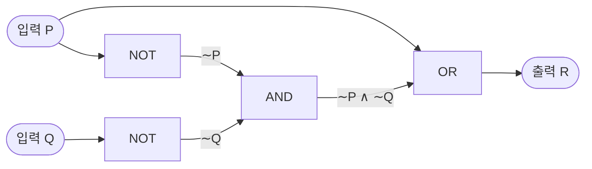
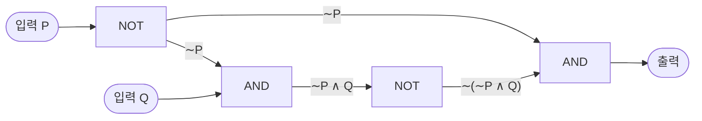
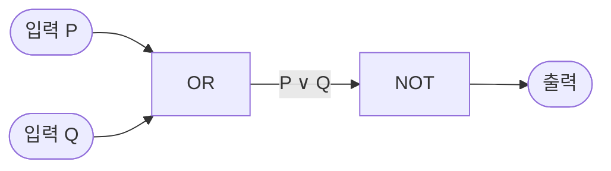

# HW1 과제 해설 — 조건 명제, 논증, 논리 회로

[레포지토리 안내](../../README.ko.md) | [English](Assignment-Explanation.md) | [한국어](Assignment-Explanation.ko.md)

> **최종 수정일:** 2026-11-04
>
> Discrete Mathematics with Applications, Epp, Ch 2

> **학습 목표:**
> 1. 조건 명제와 쌍조건 명제를 포함한 명제 형식의 진리표를 작성하고, 두 명제 형식이 논리적 동치인지 판정할 수 있다
> 2. 조건 명제의 역, 이, 대우를 구별하여 쓸 수 있다
> 3. $p \to q \equiv \sim p \vee q$와 드모르간의 법칙을 이용하여 명제 형식을 정해진 연결사만으로 다시 쓸 수 있다
> 4. 진리표의 임계 행으로 논증의 타당성을 판정하고, 추론 규칙과 역의 오류, 이의 오류를 식별할 수 있다
> 5. 부울 식에 대응하는 회로를 그리고, 정리 2.1.1의 법칙으로 두 회로의 입출력 표가 같음을 보일 수 있다

---

## 목차

- [1. 연습 문제 2.2.6: 조건 명제를 포함한 진리표](#1-연습-문제-226-조건-명제를-포함한-진리표)
- [2. 연습 문제 2.2.10: 쌍조건 명제의 진리표](#2-연습-문제-2210-쌍조건-명제의-진리표)
- [3. 연습 문제 2.2.15: 조건 명제의 결합 방향과 논리적 동치](#3-연습-문제-2215-조건-명제의-결합-방향과-논리적-동치)
- [4. 연습 문제 2.2.23: 역과 이](#4-연습-문제-2223-역과-이)
- [5. 연습 문제 2.2.47: 조건 명제를 논리곱과 부정으로 바꾸기](#5-연습-문제-2247-조건-명제를-논리곱과-부정으로-바꾸기)
- [6. 연습 문제 2.2.49: 쌍조건 명제를 논리곱과 부정으로 바꾸기](#6-연습-문제-2249-쌍조건-명제를-논리곱과-부정으로-바꾸기)
- [7. 연습 문제 2.3.13: 후건 부정의 타당성](#7-연습-문제-2313-후건-부정의-타당성)
- [8. 연습 문제 2.3.26: 추이에 의한 타당한 논증](#8-연습-문제-2326-추이에-의한-타당한-논증)
- [9. 연습 문제 2.3.28: 역의 오류](#9-연습-문제-2328-역의-오류)
- [10. 연습 문제 2.3.29: 이의 오류](#10-연습-문제-2329-이의-오류)
- [11. 연습 문제 2.4.15: 부울 식에 대응하는 회로](#11-연습-문제-2415-부울-식에-대응하는-회로)
- [12. 연습 문제 2.4.27: 두 회로의 동치](#12-연습-문제-2427-두-회로의-동치)
- [요약](#요약)
- [점검 문제](#점검-문제)

---

<br>

## 1. 연습 문제 2.2.6: 조건 명제를 포함한 진리표

**문제.** 명제 형식 $(p \vee q) \vee (\sim p \wedge q) \to q$의 진리표를 작성한다.

**사용하는 개념.** 조건 명제 $p \to q$는 가정 $p$가 참이고 결론 $q$가 거짓일 때만 거짓이고, 나머지 세 경우에는 모두 참이다([2장 2절](../../Lecture-Notes/Ch02_The-Logic-of-Compound-Statements/Concepts_Lecture.ko.md)). 또 교재의 연산 순서 규약에 따라 $\to$는 $\sim$, $\wedge$, $\vee$를 모두 계산한 뒤 마지막에 계산한다. 따라서 이 명제 형식은 $\big((p \vee q) \vee (\sim p \wedge q)\big) \to q$로 읽는다.

**풀이.** 변수가 $p$, $q$ 두 개이므로 진리표는 $2^2 = 4$행이다. 안쪽 식부터 차례로 열을 만든다.

1. $\sim p$ 열은 $p$의 진릿값을 뒤집는다.
2. $p \vee q$ 열은 $p$와 $q$ 중 하나라도 참이면 참이다.
3. $\sim p \wedge q$ 열은 $\sim p$와 $q$가 모두 참일 때만 참이다.
4. $(p \vee q) \vee (\sim p \wedge q)$ 열은 2단계의 열과 3단계의 열 중 하나라도 참이면 참이다.
5. 마지막 열은 4단계의 열을 가정으로, $q$를 결론으로 하는 조건 명제이다. 가정이 참이고 $q$가 거짓인 행에서만 F이다.

| $p$ | $q$ | $\sim p$ | $p \vee q$ | $\sim p \wedge q$ | $(p \vee q) \vee (\sim p \wedge q)$ | $(p \vee q) \vee (\sim p \wedge q) \to q$ |
|:---:|:---:|:---:|:---:|:---:|:---:|:---:|
| T | T | F | T | F | T | T |
| T | F | F | T | F | T | F |
| F | T | T | T | T | T | T |
| F | F | T | F | F | F | T |

*표 1. 연습 문제 2.2.6의 진리표*

둘째 행($p$ 참, $q$ 거짓)에서만 가정이 참이고 결론 $q$가 거짓이므로 명제 형식 전체가 거짓이다. 나머지 세 행에서는 참이다. 특히 넷째 행은 가정이 거짓이므로 결론의 진릿값과 관계없이 참이다.

> **참고:** 4단계의 열은 $p \vee q$의 열과 같다. $\sim p \wedge q$가 참이면 $q$가 참이므로 $p \vee q$도 참이고, 따라서 $(p \vee q) \vee (\sim p \wedge q) \equiv p \vee q$이다. 그러면 주어진 명제 형식은 $(p \vee q) \to q$와 동치이고, $(p \vee q) \to q \equiv \sim(p \vee q) \vee q \equiv (\sim p \wedge \sim q) \vee q \equiv \sim p \vee q$이므로 마지막 열은 $p \to q$의 열(T, F, T, T)과 같다. 진리표의 결과를 이렇게 식의 변형으로 다시 확인할 수 있다.

---

<br>

## 2. 연습 문제 2.2.10: 쌍조건 명제의 진리표

**문제.** 명제 형식 $(p \to r) \leftrightarrow (q \to r)$의 진리표를 작성한다.

**사용하는 개념.** 쌍조건 명제 $a \leftrightarrow b$는 $a$와 $b$의 진릿값이 같을 때 참이고, 다를 때 거짓이다(2장 2절). 이 문제에서는 괄호가 계산 순서를 정해 주므로 두 조건 명제를 먼저 계산하고 마지막에 $\leftrightarrow$를 계산한다.

**풀이.** 변수가 세 개이므로 진리표는 $2^3 = 8$행이다. 교재의 관례대로 $p$ 열은 T 네 개 다음 F 네 개, $q$ 열은 T 두 개와 F 두 개를 번갈아, $r$ 열은 T와 F를 번갈아 적으면 모든 조합이 한 번씩 나온다.

1. $p \to r$ 열은 $p$가 참이고 $r$이 거짓인 행(둘째, 넷째 행)에서만 F이다.
2. $q \to r$ 열은 $q$가 참이고 $r$이 거짓인 행(둘째, 여섯째 행)에서만 F이다.
3. 마지막 열은 1단계와 2단계의 두 열이 같은 행에서 T, 다른 행에서 F이다.

| $p$ | $q$ | $r$ | $p \to r$ | $q \to r$ | $(p \to r) \leftrightarrow (q \to r)$ |
|:---:|:---:|:---:|:---:|:---:|:---:|
| T | T | T | T | T | T |
| T | T | F | F | F | T |
| T | F | T | T | T | T |
| T | F | F | F | T | F |
| F | T | T | T | T | T |
| F | T | F | T | F | F |
| F | F | T | T | T | T |
| F | F | F | T | T | T |

*표 2. 연습 문제 2.2.10의 진리표*

명제 형식은 넷째 행($p$ 참, $q$ 거짓, $r$ 거짓)과 여섯째 행($p$ 거짓, $q$ 참, $r$ 거짓)에서만 거짓이다. 이 결과는 다음과 같이 해석할 수 있다. $r$이 참이면 두 조건 명제의 결론이 참이므로 둘 다 참이고, 쌍조건 명제도 참이다. $r$이 거짓이면 $p \to r$은 $\sim p$와, $q \to r$은 $\sim q$와 진릿값이 같으므로, 쌍조건 명제는 $p$와 $q$의 진릿값이 같을 때만 참이다.

---

<br>

## 3. 연습 문제 2.2.15: 조건 명제의 결합 방향과 논리적 동치

**문제.** 두 명제 형식 $p \to (q \to r)$와 $(p \to q) \to r$가 논리적 동치인지 판정한다.

**사용하는 개념.** 두 명제 형식이 **논리적 동치(logically equivalent)** 라는 것은 명제 변수에 어떤 진릿값을 대입해도 두 명제 형식의 진릿값이 항상 같다는 뜻이다(2장 1절). 동치임을 보이려면 진리표의 모든 행에서 두 열이 같음을 보여야 하지만, 동치가 아님을 보이려면 두 열이 다른 행을 하나만 찾으면 된다.

**풀이.** 두 명제 형식을 같은 진리표에 놓고 비교한다.

1. $q \to r$ 열을 만든 뒤, $p$를 가정으로 하는 $p \to (q \to r)$ 열을 만든다.
2. $p \to q$ 열을 만든 뒤, 그것을 가정으로 하고 $r$을 결론으로 하는 $(p \to q) \to r$ 열을 만든다.

| $p$ | $q$ | $r$ | $q \to r$ | $p \to (q \to r)$ | $p \to q$ | $(p \to q) \to r$ |
|:---:|:---:|:---:|:---:|:---:|:---:|:---:|
| T | T | T | T | T | T | T |
| T | T | F | F | F | T | F |
| T | F | T | T | T | F | T |
| T | F | F | T | T | F | T |
| F | T | T | T | T | T | T |
| F | T | F | F | T | T | F |
| F | F | T | T | T | T | T |
| F | F | F | T | T | T | F |

*표 3. $`p \to (q \to r)`$와 $`(p \to q) \to r`$의 진리표*

여섯째 행과 여덟째 행에서 두 열의 진릿값이 다르다. 예를 들어 여덟째 행처럼 $p$, $q$, $r$이 모두 거짓이면 $p \to (q \to r)$는 가정 $p$가 거짓이므로 참이다. 반면 $p \to q$는 참이고 $r$은 거짓이므로 $(p \to q) \to r$는 거짓이다. 따라서 **두 명제 형식은 논리적 동치가 아니다.** 조건 연산자 $\to$는 결합 법칙을 만족하지 않으므로 괄호의 위치가 뜻을 바꾼다.

> **참고:** $p \to (q \to r)$는 $(p \wedge q) \to r$과 논리적 동치이다. $p \to (q \to r) \equiv \sim p \vee (\sim q \vee r) \equiv \sim(p \wedge q) \vee r \equiv (p \wedge q) \to r$이기 때문이다. 표 3에서 $p \to (q \to r)$가 $p$와 $q$가 참이고 $r$이 거짓인 둘째 행에서만 거짓인 것도 이와 일치한다.

---

<br>

## 4. 연습 문제 2.2.23: 역과 이

**문제.** 연습 문제 2.2.20의 일곱 조건 명제 각각에 대해 역과 이를 쓴다. 변수는 모두 고정된 수나 대상을 가리키며, 각 명제의 가정 $p$와 결론 $q$는 다음과 같다.

- (a) $p$: $P$는 정사각형이다. $q$: $P$는 직사각형이다.
- (b) $p$: 오늘은 12월 31일이다. $q$: 내일은 1월이다.
- (c) $p$: $r$은 유한소수로 나타난다. $q$: $r$은 유리수이다.
- (d) $p$: $n$은 소수이다. $q$: $n$은 홀수이거나 $n = 2$이다.
- (e) $p$: $x$는 음이 아니다. $q$: $x$는 양수이거나 $x = 0$이다.
- (f) $p$: Tom은 Ann의 아버지이다. $q$: Jim은 Ann의 삼촌이고 Sue는 Ann의 이모이다.
- (g) $p$: $n$은 6으로 나누어떨어진다. $q$: $n$은 2로 나누어떨어지고 3으로 나누어떨어진다.

**사용하는 개념.** 조건 명제 $p \to q$에 대해 **역(converse)** 은 $q \to p$, **이(inverse)** 는 $\sim p \to \sim q$, **대우(contrapositive)** 는 $\sim q \to \sim p$이다(2장 2절). 역은 가정과 결론의 자리를 바꾸고, 이는 자리를 그대로 둔 채 가정과 결론을 각각 부정한다. 가정이나 결론에 "또는", "그리고"가 있으면 드모르간의 법칙 $\sim(a \vee b) \equiv \sim a \wedge \sim b$, $\sim(a \wedge b) \equiv \sim a \vee \sim b$로 부정한다.

**풀이.** 위의 $p$와 $q$에 정의를 적용한다. (d)의 결론 "$`n`$은 홀수이거나 $n = 2$이다"의 부정은 "$`n`$은 홀수가 아니고 $n \ne 2$이다"이고, (f)의 결론 "Jim은 Ann의 삼촌이고 Sue는 Ann의 이모이다"의 부정은 "Jim은 Ann의 삼촌이 아니거나 Sue는 Ann의 이모가 아니다"이다. (e)의 가정 "$`x`$가 음이 아니다"의 부정은 실수 $x$에 대해 "$`x`$는 음수이다"와 같다.

| 문항 | 역 ($`q \to p`$) | 이 ($`\sim p \to \sim q`$) |
|:---:|:-----|:-----|
| (a) | $P$가 직사각형이면 $P$는 정사각형이다. | $P$가 정사각형이 아니면 $P$는 직사각형이 아니다. |
| (b) | 내일이 1월이면 오늘은 12월 31일이다. | 오늘이 12월 31일이 아니면 내일은 1월이 아니다. |
| (c) | $r$이 유리수이면 $r$은 유한소수로 나타난다. | $r$이 유한소수로 나타나지 않으면 $r$은 유리수가 아니다. |
| (d) | $n$이 홀수이거나 $n = 2$이면 $n$은 소수이다. | $n$이 소수가 아니면 $n$은 홀수가 아니고 $n \ne 2$이다. |
| (e) | $x$가 양수이거나 $x = 0$이면 $x$는 음이 아니다. | $x$가 음수이면 $x$는 양수가 아니고 $x \ne 0$이다. |
| (f) | Jim이 Ann의 삼촌이고 Sue가 Ann의 이모이면 Tom은 Ann의 아버지이다. | Tom이 Ann의 아버지가 아니면 Jim은 Ann의 삼촌이 아니거나 Sue는 Ann의 이모가 아니다. |
| (g) | $n$이 2로 나누어떨어지고 3으로 나누어떨어지면 $n$은 6으로 나누어떨어진다. | $n$이 6으로 나누어떨어지지 않으면 $n$은 2로 나누어떨어지지 않거나 3으로 나누어떨어지지 않는다. |

*표 4. 연습 문제 2.2.20의 일곱 명제의 역과 이*

> **주의:** 이를 쓸 때 부정한 결론을 가정 자리로 옮기면 $\sim q \to \sim p$, 곧 대우가 된다. 예를 들어 (a)의 이는 "$`P`$가 정사각형이 아니면 $P$는 직사각형이 아니다"이고, "$`P`$가 직사각형이 아니면 $P$는 정사각형이 아니다"는 대우이다. 대우는 원래 명제와 논리적 동치이지만 이는 일반적으로 그렇지 않으므로, 두 명제는 뜻이 전혀 다르다.

역과 이는 원래 명제와 진릿값이 다를 수 있다. (a)의 원래 명제는 참이지만, 가로 2, 세로 1인 직사각형은 정사각형이 아니므로 역 "직사각형이면 정사각형이다"는 거짓이다. 같은 도형이 정사각형이 아니면서 직사각형이므로 이도 거짓이다. (c)에서도 $\frac{1}{3} = 0.333\ldots$은 유리수이지만 유한소수가 아니므로 역과 이가 모두 거짓이다. 역과 이가 항상 같은 진릿값을 갖는 것은 이가 역의 대우이기 때문이다. 즉 $q \to p$의 대우는 $\sim p \to \sim q$이다.

---

<br>

## 5. 연습 문제 2.2.47: 조건 명제를 논리곱과 부정으로 바꾸기

**문제.** 명제 형식 $p \wedge \sim q \to r$을 (a) $p \to q \equiv \sim p \vee q$와 $p \leftrightarrow q \equiv (\sim p \vee q) \wedge (\sim q \vee p)$를 써서 $\to$와 $\leftrightarrow$가 없는 꼴로, (b) $p \vee q \equiv \sim(\sim p \wedge \sim q)$를 써서 $\wedge$와 $\sim$만 쓰인 꼴로 바꾼다.

**사용하는 개념.** 조건 명제를 논리합으로 바꾸는 동치 $p \to q \equiv \sim p \vee q$, 논리합을 논리곱과 부정으로 바꾸는 동치 $p \vee q \equiv \sim(\sim p \wedge \sim q)$(드모르간의 법칙에서 얻는다), 이중 부정 법칙 $\sim(\sim p) \equiv p$를 쓴다(2장 1절, 2절). 이 동치들은 명제 변수 자리에 어떤 명제 형식을 대입해도 성립한다. 연산 순서에 따라 $\wedge$를 $\to$보다 먼저 계산하므로 주어진 명제 형식은 $(p \wedge \sim q) \to r$이다.

**풀이.**

(a) $p \to q \equiv \sim p \vee q$에서 $p$ 자리에 $p \wedge \sim q$를, $q$ 자리에 $r$을 대입한다.

```math
(p \wedge \sim q) \to r \equiv \sim(p \wedge \sim q) \vee r
```

(b) (a)의 결과는 두 부분 $A = \sim(p \wedge \sim q)$와 $B = r$의 논리합 $A \vee B$이다. $A \vee B \equiv \sim(\sim A \wedge \sim B)$를 적용한 뒤 이중 부정 법칙으로 $\sim A = \sim\sim(p \wedge \sim q) \equiv p \wedge \sim q$를 정리한다.

```math
\sim(p \wedge \sim q) \vee r \equiv \sim\big(\sim\sim(p \wedge \sim q) \wedge \sim r\big) \equiv \sim\big((p \wedge \sim q) \wedge \sim r\big)
```

마지막 식에는 $\wedge$와 $\sim$만 쓰였다. 결과가 맞는지는 거짓이 되는 경우로 확인할 수 있다. 원래 명제 형식은 가정 $p \wedge \sim q$가 참이고 $r$이 거짓일 때, 곧 $p$가 참, $q$가 거짓, $r$이 거짓일 때만 거짓이다. 마지막 식도 $(p \wedge \sim q) \wedge \sim r$이 참일 때, 곧 같은 경우에만 거짓이다.

---

<br>

## 6. 연습 문제 2.2.49: 쌍조건 명제를 논리곱과 부정으로 바꾸기

**문제.** 명제 형식 $(p \to r) \leftrightarrow (q \to r)$을 연습 문제 2.2.47과 같은 방법으로 (a) $\to$와 $\leftrightarrow$ 없이, (b) $\wedge$와 $\sim$만으로 다시 쓴다.

**사용하는 개념.** 연습 문제 2.2.47과 같은 세 동치에 쌍조건 명제의 동치 $p \leftrightarrow q \equiv (\sim p \vee q) \wedge (\sim q \vee p)$를 더한다. 바깥쪽 연산자부터 차례로 바꾸되, 바꾼 식 안에 남은 연산자도 모두 바꾸어야 한다.

**풀이.**

(a) 먼저 안쪽의 두 조건 명제를 바꾼다.

```math
p \to r \equiv \sim p \vee r, \qquad q \to r \equiv \sim q \vee r
```

다음으로 쌍조건 명제의 동치에서 $p$ 자리에 $\sim p \vee r$을, $q$ 자리에 $\sim q \vee r$을 대입한다.

```math
(p \to r) \leftrightarrow (q \to r) \equiv \big(\sim(\sim p \vee r) \vee (\sim q \vee r)\big) \wedge \big(\sim(\sim q \vee r) \vee (\sim p \vee r)\big)
```

(b) (a)의 식에 남은 $\vee$를 모두 없애야 한다. 먼저 안쪽의 두 논리합을 바꾼다. $a \vee b \equiv \sim(\sim a \wedge \sim b)$와 이중 부정 법칙에 의해 다음이 성립한다.

```math
\sim p \vee r \equiv \sim(\sim\sim p \wedge \sim r) \equiv \sim(p \wedge \sim r), \qquad \sim q \vee r \equiv \sim(q \wedge \sim r)
```

$A = \sim(p \wedge \sim r)$, $B = \sim(q \wedge \sim r)$로 두면 (a)의 식은 $(\sim A \vee B) \wedge (\sim B \vee A)$이다. 바깥쪽 두 논리합에도 같은 동치를 적용한다.

```math
\sim A \vee B \equiv \sim(\sim\sim A \wedge \sim B) \equiv \sim(A \wedge \sim B), \qquad \sim B \vee A \equiv \sim(B \wedge \sim A)
```

여기서 $\sim B = \sim\sim(q \wedge \sim r) \equiv q \wedge \sim r$이고 $\sim A \equiv p \wedge \sim r$이다. 이를 대입하면 최종 결과는 다음과 같다.

```math
(p \to r) \leftrightarrow (q \to r) \equiv \sim\big(\sim(p \wedge \sim r) \wedge (q \wedge \sim r)\big) \wedge \sim\big(\sim(q \wedge \sim r) \wedge (p \wedge \sim r)\big)
```

이 식이 맞는지는 연습 문제 2.2.10의 진리표(표 2)로 확인할 수 있다. 첫째 인수 $\sim\big(\sim(p \wedge \sim r) \wedge (q \wedge \sim r)\big)$는 $q$가 참, $r$이 거짓, $p$가 거짓일 때만 거짓이고, 둘째 인수는 $p$가 참, $r$이 거짓, $q$가 거짓일 때만 거짓이다. 따라서 전체 식은 표 2의 넷째 행과 여섯째 행에서만 거짓이며, 이는 원래 명제 형식과 같다.

---

<br>

## 7. 연습 문제 2.3.13: 후건 부정의 타당성

**문제.** 진리표를 이용하여 **후건 부정(modus tollens)** 논증 형식 "$`p \to q`$, $\sim q$, 그러므로 $\sim p$"가 타당함을 보인다. 전제의 열과 결론의 열을 표시하고, 진리표가 답을 뒷받침하는 이유를 한 문장으로 설명한다.

**사용하는 개념.** 논증 형식이 **타당하다(valid)** 는 것은 명제 변수에 어떤 진릿값을 대입하더라도 전제가 모두 참이면 결론도 반드시 참이라는 뜻이다([2장 3절](../../Lecture-Notes/Ch02_The-Logic-of-Compound-Statements/Concepts_Lecture.ko.md)). 진리표에서 전제가 모두 참인 행을 **임계 행(critical row)** 이라 하며, 모든 임계 행에서 결론이 참이면 논증 형식은 타당하고, 결론이 거짓인 임계 행이 하나라도 있으면 부당하다.

**풀이.** 전제 1은 $p \to q$, 전제 2는 $\sim q$, 결론은 $\sim p$이다.

| $p$ | $q$ | $p \to q$ (전제 1) | $\sim q$ (전제 2) | $\sim p$ (결론) | 비고 |
|:---:|:---:|:---:|:---:|:---:|:-----|
| T | T | T | F | F | |
| T | F | F | T | F | |
| F | T | T | F | T | |
| F | F | T | T | T | 임계 행 |

*표 5. 후건 부정의 진리표와 임계 행*

두 전제가 모두 참인 행은 넷째 행뿐이고, 이 임계 행에서 결론 $\sim p$는 참이다. 첫째 행부터 셋째 행까지는 전제 중 하나가 거짓이므로 결론의 진릿값과 관계없이 타당성 판정에 영향을 주지 않는다. 따라서 전제가 모두 참일 때는 언제나 결론도 참이며, 후건 부정은 타당한 논증 형식이다.

---

<br>

## 8. 연습 문제 2.3.26: 추이에 의한 타당한 논증

**문제.** 다음 논증을 기호로 나타내고, 타당하면 타당성을 보장하는 추론 규칙을, 부당하면 역의 오류와 이의 오류 가운데 어느 것을 범했는지 밝힌다.

- 전제 1: 영화를 보러 가면 나는 숙제를 끝내지 못한다.
- 전제 2: 숙제를 끝내지 못하면 나는 내일 시험을 잘 보지 못한다.
- 결론: 영화를 보러 가면 나는 내일 시험을 잘 보지 못한다.

**사용하는 개념.** **추이(transitivity)** 는 "$`p \to q`$, $q \to r$, 그러므로 $p \to r$" 꼴의 타당한 논증 형식이다(교재의 표 2.3.1). 명제 변수 자리에는 부정을 포함한 어떤 명제 형식도 대입할 수 있다.

**풀이.** 단순 명제를 다음과 같이 둔다.

- $p$: 나는 영화를 보러 간다.
- $q$: 나는 숙제를 끝낸다.
- $r$: 나는 내일 시험을 잘 본다.

그러면 논증의 형식은 다음과 같다.

```math
p \to \sim q, \qquad \sim q \to \sim r, \qquad \therefore\ p \to \sim r
```

이는 추이의 형식에서 $q$ 자리에 $\sim q$를, $r$ 자리에 $\sim r$을 대입한 것이므로 **추이에 의해 타당하다.** 직관적으로도 두 전제가 참이고 $p$가 참이면, 전제 1에 의해 $\sim q$가 참이고, 다시 전제 2에 의해 $\sim r$이 참이다. 따라서 $p$가 참인데 $\sim r$이 거짓인 경우는 생길 수 없고, 결론 $p \to \sim r$은 거짓이 될 수 없다.

---

<br>

## 9. 연습 문제 2.3.28: 역의 오류

**문제.** 다음 논증을 기호로 나타내어 타당성을 판정하고, 부당하면 어떤 오류를 범했는지 밝힌다.

- 전제 1: 유리수가 무리수만큼 많으면 무리수 전체의 집합은 무한집합이다.
- 전제 2: 무리수 전체의 집합은 무한집합이다.
- 결론: 유리수는 무리수만큼 많다.

**사용하는 개념.** **역의 오류(converse error)** 는 "$`p \to q`$, $q$, 그러므로 $p$" 꼴의 부당한 추론이다(2장 3절). 조건 명제의 결론이 참이라는 사실로부터 가정이 참이라고 결론 내리는 오류이며, 조건 명제를 그 역과 혼동한 데서 생긴다.

**풀이.** $p$를 "유리수는 무리수만큼 많다", $q$를 "무리수 전체의 집합은 무한집합이다"로 두면 논증의 형식은 다음과 같다.

```math
p \to q, \qquad q, \qquad \therefore\ p
```

이 형식의 진리표를 보면 부당함이 드러난다.

| $p$ | $q$ | $p \to q$ (전제 1) | $q$ (전제 2) | $p$ (결론) | 비고 |
|:---:|:---:|:---:|:---:|:---:|:-----|
| T | T | T | T | T | 임계 행 |
| T | F | F | F | T | |
| F | T | T | T | F | 임계 행, 결론 거짓 |
| F | F | T | F | F | |

*표 6. 역의 오류 형식의 진리표*

셋째 행은 두 전제가 모두 참인 임계 행인데 결론 $p$가 거짓이다. 따라서 이 논증은 **역의 오류를 범한 부당한 논증**이다. 실제로도 두 전제는 참이지만 결론은 거짓이다. 유리수 전체의 집합은 자연수와 일대일로 대응시킬 수 있지만 무리수 전체의 집합은 그럴 수 없으므로, 무리수가 유리수보다 훨씬 많다. 이 사실은 7장 4절에서 다룬다.

---

<br>

## 10. 연습 문제 2.3.29: 이의 오류

**문제.** 다음 논증을 기호로 나타내어 타당성을 판정하고, 부당하면 어떤 오류를 범했는지 밝힌다.

- 전제 1: 주어진 두 수 가운데 적어도 하나가 6으로 나누어떨어지면 두 수의 곱은 6으로 나누어떨어진다.
- 전제 2: 두 수 모두 6으로 나누어떨어지지 않는다.
- 결론: 두 수의 곱은 6으로 나누어떨어지지 않는다.

**사용하는 개념.** **이의 오류(inverse error)** 는 "$`p \to q`$, $\sim p$, 그러므로 $\sim q$" 꼴의 부당한 추론이다(2장 3절). 조건 명제의 가정이 거짓이라는 사실로부터 결론도 거짓이라고 결론 내리는 오류이며, 조건 명제를 그 이와 혼동한 데서 생긴다.

**풀이.** $p$를 "두 수 중 적어도 하나가 6으로 나누어떨어진다", $q$를 "두 수의 곱이 6으로 나누어떨어진다"로 둔다. "적어도 하나가 나누어떨어진다"의 부정은 "두 수 모두 나누어떨어지지 않는다"이므로 둘째 전제는 $\sim p$이다. 따라서 논증의 형식은 다음과 같다.

```math
p \to q, \qquad \sim p, \qquad \therefore\ \sim q
```

| $p$ | $q$ | $p \to q$ (전제 1) | $\sim p$ (전제 2) | $\sim q$ (결론) | 비고 |
|:---:|:---:|:---:|:---:|:---:|:-----|
| T | T | T | F | F | |
| T | F | F | F | T | |
| F | T | T | T | F | 임계 행, 결론 거짓 |
| F | F | T | T | T | 임계 행 |

*표 7. 이의 오류 형식의 진리표*

셋째 행은 임계 행인데 결론 $\sim q$가 거짓이므로, 이 논증은 **이의 오류를 범한 부당한 논증**이다. 구체적인 반례로 두 수가 2와 3인 경우를 생각할 수 있다. 2와 3은 모두 6으로 나누어떨어지지 않으므로 두 전제는 참이지만, 곱 $2 \times 3 = 6$은 6으로 나누어떨어지므로 결론은 거짓이다.

---

<br>

## 11. 연습 문제 2.4.15: 부울 식에 대응하는 회로

**문제.** 부울 식 $P \vee (\sim P \wedge \sim Q)$에 대응하는 회로를 그린다.

**사용하는 개념.** **디지털 논리 회로(digital logic circuit)** 에서 NOT 게이트는 입력 신호를 뒤집고, AND 게이트는 모든 입력이 1일 때만 1을, OR 게이트는 입력 중 하나라도 1이면 1을 출력한다([2장 4절](../../Lecture-Notes/Ch02_The-Logic-of-Compound-Statements/Concepts_Lecture.ko.md)). 부울 식의 $\sim$, $\wedge$, $\vee$는 각각 NOT, AND, OR 게이트에 대응하고, 참과 거짓은 신호 1과 0에 대응한다. 부울 식에서 가장 나중에 계산하는 연산자가 출력에 가장 가까운 게이트가 된다.

**풀이.** 식을 바깥쪽부터 분해한다.

1. 가장 나중에 계산하는 연산자는 $\vee$이므로 출력 쪽에 OR 게이트를 둔다. 그 두 입력은 $P$와 $\sim P \wedge \sim Q$이다.
2. $\sim P \wedge \sim Q$는 AND 게이트의 출력이고, 그 두 입력은 $\sim P$와 $\sim Q$이다.
3. $\sim P$와 $\sim Q$는 각각 입력 $P$와 $Q$를 NOT 게이트에 통과시켜 얻는다. 입력 $P$는 갈라져서 한쪽은 NOT 게이트로, 다른 쪽은 OR 게이트로 바로 들어간다.



*그림 1. $`P \vee (\sim P \wedge \sim Q)`$에 대응하는 회로*

이 회로의 입출력 표는 다음과 같다.

| $P$ | $Q$ | $\sim P$ | $\sim Q$ | $\sim P \wedge \sim Q$ | $R = P \vee (\sim P \wedge \sim Q)$ |
|:---:|:---:|:---:|:---:|:---:|:---:|
| 1 | 1 | 0 | 0 | 0 | 1 |
| 1 | 0 | 0 | 1 | 0 | 1 |
| 0 | 1 | 1 | 0 | 0 | 0 |
| 0 | 0 | 1 | 1 | 1 | 1 |

*표 8. 그림 1 회로의 입출력 표*

> **참고:** 이 회로는 게이트 두 개로 줄일 수 있다. 분배 법칙, 부정 법칙, 항등 법칙에 의해 $P \vee (\sim P \wedge \sim Q) \equiv (P \vee \sim P) \wedge (P \vee \sim Q) \equiv \mathbf{t} \wedge (P \vee \sim Q) \equiv P \vee \sim Q$이다. 따라서 $Q$를 NOT 게이트에 통과시킨 신호와 $P$를 OR 게이트에 넣는 회로가 같은 입출력 표를 갖는다. 표 8에서도 출력이 0인 행은 $P = 0$, $Q = 1$인 행 하나뿐이다.

---

<br>

## 12. 연습 문제 2.4.27: 두 회로의 동치

**문제.** 다음 두 회로의 부울 식을 구하고, 정리 2.1.1의 성질을 이용하여 두 회로의 입출력 표가 같음을 보인다.

- 회로 (a): 입력 $P$를 NOT 게이트에 통과시킨 신호가 둘로 갈라진다. 한 갈래는 입력 $Q$와 함께 AND 게이트에 들어가고, 그 출력은 다시 NOT 게이트를 지난다. 다른 갈래와 이 NOT 게이트의 출력이 마지막 AND 게이트에 들어간다.
- 회로 (b): 입력 $P$와 $Q$가 OR 게이트에 들어가고, 그 출력이 NOT 게이트를 지난다.



*그림 2. 연습 문제 2.4.27의 회로 (a)*



*그림 3. 연습 문제 2.4.27의 회로 (b)*

**사용하는 개념.** 두 회로의 부울 식이 명제 형식으로서 논리적 동치이면 두 회로는 같은 입출력 표를 갖는다. 정리 2.1.1은 2장 1절의 논리적 동치 법칙으로, 교환 법칙, 결합 법칙, 분배 법칙, 항등 법칙, 부정 법칙, 이중 부정 법칙, 멱등 법칙, 전체 한계 법칙, 드모르간의 법칙, 흡수 법칙, $\mathbf{t}$와 $\mathbf{c}$의 부정을 모은 것이다. 여기서 $\mathbf{t}$는 항진명제, $\mathbf{c}$는 모순명제를 나타낸다.

**풀이.** 먼저 각 회로의 신호를 입력에서 출력 쪽으로 따라가며 부울 식을 구한다. 회로 (a)에서 첫 NOT 게이트의 출력은 $\sim P$, 첫 AND 게이트의 출력은 $\sim P \wedge Q$, 둘째 NOT 게이트의 출력은 $\sim(\sim P \wedge Q)$이므로 최종 출력은 $\sim P \wedge \sim(\sim P \wedge Q)$이다. 회로 (b)의 출력은 $\sim(P \vee Q)$이다.

이제 회로 (a)의 식을 정리 2.1.1의 법칙으로 변형한다.

1. $\sim P \wedge \sim(\sim P \wedge Q) \equiv \sim P \wedge (\sim(\sim P) \vee \sim Q)$ (드모르간의 법칙)
2. $\equiv \sim P \wedge (P \vee \sim Q)$ (이중 부정 법칙)
3. $\equiv (\sim P \wedge P) \vee (\sim P \wedge \sim Q)$ (분배 법칙)
4. $\equiv (P \wedge \sim P) \vee (\sim P \wedge \sim Q)$ (교환 법칙)
5. $\equiv \mathbf{c} \vee (\sim P \wedge \sim Q)$ (부정 법칙, $`p \wedge \sim p \equiv \mathbf{c}`$)
6. $\equiv (\sim P \wedge \sim Q) \vee \mathbf{c}$ (교환 법칙)
7. $\equiv \sim P \wedge \sim Q$ (항등 법칙, $`p \vee \mathbf{c} \equiv p`$)
8. $\equiv \sim(P \vee Q)$ (드모르간의 법칙)

마지막 식은 회로 (b)의 부울 식이므로 두 부울 식은 논리적 동치이고, 두 회로는 같은 입출력 표를 갖는다. 입출력 표로 확인하면 다음과 같다.

| $P$ | $Q$ | $\sim P$ | $\sim P \wedge Q$ | $\sim(\sim P \wedge Q)$ | 회로 (a)의 출력 | $P \vee Q$ | 회로 (b)의 출력 |
|:---:|:---:|:---:|:---:|:---:|:---:|:---:|:---:|
| 1 | 1 | 0 | 0 | 1 | 0 | 1 | 0 |
| 1 | 0 | 0 | 0 | 1 | 0 | 1 | 0 |
| 0 | 1 | 1 | 1 | 0 | 0 | 1 | 0 |
| 0 | 0 | 1 | 0 | 1 | 1 | 0 | 1 |

*표 9. 회로 (a)와 회로 (b)의 입출력 표*

두 출력 열이 모든 행에서 같다. 회로 (b)는 게이트 두 개만 쓰므로 회로 (a)를 더 간단하게 구현한 회로이다.

---

<br>

## 요약

| 개념 | 핵심 요약 |
|:-----|:-----|
| 조건 명제 | $p \to q$는 $p$가 참이고 $q$가 거짓일 때만 거짓이며, 가정이 거짓이면 결론과 관계없이 참이다. |
| 연산 순서 | $\sim$을 가장 먼저, $\wedge$와 $\vee$를 다음으로, $\to$와 $\leftrightarrow$를 마지막에 계산한다. |
| 쌍조건 명제 | $p \leftrightarrow q$는 $p$와 $q$의 진릿값이 같을 때만 참이다. |
| 논리적 동치의 판정 | 동치임을 보이려면 진리표의 모든 행이 같아야 하고, 동치가 아님을 보이려면 다른 행 하나로 충분하다. |
| 조건 연산자의 결합 | $p \to (q \to r)$와 $(p \to q) \to r$는 동치가 아니며, 앞의 것은 $(p \wedge q) \to r$과 동치이다. |
| 역, 이, 대우 | $p \to q$의 역은 $q \to p$, 이는 $\sim p \to \sim q$, 대우는 $\sim q \to \sim p$이고, 대우만 원래 명제와 동치이다. |
| 연결사 바꾸기 | $p \to q \equiv \sim p \vee q$, $p \leftrightarrow q \equiv (\sim p \vee q) \wedge (\sim q \vee p)$, $p \vee q \equiv \sim(\sim p \wedge \sim q)$를 차례로 적용한다. |
| 타당성과 임계 행 | 전제가 모두 참인 모든 행에서 결론이 참이면 논증 형식은 타당하다. |
| 후건 부정과 추이 | "$`p \to q`$, $\sim q$, 그러므로 $\sim p$"와 "$`p \to q`$, $q \to r$, 그러므로 $p \to r$"은 타당하다. |
| 역의 오류와 이의 오류 | "$`p \to q`$, $q$, 그러므로 $p$"와 "$`p \to q`$, $\sim p$, 그러므로 $\sim q$"는 부당하다. |
| 회로와 부울 식 | NOT, AND, OR 게이트는 $\sim$, $\wedge$, $\vee$에 대응하며, 가장 나중에 계산하는 연산자가 출력 쪽 게이트가 된다. |
| 회로의 동치 | 부울 식이 논리적 동치인 두 회로는 같은 입출력 표를 가지므로, 정리 2.1.1로 회로를 간단하게 만들 수 있다. |

---

<br>

## 점검 문제

1. **조건 연산자와 논리곱:** 진리표를 쓰지 않고 $p \to (q \to r) \equiv (p \wedge q) \to r$임을 보이라. 두 명제 형식이 거짓이 되는 경우는 언제인가?

   <details>
   <summary>정답</summary>

   $p \to (q \to r) \equiv \sim p \vee (\sim q \vee r)$이고, 결합 법칙과 드모르간의 법칙에 의해 $\sim p \vee \sim q \vee r \equiv \sim(p \wedge q) \vee r \equiv (p \wedge q) \to r$이다. 두 명제 형식 모두 $p$와 $q$가 참이고 $r$이 거짓일 때만 거짓이다.

   </details>

2. **역, 이, 대우:** 조건 명제 "$`n`$이 4로 나누어떨어지면 $n$은 짝수이다"의 역, 이, 대우를 쓰고, 각각이 모든 정수 $n$에 대해 참인지 판정하라.

   <details>
   <summary>정답</summary>

   역은 "$`n`$이 짝수이면 $n$은 4로 나누어떨어진다", 이는 "$`n`$이 4로 나누어떨어지지 않으면 $n$은 짝수가 아니다", 대우는 "$`n`$이 짝수가 아니면 $n$은 4로 나누어떨어지지 않는다"이다. $n = 2$는 짝수이지만 4로 나누어떨어지지 않으므로 역과 이는 거짓이다. 대우는 원래 명제와 동치이므로 원래 명제와 같이 참이다.

   </details>

3. **연결사 바꾸기:** 명제 형식 $p \to q \vee r$을 $\wedge$와 $\sim$만으로 다시 쓰라.

   <details>
   <summary>정답</summary>

   연산 순서에 따라 주어진 형식은 $p \to (q \vee r)$이다. $p \to (q \vee r) \equiv \sim p \vee q \vee r$이고, 드모르간의 법칙과 이중 부정 법칙에 의해 $\sim p \vee q \vee r \equiv \sim(p \wedge \sim q \wedge \sim r)$이다. 원래 형식과 결과 모두 $p$가 참이고 $q$와 $r$이 거짓일 때만 거짓이다.

   </details>

4. **오류의 식별:** 다음 논증의 형식을 쓰고 타당성을 판정하라. "비가 오면 땅이 젖는다. 땅이 젖었다. 그러므로 비가 왔다."

   <details>
   <summary>정답</summary>

   $p$를 "비가 온다", $q$를 "땅이 젖는다"로 두면 형식은 "$`p \to q`$, $q$, 그러므로 $p$"이다. $p$가 거짓이고 $q$가 참인 행이 결론이 거짓인 임계 행이므로 역의 오류를 범한 부당한 논증이다. 예를 들어 비가 오지 않아도 누군가 물을 뿌리면 땅이 젖는다.

   </details>

5. **추론 규칙의 결합:** 논증 형식 "$`p \to q`$, $q \to r$, $\sim r$, 그러므로 $\sim p$"가 타당함을 추론 규칙으로 보이라.

   <details>
   <summary>정답</summary>

   첫째와 둘째 전제에 추이를 적용하면 $p \to r$을 얻는다. 이것과 셋째 전제 $\sim r$에 후건 부정을 적용하면 $\sim p$를 얻는다. 타당한 논증 형식만 이어서 썼으므로 전체 논증 형식도 타당하다.

   </details>

6. **회로의 간단화:** 부울 식 $(P \wedge Q) \vee (P \wedge \sim Q)$에 대응하는 회로는 게이트 없이 입력 $P$를 그대로 출력하는 회로와 입출력 표가 같다. 정리 2.1.1로 그 이유를 설명하라.

   <details>
   <summary>정답</summary>

   분배 법칙에 의해 $(P \wedge Q) \vee (P \wedge \sim Q) \equiv P \wedge (Q \vee \sim Q)$이고, 부정 법칙에 의해 $Q \vee \sim Q \equiv \mathbf{t}$이며, 항등 법칙에 의해 $P \wedge \mathbf{t} \equiv P$이다. 따라서 두 회로의 부울 식이 논리적 동치이므로 입출력 표가 같다.

   </details>
