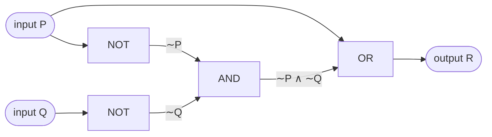
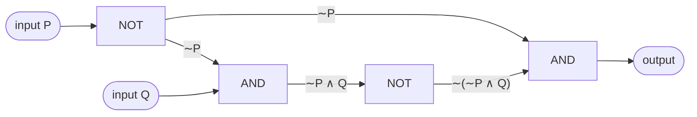
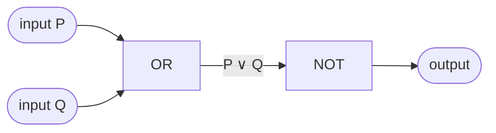

# HW1 Assignment Explanation — Conditional Statements, Arguments, and Logic Circuits

[Repository Guide](../../README.md) | [English](Assignment-Explanation.md) | [한국어](Assignment-Explanation.ko.md)

> **Last Updated:** 2026-11-04
>
> Discrete Mathematics with Applications, Epp, Ch 2

> **Learning Objectives:**
> 1. Construct truth tables for statement forms that contain conditionals and biconditionals, and decide whether two statement forms are logically equivalent
> 2. Write the converse, inverse, and contrapositive of a conditional statement without confusing them
> 3. Rewrite a statement form with a prescribed set of connectives using $p \to q \equiv \sim p \vee q$ and De Morgan's laws
> 4. Decide the validity of an argument from the critical rows of a truth table, and identify rules of inference, the converse error, and the inverse error
> 5. Draw the circuit that corresponds to a Boolean expression, and show with the laws of Theorem 2.1.1 that two circuits have the same input/output table

---

## Table of Contents

- [1. Exercise 2.2.6: Truth Table with a Conditional](#1-exercise-226-truth-table-with-a-conditional)
- [2. Exercise 2.2.10: Truth Table of a Biconditional](#2-exercise-2210-truth-table-of-a-biconditional)
- [3. Exercise 2.2.15: Grouping of Conditionals and Logical Equivalence](#3-exercise-2215-grouping-of-conditionals-and-logical-equivalence)
- [4. Exercise 2.2.23: Converse and Inverse](#4-exercise-2223-converse-and-inverse)
- [5. Exercise 2.2.47: Rewriting a Conditional with Conjunction and Negation](#5-exercise-2247-rewriting-a-conditional-with-conjunction-and-negation)
- [6. Exercise 2.2.49: Rewriting a Biconditional with Conjunction and Negation](#6-exercise-2249-rewriting-a-biconditional-with-conjunction-and-negation)
- [7. Exercise 2.3.13: Validity of Modus Tollens](#7-exercise-2313-validity-of-modus-tollens)
- [8. Exercise 2.3.26: A Valid Argument by Transitivity](#8-exercise-2326-a-valid-argument-by-transitivity)
- [9. Exercise 2.3.28: Converse Error](#9-exercise-2328-converse-error)
- [10. Exercise 2.3.29: Inverse Error](#10-exercise-2329-inverse-error)
- [11. Exercise 2.4.15: Circuit for a Boolean Expression](#11-exercise-2415-circuit-for-a-boolean-expression)
- [12. Exercise 2.4.27: Equivalence of Two Circuits](#12-exercise-2427-equivalence-of-two-circuits)
- [Summary](#summary)
- [Self-Check Questions](#self-check-questions)

---

<br>

## 1. Exercise 2.2.6: Truth Table with a Conditional

**Problem.** Construct a truth table for the statement form $(p \vee q) \vee (\sim p \wedge q) \to q$.

**Concepts used.** A conditional statement $p \to q$ is false only when its hypothesis $p$ is true and its conclusion $q$ is false, and it is true in the other three cases ([Chapter 2, Section 2](../../Lecture-Notes/Ch02_The-Logic-of-Compound-Statements/Concepts_Lecture.md)). By the textbook's convention for the order of operations, $\to$ is evaluated last, after $\sim$, $\wedge$, and $\vee$. Hence the statement form is read as $\big((p \vee q) \vee (\sim p \wedge q)\big) \to q$.

**Solution.** There are two variables, $p$ and $q$, so the truth table has $2^2 = 4$ rows. Build the columns from the innermost expressions outward.

1. The column for $\sim p$ reverses the truth value of $p$.
2. The column for $p \vee q$ is true when at least one of $p$ and $q$ is true.
3. The column for $\sim p \wedge q$ is true only when both $\sim p$ and $q$ are true.
4. The column for $(p \vee q) \vee (\sim p \wedge q)$ is true when at least one of the columns from steps 2 and 3 is true.
5. The last column is the conditional whose hypothesis is the column from step 4 and whose conclusion is $q$. It is F only in rows where the hypothesis is true and $q$ is false.

| $p$ | $q$ | $\sim p$ | $p \vee q$ | $\sim p \wedge q$ | $(p \vee q) \vee (\sim p \wedge q)$ | $(p \vee q) \vee (\sim p \wedge q) \to q$ |
|:---:|:---:|:---:|:---:|:---:|:---:|:---:|
| T | T | F | T | F | T | T |
| T | F | F | T | F | T | F |
| F | T | T | T | T | T | T |
| F | F | T | F | F | F | T |

*Table 1. Truth table for Exercise 2.2.6*

Only in the second row ($p$ true, $q$ false) is the hypothesis true while the conclusion $q$ is false, so only there is the whole statement form false. It is true in the other three rows. In particular, the fourth row is true regardless of the conclusion because its hypothesis is false.

> **Note:** The column from step 4 equals the column for $p \vee q$. If $\sim p \wedge q$ is true, then $q$ is true and so $p \vee q$ is true; therefore $(p \vee q) \vee (\sim p \wedge q) \equiv p \vee q$. The given statement form is then equivalent to $(p \vee q) \to q$, and since $(p \vee q) \to q \equiv \sim(p \vee q) \vee q \equiv (\sim p \wedge \sim q) \vee q \equiv \sim p \vee q$, the last column equals the column of $p \to q$ (T, F, T, T). The result of the truth table can be confirmed again by such a transformation of the expression.

---

<br>

## 2. Exercise 2.2.10: Truth Table of a Biconditional

**Problem.** Construct a truth table for the statement form $(p \to r) \leftrightarrow (q \to r)$.

**Concepts used.** A biconditional $a \leftrightarrow b$ is true when $a$ and $b$ have the same truth value and false when they differ (Chapter 2, Section 2). Here the parentheses fix the order of evaluation, so the two conditionals are evaluated first and $\leftrightarrow$ last.

**Solution.** There are three variables, so the truth table has $2^3 = 8$ rows. Following the textbook's convention, write four T's followed by four F's in the $p$ column, alternate two T's and two F's in the $q$ column, and alternate T and F in the $r$ column; every combination then appears exactly once.

1. The column for $p \to r$ is F only in rows where $p$ is true and $r$ is false (the second and fourth rows).
2. The column for $q \to r$ is F only in rows where $q$ is true and $r$ is false (the second and sixth rows).
3. The last column is T in rows where the columns from steps 1 and 2 agree and F in rows where they differ.

| $p$ | $q$ | $r$ | $p \to r$ | $q \to r$ | $(p \to r) \leftrightarrow (q \to r)$ |
|:---:|:---:|:---:|:---:|:---:|:---:|
| T | T | T | T | T | T |
| T | T | F | F | F | T |
| T | F | T | T | T | T |
| T | F | F | F | T | F |
| F | T | T | T | T | T |
| F | T | F | T | F | F |
| F | F | T | T | T | T |
| F | F | F | T | T | T |

*Table 2. Truth table for Exercise 2.2.10*

The statement form is false only in the fourth row ($p$ true, $q$ false, $r$ false) and the sixth row ($p$ false, $q$ true, $r$ false). This result can be interpreted as follows. If $r$ is true, both conditionals have a true conclusion, so both are true and the biconditional is true. If $r$ is false, $p \to r$ has the same truth value as $\sim p$ and $q \to r$ the same as $\sim q$, so the biconditional is true only when $p$ and $q$ have the same truth value.

---

<br>

## 3. Exercise 2.2.15: Grouping of Conditionals and Logical Equivalence

**Problem.** Determine whether the statement forms $p \to (q \to r)$ and $(p \to q) \to r$ are logically equivalent.

**Concepts used.** Two statement forms are **logically equivalent** if and only if they have the same truth value for every assignment of truth values to their statement variables (Chapter 2, Section 1). To show equivalence, every row of the truth table must agree; to show non-equivalence, a single row in which the two columns differ is enough.

**Solution.** Put the two statement forms in the same truth table and compare them.

1. Build the column for $q \to r$, and then the column for $p \to (q \to r)$, whose hypothesis is $p$.
2. Build the column for $p \to q$, and then the column for $(p \to q) \to r$, whose hypothesis is $p \to q$ and whose conclusion is $r$.

| $p$ | $q$ | $r$ | $q \to r$ | $p \to (q \to r)$ | $p \to q$ | $(p \to q) \to r$ |
|:---:|:---:|:---:|:---:|:---:|:---:|:---:|
| T | T | T | T | T | T | T |
| T | T | F | F | F | T | F |
| T | F | T | T | T | F | T |
| T | F | F | T | T | F | T |
| F | T | T | T | T | T | T |
| F | T | F | F | T | T | F |
| F | F | T | T | T | T | T |
| F | F | F | T | T | T | F |

*Table 3. $`p \to (q \to r)`$ and $`(p \to q) \to r`$: truth table*

The two columns differ in the sixth and eighth rows. For example, when $p$, $q$, and $r$ are all false as in the eighth row, $p \to (q \to r)$ is true because its hypothesis $p$ is false. On the other hand, $p \to q$ is true and $r$ is false, so $(p \to q) \to r$ is false. Therefore **the two statement forms are not logically equivalent.** The conditional operator $\to$ is not associative, so the placement of the parentheses changes the meaning.

> **Note:** $p \to (q \to r)$ is logically equivalent to $(p \wedge q) \to r$, because $p \to (q \to r) \equiv \sim p \vee (\sim q \vee r) \equiv \sim(p \wedge q) \vee r \equiv (p \wedge q) \to r$. This agrees with Table 3, where $p \to (q \to r)$ is false only in the second row, in which $p$ and $q$ are true and $r$ is false.

---

<br>

## 4. Exercise 2.2.23: Converse and Inverse

**Problem.** For each of the seven conditional statements of Exercise 2.2.20, write the converse and the inverse. Every variable stands for a fixed quantity or entity, and the hypothesis $p$ and the conclusion $q$ of each statement are as follows.

- (a) $p$: $P$ is a square. $q$: $P$ is a rectangle.
- (b) $p$: today is New Year's Eve. $q$: tomorrow is in January.
- (c) $p$: the decimal expansion of $r$ terminates. $q$: $r$ is rational.
- (d) $p$: $n$ is prime. $q$: $n$ is odd or $n = 2$.
- (e) $p$: $x$ is nonnegative. $q$: $x$ is positive or $x = 0$.
- (f) $p$: Tom is Ann's father. $q$: Jim is Ann's uncle and Sue is Ann's aunt.
- (g) $p$: $n$ is divisible by 6. $q$: $n$ is divisible by 2 and $n$ is divisible by 3.

**Concepts used.** For a conditional statement $p \to q$, the **converse** is $q \to p$, the **inverse** is $\sim p \to \sim q$, and the **contrapositive** is $\sim q \to \sim p$ (Chapter 2, Section 2). The converse interchanges the hypothesis and the conclusion, while the inverse keeps them in place and negates each of them. If the hypothesis or the conclusion contains "or" or "and", negate it with De Morgan's laws $\sim(a \vee b) \equiv \sim a \wedge \sim b$ and $\sim(a \wedge b) \equiv \sim a \vee \sim b$.

**Solution.** Apply the definitions to the $p$ and $q$ above. The negation of the conclusion of (d), "$`n`$ is odd or $n = 2$", is "$`n`$ is not odd and $n \ne 2$", and the negation of the conclusion of (f), "Jim is Ann's uncle and Sue is Ann's aunt", is "Jim is not Ann's uncle or Sue is not Ann's aunt". For a real number $x$, the negation of the hypothesis of (e), "$`x`$ is nonnegative", is "$`x`$ is negative".

| Item | Converse ($`q \to p`$) | Inverse ($`\sim p \to \sim q`$) |
|:---:|:-----|:-----|
| (a) | If $P$ is a rectangle, then $P$ is a square. | If $P$ is not a square, then $P$ is not a rectangle. |
| (b) | If tomorrow is in January, then today is New Year's Eve. | If today is not New Year's Eve, then tomorrow is not in January. |
| (c) | If $r$ is rational, then the decimal expansion of $r$ terminates. | If the decimal expansion of $r$ does not terminate, then $r$ is not rational. |
| (d) | If $n$ is odd or $n = 2$, then $n$ is prime. | If $n$ is not prime, then $n$ is not odd and $n \ne 2$. |
| (e) | If $x$ is positive or $x = 0$, then $x$ is nonnegative. | If $x$ is negative, then $x$ is not positive and $x \ne 0$. |
| (f) | If Jim is Ann's uncle and Sue is Ann's aunt, then Tom is Ann's father. | If Tom is not Ann's father, then Jim is not Ann's uncle or Sue is not Ann's aunt. |
| (g) | If $n$ is divisible by 2 and $n$ is divisible by 3, then $n$ is divisible by 6. | If $n$ is not divisible by 6, then $n$ is not divisible by 2 or $n$ is not divisible by 3. |

*Table 4. Converses and inverses of the seven statements of Exercise 2.2.20*

> **Caution:** If, while writing the inverse, the negated conclusion is moved into the hypothesis position, the result is $\sim q \to \sim p$, that is, the contrapositive. For example, the inverse of (a) is "If $P$ is not a square, then $P$ is not a rectangle", whereas "If $P$ is not a rectangle, then $P$ is not a square" is the contrapositive. The contrapositive is logically equivalent to the original statement but the inverse in general is not, so the two statements have entirely different meanings.

The converse and the inverse can differ in truth value from the original statement. The original statement (a) is true, but a rectangle of width 2 and height 1 is not a square, so the converse "a rectangle is a square" is false. The same figure is a rectangle that is not a square, so the inverse is false as well. In (c), too, $\frac{1}{3} = 0.333\ldots$ is rational but its decimal expansion does not terminate, so both the converse and the inverse are false. The converse and the inverse always have the same truth value because the inverse is the contrapositive of the converse: the contrapositive of $q \to p$ is $\sim p \to \sim q$.

---

<br>

## 5. Exercise 2.2.47: Rewriting a Conditional with Conjunction and Negation

**Problem.** Transform the statement form $p \wedge \sim q \to r$ (a) into a form with no $\to$ or $\leftrightarrow$, by means of $p \to q \equiv \sim p \vee q$ and $p \leftrightarrow q \equiv (\sim p \vee q) \wedge (\sim q \vee p)$, and (b) into a form whose only connectives are $\wedge$ and $\sim$, by means of $p \vee q \equiv \sim(\sim p \wedge \sim q)$.

**Concepts used.** The equivalence $p \to q \equiv \sim p \vee q$ turns a conditional into a disjunction, the equivalence $p \vee q \equiv \sim(\sim p \wedge \sim q)$ (obtained from De Morgan's laws) turns a disjunction into conjunction and negation, and the double negative law states $\sim(\sim p) \equiv p$ (Chapter 2, Sections 1 and 2). These equivalences remain valid when any statement forms are substituted for the statement variables. By the order of operations, $\wedge$ is evaluated before $\to$, so the given statement form is $(p \wedge \sim q) \to r$.

**Solution.**

(a) In $p \to q \equiv \sim p \vee q$, substitute $p \wedge \sim q$ for $p$ and $r$ for $q$.

```math
(p \wedge \sim q) \to r \equiv \sim(p \wedge \sim q) \vee r
```

(b) The result of (a) is the disjunction $A \vee B$ of the two parts $A = \sim(p \wedge \sim q)$ and $B = r$. Apply $A \vee B \equiv \sim(\sim A \wedge \sim B)$, and then simplify $\sim A = \sim\sim(p \wedge \sim q) \equiv p \wedge \sim q$ by the double negative law.

```math
\sim(p \wedge \sim q) \vee r \equiv \sim\big(\sim\sim(p \wedge \sim q) \wedge \sim r\big) \equiv \sim\big((p \wedge \sim q) \wedge \sim r\big)
```

The last expression uses only $\wedge$ and $\sim$. The result can be checked through the case in which it is false. The original statement form is false only when its hypothesis $p \wedge \sim q$ is true and $r$ is false, that is, only when $p$ is true, $q$ is false, and $r$ is false. The last expression is false only when $(p \wedge \sim q) \wedge \sim r$ is true, that is, in exactly the same case.

---

<br>

## 6. Exercise 2.2.49: Rewriting a Biconditional with Conjunction and Negation

**Problem.** In the same way as Exercise 2.2.47, rewrite the statement form $(p \to r) \leftrightarrow (q \to r)$ (a) without $\to$ or $\leftrightarrow$, and (b) using only $\wedge$ and $\sim$.

**Concepts used.** Add the equivalence for the biconditional, $p \leftrightarrow q \equiv (\sim p \vee q) \wedge (\sim q \vee p)$, to the three equivalences of Exercise 2.2.47. Replace operators step by step, and make sure that every operator remaining inside a replaced expression is also replaced.

**Solution.**

(a) First rewrite the two inner conditionals.

```math
p \to r \equiv \sim p \vee r, \qquad q \to r \equiv \sim q \vee r
```

Next, in the equivalence for the biconditional, substitute $\sim p \vee r$ for $p$ and $\sim q \vee r$ for $q$.

```math
(p \to r) \leftrightarrow (q \to r) \equiv \big(\sim(\sim p \vee r) \vee (\sim q \vee r)\big) \wedge \big(\sim(\sim q \vee r) \vee (\sim p \vee r)\big)
```

(b) Every $\vee$ remaining in the expression of (a) must be removed. First rewrite the two inner disjunctions. By $a \vee b \equiv \sim(\sim a \wedge \sim b)$ and the double negative law, the following holds.

```math
\sim p \vee r \equiv \sim(\sim\sim p \wedge \sim r) \equiv \sim(p \wedge \sim r), \qquad \sim q \vee r \equiv \sim(q \wedge \sim r)
```

Let $A = \sim(p \wedge \sim r)$ and $B = \sim(q \wedge \sim r)$; then the expression of (a) is $(\sim A \vee B) \wedge (\sim B \vee A)$. Apply the same equivalence to the two outer disjunctions.

```math
\sim A \vee B \equiv \sim(\sim\sim A \wedge \sim B) \equiv \sim(A \wedge \sim B), \qquad \sim B \vee A \equiv \sim(B \wedge \sim A)
```

Here $\sim B = \sim\sim(q \wedge \sim r) \equiv q \wedge \sim r$ and $\sim A \equiv p \wedge \sim r$. Substituting these gives the final result.

```math
(p \to r) \leftrightarrow (q \to r) \equiv \sim\big(\sim(p \wedge \sim r) \wedge (q \wedge \sim r)\big) \wedge \sim\big(\sim(q \wedge \sim r) \wedge (p \wedge \sim r)\big)
```

This expression can be checked against the truth table of Exercise 2.2.10 (Table 2). The first factor $\sim\big(\sim(p \wedge \sim r) \wedge (q \wedge \sim r)\big)$ is false only when $q$ is true, $r$ is false, and $p$ is false, and the second factor is false only when $p$ is true, $r$ is false, and $q$ is false. Hence the whole expression is false only in the fourth and sixth rows of Table 2, exactly as the original statement form.

---

<br>

## 7. Exercise 2.3.13: Validity of Modus Tollens

**Problem.** Use a truth table to show that the argument form **modus tollens**, "$`p \to q`$, $\sim q$, therefore $\sim p$", is valid. Mark the columns of the premises and of the conclusion, and explain in one sentence why the table supports the answer.

**Concepts used.** An argument form is **valid** if and only if, no matter what truth values are substituted for its statement variables, the conclusion is true whenever all the premises are true ([Chapter 2, Section 3](../../Lecture-Notes/Ch02_The-Logic-of-Compound-Statements/Concepts_Lecture.md)). A row of the truth table in which all premises are true is called a **critical row**; the argument form is valid if the conclusion is true in every critical row, and invalid if the conclusion is false in at least one critical row.

**Solution.** Premise 1 is $p \to q$, premise 2 is $\sim q$, and the conclusion is $\sim p$.

| $p$ | $q$ | $p \to q$ (premise 1) | $\sim q$ (premise 2) | $\sim p$ (conclusion) | Remark |
|:---:|:---:|:---:|:---:|:---:|:-----|
| T | T | T | F | F | |
| T | F | F | T | F | |
| F | T | T | F | T | |
| F | F | T | T | T | critical row |

*Table 5. Truth table and critical row of modus tollens*

The only row in which both premises are true is the fourth row, and in this critical row the conclusion $\sim p$ is true. In the first three rows one of the premises is false, so these rows do not affect the decision about validity, whatever the truth value of the conclusion. Thus the conclusion is true whenever all the premises are true, and modus tollens is a valid argument form.

---

<br>

## 8. Exercise 2.3.26: A Valid Argument by Transitivity

**Problem.** Symbolize the following argument. If it is valid, name the rule of inference behind its validity; if it is invalid, tell whether it commits the converse error or the inverse error.

- Premise 1: if I go to the movies, then I do not finish my homework.
- Premise 2: if I do not finish my homework, then I do not do well on tomorrow's test.
- Conclusion: if I go to the movies, then I do not do well on tomorrow's test.

**Concepts used.** **Transitivity** is the valid argument form "$`p \to q`$, $q \to r$, therefore $p \to r$" (Table 2.3.1 of the textbook). Any statement form, including a negation, may be substituted for its statement variables.

**Solution.** Let the simple statements be as follows.

- $p$: I go to the movies.
- $q$: I finish my homework.
- $r$: I do well on tomorrow's test.

Then the form of the argument is the following.

```math
p \to \sim q, \qquad \sim q \to \sim r, \qquad \therefore\ p \to \sim r
```

This is the form of transitivity with $\sim q$ substituted for $q$ and $\sim r$ for $r$, so the argument is **valid by transitivity.** Intuitively as well, if both premises are true and $p$ is true, then $\sim q$ is true by premise 1, and in turn $\sim r$ is true by premise 2. Hence it cannot happen that $p$ is true while $\sim r$ is false, and the conclusion $p \to \sim r$ cannot be false.

---

<br>

## 9. Exercise 2.3.28: Converse Error

**Problem.** Symbolize the following argument, decide whether it is valid, and if it is invalid, tell which error it commits.

- Premise 1: if the rational numbers are as numerous as the irrational numbers, then the set of irrational numbers is infinite.
- Premise 2: the set of irrational numbers is infinite.
- Conclusion: the rational numbers are as numerous as the irrational numbers.

**Concepts used.** The **converse error** is the invalid inference of the form "$`p \to q`$, $q$, therefore $p$" (Chapter 2, Section 3). It concludes that the hypothesis of a conditional is true from the fact that its conclusion is true, and it arises from confusing a conditional with its converse.

**Solution.** Let $p$ be "the rational numbers are as numerous as the irrational numbers" and $q$ be "the set of irrational numbers is infinite". Then the form of the argument is the following.

```math
p \to q, \qquad q, \qquad \therefore\ p
```

The truth table of this form reveals that it is invalid.

| $p$ | $q$ | $p \to q$ (premise 1) | $q$ (premise 2) | $p$ (conclusion) | Remark |
|:---:|:---:|:---:|:---:|:---:|:-----|
| T | T | T | T | T | critical row |
| T | F | F | F | T | |
| F | T | T | T | F | critical row, conclusion false |
| F | F | T | F | F | |

*Table 6. Truth table of the form of the converse error*

The third row is a critical row in which both premises are true, yet the conclusion $p$ is false. Therefore the argument is **invalid; it exhibits the converse error.** In fact both premises are true and the conclusion is false. The set of all rational numbers can be put in one-to-one correspondence with the natural numbers, but the set of all irrational numbers cannot, so there are far more irrational numbers than rational numbers. This fact is treated in Chapter 7, Section 4.

---

<br>

## 10. Exercise 2.3.29: Inverse Error

**Problem.** Symbolize the following argument, decide whether it is valid, and if it is invalid, tell which error it commits.

- Premise 1: if at least one of two given numbers is divisible by 6, then their product is divisible by 6.
- Premise 2: neither of the two numbers is divisible by 6.
- Conclusion: the product of the two numbers is not divisible by 6.

**Concepts used.** The **inverse error** is the invalid inference of the form "$`p \to q`$, $\sim p$, therefore $\sim q$" (Chapter 2, Section 3). It concludes that the conclusion of a conditional is false from the fact that its hypothesis is false, and it arises from confusing a conditional with its inverse.

**Solution.** Let $p$ be "at least one of the two numbers is divisible by 6" and $q$ be "the product of the two numbers is divisible by 6". The negation of "at least one is divisible" is "neither is divisible", so the second premise is $\sim p$. Hence the form of the argument is the following.

```math
p \to q, \qquad \sim p, \qquad \therefore\ \sim q
```

| $p$ | $q$ | $p \to q$ (premise 1) | $\sim p$ (premise 2) | $\sim q$ (conclusion) | Remark |
|:---:|:---:|:---:|:---:|:---:|:-----|
| T | T | T | F | F | |
| T | F | F | F | T | |
| F | T | T | T | F | critical row, conclusion false |
| F | F | T | T | T | critical row |

*Table 7. Truth table of the form of the inverse error*

The third row is a critical row in which the conclusion $\sim q$ is false, so the argument is **invalid; it exhibits the inverse error.** A concrete counterexample is the pair of numbers 2 and 3. Neither 2 nor 3 is divisible by 6, so both premises are true, but the product $2 \times 3 = 6$ is divisible by 6, so the conclusion is false.

---

<br>

## 11. Exercise 2.4.15: Circuit for a Boolean Expression

**Problem.** Construct the circuit that corresponds to the Boolean expression $P \vee (\sim P \wedge \sim Q)$.

**Concepts used.** In a **digital logic circuit**, a NOT gate reverses its input signal, an AND gate outputs 1 only when all inputs are 1, and an OR gate outputs 1 when at least one input is 1 ([Chapter 2, Section 4](../../Lecture-Notes/Ch02_The-Logic-of-Compound-Statements/Concepts_Lecture.md)). The operators $\sim$, $\wedge$, and $\vee$ of a Boolean expression correspond to NOT, AND, and OR gates, and true and false correspond to the signals 1 and 0. The operator evaluated last in the Boolean expression becomes the gate closest to the output.

**Solution.** Decompose the expression from the outside in.

1. The operator evaluated last is $\vee$, so place an OR gate at the output. Its two inputs are $P$ and $\sim P \wedge \sim Q$.
2. $\sim P \wedge \sim Q$ is the output of an AND gate whose two inputs are $\sim P$ and $\sim Q$.
3. $\sim P$ and $\sim Q$ are obtained by passing the inputs $P$ and $Q$ through NOT gates. The input $P$ branches: one branch goes into a NOT gate and the other goes directly into the OR gate.



*Figure 1. $`P \vee (\sim P \wedge \sim Q)`$ as a circuit*

The input/output table of this circuit is the following.

| $P$ | $Q$ | $\sim P$ | $\sim Q$ | $\sim P \wedge \sim Q$ | $R = P \vee (\sim P \wedge \sim Q)$ |
|:---:|:---:|:---:|:---:|:---:|:---:|
| 1 | 1 | 0 | 0 | 0 | 1 |
| 1 | 0 | 0 | 1 | 0 | 1 |
| 0 | 1 | 1 | 0 | 0 | 0 |
| 0 | 0 | 1 | 1 | 1 | 1 |

*Table 8. Input/output table of the circuit in Figure 1*

> **Note:** This circuit can be reduced to two gates. By the distributive, negation, and identity laws, $P \vee (\sim P \wedge \sim Q) \equiv (P \vee \sim P) \wedge (P \vee \sim Q) \equiv \mathbf{t} \wedge (P \vee \sim Q) \equiv P \vee \sim Q$. Hence the circuit that feeds $P$ and the signal of $Q$ passed through a NOT gate into an OR gate has the same input/output table. Table 8 also shows that the output is 0 only in the single row with $P = 0$ and $Q = 1$.

---

<br>

## 12. Exercise 2.4.27: Equivalence of Two Circuits

**Problem.** Find the Boolean expressions of the following two circuits, and use the properties of Theorem 2.1.1 to show that the two circuits have the same input/output table.

- Circuit (a): The signal obtained by passing input $P$ through a NOT gate splits in two. One branch enters an AND gate together with input $Q$, and that output passes through another NOT gate. The other branch and the output of this NOT gate enter the final AND gate.
- Circuit (b): Inputs $P$ and $Q$ enter an OR gate, and its output passes through a NOT gate.



*Figure 2. Circuit (a) of Exercise 2.4.27*



*Figure 3. Circuit (b) of Exercise 2.4.27*

**Concepts used.** If the Boolean expressions of two circuits are logically equivalent as statement forms, the two circuits have the same input/output table. Theorem 2.1.1 is the list of laws of logical equivalence in Chapter 2, Section 1, which collects the commutative, associative, distributive, identity, negation, double negative, idempotent, universal bound, De Morgan's, and absorption laws and the negations of $\mathbf{t}$ and $\mathbf{c}$. Here $\mathbf{t}$ denotes a tautology and $\mathbf{c}$ a contradiction.

**Solution.** First find the Boolean expression of each circuit by following the signals from the inputs toward the output. In circuit (a), the first NOT gate outputs $\sim P$, the first AND gate outputs $\sim P \wedge Q$, and the second NOT gate outputs $\sim(\sim P \wedge Q)$, so the final output is $\sim P \wedge \sim(\sim P \wedge Q)$. The output of circuit (b) is $\sim(P \vee Q)$.

Now transform the expression of circuit (a) with the laws of Theorem 2.1.1.

1. $\sim P \wedge \sim(\sim P \wedge Q) \equiv \sim P \wedge (\sim(\sim P) \vee \sim Q)$ (De Morgan's law)
2. $\equiv \sim P \wedge (P \vee \sim Q)$ (double negative law)
3. $\equiv (\sim P \wedge P) \vee (\sim P \wedge \sim Q)$ (distributive law)
4. $\equiv (P \wedge \sim P) \vee (\sim P \wedge \sim Q)$ (commutative law)
5. $\equiv \mathbf{c} \vee (\sim P \wedge \sim Q)$ (negation law, $`p \wedge \sim p \equiv \mathbf{c}`$)
6. $\equiv (\sim P \wedge \sim Q) \vee \mathbf{c}$ (commutative law)
7. $\equiv \sim P \wedge \sim Q$ (identity law, $`p \vee \mathbf{c} \equiv p`$)
8. $\equiv \sim(P \vee Q)$ (De Morgan's law)

The last expression is the Boolean expression of circuit (b), so the two Boolean expressions are logically equivalent and the two circuits have the same input/output table. The input/output table confirms this.

| $P$ | $Q$ | $\sim P$ | $\sim P \wedge Q$ | $\sim(\sim P \wedge Q)$ | Output of circuit (a) | $P \vee Q$ | Output of circuit (b) |
|:---:|:---:|:---:|:---:|:---:|:---:|:---:|:---:|
| 1 | 1 | 0 | 0 | 1 | 0 | 1 | 0 |
| 1 | 0 | 0 | 0 | 1 | 0 | 1 | 0 |
| 0 | 1 | 1 | 1 | 0 | 0 | 1 | 0 |
| 0 | 0 | 1 | 0 | 1 | 1 | 0 | 1 |

*Table 9. Input/output tables of circuit (a) and circuit (b)*

The two output columns agree in every row. Circuit (b) uses only two gates, so it is a simpler implementation of circuit (a).

---

<br>

## Summary

| Concept | Key Summary |
|:-----|:-----|
| Conditional statement | $p \to q$ is false only when $p$ is true and $q$ is false; it is true regardless of the conclusion when the hypothesis is false. |
| Order of operations | Evaluate $\sim$ first, $\wedge$ and $\vee$ next, and $\to$ and $\leftrightarrow$ last. |
| Biconditional | $p \leftrightarrow q$ is true only when $p$ and $q$ have the same truth value. |
| Deciding logical equivalence | Equivalence requires agreement in every row of the truth table; one differing row suffices to show non-equivalence. |
| Grouping of conditionals | $p \to (q \to r)$ and $(p \to q) \to r$ are not equivalent, and the former is equivalent to $(p \wedge q) \to r$. |
| Converse, inverse, contrapositive | For $p \to q$, the converse is $q \to p$, the inverse is $\sim p \to \sim q$, and the contrapositive is $\sim q \to \sim p$; only the contrapositive is equivalent to the original. |
| Replacing connectives | Apply $p \to q \equiv \sim p \vee q$, $p \leftrightarrow q \equiv (\sim p \vee q) \wedge (\sim q \vee p)$, and $p \vee q \equiv \sim(\sim p \wedge \sim q)$ in turn. |
| Validity and critical rows | An argument form is valid if the conclusion is true in every row in which all premises are true. |
| Modus tollens and transitivity | "$`p \to q`$, $\sim q$, therefore $\sim p$" and "$`p \to q`$, $q \to r$, therefore $p \to r$" are valid. |
| Converse and inverse errors | "$`p \to q`$, $q$, therefore $p$" and "$`p \to q`$, $\sim p$, therefore $\sim q$" are invalid. |
| Circuits and Boolean expressions | NOT, AND, and OR gates correspond to $\sim$, $\wedge$, and $\vee$, and the operator evaluated last becomes the gate at the output. |
| Equivalence of circuits | Two circuits whose Boolean expressions are logically equivalent have the same input/output table, so Theorem 2.1.1 can simplify circuits. |

---

<br>

## Self-Check Questions

1. **Conditional and conjunction:** Without a truth table, show that $p \to (q \to r) \equiv (p \wedge q) \to r$. When are the two statement forms false?

   <details>
   <summary>Answer</summary>

   $p \to (q \to r) \equiv \sim p \vee (\sim q \vee r)$, and by the associative law and De Morgan's law, $\sim p \vee \sim q \vee r \equiv \sim(p \wedge q) \vee r \equiv (p \wedge q) \to r$. Both statement forms are false only when $p$ and $q$ are true and $r$ is false.

   </details>

2. **Converse, inverse, contrapositive:** Write the converse, inverse, and contrapositive of the conditional statement "If $n$ is divisible by 4, then $n$ is even", and decide whether each is true for every integer $n$.

   <details>
   <summary>Answer</summary>

   The converse is "If $n$ is even, then $n$ is divisible by 4", the inverse is "If $n$ is not divisible by 4, then $n$ is not even", and the contrapositive is "If $n$ is not even, then $n$ is not divisible by 4". Since $n = 2$ is even but not divisible by 4, the converse and the inverse are false. The contrapositive is equivalent to the original statement, so it is true like the original.

   </details>

3. **Replacing connectives:** Rewrite the statement form $p \to q \vee r$ using only $\wedge$ and $\sim$.

   <details>
   <summary>Answer</summary>

   By the order of operations, the given form is $p \to (q \vee r)$. Then $p \to (q \vee r) \equiv \sim p \vee q \vee r$, and by De Morgan's law and the double negative law, $\sim p \vee q \vee r \equiv \sim(p \wedge \sim q \wedge \sim r)$. Both the original form and the result are false only when $p$ is true and $q$ and $r$ are false.

   </details>

4. **Identifying an error:** Write the form of the following argument and decide its validity: "If it rains, the ground gets wet. The ground is wet. Therefore, it rained."

   <details>
   <summary>Answer</summary>

   Let $p$ be "it rains" and $q$ be "the ground gets wet"; the form is "$`p \to q`$, $q$, therefore $p$". The row in which $p$ is false and $q$ is true is a critical row with a false conclusion, so the argument is invalid; it exhibits the converse error. For instance, the ground gets wet without rain if someone sprays water on it.

   </details>

5. **Combining rules of inference:** Show by rules of inference that the argument form "$`p \to q`$, $q \to r$, $\sim r$, therefore $\sim p$" is valid.

   <details>
   <summary>Answer</summary>

   Applying transitivity to the first and second premises gives $p \to r$. Applying modus tollens to this and the third premise $\sim r$ gives $\sim p$. Only valid argument forms are chained, so the whole argument form is valid.

   </details>

6. **Simplifying a circuit:** The circuit for the Boolean expression $(P \wedge Q) \vee (P \wedge \sim Q)$ has the same input/output table as the circuit with no gates that outputs input $P$ directly. Explain why with Theorem 2.1.1.

   <details>
   <summary>Answer</summary>

   By the distributive law, $(P \wedge Q) \vee (P \wedge \sim Q) \equiv P \wedge (Q \vee \sim Q)$; by the negation law, $Q \vee \sim Q \equiv \mathbf{t}$; and by the identity law, $P \wedge \mathbf{t} \equiv P$. Hence the Boolean expressions of the two circuits are logically equivalent, and their input/output tables are the same.

   </details>
