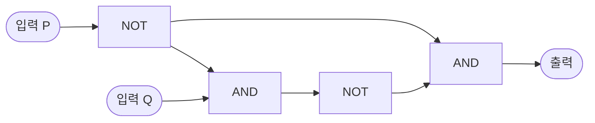
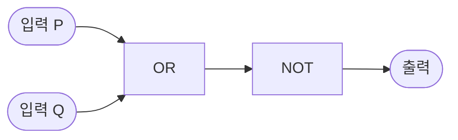

# HW1 과제 안내문 — 조건 명제, 논증, 논리 회로

[레포지토리 안내](../../../README.ko.md) | [English](Assignment.md) | [한국어](Assignment.ko.md)

> **최종 수정일:** 2026-11-24

2주차에 나온 이산구조및연습 과제 1이다. 교재 Discrete Mathematics with Applications(Epp)의 2.2절(조건 명제), 2.3절(타당한 논증과 부당한 논증), 2.4절(응용: 디지털 논리 회로)에서 고른 연습 문제 12개로 이루어지며, 문제 번호는 교재의 연습 문제 번호이다.

---

<br>

## 1. 연습 문제 2.2.6: 조건 명제를 포함한 진리표

명제 형식 $(p \vee q) \vee (\sim p \wedge q) \to q$의 진리표를 작성하라.

---

<br>

## 2. 연습 문제 2.2.10: 쌍조건 명제의 진리표

명제 형식 $(p \to r) \leftrightarrow (q \to r)$의 진리표를 작성하라.

---

<br>

## 3. 연습 문제 2.2.15: 조건 명제의 결합 방향과 논리적 동치

두 명제 형식 $p \to (q \to r)$와 $(p \to q) \to r$가 논리적 동치인지 판정하라.

---

<br>

## 4. 연습 문제 2.2.23: 역과 이

연습 문제 2.2.20의 각 명제에 대해 역과 이를 쓰라. 연습 문제 2.2.20의 명제는 다음과 같으며, 모든 변수는 적절한 고정된 수나 대상을 나타낸다고 가정한다.

- (a) $P$가 정사각형이면 $P$는 직사각형이다.
- (b) 오늘이 12월 31일이면 내일은 1월이다.
- (c) $r$이 유한소수로 나타나면 $r$은 유리수이다.
- (d) $n$이 소수이면 $n$은 홀수이거나 $n = 2$이다.
- (e) $x$가 음이 아니면 $x$는 양수이거나 $x = 0$이다.
- (f) Tom이 Ann의 아버지이면 Jim은 Ann의 삼촌이고 Sue는 Ann의 이모이다.
- (g) $n$이 6으로 나누어떨어지면 $n$은 2로 나누어떨어지고 3으로 나누어떨어진다.

---

<br>

## 5. 연습 문제 2.2.47: 조건 명제를 논리곱과 부정으로 바꾸기

명제 형식 $p \wedge \sim q \to r$을 다음 두 가지 꼴로 다시 쓰라.

- (a) 논리적 동치 $p \to q \equiv \sim p \vee q$와 $p \leftrightarrow q \equiv (\sim p \vee q) \wedge (\sim q \vee p)$를 이용하여 기호 $\to$와 $\leftrightarrow$를 쓰지 않는 꼴
- (b) 논리적 동치 $p \vee q \equiv \sim(\sim p \wedge \sim q)$를 이용하여 $\wedge$와 $\sim$만 쓰는 꼴

---

<br>

## 6. 연습 문제 2.2.49: 쌍조건 명제를 논리곱과 부정으로 바꾸기

명제 형식 $(p \to r) \leftrightarrow (q \to r)$을 다음 두 가지 꼴로 다시 쓰라.

- (a) 논리적 동치 $p \to q \equiv \sim p \vee q$와 $p \leftrightarrow q \equiv (\sim p \vee q) \wedge (\sim q \vee p)$를 이용하여 기호 $\to$와 $\leftrightarrow$를 쓰지 않는 꼴
- (b) 논리적 동치 $p \vee q \equiv \sim(\sim p \wedge \sim q)$를 이용하여 $\wedge$와 $\sim$만 쓰는 꼴

---

<br>

## 7. 연습 문제 2.3.13: 후건 부정의 타당성

진리표를 이용하여 다음 **후건 부정(modus tollens)** 논증 형식이 타당함을 보이라. 어느 열이 전제이고 어느 열이 결론인지 표시하고, 진리표가 답을 어떻게 뒷받침하는지 설명하는 문장을 덧붙이라. 설명에는 논증 형식이 타당하다는 것이 무슨 뜻인지 이해하고 있음이 드러나야 한다.

```math
p \to q, \qquad \sim q, \qquad \therefore\ \sim p
```

---

<br>

## 8. 연습 문제 2.3.26: 영화와 시험에 관한 논증의 타당성 판정

다음 논증의 논리적 형식을 기호로 쓰라. 논증이 타당하면 타당성을 보장하는 추론 규칙을 밝히고, 타당하지 않으면 역의 오류와 이의 오류 가운데 어느 것을 범했는지 밝히라. 교재의 지시문에 따르면 연습 문제 2.3.24부터 2.3.32까지의 논증 가운데 일부는 타당하고, 나머지는 역의 오류나 이의 오류를 범한다.

- 전제 1: 영화를 보러 가면 나는 숙제를 끝내지 못한다.
- 전제 2: 숙제를 끝내지 못하면 나는 내일 시험을 잘 보지 못한다.
- 결론: 영화를 보러 가면 나는 내일 시험을 잘 보지 못한다.

---

<br>

## 9. 연습 문제 2.3.28: 유리수와 무리수에 관한 논증의 타당성 판정

연습 문제 2.3.26과 같은 지시에 따라 다음 논증의 논리적 형식을 기호로 쓰고, 타당하면 타당성을 보장하는 추론 규칙을, 타당하지 않으면 역의 오류와 이의 오류 가운데 어느 것을 범했는지 밝히라.

- 전제 1: 유리수가 무리수만큼 많으면 무리수 전체의 집합은 무한집합이다.
- 전제 2: 무리수 전체의 집합은 무한집합이다.
- 결론: 유리수는 무리수만큼 많다.

---

<br>

## 10. 연습 문제 2.3.29: 두 수의 곱에 관한 논증의 타당성 판정

연습 문제 2.3.26과 같은 지시에 따라 다음 논증의 논리적 형식을 기호로 쓰고, 타당하면 타당성을 보장하는 추론 규칙을, 타당하지 않으면 역의 오류와 이의 오류 가운데 어느 것을 범했는지 밝히라.

- 전제 1: 이 두 수 가운데 적어도 하나가 6으로 나누어떨어지면 이 두 수의 곱은 6으로 나누어떨어진다.
- 전제 2: 이 두 수 모두 6으로 나누어떨어지지 않는다.
- 결론: 이 두 수의 곱은 6으로 나누어떨어지지 않는다.

---

<br>

## 11. 연습 문제 2.4.15: 부울 식에 대응하는 회로

부울 식 $P \vee (\sim P \wedge \sim Q)$에 대응하는 회로를 그리라.

---

<br>

## 12. 연습 문제 2.4.27: 두 회로의 동치

정리 2.1.1에 나열된 성질을 이용하여 다음 두 회로가 같은 입출력 표를 가짐을 보이라. 두 회로의 부울 식을 구하고, 두 식을 명제 형식으로 보았을 때 논리적 동치임을 보이면 된다.

- 회로 (a): 입력 $P$를 NOT 게이트에 통과시킨 신호가 둘로 갈라진다. 한 갈래는 입력 $Q$와 함께 AND 게이트에 들어가고, 그 출력은 다시 NOT 게이트를 지난다. 다른 갈래와 이 NOT 게이트의 출력이 마지막 AND 게이트에 들어간다.
- 회로 (b): 입력 $P$와 $Q$가 OR 게이트에 들어가고, 그 출력이 NOT 게이트를 지난다.



*그림 1. 연습 문제 2.4.27의 회로 (a)*



*그림 2. 연습 문제 2.4.27의 회로 (b)*

---

<br>

문제를 풀어 본 뒤 [과제 해설](../Assignment-Explanation.ko.md)에서 정답과 풀이를 볼 수 있다.
