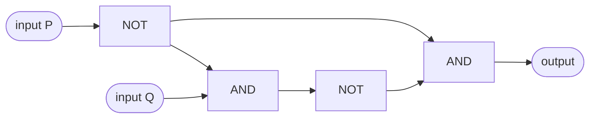
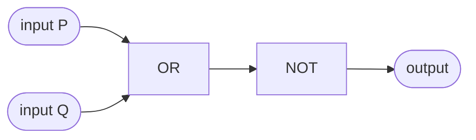

# HW1 Assignment Handout — Conditional Statements, Arguments, and Logic Circuits

[Repository Guide](../../../README.md) | [English](Assignment.md) | [한국어](Assignment.ko.md)

> **Last Updated:** 2026-11-24

This is Assignment 1 of Discrete Mathematics and Practice, given in Week 2. It consists of twelve exercises chosen from Sections 2.2 (Conditional Statements), 2.3 (Valid and Invalid Arguments), and 2.4 (Application: Digital Logic Circuits) of the textbook Discrete Mathematics with Applications (Epp), and the problem numbers are the exercise numbers of the textbook.

---

<br>

## 1. Exercise 2.2.6: Truth Table with a Conditional

Construct a truth table for the statement form $(p \vee q) \vee (\sim p \wedge q) \to q$.

---

<br>

## 2. Exercise 2.2.10: Truth Table of a Biconditional

Construct a truth table for the statement form $(p \to r) \leftrightarrow (q \to r)$.

---

<br>

## 3. Exercise 2.2.15: Grouping of Conditionals and Logical Equivalence

Determine whether the statement forms $p \to (q \to r)$ and $(p \to q) \to r$ are logically equivalent.

---

<br>

## 4. Exercise 2.2.23: Converse and Inverse

Write the converse and inverse for each statement of Exercise 2.2.20. The statements of Exercise 2.2.20 are as follows, and all variables are assumed to represent fixed quantities or entities, as appropriate.

- (a) If $P$ is a square, then $P$ is a rectangle.
- (b) If today is New Year's Eve, then tomorrow is January.
- (c) If the decimal expansion of $r$ is terminating, then $r$ is rational.
- (d) If $n$ is prime, then $n$ is odd or $n = 2$.
- (e) If $x$ is nonnegative, then $x$ is positive or $x = 0$.
- (f) If Tom is Ann's father, then Jim is her uncle and Sue is her aunt.
- (g) If $n$ is divisible by 6, then $n$ is divisible by 2 and $n$ is divisible by 3.

---

<br>

## 5. Exercise 2.2.47: Rewriting a Conditional with Conjunction and Negation

Rewrite the statement form $p \wedge \sim q \to r$ in the following two ways.

- (a) Use the logical equivalences $p \to q \equiv \sim p \vee q$ and $p \leftrightarrow q \equiv (\sim p \vee q) \wedge (\sim q \vee p)$ to rewrite it without using the symbol $\to$ or $\leftrightarrow$.
- (b) Use the logical equivalence $p \vee q \equiv \sim(\sim p \wedge \sim q)$ to rewrite it using only $\wedge$ and $\sim$.

---

<br>

## 6. Exercise 2.2.49: Rewriting a Biconditional with Conjunction and Negation

Rewrite the statement form $(p \to r) \leftrightarrow (q \to r)$ in the following two ways.

- (a) Use the logical equivalences $p \to q \equiv \sim p \vee q$ and $p \leftrightarrow q \equiv (\sim p \vee q) \wedge (\sim q \vee p)$ to rewrite it without using the symbol $\to$ or $\leftrightarrow$.
- (b) Use the logical equivalence $p \vee q \equiv \sim(\sim p \wedge \sim q)$ to rewrite it using only $\wedge$ and $\sim$.

---

<br>

## 7. Exercise 2.3.13: Validity of Modus Tollens

Use a truth table to show that the following argument form, **modus tollens**, is valid. Indicate which columns represent the premises and which represent the conclusion, and include a sentence explaining how the truth table supports your answer. Your explanation should show that you understand what it means for a form of argument to be valid.

```math
p \to q, \qquad \sim q, \qquad \therefore\ \sim p
```

---

<br>

## 8. Exercise 2.3.26: Testing the Validity of an Argument About Movies and an Exam

Use symbols to write the logical form of the following argument. If the argument is valid, identify the rule of inference that guarantees its validity. Otherwise, state whether the converse or the inverse error is made. According to the instructions of the textbook, some of the arguments in Exercises 2.3.24 through 2.3.32 are valid, whereas others exhibit the converse or the inverse error.

- Premise 1: if I go to the movies, then I do not finish my homework.
- Premise 2: if I do not finish my homework, then I do not do well on the exam tomorrow.
- Conclusion: if I go to the movies, then I do not do well on the exam tomorrow.

---

<br>

## 9. Exercise 2.3.28: Testing the Validity of an Argument About Rational and Irrational Numbers

Following the same instructions as in Exercise 2.3.26, use symbols to write the logical form of the following argument, and identify the rule of inference that guarantees its validity if it is valid, or state whether the converse or the inverse error is made otherwise.

- Premise 1: if there are as many rational numbers as there are irrational numbers, then the set of all irrational numbers is infinite.
- Premise 2: the set of all irrational numbers is infinite.
- Conclusion: there are as many rational numbers as there are irrational numbers.

---

<br>

## 10. Exercise 2.3.29: Testing the Validity of an Argument About a Product of Two Numbers

Following the same instructions as in Exercise 2.3.26, use symbols to write the logical form of the following argument, and identify the rule of inference that guarantees its validity if it is valid, or state whether the converse or the inverse error is made otherwise.

- Premise 1: if at least one of these two numbers is divisible by 6, then the product of these two numbers is divisible by 6.
- Premise 2: neither of these two numbers is divisible by 6.
- Conclusion: the product of these two numbers is not divisible by 6.

---

<br>

## 11. Exercise 2.4.15: Circuit for a Boolean Expression

Construct a circuit for the Boolean expression $P \vee (\sim P \wedge \sim Q)$.

---

<br>

## 12. Exercise 2.4.27: Equivalence of Two Circuits

Use the properties listed in Theorem 2.1.1 to show that the following two circuits have the same input/output table. It suffices to find the Boolean expressions for the circuits and show that they are logically equivalent when regarded as statement forms.

- Circuit (a): The signal obtained by passing input $P$ through a NOT gate splits in two. One branch enters an AND gate together with input $Q$, and that output passes through another NOT gate. The other branch and the output of this NOT gate enter the final AND gate.
- Circuit (b): Inputs $P$ and $Q$ enter an OR gate, and its output passes through a NOT gate.



*Figure 1. Circuit (a) of Exercise 2.4.27*



*Figure 2. Circuit (b) of Exercise 2.4.27*

---

<br>

After solving the problems, see the [assignment explanation](../Assignment-Explanation.md) for the answers and solutions.
