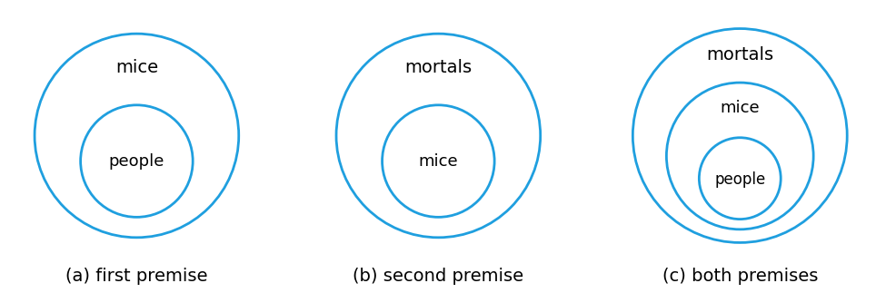

# HW3 과제 해설 — 다중 한정기호와 직접 증명

[레포지토리 안내](../../README.ko.md) | [English](Assignment-Explanation.md) | [한국어](Assignment-Explanation.ko.md)

> **최종 수정일:** 2026-11-04
>
> Discrete Mathematics with Applications, Epp, Ch 3, 4

> **학습 목표:**
> 1. 두 변수 술어와 다중 한정 명제의 진릿값을 판정하고, 한정기호의 순서가 뜻을 바꾸는 이유를 설명할 수 있다
> 2. 다중 한정 명제의 부정을 쓰고, 그 부정 규칙을 정리 3.2.1과 정리 3.2.2로부터 유도할 수 있다
> 3. 전칭 후건 부정으로 결론을 이끌어 내고, 한정 명제를 포함한 논증에서 역의 오류를 찾아낼 수 있다
> 4. 오일러 도표를 그려 한정 명제를 포함한 논증의 타당성을 판정할 수 있다
> 5. 짝수와 홀수의 정의로 정수의 성질을 판정하고, 반례로 전칭 명제를 반증하며, 직접 증명의 각 단계에 근거를 댈 수 있다
> 6. 예로부터 논증하는 실수를 찾아내고 올바른 증명으로 고칠 수 있다

---

## 목차

- [1. 연습 문제 3.3.2: 두 변수 술어의 진릿값](#1-연습-문제-332-두-변수-술어의-진릿값)
- [2. 연습 문제 3.3.12: 다중 한정 명제의 부정과 진릿값](#2-연습-문제-3312-다중-한정-명제의-부정과-진릿값)
- [3. 연습 문제 3.3.22: 한정기호의 순서](#3-연습-문제-3322-한정기호의-순서)
- [4. 연습 문제 3.3.24: 다중 한정 명제의 부정 규칙 유도](#4-연습-문제-3324-다중-한정-명제의-부정-규칙-유도)
- [5. 연습 문제 3.4.5: 전칭 후건 부정](#5-연습-문제-345-전칭-후건-부정)
- [6. 연습 문제 3.4.16: 역의 오류를 범한 논증](#6-연습-문제-3416-역의-오류를-범한-논증)
- [7. 연습 문제 3.4.21: 도표를 이용한 타당성 검사](#7-연습-문제-3421-도표를-이용한-타당성-검사)
- [8. 연습 문제 4.1.1: 짝수와 홀수의 정의](#8-연습-문제-411-짝수와-홀수의-정의)
- [9. 연습 문제 4.1.12: 부정과 반례](#9-연습-문제-4112-부정과-반례)
- [10. 연습 문제 4.1.29: 직접 증명의 빈칸 채우기](#10-연습-문제-4129-직접-증명의-빈칸-채우기)
- [11. 연습 문제 4.2.15: 증명의 오류 찾기](#11-연습-문제-4215-증명의-오류-찾기)
- [요약](#요약)
- [점검 문제](#점검-문제)

---

<br>

## 1. 연습 문제 3.3.2: 두 변수 술어의 진릿값

**문제.** $G(x, y)$를 술어 "$`x^2 > y`$"라 할 때, (a) $G(2, 3)$, (b) $G(1, 1)$, (c) $G\left(\frac{1}{2}, \frac{1}{2}\right)$, (d) $G(-2, 2)$가 각각 참인지 거짓인지 판정한다.

**사용하는 개념.** 두 변수 술어 $G(x, y)$에 값을 대입하면 명제가 된다([3장 1절, 3절](../../Lecture-Notes/Ch03_The-Logic-of-Quantified-Statements/Concepts_Lecture.ko.md)). 괄호 안의 첫째 값은 $x$에, 둘째 값은 $y$에 대입하므로 순서를 바꾸면 다른 명제가 된다.

**풀이.** 각 경우에 $x^2$을 계산하여 $y$와 비교한다.

| 문항 | 대입 | 비교 | 진릿값 |
|:---:|:-----|:-----|:---:|
| (a) | $x = 2$, $y = 3$ | $2^2 = 4 > 3$ | 참 |
| (b) | $x = 1$, $y = 1$ | $1^2 = 1$이고 $1 > 1$은 성립하지 않음 | 거짓 |
| (c) | $x = \frac{1}{2}$, $y = \frac{1}{2}$ | $\left(\frac{1}{2}\right)^2 = \frac{1}{4}$이고 $\frac{1}{4} < \frac{1}{2}$ | 거짓 |
| (d) | $x = -2$, $y = 2$ | $(-2)^2 = 4 > 2$ | 참 |

*표 1. 술어 $`G(x, y)`$에 값을 대입한 결과*

(b)에서는 두 값이 같으므로 부등호 $>$가 성립하지 않는다. (c)는 0과 1 사이의 수를 제곱하면 더 작아진다는 점을 보여 준다. (d)에서는 음수를 제곱하면 양수가 되므로 $x$가 음수여도 $G(x, y)$가 참일 수 있다.

---

<br>

## 2. 연습 문제 3.3.12: 다중 한정 명제의 부정과 진릿값

**문제.** $D = E = \lbrace -2, -1, 0, 1, 2 \rbrace$일 때, 다음 명제의 부정을 쓰고 원래 명제와 부정 중 어느 쪽이 참인지 판정한다.

- (a) $\forall x \in D$, $\exists y \in E$ such that $x + y = 1$.
- (b) $\exists x \in D$ such that $\forall y \in E$, $x + y = -y$.

**사용하는 개념.** 한정기호가 여러 개인 명제는 정리 3.2.1과 정리 3.2.2를 바깥쪽 한정기호부터 차례로 적용하여 부정한다(3장 3절). 그 결과 $\forall$와 $\exists$가 서로 바뀌고 맨 안쪽의 술어가 부정된다.

```math
\sim\big(\forall x \in D,\ \exists y \in E \text{ such that } P(x, y)\big) \equiv \exists x \in D \text{ such that } \forall y \in E,\ \sim P(x, y)
```

```math
\sim\big(\exists x \in D \text{ such that } \forall y \in E,\ P(x, y)\big) \equiv \forall x \in D,\ \exists y \in E \text{ such that } \sim P(x, y)
```

$`\forall x\ \exists y`$ 꼴의 명제는 $x$마다 그에 맞는 $y$를 찾을 수 있으면 참이고, 이때 $y$는 $x$에 따라 달라도 된다. $`\exists x\ \forall y`$ 꼴의 명제는 하나의 $x$가 모든 $y$에 대해 성립해야 참이다.

**풀이.**

(a) 부정은 다음과 같다.

```math
\exists x \in D \text{ such that } \forall y \in E,\ x + y \ne 1
```

원래 명제가 참이려면 $D$의 각 $x$에 대해 $y = 1 - x$가 $E$에 있어야 한다. 각 $x$에 필요한 $y$를 정리하면 다음과 같다.

| $x$ | $-2$ | $-1$ | $0$ | $1$ | $2$ |
|:-----|:---:|:---:|:---:|:---:|:---:|
| 필요한 $y = 1 - x$ | $3$ | $2$ | $1$ | $0$ | $-1$ |
| $y \in E$인가 | 아니다 | 그렇다 | 그렇다 | 그렇다 | 그렇다 |

*표 2. (a)에서 각 $`x`$에 필요한 $`y`$의 값*

$x = -2$이면 필요한 $y = 3$이 $E$에 없다. 실제로 $E$의 모든 $y$에 대해 $-2 + y$는 $-4, -3, -2, -1, 0$ 가운데 하나이므로 1이 되지 않는다. 따라서 원래 명제는 거짓이고, $x = -2$가 부정의 존재 명제를 만족하므로 **부정이 참이다.**

(b) 부정은 다음과 같다.

```math
\forall x \in D,\ \exists y \in E \text{ such that } x + y \ne -y
```

$x + y = -y$는 $x = -2y$와 같다. 원래 명제가 참이려면 하나의 $x$가 $E$의 모든 $y$에 대해 $x = -2y$를 만족해야 한다. 그러나 $y = 0$이면 $x = 0$이어야 하고 $y = 1$이면 $x = -2$이어야 하므로, 두 조건을 동시에 만족하는 $x$는 없다. 따라서 원래 명제는 거짓이다. 부정이 참임은 각 $x$에 대해 $y$를 고르는 방법으로 직접 보일 수 있다.

- $x = 0$이면 $y = 1$을 고른다. $0 + 1 = 1 \ne -1$이다.
- $x \ne 0$이면 $y = 0$을 고른다. $x + 0 = x \ne 0 = -0$이다.

따라서 **부정이 참이다.**

---

<br>

## 3. 연습 문제 3.3.22: 한정기호의 순서

**문제.** 다음 명제를 변수와 기호 $\forall$, $\exists$를 쓰지 않고 다시 쓰고, 참인지 거짓인지 판정한다.

- (a) $\forall$ 실수 $x$, $\exists$ 실수 $y$ such that $x + y = 0$.
- (b) $\exists$ 실수 $y$ such that $\forall$ 실수 $x$, $x + y = 0$.

**사용하는 개념.** 두 명제는 같은 술어 $x + y = 0$을 쓰지만 한정기호의 순서가 다르다(3장 3절). (a)의 $`\forall x\ \exists y`$에서는 $y$를 고를 때 $x$를 이미 알고 있으므로 $y$가 $x$에 따라 달라도 된다. (b)의 $`\exists y\ \forall x`$에서는 모든 $x$보다 먼저 $y$ 하나를 정해야 하고, 그 $y$가 모든 $x$에 대해 성립해야 한다.

**풀이.**

(a) **다시 쓰기:** 모든 실수에는 그 수에 더해서 0이 되는 실수가 있다. 곧 모든 실수에는 덧셈 역원이 존재한다.

**판정: 참.** 임의의 실수 $x$가 주어지면 $y = -x$로 둔다. $-x$도 실수이고 $x + (-x) = 0$이다.

(b) **다시 쓰기:** 어떤 실수가 있어서, 그 수를 모든 실수에 더하면 언제나 0이 된다.

**판정: 거짓.** 이 명제의 부정 "$`\forall`$ 실수 $y$, $\exists$ 실수 $x$ such that $x + y \ne 0$"이 참임을 보인다. 임의의 실수 $y$에 대해 $x = 1 - y$로 두면 $x + y = 1 \ne 0$이다. 다른 방법으로, 그런 $y$가 있다고 가정하면 $x = 0$일 때 $0 + y = 0$에서 $y = 0$이어야 하지만, $x = 1$일 때 $1 + 0 = 1 \ne 0$이므로 모순이다.

> **핵심:** $`\forall x\ \exists y`$와 $`\exists y\ \forall x`$는 술어가 같아도 뜻이 다르다. $`\exists y\ \forall x`$가 참이면 $`\forall x\ \exists y`$도 참이지만, 이 연습 문제처럼 그 역은 성립하지 않는다.

---

<br>

## 4. 연습 문제 3.3.24: 다중 한정 명제의 부정 규칙 유도

**문제.** 전칭 명제와 존재 명제를 부정하는 법칙을 이용하여 다음 규칙을 유도한다.

- (a) $`\sim\big(\forall x \in D\,(\forall y \in E\,(P(x, y)))\big) \equiv \exists x \in D\,(\exists y \in E\,(\sim P(x, y)))`$
- (b) $`\sim\big(\exists x \in D\,(\exists y \in E\,(P(x, y)))\big) \equiv \forall x \in D\,(\forall y \in E\,(\sim P(x, y)))`$

**사용하는 개념.** 정리 3.2.1(전칭 명제의 부정)은 $`\sim(\forall x \in D,\ Q(x)) \equiv \exists x \in D \text{ such that } \sim Q(x)`$이고, 정리 3.2.2(존재 명제의 부정)는 $`\sim(\exists x \in D \text{ such that } Q(x)) \equiv \forall x \in D,\ \sim Q(x)`$이다(3장 2절). 두 정리는 술어 $Q(x)$가 그 안에 다른 한정기호를 포함해도 성립한다. 또 한정기호 안의 술어를 모든 $x$에서 같은 진릿값을 갖는 술어로 바꾸어도 전체 명제의 진릿값은 바뀌지 않는다.

**풀이.**

(a) 안쪽 부분을 $`Q(x) = \forall y \in E\,(P(x, y))`$로 둔다.

1. 주어진 식은 $`\sim(\forall x \in D\,(Q(x)))`$이므로, 정리 3.2.1에 의해 $`\exists x \in D\,(\sim Q(x))`$와 동치이다.
2. $x$를 하나 고정하면 $`\sim Q(x) = \sim(\forall y \in E\,(P(x, y)))`$이고, 다시 정리 3.2.1에 의해 $`\exists y \in E\,(\sim P(x, y))`$와 동치이다.
3. 2단계의 동치는 $D$의 모든 $x$에서 성립하므로 1단계의 $\sim Q(x)$를 바꾸어 쓸 수 있다. 따라서 $`\sim\big(\forall x \in D\,(\forall y \in E\,(P(x, y)))\big) \equiv \exists x \in D\,(\exists y \in E\,(\sim P(x, y)))`$이다.

(b) 안쪽 부분을 $`R(x) = \exists y \in E\,(P(x, y))`$로 둔다.

1. 주어진 식은 $`\sim(\exists x \in D\,(R(x)))`$이므로, 정리 3.2.2에 의해 $`\forall x \in D\,(\sim R(x))`$와 동치이다.
2. $x$를 하나 고정하면 $`\sim R(x) = \sim(\exists y \in E\,(P(x, y)))`$이고, 다시 정리 3.2.2에 의해 $`\forall y \in E\,(\sim P(x, y))`$와 동치이다.
3. 2단계의 동치를 1단계에 대입하면 $`\sim\big(\exists x \in D\,(\exists y \in E\,(P(x, y)))\big) \equiv \forall x \in D\,(\forall y \in E\,(\sim P(x, y)))`$이다.

뜻으로 풀면 (a)는 "모든 쌍 $(x, y)$가 $P$를 만족하지는 않는다"와 "$`P`$를 만족하지 않는 쌍이 적어도 하나 있다"가 같다는 것이고, (b)는 "$`P`$를 만족하는 쌍이 하나도 없다"와 "모든 쌍이 $P$를 만족하지 않는다"가 같다는 것이다.

---

<br>

## 5. 연습 문제 3.4.5: 전칭 후건 부정

**문제.** 전칭 후건 부정을 이용하여 다음 논증의 타당한 결론을 쓴다.

- 전제 1: 모든 무리수는 실수이다.
- 전제 2: $\frac{1}{0}$은 실수가 아니다.
- 결론: \_\_\_\_.

**사용하는 개념.** **전칭 후건 부정(universal modus tollens)** 은 다음 꼴의 타당한 논증 형식이다(3장 4절).

```math
\forall x,\ P(x) \to Q(x), \qquad \sim Q(a) \text{ (}a\text{는 특정한 대상)}, \qquad \therefore\ \sim P(a)
```

**풀이.** 첫째 전제를 전칭 조건 명제로 쓰면 "$`\forall x`$, $x$가 무리수이면 $x$는 실수이다"이다. $P(x)$는 "$`x`$는 무리수이다", $Q(x)$는 "$`x`$는 실수이다"이고, 특정한 대상은 $a = \frac{1}{0}$이다. 둘째 전제는 $\sim Q(a)$이므로 전칭 후건 부정에 의해 $\sim P(a)$를 얻는다.

결론: **$\frac{1}{0}$은 무리수가 아니다.**

0으로 나누는 것은 정의되지 않으므로 $\frac{1}{0}$은 어떤 실수도 나타내지 않으며, 따라서 둘째 전제는 참이다. 실수가 아닌 대상은 실수의 부분집합인 무리수 전체의 집합에도 속할 수 없다는 것이 이 논증의 내용이다.

---

<br>

## 6. 연습 문제 3.4.16: 역의 오류를 범한 논증

**문제.** 다음 논증이 전칭 전건 긍정이나 전칭 후건 부정에 의해 타당한지, 아니면 역의 오류나 이의 오류를 범한 부당한 논증인지 판정하고 근거를 쓴다.

- 전제 1: 어떤 수가 짝수이면 그 수의 2배는 짝수이다.
- 전제 2: 특정한 수 $n$에 대해 $2n$은 짝수이다.
- 결론: 그 특정한 수 $n$은 짝수이다.

**사용하는 개념.** 한정 명제를 포함한 논증의 **역의 오류**는 "$`\forall x,\ P(x) \to Q(x)`$, $Q(a)$, 그러므로 $P(a)$" 꼴의 부당한 추론이다(3장 4절). 전칭 전건 긍정 "$`\forall x,\ P(x) \to Q(x)`$, $P(a)$, 그러므로 $Q(a)$"와 달리 결론이 반드시 참이 되지 않는다.

**풀이.** $P(x)$를 "$`x`$는 짝수이다", $Q(x)$를 "$`2x`$는 짝수이다"로 두면 논증의 형식은 다음과 같다.

```math
\forall x,\ P(x) \to Q(x), \qquad Q(n), \qquad \therefore\ P(n)
```

이는 역의 오류의 형식이므로 **부당하다.** 반례로 $n = 3$을 생각한다. 첫째 전제는 모든 수에 대해 참이고, $2 \cdot 3 = 6$은 짝수이므로 둘째 전제도 참이다. 그러나 3은 짝수가 아니므로 결론은 거짓이다. 사실 모든 정수 $n$에 대해 $2n$은 짝수이므로, 둘째 전제는 $n$이 짝수인지에 관해 아무것도 알려 주지 않는다.

---

<br>

## 7. 연습 문제 3.4.21: 도표를 이용한 타당성 검사

**문제.** 다음 논증이 타당한지 판정하고, 도표를 그려 답을 뒷받침한다.

- 전제 1: 모든 사람은 쥐이다.
- 전제 2: 모든 쥐는 죽는다.
- 결론: 모든 사람은 죽는다.

**사용하는 개념.** **오일러 도표(diagram for arguments)** 는 집합을 원판으로 그려 논증을 분석하는 도표이다(3장 4절). "모든 A는 B이다"는 A의 원판을 B의 원판 안에 그려 나타낸다. 전제를 모두 나타낸 도표에서 결론이 반드시 성립하면 논증은 타당하고, 전제를 만족하면서 결론이 성립하지 않는 도표를 그릴 수 있으면 부당하다.

**풀이.** 첫째 전제는 "사람" 원판이 "쥐" 원판 안에 있다는 것이고, 둘째 전제는 "쥐" 원판이 "죽는 것" 원판 안에 있다는 것이다. 두 전제를 한 도표에 그리면 다음과 같다.



*그림 1. 두 전제와 그 결합을 나타낸 오일러 도표*

(c)에서 "사람" 원판은 "쥐" 원판 안에 있고 "쥐" 원판은 "죽는 것" 원판 안에 있으므로, "사람" 원판은 반드시 "죽는 것" 원판 안에 놓인다. 두 전제를 만족하면서 이와 다르게 그릴 방법이 없으므로 결론 "모든 사람은 죽는다"가 반드시 성립하고, 논증은 **타당하다.** 이 논증은 3장 4절에서 다룬 전칭 추이의 한 예이다.

> **참고:** 첫째 전제 "모든 사람은 쥐이다"는 거짓이다. 타당성은 논증의 형식에 관한 성질이므로 전제가 거짓이어도 논증은 타당할 수 있다. 다만 전제가 모두 참이 아니므로 이 논증은 **건전하지(sound)** 않다. 결론이 참인 것은 이 논증 덕분이 아니라 다른 이유 때문이다.

---

<br>

## 8. 연습 문제 4.1.1: 짝수와 홀수의 정의

**문제.** $k$가 특정한 정수일 때, 짝수, 홀수, 소수, 합성수의 정의로 (a) $-17$이 홀수인지, (b) 0이 짝수도 홀수도 아닌지, (c) $2k - 1$이 홀수인지 판정한다.

**사용하는 개념.** 정수 $n$이 **짝수(even)** 라는 것은 어떤 정수 $k$에 대해 $n = 2k$라는 것이고, **홀수(odd)** 라는 것은 어떤 정수 $k$에 대해 $n = 2k + 1$이라는 것이다([4장 1절](../../Lecture-Notes/Ch04_Elementary-Number-Theory-and-Methods-of-Proof/Concepts_Lecture.ko.md)). 정수가 짝수나 홀수임을 보이려면 그 정수를 정의의 꼴로 쓰고, 그 꼴에 쓰인 $k$ 자리의 수가 정수임을 확인해야 한다. 정수는 덧셈, 뺄셈, 곱셈에 대해 닫혀 있다.

**풀이.**

- (a) **그렇다.** $-17 = 2 \cdot (-9) + 1$이고 $-9$는 정수이므로, 홀수의 정의에 의해 $-17$은 홀수이다.
- (b) **아니다.** $0 = 2 \cdot 0$이고 0은 정수이므로, 짝수의 정의에 의해 0은 짝수이다. 따라서 "0은 짝수도 홀수도 아니다"는 거짓이다.
- (c) **그렇다.** $2k - 1 = 2k - 2 + 1 = 2(k - 1) + 1$이고, $k$와 1이 정수이므로 그 차 $k - 1$도 정수이다. 따라서 홀수의 정의에 의해 $2k - 1$은 홀수이다.

(c)에서 $2k - 1$을 $2 \cdot (\text{정수}) + 1$ 꼴로 바꾸는 것이 핵심이다. $2k - 1$은 $2k + 1$ 꼴이 아니므로 바로 정의를 적용할 수 없고, $-1 = -2 + 1$로 나누어 써야 정의의 꼴이 드러난다.

---

<br>

## 9. 연습 문제 4.1.12: 부정과 반례

**문제.** 명제 "모든 실수 $a$와 $b$에 대해, $a < b$이면 $a^2 < b^2$이다"에 대해 (a) 부정을 쓰고, (b) 반례로 이 명제를 반증하며, 그 반례가 명제를 거짓으로 만드는 이유를 설명한다.

**사용하는 개념.** 전칭 조건 명제의 부정은 "$`\exists x`$ such that $P(x) \wedge \sim Q(x)$"이다(3장 2절). 따라서 $`\forall x,\ P(x) \to Q(x)`$ 꼴의 명제를 반증하려면 가정 $P(x)$는 참이고 결론 $Q(x)$는 거짓인 $x$, 곧 반례를 하나 찾으면 된다(4장 1절).

**풀이.**

(a) 부정: $\exists$ 실수 $a$와 $b$ such that $a < b$이고 $a^2 \ge b^2$이다. 결론 $a^2 < b^2$의 부정은 "$`a^2`$이 $b^2$보다 작지 않다", 곧 $a^2 \ge b^2$이다.

(b) $a = -2$, $b = 1$로 둔다. 가정 $-2 < 1$은 참이다. 그런데 $a^2 = 4$, $b^2 = 1$이고 $4 \ge 1$이므로 결론 $a^2 < b^2$은 거짓이다. 이 한 쌍에서 조건 명제 "$`a < b`$이면 $a^2 < b^2$"는 가정이 참이고 결론이 거짓이므로 거짓이다. 모든 실수 쌍에 대해 참이어야 하는 전칭 명제가 이 쌍에서 거짓이므로 원래 명제는 거짓이다. 다르게 말하면 이 쌍이 (a)의 부정을 참으로 만든다.

이 명제는 HW2의 연습 문제 3.1.4와 같은 구조이다. $a < b \le -a$인 모든 쌍, 예를 들어 $(-3, 2)$나 $(-1, 1)$도 반례가 된다.

---

<br>

## 10. 연습 문제 4.1.29: 직접 증명의 빈칸 채우기

**문제.** 정리 "임의의 짝수의 음수는 짝수이다"에 대해 (a) 이 정리를 "$`\forall`$ \_\_\_\_, \_\_\_\_이면 \_\_\_\_이다", "$`\forall`$ \_\_\_\_, \_\_\_\_"(이면 없이), "\_\_\_\_이면 \_\_\_\_이다"(명시적인 전칭 한정기호 없이)의 세 가지 꼴로 다시 쓰고, (b) 다음 증명의 빈칸 (a)~(d)를 채운다.

채울 증명은 임의로 택한 짝수 $n$에서 출발하여 $-n$이 짝수임을 보이려 한다. 근거 (a)에 따라 어떤 정수 $k$에 대해 $n = 2k$로 쓴다. 근거 (b)에 따라 $-n = -(2k)$를 얻고, 대수 계산으로 $-(2k) = 2(-k)$를 얻는다. 이어서 $r = -k$로 두고, $-1$과 $k$가 정수이며 사실 (c)가 성립하므로 $r$이 정수라고 한다. 끝으로 $-n = 2r$이고 $r$이 정수라는 사실로부터 근거 (d)에 따라 $-n$이 짝수라고 결론 내린다.

**사용하는 개념.** **직접 증명(direct proof)** 은 $`\forall x \in D,\ P(x) \to Q(x)`$를 증명할 때, 가정 $P(x)$를 만족하는 $D$의 원소 $x$를 특정하지만 임의로 택했다고 가정하고, 정의, 이미 확립된 결과, 추론 규칙으로 $Q(x)$를 이끌어 내는 방법이다(4장 1절). $x$를 임의로 택했으므로 그 결론은 **일반적 특수 사례로부터의 일반화(generalizing from the generic particular)** 에 의해 $D$의 모든 원소로 일반화된다.

**풀이.**

(a) 세 가지 꼴은 다음과 같다.

- $\forall$ 정수 $n$, $n$이 짝수이면 $-n$은 짝수이다.
- $\forall$ 짝수 $n$, $-n$은 짝수이다.
- $n$이 임의의 짝수이면 $-n$은 짝수이다.

(b) 각 빈칸에 들어갈 근거는 다음과 같다.

| 빈칸 | 내용 | 그 단계에서 하는 일 |
|:---:|:-----|:-----|
| (a) | 짝수의 정의 | $n$이 짝수라는 가정을 $n = 2k$라는 식으로 바꾼다 |
| (b) | 대입 | $-n$의 $n$ 자리에 $2k$를 넣는다 |
| (c) | 정수의 곱은 정수이다 | $r = -k = (-1) \cdot k$가 정수임을 보장한다 |
| (d) | 짝수의 정의 | $-n = 2r$이고 $r$이 정수라는 사실로부터 $-n$이 짝수라고 결론 낸다 |

*표 3. 연습 문제 4.1.29의 빈칸과 근거*

(a)와 (d)는 같은 정의를 반대 방향으로 쓴다. (a)에서는 "짝수이다"로부터 "$`2 \cdot (\text{정수})`$ 꼴이다"를 얻고, (d)에서는 "$`2 \cdot (\text{정수})`$ 꼴이다"로부터 "짝수이다"를 얻는다.

---

<br>

## 11. 연습 문제 4.2.15: 증명의 오류 찾기

**문제.** 다음 정리에 대해 제시된 증명의 잘못을 찾는다.

- 정리: 모든 정수 $k$에 대해, $k > 0$이면 $k^2 + 2k + 1$은 합성수이다.
- 제시된 증명: $k = 2$인 경우를 확인한다. $k > 0$이고 $k^2 + 2k + 1 = 2^2 + 2 \cdot 2 + 1 = 9 = 3 \cdot 3$이므로 9는 합성수이며, 이로부터 정리가 참이라고 결론 내린다.

**사용하는 개념.** 정수 $n$이 **합성수(composite)** 라는 것은 $n > 1$이고, $1 < r < n$, $1 < s < n$인 정수 $r$, $s$가 있어 $n = rs$라는 것이다(4장 1절). 증명 작성의 흔한 실수 가운데 하나인 **예로부터 논증하기(arguing from examples)** 는 몇 가지 경우에 성립함을 보이고 일반적인 명제가 증명되었다고 여기는 것이다(4장 2절).

**풀이.** 제시된 증명은 $k = 2$ 한 경우만 확인했다. 정리는 양의 정수 $k$ 전체에 관한 전칭 명제이므로, 한 경우에 성립한다는 사실은 증거일 뿐 증명이 아니다. 따라서 제시된 증명은 **예로부터 논증하는 실수**를 범했다. 전칭 명제를 증명하려면 특정하지만 임의로 택한 양의 정수 $k$에 대해 결론을 보여야 한다.

정리 자체는 참이며, 직접 증명은 다음과 같다.

1. $k$를 특정하지만 임의로 택한 양의 정수라 한다. 그러면 $k \ge 1$이다.
2. 인수분해하면 $k^2 + 2k + 1 = (k + 1)^2 = (k + 1)(k + 1)$이다.
3. $k \ge 1$이므로 $k + 1 \ge 2$, 곧 $1 < k + 1$이다.
4. $k + 1 > 1$의 양변에 양수 $k + 1$을 곱하면 $(k + 1)^2 > k + 1$이므로 $k + 1 < (k + 1)^2$이다. 또 $(k + 1)^2 \ge 4 > 1$이다.
5. 따라서 $n = (k + 1)^2$에 대해 $r = s = k + 1$은 $1 < r < n$, $1 < s < n$, $n = rs$를 만족하므로, 합성수의 정의에 의해 $k^2 + 2k + 1$은 합성수이다.

$k$를 임의로 택했으므로 일반적 특수 사례로부터의 일반화에 의해 모든 양의 정수 $k$에 대해 정리가 성립한다.

---

<br>

## 요약

| 개념 | 핵심 요약 |
|:-----|:-----|
| 두 변수 술어 | $G(x, y)$에 값을 대입하면 명제가 되며, 값을 넣는 순서가 뜻을 정한다. |
| 다중 한정 명제의 부정 | 바깥쪽부터 $\forall$와 $\exists$를 서로 바꾸고 맨 안쪽 술어를 부정한다. |
| $`\forall x\ \exists y`$의 참 | 각 $x$마다 조건을 만족하는 $y$를 찾을 수 있으면 참이며, $y$는 $x$에 따라 달라도 된다. |
| $`\exists x\ \forall y`$의 참 | 하나의 $x$가 모든 $y$에 대해 조건을 만족해야 참이다. |
| 한정기호의 순서 | $`\exists y\ \forall x`$가 참이면 $`\forall x\ \exists y`$도 참이지만, 그 역은 일반적으로 성립하지 않는다. |
| 부정 규칙의 유도 | 정리 3.2.1과 정리 3.2.2를 바깥쪽 한정기호부터 한 번씩 적용하면 다중 한정 명제의 부정 규칙을 얻는다. |
| 전칭 후건 부정 | "$`\forall x,\ P(x) \to Q(x)`$, $\sim Q(a)$, 그러므로 $\sim P(a)$"는 타당하다. |
| 한정 명제의 역의 오류 | "$`\forall x,\ P(x) \to Q(x)`$, $Q(a)$, 그러므로 $P(a)$"는 부당하다. |
| 오일러 도표 | "모든 A는 B이다"를 A의 원판이 B의 원판 안에 있는 그림으로 나타내 타당성을 판정한다. |
| 타당성과 건전성 | 타당한 논증도 전제가 거짓이면 건전하지 않다. |
| 짝수와 홀수 | $n$은 어떤 정수 $k$에 대해 $n = 2k$이면 짝수, $n = 2k + 1$이면 홀수이다. |
| 반례에 의한 반증 | $`\forall x,\ P(x) \to Q(x)`$는 $P(x)$가 참이고 $Q(x)$가 거짓인 $x$ 하나로 반증된다. |
| 직접 증명 | 가정을 만족하는 원소를 특정하지만 임의로 택하고, 정의와 확립된 결과로 결론을 이끌어 낸다. |
| 예로부터 논증하기 | 몇 가지 경우를 확인하는 것은 전칭 명제의 증명이 아니다. |

---

<br>

## 점검 문제

1. **한정기호의 순서:** 정의역이 양의 정수 전체일 때, "$`\forall x\ \exists y`$ such that $y > x$"와 "$`\exists y`$ such that $\forall x$, $y > x$"의 진릿값을 각각 판정하라.

   <details>
   <summary>정답</summary>

   앞의 명제는 참이다. 임의의 양의 정수 $x$에 대해 $y = x + 1$로 두면 $y > x$이다. 뒤의 명제는 거짓이다. 어떤 양의 정수 $y$를 정하더라도 $x = y$로 두면 $y > x$가 성립하지 않는다.

   </details>

2. **다중 한정 명제의 부정:** "$`\forall x \in \mathbf{R}`$, $\exists y \in \mathbf{R}$ such that $xy = 1$"의 부정을 쓰고, 원래 명제와 부정 중 어느 쪽이 참인지 판정하라.

   <details>
   <summary>정답</summary>

   부정은 "$`\exists x \in \mathbf{R}`$ such that $\forall y \in \mathbf{R}$, $xy \ne 1$"이다. $x = 0$이면 모든 $y$에 대해 $xy = 0 \ne 1$이므로 부정이 참이고 원래 명제는 거짓이다.

   </details>

3. **한정 명제를 포함한 논증:** "모든 소수는 1보다 크다. 1은 1보다 크지 않다. 그러므로 1은 소수가 아니다"에 쓰인 논증 형식의 이름을 쓰고 타당성을 판정하라.

   <details>
   <summary>정답</summary>

   $P(x)$를 "$`x`$는 소수이다", $Q(x)$를 "$`x > 1`$"로 두면 형식은 "$`\forall x,\ P(x) \to Q(x)`$, $\sim Q(1)$, 그러므로 $\sim P(1)$"이다. 전칭 후건 부정이므로 타당하다.

   </details>

4. **오류의 식별:** "모든 정사각형은 직사각형이다. 도형 $F$는 직사각형이다. 그러므로 $F$는 정사각형이다"는 타당한가?

   <details>
   <summary>정답</summary>

   부당하다. 형식이 "$`\forall x,\ P(x) \to Q(x)`$, $Q(F)$, 그러므로 $P(F)$"이므로 역의 오류이다. 도표에서 $F$의 점을 "직사각형" 원판 안이면서 "정사각형" 원판 밖에 둘 수 있으며, 가로 2, 세로 1인 직사각형이 그런 예이다.

   </details>

5. **직접 증명:** 임의의 두 홀수의 합이 짝수임을 직접 증명하라.

   <details>
   <summary>정답</summary>

   $m$과 $n$을 특정하지만 임의로 택한 홀수라 한다. 홀수의 정의에 의해 어떤 정수 $r$, $s$에 대해 $m = 2r + 1$, $n = 2s + 1$이다. 대입하고 정리하면 $m + n = 2r + 2s + 2 = 2(r + s + 1)$이다. $r + s + 1$은 정수의 합이므로 정수이고, 짝수의 정의에 의해 $m + n$은 짝수이다.

   </details>

6. **증명의 오류:** "모든 정수 $n$에 대해 $n^2 - n + 11$은 소수이다. $n = 1, 2, 3$을 넣으면 11, 13, 17로 모두 소수이므로 참이다"라는 논증의 잘못을 지적하고 명제의 진릿값을 판정하라.

   <details>
   <summary>정답</summary>

   세 경우만 확인했으므로 예로부터 논증하는 실수이다. 명제는 거짓이며, $n = 11$이면 $11^2 - 11 + 11 = 121 = 11 \cdot 11$이므로 소수가 아니다.

   </details>
