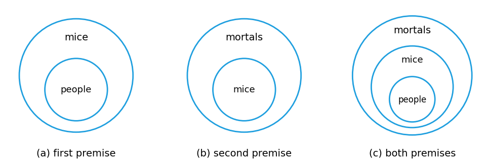

# HW3 Assignment Explanation — Multiple Quantifiers and Direct Proof

[Repository Guide](../../README.md) | [English](Assignment-Explanation.md) | [한국어](Assignment-Explanation.ko.md)

> **Last Updated:** 2026-11-04
>
> Discrete Mathematics with Applications, Epp, Ch 3, 4

> **Learning Objectives:**
> 1. Determine the truth values of two-variable predicates and multiply-quantified statements, and explain why the order of quantifiers changes the meaning
> 2. Write negations of multiply-quantified statements, and derive their negation rules from Theorems 3.2.1 and 3.2.2
> 3. Draw conclusions by universal modus tollens, and detect the converse error in arguments with quantified statements
> 4. Decide the validity of arguments with quantified statements by drawing diagrams for arguments
> 5. Decide properties of integers with the definitions of even and odd, disprove universal statements by counterexamples, and give a reason for each step of a direct proof
> 6. Detect the mistake of arguing from examples and correct it into a valid proof

---

## Table of Contents

- [1. Exercise 3.3.2: Truth Values of a Two-Variable Predicate](#1-exercise-332-truth-values-of-a-two-variable-predicate)
- [2. Exercise 3.3.12: Negations and Truth Values of Multiply-Quantified Statements](#2-exercise-3312-negations-and-truth-values-of-multiply-quantified-statements)
- [3. Exercise 3.3.22: Order of Quantifiers](#3-exercise-3322-order-of-quantifiers)
- [4. Exercise 3.3.24: Deriving Negation Rules for Multiple Quantifiers](#4-exercise-3324-deriving-negation-rules-for-multiple-quantifiers)
- [5. Exercise 3.4.5: Universal Modus Tollens](#5-exercise-345-universal-modus-tollens)
- [6. Exercise 3.4.16: An Argument with the Converse Error](#6-exercise-3416-an-argument-with-the-converse-error)
- [7. Exercise 3.4.21: Testing Validity with a Diagram](#7-exercise-3421-testing-validity-with-a-diagram)
- [8. Exercise 4.1.1: Definitions of Even and Odd](#8-exercise-411-definitions-of-even-and-odd)
- [9. Exercise 4.1.12: Negation and Counterexample](#9-exercise-4112-negation-and-counterexample)
- [10. Exercise 4.1.29: Filling in a Direct Proof](#10-exercise-4129-filling-in-a-direct-proof)
- [11. Exercise 4.2.15: Finding the Mistake in a Proof](#11-exercise-4215-finding-the-mistake-in-a-proof)
- [Summary](#summary)
- [Self-Check Questions](#self-check-questions)

---

<br>

## 1. Exercise 3.3.2: Truth Values of a Two-Variable Predicate

**Problem.** Let $G(x, y)$ be the predicate "$`x^2 > y`$". Decide whether each of (a) $G(2, 3)$, (b) $G(1, 1)$, (c) $G\left(\frac{1}{2}, \frac{1}{2}\right)$, and (d) $G(-2, 2)$ is true or false.

**Concepts used.** Substituting values into a two-variable predicate $G(x, y)$ produces a statement ([Chapter 3, Sections 1 and 3](../../Lecture-Notes/Ch03_The-Logic-of-Quantified-Statements/Concepts_Lecture.md)). The first value in the parentheses is substituted for $x$ and the second for $y$, so swapping them gives a different statement.

**Solution.** In each case, compute $x^2$ and compare it with $y$.

| Item | Substitution | Comparison | Truth value |
|:---:|:-----|:-----|:---:|
| (a) | $x = 2$, $y = 3$ | $2^2 = 4 > 3$ | true |
| (b) | $x = 1$, $y = 1$ | $1^2 = 1$, and $1 > 1$ does not hold | false |
| (c) | $x = \frac{1}{2}$, $y = \frac{1}{2}$ | $\left(\frac{1}{2}\right)^2 = \frac{1}{4}$ and $\frac{1}{4} < \frac{1}{2}$ | false |
| (d) | $x = -2$, $y = 2$ | $(-2)^2 = 4 > 2$ | true |

*Table 1. Predicate $`G(x, y)`$: results of substituting values*

In (b) the two values are equal, so the strict inequality $>$ fails. Item (c) shows that squaring a number between 0 and 1 makes it smaller. In (d), squaring a negative number gives a positive number, so $G(x, y)$ can be true even when $x$ is negative.

---

<br>

## 2. Exercise 3.3.12: Negations and Truth Values of Multiply-Quantified Statements

**Problem.** Let $D = E = \lbrace -2, -1, 0, 1, 2 \rbrace$. For each statement below, write its negation and decide whether the statement or its negation is true.

- (a) $\forall x \in D$, $\exists y \in E$ such that $x + y = 1$.
- (b) $\exists x \in D$ such that $\forall y \in E$, $x + y = -y$.

**Concepts used.** A statement with several quantifiers is negated by applying Theorems 3.2.1 and 3.2.2 to the quantifiers one at a time, starting from the outermost (Chapter 3, Section 3). As a result, $\forall$ and $\exists$ are interchanged and the innermost predicate is negated.

```math
\sim\big(\forall x \in D,\ \exists y \in E \text{ such that } P(x, y)\big) \equiv \exists x \in D \text{ such that } \forall y \in E,\ \sim P(x, y)
```

```math
\sim\big(\exists x \in D \text{ such that } \forall y \in E,\ P(x, y)\big) \equiv \forall x \in D,\ \exists y \in E \text{ such that } \sim P(x, y)
```

A statement of the form $`\forall x\ \exists y`$ is true if a suitable $y$ can be found for each $x$, and this $y$ may depend on $x$. A statement of the form $`\exists x\ \forall y`$ is true only if a single $x$ works for every $y$.

**Solution.**

(a) The negation is the following.

```math
\exists x \in D \text{ such that } \forall y \in E,\ x + y \ne 1
```

For the original statement to be true, $y = 1 - x$ must belong to $E$ for each $x$ in $D$. The $y$ required for each $x$ is listed below.

| $x$ | $-2$ | $-1$ | $0$ | $1$ | $2$ |
|:-----|:---:|:---:|:---:|:---:|:---:|
| Required $y = 1 - x$ | $3$ | $2$ | $1$ | $0$ | $-1$ |
| Is $y \in E$? | no | yes | yes | yes | yes |

*Table 2. The value of $`y`$ required for each $`x`$ in (a)*

For $x = -2$, the required $y = 3$ is not in $E$. Indeed, for every $y$ in $E$, $-2 + y$ is one of $-4, -3, -2, -1, 0$, so it never equals 1. Hence the original statement is false, and since $x = -2$ satisfies the existential statement of the negation, **the negation is true.**

(b) The negation is the following.

```math
\forall x \in D,\ \exists y \in E \text{ such that } x + y \ne -y
```

$x + y = -y$ is the same as $x = -2y$. For the original statement to be true, a single $x$ must satisfy $x = -2y$ for every $y$ in $E$. But $y = 0$ requires $x = 0$ and $y = 1$ requires $x = -2$, so no $x$ meets both conditions. Hence the original statement is false. That the negation is true can be shown directly by choosing $y$ for each $x$.

- If $x = 0$, choose $y = 1$: $0 + 1 = 1 \ne -1$.
- If $x \ne 0$, choose $y = 0$: $x + 0 = x \ne 0 = -0$.

Therefore **the negation is true.**

---

<br>

## 3. Exercise 3.3.22: Order of Quantifiers

**Problem.** Restate each statement in words, using neither variables nor the symbols $\forall$ and $\exists$, and decide whether it is true.

- (a) $\forall$ real numbers $x$, $\exists$ a real number $y$ such that $x + y = 0$.
- (b) $\exists$ a real number $y$ such that $\forall$ real numbers $x$, $x + y = 0$.

**Concepts used.** The two statements use the same predicate $x + y = 0$ but differ in the order of quantifiers (Chapter 3, Section 3). In (a), $`\forall x\ \exists y`$, the value of $x$ is already known when $y$ is chosen, so $y$ may depend on $x$. In (b), $`\exists y\ \forall x`$, a single $y$ must be fixed before any $x$, and that $y$ must work for every $x$.

**Solution.**

(a) **Rewritten:** Every real number has a real number that gives 0 when added to it. Equivalently, additive inverses exist for all real numbers.

**Verdict: true.** Given any real number $x$, let $y = -x$. Then $-x$ is also a real number and $x + (-x) = 0$.

(b) **Rewritten:** There is a real number whose sum with every real number is always 0.

**Verdict: false.** Show that its negation, "$`\forall`$ real numbers $y$, $\exists$ a real number $x$ such that $x + y \ne 0$", is true. For any real number $y$, let $x = 1 - y$; then $x + y = 1 \ne 0$. Alternatively, suppose such a $y$ exists; $x = 0$ gives $0 + y = 0$, so $y = 0$, but then $x = 1$ gives $1 + 0 = 1 \ne 0$, a contradiction.

> **Key Point:** $`\forall x\ \exists y`$ and $`\exists y\ \forall x`$ differ in meaning even with the same predicate. If $`\exists y\ \forall x`$ is true then $`\forall x\ \exists y`$ is also true, but, as this exercise shows, the converse does not hold.

---

<br>

## 4. Exercise 3.3.24: Deriving Negation Rules for Multiple Quantifiers

**Problem.** Derive the following two rules from the laws for negating universal and existential statements.

- (a) $`\sim\big(\forall x \in D\,(\forall y \in E\,(P(x, y)))\big) \equiv \exists x \in D\,(\exists y \in E\,(\sim P(x, y)))`$
- (b) $`\sim\big(\exists x \in D\,(\exists y \in E\,(P(x, y)))\big) \equiv \forall x \in D\,(\forall y \in E\,(\sim P(x, y)))`$

**Concepts used.** Theorem 3.2.1 (negation of a universal statement) states $`\sim(\forall x \in D,\ Q(x)) \equiv \exists x \in D \text{ such that } \sim Q(x)`$, and Theorem 3.2.2 (negation of an existential statement) states $`\sim(\exists x \in D \text{ such that } Q(x)) \equiv \forall x \in D,\ \sim Q(x)`$ (Chapter 3, Section 2). Both theorems hold even when the predicate $Q(x)$ itself contains other quantifiers. Moreover, replacing the predicate inside a quantifier by one that has the same truth value for every $x$ does not change the truth value of the whole statement.

**Solution.**

(a) Let the inner part be $`Q(x) = \forall y \in E\,(P(x, y))`$.

1. The given expression is $`\sim(\forall x \in D\,(Q(x)))`$, which by Theorem 3.2.1 is equivalent to $`\exists x \in D\,(\sim Q(x))`$.
2. For a fixed $x$, $`\sim Q(x) = \sim(\forall y \in E\,(P(x, y)))`$, which by Theorem 3.2.1 again is equivalent to $`\exists y \in E\,(\sim P(x, y))`$.
3. The equivalence of step 2 holds for every $x$ in $D$, so $\sim Q(x)$ in step 1 may be replaced by it. Hence $`\sim\big(\forall x \in D\,(\forall y \in E\,(P(x, y)))\big) \equiv \exists x \in D\,(\exists y \in E\,(\sim P(x, y)))`$.

(b) Let the inner part be $`R(x) = \exists y \in E\,(P(x, y))`$.

1. The given expression is $`\sim(\exists x \in D\,(R(x)))`$, which by Theorem 3.2.2 is equivalent to $`\forall x \in D\,(\sim R(x))`$.
2. For a fixed $x$, $`\sim R(x) = \sim(\exists y \in E\,(P(x, y)))`$, which by Theorem 3.2.2 again is equivalent to $`\forall y \in E\,(\sim P(x, y))`$.
3. Substituting the equivalence of step 2 into step 1 gives $`\sim\big(\exists x \in D\,(\exists y \in E\,(P(x, y)))\big) \equiv \forall x \in D\,(\forall y \in E\,(\sim P(x, y)))`$.

In words, (a) says that "not every pair $(x, y)$ satisfies $P$" is the same as "at least one pair fails to satisfy $P$", and (b) says that "no pair satisfies $P$" is the same as "every pair fails to satisfy $P$".

---

<br>

## 5. Exercise 3.4.5: Universal Modus Tollens

**Problem.** Complete the following argument with the conclusion that universal modus tollens yields.

- Premise 1: every irrational number is a real number.
- Premise 2: $\frac{1}{0}$ is not a real number.
- Conclusion: \_\_\_\_.

**Concepts used.** **Universal modus tollens** is the valid argument form below (Chapter 3, Section 4).

```math
\forall x,\ P(x) \to Q(x), \qquad \sim Q(a) \text{ for a particular } a, \qquad \therefore\ \sim P(a)
```

**Solution.** Written as a universal conditional statement, the first premise is "$`\forall x`$, if $x$ is an irrational number then $x$ is a real number". $P(x)$ is "$`x`$ is an irrational number", $Q(x)$ is "$`x`$ is a real number", and the particular object is $a = \frac{1}{0}$. The second premise is $\sim Q(a)$, so universal modus tollens gives $\sim P(a)$.

Conclusion: **$\frac{1}{0}$ is not an irrational number.**

Division by 0 is undefined, so $\frac{1}{0}$ does not represent any real number, and therefore the second premise is true. The content of the argument is that an object that is not a real number cannot belong to the set of irrational numbers, which is a subset of the real numbers.

---

<br>

## 6. Exercise 3.4.16: An Argument with the Converse Error

**Problem.** Decide whether the following argument is valid by universal modus ponens or universal modus tollens, or invalid because it commits the converse or the inverse error, and give the reason.

- Premise 1: if a number is even, then twice the number is even.
- Premise 2: for a particular number $n$, the number $2n$ is even.
- Conclusion: that particular number $n$ is even.

**Concepts used.** The **converse error** in an argument with quantified statements is the invalid inference of the form "$`\forall x,\ P(x) \to Q(x)`$, $Q(a)$, therefore $P(a)$" (Chapter 3, Section 4). Unlike universal modus ponens, "$`\forall x,\ P(x) \to Q(x)`$, $P(a)$, therefore $Q(a)$", it does not guarantee a true conclusion.

**Solution.** Let $P(x)$ be "$`x`$ is even" and $Q(x)$ be "$`2x`$ is even". Then the form of the argument is the following.

```math
\forall x,\ P(x) \to Q(x), \qquad Q(n), \qquad \therefore\ P(n)
```

This is the form of the converse error, so the argument is **invalid.** As a counterexample, consider $n = 3$. The first premise is true for every number, and $2 \cdot 3 = 6$ is even, so the second premise is also true. But 3 is not even, so the conclusion is false. In fact $2n$ is even for every integer $n$, so the second premise tells nothing about whether $n$ is even.

---

<br>

## 7. Exercise 3.4.21: Testing Validity with a Diagram

**Problem.** Determine whether the following argument is valid, and use a diagram to support the answer.

- Premise 1: every person is a mouse.
- Premise 2: every mouse is mortal.
- Conclusion: every person is mortal.

**Concepts used.** **Diagrams for arguments** analyze an argument by drawing sets as disks (Chapter 3, Section 4). "All A are B" is represented by drawing the disk for A inside the disk for B. An argument is valid if the conclusion necessarily holds in a diagram that represents all the premises, and invalid if a diagram can be drawn that satisfies the premises but not the conclusion.

**Solution.** The first premise places the "people" disk inside the "mice" disk, and the second premise places the "mice" disk inside the "mortals" disk. Drawing both premises in one diagram gives the following.



*Figure 1. Diagrams for arguments representing the two premises and their combination*

In (c), the "people" disk lies inside the "mice" disk, which lies inside the "mortals" disk, so the "people" disk necessarily lies inside the "mortals" disk. There is no other way to draw the disks while satisfying both premises, so the conclusion "every person is mortal" necessarily holds and the argument is **valid.** This argument is an instance of universal transitivity from Chapter 3, Section 4.

> **Note:** The first premise, "every person is a mouse", is false. Validity is a property of the form of an argument, so an argument can be valid even when a premise is false. Since not all premises are true, however, this argument is not **sound**. The conclusion is true for other reasons, not because of this argument.

---

<br>

## 8. Exercise 4.1.1: Definitions of Even and Odd

**Problem.** For a particular integer $k$, use the definitions of even, odd, prime, and composite numbers to decide (a) whether $-17$ is odd, (b) whether 0 is neither even nor odd, and (c) whether $2k - 1$ is odd.

**Concepts used.** An integer $n$ is **even** if and only if $n = 2k$ for some integer $k$, and **odd** if and only if $n = 2k + 1$ for some integer $k$ ([Chapter 4, Section 1](../../Lecture-Notes/Ch04_Elementary-Number-Theory-and-Methods-of-Proof/Concepts_Lecture.md)). To show that an integer is even or odd, write it in the form of the definition and check that the number in the place of $k$ is an integer. The integers are closed under addition, subtraction, and multiplication.

**Solution.**

- (a) **Yes.** $-17 = 2 \cdot (-9) + 1$ and $-9$ is an integer, so $-17$ is odd by the definition of odd.
- (b) **No.** $0 = 2 \cdot 0$ and 0 is an integer, so 0 is even by the definition of even. Hence "0 is neither even nor odd" is false.
- (c) **Yes.** $2k - 1 = 2k - 2 + 1 = 2(k - 1) + 1$, and since $k$ and 1 are integers, their difference $k - 1$ is also an integer. Hence $2k - 1$ is odd by the definition of odd.

The key step in (c) is to rewrite $2k - 1$ in the form $2 \cdot (\text{integer}) + 1$. Since $2k - 1$ is not of the form $2k + 1$, the definition cannot be applied directly; splitting $-1$ as $-2 + 1$ reveals the form of the definition.

---

<br>

## 9. Exercise 4.1.12: Negation and Counterexample

**Problem.** For the statement "For all real numbers $a$ and $b$, if $a < b$ then $a^2 < b^2$", (a) write a negation, and (b) disprove the statement by a counterexample and explain how the counterexample makes the statement false.

**Concepts used.** The negation of a universal conditional statement is "$`\exists x`$ such that $P(x) \wedge \sim Q(x)$" (Chapter 3, Section 2). Hence, to disprove a statement of the form $`\forall x,\ P(x) \to Q(x)`$, it suffices to find one $x$ for which the hypothesis $P(x)$ is true and the conclusion $Q(x)$ is false, that is, a counterexample (Chapter 4, Section 1).

**Solution.**

(a) Negation: $\exists$ real numbers $a$ and $b$ such that $a < b$ and $a^2 \ge b^2$. The negation of the conclusion $a^2 < b^2$ is "$`a^2`$ is not less than $b^2$", that is, $a^2 \ge b^2$.

(b) Let $a = -2$ and $b = 1$. The hypothesis $-2 < 1$ is true. However, $a^2 = 4$ and $b^2 = 1$ with $4 \ge 1$, so the conclusion $a^2 < b^2$ is false. For this pair, the conditional "if $a < b$ then $a^2 < b^2$" has a true hypothesis and a false conclusion, so it is false. The universal statement, which must be true for every pair of real numbers, is false for this pair, so the original statement is false. In other words, this pair makes the negation in (a) true.

This statement has the same structure as Exercise 3.1.4 of HW2. Every pair with $a < b \le -a$, such as $(-3, 2)$ or $(-1, 1)$, is also a counterexample.

---

<br>

## 10. Exercise 4.1.29: Filling in a Direct Proof

**Problem.** For the theorem "The negative of any even integer is even", (a) rewrite the theorem in three ways, as "$`\forall`$ \_\_\_\_, if \_\_\_\_ then \_\_\_\_", as "$`\forall`$ \_\_\_\_, \_\_\_\_" (without if or then), and as "If \_\_\_\_, then \_\_\_\_" (without an explicit universal quantifier), and (b) fill in the blanks (a)-(d) of the following proof.

The proof to be completed starts from an arbitrarily chosen even integer $n$ and sets out to show that $-n$ is even. Citing reason (a), it writes $n = 2k$ for some integer $k$. Citing reason (b), it obtains $-n = -(2k)$, and by algebra it obtains $-(2k) = 2(-k)$. It then sets $r = -k$ and states that $r$ is an integer because $-1$ and $k$ are integers and fact (c) holds. Finally, from $-n = 2r$ with $r$ an integer, it concludes by reason (d) that $-n$ is even.

**Concepts used.** A **direct proof** of $`\forall x \in D,\ P(x) \to Q(x)`$ supposes that $x$ is a particular but arbitrarily chosen element of $D$ satisfying the hypothesis $P(x)$, and derives $Q(x)$ from definitions, previously established results, and rules of inference (Chapter 4, Section 1). Because $x$ was chosen arbitrarily, the conclusion extends to every element of $D$ by **generalizing from the generic particular**.

**Solution.**

(a) The three forms are the following.

- $\forall$ integers $n$, if $n$ is even then $-n$ is even.
- $\forall$ even integers $n$, $-n$ is even.
- If $n$ is any even integer, then $-n$ is even.

(b) The reasons for the blanks are the following.

| Blank | Content | What the step does |
|:---:|:-----|:-----|
| (a) | definition of even | turns the assumption that $n$ is even into the equation $n = 2k$ |
| (b) | substitution | puts $2k$ in place of $n$ in $-n$ |
| (c) | any product of integers is an integer | guarantees that $r = -k = (-1) \cdot k$ is an integer |
| (d) | definition of even | concludes that $-n$ is even from $-n = 2r$ with $r$ an integer |

*Table 3. Blanks and reasons in Exercise 4.1.29*

Blanks (a) and (d) use the same definition in opposite directions. In (a), "is even" yields "has the form $2 \cdot (\text{integer})$", and in (d), "has the form $2 \cdot (\text{integer})$" yields "is even".

---

<br>

## 11. Exercise 4.2.15: Finding the Mistake in a Proof

**Problem.** Find the mistake in the proof offered for the following theorem.

- Theorem: For every integer $k$, if $k > 0$ then $k^2 + 2k + 1$ is composite.
- Offered proof: the case $k = 2$ is checked. There $k > 0$ and $k^2 + 2k + 1 = 2^2 + 2 \cdot 2 + 1 = 9 = 3 \cdot 3$, so 9 is composite, and from this the theorem is declared true.

**Concepts used.** An integer $n$ is **composite** if and only if $n > 1$ and $n = rs$ for some integers $r$ and $s$ with $1 < r < n$ and $1 < s < n$ (Chapter 4, Section 1). Among the common mistakes in writing proofs, **arguing from examples** is the error of treating a general statement as proved after showing that it holds in a few cases (Chapter 4, Section 2).

**Solution.** The offered proof checks only the single case $k = 2$. The theorem is a universal statement about all positive integers $k$, so the fact that it holds in one case is evidence, not a proof. Hence the offered proof commits **the mistake of arguing from examples**. To prove a universal statement, the conclusion must be shown for a particular but arbitrarily chosen positive integer $k$.

The theorem itself is true, and a direct proof is the following.

1. Suppose $k$ is a particular but arbitrarily chosen positive integer. Then $k \ge 1$.
2. Factoring gives $k^2 + 2k + 1 = (k + 1)^2 = (k + 1)(k + 1)$.
3. Since $k \ge 1$, $k + 1 \ge 2$, that is, $1 < k + 1$.
4. Multiplying both sides of $k + 1 > 1$ by the positive number $k + 1$ gives $(k + 1)^2 > k + 1$, so $k + 1 < (k + 1)^2$. Also $(k + 1)^2 \ge 4 > 1$.
5. Hence, for $n = (k + 1)^2$, the integers $r = s = k + 1$ satisfy $1 < r < n$, $1 < s < n$, and $n = rs$, so $k^2 + 2k + 1$ is composite by the definition of composite.

Since $k$ was chosen arbitrarily, the theorem holds for every positive integer $k$ by generalizing from the generic particular.

---

<br>

## Summary

| Concept | Key Summary |
|:-----|:-----|
| Two-variable predicate | Substituting values into $G(x, y)$ yields a statement, and the order of the values determines the meaning. |
| Negating multiply-quantified statements | Interchange $\forall$ and $\exists$ from the outside in and negate the innermost predicate. |
| Truth of $`\forall x\ \exists y`$ | It is true if a suitable $y$ can be found for each $x$, and $y$ may depend on $x$. |
| Truth of $`\exists x\ \forall y`$ | It is true only if a single $x$ satisfies the condition for every $y$. |
| Order of quantifiers | If $`\exists y\ \forall x`$ is true then $`\forall x\ \exists y`$ is true, but the converse does not hold in general. |
| Deriving negation rules | Applying Theorems 3.2.1 and 3.2.2 once per quantifier, from the outermost, yields the negation rules for multiply-quantified statements. |
| Universal modus tollens | "$`\forall x,\ P(x) \to Q(x)`$, $\sim Q(a)$, therefore $\sim P(a)$" is valid. |
| Converse error with quantifiers | "$`\forall x,\ P(x) \to Q(x)`$, $Q(a)$, therefore $P(a)$" is invalid. |
| Diagrams for arguments | Represent "all A are B" by the disk for A inside the disk for B, and decide validity from the drawing. |
| Validity and soundness | A valid argument is not sound if a premise is false. |
| Even and odd | $n$ is even if $n = 2k$ and odd if $n = 2k + 1$ for some integer $k$. |
| Disproof by counterexample | $`\forall x,\ P(x) \to Q(x)`$ is disproved by a single $x$ with $P(x)$ true and $Q(x)$ false. |
| Direct proof | Take a particular but arbitrarily chosen element satisfying the hypothesis, and derive the conclusion from definitions and established results. |
| Arguing from examples | Checking a few cases is not a proof of a universal statement. |

---

<br>

## Self-Check Questions

1. **Order of quantifiers:** With the set of all positive integers as the domain, decide the truth values of "$`\forall x\ \exists y`$ such that $y > x$" and "$`\exists y`$ such that $\forall x$, $y > x$".

   <details>
   <summary>Answer</summary>

   The first statement is true: for any positive integer $x$, let $y = x + 1$; then $y > x$. The second statement is false: whatever positive integer $y$ is fixed, $x = y$ makes $y > x$ fail.

   </details>

2. **Negating a multiply-quantified statement:** Write a negation of "$`\forall x \in \mathbf{R}`$, $\exists y \in \mathbf{R}$ such that $xy = 1$", and decide which of the original statement and its negation is true.

   <details>
   <summary>Answer</summary>

   The negation is "$`\exists x \in \mathbf{R}`$ such that $\forall y \in \mathbf{R}$, $xy \ne 1$". For $x = 0$, $xy = 0 \ne 1$ for every $y$, so the negation is true and the original statement is false.

   </details>

3. **Argument with quantified statements:** Name the argument form used in "All primes are greater than 1. The number 1 is not greater than 1. Therefore, 1 is not prime", and decide its validity.

   <details>
   <summary>Answer</summary>

   With $P(x)$ "$`x`$ is prime" and $Q(x)$ "$`x > 1`$", the form is "$`\forall x,\ P(x) \to Q(x)`$, $\sim Q(1)$, therefore $\sim P(1)$". This is universal modus tollens, so the argument is valid.

   </details>

4. **Identifying an error:** Is the argument "All squares are rectangles. Figure $F$ is a rectangle. Therefore, $F$ is a square" valid?

   <details>
   <summary>Answer</summary>

   It is invalid. Its form is "$`\forall x,\ P(x) \to Q(x)`$, $Q(F)$, therefore $P(F)$", which is the converse error. In a diagram, the point for $F$ can be placed inside the "rectangles" disk but outside the "squares" disk; a rectangle of width 2 and height 1 is such an example.

   </details>

5. **Direct proof:** Prove directly that the sum of any two odd integers is even.

   <details>
   <summary>Answer</summary>

   Suppose $m$ and $n$ are particular but arbitrarily chosen odd integers. By the definition of odd, $m = 2r + 1$ and $n = 2s + 1$ for some integers $r$ and $s$. By substitution and algebra, $m + n = 2r + 2s + 2 = 2(r + s + 1)$. Since $r + s + 1$ is a sum of integers, it is an integer, and $m + n$ is even by the definition of even.

   </details>

6. **Mistake in a proof:** Point out the mistake in the argument "For every integer $n$, $n^2 - n + 11$ is prime, because substituting $n = 1, 2, 3$ gives 11, 13, 17, all of which are prime", and decide the truth value of the statement.

   <details>
   <summary>Answer</summary>

   Only three cases are checked, so this is the mistake of arguing from examples. The statement is false: for $n = 11$, $11^2 - 11 + 11 = 121 = 11 \cdot 11$, which is not prime.

   </details>
