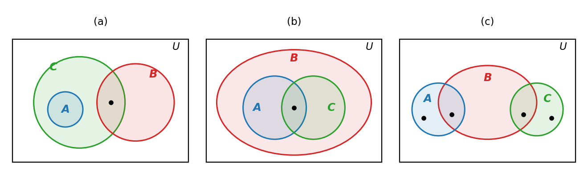

# HW6 과제 해설 — 집합론과 부울 대수

[레포지토리 안내](../../README.ko.md) | [English](Assignment-Explanation.md) | [한국어](Assignment-Explanation.ko.md)

> **최종 수정일:** 2026-11-04
>
> Discrete Mathematics with Applications, Epp, Ch 6

> **학습 목표:**
> 1. 포함 관계와 교집합 조건을 만족하는 벤 다이어그램을 그리고, 첨자 붙은 집합족의 합집합과 교집합, 공집합의 반복된 멱집합을 구할 수 있다
> 2. 원소 논증으로 부분집합 관계와 집합의 상등을 증명하고, 어떤 집합이 공집합임을 귀류법으로 증명할 수 있다
> 3. 집합에 관한 명제가 참인지 판단하여 증명하거나 반례를 들 수 있다
> 4. 정리 6.2.2의 집합 항등식을 근거로 각 단계를 밝힌 대수적 증명을 쓸 수 있다
> 5. 부울 대수의 공리만으로 멱등 법칙, 흡수 법칙, 0의 유일성을 증명할 수 있다

---

## 목차

- [1. 연습 문제 6.1.15: 조건을 만족하는 벤 다이어그램](#1-연습-문제-6115-조건을-만족하는-벤-다이어그램)
- [2. 연습 문제 6.1.24: 구간의 합집합과 교집합](#2-연습-문제-6124-구간의-합집합과-교집합)
- [3. 연습 문제 6.1.33: 공집합의 반복된 멱집합](#3-연습-문제-6133-공집합의-반복된-멱집합)
- [4. 연습 문제 6.2.7: 드모르간의 법칙의 원소 논증](#4-연습-문제-627-드모르간의-법칙의-원소-논증)
- [5. 연습 문제 6.2.20: 두 부분집합의 합집합](#5-연습-문제-6220-두-부분집합의-합집합)
- [6. 연습 문제 6.2.30: 집합과 그 여집합의 교집합](#6-연습-문제-6230-집합과-그-여집합의-교집합)
- [7. 연습 문제 6.3.8: 여집합이 포함될 때의 합집합](#7-연습-문제-638-여집합이-포함될-때의-합집합)
- [8. 연습 문제 6.3.24: 한 원소를 포함하는 부분집합과 포함하지 않는 부분집합](#8-연습-문제-6324-한-원소를-포함하는-부분집합과-포함하지-않는-부분집합)
- [9. 연습 문제 6.3.31: 차집합이 들어 있는 합집합의 대수적 증명](#9-연습-문제-6331-차집합이-들어-있는-합집합의-대수적-증명)
- [10. 연습 문제 6.4.1: 곱의 멱등 법칙](#10-연습-문제-641-곱의-멱등-법칙)
- [11. 연습 문제 6.4.3: 흡수 법칙](#11-연습-문제-643-흡수-법칙)
- [12. 연습 문제 6.4.6: 0의 유일성](#12-연습-문제-646-0의-유일성)
- [요약](#요약)
- [점검 문제](#점검-문제)

---

<br>

## 1. 연습 문제 6.1.15: 조건을 만족하는 벤 다이어그램

**문제.** 아래의 조건 묶음마다, 그 조건을 모두 만족하는 집합 $A$, $B$, $C$의 벤 다이어그램을 그린다.

- (a) $A \cap B = \emptyset$, $A \subseteq C$, $C \cap B \ne \emptyset$
- (b) $A \subseteq B$, $C \subseteq B$, $A \cap C \ne \emptyset$
- (c) $A \cap B \ne \emptyset$, $B \cap C \ne \emptyset$, $A \cap C = \emptyset$, $A \not\subseteq B$, $C \not\subseteq B$

**사용하는 개념.** [6장 1절](../../Lecture-Notes/Ch06_Set-Theory/Concepts_Lecture.ko.md)의 벤 다이어그램은 전체집합 $U$를 직사각형으로, 각 집합을 그 안의 닫힌 영역으로 나타낸다. 조건은 다음과 같이 그림의 언어로 옮긴다. $X \subseteq Y$이면 $X$의 영역을 $Y$의 영역 안에 그린다. $X \cap Y = \emptyset$이면 두 영역을 겹치지 않게 그린다. $X \cap Y \ne \emptyset$이면 두 영역이 겹치는 부분에 원소가 있어야 하고, $X \not\subseteq Y$이면 $X$의 영역 가운데 $Y$ 밖에 있는 부분에 원소가 있어야 한다.

> **주의:** 벤 다이어그램에 영역을 그렸다는 사실만으로 그 영역에 원소가 있다는 뜻이 되지는 않는다. 어떤 부분 영역은 비어 있을 수도 있기 때문이다. 그래서 $\ne \emptyset$ 조건과 $\not\subseteq$ 조건은 원소가 있어야 하는 영역에 점을 찍어 밝힌다.

**풀이.**

- **(a)** $A \subseteq C$이므로 $A$를 $C$ 안에 그린다. $C \cap B \ne \emptyset$이므로 $B$는 $C$와 겹쳐야 하는데, $A \cap B = \emptyset$이므로 그 겹치는 부분은 $A$ 밖에 있어야 한다. 곧 $B$는 $C$ 가운데 $A$가 아닌 부분과만 겹친다. 점은 $C \cap B$에 찍는다.
- **(b)** $A \subseteq B$이고 $C \subseteq B$이므로 $A$와 $C$를 모두 $B$ 안에 그린다. $A \cap C \ne \emptyset$이므로 두 영역이 겹치게 그리고 겹친 부분에 점을 찍는다.
- **(c)** $A$와 $C$는 각각 $B$와 겹쳐야 하고($A \cap B$와 $B \cap C$에 점), 각각 $B$ 밖으로도 나가야 하며($A - B$와 $C - B$에 점), 서로는 겹치지 않아야 한다($`A \cap C = \emptyset`$). 따라서 $B$를 가운데 두고 $A$와 $C$를 양쪽에서 $B$에 걸치게 그린다.



*그림 1. 세 조건 (a), (b), (c)를 각각 만족하는 벤 다이어그램과 원소가 있어야 하는 영역의 점*

그림 1은 가능한 답 가운데 하나이다. 예를 들어 (a)에서 $B$를 $C$ 안에 완전히 들어가게 그려도 $B$가 $A$와 겹치지만 않으면 조건을 모두 만족한다. 그림이 맞는지는 조건을 만족하는 구체적인 집합을 들어 확인할 수 있다.

| 경우 | $A$ | $B$ | $C$ | 조건의 확인 |
|:-----|:-----|:-----|:-----|:-----|
| (a) | $\lbrace 1 \rbrace$ | $\lbrace 2, 3 \rbrace$ | $\lbrace 1, 2 \rbrace$ | $A \cap B = \emptyset$, $A \subseteq C$, $C \cap B = \lbrace 2 \rbrace$ |
| (b) | $\lbrace 1, 2 \rbrace$ | $\lbrace 1, 2, 3, 4 \rbrace$ | $\lbrace 2, 3 \rbrace$ | $A \subseteq B$, $C \subseteq B$, $A \cap C = \lbrace 2 \rbrace$ |
| (c) | $\lbrace 1, 2 \rbrace$ | $\lbrace 2, 3, 4 \rbrace$ | $\lbrace 4, 5 \rbrace$ | $A \cap B = \lbrace 2 \rbrace$, $B \cap C = \lbrace 4 \rbrace$, $A \cap C = \emptyset$, $1 \in A - B$, $5 \in C - B$ |

*표 1. 세 조건을 각각 만족하는 구체적인 집합의 예*

---

<br>

## 2. 연습 문제 6.1.24: 구간의 합집합과 교집합

**문제.** 음이 아닌 정수 $i$마다 $W_i = \lbrace x \in \mathbf{R} \mid x > i \rbrace = (i, \infty)$로 둔다. 다음 집합을 구하고 물음에 답한다.

- (a) $\bigcup_{i=0}^{4} W_i$
- (b) $\bigcap_{i=0}^{4} W_i$
- (c) $W_0, W_1, W_2, \ldots$가 쌍마다 서로소인지 판단하고 이유를 쓴다.
- (d) $\bigcup_{i=0}^{n} W_i$
- (e) $\bigcap_{i=0}^{n} W_i$
- (f) $\bigcup_{i=0}^{\infty} W_i$
- (g) $\bigcap_{i=0}^{\infty} W_i$

**사용하는 개념.** [6장 1절](../../Lecture-Notes/Ch06_Set-Theory/Concepts_Lecture.ko.md)의 첨자 붙은 집합족의 합집합과 교집합이다. $\bigcup_{i=0}^{n} A_i$는 적어도 하나의 $i$에 대해 $A_i$에 속하는 원소 전체의 집합이고, $\bigcap_{i=0}^{n} A_i$는 모든 $i$에 대해 $A_i$에 속하는 원소 전체의 집합이다. 상한이 $\infty$이면 $i$가 음이 아닌 모든 정수를 지난다. 집합들이 **쌍마다 서로소(mutually disjoint)** 라는 것은 $i \ne j$일 때마다 $A_i \cap A_j = \emptyset$이라는 것이다.

먼저 집합들 사이의 관계를 파악한다. $x > i + 1$이면 $x > i$이므로 $W_{i+1} \subseteq W_i$이고, 따라서 $W_0 \supseteq W_1 \supseteq W_2 \supseteq \cdots$이다. 구간은 왼쪽 끝이 $i$인 열린 구간이고, $i$가 커질수록 왼쪽 끝이 오른쪽으로 옮겨 간다.

```text
            0     1     2     3     4     5
  W0        (─────────────────────────────────────▶
  W1              (───────────────────────────────▶
  W2                    (─────────────────────────▶
  W3                          (───────────────────▶
  W4                                (─────────────▶
```

*그림 2. 왼쪽 끝이 0, 1, 2, 3, 4인 열린 구간 W₀부터 W₄까지의 포함 관계*

**풀이.**

- **(a)** $\bigcup_{i=0}^{4} W_i = W_0 = (0, \infty)$이다. 합집합의 원소 $x$는 어떤 $W_i$에 속하므로 $x > i \ge 0$이고 따라서 $x \in W_0$이다. 역으로 $W_0$은 합집합에 참여하는 집합 하나이므로 $W_0$의 원소는 합집합에 속한다.
- **(b)** $\bigcap_{i=0}^{4} W_i = W_4 = (4, \infty)$이다. 교집합의 원소는 특히 $W_4$에 속한다. 역으로 $x > 4$이면 $i = 0, 1, 2, 3, 4$ 모두에 대해 $x > 4 \ge i$이므로 $x$는 모든 $W_i$에 속한다.
- **(c)** 쌍마다 서로소가 아니다. 예를 들어 $5 \in W_0$이고 $5 \in W_1$이므로 $W_0 \cap W_1 \ne \emptyset$이다. 일반적으로 $i < j$이면 $W_i \cap W_j = W_j \ne \emptyset$이다.
- **(d)** $\bigcup_{i=0}^{n} W_i = W_0 = (0, \infty)$이다. 이유는 (a)와 같다.
- **(e)** $\bigcap_{i=0}^{n} W_i = W_n = (n, \infty)$이다. 이유는 (b)와 같다.
- **(f)** $\bigcup_{i=0}^{\infty} W_i = (0, \infty)$이다. 모든 $W_i$가 $W_0$에 포함되고 $W_0$ 자신이 합집합에 참여하기 때문이다.
- **(g)** $\bigcap_{i=0}^{\infty} W_i = \emptyset$이다. 귀류법으로 보인다. 어떤 실수 $x$가 모든 $W_i$에 속한다고 가정하면, 특히 $x \in W_0$이므로 $x > 0$이다. 이제 $i = \lceil x \rceil$로 두면 $i$는 음이 아닌 정수이고 $i \ge x$이다. 그런데 가정에 의해 $x \in W_i$, 곧 $x > i$이므로 $x > i \ge x$가 되어 모순이다. 따라서 모든 $W_i$에 속하는 실수는 없다.

> **주의:** (e)의 유한 교집합 $(n, \infty)$는 어떤 $n$에서도 비어 있지 않지만, (g)의 무한 교집합은 공집합이다. 유한 개의 교집합에서 성립하는 규칙(가장 작은 집합이 교집합이다)을 무한 개에 그대로 옮기면 안 된다. 무한 집합족에는 가장 작은 구간이 없고, 어떤 실수를 골라도 그보다 왼쪽 끝이 큰 구간 $W_i$가 있어서 그 실수를 빠뜨린다.

---

<br>

## 3. 연습 문제 6.1.33: 공집합의 반복된 멱집합

**문제.** (a) $\mathcal{P}(\emptyset)$, (b) $\mathcal{P}(\mathcal{P}(\emptyset))$, (c) $\mathcal{P}(\mathcal{P}(\mathcal{P}(\emptyset)))$을 구한다.

**사용하는 개념.** [6장 1절](../../Lecture-Notes/Ch06_Set-Theory/Concepts_Lecture.ko.md)의 멱집합이다. 집합 $A$의 **멱집합(power set)** $\mathcal{P}(A)$는 $A$의 부분집합 전체의 집합이다. 공집합은 모든 집합의 부분집합이고(정리 6.2.4), 모든 집합은 자기 자신의 부분집합이다. 또 원소가 $n$개인 집합의 멱집합은 $2^n$개의 원소를 가진다(정리 6.3.1).

**풀이.**

- **(a)** $\emptyset$의 부분집합은 $\emptyset$ 자신 하나뿐이다. 따라서 $\mathcal{P}(\emptyset) = \lbrace \emptyset \rbrace$이고 원소는 $2^0 = 1$개이다.
- **(b)** (a)에 의해 $\mathcal{P}(\mathcal{P}(\emptyset)) = \mathcal{P}(\lbrace \emptyset \rbrace)$이다. 원소가 $\emptyset$ 하나인 집합의 부분집합은 아무 원소도 고르지 않은 $\emptyset$과 그 원소를 고른 $\lbrace \emptyset \rbrace$이다. 따라서 $\mathcal{P}(\mathcal{P}(\emptyset)) = \lbrace \emptyset, \lbrace \emptyset \rbrace \rbrace$이고 원소는 $2^1 = 2$개이다.
- **(c)** (b)의 집합 $X = \lbrace \emptyset, \lbrace \emptyset \rbrace \rbrace$의 두 원소를 $x_1 = \emptyset$, $x_2 = \lbrace \emptyset \rbrace$로 두면, $X$의 부분집합은 $\emptyset$, $\lbrace x_1 \rbrace$, $\lbrace x_2 \rbrace$, $\lbrace x_1, x_2 \rbrace$의 네 개이다. $x_1$과 $x_2$를 원래 모양으로 되돌리면 다음과 같다.

```math
\mathcal{P}(\mathcal{P}(\mathcal{P}(\emptyset))) = \lbrace \emptyset, \lbrace \emptyset \rbrace, \lbrace \lbrace \emptyset \rbrace \rbrace, \lbrace \emptyset, \lbrace \emptyset \rbrace \rbrace \rbrace
```

원소는 $2^2 = 4$개이다.

| 집합 | 원소나열법 | 원소의 개수 |
|:-----|:-----|:-----|
| $\emptyset$ | $\lbrace \rbrace$ | 0 |
| $\mathcal{P}(\emptyset)$ | $\lbrace \emptyset \rbrace$ | $2^0 = 1$ |
| $\mathcal{P}(\mathcal{P}(\emptyset))$ | $\lbrace \emptyset, \lbrace \emptyset \rbrace \rbrace$ | $2^1 = 2$ |
| $\mathcal{P}(\mathcal{P}(\mathcal{P}(\emptyset)))$ | $\lbrace \emptyset, \lbrace \emptyset \rbrace, \lbrace \lbrace \emptyset \rbrace \rbrace, \lbrace \emptyset, \lbrace \emptyset \rbrace \rbrace \rbrace$ | $2^2 = 4$ |

*표 2. 공집합에 멱집합을 거듭 적용한 결과와 원소의 개수*

> **주의:** $\emptyset$과 $\lbrace \emptyset \rbrace$는 다른 집합이다. $\emptyset$에는 원소가 없고 $\lbrace \emptyset \rbrace$에는 원소 $\emptyset$이 하나 있다. 빈 상자와, 빈 상자 하나가 들어 있는 상자의 차이와 같다. 같은 이유로 (c)의 $\lbrace \lbrace \emptyset \rbrace \rbrace$는 원소 $\lbrace \emptyset \rbrace$ 하나를 가진 집합으로 $\lbrace \emptyset \rbrace$과 다르며, 괄호를 줄여 쓰면 안 된다.

> **참고:** 한 단계 더 나아가면 $\mathcal{P}(\mathcal{P}(\mathcal{P}(\mathcal{P}(\emptyset))))$는 원소가 4개인 집합의 멱집합이므로 원소가 $2^4 = 16$개이고, 그다음은 $2^{16} = 65536$개이다. 멱집합을 거듭할 때 원소의 개수는 1, 2, 4, 16, 65536으로 급격히 늘어난다.

---

<br>

## 4. 연습 문제 6.2.7: 드모르간의 법칙의 원소 논증

**문제.** 집합은 모두 전체집합 $U$ 안에 있다. 모든 집합 $A$, $B$에 대해 $(A \cap B)^c = A^c \cup B^c$임을 원소 논증으로 보인다.

**사용하는 개념.** [6장 2절](../../Lecture-Notes/Ch06_Set-Theory/Concepts_Lecture.ko.md)에서 두 집합 $X$와 $Y$가 같음을 보이는 기본 방법은 $X \subseteq Y$와 $Y \subseteq X$를 각각 증명하는 것이다. $X \subseteq Y$는 $X$의 임의의 원소가 $Y$에 속함을 보이는 **원소 논증(element argument)** 으로 증명한다. 각 단계에서는 여집합($`A^c = \lbrace x \in U \mid x \notin A \rbrace`$), 교집합, 합집합의 정의와 논리의 드모르간의 법칙 ${\sim}(p \land q) \equiv {\sim}p \lor {\sim}q$를 쓴다.

**증명.** $A$와 $B$를 임의로 택한 집합으로 둔다.

**(1) $(A \cap B)^c \subseteq A^c \cup B^c$임을 보인다.**

1. $x \in (A \cap B)^c$라고 가정한다. [$`x \in A^c \cup B^c`$임을 보여야 한다.]
2. 여집합의 정의에 의해 $x \in U$이고 $x \notin A \cap B$이다.
3. 교집합의 정의에 의해 "$`x \in A`$이고 $x \in B$"는 거짓이다.
4. 논리의 드모르간의 법칙에 의해 $x \notin A$이거나 $x \notin B$이다.
5. $x \in U$이므로 여집합의 정의에 의해 $x \in A^c$이거나 $x \in B^c$이다.
6. 합집합의 정의에 의해 $x \in A^c \cup B^c$이다.

**(2) $A^c \cup B^c \subseteq (A \cap B)^c$임을 보인다.**

1. $x \in A^c \cup B^c$라고 가정한다. [$`x \in (A \cap B)^c`$임을 보여야 한다.]
2. 합집합의 정의에 의해 $x \in A^c$이거나 $x \in B^c$이다.
3. 여집합의 정의에 의해 $x \in U$이고, $x \notin A$이거나 $x \notin B$이다.
4. 논리의 드모르간의 법칙에 의해 "$`x \in A`$이고 $x \in B$"는 거짓이다.
5. 교집합의 정의에 의해 $x \notin A \cap B$이다.
6. $x \in U$이므로 여집합의 정의에 의해 $x \in (A \cap B)^c$이다.

**(3) 결론.** (1)과 (2)에 의해 두 집합은 서로의 부분집합이므로, 집합의 상등의 정의에 의해 $(A \cap B)^c = A^c \cup B^c$이다.

(2)는 (1)의 단계를 거꾸로 밟은 것이다. 모든 단계가 "그리고 그때에만"으로 이어지기 때문이며, 이를 한 줄로 쓰면 $U$의 모든 원소 $x$에 대해 다음과 같다.

```math
x \in (A \cap B)^c \iff x \notin A \cap B \iff {\sim}(x \in A \land x \in B) \iff x \notin A \lor x \notin B \iff x \in A^c \cup B^c
```

$x$가 $A$와 $B$에 속하는지에 따라 $U$를 네 영역으로 나누어 양변의 소속을 비교해도 같은 결론을 얻는다. 이 표는 논리의 드모르간의 법칙을 확인하는 진리표와 같은 구조이다.

| $x \in A$ | $x \in B$ | $x \in (A \cap B)^c$ | $x \in A^c \cup B^c$ |
|:-----|:-----|:-----|:-----|
| 예 | 예 | 아니요 | 아니요 |
| 예 | 아니요 | 예 | 예 |
| 아니요 | 예 | 예 | 예 |
| 아니요 | 아니요 | 예 | 예 |

*표 3. 네 영역에서 비교한 양변의 소속*

---

<br>

## 5. 연습 문제 6.2.20: 두 부분집합의 합집합

**문제.** 모든 집합 $A$, $B$, $C$에 대해, $A \subseteq C$이고 $B \subseteq C$이면 $A \cup B \subseteq C$도 성립함을 원소 논증으로 보인다.

**사용하는 개념.** 부분집합의 정의($X \subseteq Y$는 $X$의 모든 원소가 $Y$에 속한다는 뜻)와 합집합의 정의이다. 합집합의 원소라는 가정은 "또는"을 담고 있으므로 경우 나누기로 다룬다.

**증명.**

1. $A$, $B$, $C$가 $A \subseteq C$이고 $B \subseteq C$인 임의의 집합이라고 가정한다. [$`A \cup B \subseteq C`$임을 보여야 한다.]
2. $x \in A \cup B$라고 가정한다. 합집합의 정의에 의해 $x \in A$이거나 $x \in B$이다.
3. **경우 1, $x \in A$:** $A \subseteq C$이므로 부분집합의 정의에 의해 $x \in C$이다.
4. **경우 2, $x \in B$:** $B \subseteq C$이므로 부분집합의 정의에 의해 $x \in C$이다.
5. 어느 경우든 $x \in C$이다(경우 나누기). $x$는 $A \cup B$의 임의의 원소였으므로, 부분집합의 정의에 의해 $A \cup B \subseteq C$이다.

> **참고:** 역도 성립한다. $A \cup B \subseteq C$이면 $A \subseteq A \cup B$(정리 6.2.1)와 부분집합 관계의 추이성에 의해 $A \subseteq C$이고, 같은 이유로 $B \subseteq C$이다. 따라서 $A \cup B$는 $A$와 $B$를 모두 포함하는 가장 작은 집합이다. 이 결과는 7절의 연습 문제 6.3.8에서 $C = U$로 두고 다시 쓴다.

---

<br>

## 6. 연습 문제 6.2.30: 집합과 그 여집합의 교집합

**문제.** 전체집합 $U$의 모든 부분집합 $A$에 대해 $A \cap A^c = \emptyset$임을, 집합이 공집합임을 증명하는 원소 방법(귀류법)으로 보인다.

**사용하는 개념.** [6장 2절](../../Lecture-Notes/Ch06_Set-Theory/Concepts_Lecture.ko.md)의 집합이 공집합임을 증명하는 원소 방법이다. 집합 $X$가 $\emptyset$과 같음을 보이려면 $X$에 원소가 없음을 보이면 되고, 그러려면 $X$에 원소가 있다고 가정하여 모순을 이끌어 낸다. 원소가 없는 집합은 $\emptyset$ 하나뿐이므로(따름정리 6.2.5) 이것으로 충분하다.

**증명.**

1. $A$를 $U$의 임의의 부분집합으로 둔다. $A \cap A^c$에 원소가 없음을 보이면 된다.
2. 그렇지 않다고 가정한다. 곧 $x \in A \cap A^c$인 원소 $x$가 있다고 가정한다.
3. 교집합의 정의에 의해 $x \in A$이고 $x \in A^c$이다.
4. 여집합의 정의에 의해 $x \in A^c$는 $x \notin A$를 뜻한다.
5. 따라서 $x \in A$이고 $x \notin A$이므로 모순이다.
6. 그러므로 2단계의 가정은 거짓이고 $A \cap A^c$에는 원소가 없다. 곧 $A \cap A^c = \emptyset$이다.

> **참고:** 이 결과는 정리 6.2.2의 여집합 법칙 5(b)이며, 논리의 모순명제 $p \land {\sim}p$에 대응한다. 어떤 원소도 "$`A`$에 속한다"와 "$`A`$에 속하지 않는다"를 동시에 만족할 수 없다는 것이 증명의 핵심이다.

> **주의:** $X = \emptyset$을 보일 때 $X \subseteq \emptyset$과 $\emptyset \subseteq X$를 따로 증명할 필요는 없다. $\emptyset \subseteq X$는 정리 6.2.4에 의해 언제나 성립하므로, $X$에 원소가 없음을 보이는 것으로 충분하다.

---

<br>

## 7. 연습 문제 6.3.8: 여집합이 포함될 때의 합집합

**문제.** 집합은 모두 전체집합 $U$ 안에 있다. "모든 집합 $A$, $B$에 대해 $A^c \subseteq B$이면 $A \cup B = U$이다"가 성립하는지 판단하여, 성립하면 증명하고 성립하지 않으면 반례를 든다.

**사용하는 개념.** 참과 거짓을 먼저 판단한다. $x$가 $A$와 $B$에 속하는지에 따라 $U$를 네 영역으로 나누면, 가정 $A^c \subseteq B$는 $A$ 밖의 원소가 모두 $B$에 있다는 뜻이므로 $A$에도 $B$에도 속하지 않는 영역 $A^c \cap B^c$가 비어 있어야 한다는 뜻이다. 그런데 $A \cup B$ 밖에 있는 영역은 바로 이 영역 하나뿐이다.

| 영역 | $x \in A$ | $x \in B$ | 가정 $A^c \subseteq B$에서 | $x \in A \cup B$ |
|:-----|:-----|:-----|:-----|:-----|
| $A \cap B$ | 예 | 예 | 원소가 있어도 된다 | 예 |
| $A \cap B^c$ | 예 | 아니요 | 원소가 있어도 된다 | 예 |
| $A^c \cap B$ | 아니요 | 예 | 원소가 있어도 된다 | 예 |
| $A^c \cap B^c$ | 아니요 | 아니요 | 비어 있어야 한다 | 아니요 |

*표 4. 네 영역에서 가정 Aᶜ ⊆ B가 요구하는 것과 합집합 A ∪ B의 소속*

따라서 명제는 성립하는 것으로 보이며, 원소 논증으로 증명한다.

**답.** 성립한다.

**증명.**

1. $A$, $B$가 $A^c \subseteq B$인 임의의 집합이라고 가정한다. [$`A \cup B = U`$임을 보여야 한다.]
2. **$A \cup B \subseteq U$:** 모든 집합이 $U$의 부분집합이므로 $A \subseteq U$이고 $B \subseteq U$이다. 5절의 결과(연습 문제 6.2.20)에서 $C = U$로 두면 $A \cup B \subseteq U$이다.
3. **$U \subseteq A \cup B$:** $x \in U$라고 가정한다. $x \in A$이거나 $x \notin A$이므로 두 경우로 나눈다.
4. **경우 1, $x \in A$:** 합집합의 정의에 의해 $x \in A \cup B$이다.
5. **경우 2, $x \notin A$:** $x \in U$이므로 여집합의 정의에 의해 $x \in A^c$이고, 가정 $A^c \subseteq B$에 의해 $x \in B$이며, 합집합의 정의에 의해 $x \in A \cup B$이다.
6. 두 경우 모두 $x \in A \cup B$이므로 $U \subseteq A \cup B$이다.
7. 2와 6단계에 의해 두 집합은 서로의 부분집합이므로 $A \cup B = U$이다.

> **참고:** 역도 참이다. $A \cup B = U$이고 $x \in A^c$이면 $x \in U = A \cup B$이고 $x \notin A$이므로 $x \in B$이다. 따라서 $A^c \subseteq B$와 $A \cup B = U$는 동치이다. 표 4로 보면 두 조건 모두 영역 $A^c \cap B^c$가 비어 있다는 같은 사실을 말하며, 드모르간의 법칙 9(a)에 의해 $A^c \cap B^c = (A \cup B)^c$이므로 이 영역이 비어 있다는 것은 $A \cup B = U$라는 것과 같다.

---

<br>

## 8. 연습 문제 6.3.24: 한 원소를 포함하는 부분집합과 포함하지 않는 부분집합

**문제.** $A = \lbrace t, u, v, w \rbrace$에 대해 $S_1$은 $w$가 없는 $A$의 부분집합 전체의 집합, $S_2$는 $w$가 있는 $A$의 부분집합 전체의 집합이다. 다음을 구한다.

- (a) $S_1$의 원소
- (b) $S_2$의 원소
- (c) $S_1$과 $S_2$가 서로소인지 여부
- (d) $S_1$과 $S_2$의 크기 비교
- (e) $S_1 \cup S_2$의 원소의 개수
- (f) $S_1 \cup S_2$와 $\mathcal{P}(A)$의 관계

**사용하는 개념.** 멱집합, 서로소, 분할이다. 집합들의 모임 $\lbrace A_1, A_2, \ldots \rbrace$가 집합 $X$의 **분할(partition)** 이라는 것은 $A_i$들이 쌍마다 서로소이고 그 합집합이 $X$라는 것이다. $w$를 포함하지 않는 $A$의 부분집합은 정확히 $\lbrace t, u, v \rbrace$의 부분집합이다.

**풀이.**

- **(a)** $S_1 = \mathcal{P}(\lbrace t, u, v \rbrace) = \lbrace \emptyset, \lbrace t \rbrace, \lbrace u \rbrace, \lbrace v \rbrace, \lbrace t, u \rbrace, \lbrace t, v \rbrace, \lbrace u, v \rbrace, \lbrace t, u, v \rbrace \rbrace$이다. 원소는 $2^3 = 8$개이다.
- **(b)** $w$를 포함하는 부분집합은 $S_1$의 각 집합 $X$에 $w$를 넣은 $X \cup \lbrace w \rbrace$이다. 따라서 $S_2 = \lbrace \lbrace w \rbrace, \lbrace t, w \rbrace, \lbrace u, w \rbrace, \lbrace v, w \rbrace, \lbrace t, u, w \rbrace, \lbrace t, v, w \rbrace, \lbrace u, v, w \rbrace, \lbrace t, u, v, w \rbrace \rbrace$이고 원소는 8개이다.
- **(c)** 서로소이다. 어떤 부분집합도 $w$를 포함하면서 동시에 포함하지 않을 수는 없으므로 $S_1 \cap S_2 = \emptyset$이다.
- **(d)** 크기가 같다(각각 8개). 대응 $X \mapsto X \cup \lbrace w \rbrace$가 표 5처럼 $S_1$의 원소와 $S_2$의 원소를 하나씩 빠짐없이 짝짓기 때문이다.
- **(e)** $S_1$과 $S_2$가 서로소이므로 $S_1 \cup S_2$의 원소의 개수는 $8 + 8 = 16$이다.
- **(f)** $S_1 \cup S_2 = \mathcal{P}(A)$이다. $A$의 모든 부분집합은 $w$를 포함하거나 포함하지 않으므로 $\mathcal{P}(A) \subseteq S_1 \cup S_2$이고, 역으로 $S_1$과 $S_2$의 원소는 모두 $A$의 부분집합이므로 $S_1 \cup S_2 \subseteq \mathcal{P}(A)$이다. (c)와 함께 보면 $\lbrace S_1, S_2 \rbrace$는 $\mathcal{P}(A)$의 분할이다. 원소의 개수 16도 $2^4$과 일치한다.

| $S_1$의 원소 $X$ | $S_2$의 원소 $X \cup \lbrace w \rbrace$ |
|:-----|:-----|
| $\emptyset$ | $\lbrace w \rbrace$ |
| $\lbrace t \rbrace$ | $\lbrace t, w \rbrace$ |
| $\lbrace u \rbrace$ | $\lbrace u, w \rbrace$ |
| $\lbrace v \rbrace$ | $\lbrace v, w \rbrace$ |
| $\lbrace t, u \rbrace$ | $\lbrace t, u, w \rbrace$ |
| $\lbrace t, v \rbrace$ | $\lbrace t, v, w \rbrace$ |
| $\lbrace u, v \rbrace$ | $\lbrace u, v, w \rbrace$ |
| $\lbrace t, u, v \rbrace$ | $\lbrace t, u, v, w \rbrace$ |

*표 5. w를 넣는 대응으로 짝지은 S₁과 S₂의 원소*

> **핵심:** 이 짝짓기가 정리 6.3.1(원소가 $n$개인 집합의 멱집합은 원소가 $2^n$개이다)의 귀납 단계이다. 원소가 $k$개인 집합에 새 원소 $z$를 하나 더하면, 새 집합의 부분집합은 $z$를 포함하지 않는 것($2^k$개)과 $z$를 포함하는 것(그 각각에 $z$를 넣은 $2^k$개)으로 나뉘므로 부분집합의 개수가 $2^{k+1}$로 두 배가 된다.

---

<br>

## 9. 연습 문제 6.3.31: 차집합이 들어 있는 합집합의 대수적 증명

**문제.** 모든 집합 $A$, $B$에 대해 $A \cup (B - A) = A \cup B$임을 대수적으로 증명하되, 단계마다 정리 6.2.2의 법칙으로 근거를 댄다.

**사용하는 개념.** [6장 3절](../../Lecture-Notes/Ch06_Set-Theory/Concepts_Lecture.ko.md)의 **대수적 증명(algebraic proof)** 은 이미 증명된 집합 항등식을 차례로 적용하여 한쪽 변을 다른 쪽 변으로 바꾸는 증명이다. 정리 6.2.2의 각 법칙은 모든 집합에 대한 전칭 명제이므로 변수 자리에 어떤 집합이든 넣을 수 있다. 이 증명에 쓰는 법칙은 다음과 같다.

| 번호 | 법칙 | 항등식 |
|:-----|:-----|:-----|
| 3(a) | 분배 법칙 | $A \cup (B \cap C) = (A \cup B) \cap (A \cup C)$ |
| 4(b) | 항등 법칙 | $A \cap U = A$ |
| 5(a) | 여집합 법칙 | $A \cup A^c = U$ |
| 12 | 차집합 법칙 | $A - B = A \cap B^c$ |

*표 6. 정리 6.2.2에서 이 증명에 쓰는 집합 항등식*

**증명.** $A$와 $B$를 임의의 집합으로 둔다.

```math
\begin{aligned}
A \cup (B - A) &= A \cup (B \cap A^c) && \text{(1)} \\
&= (A \cup B) \cap (A \cup A^c) && \text{(2)} \\
&= (A \cup B) \cap U && \text{(3)} \\
&= A \cup B && \text{(4)}
\end{aligned}
```

(1)은 차집합 법칙 12에서 $A$ 자리에 $B$, $B$ 자리에 $A$를 넣은 $B - A = B \cap A^c$를 쓴 것이다. (2)는 분배 법칙 3(a)에서 $A$, $B$, $C$ 자리에 각각 $A$, $B$, $A^c$를 넣은 것이다. (3)은 여집합 법칙 5(a) $A \cup A^c = U$이고, (4)는 항등 법칙 4(b)에서 $A$ 자리에 $A \cup B$를 넣은 것이다.

> **주의:** 정리 6.2.2의 성질은 적힌 꼴 그대로 적용한다. 예를 들어 4(b)는 $A \cap U = A$이므로, 식이 $U \cap (A \cup B)$처럼 $U$가 왼쪽에 있는 꼴이었다면 먼저 교환 법칙 1(b)로 $(A \cup B) \cap U$로 바꾼 뒤 적용해야 한다. 이 증명에서는 각 단계의 식이 법칙의 꼴과 정확히 맞아 교환 법칙이 필요 없다.

> **참고:** 원소로 생각하면 결과가 자연스럽다. $B - A$는 $B$의 원소 가운데 $A$에 없는 것이다. 이것을 $A$에 합치면 $A$의 원소와 $B$에만 있는 원소가 모이므로, 결과는 $A$와 $B$의 원소를 모두 모은 $A \cup B$이다.

---

<br>

## 10. 연습 문제 6.4.1: 곱의 멱등 법칙

**문제.** 연산 $+$와 $\cdot$을 가진 부울 대수 $B$에서 아래의 등식 사슬은 $B$의 모든 $a$에 대해 $a \cdot a = a$임을 보인다. 단계 (a)~(e)마다 그 단계를 정당화하는 부울 대수의 공리를 밝힌다.

```math
a = a \cdot 1 = a \cdot (a + \overline{a}) = (a \cdot a) + (a \cdot \overline{a}) = (a \cdot a) + 0 = a \cdot a
```

**사용하는 개념.** [6장 4절](../../Lecture-Notes/Ch06_Set-Theory/Concepts_Lecture.ko.md)의 **부울 대수(Boolean algebra)** 는 집합 $B$와 두 연산 $+$, $\cdot$으로 이루어진 구조로, $B$의 모든 원소 $a$, $b$에 대해 $a + b$와 $a \cdot b$가 다시 $B$의 원소이고 다음 다섯 공리를 만족한다. 공리 4는 서로 다른 두 원소 0과 1이 존재함을, 공리 5는 각 $a$마다 **보원(complement)** $\overline{a}$가 존재함을 말한다. 집합의 예에서는 $+$가 $\cup$, $\cdot$이 $\cap$, 0이 $\emptyset$, 1이 $U$, $\overline{a}$가 여집합에 대응한다.

| 번호 | 공리 | (a) | (b) |
|:-----|:-----|:-----|:-----|
| 1 | 교환 법칙 | $a + b = b + a$ | $a \cdot b = b \cdot a$ |
| 2 | 결합 법칙 | $(a + b) + c = a + (b + c)$ | $(a \cdot b) \cdot c = a \cdot (b \cdot c)$ |
| 3 | 분배 법칙 | $a + (b \cdot c) = (a + b) \cdot (a + c)$ | $a \cdot (b + c) = (a \cdot b) + (a \cdot c)$ |
| 4 | 항등 법칙 | $a + 0 = a$ | $a \cdot 1 = a$ |
| 5 | 보원 법칙 | $a + \overline{a} = 1$ | $a \cdot \overline{a} = 0$ |

*표 7. 부울 대수의 공리*

이 해설에서는 편의상 $+$를 합, $\cdot$을 곱이라 부른다. 3(a)를 $\cdot$에 대한 $+$의 분배 법칙, 3(b)를 $+$에 대한 $\cdot$의 분배 법칙이라 부른다. 5(a)는 $+$에 대한 보원 법칙, 5(b)는 $\cdot$에 대한 보원 법칙이다.

**풀이.** $a$를 $B$의 임의의 원소로 둔다.

| 빈칸 | 식 | 근거 |
|:-----|:-----|:-----|
| (a) | $a = a \cdot 1$ | 1은 $\cdot$에 대한 항등원이다 (공리 4(b)) |
| (b) | $= a \cdot (a + \overline{a})$ | $+$에 대한 보원 법칙 (공리 5(a)) |
| (c) | $= (a \cdot a) + (a \cdot \overline{a})$ | $+$에 대한 $\cdot$의 분배 법칙 (공리 3(b)) |
| (d) | $= (a \cdot a) + 0$ | $\cdot$에 대한 보원 법칙 (공리 5(b)) |
| (e) | $= a \cdot a$ | 0은 $+$에 대한 항등원이다 (공리 4(a)) |

*표 8. 곱의 멱등 법칙의 증명과 각 단계의 근거*

(a)는 $a \cdot 1 = a$를 오른쪽에서 왼쪽으로 읽어 $a$를 $a \cdot 1$로 바꾼 것이다. (b)는 그 1을 $a + \overline{a}$로 바꾸고, (c)는 $a$를 괄호 안에 분배한다. (d)는 $a \cdot \overline{a}$를 0으로 바꾸며, (e)는 $a \cdot a$를 하나의 원소 $x$로 보아 $x + 0 = x$를 적용한 것이다. 처음의 $a$와 마지막의 $a \cdot a$가 등호로 이어졌으므로 $a \cdot a = a$이다.

> **참고:** 이 증명에서 $+$와 $\cdot$을 맞바꾸고 0과 1을 맞바꾸면 합의 멱등 법칙 $a + a = a$(교재의 예제 6.4.2)의 증명이 된다. $a = a + 0 = a + (a \cdot \overline{a}) = (a + a) \cdot (a + \overline{a}) = (a + a) \cdot 1 = a + a$이다. 이것이 쌍대성 원리이다. 집합으로 읽으면 두 법칙은 $A \cap A = A$와 $A \cup A = A$이다.

---

<br>

## 11. 연습 문제 6.4.3: 흡수 법칙

**문제.** 부울 대수 $B$의 모든 $a$, $b$에 대해 $(a + b) \cdot a = a$임을 보이는 등식 사슬에서, 단계 (a)~(f)마다 근거가 되는 공리를 밝힌다. 나머지 두 단계의 근거는 연습 문제 6.4.1(곱의 멱등 법칙 $`a \cdot a = a`$)과 연습 문제 6.4.2(합의 **전체 한계 법칙(universal bound law)** $`a + 1 = 1`$)이다.

**사용하는 개념.** 10절의 표 7에 정리한 부울 대수의 공리와, 이미 증명된 두 성질이다. 등식은 양쪽 방향으로 쓸 수 있으므로, 공리의 오른쪽 변을 왼쪽 변으로 바꾸는 단계도 같은 공리가 근거이다.

**풀이.** $a$와 $b$를 $B$의 임의의 원소로 둔다.

| 빈칸 | 식 | 근거 |
|:-----|:-----|:-----|
| (a) | $(a + b) \cdot a = a \cdot (a + b)$ | $\cdot$의 교환 법칙 (공리 1(b)) |
| (b) | $= a \cdot a + a \cdot b$ | $+$에 대한 $\cdot$의 분배 법칙 (공리 3(b)) |
| 연습 문제 6.4.1 | $= a + a \cdot b$ | 곱의 멱등 법칙 $a \cdot a = a$ |
| (c) | $= a \cdot 1 + a \cdot b$ | 1은 $\cdot$에 대한 항등원이다 (공리 4(b)) |
| (d) | $= a \cdot (1 + b)$ | $+$에 대한 $\cdot$의 분배 법칙 (공리 3(b)) |
| (e) | $= a \cdot (b + 1)$ | $+$의 교환 법칙 (공리 1(a)) |
| 연습 문제 6.4.2 | $= a \cdot 1$ | 합의 전체 한계 법칙 $b + 1 = 1$ |
| (f) | $= a$ | 1은 $\cdot$에 대한 항등원이다 (공리 4(b)) |

*표 9. 흡수 법칙의 증명과 각 단계의 근거*

증명의 흐름은 다음과 같다. 먼저 $a$를 괄호 안에 분배하여 $a + a \cdot b$를 만들고, 첫 항 $a$를 $a \cdot 1$로 바꾸어 두 항에서 공통 인수 $a$를 다시 묶어 낸다. 남은 괄호 $1 + b$는 1이므로 전체가 $a$가 된다. (c)는 $a \cdot 1 = a$를, (d)는 $a \cdot (1 + b) = a \cdot 1 + a \cdot b$를 오른쪽에서 왼쪽으로 읽은 단계이다. (e)가 필요한 것은 연습 문제 6.4.2의 성질이 $b + 1 = 1$의 꼴, 곧 1이 오른쪽에 있는 꼴로 증명되어 있기 때문이다.

> **참고:** 연습 문제 6.4.2의 전체 한계 법칙 $a + 1 = 1$은 다음과 같이 증명된다. $a + 1 = a + (a + \overline{a})$는 $+$에 대한 보원 법칙(공리 5(a)), $= (a + a) + \overline{a}$는 $+$의 결합 법칙(공리 2(a)), $= a + \overline{a}$는 합의 멱등 법칙(교재의 예제 6.4.2), $= 1$은 다시 $+$에 대한 보원 법칙이다.

> **참고:** 집합으로 읽으면 흡수 법칙은 $(A \cup B) \cap A = A$이다. $A$의 원소는 모두 $A \cup B$에 속하므로, $A \cup B$와 $A$의 공통 부분은 $A$ 자신이다. 쌍대성 원리에 의해 $(a \cdot b) + a = a$도 성립하며, 이는 집합의 $(A \cap B) \cup A = A$에 대응한다.

---

<br>

## 12. 연습 문제 6.4.6: 0의 유일성

**문제.** 부울 대수 $B$에서 $+$에 대한 항등원인 원소는 하나뿐임을, 공리와 이미 증명된 성질만으로 증명한다.

**사용하는 개념.** 유일성을 증명하는 기본 방법은 조건을 만족하는 원소가 둘 있다고 가정하고 둘이 같음을 보이는 것이다. $B$의 원소 $z$가 $+$에 대한 **항등원(identity)** 이라는 것은 $B$의 모든 $a$에 대해 $a + z = a$라는 뜻이다. 쓰는 공리는 항등 법칙 4(a)와 $+$의 교환 법칙 1(a)이다.

**증명.**

1. $0$과 $0'$이 모두 $+$에 대한 항등원인 $B$의 원소라고 가정한다. 곧 $B$의 모든 $a$에 대해 다음 두 식이 성립한다. [$`0' = 0`$임을 보여야 한다.]
   - (i) $a + 0 = a$
   - (ii) $a + 0' = a$
2. 다음과 같이 계산한다.

```math
\begin{aligned}
0' &= 0' + 0 && \text{(1)} \\
&= 0 + 0' && \text{(2)} \\
&= 0 && \text{(3)}
\end{aligned}
```

(1)은 식 (i)에 $a = 0'$을 넣은 것이고, (2)는 $+$의 교환 법칙(공리 1(a))이며, (3)은 식 (ii)에 $a = 0$을 넣은 것이다. 따라서 $0' = 0$이고, $+$에 대한 항등원은 0 하나뿐이다.

> **주의:** $0'$이 $+$에 대한 항등원이라는 것은 공리에서 나오는 사실이 아니라 1단계의 가정이다. 항등 법칙(공리 4(a))은 0이라는 항등원이 **존재함**만 말할 뿐 다른 원소 $0'$에 대해서는 아무것도 말하지 않는다. 그래서 "$`0'`$도 항등 법칙에 의해 $a + 0' = a$를 만족한다"라고 쓰면 근거가 맞지 않는다. 증명할 명제가 "항등원인 원소는 0뿐이다"이므로, 항등원인 임의의 원소 $0'$을 가정으로 도입하는 것이 출발점이다.

> **참고:** 교환 법칙이 필요한 이유는 식 (ii)가 $0'$이 오른쪽에 있는 꼴 $a + 0'$이기 때문이다. $0' + 0$을 $0 + 0'$으로 바꾸어야 (ii)에 $a = 0$을 넣을 수 있다. 같은 논증에서 $+$를 $\cdot$으로, 0을 1로 바꾸면 $\cdot$에 대한 항등원 1의 유일성(연습 문제 6.4.7)이 증명된다: $1' = 1' \cdot 1 = 1 \cdot 1' = 1$.

---

<br>

## 요약

| 개념 | 핵심 요약 |
|:-----|:-----|
| 벤 다이어그램 | 포함 관계는 영역을 안에 그려서, 교집합이 비어 있음은 겹치지 않게 그려서 나타내고, 원소가 있어야 하는 영역에는 점을 찍는다. |
| 첨자 붙은 집합족 | $W_0 \supseteq W_1 \supseteq \cdots$이면 합집합은 $W_0$, 유한 교집합은 $W_n$이지만, 무한 교집합은 공집합일 수 있다. |
| 쌍마다 서로소 | 서로 다른 모든 두 집합의 교집합이 공집합이어야 하며, 포개진 구간들은 서로소가 아니다. |
| 멱집합 | $\mathcal{P}(\emptyset) = \lbrace \emptyset \rbrace$이고, 원소가 $n$개인 집합의 멱집합은 $2^n$개의 원소를 가지며, $\emptyset$과 $\lbrace \emptyset \rbrace$은 다르다. |
| 원소 논증 | $X = Y$는 $X \subseteq Y$와 $Y \subseteq X$를 각각 임의의 원소에 대해 보여 증명한다. |
| 집합의 드모르간의 법칙 | $(A \cap B)^c = A^c \cup B^c$이며, 증명의 핵심 단계는 논리의 드모르간의 법칙이다. |
| 공집합의 증명 | 집합에 원소가 있다고 가정하여 모순을 이끌어 내면 그 집합은 공집합이며, $A \cap A^c = \emptyset$이 그 예이다. |
| 참과 거짓의 판단 | 네 영역의 표로 가정과 결론을 비교하여 판단하고, 참이면 증명하고 거짓이면 반례를 든다. |
| 분할과 부분집합의 개수 | 한 원소 $w$를 포함하는 부분집합과 포함하지 않는 부분집합은 $\mathcal{P}(A)$의 분할을 이루며 개수가 같다. |
| 대수적 증명 | 정리 6.2.2의 법칙을 적힌 꼴 그대로 적용하고 단계마다 근거를 밝힌다. |
| 부울 대수의 공리 | 교환, 결합, 분배, 항등, 보원 법칙의 다섯 쌍만으로 멱등 법칙, 전체 한계 법칙, 흡수 법칙을 유도한다. |
| 유일성의 증명 | 조건을 만족하는 두 원소를 가정으로 도입하고 둘이 같음을 보이며, 0의 유일성은 $0' = 0' + 0 = 0 + 0' = 0$이다. |
| 쌍대성 원리 | $+$와 $\cdot$, 0과 1을 맞바꾸면 부울 대수의 항등식과 그 증명이 함께 쌍대로 바뀐다. |

---

<br>

## 점검 문제

1. **벤 다이어그램:** $A \subseteq B$이고 $B \cap C = \emptyset$인 집합 $A$, $B$, $C$의 벤 다이어그램을 설명하고, 이때 $A \cap C$는 어떤 집합인지 쓰라.

   <details>
   <summary>정답</summary>

   $A$를 $B$ 안에 그리고, $C$는 $B$와 겹치지 않게 그린다. 그러면 $A$도 $C$와 겹치지 않으므로 $A \cap C = \emptyset$이다. 실제로 $x \in A \cap C$라고 가정하면 $A \subseteq B$이므로 $x \in B \cap C$가 되어 $B \cap C = \emptyset$과 모순이다.

   </details>

2. **첨자 붙은 집합족:** 양의 정수 $i$마다 $V_i = [0, i]$로 둘 때 $\bigcup_{i=1}^{\infty} V_i$와 $\bigcap_{i=1}^{\infty} V_i$를 구하라.

   <details>
   <summary>정답</summary>

   $V_1 \subseteq V_2 \subseteq \cdots$이다. 음이 아닌 실수 $x$는 $i \ge x$인 양의 정수 $i$에 대해 $V_i$에 속하고, 음수는 어느 $V_i$에도 속하지 않으므로 $\bigcup_{i=1}^{\infty} V_i = [0, \infty)$이다. 교집합의 원소는 특히 $V_1 = [0, 1]$에 속하고, 역으로 $[0, 1]$의 원소는 모든 $V_i$에 속하므로 $\bigcap_{i=1}^{\infty} V_i = [0, 1]$이다.

   </details>

3. **원소와 부분집합:** $\lbrace \emptyset \rbrace \in \mathcal{P}(\mathcal{P}(\emptyset))$인가? $\lbrace \emptyset \rbrace \subseteq \mathcal{P}(\mathcal{P}(\emptyset))$인가?

   <details>
   <summary>정답</summary>

   둘 다 참이다. $\mathcal{P}(\mathcal{P}(\emptyset)) = \lbrace \emptyset, \lbrace \emptyset \rbrace \rbrace$이므로 $\lbrace \emptyset \rbrace$은 그 원소이다. 또 $\lbrace \emptyset \rbrace$의 유일한 원소 $\emptyset$이 $\mathcal{P}(\mathcal{P}(\emptyset))$의 원소이므로 부분집합이기도 하다.

   </details>

4. **원소 논증:** 모든 집합 $A$, $B$에 대해 $(A \cup B)^c = A^c \cap B^c$임을 동치의 사슬로 증명하라.

   <details>
   <summary>정답</summary>

   $U$의 모든 원소 $x$에 대해 $x \in (A \cup B)^c \iff x \notin A \cup B \iff {\sim}(x \in A \lor x \in B) \iff x \notin A \land x \notin B \iff x \in A^c \cap B^c$이다. 각 단계는 차례로 여집합, 합집합의 정의, 논리의 드모르간의 법칙, 여집합과 교집합의 정의이다. 따라서 두 집합은 같은 원소를 가지므로 같다.

   </details>

5. **공집합의 증명:** 모든 집합 $A$, $B$에 대해 $(A - B) \cap B = \emptyset$임을 증명하라.

   <details>
   <summary>정답</summary>

   그렇지 않다고 가정하여 $x \in (A - B) \cap B$인 $x$가 있다고 하면, 교집합의 정의에 의해 $x \in A - B$이고 $x \in B$이다. 차집합의 정의에 의해 $x \in A - B$는 $x \notin B$를 뜻하므로 $x \in B$와 모순이다. 따라서 $(A - B) \cap B$에는 원소가 없고 공집합이다.

   </details>

6. **반례:** "모든 집합 $A$, $B$, $C$에 대해 $A - (B - C) = (A - B) - C$이다"는 참인가?

   <details>
   <summary>정답</summary>

   거짓이다. $A = B = C = \lbrace 1 \rbrace$이면 $B - C = \emptyset$이므로 $A - (B - C) = \lbrace 1 \rbrace$이고, $A - B = \emptyset$이므로 $(A - B) - C = \emptyset$이다. 두 집합이 다르므로 반례이다.

   </details>

7. **대수적 증명:** 모든 집합 $A$, $B$에 대해 $(A - B) \cup (A \cap B) = A$임을 정리 6.2.2의 성질로 증명하라.

   <details>
   <summary>정답</summary>

   $(A - B) \cup (A \cap B) = (A \cap B^c) \cup (A \cap B)$ (차집합 법칙 12) $= A \cap (B^c \cup B)$ (분배 법칙 3(b)) $= A \cap (B \cup B^c)$ (교환 법칙 1(a)) $= A \cap U$ (여집합 법칙 5(a)) $= A$ (항등 법칙 4(b))이다.

   </details>

8. **1의 유일성:** 부울 대수에서 $\cdot$에 대한 항등원은 하나뿐임을 증명하라.

   <details>
   <summary>정답</summary>

   1과 $1'$이 모두 $\cdot$에 대한 항등원이라고 가정한다. 곧 모든 $a$에 대해 $a \cdot 1 = a$이고 $a \cdot 1' = a$이다. 그러면 $1' = 1' \cdot 1$ (1이 항등원, $`a = 1'`$) $= 1 \cdot 1'$ ($\cdot$의 교환 법칙) $= 1$ ($1'$이 항등원, $`a = 1`$)이므로 $1' = 1$이다.

   </details>
