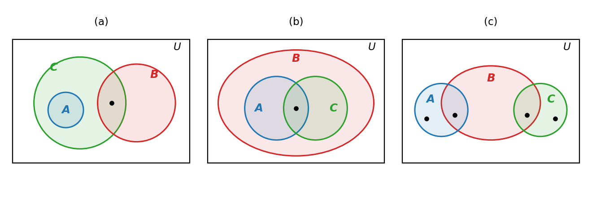

# HW6 Assignment Explanation — Set Theory and Boolean Algebra

[Repository Guide](../../README.md) | [English](Assignment-Explanation.md) | [한국어](Assignment-Explanation.ko.md)

> **Last Updated:** 2026-11-04
>
> Discrete Mathematics with Applications, Epp, Ch 6

> **Learning Objectives:**
> 1. Draw Venn diagrams that satisfy given subset and intersection conditions, and compute unions and intersections of indexed collections of sets and iterated power sets of the empty set
> 2. Prove subset relations and set equalities with element arguments, and prove by contradiction that a given set is empty
> 3. Decide whether a statement about sets is true, and then prove it or give a counterexample
> 4. Write an algebraic proof that cites a set identity of Theorem 6.2.2 for every step
> 5. Prove the idempotent law, the absorption law, and the uniqueness of 0 from the axioms of a Boolean algebra alone

---

## Table of Contents

- [1. Exercise 6.1.15: Venn Diagrams Satisfying Given Conditions](#1-exercise-6115-venn-diagrams-satisfying-given-conditions)
- [2. Exercise 6.1.24: Unions and Intersections of Intervals](#2-exercise-6124-unions-and-intersections-of-intervals)
- [3. Exercise 6.1.33: Iterated Power Sets of the Empty Set](#3-exercise-6133-iterated-power-sets-of-the-empty-set)
- [4. Exercise 6.2.7: An Element Argument for De Morgan's Law](#4-exercise-627-an-element-argument-for-de-morgans-law)
- [5. Exercise 6.2.20: The Union of Two Subsets](#5-exercise-6220-the-union-of-two-subsets)
- [6. Exercise 6.2.30: The Intersection of a Set and Its Complement](#6-exercise-6230-the-intersection-of-a-set-and-its-complement)
- [7. Exercise 6.3.8: The Union When a Complement Is Contained](#7-exercise-638-the-union-when-a-complement-is-contained)
- [8. Exercise 6.3.24: Subsets With and Without One Element](#8-exercise-6324-subsets-with-and-without-one-element)
- [9. Exercise 6.3.31: An Algebraic Proof for a Union Containing a Difference](#9-exercise-6331-an-algebraic-proof-for-a-union-containing-a-difference)
- [10. Exercise 6.4.1: The Idempotent Law for the Product](#10-exercise-641-the-idempotent-law-for-the-product)
- [11. Exercise 6.4.3: The Absorption Law](#11-exercise-643-the-absorption-law)
- [12. Exercise 6.4.6: Uniqueness of 0](#12-exercise-646-uniqueness-of-0)
- [Summary](#summary)
- [Self-Check Questions](#self-check-questions)

---

<br>

## 1. Exercise 6.1.15: Venn Diagrams Satisfying Given Conditions

**Problem.** For each list of conditions below, sketch a Venn diagram of sets $A$, $B$, and $C$ that meets all of them.

- (a) $A \cap B = \emptyset$, $A \subseteq C$, $C \cap B \ne \emptyset$
- (b) $A \subseteq B$, $C \subseteq B$, $A \cap C \ne \emptyset$
- (c) $A \cap B \ne \emptyset$, $B \cap C \ne \emptyset$, $A \cap C = \emptyset$, $A \not\subseteq B$, $C \not\subseteq B$

**Concept used.** A Venn diagram, as in [Chapter 6, Section 1](../../Lecture-Notes/Ch06_Set-Theory/Concepts_Lecture.md), represents the universal set $U$ as a rectangle and each set as a closed region inside it. The conditions are translated into the language of pictures as follows. If $X \subseteq Y$, draw the region of $X$ inside the region of $Y$. If $X \cap Y = \emptyset$, draw the two regions so that they do not overlap. If $X \cap Y \ne \emptyset$, the overlap of the two regions must contain an element, and if $X \not\subseteq Y$, the part of the region of $X$ outside $Y$ must contain an element.

> **Caution:** Drawing a region in a Venn diagram does not by itself mean that the region contains an element, because some subregions may be empty. So the conditions $\ne \emptyset$ and $\not\subseteq$ are made explicit by placing a dot in each region that must contain an element.

**Solution.**

- **(a)** Since $A \subseteq C$, draw $A$ inside $C$. Since $C \cap B \ne \emptyset$, $B$ must overlap $C$, and since $A \cap B = \emptyset$, that overlap must lie outside $A$. That is, $B$ overlaps only the part of $C$ that is not in $A$. Place a dot in $C \cap B$.
- **(b)** Since $A \subseteq B$ and $C \subseteq B$, draw both $A$ and $C$ inside $B$. Since $A \cap C \ne \emptyset$, draw the two regions overlapping and place a dot in the overlap.
- **(c)** $A$ and $C$ must each overlap $B$ (dots in $A \cap B$ and $`B \cap C`$), must each also extend outside $B$ (dots in $A - B$ and $`C - B`$), and must not overlap each other ($`A \cap C = \emptyset`$). So draw $B$ in the middle with $A$ and $C$ straddling $B$ from the two sides.



*Figure 1. Venn diagrams satisfying conditions (a), (b), and (c), with dots in the regions that must contain an element*

Figure 1 shows one of many possible answers. For example, in (a) drawing $B$ entirely inside $C$ also satisfies all the conditions as long as $B$ does not overlap $A$. A picture can be checked by giving concrete sets that satisfy the conditions.

| Case | $A$ | $B$ | $C$ | Check of the conditions |
|:-----|:-----|:-----|:-----|:-----|
| (a) | $\lbrace 1 \rbrace$ | $\lbrace 2, 3 \rbrace$ | $\lbrace 1, 2 \rbrace$ | $A \cap B = \emptyset$, $A \subseteq C$, $C \cap B = \lbrace 2 \rbrace$ |
| (b) | $\lbrace 1, 2 \rbrace$ | $\lbrace 1, 2, 3, 4 \rbrace$ | $\lbrace 2, 3 \rbrace$ | $A \subseteq B$, $C \subseteq B$, $A \cap C = \lbrace 2 \rbrace$ |
| (c) | $\lbrace 1, 2 \rbrace$ | $\lbrace 2, 3, 4 \rbrace$ | $\lbrace 4, 5 \rbrace$ | $A \cap B = \lbrace 2 \rbrace$, $B \cap C = \lbrace 4 \rbrace$, $A \cap C = \emptyset$, $1 \in A - B$, $5 \in C - B$ |

*Table 1. Concrete sets satisfying each of the three sets of conditions*

---

<br>

## 2. Exercise 6.1.24: Unions and Intersections of Intervals

**Problem.** For each nonnegative integer $i$, let $W_i = \lbrace x \in \mathbf{R} \mid x > i \rbrace = (i, \infty)$. Determine the following sets and answer the question.

- (a) $\bigcup_{i=0}^{4} W_i$
- (b) $\bigcap_{i=0}^{4} W_i$
- (c) Decide whether $W_0, W_1, W_2, \ldots$ are mutually disjoint, with a reason.
- (d) $\bigcup_{i=0}^{n} W_i$
- (e) $\bigcap_{i=0}^{n} W_i$
- (f) $\bigcup_{i=0}^{\infty} W_i$
- (g) $\bigcap_{i=0}^{\infty} W_i$

**Concept used.** Unions and intersections of an indexed collection of sets from [Chapter 6, Section 1](../../Lecture-Notes/Ch06_Set-Theory/Concepts_Lecture.md). $\bigcup_{i=0}^{n} A_i$ is the set of all elements that belong to $A_i$ for at least one $i$, and $\bigcap_{i=0}^{n} A_i$ is the set of all elements that belong to $A_i$ for every $i$. When the upper limit is $\infty$, $i$ ranges over all nonnegative integers. Sets are **mutually disjoint** if $A_i \cap A_j = \emptyset$ whenever $i \ne j$.

First determine how the sets are related. If $x > i + 1$ then $x > i$, so $W_{i+1} \subseteq W_i$, and therefore $W_0 \supseteq W_1 \supseteq W_2 \supseteq \cdots$. Each interval is open with left endpoint $i$, and the left endpoint moves to the right as $i$ grows.

```text
            0     1     2     3     4     5
  W0        (─────────────────────────────────────▶
  W1              (───────────────────────────────▶
  W2                    (─────────────────────────▶
  W3                          (───────────────────▶
  W4                                (─────────────▶
```

*Figure 2. Inclusions among the open intervals W₀ to W₄ with left endpoints 0, 1, 2, 3, 4*

**Solution.**

- **(a)** $\bigcup_{i=0}^{4} W_i = W_0 = (0, \infty)$. An element $x$ of the union belongs to some $W_i$, so $x > i \ge 0$ and hence $x \in W_0$. Conversely, $W_0$ is one of the sets in the union, so every element of $W_0$ belongs to the union.
- **(b)** $\bigcap_{i=0}^{4} W_i = W_4 = (4, \infty)$. An element of the intersection belongs in particular to $W_4$. Conversely, if $x > 4$ then $x > 4 \ge i$ for every $i = 0, 1, 2, 3, 4$, so $x$ belongs to every $W_i$.
- **(c)** They are not mutually disjoint. For example, $5 \in W_0$ and $5 \in W_1$, so $W_0 \cap W_1 \ne \emptyset$. In general, if $i < j$ then $W_i \cap W_j = W_j \ne \emptyset$.
- **(d)** $\bigcup_{i=0}^{n} W_i = W_0 = (0, \infty)$, for the same reason as in (a).
- **(e)** $\bigcap_{i=0}^{n} W_i = W_n = (n, \infty)$, for the same reason as in (b).
- **(f)** $\bigcup_{i=0}^{\infty} W_i = (0, \infty)$, because every $W_i$ is contained in $W_0$ and $W_0$ itself is part of the union.
- **(g)** $\bigcap_{i=0}^{\infty} W_i = \emptyset$, shown by contradiction. Suppose some real number $x$ belongs to every $W_i$. In particular $x \in W_0$, so $x > 0$. Now let $i = \lceil x \rceil$; then $i$ is a nonnegative integer and $i \ge x$. But by the supposition $x \in W_i$, that is, $x > i$, so $x > i \ge x$, a contradiction. Hence no real number belongs to every $W_i$.

> **Caution:** The finite intersection $(n, \infty)$ in (e) is nonempty for every $n$, yet the infinite intersection in (g) is empty. The rule that holds for finitely many sets (the smallest set is the intersection) must not be carried over to infinitely many sets. An infinite collection has no smallest interval, and whatever real number is chosen, some interval $W_i$ with a larger left endpoint leaves it out.

---

<br>

## 3. Exercise 6.1.33: Iterated Power Sets of the Empty Set

**Problem.** Find (a) $\mathcal{P}(\emptyset)$, (b) $\mathcal{P}(\mathcal{P}(\emptyset))$, and (c) $\mathcal{P}(\mathcal{P}(\mathcal{P}(\emptyset)))$.

**Concept used.** The power set from [Chapter 6, Section 1](../../Lecture-Notes/Ch06_Set-Theory/Concepts_Lecture.md). The **power set** $\mathcal{P}(A)$ of a set $A$ is the set of all subsets of $A$. The empty set is a subset of every set (Theorem 6.2.4), and every set is a subset of itself. Moreover, the power set of a set with $n$ elements has $2^n$ elements (Theorem 6.3.1).

**Solution.**

- **(a)** The only subset of $\emptyset$ is $\emptyset$ itself. Hence $\mathcal{P}(\emptyset) = \lbrace \emptyset \rbrace$, which has $2^0 = 1$ element.
- **(b)** By (a), $\mathcal{P}(\mathcal{P}(\emptyset)) = \mathcal{P}(\lbrace \emptyset \rbrace)$. The subsets of a set whose only element is $\emptyset$ are $\emptyset$, which chooses no element, and $\lbrace \emptyset \rbrace$, which chooses that element. Hence $\mathcal{P}(\mathcal{P}(\emptyset)) = \lbrace \emptyset, \lbrace \emptyset \rbrace \rbrace$, which has $2^1 = 2$ elements.
- **(c)** Let the two elements of the set $X = \lbrace \emptyset, \lbrace \emptyset \rbrace \rbrace$ from (b) be $x_1 = \emptyset$ and $x_2 = \lbrace \emptyset \rbrace$. Then the subsets of $X$ are the four sets $\emptyset$, $\lbrace x_1 \rbrace$, $\lbrace x_2 \rbrace$, and $\lbrace x_1, x_2 \rbrace$. Writing $x_1$ and $x_2$ out again gives the following.

```math
\mathcal{P}(\mathcal{P}(\mathcal{P}(\emptyset))) = \lbrace \emptyset, \lbrace \emptyset \rbrace, \lbrace \lbrace \emptyset \rbrace \rbrace, \lbrace \emptyset, \lbrace \emptyset \rbrace \rbrace \rbrace
```

It has $2^2 = 4$ elements.

| Set | Set-roster notation | Number of elements |
|:-----|:-----|:-----|
| $\emptyset$ | $\lbrace \rbrace$ | 0 |
| $\mathcal{P}(\emptyset)$ | $\lbrace \emptyset \rbrace$ | $2^0 = 1$ |
| $\mathcal{P}(\mathcal{P}(\emptyset))$ | $\lbrace \emptyset, \lbrace \emptyset \rbrace \rbrace$ | $2^1 = 2$ |
| $\mathcal{P}(\mathcal{P}(\mathcal{P}(\emptyset)))$ | $\lbrace \emptyset, \lbrace \emptyset \rbrace, \lbrace \lbrace \emptyset \rbrace \rbrace, \lbrace \emptyset, \lbrace \emptyset \rbrace \rbrace \rbrace$ | $2^2 = 4$ |

*Table 2. Results of applying the power set repeatedly to the empty set, with their numbers of elements*

> **Caution:** $\emptyset$ and $\lbrace \emptyset \rbrace$ are different sets. $\emptyset$ has no elements, while $\lbrace \emptyset \rbrace$ has the single element $\emptyset$. The difference is that between an empty box and a box containing one empty box. For the same reason, $\lbrace \lbrace \emptyset \rbrace \rbrace$ in (c) is the set whose single element is $\lbrace \emptyset \rbrace$, so it differs from $\lbrace \emptyset \rbrace$ and its braces must not be dropped.

> **Note:** One step further, $\mathcal{P}(\mathcal{P}(\mathcal{P}(\mathcal{P}(\emptyset))))$ is the power set of a set with 4 elements, so it has $2^4 = 16$ elements, and the next one has $2^{16} = 65536$. Under repeated power sets the number of elements grows rapidly as 1, 2, 4, 16, 65536.

---

<br>

## 4. Exercise 6.2.7: An Element Argument for De Morgan's Law

**Problem.** All sets lie inside a universal set $U$. Show by an element argument that $(A \cap B)^c = A^c \cup B^c$ for all sets $A$ and $B$.

**Concept used.** In [Chapter 6, Section 2](../../Lecture-Notes/Ch06_Set-Theory/Concepts_Lecture.md), the basic method for showing that two sets $X$ and $Y$ are equal is to prove $X \subseteq Y$ and $Y \subseteq X$ separately. $X \subseteq Y$ is proved by an **element argument**, which shows that an arbitrary element of $X$ belongs to $Y$. Each step uses the definitions of complement ($`A^c = \lbrace x \in U \mid x \notin A \rbrace`$), intersection, and union, together with De Morgan's law of logic ${\sim}(p \land q) \equiv {\sim}p \lor {\sim}q$.

**Proof.** Let $A$ and $B$ be arbitrarily chosen sets.

**(1) Show that $(A \cap B)^c \subseteq A^c \cup B^c$.**

1. Suppose $x \in (A \cap B)^c$. [It must be shown that $x \in A^c \cup B^c$.]
2. By the definition of complement, $x \in U$ and $x \notin A \cap B$.
3. By the definition of intersection, "$`x \in A`$ and $x \in B$" is false.
4. By De Morgan's law of logic, $x \notin A$ or $x \notin B$.
5. Since $x \in U$, the definition of complement gives $x \in A^c$ or $x \in B^c$.
6. By the definition of union, $x \in A^c \cup B^c$.

**(2) Show that $A^c \cup B^c \subseteq (A \cap B)^c$.**

1. Suppose $x \in A^c \cup B^c$. [It must be shown that $x \in (A \cap B)^c$.]
2. By the definition of union, $x \in A^c$ or $x \in B^c$.
3. By the definition of complement, $x \in U$, and $x \notin A$ or $x \notin B$.
4. By De Morgan's law of logic, "$`x \in A`$ and $x \in B$" is false.
5. By the definition of intersection, $x \notin A \cap B$.
6. Since $x \in U$, the definition of complement gives $x \in (A \cap B)^c$.

**(3) Conclusion.** By (1) and (2), each set is a subset of the other, so by the definition of set equality, $(A \cap B)^c = A^c \cup B^c$.

Part (2) retraces the steps of part (1) in reverse, because every step is an "if and only if". Written as one line, for every element $x$ of $U$:

```math
x \in (A \cap B)^c \iff x \notin A \cap B \iff {\sim}(x \in A \land x \in B) \iff x \notin A \lor x \notin B \iff x \in A^c \cup B^c
```

The same conclusion follows by splitting $U$ into four regions according to whether $x$ belongs to $A$ and to $B$ and comparing membership in the two sides. This table has the same structure as the truth table that checks De Morgan's law of logic.

| $x \in A$ | $x \in B$ | $x \in (A \cap B)^c$ | $x \in A^c \cup B^c$ |
|:-----|:-----|:-----|:-----|
| Yes | Yes | No | No |
| Yes | No | Yes | Yes |
| No | Yes | Yes | Yes |
| No | No | Yes | Yes |

*Table 3. Membership in the two sides compared over the four regions*

---

<br>

## 5. Exercise 6.2.20: The Union of Two Subsets

**Problem.** Show by an element argument that for all sets $A$, $B$, and $C$, $A \subseteq C$ and $B \subseteq C$ together imply $A \cup B \subseteq C$.

**Concept used.** The definition of subset ($X \subseteq Y$ means that every element of $X$ belongs to $`Y`$) and the definition of union. The supposition that an element belongs to a union contains an "or", so it is handled by division into cases.

**Proof.**

1. Suppose $A$, $B$, and $C$ are any sets such that $A \subseteq C$ and $B \subseteq C$. [It must be shown that $A \cup B \subseteq C$.]
2. Suppose $x \in A \cup B$. By the definition of union, $x \in A$ or $x \in B$.
3. **Case 1, $x \in A$:** Since $A \subseteq C$, the definition of subset gives $x \in C$.
4. **Case 2, $x \in B$:** Since $B \subseteq C$, the definition of subset gives $x \in C$.
5. In either case $x \in C$ (proof by division into cases). Since $x$ was an arbitrary element of $A \cup B$, the definition of subset gives $A \cup B \subseteq C$.

> **Note:** The converse also holds. If $A \cup B \subseteq C$, then $A \subseteq A \cup B$ (Theorem 6.2.1) and the transitivity of the subset relation give $A \subseteq C$, and for the same reason $B \subseteq C$. Therefore $A \cup B$ is the smallest set containing both $A$ and $B$. This result is used again with $C = U$ in exercise 6.3.8 in Section 7.

---

<br>

## 6. Exercise 6.2.30: The Intersection of a Set and Its Complement

**Problem.** Show that $A \cap A^c = \emptyset$ for every subset $A$ of a universal set $U$, using the element method for proving that a set equals the empty set (an argument by contradiction).

**Concept used.** The element method for proving that a set equals the empty set, from [Chapter 6, Section 2](../../Lecture-Notes/Ch06_Set-Theory/Concepts_Lecture.md). To show that a set $X$ equals $\emptyset$, it suffices to show that $X$ has no elements, and to do this, suppose $X$ has an element and derive a contradiction. This suffices because $\emptyset$ is the only set with no elements (Corollary 6.2.5).

**Proof.**

1. Let $A$ be any subset of $U$. It suffices to show that $A \cap A^c$ has no elements.
2. Suppose not. That is, suppose there is an element $x$ with $x \in A \cap A^c$.
3. By the definition of intersection, $x \in A$ and $x \in A^c$.
4. By the definition of complement, $x \in A^c$ means $x \notin A$.
5. Hence $x \in A$ and $x \notin A$, which is a contradiction.
6. Therefore the supposition of step 2 is false, and $A \cap A^c$ has no elements. That is, $A \cap A^c = \emptyset$.

> **Note:** This result is the complement law 5(b) of Theorem 6.2.2 and corresponds to the contradiction $p \land {\sim}p$ in logic. The heart of the proof is that no element can satisfy both "belongs to $A$" and "does not belong to $A$".

> **Caution:** To show $X = \emptyset$, there is no need to prove $X \subseteq \emptyset$ and $\emptyset \subseteq X$ separately. Since $\emptyset \subseteq X$ always holds by Theorem 6.2.4, showing that $X$ has no elements is enough.

---

<br>

## 7. Exercise 6.3.8: The Union When a Complement Is Contained

**Problem.** All sets lie inside a universal set $U$. Decide whether "for all sets $A$ and $B$, if $A^c \subseteq B$ then $A \cup B = U$" holds; prove it if it does, and give a counterexample if it does not.

**Concept used.** First decide whether the statement is true. Splitting $U$ into four regions according to whether $x$ belongs to $A$ and to $B$, the hypothesis $A^c \subseteq B$ says that every element outside $A$ lies in $B$, which means the region $A^c \cap B^c$ of elements in neither $A$ nor $B$ must be empty. But this is exactly the only region lying outside $A \cup B$.

| Region | $x \in A$ | $x \in B$ | Under the hypothesis $A^c \subseteq B$ | $x \in A \cup B$ |
|:-----|:-----|:-----|:-----|:-----|
| $A \cap B$ | Yes | Yes | May contain elements | Yes |
| $A \cap B^c$ | Yes | No | May contain elements | Yes |
| $A^c \cap B$ | No | Yes | May contain elements | Yes |
| $A^c \cap B^c$ | No | No | Must be empty | No |

*Table 4. What the hypothesis Aᶜ ⊆ B requires of the four regions, and membership in the union A ∪ B*

So the statement appears to hold, and it is proved by an element argument.

**Answer.** It holds.

**Proof.**

1. Suppose $A$ and $B$ are any sets such that $A^c \subseteq B$. [It must be shown that $A \cup B = U$.]
2. **$A \cup B \subseteq U$:** All sets are subsets of $U$, so $A \subseteq U$ and $B \subseteq U$. Taking $C = U$ in the result of Section 5 (exercise 6.2.20) gives $A \cup B \subseteq U$.
3. **$U \subseteq A \cup B$:** Suppose $x \in U$. Either $x \in A$ or $x \notin A$, so split into two cases.
4. **Case 1, $x \in A$:** By the definition of union, $x \in A \cup B$.
5. **Case 2, $x \notin A$:** Since $x \in U$, the definition of complement gives $x \in A^c$, the hypothesis $A^c \subseteq B$ gives $x \in B$, and the definition of union gives $x \in A \cup B$.
6. In both cases $x \in A \cup B$, so $U \subseteq A \cup B$.
7. By steps 2 and 6, each set is a subset of the other, so $A \cup B = U$.

> **Note:** The converse is also true. If $A \cup B = U$ and $x \in A^c$, then $x \in U = A \cup B$ and $x \notin A$, so $x \in B$. Hence $A^c \subseteq B$ and $A \cup B = U$ are equivalent. In terms of Table 4, both conditions state the same fact that the region $A^c \cap B^c$ is empty, and since $A^c \cap B^c = (A \cup B)^c$ by De Morgan's law 9(a), this region being empty is the same as $A \cup B = U$.

---

<br>

## 8. Exercise 6.3.24: Subsets With and Without One Element

**Problem.** For $A = \lbrace t, u, v, w \rbrace$, $S_1$ is the set of all subsets of $A$ without $w$, and $S_2$ is the set of all subsets of $A$ with $w$. Determine the following.

- (a) The elements of $S_1$
- (b) The elements of $S_2$
- (c) Whether $S_1$ and $S_2$ are disjoint
- (d) How the sizes of $S_1$ and $S_2$ compare
- (e) The number of elements of $S_1 \cup S_2$
- (f) How $S_1 \cup S_2$ is related to $\mathcal{P}(A)$

**Concept used.** Power sets, disjointness, and partitions. A collection of sets $\lbrace A_1, A_2, \ldots \rbrace$ is a **partition** of a set $X$ if the $A_i$ are mutually disjoint and their union is $X$. The subsets of $A$ that do not contain $w$ are exactly the subsets of $\lbrace t, u, v \rbrace$.

**Solution.**

- **(a)** $S_1 = \mathcal{P}(\lbrace t, u, v \rbrace) = \lbrace \emptyset, \lbrace t \rbrace, \lbrace u \rbrace, \lbrace v \rbrace, \lbrace t, u \rbrace, \lbrace t, v \rbrace, \lbrace u, v \rbrace, \lbrace t, u, v \rbrace \rbrace$. It has $2^3 = 8$ elements.
- **(b)** The subsets containing $w$ are the sets $X \cup \lbrace w \rbrace$ obtained by adding $w$ to each set $X$ in $S_1$. Hence $S_2 = \lbrace \lbrace w \rbrace, \lbrace t, w \rbrace, \lbrace u, w \rbrace, \lbrace v, w \rbrace, \lbrace t, u, w \rbrace, \lbrace t, v, w \rbrace, \lbrace u, v, w \rbrace, \lbrace t, u, v, w \rbrace \rbrace$, which has 8 elements.
- **(c)** They are disjoint. No subset can both contain $w$ and not contain $w$, so $S_1 \cap S_2 = \emptyset$.
- **(d)** They have the same size (8 each), because the correspondence $X \mapsto X \cup \lbrace w \rbrace$ pairs the elements of $S_1$ with the elements of $S_2$ one to one with none left over, as in Table 5.
- **(e)** Since $S_1$ and $S_2$ are disjoint, the number of elements of $S_1 \cup S_2$ is $8 + 8 = 16$.
- **(f)** $S_1 \cup S_2 = \mathcal{P}(A)$. Every subset of $A$ either contains $w$ or does not, so $\mathcal{P}(A) \subseteq S_1 \cup S_2$, and conversely every element of $S_1$ and of $S_2$ is a subset of $A$, so $S_1 \cup S_2 \subseteq \mathcal{P}(A)$. Together with (c), $\lbrace S_1, S_2 \rbrace$ is a partition of $\mathcal{P}(A)$. The count 16 also agrees with $2^4$.

| Element $X$ of $S_1$ | Element $X \cup \lbrace w \rbrace$ of $S_2$ |
|:-----|:-----|
| $\emptyset$ | $\lbrace w \rbrace$ |
| $\lbrace t \rbrace$ | $\lbrace t, w \rbrace$ |
| $\lbrace u \rbrace$ | $\lbrace u, w \rbrace$ |
| $\lbrace v \rbrace$ | $\lbrace v, w \rbrace$ |
| $\lbrace t, u \rbrace$ | $\lbrace t, u, w \rbrace$ |
| $\lbrace t, v \rbrace$ | $\lbrace t, v, w \rbrace$ |
| $\lbrace u, v \rbrace$ | $\lbrace u, v, w \rbrace$ |
| $\lbrace t, u, v \rbrace$ | $\lbrace t, u, v, w \rbrace$ |

*Table 5. Elements of S₁ and S₂ paired by the correspondence that adds w*

> **Key Point:** This pairing is the inductive step of Theorem 6.3.1 (the power set of a set with $n$ elements has $2^n$ elements). When a new element $z$ is added to a set with $k$ elements, the subsets of the new set split into those that do not contain $z$ ($2^k$ of them) and those that do (the $2^k$ sets obtained by adding $z$ to each of them), so the number of subsets doubles to $2^{k+1}$.

---

<br>

## 9. Exercise 6.3.31: An Algebraic Proof for a Union Containing a Difference

**Problem.** Prove algebraically that $A \cup (B - A) = A \cup B$ for all sets $A$ and $B$, justifying each step by a law of Theorem 6.2.2.

**Concept used.** An **algebraic proof**, as in [Chapter 6, Section 3](../../Lecture-Notes/Ch06_Set-Theory/Concepts_Lecture.md), transforms one side into the other by applying set identities that have already been proved, one after another. Each law of Theorem 6.2.2 is a universal statement about all sets, so any set may be substituted for its variables. The laws used in this proof are as follows.

| Number | Law | Identity |
|:-----|:-----|:-----|
| 3(a) | Distributive law | $A \cup (B \cap C) = (A \cup B) \cap (A \cup C)$ |
| 4(b) | Identity law | $A \cap U = A$ |
| 5(a) | Complement law | $A \cup A^c = U$ |
| 12 | Set difference law | $A - B = A \cap B^c$ |

*Table 6. Set identities of Theorem 6.2.2 used in this proof*

**Proof.** Let $A$ and $B$ be any sets.

```math
\begin{aligned}
A \cup (B - A) &= A \cup (B \cap A^c) && \text{(1)} \\
&= (A \cup B) \cap (A \cup A^c) && \text{(2)} \\
&= (A \cup B) \cap U && \text{(3)} \\
&= A \cup B && \text{(4)}
\end{aligned}
```

Step (1) uses $B - A = B \cap A^c$, the set difference law 12 with $B$ in place of $A$ and $A$ in place of $B$. Step (2) is the distributive law 3(a) with $A$, $B$, $A^c$ in place of $A$, $B$, $C$. Step (3) is the complement law 5(a), $A \cup A^c = U$, and step (4) is the identity law 4(b) with $A \cup B$ in place of $A$.

> **Caution:** The properties of Theorem 6.2.2 must be applied exactly in the form in which they are stated. For example, 4(b) reads $A \cap U = A$, so if an expression had $U$ on the left, as in $U \cap (A \cup B)$, it would first have to be rewritten as $(A \cup B) \cap U$ by the commutative law 1(b) before 4(b) is applied. In this proof each step matches the form of its law exactly, so no commutative law is needed.

> **Note:** Thinking in terms of elements makes the result natural. $B - A$ consists of the elements of $B$ that are not in $A$. Adding them to $A$ collects the elements of $A$ and those only in $B$, so the result is $A \cup B$, the collection of all elements of $A$ and $B$.

---

<br>

## 10. Exercise 6.4.1: The Idempotent Law for the Product

**Problem.** In a Boolean algebra $B$ with operations $+$ and $\cdot$, the chain of equalities below shows that $a \cdot a = a$ for every $a$ in $B$. For each step (a)-(e), state the axiom for a Boolean algebra that justifies it.

```math
a = a \cdot 1 = a \cdot (a + \overline{a}) = (a \cdot a) + (a \cdot \overline{a}) = (a \cdot a) + 0 = a \cdot a
```

**Concept used.** A **Boolean algebra**, as in [Chapter 6, Section 4](../../Lecture-Notes/Ch06_Set-Theory/Concepts_Lecture.md), is a structure consisting of a set $B$ and two operations $+$ and $\cdot$ such that $a + b$ and $a \cdot b$ are in $B$ for all elements $a$ and $b$ of $B$ and the following five axioms hold. Axiom 4 states that there exist two distinct elements 0 and 1, and axiom 5 states that each $a$ has a **complement** $\overline{a}$. In the example of sets, $+$ corresponds to $\cup$, $\cdot$ to $\cap$, 0 to $\emptyset$, 1 to $U$, and $\overline{a}$ to the complement.

| Number | Axiom | (a) | (b) |
|:-----|:-----|:-----|:-----|
| 1 | Commutative laws | $a + b = b + a$ | $a \cdot b = b \cdot a$ |
| 2 | Associative laws | $(a + b) + c = a + (b + c)$ | $(a \cdot b) \cdot c = a \cdot (b \cdot c)$ |
| 3 | Distributive laws | $a + (b \cdot c) = (a + b) \cdot (a + c)$ | $a \cdot (b + c) = (a \cdot b) + (a \cdot c)$ |
| 4 | Identity laws | $a + 0 = a$ | $a \cdot 1 = a$ |
| 5 | Complement laws | $a + \overline{a} = 1$ | $a \cdot \overline{a} = 0$ |

*Table 7. Axioms for a Boolean algebra*

In this explanation $+$ is called the sum and $\cdot$ the product for convenience. 3(a) is called the distributive law for $+$ over $\cdot$, and 3(b) the distributive law for $\cdot$ over $+$. 5(a) is the complement law for $+$, and 5(b) the complement law for $\cdot$.

**Solution.** Let $a$ be any element of $B$.

| Blank | Expression | Reason |
|:-----|:-----|:-----|
| (a) | $a = a \cdot 1$ | because 1 is an identity for $\cdot$ (axiom 4(b)) |
| (b) | $= a \cdot (a + \overline{a})$ | complement law for $+$ (axiom 5(a)) |
| (c) | $= (a \cdot a) + (a \cdot \overline{a})$ | distributive law for $\cdot$ over $+$ (axiom 3(b)) |
| (d) | $= (a \cdot a) + 0$ | complement law for $\cdot$ (axiom 5(b)) |
| (e) | $= a \cdot a$ | because 0 is an identity for $+$ (axiom 4(a)) |

*Table 8. Proof of the idempotent law for the product, with the reason for each step*

Step (a) reads $a \cdot 1 = a$ from right to left to replace $a$ by $a \cdot 1$. Step (b) replaces that 1 by $a + \overline{a}$, and step (c) distributes $a$ into the parentheses. Step (d) replaces $a \cdot \overline{a}$ by 0, and step (e) treats $a \cdot a$ as a single element $x$ and applies $x + 0 = x$. Since the initial $a$ and the final $a \cdot a$ are joined by equalities, $a \cdot a = a$.

> **Note:** Interchanging $+$ and $\cdot$ and interchanging 0 and 1 throughout this proof gives the proof of the idempotent law for the sum, $a + a = a$ (Example 6.4.2 of the textbook): $a = a + 0 = a + (a \cdot \overline{a}) = (a + a) \cdot (a + \overline{a}) = (a + a) \cdot 1 = a + a$. This is the duality principle. Read as sets, the two laws are $A \cap A = A$ and $A \cup A = A$.

---

<br>

## 11. Exercise 6.4.3: The Absorption Law

**Problem.** In a chain of equalities showing that $(a + b) \cdot a = a$ for all $a$ and $b$ in a Boolean algebra $B$, state the axiom that justifies each step (a)-(f). The other two steps rest on exercise 6.4.1 (the idempotent law for the product, $`a \cdot a = a`$) and exercise 6.4.2 (the **universal bound law** for the sum, $`a + 1 = 1`$).

**Concept used.** The axioms for a Boolean algebra collected in Table 7 of Section 10, and the two properties already proved. An equation can be used in either direction, so a step that replaces the right side of an axiom by its left side is also justified by that axiom.

**Solution.** Let $a$ and $b$ be any elements of $B$.

| Blank | Expression | Reason |
|:-----|:-----|:-----|
| (a) | $(a + b) \cdot a = a \cdot (a + b)$ | commutative law for $\cdot$ (axiom 1(b)) |
| (b) | $= a \cdot a + a \cdot b$ | distributive law for $\cdot$ over $+$ (axiom 3(b)) |
| Exercise 6.4.1 | $= a + a \cdot b$ | idempotent law for the product, $a \cdot a = a$ |
| (c) | $= a \cdot 1 + a \cdot b$ | because 1 is an identity for $\cdot$ (axiom 4(b)) |
| (d) | $= a \cdot (1 + b)$ | distributive law for $\cdot$ over $+$ (axiom 3(b)) |
| (e) | $= a \cdot (b + 1)$ | commutative law for $+$ (axiom 1(a)) |
| Exercise 6.4.2 | $= a \cdot 1$ | universal bound law for the sum, $b + 1 = 1$ |
| (f) | $= a$ | because 1 is an identity for $\cdot$ (axiom 4(b)) |

*Table 9. Proof of the absorption law, with the reason for each step*

The proof runs as follows. First $a$ is distributed into the parentheses to give $a + a \cdot b$; then the first term $a$ is rewritten as $a \cdot 1$ so that the common factor $a$ can be pulled out of the two terms again. The remaining parentheses $1 + b$ equal 1, so the whole expression becomes $a$. Step (c) reads $a \cdot 1 = a$, and step (d) reads $a \cdot (1 + b) = a \cdot 1 + a \cdot b$, from right to left. Step (e) is needed because the property of exercise 6.4.2 has been proved in the form $b + 1 = 1$, that is, with 1 on the right.

> **Note:** The universal bound law $a + 1 = 1$ of exercise 6.4.2 is proved as follows. $a + 1 = a + (a + \overline{a})$ by the complement law for $+$ (axiom 5(a)), $= (a + a) + \overline{a}$ by the associative law for $+$ (axiom 2(a)), $= a + \overline{a}$ by the idempotent law for the sum (Example 6.4.2 of the textbook), and $= 1$ by the complement law for $+$ again.

> **Note:** Read as sets, the absorption law is $(A \cup B) \cap A = A$. Every element of $A$ belongs to $A \cup B$, so the common part of $A \cup B$ and $A$ is $A$ itself. By the duality principle $(a \cdot b) + a = a$ also holds, which corresponds to $(A \cap B) \cup A = A$ for sets.

---

<br>

## 12. Exercise 6.4.6: Uniqueness of 0

**Problem.** Prove, using only the axioms and properties already proved, that a Boolean algebra $B$ has only one element that is an identity for $+$.

**Concept used.** The basic method for proving uniqueness is to suppose that two elements satisfy the condition and show that they are equal. An element $z$ of $B$ is an **identity** for $+$ if $a + z = a$ for every $a$ in $B$. The axioms used are the identity law 4(a) and the commutative law for $+$, 1(a).

**Proof.**

1. Suppose $0$ and $0'$ are elements of $B$ that are both identities for $+$. That is, the following two equations hold for every $a$ in $B$. [It must be shown that $0' = 0$.]
   - (i) $a + 0 = a$
   - (ii) $a + 0' = a$
2. Compute as follows.

```math
\begin{aligned}
0' &= 0' + 0 && \text{(1)} \\
&= 0 + 0' && \text{(2)} \\
&= 0 && \text{(3)}
\end{aligned}
```

Step (1) is equation (i) with $a = 0'$, step (2) is the commutative law for $+$ (axiom 1(a)), and step (3) is equation (ii) with $a = 0$. Hence $0' = 0$, and 0 is the only identity for $+$.

> **Caution:** That $0'$ is an identity for $+$ does not follow from the axioms; it is the supposition of step 1. The identity law (axiom 4(a)) only says that an identity called 0 **exists** and says nothing about any other element $0'$. So writing "$`0'`$ also satisfies $a + 0' = a$ by the identity law" gives the wrong reason. Since the statement to be proved is "0 is the only element that is an identity", the starting point is to introduce an arbitrary identity element $0'$ as a supposition.

> **Note:** The commutative law is needed because equation (ii) has the form $a + 0'$, with $0'$ on the right. Only after rewriting $0' + 0$ as $0 + 0'$ can $a = 0$ be substituted into (ii). Replacing $+$ by $\cdot$ and 0 by 1 in the same argument proves the uniqueness of the identity 1 for $\cdot$ (exercise 6.4.7): $1' = 1' \cdot 1 = 1 \cdot 1' = 1$.

---

<br>

## Summary

| Concept | Key Summary |
|:-----|:-----|
| Venn diagrams | Show inclusion by drawing a region inside another and empty intersection by drawing regions apart, and place a dot in each region that must contain an element. |
| Indexed collections | If $W_0 \supseteq W_1 \supseteq \cdots$, the union is $W_0$ and the finite intersection is $W_n$, but the infinite intersection may be empty. |
| Mutually disjoint | Every two distinct sets must have empty intersection, so nested intervals are not mutually disjoint. |
| Power sets | $\mathcal{P}(\emptyset) = \lbrace \emptyset \rbrace$, the power set of a set with $n$ elements has $2^n$ elements, and $\emptyset$ differs from $\lbrace \emptyset \rbrace$. |
| Element arguments | Prove $X = Y$ by showing $X \subseteq Y$ and $Y \subseteq X$, each for an arbitrary element. |
| De Morgan's law for sets | $(A \cap B)^c = A^c \cup B^c$, and the key step of the proof is De Morgan's law of logic. |
| Proving a set empty | If supposing that a set has an element leads to a contradiction, the set is empty, as in $A \cap A^c = \emptyset$. |
| Deciding truth | Compare the hypothesis and the conclusion with a four-region table, then prove the statement if true or give a counterexample if false. |
| Partitions and counting subsets | The subsets that contain a fixed element $w$ and those that do not form a partition of $\mathcal{P}(A)$ and are equal in number. |
| Algebraic proofs | Apply the laws of Theorem 6.2.2 exactly in their stated form and cite a reason for every step. |
| Axioms for a Boolean algebra | The five pairs of commutative, associative, distributive, identity, and complement laws alone yield the idempotent, universal bound, and absorption laws. |
| Proving uniqueness | Introduce two elements satisfying the condition as a supposition and show they are equal; for 0, $0' = 0' + 0 = 0 + 0' = 0$. |
| Duality principle | Interchanging $+$ and $\cdot$ and interchanging 0 and 1 turns an identity of a Boolean algebra and its proof into their duals. |

---

<br>

## Self-Check Questions

1. **Venn diagram:** Describe a Venn diagram for sets $A$, $B$, $C$ with $A \subseteq B$ and $B \cap C = \emptyset$, and state what set $A \cap C$ is.

   <details>
   <summary>Answer</summary>

   Draw $A$ inside $B$ and draw $C$ apart from $B$. Then $A$ does not overlap $C$ either, so $A \cap C = \emptyset$. Indeed, if $x \in A \cap C$, then $A \subseteq B$ gives $x \in B \cap C$, contradicting $B \cap C = \emptyset$.

   </details>

2. **Indexed collection:** For each positive integer $i$, let $V_i = [0, i]$. Find $\bigcup_{i=1}^{\infty} V_i$ and $\bigcap_{i=1}^{\infty} V_i$.

   <details>
   <summary>Answer</summary>

   $V_1 \subseteq V_2 \subseteq \cdots$. A nonnegative real number $x$ belongs to $V_i$ for any positive integer $i \ge x$, and a negative number belongs to no $V_i$, so $\bigcup_{i=1}^{\infty} V_i = [0, \infty)$. An element of the intersection belongs in particular to $V_1 = [0, 1]$, and conversely every element of $[0, 1]$ belongs to every $V_i$, so $\bigcap_{i=1}^{\infty} V_i = [0, 1]$.

   </details>

3. **Element and subset:** Is $\lbrace \emptyset \rbrace \in \mathcal{P}(\mathcal{P}(\emptyset))$? Is $\lbrace \emptyset \rbrace \subseteq \mathcal{P}(\mathcal{P}(\emptyset))$?

   <details>
   <summary>Answer</summary>

   Both are true. Since $\mathcal{P}(\mathcal{P}(\emptyset)) = \lbrace \emptyset, \lbrace \emptyset \rbrace \rbrace$, $\lbrace \emptyset \rbrace$ is one of its elements. Also, the only element $\emptyset$ of $\lbrace \emptyset \rbrace$ is an element of $\mathcal{P}(\mathcal{P}(\emptyset))$, so it is a subset as well.

   </details>

4. **Element argument:** Prove with a chain of equivalences that for all sets $A$ and $B$, $(A \cup B)^c = A^c \cap B^c$.

   <details>
   <summary>Answer</summary>

   For every element $x$ of $U$, $x \in (A \cup B)^c \iff x \notin A \cup B \iff {\sim}(x \in A \lor x \in B) \iff x \notin A \land x \notin B \iff x \in A^c \cap B^c$. The steps use, in order, the definitions of complement and union, De Morgan's law of logic, and the definitions of complement and intersection. Hence the two sets have the same elements and are equal.

   </details>

5. **Proving a set empty:** Prove that for all sets $A$ and $B$, $(A - B) \cap B = \emptyset$.

   <details>
   <summary>Answer</summary>

   Suppose not, and let $x \in (A - B) \cap B$. By the definition of intersection, $x \in A - B$ and $x \in B$. By the definition of set difference, $x \in A - B$ means $x \notin B$, which contradicts $x \in B$. Hence $(A - B) \cap B$ has no elements and is empty.

   </details>

6. **Counterexample:** Is the statement "for all sets $A$, $B$, $C$, $A - (B - C) = (A - B) - C$" true?

   <details>
   <summary>Answer</summary>

   It is false. If $A = B = C = \lbrace 1 \rbrace$, then $B - C = \emptyset$, so $A - (B - C) = \lbrace 1 \rbrace$, while $A - B = \emptyset$, so $(A - B) - C = \emptyset$. The two sets differ, so this is a counterexample.

   </details>

7. **Algebraic proof:** Prove with the properties of Theorem 6.2.2 that for all sets $A$ and $B$, $(A - B) \cup (A \cap B) = A$.

   <details>
   <summary>Answer</summary>

   $(A - B) \cup (A \cap B) = (A \cap B^c) \cup (A \cap B)$ (set difference law 12) $= A \cap (B^c \cup B)$ (distributive law 3(b)) $= A \cap (B \cup B^c)$ (commutative law 1(a)) $= A \cap U$ (complement law 5(a)) $= A$ (identity law 4(b)).

   </details>

8. **Uniqueness of 1:** Prove that a Boolean algebra has only one identity for $\cdot$.

   <details>
   <summary>Answer</summary>

   Suppose 1 and $1'$ are both identities for $\cdot$, that is, $a \cdot 1 = a$ and $a \cdot 1' = a$ for every $a$. Then $1' = 1' \cdot 1$ (1 is an identity, $`a = 1'`$) $= 1 \cdot 1'$ (commutative law for $`\cdot`$) $= 1$ ($1'$ is an identity, $`a = 1`$), so $1' = 1$.

   </details>
