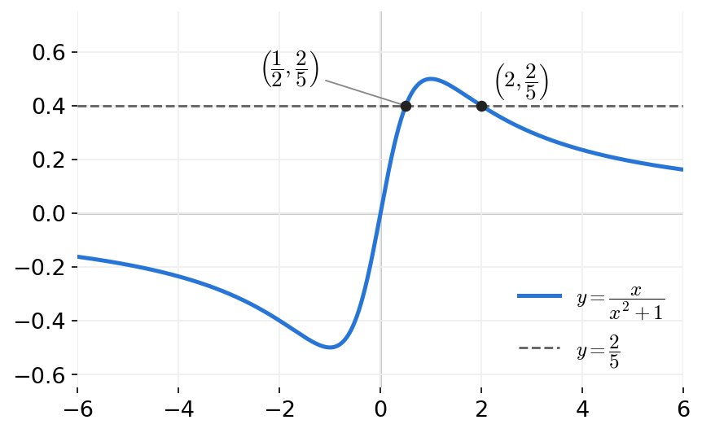
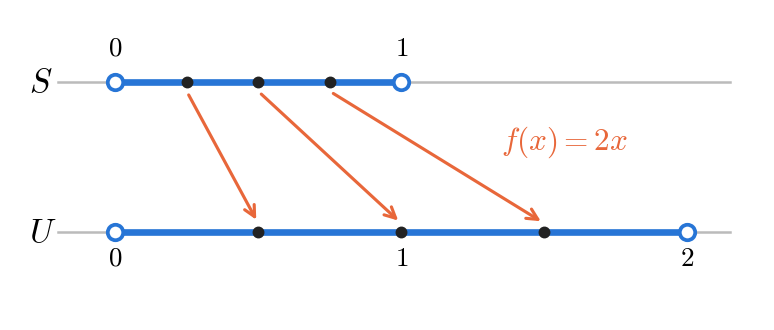

# HW7 과제 해설 — 함수와 기수

[레포지토리 안내](../../README.ko.md) | [English](Assignment-Explanation.md) | [한국어](Assignment-Explanation.ko.md)

> **최종 수정일:** 2026-11-04
>
> Discrete Mathematics with Applications, Epp, Ch 7

> **학습 목표:**
> 1. 말이나 식으로 정의된 함수의 값을 계산하고, 두 함수가 같은지를 정의역의 모든 원소에서의 값으로 판정할 수 있다
> 2. 로그의 정의와 음의 지수의 정의만으로 로그의 성질을 증명할 수 있다
> 3. 함수가 일대일 함수인지, 위로의 함수인지를 정의의 올바른 방향에 따라 증명하거나 반례로 반박할 수 있다
> 4. 함수의 합성을 계산하고, 합성의 순서에 따라 결과가 달라질 수 있음과 함수와 그 역함수의 합성이 항등 함수임을 설명할 수 있다
> 5. 일대일 대응을 직접 만들어 두 무한 집합의 기수가 같음을 증명할 수 있다

---

## 목차

- [1. 연습 문제 7.1.9: 양의 약수의 합 함수](#1-연습-문제-719-양의-약수의-합-함수)
- [2. 연습 문제 7.1.15: 곱 함수의 상등](#2-연습-문제-7115-곱-함수의-상등)
- [3. 연습 문제 7.1.21: 역수의 로그](#3-연습-문제-7121-역수의-로그)
- [4. 연습 문제 7.2.10: 2배 함수의 일대일성과 위로의 성질](#4-연습-문제-7210-2배-함수의-일대일성과-위로의-성질)
- [5. 연습 문제 7.2.16: 분수 함수의 일대일성 판정](#5-연습-문제-7216-분수-함수의-일대일성-판정)
- [6. 연습 문제 7.2.41: 위로의 함수와 역상의 상](#6-연습-문제-7241-위로의-함수와-역상의-상)
- [7. 연습 문제 7.3.7: 제곱 함수와 mod 5 함수의 합성](#7-연습-문제-737-제곱-함수와-mod-5-함수의-합성)
- [8. 연습 문제 7.3.10: 2배 함수와 바닥 함수의 합성](#8-연습-문제-7310-2배-함수와-바닥-함수의-합성)
- [9. 연습 문제 7.3.17: 함수와 그 역함수의 합성](#9-연습-문제-7317-함수와-그-역함수의-합성)
- [10. 연습 문제 7.4.3: 정수 전체와 3의 배수 전체의 기수](#10-연습-문제-743-정수-전체와-3의-배수-전체의-기수)
- [11. 연습 문제 7.4.10: 두 열린 구간의 기수](#11-연습-문제-7410-두-열린-구간의-기수)
- [요약](#요약)
- [점검 문제](#점검-문제)

---

<br>

## 1. 연습 문제 7.1.9: 양의 약수의 합 함수

**문제.** 각 양의 정수에 그 양의 약수 전체의 합을 대응시키는 함수 $S: \mathbf{Z}^{+} \to \mathbf{Z}^{+}$에서 $S(1)$, $S(15)$, $S(17)$, $S(5)$, $S(18)$, $S(21)$의 값을 구한다.

**사용하는 개념.** [7장 1절](../../Lecture-Notes/Ch07_Properties-of-Functions/Concepts_Lecture.ko.md)에서 정의한 것처럼 함수는 정의역의 각 원소에 공역의 원소를 정확히 하나 대응시키는 규칙이다. 이 문제에서는 규칙이 식이 아니라 말로 주어져 있으므로 규칙을 그대로 따라 값을 계산한다. 양의 정수 $d$가 $n$을 나눈다($`d \mid n`$)는 것은 $n = dk$인 정수 $k$가 존재한다는 뜻이다(4장).

**풀이.** $n$의 양의 약수는 $1$부터 $n$까지의 정수 가운데 $n$을 나누는 수이다. 약수 $d$가 있으면 $n/d$도 약수이므로, 약수는 $d$와 $n/d$의 짝으로 나타난다. 따라서 $d \le \sqrt{n}$인 약수만 찾은 뒤 짝을 붙이면 빠짐없이 나열할 수 있다. 예를 들어 $\sqrt{18} \approx 4.24$ 이하인 $18$의 약수는 $1, 2, 3$이고, 각각의 짝은 $18, 9, 6$이다.

| $n$ | 양의 약수 | $S(n)$ |
|:---:|:-----|:---:|
| 1 | 1 | 1 |
| 15 | 1, 3, 5, 15 | 24 |
| 17 | 1, 17 | 18 |
| 5 | 1, 5 | 6 |
| 18 | 1, 2, 3, 6, 9, 18 | 39 |
| 21 | 1, 3, 7, 21 | 32 |

*표 1. 각 n의 양의 약수와 그 합*

따라서 $S(1) = 1$, $S(15) = 24$, $S(17) = 18$, $S(5) = 6$, $S(18) = 39$, $S(21) = 32$이다.

소수 $p$의 양의 약수는 $1$과 $p$뿐이므로 $S(p) = p + 1$이며, $S(17) = 18$과 $S(5) = 6$이 그 예이다. 거꾸로 $S(n) = n + 1$이면 $n \neq 1$이고($S(1) = 1$이므로), $1$과 $n$ 외의 약수가 없으므로 $n$은 소수이다. 곧 양의 정수 $n$에 대하여 $S(n) = n + 1$일 필요충분조건은 $n$이 소수인 것이다.

---

<br>

## 2. 연습 문제 7.1.15: 곱 함수의 상등

**문제.** 실수에서 실수로의 두 함수 $F$, $G$의 곱 함수를 값끼리의 곱 $(F \cdot G)(x) = F(x) \cdot G(x)$로 정의하고 $G \cdot F$도 같은 방식으로 정의할 때, $F \cdot G$와 $G \cdot F$가 같은 함수인지 판정하고 이유를 밝힌다.

**사용하는 개념.** 정리 7.1.1에 따르면 정의역과 공역이 같은 두 함수 $F$, $G$가 같을 필요충분조건은 정의역의 모든 원소 $x$에서 $F(x) = G(x)$인 것이다. 곱 함수의 값은 실수 두 개의 곱이므로 실수 곱셈의 교환 법칙 $ab = ba$를 쓸 수 있다.

**풀이.** $F \cdot G = G \cdot F$이다. 단계별 근거는 다음과 같다.

1. $F \cdot G$와 $G \cdot F$는 모두 $\mathbf{R}$에서 $\mathbf{R}$로의 함수이므로 정의역과 공역이 같다. 따라서 정리 7.1.1을 적용할 수 있다.
2. 임의의 실수 $x$를 택한다. $F$와 $G$가 $\mathbf{R}$로의 함수이므로 $F(x)$와 $G(x)$는 실수이다.
3. 곱 함수의 정의, 실수 곱셈의 교환 법칙, 다시 곱 함수의 정의를 차례로 적용하면 다음 등식을 얻는다.

```math
(F \cdot G)(x) = F(x) \cdot G(x) = G(x) \cdot F(x) = (G \cdot F)(x)
```

$x$는 임의의 실수였으므로 모든 실수 $x$에서 두 함수의 값이 같다. 정리 7.1.1에 의해 $F \cdot G = G \cdot F$이다.

> **참고:** 이 결론은 값끼리의 곱셈이 교환 법칙을 만족하기 때문에 성립한다. 함수의 합성은 값의 곱이 아니라 한 함수의 출력을 다른 함수의 입력으로 넣는 연산이므로 일반적으로 교환되지 않으며, 연습 문제 7.3.7과 7.3.10이 그 예이다.

---

<br>

## 3. 연습 문제 7.1.21: 역수의 로그

**문제.** 음의 지수의 정의 $b^{-x} = \frac{1}{b^x}$와 로그의 정의만을 써서, $b \neq 1$인 양의 실수 $b$와 양의 실수 $u$에 대하여 항상 다음 등식이 성립함을 보인다.

```math
\log_b\left(\frac{1}{u}\right) = -\log_b(u)
```

**사용하는 개념.** 7장 1절(예제 7.1.8)의 로그 함수는 다음 정의를 따른다. 증명의 핵심은 알지 못하는 로그 값을 변수로 두고 이 정의로 지수 형태와 로그 형태를 오가는 것이다.

> **용어 정의:** $b \neq 1$인 양의 실수 $b$와 양의 실수 $x$에 대하여, **밑이 $b$인 $x$의 로그(logarithm with base $b$ of $`x`$)** $\log_b x$는 $x$를 얻기 위해 $b$를 거듭제곱해야 하는 지수이다. 곧 모든 실수 $y$에 대하여 $\log_b x = y \iff b^y = x$이다.

**풀이.** 다음 순서로 증명한다.

1. $b \neq 1$인 양의 실수 $b$와 양의 실수 $u$를 임의로 택한다. $u > 0$이므로 $\frac{1}{u}$도 양의 실수이고, 따라서 $\log_b(u)$와 $\log_b\left(\frac{1}{u}\right)$가 모두 정의된다.
2. $v = \log_b(u)$로 둔다. 로그의 정의에 의해 $b^v = u$이다.
3. $u \neq 0$이므로 양변의 역수를 취할 수 있고, $\frac{1}{b^v} = \frac{1}{u}$를 얻는다.
4. 문제에서 주어진 정의에 $x = v$를 대입하면 $b^{-v} = \frac{1}{b^v}$이다. 3단계와 합치면 $b^{-v} = \frac{1}{u}$이다.
5. 로그의 정의를 반대 방향으로 적용한다. $-v$는 실수이고 $b^{-v} = \frac{1}{u}$이므로 $\log_b\left(\frac{1}{u}\right) = -v$이다.
6. $v = \log_b(u)$였으므로 $\log_b\left(\frac{1}{u}\right) = -\log_b(u)$이다.

$b$와 $u$는 조건을 만족하는 임의의 수였으므로 증명이 끝난다. 예를 들어 $b = 2$, $u = 8$이면 $\log_2 8 = 3$이고 $2^{-3} = \frac{1}{8}$이므로 $\log_2 \frac{1}{8} = -3$이 되어 등식이 맞는다.

> **핵심:** 로그에 관한 등식은 대개 "로그 값을 $v$로 두고 지수 형태 $b^v = u$로 바꾼다, 지수에 관한 성질을 적용한다, 다시 로그 형태로 되돌린다"의 세 단계로 증명한다. $v = \log_b\left(\frac{1}{u}\right)$로 두고 시작해도 같은 세 단계로 증명할 수 있다.

---

<br>

## 4. 연습 문제 7.2.10: 2배 함수의 일대일성과 위로의 성질

**문제.** (a) 정수를 두 배로 하는 함수 $f: \mathbf{Z} \to \mathbf{Z}$, $f(n) = 2n$이 (i) 일대일 함수인지, (ii) 위로의 함수인지를 각각 증명하거나 반례로 반박한다. (b) 공역을 짝수 전체의 집합 $2\mathbf{Z} = \lbrace n \in \mathbf{Z} \mid \text{어떤 정수 } k\text{에 대하여 } n = 2k \rbrace$로 바꾼 함수 $h: \mathbf{Z} \to 2\mathbf{Z}$, $h(n) = 2n$이 위로의 함수인지를 같은 방식으로 답한다.

**사용하는 개념.** 7장 2절의 두 정의와 그 부정을 쓴다. 정의를 한정기호로 쓰면 증명에서 무엇을 가정하고 무엇을 보여야 하는지가 분명해진다.

> **용어 정의:** 함수 $F: X \to Y$가 **일대일 함수(one-to-one function)** 라는 것은 $X$의 모든 원소 $x_1$, $x_2$에 대하여 $F(x_1) = F(x_2)$이면 $x_1 = x_2$라는 뜻이다. $F$가 **위로의 함수(onto function)** 라는 것은 $Y$의 모든 원소 $y$에 대하여 $F(x) = y$인 $X$의 원소 $x$가 존재한다는 뜻이다.

부정을 구하면 반례의 형태가 정해진다. $F$가 일대일 함수가 아니라는 것은 $F(x_1) = F(x_2)$이면서 $x_1 \neq x_2$인 $X$의 원소 $x_1$, $x_2$가 존재한다는 뜻이고, $F$가 위로의 함수가 아니라는 것은 모든 $x \in X$에 대하여 $F(x) \neq y$인 $Y$의 원소 $y$가 존재한다는 뜻이다.

**풀이 (a)(i).** $f$는 일대일 함수이다.

1. 정수 $n_1$, $n_2$가 $f(n_1) = f(n_2)$를 만족한다고 가정한다. [$`n_1 = n_2`$임을 보여야 한다.]
2. $f$의 정의에 의해 $2n_1 = 2n_2$이다.
3. 양변을 $2$로 나누면 $n_1 = n_2$이다.

따라서 $f$는 일대일 함수이다.

> **주의:** 일대일 함수의 증명은 **같은 출력을 가정하고 같은 입력을 결론으로** 얻어야 한다. "$`n_1 = n_2`$이면 $2n_1 = 2n_2$"를 보이는 것은 같은 입력에 같은 출력이 대응한다는 것, 곧 $f$가 함수라는 사실을 확인할 뿐이다. 이 방향은 모든 함수에서 성립하므로 일대일성에 관한 정보를 주지 않는다. 예를 들어 상수 함수 $g(n) = 0$도 "$`n_1 = n_2`$이면 $g(n_1) = g(n_2)$"를 만족하지만 일대일 함수가 아니다.

**풀이 (a)(ii).** $f$는 위로의 함수가 아니다. 반례는 공역 $\mathbf{Z}$의 원소 $1$이다.

1. $f(n) = 1$인 정수 $n$이 존재한다고 가정하면 $2n = 1$이므로 $n = \frac{1}{2}$이어야 한다.
2. $\frac{1}{2}$은 정수가 아니므로 정의역 $\mathbf{Z}$에 속하지 않는다. 따라서 $f(n) = 1$인 정수 $n$은 존재하지 않는다.
3. 공역의 원소 $1$이 어떤 정수의 상도 아니므로 $f$는 위로의 함수가 아니다.

실제로 $f$의 치역은 짝수 전체의 집합 $2\mathbf{Z}$이며, 공역 $\mathbf{Z}$의 홀수는 모두 어떤 정수의 상도 아니다.

> **주의:** 위로의 함수가 아님을 보이는 반례는 **공역의 원소**이다. 이 문제의 반례는 $1$이며, 방정식 $2n = 1$을 풀어 얻은 $\frac{1}{2}$은 반례가 아니라 그 원소로 가는 입력이 정의역 안에 없다는 사실을 확인하는 계산 결과이다.

**풀이 (b).** $h$는 위로의 함수이다.

1. $m$을 $2\mathbf{Z}$의 임의의 원소로 택한다. [$`h(n) = m`$인 정수 $n$을 찾아야 한다.]
2. $2\mathbf{Z}$의 정의에 의해 $m = 2k$인 정수 $k$가 존재한다.
3. $n = k$로 두면 $n$은 정수이므로 정의역 $\mathbf{Z}$에 속하고, $h(n) = 2k = m$이다.

따라서 $2\mathbf{Z}$의 모든 원소가 $h$에 의한 어떤 정수의 상이므로 $h$는 위로의 함수이다.

$f$와 $h$는 규칙이 같고 공역만 다르다. 위로의 성질은 공역에 따라 달라지므로, 공역을 치역 $2\mathbf{Z}$로 줄인 $h$는 위로의 함수가 된다. 또 (a)(i)과 같은 논증으로 $h$도 일대일 함수이므로, $h$는 $\mathbf{Z}$에서 $2\mathbf{Z}$로의 일대일 대응이다. 이 사실은 예제 7.4.1에서 $\mathbf{Z}$와 $2\mathbf{Z}$의 기수가 같음을 보이는 데 쓰인다.

---

<br>

## 5. 연습 문제 7.2.16: 분수 함수의 일대일성 판정

**문제.** 모든 실수에서 정의된 함수 $f(x) = \frac{x}{x^2 + 1}$이 일대일 함수인지 판정하고 근거를 제시한다.

**사용하는 개념.** $f$가 일대일 함수가 아님을 보이려면 일대일 함수 정의의 부정에 따라 $f(x_1) = f(x_2)$이면서 $x_1 \neq x_2$인 실수 $x_1$, $x_2$를 하나 제시하면 된다. 반례가 될 두 수는 $f(x_1) = f(x_2)$를 식으로 정리하면 체계적으로 찾을 수 있다. 분모 $x^2 + 1$은 모든 실수 $x$에서 $1$ 이상이므로 $f$는 모든 실수에서 정의된다.

**풀이.** $f$는 일대일 함수가 아니다.

**1단계: 조건 정리.** 실수 $x_1$, $x_2$가 $f(x_1) = f(x_2)$를 만족한다고 두고 식을 정리한다. 두 분모가 양수이므로 양변에 두 분모를 곱해도 동치가 유지된다.

```math
\begin{aligned}
\frac{x_1}{x_1^2 + 1} = \frac{x_2}{x_2^2 + 1}
&\iff x_1(x_2^2 + 1) = x_2(x_1^2 + 1) \\
&\iff x_1 x_2^2 + x_1 - x_1^2 x_2 - x_2 = 0 \\
&\iff x_1 x_2 (x_2 - x_1) - (x_2 - x_1) = 0 \\
&\iff (x_2 - x_1)(x_1 x_2 - 1) = 0
\end{aligned}
```

**2단계: 해석.** 두 실수의 곱이 $0$이므로 $x_2 - x_1 = 0$이거나 $x_1 x_2 - 1 = 0$이다. 따라서 $f(x_1) = f(x_2)$는 $x_1 = x_2$일 때뿐 아니라 $x_1 x_2 = 1$일 때도 성립한다. $x_1 x_2 = 1$이면서 $x_1 \neq x_2$인 쌍으로 $x_1 = 2$, $x_2 = \frac{1}{2}$을 고른다.

**3단계: 반례 확인.** 두 값을 직접 계산한다.

```math
f(2) = \frac{2}{2^2 + 1} = \frac{2}{5}, \qquad f\left(\frac{1}{2}\right) = \frac{\frac{1}{2}}{\frac{1}{4} + 1} = \frac{\frac{1}{2}}{\frac{5}{4}} = \frac{1}{2} \cdot \frac{4}{5} = \frac{2}{5}
```

$2 \neq \frac{1}{2}$인데 $f(2) = f\left(\frac{1}{2}\right)$이므로 $f$는 일대일 함수가 아니다.



*그림 1. 함수 x/(x² + 1)의 그래프와 이를 두 점에서 만나는 수평선 y = 2/5*

그래프로 보면 실수에서 실수로의 함수가 일대일 함수일 필요충분조건은 모든 수평선이 그래프와 많아야 한 점에서 만나는 것이다. 그림 1에서 수평선 $y = \frac{2}{5}$는 그래프와 $x = \frac{1}{2}$, $x = 2$의 두 점에서 만난다. 일반적으로 $0$이 아닌 모든 실수 $x$에 대하여 다음이 성립하므로, $x \neq \pm 1$이고 $x \neq 0$인 모든 $x$는 자신과 다른 수 $\frac{1}{x}$과 같은 값을 가진다.

```math
f\left(\frac{1}{x}\right) = \frac{\frac{1}{x}}{\frac{1}{x^2} + 1} = \frac{\frac{1}{x}}{\frac{1 + x^2}{x^2}} = \frac{x^2}{x(1 + x^2)} = \frac{x}{x^2 + 1} = f(x)
```

---

<br>

## 6. 연습 문제 7.2.41: 위로의 함수와 역상의 상

**문제.** 위로의 함수 $F: X \to Y$는 $Y$의 모든 부분집합 $B$에 대하여 $F(F^{-1}(B)) = B$를 만족함을 보인다.

**사용하는 개념.** 7장 1절에서 정의한 집합의 상과 역상, 그리고 두 집합이 서로의 부분집합이면 같다는 집합의 상등(6장의 원소 논증)을 쓴다.

> **용어 정의:** $F: X \to Y$가 함수이고 $A \subseteq X$, $C \subseteq Y$일 때, **$A$의 상(image of $`A`$)** 은 $F(A) = \lbrace y \in Y \mid \text{어떤 } x \in A\text{에 대하여 } y = F(x) \rbrace$이고, **$C$의 역상(inverse image of $`C`$)** 은 $F^{-1}(C) = \lbrace x \in X \mid F(x) \in C \rbrace$이다.

> **주의:** 여기서 $F^{-1}(B)$는 집합 $B$의 역상이며, $F$의 역함수가 존재한다는 뜻이 아니다. 역상은 일대일 대응이 아닌 함수를 포함한 모든 함수에 대하여 정의된다.

**풀이.** 두 집합이 같음을 보이기 위해 두 포함 관계를 차례로 증명한다.

**(1) $F(F^{-1}(B)) \subseteq B$의 증명.**

1. $y \in F(F^{-1}(B))$라 가정한다. [$`y \in B`$임을 보여야 한다.]
2. 상의 정의에 의해 $y = F(x)$인 원소 $x \in F^{-1}(B)$가 존재한다.
3. 역상의 정의에 의해 $x \in F^{-1}(B)$는 $F(x) \in B$를 뜻한다.
4. 따라서 $y = F(x) \in B$이다.

이 방향은 $F$가 위로의 함수라는 가정을 쓰지 않으므로 모든 함수에서 성립한다.

**(2) $B \subseteq F(F^{-1}(B))$의 증명.**

1. $y \in B$라 가정한다. [$`y \in F(F^{-1}(B))`$임을 보여야 한다.]
2. $B \subseteq Y$이므로 $y \in Y$이다. $F$가 위로의 함수이므로 $F(x) = y$인 원소 $x \in X$가 존재한다.
3. $F(x) = y \in B$이므로 역상의 정의에 의해 $x \in F^{-1}(B)$이다.
4. $x \in F^{-1}(B)$이고 $y = F(x)$이므로 상의 정의에 의해 $y \in F(F^{-1}(B))$이다.

(1)과 (2)에 의해 $F(F^{-1}(B)) = B$이다.

> **참고:** 위로의 함수라는 가정은 (2)의 2단계에서만 쓰이며, 이 가정이 없으면 등식이 깨질 수 있다. 예를 들어 $X = \lbrace 1 \rbrace$, $Y = \lbrace a, b \rbrace$, $F(1) = a$로 정의하면 $F$는 위로의 함수가 아니고, $B = \lbrace b \rbrace$에 대하여 $F^{-1}(B) = \emptyset$이므로 $F(F^{-1}(B)) = \emptyset \neq B$이다.

---

<br>

## 7. 연습 문제 7.3.7: 제곱 함수와 mod 5 함수의 합성

**문제.** 정수에서 정수로의 두 함수 $L(a) = a^2$, $M(a) = a \bmod 5$에 대하여 (a) $(L \circ M)(12)$, $(M \circ L)(12)$, $(L \circ M)(9)$, $(M \circ L)(9)$를 계산하고, (b) $L \circ M$과 $M \circ L$이 같은 함수인지 판정한다.

**사용하는 개념.** 7장 3절의 합성은 다음과 같이 정의된다. $f: X \to Y'$와 $g: Y \to Z$가 함수이고 $f$의 치역이 $Y$의 부분집합이면, $f$와 $g$의 **합성(composition)** $g \circ f: X \to Z$는 모든 $x \in X$에 대하여 $(g \circ f)(x) = g(f(x))$이다. 기호에서 오른쪽에 쓴 함수 $f$를 먼저 적용한다. $a \bmod 5$는 $a$를 $5$로 나눈 음이 아닌 나머지이다(4장의 몫-나머지 정리).

**풀이 (a).** 안쪽 함수의 값을 먼저 구하고 그 값을 바깥 함수에 넣는다.

- $(L \circ M)(12) = L(M(12)) = L(2) = 2^2 = 4$이다. $12 = 5 \cdot 2 + 2$이므로 $M(12) = 2$이다.
- $(M \circ L)(12) = M(L(12)) = M(144) = 4$이다. $144 = 5 \cdot 28 + 4$이다.
- $(L \circ M)(9) = L(M(9)) = L(4) = 4^2 = 16$이다. $9 = 5 \cdot 1 + 4$이므로 $M(9) = 4$이다.
- $(M \circ L)(9) = M(L(9)) = M(81) = 1$이다. $81 = 5 \cdot 16 + 1$이다.

**풀이 (b).** $L \circ M \neq M \circ L$이다. 두 합성은 모두 $\mathbf{Z}$에서 $\mathbf{Z}$로의 함수이므로, 정리 7.1.1에 의해 같으려면 모든 정수에서 값이 같아야 한다. 그런데 $(L \circ M)(9) = 16 \neq 1 = (M \circ L)(9)$이므로 두 함수는 같지 않다.

| $a$ | $M(a)$ | $(L \circ M)(a)$ | $L(a)$ | $(M \circ L)(a)$ |
|:---:|:---:|:---:|:---:|:---:|
| 0 | 0 | 0 | 0 | 0 |
| 1 | 1 | 1 | 1 | 1 |
| 2 | 2 | 4 | 4 | 4 |
| 3 | 3 | 9 | 9 | 4 |
| 4 | 4 | 16 | 16 | 1 |
| 5 | 0 | 0 | 25 | 0 |
| 6 | 1 | 1 | 36 | 1 |
| 7 | 2 | 4 | 49 | 4 |
| 8 | 3 | 9 | 64 | 4 |
| 9 | 4 | 16 | 81 | 1 |

*표 2. a = 0, 1, ..., 9에서 두 합성의 값*

표 2를 보면 $L \circ M$의 값은 $0, 1, 4, 9, 16$ 가운데 하나이고, $M \circ L$의 값은 $5$로 나눈 나머지이므로 $0, 1, 4$ 가운데 하나이다. $(M \circ L)(a)$는 $(L \circ M)(a)$를 다시 $5$로 나눈 나머지와 같으므로, 두 값은 $a \bmod 5$가 $0, 1, 2$일 때 같고 $3, 4$일 때 다르다. $12 \bmod 5 = 2$이므로 (a)에서 $12$의 두 값이 같았다.

> **주의:** 한두 입력에서 값이 같다고 두 함수가 같은 것은 아니다. $12$에서는 두 합성의 값이 모두 $4$이지만, 함수의 상등은 정의역의 **모든** 원소에서 값이 같아야 성립한다. 반대로 두 함수가 같지 않음을 보이는 데는 값이 다른 입력 하나로 충분하다.

---

<br>

## 8. 연습 문제 7.3.10: 2배 함수와 바닥 함수의 합성

**문제.** 정수에서 정수로의 두 함수 $F(n) = 2n$, $G(n) = \lfloor n/2 \rfloor$에 대하여 (a) $(G \circ F)(8)$, $(F \circ G)(8)$, $(G \circ F)(3)$, $(F \circ G)(3)$을 계산하고, (b) $G \circ F$와 $F \circ G$가 같은지 판정하여 설명한다.

**사용하는 개념.** 7장 3절의 합성과 4장의 바닥 함수를 쓴다. 실수 $x$의 바닥 $\lfloor x \rfloor$는 $x$ 이하인 정수 가운데 가장 큰 정수이다. 정리 4.6.2에 의해 정수 $n$이 짝수이면 $\lfloor n/2 \rfloor = n/2$이고, 홀수이면 $\lfloor n/2 \rfloor = (n - 1)/2$이다.

**풀이 (a).** 안쪽 함수부터 계산한다.

- $(G \circ F)(8) = G(F(8)) = G(16) = \lfloor 16/2 \rfloor = 8$이다.
- $(F \circ G)(8) = F(G(8)) = F(\lfloor 8/2 \rfloor) = F(4) = 8$이다.
- $(G \circ F)(3) = G(F(3)) = G(6) = \lfloor 6/2 \rfloor = 3$이다.
- $(F \circ G)(3) = F(G(3)) = F(\lfloor 1.5 \rfloor) = F(1) = 2$이다.

**풀이 (b).** $G \circ F \neq F \circ G$이다. $(G \circ F)(3) = 3 \neq 2 = (F \circ G)(3)$이므로 정수 $3$에서 두 함수의 값이 다르다.

두 합성을 일반적인 식으로 쓰면 차이가 드러난다. 모든 정수 $n$에 대하여 $(G \circ F)(n) = \lfloor 2n/2 \rfloor = \lfloor n \rfloor = n$이므로 $G \circ F$는 $\mathbf{Z}$ 위의 항등 함수 $I_{\mathbf{Z}}$이다. 반면 $(F \circ G)(n) = 2\lfloor n/2 \rfloor$는 $n$이 짝수이면 $n$, 홀수이면 $n - 1$이다.

| $n$ | $-3$ | $-2$ | $-1$ | $0$ | $1$ | $2$ | $3$ | $4$ |
|:---|:---:|:---:|:---:|:---:|:---:|:---:|:---:|:---:|
| $(G \circ F)(n)$ | $-3$ | $-2$ | $-1$ | $0$ | $1$ | $2$ | $3$ | $4$ |
| $(F \circ G)(n)$ | $-4$ | $-2$ | $-2$ | $0$ | $0$ | $2$ | $2$ | $4$ |

*표 3. n = -3, ..., 4에서 두 합성의 값*

음의 홀수에서도 같은 규칙이 성립한다. 예를 들어 $\lfloor -3/2 \rfloor = \lfloor -1.5 \rfloor = -2$이므로 $(F \circ G)(-3) = -4 = -3 - 1$이다. $F$를 먼저 적용하면 $2n$에서 $n$을 그대로 되찾을 수 있지만, $G$를 먼저 적용하면 홀수를 $2$로 나눈 나머지 $1$이 버려지므로 $F$로 원래 값을 되돌릴 수 없다.

---

<br>

## 9. 연습 문제 7.3.17: 함수와 그 역함수의 합성

**문제.** 정리 7.3.2(b)를 증명한다. 역함수 $f^{-1}: Y \to X$를 갖는 일대일 대응 $f: X \to Y$에 대하여, 합성 $f \circ f^{-1}$이 $Y$ 위의 항등 함수 $I_Y$와 같음을 보인다.

**사용하는 개념.** 다음 세 가지를 쓴다.

- **항등 함수(identity function)** $I_Y: Y \to Y$는 모든 $y \in Y$에 대하여 $I_Y(y) = y$인 함수이다.
- 정리 7.2.2에 의해 $f$가 일대일 대응이면 각 $y \in Y$에 대하여 $f(x) = y$인 $x \in X$가 정확히 하나 있다. 위로의 함수이므로 그런 $x$가 존재하고, 일대일 함수이므로 유일하다. **역함수(inverse function)** $f^{-1}$은 $y$를 바로 그 $x$로 보낸다. 곧 $f^{-1}(y) = x \iff y = f(x)$이다.
- 정리 7.1.1에 의해 정의역과 공역이 같은 두 함수는 모든 원소에서 값이 같을 때 같다.

**풀이.** 다음 순서로 증명한다.

1. $f^{-1}: Y \to X$와 $f: X \to Y$를 합성한 $f \circ f^{-1}$은 $Y$에서 $Y$로의 함수이고, $I_Y$도 $Y$에서 $Y$로의 함수이다. 따라서 모든 $y \in Y$에 대하여 $(f \circ f^{-1})(y) = y$임을 보이면 된다.
2. $y$를 $Y$의 임의의 원소로 택한다. 합성의 정의에 의해 $(f \circ f^{-1})(y) = f(f^{-1}(y))$이다.
3. $x = f^{-1}(y)$로 둔다. 역함수의 정의에 의해 $x$는 $f(x) = y$를 만족하는 $X$의 원소이다.
4. 따라서 $(f \circ f^{-1})(y) = f(f^{-1}(y)) = f(x) = y = I_Y(y)$이다.

$y$는 $Y$의 임의의 원소였으므로 정리 7.1.1에 의해 $f \circ f^{-1} = I_Y$이다.

> **참고:** 정리 7.3.2(a) $f^{-1} \circ f = I_X$의 증명은 방향이 반대이다. $x \in X$에 대하여 $z = f^{-1}(f(x))$로 두면 역함수의 정의에 의해 $f(z) = f(x)$이고, $f$가 일대일 함수이므로 $z = x$이다. (a)에서는 일대일성이 결정적으로 쓰이고, (b)에서는 $f^{-1}(y)$가 $f(x) = y$인 원소라는 역함수의 정의, 곧 위로의 성질이 보장하는 존재성이 쓰인다.

---

<br>

## 10. 연습 문제 7.4.3: 정수 전체와 3의 배수 전체의 기수

**문제.** 3의 배수 전체의 집합 $3\mathbf{Z} = \lbrace n \in \mathbf{Z} \mid \text{어떤 정수 } k\text{에 대하여 } n = 3k \rbrace$가 $\mathbf{Z}$와 기수가 같음을 보인다.

**사용하는 개념.** 7장 4절에 따르면 집합 $A$에서 집합 $B$로의 **일대일 대응(one-to-one correspondence)**, 곧 일대일 함수이자 위로의 함수가 존재하면 $A$와 $B$는 **기수(cardinality)** 가 같다. 따라서 증명은 (1) 규칙이 실제로 $\mathbf{Z}$에서 $3\mathbf{Z}$로의 함수를 정의함을 확인하고, (2) 일대일 함수임과 (3) 위로의 함수임을 보이는 세 부분으로 이루어진다.

**풀이.** 함수 $g: \mathbf{Z} \to 3\mathbf{Z}$를 모든 정수 $n$에 대하여 $g(n) = 3n$으로 정의한다.

1. **함수임.** 정수 $n$에 대하여 $3n$은 $k = n$으로 둔 $3k$의 꼴이므로 $3n \in 3\mathbf{Z}$이다. 따라서 $g$는 각 정수를 $3\mathbf{Z}$의 원소 하나로 보내는 함수이다.
2. **일대일 함수.** 정수 $n_1$, $n_2$가 $g(n_1) = g(n_2)$를 만족한다고 가정하면 $3n_1 = 3n_2$이고, 양변을 $3$으로 나누면 $n_1 = n_2$이다.
3. **위로의 함수.** $m$을 $3\mathbf{Z}$의 임의의 원소로 택하면 $m = 3k$인 정수 $k$가 존재한다. $k$는 정의역 $\mathbf{Z}$에 속하고 $g(k) = 3k = m$이다.

따라서 $g$는 $\mathbf{Z}$에서 $3\mathbf{Z}$로의 일대일 대응이고, $\mathbf{Z}$와 $3\mathbf{Z}$는 기수가 같다.

$3\mathbf{Z}$는 $\mathbf{Z}$의 진부분집합이므로, 유한 집합에서는 일어날 수 없는 일이 무한 집합에서 일어난 것이다. 예제 7.4.1이 $2\mathbf{Z}$에 대하여 같은 현상을 보이며, 같은 방법으로 모든 양의 정수 $d$에 대하여 $\mathbf{Z}$와 $d\mathbf{Z}$의 기수가 같다.

---

<br>

## 11. 연습 문제 7.4.10: 두 열린 구간의 기수

**문제.** 두 열린 구간 $S = \lbrace x \in \mathbf{R} \mid 0 < x < 1 \rbrace$과 $U = \lbrace x \in \mathbf{R} \mid 0 < x < 2 \rbrace$의 기수가 같음을 보인다.

**사용하는 개념.** 연습 문제 7.4.3과 같이 일대일 대응을 하나 만들고 세 부분을 확인한다. 실수에서는 정의역의 원소가 공역 안으로 가는지, 위로의 성질을 보일 때 고른 입력이 정의역 안에 있는지를 부등식으로 확인해야 한다.

**풀이.** 함수 $f: S \to U$를 모든 $x \in S$에 대하여 $f(x) = 2x$로 정의한다.

1. **함수임.** $x \in S$이면 $0 < x < 1$이다. 각 변에 양수 $2$를 곱해도 부등호의 방향이 유지되므로 $0 < 2x < 2$이고, $f(x) = 2x \in U$이다.
2. **일대일 함수.** $x_1, x_2 \in S$가 $f(x_1) = f(x_2)$를 만족한다고 가정하면 $2x_1 = 2x_2$이고, 양변을 $2$로 나누면 $x_1 = x_2$이다.
3. **위로의 함수.** $y$를 $U$의 임의의 원소로 택하면 $0 < y < 2$이다. $x = \frac{y}{2}$로 두면 각 변을 $2$로 나누어 $0 < x < 1$이므로 $x \in S$이고, $f(x) = 2 \cdot \frac{y}{2} = y$이다.

따라서 $f$는 $S$에서 $U$로의 일대일 대응이고, $S$와 $U$는 기수가 같다.



*그림 2. f(x) = 2x가 구간 (0, 1)의 점을 구간 (0, 2)의 점으로 보내는 모습*

> **주의:** 일대일 함수 부분에서 "$`x_1 = x_2`$이면 $2x_1 = 2x_2$"를 보이는 것은 증명이 아니다. 이는 $f$가 함수라는 사실일 뿐이며, 가정해야 할 것은 $f(x_1) = f(x_2)$이고 이끌어 내야 할 것은 $x_1 = x_2$이다. 또 위로의 성질에서는 $f\left(\frac{y}{2}\right) = y$를 계산하는 것과 함께 $\frac{y}{2}$가 정의역 $S$에 속함을 확인해야 한다.

그림 2처럼 $f$는 구간을 두 배로 늘리지만 점의 개수에 관해서는 아무것도 잃거나 더하지 않는다. 같은 방법으로 $a < b$, $c < d$인 두 열린 구간 $(a, b)$와 $(c, d)$ 사이에는 일차 함수 $x \mapsto c + \frac{d - c}{b - a}(x - a)$가 일대일 대응을 이루므로, 길이가 다른 열린 구간도 모두 기수가 같다.

---

<br>

## 요약

| 개념 | 핵심 요약 |
|:-----|:-----|
| 함수의 상등 | 정의역과 공역이 같은 두 함수는 정의역의 모든 원소에서 값이 같을 때, 그리고 그때에만 같다. |
| 로그의 정의 | $\log_b x = y \iff b^y = x$이며, 로그 등식은 로그 값을 변수로 두고 지수 형태로 바꾸어 증명한다. |
| 일대일 함수의 증명 | $F(x_1) = F(x_2)$를 가정하고 $x_1 = x_2$를 이끌어 내며, 반대 방향은 증명이 되지 않는다. |
| 일대일 함수의 반박 | $x_1 \neq x_2$이면서 $F(x_1) = F(x_2)$인 두 원소를 제시한다. |
| 위로의 함수의 증명 | 공역의 임의의 원소 $y$에 대하여 $F(x) = y$인 $x$를 찾고, 그 $x$가 정의역에 속함을 확인한다. |
| 위로의 함수의 반박 | 어떤 정의역 원소의 상도 아닌 공역의 원소 하나를 제시한다. |
| 역상의 상 | $F(F^{-1}(B)) \subseteq B$는 모든 함수에서 성립하고, $F$가 위로의 함수이면 $F(F^{-1}(B)) = B$이다. |
| 합성 | $(g \circ f)(x) = g(f(x))$이며 오른쪽 함수를 먼저 적용하고, 일반적으로 $g \circ f \neq f \circ g$이다. |
| 함수와 역함수의 합성 | 일대일 대응 $f: X \to Y$에 대하여 $f^{-1} \circ f = I_X$이고 $f \circ f^{-1} = I_Y$이다. |
| 기수가 같음 | 두 집합 사이의 규칙을 정하고, 그 규칙이 함수이며 일대일 함수이자 위로의 함수임을 보이면 두 집합의 기수가 같다. |

---

<br>

## 점검 문제

1. **약수의 합:** 연습 문제 7.1.9의 함수 $S$에 대하여 $S(28)$을 구하고, $S(n) = 2n$을 만족하는 수를 완전수(perfect number)라 할 때 $28$이 완전수인지 판정하라.

   <details>
   <summary>정답</summary>

   $28$의 양의 약수는 $1, 2, 4, 7, 14, 28$이므로 $S(28) = 1 + 2 + 4 + 7 + 14 + 28 = 56$이다. $56 = 2 \cdot 28$이므로 $28$은 완전수이다.

   </details>

2. **일대일과 위로:** 함수 $g: \mathbf{Z} \to \mathbf{Z}$를 $g(n) = 3n - 1$로 정의한다. $g$가 일대일 함수인지, 위로의 함수인지 판정하라.

   <details>
   <summary>정답</summary>

   일대일 함수이다. $g(n_1) = g(n_2)$이면 $3n_1 - 1 = 3n_2 - 1$이므로 $n_1 = n_2$이다. 위로의 함수는 아니다. 공역의 원소 $0$에 대하여 $3n - 1 = 0$이면 $n = \frac{1}{3}$이어야 하는데 이는 정수가 아니므로, $0$은 어떤 정수의 상도 아니다.

   </details>

3. **같은 값을 갖는 다른 입력:** $f(x) = \frac{x}{x^2 + 1}$에서 $f(3)$과 같은 값을 갖는 $3$이 아닌 실수를 찾고 값을 확인하라.

   <details>
   <summary>정답</summary>

   $x_1 x_2 = 1$이면 값이 같으므로 $\frac{1}{3}$을 고른다. $f(3) = \frac{3}{10}$이고 $f\left(\frac{1}{3}\right) = \frac{1/3}{1/9 + 1} = \frac{1/3}{10/9} = \frac{3}{10}$이다.

   </details>

4. **상과 역상:** $X = \lbrace 1, 2, 3 \rbrace$, $Y = \lbrace a, b \rbrace$이고 $F(1) = F(2) = a$, $F(3) = b$이다. $B = \lbrace b \rbrace$에 대하여 $F(F^{-1}(B))$를 구하고, $A = \lbrace 1 \rbrace$에 대하여 $F^{-1}(F(A))$를 구하라. 두 결과를 연습 문제 7.2.41과 관련지어 설명하라.

   <details>
   <summary>정답</summary>

   $F^{-1}(B) = \lbrace 3 \rbrace$이므로 $F(F^{-1}(B)) = \lbrace b \rbrace = B$이다. $F$가 위로의 함수이므로 연습 문제 7.2.41의 결론과 맞는다. 반면 $F(A) = \lbrace a \rbrace$이고 $F^{-1}(\lbrace a \rbrace) = \lbrace 1, 2 \rbrace$이므로 $F^{-1}(F(A)) = \lbrace 1, 2 \rbrace \neq A$이다. $F^{-1}(F(A)) = A$가 항상 성립하려면 $F$가 일대일 함수여야 하는데, 이 $F$는 $F(1) = F(2)$이므로 일대일 함수가 아니다.

   </details>

5. **합성의 비교:** 연습 문제 7.3.10의 $F(n) = 2n$, $G(n) = \lfloor n/2 \rfloor$에 대하여 $(F \circ G)(n) = n$을 만족하는 정수 $n$을 모두 구하라.

   <details>
   <summary>정답</summary>

   $(F \circ G)(n) = 2\lfloor n/2 \rfloor$는 $n$이 짝수이면 $n$, 홀수이면 $n - 1$이다. 따라서 $(F \circ G)(n) = n$인 정수는 짝수 전체이다.

   </details>

6. **구간의 기수:** $S = \lbrace x \in \mathbf{R} \mid 0 < x < 1 \rbrace$과 $V = \lbrace x \in \mathbf{R} \mid 2 < x < 5 \rbrace$의 기수가 같음을 일대일 대응을 만들어 보여라.

   <details>
   <summary>정답</summary>

   $h: S \to V$를 $h(x) = 3x + 2$로 정의한다. $0 < x < 1$이면 $2 < 3x + 2 < 5$이므로 $h(x) \in V$이다. $h(x_1) = h(x_2)$이면 $3x_1 + 2 = 3x_2 + 2$이므로 $x_1 = x_2$이다. $y \in V$에 대하여 $x = \frac{y - 2}{3}$로 두면 $2 < y < 5$에서 $0 < x < 1$이므로 $x \in S$이고 $h(x) = y$이다. 따라서 $h$는 일대일 대응이다.

   </details>
