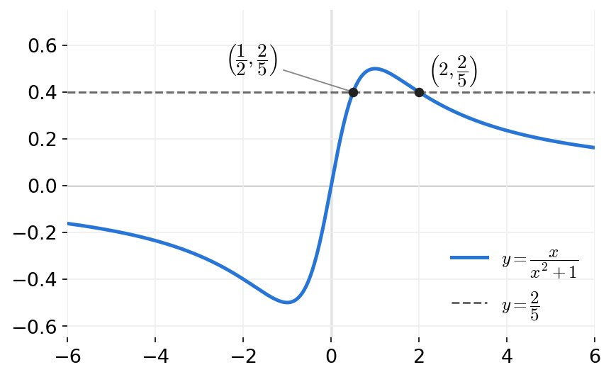
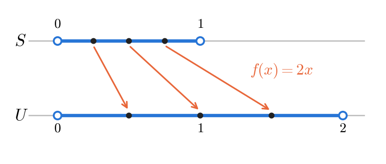

# HW7 Assignment Explanation — Functions and Cardinality

[Repository Guide](../../README.md) | [English](Assignment-Explanation.md) | [한국어](Assignment-Explanation.ko.md)

> **Last Updated:** 2026-11-04
>
> Discrete Mathematics with Applications, Epp, Ch 7

> **Learning Objectives:**
> 1. Compute values of functions defined in words or by formulas, and decide whether two functions are equal by comparing their values at every element of the domain
> 2. Prove a property of logarithms using only the definition of logarithm and the definition of negative exponents
> 3. Prove or disprove that a function is one-to-one or onto, following the correct direction of each definition
> 4. Compute compositions of functions, and explain that the result can depend on the order of composition and that a function composed with its inverse is an identity function
> 5. Prove that two infinite sets have the same cardinality by constructing a one-to-one correspondence

---

## Table of Contents

- [1. Exercise 7.1.9: The Sum-of-Positive-Divisors Function](#1-exercise-719-the-sum-of-positive-divisors-function)
- [2. Exercise 7.1.15: Equality of Product Functions](#2-exercise-7115-equality-of-product-functions)
- [3. Exercise 7.1.21: The Logarithm of a Reciprocal](#3-exercise-7121-the-logarithm-of-a-reciprocal)
- [4. Exercise 7.2.10: Whether the Doubling Function Is One-to-One and Onto](#4-exercise-7210-whether-the-doubling-function-is-one-to-one-and-onto)
- [5. Exercise 7.2.16: Testing a Rational Function for One-to-One](#5-exercise-7216-testing-a-rational-function-for-one-to-one)
- [6. Exercise 7.2.41: Onto Functions and the Image of an Inverse Image](#6-exercise-7241-onto-functions-and-the-image-of-an-inverse-image)
- [7. Exercise 7.3.7: Composing the Squaring Function and the mod 5 Function](#7-exercise-737-composing-the-squaring-function-and-the-mod-5-function)
- [8. Exercise 7.3.10: Composing the Doubling Function and the Floor Function](#8-exercise-7310-composing-the-doubling-function-and-the-floor-function)
- [9. Exercise 7.3.17: Composing a Function with Its Inverse](#9-exercise-7317-composing-a-function-with-its-inverse)
- [10. Exercise 7.4.3: The Cardinality of the Integers and the Multiples of 3](#10-exercise-743-the-cardinality-of-the-integers-and-the-multiples-of-3)
- [11. Exercise 7.4.10: The Cardinality of Two Open Intervals](#11-exercise-7410-the-cardinality-of-two-open-intervals)
- [Summary](#summary)
- [Self-Check Questions](#self-check-questions)

---

 

## 1. Exercise 7.1.9: The Sum-of-Positive-Divisors Function

**Problem.** The function $S: \mathbf{Z}^{+} \to \mathbf{Z}^{+}$ assigns to each positive integer the sum of its positive divisors. Compute $S(1)$, $S(15)$, $S(17)$, $S(5)$, $S(18)$, and $S(21)$.

**Concepts used.** As defined in [Chapter 7, Section 1](../../Lecture-Notes/Ch07_Properties-of-Functions/Concepts_Lecture.md), a function is a rule that assigns to each element of the domain exactly one element of the co-domain. Here the rule is given in words rather than by a formula, so the values are computed by following the rule literally. A positive integer $d$ divides $n$ ($d \mid n$) when there is an integer $k$ with $n = dk$ (Chapter 4).

**Solution.** The positive divisors of $n$ are the integers from $1$ to $n$ that divide $n$. If $d$ is a divisor, so is $n/d$, so divisors come in pairs $d$ and $n/d$. Hence it suffices to find the divisors $d \le \sqrt{n}$ and attach their partners, and no divisor is missed. For example, the divisors of $18$ that are at most $\sqrt{18} \approx 4.24$ are $1, 2, 3$, and their partners are $18, 9, 6$.

| $n$ | Positive divisors | $S(n)$ |
|:---:|:-----|:---:|
| 1 | 1 | 1 |
| 15 | 1, 3, 5, 15 | 24 |
| 17 | 1, 17 | 18 |
| 5 | 1, 5 | 6 |
| 18 | 1, 2, 3, 6, 9, 18 | 39 |
| 21 | 1, 3, 7, 21 | 32 |

*Table 1. The positive divisors of each n and their sum*

Therefore $S(1) = 1$, $S(15) = 24$, $S(17) = 18$, $S(5) = 6$, $S(18) = 39$, and $S(21) = 32$.

The positive divisors of a prime $p$ are only $1$ and $p$, so $S(p) = p + 1$; $S(17) = 18$ and $S(5) = 6$ are examples. Conversely, if $S(n) = n + 1$, then $n \neq 1$ (because $S(1) = 1$), and $n$ has no divisors other than $1$ and $n$, so $n$ is prime. Thus for a positive integer $n$, $S(n) = n + 1$ if and only if $n$ is prime.

---

 

## 2. Exercise 7.1.15: Equality of Product Functions

**Problem.** For functions $F$ and $G$ from the reals to the reals, the product function is defined pointwise by $(F \cdot G)(x) = F(x) \cdot G(x)$, and $G \cdot F$ is defined in the same way. Decide, with reasons, whether $F \cdot G$ and $G \cdot F$ are the same function.

**Concepts used.** By Theorem 7.1.1, two functions $F$ and $G$ with the same domain and co-domain are equal if and only if $F(x) = G(x)$ for every element $x$ of the domain. A value of a product function is a product of two real numbers, so the commutative law of real multiplication $ab = ba$ applies.

**Solution.** $F \cdot G = G \cdot F$. The step-by-step reasons are as follows.

1. Both $F \cdot G$ and $G \cdot F$ are functions from $\mathbf{R}$ to $\mathbf{R}$, so they have the same domain and co-domain. Hence Theorem 7.1.1 applies.
2. Take any real number $x$. Since $F$ and $G$ are functions into $\mathbf{R}$, $F(x)$ and $G(x)$ are real numbers.
3. Applying the definition of the product function, the commutative law of real multiplication, and the definition of the product function again gives the following equalities.

$$
(F \cdot G)(x) = F(x) \cdot G(x) = G(x) \cdot F(x) = (G \cdot F)(x)
$$

Since $x$ was an arbitrary real number, the two functions take the same value at every real number $x$. By Theorem 7.1.1, $F \cdot G = G \cdot F$.

> **Note:** This conclusion holds because multiplication of values is commutative. Composition of functions does not multiply values; it feeds the output of one function into another, so in general it is not commutative, as Exercises 7.3.7 and 7.3.10 show.

---

 

## 3. Exercise 7.1.21: The Logarithm of a Reciprocal

**Problem.** Using only the definition $b^{-x} = \frac{1}{b^x}$ of a negative exponent and the definition of logarithm, show that the following identity always holds for a positive real number $b$ with $b \neq 1$ and a positive real number $u$.

$$
\log_b\left(\frac{1}{u}\right) = -\log_b(u)
$$

**Concepts used.** The logarithmic function of Chapter 7, Section 1 (Example 7.1.8) follows the definition below. The key to the proof is to name the unknown logarithm with a variable and to move between exponential form and logarithmic form using this definition.

> **Definition:** For a positive real number $b$ with $b \neq 1$ and a positive real number $x$, the **logarithm with base $b$ of $x$**, $\log_b x$, is the exponent to which $b$ must be raised to obtain $x$. That is, for every real number $y$, $\log_b x = y \iff b^y = x$.

**Solution.** The proof proceeds in the following order.

1. Take any positive real number $b$ with $b \neq 1$ and any positive real number $u$. Since $u > 0$, $\frac{1}{u}$ is also a positive real number, so both $\log_b(u)$ and $\log_b\left(\frac{1}{u}\right)$ are defined.
2. Let $v = \log_b(u)$. By the definition of logarithm, $b^v = u$.
3. Since $u \neq 0$, reciprocals of both sides may be taken, which gives $\frac{1}{b^v} = \frac{1}{u}$.
4. Substituting $x = v$ into the given definition yields $b^{-v} = \frac{1}{b^v}$. Combined with step 3, $b^{-v} = \frac{1}{u}$.
5. Apply the definition of logarithm in the reverse direction. Since $-v$ is a real number and $b^{-v} = \frac{1}{u}$, $\log_b\left(\frac{1}{u}\right) = -v$.
6. Since $v = \log_b(u)$, $\log_b\left(\frac{1}{u}\right) = -\log_b(u)$.

Since $b$ and $u$ were arbitrary numbers satisfying the conditions, the proof is complete. For example, with $b = 2$ and $u = 8$, $\log_2 8 = 3$ and $2^{-3} = \frac{1}{8}$, so $\log_2 \frac{1}{8} = -3$, in agreement with the identity.

> **Key Point:** An identity about logarithms is usually proved in three steps: name the logarithm $v$ and rewrite it in exponential form $b^v = u$, apply a property of exponents, and convert back to logarithmic form. Starting with $v = \log_b\left(\frac{1}{u}\right)$ instead leads to a proof with the same three steps.

---

 

## 4. Exercise 7.2.10: Whether the Doubling Function Is One-to-One and Onto

**Problem.** (a) For the doubling function $f: \mathbf{Z} \to \mathbf{Z}$, $f(n) = 2n$, prove or refute with a counterexample that $f$ is (i) one-to-one and (ii) onto. (b) Answer the onto question in the same way for the function $h: \mathbf{Z} \to 2\mathbf{Z}$, $h(n) = 2n$, whose co-domain is the set $2\mathbf{Z} = \lbrace n \in \mathbf{Z} \mid n = 2k \text{ for some integer } k \rbrace$ of all even integers.

**Concepts used.** The two definitions of Chapter 7, Section 2 and their negations are used. Writing the definitions with quantifiers makes clear what a proof assumes and what it must show.

> **Definition:** A function $F: X \to Y$ is **one-to-one** if for all elements $x_1$ and $x_2$ of $X$, $F(x_1) = F(x_2)$ implies $x_1 = x_2$. $F$ is **onto** if for every element $y$ of $Y$ there exists an element $x$ of $X$ such that $F(x) = y$.

The negations fix the form of a counterexample. $F$ is not one-to-one when there exist elements $x_1$ and $x_2$ of $X$ with $F(x_1) = F(x_2)$ and $x_1 \neq x_2$, and $F$ is not onto when there exists an element $y$ of $Y$ such that $F(x) \neq y$ for every $x \in X$.

**Solution (a)(i).** $f$ is one-to-one.

1. Suppose integers $n_1$ and $n_2$ satisfy $f(n_1) = f(n_2)$. [It must be shown that $n_1 = n_2$.]
2. By the definition of $f$, $2n_1 = 2n_2$.
3. Dividing both sides by $2$ gives $n_1 = n_2$.

Therefore $f$ is one-to-one.

> **Caution:** A proof that a function is one-to-one must **assume equal outputs and conclude equal inputs**. Showing that "$n_1 = n_2$ implies $2n_1 = 2n_2$" only confirms that equal inputs have equal outputs, that is, that $f$ is a function. This direction holds for every function and says nothing about being one-to-one. For example, the constant function $g(n) = 0$ satisfies "$n_1 = n_2$ implies $g(n_1) = g(n_2)$", yet it is not one-to-one.

**Solution (a)(ii).** $f$ is not onto. A counterexample is the element $1$ of the co-domain $\mathbf{Z}$.

1. If there were an integer $n$ with $f(n) = 1$, then $2n = 1$, so $n$ would have to be $\frac{1}{2}$.
2. $\frac{1}{2}$ is not an integer, so it is not in the domain $\mathbf{Z}$. Hence no integer $n$ satisfies $f(n) = 1$.
3. The element $1$ of the co-domain is not the image of any integer, so $f$ is not onto.

In fact, the range of $f$ is the set $2\mathbf{Z}$ of all even integers, and no odd integer in the co-domain $\mathbf{Z}$ is the image of an integer.

> **Caution:** The counterexample to being onto is **an element of the co-domain**. Here the counterexample is $1$; the number $\frac{1}{2}$ obtained by solving $2n = 1$ is not the counterexample but the result of a computation confirming that no input in the domain goes to that element.

**Solution (b).** $h$ is onto.

1. Take any element $m$ of $2\mathbf{Z}$. [An integer $n$ with $h(n) = m$ must be found.]
2. By the definition of $2\mathbf{Z}$, there is an integer $k$ with $m = 2k$.
3. Let $n = k$. Then $n$ is an integer, so it is in the domain $\mathbf{Z}$, and $h(n) = 2k = m$.

Therefore every element of $2\mathbf{Z}$ is the image under $h$ of some integer, so $h$ is onto.

$f$ and $h$ have the same rule and differ only in the co-domain. Being onto depends on the co-domain, so $h$, whose co-domain is cut down to the range $2\mathbf{Z}$, is onto. The argument of (a)(i) also shows that $h$ is one-to-one, so $h$ is a one-to-one correspondence from $\mathbf{Z}$ to $2\mathbf{Z}$. This fact is used in Example 7.4.1 to show that $\mathbf{Z}$ and $2\mathbf{Z}$ have the same cardinality.

---

 

## 5. Exercise 7.2.16: Testing a Rational Function for One-to-One

**Problem.** Decide, with justification, whether the function $f(x) = \frac{x}{x^2 + 1}$, defined for every real number $x$, is one-to-one.

**Concepts used.** By the negation of the definition of one-to-one, to show that $f$ is not one-to-one it suffices to exhibit real numbers $x_1$ and $x_2$ with $f(x_1) = f(x_2)$ and $x_1 \neq x_2$. Candidates can be found systematically by simplifying the equation $f(x_1) = f(x_2)$. The denominator $x^2 + 1$ is at least $1$ for every real $x$, so $f$ is defined at every real number.

**Solution.** $f$ is not one-to-one.

**Step 1: simplify the condition.** Let real numbers $x_1$ and $x_2$ satisfy $f(x_1) = f(x_2)$ and simplify. Both denominators are positive, so multiplying both sides by them preserves equivalence.

$$
\begin{aligned}
\frac{x_1}{x_1^2 + 1} = \frac{x_2}{x_2^2 + 1}
&\iff x_1(x_2^2 + 1) = x_2(x_1^2 + 1) \\
&\iff x_1 x_2^2 + x_1 - x_1^2 x_2 - x_2 = 0 \\
&\iff x_1 x_2 (x_2 - x_1) - (x_2 - x_1) = 0 \\
&\iff (x_2 - x_1)(x_1 x_2 - 1) = 0
\end{aligned}
$$

**Step 2: interpret.** A product of two real numbers is $0$, so $x_2 - x_1 = 0$ or $x_1 x_2 - 1 = 0$. Hence $f(x_1) = f(x_2)$ holds not only when $x_1 = x_2$ but also when $x_1 x_2 = 1$. Choose $x_1 = 2$ and $x_2 = \frac{1}{2}$ as a pair with $x_1 x_2 = 1$ and $x_1 \neq x_2$.

**Step 3: check the counterexample.** Compute both values directly.

$$
f(2) = \frac{2}{2^2 + 1} = \frac{2}{5}, \qquad f\left(\frac{1}{2}\right) = \frac{\frac{1}{2}}{\frac{1}{4} + 1} = \frac{\frac{1}{2}}{\frac{5}{4}} = \frac{1}{2} \cdot \frac{4}{5} = \frac{2}{5}
$$

Since $2 \neq \frac{1}{2}$ but $f(2) = f\left(\frac{1}{2}\right)$, $f$ is not one-to-one.

*Figure 1. Graph of the function x/(x² + 1) and the horizontal line y = 2/5 meeting it at two points*

Graphically, a function from the reals to the reals is one-to-one if and only if every horizontal line meets its graph in at most one point. In Figure 1 the horizontal line $y = \frac{2}{5}$ meets the graph at the two points $x = \frac{1}{2}$ and $x = 2$. In general, the following holds for every nonzero real number $x$, so every $x$ with $x \neq \pm 1$ and $x \neq 0$ shares its value with the different number $\frac{1}{x}$.

$$
f\left(\frac{1}{x}\right) = \frac{\frac{1}{x}}{\frac{1}{x^2} + 1} = \frac{\frac{1}{x}}{\frac{1 + x^2}{x^2}} = \frac{x^2}{x(1 + x^2)} = \frac{x}{x^2 + 1} = f(x)
$$

---

 

## 6. Exercise 7.2.41: Onto Functions and the Image of an Inverse Image

**Problem.** Show that an onto function $F: X \to Y$ satisfies $F(F^{-1}(B)) = B$ for every subset $B$ of $Y$.

**Concepts used.** The image and inverse image of a set defined in Chapter 7, Section 1 are used, together with set equality: two sets are equal when each is a subset of the other (the element argument of Chapter 6).

> **Definition:** If $F: X \to Y$ is a function and $A \subseteq X$, $C \subseteq Y$, the **image of $A$** is $F(A) = \lbrace y \in Y \mid y = F(x) \text{ for some } x \in A \rbrace$, and the **inverse image of $C$** is $F^{-1}(C) = \lbrace x \in X \mid F(x) \in C \rbrace$.

> **Caution:** Here $F^{-1}(B)$ is the inverse image of the set $B$; it does not mean that $F$ has an inverse function. Inverse images are defined for every function, including functions that are not one-to-one correspondences.

**Solution.** To show that the two sets are equal, the two inclusions are proved in turn.

**(1) Proof of $F(F^{-1}(B)) \subseteq B$.**

1. Suppose $y \in F(F^{-1}(B))$. [It must be shown that $y \in B$.]
2. By the definition of image, there is an element $x \in F^{-1}(B)$ with $y = F(x)$.
3. By the definition of inverse image, $x \in F^{-1}(B)$ means $F(x) \in B$.
4. Hence $y = F(x) \in B$.

This direction does not use the hypothesis that $F$ is onto, so it holds for every function.

**(2) Proof of $B \subseteq F(F^{-1}(B))$.**

1. Suppose $y \in B$. [It must be shown that $y \in F(F^{-1}(B))$.]
2. Since $B \subseteq Y$, $y \in Y$. Since $F$ is onto, there is an element $x \in X$ with $F(x) = y$.
3. Since $F(x) = y \in B$, the definition of inverse image gives $x \in F^{-1}(B)$.
4. Since $x \in F^{-1}(B)$ and $y = F(x)$, the definition of image gives $y \in F(F^{-1}(B))$.

By (1) and (2), $F(F^{-1}(B)) = B$.

> **Note:** The hypothesis that $F$ is onto is used only in step 2 of (2), and without it the equality can fail. For example, let $X = \lbrace 1 \rbrace$, $Y = \lbrace a, b \rbrace$, and $F(1) = a$. Then $F$ is not onto, and for $B = \lbrace b \rbrace$, $F^{-1}(B) = \emptyset$, so $F(F^{-1}(B)) = \emptyset \neq B$.

---

 

## 7. Exercise 7.3.7: Composing the Squaring Function and the mod 5 Function

**Problem.** For the functions $L(a) = a^2$ and $M(a) = a \bmod 5$ from $\mathbf{Z}$ to $\mathbf{Z}$, (a) compute $(L \circ M)(12)$, $(M \circ L)(12)$, $(L \circ M)(9)$, and $(M \circ L)(9)$, and (b) decide whether $L \circ M$ and $M \circ L$ are the same function.

**Concepts used.** Composition in Chapter 7, Section 3 is defined as follows. If $f: X \to Y'$ and $g: Y \to Z$ are functions and the range of $f$ is a subset of $Y$, then the **composition** $g \circ f: X \to Z$ of $f$ and $g$ is given by $(g \circ f)(x) = g(f(x))$ for every $x \in X$. The function written on the right, $f$, is applied first. $a \bmod 5$ is the nonnegative remainder when $a$ is divided by $5$ (the quotient-remainder theorem of Chapter 4).

**Solution (a).** Compute the inner function first and feed its value into the outer function.

- $(L \circ M)(12) = L(M(12)) = L(2) = 2^2 = 4$. Since $12 = 5 \cdot 2 + 2$, $M(12) = 2$.
- $(M \circ L)(12) = M(L(12)) = M(144) = 4$, because $144 = 5 \cdot 28 + 4$.
- $(L \circ M)(9) = L(M(9)) = L(4) = 4^2 = 16$. Since $9 = 5 \cdot 1 + 4$, $M(9) = 4$.
- $(M \circ L)(9) = M(L(9)) = M(81) = 1$, because $81 = 5 \cdot 16 + 1$.

**Solution (b).** $L \circ M \neq M \circ L$. Both compositions are functions from $\mathbf{Z}$ to $\mathbf{Z}$, so by Theorem 7.1.1 they are equal only if they agree at every integer. But $(L \circ M)(9) = 16 \neq 1 = (M \circ L)(9)$, so the two functions are not equal.

| $a$ | $M(a)$ | $(L \circ M)(a)$ | $L(a)$ | $(M \circ L)(a)$ |
|:---:|:---:|:---:|:---:|:---:|
| 0 | 0 | 0 | 0 | 0 |
| 1 | 1 | 1 | 1 | 1 |
| 2 | 2 | 4 | 4 | 4 |
| 3 | 3 | 9 | 9 | 4 |
| 4 | 4 | 16 | 16 | 1 |
| 5 | 0 | 0 | 25 | 0 |
| 6 | 1 | 1 | 36 | 1 |
| 7 | 2 | 4 | 49 | 4 |
| 8 | 3 | 9 | 64 | 4 |
| 9 | 4 | 16 | 81 | 1 |

*Table 2. Values of the two compositions at a = 0, 1, ..., 9*

Table 2 shows that the values of $L \circ M$ are among $0, 1, 4, 9, 16$, while the values of $M \circ L$ are remainders upon division by $5$ and so are among $0, 1, 4$. Since $(M \circ L)(a)$ equals the remainder of $(L \circ M)(a)$ upon division by $5$, the two values agree when $a \bmod 5$ is $0$, $1$, or $2$ and differ when it is $3$ or $4$. Because $12 \bmod 5 = 2$, the two values at $12$ in part (a) were equal.

> **Caution:** Two functions that agree at one or two inputs need not be equal. At $12$ both compositions take the value $4$, but equality of functions requires equal values at **every** element of the domain. Conversely, a single input with different values suffices to show that two functions are not equal.

---

 

## 8. Exercise 7.3.10: Composing the Doubling Function and the Floor Function

**Problem.** For the functions $F(n) = 2n$ and $G(n) = \lfloor n/2 \rfloor$ from $\mathbf{Z}$ to $\mathbf{Z}$, (a) compute $(G \circ F)(8)$, $(F \circ G)(8)$, $(G \circ F)(3)$, and $(F \circ G)(3)$, and (b) decide whether $G \circ F$ and $F \circ G$ are equal, with an explanation.

**Concepts used.** Composition from Chapter 7, Section 3 and the floor function from Chapter 4 are used. The floor $\lfloor x \rfloor$ of a real number $x$ is the largest integer that is less than or equal to $x$. By Theorem 4.6.2, for an integer $n$, $\lfloor n/2 \rfloor = n/2$ if $n$ is even and $\lfloor n/2 \rfloor = (n - 1)/2$ if $n$ is odd.

**Solution (a).** Compute the inner function first.

- $(G \circ F)(8) = G(F(8)) = G(16) = \lfloor 16/2 \rfloor = 8$.
- $(F \circ G)(8) = F(G(8)) = F(\lfloor 8/2 \rfloor) = F(4) = 8$.
- $(G \circ F)(3) = G(F(3)) = G(6) = \lfloor 6/2 \rfloor = 3$.
- $(F \circ G)(3) = F(G(3)) = F(\lfloor 1.5 \rfloor) = F(1) = 2$.

**Solution (b).** $G \circ F \neq F \circ G$. Since $(G \circ F)(3) = 3 \neq 2 = (F \circ G)(3)$, the two functions differ at the integer $3$.

Writing the two compositions as general formulas reveals the difference. For every integer $n$, $(G \circ F)(n) = \lfloor 2n/2 \rfloor = \lfloor n \rfloor = n$, so $G \circ F$ is the identity function $I_{\mathbf{Z}}$ on $\mathbf{Z}$. In contrast, $(F \circ G)(n) = 2\lfloor n/2 \rfloor$ equals $n$ if $n$ is even and $n - 1$ if $n$ is odd.

| $n$ | $-3$ | $-2$ | $-1$ | $0$ | $1$ | $2$ | $3$ | $4$ |
|:---|:---:|:---:|:---:|:---:|:---:|:---:|:---:|:---:|
| $(G \circ F)(n)$ | $-3$ | $-2$ | $-1$ | $0$ | $1$ | $2$ | $3$ | $4$ |
| $(F \circ G)(n)$ | $-4$ | $-2$ | $-2$ | $0$ | $0$ | $2$ | $2$ | $4$ |

*Table 3. Values of the two compositions at n = -3, ..., 4*

The same rule holds for negative odd integers. For example, $\lfloor -3/2 \rfloor = \lfloor -1.5 \rfloor = -2$, so $(F \circ G)(-3) = -4 = -3 - 1$. When $F$ is applied first, $n$ can be recovered exactly from $2n$; when $G$ is applied first, the remainder $1$ of an odd integer divided by $2$ is discarded, so $F$ cannot restore the original value.

---

 

## 9. Exercise 7.3.17: Composing a Function with Its Inverse

**Problem.** Prove part (b) of Theorem 7.3.2: for a one-to-one correspondence $f: X \to Y$ with inverse function $f^{-1}: Y \to X$, the composition $f \circ f^{-1}$ equals the identity function $I_Y$ on $Y$.

**Concepts used.** The following three facts are used.

- The **identity function** $I_Y: Y \to Y$ satisfies $I_Y(y) = y$ for every $y \in Y$.
- By Theorem 7.2.2, if $f$ is a one-to-one correspondence, then for each $y \in Y$ there is exactly one $x \in X$ with $f(x) = y$: such an $x$ exists because $f$ is onto, and it is unique because $f$ is one-to-one. The **inverse function** $f^{-1}$ sends $y$ to that $x$. That is, $f^{-1}(y) = x \iff y = f(x)$.
- By Theorem 7.1.1, two functions with the same domain and co-domain are equal when they agree at every element.

**Solution.** The proof proceeds in the following order.

1. The composition $f \circ f^{-1}$ of $f^{-1}: Y \to X$ and $f: X \to Y$ is a function from $Y$ to $Y$, and $I_Y$ is also a function from $Y$ to $Y$. Hence it suffices to show that $(f \circ f^{-1})(y) = y$ for every $y \in Y$.
2. Take any element $y$ of $Y$. By the definition of composition, $(f \circ f^{-1})(y) = f(f^{-1}(y))$.
3. Let $x = f^{-1}(y)$. By the definition of inverse function, $x$ is the element of $X$ with $f(x) = y$.
4. Therefore $(f \circ f^{-1})(y) = f(f^{-1}(y)) = f(x) = y = I_Y(y)$.

Since $y$ was an arbitrary element of $Y$, Theorem 7.1.1 gives $f \circ f^{-1} = I_Y$.

> **Note:** The proof of Theorem 7.3.2(a), $f^{-1} \circ f = I_X$, goes in the opposite direction. For $x \in X$, let $z = f^{-1}(f(x))$; by the definition of inverse function $f(z) = f(x)$, and since $f$ is one-to-one, $z = x$. Part (a) relies decisively on being one-to-one, while part (b) relies on the definition of the inverse function, namely that $f^{-1}(y)$ is an element with $f(x) = y$, whose existence is guaranteed by being onto.

---

 

## 10. Exercise 7.4.3: The Cardinality of the Integers and the Multiples of 3

**Problem.** Show that the set $3\mathbf{Z} = \lbrace n \in \mathbf{Z} \mid n = 3k \text{ for some integer } k \rbrace$ of all multiples of 3 has the same cardinality as $\mathbf{Z}$.

**Concepts used.** As defined in Chapter 7, Section 4, sets $A$ and $B$ have the same **cardinality** if there is a **one-to-one correspondence** from $A$ to $B$, that is, a function that is both one-to-one and onto. Hence the proof has three parts: (1) check that the rule actually defines a function from $\mathbf{Z}$ to $3\mathbf{Z}$, and show that it is (2) one-to-one and (3) onto.

**Solution.** Define $g: \mathbf{Z} \to 3\mathbf{Z}$ by $g(n) = 3n$ for every integer $n$.

1. **It is a function.** For an integer $n$, $3n$ has the form $3k$ with $k = n$, so $3n \in 3\mathbf{Z}$. Hence $g$ is a function sending each integer to one element of $3\mathbf{Z}$.
2. **One-to-one.** Suppose integers $n_1$ and $n_2$ satisfy $g(n_1) = g(n_2)$. Then $3n_1 = 3n_2$, and dividing both sides by $3$ gives $n_1 = n_2$.
3. **Onto.** Take any element $m$ of $3\mathbf{Z}$; then there is an integer $k$ with $m = 3k$. The integer $k$ is in the domain $\mathbf{Z}$, and $g(k) = 3k = m$.

Therefore $g$ is a one-to-one correspondence from $\mathbf{Z}$ to $3\mathbf{Z}$, and $\mathbf{Z}$ and $3\mathbf{Z}$ have the same cardinality.

Since $3\mathbf{Z}$ is a proper subset of $\mathbf{Z}$, this is something that happens for infinite sets but can never happen for finite sets. Example 7.4.1 shows the same phenomenon for $2\mathbf{Z}$, and the same method shows that $\mathbf{Z}$ and $d\mathbf{Z}$ have the same cardinality for every positive integer $d$.

---

 

## 11. Exercise 7.4.10: The Cardinality of Two Open Intervals

**Problem.** Show that the open intervals $S = \lbrace x \in \mathbf{R} \mid 0 < x < 1 \rbrace$ and $U = \lbrace x \in \mathbf{R} \mid 0 < x < 2 \rbrace$ have the same cardinality.

**Concepts used.** As in Exercise 7.4.3, construct one one-to-one correspondence and check its three parts. With real numbers, inequalities must confirm that each element of the domain goes into the co-domain and that the input chosen in the onto argument lies in the domain.

**Solution.** Define $f: S \to U$ by $f(x) = 2x$ for every $x \in S$.

1. **It is a function.** If $x \in S$, then $0 < x < 1$. Multiplying each part by the positive number $2$ preserves the inequalities, so $0 < 2x < 2$ and $f(x) = 2x \in U$.
2. **One-to-one.** Suppose $x_1, x_2 \in S$ satisfy $f(x_1) = f(x_2)$. Then $2x_1 = 2x_2$, and dividing both sides by $2$ gives $x_1 = x_2$.
3. **Onto.** Take any element $y$ of $U$, so $0 < y < 2$. Let $x = \frac{y}{2}$. Dividing each part by $2$ gives $0 < x < 1$, so $x \in S$, and $f(x) = 2 \cdot \frac{y}{2} = y$.

Therefore $f$ is a one-to-one correspondence from $S$ to $U$, and $S$ and $U$ have the same cardinality.

*Figure 2. How f(x) = 2x sends points of the interval (0, 1) to points of the interval (0, 2)*

> **Caution:** In the one-to-one part, showing that "$x_1 = x_2$ implies $2x_1 = 2x_2$" is not a proof. That only says $f$ is a function; what must be assumed is $f(x_1) = f(x_2)$, and what must be derived is $x_1 = x_2$. In the onto part, besides computing $f\left(\frac{y}{2}\right) = y$, one must check that $\frac{y}{2}$ lies in the domain $S$.

As Figure 2 shows, $f$ stretches the interval to twice its length, yet it neither loses nor adds any points. In the same way, for $a < b$ and $c < d$, the linear function $x \mapsto c + \frac{d - c}{b - a}(x - a)$ is a one-to-one correspondence between the open intervals $(a, b)$ and $(c, d)$, so all open intervals have the same cardinality regardless of their lengths.

---

 

## Summary

| Concept | Key Summary |
|:-----|:-----|
| Equality of functions | Two functions with the same domain and co-domain are equal if and only if they take the same value at every element of the domain. |
| Definition of logarithm | $\log_b x = y \iff b^y = x$, and logarithm identities are proved by naming the logarithm with a variable and rewriting it in exponential form. |
| Proving one-to-one | Assume $F(x_1) = F(x_2)$ and derive $x_1 = x_2$; the reverse direction does not constitute a proof. |
| Disproving one-to-one | Exhibit two elements with $x_1 \neq x_2$ and $F(x_1) = F(x_2)$. |
| Proving onto | For an arbitrary element $y$ of the co-domain, find $x$ with $F(x) = y$ and check that this $x$ lies in the domain. |
| Disproving onto | Exhibit one element of the co-domain that is not the image of any element of the domain. |
| Image of an inverse image | $F(F^{-1}(B)) \subseteq B$ holds for every function, and if $F$ is onto, then $F(F^{-1}(B)) = B$. |
| Composition | $(g \circ f)(x) = g(f(x))$ applies the right-hand function first, and in general $g \circ f \neq f \circ g$. |
| Composition with the inverse | For a one-to-one correspondence $f: X \to Y$, $f^{-1} \circ f = I_X$ and $f \circ f^{-1} = I_Y$. |
| Same cardinality | Two sets have the same cardinality once a rule between them is shown to be a function that is both one-to-one and onto. |

---

 

## Self-Check Questions

1. **Sum of divisors:** For the function $S$ of Exercise 7.1.9, find $S(28)$. A number with $S(n) = 2n$ is called a perfect number; decide whether $28$ is a perfect number.

   

   
Answer

   The positive divisors of $28$ are $1, 2, 4, 7, 14, 28$, so $S(28) = 1 + 2 + 4 + 7 + 14 + 28 = 56$. Since $56 = 2 \cdot 28$, $28$ is a perfect number.

   

2. **One-to-one and onto:** Define $g: \mathbf{Z} \to \mathbf{Z}$ by $g(n) = 3n - 1$. Decide whether $g$ is one-to-one and whether it is onto.

   

   
Answer

   It is one-to-one: if $g(n_1) = g(n_2)$, then $3n_1 - 1 = 3n_2 - 1$, so $n_1 = n_2$. It is not onto: for the element $0$ of the co-domain, $3n - 1 = 0$ would require $n = \frac{1}{3}$, which is not an integer, so $0$ is not the image of any integer.

   

3. **A different input with the same value:** For $f(x) = \frac{x}{x^2 + 1}$, find a real number other than $3$ that has the same value as $f(3)$, and check the value.

   

   
Answer

   Values agree when $x_1 x_2 = 1$, so choose $\frac{1}{3}$. Then $f(3) = \frac{3}{10}$ and $f\left(\frac{1}{3}\right) = \frac{1/3}{1/9 + 1} = \frac{1/3}{10/9} = \frac{3}{10}$.

   

4. **Images and inverse images:** Let $X = \lbrace 1, 2, 3 \rbrace$, $Y = \lbrace a, b \rbrace$, $F(1) = F(2) = a$, and $F(3) = b$. Find $F(F^{-1}(B))$ for $B = \lbrace b \rbrace$ and $F^{-1}(F(A))$ for $A = \lbrace 1 \rbrace$. Explain both results in connection with Exercise 7.2.41.

   

   
Answer

   $F^{-1}(B) = \lbrace 3 \rbrace$, so $F(F^{-1}(B)) = \lbrace b \rbrace = B$, which agrees with Exercise 7.2.41 because $F$ is onto. On the other hand, $F(A) = \lbrace a \rbrace$ and $F^{-1}(\lbrace a \rbrace) = \lbrace 1, 2 \rbrace$, so $F^{-1}(F(A)) = \lbrace 1, 2 \rbrace \neq A$. For $F^{-1}(F(A)) = A$ to hold always, $F$ must be one-to-one, and this $F$ is not one-to-one because $F(1) = F(2)$.

   

5. **Comparing compositions:** For $F(n) = 2n$ and $G(n) = \lfloor n/2 \rfloor$ of Exercise 7.3.10, find all integers $n$ with $(F \circ G)(n) = n$.

   

   
Answer

   $(F \circ G)(n) = 2\lfloor n/2 \rfloor$ equals $n$ if $n$ is even and $n - 1$ if $n$ is odd. Therefore the integers with $(F \circ G)(n) = n$ are exactly the even integers.

   

6. **Cardinality of intervals:** Show that $S = \lbrace x \in \mathbf{R} \mid 0 < x < 1 \rbrace$ and $V = \lbrace x \in \mathbf{R} \mid 2 < x < 5 \rbrace$ have the same cardinality by constructing a one-to-one correspondence.

   

   
Answer

   Define $h: S \to V$ by $h(x) = 3x + 2$. If $0 < x < 1$, then $2 < 3x + 2 < 5$, so $h(x) \in V$. If $h(x_1) = h(x_2)$, then $3x_1 + 2 = 3x_2 + 2$, so $x_1 = x_2$. For $y \in V$, let $x = \frac{y - 2}{3}$; $2 < y < 5$ gives $0 < x < 1$, so $x \in S$ and $h(x) = y$. Therefore $h$ is a one-to-one correspondence.

   

