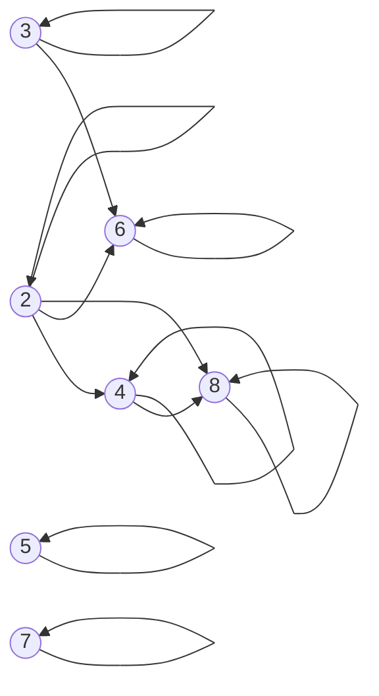
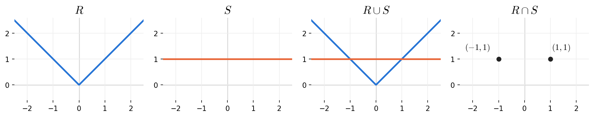
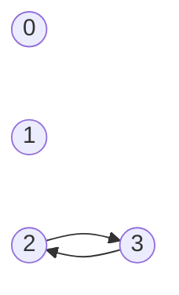
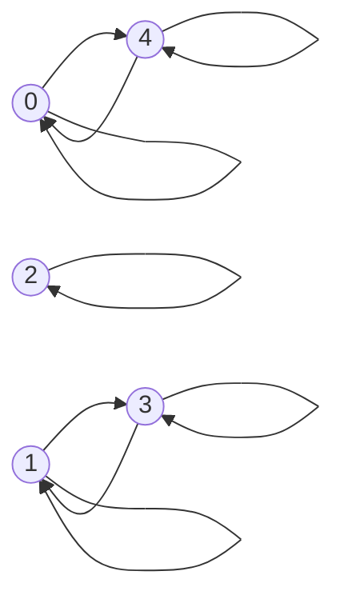

# HW8 과제 해설 — 관계와 동치 관계

[레포지토리 안내](../../README.ko.md) | [English](Assignment-Explanation.md) | [한국어](Assignment-Explanation.ko.md)

> **최종 수정일:** 2026-11-04
>
> Discrete Mathematics with Applications, Epp, Ch 8

> **학습 목표:**
> 1. 말이나 식으로 정의된 관계에서 두 원소가 관계를 갖는지 판정하고, 관계를 방향 그래프와 데카르트 평면의 그래프로 나타낼 수 있다
> 2. 관계가 반사적, 대칭적, 추이적인지 정의에 따라 증명하거나 반례로 반박할 수 있다
> 3. 반례가 문제의 모든 가정 아래에서 성립하는지 확인하고, 역관계가 추이성을 보존함을 증명할 수 있다
> 4. 동치 관계를 증명하고, 동치류를 구한 뒤 서로 다른 동치류를 중복 없이 나열할 수 있다
> 5. 법 d에 대한 합동에서 두 동치류가 같은지를 나머지로 판정할 수 있다

---

## 목차

- [1. 연습 문제 8.1.3: 법 3에 대한 합동 관계](#1-연습-문제-813-법-3에-대한-합동-관계)
- [2. 연습 문제 8.1.8: 앞 두 글자가 같은 문자열의 관계](#2-연습-문제-818-앞-두-글자가-같은-문자열의-관계)
- [3. 연습 문제 8.1.15: 나누어떨어짐 관계의 방향 그래프](#3-연습-문제-8115-나누어떨어짐-관계의-방향-그래프)
- [4. 연습 문제 8.1.23: 데카르트 평면 위의 관계와 그 합집합, 교집합](#4-연습-문제-8123-데카르트-평면-위의-관계와-그-합집합-교집합)
- [5. 연습 문제 8.2.3: 두 순서쌍으로 이루어진 관계의 성질](#5-연습-문제-823-두-순서쌍으로-이루어진-관계의-성질)
- [6. 연습 문제 8.2.11: 곱이 음이 아닌 관계](#6-연습-문제-8211-곱이-음이-아닌-관계)
- [7. 연습 문제 8.2.23: 멱집합 위의 부분집합 관계](#7-연습-문제-8223-멱집합-위의-부분집합-관계)
- [8. 연습 문제 8.2.36: 추이적 관계의 역관계](#8-연습-문제-8236-추이적-관계의-역관계)
- [9. 연습 문제 8.3.3: 순서쌍으로 주어진 동치 관계의 동치류](#9-연습-문제-833-순서쌍으로-주어진-동치-관계의-동치류)
- [10. 연습 문제 8.3.8: 원소의 개수가 같은 부분집합의 동치류](#10-연습-문제-838-원소의-개수가-같은-부분집합의-동치류)
- [11. 연습 문제 8.3.16: 법 3과 법 7에 대한 합동의 동치류](#11-연습-문제-8316-법-3과-법-7에-대한-합동의-동치류)
- [12. 연습 문제 8.3.20: 법 4에 대한 합동 관계](#12-연습-문제-8320-법-4에-대한-합동-관계)
- [요약](#요약)
- [점검 문제](#점검-문제)

---

 

## 1. 연습 문제 8.1.3: 법 3에 대한 합동 관계

**문제.** 정수 위의 관계 $T$를 $m \, T \, n \iff 3 \mid (m - n)$으로 정한다. (a) $10 \, T \, 1$, $1 \, T \, 10$, $(2, 2) \in T$, $(8, 1) \in T$가 각각 성립하는지 판정하고, (b) $n \, T \, 0$, (c) $n \, T \, 1$, (d) $n \, T \, 2$를 만족하는 정수 $n$을 각각 다섯 개씩 든다.

**사용하는 개념.** [8장 1절](../../Lecture-Notes/Ch08_Properties-of-Relations/Concepts_Lecture.ko.md)에 따르면 집합 $A$에서 집합 $B$로의 **관계(relation)** $R$은 데카르트 곱 $A \times B$의 부분집합이며, $(x, y) \in R$일 때 $x \, R \, y$라 쓴다. 이 관계 $T$는 **법 3에 대한 합동(congruence modulo 3)** 이라 불리며, $3 \mid (m - n)$은 $m - n = 3k$인 정수 $k$가 존재한다는 뜻이다(4장).

**풀이 (a).** 각 쌍의 차가 3의 배수인지 확인한다.

- $10 - 1 = 9 = 3 \cdot 3$이므로 $10 \, T \, 1$이다.
- $1 - 10 = -9 = 3 \cdot (-3)$이므로 $1 \, T \, 10$이다. 차가 음수여도 3의 정수배이면 된다.
- $2 - 2 = 0 = 3 \cdot 0$이므로 $(2, 2) \in T$이다.
- $8 - 1 = 7$이고 $7 = 3k$인 정수 $k$는 없으므로 $(8, 1) \notin T$이다.

**풀이 (b), (c), (d).** $n \, T \, r$은 $n - r = 3k$, 곧 $n = 3k + r$인 정수 $k$가 존재한다는 뜻이다. $k$에 여러 정수를 넣어 다섯 개씩 고른다.

| 조건 | 같은 뜻 | 다섯 개의 예 ($k = -2, -1, 0, 1, 2$) |
|:---|:---|:---|
| $n \, T \, 0$ | $n = 3k$ | $-6, -3, 0, 3, 6$ |
| $n \, T \, 1$ | $n = 3k + 1$ | $-5, -2, 1, 4, 7$ |
| $n \, T \, 2$ | $n = 3k + 2$ | $-4, -1, 2, 5, 8$ |

*표 1. n T 0, n T 1, n T 2를 만족하는 정수의 꼴과 예*

다섯 개의 예는 조건을 만족하기만 하면 어느 것이든 답이 된다. 예를 들어 (b)에 $0, 3, 6, 9, 12$를 써도 맞다. 몫-나머지 정리에 의해 모든 정수는 $3k$, $3k + 1$, $3k + 2$ 가운데 정확히 하나의 꼴이므로, 표 1의 세 행은 정수 전체를 겹치지 않게 나눈다. 이 사실은 8장 3절에서 $T$의 동치류가 정확히 세 개라는 결론으로 이어진다.

---

 

## 2. 연습 문제 8.1.8: 앞 두 글자가 같은 문자열의 관계

**문제.** $a$와 $b$로 만든 길이 4의 문자열 전체의 집합 $A$에서, 처음 두 글자가 같은 두 문자열을 관계 $R$로 잇는다. (a) $abaa \, R \, abba$, (b) $aabb \, R \, bbaa$, (c) $aaaa \, R \, aaab$, (d) $baaa \, R \, abaa$가 각각 성립하는지 판정한다.

**사용하는 개념.** 관계가 말로 정의되어 있으므로 두 문자열의 처음 두 글자를 각각 읽어 비교한다. 나머지 두 글자는 판정에 영향을 주지 않는다.

**풀이.**

| 문항 | $s$의 처음 두 글자 | $t$의 처음 두 글자 | $s \, R \, t$인가 |
|:---:|:---:|:---:|:---:|
| (a) $abaa$, $abba$ | $ab$ | $ab$ | 그렇다 |
| (b) $aabb$, $bbaa$ | $aa$ | $bb$ | 아니다 |
| (c) $aaaa$, $aaab$ | $aa$ | $aa$ | 그렇다 |
| (d) $baaa$, $abaa$ | $ba$ | $ab$ | 아니다 |

*표 2. 각 문항에서 두 문자열의 처음 두 글자 비교*

(d)에서 두 문자열은 $a$ 세 개와 $b$ 한 개로 이루어진 점은 같지만, 처음 두 글자를 **순서대로** 비교하면 $ba \neq ab$이므로 관계가 성립하지 않는다. 이 관계는 "처음 두 글자가 같다"는 같음에 기반하므로 반사적, 대칭적, 추이적이며, 8장 3절에서 다루는 동치 관계의 예이다. 길이 4인 문자열 16개는 처음 두 글자 $aa$, $ab$, $ba$, $bb$에 따라 네 개씩 네 동치류로 나뉜다.

---

 

## 3. 연습 문제 8.1.15: 나누어떨어짐 관계의 방향 그래프

**문제.** $A = \lbrace 2, 3, 4, 5, 6, 7, 8 \rbrace$ 위의 나누어떨어짐 관계 $x \, R \, y \iff x \mid y$를 방향 그래프로 나타낸다.

**사용하는 개념.** 8장 1절에 따르면 집합 $A$ 위의 관계는 **방향 그래프(directed graph)** 로 나타낼 수 있다. $A$의 각 원소를 꼭짓점으로 두고, $x \, R \, y$인 모든 순서쌍에 대하여 $x$에서 $y$로 화살표를 긋는다. $x \, R \, x$이면 $x$에서 자기 자신으로 돌아오는 **루프(loop)** 를 긋는다.

**풀이.** 먼저 $R$에 속하는 순서쌍을 모두 찾는다. 각 $x$에 대하여 $A$ 안에 있는 $x$의 배수를 나열하면 된다.

- 모든 $x \in A$에 대하여 $x = x \cdot 1$이므로 $x \mid x$이다. 따라서 일곱 꼭짓점 모두에 루프가 있다.
- $x = 2$: $A$ 안의 2의 배수는 $2, 4, 6, 8$이므로 $(2, 4)$, $(2, 6)$, $(2, 8)$이 있다.
- $x = 3$: $A$ 안의 3의 배수는 $3, 6$이므로 $(3, 6)$이 있다.
- $x = 4$: $A$ 안의 4의 배수는 $4, 8$이므로 $(4, 8)$이 있다.
- $x = 5, 6, 7, 8$: 두 배가 이미 8을 넘으므로 자기 자신 외의 배수가 $A$ 안에 없다.

따라서 $R$은 루프 7개와 $(2, 4)$, $(2, 6)$, $(2, 8)$, $(3, 6)$, $(4, 8)$의 다섯 순서쌍, 모두 12개의 순서쌍으로 이루어진다.

*그림 1. A = {2, 3, 4, 5, 6, 7, 8} 위의 나누어떨어짐 관계의 방향 그래프*

5와 7은 자기 자신 외의 어떤 원소와도 관계를 갖지 않으므로 루프만 있다. 화살표의 방향은 "나누는 수에서 나누어지는 수로"이다. 예를 들어 $2 \mid 4$이지만 $4 \nmid 2$이므로 $2$에서 $4$로 가는 화살표만 있고 반대 방향의 화살표는 없다.

---

 

## 4. 연습 문제 8.1.23: 데카르트 평면 위의 관계와 그 합집합, 교집합

**문제.** 실수 위의 두 관계 $R = \lbrace (x, y) \in \mathbf{R} \times \mathbf{R} \mid y = \vert x \vert \rbrace$와 $S = \lbrace (x, y) \in \mathbf{R} \times \mathbf{R} \mid y = 1 \rbrace$에 대하여 $R$, $S$, $R \cup S$, $R \cap S$를 데카르트 평면에 그린다.

**사용하는 개념.** 관계는 순서쌍의 집합이므로 $\mathbf{R}$ 위의 관계는 평면의 점의 집합으로 그릴 수 있고, 두 관계의 합집합과 교집합도 집합 연산 그대로 정의된다. $(x, y) \in R \cup S$는 $(x, y) \in R$ 또는 $(x, y) \in S$를 뜻하고, $(x, y) \in R \cap S$는 둘 다 성립함을 뜻한다.

**풀이.** 네 집합을 차례로 구한다.

1. $R$은 $y = \vert x \vert$를 만족하는 점 전체이다. $x \ge 0$이면 $y = x$, $x < 0$이면 $y = -x$이므로 원점에서 꺾이는 V자 모양의 두 반직선이다.
2. $S$는 $y = 1$인 점 전체이므로 높이 1의 수평선이다. $x$에는 아무 제약이 없다.
3. $R \cup S$는 두 그림을 겹친 것, 곧 V자와 수평선을 모두 포함한다.
4. $R \cap S$는 $y = \vert x \vert$와 $y = 1$을 동시에 만족하는 점이다. $\vert x \vert = 1$이므로 $x = 1$ 또는 $x = -1$이고, $R \cap S = \lbrace (-1, 1), (1, 1) \rbrace$이다.

*그림 2. 관계 R, S, R ∪ S, R ∩ S의 그래프*

$R \cap S$는 직선이나 곡선이 아니라 두 점으로 이루어진 유한 집합이다. 그래프를 그릴 때 교집합을 선으로 그리지 않도록 주의한다.

---

 

## 5. 연습 문제 8.2.3: 두 순서쌍으로 이루어진 관계의 성질

**문제.** $A = \lbrace 0, 1, 2, 3 \rbrace$ 위의 관계 $R_3 = \lbrace (2, 3), (3, 2) \rbrace$의 (a) 방향 그래프를 그리고, (b) 반사성, (c) 대칭성, (d) 추이성을 각각 판정한다. 성립하지 않는 성질에는 반례를 든다.

**사용하는 개념.** 8장 2절의 세 성질과 그 부정은 다음과 같다. 성질을 만족하지 않음을 보이는 반례는 각 부정의 존재 명제를 만족하는 원소이다.

> **용어 정의:** 집합 $A$ 위의 관계 $R$이 **반사적(reflexive)** 이라는 것은 모든 $x \in A$에 대하여 $x \, R \, x$라는 뜻이다. **대칭적(symmetric)** 이라는 것은 모든 $x, y \in A$에 대하여 $x \, R \, y$이면 $y \, R \, x$라는 뜻이다. **추이적(transitive)** 이라는 것은 모든 $x, y, z \in A$에 대하여 $x \, R \, y$이고 $y \, R \, z$이면 $x \, R \, z$라는 뜻이다.

| 성질 | 성질이 성립하지 않을 조건 (반례의 형태) |
|:---|:---|
| 반사적 | $(x, x) \notin R$인 $x \in A$가 존재한다 |
| 대칭적 | $(x, y) \in R$이지만 $(y, x) \notin R$인 $x, y \in A$가 존재한다 |
| 추이적 | $(x, y) \in R$, $(y, z) \in R$이지만 $(x, z) \notin R$인 $x, y, z \in A$가 존재한다 |

*표 3. 반사성, 대칭성, 추이성이 성립하지 않을 조건*

**풀이 (a).** 꼭짓점 0, 1, 2, 3을 두고 2에서 3으로, 3에서 2로 화살표를 긋는다. 0과 1은 어떤 화살표와도 연결되지 않는다.

*그림 3. 관계 R₃ = {(2, 3), (3, 2)}의 방향 그래프*

**풀이 (b).** 반사적이지 않다. $(0, 0) \notin R_3$이기 때문이다. 실제로 $R_3$에는 루프가 하나도 없으므로 0, 1, 2, 3 모두 반례가 된다.

**풀이 (c).** 대칭적이다. $R_3$의 순서쌍은 $(2, 3)$과 $(3, 2)$ 둘뿐이고, 각각을 뒤집은 $(3, 2)$와 $(2, 3)$이 모두 $R_3$에 있다. 대칭성은 $R_3$에 속한 모든 순서쌍에 대하여 확인하면 되므로 이것으로 충분하다.

**풀이 (d).** 추이적이지 않다. $x = 2$, $y = 3$, $z = 2$로 두면 $(2, 3) \in R_3$이고 $(3, 2) \in R_3$이지만 $(2, 2) \notin R_3$이다.

> **주의:** 추이성의 정의에서 $x$, $y$, $z$는 서로 다를 필요가 없다. (d)의 반례는 $x = z = 2$인 경우이다. 일반적으로 대칭적인 관계에 $(a, b)$가 있으면 $(b, a)$도 있으므로, 추이적이려면 루프 $(a, a)$와 $(b, b)$도 있어야 한다.

---

 

## 6. 연습 문제 8.2.11: 곱이 음이 아닌 관계

**문제.** 곱이 음이 아닌 두 실수를 잇는 $\mathbf{R}$ 위의 관계 $x \, D \, y \iff xy \ge 0$이 반사적, 대칭적, 추이적인지 각각 판정하고 근거를 든다.

**사용하는 개념.** 8장 2절의 세 정의와 실수의 성질(제곱은 음이 아니다, 곱셈은 교환 법칙을 만족한다)을 쓴다.

**풀이.** $D$는 반사적이고 대칭적이지만 추이적이지 않다.

**반사적이다.** $x$를 임의의 실수로 택한다. 실수의 제곱은 음이 아니므로 $x \cdot x = x^2 \ge 0$이고, $D$의 정의에 의해 $x \, D \, x$이다.

**대칭적이다.** $x$, $y$가 $x \, D \, y$인 실수라고 가정한다. 정의에 의해 $xy \ge 0$이다. 실수의 곱셈은 교환 법칙을 만족하므로 $yx = xy \ge 0$이고, 따라서 $y \, D \, x$이다.

**추이적이지 않다.** $x = 1$, $y = 0$, $z = -1$로 둔다.

- $xy = 1 \cdot 0 = 0 \ge 0$이므로 $x \, D \, y$이다.
- $yz = 0 \cdot (-1) = 0 \ge 0$이므로 $y \, D \, z$이다.
- $xz = 1 \cdot (-1) = -1 < 0$이므로 $x \, D \, z$가 아니다.

$xy \ge 0$은 $x$와 $y$ 가운데 하나가 0이거나 둘의 부호가 같다는 뜻이다. 0은 모든 실수와 관계를 가지므로 양수와 음수를 이어 주는 다리 역할을 하며, 이 때문에 추이성이 깨진다. 반례의 $y$를 0이 아닌 수로 바꾸면 추이성이 깨지지 않는다. 실제로 $D$를 0이 아닌 실수 전체의 집합으로 제한하면 $x \, D \, y$는 "$x$와 $y$의 부호가 같다"와 같아져 추이적이 되고, 양수 전체와 음수 전체를 두 동치류로 갖는 동치 관계가 된다.

---

 

## 7. 연습 문제 8.2.23: 멱집합 위의 부분집합 관계

**문제.** 공집합이 아닌 집합 $X$의 멱집합 $\mathcal{P}(X)$ 위에서 부분집합 관계 $A \, \mathbf{S} \, B \iff A \subseteq B$가 반사적, 대칭적, 추이적인지 판정한다.

**사용하는 개념.** 6장의 부분집합의 정의($A \subseteq B$는 $A$의 모든 원소가 $B$의 원소라는 뜻)와 정리 6.2.1의 부분집합의 추이성을 쓴다. **멱집합(power set)** $\mathcal{P}(X)$는 $X$의 부분집합 전체의 집합이며, $\emptyset$과 $X$ 자신을 항상 원소로 갖는다.

**풀이.** $\mathbf{S}$는 반사적이고 추이적이지만 대칭적이지 않다.

**반사적이다.** $A \in \mathcal{P}(X)$이면 $A$의 모든 원소는 $A$의 원소이므로 $A \subseteq A$이고, 따라서 $A \, \mathbf{S} \, A$이다.

**대칭적이지 않다.** $A = \emptyset$, $B = X$로 둔다.

1. 두 집합은 모두 $X$의 부분집합이므로 $\mathcal{P}(X)$의 원소이다.
2. 공집합은 모든 집합의 부분집합이므로(정리 6.2.4) $\emptyset \subseteq X$, 곧 $A \, \mathbf{S} \, B$이다.
3. $X$는 공집합이 아니므로 어떤 원소 $x \in X$가 있고, $x \notin \emptyset$이다. 따라서 $X \not\subseteq \emptyset$, 곧 $B \, \mathbf{S} \, A$가 아니다.

**추이적이다.** $A, B, C \in \mathcal{P}(X)$가 $A \, \mathbf{S} \, B$이고 $B \, \mathbf{S} \, C$라고 가정한다. 그러면 $A \subseteq B$이고 $B \subseteq C$이므로 정리 6.2.1의 부분집합의 추이성에 의해 $A \subseteq C$, 곧 $A \, \mathbf{S} \, C$이다.

> **주의:** 대칭성의 반례는 문제의 가정을 만족하는 **모든** $X$에서 쓸 수 있어야 한다. 가정은 "$X$가 공집합이 아니다"뿐이므로 $X$가 원소를 하나만 가질 수도 있다. 예를 들어 $X = \lbrace a \rbrace$이면 $\mathcal{P}(X) = \lbrace \emptyset, \lbrace a \rbrace \rbrace$이므로 $\lbrace a \rbrace \subseteq \lbrace a, b \rbrace$ 같은 반례는 $\mathcal{P}(X)$ 안에 존재하지 않는다. 반면 $\emptyset$과 $X$는 어떤 $X$에 대해서도 $\mathcal{P}(X)$의 원소이다.

가정 "$X$는 공집합이 아니다"는 대칭성의 반례에서만 쓰인다. $X = \emptyset$이면 $\mathcal{P}(X) = \lbrace \emptyset \rbrace$이고 $\mathbf{S} = \lbrace (\emptyset, \emptyset) \rbrace$이므로 $\mathbf{S}$는 대칭적이 된다. 한편 $A \subseteq B$이고 $B \subseteq A$이면 $A = B$이므로 $\mathbf{S}$는 반대칭적이며, 반사적이고 추이적이므로 8장 4절(교재 8.5절)에서 다루는 부분 순서 관계이다.

---

 

## 8. 연습 문제 8.2.36: 추이적 관계의 역관계

**문제.** 집합 $A$ 위의 추이적인 관계 $R$의 역관계 $R^{-1}$이 항상 추이적인지 증명하거나 반례로 반박한다.

**사용하는 개념.** 8장 1절의 **역관계(inverse relation)** 는 $R$의 순서쌍을 모두 뒤집은 관계이다. 곧 $R^{-1} = \lbrace (y, x) \in A \times A \mid (x, y) \in R \rbrace$이며, 모든 $x, y \in A$에 대하여 $x \, R^{-1} \, y \iff y \, R \, x$이다.

**풀이.** $R^{-1}$은 항상 추이적이다.

1. $R$이 추이적이라 가정한다. $x, y, z \in A$가 $x \, R^{-1} \, y$이고 $y \, R^{-1} \, z$를 만족한다고 가정한다. [$x \, R^{-1} \, z$임을 보여야 한다.]
2. 역관계의 정의에 의해 $x \, R^{-1} \, y$는 $y \, R \, x$를, $y \, R^{-1} \, z$는 $z \, R \, y$를 뜻한다.
3. 두 사실을 $z \, R \, y$, $y \, R \, x$의 순서로 놓으면 $R$의 추이성의 가정 부분과 같은 꼴이다. 따라서 $R$의 추이성에 의해 $z \, R \, x$이다.
4. 역관계의 정의에 의해 $z \, R \, x$는 $x \, R^{-1} \, z$를 뜻한다.

따라서 $R^{-1}$은 추이적이다.

> **핵심:** 3단계에서 추이성을 적용하려면 가운데 원소가 맞물리는 순서로 두 사실을 놓아야 한다. $y \, R \, x$와 $z \, R \, y$를 이 순서로 쓰면 맞물리지 않지만, 순서를 바꾸어 $z \, R \, y$, $y \, R \, x$로 쓰면 가운데의 $y$가 맞물려 $z \, R \, x$를 얻는다.

같은 방법으로 $R$이 반사적이면 $R^{-1}$도 반사적이고, $R$이 대칭적이면 $R^{-1}$도 대칭적이다(연습 문제 8.2.34, 8.2.35). 방향 그래프로 보면 $R^{-1}$의 그래프는 $R$의 그래프에서 모든 화살표의 방향을 뒤집은 것이므로, "화살표 두 개를 이어 가면 지름길 화살표가 있다"는 추이성의 그림도 방향만 뒤집혀 그대로 유지된다.

---

 

## 9. 연습 문제 8.3.3: 순서쌍으로 주어진 동치 관계의 동치류

**문제.** $A = \lbrace 0, 1, 2, 3, 4 \rbrace$ 위의 동치 관계 $R$이 다음과 같다.

$$
R = \lbrace (0, 0), (0, 4), (1, 1), (1, 3), (2, 2), (3, 1), (3, 3), (4, 0), (4, 4) \rbrace
$$

동치류 $[0]$, $[1]$, $[2]$, $[3]$을 구하고, 서로 다른 동치류가 몇 개인지 밝힌 뒤 모두 나열한다.

**사용하는 개념.** 8장 3절의 정의와 결과를 쓴다.

> **용어 정의:** 반사적이고 대칭적이며 추이적인 관계를 **동치 관계(equivalence relation)** 라 한다. 동치 관계 $R$과 $a \in A$에 대하여 $a$의 **동치류(equivalence class)** 는 $[a] = \lbrace x \in A \mid x \, R \, a \rbrace$이다.

보조정리 8.3.2에 의해 $a \, R \, b$이면 $[a] = [b]$이고, 보조정리 8.3.3에 의해 두 동치류는 같거나 서로소이다. 정리 8.3.4에 의해 서로 다른 동치류 전체는 $A$의 분할을 이룬다. 따라서 서로 다른 동치류를 구하려면 각 원소의 동치류를 구한 뒤 같은 것을 하나로 합친다.

**풀이.** $R$의 방향 그래프를 그리면 원소가 어떻게 묶이는지 바로 보인다.

*그림 4. 관계 R의 방향 그래프*

각 원소 $a$에 대하여 $(x, a) \in R$인 $x$를 모두 모으면 다음과 같다.

| 동치류 | $(x, a) \in R$인 순서쌍 | 원소 |
|:---|:---|:---|
| $[0]$ | $(0, 0)$, $(4, 0)$ | $\lbrace 0, 4 \rbrace$ |
| $[1]$ | $(1, 1)$, $(3, 1)$ | $\lbrace 1, 3 \rbrace$ |
| $[2]$ | $(2, 2)$ | $\lbrace 2 \rbrace$ |
| $[3]$ | $(1, 3)$, $(3, 3)$ | $\lbrace 1, 3 \rbrace$ |
| $[4]$ | $(0, 4)$, $(4, 4)$ | $\lbrace 0, 4 \rbrace$ |

*표 4. A의 각 원소의 동치류*

$[0] = [4]$이고 $[1] = [3]$이므로 서로 다른 동치류는 $\lbrace 0, 4 \rbrace$, $\lbrace 1, 3 \rbrace$, $\lbrace 2 \rbrace$의 **3개**이다. 문제가 요구한 $[0]$, $[1]$, $[2]$, $[3]$ 가운데 $[1]$과 $[3]$은 같은 집합을 두 이름으로 부른 것이다. 세 집합은 쌍마다 서로소이고 합집합이 $A$이므로, 정리 8.3.4가 말하는 대로 $A$의 분할을 이룬다.

---

 

## 10. 연습 문제 8.3.8: 원소의 개수가 같은 부분집합의 동치류

**문제.** $X = \lbrace a, b, c \rbrace$의 부분집합 가운데 원소의 개수가 같은 것끼리 잇는 $\mathcal{P}(X)$ 위의 관계 $U \, R \, V \iff N(U) = N(V)$의 서로 다른 동치류를 모두 구한다.

**사용하는 개념.** $R$은 수의 상등 "$N(U) = N(V)$"로 정의되므로 동치 관계이다. 수의 상등은 반사적($N(U) = N(U)$), 대칭적($N(U) = N(V)$이면 $N(V) = N(U)$), 추이적($N(U) = N(V)$이고 $N(V) = N(W)$이면 $N(U) = N(W)$)이기 때문이다. 동치류 $[U]$는 $U$와 원소 개수가 같은 $X$의 부분집합 전체이다.

**풀이.** $X$의 부분집합 $2^3 = 8$개를 원소 개수에 따라 나눈다. 원소 개수는 0, 1, 2, 3 가운데 하나이다.

| 원소 개수 | 동치류 | 동치류의 원소 수 |
|:---:|:---|:---:|
| 0 | $[\emptyset] = \lbrace \emptyset \rbrace$ | 1 |
| 1 | $[\lbrace a \rbrace] = \lbrace \lbrace a \rbrace, \lbrace b \rbrace, \lbrace c \rbrace \rbrace$ | 3 |
| 2 | $[\lbrace a, b \rbrace] = \lbrace \lbrace a, b \rbrace, \lbrace a, c \rbrace, \lbrace b, c \rbrace \rbrace$ | 3 |
| 3 | $[\lbrace a, b, c \rbrace] = \lbrace \lbrace a, b, c \rbrace \rbrace$ | 1 |

*표 5. 원소 개수에 따른 P({a, b, c})의 동치류*

따라서 서로 다른 동치류는 **4개**이다. 동치류는 $X$의 부분집합들의 **집합**이므로, $\lbrace \emptyset \rbrace$을 $\emptyset$으로 쓰거나 $\lbrace \lbrace a \rbrace, \lbrace b \rbrace, \lbrace c \rbrace \rbrace$를 $\lbrace a, b, c \rbrace$로 쓰면 안 된다. 각 동치류의 원소 수 1, 3, 3, 1을 더하면 $8$로 멱집합 전체의 원소 수와 같으며, 이는 네 동치류가 $\mathcal{P}(X)$의 분할을 이룬다는 사실과 맞는다. 이 수들은 9장에서 배우는 조합의 수 $\binom{3}{0}, \binom{3}{1}, \binom{3}{2}, \binom{3}{3}$이다.

---

 

## 11. 연습 문제 8.3.16: 법 3과 법 7에 대한 합동의 동치류

**문제.** (a) 법 3에 대한 합동에서 $[7]$, $[-4]$, $[-6]$, $[17]$, $[4]$, $[27]$, $[19]$를, (b) 법 7에 대한 합동에서 $[35]$, $[3]$, $[-7]$, $[12]$, $[0]$, $[-2]$, $[17]$을 같은 동치류끼리 묶는다.

**사용하는 개념.** 8장 3절에서 정수 $m$, $n$과 양의 정수 $d$에 대하여 $d \mid (m - n)$일 때 $m \equiv n \pmod{d}$라 쓴다. 법 $d$에 대한 합동은 동치 관계이다. 보조정리 8.3.2에 의해 $m \equiv n \pmod{d}$이면 $[m] = [n]$이고, 거꾸로 $[m] = [n]$이면 반사성에 의해 $m \in [m] = [n]$이므로 $m \equiv n \pmod{d}$이다. 또 $m \equiv n \pmod{d}$일 필요충분조건은 $m \bmod d = n \bmod d$이다(연습 문제 8.3.17(b)). 따라서 각 수를 $d$로 나눈 음이 아닌 나머지를 구하여 나머지가 같은 것끼리 묶는다.

> **주의:** 음수의 나머지도 $0 \le r < d$인 $r$이어야 한다. 예를 들어 $-4 = 3 \cdot (-1) + (-1)$로 쓰면 나머지가 $-1$처럼 보이지만, 몫-나머지 정리의 나머지는 음이 될 수 없으므로 $-4 = 3 \cdot (-2) + 2$로 써서 나머지 2를 얻는다.

**풀이 (a).** 각 수를 $3q + r$ ($0 \le r < 3$) 꼴로 쓴다.

| $n$ | $7$ | $-4$ | $-6$ | $17$ | $4$ | $27$ | $19$ |
|:---|:---:|:---:|:---:|:---:|:---:|:---:|:---:|
| $3q + r$ | $3 \cdot 2 + 1$ | $3 \cdot (-2) + 2$ | $3 \cdot (-2) + 0$ | $3 \cdot 5 + 2$ | $3 \cdot 1 + 1$ | $3 \cdot 9 + 0$ | $3 \cdot 6 + 1$ |
| $n \bmod 3$ | 1 | 2 | 0 | 2 | 1 | 0 | 1 |

*표 6. 법 3에 대한 나머지*

따라서 $[7] = [4] = [19]$, $[-4] = [17]$, $[-6] = [27]$이다. 예를 들어 $7 - 19 = -12 = 3 \cdot (-4)$이므로 $7 \equiv 19 \pmod{3}$임을 차로 확인할 수도 있다.

**풀이 (b).** 각 수를 $7q + r$ ($0 \le r < 7$) 꼴로 쓴다.

| $n$ | $35$ | $3$ | $-7$ | $12$ | $0$ | $-2$ | $17$ |
|:---|:---:|:---:|:---:|:---:|:---:|:---:|:---:|
| $7q + r$ | $7 \cdot 5 + 0$ | $7 \cdot 0 + 3$ | $7 \cdot (-1) + 0$ | $7 \cdot 1 + 5$ | $7 \cdot 0 + 0$ | $7 \cdot (-1) + 5$ | $7 \cdot 2 + 3$ |
| $n \bmod 7$ | 0 | 3 | 0 | 5 | 0 | 5 | 3 |

*표 7. 법 7에 대한 나머지*

따라서 $[35] = [-7] = [0]$, $[3] = [17]$, $[12] = [-2]$이다.

---

 

## 12. 연습 문제 8.3.20: 법 4에 대한 합동 관계

**문제.** 정수 위의 관계 $m \, E \, n \iff 4 \mid (m - n)$에 대하여 (1) $E$가 동치 관계임을 증명하고, (2) 서로 다른 동치류가 무엇인지 설명한다.

**사용하는 개념.** 동치 관계의 정의(반사적, 대칭적, 추이적)와 나누어떨어짐의 정의, 동치류의 정의, 몫-나머지 정리를 쓴다.

**풀이 (1).** 세 성질을 차례로 증명한다.

- **반사적이다.** $m$을 임의의 정수로 택한다. $m - m = 0 = 4 \cdot 0$이므로 $4 \mid (m - m)$이고, 따라서 $m \, E \, m$이다.
- **대칭적이다.** 정수 $m$, $n$이 $m \, E \, n$을 만족한다고 가정한다. 그러면 $m - n = 4k$인 정수 $k$가 존재한다. 양변에 $-1$을 곱하면 $n - m = 4(-k)$이고, $-k$는 정수이므로 $4 \mid (n - m)$, 곧 $n \, E \, m$이다.
- **추이적이다.** 정수 $m$, $n$, $p$가 $m \, E \, n$이고 $n \, E \, p$를 만족한다고 가정한다. 그러면 $m - n = 4k$, $n - p = 4l$인 정수 $k$, $l$이 존재한다. 두 식을 더하면 $m - p = (m - n) + (n - p) = 4k + 4l = 4(k + l)$이고, $k + l$은 정수이므로 $4 \mid (m - p)$, 곧 $m \, E \, p$이다.

따라서 $E$는 동치 관계이다.

**풀이 (2).** 임의의 정수 $a$의 동치류를 정의에서 출발하여 정리한다.

$$
\begin{aligned}
[a] &= \lbrace x \in \mathbf{Z} \mid x \, E \, a \rbrace \\
&= \lbrace x \in \mathbf{Z} \mid 4 \mid (x - a) \rbrace \\
&= \lbrace x \in \mathbf{Z} \mid \text{어떤 정수 } k\text{에 대하여 } x = 4k + a \rbrace
\end{aligned}
$$

특히 $a = 0, 1, 2, 3$을 넣으면 다음 네 동치류를 얻는다.

| 동치류 | 조건제시법 | 원소의 예 |
|:---|:---|:---|
| $[0]$ | $\lbrace x \in \mathbf{Z} \mid x = 4k\text{, } k\text{는 정수} \rbrace$ | $\ldots, -8, -4, 0, 4, 8, \ldots$ |
| $[1]$ | $\lbrace x \in \mathbf{Z} \mid x = 4k + 1\text{, } k\text{는 정수} \rbrace$ | $\ldots, -7, -3, 1, 5, 9, \ldots$ |
| $[2]$ | $\lbrace x \in \mathbf{Z} \mid x = 4k + 2\text{, } k\text{는 정수} \rbrace$ | $\ldots, -6, -2, 2, 6, 10, \ldots$ |
| $[3]$ | $\lbrace x \in \mathbf{Z} \mid x = 4k + 3\text{, } k\text{는 정수} \rbrace$ | $\ldots, -5, -1, 3, 7, 11, \ldots$ |

*표 8. 법 4에 대한 합동의 서로 다른 동치류*

이 네 동치류가 서로 다르고 모든 정수를 포함하는 이유는 몫-나머지 정리이다. 모든 정수 $x$는 $x = 4k + r$, $0 \le r < 4$인 정수 $k$, $r$로 **유일하게** 표현되므로, $x$는 $[0]$, $[1]$, $[2]$, $[3]$ 가운데 정확히 하나에 속한다. 예를 들어 $-5 = 4 \cdot (-2) + 3$이므로 $-5 \in [3]$이다. 따라서 $E$의 서로 다른 동치류는 4로 나눈 나머지가 0, 1, 2, 3인 정수의 집합, 모두 **4개**이다.

---

 

## 요약

| 개념 | 핵심 요약 |
|:-----|:-----|
| 관계 | $A$에서 $B$로의 관계는 $A \times B$의 부분집합이며, $(x, y) \in R$을 $x \, R \, y$로 쓴다. |
| 방향 그래프 | 집합 위의 관계는 원소를 꼭짓점으로, $x \, R \, y$를 $x$에서 $y$로의 화살표로, $x \, R \, x$를 루프로 그린다. |
| 반사성, 대칭성, 추이성 | 세 성질은 전칭 조건 명제이므로 증명은 임의의 원소에서 출발하고, 반박은 부정을 만족하는 원소 하나로 충분하다. |
| 반례의 범위 | 반례는 문제의 가정을 만족하는 모든 경우에 존재해야 하며, 멱집합 위의 부분집합 관계에서는 $\emptyset$과 $X$가 그런 반례이다. |
| 역관계 | $x \, R^{-1} \, y \iff y \, R \, x$이며, 역관계는 반사성, 대칭성, 추이성을 모두 보존한다. |
| 동치 관계와 동치류 | 반사적, 대칭적, 추이적인 관계이고, $[a] = \lbrace x \in A \mid x \, R \, a \rbrace$이며, $a \, R \, b$이면 $[a] = [b]$이다. |
| 서로 다른 동치류 | 각 원소의 동치류를 구한 뒤 같은 집합을 하나로 합치며, 서로 다른 동치류는 집합의 분할을 이룬다. |
| 법 $d$에 대한 합동 | $[m] = [n]$일 필요충분조건은 $m$과 $n$을 $d$로 나눈 음이 아닌 나머지가 같은 것이며, 서로 다른 동치류는 나머지에 따라 $d$개이다. |

---

 

## 점검 문제

1. **관계의 성질:** $A = \lbrace 1, 2, 3 \rbrace$ 위의 관계 $R = \lbrace (1, 1), (1, 2), (2, 1) \rbrace$가 반사적, 대칭적, 추이적인지 판정하고 반례를 들어라.

   

   
정답

   반사적이지 않다. $(2, 2) \notin R$이다($(3, 3)$도 없다). 대칭적이다. $(1, 2)$를 뒤집은 $(2, 1)$이 $R$에 있고 $(1, 1)$은 뒤집어도 같다. 추이적이지 않다. $(2, 1) \in R$이고 $(1, 2) \in R$이지만 $(2, 2) \notin R$이다.

   

2. **반례의 범위:** 연습 문제 8.2.23에서 대칭성의 반례로 $A = \lbrace a \rbrace$, $B = \lbrace a, b \rbrace$를 쓰면 어떤 문제가 생기는가?

   

   
정답

   이 반례는 $X$가 $a$와 $b$를 모두 원소로 가질 때만 $\mathcal{P}(X)$ 안에 있다. 문제는 "$X$가 공집합이 아니다"만 가정하므로 $X = \lbrace a \rbrace$처럼 원소가 하나인 경우도 포함하며, 이때는 $\lbrace a, b \rbrace \notin \mathcal{P}(X)$이어서 반례가 성립하지 않는다. 모든 $X$에서 쓸 수 있는 반례는 $\emptyset \subseteq X$이지만 $X \not\subseteq \emptyset$인 쌍 $(\emptyset, X)$이다.

   

3. **역관계:** $\mathbf{Z}^{+}$ 위의 관계 $x \, R \, y \iff x \mid y$에 대하여 $R^{-1}$을 말로 설명하고, $R^{-1}$이 추이적인지 답하라.

   

   
정답

   $x \, R^{-1} \, y \iff y \mid x$, 곧 "$x$가 $y$의 배수이다"이다. $R$은 추이적이므로(나누어떨어짐의 추이성, 정리 4.4.3) 연습 문제 8.2.36에 의해 $R^{-1}$도 추이적이다.

   

4. **동치류 구하기:** $\mathbf{Z}$ 위의 관계 $m \, R \, n \iff 5 \mid (m - n)$에서 $[-3]$과 같은 동치류를 $[0]$, $[1]$, $[2]$, $[3]$, $[4]$ 가운데에서 고르라.

   

   
정답

   $-3 = 5 \cdot (-1) + 2$이므로 $-3 \bmod 5 = 2$이고 $[-3] = [2]$이다. $-3 - 2 = -5 = 5 \cdot (-1)$로도 확인할 수 있다.

   

5. **동치 관계의 판정:** $\mathbf{R}$ 위의 관계 $x \, R \, y \iff x - y \in \mathbf{Z}$가 동치 관계인지 판정하고, $[0.5]$를 설명하라.

   

   
정답

   동치 관계이다. $x - x = 0 \in \mathbf{Z}$이므로 반사적이고, $x - y \in \mathbf{Z}$이면 $y - x = -(x - y) \in \mathbf{Z}$이므로 대칭적이며, $x - y$와 $y - z$가 정수이면 $x - z = (x - y) + (y - z)$도 정수이므로 추이적이다. $[0.5] = \lbrace x \in \mathbf{R} \mid x - 0.5 \in \mathbf{Z} \rbrace = \lbrace \ldots, -1.5, -0.5, 0.5, 1.5, \ldots \rbrace$로, 소수 부분이 $0.5$인 실수 전체이다.

   

6. **추이성의 함정:** 대칭적이고 추이적인 관계는 항상 반사적인가? 반례로 답하라.

   

   
정답

   아니다. $A = \lbrace 1, 2 \rbrace$ 위의 관계 $R = \emptyset$은 순서쌍을 하나도 갖지 않으므로 대칭성과 추이성을 정의하는 조건 명제가 모두 공허하게 참이 되어 대칭적이고 추이적이지만, $(1, 1) \notin R$이므로 반사적이지 않다. "$x \, R \, y$이면 $y \, R \, x$이고 추이성에 의해 $x \, R \, x$"라는 논증은 $x$와 관계를 갖는 $y$가 존재할 때만 쓸 수 있다.

   

