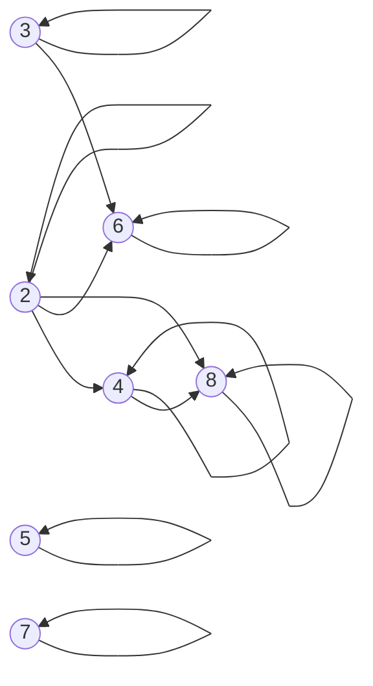
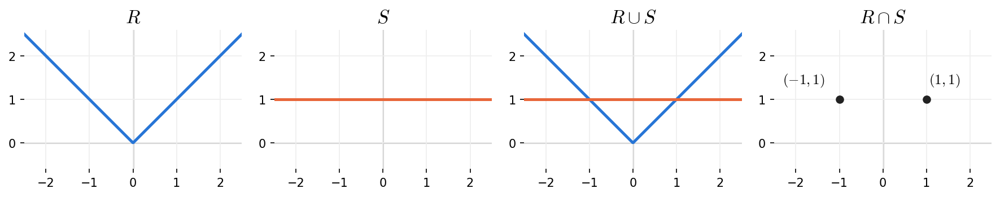
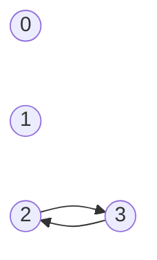
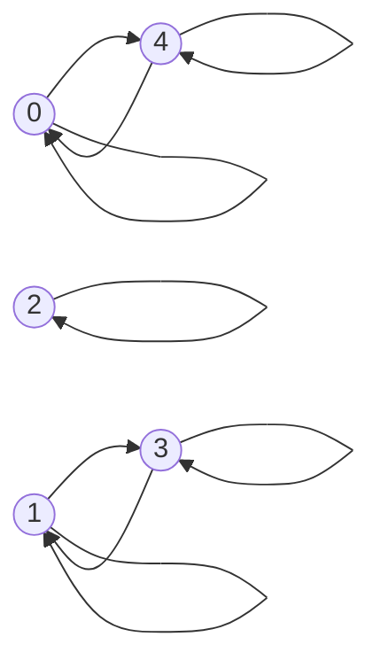

# HW8 Assignment Explanation — Relations and Equivalence Relations

[Repository Guide](../../README.md) | [English](Assignment-Explanation.md) | [한국어](Assignment-Explanation.ko.md)

> **Last Updated:** 2026-11-04
>
> Discrete Mathematics with Applications, Epp, Ch 8

> **Learning Objectives:**
> 1. Decide whether two elements are related under a relation defined in words or by a formula, and represent a relation by a directed graph or by a graph in the Cartesian plane
> 2. Prove or disprove, following the definitions, that a relation is reflexive, symmetric, or transitive
> 3. Check that a counterexample is valid under every hypothesis of the problem, and prove that the inverse relation preserves transitivity
> 4. Prove that a relation is an equivalence relation, find its equivalence classes, and list the distinct equivalence classes without duplication
> 5. Decide whether two classes of congruence modulo d are equal by comparing remainders

---

## Table of Contents

- [1. Exercise 8.1.3: Congruence Modulo 3](#1-exercise-813-congruence-modulo-3)
- [2. Exercise 8.1.8: Strings with the Same First Two Characters](#2-exercise-818-strings-with-the-same-first-two-characters)
- [3. Exercise 8.1.15: The Directed Graph of a Divisibility Relation](#3-exercise-8115-the-directed-graph-of-a-divisibility-relation)
- [4. Exercise 8.1.23: Relations in the Cartesian Plane and Their Union and Intersection](#4-exercise-8123-relations-in-the-cartesian-plane-and-their-union-and-intersection)
- [5. Exercise 8.2.3: Properties of a Relation with Two Ordered Pairs](#5-exercise-823-properties-of-a-relation-with-two-ordered-pairs)
- [6. Exercise 8.2.11: The Relation of a Nonnegative Product](#6-exercise-8211-the-relation-of-a-nonnegative-product)
- [7. Exercise 8.2.23: The Subset Relation on a Power Set](#7-exercise-8223-the-subset-relation-on-a-power-set)
- [8. Exercise 8.2.36: The Inverse of a Transitive Relation](#8-exercise-8236-the-inverse-of-a-transitive-relation)
- [9. Exercise 8.3.3: Equivalence Classes of a Relation Given as Ordered Pairs](#9-exercise-833-equivalence-classes-of-a-relation-given-as-ordered-pairs)
- [10. Exercise 8.3.8: Equivalence Classes of Subsets with the Same Number of Elements](#10-exercise-838-equivalence-classes-of-subsets-with-the-same-number-of-elements)
- [11. Exercise 8.3.16: Equivalence Classes of Congruence Modulo 3 and 7](#11-exercise-8316-equivalence-classes-of-congruence-modulo-3-and-7)
- [12. Exercise 8.3.20: Congruence Modulo 4](#12-exercise-8320-congruence-modulo-4)
- [Summary](#summary)
- [Self-Check Questions](#self-check-questions)

---

<br>

## 1. Exercise 8.1.3: Congruence Modulo 3

**Problem.** The relation $T$ on $\mathbf{Z}$ is given by $`m \, T \, n \iff 3 \mid (m - n)`$. (a) Decide whether each of $`10 \, T \, 1`$, $`1 \, T \, 10`$, $(2, 2) \in T$, and $(8, 1) \in T$ holds, and give five integers $n$ satisfying each of (b) $`n \, T \, 0`$, (c) $`n \, T \, 1`$, and (d) $`n \, T \, 2`$.

**Concepts used.** By [Chapter 8, Section 1](../../Lecture-Notes/Ch08_Properties-of-Relations/Concepts_Lecture.md), a **relation** $R$ from a set $A$ to a set $B$ is a subset of the Cartesian product $A \times B$, and $`x \, R \, y`$ means $(x, y) \in R$. This relation $T$ is called **congruence modulo 3**, and $3 \mid (m - n)$ means that there is an integer $k$ with $m - n = 3k$ (Chapter 4).

**Solution (a).** Check whether the difference of each pair is a multiple of 3.

- $10 - 1 = 9 = 3 \cdot 3$, so $`10 \, T \, 1`$.
- $1 - 10 = -9 = 3 \cdot (-3)$, so $`1 \, T \, 10`$. A negative difference is fine as long as it is an integer multiple of 3.
- $2 - 2 = 0 = 3 \cdot 0$, so $(2, 2) \in T$.
- $8 - 1 = 7$, and there is no integer $k$ with $7 = 3k$, so $(8, 1) \notin T$.

**Solution (b), (c), (d).** $`n \, T \, r`$ means that there is an integer $k$ with $n - r = 3k$, that is, $n = 3k + r$. Substituting several integers for $k$ yields five examples each.

| Condition | Equivalent form | Five examples ($`k = -2, -1, 0, 1, 2`$) |
|:---|:---|:---|
| $`n \, T \, 0`$ | $n = 3k$ | $-6, -3, 0, 3, 6$ |
| $`n \, T \, 1`$ | $n = 3k + 1$ | $-5, -2, 1, 4, 7$ |
| $`n \, T \, 2`$ | $n = 3k + 2$ | $-4, -1, 2, 5, 8$ |

*Table 1. Form and examples of integers with n T 0, n T 1, and n T 2*

Any five integers satisfying the condition are a correct answer; for example, $0, 3, 6, 9, 12$ also answers (b). By the quotient-remainder theorem every integer has exactly one of the forms $3k$, $3k + 1$, $3k + 2$, so the three rows of Table 1 divide the integers without overlap. This fact leads in Chapter 8, Section 3 to the conclusion that $T$ has exactly three equivalence classes.

---

<br>

## 2. Exercise 8.1.8: Strings with the Same First Two Characters

**Problem.** On the set $A$ of all strings of length 4 made of $a$ and $b$, two strings are related by $R$ when their first two characters agree. Decide whether each of the following holds: (a) $`abaa \, R \, abba`$, (b) $`aabb \, R \, bbaa`$, (c) $`aaaa \, R \, aaab`$, (d) $`baaa \, R \, abaa`$.

**Concepts used.** The relation is defined in words, so read the first two characters of each string and compare them. The last two characters do not affect the decision.

**Solution.**

| Part | First two characters of $s$ | First two characters of $t$ | Is $`s \, R \, t`$? |
|:---:|:---:|:---:|:---:|
| (a) $abaa$, $abba$ | $ab$ | $ab$ | Yes |
| (b) $aabb$, $bbaa$ | $aa$ | $bb$ | No |
| (c) $aaaa$, $aaab$ | $aa$ | $aa$ | Yes |
| (d) $baaa$, $abaa$ | $ba$ | $ab$ | No |

*Table 2. Comparison of the first two characters of the two strings in each part*

In (d) both strings consist of three $a$'s and one $b$, but comparing the first two characters **in order** gives $ba \neq ab$, so the strings are not related. Because this relation is based on the equality "the first two characters are the same", it is reflexive, symmetric, and transitive, and it is an example of an equivalence relation, the subject of Chapter 8, Section 3. The 16 strings of length 4 fall into four equivalence classes of four strings each, according to the first two characters $aa$, $ab$, $ba$, $bb$.

---

<br>

## 3. Exercise 8.1.15: The Directed Graph of a Divisibility Relation

**Problem.** Represent the divisibility relation $`x \, R \, y \iff x \mid y`$ on $A = \lbrace 2, 3, 4, 5, 6, 7, 8 \rbrace$ by a directed graph.

**Concepts used.** By Chapter 8, Section 1, a relation on a set $A$ can be represented by a **directed graph**: each element of $A$ becomes a vertex, and for every ordered pair with $`x \, R \, y`$ an arrow is drawn from $x$ to $y$. If $`x \, R \, x`$, a **loop** is drawn from $x$ back to itself.

**Solution.** First find all ordered pairs in $R$. For each $x$, list the multiples of $x$ that lie in $A$.

- For every $x \in A$, $x = x \cdot 1$, so $x \mid x$. Hence all seven vertices have loops.
- $x = 2$: the multiples of 2 in $A$ are $2, 4, 6, 8$, giving $(2, 4)$, $(2, 6)$, $(2, 8)$.
- $x = 3$: the multiples of 3 in $A$ are $3, 6$, giving $(3, 6)$.
- $x = 4$: the multiples of 4 in $A$ are $4, 8$, giving $(4, 8)$.
- $x = 5, 6, 7, 8$: twice the number already exceeds 8, so no multiple other than the number itself lies in $A$.

Therefore $R$ consists of 12 ordered pairs: the 7 loops and the five pairs $(2, 4)$, $(2, 6)$, $(2, 8)$, $(3, 6)$, $(4, 8)$.



*Figure 1. Directed graph of the divisibility relation on A = {2, 3, 4, 5, 6, 7, 8}*

5 and 7 are related to no element other than themselves, so they have only loops. Arrows point "from the divisor to the multiple". For example, $2 \mid 4$ but $4 \nmid 2$, so there is an arrow from $2$ to $4$ and no arrow in the opposite direction.

---

<br>

## 4. Exercise 8.1.23: Relations in the Cartesian Plane and Their Union and Intersection

**Problem.** For the relations $R = \lbrace (x, y) \in \mathbf{R} \times \mathbf{R} \mid y = \vert x \vert \rbrace$ and $S = \lbrace (x, y) \in \mathbf{R} \times \mathbf{R} \mid y = 1 \rbrace$ on the reals, draw $R$, $S$, $R \cup S$, and $R \cap S$ in the Cartesian plane.

**Concepts used.** A relation is a set of ordered pairs, so a relation on $\mathbf{R}$ can be drawn as a set of points in the plane, and the union and intersection of two relations are defined exactly as set operations. $(x, y) \in R \cup S$ means $(x, y) \in R$ or $(x, y) \in S$, and $(x, y) \in R \cap S$ means that both hold.

**Solution.** Determine the four sets in turn.

1. $R$ is the set of all points with $y = \vert x \vert$. If $x \ge 0$ then $y = x$, and if $x < 0$ then $y = -x$, so $R$ is the V shape formed by two rays meeting at the origin.
2. $S$ is the set of all points with $y = 1$, the horizontal line at height 1. There is no restriction on $x$.
3. $R \cup S$ is the overlay of the two pictures: it contains both the V shape and the horizontal line.
4. $R \cap S$ consists of the points satisfying $y = \vert x \vert$ and $y = 1$ simultaneously. Then $\vert x \vert = 1$, so $x = 1$ or $x = -1$, and $R \cap S = \lbrace (-1, 1), (1, 1) \rbrace$.



*Figure 2. Graphs of the relations R, S, R ∪ S, and R ∩ S*

$R \cap S$ is not a line or a curve but a finite set of two points. When graphing, take care not to draw the intersection as a line.

---

<br>

## 5. Exercise 8.2.3: Properties of a Relation with Two Ordered Pairs

**Problem.** For the relation $R_3 = \lbrace (2, 3), (3, 2) \rbrace$ on $A = \lbrace 0, 1, 2, 3 \rbrace$, (a) draw its directed graph, and decide whether it is (b) reflexive, (c) symmetric, and (d) transitive. Give a counterexample for each property that fails.

**Concepts used.** The three properties of Chapter 8, Section 2 and their negations are as follows. A counterexample showing that a property fails is an element satisfying the existential statement of the corresponding negation.

> **Definition:** A relation $R$ on a set $A$ is **reflexive** if $`x \, R \, x`$ for every $x \in A$. It is **symmetric** if for all $x, y \in A$, $`x \, R \, y`$ implies $`y \, R \, x`$. It is **transitive** if for all $x, y, z \in A$, $`x \, R \, y`$ and $`y \, R \, z`$ imply $`x \, R \, z`$.

| Property | Condition under which the property fails (form of a counterexample) |
|:---|:---|
| Reflexive | There is $x \in A$ with $(x, x) \notin R$ |
| Symmetric | There are $x, y \in A$ with $(x, y) \in R$ but $(y, x) \notin R$ |
| Transitive | There are $x, y, z \in A$ with $(x, y) \in R$ and $(y, z) \in R$ but $(x, z) \notin R$ |

*Table 3. Conditions under which reflexivity, symmetry, and transitivity fail*

**Solution (a).** Place the vertices 0, 1, 2, 3 and draw arrows from 2 to 3 and from 3 to 2. Vertices 0 and 1 are connected to no arrow.



*Figure 3. Directed graph of the relation R₃ = {(2, 3), (3, 2)}*

**Solution (b).** Not reflexive, because $(0, 0) \notin R_3$. In fact $R_3$ has no loops at all, so each of 0, 1, 2, 3 is a counterexample.

**Solution (c).** Symmetric. $R_3$ contains only the pairs $(2, 3)$ and $(3, 2)$, and their reversals $(3, 2)$ and $(2, 3)$ are both in $R_3$. Symmetry needs to be checked only for the pairs in $R_3$, so this suffices.

**Solution (d).** Not transitive. Let $x = 2$, $y = 3$, $z = 2$. Then $(2, 3) \in R_3$ and $(3, 2) \in R_3$, but $(2, 2) \notin R_3$.

> **Caution:** In the definition of transitivity, $x$, $y$, and $z$ need not be distinct. The counterexample in (d) has $x = z = 2$. In general, if a symmetric relation contains $(a, b)$, it also contains $(b, a)$, so for it to be transitive it must also contain the loops $(a, a)$ and $(b, b)$.

---

<br>

## 6. Exercise 8.2.11: The Relation of a Nonnegative Product

**Problem.** The relation $`x \, D \, y \iff xy \ge 0`$ on $\mathbf{R}$ relates two real numbers whose product is nonnegative. Decide whether $D$ is reflexive, symmetric, and transitive, with reasons.

**Concepts used.** The three definitions of Chapter 8, Section 2 and properties of real numbers (squares are nonnegative, and multiplication is commutative) are used.

**Solution.** $D$ is reflexive and symmetric but not transitive.

**Reflexive.** Let $x$ be any real number. The square of a real number is nonnegative, so $x \cdot x = x^2 \ge 0$, and by the definition of $D$, $`x \, D \, x`$.

**Symmetric.** Let $x$ and $y$ be real numbers with $`x \, D \, y`$. By definition, $xy \ge 0$. Real multiplication is commutative, so $yx = xy \ge 0$, and hence $`y \, D \, x`$.

**Not transitive.** Let $x = 1$, $y = 0$, $z = -1$.

- $xy = 1 \cdot 0 = 0 \ge 0$, so $`x \, D \, y`$.
- $yz = 0 \cdot (-1) = 0 \ge 0$, so $`y \, D \, z`$.
- $xz = 1 \cdot (-1) = -1 < 0$, so $`x \, D \, z`$ does not hold.

$xy \ge 0$ means that one of $x$ and $y$ is 0 or that both have the same sign. Because 0 is related to every real number, it acts as a bridge between positive and negative numbers, and this is what breaks transitivity. If the $y$ in the counterexample is replaced by a nonzero number, transitivity does not fail. In fact, if $D$ is restricted to the set of nonzero real numbers, $`x \, D \, y`$ becomes "$`x`$ and $y$ have the same sign", which is transitive, and $D$ becomes an equivalence relation whose two equivalence classes are the positive numbers and the negative numbers.

---

<br>

## 7. Exercise 8.2.23: The Subset Relation on a Power Set

**Problem.** On the power set $\mathcal{P}(X)$ of a nonempty set $X$, decide whether the subset relation $`A \, \mathbf{S} \, B \iff A \subseteq B`$ is reflexive, symmetric, and transitive.

**Concepts used.** The definition of subset from Chapter 6 ($A \subseteq B$ means every element of $A$ is an element of $`B`$) and the transitivity of subsets in Theorem 6.2.1 are used. The **power set** $\mathcal{P}(X)$ is the set of all subsets of $X$, and it always contains $\emptyset$ and $X$ itself.

**Solution.** $\mathbf{S}$ is reflexive and transitive but not symmetric.

**Reflexive.** If $A \in \mathcal{P}(X)$, every element of $A$ is an element of $A$, so $A \subseteq A$, and hence $`A \, \mathbf{S} \, A`$.

**Not symmetric.** Let $A = \emptyset$ and $B = X$.

1. Both sets are subsets of $X$, so they are elements of $\mathcal{P}(X)$.
2. The empty set is a subset of every set (Theorem 6.2.4), so $\emptyset \subseteq X$, that is, $`A \, \mathbf{S} \, B`$.
3. $X$ is nonempty, so there is an element $x \in X$, and $x \notin \emptyset$. Hence $X \not\subseteq \emptyset$, that is, $`B \, \mathbf{S} \, A`$ does not hold.

**Transitive.** Let $A, B, C \in \mathcal{P}(X)$ with $`A \, \mathbf{S} \, B`$ and $`B \, \mathbf{S} \, C`$. Then $A \subseteq B$ and $B \subseteq C$, so by the transitivity of subsets in Theorem 6.2.1, $A \subseteq C$, that is, $`A \, \mathbf{S} \, C`$.

> **Caution:** A counterexample to symmetry must be available for **every** $X$ satisfying the hypothesis. The only hypothesis is that "$`X`$ is nonempty", so $X$ may have just one element. For example, if $X = \lbrace a \rbrace$, then $\mathcal{P}(X) = \lbrace \emptyset, \lbrace a \rbrace \rbrace$, and a counterexample such as $\lbrace a \rbrace \subseteq \lbrace a, b \rbrace$ does not exist in $\mathcal{P}(X)$. In contrast, $\emptyset$ and $X$ are elements of $\mathcal{P}(X)$ for every $X$.

The hypothesis "$`X`$ is nonempty" is used only in the counterexample to symmetry. If $X = \emptyset$, then $\mathcal{P}(X) = \lbrace \emptyset \rbrace$ and $\mathbf{S} = \lbrace (\emptyset, \emptyset) \rbrace$, so $\mathbf{S}$ is symmetric. Moreover, $A \subseteq B$ and $B \subseteq A$ imply $A = B$, so $\mathbf{S}$ is antisymmetric; being also reflexive and transitive, it is a partial order relation of the kind studied in Chapter 8, Section 4 (Section 8.5 of the textbook).

---

<br>

## 8. Exercise 8.2.36: The Inverse of a Transitive Relation

**Problem.** Prove, or refute with a counterexample, that the inverse relation $R^{-1}$ of a transitive relation $R$ on a set $A$ is always transitive.

**Concepts used.** The **inverse relation** of Chapter 8, Section 1 reverses every ordered pair of $R$. That is, $R^{-1} = \lbrace (y, x) \in A \times A \mid (x, y) \in R \rbrace$, and for all $x, y \in A$, $`x \, R^{-1} \, y \iff y \, R \, x`$.

**Solution.** $R^{-1}$ is always transitive.

1. Suppose $R$ is transitive, and let $x, y, z \in A$ satisfy $`x \, R^{-1} \, y`$ and $`y \, R^{-1} \, z`$. [It must be shown that $`x \, R^{-1} \, z`$.]
2. By the definition of inverse relation, $`x \, R^{-1} \, y`$ means $`y \, R \, x`$, and $`y \, R^{-1} \, z`$ means $`z \, R \, y`$.
3. Placing the two facts in the order $`z \, R \, y`$, $`y \, R \, x`$ gives exactly the hypothesis of transitivity of $R$. Hence, by the transitivity of $R$, $`z \, R \, x`$.
4. By the definition of inverse relation, $`z \, R \, x`$ means $`x \, R^{-1} \, z`$.

Therefore $R^{-1}$ is transitive.

> **Key Point:** To apply transitivity in step 3, the two facts must be placed in an order in which the middle element links them. Written in the order $`y \, R \, x`$, $`z \, R \, y`$, they do not link; reordered as $`z \, R \, y`$, $`y \, R \, x`$, the middle $y$ links them and yields $`z \, R \, x`$.

In the same way, if $R$ is reflexive then $R^{-1}$ is reflexive, and if $R$ is symmetric then $R^{-1}$ is symmetric (Exercises 8.2.34 and 8.2.35). In terms of directed graphs, the graph of $R^{-1}$ is the graph of $R$ with every arrow reversed, so the picture of transitivity, "whenever two arrows can be followed in succession there is a shortcut arrow", is preserved with only the directions reversed.

---

<br>

## 9. Exercise 8.3.3: Equivalence Classes of a Relation Given as Ordered Pairs

**Problem.** An equivalence relation $R$ on $A = \lbrace 0, 1, 2, 3, 4 \rbrace$ is given below.

```math
R = \lbrace (0, 0), (0, 4), (1, 1), (1, 3), (2, 2), (3, 1), (3, 3), (4, 0), (4, 4) \rbrace
```

Find the classes $[0]$, $[1]$, $[2]$, $[3]$, then give the number of distinct equivalence classes and list them all.

**Concepts used.** The definitions and results of Chapter 8, Section 3 are used.

> **Definition:** A relation that is reflexive, symmetric, and transitive is an **equivalence relation**. For an equivalence relation $R$ and $a \in A$, the **equivalence class** of $a$ is $`[a] = \lbrace x \in A \mid x \, R \, a \rbrace`$.

By Lemma 8.3.2, if $`a \, R \, b`$ then $[a] = [b]$, and by Lemma 8.3.3, two equivalence classes are either equal or disjoint. By Theorem 8.3.4, the distinct equivalence classes form a partition of $A$. Hence, to find the distinct equivalence classes, compute the class of each element and then merge the classes that are equal.

**Solution.** Drawing the directed graph of $R$ shows at once how the elements are grouped.



*Figure 4. Directed graph of the relation R*

Collecting, for each element $a$, all $x$ with $(x, a) \in R$ gives the following.

| Class | Ordered pairs with $(x, a) \in R$ | Elements |
|:---|:---|:---|
| $[0]$ | $(0, 0)$, $(4, 0)$ | $\lbrace 0, 4 \rbrace$ |
| $[1]$ | $(1, 1)$, $(3, 1)$ | $\lbrace 1, 3 \rbrace$ |
| $[2]$ | $(2, 2)$ | $\lbrace 2 \rbrace$ |
| $[3]$ | $(1, 3)$, $(3, 3)$ | $\lbrace 1, 3 \rbrace$ |
| $[4]$ | $(0, 4)$, $(4, 4)$ | $\lbrace 0, 4 \rbrace$ |

*Table 4. Equivalence class of each element of A*

Since $[0] = [4]$ and $[1] = [3]$, there are **3** distinct equivalence classes: $\lbrace 0, 4 \rbrace$, $\lbrace 1, 3 \rbrace$, and $\lbrace 2 \rbrace$. Among the requested classes $[0]$, $[1]$, $[2]$, $[3]$, the classes $[1]$ and $[3]$ are the same set under two names. The three sets are mutually disjoint and their union is $A$, so they form a partition of $A$, as Theorem 8.3.4 states.

---

<br>

## 10. Exercise 8.3.8: Equivalence Classes of Subsets with the Same Number of Elements

**Problem.** On $\mathcal{P}(X)$ with $X = \lbrace a, b, c \rbrace$, the relation $`U \, R \, V \iff N(U) = N(V)`$ relates subsets with the same number of elements. Find all distinct equivalence classes of $R$.

**Concepts used.** $R$ is defined by the equality of numbers "$`N(U) = N(V)`$", so it is an equivalence relation. Equality of numbers is reflexive ($`N(U) = N(U)`$), symmetric (if $N(U) = N(V)$ then $`N(V) = N(U)`$), and transitive (if $N(U) = N(V)$ and $N(V) = N(W)$ then $`N(U) = N(W)`$). The class $[U]$ consists of all subsets of $X$ with the same number of elements as $U$.

**Solution.** Divide the $2^3 = 8$ subsets of $X$ according to their number of elements, which is 0, 1, 2, or 3.

| Number of elements | Equivalence class | Size of the class |
|:---:|:---|:---:|
| 0 | $[\emptyset] = \lbrace \emptyset \rbrace$ | 1 |
| 1 | $[\lbrace a \rbrace] = \lbrace \lbrace a \rbrace, \lbrace b \rbrace, \lbrace c \rbrace \rbrace$ | 3 |
| 2 | $[\lbrace a, b \rbrace] = \lbrace \lbrace a, b \rbrace, \lbrace a, c \rbrace, \lbrace b, c \rbrace \rbrace$ | 3 |
| 3 | $[\lbrace a, b, c \rbrace] = \lbrace \lbrace a, b, c \rbrace \rbrace$ | 1 |

*Table 5. Equivalence classes of P({a, b, c}) by number of elements*

Therefore there are **4** distinct equivalence classes. Each class is a **set** of subsets of $X$, so $\lbrace \emptyset \rbrace$ must not be written as $\emptyset$, and $\lbrace \lbrace a \rbrace, \lbrace b \rbrace, \lbrace c \rbrace \rbrace$ must not be written as $\lbrace a, b, c \rbrace$. The class sizes 1, 3, 3, 1 add up to $8$, the number of elements of the power set, which agrees with the fact that the four classes form a partition of $\mathcal{P}(X)$. These numbers are the combination counts $\binom{3}{0}, \binom{3}{1}, \binom{3}{2}, \binom{3}{3}$ studied in Chapter 9.

---

<br>

## 11. Exercise 8.3.16: Equivalence Classes of Congruence Modulo 3 and 7

**Problem.** Group equal classes together: (a) $[7]$, $[-4]$, $[-6]$, $[17]$, $[4]$, $[27]$, $[19]$ under congruence modulo 3, and (b) $[35]$, $[3]$, $[-7]$, $[12]$, $[0]$, $[-2]$, $[17]$ under congruence modulo 7.

**Concepts used.** In Chapter 8, Section 3, for integers $m$, $n$ and a positive integer $d$, one writes $m \equiv n \pmod{d}$ when $d \mid (m - n)$. Congruence modulo $d$ is an equivalence relation. By Lemma 8.3.2, $m \equiv n \pmod{d}$ implies $[m] = [n]$; conversely, if $[m] = [n]$, then $m \in [m] = [n]$ by reflexivity, so $m \equiv n \pmod{d}$. Moreover, $m \equiv n \pmod{d}$ if and only if $m \bmod d = n \bmod d$ (Exercise 8.3.17(b)). Hence compute the nonnegative remainder of each number upon division by $d$ and group the numbers with equal remainders.

> **Caution:** The remainder of a negative number must also be an $r$ with $0 \le r < d$. For example, writing $-4 = 3 \cdot (-1) + (-1)$ makes the remainder look like $-1$, but the remainder in the quotient-remainder theorem cannot be negative, so write $-4 = 3 \cdot (-2) + 2$ to obtain the remainder 2.

**Solution (a).** Write each number in the form $3q + r$ with $0 \le r < 3$.

| $n$ | $7$ | $-4$ | $-6$ | $17$ | $4$ | $27$ | $19$ |
|:---|:---:|:---:|:---:|:---:|:---:|:---:|:---:|
| $3q + r$ | $3 \cdot 2 + 1$ | $3 \cdot (-2) + 2$ | $3 \cdot (-2) + 0$ | $3 \cdot 5 + 2$ | $3 \cdot 1 + 1$ | $3 \cdot 9 + 0$ | $3 \cdot 6 + 1$ |
| $n \bmod 3$ | 1 | 2 | 0 | 2 | 1 | 0 | 1 |

*Table 6. Remainders modulo 3*

Therefore $[7] = [4] = [19]$, $[-4] = [17]$, and $[-6] = [27]$. The difference also confirms the result; for example, $7 - 19 = -12 = 3 \cdot (-4)$, so $7 \equiv 19 \pmod{3}$.

**Solution (b).** Write each number in the form $7q + r$ with $0 \le r < 7$.

| $n$ | $35$ | $3$ | $-7$ | $12$ | $0$ | $-2$ | $17$ |
|:---|:---:|:---:|:---:|:---:|:---:|:---:|:---:|
| $7q + r$ | $7 \cdot 5 + 0$ | $7 \cdot 0 + 3$ | $7 \cdot (-1) + 0$ | $7 \cdot 1 + 5$ | $7 \cdot 0 + 0$ | $7 \cdot (-1) + 5$ | $7 \cdot 2 + 3$ |
| $n \bmod 7$ | 0 | 3 | 0 | 5 | 0 | 5 | 3 |

*Table 7. Remainders modulo 7*

Therefore $[35] = [-7] = [0]$, $[3] = [17]$, and $[12] = [-2]$.

---

<br>

## 12. Exercise 8.3.20: Congruence Modulo 4

**Problem.** For the relation $`m \, E \, n \iff 4 \mid (m - n)`$ on $\mathbf{Z}$, (1) prove that $E$ is an equivalence relation, and (2) describe its distinct equivalence classes.

**Concepts used.** The definition of equivalence relation (reflexive, symmetric, transitive), the definition of divisibility, the definition of equivalence class, and the quotient-remainder theorem are used.

**Solution (1).** Prove the three properties in turn.

- **Reflexive.** Let $m$ be any integer. Since $m - m = 0 = 4 \cdot 0$, $4 \mid (m - m)$, and hence $`m \, E \, m`$.
- **Symmetric.** Let integers $m$ and $n$ satisfy $`m \, E \, n`$. Then there is an integer $k$ with $m - n = 4k$. Multiplying both sides by $-1$ gives $n - m = 4(-k)$, and $-k$ is an integer, so $4 \mid (n - m)$, that is, $`n \, E \, m`$.
- **Transitive.** Let integers $m$, $n$, $p$ satisfy $`m \, E \, n`$ and $`n \, E \, p`$. Then there are integers $k$ and $l$ with $m - n = 4k$ and $n - p = 4l$. Adding the two equations gives $m - p = (m - n) + (n - p) = 4k + 4l = 4(k + l)$, and $k + l$ is an integer, so $4 \mid (m - p)$, that is, $`m \, E \, p`$.

Therefore $E$ is an equivalence relation.

**Solution (2).** Starting from the definition, rewrite the class of an arbitrary integer $a$.

```math
\begin{aligned}
[a] &= \lbrace x \in \mathbf{Z} \mid x \, E \, a \rbrace \\
&= \lbrace x \in \mathbf{Z} \mid 4 \mid (x - a) \rbrace \\
&= \lbrace x \in \mathbf{Z} \mid x = 4k + a \text{ for some integer } k \rbrace
\end{aligned}
```

In particular, substituting $a = 0, 1, 2, 3$ gives the following four classes.

| Class | Set-builder notation | Examples of elements |
|:---|:---|:---|
| $[0]$ | $\lbrace x \in \mathbf{Z} \mid x = 4k \text{ for some integer } k \rbrace$ | $\ldots, -8, -4, 0, 4, 8, \ldots$ |
| $[1]$ | $\lbrace x \in \mathbf{Z} \mid x = 4k + 1 \text{ for some integer } k \rbrace$ | $\ldots, -7, -3, 1, 5, 9, \ldots$ |
| $[2]$ | $\lbrace x \in \mathbf{Z} \mid x = 4k + 2 \text{ for some integer } k \rbrace$ | $\ldots, -6, -2, 2, 6, 10, \ldots$ |
| $[3]$ | $\lbrace x \in \mathbf{Z} \mid x = 4k + 3 \text{ for some integer } k \rbrace$ | $\ldots, -5, -1, 3, 7, 11, \ldots$ |

*Table 8. The distinct equivalence classes of congruence modulo 4*

The quotient-remainder theorem explains why these four classes are distinct and together contain every integer. Every integer $x$ can be written **uniquely** as $x = 4k + r$ with integers $k$, $r$ and $0 \le r < 4$, so $x$ belongs to exactly one of $[0]$, $[1]$, $[2]$, $[3]$. For example, $-5 = 4 \cdot (-2) + 3$, so $-5 \in [3]$. Therefore the distinct equivalence classes of $E$ are the sets of integers whose remainders upon division by 4 are 0, 1, 2, and 3, **4** classes in all.

---

<br>

## Summary

| Concept | Key Summary |
|:-----|:-----|
| Relation | A relation from $A$ to $B$ is a subset of $A \times B$, and $(x, y) \in R$ is written $`x \, R \, y`$. |
| Directed graph | A relation on a set is drawn with the elements as vertices, an arrow from $x$ to $y$ for $`x \, R \, y`$, and a loop for $`x \, R \, x`$. |
| Reflexivity, symmetry, transitivity | The three properties are universal conditional statements, so a proof starts from arbitrary elements and a disproof needs only one set of elements satisfying the negation. |
| Scope of a counterexample | A counterexample must exist in every case satisfying the hypotheses; for the subset relation on a power set, $\emptyset$ and $X$ form such a counterexample. |
| Inverse relation | $`x \, R^{-1} \, y \iff y \, R \, x`$, and the inverse relation preserves reflexivity, symmetry, and transitivity. |
| Equivalence relation and class | An equivalence relation is reflexive, symmetric, and transitive; $`[a] = \lbrace x \in A \mid x \, R \, a \rbrace`$, and $`a \, R \, b`$ implies $[a] = [b]$. |
| Distinct equivalence classes | Compute the class of each element and merge equal sets; the distinct classes form a partition of the set. |
| Congruence modulo $d$ | $[m] = [n]$ if and only if $m$ and $n$ leave the same nonnegative remainder upon division by $d$, and there are $d$ distinct classes, one for each remainder. |

---

<br>

## Self-Check Questions

1. **Properties of a relation:** Decide whether the relation $R = \lbrace (1, 1), (1, 2), (2, 1) \rbrace$ on $A = \lbrace 1, 2, 3 \rbrace$ is reflexive, symmetric, and transitive, and give counterexamples.

   <details>
   <summary>Answer</summary>

   It is not reflexive: $(2, 2) \notin R$ (nor is $`(3, 3)`$). It is symmetric: the reversal $(2, 1)$ of $(1, 2)$ is in $R$, and $(1, 1)$ is its own reversal. It is not transitive: $(2, 1) \in R$ and $(1, 2) \in R$, but $(2, 2) \notin R$.

   </details>

2. **Scope of a counterexample:** What goes wrong if $A = \lbrace a \rbrace$ and $B = \lbrace a, b \rbrace$ are used as the counterexample to symmetry in Exercise 8.2.23?

   <details>
   <summary>Answer</summary>

   This counterexample lies in $\mathcal{P}(X)$ only when $X$ contains both $a$ and $b$. The problem assumes only that "$`X`$ is nonempty", which includes the case of a one-element set such as $X = \lbrace a \rbrace$; then $\lbrace a, b \rbrace \notin \mathcal{P}(X)$ and the counterexample does not exist. The counterexample that works for every $X$ is the pair $(\emptyset, X)$, with $\emptyset \subseteq X$ but $X \not\subseteq \emptyset$.

   </details>

3. **Inverse relation:** For the relation $`x \, R \, y \iff x \mid y`$ on $\mathbf{Z}^{+}$, describe $R^{-1}$ in words and decide whether $R^{-1}$ is transitive.

   <details>
   <summary>Answer</summary>

   $`x \, R^{-1} \, y \iff y \mid x`$, that is, "$`x`$ is a multiple of $y$". Since $R$ is transitive (transitivity of divisibility, Theorem 4.4.3), Exercise 8.2.36 shows that $R^{-1}$ is also transitive.

   </details>

4. **Finding a class:** For the relation $`m \, R \, n \iff 5 \mid (m - n)`$ on $\mathbf{Z}$, choose the class equal to $[-3]$ among $[0]$, $[1]$, $[2]$, $[3]$, $[4]$.

   <details>
   <summary>Answer</summary>

   $-3 = 5 \cdot (-1) + 2$, so $-3 \bmod 5 = 2$ and $[-3] = [2]$. This can also be checked by $-3 - 2 = -5 = 5 \cdot (-1)$.

   </details>

5. **Deciding an equivalence relation:** Decide whether the relation $`x \, R \, y \iff x - y \in \mathbf{Z}`$ on $\mathbf{R}$ is an equivalence relation, and describe $[0.5]$.

   <details>
   <summary>Answer</summary>

   It is an equivalence relation. It is reflexive because $x - x = 0 \in \mathbf{Z}$, symmetric because $x - y \in \mathbf{Z}$ implies $y - x = -(x - y) \in \mathbf{Z}$, and transitive because if $x - y$ and $y - z$ are integers then so is $x - z = (x - y) + (y - z)$. $[0.5] = \lbrace x \in \mathbf{R} \mid x - 0.5 \in \mathbf{Z} \rbrace = \lbrace \ldots, -1.5, -0.5, 0.5, 1.5, \ldots \rbrace$, the set of all real numbers whose fractional part is $0.5$.

   </details>

6. **A trap with transitivity:** Is every symmetric and transitive relation reflexive? Answer with a counterexample.

   <details>
   <summary>Answer</summary>

   No. The relation $R = \emptyset$ on $A = \lbrace 1, 2 \rbrace$ contains no ordered pairs, so the conditional statements defining symmetry and transitivity are vacuously true and $R$ is symmetric and transitive, but $(1, 1) \notin R$, so it is not reflexive. The argument "$`x \, R \, y`$ gives $`y \, R \, x`$, and transitivity gives $`x \, R \, x`$" works only when some $y$ is related to $x$.

   </details>
