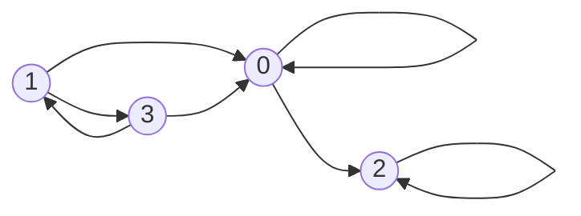
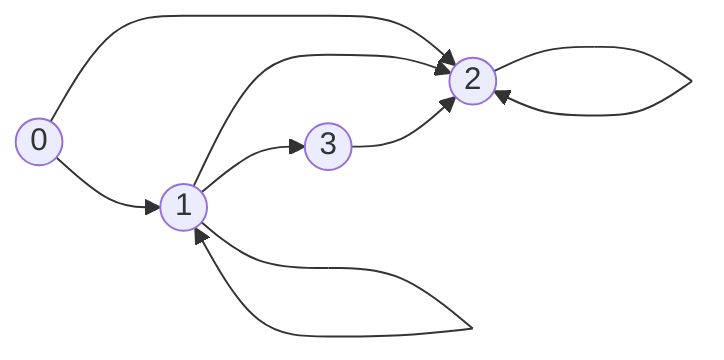
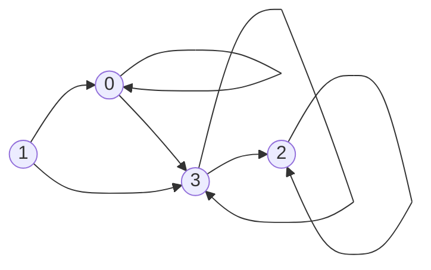
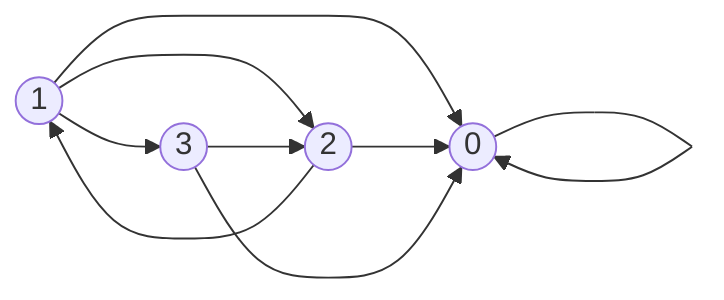
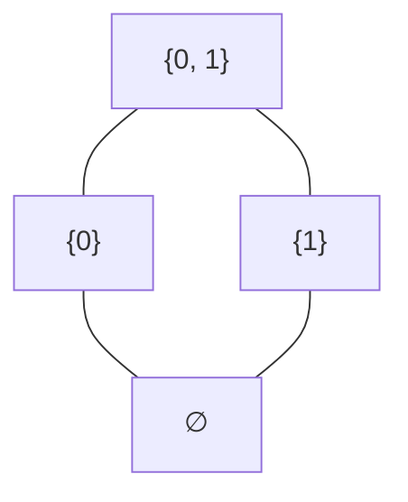
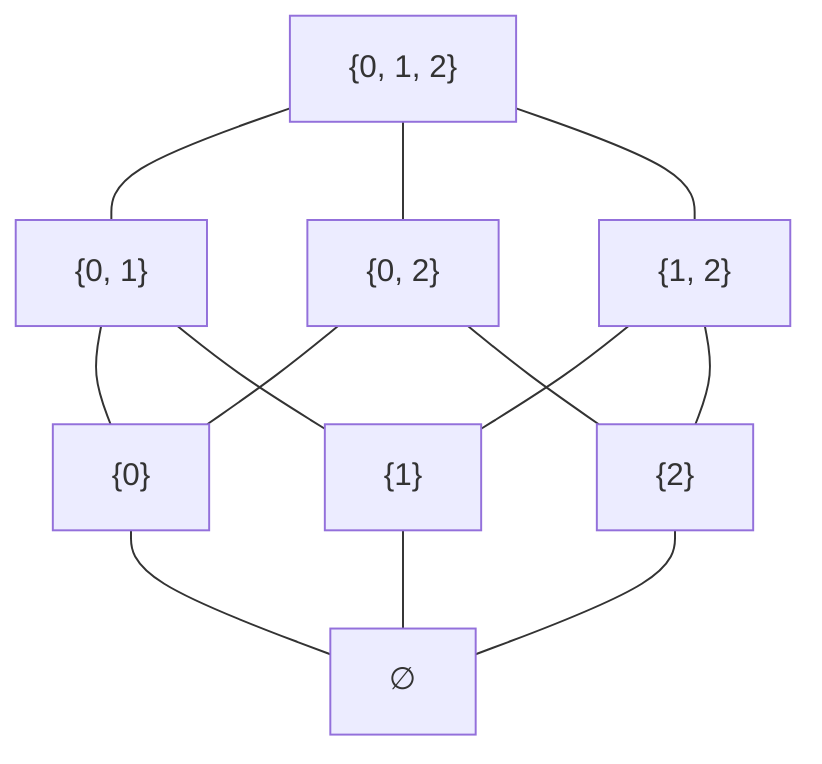
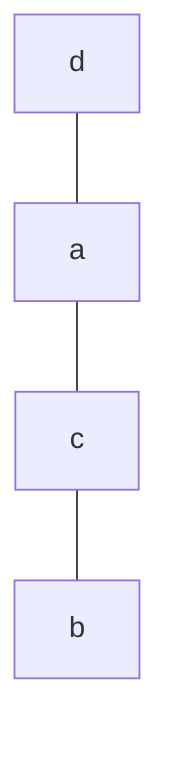
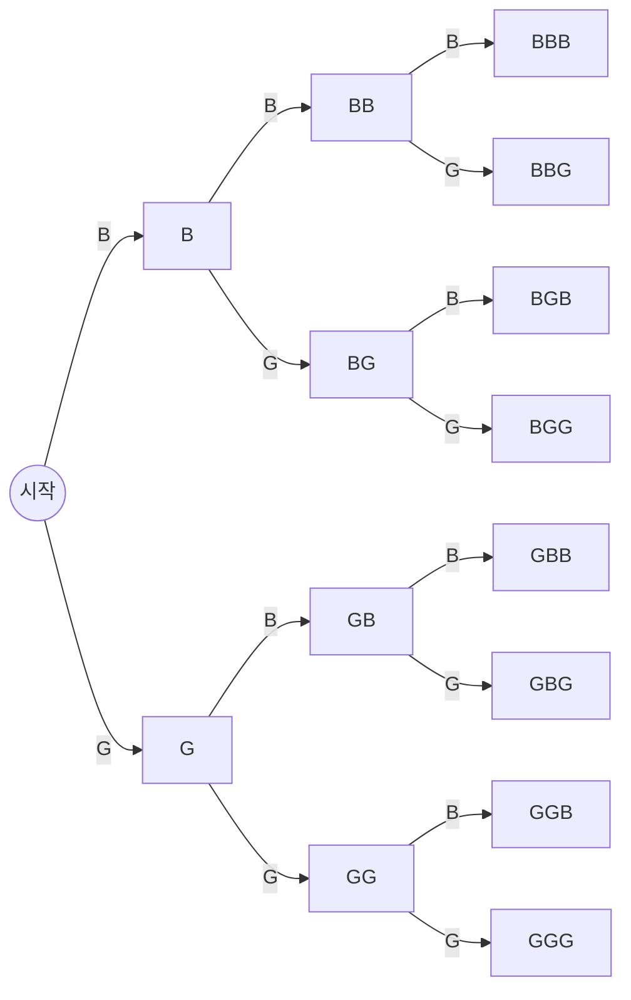

# HW9 과제 해설 — 부분 순서와 경우의 수

[레포지토리 안내](../../README.ko.md) | [English](Assignment-Explanation.md) | [한국어](Assignment-Explanation.ko.md)

> **최종 수정일:** 2026-11-10
>
> Discrete Mathematics with Applications, Epp, Ch 8, 9

> **학습 목표:**
> 1. 관계의 반대칭성을 판정하고, 부분 순서 관계와 전순서 관계인지 증명하거나 반례로 반박할 수 있다
> 2. 멱집합 위의 부분집합 관계와 같은 부분 순서 집합의 하세 도표를 그릴 수 있다
> 3. 표본 공간과 사건을 집합으로 쓰고 동일 가능성 확률 공식으로 확률을 구할 수 있다
> 4. 곱의 법칙, 합의 법칙, 차의 법칙, r-순열의 공식으로 경우의 수를 세고, 순열에 관한 항등식을 증명할 수 있다
> 5. 포함 배제 원리로 오일러 피 함수의 공식을 증명하고, 비둘기집 원리로 반드시 성립하는 사실을 보일 수 있다

---

## 목차

- [1. 연습 문제 8.5.1: 반대칭성의 판정](#1-연습-문제-851-반대칭성의-판정)
- [2. 연습 문제 8.5.7: 소인수의 포함 관계](#2-연습-문제-857-소인수의-포함-관계)
- [3. 연습 문제 8.5.17: 멱집합의 하세 도표](#3-연습-문제-8517-멱집합의-하세-도표)
- [4. 연습 문제 8.5.31: 전순서의 판정](#4-연습-문제-8531-전순서의-판정)
- [5. 연습 문제 9.1.12: 세 자녀의 성별](#5-연습-문제-9112-세-자녀의-성별)
- [6. 연습 문제 9.1.25: 부분 배열의 원소 개수와 확률](#6-연습-문제-9125-부분-배열의-원소-개수와-확률)
- [7. 연습 문제 9.2.16: 두 자리 정수의 개수](#7-연습-문제-9216-두-자리-정수의-개수)
- [8. 연습 문제 9.2.41: 순열 개수에 관한 항등식](#8-연습-문제-9241-순열-개수에-관한-항등식)
- [9. 연습 문제 9.3.7: 비밀번호의 개수](#9-연습-문제-937-비밀번호의-개수)
- [10. 연습 문제 9.3.40: 두 소수의 곱에 대한 오일러 피 함수](#10-연습-문제-9340-두-소수의-곱에-대한-오일러-피-함수)
- [11. 연습 문제 9.4.10: n + 1개의 정수와 홀수](#11-연습-문제-9410-n--1개의-정수와-홀수)
- [12. 연습 문제 9.4.16: 5의 배수를 보장하는 개수](#12-연습-문제-9416-5의-배수를-보장하는-개수)
- [요약](#요약)
- [점검 문제](#점검-문제)

---

<br>

## 1. 연습 문제 8.5.1: 반대칭성의 판정

**문제.** $\lbrace 0, 1, 2, 3 \rbrace$ 위의 다음 네 관계를 각각 방향 그래프로 그리고, 그 가운데 반대칭적인 관계를 가려낸다.

- (a) $R_1 = \lbrace (0, 0), (0, 2), (1, 0), (1, 3), (2, 2), (3, 0), (3, 1) \rbrace$
- (b) $R_2 = \lbrace (0, 1), (0, 2), (1, 1), (1, 2), (1, 3), (2, 2), (3, 2) \rbrace$
- (c) $R_3 = \lbrace (0, 0), (0, 3), (1, 0), (1, 3), (2, 2), (3, 3), (3, 2) \rbrace$
- (d) $R_4 = \lbrace (0, 0), (1, 0), (1, 2), (1, 3), (2, 0), (2, 1), (3, 2), (3, 0) \rbrace$

**사용하는 개념.** [8장 4절](../../Lecture-Notes/Ch08_Properties-of-Relations/Concepts_Lecture.ko.md)(교재 8.5절)에서 정의한 반대칭성을 쓴다.

> **용어 정의:** 집합 $A$ 위의 관계 $R$이 **반대칭적(antisymmetric)** 이라는 것은 모든 $a, b \in A$에 대하여 $`a \, R \, b`$이고 $`b \, R \, a`$이면 $a = b$라는 뜻이다.

부정을 구하면 $R$이 반대칭적이지 않다는 것은 $`a \, R \, b`$, $`b \, R \, a`$이면서 $a \neq b$인 $a$, $b$가 존재한다는 뜻이다. 방향 그래프로 말하면, **서로 다른 두 꼭짓점 사이에 양방향 화살표가 한 쌍이라도 있으면** 반대칭적이지 않다. 루프는 $a = b$인 경우이므로 반대칭성에 영향을 주지 않는다.

**풀이.** 각 관계에서 서로 다른 원소의 순서쌍 $(a, b)$마다 뒤집은 순서쌍 $(b, a)$가 관계에 있는지 확인한다.

| 관계 | 서로 다른 원소의 순서쌍 | 뒤집은 순서쌍도 있는 것 | 반대칭적인가 |
|:---:|:---|:---|:---:|
| $R_1$ | $(0, 2)$, $(1, 0)$, $(1, 3)$, $(3, 0)$, $(3, 1)$ | $(1, 3)$과 $(3, 1)$ | 아니다 |
| $R_2$ | $(0, 1)$, $(0, 2)$, $(1, 2)$, $(1, 3)$, $(3, 2)$ | 없음 | 그렇다 |
| $R_3$ | $(0, 3)$, $(1, 0)$, $(1, 3)$, $(3, 2)$ | 없음 | 그렇다 |
| $R_4$ | $(1, 0)$, $(1, 2)$, $(1, 3)$, $(2, 0)$, $(2, 1)$, $(3, 2)$, $(3, 0)$ | $(1, 2)$와 $(2, 1)$ | 아니다 |

*표 1. 네 관계의 반대칭성 판정*

따라서 반대칭적인 관계는 $R_2$와 $R_3$이다. $R_1$은 $`1 \, R_1 \, 3`$이고 $`3 \, R_1 \, 1`$이지만 $1 \neq 3$이므로, $R_4$는 $`1 \, R_4 \, 2`$이고 $`2 \, R_4 \, 1`$이지만 $1 \neq 2$이므로 반대칭적이지 않다. 네 방향 그래프는 다음과 같다.



*그림 1. 관계 R₁의 방향 그래프*



*그림 2. 관계 R₂의 방향 그래프*



*그림 3. 관계 R₃의 방향 그래프*



*그림 4. 관계 R₄의 방향 그래프*

> **주의:** 반대칭적은 대칭적의 부정이 아니다. 예를 들어 $\lbrace 0, 1 \rbrace$ 위의 관계 $\lbrace (0, 0) \rbrace$은 대칭적이면서 반대칭적이고, $\lbrace 0, 1, 2 \rbrace$ 위의 관계 $\lbrace (0, 1), (1, 0), (1, 2) \rbrace$는 어느 쪽도 아니다. $R_2$와 $R_3$도 대칭적이지 않으며, 그 이유는 반대칭적이기 때문이 아니라 $(0, 1) \in R_2$인데 $(1, 0) \notin R_2$인 것처럼 대칭성의 반례가 있기 때문이다.

---

<br>

## 2. 연습 문제 8.5.7: 소인수의 포함 관계

**문제.** 정수 $m$의 소인수가 모두 정수 $n$의 소인수일 때 $`m \, R \, n`$으로 정한 $\mathbf{Z}$ 위의 관계 $R$이 부분 순서 관계인지 증명하거나 반례로 반박한다.

**사용하는 개념.** 8장 4절에 따르면 반사적이고 반대칭적이며 추이적인 관계를 **부분 순서 관계(partial order relation)** 라 한다. 따라서 셋 가운데 하나라도 성립하지 않으면 부분 순서 관계가 아니다.

**풀이.** $R$은 부분 순서 관계가 아니다. 반대칭적이지 않기 때문이다.

1. $m = 2$, $n = 4$로 둔다. 2의 소인수는 2뿐이고, $4 = 2^2$의 소인수도 2뿐이다.
2. 2의 모든 소인수(곧 2)가 4의 소인수이므로 $`2 \, R \, 4`$이다.
3. 4의 모든 소인수(곧 2)가 2의 소인수이므로 $`4 \, R \, 2`$이다.
4. 그런데 $2 \neq 4$이므로 $R$은 반대칭적이지 않다.

나머지 두 성질은 성립한다. $m$의 모든 소인수는 당연히 $m$의 소인수이므로 $R$은 반사적이다. 또 $m$의 모든 소인수가 $n$의 소인수이고 $n$의 모든 소인수가 $p$의 소인수이면, $m$의 소인수는 $n$을 거쳐 $p$의 소인수가 되므로 $R$은 추이적이다. $R$은 소인수의 **집합**만 비교하고 그 지수는 보지 않으므로, 소인수의 집합이 같은 서로 다른 정수($2$와 $4$, $6$과 $12$, $2$와 $-2$ 등)가 서로 관계를 가져 반대칭성이 깨진다.

---

<br>

## 3. 연습 문제 8.5.17: 멱집합의 하세 도표

**문제.** (a) $S = \lbrace 0, 1 \rbrace$과 (b) $S = \lbrace 0, 1, 2 \rbrace$ 각각에 대하여 멱집합 $\mathcal{P}(S)$ 위의 부분집합 관계의 하세 도표를 그린다.

**사용하는 개념.** 부분집합 관계는 반사적, 반대칭적, 추이적이므로 부분 순서 관계이다([HW8](../HW08_Relations-and-Equivalence-Relations/Assignment-Explanation.ko.md)의 연습 문제 8.2.23). 8장 4절의 **하세 도표(Hasse diagram)** 는 부분 순서 관계의 방향 그래프에서 다음 순서로 정보를 덜어 낸 그림이다.

1. 모든 화살표가 위쪽을 향하도록 꼭짓점을 배치한다.
2. 모든 루프를 지운다. 반사성에 의해 루프는 모든 꼭짓점에 있으므로 따로 그릴 필요가 없다.
3. $x \subseteq y$이고 $y \subseteq z$여서 추이성으로 따라 나오는 화살표 $x \to z$를 모두 지운다.
4. 화살표 머리를 지우고 선분으로 그린다. 방향은 "아래에서 위로"로 약속되어 있다.

결과적으로 하세 도표에는 $A \subsetneq B$이고 그 사이에 다른 원소가 끼어들 수 없는 쌍만 선분으로 남는다. 멱집합에서는 $B$가 $A$에 원소 하나를 더한 집합일 때, 곧 $A \subseteq B$이고 $N(B) = N(A) + 1$일 때가 그런 쌍이다.

**풀이 (a).** $\mathcal{P}(\lbrace 0, 1 \rbrace) = \lbrace \emptyset, \lbrace 0 \rbrace, \lbrace 1 \rbrace, \lbrace 0, 1 \rbrace \rbrace$이다. 원소 수가 하나씩 늘어나는 포함 관계는 $\emptyset \subseteq \lbrace 0 \rbrace$, $\emptyset \subseteq \lbrace 1 \rbrace$, $\lbrace 0 \rbrace \subseteq \lbrace 0, 1 \rbrace$, $\lbrace 1 \rbrace \subseteq \lbrace 0, 1 \rbrace$의 네 개이고, $\emptyset \subseteq \lbrace 0, 1 \rbrace$은 $\lbrace 0 \rbrace$을 거쳐 추이성으로 따라 나오므로 그리지 않는다.



*그림 5. P({0, 1}) 위의 부분집합 관계의 하세 도표*

**풀이 (b).** $\mathcal{P}(\lbrace 0, 1, 2 \rbrace)$는 원소가 $2^3 = 8$개이며, 원소 수에 따라 0개, 1개, 2개, 3개인 층으로 배치한다. 각 집합에서 원소를 하나 더해 얻는 집합과 선분으로 잇는다. 원소가 $k$개인 집합에는 아직 들어 있지 않은 원소가 $3 - k$개 있으므로 위로 $3 - k$개의 선분이 나간다. 선분은 모두 $1 \cdot 3 + 3 \cdot 2 + 3 \cdot 1 = 12$개이다.



*그림 6. P({0, 1, 2}) 위의 부분집합 관계의 하세 도표*

그림 6은 정육면체의 꼭짓점과 모서리 구조와 같다. 예를 들어 $\lbrace 0 \rbrace \subseteq \lbrace 0, 1, 2 \rbrace$는 하세 도표에 직접 그려져 있지 않지만, $\lbrace 0 \rbrace$에서 $\lbrace 0, 1 \rbrace$을 거쳐 $\lbrace 0, 1, 2 \rbrace$로 위로 올라가는 경로가 있으므로 읽어 낼 수 있다. 하세 도표에서 $x \preceq y$는 $x$에서 $y$로 선분을 따라 계속 위로 올라가는 경로가 있다는 뜻이다.

---

<br>

## 4. 연습 문제 8.5.31: 전순서의 판정

**문제.** $A = \lbrace a, b, c, d \rbrace$ 위의 관계 $R$이 다음과 같다.

```math
R = \lbrace (a, a), (b, b), (c, c), (d, d), (c, a), (a, d), (c, d), (b, c), (b, d), (b, a) \rbrace
```

$R$이 $A$ 위의 전순서 관계인지 근거와 함께 판정한다.

**사용하는 개념.** 8장 4절에 따르면 부분 순서 관계 $R$에서 $`a \, R \, b`$이거나 $`b \, R \, a`$이면 $a$와 $b$는 **비교 가능(comparable)** 하다. $A$의 모든 두 원소가 비교 가능한 부분 순서 관계를 **전순서 관계(total order relation)** 라 한다. 모든 원소가 서로 비교 가능한 부분집합을 **사슬(chain)** 이라 하므로, 전순서 관계는 $A$ 전체가 하나의 사슬인 부분 순서 관계이다.

**풀이.** $R$은 전순서 관계이다. 네 가지를 차례로 확인한다.

**(1) 반사적이다.** $(a, a)$, $(b, b)$, $(c, c)$, $(d, d)$가 모두 $R$에 있다.

**(2) 반대칭적이다.** 루프를 뺀 순서쌍은 $(c, a)$, $(a, d)$, $(c, d)$, $(b, c)$, $(b, d)$, $(b, a)$의 여섯 개이며, 이를 뒤집은 $(a, c)$, $(d, a)$, $(d, c)$, $(c, b)$, $(d, b)$, $(a, b)$는 하나도 $R$에 없다.

**(3) 추이적이다.** 루프가 끼어 있는 경우($`x \, R \, x`$이고 $`x \, R \, z`$이면 $`x \, R \, z`$)는 자명하므로, 루프가 아닌 두 순서쌍이 가운데 원소로 이어지는 경우만 확인한다.

| $`x \, R \, y`$ | $`y \, R \, z`$ | 필요한 $`x \, R \, z`$ | $R$에 있는가 |
|:---:|:---:|:---:|:---:|
| $(c, a)$ | $(a, d)$ | $(c, d)$ | 있다 |
| $(b, c)$ | $(c, a)$ | $(b, a)$ | 있다 |
| $(b, c)$ | $(c, d)$ | $(b, d)$ | 있다 |
| $(b, a)$ | $(a, d)$ | $(b, d)$ | 있다 |

*표 2. 루프가 아닌 두 순서쌍이 이어지는 모든 경우의 추이성 확인*

루프가 아닌 순서쌍 가운데 둘째 성분이 $d$인 것 뒤에는 어떤 순서쌍도 이어지지 않는다. $d$에서 나가는 순서쌍은 루프뿐이기 때문이다. 따라서 뒤에 순서쌍이 이어질 수 있는 것은 둘째 성분이 $a$ 또는 $c$인 $(c, a)$, $(b, a)$, $(b, c)$뿐이며, 표 2는 이 세 순서쌍에 이어지는 경우를 모두 담는다. 따라서 $R$은 부분 순서 관계이다.

**(4) 모든 두 원소가 비교 가능하다.** 서로 다른 두 원소의 쌍은 $\binom{4}{2} = 6$개이며, 각 쌍에서 한 방향의 순서쌍이 $R$에 있다. $\lbrace a, b \rbrace$는 $(b, a)$, $\lbrace a, c \rbrace$는 $(c, a)$, $\lbrace a, d \rbrace$는 $(a, d)$, $\lbrace b, c \rbrace$는 $(b, c)$, $\lbrace b, d \rbrace$는 $(b, d)$, $\lbrace c, d \rbrace$는 $(c, d)$로 비교 가능하다.

따라서 $R$은 $A$ 위의 전순서 관계이며, 원소를 순서대로 나열하면 $`b \, R \, c`$, $`c \, R \, a`$, $`a \, R \, d`$이다. 곧 $[b, c, a, d]$는 $A$의 모든 원소를 포함하는 사슬이고, 하세 도표는 한 줄로 늘어선 모양이다.



*그림 7. 전순서 관계 R의 하세 도표*

---

<br>

## 5. 연습 문제 9.1.12: 세 자녀의 성별

**문제.** 아이마다 남자아이(B)일 확률과 여자아이(G)일 확률이 같다고 보고, 세 자녀의 성별을 태어난 순서대로 $BBG$처럼 적는다. (a) 표본 공간의 결과 여덟 개를 모두 나열하고, (b) 여자아이가 (i) 정확히 한 명인 사건, (ii) 두 명 이상인 사건, (iii) 한 명도 없는 사건을 각각 집합으로 쓴 뒤 확률을 구한다.

**사용하는 개념.** [9장 1절](../../Lecture-Notes/Ch09_Counting-and-Probability/Concepts_Lecture.ko.md)에 따르면 **표본 공간(sample space)** 은 무작위 과정의 가능한 모든 결과의 집합이고, **사건(event)** 은 표본 공간의 부분집합이다. 모든 결과가 똑같이 일어날 법한 유한 표본 공간 $S$에서는 **동일 가능성 확률 공식**에 의해 사건 $E$의 확률이 $P(E) = N(E)/N(S)$이다.

**풀이 (a).** 첫째, 둘째, 셋째의 성별을 차례로 정하는 가능성 트리를 그리면 결과가 빠짐없이, 중복 없이 나열된다.



*그림 8. 세 자녀의 성별을 차례로 정하는 가능성 트리*

각 단계에서 가지가 2개씩이므로 리프는 $2 \cdot 2 \cdot 2 = 8$개이고, 표본 공간은 다음과 같다.

```math
S = \lbrace BBB, BBG, BGB, BGG, GBB, GBG, GGB, GGG \rbrace
```

각 아이의 성별이 반반이고 서로 영향을 주지 않으므로 여덟 결과는 똑같이 일어날 법하며, 각각의 확률은 $\frac{1}{8}$이다.

**풀이 (b).** 각 결과에서 $G$의 개수를 세어 사건에 속하는지 판정한다.

| 사건 | 집합 | 원소 수 | 확률 |
|:---|:---|:---:|:---:|
| (i) 정확히 한 명이 여자아이 | $\lbrace BBG, BGB, GBB \rbrace$ | 3 | $\frac{3}{8}$ |
| (ii) 적어도 두 명이 여자아이 | $\lbrace BGG, GBG, GGB, GGG \rbrace$ | 4 | $\frac{4}{8} = \frac{1}{2}$ |
| (iii) 여자아이가 없음 | $\lbrace BBB \rbrace$ | 1 | $\frac{1}{8}$ |

*표 3. 세 사건의 집합과 확률*

(ii)의 "적어도 두 명"은 정확히 두 명($BGG$, $GBG$, $`GGB`$)과 세 명($`GGG`$)을 모두 포함한다. 확인으로, 여자아이의 수가 0명, 1명, 2명, 3명인 결과의 수 $1, 3, 3, 1$을 더하면 $8$이 된다.

---

<br>

## 6. 연습 문제 9.1.25: 부분 배열의 원소 개수와 확률

**문제.** $n \ge 2$일 때 1차원 배열 $A[1], \ldots, A[n]$의 부분 배열 $A[\lfloor n/2 \rfloor], \ldots, A[n]$에 대하여 (a) 원소의 개수와 (b) 배열에서 무작위로 고른 원소가 이 부분 배열에 들어 있을 확률을, 각각 (i) $n$이 짝수일 때와 (ii) $n$이 홀수일 때로 나누어 구한다.

**사용하는 개념.** 정리 9.1.1에 의해 정수 $m \le n$에 대하여 $m$부터 $n$까지의 정수는 $n - m + 1$개이다. 배열 원소의 개수는 첨자의 개수와 같으므로 첨자 $\lfloor n/2 \rfloor$부터 $n$까지의 정수를 센다. 바닥 함수는 4장의 정리 4.6.2에 따라 $n$이 짝수이면 $\lfloor n/2 \rfloor = n/2$, 홀수이면 $\lfloor n/2 \rfloor = (n - 1)/2$이다. $n \ge 2$이므로 $\lfloor n/2 \rfloor \ge 1$이어서 첨자가 배열 범위 안에 있다.

**풀이 (a).** 원소 수는 $n - \lfloor n/2 \rfloor + 1$이다.

- (i) $n$이 짝수이면 $n - \frac{n}{2} + 1 = \frac{n}{2} + 1$개이다.
- (ii) $n$이 홀수이면 $n - \frac{n - 1}{2} + 1 = \frac{2n - (n - 1) + 2}{2} = \frac{n + 3}{2}$개이다.

**풀이 (b).** 배열의 원소는 모두 $n$개이고 무작위로 고르므로 각 원소가 뽑힐 가능성이 같다. 동일 가능성 확률 공식에 의해 확률은 (a)의 개수를 $n$으로 나눈 값이다.

- (i) $n$이 짝수이면 $\dfrac{n/2 + 1}{n} = \dfrac{n + 2}{2n}$이다.
- (ii) $n$이 홀수이면 $\dfrac{(n + 3)/2}{n} = \dfrac{n + 3}{2n}$이다.

| $n$ | $\lfloor n/2 \rfloor$ | 부분 배열 | 원소 수 | 확률 |
|:---:|:---:|:---|:---:|:---:|
| 10 | 5 | $A[5], \ldots, A[10]$ | $6 = \frac{10}{2} + 1$ | $\frac{6}{10} = \frac{12}{20}$ |
| 7 | 3 | $A[3], \ldots, A[7]$ | $5 = \frac{7 + 3}{2}$ | $\frac{5}{7} = \frac{10}{14}$ |

*표 4. n = 10, 7에서 공식의 확인*

> **주의:** 부분 배열이 $A[\lfloor n/2 \rfloor]$에서 시작하므로 원소 수는 $n - \lfloor n/2 \rfloor$가 아니라 $n - \lfloor n/2 \rfloor + 1$이다. 양 끝을 모두 포함하는 범위를 셀 때 1을 더하는 것을 잊는 실수를 울타리 기둥 오류(fencepost error)라 한다.

---

<br>

## 7. 연습 문제 9.2.16: 두 자리 정수의 개수

**문제.** 10부터 99까지의 정수에 대하여 (a) 전체 개수, (b) 홀수의 개수, (c) 두 자리 숫자가 서로 다른 수의 개수, (d) 두 자리 숫자가 서로 다른 홀수의 개수를 구하고, (e) 이 범위에서 무작위로 고른 수가 두 자리 숫자가 서로 다를 확률과, 두 자리 숫자가 서로 다르면서 홀수일 확률을 구한다.

**사용하는 개념.** 정리 9.2.1 **곱의 법칙(multiplication rule)** 에 따르면, 작업이 $k$단계로 이루어지고 앞 단계의 결과와 관계없이 각 단계 $i$를 수행하는 방법이 $n_i$가지이면 작업 전체를 수행하는 방법은 $n_1 n_2 \cdots n_k$가지이다. 두 자리 수를 "십의 자리를 고른다, 일의 자리를 고른다"의 두 단계로 만든다. 십의 자리는 1부터 9까지, 일의 자리는 0부터 9까지 가능하다.

**풀이.**

| 문항 | 단계별 선택 수 | 개수 |
|:---|:---|:---:|
| (a) 전체 | 정리 9.1.1에 의해 $99 - 10 + 1$, 또는 십의 자리 9가지 $\times$ 일의 자리 10가지 | 90 |
| (b) 홀수 | 십의 자리 9가지 $\times$ 일의 자리 $\lbrace 1, 3, 5, 7, 9 \rbrace$ 5가지 | 45 |
| (c) 두 자리가 다름 | 십의 자리 9가지 $\times$ 일의 자리(십의 자리 숫자 제외) 9가지 | 81 |
| (d) 두 자리가 다른 홀수 | 일의 자리(홀수) 5가지 $\times$ 십의 자리(0과 일의 자리 숫자 제외) 8가지 | 40 |

*표 5. 두 자리 정수를 세는 단계별 선택 수*

(c)는 차를 이용해 확인할 수도 있다. 두 자리가 같은 수는 $11, 22, \ldots, 99$의 9개이므로 $90 - 9 = 81$이다.

(d)에서는 **일의 자리를 먼저** 고른다. 일의 자리는 홀수이므로 0이 아니고, 따라서 십의 자리 후보 1부터 9까지에서 일의 자리 숫자 하나만 빠져 언제나 8가지가 남는다. 십의 자리를 먼저 고르면 십의 자리가 홀수일 때 일의 자리가 4가지, 짝수일 때 5가지가 되어 각 단계의 선택 수가 일정하지 않으므로 곱의 법칙을 바로 쓸 수 없다. 그 경우에는 경우를 나누어 $5 \cdot 4 + 4 \cdot 5 = 20 + 20 = 40$으로 같은 답을 얻는다.

**풀이 (e).** 두 자리 정수 90개가 똑같이 뽑힐 법하므로 동일 가능성 확률 공식을 쓴다.

```math
P(\text{두 자리가 다름}) = \frac{81}{90} = \frac{9}{10}, \qquad P(\text{두 자리가 다르고 홀수}) = \frac{40}{90} = \frac{4}{9}
```

> **핵심:** 곱의 법칙은 각 단계의 선택 **수**가 앞 단계에서 무엇을 골랐는지와 관계없이 일정할 때 쓴다. 선택지의 내용은 달라져도 되지만 개수는 같아야 한다. 제약이 가장 강한 자리(여기서는 홀수여야 하는 일의 자리)를 먼저 고르면 이 조건을 맞추기 쉽다.

---

<br>

## 8. 연습 문제 9.2.41: 순열 개수에 관한 항등식

**문제.** 2 이상의 모든 정수 $n$에 대하여 등식 $P(n + 1, 2) - P(n, 2) = 2P(n, 1)$이 성립함을 보인다.

**사용하는 개념.** 원소가 $n$개인 집합에서 서로 다른 원소 $r$개를 골라 순서대로 나열한 것을 **r-순열(r-permutation)** 이라 하고, 그 개수를 $P(n, r)$로 쓴다. 정리 9.2.3에 의해 $1 \le r \le n$이면 다음이 성립한다.

```math
P(n, r) = n(n - 1)(n - 2) \cdots (n - r + 1) = \frac{n!}{(n - r)!}
```

$n \ge 2$라는 조건은 $P(n, 2)$에 정리 9.2.3을 쓰기 위해 $r = 2 \le n$이 필요하기 때문에 붙어 있다.

**풀이.** $n \ge 2$인 정수 $n$을 임의로 택한다. $2 \le n < n + 1$이므로 정리 9.2.3을 세 항에 모두 적용할 수 있다.

1. $P(n + 1, 2) = (n + 1) \cdot n$이다. 첫 원소 $n + 1$가지, 둘째 원소 $n$가지를 곱한 것이다.
2. $P(n, 2) = n(n - 1)$이다.
3. $P(n, 1) = n$이다.

따라서 좌변을 정리하면 다음과 같다.

```math
\begin{aligned}
P(n + 1, 2) - P(n, 2) &= (n + 1)n - n(n - 1) \\
&= n\big[(n + 1) - (n - 1)\big] \\
&= 2n = 2P(n, 1)
\end{aligned}
```

계승을 이용한 형태 $P(n + 1, 2) = \frac{(n + 1)!}{(n - 1)!}$, $P(n, 2) = \frac{n!}{(n - 2)!}$에서 출발해도 약분하면 같은 식을 얻는다.

같은 항등식을 개수 세기로 설명할 수도 있다. 원소가 $n + 1$개인 집합을 $X = Y \cup \lbrace x \rbrace$로 나누고 $Y$의 원소는 $n$개이다. $X$의 2-순열 $P(n + 1, 2)$개 가운데 $x$를 쓰지 않는 것은 $Y$의 2-순열이므로 $P(n, 2)$개이다. 따라서 차 $P(n + 1, 2) - P(n, 2)$는 $x$를 쓰는 2-순열의 개수이다. 이런 순열은 $x$가 첫째 자리에 오는 $n$가지와 둘째 자리에 오는 $n$가지로 나뉘므로 $2n = 2P(n, 1)$개이다.

---

<br>

## 9. 연습 문제 9.3.7: 비밀번호의 개수

**문제.** 어떤 회사의 비밀번호는 길이가 3부터 5까지이고, 로마자 대문자 26개, 숫자 10개, 특수 기호 14개를 합한 50개의 기호로 만든다. (a) 같은 기호를 거듭 써도 될 때 가능한 비밀번호의 수, (b) 같은 기호가 두 번 이상 나오지 않는 비밀번호의 수, (c) 같은 기호가 두 번 이상 나오는 비밀번호의 수, (d) 무작위로 고른 비밀번호에 같은 기호가 두 번 이상 나올 확률을 구한다.

**사용하는 개념.** 9장 2절의 곱의 법칙과 r-순열, 9장 3절의 정리 9.3.1 **합의 법칙(addition rule)** 과 정리 9.3.2 **차의 법칙(difference rule)** 을 쓴다. 합의 법칙은 유한 집합 $A$가 쌍마다 서로소인 부분집합 $A_1, \ldots, A_k$의 합집합이면 $N(A) = N(A_1) + \cdots + N(A_k)$라는 것이고, 차의 법칙은 $B \subseteq A$인 유한 집합에 대하여 $N(A - B) = N(A) - N(B)$라는 것이다. 쓸 수 있는 기호는 모두 $26 + 10 + 14 = 50$개이다.

**풀이 (a).** 비밀번호 전체의 집합을 길이 3, 4, 5인 것의 집합으로 나누면 세 집합은 쌍마다 서로소이므로 합의 법칙을 쓸 수 있다. 길이가 $k$이고 반복을 허용하면 각 자리마다 50가지이므로 곱의 법칙에 의해 $50^k$개이다.

```math
50^3 + 50^4 + 50^5 = 125{,}000 + 6{,}250{,}000 + 312{,}500{,}000 = 318{,}875{,}000
```

**풀이 (b).** 길이 $k$인 비밀번호에서 기호가 반복되지 않으면 50개의 기호에서 서로 다른 $k$개를 골라 나열한 것, 곧 50개 원소의 $k$-순열이다. 다시 길이별로 더한다.

```math
\begin{aligned}
P(50, 3) &= 50 \cdot 49 \cdot 48 = 117{,}600 \\
P(50, 4) &= 50 \cdot 49 \cdot 48 \cdot 47 = 5{,}527{,}200 \\
P(50, 5) &= 50 \cdot 49 \cdot 48 \cdot 47 \cdot 46 = 254{,}251{,}200
\end{aligned}
```

따라서 반복이 없는 비밀번호는 $117{,}600 + 5{,}527{,}200 + 254{,}251{,}200 = 259{,}896{,}000$개이다.

**풀이 (c).** 반복되는 기호가 있는 비밀번호의 집합은 비밀번호 전체의 집합에서 반복이 없는 비밀번호의 집합을 뺀 차집합이다. 차의 법칙에 의해 다음과 같다.

```math
318{,}875{,}000 - 259{,}896{,}000 = 58{,}979{,}000
```

**풀이 (d).** 비밀번호 318,875,000개가 똑같이 뽑힐 법하다고 보면 동일 가능성 확률 공식에 의해 다음과 같다.

```math
\frac{58{,}979{,}000}{318{,}875{,}000} \approx 0.185
```

곧 약 18.5%이다. 9장 3절의 여사건의 확률 공식으로 $1 - \frac{259{,}896{,}000}{318{,}875{,}000} \approx 1 - 0.815 = 0.185$로 구해도 같다.

> **핵심:** "적어도 하나가 반복된다"를 직접 세려면 반복되는 기호의 개수와 위치에 따라 경우가 많이 갈라진다. 반대 사건 "하나도 반복되지 않는다"는 r-순열로 바로 셀 수 있으므로, 전체에서 반대 사건을 빼는 차의 법칙이 훨씬 간단하다.

---

<br>

## 10. 연습 문제 9.3.40: 두 소수의 곱에 대한 오일러 피 함수

**문제.** 서로 다른 두 소수 $p$, $q$의 곱 $n = pq$에 대하여 $\varphi(n) = (p - 1)(q - 1)$임을 포함 배제 원리로 보인다.

**사용하는 개념.** 연습 문제 7.1.51\~7.1.53에서 정의하는 **오일러 피 함수(Euler phi function)** 는 다음과 같다.

> **용어 정의:** **오일러 피 함수(Euler phi function).** 정수 $n \ge 1$에 대하여 $\varphi(n)$은 $n$ 이하의 양의 정수 가운데 $\pm 1$ 외에는 $n$과 공통 인수를 갖지 않는 정수의 개수이다. 예를 들어 9 이하의 양의 정수 가운데 9와 공통 인수가 $\pm 1$뿐인 수는 3의 배수가 아닌 1, 2, 4, 5, 7, 8이므로 $\varphi(9) = 6$이다.

또 정리 9.3.3 **포함 배제 원리(inclusion/exclusion rule)** 에 의해 유한 집합 $A$, $B$에 대하여 $N(A \cup B) = N(A) + N(B) - N(A \cap B)$이다. 증명의 전략은 $\varphi(n)$이 세는 수를 직접 세는 대신, 그 반대인 "$`n`$과 1보다 큰 공통 인수를 갖는 수"를 세어 전체에서 빼는 것이다.

**풀이.** $p$와 $q$를 서로 다른 소수라 하고 $n = pq$로 둔다. 다음 집합을 정의한다.

```math
U = \lbrace 1, 2, \ldots, n \rbrace, \qquad A = \lbrace k \in U \mid p \mid k \rbrace, \qquad B = \lbrace k \in U \mid q \mid k \rbrace
```

**1단계: $n$과 1보다 큰 공통 인수를 갖는 수는 정확히 $A \cup B$의 원소이다.** $k \in U$라고 가정한다.

- $k \in A$이면 $p$가 $k$와 $n$의 공통 인수이고 $p > 1$이다. $k \in B$일 때도 같다.
- 거꾸로 $k$와 $n$이 1보다 큰 공통 인수 $d$를 가진다고 가정한다. $d > 1$이므로 $d$는 어떤 소수 $r$로 나누어떨어진다(정리 4.4.4). 나누어떨어짐의 추이성(정리 4.4.3)에 의해 $r \mid k$이고 $r \mid n = pq$이다. 산술의 기본 정리(정리 4.4.5)에 의해 $pq$의 소인수는 $p$와 $q$뿐이므로 $r = p$ 또는 $r = q$이다. 따라서 $k \in A$ 또는 $k \in B$이다.

그러므로 $\varphi(n)$이 세는 수의 집합은 $U - (A \cup B)$이고, $A \cup B \subseteq U$이므로 차의 법칙에 의해 $\varphi(n) = N(U) - N(A \cup B)$이다.

**2단계: 각 집합의 원소 수.**

- $N(U) = n = pq$이다.
- $A$의 원소는 $p \cdot 1, p \cdot 2, \ldots, p \cdot q$이다. $1 \le pj \le pq$일 필요충분조건은 $1 \le j \le q$이므로 $N(A) = q$이다.
- 같은 이유로 $B = \lbrace q \cdot 1, q \cdot 2, \ldots, q \cdot p \rbrace$이고 $N(B) = p$이다.
- $k \in A \cap B$이면 $p \mid k$이고 $q \mid k$이다. $p$와 $q$는 서로 다른 소수이므로 산술의 기본 정리에 의해 $k$의 소인수분해에 $p$와 $q$가 모두 나타나고, 따라서 $pq \mid k$이다. $1 \le k \le pq$인 $pq$의 배수는 $pq$ 하나뿐이므로 $A \cap B = \lbrace pq \rbrace$이고 $N(A \cap B) = 1$이다.

**3단계: 포함 배제 원리.** $N(A \cup B) = N(A) + N(B) - N(A \cap B) = q + p - 1$이다. 따라서 다음을 얻는다.

```math
\varphi(n) = pq - (p + q - 1) = pq - p - q + 1 = (p - 1)(q - 1)
```

예를 들어 $n = 15 = 3 \cdot 5$이면 15 이하에서 3의 배수가 5개, 5의 배수가 3개, 둘 다의 배수가 15 하나이므로 $N(A \cup B) = 5 + 3 - 1 = 7$이고, $\varphi(15) = 15 - 7 = 8 = (3 - 1)(5 - 1)$이다. 실제로 15와 서로소인 수는 1, 2, 4, 7, 8, 11, 13, 14의 8개이다.

> **주의:** $N(A \cap B)$를 빼지 않으면 $pq$가 $A$와 $B$에서 두 번 빠져 답이 1 작아진다. 포함 배제 원리에서 교집합을 다시 더하는 이유가 바로 이 중복 제거이다.

---

<br>

## 11. 연습 문제 9.4.10: n + 1개의 정수와 홀수

**문제.** 양의 정수 $n$에 대하여 $\lbrace 1, 2, 3, \ldots, 2n \rbrace$에서 서로 다른 정수 $n + 1$개를 고르면 그 가운데 홀수가 반드시 있는지 판정하고 이유를 밝힌다.

**사용하는 개념.** 정리 9.4.1 **비둘기집 원리(pigeonhole principle)** 에 따르면, 원소가 $n$개인 유한 집합에서 원소가 $m$개인 유한 집합으로 가는 함수는 $n > m$이면 일대일 함수가 아니다. 비둘기 $n + 1$마리가 비둘기집 $n$개에 들어가면 어떤 집에는 두 마리 이상이 들어간다는 뜻이다.

**풀이.** 그렇다. 적어도 하나는 반드시 홀수이다.

1. $\lbrace 1, 2, \ldots, 2n \rbrace$의 짝수는 $2 \cdot 1, 2 \cdot 2, \ldots, 2 \cdot n$이므로 정확히 $n$개이다. 이 짝수의 집합을 $E$로 둔다.
2. 고른 $n + 1$개의 정수가 모두 짝수라고 가정한다. 그러면 고른 정수의 집합 $C$는 $E$의 부분집합이다.
3. 각 고른 수를 자기 자신에 대응시키는 함수 $f: C \to E$, $f(x) = x$는 서로 다른 수를 서로 다른 수로 보내므로 일대일 함수이다.
4. 그런데 $N(C) = n + 1 > n = N(E)$이므로 비둘기집 원리에 의해 $f$는 일대일 함수일 수 없다. 이는 모순이다.

따라서 고른 수가 모두 짝수일 수는 없고, 적어도 하나는 홀수이다.

비둘기집을 다르게 잡을 수도 있다. $\lbrace 1, 2 \rbrace, \lbrace 3, 4 \rbrace, \ldots, \lbrace 2n - 1, 2n \rbrace$의 $n$개의 쌍을 비둘기집으로 보면, $n + 1$개의 수 가운데 두 수는 같은 쌍 $\lbrace 2k - 1, 2k \rbrace$에 들어간다. 그 쌍의 두 수가 모두 골라졌으므로 그중 $2k - 1$이 고른 홀수이다. 또 $n + 1$이라는 개수는 최소이다. $n$개만 고르면 $2, 4, \ldots, 2n$처럼 모두 짝수일 수 있기 때문이다.

> **참고:** 이 문제에서 "고른다"는 서로 다른 정수를 고른다는 뜻으로 읽어야 한다. 같은 정수를 여러 번 고를 수 있다면 2를 $n + 1$번 고를 수 있으므로 결론이 성립하지 않는다.

---

<br>

## 12. 연습 문제 9.4.16: 5의 배수를 보장하는 개수

**문제.** 1부터 100까지의 정수에서 5로 나누어떨어지는 수를 반드시 하나 이상 얻으려면 정수를 몇 개 골라야 하는지 구한다.

**사용하는 개념.** 5의 배수를 반드시 얻는다는 것은 가장 불리하게 고르는 경우에도 얻는다는 뜻이다. 따라서 답은 (1) 그 개수를 고르면 어떻게 고르든 5의 배수가 포함되고, (2) 하나 적게 고르면 5의 배수가 하나도 없게 고를 수 있는 개수이다. 9장 4절의 비둘기집 원리와 같은 개수 비교를 쓴다.

**풀이.** 답은 81개이다.

1. 1부터 100까지의 5의 배수는 $5 \cdot 1, 5 \cdot 2, \ldots, 5 \cdot 20$이므로 20개이다. 따라서 5의 배수가 아닌 수는 $100 - 20 = 80$개이다.
2. **80개로는 부족하다.** 5의 배수가 아닌 80개를 모두 고르면 5의 배수를 하나도 얻지 못한다.
3. **81개면 충분하다.** 서로 다른 정수 81개를 고르면, 이들이 모두 5의 배수가 아닌 80개의 집합에 들어갈 수는 없다. 원소가 81개인 집합은 원소가 80개인 집합의 부분집합이 될 수 없기 때문이다. 따라서 적어도 하나는 5의 배수이다.

> **핵심:** "반드시 하나를 얻으려면 몇 개를 골라야 하는가" 꼴의 문제의 답은 (원하지 않는 원소의 수) + 1이다. 원하지 않는 원소를 모두 고르는 최악의 경우를 넘어서는 순간 원하는 원소가 반드시 포함된다.

---

<br>

## 요약

| 개념 | 핵심 요약 |
|:-----|:-----|
| 반대칭성 | $`a \, R \, b`$이고 $`b \, R \, a`$이면 $a = b$이며, 방향 그래프에서 서로 다른 두 꼭짓점 사이에 양방향 화살표가 없다는 뜻이다. |
| 부분 순서 관계 | 반사적, 반대칭적, 추이적인 관계이며, 소인수의 집합만 비교하는 관계처럼 서로 다른 두 원소가 서로 관계를 가지면 부분 순서가 아니다. |
| 하세 도표 | 화살표를 위로 향하게 놓고 루프, 추이성으로 따라 나오는 화살표, 화살표 머리를 지운 그림이며, 멱집합에서는 원소 하나 차이인 집합끼리 잇는다. |
| 전순서 관계 | 모든 두 원소가 비교 가능한 부분 순서 관계이며, 원소 전체가 하나의 사슬을 이룬다. |
| 동일 가능성 확률 공식 | 결과가 똑같이 일어날 법한 유한 표본 공간에서 $P(E) = N(E)/N(S)$이다. |
| 목록의 원소 개수 | $m$부터 $n$까지(양 끝 포함)의 정수는 $n - m + 1$개이다. |
| 곱의 법칙 | 각 단계의 선택 수가 앞 단계와 관계없이 일정할 때 단계별 선택 수를 곱하며, 제약이 강한 단계를 먼저 고른다. |
| r-순열 | $P(n, r) = n(n-1)\cdots(n-r+1) = \frac{n!}{(n-r)!}$이다. |
| 합의 법칙과 차의 법칙 | 서로소인 경우로 나누어 더하고, "적어도 하나" 꼴은 전체에서 반대 경우를 뺀다. |
| 포함 배제 원리 | $N(A \cup B) = N(A) + N(B) - N(A \cap B)$이며, 서로 다른 소수 $p$, $q$에 대하여 $\varphi(pq) = (p - 1)(q - 1)$을 준다. |
| 비둘기집 원리 | 원소가 더 많은 집합에서 더 적은 집합으로 가는 함수는 일대일 함수가 아니며, "반드시 얻으려면" 꼴의 답은 최악의 경우의 수에 1을 더한 값이다. |

---

<br>

## 점검 문제

1. **대칭성과 반대칭성:** 대칭적이면서 반대칭적인 관계의 예를 하나 들고, 그런 관계의 일반적인 모양을 설명하라.

   <details>
   <summary>정답</summary>

   $\lbrace 0, 1 \rbrace$ 위의 관계 $\lbrace (0, 0), (1, 1) \rbrace$이 예이다. 대칭적이고 반대칭적이면 $`a \, R \, b`$일 때 대칭성에 의해 $`b \, R \, a`$이고, 반대칭성에 의해 $a = b$이다. 따라서 그런 관계는 루프만으로 이루어진 관계, 곧 $\lbrace (a, a) \mid a \in B \rbrace$ 꼴($`B \subseteq A`$)이다.

   </details>

2. **하세 도표:** $\lbrace 1, 2, 3, 4, 6, 12 \rbrace$ 위의 나누어떨어짐 관계의 하세 도표에 그려지는 선분을 모두 나열하라.

   <details>
   <summary>정답</summary>

   $1$과 $2$, $1$과 $3$, $2$와 $4$, $2$와 $6$, $3$과 $6$, $4$와 $12$, $6$과 $12$의 7개이다. 예를 들어 $1 \mid 4$는 $1 \mid 2$, $2 \mid 4$에서 추이성으로 따라 나오므로 그리지 않고, $3 \mid 12$도 $6$을 거쳐 따라 나오므로 그리지 않는다.

   </details>

3. **확률:** 연습 문제 9.1.12의 가족에서 정확히 두 명이 여자아이일 확률을 구하라.

   <details>
   <summary>정답</summary>

   사건은 $\lbrace BGG, GBG, GGB \rbrace$이므로 확률은 $\frac{3}{8}$이다.

   </details>

4. **곱의 법칙:** 세 자리 정수(100부터 999까지) 가운데 세 자리가 모두 다른 수는 몇 개인가?

   <details>
   <summary>정답</summary>

   백의 자리는 1부터 9까지 9가지, 십의 자리는 백의 자리 숫자를 뺀 9가지(0 포함), 일의 자리는 앞의 두 숫자를 뺀 8가지이므로 $9 \cdot 9 \cdot 8 = 648$개이다.

   </details>

5. **오일러 피 함수:** 연습 문제 9.3.40의 결과로 $\varphi(21)$을 구하고, 포함 배제 원리의 각 항을 써서 확인하라.

   <details>
   <summary>정답</summary>

   $21 = 3 \cdot 7$이므로 $\varphi(21) = (3 - 1)(7 - 1) = 12$이다. 21 이하에서 3의 배수는 7개, 7의 배수는 3개, 둘 다의 배수는 21 하나이므로 $21 - (7 + 3 - 1) = 12$이다.

   </details>

6. **비둘기집 원리:** 1부터 100까지의 정수에서 3의 배수를 반드시 하나 얻으려면 몇 개를 골라야 하는가?

   <details>
   <summary>정답</summary>

   3의 배수는 $3 \cdot 1, \ldots, 3 \cdot 33$의 33개이므로 3의 배수가 아닌 수는 67개이다. 67개를 고르면 모두 3의 배수가 아닐 수 있고, 68개를 고르면 반드시 3의 배수가 포함되므로 답은 68개이다.

   </details>
