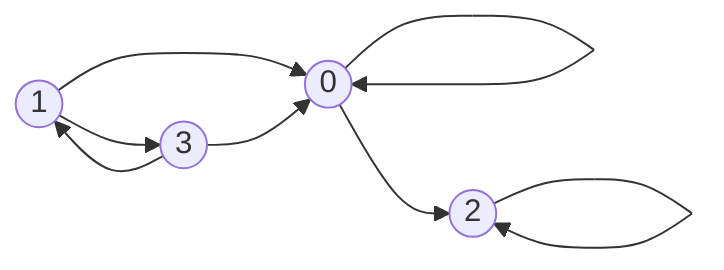
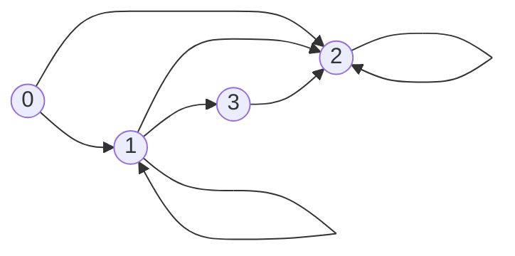
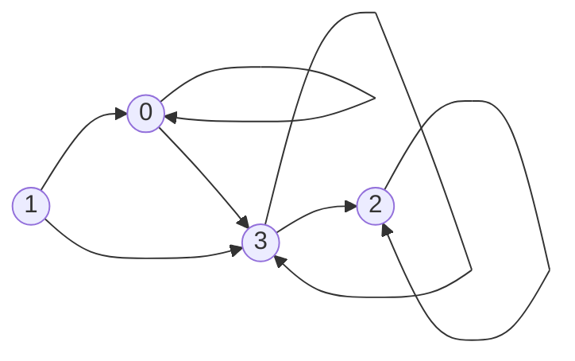
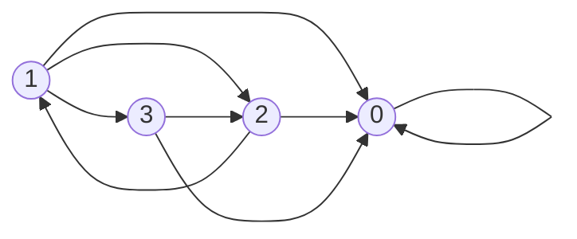
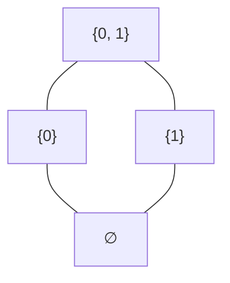
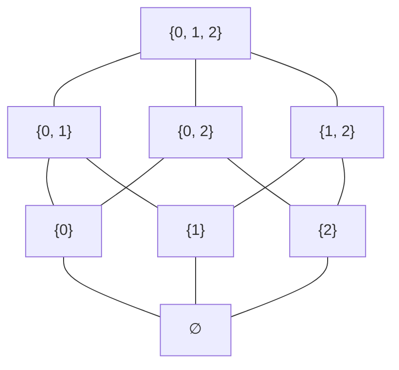
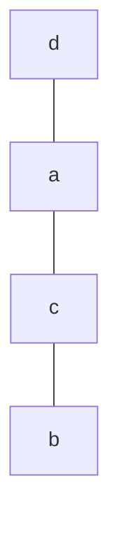
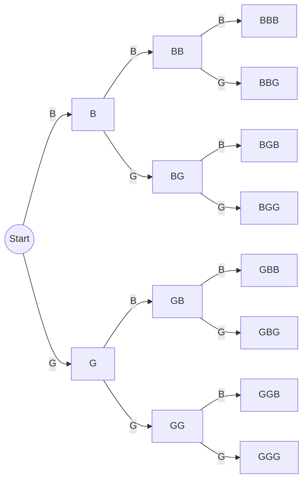

# HW9 Assignment Explanation — Partial Orders and Counting

[Repository Guide](../../README.md) | [English](Assignment-Explanation.md) | [한국어](Assignment-Explanation.ko.md)

> **Last Updated:** 2026-11-10
>
> Discrete Mathematics with Applications, Epp, Ch 8, 9

> **Learning Objectives:**
> 1. Decide whether a relation is antisymmetric, and prove or disprove that it is a partial order relation or a total order relation
> 2. Draw the Hasse diagram of a partially ordered set such as a power set under the subset relation
> 3. Write sample spaces and events as sets and compute probabilities with the equally likely probability formula
> 4. Count with the multiplication rule, the addition rule, the difference rule, and the formula for r-permutations, and prove an identity about permutations
> 5. Prove the formula for the Euler phi function with the inclusion/exclusion rule, and show with the pigeonhole principle that certain facts must hold

---

## Table of Contents

- [1. Exercise 8.5.1: Deciding Antisymmetry](#1-exercise-851-deciding-antisymmetry)
- [2. Exercise 8.5.7: Inclusion of Prime Factors](#2-exercise-857-inclusion-of-prime-factors)
- [3. Exercise 8.5.17: Hasse Diagrams of Power Sets](#3-exercise-8517-hasse-diagrams-of-power-sets)
- [4. Exercise 8.5.31: Deciding a Total Order](#4-exercise-8531-deciding-a-total-order)
- [5. Exercise 9.1.12: The Genders of Three Children](#5-exercise-9112-the-genders-of-three-children)
- [6. Exercise 9.1.25: The Size of a Subarray and a Probability](#6-exercise-9125-the-size-of-a-subarray-and-a-probability)
- [7. Exercise 9.2.16: Counting Two-Digit Integers](#7-exercise-9216-counting-two-digit-integers)
- [8. Exercise 9.2.41: An Identity about Numbers of Permutations](#8-exercise-9241-an-identity-about-numbers-of-permutations)
- [9. Exercise 9.3.7: Counting Passwords](#9-exercise-937-counting-passwords)
- [10. Exercise 9.3.40: The Euler Phi Function of a Product of Two Primes](#10-exercise-9340-the-euler-phi-function-of-a-product-of-two-primes)
- [11. Exercise 9.4.10: n + 1 Integers and an Odd Integer](#11-exercise-9410-n--1-integers-and-an-odd-integer)
- [12. Exercise 9.4.16: How Many Picks Guarantee a Multiple of 5](#12-exercise-9416-how-many-picks-guarantee-a-multiple-of-5)
- [Summary](#summary)
- [Self-Check Questions](#self-check-questions)

---

<br>

## 1. Exercise 8.5.1: Deciding Antisymmetry

**Problem.** Draw the directed graph of each of the following four relations on $\lbrace 0, 1, 2, 3 \rbrace$, and pick out the antisymmetric ones.

- (a) $R_1 = \lbrace (0, 0), (0, 2), (1, 0), (1, 3), (2, 2), (3, 0), (3, 1) \rbrace$
- (b) $R_2 = \lbrace (0, 1), (0, 2), (1, 1), (1, 2), (1, 3), (2, 2), (3, 2) \rbrace$
- (c) $R_3 = \lbrace (0, 0), (0, 3), (1, 0), (1, 3), (2, 2), (3, 3), (3, 2) \rbrace$
- (d) $R_4 = \lbrace (0, 0), (1, 0), (1, 2), (1, 3), (2, 0), (2, 1), (3, 2), (3, 0) \rbrace$

**Concepts used.** The definition of antisymmetry from [Chapter 8, Section 4](../../Lecture-Notes/Ch08_Properties-of-Relations/Concepts_Lecture.md) (Section 8.5 of the textbook) is used.

> **Definition:** A relation $R$ on a set $A$ is **antisymmetric** if for all $a, b \in A$, $`a \, R \, b`$ and $`b \, R \, a`$ imply $a = b$.

Taking the negation, $R$ is not antisymmetric when there are $a$ and $b$ with $`a \, R \, b`$, $`b \, R \, a`$, and $a \neq b$. In terms of the directed graph, the relation is not antisymmetric **if even one pair of distinct vertices has arrows in both directions**. A loop is the case $a = b$, so loops do not affect antisymmetry.

**Solution.** In each relation, for every ordered pair $(a, b)$ of distinct elements, check whether the reversed pair $(b, a)$ is also in the relation.

| Relation | Ordered pairs of distinct elements | Pairs whose reversal is also present | Antisymmetric? |
|:---:|:---|:---|:---:|
| $R_1$ | $(0, 2)$, $(1, 0)$, $(1, 3)$, $(3, 0)$, $(3, 1)$ | $(1, 3)$ and $(3, 1)$ | No |
| $R_2$ | $(0, 1)$, $(0, 2)$, $(1, 2)$, $(1, 3)$, $(3, 2)$ | None | Yes |
| $R_3$ | $(0, 3)$, $(1, 0)$, $(1, 3)$, $(3, 2)$ | None | Yes |
| $R_4$ | $(1, 0)$, $(1, 2)$, $(1, 3)$, $(2, 0)$, $(2, 1)$, $(3, 2)$, $(3, 0)$ | $(1, 2)$ and $(2, 1)$ | No |

*Table 1. Antisymmetry of the four relations*

Therefore the antisymmetric relations are $R_2$ and $R_3$. $R_1$ is not antisymmetric because $`1 \, R_1 \, 3`$ and $`3 \, R_1 \, 1`$ but $1 \neq 3$, and $R_4$ is not antisymmetric because $`1 \, R_4 \, 2`$ and $`2 \, R_4 \, 1`$ but $1 \neq 2$. The four directed graphs are as follows.



*Figure 1. Directed graph of the relation R₁*



*Figure 2. Directed graph of the relation R₂*



*Figure 3. Directed graph of the relation R₃*



*Figure 4. Directed graph of the relation R₄*

> **Caution:** Antisymmetric is not the negation of symmetric. For example, the relation $\lbrace (0, 0) \rbrace$ on $\lbrace 0, 1 \rbrace$ is both symmetric and antisymmetric, and the relation $\lbrace (0, 1), (1, 0), (1, 2) \rbrace$ on $\lbrace 0, 1, 2 \rbrace$ is neither. $R_2$ and $R_3$ are not symmetric either, and the reason is not that they are antisymmetric but that they have counterexamples to symmetry, such as $(0, 1) \in R_2$ with $(1, 0) \notin R_2$.

---

<br>

## 2. Exercise 8.5.7: Inclusion of Prime Factors

**Problem.** On $\mathbf{Z}$, let $`m \, R \, n`$ mean that every prime factor of $m$ is also a prime factor of $n$. Prove that $R$ is a partial order relation or refute it with a counterexample.

**Concepts used.** By Chapter 8, Section 4, a relation that is reflexive, antisymmetric, and transitive is a **partial order relation**. Hence if any one of the three properties fails, the relation is not a partial order relation.

**Solution.** $R$ is not a partial order relation, because it is not antisymmetric.

1. Let $m = 2$ and $n = 4$. The only prime factor of 2 is 2, and the only prime factor of $4 = 2^2$ is also 2.
2. Every prime factor of 2 (namely 2) is a prime factor of 4, so $`2 \, R \, 4`$.
3. Every prime factor of 4 (namely 2) is a prime factor of 2, so $`4 \, R \, 2`$.
4. But $2 \neq 4$, so $R$ is not antisymmetric.

The other two properties hold. Every prime factor of $m$ is obviously a prime factor of $m$, so $R$ is reflexive. If every prime factor of $m$ is a prime factor of $n$ and every prime factor of $n$ is a prime factor of $p$, then each prime factor of $m$ becomes, through $n$, a prime factor of $p$, so $R$ is transitive. Because $R$ compares only the **sets** of prime factors and ignores their exponents, distinct integers with the same set of prime factors ($2$ and $4$, $6$ and $12$, $2$ and $-2$, and so on) are related to each other, which breaks antisymmetry.

---

<br>

## 3. Exercise 8.5.17: Hasse Diagrams of Power Sets

**Problem.** For (a) $S = \lbrace 0, 1 \rbrace$ and (b) $S = \lbrace 0, 1, 2 \rbrace$, draw the Hasse diagram of the subset relation on the power set $\mathcal{P}(S)$.

**Concepts used.** The subset relation is reflexive, antisymmetric, and transitive, so it is a partial order relation (Exercise 8.2.23 of [HW8](../HW08_Relations-and-Equivalence-Relations/Assignment-Explanation.md)). The **Hasse diagram** of Chapter 8, Section 4 is obtained from the directed graph of a partial order relation by removing information in the following order.

1. Place the vertices so that every arrow points upward.
2. Remove all loops. By reflexivity every vertex has a loop, so loops need not be drawn.
3. Remove every arrow $x \to z$ that follows by transitivity from $x \subseteq y$ and $y \subseteq z$.
4. Remove the arrowheads and draw line segments; the direction is understood to be "from bottom to top".

As a result, the Hasse diagram keeps a segment only for pairs with $A \subsetneq B$ and no element between them. In a power set, such pairs are exactly those in which $B$ is $A$ with one more element, that is, $A \subseteq B$ and $N(B) = N(A) + 1$.

**Solution (a).** $\mathcal{P}(\lbrace 0, 1 \rbrace) = \lbrace \emptyset, \lbrace 0 \rbrace, \lbrace 1 \rbrace, \lbrace 0, 1 \rbrace \rbrace$. The inclusions that add one element at a time are $\emptyset \subseteq \lbrace 0 \rbrace$, $\emptyset \subseteq \lbrace 1 \rbrace$, $\lbrace 0 \rbrace \subseteq \lbrace 0, 1 \rbrace$, and $\lbrace 1 \rbrace \subseteq \lbrace 0, 1 \rbrace$; the inclusion $\emptyset \subseteq \lbrace 0, 1 \rbrace$ follows by transitivity through $\lbrace 0 \rbrace$, so it is not drawn.



*Figure 5. Hasse diagram of the subset relation on P({0, 1})*

**Solution (b).** $\mathcal{P}(\lbrace 0, 1, 2 \rbrace)$ has $2^3 = 8$ elements, which are placed in levels according to their number of elements: 0, 1, 2, or 3. Connect each set by a segment to every set obtained by adding one element. A set with $k$ elements has $3 - k$ elements not yet in it, so $3 - k$ segments go upward from it. There are $1 \cdot 3 + 3 \cdot 2 + 3 \cdot 1 = 12$ segments in all.



*Figure 6. Hasse diagram of the subset relation on P({0, 1, 2})*

Figure 6 has the structure of the vertices and edges of a cube. For example, $\lbrace 0 \rbrace \subseteq \lbrace 0, 1, 2 \rbrace$ is not drawn directly, but it can be read off from the upward path from $\lbrace 0 \rbrace$ through $\lbrace 0, 1 \rbrace$ to $\lbrace 0, 1, 2 \rbrace$. In a Hasse diagram, $x \preceq y$ means that there is a path from $x$ to $y$ that keeps going upward along segments.

---

<br>

## 4. Exercise 8.5.31: Deciding a Total Order

**Problem.** A relation $R$ on $A = \lbrace a, b, c, d \rbrace$ is given below.

```math
R = \lbrace (a, a), (b, b), (c, c), (d, d), (c, a), (a, d), (c, d), (b, c), (b, d), (b, a) \rbrace
```

Decide, with justification, whether $R$ is a total order relation on $A$.

**Concepts used.** By Chapter 8, Section 4, elements $a$ and $b$ are **comparable** under a partial order relation $R$ if $`a \, R \, b`$ or $`b \, R \, a`$. A partial order relation under which every two elements of $A$ are comparable is a **total order relation**. A subset in which every two elements are comparable is a **chain**, so a total order relation is a partial order relation under which all of $A$ is a single chain.

**Solution.** $R$ is a total order relation. Four things are checked in turn.

**(1) Reflexive.** $(a, a)$, $(b, b)$, $(c, c)$, and $(d, d)$ are all in $R$.

**(2) Antisymmetric.** The pairs other than loops are the six pairs $(c, a)$, $(a, d)$, $(c, d)$, $(b, c)$, $(b, d)$, $(b, a)$, and none of their reversals $(a, c)$, $(d, a)$, $(d, c)$, $(c, b)$, $(d, b)$, $(a, b)$ is in $R$.

**(3) Transitive.** Cases involving a loop ($`x \, R \, x`$ and $`x \, R \, z`$ give $`x \, R \, z`$) are trivial, so only the cases in which two non-loop pairs are linked by a middle element need checking.

| $`x \, R \, y`$ | $`y \, R \, z`$ | Required $`x \, R \, z`$ | In $R$? |
|:---:|:---:|:---:|:---:|
| $(c, a)$ | $(a, d)$ | $(c, d)$ | Yes |
| $(b, c)$ | $(c, a)$ | $(b, a)$ | Yes |
| $(b, c)$ | $(c, d)$ | $(b, d)$ | Yes |
| $(b, a)$ | $(a, d)$ | $(b, d)$ | Yes |

*Table 2. Transitivity check for every case in which two non-loop pairs are linked*

No pair can follow a non-loop pair whose second component is $d$, because the only pair starting at $d$ is a loop. Hence the only non-loop pairs that can be followed by another pair are those whose second component is $a$ or $c$, namely $(c, a)$, $(b, a)$, and $(b, c)$, and Table 2 contains every case that follows these three pairs. Therefore $R$ is a partial order relation.

**(4) Every two elements are comparable.** There are $\binom{4}{2} = 6$ pairs of distinct elements, and for each pair one of the two ordered pairs is in $R$: $\lbrace a, b \rbrace$ by $(b, a)$, $\lbrace a, c \rbrace$ by $(c, a)$, $\lbrace a, d \rbrace$ by $(a, d)$, $\lbrace b, c \rbrace$ by $(b, c)$, $\lbrace b, d \rbrace$ by $(b, d)$, and $\lbrace c, d \rbrace$ by $(c, d)$.

Therefore $R$ is a total order relation on $A$, and listing the elements in order gives $`b \, R \, c`$, $`c \, R \, a`$, $`a \, R \, d`$. That is, $[b, c, a, d]$ is a chain containing every element of $A$, and the Hasse diagram is a single vertical line.



*Figure 7. Hasse diagram of the total order relation R*

---

<br>

## 5. Exercise 9.1.12: The Genders of Three Children

**Problem.** Assume that each child is a boy (B) or a girl (G) with equal probability, and record the genders of three children in birth order, as in $BBG$. (a) List the eight outcomes of the sample space. (b) Write as a set, and find the probability of, the event that (i) exactly one child is a girl, (ii) two or more children are girls, and (iii) no child is a girl.

**Concepts used.** By [Chapter 9, Section 1](../../Lecture-Notes/Ch09_Counting-and-Probability/Concepts_Lecture.md), a **sample space** is the set of all possible outcomes of a random process, and an **event** is a subset of the sample space. In a finite sample space $S$ whose outcomes are all equally likely, the **equally likely probability formula** gives the probability of an event $E$ as $P(E) = N(E)/N(S)$.

**Solution (a).** A possibility tree that fixes the genders of the first, second, and third child in turn lists all outcomes without omission or repetition.



*Figure 8. Possibility tree fixing the genders of three children in turn*

Each step has 2 branches, so there are $2 \cdot 2 \cdot 2 = 8$ leaves, and the sample space is as follows.

```math
S = \lbrace BBB, BBG, BGB, BGG, GBB, GBG, GGB, GGG \rbrace
```

Each child is a boy or a girl with equal chance, independently of the others, so the eight outcomes are equally likely, each with probability $\frac{1}{8}$.

**Solution (b).** Count the $G$'s in each outcome to decide which events it belongs to.

| Event | Set | Number of elements | Probability |
|:---|:---|:---:|:---:|
| (i) Exactly one girl | $\lbrace BBG, BGB, GBB \rbrace$ | 3 | $\frac{3}{8}$ |
| (ii) At least two girls | $\lbrace BGG, GBG, GGB, GGG \rbrace$ | 4 | $\frac{4}{8} = \frac{1}{2}$ |
| (iii) No girl | $\lbrace BBB \rbrace$ | 1 | $\frac{1}{8}$ |

*Table 3. Sets and probabilities of the three events*

"At least two" in (ii) includes both exactly two ($BGG$, $GBG$, $`GGB`$) and three ($`GGG`$). As a check, the numbers of outcomes with 0, 1, 2, and 3 girls, namely $1, 3, 3, 1$, add up to $8$.

---

<br>

## 6. Exercise 9.1.25: The Size of a Subarray and a Probability

**Problem.** For $n \ge 2$, consider the subarray $A[\lfloor n/2 \rfloor], \ldots, A[n]$ of a one-dimensional array $A[1], \ldots, A[n]$. Find (a) the number of its elements and (b) the probability that an element chosen at random from the array lies in the subarray, each (i) for even $n$ and (ii) for odd $n$.

**Concepts used.** By Theorem 9.1.1, for integers $m \le n$ there are $n - m + 1$ integers from $m$ to $n$. The number of array elements equals the number of indices, so count the integers from $\lfloor n/2 \rfloor$ to $n$. By Theorem 4.6.2 of Chapter 4, $\lfloor n/2 \rfloor = n/2$ if $n$ is even and $\lfloor n/2 \rfloor = (n - 1)/2$ if $n$ is odd. Since $n \ge 2$, $\lfloor n/2 \rfloor \ge 1$, so the indices lie within the array.

**Solution (a).** The number of elements is $n - \lfloor n/2 \rfloor + 1$.

- (i) If $n$ is even, there are $n - \frac{n}{2} + 1 = \frac{n}{2} + 1$ elements.
- (ii) If $n$ is odd, there are $n - \frac{n - 1}{2} + 1 = \frac{2n - (n - 1) + 2}{2} = \frac{n + 3}{2}$ elements.

**Solution (b).** The array has $n$ elements in all, and the choice is random, so every element is equally likely to be chosen. By the equally likely probability formula, the probability is the count from (a) divided by $n$.

- (i) If $n$ is even, it is $\dfrac{n/2 + 1}{n} = \dfrac{n + 2}{2n}$.
- (ii) If $n$ is odd, it is $\dfrac{(n + 3)/2}{n} = \dfrac{n + 3}{2n}$.

| $n$ | $\lfloor n/2 \rfloor$ | Subarray | Number of elements | Probability |
|:---:|:---:|:---|:---:|:---:|
| 10 | 5 | $A[5], \ldots, A[10]$ | $6 = \frac{10}{2} + 1$ | $\frac{6}{10} = \frac{12}{20}$ |
| 7 | 3 | $A[3], \ldots, A[7]$ | $5 = \frac{7 + 3}{2}$ | $\frac{5}{7} = \frac{10}{14}$ |

*Table 4. Checking the formulas at n = 10 and n = 7*

> **Caution:** The subarray starts at $A[\lfloor n/2 \rfloor]$, so it has $n - \lfloor n/2 \rfloor + 1$ elements, not $n - \lfloor n/2 \rfloor$. Forgetting to add 1 when counting a range that includes both ends is called a fencepost error.

---

<br>

## 7. Exercise 9.2.16: Counting Two-Digit Integers

**Problem.** For the integers from 10 through 99, find (a) how many there are, (b) how many are odd, (c) how many have two different digits, and (d) how many are odd with two different digits, and (e) find the probability that an integer chosen at random from this range has two different digits, and the probability that it has two different digits and is odd.

**Concepts used.** By Theorem 9.2.1, the **multiplication rule**, if an operation consists of $k$ steps and step $i$ can be performed in $n_i$ ways regardless of how the earlier steps were performed, then the whole operation can be performed in $n_1 n_2 \cdots n_k$ ways. A two-digit integer is formed in two steps: choose the tens digit, then choose the units digit. The tens digit can be 1 through 9, and the units digit can be 0 through 9.

**Solution.**

| Part | Choices at each step | Count |
|:---|:---|:---:|
| (a) All | $99 - 10 + 1$ by Theorem 9.1.1, or 9 tens digits $\times$ 10 units digits | 90 |
| (b) Odd | 9 tens digits $\times$ 5 units digits from $\lbrace 1, 3, 5, 7, 9 \rbrace$ | 45 |
| (c) Distinct digits | 9 tens digits $\times$ 9 units digits (excluding the tens digit) | 81 |
| (d) Odd with distinct digits | 5 units digits (odd) $\times$ 8 tens digits (excluding 0 and the units digit) | 40 |

*Table 5. Choices at each step when counting two-digit integers*

(c) can also be checked by subtraction: the integers with equal digits are the 9 integers $11, 22, \ldots, 99$, so $90 - 9 = 81$.

In (d) the **units digit is chosen first**. The units digit is odd, so it is not 0; hence exactly one digit, the units digit, is removed from the tens candidates 1 through 9, leaving 8 choices every time. If the tens digit were chosen first, the units digit would have 4 choices when the tens digit is odd and 5 when it is even, so the number of choices at each step would not be constant and the multiplication rule could not be applied directly. In that case, splitting into cases gives the same answer, $5 \cdot 4 + 4 \cdot 5 = 20 + 20 = 40$.

**Solution (e).** The 90 two-digit integers are equally likely to be chosen, so the equally likely probability formula applies.

```math
P(\text{distinct digits}) = \frac{81}{90} = \frac{9}{10}, \qquad P(\text{distinct digits and odd}) = \frac{40}{90} = \frac{4}{9}
```

> **Key Point:** The multiplication rule applies when the **number** of choices at each step is constant regardless of what was chosen at earlier steps. The choices themselves may differ, but their number must be the same. Choosing the most constrained position first (here the units digit, which must be odd) makes this condition easy to meet.

---

<br>

## 8. Exercise 9.2.41: An Identity about Numbers of Permutations

**Problem.** Show that the identity $P(n + 1, 2) - P(n, 2) = 2P(n, 1)$ holds for every integer $n \ge 2$.

**Concepts used.** An ordered selection of $r$ distinct elements from a set of $n$ elements is an **r-permutation**, and the number of them is written $P(n, r)$. By Theorem 9.2.3, if $1 \le r \le n$, then the following holds.

```math
P(n, r) = n(n - 1)(n - 2) \cdots (n - r + 1) = \frac{n!}{(n - r)!}
```

The condition $n \ge 2$ is there because applying Theorem 9.2.3 to $P(n, 2)$ requires $r = 2 \le n$.

**Solution.** Take any integer $n \ge 2$. Since $2 \le n < n + 1$, Theorem 9.2.3 applies to all three terms.

1. $P(n + 1, 2) = (n + 1) \cdot n$: $n + 1$ choices for the first element times $n$ choices for the second.
2. $P(n, 2) = n(n - 1)$.
3. $P(n, 1) = n$.

Simplifying the left-hand side therefore gives the following.

```math
\begin{aligned}
P(n + 1, 2) - P(n, 2) &= (n + 1)n - n(n - 1) \\
&= n\big[(n + 1) - (n - 1)\big] \\
&= 2n = 2P(n, 1)
\end{aligned}
```

Starting from the factorial forms $P(n + 1, 2) = \frac{(n + 1)!}{(n - 1)!}$ and $P(n, 2) = \frac{n!}{(n - 2)!}$ and canceling also leads to the same expression.

The identity can also be explained by counting. Split a set of $n + 1$ elements as $X = Y \cup \lbrace x \rbrace$, where $Y$ has $n$ elements. Among the $P(n + 1, 2)$ 2-permutations of $X$, those that do not use $x$ are the 2-permutations of $Y$, of which there are $P(n, 2)$. Hence the difference $P(n + 1, 2) - P(n, 2)$ counts the 2-permutations that use $x$. These split into $n$ with $x$ in the first position and $n$ with $x$ in the second position, so there are $2n = 2P(n, 1)$ of them.

---

<br>

## 9. Exercise 9.3.7: Counting Passwords

**Problem.** A company builds passwords of length 3 through 5 from 50 symbols: the 26 uppercase Roman letters, the 10 digits, and 14 special symbols. Find (a) the number of passwords when symbols may be reused, (b) the number of passwords in which no symbol occurs twice, (c) the number of passwords in which some symbol occurs at least twice, and (d) the probability that a randomly chosen password has a symbol occurring at least twice.

**Concepts used.** The multiplication rule and r-permutations from Chapter 9, Section 2 and Theorem 9.3.1, the **addition rule**, and Theorem 9.3.2, the **difference rule**, from Chapter 9, Section 3 are used. The addition rule states that if a finite set $A$ is the union of mutually disjoint subsets $A_1, \ldots, A_k$, then $N(A) = N(A_1) + \cdots + N(A_k)$; the difference rule states that $N(A - B) = N(A) - N(B)$ for finite sets with $B \subseteq A$. There are $26 + 10 + 14 = 50$ usable symbols in all.

**Solution (a).** Split the set of all passwords into the sets of passwords of lengths 3, 4, and 5; these three sets are mutually disjoint, so the addition rule applies. A password of length $k$ with repetition allowed has 50 choices for each position, so by the multiplication rule there are $50^k$ of them.

```math
50^3 + 50^4 + 50^5 = 125{,}000 + 6{,}250{,}000 + 312{,}500{,}000 = 318{,}875{,}000
```

**Solution (b).** A password of length $k$ with no repeated symbol is an ordered selection of $k$ distinct symbols from the 50, that is, a $k$-permutation of 50 elements. Again add over the lengths.

```math
\begin{aligned}
P(50, 3) &= 50 \cdot 49 \cdot 48 = 117{,}600 \\
P(50, 4) &= 50 \cdot 49 \cdot 48 \cdot 47 = 5{,}527{,}200 \\
P(50, 5) &= 50 \cdot 49 \cdot 48 \cdot 47 \cdot 46 = 254{,}251{,}200
\end{aligned}
```

Therefore there are $117{,}600 + 5{,}527{,}200 + 254{,}251{,}200 = 259{,}896{,}000$ passwords with no repeated symbol.

**Solution (c).** The set of passwords with a repeated symbol is the difference of the set of all passwords and the set of passwords with no repetition. By the difference rule, the count is as follows.

```math
318{,}875{,}000 - 259{,}896{,}000 = 58{,}979{,}000
```

**Solution (d).** Regarding the 318,875,000 passwords as equally likely, the equally likely probability formula gives the following.

```math
\frac{58{,}979{,}000}{318{,}875{,}000} \approx 0.185
```

That is, about 18.5%. The formula for the probability of a complement in Chapter 9, Section 3 gives the same value, $1 - \frac{259{,}896{,}000}{318{,}875{,}000} \approx 1 - 0.815 = 0.185$.

> **Key Point:** Counting "at least one repeated symbol" directly splits into many cases according to how many symbols repeat and where. The opposite event "no repeated symbol" is counted at once by r-permutations, so subtracting the opposite event from the total with the difference rule is much simpler.

---

<br>

## 10. Exercise 9.3.40: The Euler Phi Function of a Product of Two Primes

**Problem.** For $n = pq$ with distinct primes $p$ and $q$, show by the inclusion/exclusion rule that $\varphi(n) = (p - 1)(q - 1)$.

**Concepts used.** The **Euler phi function** defined in Exercises 7.1.51-7.1.53 is as follows.

> **Definition:** **Euler phi function.** For each integer $n \ge 1$, $\varphi(n)$ is the number of positive integers less than or equal to $n$ that have no common factors with $n$ except $\pm 1$. For example, the positive integers up to 9 whose only common factors with 9 are $\pm 1$ are the non-multiples of 3, namely 1, 2, 4, 5, 7, 8, so $\varphi(9) = 6$.

By Theorem 9.3.3, the **inclusion/exclusion rule**, $N(A \cup B) = N(A) + N(B) - N(A \cap B)$ for finite sets $A$ and $B$. The strategy of the proof is not to count the integers counted by $\varphi(n)$ directly, but to count the opposite, "integers that share a common factor greater than 1 with $n$", and subtract from the total.

**Solution.** Let $p$ and $q$ be distinct primes and let $n = pq$. Define the following sets.

```math
U = \lbrace 1, 2, \ldots, n \rbrace, \qquad A = \lbrace k \in U \mid p \mid k \rbrace, \qquad B = \lbrace k \in U \mid q \mid k \rbrace
```

**Step 1: The integers sharing a common factor greater than 1 with $n$ are exactly the elements of $A \cup B$.** Suppose $k \in U$.

- If $k \in A$, then $p$ is a common factor of $k$ and $n$, and $p > 1$. The same holds when $k \in B$.
- Conversely, suppose $k$ and $n$ have a common factor $d > 1$. Since $d > 1$, $d$ is divisible by some prime $r$ (Theorem 4.4.4). By transitivity of divisibility (Theorem 4.4.3), $r \mid k$ and $r \mid n = pq$. By the unique factorization of integers theorem (Theorem 4.4.5), the only prime factors of $pq$ are $p$ and $q$, so $r = p$ or $r = q$. Hence $k \in A$ or $k \in B$.

Therefore the set counted by $\varphi(n)$ is $U - (A \cup B)$, and since $A \cup B \subseteq U$, the difference rule gives $\varphi(n) = N(U) - N(A \cup B)$.

**Step 2: The number of elements of each set.**

- $N(U) = n = pq$.
- The elements of $A$ are $p \cdot 1, p \cdot 2, \ldots, p \cdot q$. Since $1 \le pj \le pq$ if and only if $1 \le j \le q$, $N(A) = q$.
- For the same reason, $B = \lbrace q \cdot 1, q \cdot 2, \ldots, q \cdot p \rbrace$ and $N(B) = p$.
- If $k \in A \cap B$, then $p \mid k$ and $q \mid k$. Since $p$ and $q$ are distinct primes, by the unique factorization theorem both $p$ and $q$ appear in the prime factorization of $k$, so $pq \mid k$. The only multiple of $pq$ with $1 \le k \le pq$ is $pq$ itself, so $A \cap B = \lbrace pq \rbrace$ and $N(A \cap B) = 1$.

**Step 3: Inclusion/exclusion.** $N(A \cup B) = N(A) + N(B) - N(A \cap B) = q + p - 1$. Therefore the following holds.

```math
\varphi(n) = pq - (p + q - 1) = pq - p - q + 1 = (p - 1)(q - 1)
```

For example, if $n = 15 = 3 \cdot 5$, then up to 15 there are 5 multiples of 3, 3 multiples of 5, and one multiple of both, namely 15, so $N(A \cup B) = 5 + 3 - 1 = 7$ and $\varphi(15) = 15 - 7 = 8 = (3 - 1)(5 - 1)$. Indeed, the integers relatively prime to 15 are the 8 integers 1, 2, 4, 7, 8, 11, 13, 14.

> **Caution:** If $N(A \cap B)$ is not subtracted, $pq$ is removed twice, once through $A$ and once through $B$, and the answer comes out 1 too small. Removing exactly this double count is why the inclusion/exclusion rule adds the intersection back.

---

<br>

## 11. Exercise 9.4.10: n + 1 Integers and an Odd Integer

**Problem.** For a positive integer $n$, decide whether choosing $n + 1$ distinct integers from $\lbrace 1, 2, 3, \ldots, 2n \rbrace$ always yields at least one odd integer, and explain why.

**Concepts used.** By Theorem 9.4.1, the **pigeonhole principle**, a function from a finite set with $n$ elements to a finite set with $m$ elements is not one-to-one if $n > m$. In other words, if $n + 1$ pigeons fly into $n$ pigeonholes, some pigeonhole receives two or more pigeons.

**Solution.** Yes. At least one of them must be odd.

1. The even integers in $\lbrace 1, 2, \ldots, 2n \rbrace$ are $2 \cdot 1, 2 \cdot 2, \ldots, 2 \cdot n$, exactly $n$ of them. Let $E$ denote this set of even integers.
2. Suppose all $n + 1$ chosen integers were even. Then the set $C$ of chosen integers would be a subset of $E$.
3. The function $f: C \to E$ that sends each chosen integer to itself, $f(x) = x$, sends distinct integers to distinct integers, so it is one-to-one.
4. But $N(C) = n + 1 > n = N(E)$, so by the pigeonhole principle $f$ cannot be one-to-one. This is a contradiction.

Therefore the chosen integers cannot all be even, and at least one of them is odd.

The pigeonholes can also be chosen differently. Taking the $n$ pairs $\lbrace 1, 2 \rbrace, \lbrace 3, 4 \rbrace, \ldots, \lbrace 2n - 1, 2n \rbrace$ as pigeonholes, two of the $n + 1$ integers fall into the same pair $\lbrace 2k - 1, 2k \rbrace$. Both integers of that pair are chosen, so $2k - 1$ is a chosen odd integer. Moreover, $n + 1$ is the smallest number that works, because $n$ chosen integers can all be even, as in $2, 4, \ldots, 2n$.

> **Note:** In this problem "chosen" must be read as choosing distinct integers. If the same integer could be chosen several times, 2 could be chosen $n + 1$ times, and the conclusion would fail.

---

<br>

## 12. Exercise 9.4.16: How Many Picks Guarantee a Multiple of 5

**Problem.** Find how many integers from 1 through 100 must be picked to guarantee at least one that is divisible by 5.

**Concepts used.** To guarantee a multiple of 5 means to get one even with the most unfavorable picks. Hence the answer is the number such that (1) picking that many integers always includes a multiple of 5, however they are picked, and (2) picking one fewer can avoid multiples of 5 entirely. The same counting comparison as in the pigeonhole principle of Chapter 9, Section 4 is used.

**Solution.** The answer is 81.

1. The multiples of 5 from 1 through 100 are $5 \cdot 1, 5 \cdot 2, \ldots, 5 \cdot 20$, so there are 20 of them. Hence there are $100 - 20 = 80$ integers that are not multiples of 5.
2. **80 are not enough.** Picking all 80 non-multiples of 5 yields no multiple of 5.
3. **81 are enough.** If 81 distinct integers are picked, they cannot all lie in the 80-element set of non-multiples of 5, because an 81-element set cannot be a subset of an 80-element set. Hence at least one of them is a multiple of 5.

> **Key Point:** For a problem of the form "how many must be picked to be sure of getting one", the answer is (the number of unwanted elements) + 1. As soon as the worst case of picking every unwanted element is exceeded, a wanted element must be included.

---

<br>

## Summary

| Concept | Key Summary |
|:-----|:-----|
| Antisymmetry | $`a \, R \, b`$ and $`b \, R \, a`$ imply $a = b$; in the directed graph, no two distinct vertices have arrows in both directions. |
| Partial order relation | A relation that is reflexive, antisymmetric, and transitive; if two distinct elements are related to each other, as under the relation comparing only sets of prime factors, it is not a partial order. |
| Hasse diagram | Point arrows upward and remove loops, arrows implied by transitivity, and arrowheads; in a power set, connect sets that differ by exactly one element. |
| Total order relation | A partial order relation under which every two elements are comparable, so that all the elements form a single chain. |
| Equally likely probability formula | In a finite sample space with equally likely outcomes, $P(E) = N(E)/N(S)$. |
| Number of elements in a list | There are $n - m + 1$ integers from $m$ to $n$ inclusive. |
| Multiplication rule | Multiply the numbers of choices at each step when each number is constant regardless of earlier steps, choosing the most constrained step first. |
| r-permutation | $P(n, r) = n(n-1)\cdots(n-r+1) = \frac{n!}{(n-r)!}$. |
| Addition and difference rules | Add over disjoint cases, and count "at least one" by subtracting the opposite case from the total. |
| Inclusion/exclusion rule | $N(A \cup B) = N(A) + N(B) - N(A \cap B)$, which gives $\varphi(pq) = (p - 1)(q - 1)$ for distinct primes $p$ and $q$. |
| Pigeonhole principle | A function from a larger finite set to a smaller one is not one-to-one, and the answer to "how many to be sure" is the worst-case count plus 1. |

---

<br>

## Self-Check Questions

1. **Symmetry and antisymmetry:** Give an example of a relation that is both symmetric and antisymmetric, and describe the general form of such relations.

   <details>
   <summary>Answer</summary>

   The relation $\lbrace (0, 0), (1, 1) \rbrace$ on $\lbrace 0, 1 \rbrace$ is an example. If a relation is symmetric and antisymmetric, then $`a \, R \, b`$ gives $`b \, R \, a`$ by symmetry and $a = b$ by antisymmetry. Hence such a relation consists of loops only, that is, it has the form $\lbrace (a, a) \mid a \in B \rbrace$ with $B \subseteq A$.

   </details>

2. **Hasse diagram:** List all segments drawn in the Hasse diagram of the divisibility relation on $\lbrace 1, 2, 3, 4, 6, 12 \rbrace$.

   <details>
   <summary>Answer</summary>

   There are 7: $1$ and $2$, $1$ and $3$, $2$ and $4$, $2$ and $6$, $3$ and $6$, $4$ and $12$, and $6$ and $12$. For example, $1 \mid 4$ follows by transitivity from $1 \mid 2$ and $2 \mid 4$, so it is not drawn, and $3 \mid 12$ follows through $6$, so it is not drawn either.

   </details>

3. **Probability:** For the family of Exercise 9.1.12, find the probability that exactly two children are girls.

   <details>
   <summary>Answer</summary>

   The event is $\lbrace BGG, GBG, GGB \rbrace$, so the probability is $\frac{3}{8}$.

   </details>

4. **Multiplication rule:** How many three-digit integers (100 through 999) have three distinct digits?

   <details>
   <summary>Answer</summary>

   The hundreds digit has 9 choices (1 through 9), the tens digit has 9 choices (any digit except the hundreds digit, including 0), and the units digit has 8 choices (excluding the two digits already used), so there are $9 \cdot 9 \cdot 8 = 648$.

   </details>

5. **Euler phi function:** Use the result of Exercise 9.3.40 to find $\varphi(21)$, and check it by writing out each term of the inclusion/exclusion rule.

   <details>
   <summary>Answer</summary>

   Since $21 = 3 \cdot 7$, $\varphi(21) = (3 - 1)(7 - 1) = 12$. Up to 21 there are 7 multiples of 3, 3 multiples of 7, and one multiple of both, namely 21, so $21 - (7 + 3 - 1) = 12$.

   </details>

6. **Pigeonhole principle:** How many integers from 1 through 100 must be picked to be sure of getting a multiple of 3?

   <details>
   <summary>Answer</summary>

   The multiples of 3 are the 33 integers $3 \cdot 1, \ldots, 3 \cdot 33$, so 67 integers are not multiples of 3. Picking 67 integers may yield no multiple of 3, while picking 68 must include one, so the answer is 68.

   </details>
