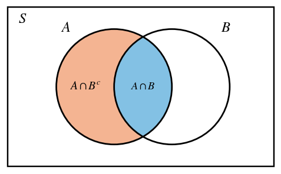
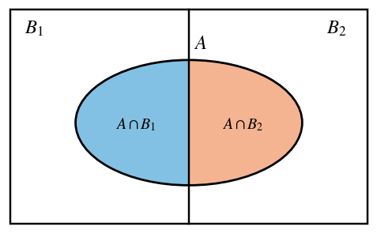
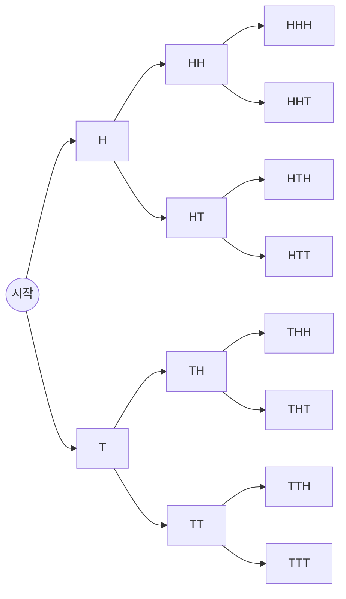

# HW10 과제 해설 — 조합과 확률

[레포지토리 안내](../../README.ko.md) | [English](Assignment-Explanation.md) | [한국어](Assignment-Explanation.ko.md)

> **최종 수정일:** 2026-11-04
>
> Discrete Mathematics with Applications, Epp, Ch 9

> **학습 목표:**
> 1. r-조합의 수 $\binom{n}{r}$에 곱의 법칙, 합의 법칙, 차의 법칙을 결합하여 조건이 붙은 선택의 수를 셀 수 있다
> 2. 방정식의 음이 아닌 정수해와 양의 정수해의 개수를 중복을 허용하는 r-조합의 수로 구할 수 있다
> 3. 파스칼의 공식으로 이항계수를 계산하고, 이항계수가 들어간 합의 공식을 수학적 귀납법으로 증명할 수 있다
> 4. 확률의 공리와 여사건의 확률 공식으로 사건의 확률을 계산할 수 있다
> 5. 조건부 확률의 정의로부터 $P(A \mid B^c)$의 공식과 두 사건에 대한 베이즈 정리를 유도할 수 있다
> 6. 조건부 확률을 계산하여 두 사건이 독립인지 판정할 수 있다

---

## 목차

- [1. 연습 문제 9.5.7: 조건이 붙은 팀 구성](#1-연습-문제-957-조건이-붙은-팀-구성)
- [2. 연습 문제 9.5.17: 점이 정하는 직선과 삼각형](#2-연습-문제-9517-점이-정하는-직선과-삼각형)
- [3. 연습 문제 9.6.10: 음이 아닌 정수해의 개수](#3-연습-문제-9610-음이-아닌-정수해의-개수)
- [4. 연습 문제 9.6.11: 양의 정수해의 개수](#4-연습-문제-9611-양의-정수해의-개수)
- [5. 연습 문제 9.7.10: 파스칼의 삼각형](#5-연습-문제-9710-파스칼의-삼각형)
- [6. 연습 문제 9.7.14: 이항계수로 나타낸 합의 공식](#6-연습-문제-9714-이항계수로-나타낸-합의-공식)
- [7. 연습 문제 9.8.7: 확률의 공리 적용](#7-연습-문제-987-확률의-공리-적용)
- [8. 연습 문제 9.9.5: 여사건이 주어졌을 때의 조건부 확률](#8-연습-문제-995-여사건이-주어졌을-때의-조건부-확률)
- [9. 연습 문제 9.9.9: 두 사건에 대한 베이즈 정리](#9-연습-문제-999-두-사건에-대한-베이즈-정리)
- [10. 연습 문제 9.9.20: 동전 던지기와 독립 사건](#10-연습-문제-9920-동전-던지기와-독립-사건)
- [요약](#요약)
- [점검 문제](#점검-문제)

---

<br>

## 1. 연습 문제 9.5.7: 조건이 붙은 팀 구성

**문제.** 팀원 13명 중에서 프로젝트를 맡을 7명을 고르는 방법의 수를 조건마다 센다. (a) 조건이 없을 때, (b) 팀원이 여성 7명과 남성 6명일 때 (i) 여성 4명과 남성 3명, (ii) 남성 1명 이상, (iii) 여성 3명 이하인 경우, (c) 정해진 두 사람을 함께 고를 수 없을 때, (d) 정해진 두 사람을 둘 다 고르거나 둘 다 빼야 할 때의 수를 구한다.

**사용하는 개념.** 원소가 $n$개인 집합에서 순서를 생각하지 않고 원소 $r$개를 골라 만든 부분집합을 **r-조합(r-combination)** 이라 하고, 그 개수를 $\binom{n}{r}$로 쓰고 n 선택 r(n choose r)로 읽는다([9장 5절](../../Lecture-Notes/Ch09_Counting-and-Probability/Concepts_Lecture.ko.md)). 정리 9.5.1에 의해 $0 \le r \le n$이면 다음이 성립한다.

```math
\binom{n}{r} = \frac{n!}{r!\,(n-r)!}
```

여기에 선택을 여러 단계로 나누어 각 단계의 경우의 수를 곱하는 **곱의 법칙(multiplication rule)**, 서로 겹치지 않는 경우로 나누어 더하는 **합의 법칙(addition rule)**, 전체에서 원하지 않는 경우를 빼는 **차의 법칙(difference rule)** 을 결합한다([9장 2절, 3절](../../Lecture-Notes/Ch09_Counting-and-Probability/Concepts_Lecture.ko.md)).

**풀이.**

**(a)** 13명 중 7명을 순서 없이 고르므로 7-조합의 수를 구한다. 분자와 분모에 공통인 $7!$을 약분하면 다음과 같다.

```math
\binom{13}{7} = \frac{13!}{7!\,6!} = \frac{13 \cdot 12 \cdot 11 \cdot 10 \cdot 9 \cdot 8}{6 \cdot 5 \cdot 4 \cdot 3 \cdot 2 \cdot 1} = \frac{1235520}{720} = 1716
```

**(b)(i)** 1단계에서 여성 7명 중 4명을 고르고, 2단계에서 남성 6명 중 3명을 고른다. 1단계에서 누구를 골랐든 2단계의 경우의 수는 같으므로 곱의 법칙을 쓸 수 있다.

```math
\binom{7}{4}\binom{6}{3} = 35 \cdot 20 = 700
```

**(b)(ii)** 남성이 적어도 1명인 7명은 전체 7명에서 남성이 한 명도 없는 7명, 곧 여성만으로 이루어진 7명을 뺀 것이다. 여성은 정확히 7명이므로 여성만으로 이루어진 7명은 $\binom{7}{7} = 1$가지뿐이다. 차의 법칙에 의해 답은 $1716 - 1 = 1715$가지이다.

**(b)(iii)** 여성이 많아야 3명이면 여성의 수 $k$는 0, 1, 2, 3 중 하나이고, 나머지 $7 - k$명은 남성이다. 그런데 남성은 6명뿐이므로 $7 - k \le 6$, 곧 $k \ge 1$이어야 한다. 여성의 수가 다른 경우끼리는 겹치지 않으므로 경우별로 곱의 법칙으로 센 뒤 합의 법칙으로 더한다.

| 여성 수 $k$ | 남성 수 $7-k$ | 경우의 수 |
|:---:|:---:|:---|
| 0 | 7 | 남성이 6명뿐이므로 불가능하다 (0가지) |
| 1 | 6 | $\binom{7}{1}\binom{6}{6} = 7 \cdot 1 = 7$ |
| 2 | 5 | $\binom{7}{2}\binom{6}{5} = 21 \cdot 6 = 126$ |
| 3 | 4 | $\binom{7}{3}\binom{6}{4} = 35 \cdot 15 = 525$ |

*표 1. 여성이 많아야 3명인 7명을 여성 수로 나눈 경우*

따라서 답은 $7 + 126 + 525 = 658$가지이다.

**(c)** 함께 일하기를 거부하는 두 사람을 $X$, $Y$라 한다. 허용되지 않는 7명은 $X$와 $Y$를 모두 포함하는 7명이다. 이런 7명은 $X$와 $Y$를 넣은 뒤 나머지 11명 중 5명을 더 고르면 정해지므로 $\binom{11}{5} = 462$가지이다. 차의 법칙에 의해 답은 $1716 - 462 = 1254$가지이다.

같은 답을 합의 법칙으로도 얻을 수 있다. 허용되는 7명은 $X$만 포함하는 경우, $Y$만 포함하는 경우, 둘 다 포함하지 않는 경우로 겹치지 않게 나뉜다. $X$만 포함하면 $X$와 $Y$를 뺀 11명 중 6명을 고르므로 $\binom{11}{6} = 462$가지이고, $Y$만 포함하는 경우도 462가지이며, 둘 다 빠지면 11명 중 7명을 고르므로 $\binom{11}{7} = 330$가지이다. 합은 $462 + 462 + 330 = 1254$로 같다.

**(d)** 두 사람을 $X$, $Y$라 하면 허용되는 7명은 둘을 모두 포함하는 경우와 둘 다 포함하지 않는 경우로 겹치지 않게 나뉜다. 둘을 모두 포함하면 나머지 11명 중 5명을 고르므로 $\binom{11}{5} = 462$가지이고, 둘 다 빠지면 11명 중 7명을 고르므로 $\binom{11}{7} = 330$가지이다. 합의 법칙에 의해 답은 $462 + 330 = 792$가지이다.

> **주의:** "적어도 1명"이나 "많아야 3명"처럼 범위가 붙은 조건은 경우를 하나씩 나누어 더하기 전에, 조건을 만족하지 않는 경우를 세어 전체에서 빼는 편이 간단한지 먼저 살핀다. (b)(ii)는 남성 수가 1명인 경우부터 6명인 경우까지를 모두 더하는 대신 여성만으로 된 1가지를 빼서 바로 얻는다. 또 (b)(iii)처럼 남은 자리를 채울 사람이 실제로 있는지 확인하지 않으면 존재하지 않는 경우($`k = 0`$)를 셀 수 있다.

---

<br>

## 2. 연습 문제 9.5.17: 점이 정하는 직선과 삼각형

**문제.** 평면 위의 점 $A, B, \ldots, J$ 10개 중 어느 세 점도 한 직선 위에 있지 않다. 이 점들 가운데 두 점을 지나는 직선의 수 (a)와 그중 $A$를 지나지 않는 것의 수 (b), 세 점을 꼭짓점으로 하는 삼각형의 수 (c)와 그중 $A$를 꼭짓점으로 갖지 않는 것의 수 (d)를 구한다.

**사용하는 개념.** 서로 다른 두 점은 직선 하나를 정하고, 한 직선 위에 있지 않은 세 점은 삼각형 하나를 정한다. 따라서 어느 세 점도 한 직선 위에 있지 않으면 직선은 점의 2-조합과, 삼각형은 점의 3-조합과 일대일로 대응하고, 그 수는 $\binom{n}{2}$와 $\binom{n}{3}$으로 센다([9장 5절](../../Lecture-Notes/Ch09_Counting-and-Probability/Concepts_Lecture.ko.md)).

**풀이.**

**(a)** 두 점을 고를 때마다 그 두 점을 지나는 직선이 하나 정해진다. 서로 다른 두 쌍이 같은 직선을 정한다면 그 직선 위에 점이 세 개 이상 놓이게 되는데, 이는 어느 세 점도 한 직선 위에 있지 않다는 조건에 어긋난다. 따라서 직선의 수는 2-조합의 수와 같다.

```math
\binom{10}{2} = \frac{10 \cdot 9}{2} = 45
```

**(b)** $A$를 지나지 않는 직선은 $A$를 뺀 나머지 9개의 점 중 두 점이 정하는 직선이므로 $\binom{9}{2} = \frac{9 \cdot 8}{2} = 36$개이다. 차의 법칙으로 확인할 수도 있다. $A$를 지나는 직선은 $A$와 나머지 9개의 점 중 하나를 잇는 9개이므로 $45 - 9 = 36$개로 같다.

**(c)** 어느 세 점도 한 직선 위에 있지 않으므로 세 점을 고를 때마다 삼각형이 하나 생기고, 서로 다른 세 점의 집합은 서로 다른 삼각형을 만든다.

```math
\binom{10}{3} = \frac{10 \cdot 9 \cdot 8}{3 \cdot 2 \cdot 1} = \frac{720}{6} = 120
```

**(d)** $A$를 꼭짓점으로 갖지 않는 삼각형은 나머지 9개의 점 중 세 점으로 만들므로 $\binom{9}{3} = \frac{504}{6} = 84$개이다. 차의 법칙으로 확인하면, $A$를 꼭짓점으로 갖는 삼각형은 나머지 두 꼭짓점을 9개 중에서 고르므로 $\binom{9}{2} = 36$개이고, $120 - 36 = 84$로 같다.

> **참고:** 어느 세 점도 한 직선 위에 있지 않다는 조건이 없으면 답이 달라진다. 예를 들어 $A$, $B$, $C$가 한 직선 위에 있으면 세 쌍 $\lbrace A, B\rbrace$, $\lbrace A, C\rbrace$, $\lbrace B, C\rbrace$가 모두 같은 직선을 정하므로 직선의 수가 2만큼 줄고, $\lbrace A, B, C\rbrace$는 삼각형을 만들지 못하므로 삼각형의 수가 1만큼 줄어든다.

---

<br>

## 3. 연습 문제 9.6.10: 음이 아닌 정수해의 개수

**문제.** 방정식 $x_1 + x_2 + x_3 = 20$을 만족하는 음이 아닌 정수해 $(x_1, x_2, x_3)$의 개수를 구한다.

**사용하는 개념.** 원소가 $n$개인 집합에서 같은 원소를 여러 번 고를 수 있게 하고 순서를 생각하지 않고 $r$개를 고른 것을 **중복을 허용하는 r-조합(r-combination with repetition allowed)** 이라 한다. 이는 원소가 그 집합에서 나오고 크기가 $r$인 **다중집합(multiset)** 과 같다. 정리 9.6.1에 의해 그 개수는 다음과 같다([9장 6절](../../Lecture-Notes/Ch09_Counting-and-Probability/Concepts_Lecture.ko.md)).

```math
\binom{r + n - 1}{r}
```

이 공식은 고른 원소 하나하나를 나타내는 가위표 × $r$개와 $n$개의 범주를 나누는 세로 막대 $n - 1$개를 한 줄로 늘어놓는 방법의 수로 얻는다. 길이가 $r + n - 1$인 줄에서 × $r$개가 놓일 자리를 고르면 배열이 하나 정해지고, 거꾸로 배열 하나는 각 범주에서 고른 개수를 하나 정하기 때문이다.

**풀이.** 20을 단위 20개로 나누어 생각하고, 각 단위를 세 범주 $x_1$, $x_2$, $x_3$ 중 하나에 넣는다. 범주 $x_i$에 들어간 단위의 수를 $x_i$의 값으로 읽으면, 해 $(x_1, x_2, x_3)$ 하나는 세 범주에서 중복을 허용하여 20개를 고르는 방법 하나와 정확히 대응한다. 예를 들어 해 $(5, 0, 15)$는 다음 배열에 대응한다.

```text
× × × × × | | × × × × × × × × × × × × × × ×
(x1 = 5)   (x2 = 0)        (x3 = 15)
```

*그림 1. 해 (5, 0, 15)에 대응하는 × 20개와 막대 2개의 배열*

막대 2개가 세 범주의 경계이다. 첫째 막대 앞의 × 수가 $x_1$, 두 막대 사이의 × 수가 $x_2$, 둘째 막대 뒤의 × 수가 $x_3$이며, 두 막대가 붙어 있으면 그 사이의 범주는 0이다. 따라서 해의 개수는 자리 22개 중 × 20개가 놓일 자리를 고르는 방법의 수, 곧 $n = 3$, $r = 20$인 중복을 허용하는 r-조합의 수이다.

```math
\binom{20 + 3 - 1}{20} = \binom{22}{20} = \binom{22}{2} = \frac{22 \cdot 21}{2} = 231
```

따라서 음이 아닌 정수해는 231개이다. 두 번째 등호는 $\binom{n}{r} = \binom{n}{n-r}$을 쓴 것이며, 자리 22개 중 × 20개의 자리를 고르는 것과 막대 2개의 자리를 고르는 것이 같다는 뜻이다.

---

<br>

## 4. 연습 문제 9.6.11: 양의 정수해의 개수

**문제.** 방정식 $x_1 + x_2 + x_3 = 20$을 만족하는 양의 정수해 $(x_1, x_2, x_3)$의 개수를 구한다.

**사용하는 개념.** 각 변수에 하한이 있으면 하한만큼을 먼저 배정하고 남은 양을 연습 문제 9.6.10과 같은 방법으로 나눈다. 이는 변수를 $y_i = x_i - 1$로 바꾸어 음이 아닌 정수해의 문제로 옮기는 것과 같다([9장 6절](../../Lecture-Notes/Ch09_Counting-and-Probability/Concepts_Lecture.ko.md)).

**풀이.** $x_i \ge 1$이므로 $y_i = x_i - 1$로 두면 $y_i \ge 0$이고, 방정식은 다음과 같이 바뀐다.

```math
(y_1 + 1) + (y_2 + 1) + (y_3 + 1) = 20 \iff y_1 + y_2 + y_3 = 17
```

$x_i = y_i + 1$이므로 양의 정수해 $(x_1, x_2, x_3)$와 음이 아닌 정수해 $(y_1, y_2, y_3)$는 일대일로 대응한다. 단위로 말하면 20개 중 3개를 각 범주에 하나씩 먼저 넣고, 남은 17개를 세 범주에 자유롭게 나누는 것이다. 연습 문제 9.6.10과 같은 방법으로 세면 다음과 같다.

```math
\binom{17 + 3 - 1}{17} = \binom{19}{17} = \binom{19}{2} = \frac{19 \cdot 18}{2} = 171
```

따라서 양의 정수해는 171개이다.

> **참고:** 일반적으로 $x_1 + x_2 + \cdots + x_n = m$의 음이 아닌 정수해는 $\binom{m + n - 1}{n - 1}$개이고, 양의 정수해는 $m \ge n$일 때 $\binom{m - 1}{n - 1}$개이다. 양의 정수해의 공식은 × $m$개를 한 줄로 놓았을 때 생기는 빈틈 $m - 1$곳 중 막대를 꽂을 $n - 1$곳을 고르는 것으로도 이해할 수 있다. 한 빈틈에 막대를 두 개 꽂지 않으므로 빈 범주가 생기지 않는다. 이 문제에서는 $\binom{19}{2} = 171$로 결과가 같다.

---

<br>

## 5. 연습 문제 9.7.10: 파스칼의 삼각형

**문제.** (a) $n = 5$인 행까지 실린 파스칼의 삼각형(교재의 표 9.7.1)에서 $\binom{6}{2}$, $\binom{6}{3}$, $\binom{6}{4}$, $\binom{6}{5}$를 계산한다. (b) 이 값들과 파스칼의 공식으로 $\binom{7}{3}$, $\binom{7}{4}$, $\binom{7}{5}$를 계산한다. (c) 파스칼의 삼각형에서 $n = 7$인 행 전체를 채운다.

**사용하는 개념.** 정리 9.7.1(**파스칼의 공식(Pascal's formula)**)은 $n$과 $r$이 $r \le n$인 양의 정수일 때 다음이 성립한다는 것이다([9장 7절](../../Lecture-Notes/Ch09_Counting-and-Probability/Concepts_Lecture.ko.md)).

```math
\binom{n+1}{r} = \binom{n}{r-1} + \binom{n}{r}
```

조합론적으로는, 원소가 $n+1$개인 집합에서 특정한 원소 $x$를 하나 정하면 원소 $r$개짜리 부분집합이 $x$를 포함하는 것($\binom{n}{r-1}$개)과 포함하지 않는 것($\binom{n}{r}$개)으로 나뉜다는 뜻이다. **파스칼의 삼각형(Pascal's triangle)** 은 $n$행 $r$열에 $\binom{n}{r}$을 적은 표이다. 각 행의 양 끝은 $\binom{n}{0} = \binom{n}{n} = 1$이고, 안쪽의 각 칸은 파스칼의 공식에 의해 바로 위 칸과 그 왼쪽 칸의 합이다.

**풀이.** 표 9.7.1에서 $n = 5$인 행은 1, 5, 10, 10, 5, 1이다.

**(a)** 파스칼의 공식에 $n = 5$를 넣는다.

```math
\binom{6}{2} = \binom{5}{1} + \binom{5}{2} = 5 + 10 = 15, \qquad \binom{6}{3} = \binom{5}{2} + \binom{5}{3} = 10 + 10 = 20
```

```math
\binom{6}{4} = \binom{5}{3} + \binom{5}{4} = 10 + 5 = 15, \qquad \binom{6}{5} = \binom{5}{4} + \binom{5}{5} = 5 + 1 = 6
```

**(b)** 파스칼의 공식에 $n = 6$을 넣고 (a)의 값을 쓴다.

```math
\binom{7}{3} = \binom{6}{2} + \binom{6}{3} = 15 + 20 = 35, \qquad \binom{7}{4} = \binom{6}{3} + \binom{6}{4} = 20 + 15 = 35
```

```math
\binom{7}{5} = \binom{6}{4} + \binom{6}{5} = 15 + 6 = 21
```

**(c)** 나머지 칸도 같은 방법으로 채운다. $\binom{6}{0} = \binom{6}{6} = 1$, $\binom{6}{1} = 6$이므로 $\binom{7}{1} = \binom{6}{0} + \binom{6}{1} = 1 + 6 = 7$, $\binom{7}{2} = \binom{6}{1} + \binom{6}{2} = 6 + 15 = 21$, $\binom{7}{6} = \binom{6}{5} + \binom{6}{6} = 6 + 1 = 7$이고, 양 끝은 $\binom{7}{0} = \binom{7}{7} = 1$이다. 따라서 $n = 7$인 행은 1, 7, 21, 35, 35, 21, 7, 1이다.

| $n$ | $r = 0$ | $r = 1$ | $r = 2$ | $r = 3$ | $r = 4$ | $r = 5$ | $r = 6$ | $r = 7$ |
|:---:|:---:|:---:|:---:|:---:|:---:|:---:|:---:|:---:|
| 0 | 1 | | | | | | | |
| 1 | 1 | 1 | | | | | | |
| 2 | 1 | 2 | 1 | | | | | |
| 3 | 1 | 3 | 3 | 1 | | | | |
| 4 | 1 | 4 | 6 | 4 | 1 | | | |
| 5 | 1 | 5 | 10 | 10 | 5 | 1 | | |
| 6 | 1 | 6 | **15** | **20** | **15** | **6** | 1 | |
| 7 | 1 | 7 | 21 | **35** | **35** | **21** | 7 | 1 |

*표 2. n = 7인 행까지의 파스칼의 삼각형 (굵은 값은 (a)와 (b)에서 구한 값)*

$n = 7$인 행은 좌우 대칭이고($`\binom{7}{r} = \binom{7}{7-r}`$) 그 합은 $2^7 = 128$이다. 대칭은 $r$개를 고르는 것이 고르지 않을 $7 - r$개를 고르는 것과 같기 때문이고, 합이 $2^7$인 것은 원소가 7개인 집합의 부분집합 전체를 크기별로 나누어 센 것이기 때문이다.

---

<br>

## 6. 연습 문제 9.7.14: 이항계수로 나타낸 합의 공식

**문제.** 정수 $n \ge 1$에 대해 다음 등식을 증명한다.

```math
1 \cdot 2 + 2 \cdot 3 + \cdots + n(n+1) = 2\binom{n+2}{3}
```

**사용하는 개념.** 수학적 귀납법([5장 2절](../../Lecture-Notes/Ch05_Sequences-Mathematical-Induction-and-Recursion/Concepts_Lecture.ko.md))과 파스칼의 공식([9장 7절](../../Lecture-Notes/Ch09_Counting-and-Probability/Concepts_Lecture.ko.md))을 쓴다. 또 정리 9.5.1에 의해 $\binom{m}{2} = \frac{m(m-1)}{2}$이므로 $(k+1)(k+2) = 2\binom{k+2}{2}$이다.

**풀이.** 정수 $n \ge 1$에 대해 명제 $P(n)$을 다음 등식으로 둔다.

```math
P(n): \quad \sum_{i=1}^{n} i(i+1) = 2\binom{n+2}{3}
```

**기저 단계.** $n = 1$이면 좌변은 $1 \cdot 2 = 2$이고, 우변은 $2\binom{3}{3} = 2 \cdot 1 = 2$이다. 두 변이 같으므로 $P(1)$은 참이다.

**귀납 단계.** $k \ge 1$인 임의의 정수 $k$에 대해 $P(k)$가 참이라고 가정한다. 이것이 귀납 가정이다.

```math
\sum_{i=1}^{k} i(i+1) = 2\binom{k+2}{3}
```

이제 $P(k+1)$, 곧 $\sum_{i=1}^{k+1} i(i+1) = 2\binom{k+3}{3}$을 보인다. 좌변에서 마지막 항을 떼어 내고 차례로 고치면 다음과 같다.

```math
\begin{aligned}
\sum_{i=1}^{k+1} i(i+1) &= \sum_{i=1}^{k} i(i+1) + (k+1)(k+2) && \text{(마지막 항을 분리)} \\
&= 2\binom{k+2}{3} + (k+1)(k+2) && \text{(귀납 가정)} \\
&= 2\binom{k+2}{3} + 2\binom{k+2}{2} && \text{(정리 9.5.1)} \\
&= 2\left[\binom{k+2}{2} + \binom{k+2}{3}\right] && \text{(2로 묶음)} \\
&= 2\binom{k+3}{3} && \text{(파스칼의 공식)}
\end{aligned}
```

마지막 줄은 파스칼의 공식에 $n = k + 2$, $r = 3$을 넣은 것이다. 공식은 $r \le n$일 때 쓸 수 있는데, $k \ge 1$이므로 $3 \le k + 2$가 성립한다. 따라서 $P(k+1)$이 참이다. 기저 단계와 귀납 단계가 모두 증명되었으므로 수학적 귀납법에 의해 모든 정수 $n \ge 1$에 대해 $P(n)$이 참이다.

같은 귀납 단계를 다항식 계산으로 할 수도 있다. 정리 9.5.1에 의해 $2\binom{k+2}{3} = \frac{k(k+1)(k+2)}{3}$이므로 다음과 같다.

```math
\frac{k(k+1)(k+2)}{3} + (k+1)(k+2) = (k+1)(k+2)\left(\frac{k}{3} + 1\right) = \frac{(k+1)(k+2)(k+3)}{3} = 2\binom{k+3}{3}
```

작은 $n$으로 확인하면 $n = 2$일 때 $2 + 6 = 8 = 2\binom{4}{3}$이고, $n = 3$일 때 $2 + 6 + 12 = 20 = 2\binom{5}{3}$이다.

> **참고:** 귀납법 없이 조합론적으로 보일 수도 있다. $i(i+1) = 2\binom{i+1}{2}$이므로 좌변은 $2\left[\binom{2}{2} + \binom{3}{2} + \cdots + \binom{n+1}{2}\right]$이다. 대괄호 안의 합은 집합 $\lbrace 1, 2, \ldots, n+2\rbrace$의 원소 3개짜리 부분집합을 가장 큰 원소 $m$으로 분류하여 센 것이다. 가장 큰 원소가 $m$인 부분집합은 나머지 두 원소를 $\lbrace 1, \ldots, m-1\rbrace$에서 고르므로 $\binom{m-1}{2}$개이고, $m$은 3부터 $n+2$까지이므로 그 합은 $\binom{n+2}{3}$이다.

---

<br>

## 7. 연습 문제 9.8.7: 확률의 공리 적용

**문제.** 결과가 0, 1, 2 세 가지인 표본 공간 $S$에서 사건 $A = \lbrace 0\rbrace$, $B = \lbrace 1\rbrace$, $C = \lbrace 2\rbrace$의 확률이 $P(A) = 0.4$, $P(B) = 0.3$이다. (a) $P(A \cup B)$, (b) $P(C)$, (c) $P(A \cup C)$, (d) $P(A^c)$, (e) $P(A^c \cap B^c)$, (f) $P(A^c \cup B^c)$를 구한다.

**사용하는 개념.** 표본 공간 $S$의 모든 사건에 실수를 대응시키는 **확률 함수(probability function)** $P$는 다음 **확률의 공리(probability axioms)** 를 만족한다([9장 8절](../../Lecture-Notes/Ch09_Counting-and-Probability/Concepts_Lecture.ko.md)).

1. 모든 사건 $A$에 대해 $0 \le P(A) \le 1$이다.
2. $P(\emptyset) = 0$이고 $P(S) = 1$이다.
3. 사건 $A$와 $B$가 서로소이면($`A \cap B = \emptyset`$) $P(A \cup B) = P(A) + P(B)$이다.

공리에서 두 공식이 따라 나온다. 사건 $A$의 여집합인 **여사건** $A^c = S - A$에 대해 $P(A^c) = 1 - P(A)$이고, 임의의 두 사건에 대해 $P(A \cup B) = P(A) + P(B) - P(A \cap B)$이다.

**풀이.** $A$, $B$, $C$는 서로 다른 원소 하나씩으로 이루어지므로 쌍마다 서로소이고, $A \cup B \cup C = S$이다.

**(a)** $A \cap B = \emptyset$이므로 공리 3에 의해 $P(A \cup B) = P(A) + P(B) = 0.4 + 0.3 = 0.7$이다.

**(b)** $C = S - (A \cup B) = (A \cup B)^c$이므로 $P(C) = 1 - P(A \cup B) = 1 - 0.7 = 0.3$이다.

**(c)** $A \cap C = \emptyset$이므로 공리 3에 의해 $P(A \cup C) = P(A) + P(C) = 0.4 + 0.3 = 0.7$이다.

**(d)** $P(A^c) = 1 - P(A) = 1 - 0.4 = 0.6$이다. 실제로 $A^c = \lbrace 1, 2\rbrace = B \cup C$이고 $P(B) + P(C) = 0.3 + 0.3 = 0.6$으로 같다.

**(e)** 드모르간의 법칙에 의해 $A^c \cap B^c = (A \cup B)^c = C$이므로 $P(A^c \cap B^c) = P(C) = 0.3$이다.

**(f)** 드모르간의 법칙에 의해 $A^c \cup B^c = (A \cap B)^c = \emptyset^c = S$이므로 $P(A^c \cup B^c) = P(S) = 1$이다. 원소로 확인하면 $A^c = \lbrace 1, 2\rbrace$, $B^c = \lbrace 0, 2\rbrace$이고 그 합집합은 $\lbrace 0, 1, 2\rbrace = S$이다.

| 사건 | 원소 | 확률 |
|:---|:---|:---:|
| $A \cup B$ | $\lbrace 0, 1\rbrace$ | 0.7 |
| $C$ | $\lbrace 2\rbrace$ | 0.3 |
| $A \cup C$ | $\lbrace 0, 2\rbrace$ | 0.7 |
| $A^c$ | $\lbrace 1, 2\rbrace$ | 0.6 |
| $A^c \cap B^c$ | $\lbrace 2\rbrace$ | 0.3 |
| $A^c \cup B^c$ | $\lbrace 0, 1, 2\rbrace$ | 1 |

*표 3. 연습 문제 9.8.7의 사건과 확률*

> **주의:** 이 표본 공간의 결과들은 같은 가능성으로 일어나지 않는다. 결과가 3개라고 해서 각 결과의 확률을 $\frac{1}{3}$로 두면 안 되며, 확률은 주어진 값과 공리로만 정해진다.

---

<br>

## 8. 연습 문제 9.9.5: 여사건이 주어졌을 때의 조건부 확률

**문제.** 사건 $A$, $B$에 대해 알려진 세 값 $P(A)$, $P(B)$, $P(A \mid B)$로 $P(A \mid B^c)$를 나타내는 공식을 유도한다.

**사용하는 개념.** $P(B) \ne 0$일 때 $B$가 일어났다는 조건 아래 $A$의 **조건부 확률(conditional probability)** 은 다음과 같다([9장 9절](../../Lecture-Notes/Ch09_Counting-and-Probability/Concepts_Lecture.ko.md)).

```math
P(A \mid B) = \frac{P(A \cap B)}{P(B)}
```

양변에 $P(B)$를 곱하면 $`P(A \cap B) = P(A \mid B)\,P(B)`$이다. 또 사건 하나를 서로소인 조각으로 나누면 확률의 공리 3에 의해 조각들의 확률을 더할 수 있다.

**풀이.** $P(A \mid B)$가 정의되려면 $P(B) \ne 0$이어야 하고, $P(A \mid B^c)$가 정의되려면 $P(B^c) = 1 - P(B) \ne 0$, 곧 $P(B) \ne 1$이어야 한다. 따라서 $0 < P(B) < 1$이라고 가정한다.



*그림 2. 사건 B와 그 여사건으로 나뉜 사건 A*

1. $S = B \cup B^c$이고 $B \cap B^c = \emptyset$이므로 $A = (A \cap B) \cup (A \cap B^c)$이고, 두 조각 $A \cap B$와 $A \cap B^c$는 서로소이다(그림 2).
2. 공리 3에 의해 $P(A) = P(A \cap B) + P(A \cap B^c)$이므로 $P(A \cap B^c) = P(A) - P(A \cap B)$이다.
3. 조건부 확률의 정의에서 $`P(A \cap B) = P(A \mid B)\,P(B)`$이다.
4. 여사건의 확률 공식에서 $P(B^c) = 1 - P(B)$이다.
5. $P(A \mid B^c)$의 정의에 2, 3, 4단계의 결과를 넣으면 다음 공식을 얻는다.

```math
P(A \mid B^c) = \frac{P(A \cap B^c)}{P(B^c)} = \frac{P(A) - P(A \mid B)\,P(B)}{1 - P(B)}
```

공정한 주사위를 한 번 던지는 예로 공식을 확인한다. $A = \lbrace 2, 4, 6\rbrace$(짝수가 나옴), $B = \lbrace 1, 2, 3\rbrace$으로 두면 $P(A) = \frac{1}{2}$, $P(B) = \frac{1}{2}$이고, $A \cap B = \lbrace 2\rbrace$이므로 $P(A \mid B) = \frac{1/6}{1/2} = \frac{1}{3}$이다. 공식에 넣으면 $P(A \mid B^c) = \frac{1/2 - (1/3)(1/2)}{1 - 1/2} = \frac{1/3}{1/2} = \frac{2}{3}$이다. 직접 세면 $B^c = \lbrace 4, 5, 6\rbrace$ 중 짝수는 4와 6이므로 $\frac{2}{3}$으로 같다.

---

<br>

## 9. 연습 문제 9.9.9: 두 사건에 대한 베이즈 정리

**문제.** $n = 2$인 경우의 베이즈 정리를 증명한다. 곧 표본 공간 $S$가 서로소인 두 사건 $B_1$, $B_2$로 나뉘고 사건 $A$의 확률이 0이 아니면, $k = 1, 2$에 대해 다음 식이 성립함을 보인다.

```math
P(B_k \mid A) = \frac{P(A \mid B_k)\,P(B_k)}{P(A \mid B_1)\,P(B_1) + P(A \mid B_2)\,P(B_2)}
```

**사용하는 개념.** 조건부 확률의 정의, 확률의 공리 3, 집합의 분배 법칙 $A \cap (B_1 \cup B_2) = (A \cap B_1) \cup (A \cap B_2)$를 쓴다. 이 결과는 **베이즈 정리(Bayes' theorem)** 의 $n = 2$인 경우이다([9장 9절](../../Lecture-Notes/Ch09_Counting-and-Probability/Concepts_Lecture.ko.md)의 정리 9.9.1). $P(A \mid B_1)$과 $P(A \mid B_2)$가 정의되어야 하므로 $P(B_1) \ne 0$, $P(B_2) \ne 0$도 가정한다.

**풀이.**



*그림 3. 서로소인 두 사건으로 나뉜 표본 공간과 그 위의 사건 A*

1. 조건부 확률의 정의에 의해 $P(B_k \mid A) = \dfrac{P(B_k \cap A)}{P(A)}$이다. $P(A) \ne 0$이므로 이 식은 정의된다.
2. 조건부 확률의 정의를 $P(A \mid B_k)$에 쓰면 $P(A \mid B_k) = \dfrac{P(A \cap B_k)}{P(B_k)}$이므로 $`P(B_k \cap A) = P(A \mid B_k)\,P(B_k)`$이다.
3. $S = B_1 \cup B_2$이므로 분배 법칙에 의해 $A = A \cap S = (A \cap B_1) \cup (A \cap B_2)$이다(그림 3).
4. $(A \cap B_1) \cap (A \cap B_2) \subseteq B_1 \cap B_2 = \emptyset$이므로 두 조각은 서로소이다. 따라서 공리 3에 의해 $P(A) = P(A \cap B_1) + P(A \cap B_2)$이다.
5. 2단계를 $k = 1, 2$에 각각 적용하면 $`P(A) = P(A \mid B_1)\,P(B_1) + P(A \mid B_2)\,P(B_2)`$이다.
6. 1단계의 분자에 2단계의 식을, 분모에 5단계의 식을 넣으면 증명할 식을 얻는다.

```math
P(B_k \mid A) = \frac{P(B_k \cap A)}{P(A)} = \frac{P(A \mid B_k)\,P(B_k)}{P(A \mid B_1)\,P(B_1) + P(A \mid B_2)\,P(B_2)}
```

> **참고:** 5단계의 식 $P(A) = P(A \mid B_1)P(B_1) + P(A \mid B_2)P(B_2)$를 **전확률 공식(law of total probability)** 이라 한다. 베이즈 정리는 원인 $B_k$에서 결과 $A$가 나올 확률 $P(A \mid B_k)$로부터, 결과 $A$를 관찰했을 때 원인이 $B_k$였을 확률 $P(B_k \mid A)$를 거꾸로 계산하는 공식이다. 쌍마다 서로소인 사건이 $n$개이고 그 합집합이 $S$이면 4단계의 합이 $n$개의 항으로 늘어날 뿐 증명은 같다.

---

<br>

## 10. 연습 문제 9.9.20: 동전 던지기와 독립 사건

**문제.** 공정한 동전을 세 번 던질 때, 첫째 결과가 앞면인 사건 $A$와 앞면의 개수가 짝수인 사건 $B$에 대해 $P(A \mid B) = P(A)$와 $P(B \mid A) = P(B)$가 성립함을 보인다.

**사용하는 개념.** 모든 결과가 같은 가능성으로 일어나는 유한 표본 공간에서 사건 $E$의 확률은 $P(E) = \frac{N(E)}{N(S)}$이다([9장 1절](../../Lecture-Notes/Ch09_Counting-and-Probability/Concepts_Lecture.ko.md)). 여기서 $N(E)$는 $E$의 원소 수이다. 두 사건 $A$, $B$가 $`P(A \cap B) = P(A)\,P(B)`$를 만족하면 **독립 사건(independent events)** 이라 한다([9장 9절](../../Lecture-Notes/Ch09_Counting-and-Probability/Concepts_Lecture.ko.md)). $P(A) \ne 0$이고 $P(B) \ne 0$이면 이 조건은 $P(A \mid B) = P(A)$와 동치이고, $P(B \mid A) = P(B)$와도 동치이다. 곧 한 사건이 일어났다는 정보가 다른 사건의 확률을 바꾸지 않는다는 뜻이다.

**풀이.** 앞면을 H, 뒷면을 T로 쓰면 세 번 던진 결과는 시행마다 H와 T 두 가지씩이므로 곱의 법칙에 의해 $2^3 = 8$가지이고, 동전이 공정하므로 모두 같은 가능성으로 일어난다. 다음 가능성 트리가 여덟 가지 결과를 만든다.



*그림 4. 동전을 세 번 던질 때의 가능성 트리*

| 결과 | 앞면의 수 | $A$ (첫째가 H) | $B$ (앞면이 짝수 번) | $A \cap B$ |
|:---:|:---:|:---:|:---:|:---:|
| HHH | 3 | 예 | 아니요 | 아니요 |
| HHT | 2 | 예 | 예 | 예 |
| HTH | 2 | 예 | 예 | 예 |
| HTT | 1 | 예 | 아니요 | 아니요 |
| THH | 2 | 아니요 | 예 | 아니요 |
| THT | 1 | 아니요 | 아니요 | 아니요 |
| TTH | 1 | 아니요 | 아니요 | 아니요 |
| TTT | 0 | 아니요 | 예 | 아니요 |

*표 4. 여덟 가지 결과와 사건 A, B에의 소속*

표에서 $A = \lbrace \mathrm{HHH}, \mathrm{HHT}, \mathrm{HTH}, \mathrm{HTT} \rbrace$, $B = \lbrace \mathrm{HHT}, \mathrm{HTH}, \mathrm{THH}, \mathrm{TTT} \rbrace$, $A \cap B = \lbrace \mathrm{HHT}, \mathrm{HTH} \rbrace$이다. 따라서 $P(A) = \frac{4}{8} = \frac{1}{2}$, $P(B) = \frac{4}{8} = \frac{1}{2}$, $P(A \cap B) = \frac{2}{8} = \frac{1}{4}$이고, 조건부 확률의 정의에 의해 다음이 성립한다.

```math
P(A \mid B) = \frac{P(A \cap B)}{P(B)} = \frac{1/4}{1/2} = \frac{1}{2} = P(A), \qquad P(B \mid A) = \frac{P(A \cap B)}{P(A)} = \frac{1/4}{1/2} = \frac{1}{2} = P(B)
```

두 등식이 모두 성립한다. 또 $`P(A \cap B) = \frac{1}{4} = P(A)\,P(B)`$이므로 $A$와 $B$는 독립 사건이다. 첫째 시행의 결과를 알아도 앞면 수의 홀짝에 관한 정보가 생기지 않는 이유는, 첫째가 H이든 T이든 나머지 두 시행의 결과 4가지 중 정확히 2가지가 전체 앞면 수를 짝수로 만들기 때문이다.

> **주의:** 0도 짝수이므로 앞면이 한 번도 나오지 않는 TTT도 $B$에 속한다. TTT를 빠뜨리면 $B$가 결과 3개로 줄어 $P(A \mid B) = \frac{2}{3}$이 되고, 두 사건이 독립이 아니라는 잘못된 결론에 이른다.

---

<br>

## 요약

| 개념 | 핵심 요약 |
|:-----|:-----|
| r-조합 | 원소 $n$개에서 순서 없이 $r$개를 고르는 방법의 수는 $\binom{n}{r} = \frac{n!}{r!(n-r)!}$이다. |
| 조건이 붙은 선택 | 단계별 선택은 곱의 법칙으로 곱하고, 겹치지 않는 경우는 합의 법칙으로 더하며, 원하지 않는 경우는 차의 법칙으로 뺀다. |
| 점이 정하는 도형 | 어느 세 점도 한 직선 위에 있지 않으면 직선은 2-조합과, 삼각형은 3-조합과 일대일로 대응한다. |
| 중복을 허용하는 r-조합 | $n$개의 범주에서 중복을 허용하여 $r$개를 고르는 방법은 $\binom{r+n-1}{r}$가지이며, × $r$개와 막대 $n-1$개의 배열로 센다. |
| 방정식의 정수해 | $x_1 + x_2 + x_3 = 20$의 음이 아닌 정수해는 231개이고, 양의 정수해는 $y_i = x_i - 1$로 바꾸어 171개이다. |
| 파스칼의 공식 | $\binom{n+1}{r} = \binom{n}{r-1} + \binom{n}{r}$이며, $n = 7$인 행은 1, 7, 21, 35, 35, 21, 7, 1이다. |
| 합의 공식의 증명 | $(k+1)(k+2) = 2\binom{k+2}{2}$와 파스칼의 공식으로 귀납 단계를 완성하여 $\sum_{i=1}^{n} i(i+1) = 2\binom{n+2}{3}$을 보인다. |
| 확률의 공리 | $0 \le P(A) \le 1$, $P(\emptyset) = 0$, $P(S) = 1$이고 서로소인 사건의 확률은 더해진다. 여기서 $P(A^c) = 1 - P(A)$가 나온다. |
| 조건부 확률 | $P(A \mid B) = P(A \cap B)/P(B)$이고, $0 < P(B) < 1$이면 $P(A \mid B^c) = \frac{P(A) - P(A \mid B)P(B)}{1 - P(B)}$이다. |
| 베이즈 정리 | $S$가 서로소인 $B_1$, $B_2$의 합집합이면 $P(B_k \mid A) = \frac{P(A \mid B_k)P(B_k)}{P(A \mid B_1)P(B_1) + P(A \mid B_2)P(B_2)}$이다. |
| 독립 사건 | $P(A \cap B) = P(A)P(B)$이면 독립이다. 동전을 세 번 던질 때 첫째가 앞면인 사건과 앞면이 짝수 번인 사건은 독립이다. |

---

<br>

## 점검 문제

1. **여사건으로 세기:** 연습 문제 9.5.7의 팀(여성 7명, 남성 6명)에서 여성이 적어도 4명 포함된 7명은 몇 가지인가?

   <details>
   <summary>정답</summary>

   "여성이 적어도 4명"은 "여성이 많아야 3명"의 여사건이므로 $1716 - 658 = 1058$가지이다. 직접 더하면 여성 4명은 $\binom{7}{4}\binom{6}{3} = 700$, 5명은 $\binom{7}{5}\binom{6}{2} = 315$, 6명은 $\binom{7}{6}\binom{6}{1} = 42$, 7명은 $\binom{7}{7}\binom{6}{0} = 1$이고 합은 1058로 같다.

   </details>

2. **직선과 삼각형:** 평면 위의 점 12개 중 어느 세 점도 한 직선 위에 있지 않을 때, 이 점들이 정하는 직선과 삼각형은 각각 몇 개인가?

   <details>
   <summary>정답</summary>

   직선은 $\binom{12}{2} = \frac{12 \cdot 11}{2} = 66$개, 삼각형은 $\binom{12}{3} = \frac{12 \cdot 11 \cdot 10}{6} = 220$개이다.

   </details>

3. **하한이 있는 정수해:** 방정식 $x_1 + x_2 + x_3 + x_4 = 10$을 만족하고 모든 $x_i$가 2 이상인 정수해는 몇 개인가?

   <details>
   <summary>정답</summary>

   $y_i = x_i - 2 \ge 0$으로 두면 $y_1 + y_2 + y_3 + y_4 = 2$이다. 범주가 $n = 4$개이고 $r = 2$이므로 $\binom{2 + 4 - 1}{2} = \binom{5}{2} = 10$개이다.

   </details>

4. **파스칼의 공식:** $n = 7$인 행 1, 7, 21, 35, 35, 21, 7, 1로부터 $n = 8$인 행을 구하라.

   <details>
   <summary>정답</summary>

   이웃한 두 수를 더하고 양 끝에 1을 둔다. $1, 1 + 7 = 8, 7 + 21 = 28, 21 + 35 = 56, 35 + 35 = 70, 56, 28, 8, 1$이므로 1, 8, 28, 56, 70, 56, 28, 8, 1이다.

   </details>

5. **여사건 조건의 조건부 확률:** $P(A) = 0.5$, $P(B) = 0.4$, $P(A \mid B) = 0.3$일 때 $P(A \mid B^c)$를 구하라.

   <details>
   <summary>정답</summary>

   $P(A \cap B) = 0.3 \times 0.4 = 0.12$이므로 $P(A \mid B^c) = \frac{0.5 - 0.12}{1 - 0.4} = \frac{0.38}{0.6} = \frac{19}{30} \approx 0.633$이다.

   </details>

6. **베이즈 정리:** 기계 $B_1$이 제품의 60%, 기계 $B_2$가 40%를 만들고, 불량률은 각각 2%와 5%이다. 무작위로 고른 제품이 불량품일 때 그것이 $B_1$에서 만들어졌을 확률을 구하라.

   <details>
   <summary>정답</summary>

   불량인 사건을 $A$라 하면 $P(A \mid B_1)P(B_1) = 0.02 \times 0.6 = 0.012$, $P(A \mid B_2)P(B_2) = 0.05 \times 0.4 = 0.02$이다. 베이즈 정리에 의해 $P(B_1 \mid A) = \frac{0.012}{0.012 + 0.02} = \frac{0.012}{0.032} = 0.375$이다.

   </details>

7. **독립의 판정:** 공정한 동전을 세 번 던질 때 첫째 시행에서 앞면이 나오는 사건 $A$와 앞면이 적어도 두 번 나오는 사건 $C$는 독립인가?

   <details>
   <summary>정답</summary>

   $C = \lbrace \mathrm{HHH}, \mathrm{HHT}, \mathrm{HTH}, \mathrm{THH} \rbrace$이므로 $P(C) = \frac{1}{2}$이고, $A \cap C = \lbrace \mathrm{HHH}, \mathrm{HHT}, \mathrm{HTH} \rbrace$이므로 $P(A \cap C) = \frac{3}{8}$이다. $P(A)P(C) = \frac{1}{4} \ne \frac{3}{8}$이므로 독립이 아니다. 실제로 $P(C \mid A) = \frac{3/8}{1/2} = \frac{3}{4}$으로, 첫째가 앞면이라는 정보가 $C$의 확률을 높인다.

   </details>
