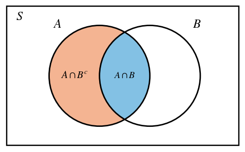
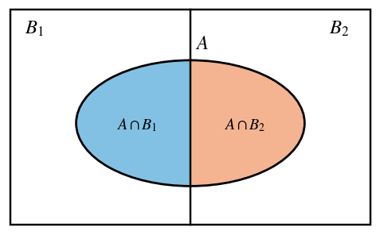
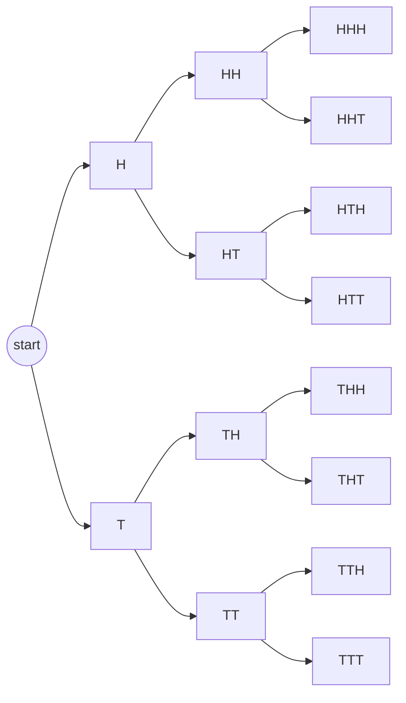

# HW10 Assignment Explanation — Combinations and Probability

[Repository Guide](../../README.md) | [English](Assignment-Explanation.md) | [한국어](Assignment-Explanation.ko.md)

> **Last Updated:** 2026-11-04
>
> Discrete Mathematics with Applications, Epp, Ch 9

> **Learning Objectives:**
> 1. Combine the number of r-combinations $\binom{n}{r}$ with the multiplication, addition, and difference rules to count selections that satisfy conditions
> 2. Find the number of nonnegative and positive integer solutions of an equation as a number of r-combinations with repetition allowed
> 3. Compute binomial coefficients with Pascal's formula and prove a sum formula involving a binomial coefficient by mathematical induction
> 4. Compute probabilities of events with the probability axioms and the formula for the probability of a complement
> 5. Derive a formula for $P(A \mid B^c)$ and Bayes' theorem for two events from the definition of conditional probability
> 6. Decide whether two events are independent by computing conditional probabilities

---

## Table of Contents

- [1. Exercise 9.5.7: Choosing Teams under Conditions](#1-exercise-957-choosing-teams-under-conditions)
- [2. Exercise 9.5.17: Lines and Triangles Determined by Points](#2-exercise-9517-lines-and-triangles-determined-by-points)
- [3. Exercise 9.6.10: Number of Nonnegative Integer Solutions](#3-exercise-9610-number-of-nonnegative-integer-solutions)
- [4. Exercise 9.6.11: Number of Positive Integer Solutions](#4-exercise-9611-number-of-positive-integer-solutions)
- [5. Exercise 9.7.10: Pascal's Triangle](#5-exercise-9710-pascals-triangle)
- [6. Exercise 9.7.14: A Sum Formula with a Binomial Coefficient](#6-exercise-9714-a-sum-formula-with-a-binomial-coefficient)
- [7. Exercise 9.8.7: Applying the Probability Axioms](#7-exercise-987-applying-the-probability-axioms)
- [8. Exercise 9.9.5: Conditional Probability Given a Complement](#8-exercise-995-conditional-probability-given-a-complement)
- [9. Exercise 9.9.9: Bayes' Theorem for Two Events](#9-exercise-999-bayes-theorem-for-two-events)
- [10. Exercise 9.9.20: Coin Tosses and Independent Events](#10-exercise-9920-coin-tosses-and-independent-events)
- [Summary](#summary)
- [Self-Check Questions](#self-check-questions)

---

<br>

## 1. Exercise 9.5.7: Choosing Teams under Conditions

**Problem.** Count the ways to pick 7 of the 13 members of a team for a project under each condition: (a) no condition; (b) with 7 women and 6 men on the team, (i) 4 women and 3 men, (ii) at least 1 man, and (iii) at most 3 women; (c) two given members may not both be picked; (d) two given members must be picked together or both left out.

**Concepts used.** A subset of $r$ elements chosen without regard to order from a set of $n$ elements is called an **r-combination**, and the number of them is written $\binom{n}{r}$ and read n choose r ([Chapter 9, Section 5](../../Lecture-Notes/Ch09_Counting-and-Probability/Concepts_Lecture.md)). By Theorem 9.5.1, if $0 \le r \le n$, then

$$\binom{n}{r} = \frac{n!}{r!\,(n-r)!}$$

This is combined with the **multiplication rule**, which multiplies the numbers of ways of the successive steps of a selection, the **addition rule**, which adds over cases that do not overlap, and the **difference rule**, which subtracts the unwanted cases from the total ([Chapter 9, Sections 2 and 3](../../Lecture-Notes/Ch09_Counting-and-Probability/Concepts_Lecture.md)).

**Solution.**

**(a)** Seven of the 13 members are chosen without regard to order, so 7-combinations are counted. Canceling the common factor $7!$ from the numerator and the denominator gives the following.

$$\binom{13}{7} = \frac{13!}{7!\,6!} = \frac{13 \cdot 12 \cdot 11 \cdot 10 \cdot 9 \cdot 8}{6 \cdot 5 \cdot 4 \cdot 3 \cdot 2 \cdot 1} = \frac{1235520}{720} = 1716$$

**(b)(i)** Step 1 chooses four of the seven women, and step 2 chooses three of the six men. The number of ways to perform step 2 is the same whoever was chosen in step 1, so the multiplication rule applies.

$$\binom{7}{4}\binom{6}{3} = 35 \cdot 20 = 700$$

**(b)(ii)** The groups with at least one man are all groups of seven except those with no man, that is, the all-female groups. There are exactly seven women, so there is only $\binom{7}{7} = 1$ all-female group. By the difference rule the answer is $1716 - 1 = 1715$.

**(b)(iii)** If a group has at most three women, the number $k$ of women is 0, 1, 2, or 3, and the remaining $7 - k$ members are men. Since there are only six men, $7 - k \le 6$, that is, $k \ge 1$. Cases with different numbers of women do not overlap, so count each case with the multiplication rule and add them by the addition rule.

| Women $k$ | Men $7-k$ | Number of groups |
|:---:|:---:|:---|
| 0 | 7 | Impossible because there are only six men (0 groups) |
| 1 | 6 | $\binom{7}{1}\binom{6}{6} = 7 \cdot 1 = 7$ |
| 2 | 5 | $\binom{7}{2}\binom{6}{5} = 21 \cdot 6 = 126$ |
| 3 | 4 | $\binom{7}{3}\binom{6}{4} = 35 \cdot 15 = 525$ |

*Table 1. Groups of seven with at most three women, divided by the number of women*

Hence the answer is $7 + 126 + 525 = 658$.

**(c)** Call the two members who refuse to work together $X$ and $Y$. The forbidden groups are those containing both $X$ and $Y$. Such a group is determined by adding five more of the other 11 members to $X$ and $Y$, so there are $\binom{11}{5} = 462$ of them. By the difference rule the answer is $1716 - 462 = 1254$.

The same answer follows from the addition rule. The allowed groups split, without overlap, into groups containing $X$ but not $Y$, groups containing $Y$ but not $X$, and groups containing neither. A group containing only $X$ takes six of the 11 members other than $X$ and $Y$, giving $\binom{11}{6} = 462$; the groups containing only $Y$ also number 462; and a group containing neither takes seven of the 11, giving $\binom{11}{7} = 330$. The sum $462 + 462 + 330 = 1254$ is the same.

**(d)** Call the two members $X$ and $Y$. The allowed groups split, without overlap, into groups containing both and groups containing neither. A group containing both takes five of the other 11 members, giving $\binom{11}{5} = 462$, and a group containing neither takes seven of the 11, giving $\binom{11}{7} = 330$. By the addition rule the answer is $462 + 330 = 792$.

> **Caution:** For a condition with a range, such as "at least one" or "at most three", first check whether it is simpler to count the cases that fail the condition and subtract them from the total before adding the cases one by one. Part (b)(ii) is obtained at once by subtracting the single all-female group instead of adding the cases with one man through six men. Also, as in (b)(iii), forgetting to check that there are enough people to fill the remaining places can lead to counting a case that does not exist ($k = 0$).

---

<br>

## 2. Exercise 9.5.17: Lines and Triangles Determined by Points

**Problem.** Among ten points $A, B, \ldots, J$ in a plane, no three are collinear. Count (a) the lines through two of the points and (b) those among them that miss $A$, and (c) the triangles with three of the points as vertices and (d) those among them that do not have $A$ as a vertex.

**Concepts used.** Two distinct points determine one line, and three points not on one line determine one triangle. Hence, when no three points are collinear, lines correspond one-to-one to 2-combinations of the points and triangles to 3-combinations, and they are counted by $\binom{n}{2}$ and $\binom{n}{3}$ ([Chapter 9, Section 5](../../Lecture-Notes/Ch09_Counting-and-Probability/Concepts_Lecture.md)).

**Solution.**

**(a)** Each choice of two points determines the line through them. If two different pairs determined the same line, that line would contain at least three of the points, contradicting the condition that no three points are collinear. Therefore the number of lines equals the number of 2-combinations.

$$\binom{10}{2} = \frac{10 \cdot 9}{2} = 45$$

**(b)** A line not passing through $A$ is determined by two of the nine points other than $A$, so there are $\binom{9}{2} = \frac{9 \cdot 8}{2} = 36$ such lines. This can also be checked with the difference rule. The lines through $A$ join $A$ to one of the other nine points, so there are nine of them, and $45 - 9 = 36$ as before.

**(c)** Since no three points are collinear, every choice of three points gives a triangle, and different sets of three points give different triangles.

$$\binom{10}{3} = \frac{10 \cdot 9 \cdot 8}{3 \cdot 2 \cdot 1} = \frac{720}{6} = 120$$

**(d)** A triangle without $A$ as a vertex is formed by three of the other nine points, so there are $\binom{9}{3} = \frac{504}{6} = 84$ of them. By the difference rule, a triangle with $A$ as a vertex chooses its other two vertices from the nine, giving $\binom{9}{2} = 36$, and $120 - 36 = 84$ as before.

> **Note:** Without the condition that no three points are collinear, the answers change. For instance, if $A$, $B$, and $C$ were on one line, the three pairs $\lbrace A, B\rbrace$, $\lbrace A, C\rbrace$, and $\lbrace B, C\rbrace$ would all determine the same line, so the number of lines would drop by 2, and $\lbrace A, B, C\rbrace$ would not form a triangle, so the number of triangles would drop by 1.

---

<br>

## 3. Exercise 9.6.10: Number of Nonnegative Integer Solutions

**Problem.** Find the number of nonnegative integer solutions $(x_1, x_2, x_3)$ of the equation $x_1 + x_2 + x_3 = 20$.

**Concepts used.** A selection of $r$ elements from a set of $n$ elements, made without regard to order and with repetition allowed, is called an **r-combination with repetition allowed**. It is the same as a **multiset** of size $r$ whose elements come from the set. By Theorem 9.6.1 the number of them is as follows ([Chapter 9, Section 6](../../Lecture-Notes/Ch09_Counting-and-Probability/Concepts_Lecture.md)).

$$\binom{r + n - 1}{r}$$

The formula counts the ways to arrange in a row $r$ crosses ×, one for each chosen element, and $n - 1$ vertical bars that separate the $n$ categories. Choosing the $r$ positions of the crosses in a row of length $r + n - 1$ determines one arrangement, and conversely each arrangement determines how many elements are chosen from each category.

**Solution.** Think of 20 as 20 units, and place each unit in one of the three categories $x_1$, $x_2$, and $x_3$. Reading the number of units in category $x_i$ as the value of $x_i$, each solution $(x_1, x_2, x_3)$ corresponds to exactly one way of choosing 20 elements from three categories with repetition allowed. For example, the solution $(5, 0, 15)$ corresponds to the following arrangement.

```text
× × × × × | | × × × × × × × × × × × × × × ×
(x1 = 5)   (x2 = 0)        (x3 = 15)
```

*Figure 1. Arrangement of 20 crosses and 2 bars corresponding to the solution (5, 0, 15)*

The two bars are the boundaries of the three categories. The number of crosses before the first bar is $x_1$, between the bars is $x_2$, and after the second bar is $x_3$; when the bars are adjacent, the category between them is 0. Hence the number of solutions is the number of ways to choose the positions of 20 crosses among 22 positions, that is, the number of r-combinations with repetition allowed with $n = 3$ and $r = 20$.

$$\binom{20 + 3 - 1}{20} = \binom{22}{20} = \binom{22}{2} = \frac{22 \cdot 21}{2} = 231$$

Therefore there are 231 nonnegative integer solutions. The second equality uses $\binom{n}{r} = \binom{n}{n-r}$: choosing the 20 positions of the crosses among 22 positions is the same as choosing the 2 positions of the bars.

---

<br>

## 4. Exercise 9.6.11: Number of Positive Integer Solutions

**Problem.** Find the number of positive integer solutions $(x_1, x_2, x_3)$ of the equation $x_1 + x_2 + x_3 = 20$.

**Concepts used.** When each variable has a lower bound, first assign the lower bound to each variable and then distribute the remaining amount as in Exercise 9.6.10. This is the same as changing variables to $y_i = x_i - 1$ to obtain a problem about nonnegative integer solutions ([Chapter 9, Section 6](../../Lecture-Notes/Ch09_Counting-and-Probability/Concepts_Lecture.md)).

**Solution.** Since $x_i \ge 1$, let $y_i = x_i - 1$. Then $y_i \ge 0$, and the equation becomes the following.

$$(y_1 + 1) + (y_2 + 1) + (y_3 + 1) = 20 \iff y_1 + y_2 + y_3 = 17$$

Because $x_i = y_i + 1$, positive integer solutions $(x_1, x_2, x_3)$ correspond one-to-one to nonnegative integer solutions $(y_1, y_2, y_3)$. In terms of units, three of the 20 units are first placed one in each category, and the remaining 17 units are distributed freely among the three categories. Counting as in Exercise 9.6.10 gives the following.

$$\binom{17 + 3 - 1}{17} = \binom{19}{17} = \binom{19}{2} = \frac{19 \cdot 18}{2} = 171$$

Therefore there are 171 positive integer solutions.

> **Note:** In general, $x_1 + x_2 + \cdots + x_n = m$ has $\binom{m + n - 1}{n - 1}$ nonnegative integer solutions and, when $m \ge n$, $\binom{m - 1}{n - 1}$ positive integer solutions. The formula for positive solutions can also be read as choosing $n - 1$ of the $m - 1$ gaps between $m$ crosses in a row at which to insert a bar. No two bars go into the same gap, so no category is empty. Here $\binom{19}{2} = 171$, which agrees with the result above.

---

<br>

## 5. Exercise 9.7.10: Pascal's Triangle

**Problem.** (a) From Pascal's triangle with rows up to $n = 5$ (Table 9.7.1 of the textbook), compute $\binom{6}{2}$, $\binom{6}{3}$, $\binom{6}{4}$, and $\binom{6}{5}$. (b) From these values and Pascal's formula, compute $\binom{7}{3}$, $\binom{7}{4}$, and $\binom{7}{5}$. (c) Fill in the whole row $n = 7$ of Pascal's triangle.

**Concepts used.** Theorem 9.7.1 (**Pascal's formula**) states that if $n$ and $r$ are positive integers with $r \le n$, then the following holds ([Chapter 9, Section 7](../../Lecture-Notes/Ch09_Counting-and-Probability/Concepts_Lecture.md)).

$$\binom{n+1}{r} = \binom{n}{r-1} + \binom{n}{r}$$

Combinatorially, if a particular element $x$ is fixed in a set of $n+1$ elements, the subsets of $r$ elements split into those containing $x$ ($\binom{n}{r-1}$ of them) and those not containing $x$ ($\binom{n}{r}$ of them). **Pascal's triangle** is the table with $\binom{n}{r}$ in row $n$ and column $r$. Each row begins and ends with $\binom{n}{0} = \binom{n}{n} = 1$, and by Pascal's formula each interior entry is the sum of the entry directly above it and the entry to the left of that one.

**Solution.** In Table 9.7.1 the row for $n = 5$ is 1, 5, 10, 10, 5, 1.

**(a)** Apply Pascal's formula with $n = 5$.

$$\binom{6}{2} = \binom{5}{1} + \binom{5}{2} = 5 + 10 = 15, \qquad \binom{6}{3} = \binom{5}{2} + \binom{5}{3} = 10 + 10 = 20$$

$$\binom{6}{4} = \binom{5}{3} + \binom{5}{4} = 10 + 5 = 15, \qquad \binom{6}{5} = \binom{5}{4} + \binom{5}{5} = 5 + 1 = 6$$

**(b)** Apply Pascal's formula with $n = 6$ and use the values from part (a).

$$\binom{7}{3} = \binom{6}{2} + \binom{6}{3} = 15 + 20 = 35, \qquad \binom{7}{4} = \binom{6}{3} + \binom{6}{4} = 20 + 15 = 35$$

$$\binom{7}{5} = \binom{6}{4} + \binom{6}{5} = 15 + 6 = 21$$

**(c)** Fill in the remaining entries in the same way. Since $\binom{6}{0} = \binom{6}{6} = 1$ and $\binom{6}{1} = 6$, it follows that $\binom{7}{1} = \binom{6}{0} + \binom{6}{1} = 1 + 6 = 7$, $\binom{7}{2} = \binom{6}{1} + \binom{6}{2} = 6 + 15 = 21$, and $\binom{7}{6} = \binom{6}{5} + \binom{6}{6} = 6 + 1 = 7$, and the two ends are $\binom{7}{0} = \binom{7}{7} = 1$. Hence the row for $n = 7$ is 1, 7, 21, 35, 35, 21, 7, 1.

| $n$ | $r = 0$ | $r = 1$ | $r = 2$ | $r = 3$ | $r = 4$ | $r = 5$ | $r = 6$ | $r = 7$ |
|:---:|:---:|:---:|:---:|:---:|:---:|:---:|:---:|:---:|
| 0 | 1 | | | | | | | |
| 1 | 1 | 1 | | | | | | |
| 2 | 1 | 2 | 1 | | | | | |
| 3 | 1 | 3 | 3 | 1 | | | | |
| 4 | 1 | 4 | 6 | 4 | 1 | | | |
| 5 | 1 | 5 | 10 | 10 | 5 | 1 | | |
| 6 | 1 | 6 | **15** | **20** | **15** | **6** | 1 | |
| 7 | 1 | 7 | 21 | **35** | **35** | **21** | 7 | 1 |

*Table 2. Pascal's triangle up to the row for n = 7 (bold values are those computed in parts (a) and (b))*

The row for $n = 7$ is symmetric ($\binom{7}{r} = \binom{7}{7-r}$), and its sum is $2^7 = 128$. The symmetry holds because choosing $r$ elements is the same as choosing the $7 - r$ elements left out, and the sum is $2^7$ because it counts all subsets of a 7-element set, grouped by size.

---

<br>

## 6. Exercise 9.7.14: A Sum Formula with a Binomial Coefficient

**Problem.** Prove the following equation for every integer $n \ge 1$.

$$1 \cdot 2 + 2 \cdot 3 + \cdots + n(n+1) = 2\binom{n+2}{3}$$

**Concepts used.** The proof uses mathematical induction ([Chapter 5, Section 2](../../Lecture-Notes/Ch05_Sequences-Mathematical-Induction-and-Recursion/Concepts_Lecture.md)) and Pascal's formula ([Chapter 9, Section 7](../../Lecture-Notes/Ch09_Counting-and-Probability/Concepts_Lecture.md)). In addition, $\binom{m}{2} = \frac{m(m-1)}{2}$ by Theorem 9.5.1, so $(k+1)(k+2) = 2\binom{k+2}{2}$.

**Solution.** For each integer $n \ge 1$, let $P(n)$ be the following equation.

$$P(n): \quad \sum_{i=1}^{n} i(i+1) = 2\binom{n+2}{3}$$

**Basis step.** For $n = 1$, the left-hand side is $1 \cdot 2 = 2$, and the right-hand side is $2\binom{3}{3} = 2 \cdot 1 = 2$. The two sides are equal, so $P(1)$ is true.

**Inductive step.** Suppose that $P(k)$ is true for an arbitrary integer $k \ge 1$. This is the inductive hypothesis.

$$\sum_{i=1}^{k} i(i+1) = 2\binom{k+2}{3}$$

It remains to show $P(k+1)$, that is, $\sum_{i=1}^{k+1} i(i+1) = 2\binom{k+3}{3}$. Splitting off the last term of the left-hand side and rewriting step by step gives the following.

$$\begin{aligned}
\sum_{i=1}^{k+1} i(i+1) &= \sum_{i=1}^{k} i(i+1) + (k+1)(k+2) && \text{(split off the last term)} \\
&= 2\binom{k+2}{3} + (k+1)(k+2) && \text{(inductive hypothesis)} \\
&= 2\binom{k+2}{3} + 2\binom{k+2}{2} && \text{(Theorem 9.5.1)} \\
&= 2\left[\binom{k+2}{2} + \binom{k+2}{3}\right] && \text{(factor out 2)} \\
&= 2\binom{k+3}{3} && \text{(Pascal's formula)}
\end{aligned}$$

The last line is Pascal's formula with $n = k + 2$ and $r = 3$. The formula applies when $r \le n$, and $3 \le k + 2$ holds because $k \ge 1$. Therefore $P(k+1)$ is true. Since both the basis step and the inductive step have been proved, $P(n)$ is true for every integer $n \ge 1$ by mathematical induction.

The same inductive step can also be done by polynomial algebra. By Theorem 9.5.1, $2\binom{k+2}{3} = \frac{k(k+1)(k+2)}{3}$, so the following holds.

$$\frac{k(k+1)(k+2)}{3} + (k+1)(k+2) = (k+1)(k+2)\left(\frac{k}{3} + 1\right) = \frac{(k+1)(k+2)(k+3)}{3} = 2\binom{k+3}{3}$$

Checking small values, for $n = 2$ the sum is $2 + 6 = 8 = 2\binom{4}{3}$, and for $n = 3$ it is $2 + 6 + 12 = 20 = 2\binom{5}{3}$.

> **Note:** The formula can also be shown combinatorially, without induction. Since $i(i+1) = 2\binom{i+1}{2}$, the left-hand side is $2\left[\binom{2}{2} + \binom{3}{2} + \cdots + \binom{n+1}{2}\right]$. The sum in brackets counts the 3-element subsets of $\lbrace 1, 2, \ldots, n+2\rbrace$ classified by their largest element $m$. A subset whose largest element is $m$ chooses its other two elements from $\lbrace 1, \ldots, m-1\rbrace$, so there are $\binom{m-1}{2}$ of them, and as $m$ runs from 3 to $n+2$ the total is $\binom{n+2}{3}$.

---

<br>

## 7. Exercise 9.8.7: Applying the Probability Axioms

**Problem.** In a sample space $S$ with the three outcomes 0, 1, and 2, the events $A = \lbrace 0\rbrace$, $B = \lbrace 1\rbrace$, and $C = \lbrace 2\rbrace$ have $P(A) = 0.4$ and $P(B) = 0.3$. Compute (a) $P(A \cup B)$, (b) $P(C)$, (c) $P(A \cup C)$, (d) $P(A^c)$, (e) $P(A^c \cap B^c)$, and (f) $P(A^c \cup B^c)$.

**Concepts used.** A **probability function** $P$, which assigns a real number to every event in a sample space $S$, satisfies the following **probability axioms** ([Chapter 9, Section 8](../../Lecture-Notes/Ch09_Counting-and-Probability/Concepts_Lecture.md)).

1. $0 \le P(A) \le 1$ for every event $A$.
2. $P(\emptyset) = 0$ and $P(S) = 1$.
3. If events $A$ and $B$ are disjoint ($A \cap B = \emptyset$), then $P(A \cup B) = P(A) + P(B)$.

Two formulas follow from the axioms. For the **complement** $A^c = S - A$ of an event $A$, $P(A^c) = 1 - P(A)$, and for any two events, $P(A \cup B) = P(A) + P(B) - P(A \cap B)$.

**Solution.** The events $A$, $B$, and $C$ each consist of a single distinct element, so they are mutually disjoint, and $A \cup B \cup C = S$.

**(a)** Since $A \cap B = \emptyset$, axiom 3 gives $P(A \cup B) = P(A) + P(B) = 0.4 + 0.3 = 0.7$.

**(b)** Since $C = S - (A \cup B) = (A \cup B)^c$, it follows that $P(C) = 1 - P(A \cup B) = 1 - 0.7 = 0.3$.

**(c)** Since $A \cap C = \emptyset$, axiom 3 gives $P(A \cup C) = P(A) + P(C) = 0.4 + 0.3 = 0.7$.

**(d)** $P(A^c) = 1 - P(A) = 1 - 0.4 = 0.6$. Indeed, $A^c = \lbrace 1, 2\rbrace = B \cup C$, and $P(B) + P(C) = 0.3 + 0.3 = 0.6$ as well.

**(e)** By De Morgan's laws, $A^c \cap B^c = (A \cup B)^c = C$, so $P(A^c \cap B^c) = P(C) = 0.3$.

**(f)** By De Morgan's laws, $A^c \cup B^c = (A \cap B)^c = \emptyset^c = S$, so $P(A^c \cup B^c) = P(S) = 1$. Checking with elements, $A^c = \lbrace 1, 2\rbrace$ and $B^c = \lbrace 0, 2\rbrace$, and their union is $\lbrace 0, 1, 2\rbrace = S$.

| Event | Elements | Probability |
|:---|:---|:---:|
| $A \cup B$ | $\lbrace 0, 1\rbrace$ | 0.7 |
| $C$ | $\lbrace 2\rbrace$ | 0.3 |
| $A \cup C$ | $\lbrace 0, 2\rbrace$ | 0.7 |
| $A^c$ | $\lbrace 1, 2\rbrace$ | 0.6 |
| $A^c \cap B^c$ | $\lbrace 2\rbrace$ | 0.3 |
| $A^c \cup B^c$ | $\lbrace 0, 1, 2\rbrace$ | 1 |

*Table 3. Events and probabilities in Exercise 9.8.7*

> **Caution:** The outcomes of this sample space are not equally likely. Having three outcomes does not mean that each has probability $\frac{1}{3}$; the probabilities are determined only by the given values and the axioms.

---

<br>

## 8. Exercise 9.9.5: Conditional Probability Given a Complement

**Problem.** For events $A$ and $B$, derive a formula that expresses $P(A \mid B^c)$ through the three known quantities $P(A)$, $P(B)$, and $P(A \mid B)$.

**Concepts used.** When $P(B) \ne 0$, the **conditional probability** of $A$ given that $B$ has occurred is defined as follows ([Chapter 9, Section 9](../../Lecture-Notes/Ch09_Counting-and-Probability/Concepts_Lecture.md)).

$$P(A \mid B) = \frac{P(A \cap B)}{P(B)}$$

Multiplying both sides by $P(B)$ gives $P(A \cap B) = P(A \mid B)\,P(B)$. Also, when an event is split into disjoint pieces, axiom 3 of probability allows the probabilities of the pieces to be added.

**Solution.** For $P(A \mid B)$ to be defined, $P(B) \ne 0$ is required, and for $P(A \mid B^c)$ to be defined, $P(B^c) = 1 - P(B) \ne 0$ is required, that is, $P(B) \ne 1$. Hence $0 < P(B) < 1$ is assumed.



*Figure 2. Event A split by event B and its complement*

1. Since $S = B \cup B^c$ and $B \cap B^c = \emptyset$, it follows that $A = (A \cap B) \cup (A \cap B^c)$, and the two pieces $A \cap B$ and $A \cap B^c$ are disjoint (Figure 2).
2. By axiom 3, $P(A) = P(A \cap B) + P(A \cap B^c)$, so $P(A \cap B^c) = P(A) - P(A \cap B)$.
3. By the definition of conditional probability, $P(A \cap B) = P(A \mid B)\,P(B)$.
4. By the formula for the probability of a complement, $P(B^c) = 1 - P(B)$.
5. Substituting the results of steps 2, 3, and 4 into the definition of $P(A \mid B^c)$ gives the following formula.

$$P(A \mid B^c) = \frac{P(A \cap B^c)}{P(B^c)} = \frac{P(A) - P(A \mid B)\,P(B)}{1 - P(B)}$$

The formula can be checked with one roll of a fair die. With $A = \lbrace 2, 4, 6\rbrace$ (an even number) and $B = \lbrace 1, 2, 3\rbrace$, the probabilities are $P(A) = \frac{1}{2}$ and $P(B) = \frac{1}{2}$, and since $A \cap B = \lbrace 2\rbrace$, $P(A \mid B) = \frac{1/6}{1/2} = \frac{1}{3}$. The formula gives $P(A \mid B^c) = \frac{1/2 - (1/3)(1/2)}{1 - 1/2} = \frac{1/3}{1/2} = \frac{2}{3}$. Counting directly, the even numbers in $B^c = \lbrace 4, 5, 6\rbrace$ are 4 and 6, so the probability is $\frac{2}{3}$ as well.

---

<br>

## 9. Exercise 9.9.9: Bayes' Theorem for Two Events

**Problem.** Prove Bayes' theorem for $n = 2$: if the sample space $S$ splits into two disjoint events $B_1$ and $B_2$ and the event $A$ has nonzero probability, then the following holds for $k = 1, 2$.

$$P(B_k \mid A) = \frac{P(A \mid B_k)\,P(B_k)}{P(A \mid B_1)\,P(B_1) + P(A \mid B_2)\,P(B_2)}$$

**Concepts used.** The proof uses the definition of conditional probability, axiom 3 of probability, and the distributive law for sets $A \cap (B_1 \cup B_2) = (A \cap B_1) \cup (A \cap B_2)$. The result is the case $n = 2$ of **Bayes' theorem** (Theorem 9.9.1 in [Chapter 9, Section 9](../../Lecture-Notes/Ch09_Counting-and-Probability/Concepts_Lecture.md)). Since $P(A \mid B_1)$ and $P(A \mid B_2)$ must be defined, it is also assumed that $P(B_1) \ne 0$ and $P(B_2) \ne 0$.

**Solution.**



*Figure 3. Sample space split into two disjoint events, with an event A across them*

1. By the definition of conditional probability, $P(B_k \mid A) = \dfrac{P(B_k \cap A)}{P(A)}$. This is defined because $P(A) \ne 0$.
2. Applying the definition of conditional probability to $P(A \mid B_k)$ gives $P(A \mid B_k) = \dfrac{P(A \cap B_k)}{P(B_k)}$, so $P(B_k \cap A) = P(A \mid B_k)\,P(B_k)$.
3. Since $S = B_1 \cup B_2$, the distributive law gives $A = A \cap S = (A \cap B_1) \cup (A \cap B_2)$ (Figure 3).
4. Since $(A \cap B_1) \cap (A \cap B_2) \subseteq B_1 \cap B_2 = \emptyset$, the two pieces are disjoint. Hence axiom 3 gives $P(A) = P(A \cap B_1) + P(A \cap B_2)$.
5. Applying step 2 with $k = 1$ and with $k = 2$ gives $P(A) = P(A \mid B_1)\,P(B_1) + P(A \mid B_2)\,P(B_2)$.
6. Substituting the expression of step 2 into the numerator of step 1 and the expression of step 5 into its denominator gives the equation to be proved.

$$P(B_k \mid A) = \frac{P(B_k \cap A)}{P(A)} = \frac{P(A \mid B_k)\,P(B_k)}{P(A \mid B_1)\,P(B_1) + P(A \mid B_2)\,P(B_2)}$$

> **Note:** The equation $P(A) = P(A \mid B_1)P(B_1) + P(A \mid B_2)P(B_2)$ of step 5 is called the **law of total probability**. Bayes' theorem computes backward: from the probability $P(A \mid B_k)$ that cause $B_k$ produces result $A$, it gives the probability $P(B_k \mid A)$ that the cause was $B_k$ once result $A$ has been observed. If there are $n$ mutually disjoint events whose union is $S$, the sum in step 4 merely grows to $n$ terms, and the proof is the same.

---

<br>

## 10. Exercise 9.9.20: Coin Tosses and Independent Events

**Problem.** For three tosses of a fair coin, let $A$ be the event that the first result is a head and $B$ the event that the number of heads is even. Verify that $P(A \mid B) = P(A)$ and $P(B \mid A) = P(B)$.

**Concepts used.** In a finite sample space whose outcomes are all equally likely, the probability of an event $E$ is $P(E) = \frac{N(E)}{N(S)}$ ([Chapter 9, Section 1](../../Lecture-Notes/Ch09_Counting-and-Probability/Concepts_Lecture.md)). Here $N(E)$ is the number of elements of $E$. Two events $A$ and $B$ are **independent events** if $P(A \cap B) = P(A)\,P(B)$ ([Chapter 9, Section 9](../../Lecture-Notes/Ch09_Counting-and-Probability/Concepts_Lecture.md)). When $P(A) \ne 0$ and $P(B) \ne 0$, this condition is equivalent to $P(A \mid B) = P(A)$ and also to $P(B \mid A) = P(B)$. In other words, knowing that one event has occurred does not change the probability of the other.

**Solution.** Writing H for a head and T for a tail, each toss has two results, so by the multiplication rule three tosses have $2^3 = 8$ outcomes, and they are equally likely because the coin is fair. The following possibility tree generates the eight outcomes.



*Figure 4. Possibility tree for three tosses of a coin*

| Outcome | Heads | $A$ (first is H) | $B$ (even number of heads) | $A \cap B$ |
|:---:|:---:|:---:|:---:|:---:|
| HHH | 3 | yes | no | no |
| HHT | 2 | yes | yes | yes |
| HTH | 2 | yes | yes | yes |
| HTT | 1 | yes | no | no |
| THH | 2 | no | yes | no |
| THT | 1 | no | no | no |
| TTH | 1 | no | no | no |
| TTT | 0 | no | yes | no |

*Table 4. The eight outcomes and their membership in events A and B*

From the table, $A = \lbrace \mathrm{HHH}, \mathrm{HHT}, \mathrm{HTH}, \mathrm{HTT} \rbrace$, $B = \lbrace \mathrm{HHT}, \mathrm{HTH}, \mathrm{THH}, \mathrm{TTT} \rbrace$, and $A \cap B = \lbrace \mathrm{HHT}, \mathrm{HTH} \rbrace$. Hence $P(A) = \frac{4}{8} = \frac{1}{2}$, $P(B) = \frac{4}{8} = \frac{1}{2}$, and $P(A \cap B) = \frac{2}{8} = \frac{1}{4}$, and the definition of conditional probability gives the following.

$$P(A \mid B) = \frac{P(A \cap B)}{P(B)} = \frac{1/4}{1/2} = \frac{1}{2} = P(A), \qquad P(B \mid A) = \frac{P(A \cap B)}{P(A)} = \frac{1/4}{1/2} = \frac{1}{2} = P(B)$$

Both equations hold. Moreover, $P(A \cap B) = \frac{1}{4} = P(A)\,P(B)$, so $A$ and $B$ are independent events. Knowing the first toss gives no information about the parity of the number of heads because, whether the first toss is H or T, exactly two of the four outcomes of the remaining two tosses make the total number of heads even.

> **Caution:** Zero is even, so TTT, with no heads, also belongs to $B$. Leaving out TTT shrinks $B$ to three outcomes, gives $P(A \mid B) = \frac{2}{3}$, and leads to the false conclusion that the two events are not independent.

---

<br>

## Summary

| Concept | Key Summary |
|:-----|:-----|
| r-combination | The number of ways to choose $r$ of $n$ elements without regard to order is $\binom{n}{r} = \frac{n!}{r!(n-r)!}$. |
| Selections under conditions | Multiply the steps of a selection by the multiplication rule, add cases that do not overlap by the addition rule, and subtract unwanted cases by the difference rule. |
| Figures determined by points | If no three points are collinear, lines correspond one-to-one to 2-combinations and triangles to 3-combinations of the points. |
| r-combination with repetition allowed | There are $\binom{r+n-1}{r}$ ways to choose $r$ elements from $n$ categories with repetition allowed, counted as arrangements of $r$ crosses and $n-1$ bars. |
| Integer solutions of an equation | $x_1 + x_2 + x_3 = 20$ has 231 nonnegative integer solutions, and, after substituting $y_i = x_i - 1$, 171 positive integer solutions. |
| Pascal's formula | $\binom{n+1}{r} = \binom{n}{r-1} + \binom{n}{r}$, and the row for $n = 7$ is 1, 7, 21, 35, 35, 21, 7, 1. |
| Proof of the sum formula | The inductive step uses $(k+1)(k+2) = 2\binom{k+2}{2}$ and Pascal's formula to show $\sum_{i=1}^{n} i(i+1) = 2\binom{n+2}{3}$. |
| Probability axioms | $0 \le P(A) \le 1$, $P(\emptyset) = 0$, $P(S) = 1$, and probabilities of disjoint events add. From these, $P(A^c) = 1 - P(A)$. |
| Conditional probability | $P(A \mid B) = P(A \cap B)/P(B)$, and if $0 < P(B) < 1$, then $P(A \mid B^c) = \frac{P(A) - P(A \mid B)P(B)}{1 - P(B)}$. |
| Bayes' theorem | If $S$ is the union of disjoint events $B_1$ and $B_2$, then $P(B_k \mid A) = \frac{P(A \mid B_k)P(B_k)}{P(A \mid B_1)P(B_1) + P(A \mid B_2)P(B_2)}$. |
| Independent events | $A$ and $B$ are independent if $P(A \cap B) = P(A)P(B)$. In three coin tosses, the event that the first toss is a head and the event that the number of heads is even are independent. |

---

<br>

## Self-Check Questions

1. **Counting with a complement:** For the team of Exercise 9.5.7 (seven women and six men), how many groups of seven contain at least four women?

   <details>
   <summary>Answer</summary>

   "At least four women" is the complement of "at most three women", so the answer is $1716 - 658 = 1058$. Adding directly, four women give $\binom{7}{4}\binom{6}{3} = 700$, five give $\binom{7}{5}\binom{6}{2} = 315$, six give $\binom{7}{6}\binom{6}{1} = 42$, and seven give $\binom{7}{7}\binom{6}{0} = 1$, for the same total 1058.

   </details>

2. **Lines and triangles:** Twelve points lie in a plane with no three collinear. How many lines and how many triangles do they determine?

   <details>
   <summary>Answer</summary>

   There are $\binom{12}{2} = \frac{12 \cdot 11}{2} = 66$ lines and $\binom{12}{3} = \frac{12 \cdot 11 \cdot 10}{6} = 220$ triangles.

   </details>

3. **Integer solutions with a lower bound:** How many integer solutions of $x_1 + x_2 + x_3 + x_4 = 10$ have every $x_i$ at least 2?

   <details>
   <summary>Answer</summary>

   Let $y_i = x_i - 2 \ge 0$. Then $y_1 + y_2 + y_3 + y_4 = 2$. With $n = 4$ categories and $r = 2$, there are $\binom{2 + 4 - 1}{2} = \binom{5}{2} = 10$ solutions.

   </details>

4. **Pascal's formula:** From the row 1, 7, 21, 35, 35, 21, 7, 1 for $n = 7$, find the row for $n = 8$.

   <details>
   <summary>Answer</summary>

   Add adjacent entries and put 1 at both ends. Since $1, 1 + 7 = 8, 7 + 21 = 28, 21 + 35 = 56, 35 + 35 = 70, 56, 28, 8, 1$, the row is 1, 8, 28, 56, 70, 56, 28, 8, 1.

   </details>

5. **Conditioning on a complement:** If $P(A) = 0.5$, $P(B) = 0.4$, and $P(A \mid B) = 0.3$, find $P(A \mid B^c)$.

   <details>
   <summary>Answer</summary>

   Since $P(A \cap B) = 0.3 \times 0.4 = 0.12$, $P(A \mid B^c) = \frac{0.5 - 0.12}{1 - 0.4} = \frac{0.38}{0.6} = \frac{19}{30} \approx 0.633$.

   </details>

6. **Bayes' theorem:** Machine $B_1$ makes 60% of the products and machine $B_2$ makes 40%, with defect rates of 2% and 5%, respectively. If a randomly chosen product is defective, what is the probability that it was made by $B_1$?

   <details>
   <summary>Answer</summary>

   Let $A$ be the event that the product is defective. Then $P(A \mid B_1)P(B_1) = 0.02 \times 0.6 = 0.012$ and $P(A \mid B_2)P(B_2) = 0.05 \times 0.4 = 0.02$. By Bayes' theorem, $P(B_1 \mid A) = \frac{0.012}{0.012 + 0.02} = \frac{0.012}{0.032} = 0.375$.

   </details>

7. **Deciding independence:** When a fair coin is tossed three times, are the event $A$ that the first toss is a head and the event $C$ that at least two heads are obtained independent?

   <details>
   <summary>Answer</summary>

   $C = \lbrace \mathrm{HHH}, \mathrm{HHT}, \mathrm{HTH}, \mathrm{THH} \rbrace$, so $P(C) = \frac{1}{2}$, and $A \cap C = \lbrace \mathrm{HHH}, \mathrm{HHT}, \mathrm{HTH} \rbrace$, so $P(A \cap C) = \frac{3}{8}$. Since $P(A)P(C) = \frac{1}{4} \ne \frac{3}{8}$, they are not independent. Indeed, $P(C \mid A) = \frac{3/8}{1/2} = \frac{3}{4}$: knowing that the first toss is a head raises the probability of $C$.

   </details>
