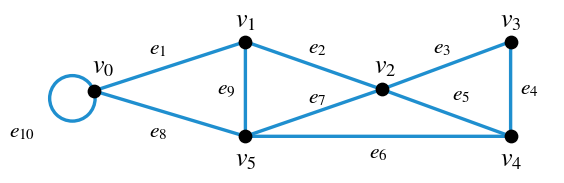
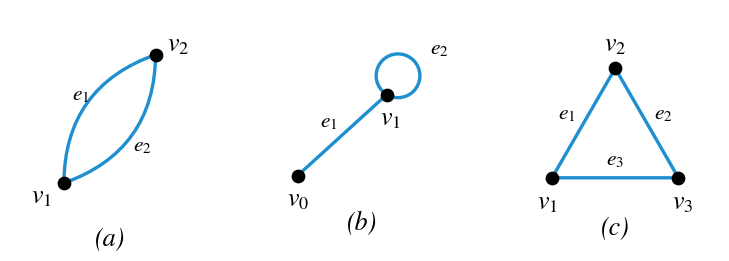
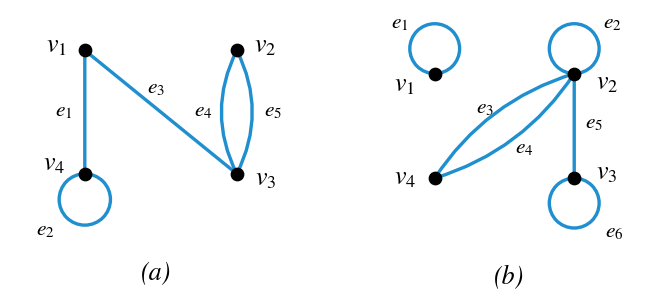
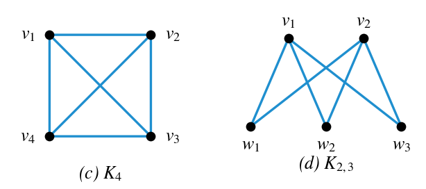
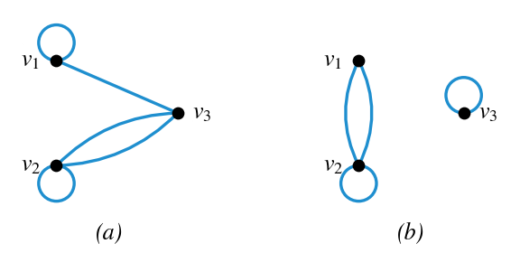
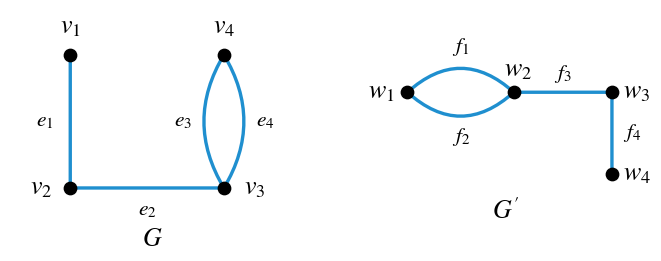
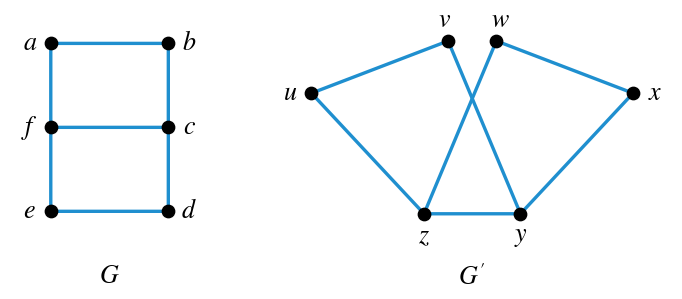
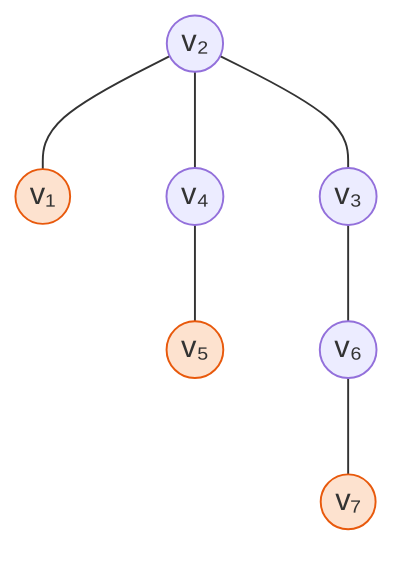
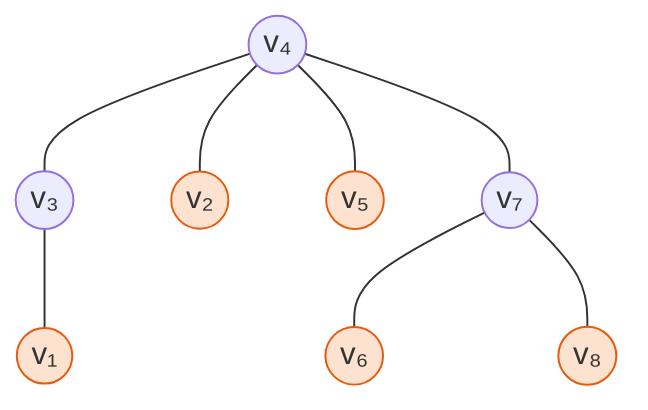
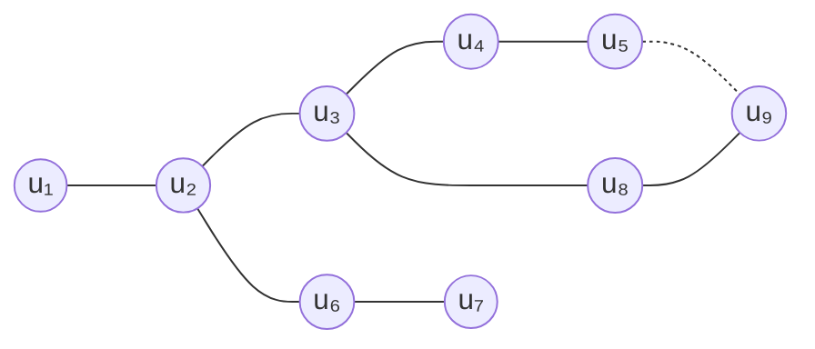

# HW11 과제 해설 — 그래프, 동형, 트리

[레포지토리 안내](../../README.ko.md) | [English](Assignment-Explanation.md) | [한국어](Assignment-Explanation.ko.md)

> **최종 수정일:** 2026-11-04
>
> Discrete Mathematics with Applications, Epp, Ch 10

> **학습 목표:**
> 1. 보행, 트레일, 경로, 닫힌 보행, 회로, 단순 회로의 정의로 주어진 보행을 분류할 수 있다
> 2. 부분 그래프의 정의에 따라 작은 그래프의 부분 그래프를 빠짐없이 셀 수 있다
> 3. 루프와 평행 변이 있는 그래프의 인접 행렬을 구하고, 인접 행렬로부터 그래프를 그릴 수 있다
> 4. 행렬 곱의 정의로 대칭 행렬의 제곱이 대칭임을 증명할 수 있다
> 5. 꼭짓점과 변의 대응을 만들어 두 그래프가 동형임을 보이고, 동형 불변량으로 판정을 점검할 수 있다
> 6. 트리의 리프와 내부 꼭짓점을 찾고, 꼭짓점 수와 변 수의 관계로 트리의 존재 여부를 판정할 수 있다

---

## 목차

- [1. 연습 문제 10.1.2: 보행의 분류](#1-연습-문제-1012-보행의-분류)
- [2. 연습 문제 10.1.23: 모든 부분 그래프](#2-연습-문제-10123-모든-부분-그래프)
- [3. 연습 문제 10.2.4: 인접 행렬 구하기](#3-연습-문제-1024-인접-행렬-구하기)
- [4. 연습 문제 10.2.5: 인접 행렬로부터 그래프 그리기](#4-연습-문제-1025-인접-행렬로부터-그래프-그리기)
- [5. 연습 문제 10.2.15: 대칭 행렬의 제곱](#5-연습-문제-10215-대칭-행렬의-제곱)
- [6. 연습 문제 10.3.1: 평행 변이 있는 그래프의 동형](#6-연습-문제-1031-평행-변이-있는-그래프의-동형)
- [7. 연습 문제 10.3.9: 단순 그래프의 동형](#7-연습-문제-1039-단순-그래프의-동형)
- [8. 연습 문제 10.4.7: 리프와 내부 꼭짓점](#8-연습-문제-1047-리프와-내부-꼭짓점)
- [9. 연습 문제 10.4.8: 꼭짓점 9개와 변 9개를 가진 트리](#9-연습-문제-1048-꼭짓점-9개와-변-9개를-가진-트리)
- [요약](#요약)
- [점검 문제](#점검-문제)

---

 

## 1. 연습 문제 10.1.2: 보행의 분류

**문제.** 그림 1의 그래프에서 다음 여섯 보행이 각각 트레일, 경로, 닫힌 보행, 회로, 단순 회로 중 무엇인지, 또는 이 중 어느 것에도 해당하지 않는 보행인지 판정한다.

(a) $v_1 e_2 v_2 e_3 v_3 e_4 v_4 e_5 v_2 e_2 v_1 e_1 v_0$, (b) $v_2 v_3 v_4 v_5 v_2$, (c) $v_4 v_2 v_3 v_4 v_5 v_2 v_4$, (d) $v_2 v_1 v_5 v_2 v_3 v_4 v_2$, (e) $v_0 v_5 v_2 v_3 v_4 v_2 v_1$, (f) $v_5 v_4 v_2 v_1$

*그림 1. 보행을 분류할 그래프*

**사용하는 개념.** 그래프 $G$의 꼭짓점 $v$에서 $w$로 가는 **보행(walk)** 은 이웃한 꼭짓점과 변이 번갈아 나오는 유한 수열 $v_0 e_1 v_1 e_2 \cdots e_n v_n$이다. 여기서 $v_0 = v$, $v_n = w$이고, 각 변 $e_i$의 끝점은 $v_{i-1}$과 $v_i$이다([10장 1절](../../Lecture-Notes/Ch10_Theory-of-Graphs-and-Trees/Concepts_Lecture.ko.md)). 보행의 종류는 변과 꼭짓점의 반복 여부, 그리고 시작점과 끝점이 같은지로 정해진다.

| 종류 | 정의 |
|:---|:---|
| **트레일(trail)** | 반복되는 변이 없는 보행 |
| **경로(path)** | 반복되는 꼭짓점이 없는 트레일 |
| **닫힌 보행(closed walk)** | 시작 꼭짓점과 끝 꼭짓점이 같은 보행 |
| **회로(circuit)** | 변을 적어도 하나 포함하고 반복되는 변이 없는 닫힌 보행 |
| **단순 회로(simple circuit)** | 처음과 마지막 꼭짓점 말고는 반복되는 꼭짓점이 없는 회로 |

*표 1. 보행의 종류와 정의*

정의에 의해 경로는 트레일이고, 단순 회로는 회로이며, 회로는 닫힌 보행이다. 아래에서는 각 보행이 만족하는 가장 좁은 종류를 답으로 쓴다. 이 그래프에는 평행 변이 없으므로 꼭짓점만 나열해도 지나는 변이 하나로 정해진다.

**풀이.** 각 보행이 지나는 변을 그림 1에서 읽고, 반복되는 변과 꼭짓점, 닫혀 있는지를 차례로 확인한다.

| 보행 | 지나는 변 | 반복되는 변 | 반복되는 꼭짓점 | 닫힘 | 분류 |
|:---:|:---|:---:|:---:|:---:|:---|
| (a) | $e_2, e_3, e_4, e_5, e_2, e_1$ | $e_2$ | $v_1, v_2$ | 아니요 | 보행 (트레일이 아님) |
| (b) | $e_3, e_4, e_6, e_7$ | 없음 | 없음 | 예 | 단순 회로 |
| (c) | $e_5, e_3, e_4, e_6, e_7, e_5$ | $e_5$ | $v_2, v_4$ | 예 | 닫힌 보행 (회로가 아님) |
| (d) | $e_2, e_9, e_7, e_3, e_4, e_5$ | 없음 | $v_2$ | 예 | 회로 (단순 회로가 아님) |
| (e) | $e_8, e_7, e_3, e_4, e_5, e_2$ | 없음 | $v_2$ | 아니요 | 트레일 (경로가 아님) |
| (f) | $e_6, e_5, e_2$ | 없음 | 없음 | 아니요 | 경로 |

*표 2. 여섯 보행의 변, 반복, 닫힘과 분류*

- **(a)** 변 $e_2$를 $v_1 \to v_2$와 $v_2 \to v_1$로 두 번 지나므로 트레일이 아니고, 따라서 경로도 아니다. 시작점 $v_1$과 끝점 $v_0$이 다르므로 닫힌 보행도 아니다. 어느 종류에도 해당하지 않는 보행이다.
- **(b)** 변 $e_3, e_4, e_6, e_7$이 모두 다르고, 시작점이자 끝점인 $v_2$ 말고는 반복되는 꼭짓점이 없으며, $v_2$에서 시작하여 $v_2$에서 끝난다. 따라서 단순 회로이다.
- **(c)** $v_4$에서 시작하여 $v_4$에서 끝나므로 닫힌 보행이지만, 변 $e_5$를 처음($v_4 v_2$)과 마지막($v_2 v_4$)에 두 번 지나므로 회로가 아니다.
- **(d)** 닫혀 있고 여섯 변이 모두 다르므로 회로이다. 그런데 $v_2$가 처음과 끝 외에 가운데(넷째 꼭짓점)에서도 나오므로 단순 회로는 아니다.
- **(e)** 여섯 변이 모두 다르므로 트레일이지만, $v_2$가 셋째와 여섯째에 두 번 나오므로 경로가 아니다. 시작점 $v_0$과 끝점 $v_1$이 다르므로 닫혀 있지 않다.
- **(f)** 세 변과 네 꼭짓점이 모두 다르므로 경로이다. 경로는 트레일이기도 하다.

> **주의:** (c)와 (d)처럼 닫힌 보행에서 반복되는 꼭짓점을 셀 때, 시작점과 끝점이 같은 것은 반복으로 보지 않는다. 단순 회로인지 판정할 때 문제가 되는 것은 처음과 마지막 사이에 다시 나오는 꼭짓점이다.

---

 

## 2. 연습 문제 10.1.23: 모든 부분 그래프

**문제.** 그림 2의 세 그래프 각각의 부분 그래프를 빠짐없이 나열한다. (b)와 (c)의 변 이름은 설명을 위해 붙인 것이다.

*그림 2. 부분 그래프를 구할 세 그래프*

**사용하는 개념.** 그래프 $H$의 모든 꼭짓점이 그래프 $G$의 꼭짓점이고, $H$의 모든 변이 $G$의 변이며, $H$의 각 변의 끝점이 $G$에서와 같을 때 $H$를 $G$의 **부분 그래프(subgraph)** 라 한다([10장 1절](../../Lecture-Notes/Ch10_Theory-of-Graphs-and-Trees/Concepts_Lecture.ko.md)). 정의의 조건은 이 세 가지뿐이므로, $H$의 두 꼭짓점을 잇는 $G$의 변이라도 $H$에 넣지 않을 수 있다. 또 그래프의 꼭짓점 집합은 공집합이 아니어야 한다([1장 4절](../../Lecture-Notes/Ch01_Speaking-Mathematically/Concepts_Lecture.ko.md)). 따라서 부분 그래프는 다음 두 단계로 정해진다.

1. 꼭짓점 집합 $W$를 공집합이 아닌 $V(G)$의 부분집합으로 고른다.
2. 두 끝점이 모두 $W$에 있는 변 중에서 원하는 만큼(0개부터 전부까지) 고른다. 끝점 하나가 $W$ 밖에 있는 변은 넣을 수 없다.

두 끝점이 $W$에 있는 변이 $e(W)$개이면 2단계의 방법은 $2^{e(W)}$가지이므로, 부분 그래프의 수는 모든 $W$에 대한 $2^{e(W)}$의 합이다. [10장 1절](../../Lecture-Notes/Ch10_Theory-of-Graphs-and-Trees/Concepts_Lecture.ko.md)의 예제(꼭짓점 $v_1$, $v_2$와 두 꼭짓점을 잇는 변 2개, $v_1$의 루프 1개)가 부분 그래프를 11개로 세는 것도 이 방법으로 구한 $2 + 1 + 8 = 11$과 일치하며, 그 11개에는 두 꼭짓점을 모두 가지면서 변이 없는 것과 루프만 가진 것이 들어 있다.

**풀이.** 각 그래프에서 꼭짓점 집합별로 넣을 수 있는 변을 정리하면 다음과 같다.

| 그래프 | 꼭짓점 집합 $W$ | 넣을 수 있는 변 | 부분 그래프 수 $2^{e(W)}$ |
|:---:|:---|:---|:---:|
| (a) | $\lbrace v_1\rbrace$, $\lbrace v_2\rbrace$ | 없음 | 1, 1 |
| (a) | $\lbrace v_1, v_2\rbrace$ | $e_1, e_2$ | 4 |
| (b) | $\lbrace v_0\rbrace$ | 없음 | 1 |
| (b) | $\lbrace v_1\rbrace$ | $e_2$ (루프) | 2 |
| (b) | $\lbrace v_0, v_1\rbrace$ | $e_1, e_2$ | 4 |
| (c) | $\lbrace v_1\rbrace$, $\lbrace v_2\rbrace$, $\lbrace v_3\rbrace$ | 없음 | 1, 1, 1 |
| (c) | $\lbrace v_1, v_2\rbrace$, $\lbrace v_2, v_3\rbrace$, $\lbrace v_1, v_3\rbrace$ | 각각 $e_1$, $e_2$, $e_3$ | 2, 2, 2 |
| (c) | $\lbrace v_1, v_2, v_3\rbrace$ | $e_1, e_2, e_3$ | 8 |

*표 3. 꼭짓점 집합별로 넣을 수 있는 변과 부분 그래프의 수*

**(a)** 부분 그래프는 $1 + 1 + 4 = 6$개이다. 꼭짓점과 변의 집합 쌍 $(W, F)$로 쓰면 $(\lbrace v_1\rbrace, \emptyset)$, $(\lbrace v_2\rbrace, \emptyset)$, $(\lbrace v_1, v_2\rbrace, \emptyset)$, $(\lbrace v_1, v_2\rbrace, \lbrace e_1\rbrace)$, $(\lbrace v_1, v_2\rbrace, \lbrace e_2\rbrace)$, $(\lbrace v_1, v_2\rbrace, \lbrace e_1, e_2\rbrace)$이다.

**(b)** 부분 그래프는 $1 + 2 + 4 = 7$개이다. 루프 $e_2$는 끝점이 $v_1$ 하나뿐이므로 꼭짓점 집합이 $\lbrace v_1\rbrace$일 때도 넣을 수 있다. 목록은 $(\lbrace v_0\rbrace, \emptyset)$, $(\lbrace v_1\rbrace, \emptyset)$, $(\lbrace v_1\rbrace, \lbrace e_2\rbrace)$, $(\lbrace v_0, v_1\rbrace, \emptyset)$, $(\lbrace v_0, v_1\rbrace, \lbrace e_1\rbrace)$, $(\lbrace v_0, v_1\rbrace, \lbrace e_2\rbrace)$, $(\lbrace v_0, v_1\rbrace, \lbrace e_1, e_2\rbrace)$이다.

**(c)** 부분 그래프는 $3 \cdot 1 + 3 \cdot 2 + 8 = 17$개이다. 모두 나열하면 다음과 같다.

| 번호 | 꼭짓점 집합 | 변 집합 | 번호 | 꼭짓점 집합 | 변 집합 |
|:---:|:---|:---|:---:|:---|:---|
| 1 | $\lbrace v_1\rbrace$ | $\emptyset$ | 10 | $\lbrace v_1, v_2, v_3\rbrace$ | $\emptyset$ |
| 2 | $\lbrace v_2\rbrace$ | $\emptyset$ | 11 | $\lbrace v_1, v_2, v_3\rbrace$ | $\lbrace e_1\rbrace$ |
| 3 | $\lbrace v_3\rbrace$ | $\emptyset$ | 12 | $\lbrace v_1, v_2, v_3\rbrace$ | $\lbrace e_2\rbrace$ |
| 4 | $\lbrace v_1, v_2\rbrace$ | $\emptyset$ | 13 | $\lbrace v_1, v_2, v_3\rbrace$ | $\lbrace e_3\rbrace$ |
| 5 | $\lbrace v_1, v_2\rbrace$ | $\lbrace e_1\rbrace$ | 14 | $\lbrace v_1, v_2, v_3\rbrace$ | $\lbrace e_1, e_2\rbrace$ |
| 6 | $\lbrace v_2, v_3\rbrace$ | $\emptyset$ | 15 | $\lbrace v_1, v_2, v_3\rbrace$ | $\lbrace e_1, e_3\rbrace$ |
| 7 | $\lbrace v_2, v_3\rbrace$ | $\lbrace e_2\rbrace$ | 16 | $\lbrace v_1, v_2, v_3\rbrace$ | $\lbrace e_2, e_3\rbrace$ |
| 8 | $\lbrace v_1, v_3\rbrace$ | $\emptyset$ | 17 | $\lbrace v_1, v_2, v_3\rbrace$ | $\lbrace e_1, e_2, e_3\rbrace$ |
| 9 | $\lbrace v_1, v_3\rbrace$ | $\lbrace e_3\rbrace$ | | | |

*표 4. 그래프 (c)의 부분 그래프 17개*

> **주의:** 꼭짓점을 모두 고른 경우에도 변은 일부만 고를 수 있다. 그래서 (c)에서 꼭짓점 집합이 $\lbrace v_1, v_2, v_3\rbrace$인 부분 그래프는 변이 없는 것 1개, 변이 하나인 것 3개, 변이 둘인 것 3개, 원래 그래프 1개로 모두 8개이다(표 4의 10\~17번). 꼭짓점을 모두 고르면 변도 모두 넣어야 한다고 보면 이 중 7개를 빠뜨려 $3 + 6 + 1 = 10$개만 세고, 고른 두 꼭짓점 사이의 변을 언제나 모두 넣는다고 보면 꼭짓점 집합마다 하나씩 7개만 센다. 뒤의 것은 **유도 부분 그래프(induced subgraph)** 라는 별도의 개념이며, 부분 그래프의 정의에는 그런 조건이 없으므로 답은 17개이다. 반대로 끝점이 빠진 변을 넣는 것(예: 꼭짓점 집합 $\lbrace v_1\rbrace$에 변 $e_1$)은 그래프가 되지 않으므로 허용되지 않는다.

---

 

## 3. 연습 문제 10.2.4: 인접 행렬 구하기

**문제.** 다음 무방향 그래프의 인접 행렬을 구한다. (a)와 (b)는 그림 3의 그래프이고, (c)는 꼭짓점이 4개인 완전 그래프 $K_4$, (d)는 꼭짓점이 2개, 3개인 두 부분으로 이루어진 완전 이분 그래프 $K_{2,3}$이다.

*그림 3. 인접 행렬을 구할 그래프 (a), (b)*

**사용하는 개념.** 꼭짓점을 $v_1, v_2, \ldots, v_n$ 순서로 늘어놓은 무방향 그래프의 **인접 행렬(adjacency matrix)** 은 $(i, j)$ 성분 $a_{ij}$가 $v_i$와 $v_j$를 잇는 변의 수인 $n \times n$ 행렬이다([10장 2절](../../Lecture-Notes/Ch10_Theory-of-Graphs-and-Trees/Concepts_Lecture.ko.md)). $v_i$의 루프는 $a_{ii}$에 1로 센다. 변은 방향이 없으므로 $a_{ij} = a_{ji}$이고, 인접 행렬은 대칭이다. **완전 그래프(complete graph)** $K_n$은 꼭짓점 $n$개의 서로 다른 두 꼭짓점마다 변이 정확히 하나 있고 루프가 없는 단순 그래프이다. **완전 이분 그래프(complete bipartite graph)** $K_{m,n}$은 꼭짓점이 $\lbrace v_1, \ldots, v_m\rbrace$과 $\lbrace w_1, \ldots, w_n\rbrace$의 두 부분으로 나뉘고, 각 $v_i$와 각 $w_j$ 사이에만 변이 하나씩 있는 단순 그래프이다.

**풀이.** 각 그래프의 변을 끝점과 함께 적고, 꼭짓점 쌍마다 변의 수를 센다.

**(a)** 변은 $e_1 = \lbrace v_1, v_4\rbrace$, $e_2$($v_4$의 루프), $e_3 = \lbrace v_1, v_3\rbrace$, 그리고 $v_2$와 $v_3$을 잇는 평행 변 $e_4$, $e_5$이다. 따라서 $a_{14} = a_{41} = 1$, $a_{44} = 1$, $a_{13} = a_{31} = 1$, $a_{23} = a_{32} = 2$이고 나머지는 0이다.

$$\begin{bmatrix} 0 & 0 & 1 & 1 \\ 0 & 0 & 2 & 0 \\ 1 & 2 & 0 & 0 \\ 1 & 0 & 0 & 1 \end{bmatrix}$$

**(b)** 변은 $e_1$($v_1$의 루프), $e_2$($v_2$의 루프), $v_2$와 $v_4$를 잇는 평행 변 $e_3$, $e_4$, $e_5 = \lbrace v_2, v_3\rbrace$, $e_6$($v_3$의 루프)이다. $v_1$은 루프 말고는 다른 꼭짓점과 이어져 있지 않으므로 첫째 행과 첫째 열은 $a_{11} = 1$ 외에 모두 0이다.

$$\begin{bmatrix} 1 & 0 & 0 & 0 \\ 0 & 1 & 1 & 2 \\ 0 & 1 & 1 & 0 \\ 0 & 2 & 0 & 0 \end{bmatrix}$$

**(c)** $K_4$의 꼭짓점을 $v_1, v_2, v_3, v_4$라 하면(그림 4의 왼쪽) 서로 다른 두 꼭짓점 사이에 변이 하나씩 있고 루프가 없으므로, 대각 성분은 0이고 나머지 성분은 모두 1이다.

$$\begin{bmatrix} 0 & 1 & 1 & 1 \\ 1 & 0 & 1 & 1 \\ 1 & 1 & 0 & 1 \\ 1 & 1 & 1 & 0 \end{bmatrix}$$

**(d)** $K_{2,3}$의 꼭짓점을 $v_1, v_2$와 $w_1, w_2, w_3$의 두 부분으로 나누고 $v_1, v_2, w_1, w_2, w_3$ 순서로 늘어놓는다(그림 4의 오른쪽). 같은 부분의 두 꼭짓점 사이에는 변이 없고, 다른 부분의 두 꼭짓점 사이에는 변이 하나씩 있다.

$$\begin{bmatrix} 0 & 0 & 1 & 1 & 1 \\ 0 & 0 & 1 & 1 & 1 \\ 1 & 1 & 0 & 0 & 0 \\ 1 & 1 & 0 & 0 & 0 \\ 1 & 1 & 0 & 0 & 0 \end{bmatrix}$$

*그림 4. 완전 그래프 K4와 완전 이분 그래프 K2,3*

인접 행렬은 꼭짓점의 순서에 따라 달라진다. 예를 들어 (d)에서 $w_1, w_2, w_3, v_1, v_2$ 순서로 늘어놓으면 왼쪽 위에 $3 \times 3$ 영행렬, 오른쪽 아래에 $2 \times 2$ 영행렬이 오는 행렬이 된다. 순서를 밝혀 두면 어느 행렬이든 같은 그래프를 나타낸다.

> **주의:** 인접 행렬의 한 행의 합은 루프가 없으면 그 꼭짓점의 차수와 같지만, 루프가 있으면 다르다. 루프는 차수에 2를 더하지만 인접 행렬에는 1로 적히기 때문이다. (a)에서 $v_4$의 행의 합은 $1 + 1 = 2$이지만 $\deg(v_4) = 1 + 2 = 3$이다.

---

 

## 4. 연습 문제 10.2.5: 인접 행렬로부터 그래프 그리기

**문제.** 다음 두 행렬 각각을 인접 행렬로 갖는 그래프를 그린다.

$$\text{(a)}\ \begin{bmatrix} 1 & 0 & 1 \\ 0 & 1 & 2 \\ 1 & 2 & 0 \end{bmatrix} \qquad \text{(b)}\ \begin{bmatrix} 0 & 2 & 0 \\ 2 & 1 & 0 \\ 0 & 0 & 1 \end{bmatrix}$$

**사용하는 개념.** 행과 열이 꼭짓점 $v_1, v_2, v_3$에 대응한다고 보고, 성분 $a_{ij}$만큼 $v_i$와 $v_j$를 잇는 변을 그린다([10장 2절](../../Lecture-Notes/Ch10_Theory-of-Graphs-and-Trees/Concepts_Lecture.ko.md)). 행렬이 대칭이므로 $a_{ij}$와 $a_{ji}$는 같은 변들을 나타낸다. 따라서 대각선과 그 위쪽 성분($i \le j$)만 읽으면 되고, 대각 성분 $a_{ii}$는 $v_i$의 루프의 수이다.

**풀이.**

**(a)** $a_{11} = 1$이므로 $v_1$에 루프가 하나, $a_{12} = 0$이므로 $v_1$과 $v_2$ 사이에 변이 없고, $a_{13} = 1$이므로 $v_1$과 $v_3$ 사이에 변이 하나 있다. $a_{22} = 1$이므로 $v_2$에 루프가 하나, $a_{23} = 2$이므로 $v_2$와 $v_3$ 사이에 평행 변이 두 개 있고, $a_{33} = 0$이므로 $v_3$에는 루프가 없다. 변은 모두 $1 + 1 + 1 + 2 = 5$개이다.

**(b)** $a_{11} = 0$이므로 $v_1$에 루프가 없고, $a_{12} = 2$이므로 $v_1$과 $v_2$ 사이에 평행 변이 두 개, $a_{13} = 0$이므로 $v_1$과 $v_3$ 사이에 변이 없다. $a_{22} = 1$이므로 $v_2$에 루프가 하나, $a_{23} = 0$이므로 $v_2$와 $v_3$ 사이에 변이 없고, $a_{33} = 1$이므로 $v_3$에 루프가 하나 있다. 변은 모두 $2 + 1 + 1 = 4$개이다. $v_3$은 루프 말고는 다른 꼭짓점과 이어지지 않으므로 이 그래프는 연결 그래프가 아니며, 연결 성분이 $\lbrace v_1, v_2\rbrace$와 $\lbrace v_3\rbrace$의 두 개이다.

*그림 5. 주어진 인접 행렬을 갖는 그래프 (a), (b)*

인접 행렬은 꼭짓점 쌍마다 변의 수만 알려 주므로, 변의 이름과 그림의 배치는 자유롭게 정해도 된다.

---

 

## 5. 연습 문제 10.2.15: 대칭 행렬의 제곱

**문제.** 실수 성분을 갖는 $m \times m$ 대칭 행렬 $A$의 제곱 $A^2$도 대칭임을 보인다.

**사용하는 개념.** $n \times n$ 행렬 $A = (a_{ij})$가 모든 $i, j$에 대해 $a_{ij} = a_{ji}$를 만족하면 **대칭 행렬(symmetric matrix)** 이라 한다. $m \times k$ 행렬 $A$와 $k \times n$ 행렬 $B$의 곱 $AB$의 $(i, j)$ 성분은 $A$의 $i$행과 $B$의 $j$열의 성분을 차례로 곱해 더한 $\sum_{r=1}^{k} a_{ir} b_{rj}$이다([10장 2절](../../Lecture-Notes/Ch10_Theory-of-Graphs-and-Trees/Concepts_Lecture.ko.md)).

**풀이.** $A = (a_{ij})$를 $m \times m$ 대칭 행렬이라 하고, $1 \le i, j \le m$인 정수 $i$, $j$를 임의로 고른다. 행렬 곱의 정의에 의해 $A^2 = AA$의 두 성분은 다음과 같다.

$$(A^2)_{ij} = \sum_{k=1}^{m} a_{ik} a_{kj}, \qquad (A^2)_{ji} = \sum_{k=1}^{m} a_{jk} a_{ki}$$

$A$가 대칭이므로 모든 $k$에 대해 $a_{ik} = a_{ki}$이고 $a_{kj} = a_{jk}$이다. 이를 대입하고 실수 곱셈의 교환 법칙을 쓰면 각 $k$에 대해 다음이 성립한다.

$$a_{ik} a_{kj} = a_{ki} a_{jk} = a_{jk} a_{ki}$$

두 합은 같은 항들을 $k = 1$부터 $m$까지 더한 것이므로 $(A^2)_{ij} = (A^2)_{ji}$이다. $i$와 $j$는 임의로 고른 것이므로 $A^2$는 대칭 행렬이다.

예를 들어 $A = \begin{bmatrix} 1 & 2 \\ 2 & 3 \end{bmatrix}$이면 $A^2 = \begin{bmatrix} 1 + 4 & 2 + 6 \\ 2 + 6 & 4 + 9 \end{bmatrix} = \begin{bmatrix} 5 & 8 \\ 8 & 13 \end{bmatrix}$으로 대칭이다.

> **참고:** 전치 행렬로도 짧게 보일 수 있다. 대칭은 $A^T = A$와 같고, 곱의 전치는 $(AB)^T = B^T A^T$이므로 $(A^2)^T = (AA)^T = A^T A^T = AA = A^2$이다. 그래프로 해석하면, $A$가 무방향 그래프의 인접 행렬일 때 $(A^2)_{ij}$는 $v_i$에서 $v_j$로 가는 길이 2인 보행의 수이다([10장 2절](../../Lecture-Notes/Ch10_Theory-of-Graphs-and-Trees/Concepts_Lecture.ko.md)의 정리 10.2.2). 보행을 거꾸로 따라가면 $v_j$에서 $v_i$로 가는 같은 길이의 보행이 되므로 $(A^2)_{ij} = (A^2)_{ji}$인 것이 자연스럽다.

---

 

## 6. 연습 문제 10.3.1: 평행 변이 있는 그래프의 동형

**문제.** 그림 6의 $G$와 $G'$이 동형인지 판정하여, 동형이면 꼭짓점 대응 $g: V(G) \to V(G')$과 변 대응 $h: E(G) \to E(G')$을 만들고, 동형이 아니면 두 그래프에서 값이 다른 동형 불변량을 든다.

*그림 6. 평행 변이 있는 두 그래프 G와 G'*

**사용하는 개념.** 두 그래프 $G$와 $G'$은 일대일 대응 $g: V(G) \to V(G')$과 $h: E(G) \to E(G')$이 있어서, 모든 $v \in V(G)$와 $e \in E(G)$에 대해 "$v$가 $e$의 끝점이다"와 "$g(v)$가 $h(e)$의 끝점이다"가 동치일 때 **동형(isomorphic)** 이라 한다([10장 3절](../../Lecture-Notes/Ch10_Theory-of-Graphs-and-Trees/Concepts_Lecture.ko.md)). 동형 사상이 보존하는 성질을 **동형 불변량(isomorphic invariant)** 이라 하며, 꼭짓점 수, 변 수, 차수가 $k$인 꼭짓점의 수, 길이가 $k$인 회로의 존재, 연결성 등이 있다(정리 10.3.2). 불변량 하나가 다르면 동형이 아님이 증명되지만, 불변량이 모두 같다고 해서 동형인 것은 아니다. 동형임을 보이려면 $g$와 $h$를 실제로 만들어야 한다.

**풀이.**

1. **불변량 비교.** 두 그래프 모두 꼭짓점이 4개, 변이 4개이다. 차수는 $G$에서 $\deg(v_1) = 1$, $\deg(v_2) = 2$, $\deg(v_3) = 3$, $\deg(v_4) = 2$이고, $G'$에서 $\deg(w_1) = 2$, $\deg(w_2) = 3$, $\deg(w_3) = 2$, $\deg(w_4) = 1$이다. 두 그래프 모두 평행 변 한 쌍(길이 2인 회로)을 가진다. 불변량이 일치하므로 대응을 찾는다.
2. **꼭짓점 대응 $g$.** 동형 사상은 차수를 보존하므로 차수 1인 $v_1$은 $w_4$로, 차수 3인 $v_3$은 $w_2$로 보내야 한다. $v_2$는 $v_1$, $v_3$과 인접하므로 $g(v_2)$는 $w_4$, $w_2$와 모두 인접한 $w_3$이어야 한다. 남은 $v_4$는 $w_1$로 보낸다.
3. **변 대응 $h$.** 각 변을 끝점의 상을 잇는 변으로 보낸다. 평행 변 $e_3$, $e_4$는 평행 변 $f_1$, $f_2$로 보낸다.

| 변 $e$ | $G$에서의 끝점 | $g$로 옮긴 끝점 | $h(e)$ |
|:---:|:---:|:---:|:---:|
| $e_1$ | $v_1, v_2$ | $w_4, w_3$ | $f_4$ |
| $e_2$ | $v_2, v_3$ | $w_3, w_2$ | $f_3$ |
| $e_3$ | $v_3, v_4$ | $w_2, w_1$ | $f_1$ |
| $e_4$ | $v_3, v_4$ | $w_2, w_1$ | $f_2$ |

*표 5. 변 대응 h와 끝점의 보존*

$g$와 $h$는 모두 일대일 대응이고, 표 5의 모든 행에서 $h(e)$의 끝점이 $e$의 끝점의 상과 정확히 같다. 따라서 끝점 관계가 보존되므로 $G$와 $G'$은 동형이다. 정리하면 $g(v_1) = w_4$, $g(v_2) = w_3$, $g(v_3) = w_2$, $g(v_4) = w_1$이고 $h(e_1) = f_4$, $h(e_2) = f_3$, $h(e_3) = f_1$, $h(e_4) = f_2$이다. $h(e_3) = f_2$, $h(e_4) = f_1$로 바꾸어도 동형 사상이 된다.

---

 

## 7. 연습 문제 10.3.9: 단순 그래프의 동형

**문제.** 그림 7의 단순 그래프 $G$와 $G'$이 동형인지 판정하여, 동형이면 꼭짓점 대응 $g: V(G) \to V(G')$을 만들고, 동형이 아니면 두 그래프에서 값이 다른 동형 불변량을 든다.

*그림 7. 두 단순 그래프 G와 G'*

**사용하는 개념.** 단순 그래프에서는 변이 끝점의 쌍으로 정해지므로, 일대일 대응 $g: V(G) \to V(G')$이 모든 꼭짓점 $u$, $v$에 대해 "$\lbrace u, v\rbrace$가 $G$의 변이다"와 "$\lbrace g(u), g(v)\rbrace$가 $G'$의 변이다"를 동치로 만들면 $G$와 $G'$은 동형이다([10장 3절](../../Lecture-Notes/Ch10_Theory-of-Graphs-and-Trees/Concepts_Lecture.ko.md)). 두 그래프의 변 수가 같으면 $G$의 모든 변이 $G'$의 변으로 옮겨지는 것만 확인하면 된다. $g$가 일대일이므로 서로 다른 변은 서로 다른 변으로 옮겨지고, 변 수가 같으므로 $G'$의 모든 변이 어떤 변의 상이 되어 반대 방향의 조건도 성립하기 때문이다.

**풀이.**

1. **불변량 비교.** $G$의 변은 $ab, af, bc, fc, fe, cd, ed$의 7개이고, $G'$의 변은 $uv, uz, vy, wz, wx, xy, zy$의 7개이다. 두 그래프 모두 꼭짓점이 6개이다. 차수는 $G$에서 $c$와 $f$가 3이고 나머지 네 꼭짓점이 2이며, $G'$에서 $y$와 $z$가 3이고 나머지 네 꼭짓점이 2이다. 또 $G$의 차수 3인 두 꼭짓점 $c$, $f$는 서로 인접하고, $G'$의 $y$, $z$도 서로 인접한다.
2. **구조 파악.** $G$에서 $f$와 $c$는 변 $fc$로 직접 이어져 있고, 차수 2인 꼭짓점 두 개를 거치는 경로 $f\,a\,b\,c$와 $f\,e\,d\,c$로도 이어져 있다. $G'$에서도 $z$와 $y$는 변 $zy$로 이어져 있고, 경로 $z\,u\,v\,y$와 $z\,w\,x\,y$로도 이어져 있다. 그림에서 $G'$의 변 $vy$와 $wz$가 교차하는 것은 그리는 방식일 뿐 구조와는 관계가 없다.
3. **꼭짓점 대응 $g$.** 이 구조를 맞추어 $g(f) = z$, $g(c) = y$, $g(a) = u$, $g(b) = v$, $g(e) = w$, $g(d) = x$로 둔다.
4. **변의 확인.** $G$의 변 7개를 모두 옮긴다.

| $G$의 변 | $g$로 옮긴 쌍 | $G'$의 변인가 |
|:---:|:---:|:---:|
| $\lbrace a, b\rbrace$ | $\lbrace u, v\rbrace$ | 예 |
| $\lbrace a, f\rbrace$ | $\lbrace u, z\rbrace$ | 예 |
| $\lbrace b, c\rbrace$ | $\lbrace v, y\rbrace$ | 예 |
| $\lbrace f, c\rbrace$ | $\lbrace z, y\rbrace$ | 예 |
| $\lbrace f, e\rbrace$ | $\lbrace z, w\rbrace$ | 예 |
| $\lbrace c, d\rbrace$ | $\lbrace y, x\rbrace$ | 예 |
| $\lbrace e, d\rbrace$ | $\lbrace w, x\rbrace$ | 예 |

*표 6. 꼭짓점 대응 g로 옮긴 G의 변*

$g$는 여섯 꼭짓점을 여섯 꼭짓점으로 보내는 일대일 대응이고, $G$의 변 7개가 모두 $G'$의 서로 다른 변 7개로 옮겨진다. 두 그래프의 변 수가 같으므로 $G$에서 인접하지 않은 쌍은 $G'$에서도 인접하지 않은 쌍으로 옮겨진다. 따라서 $G$와 $G'$은 동형이다.

> **참고:** 동형 사상은 하나만 있는 것이 아니다. 예를 들어 위의 $g$에서 $a \mapsto w$, $b \mapsto x$, $e \mapsto u$, $d \mapsto v$로 바꾸어도 모든 변이 보존된다. 차수와 인접 관계가 같다는 관찰만으로는 증명이 되지 않으며, 표 6처럼 대응 하나를 정하고 모든 변이 보존됨을 확인해야 동형임이 증명된다.

---

 

## 8. 연습 문제 10.4.7: 리프와 내부 꼭짓점

**문제.** 다음 두 트리 (a), (b)의 리프와 내부 꼭짓점을 모두 구한다. (a)의 변은 $v_2 v_1$, $v_2 v_3$, $v_2 v_4$, $v_4 v_5$, $v_3 v_6$, $v_6 v_7$이고, (b)의 변은 $v_1 v_3$, $v_3 v_4$, $v_4 v_2$, $v_4 v_5$, $v_4 v_7$, $v_7 v_6$, $v_7 v_8$이다.

**사용하는 개념.** 회로가 없는 연결 그래프를 **트리(tree)** 라 한다. 꼭짓점이 두 개 이상인 트리에서 차수가 1인 꼭짓점을 **리프(leaf)** 또는 **말단 꼭짓점(terminal vertex)** 이라 하고, 차수가 1보다 큰 꼭짓점을 **내부 꼭짓점(internal vertex)** 이라 한다([10장 4절](../../Lecture-Notes/Ch10_Theory-of-Graphs-and-Trees/Concepts_Lecture.ko.md)). 꼭짓점이 하나뿐인 트리에서는 그 꼭짓점을 리프라 한다.

**풀이.** 각 꼭짓점의 차수를 세어 1이면 리프, 2 이상이면 내부 꼭짓점으로 분류한다.

**(a)** 차수는 $\deg(v_1) = 1$, $\deg(v_2) = 3$, $\deg(v_3) = 2$, $\deg(v_4) = 2$, $\deg(v_5) = 1$, $\deg(v_6) = 2$, $\deg(v_7) = 1$이다. 따라서 리프는 $v_1, v_5, v_7$이고 내부 꼭짓점은 $v_2, v_3, v_4, v_6$이다.

*그림 8. 트리 (a)와 그 리프 (색칠한 꼭짓점)*

**(b)** 차수는 $\deg(v_1) = 1$, $\deg(v_2) = 1$, $\deg(v_3) = 2$, $\deg(v_4) = 4$, $\deg(v_5) = 1$, $\deg(v_6) = 1$, $\deg(v_7) = 3$, $\deg(v_8) = 1$이다. 따라서 리프는 $v_1, v_2, v_5, v_6, v_8$이고 내부 꼭짓점은 $v_3, v_4, v_7$이다.

*그림 9. 트리 (b)와 그 리프 (색칠한 꼭짓점)*

두 결과 모두 차수의 합으로 점검할 수 있다. 꼭짓점이 $n$개인 트리의 변은 $n - 1$개이므로 차수의 합은 $2(n - 1)$이다. (a)는 $1 + 3 + 2 + 2 + 1 + 2 + 1 = 12 = 2 \cdot 6$, (b)는 $1 + 1 + 2 + 4 + 1 + 1 + 3 + 1 = 14 = 2 \cdot 7$로 맞는다.

---

 

## 9. 연습 문제 10.4.8: 꼭짓점 9개와 변 9개를 가진 트리

**문제.** 꼭짓점 9개와 변 9개를 가진 트리가 있는지 판정하여, 있으면 그 예를 그리고 없으면 그 이유를 설명한다.

**사용하는 개념.** 정리 10.4.2([10장 4절](../../Lecture-Notes/Ch10_Theory-of-Graphs-and-Trees/Concepts_Lecture.ko.md))는 임의의 양의 정수 $n$에 대해 꼭짓점이 $n$개인 트리는 변이 정확히 $n - 1$개라는 것이다. 증명은 수학적 귀납법이며, 꼭짓점이 둘 이상인 트리에는 차수 1인 꼭짓점이 있다는 보조정리 10.4.1을 써서 리프 하나와 그 변을 제거하는 방식으로 진행한다. 또 따름정리 10.4.5에 의해 꼭짓점이 $n$개이고 변이 $n$개 이상인 그래프에는 반드시 회로가 있다.

**풀이.** 그런 트리는 존재하지 않는다. 정리 10.4.2에 의해 꼭짓점이 9개인 트리의 변은 정확히 $9 - 1 = 8$개여야 하므로 변이 9개일 수 없다. 같은 사실을 따름정리 10.4.5로도 볼 수 있다. 꼭짓점이 9개이고 변이 9개인 그래프는 회로를 가지므로 회로가 없어야 하는 트리가 될 수 없다.

*그림 10. 꼭짓점 9개와 변 8개를 가진 트리에 아홉째 변(점선)을 더하면 생기는 회로*

그림 10의 실선 부분은 꼭짓점 9개와 변 8개를 가진 트리이다. 여기에 변을 하나 더하면, 예를 들어 점선 $u_5 u_9$를 더하면 $u_3 u_4 u_5 u_9 u_8 u_3$이라는 회로가 생긴다. 트리에서는 두 꼭짓점 사이의 경로가 하나뿐이므로, 이미 경로로 이어진 두 꼭짓점 사이에 변을 더하면 그 경로와 새 변이 회로를 이룬다. 따라서 변이 9개가 되는 순간 트리가 아니게 된다.

---

 

## 요약

| 개념 | 핵심 요약 |
|:-----|:-----|
| 보행의 분류 | 변이 반복되지 않으면 트레일, 꼭짓점도 반복되지 않으면 경로, 닫혀 있고 변이 반복되지 않으면 회로, 처음과 끝 외에 꼭짓점이 반복되지 않으면 단순 회로이다. |
| 부분 그래프 | 공집합이 아닌 꼭짓점 집합 $W$를 고르고 두 끝점이 $W$에 있는 변을 임의로 고르므로, 개수는 $\sum_W 2^{e(W)}$이다. 삼각형 그래프의 부분 그래프는 17개이다. |
| 인접 행렬 | $a_{ij}$는 $v_i$와 $v_j$를 잇는 변의 수이고 루프는 대각 성분에 1로 센다. 무방향 그래프의 인접 행렬은 대칭이다. |
| 행렬로부터 그래프 | 대각선과 그 위쪽 성분만 읽어 $a_{ij}$개의 변을 그린다. 대각 성분은 루프의 수이다. |
| 대칭 행렬의 제곱 | $(A^2)_{ij} = \sum_k a_{ik}a_{kj} = \sum_k a_{jk}a_{ki} = (A^2)_{ji}$이므로 대칭 행렬의 제곱은 대칭이다. |
| 동형 | 끝점 관계를 보존하는 일대일 대응 $g$, $h$가 있으면 동형이다. 차수를 보존해야 하므로 차수로 대응의 후보를 좁힌다. |
| 동형 불변량 | 꼭짓점 수, 변 수, 차수, 회로의 길이, 연결성 등은 불변량이다. 불변량 하나가 다르면 동형이 아니고, 동형임을 보이려면 대응을 만들어 확인해야 한다. |
| 리프와 내부 꼭짓점 | 꼭짓점이 둘 이상인 트리에서 차수 1인 꼭짓점이 리프, 차수가 2 이상인 꼭짓점이 내부 꼭짓점이다. |
| 트리의 변 수 | 꼭짓점이 $n$개인 트리의 변은 정확히 $n - 1$개이므로 꼭짓점 9개, 변 9개인 트리는 없다. |

---

 

## 점검 문제

1. **보행의 분류:** 그림 1의 그래프에서 보행 $v_0 e_{10} v_0$은 어떤 종류인가?

   

   
정답

   시작점과 끝점이 $v_0$으로 같고, 변 $e_{10}$을 하나 포함하며 반복되는 변이 없으므로 회로이다. 처음과 끝 외에 반복되는 꼭짓점이 없으므로 단순 회로이다. 루프 하나는 길이가 1인 단순 회로이다.

   

2. **부분 그래프의 수:** 꼭짓점 $v_1$, $v_2$, $v_3$과 변 $e_1$($v_1$과 $v_2$를 이음), $e_2$($v_2$와 $v_3$을 이음)로 이루어진 경로 모양 그래프의 부분 그래프는 몇 개인가?

   

   
정답

   꼭짓점이 하나인 집합 3개에는 각각 $2^0 = 1$개가 있다. $\lbrace v_1, v_2\rbrace$와 $\lbrace v_2, v_3\rbrace$에는 변을 하나씩 넣을 수 있으므로 각각 $2^1 = 2$개, $\lbrace v_1, v_3\rbrace$에는 두 끝점이 모두 들어 있는 변이 없으므로 1개, $\lbrace v_1, v_2, v_3\rbrace$에는 $2^2 = 4$개이다. 합은 $3 + 2 + 2 + 1 + 4 = 12$개이다.

   

3. **인접 행렬:** 꼭짓점 $v_1, v_2, v_3$을 차례로 잇는 경로 그래프 $v_1 v_2 v_3$에 $v_3$의 루프 하나를 더한 그래프의 인접 행렬을 쓰라.

   

   
정답

   $a_{12} = a_{21} = 1$, $a_{23} = a_{32} = 1$, $a_{33} = 1$이고 나머지는 0이므로 행은 차례로 $(0, 1, 0)$, $(1, 0, 1)$, $(0, 1, 1)$이다.

   

4. **대칭과 곱:** 두 대칭 행렬 $A$, $B$의 곱 $AB$는 항상 대칭인가?

   

   
정답

   항상 대칭인 것은 아니다. $(AB)^T = B^T A^T = BA$이므로 $AB$가 대칭인 것은 $AB = BA$일 때와 같다. 예를 들어 $A = \begin{bmatrix} 1 & 0 \\ 0 & 0 \end{bmatrix}$, $B = \begin{bmatrix} 0 & 1 \\ 1 & 0 \end{bmatrix}$이면 $AB = \begin{bmatrix} 0 & 1 \\ 0 & 0 \end{bmatrix}$으로 대칭이 아니다. $A^2$의 경우에는 $A$가 자기 자신과 교환되므로 항상 대칭이다.

   

5. **동형이 아님의 증명:** 꼭짓점 4개와 변 3개를 가진 두 단순 그래프, 곧 경로 $a\,b\,c\,d$와 한 꼭짓점에 나머지 세 꼭짓점이 이어진 별 모양 그래프는 동형인가?

   

   
정답

   동형이 아니다. 별 모양 그래프에는 차수가 3인 꼭짓점이 있지만 경로에는 없다(경로의 차수는 1, 2, 2, 1). "차수가 3인 꼭짓점을 가진다"는 동형 불변량이므로 두 그래프는 동형이 될 수 없다.

   

6. **트리의 성질:** 꼭짓점이 10개인 트리의 차수의 합은 얼마이며, 리프는 적어도 몇 개인가?

   

   
정답

   변이 $10 - 1 = 9$개이므로 차수의 합은 $2 \cdot 9 = 18$이다. 꼭짓점이 둘 이상인 트리에는 차수 1인 꼭짓점이 적어도 두 개 있다. 가장 긴 경로의 끝점이 경로 밖의 꼭짓점과 이어져 있으면 경로를 더 늘일 수 있고, 경로 안의 다른 꼭짓점과 이어져 있으면 회로가 생기므로, 두 끝점은 모두 리프이다. 경로 모양의 트리가 리프 2개인 예이다.

   

