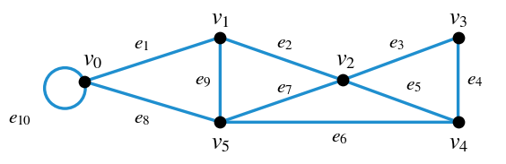
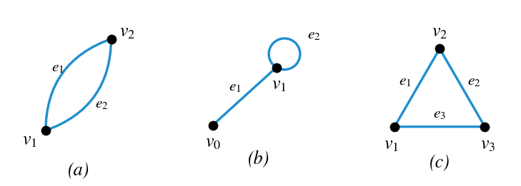
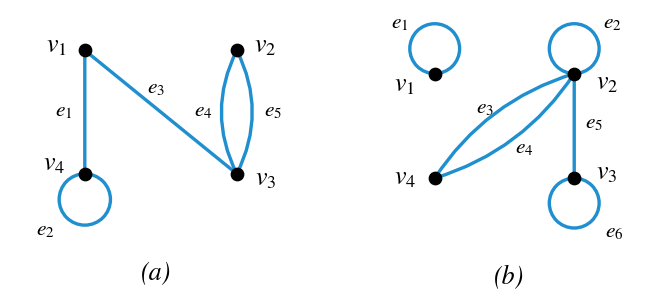
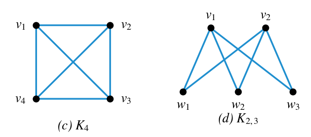
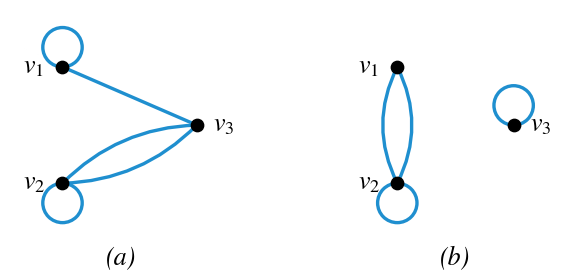
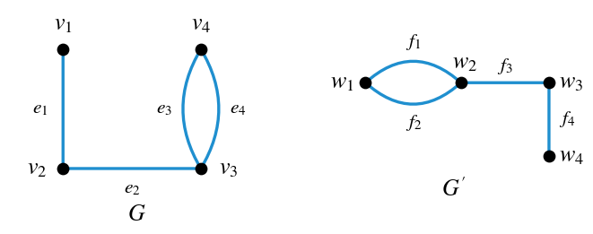
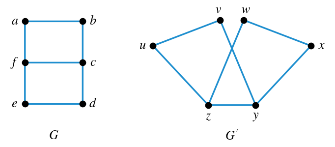
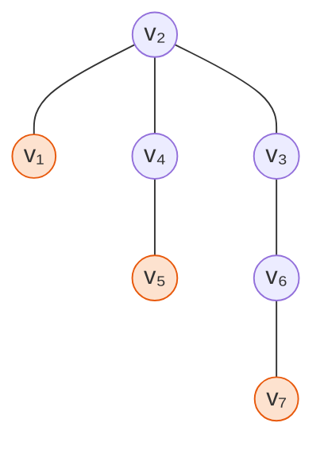
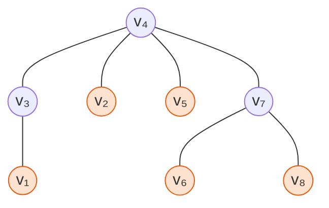
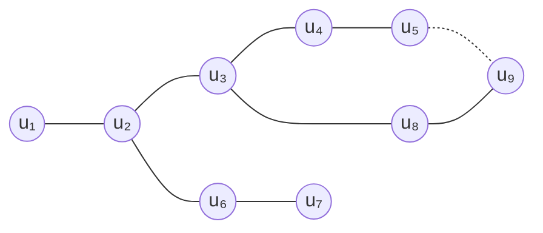

# HW11 Assignment Explanation — Graphs, Isomorphism, and Trees

[Repository Guide](../../README.md) | [English](Assignment-Explanation.md) | [한국어](Assignment-Explanation.ko.md)

> **Last Updated:** 2026-11-04
>
> Discrete Mathematics with Applications, Epp, Ch 10

> **Learning Objectives:**
> 1. Classify a given walk using the definitions of trail, path, closed walk, circuit, and simple circuit
> 2. Count all subgraphs of a small graph without omission according to the definition of subgraph
> 3. Find the adjacency matrix of a graph with loops and parallel edges, and draw a graph from an adjacency matrix
> 4. Prove from the definition of matrix multiplication that the square of a symmetric matrix is symmetric
> 5. Show that two graphs are isomorphic by constructing correspondences of vertices and edges, and check the decision with isomorphic invariants
> 6. Find the leaves and internal vertices of a tree, and decide whether a tree can exist from the relation between its numbers of vertices and edges

---

## Table of Contents

- [1. Exercise 10.1.2: Classifying Walks](#1-exercise-1012-classifying-walks)
- [2. Exercise 10.1.23: All Subgraphs](#2-exercise-10123-all-subgraphs)
- [3. Exercise 10.2.4: Finding Adjacency Matrices](#3-exercise-1024-finding-adjacency-matrices)
- [4. Exercise 10.2.5: Graphs from Adjacency Matrices](#4-exercise-1025-graphs-from-adjacency-matrices)
- [5. Exercise 10.2.15: The Square of a Symmetric Matrix](#5-exercise-10215-the-square-of-a-symmetric-matrix)
- [6. Exercise 10.3.1: Isomorphism of Graphs with Parallel Edges](#6-exercise-1031-isomorphism-of-graphs-with-parallel-edges)
- [7. Exercise 10.3.9: Isomorphism of Simple Graphs](#7-exercise-1039-isomorphism-of-simple-graphs)
- [8. Exercise 10.4.7: Leaves and Internal Vertices](#8-exercise-1047-leaves-and-internal-vertices)
- [9. Exercise 10.4.8: A Tree with Nine Vertices and Nine Edges](#9-exercise-1048-a-tree-with-nine-vertices-and-nine-edges)
- [Summary](#summary)
- [Self-Check Questions](#self-check-questions)

---

<br>

## 1. Exercise 10.1.2: Classifying Walks

**Problem.** Classify each of the six walks below in the graph of Figure 1 as a trail, path, closed walk, circuit, or simple circuit, or as a walk of none of these kinds.

(a) $v_1 e_2 v_2 e_3 v_3 e_4 v_4 e_5 v_2 e_2 v_1 e_1 v_0$, (b) $v_2 v_3 v_4 v_5 v_2$, (c) $v_4 v_2 v_3 v_4 v_5 v_2 v_4$, (d) $v_2 v_1 v_5 v_2 v_3 v_4 v_2$, (e) $v_0 v_5 v_2 v_3 v_4 v_2 v_1$, (f) $v_5 v_4 v_2 v_1$



*Figure 1. Graph whose walks are classified*

**Concepts used.** A **walk** from a vertex $v$ to a vertex $w$ in a graph $G$ is a finite alternating sequence $v_0 e_1 v_1 e_2 \cdots e_n v_n$ of adjacent vertices and edges, where $v_0 = v$, $v_n = w$, and the endpoints of each edge $e_i$ are $v_{i-1}$ and $v_i$ ([Chapter 10, Section 1](../../Lecture-Notes/Ch10_Theory-of-Graphs-and-Trees/Concepts_Lecture.md)). The kind of a walk is determined by whether edges or vertices repeat and whether it starts and ends at the same vertex.

| Kind | Definition |
|:---|:---|
| **Trail** | A walk with no repeated edge |
| **Path** | A trail with no repeated vertex |
| **Closed walk** | A walk that starts and ends at the same vertex |
| **Circuit** | A closed walk that contains at least one edge and has no repeated edge |
| **Simple circuit** | A circuit with no repeated vertex other than the first and last |

*Table 1. Kinds of walks and their definitions*

By definition every path is a trail, every simple circuit is a circuit, and every circuit is a closed walk. Below, the answer is the narrowest kind that each walk satisfies. This graph has no parallel edges, so listing only the vertices determines the edges traversed.

**Solution.** Read the edges of each walk from Figure 1, and check in turn for repeated edges, repeated vertices, and whether the walk is closed.

| Walk | Edges traversed | Repeated edge | Repeated vertex | Closed | Classification |
|:---:|:---|:---:|:---:|:---:|:---|
| (a) | $e_2, e_3, e_4, e_5, e_2, e_1$ | $e_2$ | $v_1, v_2$ | no | walk (not a trail) |
| (b) | $e_3, e_4, e_6, e_7$ | none | none | yes | simple circuit |
| (c) | $e_5, e_3, e_4, e_6, e_7, e_5$ | $e_5$ | $v_2, v_4$ | yes | closed walk (not a circuit) |
| (d) | $e_2, e_9, e_7, e_3, e_4, e_5$ | none | $v_2$ | yes | circuit (not a simple circuit) |
| (e) | $e_8, e_7, e_3, e_4, e_5, e_2$ | none | $v_2$ | no | trail (not a path) |
| (f) | $e_6, e_5, e_2$ | none | none | no | path |

*Table 2. Edges, repetitions, closedness, and classification of the six walks*

- **(a)** The edge $e_2$ is traversed twice, as $v_1 \to v_2$ and as $v_2 \to v_1$, so the walk is not a trail and hence not a path. Its start $v_1$ differs from its end $v_0$, so it is not closed either. It is a walk of none of the special kinds.
- **(b)** The edges $e_3, e_4, e_6, e_7$ are all different, no vertex repeats except $v_2$, which is both the start and the end, and the walk starts and ends at $v_2$. Hence it is a simple circuit.
- **(c)** It starts and ends at $v_4$, so it is a closed walk, but it traverses the edge $e_5$ twice, first ($`v_4 v_2`$) and last ($`v_2 v_4`$), so it is not a circuit.
- **(d)** It is closed and its six edges are all different, so it is a circuit. However, $v_2$ appears in the middle (as the fourth vertex) besides the start and the end, so it is not a simple circuit.
- **(e)** Its six edges are all different, so it is a trail, but $v_2$ appears twice, as the third and sixth vertices, so it is not a path. Its start $v_0$ differs from its end $v_1$, so it is not closed.
- **(f)** Its three edges and four vertices are all different, so it is a path. A path is also a trail.

> **Caution:** When counting repeated vertices in a closed walk such as (c) or (d), the coincidence of the start and the end is not counted as a repetition. For deciding whether a circuit is simple, what matters is a vertex that appears again between the first and the last position.

---

<br>

## 2. Exercise 10.1.23: All Subgraphs

**Problem.** List every subgraph of each of the three graphs in Figure 2. The edge names in (b) and (c) are added for the explanation.



*Figure 2. Three graphs whose subgraphs are found*

**Concepts used.** A graph $H$ is a **subgraph** of a graph $G$ if every vertex of $H$ is a vertex of $G$, every edge of $H$ is an edge of $G$, and every edge of $H$ has the same endpoints as in $G$ ([Chapter 10, Section 1](../../Lecture-Notes/Ch10_Theory-of-Graphs-and-Trees/Concepts_Lecture.md)). These three conditions are the whole definition, so an edge of $G$ joining two vertices of $H$ may still be left out of $H$. Moreover, the vertex set of a graph must be nonempty ([Chapter 1, Section 4](../../Lecture-Notes/Ch01_Speaking-Mathematically/Concepts_Lecture.md)). Hence a subgraph is determined in two steps.

1. Choose the vertex set $W$ as a nonempty subset of $V(G)$.
2. Choose any number (from none to all) of the edges whose endpoints both lie in $W$. An edge with an endpoint outside $W$ cannot be included.

If $e(W)$ edges have both endpoints in $W$, step 2 can be done in $2^{e(W)}$ ways, so the number of subgraphs is the sum of $2^{e(W)}$ over all $W$. The example in [Chapter 10, Section 1](../../Lecture-Notes/Ch10_Theory-of-Graphs-and-Trees/Concepts_Lecture.md) (vertices $v_1$ and $v_2$, two edges joining them, and a loop at $`v_1`$) counts 11 subgraphs, in agreement with this sum $2 + 1 + 8 = 11$; among the 11 are the subgraph with both vertices and no edge and the one with both vertices and only the loop.

**Solution.** For each graph, the edges that can be included for each vertex set are as follows.

| Graph | Vertex set $W$ | Edges that can be included | Number of subgraphs $2^{e(W)}$ |
|:---:|:---|:---|:---:|
| (a) | $\lbrace v_1\rbrace$, $\lbrace v_2\rbrace$ | none | 1, 1 |
| (a) | $\lbrace v_1, v_2\rbrace$ | $e_1, e_2$ | 4 |
| (b) | $\lbrace v_0\rbrace$ | none | 1 |
| (b) | $\lbrace v_1\rbrace$ | $e_2$ (loop) | 2 |
| (b) | $\lbrace v_0, v_1\rbrace$ | $e_1, e_2$ | 4 |
| (c) | $\lbrace v_1\rbrace$, $\lbrace v_2\rbrace$, $\lbrace v_3\rbrace$ | none | 1, 1, 1 |
| (c) | $\lbrace v_1, v_2\rbrace$, $\lbrace v_2, v_3\rbrace$, $\lbrace v_1, v_3\rbrace$ | $e_1$, $e_2$, $e_3$, respectively | 2, 2, 2 |
| (c) | $\lbrace v_1, v_2, v_3\rbrace$ | $e_1, e_2, e_3$ | 8 |

*Table 3. Edges that can be included and number of subgraphs for each vertex set*

**(a)** There are $1 + 1 + 4 = 6$ subgraphs. Written as pairs $(W, F)$ of a vertex set and an edge set, they are $(\lbrace v_1\rbrace, \emptyset)$, $(\lbrace v_2\rbrace, \emptyset)$, $(\lbrace v_1, v_2\rbrace, \emptyset)$, $(\lbrace v_1, v_2\rbrace, \lbrace e_1\rbrace)$, $(\lbrace v_1, v_2\rbrace, \lbrace e_2\rbrace)$, and $(\lbrace v_1, v_2\rbrace, \lbrace e_1, e_2\rbrace)$.

**(b)** There are $1 + 2 + 4 = 7$ subgraphs. The loop $e_2$ has $v_1$ as its only endpoint, so it can be included even when the vertex set is $\lbrace v_1\rbrace$. The list is $(\lbrace v_0\rbrace, \emptyset)$, $(\lbrace v_1\rbrace, \emptyset)$, $(\lbrace v_1\rbrace, \lbrace e_2\rbrace)$, $(\lbrace v_0, v_1\rbrace, \emptyset)$, $(\lbrace v_0, v_1\rbrace, \lbrace e_1\rbrace)$, $(\lbrace v_0, v_1\rbrace, \lbrace e_2\rbrace)$, and $(\lbrace v_0, v_1\rbrace, \lbrace e_1, e_2\rbrace)$.

**(c)** There are $3 \cdot 1 + 3 \cdot 2 + 8 = 17$ subgraphs. They are listed below.

| No. | Vertex set | Edge set | No. | Vertex set | Edge set |
|:---:|:---|:---|:---:|:---|:---|
| 1 | $\lbrace v_1\rbrace$ | $\emptyset$ | 10 | $\lbrace v_1, v_2, v_3\rbrace$ | $\emptyset$ |
| 2 | $\lbrace v_2\rbrace$ | $\emptyset$ | 11 | $\lbrace v_1, v_2, v_3\rbrace$ | $\lbrace e_1\rbrace$ |
| 3 | $\lbrace v_3\rbrace$ | $\emptyset$ | 12 | $\lbrace v_1, v_2, v_3\rbrace$ | $\lbrace e_2\rbrace$ |
| 4 | $\lbrace v_1, v_2\rbrace$ | $\emptyset$ | 13 | $\lbrace v_1, v_2, v_3\rbrace$ | $\lbrace e_3\rbrace$ |
| 5 | $\lbrace v_1, v_2\rbrace$ | $\lbrace e_1\rbrace$ | 14 | $\lbrace v_1, v_2, v_3\rbrace$ | $\lbrace e_1, e_2\rbrace$ |
| 6 | $\lbrace v_2, v_3\rbrace$ | $\emptyset$ | 15 | $\lbrace v_1, v_2, v_3\rbrace$ | $\lbrace e_1, e_3\rbrace$ |
| 7 | $\lbrace v_2, v_3\rbrace$ | $\lbrace e_2\rbrace$ | 16 | $\lbrace v_1, v_2, v_3\rbrace$ | $\lbrace e_2, e_3\rbrace$ |
| 8 | $\lbrace v_1, v_3\rbrace$ | $\emptyset$ | 17 | $\lbrace v_1, v_2, v_3\rbrace$ | $\lbrace e_1, e_2, e_3\rbrace$ |
| 9 | $\lbrace v_1, v_3\rbrace$ | $\lbrace e_3\rbrace$ | | | |

*Table 4. The 17 subgraphs of graph (c)*

> **Caution:** Even when all vertices are chosen, only some of the edges may be chosen. Hence in (c) the subgraphs with vertex set $\lbrace v_1, v_2, v_3\rbrace$ are the one with no edge, three with one edge, three with two edges, and the original graph, eight in all (Nos. 10-17 in Table 4). Assuming that choosing all vertices forces all edges omits seven of them and counts only $3 + 6 + 1 = 10$, and assuming that every edge between two chosen vertices is always included counts only 7, one for each vertex set. The latter is a separate notion called an **induced subgraph**; the definition of a subgraph has no such condition, so the answer is 17. Conversely, including an edge whose endpoint is missing (for example, the edge $e_1$ with vertex set $`\lbrace v_1\rbrace`$) does not give a graph and is not allowed.

---

<br>

## 3. Exercise 10.2.4: Finding Adjacency Matrices

**Problem.** Find the adjacency matrices of the following undirected graphs: (a) and (b) are the graphs in Figure 3, (c) is the complete graph $K_4$ on four vertices, and (d) is the complete bipartite graph $K_{2,3}$ whose two parts have two and three vertices.



*Figure 3. Graphs (a) and (b) whose adjacency matrices are found*

**Concepts used.** For an undirected graph whose vertices are listed in the order $v_1, v_2, \ldots, v_n$, the **adjacency matrix** is the $n \times n$ matrix whose $(i, j)$ entry $a_{ij}$ is the number of edges connecting $v_i$ and $v_j$ ([Chapter 10, Section 2](../../Lecture-Notes/Ch10_Theory-of-Graphs-and-Trees/Concepts_Lecture.md)). A loop at $v_i$ counts as 1 in $a_{ii}$. Since edges have no direction, $a_{ij} = a_{ji}$, and the adjacency matrix is symmetric. The **complete graph** $K_n$ is the simple graph on $n$ vertices with exactly one edge between each pair of distinct vertices and no loops. The **complete bipartite graph** $K_{m,n}$ is the simple graph whose vertices split into two parts $\lbrace v_1, \ldots, v_m\rbrace$ and $\lbrace w_1, \ldots, w_n\rbrace$, with one edge between each $v_i$ and each $w_j$ and no other edges.

**Solution.** List the edges of each graph with their endpoints, and count the edges for each pair of vertices.

**(a)** The edges are $e_1 = \lbrace v_1, v_4\rbrace$, $e_2$ (a loop at $`v_4`$), $e_3 = \lbrace v_1, v_3\rbrace$, and the parallel edges $e_4$ and $e_5$ joining $v_2$ and $v_3$. Hence $a_{14} = a_{41} = 1$, $a_{44} = 1$, $a_{13} = a_{31} = 1$, and $a_{23} = a_{32} = 2$, and all other entries are 0.

```math
\begin{bmatrix} 0 & 0 & 1 & 1 \\ 0 & 0 & 2 & 0 \\ 1 & 2 & 0 & 0 \\ 1 & 0 & 0 & 1 \end{bmatrix}
```

**(b)** The edges are $e_1$ (a loop at $`v_1`$), $e_2$ (a loop at $`v_2`$), the parallel edges $e_3$ and $e_4$ joining $v_2$ and $v_4$, $e_5 = \lbrace v_2, v_3\rbrace$, and $e_6$ (a loop at $`v_3`$). Apart from its loop, $v_1$ is not joined to any vertex, so the first row and column are all 0 except $a_{11} = 1$.

```math
\begin{bmatrix} 1 & 0 & 0 & 0 \\ 0 & 1 & 1 & 2 \\ 0 & 1 & 1 & 0 \\ 0 & 2 & 0 & 0 \end{bmatrix}
```

**(c)** Name the vertices of $K_4$ $v_1, v_2, v_3, v_4$ (left of Figure 4). There is one edge between any two distinct vertices and no loop, so the diagonal entries are 0 and all other entries are 1.

```math
\begin{bmatrix} 0 & 1 & 1 & 1 \\ 1 & 0 & 1 & 1 \\ 1 & 1 & 0 & 1 \\ 1 & 1 & 1 & 0 \end{bmatrix}
```

**(d)** Split the vertices of $K_{2,3}$ into the parts $v_1, v_2$ and $w_1, w_2, w_3$, and list them in the order $v_1, v_2, w_1, w_2, w_3$ (right of Figure 4). There is no edge between two vertices of the same part and one edge between two vertices of different parts.

```math
\begin{bmatrix} 0 & 0 & 1 & 1 & 1 \\ 0 & 0 & 1 & 1 & 1 \\ 1 & 1 & 0 & 0 & 0 \\ 1 & 1 & 0 & 0 & 0 \\ 1 & 1 & 0 & 0 & 0 \end{bmatrix}
```



*Figure 4. Complete graph K4 and complete bipartite graph K2,3*

The adjacency matrix depends on the order of the vertices. For instance, listing the vertices of (d) as $w_1, w_2, w_3, v_1, v_2$ gives a matrix with a $3 \times 3$ zero block at the upper left and a $2 \times 2$ zero block at the lower right. Once the order is stated, either matrix represents the same graph.

> **Caution:** The sum of a row of the adjacency matrix equals the degree of the vertex when there is no loop, but not when there is one. A loop adds 2 to the degree but is recorded as 1 in the adjacency matrix. In (a), the row of $v_4$ sums to $1 + 1 = 2$, while $\deg(v_4) = 1 + 2 = 3$.

---

<br>

## 4. Exercise 10.2.5: Graphs from Adjacency Matrices

**Problem.** For each of the two matrices below, draw a graph that has it as its adjacency matrix.

```math
\text{(a)}\ \begin{bmatrix} 1 & 0 & 1 \\ 0 & 1 & 2 \\ 1 & 2 & 0 \end{bmatrix} \qquad \text{(b)}\ \begin{bmatrix} 0 & 2 & 0 \\ 2 & 1 & 0 \\ 0 & 0 & 1 \end{bmatrix}
```

**Concepts used.** Regard the rows and columns as corresponding to the vertices $v_1, v_2, v_3$, and draw $a_{ij}$ edges joining $v_i$ and $v_j$ ([Chapter 10, Section 2](../../Lecture-Notes/Ch10_Theory-of-Graphs-and-Trees/Concepts_Lecture.md)). Since the matrix is symmetric, $a_{ij}$ and $a_{ji}$ describe the same edges. Hence it suffices to read the entries on and above the diagonal ($`i \le j`$), and the diagonal entry $a_{ii}$ is the number of loops at $v_i$.

**Solution.**

**(a)** Since $a_{11} = 1$, there is one loop at $v_1$; since $a_{12} = 0$, there is no edge between $v_1$ and $v_2$; and since $a_{13} = 1$, there is one edge between $v_1$ and $v_3$. Since $a_{22} = 1$, there is one loop at $v_2$; since $a_{23} = 2$, there are two parallel edges between $v_2$ and $v_3$; and since $a_{33} = 0$, there is no loop at $v_3$. There are $1 + 1 + 1 + 2 = 5$ edges in all.

**(b)** Since $a_{11} = 0$, there is no loop at $v_1$; since $a_{12} = 2$, there are two parallel edges between $v_1$ and $v_2$; and since $a_{13} = 0$, there is no edge between $v_1$ and $v_3$. Since $a_{22} = 1$, there is one loop at $v_2$; since $a_{23} = 0$, there is no edge between $v_2$ and $v_3$; and since $a_{33} = 1$, there is one loop at $v_3$. There are $2 + 1 + 1 = 4$ edges in all. Apart from its loop, $v_3$ is not joined to any other vertex, so this graph is not connected, and it has two connected components, $\lbrace v_1, v_2\rbrace$ and $\lbrace v_3\rbrace$.



*Figure 5. Graphs (a) and (b) with the given adjacency matrices*

An adjacency matrix gives only the number of edges for each pair of vertices, so the names of the edges and the layout of the drawing may be chosen freely.

---

<br>

## 5. Exercise 10.2.15: The Square of a Symmetric Matrix

**Problem.** Show that the square $A^2$ of a real $m \times m$ symmetric matrix $A$ is again symmetric.

**Concepts used.** An $n \times n$ matrix $A = (a_{ij})$ is a **symmetric matrix** if $a_{ij} = a_{ji}$ for all $i$ and $j$. The $(i, j)$ entry of the product $AB$ of an $m \times k$ matrix $A$ and a $k \times n$ matrix $B$ is $\sum_{r=1}^{k} a_{ir} b_{rj}$, obtained by multiplying the entries of row $i$ of $A$ and column $j$ of $B$ in turn and adding ([Chapter 10, Section 2](../../Lecture-Notes/Ch10_Theory-of-Graphs-and-Trees/Concepts_Lecture.md)).

**Solution.** Let $A = (a_{ij})$ be an $m \times m$ symmetric matrix, and let $i$ and $j$ be arbitrary integers with $1 \le i, j \le m$. By the definition of matrix multiplication, the two entries of $A^2 = AA$ are as follows.

```math
(A^2)_{ij} = \sum_{k=1}^{m} a_{ik} a_{kj}, \qquad (A^2)_{ji} = \sum_{k=1}^{m} a_{jk} a_{ki}
```

Since $A$ is symmetric, $a_{ik} = a_{ki}$ and $a_{kj} = a_{jk}$ for every $k$. Substituting these and using the commutative law for multiplication of real numbers gives the following for each $k$.

```math
a_{ik} a_{kj} = a_{ki} a_{jk} = a_{jk} a_{ki}
```

The two sums add the same terms over $k = 1$ to $m$, so $`(A^2)_{ij} = (A^2)_{ji}`$. Since $i$ and $j$ were arbitrary, $A^2$ is a symmetric matrix.

For example, if $`A = \begin{bmatrix} 1 & 2 \\ 2 & 3 \end{bmatrix}`$, then $`A^2 = \begin{bmatrix} 1 + 4 & 2 + 6 \\ 2 + 6 & 4 + 9 \end{bmatrix} = \begin{bmatrix} 5 & 8 \\ 8 & 13 \end{bmatrix}`$, which is symmetric.

> **Note:** A short proof uses the transpose. Symmetry means $A^T = A$, and the transpose of a product is $(AB)^T = B^T A^T$, so $(A^2)^T = (AA)^T = A^T A^T = AA = A^2$. In graph terms, if $A$ is the adjacency matrix of an undirected graph, then $`(A^2)_{ij}`$ is the number of walks of length 2 from $v_i$ to $v_j$ (Theorem 10.2.2 in [Chapter 10, Section 2](../../Lecture-Notes/Ch10_Theory-of-Graphs-and-Trees/Concepts_Lecture.md)). Following a walk backward gives a walk of the same length from $v_j$ to $v_i$, so it is natural that $`(A^2)_{ij} = (A^2)_{ji}`$.

---

<br>

## 6. Exercise 10.3.1: Isomorphism of Graphs with Parallel Edges

**Problem.** Decide whether $G$ and $G'$ in Figure 6 are isomorphic. If so, construct the vertex correspondence $g: V(G) \to V(G')$ and the edge correspondence $h: E(G) \to E(G')$; if not, name an isomorphic invariant on which the two graphs differ.



*Figure 6. Two graphs G and G' with parallel edges*

**Concepts used.** Two graphs $G$ and $G'$ are **isomorphic** if there are one-to-one correspondences $g: V(G) \to V(G')$ and $h: E(G) \to E(G')$ such that, for all $v \in V(G)$ and $e \in E(G)$, "$`v`$ is an endpoint of $e$" is equivalent to "$`g(v)`$ is an endpoint of $h(e)$" ([Chapter 10, Section 3](../../Lecture-Notes/Ch10_Theory-of-Graphs-and-Trees/Concepts_Lecture.md)). A property preserved by isomorphism is called an **isomorphic invariant**; examples are the number of vertices, the number of edges, the number of vertices of degree $k$, having a circuit of length $k$, and connectedness (Theorem 10.3.2). One differing invariant proves that the graphs are not isomorphic, but agreement of all invariants does not by itself make them isomorphic. To show isomorphism, $g$ and $h$ must actually be constructed.

**Solution.**

1. **Comparing invariants.** Both graphs have four vertices and four edges. The degrees in $G$ are $\deg(v_1) = 1$, $\deg(v_2) = 2$, $\deg(v_3) = 3$, and $\deg(v_4) = 2$, and in $G'$ they are $\deg(w_1) = 2$, $\deg(w_2) = 3$, $\deg(w_3) = 2$, and $\deg(w_4) = 1$. Both graphs have one pair of parallel edges (a circuit of length 2). Since the invariants agree, look for correspondences.
2. **Vertex correspondence $g$.** An isomorphism preserves degrees, so $v_1$, of degree 1, must go to $w_4$, and $v_3$, of degree 3, must go to $w_2$. Since $v_2$ is adjacent to $v_1$ and $v_3$, $g(v_2)$ must be adjacent to both $w_4$ and $w_2$, so it must be $w_3$. The remaining vertex $v_4$ goes to $w_1$.
3. **Edge correspondence $h$.** Send each edge to the edge joining the images of its endpoints. Send the parallel edges $e_3$ and $e_4$ to the parallel edges $f_1$ and $f_2$.

| Edge $e$ | Endpoints in $G$ | Endpoints moved by $g$ | $h(e)$ |
|:---:|:---:|:---:|:---:|
| $e_1$ | $v_1, v_2$ | $w_4, w_3$ | $f_4$ |
| $e_2$ | $v_2, v_3$ | $w_3, w_2$ | $f_3$ |
| $e_3$ | $v_3, v_4$ | $w_2, w_1$ | $f_1$ |
| $e_4$ | $v_3, v_4$ | $w_2, w_1$ | $f_2$ |

*Table 5. Edge correspondence h and preservation of endpoints*

Both $g$ and $h$ are one-to-one correspondences, and in every row of Table 5 the endpoints of $h(e)$ are exactly the images of the endpoints of $e$. Hence the endpoint relation is preserved, and $G$ and $G'$ are isomorphic. In summary, $g(v_1) = w_4$, $g(v_2) = w_3$, $g(v_3) = w_2$, $g(v_4) = w_1$, and $h(e_1) = f_4$, $h(e_2) = f_3$, $h(e_3) = f_1$, $h(e_4) = f_2$. Swapping to $h(e_3) = f_2$ and $h(e_4) = f_1$ also gives an isomorphism.

---

<br>

## 7. Exercise 10.3.9: Isomorphism of Simple Graphs

**Problem.** Decide whether the simple graphs $G$ and $G'$ in Figure 7 are isomorphic. If so, construct the vertex correspondence $g: V(G) \to V(G')$; if not, name an isomorphic invariant on which the two graphs differ.



*Figure 7. Two simple graphs G and G'*

**Concepts used.** In a simple graph an edge is determined by the pair of its endpoints, so $G$ and $G'$ are isomorphic if there is a one-to-one correspondence $g: V(G) \to V(G')$ such that, for all vertices $u$ and $v$, "$`\lbrace u, v\rbrace`$ is an edge of $G$" is equivalent to "$`\lbrace g(u), g(v)\rbrace`$ is an edge of $G'$" ([Chapter 10, Section 3](../../Lecture-Notes/Ch10_Theory-of-Graphs-and-Trees/Concepts_Lecture.md)). If the two graphs have the same number of edges, it suffices to check that every edge of $G$ is sent to an edge of $G'$. Since $g$ is one-to-one, different edges go to different edges, and since the numbers of edges are equal, every edge of $G'$ is the image of some edge, so the condition in the other direction also holds.

**Solution.**

1. **Comparing invariants.** The edges of $G$ are the seven edges $ab, af, bc, fc, fe, cd, ed$, and the edges of $G'$ are the seven edges $uv, uz, vy, wz, wx, xy, zy$. Both graphs have six vertices. In $G$, the vertices $c$ and $f$ have degree 3 and the other four have degree 2; in $G'$, $y$ and $z$ have degree 3 and the other four have degree 2. Moreover, the two degree-3 vertices $c$ and $f$ of $G$ are adjacent, and so are $y$ and $z$ in $G'$.
2. **Understanding the structure.** In $G$, $f$ and $c$ are joined directly by the edge $fc$ and also by the paths $`f\,a\,b\,c`$ and $`f\,e\,d\,c`$, each passing through two vertices of degree 2. In $G'$, $z$ and $y$ are likewise joined by the edge $zy$ and by the paths $`z\,u\,v\,y`$ and $`z\,w\,x\,y`$. The crossing of the edges $vy$ and $wz$ in the drawing of $G'$ is only a matter of how it is drawn and has nothing to do with the structure.
3. **Vertex correspondence $g$.** Matching this structure, let $g(f) = z$, $g(c) = y$, $g(a) = u$, $g(b) = v$, $g(e) = w$, and $g(d) = x$.
4. **Checking the edges.** Move all seven edges of $G$.

| Edge of $G$ | Pair moved by $g$ | Edge of $G'$? |
|:---:|:---:|:---:|
| $\lbrace a, b\rbrace$ | $\lbrace u, v\rbrace$ | yes |
| $\lbrace a, f\rbrace$ | $\lbrace u, z\rbrace$ | yes |
| $\lbrace b, c\rbrace$ | $\lbrace v, y\rbrace$ | yes |
| $\lbrace f, c\rbrace$ | $\lbrace z, y\rbrace$ | yes |
| $\lbrace f, e\rbrace$ | $\lbrace z, w\rbrace$ | yes |
| $\lbrace c, d\rbrace$ | $\lbrace y, x\rbrace$ | yes |
| $\lbrace e, d\rbrace$ | $\lbrace w, x\rbrace$ | yes |

*Table 6. Edges of G moved by the vertex correspondence g*

The map $g$ is a one-to-one correspondence from six vertices to six vertices, and the seven edges of $G$ are sent to seven different edges of $G'$. Since the two graphs have the same number of edges, pairs that are not adjacent in $G$ are sent to pairs that are not adjacent in $G'$. Therefore $G$ and $G'$ are isomorphic.

> **Note:** An isomorphism need not be unique. For example, changing the $g$ above to $a \mapsto w$, $b \mapsto x$, $e \mapsto u$, and $d \mapsto v$ also preserves every edge. The observation that degrees and adjacencies look alike is not a proof; isomorphism is proved by fixing one correspondence and checking, as in Table 6, that every edge is preserved.

---

<br>

## 8. Exercise 10.4.7: Leaves and Internal Vertices

**Problem.** Identify the leaves and the internal vertices of the two trees (a) and (b). The edges of (a) are $v_2 v_1$, $v_2 v_3$, $v_2 v_4$, $v_4 v_5$, $v_3 v_6$, $v_6 v_7$, and the edges of (b) are $v_1 v_3$, $v_3 v_4$, $v_4 v_2$, $v_4 v_5$, $v_4 v_7$, $v_7 v_6$, $v_7 v_8$.

**Concepts used.** A connected graph without circuits is called a **tree**. In a tree with at least two vertices, a vertex of degree 1 is called a **leaf** or **terminal vertex**, and a vertex of degree greater than 1 is called an **internal vertex** ([Chapter 10, Section 4](../../Lecture-Notes/Ch10_Theory-of-Graphs-and-Trees/Concepts_Lecture.md)). In a tree with only one vertex, that vertex is called a leaf.

**Solution.** Count the degree of each vertex; a vertex of degree 1 is a leaf, and a vertex of degree 2 or more is an internal vertex.

**(a)** The degrees are $\deg(v_1) = 1$, $\deg(v_2) = 3$, $\deg(v_3) = 2$, $\deg(v_4) = 2$, $\deg(v_5) = 1$, $\deg(v_6) = 2$, and $\deg(v_7) = 1$. Hence the leaves are $v_1, v_5, v_7$, and the internal vertices are $v_2, v_3, v_4, v_6$.



*Figure 8. Tree (a) and its leaves (shaded vertices)*

**(b)** The degrees are $\deg(v_1) = 1$, $\deg(v_2) = 1$, $\deg(v_3) = 2$, $\deg(v_4) = 4$, $\deg(v_5) = 1$, $\deg(v_6) = 1$, $\deg(v_7) = 3$, and $\deg(v_8) = 1$. Hence the leaves are $v_1, v_2, v_5, v_6, v_8$, and the internal vertices are $v_3, v_4, v_7$.



*Figure 9. Tree (b) and its leaves (shaded vertices)*

Both results can be checked with the sum of degrees. A tree with $n$ vertices has $n - 1$ edges, so its degrees sum to $2(n - 1)$. For (a), $1 + 3 + 2 + 2 + 1 + 2 + 1 = 12 = 2 \cdot 6$, and for (b), $1 + 1 + 2 + 4 + 1 + 1 + 3 + 1 = 14 = 2 \cdot 7$, as expected.

---

<br>

## 9. Exercise 10.4.8: A Tree with Nine Vertices and Nine Edges

**Problem.** Decide whether a tree with nine vertices and nine edges exists; draw an example if it does, and explain why not if it does not.

**Concepts used.** Theorem 10.4.2 ([Chapter 10, Section 4](../../Lecture-Notes/Ch10_Theory-of-Graphs-and-Trees/Concepts_Lecture.md)) states that, for any positive integer $n$, a tree with $n$ vertices has exactly $n - 1$ edges. It is proved by mathematical induction, removing a leaf and its edge with the help of Lemma 10.4.1, which says that any tree with more than one vertex has a vertex of degree 1. Also, by Corollary 10.4.5, a graph with $n$ vertices and at least $n$ edges always has a circuit.

**Solution.** No such tree exists. By Theorem 10.4.2, a tree with nine vertices must have exactly $9 - 1 = 8$ edges, so it cannot have nine. The same fact also follows from Corollary 10.4.5: a graph with nine vertices and nine edges has a circuit, so it cannot be a tree, which must have no circuit.



*Figure 10. Circuit created by adding a ninth edge (dotted) to a tree with nine vertices and eight edges*

The solid part of Figure 10 is a tree with nine vertices and eight edges. Adding one more edge, for example the dotted edge $u_5 u_9$, creates the circuit $u_3 u_4 u_5 u_9 u_8 u_3$. In a tree there is only one path between two vertices, so adding an edge between two vertices already joined by a path makes that path and the new edge form a circuit. Hence the graph stops being a tree as soon as it has nine edges.

---

<br>

## Summary

| Concept | Key Summary |
|:-----|:-----|
| Classifying walks | A walk with no repeated edge is a trail; with no repeated vertex either, a path; closed with no repeated edge, a circuit; and with no repeated vertex other than the first and last, a simple circuit. |
| Subgraphs | Choose a nonempty vertex set $W$ and any edges with both endpoints in $W$, so the number is $\sum_W 2^{e(W)}$. A triangle has 17 subgraphs. |
| Adjacency matrix | $a_{ij}$ is the number of edges joining $v_i$ and $v_j$, and a loop counts as 1 on the diagonal. The adjacency matrix of an undirected graph is symmetric. |
| Graph from a matrix | Read only the entries on and above the diagonal and draw $a_{ij}$ edges. A diagonal entry is a number of loops. |
| Square of a symmetric matrix | $`(A^2)_{ij} = \sum_k a_{ik}a_{kj} = \sum_k a_{jk}a_{ki} = (A^2)_{ji}`$, so the square of a symmetric matrix is symmetric. |
| Isomorphism | Graphs are isomorphic if one-to-one correspondences $g$ and $h$ preserve the endpoint relation. Degrees must be preserved, so they narrow down the candidates. |
| Isomorphic invariants | The numbers of vertices and edges, degrees, lengths of circuits, and connectedness are invariants. One differing invariant shows non-isomorphism; showing isomorphism requires constructing and checking a correspondence. |
| Leaves and internal vertices | In a tree with at least two vertices, vertices of degree 1 are leaves and vertices of degree 2 or more are internal vertices. |
| Number of edges of a tree | A tree with $n$ vertices has exactly $n - 1$ edges, so no tree has nine vertices and nine edges. |

---

<br>

## Self-Check Questions

1. **Classifying a walk:** In the graph of Figure 1, what kind of walk is $v_0 e_{10} v_0$?

   <details>
   <summary>Answer</summary>

   It starts and ends at $v_0$, contains one edge $e_{10}$, and has no repeated edge, so it is a circuit. No vertex repeats other than the first and last, so it is a simple circuit. A single loop is a simple circuit of length 1.

   </details>

2. **Number of subgraphs:** How many subgraphs does the path-shaped graph with vertices $v_1$, $v_2$, $v_3$ and edges $e_1$ (joining $v_1$ and $`v_2`$) and $e_2$ (joining $v_2$ and $`v_3`$) have?

   <details>
   <summary>Answer</summary>

   Each of the three one-vertex sets gives $2^0 = 1$. The sets $\lbrace v_1, v_2\rbrace$ and $\lbrace v_2, v_3\rbrace$ each admit one edge and give $2^1 = 2$ each, $\lbrace v_1, v_3\rbrace$ contains both endpoints of no edge and gives 1, and $\lbrace v_1, v_2, v_3\rbrace$ gives $2^2 = 4$. The total is $3 + 2 + 2 + 1 + 4 = 12$.

   </details>

3. **Adjacency matrix:** Write the adjacency matrix of the path graph $v_1 v_2 v_3$ with a loop added at $v_3$.

   <details>
   <summary>Answer</summary>

   Since $a_{12} = a_{21} = 1$, $a_{23} = a_{32} = 1$, $a_{33} = 1$, and all other entries are 0, the rows are $(0, 1, 0)$, $(1, 0, 1)$, and $(0, 1, 1)$.

   </details>

4. **Symmetry and products:** Is the product $AB$ of two symmetric matrices $A$ and $B$ always symmetric?

   <details>
   <summary>Answer</summary>

   Not always. Since $(AB)^T = B^T A^T = BA$, $AB$ is symmetric exactly when $AB = BA$. For example, if $`A = \begin{bmatrix} 1 & 0 \\ 0 & 0 \end{bmatrix}`$ and $`B = \begin{bmatrix} 0 & 1 \\ 1 & 0 \end{bmatrix}`$, then $`AB = \begin{bmatrix} 0 & 1 \\ 0 & 0 \end{bmatrix}`$, which is not symmetric. For $A^2$, $A$ commutes with itself, so the square is always symmetric.

   </details>

5. **Proving non-isomorphism:** Are the two simple graphs with four vertices and three edges, the path $`a\,b\,c\,d`$ and the star in which one vertex is joined to the other three, isomorphic?

   <details>
   <summary>Answer</summary>

   No. The star has a vertex of degree 3, but the path does not (its degrees are 1, 2, 2, 1). "Has a vertex of degree 3" is an isomorphic invariant, so the two graphs cannot be isomorphic.

   </details>

6. **Properties of trees:** What is the sum of the degrees of a tree with ten vertices, and at least how many leaves does it have?

   <details>
   <summary>Answer</summary>

   It has $10 - 1 = 9$ edges, so its degrees sum to $2 \cdot 9 = 18$. A tree with at least two vertices has at least two vertices of degree 1. If an endpoint of a longest path were joined to a vertex outside the path, the path could be extended, and if it were joined to another vertex of the path, a circuit would arise, so both endpoints are leaves. A path-shaped tree is an example with exactly two leaves.

   </details>
