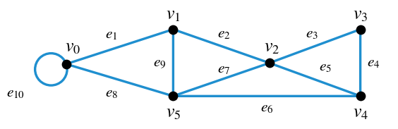
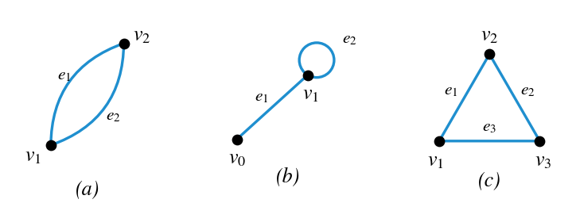
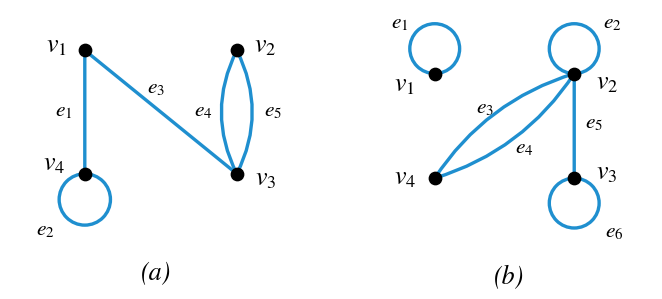
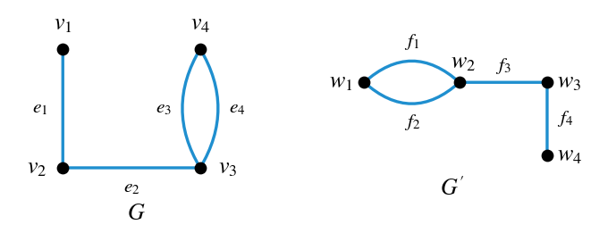
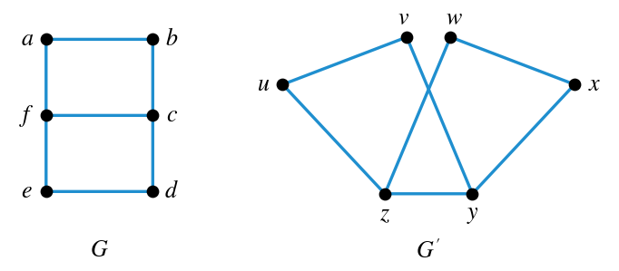
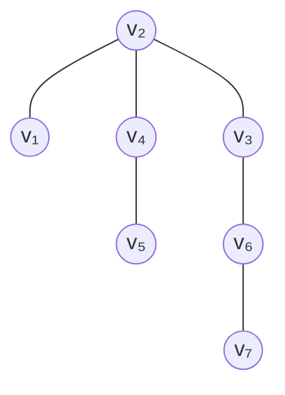
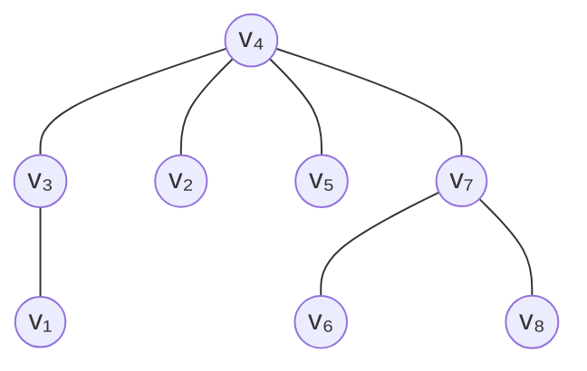

# HW11 과제 안내문 — 그래프, 동형, 트리

[레포지토리 안내](../../../README.ko.md) | [English](Assignment.md) | [한국어](Assignment.ko.md)

> **최종 수정일:** 2026-11-16

14주차에 나온 이산구조및연습 과제 11이다. 교재 Discrete Mathematics with Applications(Epp)의 10.1절(트레일, 경로, 회로), 10.2절(그래프의 행렬 표현), 10.3절(그래프의 동형), 10.4절(트리의 예와 기본 성질)에서 고른 연습 문제 9개로 이루어지며, 문제 번호는 교재의 연습 문제 번호이다.

- **제출 기한:** 과제가 나온 날로부터 1주일이며, 늦게 낸 과제는 0점 처리한다.
- **제출 방법:** 조별로 답안 하나를 제출한다.

---

<br>

## 1. 연습 문제 10.1.2: 보행의 분류

그림 1의 그래프에서 다음 보행이 각각 트레일, 경로, 닫힌 보행, 회로, 단순 회로 가운데 무엇인지, 또는 이 가운데 어느 것도 아닌 보행일 뿐인지 판정하라.

- (a) $v_1 e_2 v_2 e_3 v_3 e_4 v_4 e_5 v_2 e_2 v_1 e_1 v_0$
- (b) $v_2 v_3 v_4 v_5 v_2$
- (c) $v_4 v_2 v_3 v_4 v_5 v_2 v_4$
- (d) $v_2 v_1 v_5 v_2 v_3 v_4 v_2$
- (e) $v_0 v_5 v_2 v_3 v_4 v_2 v_1$
- (f) $v_5 v_4 v_2 v_1$



*그림 1. 보행을 분류할 그래프*

---

<br>

## 2. 연습 문제 10.1.23: 모든 부분 그래프

그림 2의 세 그래프 (a), (b), (c) 각각의 부분 그래프를 모두 구하라. (b)와 (c)의 변 이름은 설명을 위해 붙인 것이다.



*그림 2. 부분 그래프를 구할 세 그래프*

---

<br>

## 3. 연습 문제 10.2.4: 인접 행렬 구하기

다음 무방향 그래프의 인접 행렬을 구하라.

- (a) 그림 3의 그래프 (a)
- (b) 그림 3의 그래프 (b)
- (c) 꼭짓점이 4개인 완전 그래프 $K_4$
- (d) 꼭짓점이 2개, 3개인 두 부분으로 이루어진 완전 이분 그래프 $K_{2,3}$



*그림 3. 인접 행렬을 구할 그래프 (a), (b)*

---

<br>

## 4. 연습 문제 10.2.5: 인접 행렬로부터 그래프 그리기

다음 행렬을 각각 인접 행렬로 갖는 그래프를 구하라.

```math
\text{(a)}\ \begin{bmatrix} 1 & 0 & 1 \\ 0 & 1 & 2 \\ 1 & 2 & 0 \end{bmatrix} \qquad \text{(b)}\ \begin{bmatrix} 0 & 2 & 0 \\ 2 & 1 & 0 \\ 0 & 0 & 1 \end{bmatrix}
```

---

<br>

## 5. 연습 문제 10.2.15: 대칭 행렬의 제곱

모든 행렬의 성분은 실수라고 가정한다. $A$가 $m \times m$ 대칭 행렬이면 $A^2$도 대칭 행렬임을 증명하라.

---

<br>

## 6. 연습 문제 10.3.1: 평행 변이 있는 그래프의 동형

그림 4의 그래프 $G$와 $G'$이 동형인지 판정하라. 동형이면 동형 사상을 정하는 함수 $g: V(G) \to V(G')$과 $h: E(G) \to E(G')$을 제시하고, 동형이 아니면 두 그래프가 공유하지 않는 그래프 동형의 불변량을 제시하라.



*그림 4. 평행 변이 있는 두 그래프 G와 G'*

---

<br>

## 7. 연습 문제 10.3.9: 단순 그래프의 동형

그림 5의 단순 그래프 $G$와 $G'$이 동형인지 판정하라. 동형이면 동형 사상을 정하는 함수 $g: V(G) \to V(G')$을 제시하고, 동형이 아니면 두 그래프가 공유하지 않는 그래프 동형의 불변량을 제시하라.



*그림 5. 두 단순 그래프 G와 G'*

---

<br>

## 8. 연습 문제 10.4.7: 리프와 내부 꼭짓점

다음 두 트리의 리프(말단 꼭짓점)와 내부 꼭짓점을 모두 구하라.



*그림 6. 트리 (a)*



*그림 7. 트리 (b)*

---

<br>

## 9. 연습 문제 10.4.8: 꼭짓점 9개와 변 9개를 가진 트리

꼭짓점이 9개이고 변이 9개인 트리를 그리거나, 그런 그래프가 존재하지 않는 이유를 설명하라.

---

<br>

문제를 풀어 본 뒤 [과제 해설](../Assignment-Explanation.ko.md)에서 정답과 풀이를 볼 수 있다.
