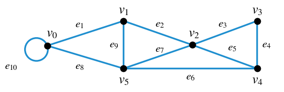
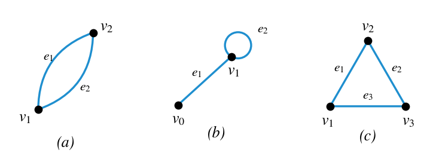
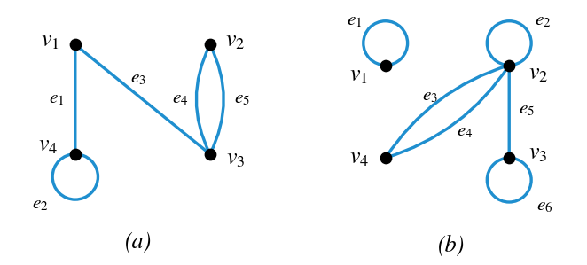
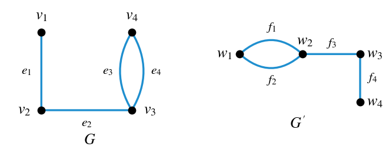
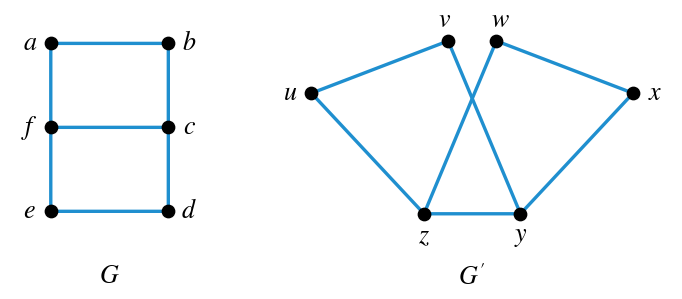
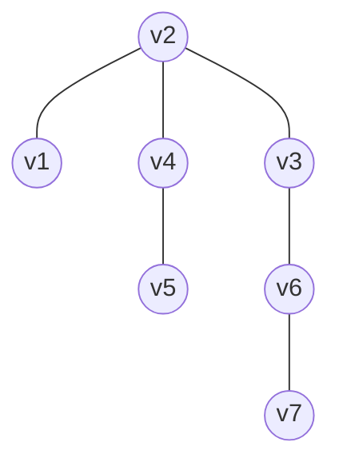
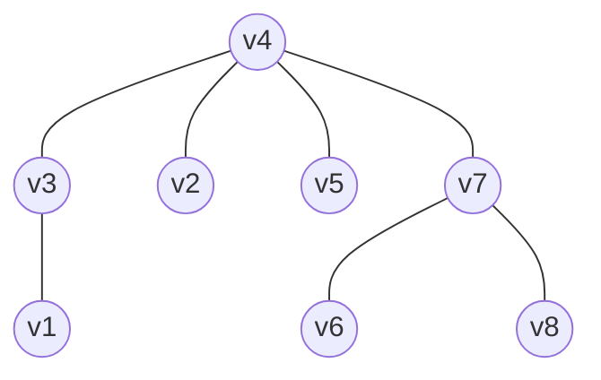

# HW11 Assignment Handout — Graphs, Isomorphism, and Trees

[Repository Guide](../../../README.md) | [English](Assignment.md) | [한국어](Assignment.ko.md)

> **Last Updated:** 2026-11-24

This is Assignment 11 of Discrete Mathematics and Practice, given in Week 14. It consists of nine exercises chosen from Sections 10.1 (Trails, Paths, and Circuits), 10.2 (Matrix Representations of Graphs), 10.3 (Isomorphisms of Graphs), and 10.4 (Trees: Examples and Basic Properties) of the textbook Discrete Mathematics with Applications (Epp), and the problem numbers are the exercise numbers of the textbook.

---

<br>

## 1. Exercise 10.1.2: Classifying Walks

In the graph of Figure 1, determine whether the following walks are trails, paths, closed walks, circuits, simple circuits, or just walks.

- (a) $v_1 e_2 v_2 e_3 v_3 e_4 v_4 e_5 v_2 e_2 v_1 e_1 v_0$
- (b) $v_2 v_3 v_4 v_5 v_2$
- (c) $v_4 v_2 v_3 v_4 v_5 v_2 v_4$
- (d) $v_2 v_1 v_5 v_2 v_3 v_4 v_2$
- (e) $v_0 v_5 v_2 v_3 v_4 v_2 v_1$
- (f) $v_5 v_4 v_2 v_1$



*Figure 1. Graph whose walks are classified*

---

<br>

## 2. Exercise 10.1.23: All Subgraphs

Find all subgraphs of each of the three graphs (a), (b), and (c) in Figure 2. The edge names in (b) and (c) are added for the explanation.



*Figure 2. Three graphs whose subgraphs are found*

---

<br>

## 3. Exercise 10.2.4: Finding Adjacency Matrices

Find adjacency matrices for the following (undirected) graphs.

- (a) Graph (a) in Figure 3
- (b) Graph (b) in Figure 3
- (c) $K_4$, the complete graph on four vertices
- (d) $K_{2,3}$, the complete bipartite graph on (2, 3) vertices



*Figure 3. Graphs (a) and (b) whose adjacency matrices are found*

---

<br>

## 4. Exercise 10.2.5: Graphs from Adjacency Matrices

Find graphs that have the following adjacency matrices.

```math
\text{(a)}\ \begin{bmatrix} 1 & 0 & 1 \\ 0 & 1 & 2 \\ 1 & 2 & 0 \end{bmatrix} \qquad \text{(b)}\ \begin{bmatrix} 0 & 2 & 0 \\ 2 & 1 & 0 \\ 0 & 0 & 1 \end{bmatrix}
```

---

<br>

## 5. Exercise 10.2.15: The Square of a Symmetric Matrix

Assume the entries of all matrices are real numbers. Prove that if $A$ is an $m \times m$ symmetric matrix, then $A^2$ is symmetric.

---

<br>

## 6. Exercise 10.3.1: Isomorphism of Graphs with Parallel Edges

Determine whether the graphs $G$ and $G'$ in Figure 4 are isomorphic. If they are, give functions $g: V(G) \to V(G')$ and $h: E(G) \to E(G')$ that define the isomorphism. If they are not, give an invariant for graph isomorphism that they do not share.



*Figure 4. Two graphs G and G' with parallel edges*

---

<br>

## 7. Exercise 10.3.9: Isomorphism of Simple Graphs

Determine whether the simple graphs $G$ and $G'$ in Figure 5 are isomorphic. If they are, give a function $g: V(G) \to V(G')$ that defines the isomorphism. If they are not, give an invariant for graph isomorphism that they do not share.



*Figure 5. Two simple graphs G and G'*

---

<br>

## 8. Exercise 10.4.7: Leaves and Internal Vertices

Find all leaves (or terminal vertices) and all internal (or branch) vertices for the following trees.



*Figure 6. Tree (a)*



*Figure 7. Tree (b)*

---

<br>

## 9. Exercise 10.4.8: A Tree with Nine Vertices and Nine Edges

Either draw a tree with nine vertices and nine edges, or explain why no such graph exists.

---

<br>

After solving the problems, see the [assignment explanation](../Assignment-Explanation.md) for the answers and solutions.
