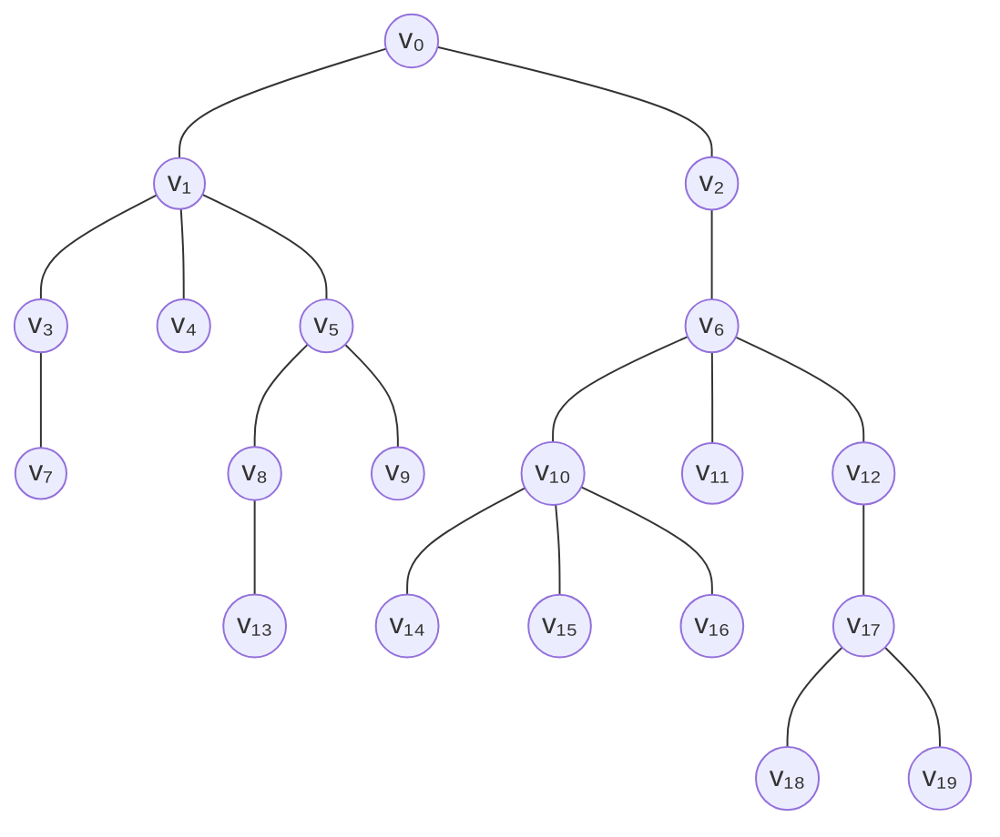
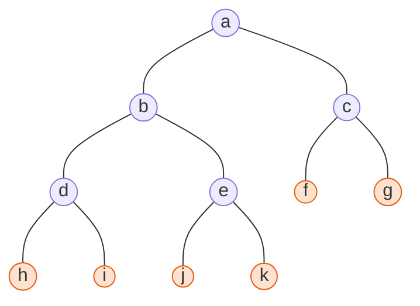
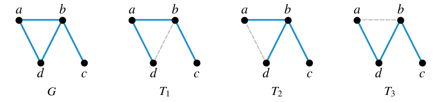
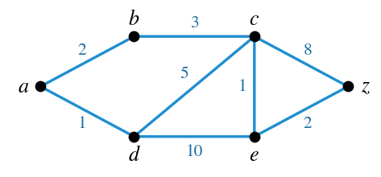
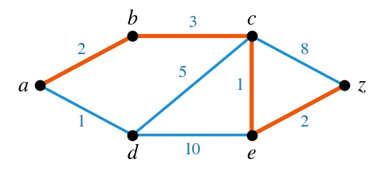
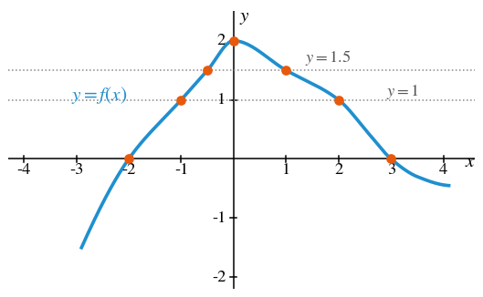
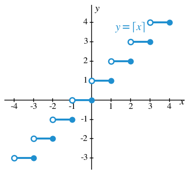
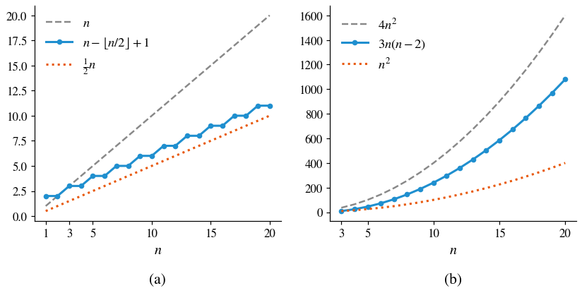
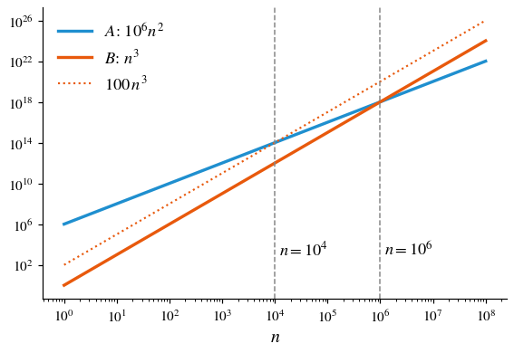

# HW12 과제 해설 — 루트 트리, 신장 트리, 빅오 표기법

[레포지토리 안내](../../README.ko.md) | [English](Assignment-Explanation.md) | [한국어](Assignment-Explanation.ko.md)

> **최종 수정일:** 2026-11-04
>
> Discrete Mathematics with Applications, Epp, Ch 10, 11

> **학습 목표:**
> 1. 루트 트리에서 꼭짓점의 레벨, 트리의 높이, 부모, 자식, 형제, 자손, 리프를 구할 수 있다
> 2. 정 이진 트리의 내부 꼭짓점 수로부터 전체 꼭짓점 수와 리프 수를 구하고 그런 트리를 그릴 수 있다
> 3. 그래프의 신장 트리를 모두 구하고, 다익스트라 알고리즘의 동작을 표로 추적하여 최단 경로를 찾을 수 있다
> 4. 실숫값 함수의 그래프를 읽고 그리며, 증가 함수의 정의로 두 증가 함수의 합이 증가 함수임을 증명할 수 있다
> 5. 주어진 부등식을 빅오, 빅오메가, 빅세타 표기법으로 나타내고 정의에 쓰이는 상수를 밝힐 수 있다
> 6. 연산 횟수의 차수를 비교하고, 입력 크기에 따라 어느 알고리즘이 더 효율적인지 판정할 수 있다

---

## 목차

- [1. 연습 문제 10.5.2: 루트 트리의 용어](#1-연습-문제-1052-루트-트리의-용어)
- [2. 연습 문제 10.5.4: 내부 꼭짓점이 5개인 정 이진 트리](#2-연습-문제-1054-내부-꼭짓점이-5개인-정-이진-트리)
- [3. 연습 문제 10.6.1: 모든 신장 트리](#3-연습-문제-1061-모든-신장-트리)
- [4. 연습 문제 10.6.13: 다익스트라 알고리즘의 추적](#4-연습-문제-10613-다익스트라-알고리즘의-추적)
- [5. 연습 문제 11.1.1: 함수의 그래프 읽기](#5-연습-문제-1111-함수의-그래프-읽기)
- [6. 연습 문제 11.1.6: 천장 함수의 그래프](#6-연습-문제-1116-천장-함수의-그래프)
- [7. 연습 문제 11.1.20: 증가 함수의 합](#7-연습-문제-11120-증가-함수의-합)
- [8. 연습 문제 11.2.4: 빅오메가 표기법으로 나타낸 하한](#8-연습-문제-1124-빅오메가-표기법으로-나타낸-하한)
- [9. 연습 문제 11.2.5: 빅오 표기법으로 나타낸 상한](#9-연습-문제-1125-빅오-표기법으로-나타낸-상한)
- [10. 연습 문제 11.2.6: 빅세타 표기법으로 나타낸 차수](#10-연습-문제-1126-빅세타-표기법으로-나타낸-차수)
- [11. 연습 문제 11.3.5: 차수와 실제 효율의 비교](#11-연습-문제-1135-차수와-실제-효율의-비교)
- [요약](#요약)
- [점검 문제](#점검-문제)

---

 

## 1. 연습 문제 10.5.2: 루트 트리의 용어

**문제.** 그림 1은 $v_0$을 루트로 하는 루트 트리이다. (a) $v_8$의 레벨, (b) $v_0$의 레벨, (c) 트리의 높이, (d) $v_{10}$의 자식, (e) $v_5$의 부모, (f) $v_1$의 형제, (g) $v_{12}$의 자손, (h) 리프(말단 꼭짓점)의 수를 구한다.

*그림 1. 연습 문제 10.5.2의 루트 트리*

**사용하는 개념.** 꼭짓점 하나를 **루트(root)** 로 정한 트리를 **루트 트리(rooted tree)** 라 한다([10장 5절](../../Lecture-Notes/Ch10_Theory-of-Graphs-and-Trees/Concepts_Lecture.ko.md)). 트리에서는 두 꼭짓점 사이의 경로가 하나뿐이므로 다음 용어가 잘 정의된다.

| 용어 | 정의 |
|:---|:---|
| **레벨(level)** | 그 꼭짓점과 루트 사이의 유일한 경로에 있는 변의 수 |
| **높이(height)** | 트리의 꼭짓점들의 레벨 중 최댓값 |
| **자식(child)** | 꼭짓점 $v$와 인접하고 루트에서 $v$보다 한 레벨 더 먼 꼭짓점 |
| **부모(parent)** | $w$가 $v$의 자식일 때 $v$를 $w$의 부모라 한다 |
| **형제(sibling)** | 부모가 같은 서로 다른 두 꼭짓점 |
| **조상(ancestor)과 자손(descendant)** | $v$가 $w$와 루트 사이의 경로 위에 있으면 $v$는 $w$의 조상이고 $w$는 $v$의 자손이다 |
| **리프(leaf)** | 차수가 1인 꼭짓점. 루트가 아니면 자식이 없는 꼭짓점과 같다 |

*표 1. 루트 트리의 용어*

**풀이.** 루트에서 시작하여 각 꼭짓점의 레벨을 차례로 구한다. $v_0$의 자식은 $v_1$, $v_2$이고, 각 꼭짓점의 레벨은 부모의 레벨에 1을 더한 값이다.

| 레벨 | 꼭짓점 |
|:---:|:---|
| 0 | $v_0$ |
| 1 | $v_1, v_2$ |
| 2 | $v_3, v_4, v_5, v_6$ |
| 3 | $v_7, v_8, v_9, v_{10}, v_{11}, v_{12}$ |
| 4 | $v_{13}, v_{14}, v_{15}, v_{16}, v_{17}$ |
| 5 | $v_{18}, v_{19}$ |

*표 2. 그림 1의 트리에서 레벨별 꼭짓점*

- **(a)** 루트에서 $v_8$까지의 경로는 $v_0 v_1 v_5 v_8$이고 변이 3개이므로 $v_8$의 레벨은 3이다.
- **(b)** 루트 $v_0$에서 자기 자신까지의 경로에는 변이 없으므로 $v_0$의 레벨은 0이다.
- **(c)** 레벨의 최댓값은 $v_{18}$, $v_{19}$의 레벨 5이므로(경로 $v_0 v_2 v_6 v_{12} v_{17} v_{18}$) 높이는 5이다.
- **(d)** $v_{10}$(레벨 3)과 인접하고 레벨이 4인 꼭짓점은 $v_{14}, v_{15}, v_{16}$이므로 이들이 $v_{10}$의 자식이다.
- **(e)** $v_5$(레벨 2)와 인접하고 레벨이 1인 꼭짓점은 $v_1$이므로 $v_5$의 부모는 $v_1$이다.
- **(f)** $v_1$의 부모 $v_0$의 자식은 $v_1$, $v_2$이므로 $v_1$의 형제는 $v_2$이다.
- **(g)** $v_{12}$의 자식은 $v_{17}$이고 $v_{17}$의 자식은 $v_{18}$, $v_{19}$이므로 $v_{12}$의 자손은 $v_{17}, v_{18}, v_{19}$이다.
- **(h)** 자식이 없는 꼭짓점은 $v_4, v_7, v_9, v_{11}, v_{13}, v_{14}, v_{15}, v_{16}, v_{18}, v_{19}$이고, 이들의 차수는 모두 1이다. 루트 $v_0$은 자식이 둘이므로 차수가 2이다. 따라서 리프는 10개이다.

> **참고:** 교재는 리프를 차수가 1인 꼭짓점으로 정의하므로, 루트의 자식이 하나뿐이면 그 루트도 리프로 센다. 이 트리의 루트는 자식이 둘이므로 이 경우에 해당하지 않으며, 리프는 자식이 없는 꼭짓점 10개와 같다.

---

 

## 2. 연습 문제 10.5.4: 내부 꼭짓점이 5개인 정 이진 트리

**문제.** 내부 꼭짓점이 5개인 정 이진 트리가 있는지 판정하여, 있으면 그 예를 그리고 없으면 그 이유를 설명한다.

**사용하는 개념.** 모든 부모가 자식을 많아야 두 개 갖고, 각 자식이 왼쪽 자식이나 오른쪽 자식으로 지정되며 부모마다 왼쪽 자식과 오른쪽 자식이 많아야 하나씩인 루트 트리를 **이진 트리(binary tree)** 라 하고, 모든 부모가 자식을 정확히 두 개 갖는 이진 트리를 **정 이진 트리(full binary tree)** 라 한다([10장 5절](../../Lecture-Notes/Ch10_Theory-of-Graphs-and-Trees/Concepts_Lecture.ko.md)). 정리 10.5.1에 의해 내부 꼭짓점이 $k$개인 정 이진 트리는 꼭짓점이 모두 $2k + 1$개이고 리프가 $k + 1$개이다. 내부 꼭짓점 $k$개가 각각 자식을 둘씩 가지므로 자식은 $2k$개이고, 루트를 뺀 모든 꼭짓점은 정확히 한 부모의 자식이므로 꼭짓점은 $2k + 1$개이다. 리프는 내부 꼭짓점이 아닌 꼭짓점이므로 $(2k + 1) - k = k + 1$개이다.

**풀이.** 그런 트리는 존재한다. $k = 5$이므로 꼭짓점은 $2 \cdot 5 + 1 = 11$개, 리프는 $5 + 1 = 6$개여야 한다. 루트에서 시작하여 리프 하나를 골라 자식 둘을 붙이는 일을 반복하면 내부 꼭짓점이 하나씩 늘어난다. 이를 다섯 번 하면 다음 트리를 얻는다.

*그림 2. 내부 꼭짓점 5개와 리프 6개를 가진 정 이진 트리 (색칠한 꼭짓점은 리프)*

내부 꼭짓점은 $a, b, c, d, e$의 5개이고 각각 자식이 정확히 둘이다. 리프는 $f, g, h, i, j, k$의 6개이고, 꼭짓점은 모두 11개로 정리 10.5.1과 일치한다. 리프에 자식 둘을 붙이는 위치를 다르게 고르면 모양이 다른 정 이진 트리도 얻을 수 있지만, 꼭짓점 11개와 리프 6개라는 수는 언제나 같다.

---

 

## 3. 연습 문제 10.6.1: 모든 신장 트리

**문제.** 꼭짓점 $a, b, c, d$와 변 $ab$, $ad$, $bd$, $bc$로 이루어진 그래프 $G$(그림 3의 첫째 그림)의 신장 트리를 모두 구한다.

**사용하는 개념.** 그래프 $G$의 **신장 트리(spanning tree)** 는 $G$의 모든 꼭짓점을 포함하면서 트리인 부분 그래프이다([10장 6절](../../Lecture-Notes/Ch10_Theory-of-Graphs-and-Trees/Concepts_Lecture.ko.md)). 명제 10.6.1에 의해 연결 그래프에는 신장 트리가 있고, 한 그래프의 신장 트리들은 변의 수가 모두 같다. 또 정리 10.4.2에 의해 꼭짓점이 $n$개인 트리의 변은 $n - 1$개이다.

**풀이.**

1. $G$는 꼭짓점이 4개이므로 신장 트리는 변이 $4 - 1 = 3$개이다. $G$의 변은 4개이므로 신장 트리는 변 하나를 뺀 것이다.
2. 변 $bc$를 빼면 $c$가 고립되어 연결이 끊어지므로 $bc$는 모든 신장 트리에 들어 있어야 한다.
3. $G$의 회로는 모두 세 변 $ab$, $bd$, $ad$가 이루는 삼각형 $a\,b\,d\,a$를 도는 것이다. 이 세 변 중 하나를 빼면 회로가 없어지고, 회로의 변을 하나 빼도 연결 그래프는 연결된 채로 남는다([10장 4절](../../Lecture-Notes/Ch10_Theory-of-Graphs-and-Trees/Concepts_Lecture.ko.md)의 보조정리 10.4.3). 따라서 남은 그래프는 변이 3개인 연결 그래프이고 트리이다.

따라서 신장 트리는 다음 세 개이다.

- $T_1 = \lbrace ab, ad, bc\rbrace$ ($bd$를 뺌)
- $T_2 = \lbrace ab, bd, bc\rbrace$ ($ad$를 뺌)
- $T_3 = \lbrace ad, bd, bc\rbrace$ ($ab$를 뺌)

*그림 3. 그래프 G와 세 신장 트리 (점선은 뺀 변)*

네 변 중 세 변을 고르는 방법은 $\binom{4}{3} = 4$가지인데, 그중 $bc$를 뺀 $\lbrace ab, ad, bd\rbrace$만 신장 트리가 아니므로 답은 3개로 확인된다.

> **참고:** $T_1$($d\,a\,b\,c$)과 $T_3$($a\,d\,b\,c$)은 모두 경로 모양이어서 서로 동형이지만, $G$의 부분 그래프로서는 변 집합이 다르므로 서로 다른 신장 트리이다. $T_2$는 $b$에 세 변이 모인 별 모양이다.

---

 

## 4. 연습 문제 10.6.13: 다익스트라 알고리즘의 추적

**문제.** 그림 4의 가중 그래프에서 다익스트라 알고리즘으로 $a$에서 $z$까지의 최단 경로를 구하고, 알고리즘의 동작을 교재의 표 10.6.1과 같은 형식의 표로 나타낸다.

*그림 4. 다익스트라 알고리즘을 적용할 가중 그래프*

**사용하는 개념.** 각 변에 양수인 가중치가 붙은 그래프를 **가중 그래프(weighted graph)** 라 한다. **다익스트라 알고리즘**(알고리즘 10.6.3)은 시작점 $a$에서 트리 $T$를 한 꼭짓점씩 키워 가며 최단 경로를 찾는다([10장 6절](../../Lecture-Notes/Ch10_Theory-of-Graphs-and-Trees/Concepts_Lecture.ko.md)). 각 꼭짓점 $u$에는 지금까지 알려진 $a$에서 $u$까지의 최단 거리를 뜻하는 **레이블(label)** $L(u)$가 붙고, 처음에는 $L(a) = 0$, 나머지는 $\infty$이다. $T$에 마지막으로 더한 꼭짓점을 $v$, $T$에 인접하지만 아직 $T$에 들어가지 않은 꼭짓점의 집합을 **경계 집합(fringe)** $F$라 하면, $z \notin V(T)$인 동안 다음을 반복한다.

1. $F$에서 $v$를 빼고, $v$와 인접하면서 $T$에 없는 꼭짓점을 $F$에 더한다.
2. $v$와 인접하면서 $T$에 없는 각 꼭짓점 $u$에 대해 $L(v) + w(v, u) < L(u)$이면 $L(u)$를 $L(v) + w(v, u)$로 바꾸고 $D(u) = v$로 기록한다. 여기서 $w(v, u)$는 변 $\lbrace v, u\rbrace$의 가중치이다.
3. $F$에서 레이블이 가장 작은 꼭짓점 $x$를 골라 $T$에 더하고, 변 $\lbrace D(x), x\rbrace$를 $E(T)$에 더한 뒤 $v = x$로 둔다.

알고리즘이 끝나면 $L(z)$가 최단 경로의 길이이고, $D$를 $z$에서 거꾸로 따라가면 최단 경로를 얻는다.

**풀이.** 그래프의 변은 $ab$(2), $ad$(1), $bc$(3), $cd$(5), $ce$(1), $de$(10), $cz$(8), $ez$(2)이다. 표 3의 단계 0은 초기 상태이고, 그 밖의 각 행은 그 단계에 들어갈 때의 $V(T)$와 $E(T)$, 그리고 반복의 1, 2를 마친 뒤의 $F$와 레이블이다. 굵은 레이블은 반복의 3에서 고른 꼭짓점의 레이블이다.

| 단계 | $V(T)$ | $E(T)$ | $F$ | $L(a)$ | $L(b)$ | $L(c)$ | $L(d)$ | $L(e)$ | $L(z)$ |
|:---:|:---|:---|:---|:---:|:---:|:---:|:---:|:---:|:---:|
| 0 | $\lbrace a\rbrace$ | $\emptyset$ | $\lbrace a\rbrace$ | **0** | $\infty$ | $\infty$ | $\infty$ | $\infty$ | $\infty$ |
| 1 | $\lbrace a\rbrace$ | $\emptyset$ | $\lbrace b, d\rbrace$ | 0 | 2 | $\infty$ | **1** | $\infty$ | $\infty$ |
| 2 | $\lbrace a, d\rbrace$ | $\lbrace ad\rbrace$ | $\lbrace b, c, e\rbrace$ | 0 | **2** | 6 | 1 | 11 | $\infty$ |
| 3 | $\lbrace a, b, d\rbrace$ | $\lbrace ad, ab\rbrace$ | $\lbrace c, e\rbrace$ | 0 | 2 | **5** | 1 | 11 | $\infty$ |
| 4 | $\lbrace a, b, c, d\rbrace$ | $\lbrace ad, ab, bc\rbrace$ | $\lbrace e, z\rbrace$ | 0 | 2 | 5 | 1 | **6** | 13 |
| 5 | $\lbrace a, b, c, d, e\rbrace$ | $\lbrace ad, ab, bc, ce\rbrace$ | $\lbrace z\rbrace$ | 0 | 2 | 5 | 1 | 6 | **8** |
| 6 | $\lbrace a, b, c, d, e, z\rbrace$ | $\lbrace ad, ab, bc, ce, ez\rbrace$ | | | | | | | |

*표 3. 다익스트라 알고리즘의 단계별 동작*

- **단계 1** ($v = a$): $a$와 인접한 $b$, $d$가 경계 집합에 들어간다. $0 + 2 = 2$이므로 $L(b) = 2$, $D(b) = a$이고, $0 + 1 = 1$이므로 $L(d) = 1$, $D(d) = a$이다. 레이블이 가장 작은 $d$를 $T$에 더하고 변 $ad$를 더한다.
- **단계 2** ($v = d$): $d$와 인접하고 $T$에 없는 $c$, $e$가 경계 집합에 들어가 $F = \lbrace b, c, e\rbrace$이다. $L(c) = 1 + 5 = 6$, $L(e) = 1 + 10 = 11$이 되고 $D(c) = D(e) = d$이다. $b$는 $d$와 인접하지 않으므로 $L(b) = 2$ 그대로이다. 가장 작은 $b$를 더하고 변 $ab$를 더한다.
- **단계 3** ($v = b$): $b$와 인접하고 $T$에 없는 꼭짓점은 $c$뿐이다. $2 + 3 = 5 < 6$이므로 $L(c) = 5$, $D(c) = b$로 바꾼다. $e$는 $b$와 인접하지 않으므로 $L(e) = 11$ 그대로이다. 가장 작은 $c$를 더하고 변 $bc$를 더한다.
- **단계 4** ($v = c$): $c$와 인접하고 $T$에 없는 꼭짓점은 $e$와 $z$이다. $5 + 1 = 6 < 11$이므로 $L(e) = 6$, $D(e) = c$이고, $5 + 8 = 13 < \infty$이므로 $L(z) = 13$, $D(z) = c$이다. 가장 작은 $e$를 더하고 변 $ce$를 더한다.
- **단계 5** ($v = e$): $e$와 인접하고 $T$에 없는 꼭짓점은 $z$뿐이다. $6 + 2 = 8 < 13$이므로 $L(z) = 8$, $D(z) = e$로 바꾼다. $F = \lbrace z\rbrace$이므로 $z$를 더하고 변 $ez$를 더한다.
- **단계 6**: $z \in V(T)$이므로 반복이 끝난다.

최단 경로의 길이는 $L(z) = 8$이다. $D(z) = e$, $D(e) = c$, $D(c) = b$, $D(b) = a$를 거꾸로 따라가면 최단 경로는 $a\,b\,c\,e\,z$이고, 길이는 $2 + 3 + 1 + 2 = 8$이다.

*그림 5. a에서 z까지의 최단 경로 a b c e z (굵은 선)*

> **주의:** 반복의 2에서 레이블이 바뀔 수 있는 꼭짓점은 방금 더한 꼭짓점 $v$와 인접한 꼭짓점뿐이다. 단계 3의 $v$인 $b$는 $e$와 인접하지 않으므로 이 단계에서 $L(e)$는 11로 남고, $e$와 인접한 $c$가 $v$가 되는 단계 4에서야 6으로 줄어든다. 각 행의 레이블을 채울 때는 그 단계의 $v$와 인접한 꼭짓점의 레이블만 다시 계산해야 한다. 또 $T$에 들어간 꼭짓점의 레이블은 이후에 바뀌지 않으며 $a$에서의 최단 거리와 같다.

---

 

## 5. 연습 문제 11.1.1: 함수의 그래프 읽기

**문제.** 그림 6의 $f$의 그래프에서 다음을 읽는다. (a) $f(0)$의 부호, (b) $f(x) = 0$의 해, (c) $f(x_1) = f(x_2) = 1$인 서로 다른 두 수 $x_1$, $x_2$의 근삿값, (d) $f(x) = 1.5$의 해 하나의 근삿값, (e) $x$가 $-3$에서 $-1$로 갈 때 $f$의 값이 증가하는지 감소하는지, (f) $x$가 0에서 4로 갈 때의 같은 물음.

*그림 6. 함수 f의 그래프와 읽어 낸 점*

**사용하는 개념.** 실수의 부분집합에서 실수로 가는 함수를 **실숫값 함수(real-valued function)** 라 하고, 그 그래프는 점 $(x, f(x))$ 전체의 집합이다([11장 1절](../../Lecture-Notes/Ch11_Analysis-of-Algorithm-Efficiency/Concepts_Lecture.ko.md)). 따라서 $f(a)$는 $x = a$에서 그래프의 높이이고, 방정식 $f(x) = c$의 해는 수평선 $y = c$가 그래프와 만나는 점의 $x$좌표이다. 집합 $S$의 모든 $x_1 < x_2$에 대해 $f(x_1) < f(x_2)$이면 $f$는 $S$에서 **증가(increasing)** 한다고 하고, $f(x_1) > f(x_2)$이면 **감소(decreasing)** 한다고 한다.

**풀이.** 그래프에서 읽는 값이므로 모두 근삿값이다.

- **(a)** $x = 0$에서 그래프의 높이는 약 2로 최댓값이다. 따라서 $f(0) \approx 2$는 양수이다.
- **(b)** 그래프가 $x$축과 만나는 점은 $x \approx -2$와 $x \approx 3$이다.
- **(c)** 수평선 $y = 1$은 그래프와 두 번 만나며, 그 점의 $x$좌표는 $x_1 \approx -1$, $x_2 \approx 2$이다.
- **(d)** 수평선 $y = 1.5$도 그래프와 두 번 만나며, $x \approx -0.5$ 또는 $x \approx 1$이다. 둘 중 어느 것이든 답이 된다.
- **(e)** $-3$에서 $-1$까지 그래프는 오른쪽으로 갈수록 올라가므로 $f$의 값은 증가한다.
- **(f)** 0에서 4까지 그래프는 오른쪽으로 갈수록 내려가므로 $f$의 값은 감소한다.

(c)와 (d)처럼 함숫값이 같은 서로 다른 두 점이 있다는 것은 $f$가 일대일 함수가 아니라는 뜻이다. 실제로 $f$는 $x = 0$의 왼쪽에서 증가하고 오른쪽에서 감소하므로 같은 높이를 양쪽에서 한 번씩 지난다.

---

 

## 6. 연습 문제 11.1.6: 천장 함수의 그래프

**문제.** 실수 $x$마다 $g(x) = \lceil x \rceil$($x$ 이상인 정수 중 가장 작은 것)로 정한 함수 $g$의 그래프를 그린다.

**사용하는 개념.** **천장 함수(ceiling)** 의 정의 $\lceil x \rceil = n \iff n - 1 < x \le n$([4장 6절](../../Lecture-Notes/Ch04_Elementary-Number-Theory-and-Methods-of-Proof/Concepts_Lecture.ko.md))에서, 정수 $n$마다 구간 $(n - 1, n]$ 위의 모든 $x$가 같은 값 $n$을 갖는다. 따라서 그래프는 계단 모양이며, 각 계단의 왼쪽 끝은 포함되지 않고 오른쪽 끝은 포함된다.

**풀이.** 몇 개의 값을 먼저 계산한다.

| $x$ | $-1.5$ | $-1$ | $-0.5$ | $0$ | $0.3$ | $1$ | $1.0001$ | $2.5$ |
|:---:|:---:|:---:|:---:|:---:|:---:|:---:|:---:|:---:|
| $\lceil x \rceil$ | $-1$ | $-1$ | $0$ | $0$ | $1$ | $1$ | $2$ | $3$ |

*표 4. 천장 함수의 값*

$x$가 정수 $n$이면 $\lceil n \rceil = n$이지만, $x$가 $n$보다 조금이라도 크면 값이 $n + 1$로 뛴다. 그래서 정수 $n$마다 구간 $(n - 1, n]$ 위에 높이 $n$인 수평 선분을 긋고, 왼쪽 끝 $(n - 1, n)$에는 빈 원(포함하지 않음), 오른쪽 끝 $(n, n)$에는 채운 점(포함함)을 찍는다.

*그림 7. 천장 함수 g(x) = ⌈x⌉의 그래프*

> **주의:** 바닥 함수 $\lfloor x \rfloor$의 그래프는 구간 $[n, n + 1)$ 위의 선분이므로 왼쪽 끝이 채운 점, 오른쪽 끝이 빈 원이다. 천장 함수는 그 반대이므로 끝점 표시를 바꾸어 그리면 다른 함수의 그래프가 된다. 또 천장 함수는 $\lceil 0.2 \rceil = \lceil 0.7 \rceil = 1$처럼 같은 값을 갖는 구간이 있으므로 교재의 정의로는 증가 함수가 아니다. 값이 줄어들지는 않지만, 증가 함수는 $x_1 < x_2$일 때 $f(x_1) < f(x_2)$를 요구하기 때문이다.

---

 

## 7. 연습 문제 11.1.20: 증가 함수의 합

**문제.** 정의역 $D$가 같은 두 실숫값 함수 $f$, $g$의 합을 $x \in D$마다 $(f + g)(x) = f(x) + g(x)$로 정한다. $S \subseteq D$에서 $f$와 $g$가 모두 증가하면 $f + g$도 $S$에서 증가함을 증명한다.

**사용하는 개념.** $f$가 $S$에서 증가한다는 것은 $S$의 모든 실수 $x_1$, $x_2$에 대해 $x_1 < x_2$이면 $f(x_1) < f(x_2)$라는 뜻이다([11장 1절](../../Lecture-Notes/Ch11_Analysis-of-Algorithm-Efficiency/Concepts_Lecture.ko.md)). 전칭 조건 명제이므로 $S$의 임의의 두 원소 $x_1 < x_2$를 잡고 결론을 보이는 직접 증명을 쓴다.

**풀이.** $x_1$, $x_2$를 $x_1 < x_2$인 $S$의 임의의 원소라 한다. $(f + g)(x_1) < (f + g)(x_2)$를 보이면 된다.

1. $f$가 $S$에서 증가하고 $x_1 < x_2$이므로 $f(x_1) < f(x_2)$이다.
2. $g$가 $S$에서 증가하고 $x_1 < x_2$이므로 $g(x_1) < g(x_2)$이다.
3. 1의 양변에 $g(x_1)$을 더하면 $f(x_1) + g(x_1) < f(x_2) + g(x_1)$이다.
4. 2의 양변에 $f(x_2)$를 더하면 $f(x_2) + g(x_1) < f(x_2) + g(x_2)$이다.
5. 3과 4에 부등호의 추이성을 쓰면 $f(x_1) + g(x_1) < f(x_2) + g(x_2)$이다.
6. $f + g$의 정의에 의해 이는 $(f + g)(x_1) < (f + g)(x_2)$이다.

$x_1$과 $x_2$는 $x_1 < x_2$인 $S$의 임의의 원소였으므로 $f + g$는 $S$에서 증가한다.

> **참고:** 3\~5단계는 "$a < b$이고 $c < d$이면 $a + c < b + d$"라는 부등식의 성질을 증명한 것이다. 같은 방식으로 두 감소 함수의 합은 감소 함수임을 보일 수 있다. 그러나 증가 함수끼리의 차는 증가 함수가 아닐 수 있다. 예를 들어 $f(x) = x$와 $g(x) = 2x$는 모두 증가하지만 $(f - g)(x) = -x$는 감소한다.

---

 

## 8. 연습 문제 11.2.4: 빅오메가 표기법으로 나타낸 하한

**문제.** 모든 정수 $n \ge 1$에 대해 $\frac{1}{2}n \le n - \left\lfloor \frac{n}{2} \right\rfloor + 1$이다. 이 사실을 빅오메가 표기법으로 나타낸다.

**사용하는 개념.** $f$와 $g$가 음이 아닌 정수의 같은 집합에서 정의된 실숫값 함수이고 어떤 양의 실수 $r$에 대해 $n \ge r$이면 $g(n) \ge 0$이라 하자([11장 2절](../../Lecture-Notes/Ch11_Analysis-of-Algorithm-Efficiency/Concepts_Lecture.ko.md)). 다음 세 정의가 차수(order)를 나타내는 표기법이다.

1. **빅오메가 표기법(Ω-notation):** 양의 실수 $A$와 $a \ge r$이 있어 모든 정수 $n \ge a$에 대해 $A\,g(n) \le f(n)$이면 $f(n)$은 $\Omega(g(n))$이다. $f$의 차수가 적어도 $g$라는 뜻이다.
2. **빅오 표기법(O-notation):** 양의 실수 $B$와 $b \ge r$이 있어 모든 정수 $n \ge b$에 대해 $0 \le f(n) \le B\,g(n)$이면 $f(n)$은 $O(g(n))$이다. $f$의 차수가 많아야 $g$라는 뜻이다.
3. **빅세타 표기법(Θ-notation):** 양의 실수 $A$, $B$와 $k \ge r$이 있어 모든 정수 $n \ge k$에 대해 $A\,g(n) \le f(n) \le B\,g(n)$이면 $f(n)$은 $\Theta(g(n))$이다. $f$의 차수가 $g$라는 뜻이다.

부등식이 주어지면 그 부등식이 정의의 어느 꼴인지 맞추고 상수를 읽어 내면 된다.

**풀이.** $f(n) = n - \lfloor n/2 \rfloor + 1$, $g(n) = n$으로 두면 주어진 부등식은 $A = \frac{1}{2}$, $a = 1$인 모든 정수 $n \ge a$에 대해 $A\,g(n) \le f(n)$이라는 뜻이다. 이는 빅오메가 표기법의 정의 그대로이므로 다음과 같이 쓴다.

**답:** $n - \lfloor n/2 \rfloor + 1$은 $\Omega(n)$이다.

부등식 자체도 확인한다. 바닥 함수의 정의에 의해 $\lfloor n/2 \rfloor \le n/2$이므로 $n - \lfloor n/2 \rfloor \ge n - n/2 = n/2$이고, 여기에 1을 더하면 $n - \lfloor n/2 \rfloor + 1 > \frac{1}{2}n$이다. 예를 들어 $n = 1, 2, 3, 4, 5, 6$이면 좌변 $\frac{1}{2}n$은 0.5, 1, 1.5, 2, 2.5, 3이고 우변은 2, 2, 3, 3, 4, 4이다(그림 8의 (a)).

*그림 8. 두 함수와 그 하한, 상한: (a) n − ⌊n/2⌋ + 1, (b) 3n(n − 2)*

---

 

## 9. 연습 문제 11.2.5: 빅오 표기법으로 나타낸 상한

**문제.** 모든 정수 $n \ge 3$에 대해 $0 \le n - \left\lfloor \frac{n}{2} \right\rfloor + 1 \le n$이다. 이 사실을 빅오 표기법으로 나타낸다.

**사용하는 개념.** 8절의 빅오 표기법의 정의를 쓴다. 정의의 부등식 $0 \le f(n) \le B\,g(n)$은 $f(n)$이 음이 아니고 $g(n)$의 상수배를 넘지 않는다는 것이다.

**풀이.** $f(n) = n - \lfloor n/2 \rfloor + 1$, $g(n) = n$으로 두면 주어진 부등식은 $B = 1$, $b = 3$인 모든 정수 $n \ge b$에 대해 $0 \le f(n) \le B\,g(n)$이라는 뜻이다. 따라서 다음과 같다.

**답:** $n - \lfloor n/2 \rfloor + 1$은 $O(n)$이다.

부등식도 확인한다. 연습 문제 11.2.4에서 $f(n) > n/2 \ge 0$이므로 왼쪽 부등식이 성립한다. 오른쪽 부등식 $n - \lfloor n/2 \rfloor + 1 \le n$은 $\lfloor n/2 \rfloor \ge 1$과 동치이고, 이는 $n \ge 2$일 때 성립하므로 $n \ge 3$에서도 성립한다. $n = 1$이면 $f(1) = 1 - 0 + 1 = 2 > 1$이므로 부등식이 성립하지 않는다. 정의가 "충분히 큰 $n$에 대해"를 뜻하는 시작점 $b$를 허용하는 것은 이처럼 작은 $n$에서의 예외를 무시하기 위해서이다.

> **참고:** 연습 문제 11.2.4와 11.2.5를 합치면 모든 정수 $n \ge 3$에 대해 $\frac{1}{2}n \le n - \lfloor n/2 \rfloor + 1 \le n$이므로, $A = \frac{1}{2}$, $B = 1$, $k = 3$으로 $n - \lfloor n/2 \rfloor + 1$은 $\Theta(n)$이다. 정리 11.2.1([11장 2절](../../Lecture-Notes/Ch11_Analysis-of-Algorithm-Efficiency/Concepts_Lecture.ko.md))에 의해 $f(n)$이 $\Omega(g(n))$이면서 $O(g(n))$인 것과 $\Theta(g(n))$인 것은 동치이다.

---

 

## 10. 연습 문제 11.2.6: 빅세타 표기법으로 나타낸 차수

**문제.** 모든 정수 $n \ge 3$에 대해 $n^2 \le 3n(n - 2) \le 4n^2$이다. 이 사실을 빅세타 표기법으로 나타낸다.

**사용하는 개념.** 8절의 빅세타 표기법의 정의를 쓴다. 하한과 상한이 같은 함수 $g(n)$의 상수배로 주어지면 $f(n)$의 차수는 $g(n)$이다.

**풀이.** $f(n) = 3n(n - 2)$, $g(n) = n^2$으로 두면 주어진 부등식은 $A = 1$, $B = 4$, $k = 3$인 모든 정수 $n \ge k$에 대해 $A\,g(n) \le f(n) \le B\,g(n)$이라는 뜻이다. 따라서 다음과 같다.

**답:** $3n(n - 2)$는 $\Theta(n^2)$이다.

부등식도 확인한다. 왼쪽은 $3n(n - 2) - n^2 = 2n^2 - 6n = 2n(n - 3) \ge 0$이므로 $n \ge 3$에서 성립한다. 오른쪽은 $4n^2 - 3n(n - 2) = n^2 + 6n > 0$이므로 모든 양의 정수 $n$에서 성립한다. $n = 2$이면 $3n(n - 2) = 0 < 4 = n^2$이어서 왼쪽 부등식이 성립하지 않으므로 시작점 $k = 3$이 필요하다(그림 8의 (b)).

---

 

## 11. 연습 문제 11.3.5: 차수와 실제 효율의 비교

**문제.** 입력 크기가 $n$일 때 알고리즘 $A$는 연산을 $10^6 n^2$번, 알고리즘 $B$는 $n^3$번 수행한다. (a) 거듭제곱 함수 중에서 $A$와 $B$의 차수는 무엇인가? (b) 어떤 $n$에서 $A$가 $B$보다 효율적인가? (c) 어떤 $n$에서 $B$가 $A$보다 적어도 100배 효율적인가?

**사용하는 개념.** 알고리즘의 효율은 입력 크기 $n$에 대한 연산 횟수로 비교하며, 연산 횟수가 적을수록 효율적이다([11장 3절](../../Lecture-Notes/Ch11_Analysis-of-Algorithm-Efficiency/Concepts_Lecture.ko.md)). 차수는 $n$이 충분히 클 때의 증가 속도만 나타내고 상수배를 무시하므로, 작은 $n$에서는 차수가 큰 알고리즘이 더 빠를 수 있다.

**풀이.**

**(a)** 모든 정수 $n \ge 1$에 대해 $10^6 n^2 \le 10^6 n^2 \le 10^6 n^2$이므로, 빅세타 표기법의 정의에서 두 상수를 모두 $10^6$으로, 시작점을 $k = 1$로 두면 $10^6 n^2$은 $\Theta(n^2)$이다. 같은 방식으로 $n^3$은 $\Theta(n^3)$이다. 따라서 $A$의 차수는 $n^2$, $B$의 차수는 $n^3$이다.

**(b)** $A$가 더 효율적이라는 것은 $A$의 연산 횟수가 더 적다는 것이다. $n$은 양의 정수이므로 양변을 $n^2 > 0$으로 나누어도 부등호의 방향이 바뀌지 않는다.

$$10^6 n^2 < n^3 \iff 10^6 < n$$

따라서 $n > 10^6 = 1{,}000{,}000$일 때 $A$가 더 효율적이다. $n = 10^6$에서는 두 연산 횟수가 같고, $n < 10^6$에서는 차수가 더 큰 $B$가 오히려 더 효율적이다.

**(c)** $B$가 적어도 100배 효율적이라는 것은 $A$의 연산 횟수가 $B$의 연산 횟수의 100배 이상이라는 것이다.

$$100\,n^3 \le 10^6 n^2 \iff n \le 10^4$$

따라서 $1 \le n \le 10^4 = 10{,}000$일 때 $B$가 $A$보다 적어도 100배 효율적이다.

*그림 9. 두 알고리즘의 연산 횟수 (로그 척도)*

그림 9에서 $B$의 그래프는 $n = 10^6$에서 $A$의 그래프와 교차하고, $100\,n^3$의 그래프는 $n = 10^4$에서 $A$의 그래프와 교차한다. 로그 척도에서 기울기는 차수의 지수이므로 $B$(기울기 3)는 결국 $A$(기울기 2)를 넘어서지만, 상수 $10^6$ 때문에 그 시점이 매우 늦다. 차수만으로 알고리즘을 고르면 실제로 다룰 입력 크기에서 더 느린 알고리즘을 고를 수 있다.

---

 

## 요약

| 개념 | 핵심 요약 |
|:-----|:-----|
| 루트 트리의 용어 | 레벨은 루트까지의 경로의 변 수, 높이는 레벨의 최댓값이다. 자식은 한 레벨 아래의 인접 꼭짓점, 형제는 부모가 같은 꼭짓점, 자손은 그 꼭짓점을 거쳐 루트로 가는 꼭짓점이다. |
| 정 이진 트리 | 내부 꼭짓점이 $k$개이면 꼭짓점은 $2k + 1$개, 리프는 $k + 1$개이다. $k = 5$이면 꼭짓점 11개, 리프 6개이다. |
| 신장 트리 | 모든 꼭짓점을 포함하는 트리인 부분 그래프이다. 꼭짓점이 $n$개이면 변이 $n - 1$개이므로, 회로에서 변을 하나씩 빼어 구한다. |
| 다익스트라 알고리즘 | 경계 집합에서 레이블이 가장 작은 꼭짓점을 트리에 더하고, 그 꼭짓점과 인접한 꼭짓점의 레이블만 다시 계산한다. 예제의 최단 경로는 $a\,b\,c\,e\,z$, 길이 8이다. |
| 함수의 그래프 | $f(a)$는 $x = a$에서의 높이이고, $f(x) = c$의 해는 수평선 $y = c$와 그래프의 교점의 $x$좌표이다. |
| 천장 함수 | $\lceil x \rceil = n \iff n - 1 < x \le n$이므로 각 계단의 왼쪽 끝은 빈 원, 오른쪽 끝은 채운 점이다. |
| 증가 함수의 합 | $f(x_1) < f(x_2)$와 $g(x_1) < g(x_2)$를 더하면 $(f + g)(x_1) < (f + g)(x_2)$이므로 합도 증가한다. |
| 빅오메가, 빅오, 빅세타 | $A\,g(n) \le f(n)$이면 $\Omega(g(n))$, $0 \le f(n) \le B\,g(n)$이면 $O(g(n))$, 둘 다이면 $\Theta(g(n))$이며, 충분히 큰 $n$에서만 성립하면 된다. |
| 부등식의 번역 | $n - \lfloor n/2 \rfloor + 1$은 $\Omega(n)$이고 $O(n)$이므로 $\Theta(n)$이며, $3n(n - 2)$는 $\Theta(n^2)$이다. |
| 차수와 실제 효율 | $10^6 n^2$과 $n^3$은 $n = 10^6$에서 교차한다. 차수가 작은 알고리즘이 항상 빠른 것은 아니며, 상수와 입력 크기를 함께 따져야 한다. |

---

 

## 점검 문제

1. **루트 트리:** 그림 1의 트리에서 $v_{15}$의 조상을 모두 쓰고, $v_{18}$의 레벨을 구하라.

   

   
정답

   $v_{15}$에서 루트까지의 경로는 $v_{15} v_{10} v_6 v_2 v_0$이므로 조상은 $v_{10}, v_6, v_2, v_0$이다. $v_{18}$까지의 경로 $v_0 v_2 v_6 v_{12} v_{17} v_{18}$의 변은 5개이므로 레벨은 5이다.

   

2. **정 이진 트리:** 리프가 7개인 정 이진 트리의 내부 꼭짓점과 전체 꼭짓점은 각각 몇 개인가?

   

   
정답

   리프가 $k + 1 = 7$이므로 내부 꼭짓점은 $k = 6$개이고, 전체 꼭짓점은 $2k + 1 = 13$개이다.

   

3. **신장 트리의 수:** 꼭짓점 5개가 하나의 회로를 이루는 그래프 $v_1 v_2 v_3 v_4 v_5 v_1$의 신장 트리는 몇 개인가?

   

   
정답

   변이 5개이고 신장 트리의 변은 $5 - 1 = 4$개이므로 변 하나를 빼야 한다. 어느 변을 빼도 회로가 없어지고 연결이 유지되므로 신장 트리는 5개이다.

   

4. **다익스트라 알고리즘:** 그림 4의 그래프에서 변 $de$의 가중치가 10이 아니라 3이면 $a$에서 $z$까지의 최단 경로와 그 길이는 어떻게 되는가?

   

   
정답

   단계 2에서 $L(e) = 1 + 3 = 4$가 되고, 이후 $L(e)$는 더 줄지 않는다. $e$를 더한 뒤 $L(z) = 4 + 2 = 6$이 되므로 최단 경로는 $a\,d\,e\,z$이고 길이는 6이다. 원래 경로 $a\,b\,c\,e\,z$의 길이 8보다 짧다.

   

5. **천장 함수와 바닥 함수:** 모든 실수 $x$에 대해 $h(x) = \lceil x \rceil - \lfloor x \rfloor$의 값은 어떻게 되는가?

   

   
정답

   $x$가 정수이면 $\lceil x \rceil = \lfloor x \rfloor = x$이므로 $h(x) = 0$이다. $x$가 정수가 아니면 $n < x < n + 1$인 정수 $n$에 대해 $\lfloor x \rfloor = n$, $\lceil x \rceil = n + 1$이므로 $h(x) = 1$이다.

   

6. **빅세타 표기법:** $5n^2 + 3n + 1$이 $\Theta(n^2)$임을 정의의 상수를 밝혀 보이라.

   

   
정답

   모든 정수 $n \ge 1$에 대해 $3n \ge 0$, $1 \ge 0$이므로 $5n^2 \le 5n^2 + 3n + 1$이다. 또 $3n \le 3n^2$, $1 \le n^2$이므로 $5n^2 + 3n + 1 \le 5n^2 + 3n^2 + n^2 = 9n^2$이다. 따라서 $A = 5$, $B = 9$, $k = 1$로 정의가 성립한다.

   

7. **차수와 효율:** 알고리즘 $A$는 $100n^2$번, $B$는 $n^3$번 연산할 때 $A$가 더 효율적인 $n$의 범위를 구하라.

   

   
정답

   $100n^2 < n^3$의 양변을 $n^2 > 0$으로 나누면 $100 < n$이므로 $n > 100$일 때 $A$가 더 효율적이다.

   

