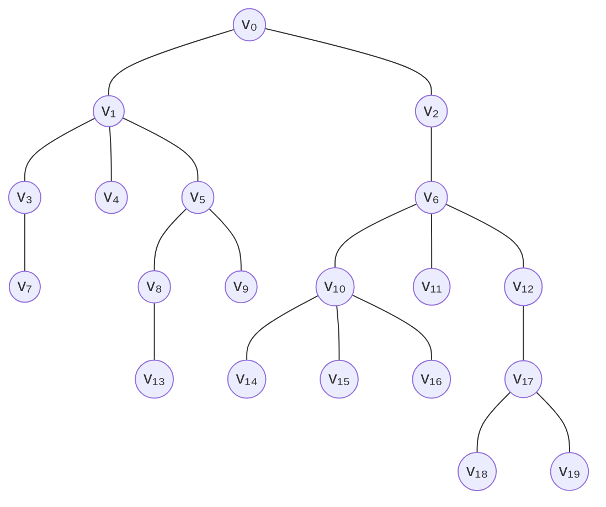
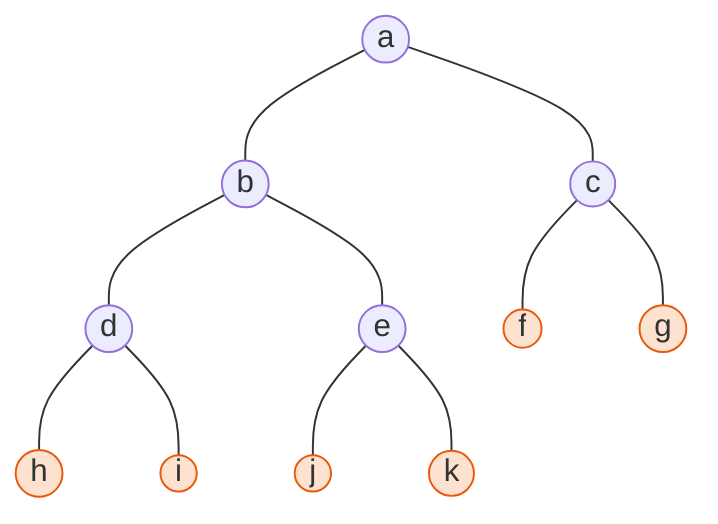
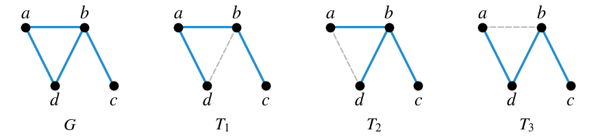
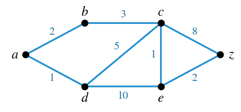
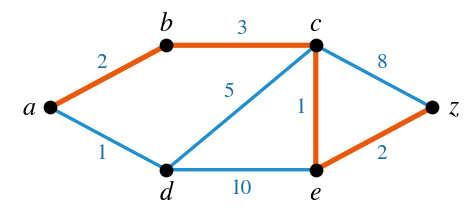
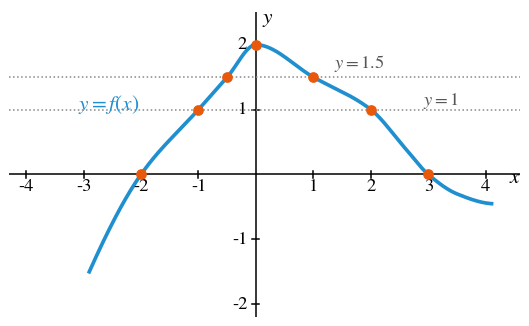
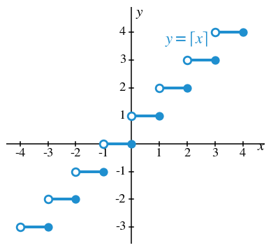
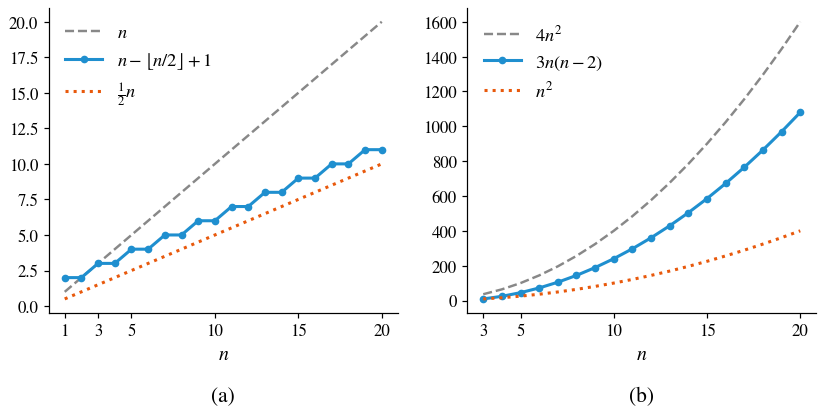
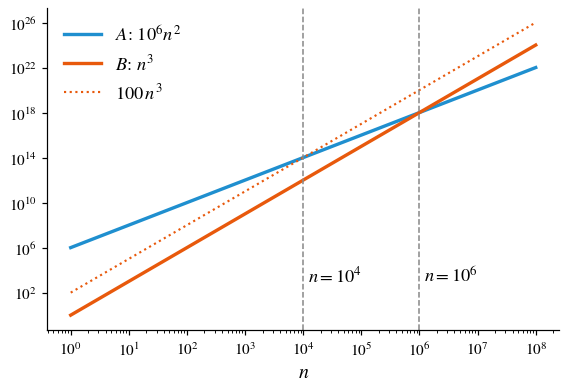

# HW12 Assignment Explanation — Rooted Trees, Spanning Trees, and Big-O Notation

[Repository Guide](../../README.md) | [English](Assignment-Explanation.md) | [한국어](Assignment-Explanation.ko.md)

> **Last Updated:** 2026-11-04
>
> Discrete Mathematics with Applications, Epp, Ch 10, 11

> **Learning Objectives:**
> 1. Find the level of a vertex, the height of the tree, and the parent, children, siblings, descendants, and leaves in a rooted tree
> 2. Find the total number of vertices and the number of leaves of a full binary tree from its number of internal vertices, and draw such a tree
> 3. Find all spanning trees of a graph, and find a shortest path by tracing the action of Dijkstra's algorithm in a table
> 4. Read and sketch graphs of real-valued functions, and prove from the definition of an increasing function that the sum of two increasing functions is increasing
> 5. Express given inequalities in O-, Ω-, and Θ-notation and identify the constants used in the definitions
> 6. Compare the orders of operation counts and decide which algorithm is more efficient for a given input size

---

## Table of Contents

- [1. Exercise 10.5.2: Terminology of Rooted Trees](#1-exercise-1052-terminology-of-rooted-trees)
- [2. Exercise 10.5.4: A Full Binary Tree with Five Internal Vertices](#2-exercise-1054-a-full-binary-tree-with-five-internal-vertices)
- [3. Exercise 10.6.1: All Spanning Trees](#3-exercise-1061-all-spanning-trees)
- [4. Exercise 10.6.13: Tracing Dijkstra's Algorithm](#4-exercise-10613-tracing-dijkstras-algorithm)
- [5. Exercise 11.1.1: Reading the Graph of a Function](#5-exercise-1111-reading-the-graph-of-a-function)
- [6. Exercise 11.1.6: Graph of the Ceiling Function](#6-exercise-1116-graph-of-the-ceiling-function)
- [7. Exercise 11.1.20: Sum of Increasing Functions](#7-exercise-11120-sum-of-increasing-functions)
- [8. Exercise 11.2.4: A Lower Bound in Ω-Notation](#8-exercise-1124-a-lower-bound-in-ω-notation)
- [9. Exercise 11.2.5: An Upper Bound in O-Notation](#9-exercise-1125-an-upper-bound-in-o-notation)
- [10. Exercise 11.2.6: An Order in Θ-Notation](#10-exercise-1126-an-order-in-θ-notation)
- [11. Exercise 11.3.5: Order Versus Actual Efficiency](#11-exercise-1135-order-versus-actual-efficiency)
- [Summary](#summary)
- [Self-Check Questions](#self-check-questions)

---

 

## 1. Exercise 10.5.2: Terminology of Rooted Trees

**Problem.** Figure 1 is a rooted tree with root $v_0$. Find (a) the level of $v_8$, (b) the level of $v_0$, (c) the height of the tree, (d) the children of $v_{10}$, (e) the parent of $v_5$, (f) the siblings of $v_1$, (g) the descendants of $v_{12}$, and (h) the number of leaves (terminal vertices).

*Figure 1. The rooted tree of Exercise 10.5.2*

**Concepts used.** A tree in which one vertex is designated as the **root** is called a **rooted tree** ([Chapter 10, Section 5](../../Lecture-Notes/Ch10_Theory-of-Graphs-and-Trees/Concepts_Lecture.md)). In a tree there is only one path between two vertices, so the following terms are well defined.

| Term | Definition |
|:---|:---|
| **Level** | The number of edges on the unique path between the vertex and the root |
| **Height** | The maximum of the levels of the vertices of the tree |
| **Child** | A vertex adjacent to a vertex $v$ and one level farther from the root than $v$ |
| **Parent** | If $w$ is a child of $v$, then $v$ is called the parent of $w$ |
| **Siblings** | Two distinct vertices with the same parent |
| **Ancestor and descendant** | If $v$ lies on the path between $w$ and the root, then $v$ is an ancestor of $w$ and $w$ is a descendant of $v$ |
| **Leaf** | A vertex of degree 1; for a vertex other than the root this is the same as having no children |

*Table 1. Terminology of rooted trees*

**Solution.** Starting from the root, find the level of each vertex in turn. The children of $v_0$ are $v_1$ and $v_2$, and the level of each vertex is one more than the level of its parent.

| Level | Vertices |
|:---:|:---|
| 0 | $v_0$ |
| 1 | $v_1, v_2$ |
| 2 | $v_3, v_4, v_5, v_6$ |
| 3 | $v_7, v_8, v_9, v_{10}, v_{11}, v_{12}$ |
| 4 | $v_{13}, v_{14}, v_{15}, v_{16}, v_{17}$ |
| 5 | $v_{18}, v_{19}$ |

*Table 2. Vertices of the tree in Figure 1 by level*

- **(a)** The path from the root to $v_8$ is $v_0 v_1 v_5 v_8$, with three edges, so the level of $v_8$ is 3.
- **(b)** The path from the root $v_0$ to itself has no edge, so the level of $v_0$ is 0.
- **(c)** The maximum level is 5, attained by $v_{18}$ and $v_{19}$ (path $v_0 v_2 v_6 v_{12} v_{17} v_{18}$), so the height is 5.
- **(d)** The vertices adjacent to $v_{10}$ (level 3) at level 4 are $v_{14}, v_{15}, v_{16}$, so these are the children of $v_{10}$.
- **(e)** The vertex adjacent to $v_5$ (level 2) at level 1 is $v_1$, so the parent of $v_5$ is $v_1$.
- **(f)** The children of $v_0$, the parent of $v_1$, are $v_1$ and $v_2$, so the sibling of $v_1$ is $v_2$.
- **(g)** The child of $v_{12}$ is $v_{17}$, and the children of $v_{17}$ are $v_{18}$ and $v_{19}$, so the descendants of $v_{12}$ are $v_{17}, v_{18}, v_{19}$.
- **(h)** The vertices with no children are $v_4, v_7, v_9, v_{11}, v_{13}, v_{14}, v_{15}, v_{16}, v_{18}, v_{19}$, and all of them have degree 1. The root $v_0$ has two children, so its degree is 2. Hence there are 10 leaves.

> **Note:** The textbook defines a leaf as a vertex of degree 1, so if the root has only one child, the root is also counted as a leaf. The root of this tree has two children, so that case does not arise here, and the leaves are exactly the 10 vertices with no children.

---

 

## 2. Exercise 10.5.4: A Full Binary Tree with Five Internal Vertices

**Problem.** Decide whether a full binary tree with five internal vertices exists; draw an example if it does, and explain why not if it does not.

**Concepts used.** A rooted tree in which every parent has at most two children, each designated a left child or a right child, with at most one child of each kind per parent, is called a **binary tree**, and a binary tree in which every parent has exactly two children is called a **full binary tree** ([Chapter 10, Section 5](../../Lecture-Notes/Ch10_Theory-of-Graphs-and-Trees/Concepts_Lecture.md)). By Theorem 10.5.1, a full binary tree with $k$ internal vertices has $2k + 1$ vertices in total and $k + 1$ leaves. Each of the $k$ internal vertices has two children, so there are $2k$ children, and every vertex except the root is the child of exactly one parent, so there are $2k + 1$ vertices. The leaves are the vertices that are not internal, so there are $(2k + 1) - k = k + 1$ of them.

**Solution.** Such a tree exists. Since $k = 5$, it must have $2 \cdot 5 + 1 = 11$ vertices and $5 + 1 = 6$ leaves. Starting from the root, repeatedly choosing a leaf and attaching two children to it increases the number of internal vertices by one each time. Doing this five times gives the following tree.

*Figure 2. Full binary tree with five internal vertices and six leaves (shaded vertices are leaves)*

The internal vertices are the five vertices $a, b, c, d, e$, each with exactly two children. The leaves are the six vertices $f, g, h, i, j, k$, and there are 11 vertices in all, in agreement with Theorem 10.5.1. Attaching the children at different leaves gives full binary trees of other shapes, but the counts of 11 vertices and 6 leaves are always the same.

---

 

## 3. Exercise 10.6.1: All Spanning Trees

**Problem.** Find all spanning trees of the graph $G$ with vertices $a, b, c, d$ and edges $ab$, $ad$, $bd$, $bc$ (the first drawing in Figure 3).

**Concepts used.** A **spanning tree** of a graph $G$ is a subgraph of $G$ that contains every vertex of $G$ and is a tree ([Chapter 10, Section 6](../../Lecture-Notes/Ch10_Theory-of-Graphs-and-Trees/Concepts_Lecture.md)). By Proposition 10.6.1, every connected graph has a spanning tree, and any two spanning trees of a graph have the same number of edges. Also, by Theorem 10.4.2, a tree with $n$ vertices has $n - 1$ edges.

**Solution.**

1. $G$ has four vertices, so a spanning tree has $4 - 1 = 3$ edges. $G$ has four edges, so a spanning tree is obtained by removing one edge.
2. Removing the edge $bc$ isolates $c$ and disconnects the graph, so $bc$ must belong to every spanning tree.
3. Every circuit of $G$ runs around the triangle $a\,b\,d\,a$ formed by the three edges $ab$, $bd$, and $ad$. Removing one of these three edges destroys the circuit, and removing an edge of a circuit leaves a connected graph connected (Lemma 10.4.3 in [Chapter 10, Section 4](../../Lecture-Notes/Ch10_Theory-of-Graphs-and-Trees/Concepts_Lecture.md)). Hence the remaining graph is a connected graph with three edges and is a tree.

Therefore the spanning trees are the following three.

- $T_1 = \lbrace ab, ad, bc\rbrace$ ($bd$ removed)
- $T_2 = \lbrace ab, bd, bc\rbrace$ ($ad$ removed)
- $T_3 = \lbrace ad, bd, bc\rbrace$ ($ab$ removed)

*Figure 3. Graph G and its three spanning trees (dashed lines are removed edges)*

There are $\binom{4}{3} = 4$ ways to choose three of the four edges, and only $\lbrace ab, ad, bd\rbrace$, the choice without $bc$, fails to be a spanning tree, which confirms the answer of 3.

> **Note:** $T_1$ ($d\,a\,b\,c$) and $T_3$ ($a\,d\,b\,c$) are both path-shaped and hence isomorphic to each other, but as subgraphs of $G$ they have different edge sets, so they are different spanning trees. $T_2$ is a star with three edges meeting at $b$.

---

 

## 4. Exercise 10.6.13: Tracing Dijkstra's Algorithm

**Problem.** Use Dijkstra's algorithm to find a shortest path from $a$ to $z$ in the weighted graph of Figure 4, and show the action of the algorithm in a table in the format of Table 10.6.1 of the textbook.

*Figure 4. Weighted graph to which Dijkstra's algorithm is applied*

**Concepts used.** A graph with a positive weight on each edge is called a **weighted graph**. **Dijkstra's algorithm** (Algorithm 10.6.3) finds shortest paths by growing a tree $T$ from the starting vertex $a$ one vertex at a time ([Chapter 10, Section 6](../../Lecture-Notes/Ch10_Theory-of-Graphs-and-Trees/Concepts_Lecture.md)). Each vertex $u$ carries a **label** $L(u)$, the shortest distance from $a$ to $u$ known so far; initially $L(a) = 0$ and all other labels are $\infty$. Let $v$ be the vertex most recently added to $T$, and let the **fringe** $F$ be the set of vertices adjacent to $T$ but not yet in $T$. While $z \notin V(T)$, repeat the following.

1. Remove $v$ from $F$, and add to $F$ the vertices adjacent to $v$ that are not in $T$.
2. For each vertex $u$ adjacent to $v$ and not in $T$, if $L(v) + w(v, u) < L(u)$, change $L(u)$ to $L(v) + w(v, u)$ and record $D(u) = v$. Here $w(v, u)$ is the weight of the edge $\lbrace v, u\rbrace$.
3. Choose a vertex $x$ of $F$ with the smallest label, add it to $T$, add the edge $\lbrace D(x), x\rbrace$ to $E(T)$, and set $v = x$.

When the algorithm stops, $L(z)$ is the length of a shortest path, and following $D$ backward from $z$ gives the shortest path.

**Solution.** The edges of the graph are $ab$ (2), $ad$ (1), $bc$ (3), $cd$ (5), $ce$ (1), $de$ (10), $cz$ (8), and $ez$ (2). Step 0 of Table 3 is the initial state, and every other row shows $V(T)$ and $E(T)$ at the start of the step and $F$ and the labels after parts 1 and 2 of the loop. The bold label is that of the vertex chosen in part 3.

| Step | $V(T)$ | $E(T)$ | $F$ | $L(a)$ | $L(b)$ | $L(c)$ | $L(d)$ | $L(e)$ | $L(z)$ |
|:---:|:---|:---|:---|:---:|:---:|:---:|:---:|:---:|:---:|
| 0 | $\lbrace a\rbrace$ | $\emptyset$ | $\lbrace a\rbrace$ | **0** | $\infty$ | $\infty$ | $\infty$ | $\infty$ | $\infty$ |
| 1 | $\lbrace a\rbrace$ | $\emptyset$ | $\lbrace b, d\rbrace$ | 0 | 2 | $\infty$ | **1** | $\infty$ | $\infty$ |
| 2 | $\lbrace a, d\rbrace$ | $\lbrace ad\rbrace$ | $\lbrace b, c, e\rbrace$ | 0 | **2** | 6 | 1 | 11 | $\infty$ |
| 3 | $\lbrace a, b, d\rbrace$ | $\lbrace ad, ab\rbrace$ | $\lbrace c, e\rbrace$ | 0 | 2 | **5** | 1 | 11 | $\infty$ |
| 4 | $\lbrace a, b, c, d\rbrace$ | $\lbrace ad, ab, bc\rbrace$ | $\lbrace e, z\rbrace$ | 0 | 2 | 5 | 1 | **6** | 13 |
| 5 | $\lbrace a, b, c, d, e\rbrace$ | $\lbrace ad, ab, bc, ce\rbrace$ | $\lbrace z\rbrace$ | 0 | 2 | 5 | 1 | 6 | **8** |
| 6 | $\lbrace a, b, c, d, e, z\rbrace$ | $\lbrace ad, ab, bc, ce, ez\rbrace$ | | | | | | | |

*Table 3. Step-by-step action of Dijkstra's algorithm*

- **Step 1** ($v = a$): The neighbors $b$ and $d$ of $a$ enter the fringe. Since $0 + 2 = 2$, $L(b) = 2$ and $D(b) = a$, and since $0 + 1 = 1$, $L(d) = 1$ and $D(d) = a$. The vertex $d$ with the smallest label is added to $T$ together with the edge $ad$.
- **Step 2** ($v = d$): The vertices $c$ and $e$, adjacent to $d$ and not in $T$, enter the fringe, so $F = \lbrace b, c, e\rbrace$. The labels become $L(c) = 1 + 5 = 6$ and $L(e) = 1 + 10 = 11$, with $D(c) = D(e) = d$. Since $b$ is not adjacent to $d$, $L(b) = 2$ is unchanged. The smallest, $b$, is added together with the edge $ab$.
- **Step 3** ($v = b$): The only vertex adjacent to $b$ and not in $T$ is $c$. Since $2 + 3 = 5 < 6$, change to $L(c) = 5$ and $D(c) = b$. Since $e$ is not adjacent to $b$, $L(e) = 11$ is unchanged. The smallest, $c$, is added together with the edge $bc$.
- **Step 4** ($v = c$): The vertices adjacent to $c$ and not in $T$ are $e$ and $z$. Since $5 + 1 = 6 < 11$, $L(e) = 6$ and $D(e) = c$, and since $5 + 8 = 13 < \infty$, $L(z) = 13$ and $D(z) = c$. The smallest, $e$, is added together with the edge $ce$.
- **Step 5** ($v = e$): The only vertex adjacent to $e$ and not in $T$ is $z$. Since $6 + 2 = 8 < 13$, change to $L(z) = 8$ and $D(z) = e$. Since $F = \lbrace z\rbrace$, $z$ is added together with the edge $ez$.
- **Step 6**: Since $z \in V(T)$, the loop ends.

The length of a shortest path is $L(z) = 8$. Following $D(z) = e$, $D(e) = c$, $D(c) = b$, and $D(b) = a$ backward, the shortest path is $a\,b\,c\,e\,z$, with length $2 + 3 + 1 + 2 = 8$.

*Figure 5. Shortest path a b c e z from a to z (thick lines)*

> **Caution:** In part 2 of the loop, only the vertices adjacent to the newly added vertex $v$ can have their labels changed. In step 3, $v = b$ is not adjacent to $e$, so $L(e)$ remains 11 there; it drops to 6 only in step 4, where $v$ is $c$, a neighbor of $e$. When filling in a row, recompute only the labels of the vertices adjacent to that step's $v$. Also, the label of a vertex already in $T$ never changes afterward and equals its shortest distance from $a$.

---

 

## 5. Exercise 11.1.1: Reading the Graph of a Function

**Problem.** Read the following from the graph of $f$ in Figure 6: (a) the sign of $f(0)$, (b) the solutions of $f(x) = 0$, (c) approximate values of two different numbers $x_1$ and $x_2$ with $f(x_1) = f(x_2) = 1$, (d) an approximate solution of $f(x) = 1.5$, (e) whether the values of $f$ increase or decrease as $x$ goes from $-3$ to $-1$, and (f) the same question for $x$ from 0 to 4.

*Figure 6. Graph of the function f and the points read from it*

**Concepts used.** A function from a subset of the real numbers to the real numbers is called a **real-valued function**, and its graph is the set of all points $(x, f(x))$ ([Chapter 11, Section 1](../../Lecture-Notes/Ch11_Analysis-of-Algorithm-Efficiency/Concepts_Lecture.md)). Hence $f(a)$ is the height of the graph at $x = a$, and the solutions of the equation $f(x) = c$ are the $x$-coordinates of the points where the horizontal line $y = c$ meets the graph. A function $f$ is **increasing** on a set $S$ if $f(x_1) < f(x_2)$ for all $x_1 < x_2$ in $S$, and **decreasing** if $f(x_1) > f(x_2)$.

**Solution.** The values are read from the graph, so they are all approximate.

- **(a)** At $x = 0$ the graph has height about 2, its maximum. Hence $f(0) \approx 2$ is positive.
- **(b)** The graph meets the $x$-axis at $x \approx -2$ and $x \approx 3$.
- **(c)** The horizontal line $y = 1$ meets the graph twice, at $x_1 \approx -1$ and $x_2 \approx 2$.
- **(d)** The horizontal line $y = 1.5$ also meets the graph twice, at $x \approx -0.5$ or $x \approx 1$. Either value is an answer.
- **(e)** From $-3$ to $-1$ the graph rises from left to right, so the values of $f$ increase.
- **(f)** From 0 to 4 the graph falls from left to right, so the values of $f$ decrease.

Having two distinct points with the same function value, as in (c) and (d), means that $f$ is not one-to-one. Indeed, $f$ increases to the left of $x = 0$ and decreases to the right, so it passes each such height once on each side.

---

 

## 6. Exercise 11.1.6: Graph of the Ceiling Function

**Problem.** Sketch the graph of the function $g$ that sends each real number $x$ to $g(x) = \lceil x \rceil$, the smallest integer not less than $x$.

**Concepts used.** From the definition of the **ceiling**, $\lceil x \rceil = n \iff n - 1 < x \le n$ ([Chapter 4, Section 6](../../Lecture-Notes/Ch04_Elementary-Number-Theory-and-Methods-of-Proof/Concepts_Lecture.md)), every $x$ in the interval $(n - 1, n]$ has the same value $n$ for each integer $n$. Hence the graph is a staircase, and each step excludes its left end and includes its right end.

**Solution.** First compute a few values.

| $x$ | $-1.5$ | $-1$ | $-0.5$ | $0$ | $0.3$ | $1$ | $1.0001$ | $2.5$ |
|:---:|:---:|:---:|:---:|:---:|:---:|:---:|:---:|:---:|
| $\lceil x \rceil$ | $-1$ | $-1$ | $0$ | $0$ | $1$ | $1$ | $2$ | $3$ |

*Table 4. Values of the ceiling function*

If $x$ is an integer $n$, then $\lceil n \rceil = n$, but as soon as $x$ exceeds $n$ by any amount the value jumps to $n + 1$. So for each integer $n$, draw a horizontal segment at height $n$ over the interval $(n - 1, n]$, with an open circle (excluded) at the left end $(n - 1, n)$ and a filled dot (included) at the right end $(n, n)$.

*Figure 7. Graph of the ceiling function g(x) = ⌈x⌉*

> **Caution:** The graph of the floor function $\lfloor x \rfloor$ consists of segments over the intervals $[n, n + 1)$, so its left ends are filled dots and its right ends are open circles. The ceiling function is the opposite, so swapping the endpoint marks produces the graph of a different function. Also, the ceiling function takes the same value on whole intervals, as in $\lceil 0.2 \rceil = \lceil 0.7 \rceil = 1$, so by the textbook's definition it is not an increasing function. Its values never decrease, but an increasing function requires $f(x_1) < f(x_2)$ whenever $x_1 < x_2$.

---

 

## 7. Exercise 11.1.20: Sum of Increasing Functions

**Problem.** For two real-valued functions $f$ and $g$ with a common domain $D$, define their sum by $(f + g)(x) = f(x) + g(x)$ for each $x \in D$. Prove that if $f$ and $g$ both increase on a set $S \subseteq D$, then so does $f + g$.

**Concepts used.** That $f$ is increasing on $S$ means that for all real numbers $x_1$ and $x_2$ in $S$, if $x_1 < x_2$ then $f(x_1) < f(x_2)$ ([Chapter 11, Section 1](../../Lecture-Notes/Ch11_Analysis-of-Algorithm-Efficiency/Concepts_Lecture.md)). This is a universal conditional statement, so use a direct proof: take arbitrary elements $x_1 < x_2$ of $S$ and show the conclusion.

**Solution.** Let $x_1$ and $x_2$ be arbitrary elements of $S$ with $x_1 < x_2$. It remains to show $(f + g)(x_1) < (f + g)(x_2)$.

1. Since $f$ is increasing on $S$ and $x_1 < x_2$, $f(x_1) < f(x_2)$.
2. Since $g$ is increasing on $S$ and $x_1 < x_2$, $g(x_1) < g(x_2)$.
3. Adding $g(x_1)$ to both sides of step 1 gives $f(x_1) + g(x_1) < f(x_2) + g(x_1)$.
4. Adding $f(x_2)$ to both sides of step 2 gives $f(x_2) + g(x_1) < f(x_2) + g(x_2)$.
5. By the transitivity of order applied to steps 3 and 4, $f(x_1) + g(x_1) < f(x_2) + g(x_2)$.
6. By the definition of $f + g$, this is $(f + g)(x_1) < (f + g)(x_2)$.

Since $x_1$ and $x_2$ were arbitrary elements of $S$ with $x_1 < x_2$, $f + g$ is increasing on $S$.

> **Note:** Steps 3-5 prove the property of inequalities "if $a < b$ and $c < d$, then $a + c < b + d$". In the same way, the sum of two decreasing functions is decreasing. However, the difference of two increasing functions need not be increasing. For example, $f(x) = x$ and $g(x) = 2x$ are both increasing, but $(f - g)(x) = -x$ is decreasing.

---

 

## 8. Exercise 11.2.4: A Lower Bound in Ω-Notation

**Problem.** For every integer $n \ge 1$, $\frac{1}{2}n \le n - \left\lfloor \frac{n}{2} \right\rfloor + 1$. Express this fact using Ω-notation.

**Concepts used.** Let $f$ and $g$ be real-valued functions defined on the same set of nonnegative integers, with $g(n) \ge 0$ for $n \ge r$ for some positive real number $r$ ([Chapter 11, Section 2](../../Lecture-Notes/Ch11_Analysis-of-Algorithm-Efficiency/Concepts_Lecture.md)). The following three definitions are the notations for orders.

1. **Ω-notation:** $f(n)$ is $\Omega(g(n))$ if there are positive real numbers $A$ and $a \ge r$ such that $A\,g(n) \le f(n)$ for every integer $n \ge a$. It means that $f$ is of order at least $g$.
2. **O-notation:** $f(n)$ is $O(g(n))$ if there are positive real numbers $B$ and $b \ge r$ such that $0 \le f(n) \le B\,g(n)$ for every integer $n \ge b$. It means that $f$ is of order at most $g$.
3. **Θ-notation:** $f(n)$ is $\Theta(g(n))$ if there are positive real numbers $A$, $B$, and $k \ge r$ such that $A\,g(n) \le f(n) \le B\,g(n)$ for every integer $n \ge k$. It means that $f$ is of order $g$.

Given an inequality, match it with the form of a definition and read off the constants.

**Solution.** With $f(n) = n - \lfloor n/2 \rfloor + 1$ and $g(n) = n$, the given inequality says that $A\,g(n) \le f(n)$ for every integer $n \ge a$ with $A = \frac{1}{2}$ and $a = 1$. This is exactly the definition of Ω-notation, so the following holds.

**Answer:** $n - \lfloor n/2 \rfloor + 1$ is $\Omega(n)$.

The inequality itself can also be checked. By the definition of the floor, $\lfloor n/2 \rfloor \le n/2$, so $n - \lfloor n/2 \rfloor \ge n - n/2 = n/2$, and adding 1 gives $n - \lfloor n/2 \rfloor + 1 > \frac{1}{2}n$. For example, for $n = 1, 2, 3, 4, 5, 6$ the left side $\frac{1}{2}n$ is 0.5, 1, 1.5, 2, 2.5, 3, and the right side is 2, 2, 3, 3, 4, 4 (Figure 8 (a)).

*Figure 8. Two functions with their lower and upper bounds: (a) n − ⌊n/2⌋ + 1, (b) 3n(n − 2)*

---

 

## 9. Exercise 11.2.5: An Upper Bound in O-Notation

**Problem.** For every integer $n \ge 3$, $0 \le n - \left\lfloor \frac{n}{2} \right\rfloor + 1 \le n$. Express this fact using O-notation.

**Concepts used.** Use the definition of O-notation in Section 8. The inequality $0 \le f(n) \le B\,g(n)$ of the definition says that $f(n)$ is nonnegative and does not exceed a constant multiple of $g(n)$.

**Solution.** With $f(n) = n - \lfloor n/2 \rfloor + 1$ and $g(n) = n$, the given inequality says that $0 \le f(n) \le B\,g(n)$ for every integer $n \ge b$ with $B = 1$ and $b = 3$. Hence the following holds.

**Answer:** $n - \lfloor n/2 \rfloor + 1$ is $O(n)$.

The inequality can also be checked. By Exercise 11.2.4, $f(n) > n/2 \ge 0$, so the left inequality holds. The right inequality $n - \lfloor n/2 \rfloor + 1 \le n$ is equivalent to $\lfloor n/2 \rfloor \ge 1$, which holds for $n \ge 2$ and hence for $n \ge 3$. For $n = 1$, $f(1) = 1 - 0 + 1 = 2 > 1$, so the inequality fails. The definition allows a starting point $b$, meaning "for all sufficiently large $n$", precisely so that such exceptions at small $n$ can be ignored.

> **Note:** Combining Exercises 11.2.4 and 11.2.5, $\frac{1}{2}n \le n - \lfloor n/2 \rfloor + 1 \le n$ for every integer $n \ge 3$, so with $A = \frac{1}{2}$, $B = 1$, and $k = 3$, $n - \lfloor n/2 \rfloor + 1$ is $\Theta(n)$. By Theorem 11.2.1 ([Chapter 11, Section 2](../../Lecture-Notes/Ch11_Analysis-of-Algorithm-Efficiency/Concepts_Lecture.md)), $f(n)$ is $\Theta(g(n))$ if and only if $f(n)$ is both $\Omega(g(n))$ and $O(g(n))$.

---

 

## 10. Exercise 11.2.6: An Order in Θ-Notation

**Problem.** For every integer $n \ge 3$, $n^2 \le 3n(n - 2) \le 4n^2$. Express this fact using Θ-notation.

**Concepts used.** Use the definition of Θ-notation in Section 8. When the lower and upper bounds are constant multiples of the same function $g(n)$, $f(n)$ is of order $g(n)$.

**Solution.** With $f(n) = 3n(n - 2)$ and $g(n) = n^2$, the given inequality says that $A\,g(n) \le f(n) \le B\,g(n)$ for every integer $n \ge k$ with $A = 1$, $B = 4$, and $k = 3$. Hence the following holds.

**Answer:** $3n(n - 2)$ is $\Theta(n^2)$.

The inequality can also be checked. On the left, $3n(n - 2) - n^2 = 2n^2 - 6n = 2n(n - 3) \ge 0$, so it holds for $n \ge 3$. On the right, $4n^2 - 3n(n - 2) = n^2 + 6n > 0$, so it holds for every positive integer $n$. For $n = 2$, $3n(n - 2) = 0 < 4 = n^2$, so the left inequality fails, which is why the starting point $k = 3$ is needed (Figure 8 (b)).

---

 

## 11. Exercise 11.3.5: Order Versus Actual Efficiency

**Problem.** For an input of size $n$, algorithm $A$ performs $10^6 n^2$ operations and algorithm $B$ performs $n^3$ operations. Find (a) the orders of $A$ and $B$ among the power functions, (b) the input sizes $n$ for which $A$ is more efficient than $B$, and (c) the input sizes $n$ for which $B$ is at least 100 times as efficient as $A$.

**Concepts used.** The efficiency of algorithms is compared by their numbers of operations as functions of the input size $n$, and fewer operations means more efficient ([Chapter 11, Section 3](../../Lecture-Notes/Ch11_Analysis-of-Algorithm-Efficiency/Concepts_Lecture.md)). An order describes only the rate of growth for sufficiently large $n$ and ignores constant factors, so for small $n$ an algorithm of larger order can be faster.

**Solution.**

**(a)** For every integer $n \ge 1$, $10^6 n^2 \le 10^6 n^2 \le 10^6 n^2$, so taking both constants of the definition of Θ-notation equal to $10^6$ and the starting point $k = 1$ shows that $10^6 n^2$ is $\Theta(n^2)$. In the same way, $n^3$ is $\Theta(n^3)$. Hence $A$ has order $n^2$ and $B$ has order $n^3$.

**(b)** That $A$ is more efficient means that $A$ performs fewer operations. Since $n$ is a positive integer, dividing both sides by $n^2 > 0$ does not change the direction of the inequality.

$$10^6 n^2 < n^3 \iff 10^6 < n$$

Therefore $A$ is more efficient when $n > 10^6 = 1{,}000{,}000$. At $n = 10^6$ the two numbers of operations are equal, and for $n < 10^6$ the algorithm $B$, despite its larger order, is the more efficient one.

**(c)** That $B$ is at least 100 times more efficient means that the number of operations of $A$ is at least 100 times that of $B$.

$$100\,n^3 \le 10^6 n^2 \iff n \le 10^4$$

Therefore $B$ is at least 100 times more efficient than $A$ when $1 \le n \le 10^4 = 10{,}000$.

*Figure 9. Numbers of operations of the two algorithms (logarithmic scale)*

In Figure 9 the graph of $B$ crosses the graph of $A$ at $n = 10^6$, and the graph of $100\,n^3$ crosses the graph of $A$ at $n = 10^4$. On a logarithmic scale the slope is the exponent of the order, so $B$ (slope 3) eventually overtakes $A$ (slope 2), but because of the constant $10^6$ this happens very late. Choosing an algorithm by order alone may select the slower algorithm for the input sizes actually encountered.

---

 

## Summary

| Concept | Key Summary |
|:-----|:-----|
| Rooted tree terminology | The level is the number of edges on the path to the root, and the height is the maximum level. A child is an adjacent vertex one level down, siblings share a parent, and the descendants of a vertex are the vertices whose path to the root passes through it. |
| Full binary tree | With $k$ internal vertices there are $2k + 1$ vertices and $k + 1$ leaves. For $k = 5$ there are 11 vertices and 6 leaves. |
| Spanning tree | A subgraph that contains every vertex and is a tree. With $n$ vertices it has $n - 1$ edges, so it is found by removing edges of circuits one at a time. |
| Dijkstra's algorithm | Add the fringe vertex with the smallest label to the tree, and recompute only the labels of the vertices adjacent to it. In the example the shortest path is $a\,b\,c\,e\,z$, of length 8. |
| Graph of a function | $f(a)$ is the height at $x = a$, and the solutions of $f(x) = c$ are the $x$-coordinates where the horizontal line $y = c$ meets the graph. |
| Ceiling function | $\lceil x \rceil = n \iff n - 1 < x \le n$, so each step has an open circle at its left end and a filled dot at its right end. |
| Sum of increasing functions | Adding $f(x_1) < f(x_2)$ and $g(x_1) < g(x_2)$ gives $(f + g)(x_1) < (f + g)(x_2)$, so the sum is increasing. |
| Ω, O, and Θ | $A\,g(n) \le f(n)$ gives $\Omega(g(n))$, $0 \le f(n) \le B\,g(n)$ gives $O(g(n))$, and both give $\Theta(g(n))$; the inequalities need hold only for sufficiently large $n$. |
| Translating inequalities | $n - \lfloor n/2 \rfloor + 1$ is $\Omega(n)$ and $O(n)$, hence $\Theta(n)$, and $3n(n - 2)$ is $\Theta(n^2)$. |
| Order and actual efficiency | $10^6 n^2$ and $n^3$ cross at $n = 10^6$. An algorithm of smaller order is not always faster; constants and input sizes must be considered together. |

---

 

## Self-Check Questions

1. **Rooted tree:** In the tree of Figure 1, list all ancestors of $v_{15}$ and find the level of $v_{18}$.

   

   
Answer

   The path from $v_{15}$ to the root is $v_{15} v_{10} v_6 v_2 v_0$, so the ancestors are $v_{10}, v_6, v_2, v_0$. The path $v_0 v_2 v_6 v_{12} v_{17} v_{18}$ to $v_{18}$ has five edges, so its level is 5.

   

2. **Full binary tree:** How many internal vertices and how many vertices in total does a full binary tree with seven leaves have?

   

   
Answer

   Since the number of leaves is $k + 1 = 7$, there are $k = 6$ internal vertices and $2k + 1 = 13$ vertices in total.

   

3. **Number of spanning trees:** How many spanning trees does the graph $v_1 v_2 v_3 v_4 v_5 v_1$, in which five vertices form a single circuit, have?

   

   
Answer

   It has five edges, and a spanning tree has $5 - 1 = 4$ edges, so one edge must be removed. Removing any edge destroys the circuit and keeps the graph connected, so there are 5 spanning trees.

   

4. **Dijkstra's algorithm:** In the graph of Figure 4, if the weight of the edge $de$ were 3 instead of 10, what would be the shortest path from $a$ to $z$ and its length?

   

   
Answer

   In step 2, $L(e) = 1 + 3 = 4$, and $L(e)$ decreases no further. After $e$ is added, $L(z) = 4 + 2 = 6$, so the shortest path is $a\,d\,e\,z$, of length 6. This is shorter than the length 8 of the original path $a\,b\,c\,e\,z$.

   

5. **Ceiling and floor:** What are the values of $h(x) = \lceil x \rceil - \lfloor x \rfloor$ for real numbers $x$?

   

   
Answer

   If $x$ is an integer, then $\lceil x \rceil = \lfloor x \rfloor = x$, so $h(x) = 0$. If $x$ is not an integer, then for the integer $n$ with $n < x < n + 1$, $\lfloor x \rfloor = n$ and $\lceil x \rceil = n + 1$, so $h(x) = 1$.

   

6. **Θ-notation:** Show that $5n^2 + 3n + 1$ is $\Theta(n^2)$, stating the constants of the definition.

   

   
Answer

   For every integer $n \ge 1$, $3n \ge 0$ and $1 \ge 0$, so $5n^2 \le 5n^2 + 3n + 1$. Also $3n \le 3n^2$ and $1 \le n^2$, so $5n^2 + 3n + 1 \le 5n^2 + 3n^2 + n^2 = 9n^2$. Hence the definition holds with $A = 5$, $B = 9$, and $k = 1$.

   

7. **Order and efficiency:** If algorithm $A$ performs $100n^2$ operations and algorithm $B$ performs $n^3$ operations, for what values of $n$ is $A$ more efficient?

   

   
Answer

   Dividing both sides of $100n^2 < n^3$ by $n^2 > 0$ gives $100 < n$, so $A$ is more efficient when $n > 100$.

   

