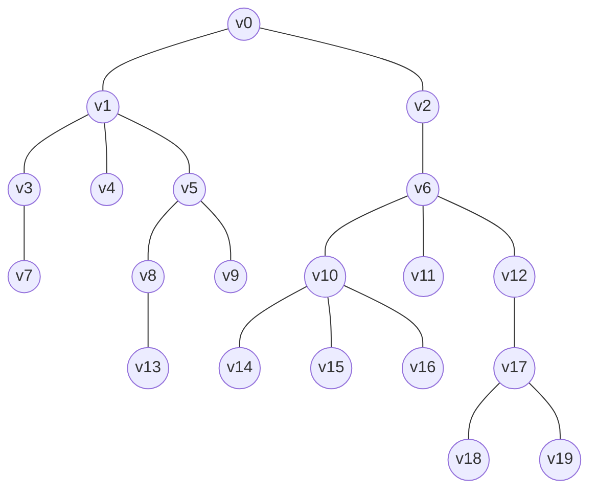
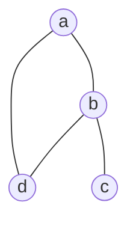
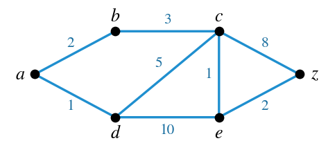
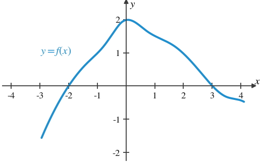

# HW12 과제 안내문 — 루트 트리, 신장 트리, 빅오 표기법

[레포지토리 안내](../../../README.ko.md) | [English](Assignment.md) | [한국어](Assignment.ko.md)

> **최종 수정일:** 2026-11-17

15주차에 나온 이산구조및연습 과제 12이다. 교재 Discrete Mathematics with Applications(Epp)의 10.5절(루트 트리), 10.6절(신장 트리와 최단 경로 알고리즘), 11.1절(실변수 실숫값 함수와 그래프), 11.2절(빅오, 빅오메가, 빅세타 표기법), 11.3절(알고리즘 효율성 분석 I)에서 고른 연습 문제 11개로 이루어지며, 문제 번호는 교재의 연습 문제 번호이다.

- **제출 기한:** 과제가 나온 날로부터 1주일이며, 늦게 낸 과제는 0점 처리한다.
- **제출 방법:** 개인별로 답안을 제출한다.

---

<br>

## 1. 연습 문제 10.5.2: 루트 트리의 용어

그림 1은 $v_0$을 루트로 하는 트리이다.

- (a) $v_8$의 레벨은 얼마인가?
- (b) $v_0$의 레벨은 얼마인가?
- (c) 이 루트 트리의 높이는 얼마인가?
- (d) $v_{10}$의 자식은 무엇인가?
- (e) $v_5$의 부모는 무엇인가?
- (f) $v_1$의 형제는 무엇인가?
- (g) $v_{12}$의 자손은 무엇인가?
- (h) 이 트리의 리프(말단 꼭짓점)는 몇 개인가?



*그림 1. 연습 문제 10.5.2의 루트 트리*

---

<br>

## 2. 연습 문제 10.5.4: 내부 꼭짓점이 5개인 정 이진 트리

내부 꼭짓점이 5개인 정 이진 트리를 그리거나, 그런 그래프가 존재하지 않는 이유를 설명하라.

---

<br>

## 3. 연습 문제 10.6.1: 모든 신장 트리

그림 2의 그래프 $G$의 신장 트리를 모두 구하라. $G$는 꼭짓점 $a, b, c, d$와 변 $ab$, $ad$, $bd$, $bc$로 이루어진다.



*그림 2. 신장 트리를 구할 그래프 G*

---

<br>

## 4. 연습 문제 10.6.13: 다익스트라 알고리즘의 추적

다익스트라 알고리즘을 이용하여 그림 3의 가중 그래프에서 $a$에서 $z$까지의 최단 경로를 구하라. 알고리즘의 동작을 교재의 표 10.6.1과 같은 형식의 표로 나타내라.



*그림 3. 다익스트라 알고리즘을 적용할 가중 그래프*

---

<br>

## 5. 연습 문제 11.1.1: 함수의 그래프 읽기

함수 $f$의 그래프가 그림 4와 같다.

- (a) $f(0)$은 양수인가, 음수인가?
- (b) $x$가 어떤 값일 때 $f(x) = 0$인가?
- (c) $x_1 \ne x_2$이면서 $f(x_1) = f(x_2) = 1$인 $x_1$과 $x_2$의 근삿값을 구하라.
- (d) $f(x) = 1.5$인 $x$의 근삿값을 하나 구하라.
- (e) $x$가 $-3$에서 $-1$까지 커질 때 $f$의 값은 증가하는가, 감소하는가?
- (f) $x$가 0에서 4까지 커질 때 $f$의 값은 증가하는가, 감소하는가?



*그림 4. 함수 f의 그래프*

---

<br>

## 6. 연습 문제 11.1.6: 천장 함수의 그래프

각 실수 $x$에 대해 $g(x) = \lceil x \rceil$로 정의된 함수 $g$의 그래프를 그리라. $x$의 천장 $\lceil x \rceil$은 $x$ 이상인 정수 가운데 가장 작은 것, 곧 $n - 1 < x \le n$인 유일한 정수 $n$이다.

---

<br>

## 7. 연습 문제 11.1.20: 증가 함수의 합

정의역 $D$가 같은 실숫값 함수 $f$와 $g$의 합 $f + g$를 각 실수 $x$에 대해 $(f + g)(x) = f(x) + g(x)$로 정의한다. $f$와 $g$가 모두 집합 $S$에서 증가하면 $f + g$도 $S$에서 증가함을 보이라.

---

<br>

## 8. 연습 문제 11.2.4: 빅오메가 표기법으로 나타낸 하한

다음 명제를 빅오메가 표기법($\Omega$-표기법)으로 나타내라.

```math
\frac{1}{2}n \le n - \left\lfloor \frac{n}{2} \right\rfloor + 1 \qquad (n \ge 1\text{인 모든 정수 } n)
```

---

<br>

## 9. 연습 문제 11.2.5: 빅오 표기법으로 나타낸 상한

다음 명제를 빅오 표기법($O$-표기법)으로 나타내라.

```math
0 \le n - \left\lfloor \frac{n}{2} \right\rfloor + 1 \le n \qquad (n \ge 3\text{인 모든 정수 } n)
```

---

<br>

## 10. 연습 문제 11.2.6: 빅세타 표기법으로 나타낸 차수

다음 명제를 빅세타 표기법($\Theta$-표기법)으로 나타내라.

```math
n^2 \le 3n(n - 2) \le 4n^2 \qquad (n \ge 3\text{인 모든 정수 } n)
```

---

<br>

## 11. 연습 문제 11.3.5: 차수와 실제 효율의 비교

교재의 지시문에 따르면 연습 문제 11.3.4와 11.3.5는 비교적 작은 $n$에서는 차수가 큰 알고리즘이 차수가 작은 알고리즘보다 효율적일 수 있다는 사실을 살핀다. 크기가 $n$인 입력으로 실행할 때 알고리즘 $A$는 연산 $10^6 n^2$번이 필요하고 알고리즘 $B$는 연산 $n^3$번이 필요하다고 하자.

- (a) 거듭제곱 함수의 집합 가운데에서 알고리즘 $A$와 $B$의 차수는 무엇인가?
- (b) $n$이 어떤 값일 때 알고리즘 $A$가 알고리즘 $B$보다 효율적인가?
- (c) $n$이 어떤 값일 때 알고리즘 $B$가 알고리즘 $A$보다 적어도 100배 효율적인가?

---

<br>

문제를 풀어 본 뒤 [과제 해설](../Assignment-Explanation.ko.md)에서 정답과 풀이를 볼 수 있다.
