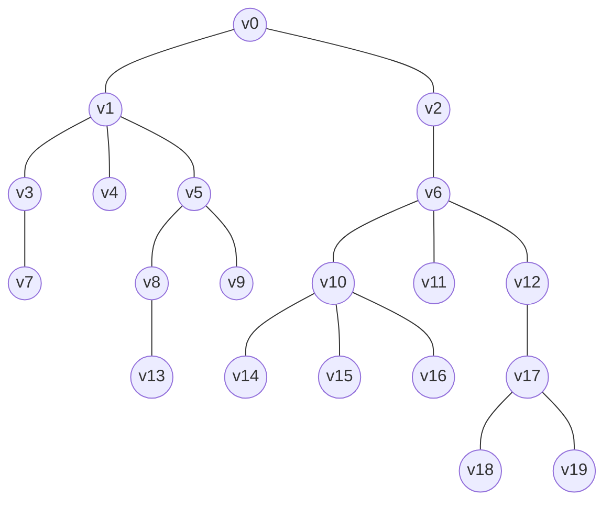
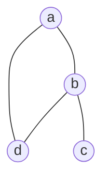
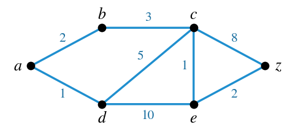
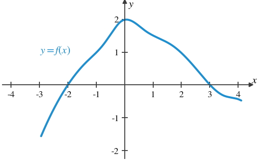

# HW12 Assignment Handout — Rooted Trees, Spanning Trees, and Big-O Notation

[Repository Guide](../../../README.md) | [English](Assignment.md) | [한국어](Assignment.ko.md)

> **Last Updated:** 2026-11-24

This is Assignment 12 of Discrete Mathematics and Practice, given in Week 15. It consists of eleven exercises chosen from Sections 10.5 (Rooted Trees), 10.6 (Spanning Trees and a Shortest Path Algorithm), 11.1 (Real-Valued Functions of a Real Variable and Their Graphs), 11.2 (Big-O, Big-Omega, and Big-Theta Notations), and 11.3 (Analysis of Algorithm Efficiency I) of the textbook Discrete Mathematics with Applications (Epp), and the problem numbers are the exercise numbers of the textbook.

---

<br>

## 1. Exercise 10.5.2: Terminology of Rooted Trees

Consider the tree in Figure 1 with root $v_0$.

- (a) What is the level of $v_8$?
- (b) What is the level of $v_0$?
- (c) What is the height of this rooted tree?
- (d) What are the children of $v_{10}$?
- (e) What is the parent of $v_5$?
- (f) What are the siblings of $v_1$?
- (g) What are the descendants of $v_{12}$?
- (h) How many leaves (terminal vertices) are on the tree?



*Figure 1. The rooted tree of Exercise 10.5.2*

---

<br>

## 2. Exercise 10.5.4: A Full Binary Tree with Five Internal Vertices

Either draw a full binary tree with five internal vertices, or explain why no such graph exists.

---

<br>

## 3. Exercise 10.6.1: All Spanning Trees

Find all possible spanning trees of the graph $G$ in Figure 2. $G$ has vertices $a, b, c, d$ and edges $ab$, $ad$, $bd$, $bc$.



*Figure 2. Graph G whose spanning trees are found*

---

<br>

## 4. Exercise 10.6.13: Tracing Dijkstra's Algorithm

Use Dijkstra's algorithm to find the shortest path from $a$ to $z$ in the weighted graph of Figure 3. Make a table similar to Table 10.6.1 of the textbook to show the action of the algorithm.



*Figure 3. Weighted graph to which Dijkstra's algorithm is applied*

---

<br>

## 5. Exercise 11.1.1: Reading the Graph of a Function

The graph of a function $f$ is shown in Figure 4.

- (a) Is $f(0)$ positive or negative?
- (b) For what values of $x$ does $f(x) = 0$?
- (c) Find approximate values for $x_1$ and $x_2$ so that $f(x_1) = f(x_2) = 1$ but $x_1 \ne x_2$.
- (d) Find an approximate value for $x$ such that $f(x) = 1.5$.
- (e) As $x$ increases from $-3$ to $-1$, do the values of $f$ increase or decrease?
- (f) As $x$ increases from 0 to 4, do the values of $f$ increase or decrease?



*Figure 4. Graph of the function f*

---

<br>

## 6. Exercise 11.1.6: Graph of the Ceiling Function

Sketch a graph of the function $g$ defined by $g(x) = \lceil x \rceil$ for each real number $x$. The ceiling of $x$, $\lceil x \rceil$, is the least integer that is greater than or equal to $x$, that is, the unique integer $n$ such that $n - 1 < x \le n$.

---

<br>

## 7. Exercise 11.1.20: Sum of Increasing Functions

Given real-valued functions $f$ and $g$ with the same domain $D$, the sum of $f$ and $g$, denoted $f + g$, is defined by $(f + g)(x) = f(x) + g(x)$ for each real number $x$. Show that if $f$ and $g$ are both increasing on a set $S$, then $f + g$ is also increasing on $S$.

---

<br>

## 8. Exercise 11.2.4: A Lower Bound in Ω-Notation

Express the following statement using $\Omega$-notation.

```math
\frac{1}{2}n \le n - \left\lfloor \frac{n}{2} \right\rfloor + 1 \qquad (\text{for every integer } n \ge 1)
```

---

<br>

## 9. Exercise 11.2.5: An Upper Bound in O-Notation

Express the following statement using $O$-notation.

```math
0 \le n - \left\lfloor \frac{n}{2} \right\rfloor + 1 \le n \qquad (\text{for every integer } n \ge 3)
```

---

<br>

## 10. Exercise 11.2.6: An Order in Θ-Notation

Express the following statement using $\Theta$-notation.

```math
n^2 \le 3n(n - 2) \le 4n^2 \qquad (\text{for every integer } n \ge 3)
```

---

<br>

## 11. Exercise 11.3.5: Order Versus Actual Efficiency

According to the instructions of the textbook, Exercises 11.3.4 and 11.3.5 explore the fact that for relatively small values of $n$, algorithms with larger orders can be more efficient than algorithms with smaller orders. Suppose that when run with an input of size $n$, algorithm $A$ requires $10^6 n^2$ operations and algorithm $B$ requires $n^3$ operations.

- (a) What are orders for algorithms $A$ and $B$ from among the set of power functions?
- (b) For what values of $n$ is algorithm $A$ more efficient than algorithm $B$?
- (c) For what values of $n$ is algorithm $B$ at least 100 times more efficient than algorithm $A$?

---

<br>

After solving the problems, see the [assignment explanation](../Assignment-Explanation.md) for the answers and solutions.
