# 1장 — 수학적으로 말하기

[레포지토리 안내](../../README.ko.md) | [English](Concepts_Lecture.md) | [한국어](Concepts_Lecture.ko.md)

> **최종 수정일:** 2026-11-04
>
> Discrete Mathematics with Applications, Epp, Ch 1

> **학습 목표:**
> 1. 변수를 사용하여 전칭 명제, 조건 명제, 존재 명제와 그 결합을 여러 형태로 바꾸어 쓸 수 있다
> 2. 원소나열법과 조건제시법으로 집합을 나타내고, 원소 관계 $\in$와 부분집합 관계 $\subseteq$를 구별할 수 있다
> 3. 순서쌍, 순서 n-튜플, 데카르트 곱, 문자열을 정의하고 주어진 집합에서 그 원소를 모두 구할 수 있다
> 4. 관계를 데카르트 곱의 부분집합으로 정의하고, 순서쌍의 집합이나 화살표 도표로 주어진 관계가 함수인지 판정할 수 있다
> 5. 그래프의 꼭짓점, 변, 루프, 평행 변, 인접, 접함, 차수를 정의하고 그래프 모형으로 간단한 문제를 풀 수 있다

---

## 목차

- [이산수학의 개관](#이산수학의-개관)
- [1. 변수](#1-변수)
  - [1.1 변수의 두 가지 쓰임](#11-변수의-두-가지-쓰임)
  - [1.2 중요한 수학적 명제의 세 종류](#12-중요한-수학적-명제의-세-종류)
  - [1.3 전칭 조건 명제](#13-전칭-조건-명제)
  - [1.4 전칭 존재 명제](#14-전칭-존재-명제)
  - [1.5 존재 전칭 명제](#15-존재-전칭-명제)
  - [1.6 세 표현을 모두 쓰는 정의: 수열의 극한](#16-세-표현을-모두-쓰는-정의-수열의-극한)
- [2. 집합의 언어](#2-집합의-언어)
  - [2.1 집합과 원소, 원소나열법](#21-집합과-원소-원소나열법)
  - [2.2 자주 쓰는 수의 집합](#22-자주-쓰는-수의-집합)
  - [2.3 조건제시법](#23-조건제시법)
  - [2.4 부분집합](#24-부분집합)
  - [2.5 순서쌍과 순서 n-튜플](#25-순서쌍과-순서-n-튜플)
  - [2.6 데카르트 곱](#26-데카르트-곱)
  - [2.7 문자열](#27-문자열)
- [3. 관계와 함수의 언어](#3-관계와-함수의-언어)
  - [3.1 관계의 직관적 의미](#31-관계의-직관적-의미)
  - [3.2 관계의 정의](#32-관계의-정의)
  - [3.3 관계의 화살표 도표](#33-관계의-화살표-도표)
  - [3.4 함수](#34-함수)
  - [3.5 함수 기계와 식으로 정의된 함수](#35-함수-기계와-식으로-정의된-함수)
  - [3.6 함수의 상등](#36-함수의-상등)
- [4. 그래프의 언어](#4-그래프의-언어)
  - [4.1 그래프의 직관적 의미](#41-그래프의-직관적-의미)
  - [4.2 그래프의 정의와 용어](#42-그래프의-정의와-용어)
  - [4.3 같은 그래프의 여러 그림](#43-같은-그래프의-여러-그림)
  - [4.4 그래프로 나타낸 네트워크](#44-그래프로-나타낸-네트워크)
  - [4.5 방향 그래프](#45-방향-그래프)
  - [4.6 그래프로 퍼즐 풀기](#46-그래프로-퍼즐-풀기)
  - [4.7 꼭짓점의 차수](#47-꼭짓점의-차수)
  - [4.8 그래프 색칠](#48-그래프-색칠)
- [개념 적용](#개념-적용)
- [요약](#요약)
- [점검 문제](#점검-문제)

---

 

## 이산수학의 개관

**이산수학(discrete mathematics)** 은 정수, 유한 집합, 문자열, 그래프처럼 서로 떨어져 있어 하나하나 구별하고 셀 수 있는 대상을 다루는 수학이다. 실수 직선처럼 빈틈없이 이어진 대상을 다루는 미적분학과 대비되며, 이 구별은 2.2절에서 다시 설명한다. 컴퓨터는 유한한 비트열을 유한한 단계로 처리하는 기계이므로, 프로그램이 옳다는 것을 논증하고, 자료를 구조화하고, 알고리즘의 효율을 따지는 일은 대부분 이산수학의 언어로 이루어진다. 이런 까닭에 이산수학은 자료구조와 함께 컴퓨터 과학의 가장 기본적인 입문 과목으로 꼽히며, 3, 4학년에서 배우는 상위 과목을 이해하는 토대가 된다.

이 과목은 논리, 증명, 함수, 관계, 그래프라는 컴퓨터 과학의 기본 개념을 먼저 익히고, 그 위에서 부울 대수 같은 대수적 구조와 알고리즘의 분석으로 나아간다. 각 장이 다루는 내용은 다음과 같다.

| 장 | 주제 | 핵심 내용 |
|:-----|:-----|:-----|
| 1장 | 수학적으로 말하기 | 변수, 집합, 관계와 함수, 그래프의 언어 |
| 2장 | 합성 명제의 논리 | 논리 연산과 진리표, 논리적 동치, 조건 명제, 타당한 논증, 디지털 논리 회로, 수 체계와 덧셈 회로 |
| 3장 | 한정 명제의 논리 | 술어와 한정기호, 다중 한정기호, 한정 명제를 포함한 논증 |
| 4장 | 초등 정수론과 증명 방법 | 직접 증명과 반례, 유리수, 나누어떨어짐, 몫-나머지 정리, 바닥 함수와 천장 함수, 귀류법과 대우에 의한 증명 |
| 5장 | 수열, 수학적 귀납법, 재귀 | 수열과 합 기호, 수학적 귀납법과 강한 수학적 귀납법, 루프 불변식, 점화식 |
| 6장 | 집합론 | 집합 연산과 그 성질의 증명, 부울 대수, 러셀의 역설과 정지 문제 |
| 7장 | 함수의 성질 | 일대일 함수와 위로의 함수, 역함수, 합성, 기수와 가산성 |
| 8장 | 관계의 성질 | 반사적, 대칭적, 추이적 관계, 동치 관계, 부분 순서 관계 |
| 9장 | 경우의 수와 확률 | 곱의 법칙과 합의 법칙, 순열과 조합, 비둘기집 원리, 이항정리, 기댓값, 조건부 확률과 베이즈 정리 |
| 10장 | 그래프와 트리 이론 | 보행, 경로, 회로, 오일러 회로와 해밀턴 회로, 인접 행렬, 동형, 트리와 신장 트리, 최단 경로 |
| 11장 | 알고리즘 효율성 분석 | 빅오, 빅오메가, 빅세타 표기법, 탐색과 정렬 알고리즘의 효율, 지수 함수와 로그 함수 |

*표 1. 장별 주제와 핵심 내용*

1장은 이후의 모든 장에서 쓰는 네 가지 언어, 즉 변수, 집합, 관계와 함수, 그래프를 소개한다. 이 장의 목표는 정의를 정확하게 읽고 쓰는 습관을 들이는 것이며, 각 개념의 깊은 성질은 뒤의 장에서 증명과 함께 다룬다.

---

 

## 1. 변수

### 1.1 변수의 두 가지 쓰임

> **용어 정의:** **변수(variable)** 는 어떤 대상을 가리키기 위해 임시로 붙이는 이름이다. 그 자리에 여러 값을 넣어 볼 수 있으므로 자리표시자(placeholder) 역할을 한다.

변수는 주로 다음 두 가지 목적으로 쓴다.

1. **값을 아직 모르는 대상에 이름을 붙인다.** 하나 이상의 값이 있으리라 짐작하지만 그 값이 무엇인지 모를 때, 이름을 붙여 두면 그 대상으로 구체적인 계산을 해 나가며 가능한 값을 찾을 수 있다.
2. **어떤 집합의 모든 원소에 똑같이 성립하는 말을 한다.** 특정한 값 하나에 묶이지 않고 임의로 고른 원소에 대해 말함으로써 문장의 일반성을 유지한다.

첫째 쓰임의 예로, 어떤 수를 두 배 하고 3을 더한 결과가 그 수를 제곱한 결과와 같은 수가 있는지 묻는 질문을 생각한다. 문장 속의 "그 수"는 문장이 길어질수록 무엇을 가리키는지 모호해진다. 변수 $x$를 도입하면 질문은 다음과 같이 짧고 분명해진다.

$$
2x + 3 = x^2 \text{ 을 만족하는 수 } x \text{ 가 있는가?}
$$

자리표시자 역할을 강조하여 $2 \cdot \square + 3 = \square^2$처럼 빈 상자로 쓰기도 한다. 상자에 여러 값을 넣어 보면 양변이 같아지는 값과 그렇지 않은 값이 있음을 알 수 있다. 실제로 식을 정리하면 $x^2 - 2x - 3 = 0$, 즉 $(x - 3)(x + 1) = 0$이므로 $x = 3$ 또는 $x = -1$이다. $x = 3$을 넣으면 좌변은 $2 \cdot 3 + 3 = 9$, 우변은 $3^2 = 9$이고, $x = -1$을 넣으면 좌변은 $2 \cdot (-1) + 3 = 1$, 우변은 $(-1)^2 = 1$이다.

> **[프로그래밍언어]** 프로그램의 변수는 이름과 메모리 위치를 묶어 두고 그 위치에 값을 저장하는 장치이다. 값을 넣을 자리를 만든다는 점에서 수학의 변수와 비슷하지만, 프로그램의 변수는 실행 중에 저장된 값이 바뀔 수 있다는 점이 다르다.

둘째 쓰임의 예로, 어떤 수를 고르든 그 수가 2보다 크면 그 수의 제곱은 4보다 크다는 문장을 생각한다. 임의로 고른 수에 이름 $n$을 붙이고 "그 수"를 모두 $n$으로 바꾸면, 일반성을 잃지 않으면서 모호함도 없앨 수 있다.

- 어떤 수 $n$을 고르든, $n$이 2보다 크면 $n^2$은 4보다 크다.

**예제 1.1.1 (변수를 써서 문장 바꾸어 쓰기).** 다음 두 문장을 변수를 써서 더 형식적으로 바꾸어 쓴다.

- (a) 제곱의 합이 합의 제곱과 같은 수들이 있는가?
  - $a^2 + b^2 = (a + b)^2$을 만족하는 수 $a$와 $b$가 있는가?
  - $a^2 + b^2 = (a + b)^2$이 되는 수 $a$와 $b$가 존재하는가?
- (b) 임의의 실수에 대해 그 제곱은 음수가 아니다.
  - 임의의 실수 $r$에 대해 $r^2$은 음수가 아니다.
  - 모든 실수 $r$에 대해 $r^2 \ge 0$이다.

(a)의 답은 "그렇다"이다. 우변을 전개하면 $(a + b)^2 = a^2 + 2ab + b^2$이므로 등식은 $2ab = 0$, 즉 $ab = 0$과 같다. 따라서 등식은 $a$와 $b$ 가운데 적어도 하나가 0일 때 그리고 그때에만 성립한다. 예를 들어 $a = 1$, $b = 0$이면 좌변 $1^2 + 0^2 = 1$과 우변 $(1 + 0)^2 = 1$이 같다.

### 1.2 중요한 수학적 명제의 세 종류

**명제(statement)** 는 참이거나 거짓인 문장이며, 정확한 정의는 2장에서 다룬다. 수학에서 가장 중요한 명제는 다음 세 종류이다.

> **용어 정의:** **전칭 명제(universal statement)** 는 어떤 집합의 모든 원소에 대해 어떤 성질이 참이라고 말하는 명제이다. 예: 모든 양수는 0보다 크다.

> **용어 정의:** **조건 명제(conditional statement)** 는 한 가지가 참이면 다른 한 가지도 반드시 참이라고 말하는 명제이다. 예: 378이 18로 나누어떨어지면 378은 6으로 나누어떨어진다.

> **용어 정의:** **존재 명제(existential statement)** 는 참일 수도 거짓일 수도 있는 성질에 대해, 그 성질이 참인 대상이 적어도 하나 있다고 말하는 명제이다. 예: 짝수인 소수가 있다.

조건 명제의 예에서 $378 = 18 \times 21$이고 $378 = 6 \times 63$이므로 가정과 결론이 모두 참이다. 존재 명제의 예는 2가 짝수이면서 소수이므로 참이다.

전칭 명제와 존재 명제는 기호로 다음과 같이 쓴다. 기호 $\forall$는 "모든"(for all), $\exists$는 "존재한다"(there exists)로 읽는다.

$$
\forall x \in A,\ P(x)
$$

위 식은 집합 $A$의 모든 원소 $x$에 대해 성질 $P(x)$가 성립한다는 뜻이다.

$$
\exists y \in B \text{ such that } P(y)
$$

위 식은 성질 $P(y)$가 참인 원소 $y$가 집합 $B$에 적어도 하나 있다는 뜻이다. "such that"는 흔히 s.t.로 줄여 쓴다. 이 기호들의 정확한 문법과 의미는 3장에서 다루며, 이 장에서는 문장을 간결하게 적는 약기로만 쓴다.

세 종류의 명제는 서로 결합하여 더 복잡한 명제를 이룬다. 같은 명제를 일상 언어로 쓸 수도 있고 변수를 써서 쓸 수도 있으며, 이 둘 사이를 자유롭게 오가는 능력이 수학을 읽고 쓰는 기본기이다. 1.3절부터 1.5절까지는 대표적인 세 가지 결합을 살펴본다.

### 1.3 전칭 조건 명제

전칭 명제에는 "모든"이라는 말이, 조건 명제에는 "이면"이라는 말이 어떤 형태로든 들어 있다.

> **용어 정의:** **전칭 조건 명제(universal conditional statement)** 는 전칭 명제이면서 조건 명제인 명제이다. 형태는 "모든 $x$에 대해, $x$가 $P$이면 $x$는 $Q$이다"이다.

예를 들어 다음 명제를 생각한다.

- 모든 동물 $a$에 대해, $a$가 개이면 $a$는 포유류이다.

전칭 조건 명제의 중요한 성질은 겉보기에 순수한 조건 명제나 순수한 전칭 명제처럼 바꾸어 쓸 수 있다는 것이다. 조건의 성격을 드러내고 전칭의 성격을 숨기면 다음과 같다.

- $a$가 개이면 $a$는 포유류이다.
- 어떤 동물이 개이면 그 동물은 포유류이다.

반대로 전칭의 성격을 드러내고 조건의 성격을 숨기면 다음과 같다.

- 모든 개 $a$에 대해 $a$는 포유류이다.
- 모든 개는 포유류이다.

네 문장은 모두 같은 명제이다. 이렇게 여러 표현 사이를 옮겨 다니는 능력은 수학뿐 아니라 컴퓨터 과학의 여러 분야에서 쓸모가 크다.

**예제 1.1.2 (전칭 조건 명제 바꾸어 쓰기).** 다음 명제를 다섯 가지 형태로 바꾸어 쓴다.

$$
\forall x \in \mathbf{R},\ \text{if } x \ne 0 \text{ then } x^2 > 0
$$

즉 모든 실수 $x$에 대해, $x$가 0이 아니면 $x^2$은 양수이다.

- (a) 실수가 0이 아니면 그 제곱은 양수이다.
- (b) 0이 아닌 모든 실수 $x$에 대해 $x^2$은 양수이다.
- (c) $x$가 0이 아닌 실수이면 $x^2$은 양수이다.
- (d) 0이 아닌 실수의 제곱은 모두 양수이다.
- (e) 0이 아닌 실수는 모두 양수인 제곱을 가진다.

> **주의:** 문장의 앞부분에서 변수 $x$를 도입했으면 뒷부분에서도 그 변수를 써야 한다. "$x$가 0이 아닌 실수이면 제곱은 양수이다"처럼 쓰면 무엇의 제곱인지가 문장에 드러나지 않는다. (c)처럼 "$x^2$은 양수이다"라고 써야 앞에서 도입한 $x$와 연결된다.

### 1.4 전칭 존재 명제

> **용어 정의:** **전칭 존재 명제(universal existential statement)** 는 앞부분에서 주어진 종류의 모든 대상에 대해 어떤 성질이 참이라고 말하고(전칭), 뒷부분에서 무언가가 존재한다고 주장하는(존재) 명제이다. 기호로는 $\forall x \in A,\ \exists y \in B \text{ such that } P(x, y)$의 형태이며, 각 $x$마다 짝이 되는 $y$가 적어도 하나 있다는 뜻이다.

> **용어 정의:** 수 $b$가 수 $a$의 **덧셈 역원(additive inverse)** 이라는 것은 $a + b = 0$이라는 뜻이다.

다음 명제를 생각한다.

- 모든 실수는 덧셈 역원을 가진다.

덧셈 역원을 가진다는 성질은 모든 실수에 전칭적으로 적용되고, 그 성질 자체는 덧셈 역원이라는 대상이 존재한다고 주장한다. 덧셈 역원이 실수라는 사실을 이용하면 이 명제를 덜 형식적인 형태부터 더 형식적인 형태까지 여러 가지로 쓸 수 있다.

- 모든 실수는 덧셈 역원을 가진다.
- 모든 실수 $r$에 대해 $r$의 덧셈 역원이 있다.
- 모든 실수 $r$에 대해, $s$가 $r$의 덧셈 역원이 되는 실수 $s$가 있다.

중요한 점은 존재하는 대상이 앞에서 고른 대상에 따라 달라진다는 것이다. 세 번째 형태처럼 이름을 붙여 두면 이 의존 관계를 분명히 말할 수 있다. $s = -r$이므로 $r$이 양수이면 $s$는 음수이고, $r$이 음수이면 $s$는 양수이며, $r = 0$이면 $s = 0$이다. 예를 들어 $r = 5$에 대해서는 $s = -5$이고, $r = -2.5$에 대해서는 $s = 2.5$이다. 변수를 쓰면 이처럼 긴 논증 안에서 특정한 값에 묶이지 않으면서도 대상을 모호함 없이 가리킬 수 있다.

**예제 1.1.3 (전칭 존재 명제 바꾸어 쓰기).** 모든 냄비에는 뚜껑이 있다는 명제를 세 가지로 바꾸어 쓴다.

- (a) 모든 냄비는 뚜껑을 가진다.
- (b) 모든 냄비 $P$에 대해, $P$의 뚜껑이 있다.
- (c) 모든 냄비 $P$에 대해, $L$이 $P$의 뚜껑이 되는 뚜껑 $L$이 있다.

(c)에서 뚜껑 $L$은 냄비 $P$에 따라 달라질 수 있다. 냄비마다 맞는 뚜껑이 따로 있어도 이 명제는 참이다.

### 1.5 존재 전칭 명제

> **용어 정의:** **존재 전칭 명제(existential universal statement)** 는 앞부분에서 어떤 대상이 존재한다고 주장하고(존재), 뒷부분에서 그 대상이 주어진 종류의 모든 것에 대해 어떤 성질을 만족한다고 말하는(전칭) 명제이다. 기호로는 $\exists y \in B \text{ such that } \forall x \in A,\ P(x, y)$의 형태이며, 모든 $x$에 대해 한꺼번에 통하는 $y$ 하나가 있다는 뜻이다.

다음 명제를 생각한다.

- 모든 양의 정수보다 작거나 같은 양의 정수가 있다.

이 명제는 참이다. 1은 양의 정수이고, 모든 양의 정수 $n$에 대해 $1 \le n$이기 때문이다. 이 명제도 여러 형태로 쓸 수 있다.

- 어떤 양의 정수는 모든 양의 정수보다 작거나 같다.
- 모든 양의 정수보다 작거나 같은 양의 정수 $m$이 있다.
- 모든 양의 정수가 $m$보다 크거나 같은 양의 정수 $m$이 있다.
- 모든 양의 정수 $n$에 대해 $m \le n$이 성립하는 양의 정수 $m$이 있다.

**예제 1.1.4 (존재 전칭 명제 바꾸어 쓰기).** 어떤 반에 그 반의 모든 사람보다 나이가 적지 않은 사람이 있다는 명제를 세 가지로 바꾸어 쓴다.

- (a) 반의 어떤 사람은 반의 모든 사람보다 나이가 적지 않다.
- (b) 반에 사람 $p$가 있어서, $p$는 반의 모든 사람보다 나이가 적지 않다.
- (c) 반에 사람 $p$가 있어서, 반의 모든 사람 $q$에 대해 $p$는 $q$보다 나이가 적지 않다.

이 명제는 반에서 나이가 가장 많은 사람이 있다는 뜻이다. 반이 유한한 집합이고 비어 있지 않으면 항상 참이다. (c)에서 $q$가 $p$ 자신일 수도 있으므로 "적지 않다"(at least as old as)라고 써야 한다.

> **주의:** 전칭과 존재의 순서를 바꾸면 뜻이 달라진다. $\forall x \in \mathbf{R},\ \exists y \in \mathbf{R} \text{ such that } x + y = 0$은 참이다. 각 $x$에 대해 $y = -x$를 고르면 되기 때문이다. 반면 $\exists y \in \mathbf{R} \text{ such that } \forall x \in \mathbf{R},\ x + y = 0$은 거짓이다. 그런 $y$가 있다면 $x = 0$일 때 $0 + y = 0$에서 $y = 0$이어야 하는데, $x = 1$일 때 $1 + 0 = 1 \ne 0$이 되어 모순이기 때문이다. 같은 이유로 모든 냄비에 뚜껑이 있다는 명제와 모든 냄비에 맞는 뚜껑 하나가 있다는 명제는 서로 다르다.

지금까지 살펴본 명제의 형태를 정리하면 다음과 같다.

| 종류 | 기호 형식 | 예 |
|:-----|:-----|:-----|
| 전칭 명제 | $\forall x \in A,\ P(x)$ | 모든 양수는 0보다 크다 |
| 조건 명제 | $P$이면 $Q$ | 378이 18로 나누어떨어지면 378은 6으로 나누어떨어진다 |
| 존재 명제 | $\exists y \in B \text{ s.t. } P(y)$ | 짝수인 소수가 있다 |
| 전칭 조건 명제 | $\forall x \in A$, $P(x)$이면 $Q(x)$ | 모든 동물 $a$에 대해, $a$가 개이면 $a$는 포유류이다 |
| 전칭 존재 명제 | $\forall x \in A,\ \exists y \in B \text{ s.t. } P(x, y)$ | 모든 실수는 덧셈 역원을 가진다 |
| 존재 전칭 명제 | $\exists y \in B \text{ s.t. } \forall x \in A,\ P(x, y)$ | 모든 양의 정수보다 작거나 같은 양의 정수가 있다 |

*표 2. 명제의 종류와 기호 형식*

### 1.6 세 표현을 모두 쓰는 정의: 수열의 극한

수학의 중요한 개념 가운데에는 "모든", "존재한다", "이면"을 모두 써야만 정의할 수 있는 것이 있다. 대표적인 예가 수열의 극한이다. 실수의 수열 $a_1, a_2, a_3, \ldots$에 대해 $n$이 무한대로 갈 때 $a_n$의 극한이 $L$이라는 말은 다음을 뜻한다.

$$
\forall \varepsilon \in \mathbf{R}^{+},\ \exists N \in \mathbf{Z} \text{ such that } \forall n \in \mathbf{Z},\ \text{if } n > N \text{ then } -\varepsilon < a_n - L < \varepsilon
$$

즉 모든 양의 실수 $\varepsilon$에 대해 어떤 정수 $N$이 있어서, 모든 정수 $n$에 대해 $n > N$이면 $-\varepsilon < a_n - L < \varepsilon$이다. 이 정의는 $\varepsilon$에 대한 전칭, $N$에 대한 존재, $n$에 대한 전칭, 그리고 조건 명제를 차례로 겹쳐 놓은 것이다. $N$은 $\varepsilon$을 고른 뒤에 정해지므로 $\varepsilon$에 따라 달라져도 된다.

예를 들어 $a_n = 1/n$이고 $L = 0$이라 한다. $\varepsilon = 0.01$이 주어지면 $N = 100$을 고른다. 그러면 $n > 100$인 모든 정수 $n$에 대해 $0 < 1/n < 1/100 = 0.01$이므로 $-0.01 < a_n - 0 < 0.01$이 성립한다. 일반적으로 $\varepsilon$이 주어지면 $N \ge 1/\varepsilon$인 정수 $N$을 고르면 되며, 이때 $n > N$이면 $n > 1/\varepsilon$이므로 $0 < 1/n < \varepsilon$이다. 이런 명제를 다루는 방법은 3장의 다중 한정기호에서 자세히 배운다.

---

 

## 2. 집합의 언어

### 2.1 집합과 원소, 원소나열법

집합이라는 말을 형식적인 수학 용어로 쓰기 시작한 것은 1879년 칸토어(Georg Cantor)부터이다. 대부분의 목적에서는 칸토어처럼 집합을 원소들의 모임으로 직관적으로 이해하면 충분하다. 예를 들어 $I$가 1부터 100까지의 정수 전체의 집합이면 57은 $I$의 원소이다.

> **용어 정의:** **집합(set)** 은 대상들의 모임이고, 집합을 이루는 각 대상을 그 집합의 **원소(element)** 라 한다. $S$가 집합일 때 $x \in S$는 $x$가 $S$의 원소라는 뜻이고, $x \notin S$는 $x$가 $S$의 원소가 아니라는 뜻이다.

> **용어 정의:** **원소나열법(set-roster notation)** 은 집합의 원소를 모두 중괄호 안에 나열하여 집합을 나타내는 방법이다. 예를 들어 $\lbrace 1, 2, 3 \rbrace$은 원소가 1, 2, 3인 집합이다.

원소가 많거나 무한히 많을 때는 **생략 부호(ellipsis)** $\ldots$를 써서 규칙을 보여 준다. 생략 부호는 "이런 식으로 계속"이라고 읽는다.

- $\lbrace 1, 2, 3, \ldots, 100 \rbrace$: 1부터 100까지의 정수 전체의 집합
- $\lbrace 1, 2, 3, \ldots \rbrace$: 양의 정수 전체의 집합

**외연 공리(axiom of extension)** 에 따르면 집합은 어떤 원소를 가지는지만으로 완전히 결정된다. 원소를 나열하는 순서나 같은 원소를 여러 번 적었는지는 집합에 영향을 주지 않는다.

원소가 하나도 없는 집합을 **공집합(empty set)** 이라 하고 $\emptyset$로 나타낸다. 원소나열법으로는 $\emptyset = \lbrace \ \rbrace$이다. 공집합의 성질은 6장에서 자세히 다룬다.

**예제 1.2.1 (원소나열법).**

- (a) $A = \lbrace 1, 2, 3 \rbrace$, $B = \lbrace 3, 1, 2 \rbrace$, $C = \lbrace 1, 1, 2, 3, 3, 3 \rbrace$의 원소는 무엇이며, 세 집합은 어떤 관계인가? 세 집합의 원소는 모두 1, 2, 3의 세 개이다. 외연 공리에 따라 $A$, $B$, $C$는 같은 집합을 다르게 나타낸 것뿐이다.
- (b) $\lbrace 0 \rbrace = 0$인가? 아니다. $\lbrace 0 \rbrace$은 0 하나를 원소로 가지는 집합이고, 0은 수 영을 나타내는 기호이다. 집합과 수는 서로 다른 대상이다.
- (c) 집합 $\lbrace 1, \lbrace 1 \rbrace \rbrace$의 원소는 몇 개인가? 두 개이다. 하나는 수 1이고, 다른 하나는 1만을 원소로 가지는 집합 $\lbrace 1 \rbrace$이다.
- (d) 음이 아닌 정수 $n$마다 $U_n = \lbrace n, -n \rbrace$이라 할 때 $U_1$, $U_2$, $U_0$을 구한다. $U_1 = \lbrace 1, -1 \rbrace$, $U_2 = \lbrace 2, -2 \rbrace$이다. $U_0 = \lbrace 0, -0 \rbrace = \lbrace 0, 0 \rbrace = \lbrace 0 \rbrace$이므로 $U_0$의 원소는 하나뿐이다.

> **주의:** $0$, $\lbrace 0 \rbrace$, $\emptyset$, $\lbrace \emptyset \rbrace$은 모두 다른 대상이다. $0$은 수이고, $\lbrace 0 \rbrace$은 원소가 0 하나인 집합이며, $\emptyset$은 원소가 없는 집합이고, $\lbrace \emptyset \rbrace$은 공집합 하나를 원소로 가지는 집합이다. 따라서 $\emptyset$의 원소는 0개이고 $\lbrace \emptyset \rbrace$의 원소는 1개이다.

### 2.2 자주 쓰는 수의 집합

자주 쓰는 수의 집합에는 고유한 기호를 붙인다.

| 기호 | 집합 |
|:-----|:-----|
| $\mathbf{R}$ | 실수 전체의 집합 |
| $\mathbf{Z}$ | 정수 전체의 집합 |
| $\mathbf{Q}$ | 유리수, 즉 정수의 몫 전체의 집합 |
| $\mathbf{R}^{+}$, $\mathbf{R}^{-}$ | 양의 실수 전체의 집합, 음의 실수 전체의 집합 |
| $\mathbf{Z}^{+}$, $\mathbf{Z}^{-}$ | 양의 정수 전체의 집합, 음의 정수 전체의 집합 |
| $\mathbf{Z}^{\text{nonneg}}$ | 음이 아닌 정수 전체의 집합 $\lbrace 0, 1, 2, 3, \ldots \rbrace$ |

*표 3. 자주 쓰는 수의 집합과 기호*

위첨자 $+$, $-$, nonneg는 각각 양수, 음수, 음이 아닌 수만 모은다는 뜻이다. $\mathbf{Z}$는 수를 뜻하는 독일어 Zahlen의 첫 글자이다. 손으로 쓸 때는 굵은 글씨 대신 세로선을 겹친 $\mathbb{R}$, $\mathbb{Q}$, $\mathbb{Z}$로 쓴다. **유리수(rational number)** 는 정수의 몫으로 나타낼 수 있는 수이며, 4장에서 정확히 정의한다.

> **주의:** $\mathbf{Z}$는 정수 전체의 집합을 나타내는 기호이지, 정수라는 낱말의 약자가 아니다. "$x$는 $\mathbf{Z}$이다"는 잘못된 표현이고, "$x \in \mathbf{Z}$" 또는 "$x$는 정수이다"라고 써야 한다.

음이 아닌 정수 전체의 집합을 자연수의 집합 $\mathbf{N}$이라 부르는 책도 있고, 양의 정수만 자연수라 부르는 책도 있다. 혼동을 막기 위해 이 장에서도 자연수라는 말을 쓰지 않고 $\mathbf{Z}^{+}$와 $\mathbf{Z}^{\text{nonneg}}$를 구별하여 쓴다.

실수 전체의 집합은 흔히 직선 위의 점 전체로 나타낸다. 가운데 한 점을 **원점(origin)** 으로 정해 0에 대응시키고, 단위 길이를 정한다. 원점 오른쪽의 각 점은 원점에서의 거리에 해당하는 양의 실수에, 왼쪽의 각 점은 그 거리 앞에 음의 부호를 붙인 음의 실수에 대응한다. 따라서 실수 전체는 양의 실수, 음의 실수, 그리고 0의 세 부분으로 나뉜다. 0은 양수도 음수도 아니다. 정수도 같은 방식으로 양의 정수, 0, 음의 정수의 세 부분으로 나뉜다.

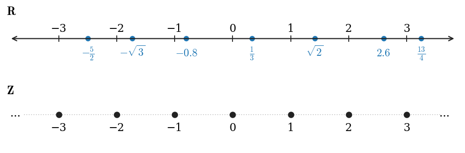

*그림 1. 몇몇 실수를 표시한 실수 직선과 일정한 간격으로 떨어진 점으로 나타낸 정수*

그림 1의 위쪽 직선에는 $-\frac{5}{2}$, $-\sqrt{3}$, $-0.8$, $\frac{1}{3}$, $\sqrt{2}$, $2.6$, $\frac{13}{4}$가 표시되어 있다. 실수 직선은 빈틈이 없다고 상상하므로 **연속적(continuous)** 이라 한다. 반면 정수는 실수 직선 위에서 일정한 간격으로 떨어진 점들에 대응한다. 모든 정수는 실수이지만, 정수들은 서로 떨어져 있으므로 정수의 집합을 **이산적(discrete)** 이라 한다. 이산수학이라는 이름은 이처럼 연속적인 대상과 이산적인 대상을 구별하는 데서 왔다.

### 2.3 조건제시법

집합을 나타내는 또 다른 방법은 원소가 만족해야 할 조건을 적는 것이다.

> **용어 정의:** **조건제시법(set-builder notation)**: $S$가 집합이고 $P(x)$가 $S$의 원소가 만족할 수도 있고 만족하지 않을 수도 있는 성질일 때, $S$의 원소 $x$ 가운데 $P(x)$가 참인 것 전체의 집합을 다음과 같이 나타낸다.
>
> $$\lbrace x \in S \mid P(x) \rbrace$$

왼쪽 중괄호는 the set of all, 즉 다음 조건을 만족하는 원소 전체의 집합으로 읽고, 세로선은 such that, 즉 다음 조건을 만족한다는 뜻으로 읽는다. 따라서 위 식은 $P(x)$가 참인 $S$의 원소 $x$ 전체의 집합이라고 읽는다. 세로선으로 such that을 나타내는 것은 조건제시법 안에서뿐이다. 다른 수학 문장에서는 such that을 s.t., s.th., 또는 기호 $\ni$로 줄여 쓴다.

어디에서 고른 원소인지 밝히지 않고 $\lbrace x \mid P(x) \rbrace$로 쓰기도 한다. 그러나 이런 표기를 아무 제한 없이 쓰면 집합론에서 실제로 모순이 생긴다. 그 대표적인 예인 러셀의 역설은 6장에서 다룬다. 따라서 $\lbrace x \mid P(x) \rbrace$는 필요하면 $S$를 밝힐 수 있는 경우에만 편의상 쓴다.

**예제 1.2.2 (조건제시법).** $\mathbf{R}$, $\mathbf{Z}$, $\mathbf{Z}^{+}$가 각각 실수, 정수, 양의 정수 전체의 집합일 때 다음 집합을 설명한다.

- (a) $\lbrace x \in \mathbf{R} \mid -2 < x < 5 \rbrace$는 $-2$와 5 사이(양 끝 제외)에 있는 실수 전체의 **열린구간(open interval)** 이다. $-2$와 5는 포함하지 않으며, 무한히 많은 실수를 원소로 가진다.
- (b) $\lbrace x \in \mathbf{Z} \mid -2 < x < 5 \rbrace$는 $-2$와 5 사이(양 끝 제외)의 정수 전체의 집합이며, $\lbrace -1, 0, 1, 2, 3, 4 \rbrace$와 같다.
- (c) $\mathbf{Z}^{+}$의 원소는 모두 양수이므로 $\lbrace x \in \mathbf{Z}^{+} \mid -2 < x < 5 \rbrace = \lbrace 1, 2, 3, 4 \rbrace$이다.

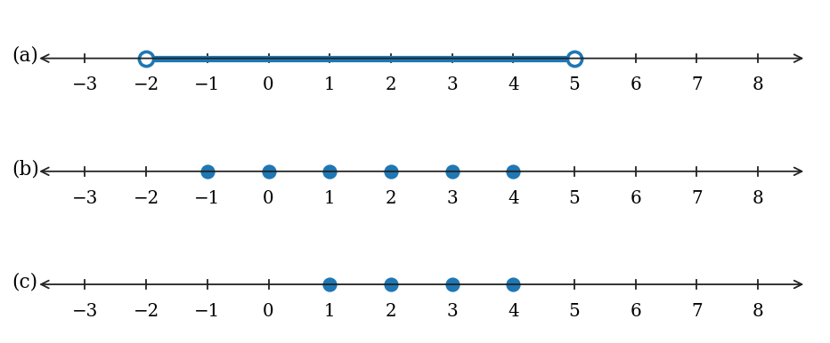

*그림 2. 같은 조건 −2 < x < 5를 실수, 정수, 양의 정수에 적용하여 얻은 세 집합*

> **핵심:** 조건제시법의 집합은 조건 $P(x)$와 원소를 고르는 집합 $S$가 함께 결정한다. 예제 1.2.2의 세 집합은 조건이 같지만 $S$가 달라서 서로 다른 집합이 된다.

### 2.4 부분집합

집합 사이의 가장 기본적인 관계는 부분집합 관계이다.

> **용어 정의:** $A$와 $B$가 집합일 때, $A$의 모든 원소가 $B$의 원소이면 그리고 그때에만 $A$를 $B$의 **부분집합(subset)** 이라 하고 $A \subseteq B$로 쓴다. 기호로는 다음과 같다.
>
> $$A \subseteq B \iff \text{모든 } x \text{에 대해, } x \in A \text{이면 } x \in B$$
>
> $A$가 $B$에 포함된다(contained in), $B$가 $A$를 포함한다(contains)고도 말한다.

부분집합의 정의를 부정하면, $A$가 $B$의 부분집합이 아니라는 것은 $A$의 원소이면서 $B$의 원소가 아닌 것이 적어도 하나 있다는 뜻이다.

$$
A \nsubseteq B \iff x \in A \text{ 이고 } x \notin B \text{ 인 원소 } x \text{ 가 적어도 하나 있다}
$$

> **용어 정의:** $A$와 $B$가 집합일 때, $A$의 모든 원소가 $B$에 속하고 $B$에는 $A$에 속하지 않는 원소가 적어도 하나 있으면 그리고 그때에만 $A$를 $B$의 **진부분집합(proper subset)** 이라 하고 $A \subsetneq B$로 쓴다.

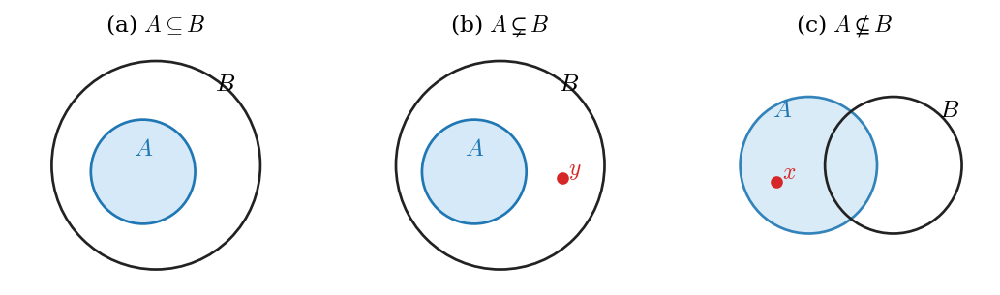

*그림 3. 부분집합, 진부분집합, 부분집합이 아닌 경우*

그림 3의 (b)에서 원소 $y$는 $B$에 속하지만 $A$에 속하지 않으므로 $A$는 $B$의 진부분집합이다. (c)에서 원소 $x$는 $A$에 속하지만 $B$에 속하지 않으므로 $A \nsubseteq B$이다.

> **주의:** 진부분집합을 $A \subset B$로 쓰는 책도 있지만, 같은 기호 $\subset$를 $\subseteq$의 뜻으로 쓰는 책도 있다. 기호를 읽을 때는 그 책의 정의를 먼저 확인해야 한다. 이 장에서는 부분집합을 $\subseteq$, 진부분집합을 $\subsetneq$로 쓴다.

**예제 1.2.3 (부분집합).** $A = \mathbf{Z}^{+}$, $B = \lbrace n \in \mathbf{Z} \mid 0 \le n \le 100 \rbrace$, $C = \lbrace 100, 200, 300, 400, 500 \rbrace$일 때 다음 문장의 참과 거짓을 판정한다.

- (a) $B \subseteq A$: 거짓이다. 0은 $B$에 속하지만 양의 정수가 아니므로 $A$에 속하지 않는다. 따라서 $B \nsubseteq A$이다.
- (b) $C$는 $A$의 진부분집합이다: 참이다. $C$의 각 원소는 양의 정수이므로 $A$에 속하고, 1처럼 $A$에는 속하지만 $C$에는 속하지 않는 원소가 있다.
- (c) $C$와 $B$는 공통 원소를 적어도 하나 가진다: 참이다. 100이 두 집합에 모두 속한다.
- (d) $C \subseteq B$: 거짓이다. 200은 $C$에 속하지만 $B$에 속하지 않는다.
- (e) $C \subseteq C$: 참이다. $C$의 모든 원소는 $C$의 원소이다. 일반적으로 부분집합의 정의에 따라 모든 집합은 자기 자신의 부분집합이다.

(e)와 진부분집합의 정의를 함께 보면, 모든 집합은 자기 자신의 부분집합이지만 어떤 집합도 자기 자신의 진부분집합은 아니다. $A$에 속하지 않는 $A$의 원소는 있을 수 없기 때문이다.

**예제 1.2.4 ($\in$와 $\subseteq$의 구별).** 다음 문장 가운데 참인 것은 (a), (d), (f)뿐이다.

| 문장 | 판정 | 이유 |
|:-----|:-----|:-----|
| (a) $2 \in \lbrace 1, 2, 3 \rbrace$ | 참 | 2는 나열된 원소 가운데 하나이다. |
| (b) $\lbrace 2 \rbrace \in \lbrace 1, 2, 3 \rbrace$ | 거짓 | $\lbrace 1, 2, 3 \rbrace$의 원소는 1, 2, 3뿐이고, 수 2와 집합 $\lbrace 2 \rbrace$는 다르다. |
| (c) $2 \subseteq \lbrace 1, 2, 3 \rbrace$ | 거짓 | 부분집합이 되려면 2가 집합이어야 하고 그 원소가 모두 $\lbrace 1, 2, 3 \rbrace$에 속해야 하는데, 2는 집합이 아니다. |
| (d) $\lbrace 2 \rbrace \subseteq \lbrace 1, 2, 3 \rbrace$ | 참 | $\lbrace 2 \rbrace$의 유일한 원소 2가 $\lbrace 1, 2, 3 \rbrace$에 속한다. |
| (e) $\lbrace 2 \rbrace \subseteq \lbrace \lbrace 1 \rbrace, \lbrace 2 \rbrace \rbrace$ | 거짓 | $\lbrace 2 \rbrace$의 원소 2가 $\lbrace 1 \rbrace$과도 $\lbrace 2 \rbrace$와도 같지 않으므로 오른쪽 집합의 원소가 아니다. |
| (f) $\lbrace 2 \rbrace \in \lbrace \lbrace 1 \rbrace, \lbrace 2 \rbrace \rbrace$ | 참 | 오른쪽 집합의 원소는 $\lbrace 1 \rbrace$과 $\lbrace 2 \rbrace$이며, $\lbrace 2 \rbrace$가 그중 하나이다. |

*표 4. 원소 관계와 부분집합 관계의 판정*

> **주의:** $\in$는 원소와 집합 사이의 관계이고, $\subseteq$는 집합과 집합 사이의 관계이다. $a \in X$인지 볼 때는 $a$가 $X$의 원소 목록에 그대로 있는지 확인하고, $Y \subseteq X$인지 볼 때는 $Y$의 원소 하나하나가 $X$의 원소 목록에 있는지 확인한다.

### 2.5 순서쌍과 순서 n-튜플

19세기 말 칸토어의 집합론이 등장하면서 수학의 모든 분야를 집합과 논리만으로 세울 수 있으리라는 기대가 생겼다. 큰 걸림돌 하나는 순서쌍을 집합으로 정의하는 방법이었다. 집합은 원소를 적는 순서에 영향을 받지 않으므로 $\lbrace a, b \rbrace$와 $\lbrace b, a \rbrace$는 같은 집합이지만, 순서쌍에서는 어느 원소가 먼저인지를 나타낼 수 있어야 하기 때문이다.

1914년 위너(Norbert Wiener)와 하우스도르프(Felix Hausdorff)가 각각 순서쌍을 특정한 형태의 집합으로 정의하는 방법을 내놓았으나 다소 번거로웠다. 1921년 쿠라토프스키(Kazimierz Kuratowski)가 발표한 다음 정의가 이후 표준이 되었다.

$$
(a, b) = \lbrace \lbrace a \rbrace, \lbrace a, b \rbrace \rbrace
$$

이 집합의 원소는 $\lbrace a \rbrace$와 $\lbrace a, b \rbrace$이다. $a \ne b$이면 두 원소는 서로 다른 집합이고, $a$는 두 집합에 모두 들어 있지만 $b$는 한 집합에만 들어 있다. 이 차이로 $a$를 첫째 원소, $b$를 둘째 원소로 구별한다. $a = b$이면 집합은 $\lbrace \lbrace a \rbrace, \lbrace a, a \rbrace \rbrace = \lbrace \lbrace a \rbrace \rbrace$가 되고, $a$가 첫째 원소이자 둘째 원소이다.

이 정의가 순서쌍에 기대하는 성질, 즉 $\lbrace \lbrace a \rbrace, \lbrace a, b \rbrace \rbrace = \lbrace \lbrace c \rbrace, \lbrace c, d \rbrace \rbrace$이면 $a = c$이고 $b = d$라는 성질을 가지는지 단계별로 확인한다. 반대 방향($a = c$이고 $b = d$이면 두 집합이 같다)은 그대로 대입하면 성립한다.

1. **$a = b$인 경우.** 왼쪽 집합은 $\lbrace \lbrace a \rbrace \rbrace$이므로 원소가 하나이다. 오른쪽 집합도 원소가 하나여야 하므로 $\lbrace c \rbrace = \lbrace c, d \rbrace$이고, 따라서 $d = c$이다. 이제 $\lbrace \lbrace a \rbrace \rbrace = \lbrace \lbrace c \rbrace \rbrace$에서 $\lbrace a \rbrace = \lbrace c \rbrace$이므로 $a = c$이다. 결국 $a = b = c = d$이므로 $a = c$이고 $b = d$이다.
2. **$a \ne b$인 경우.** 왼쪽 집합은 원소가 하나인 집합 $\lbrace a \rbrace$와 원소가 둘인 집합 $\lbrace a, b \rbrace$를 원소로 가지므로 원소가 두 개이다. 오른쪽 집합도 원소가 두 개여야 하므로 $c \ne d$이다. 두 집합에서 원소가 하나인 원소끼리 같아야 하므로 $\lbrace a \rbrace = \lbrace c \rbrace$, 즉 $a = c$이다. 또 원소가 둘인 원소끼리 같아야 하므로 $\lbrace a, b \rbrace = \lbrace c, d \rbrace = \lbrace a, d \rbrace$이다. 따라서 $b \in \lbrace a, d \rbrace$인데 $b \ne a$이므로 $b = d$이다.

두 경우 모두 $a = c$이고 $b = d$이므로, 쿠라토프스키의 정의는 순서를 구별한다. 다만 순서쌍이 집합만으로 정의된다는 사실이 알려진 것은 순서쌍이 수학에서 널리 쓰인 지 오래 지난 뒤였고, 매번 집합 표기를 쓰기는 번거로우므로 보통은 $\lbrace \lbrace a \rbrace, \lbrace a, b \rbrace \rbrace$를 간단히 $(a, b)$로 쓴다.

> **용어 정의:** 원소 $a$와 $b$가 주어질 때 $(a, b)$는 $a$가 **첫째 원소(first element)**, $b$가 **둘째 원소(second element)** 라는 순서를 지정하여 $a$와 $b$로 이루어진 **순서쌍(ordered pair)** 을 나타낸다. 두 순서쌍 $(a, b)$와 $(c, d)$는 $a = c$이고 $b = d$일 때 그리고 그때에만 같다.
>
> $$(a, b) = (c, d) \iff a = c \text{ 이고 } b = d$$

**예제 1.2.5 (순서쌍).**

- (a) $(1, 2) = (2, 1)$인가? 아니다. 순서쌍의 상등 정의에 따라 $(1, 2) = (2, 1)$은 $1 = 2$이고 $2 = 1$일 때에만 성립하는데, $1 \ne 2$이다.
- (b) $\left(3, \frac{5}{10}\right) = \left(\sqrt{9}, \frac{1}{2}\right)$인가? 그렇다. 두 순서쌍은 $3 = \sqrt{9}$이고 $\frac{5}{10} = \frac{1}{2}$일 때에만 같은데, $\sqrt{9} = 3$이고 $\frac{5}{10} = \frac{1}{2}$이므로 두 등식이 모두 참이다.
- (c) $(1, 1)$의 첫째 원소는 무엇인가? 1이다. 첫째 원소와 둘째 원소가 모두 1이다.

순서 n-튜플은 순서쌍의 표기를 유한 개의 원소로 일반화한 것이며, 순서와 중복을 모두 고려한다.

> **용어 정의:** $n$이 양의 정수이고 $x_1, x_2, \ldots, x_n$이 서로 다를 필요가 없는 원소일 때, **순서 n-튜플(ordered n-tuple)** $(x_1, x_2, \ldots, x_n)$은 $x_1, x_2, \ldots, x_n$과 함께 처음은 $x_1$, 다음은 $x_2$, 이런 식으로 마지막은 $x_n$이라는 순서로 이루어진다. 순서 2-튜플을 순서쌍, 순서 3-튜플을 **순서 삼중쌍(ordered triple)** 이라 한다. 두 순서 n-튜플은 대응하는 성분이 모두 같을 때 그리고 그때에만 같다.
>
> $$(x_1, x_2, \ldots, x_n) = (y_1, y_2, \ldots, y_n) \iff x_1 = y_1,\ x_2 = y_2,\ \ldots,\ x_n = y_n$$

**예제 1.2.6 (순서 n-튜플).**

- (a) $(1, 2, 3, 4) = (1, 2, 4, 3)$인가? 아니다. 두 순서 4-튜플이 같으려면 $1 = 1$, $2 = 2$, $3 = 4$, $4 = 3$이 모두 성립해야 하는데, $3 \ne 4$이다.
- (b) $\left(3, (-2)^2, \frac{1}{2}\right) = \left(\sqrt{9}, 4, \frac{3}{6}\right)$인가? 그렇다. $3 = \sqrt{9}$, $(-2)^2 = 4$, $\frac{1}{2} = \frac{3}{6}$이 모두 참이다.

> **주의:** 집합과 순서 n-튜플은 순서와 중복을 다르게 다룬다. $\lbrace 1, 2, 1 \rbrace = \lbrace 1, 1, 2 \rbrace = \lbrace 1, 2 \rbrace$이지만, $(1, 2, 1)$과 $(1, 1, 2)$는 둘째 성분이 다르므로 서로 다른 순서 삼중쌍이다.

### 2.6 데카르트 곱

> **용어 정의:** 집합 $A_1, A_2, \ldots, A_n$이 주어질 때, $A_1, A_2, \ldots, A_n$의 **데카르트 곱(Cartesian product)** $A_1 \times A_2 \times \cdots \times A_n$은 $a_1 \in A_1$, $a_2 \in A_2$, $\ldots$, $a_n \in A_n$인 순서 n-튜플 $(a_1, a_2, \ldots, a_n)$ 전체의 집합이다.
>
> $$A_1 \times A_2 \times \cdots \times A_n = \lbrace (a_1, a_2, \ldots, a_n) \mid a_1 \in A_1,\ a_2 \in A_2,\ \ldots,\ a_n \in A_n \rbrace$$
>
> 특히 $A_1 \times A_2 = \lbrace (a_1, a_2) \mid a_1 \in A_1 \text{ 이고 } a_2 \in A_2 \rbrace$를 $A_1$과 $A_2$의 데카르트 곱이라 한다.

**예제 1.2.7 (데카르트 곱).** $A = \lbrace x, y \rbrace$, $B = \lbrace 1, 2, 3 \rbrace$, $C = \lbrace a, b \rbrace$라 한다. 여기서 $x$, $y$, $a$, $b$는 변수가 아니라 서로 다른 기호 자체를 원소로 쓴 것이다.

(a) 첫째 성분을 $A$에서, 둘째 성분을 $B$에서 고른다.

$$
A \times B = \lbrace (x, 1), (y, 1), (x, 2), (y, 2), (x, 3), (y, 3) \rbrace
$$

(b) 순서를 바꾸면 첫째 성분이 $B$에서 온다.

$$
B \times A = \lbrace (1, x), (1, y), (2, x), (2, y), (3, x), (3, y) \rbrace
$$

(c) 같은 집합끼리의 곱도 정의된다.

$$
A \times A = \lbrace (x, x), (x, y), (y, x), (y, y) \rbrace
$$

(d) $A \times B$의 원소는 6개로, $A$의 원소 수 2와 $B$의 원소 수 3의 곱이다. $B \times A$도 $3 \times 2 = 6$개, $A \times A$는 $2 \times 2 = 4$개이다. 데카르트 곱을 곱이라 부르는 이유가 여기에 있으며, 이 계수 원리는 9장의 곱의 법칙으로 일반화된다.

(e) $A \times B$도 집합이므로 다른 데카르트 곱의 재료가 될 수 있다. $(A \times B) \times C$는 첫째 성분이 $A \times B$의 원소, 즉 순서쌍인 순서쌍 전체의 집합이다.

$$
\begin{aligned}
(A \times B) \times C &= \lbrace (u, v) \mid u \in A \times B \text{ and } v \in C \rbrace \\
&= \lbrace ((x, 1), a), ((x, 2), a), ((x, 3), a), ((y, 1), a), ((y, 2), a), ((y, 3), a), \\
&\qquad ((x, 1), b), ((x, 2), b), ((x, 3), b), ((y, 1), b), ((y, 2), b), ((y, 3), b) \rbrace
\end{aligned}
$$

(f) $A \times B \times C$는 겉보기에 $(A \times B) \times C$와 비슷하지만 같은 수학적 대상이 아니다. $(A \times B) \times C$는 한 성분이 다시 순서쌍인 순서쌍의 집합이고, $A \times B \times C$는 순서 삼중쌍의 집합이다.

$$
\begin{aligned}
A \times B \times C &= \lbrace (u, v, w) \mid u \in A,\ v \in B, \text{ and } w \in C \rbrace \\
&= \lbrace (x, 1, a), (x, 2, a), (x, 3, a), (y, 1, a), (y, 2, a), (y, 3, a), \\
&\qquad (x, 1, b), (x, 2, b), (x, 3, b), (y, 1, b), (y, 2, b), (y, 3, b) \rbrace
\end{aligned}
$$

두 집합은 모두 원소가 $2 \times 3 \times 2 = 12$개이지만, 예를 들어 $((x, 1), a)$는 순서쌍이고 $(x, 1, a)$는 순서 삼중쌍이므로 서로 다른 원소이다.

(g) $\mathbf{R} \times \mathbf{R}$은 $x$와 $y$가 모두 실수인 순서쌍 $(x, y)$ 전체의 집합이다. 평면에 가로축과 세로축을 그리고 단위 길이를 정하면, $\mathbf{R} \times \mathbf{R}$의 각 순서쌍은 평면 위의 점 하나에 대응한다. 첫째 성분은 점의 가로 위치를, 둘째 성분은 세로 위치를 나타낸다. 이런 좌표계를 갖춘 평면을 **데카르트 평면(Cartesian plane)** 이라 한다.

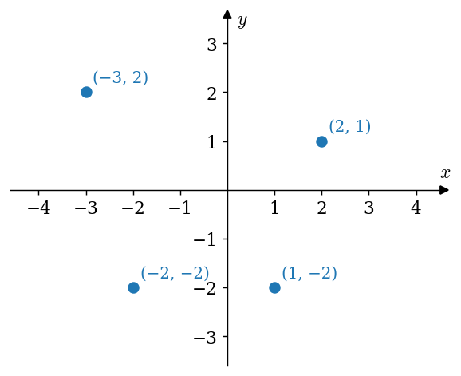

*그림 4. 네 순서쌍을 점으로 나타낸 데카르트 평면*

> **주의:** 일반적으로 $A \times B \ne B \times A$이다. 예제 1.2.7에서 $(x, 1) \in A \times B$이지만 $(x, 1) \notin B \times A$이다. $B \times A$의 원소는 첫째 성분이 수이기 때문이다.

### 2.7 문자열

수학과 컴퓨터 과학 모두에서 중요한 또 하나의 표기는 문자열이다.

> **용어 정의:** $n$이 양의 정수이고 $A$가 유한 집합일 때, **$A$ 위의 길이 $n$인 문자열(string of length n over A)** 은 $A$의 원소로 이루어진 순서 n-튜플을 괄호와 쉼표 없이 쓴 것이다. $A$의 원소를 문자열의 **문자(character)** 라 한다. $A$ 위의 **빈 문자열(null string)** 은 문자가 하나도 없는 문자열이며, 흔히 $\lambda$로 나타내고 길이를 0으로 본다. $A = \lbrace 0, 1 \rbrace$이면 $A$ 위의 문자열을 **비트 문자열(bit string)** 이라 한다.

예를 들어 순서 삼중쌍 $(a, b, a)$를 문자열로 쓰면 $aba$이고, 길이는 3이다. $0110$은 길이가 4인 비트 문자열이다.

**예제 1.2.8 (문자열).** $A = \lbrace a, b \rbrace$일 때, $A$ 위의 길이 3인 문자열 가운데 같은 문자가 적어도 두 번 나오는 것을 모두 나열한다. 답은 다음 8개이다.

$$
aab,\ aba,\ baa,\ aaa,\ bba,\ bab,\ abb,\ bbb
$$

$A$ 위의 길이 3인 문자열은 각 자리에 $a$나 $b$를 넣으므로 모두 $2 \times 2 \times 2 = 8$개이다. 즉 이 조건을 만족하는 문자열은 길이 3인 문자열 전부이다. 문자가 두 종류뿐인데 자리가 세 개이므로 어떤 두 자리는 반드시 같은 문자를 가지기 때문이며, 이 논법은 9장의 비둘기집 원리이다.

컴퓨터 프로그래밍에서 자료 구조의 종류를 구별하고 각 구조의 표기를 지키는 것이 중요하듯이, 수학에서도 다음 대상들을 구별하는 것이 중요하다.

| 표기 | 대상 | 설명 |
|:-----|:-----|:-----|
| $\lbrace a, b, c \rbrace$ | 집합 | 원소가 $a$, $b$, $c$의 세 개이며 순서가 없다. |
| $\lbrace \lbrace a, b \rbrace, c \rbrace$ | 집합 | 원소가 $\lbrace a, b \rbrace$와 $c$의 두 개이다. |
| $(a, b, c)$ | 순서 삼중쌍 | 성분이 차례로 $a$, $b$, $c$이다. |
| $(a, (b, c))$ | 순서쌍 | 첫째 원소는 $a$이고, 둘째 원소는 순서쌍 $(b, c)$이다. |
| $abc$ | 문자열 | $\lbrace a, b, c \rbrace$ 위의 길이 3인 문자열이다. |

*표 5. 비슷해 보이지만 서로 다른 수학적 대상*

> **[계산이론]** 계산이론에서는 유한 집합을 알파벳(alphabet)이라 부르고, 알파벳 위의 문자열의 집합을 언어(language)라 한다. 오토마타와 문법은 주어진 문자열이 어떤 언어에 속하는지 판정하거나 그 언어의 문자열을 생성하는 장치이며, 이 모든 논의가 여기서 정의한 문자열에서 출발한다.

---

 

## 3. 관계와 함수의 언어

### 3.1 관계의 직관적 의미

세상에는 여러 종류의 관계가 있다. 두 사람이 공통 조상을 가지면 혈연관계라 하고, 한 사람이 다른 사람의 배우자와 공통 조상을 가지면 혼인으로 맺어진 관계라 한다. 학생과 교사의 관계, 같은 고용주를 둔 사람들의 관계도 있다.

수학의 대상도 여러 방식으로 관계를 맺는다. 집합 $A$와 $B$는 $A$가 $B$의 부분집합이라는 관계, 부분집합이 아니라는 관계, 공통 원소를 적어도 하나 가진다는 관계로 이어질 수 있다. 수 $x$와 $y$는 $x < y$라는 관계, $x$가 $y$의 약수라는 관계, $x^2 + y^2 = 1$이라는 관계로 이어질 수 있다. 프로그램의 두 식별자는 처음 여덟 글자가 같다는 관계나, 실행할 때 같은 메모리 위치에 값이 저장된다는 관계로 이어질 수 있다.

구체적인 예로 $A = \lbrace 0, 1, 2 \rbrace$, $B = \lbrace 1, 2, 3 \rbrace$이라 하고, $A$의 원소 $x$와 $B$의 원소 $y$는 $x < y$일 때 그리고 그때에만 관계가 있다고 정한다. $x$가 $y$와 관계가 있다는 문장을 줄여서 $x \mathrel{R} y$로 쓰면 다음이 성립한다.

$$
0 \mathrel{R} 1,\quad 0 \mathrel{R} 2,\quad 0 \mathrel{R} 3,\quad 1 \mathrel{R} 2,\quad 1 \mathrel{R} 3,\quad 2 \mathrel{R} 3
$$

각각 $0 < 1$, $0 < 2$, $0 < 3$, $1 < 2$, $1 < 3$, $2 < 3$이기 때문이다. 반대로 $x$가 $y$와 관계가 없다는 문장을 $x \not\mathrel{R} y$로 쓰면 $1 \not\mathrel{R} 1$, $2 \not\mathrel{R} 1$, $2 \not\mathrel{R} 2$이다. $1 \not< 1$, $2 \not< 1$, $2 \not< 2$이기 때문이다.

2.6절에서 본 것처럼 $A \times B = \lbrace (x, y) \mid x \in A \text{ 이고 } y \in B \rbrace$이며, 이 경우 원소는 $3 \times 3 = 9$개이다. 그중 두 성분이 관계를 맺는 순서쌍을 표시하면 다음과 같다.

| $x \backslash y$ | 1 | 2 | 3 |
|:-----|:-----|:-----|:-----|
| 0 | $(0, 1)$: 관계 있음 | $(0, 2)$: 관계 있음 | $(0, 3)$: 관계 있음 |
| 1 | $(1, 1)$: 관계 없음 | $(1, 2)$: 관계 있음 | $(1, 3)$: 관계 있음 |
| 2 | $(2, 1)$: 관계 없음 | $(2, 2)$: 관계 없음 | $(2, 3)$: 관계 있음 |

*표 6. A × B의 순서쌍과 관계 x < y의 성립 여부*

두 성분이 관계를 맺는 순서쌍만 모으면 다음 집합이 된다.

$$
\lbrace (0, 1), (0, 2), (0, 3), (1, 2), (1, 3), (2, 3) \rbrace
$$

어떤 순서쌍이 이 집합에 속하는지 아는 것은 어떤 원소가 어떤 원소와 관계를 맺는지 아는 것과 같다. 따라서 관계 자체를 주어진 조건으로 관계를 맺는 순서쌍 전체의 모임으로 생각할 수 있다. 이 생각에 바탕을 둔 관계의 형식적 정의는 19세기 미국의 수학자이자 논리학자 퍼스(C. S. Peirce)가 도입하였다.

### 3.2 관계의 정의

> **용어 정의:** $A$와 $B$가 집합일 때, $A$에서 $B$로의 **관계(relation)** $R$은 $A \times B$의 부분집합이다. $A \times B$의 순서쌍 $(x, y)$에 대해, $(x, y)$가 $R$에 속할 때 그리고 그때에만 $x$가 $R$에 의해 $y$와 관계가 있다고 하고 $x \mathrel{R} y$로 쓴다. 집합 $A$를 $R$의 **정의역(domain)**, 집합 $B$를 $R$의 **공역(co-domain)** 이라 한다.
>
> $$x \mathrel{R} y \iff (x, y) \in R, \qquad x \not\mathrel{R} y \iff (x, y) \notin R$$

**예제 1.3.1 (부분집합으로서의 관계).** $A = \lbrace 1, 2 \rbrace$, $B = \lbrace 1, 2, 3 \rbrace$이라 하고, $A \times B$의 순서쌍 $(x, y)$에 대해 다음과 같이 관계 $R$을 정의한다.

$$
(x, y) \in R \iff \frac{x - y}{2} \text{ 가 정수이다}
$$

(a) $A \times B = \lbrace (1, 1), (1, 2), (1, 3), (2, 1), (2, 2), (2, 3) \rbrace$이다. $R$의 원소를 구하려면 $A \times B$의 각 순서쌍이 정의 조건을 만족하는지 확인한다.

| 순서쌍 $(x, y)$ | $\frac{x - y}{2}$ | 정수인가 | $R$에 속하는가 |
|:-----|:-----|:-----|:-----|
| $(1, 1)$ | $\frac{0}{2} = 0$ | 예 | $(1, 1) \in R$ |
| $(1, 2)$ | $\frac{-1}{2}$ | 아니오 | $(1, 2) \notin R$ |
| $(1, 3)$ | $\frac{-2}{2} = -1$ | 예 | $(1, 3) \in R$ |
| $(2, 1)$ | $\frac{1}{2}$ | 아니오 | $(2, 1) \notin R$ |
| $(2, 2)$ | $\frac{0}{2} = 0$ | 예 | $(2, 2) \in R$ |
| $(2, 3)$ | $\frac{-1}{2}$ | 아니오 | $(2, 3) \notin R$ |

*표 7. 예제 1.3.1의 관계 R에 속하는 순서쌍의 판정*

따라서 $R = \lbrace (1, 1), (1, 3), (2, 2) \rbrace$이다.

(b) $(1, 3) \in R$이므로 $1 \mathrel{R} 3$이다. $(2, 3) \notin R$이므로 $2 \not\mathrel{R} 3$이다. $(2, 2) \in R$이므로 $2 \mathrel{R} 2$이다.

(c) $R$의 정의역은 $\lbrace 1, 2 \rbrace$이고 공역은 $\lbrace 1, 2, 3 \rbrace$이다.

$\frac{x - y}{2}$가 정수라는 것은 $x - y$가 짝수라는 것, 즉 $x$와 $y$가 둘 다 홀수이거나 둘 다 짝수라는 것과 같다. 이렇게 보면 $R$에 속하는 세 순서쌍을 표 7 없이도 바로 찾을 수 있다.

**예제 1.3.2 (원 관계).** $\mathbf{R}$에서 $\mathbf{R}$로의 관계 $C$를 다음과 같이 정의한다. 임의의 $(x, y) \in \mathbf{R} \times \mathbf{R}$에 대해

$$
(x, y) \in C \iff x^2 + y^2 = 1.
$$

(a) 여러 순서쌍이 $C$에 속하는지 판정한다. $x \mathrel{C} y$는 $(x, y) \in C$와 같은 뜻이다.

| 질문 | 계산 | 판정 |
|:-----|:-----|:-----|
| $(1, 0) \in C$? | $1^2 + 0^2 = 1$ | 예 |
| $(0, 0) \in C$? | $0^2 + 0^2 = 0 \ne 1$ | 아니오 |
| $\left(-\frac{1}{2}, \frac{\sqrt{3}}{2}\right) \in C$? | $\left(-\frac{1}{2}\right)^2 + \left(\frac{\sqrt{3}}{2}\right)^2 = \frac{1}{4} + \frac{3}{4} = 1$ | 예 |
| $-2 \mathrel{C} 0$? | $(-2)^2 + 0^2 = 4 \ne 1$ | 아니오, $-2 \not\mathrel{C} 0$ |
| $0 \mathrel{C} (-1)$? | $0^2 + (-1)^2 = 1$ | 예 |
| $1 \mathrel{C} 1$? | $1^2 + 1^2 = 2 \ne 1$ | 아니오, $1 \not\mathrel{C} 1$ |

*표 8. 원 관계 C에 대한 판정*

(b) $C$의 정의역과 공역은 모두 실수 전체의 집합 $\mathbf{R}$이다.

(c) $C$의 점을 데카르트 평면에 모두 찍으면 원점이 중심이고 반지름이 1인 원이 된다.

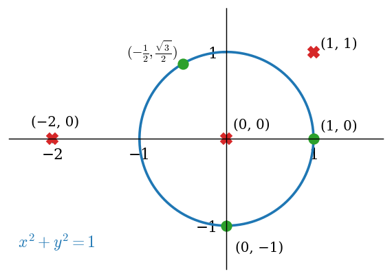

*그림 5. 원 관계 C의 그래프인 단위원과 판정한 여섯 순서쌍*

그림 5에서 원 위의 초록색 점은 $C$에 속하는 순서쌍이고, 빨간색 X 표시는 $C$에 속하지 않는 순서쌍이다.

> **주의:** 관계의 정의역은 관계를 정의할 때 정한 첫째 집합 전체이다. 예를 들어 $x = 2$에 대해서는 $2^2 + y^2 = 1$을 만족하는 실수 $y$가 없으므로 2는 어떤 원소와도 관계를 맺지 않지만, 그래도 $C$의 정의역은 $\mathbf{R}$이다. 미적분학에서 식이 정의되는 범위를 정의역이라 부르는 것과 혼동하지 않아야 한다.

### 3.3 관계의 화살표 도표

관계 $R$이 집합 $A$에서 집합 $B$로의 관계일 때, $R$의 **화살표 도표(arrow diagram)** 는 다음과 같이 그린다.

1. $A$의 원소를 한 영역 안의 점으로, $B$의 원소를 다른 영역 안의 점으로 나타낸다.
2. $A$의 각 원소 $x$와 $B$의 각 원소 $y$에 대해, $x$가 $R$에 의해 $y$와 관계가 있을 때 그리고 그때에만 $x$에서 $y$로 화살표를 그린다.

$$
x \text{ 에서 } y \text{ 로 화살표를 그린다} \iff x \mathrel{R} y \iff (x, y) \in R
$$

3.1절의 관계 $x < y$를 화살표 도표로 그리면 그림 6과 같다.

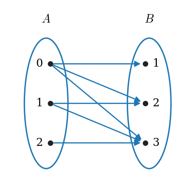

*그림 6. A = {0, 1, 2}에서 B = {1, 2, 3}으로의 관계 x < y의 화살표 도표*

**예제 1.3.3 (관계의 화살표 도표).** $A = \lbrace 1, 2, 3 \rbrace$, $B = \lbrace 1, 3, 5 \rbrace$라 하고, $A$에서 $B$로의 관계 $S$와 $T$를 다음과 같이 정의한다. 모든 $(x, y) \in A \times B$에 대해

$$
(x, y) \in S \iff x < y, \qquad T = \lbrace (2, 1), (2, 5) \rbrace.
$$

$S$는 보다 작다는 관계이다. $A \times B$의 아홉 순서쌍 가운데 $x < y$인 것은 $(1, 3)$, $(1, 5)$, $(2, 3)$, $(2, 5)$, $(3, 5)$의 다섯 개이므로 $S = \lbrace (1, 3), (1, 5), (2, 3), (2, 5), (3, 5) \rbrace$이다. $(1, 1)$은 $1 < 1$이 거짓이고 $(2, 1)$과 $(3, 1)$은 $2 < 1$, $3 < 1$이 거짓이며 $(3, 3)$은 $3 < 3$이 거짓이므로 $S$에 속하지 않는다.

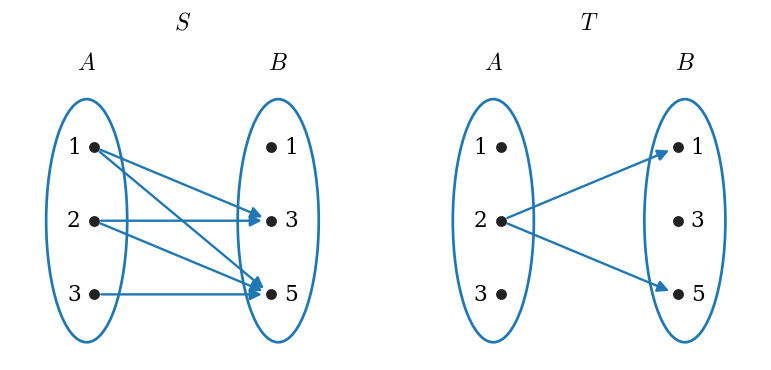

*그림 7. 예제 1.3.3의 관계 S와 T의 화살표 도표*

두 관계는 $A$의 한 원소에서 여러 화살표가 서로 다른 방향으로 나갈 수 있음을 보여 준다($S$의 1, 2와 $T$의 2). 또 $A$의 원소 가운데 화살표가 하나도 나가지 않는 것이 있을 수 있다($T$의 1과 3).

### 3.4 함수

2.5절에서 순서쌍을 집합으로 정의했고, 2.6절에서 데카르트 곱을 순서쌍으로 정의했으며, 3.2절에서 관계를 데카르트 곱의 부분집합으로 정의하였다. 따라서 이제 함수를 집합이라는 개념에만 기대어 정의할 수 있다. 이 정의는 평소 함수를 다루는 방식과 바로 연결되어 보이지 않지만, 이론적으로 만족스럽고 컴퓨터에서 함수를 다루기에도 알맞아 컴퓨터 과학에서 특히 선호된다.

> **용어 정의:** 집합 $A$에서 집합 $B$로의 **함수(function)** $F$는 정의역이 $A$이고 공역이 $B$인 관계로서 다음 두 성질을 만족하는 것이다.
>
> 1. $A$의 모든 원소 $x$에 대해, $(x, y) \in F$인 $B$의 원소 $y$가 있다.
> 2. $A$의 모든 원소 $x$와 $B$의 모든 원소 $y$, $z$에 대해, $(x, y) \in F$이고 $(x, z) \in F$이면 $y = z$이다.

두 성질을 덜 형식적으로 말하면, $A$에서 $B$로의 관계 $F$가 함수일 필요충분조건은 다음과 같다.

1. $A$의 모든 원소가 $F$의 어떤 순서쌍의 첫째 원소이다.
2. $F$의 서로 다른 두 순서쌍이 같은 첫째 원소를 가지지 않는다.

대부분의 수학적 상황에서 함수는 한 집합(정의역)의 원소를 다른 집합(공역)의 원소로 보내는 것으로 생각한다. $F$가 $A$에서 $B$로의 함수이면, $A$의 원소 $x$가 주어질 때 성질 1은 $x$와 관계를 맺는 $B$의 원소가 적어도 하나 있음을 보장하고, 성질 2는 그런 원소가 많아야 하나임을 보장한다. 따라서 정의역의 각 원소는 공역의 원소 하나에 정확히 대응하며, 그 원소에 특별한 이름을 붙일 수 있다.

> **용어 정의:** $F$가 $A$에서 $B$로의 함수이면, $A$의 원소 $x$에 대해 $F$에 의해 $x$와 관계를 맺는 $B$의 유일한 원소를 $F(x)$로 나타내고 "$F$ of $x$"라 읽는다. 즉 $x \mathrel{F} y \iff y = F(x)$이다.

**예제 1.3.4 (유한 집합 위의 함수와 관계).** $A = \lbrace 2, 4, 6 \rbrace$, $B = \lbrace 1, 3, 5 \rbrace$일 때, 다음 관계 $R$, $S$, $T$ 가운데 $A$에서 $B$로의 함수인 것을 찾는다.

- (a) $R = \lbrace (2, 5), (4, 1), (4, 3), (6, 5) \rbrace$
- (b) 모든 $(x, y) \in A \times B$에 대해 $(x, y) \in S \iff y = x + 1$
- (c) $T$는 그림 8의 오른쪽 화살표 도표로 정의된다. 즉 $T = \lbrace (2, 5), (4, 1), (6, 1) \rbrace$이다.

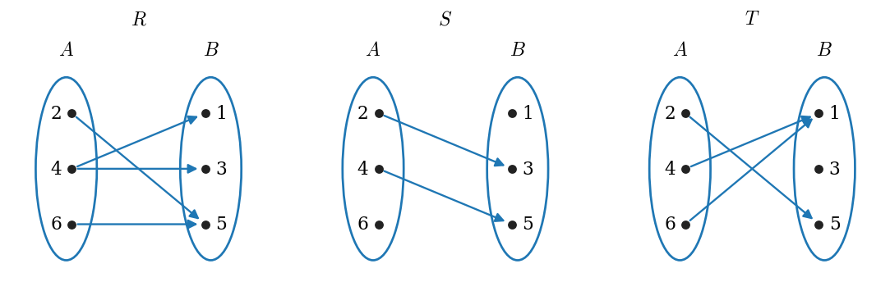

*그림 8. 예제 1.3.4의 관계 R, S, T의 화살표 도표*

- (a) $R$은 함수가 아니다. 성질 2를 만족하지 않기 때문이다. 순서쌍 $(4, 1)$과 $(4, 3)$은 첫째 원소가 같고 둘째 원소가 다르다. 화살표 도표에서는 4에서 화살표가 두 개 나가 하나는 1을, 다른 하나는 3을 가리킨다.
- (b) $S$는 함수가 아니다. 성질 1을 만족하지 않기 때문이다. $2 + 1 = 3 \in B$이고 $4 + 1 = 5 \in B$이므로 $S = \lbrace (2, 3), (4, 5) \rbrace$이다. 그런데 $6 \in A$에 대해 $y = 6 + 1 = 7$인 $y$가 $B$에 없으므로 6은 $S$의 어떤 순서쌍의 첫째 원소도 아니다. 화살표 도표에서는 6에서 나가는 화살표가 없다.
- (c) $T$는 함수이다. $\lbrace 2, 4, 6 \rbrace$의 각 원소는 $\lbrace 1, 3, 5 \rbrace$의 어떤 원소와 관계를 맺고, 어떤 원소도 둘 이상의 원소와 관계를 맺지 않는다. 따라서 $T(2) = 5$, $T(4) = 1$, $T(6) = 1$로 쓸 수 있다.

두 성질을 화살표 도표의 말로 바꾸면 다음과 같다.

1. 정의역의 각 원소에서 화살표가 나간다.
2. 정의역의 어떤 원소에서도 화살표가 둘 이상 나가지 않는다.

> **주의:** 함수의 조건은 정의역 쪽에만 걸린다. (c)에서 $T(4) = T(6) = 1$인 것처럼 정의역의 여러 원소가 공역의 같은 원소로 가도 되고, 공역의 3처럼 화살표가 하나도 들어오지 않는 원소가 있어도 된다. 함숫값 전체의 집합 $\lbrace 1, 5 \rbrace$를 함수의 **치역(range)** 이라 하며, 치역은 공역과 다를 수 있다. 치역은 7장에서 정확히 정의한다.

**예제 1.3.5 (문자열 집합 위의 함수와 관계).** $A = \lbrace a, b \rbrace$이고 $S$가 $A$ 위의 문자열 전체의 집합이라 한다.

(a) $S$에서 $\mathbf{Z}^{\text{nonneg}}$로의 관계 $L$을 다음과 같이 정의한다. $S$의 모든 문자열 $s$와 모든 음이 아닌 정수 $n$에 대해, $(s, n) \in L$은 $s$의 길이가 $n$이라는 뜻이다. 모든 문자열은 길이를 정확히 하나 가지므로 $L$은 함수이다. $abaaba$는 문자가 6개이므로 $L(abaaba) = 6$이고, $L(bbb) = 3$이다.

(b) $S$에서 $S$로의 관계 $C$를 다음과 같이 정의한다. $S$의 모든 문자열 $s$와 $t$에 대해, $(s, t) \in C$는 $t = as$라는 뜻이다. 여기서 $as$는 $s$의 문자들 왼쪽에 $a$를 덧붙여 얻은 문자열이며, $C$를 왼쪽에서 $a$를 **연결(concatenation)** 하는 함수라 한다. $S$의 문자열은 $a$와 $b$로만 이루어지고 왼쪽에 $a$를 하나 더 붙여도 여전히 $a$와 $b$로만 이루어진 문자열이므로, 결과는 다시 $S$에 속하고 유일하게 정해진다. 따라서 $C$는 함수이다. $C(abaaba) = aabaaba$이고 $C(bbb) = abbb$이다.

> **[데이터베이스]** 관계형 데이터베이스의 관계(테이블)는 각 열이 가질 수 있는 값의 집합 $D_1, \ldots, D_n$의 데카르트 곱 $D_1 \times \cdots \times D_n$의 부분집합이며, 테이블의 각 행이 순서 n-튜플 하나이다. 여기서 정의한 이항 관계는 $n = 2$인 경우이며, n항 관계는 8장에서 다룬다.

### 3.5 함수 기계와 식으로 정의된 함수

함수를 하나의 기계로 생각하면 편리하다. $f$가 $X$에서 $Y$로의 함수이고 $X$의 입력 $x$가 주어지면, $f$는 $x$를 일정한 방식으로 처리하여 출력 $f(x)$를 만들어 내는 기계로 볼 수 있다. 이를 **함수 기계(function machine)** 라 한다.

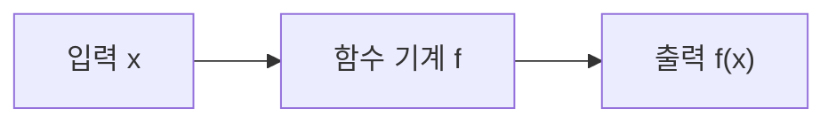

*그림 9. 입력 x를 처리하여 출력 f(x)를 내는 함수 기계*

**예제 1.3.6 (식으로 정의된 함수).**

- **제곱 함수(squaring function)** $f$는 모든 실수 $x$에 대해 $f(x) = x^2$으로 정의되는 $\mathbf{R}$에서 $\mathbf{R}$로의 함수이다. 어떤 실수를 $x$에 넣든 출력은 그 수의 제곱이다. 이를 $f(\square) = \square^2$처럼 쓸 수도 있고, $f$가 각 실수 $x$를 $x^2$으로 보낸다는 뜻으로 $f: x \mapsto x^2$이라 쓰기도 한다. 예를 들어 $f(-3) = 9$, $f(0.5) = 0.25$이다.
- **후속자 함수(successor function)** $g$는 $g(n) = n + 1$로 정의되는 $\mathbf{Z}$에서 $\mathbf{Z}$로의 함수이다. 어떤 정수를 넣든 출력은 그 수에 1을 더한 값이며, $g: n \mapsto n + 1$로 쓴다. 예를 들어 $g(-3) = -2$, $g(99) = 100$이다.
- **상수 함수(constant function)** 의 예로, 모든 유리수 $r$에 대해 $h(r) = 2$로 정의되는 $\mathbf{Q}$에서 $\mathbf{Z}$로의 함수 $h$가 있다. 어떤 입력이든 출력은 언제나 2이며, $h: r \mapsto 2$로 쓴다. 예를 들어 $h\left(\frac{1}{2}\right) = 2$, $h(-7) = 2$이다.

식 $f(x) = x^2$에서 $x$는 **더미 변수(dummy variable)** 이다. $x$가 나오는 모든 자리를 똑같이 바꾸기만 하면 다른 어떤 기호를 써도 같은 함수를 나타낸다. 예를 들어 $f(t) = t^2$도 같은 함수이다.

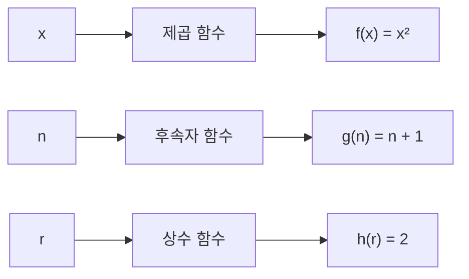

*그림 10. 제곱 함수, 후속자 함수, 상수 함수의 함수 기계*

함수는 그 자체로 하나의 독립된 대상이다. 집합 사이의 일정한 관계로 볼 수도 있고, 일정한 규칙에 따라 작동하는 입출력 기계로 볼 수도 있다. 그래서 함수는 보통 $f$, $G$, $\log$, $\sin$처럼 기호 하나나 기호의 문자열 하나로 나타낸다.

### 3.6 함수의 상등

관계는 데카르트 곱의 부분집합이고 함수는 특별한 종류의 관계이다. 구체적으로 $f$와 $g$가 집합 $A$에서 집합 $B$로의 함수이면 다음이 성립한다.

$$
f = \lbrace (x, y) \in A \times B \mid y = f(x) \rbrace, \qquad g = \lbrace (x, y) \in A \times B \mid y = g(x) \rbrace
$$

두 함수가 같다는 것은 두 집합이 같다는 것이므로, 다음 상등 조건을 얻는다.

$$
f = g \iff A \text{ 의 모든 } x \text{ 에 대해 } f(x) = g(x)
$$

**예제 1.3.7 (함수의 상등).** $\mathbf{R}$에서 $\mathbf{R}$로의 함수 $f$와 $g$를 모든 $x \in \mathbf{R}$에 대해 다음과 같이 정의한다.

$$
f(x) = |x|, \qquad g(x) = \sqrt{x^2}
$$

$f = g$이다. 실수의 절댓값은 그 수의 제곱의 제곱근과 같기 때문이다. 기호 $\sqrt{\ }$는 음이 아닌 제곱근을 뜻한다는 점을 써서 경우를 나누어 확인한다.

1. $x \ge 0$이면 $x$는 음이 아니고 $x^2$의 제곱근이므로 $\sqrt{x^2} = x = |x|$이다.
2. $x < 0$이면 $-x > 0$이고 $(-x)^2 = x^2$이므로 $\sqrt{x^2} = -x$이며, 절댓값의 정의에 따라 $|x| = -x$이다. 따라서 $\sqrt{x^2} = |x|$이다.

예를 들어 $x = -3$이면 $f(-3) = |-3| = 3$이고 $g(-3) = \sqrt{9} = 3$이다. 모든 $x \in \mathbf{R}$에 대해 $f(x) = g(x)$이므로 $f = g$이다.

> **주의:** 함수의 상등은 식의 모양이 아니라 정의역의 모든 원소에서의 값으로 판정한다. 예제 1.3.7처럼 식이 달라 보여도 같은 함수일 수 있다. 또 이 상등 조건은 정의역과 공역이 같은 두 함수에 대해 말하는 것이다.

---

 

## 4. 그래프의 언어

### 4.1 그래프의 직관적 의미

어떤 조직이 몇 가지 과제를 맡을 세 명씩의 팀을 꾸리려 한다. 각 팀에 전에 함께 일해 본 경험이 있는 사람을 최대한 많이 두기 위해, 구성원들에게 이전 협업 상대의 이름을 받았다.

| 이름 | 이전 협업 상대 |
|:-----|:-----|
| Ana | Dan, Flo |
| Bev | Cai, Flo, Hal |
| Cai | Bev, Flo |
| Dan | Ana, Ed |
| Ed | Dan, Hal |
| Flo | Cai, Bev, Ana |
| Gia | Hal |
| Hal | Gia, Ed, Bev, Ira |
| Ira | Hal |

*표 9. 구성원별 이전 협업 상대*

같은 정보를 사람을 점으로, 함께 일한 두 사람을 선으로 이어 그리면 그림 11과 같다.

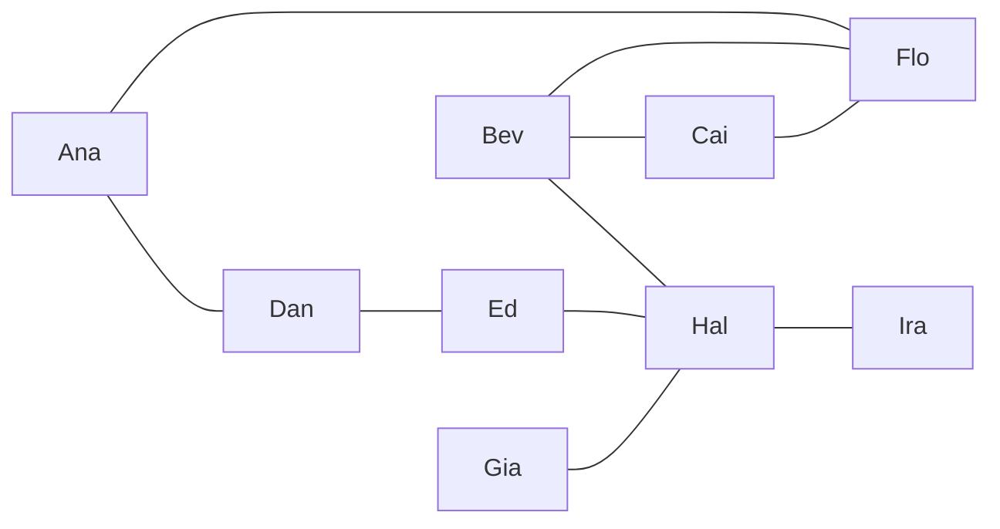

*그림 11. 이전 협업 관계를 나타낸 그래프*

그림에서 Bev, Cai, Flo는 서로 모두 이어져 있으므로 이 세 사람이 한 팀을 이루는 것이 자연스럽다. 이 세 사람을 지우면 그림 12가 남는다.

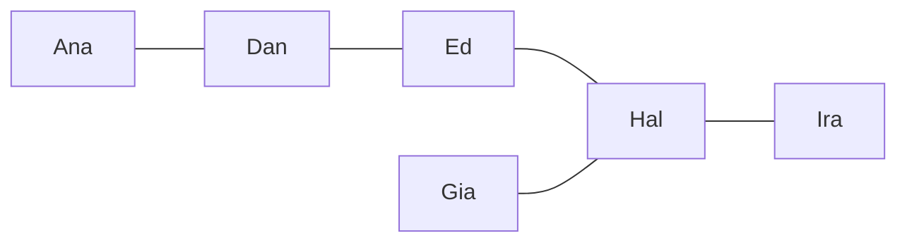

*그림 12. Bev, Cai, Flo를 제외하고 남은 협업 관계*

Gia와 Ira가 함께 일해 본 사람은 Hal뿐이다. 따라서 Hal을 Ed와 같은 팀에 넣으면 Gia와 Ira는 이전 협업 상대가 없는 팀에 들어가게 된다. 반면 Hal을 Gia, Ira와 한 팀으로 묶으면 남은 팀은 Ana, Dan, Ed가 되고, Ana와 Dan, Dan과 Ed가 함께 일해 보았으므로 두 팀의 모든 사람이 이전 협업 상대와 일하게 된다.

이런 그림이 **그래프(graph)** 라는 구조의 예이다. 점을 **꼭짓점(vertex)**, 꼭짓점을 잇는 선을 **변(edge)** 이라 한다. 그리는 방식에 따라서는 두 변이 꼭짓점이 아닌 점에서 교차할 수도 있는데, 그런 교차점은 꼭짓점이 아니다. 여기서 말하는 그래프는 방정식의 그래프나 함수의 그래프와는 전혀 다른 개념이다.

### 4.2 그래프의 정의와 용어

그래프는 대상들 사이의 쌍 단위 관계를 모형화하는 수학적 구조이다. 일반적으로 그래프는 꼭짓점의 집합과 여러 쌍의 꼭짓점을 잇는 변의 집합으로 이루어지며, 꼭짓점 집합 $V$와 변 집합 $E$를 묶어 $G = (V, E)$로 쓰기도 한다. 변은 곧을 수도 있고 휠 수도 있으며, 한 꼭짓점을 다른 꼭짓점과 잇거나 한 꼭짓점을 자기 자신과 잇는다.

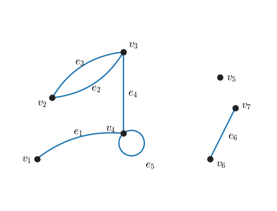

*그림 13. 평행 변, 루프, 고립 꼭짓점을 포함한 그래프*

그림 13에서 꼭짓점에는 $v$, 변에는 $e$로 이름을 붙였다. $e_5$처럼 한 꼭짓점을 자기 자신과 잇는 변을 **루프(loop)** 라 하고, $e_2$와 $e_3$처럼 같은 두 꼭짓점을 잇는 두 변을 **평행 변(parallel edges)** 이라 한다. $v_5$처럼 어떤 변으로도 다른 꼭짓점과 이어지지 않은 꼭짓점을 **고립 꼭짓점(isolated vertex)** 이라 한다. 이 용어들의 형식적 정의는 다음과 같다.

> **용어 정의:** **그래프(graph)** $G$는 두 유한 집합, 즉 공집합이 아닌 **꼭짓점(vertex)** 의 집합 $V(G)$와 **변(edge)** 의 집합 $E(G)$로 이루어진다. 각 변은 꼭짓점 하나 또는 둘로 이루어진 집합과 대응하며, 그 꼭짓점들을 변의 **끝점(endpoint)** 이라 한다. 변을 끝점에 대응시키는 대응을 **변-끝점 함수(edge-endpoint function)** 라 한다.
>
> 끝점이 하나뿐인 변을 **루프(loop)** 라 하고, 끝점의 집합이 같은 서로 다른 두 개 이상의 변을 **평행(parallel)** 하다고 한다. 변은 그 끝점들을 **잇는다(connect)**. 한 변으로 이어진 두 꼭짓점은 **인접한다(adjacent)** 고 하며, 루프의 끝점인 꼭짓점은 **자기 자신과 인접한다(adjacent to itself)** 고 한다.
>
> 변은 그 각 끝점에 **접한다(incident on)** 고 하며, 같은 끝점에 접하는 두 변은 **인접한다(adjacent)** 고 한다. 어떤 변도 접하지 않는 꼭짓점을 **고립(isolated)** 되었다고 한다.

> **주의:** 인접한다는 말은 꼭짓점과 꼭짓점 사이, 또는 변과 변 사이에 쓰고, 접한다는 말은 변과 그 끝점인 꼭짓점 사이에 쓴다. 또 정의에 따라 $V(G)$는 공집합이 아니어야 하지만 $E(G)$는 공집합이어도 된다. 변이 하나도 없는 그래프는 고립 꼭짓점만으로 이루어진다.

그래프는 꼭짓점을 점으로, 변을 선분이나 곡선으로 나타낸 그림으로 표현한다. 주어진 그림은 그래프를 유일하게 결정한다.

**예제 1.4.1 (용어).** 그림 14의 그래프를 생각한다.

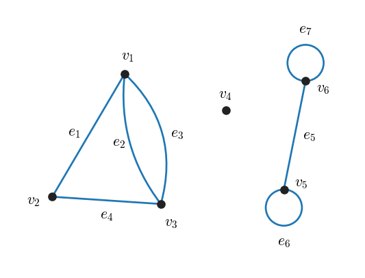

*그림 14. 꼭짓점 여섯 개와 변 일곱 개로 이루어진 그래프*

(a) 꼭짓점 집합은 $\lbrace v_1, v_2, v_3, v_4, v_5, v_6 \rbrace$이고 변 집합은 $\lbrace e_1, e_2, e_3, e_4, e_5, e_6, e_7 \rbrace$이다. 변-끝점 함수는 다음과 같다.

| 변 | 끝점 |
|:-----|:-----|
| $e_1$ | $\lbrace v_1, v_2 \rbrace$ |
| $e_2$ | $\lbrace v_1, v_3 \rbrace$ |
| $e_3$ | $\lbrace v_1, v_3 \rbrace$ |
| $e_4$ | $\lbrace v_2, v_3 \rbrace$ |
| $e_5$ | $\lbrace v_5, v_6 \rbrace$ |
| $e_6$ | $\lbrace v_5 \rbrace$ |
| $e_7$ | $\lbrace v_6 \rbrace$ |

*표 10. 예제 1.4.1 그래프의 변-끝점 함수*

(b) 각 용어에 해당하는 것을 찾으면 다음과 같다.

- $v_1$에 접하는 변: $e_1$, $e_2$, $e_3$
- $v_1$과 인접한 꼭짓점: $v_2$, $v_3$
- $e_1$과 인접한 변: $e_2$, $e_3$, $e_4$ ($e_2$와 $e_3$은 끝점 $v_1$을, $e_4$는 끝점 $v_2$를 $e_1$과 공유한다)
- 루프: $e_6$, $e_7$
- 평행 변: $e_2$와 $e_3$
- 자기 자신과 인접한 꼭짓점: $v_5$, $v_6$
- 고립 꼭짓점: $v_4$

고립 꼭짓점 $v_4$는 표 10에 나타나지 않는다. 그래프의 각 변은 끝점을 하나나 둘 가져야 하지만, 꼭짓점이 어떤 변의 끝점일 필요는 없기 때문이다.

### 4.3 같은 그래프의 여러 그림

주어진 그림은 그래프를 유일하게 결정하지만, 한 그래프를 나타내는 그림은 여러 가지일 수 있다. 변의 길이나 휜 정도, 꼭짓점의 상대적 위치는 그림마다 달라도 된다. 그래프를 결정하는 것은 꼭짓점의 집합, 변의 집합, 변-끝점 함수뿐이다.

**예제 1.4.2 (한 그래프의 두 그림).** 꼭짓점 집합이 $\lbrace v_1, v_2, v_3, v_4 \rbrace$, 변 집합이 $\lbrace e_1, e_2, e_3, e_4 \rbrace$이고 변-끝점 함수가 다음과 같은 그래프를 생각한다.

| 변 | 끝점 |
|:-----|:-----|
| $e_1$ | $\lbrace v_1, v_3 \rbrace$ |
| $e_2$ | $\lbrace v_2, v_4 \rbrace$ |
| $e_3$ | $\lbrace v_2, v_4 \rbrace$ |
| $e_4$ | $\lbrace v_3 \rbrace$ |

*표 11. 예제 1.4.2 그래프의 변-끝점 함수*

그림 15의 (a)와 (b)는 모두 이 그래프를 나타낸다. (a)에서는 $e_1$과 평행 변 $e_2$, $e_3$이 교차하도록 그렸고, (b)에서는 두 부분을 떼어 그렸지만, 두 그림의 변-끝점 함수는 모두 표 11과 같다.

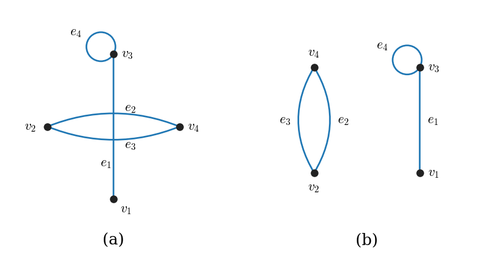

*그림 15. 같은 그래프를 나타낸 두 그림*

**예제 1.4.3 (같은 그래프임을 보이도록 이름 붙이기).** 그림 16의 두 그림, 즉 오각별 모양 (a)와 정오각형 모양 (b)의 꼭짓점과 변에 이름을 붙여 두 그림이 같은 그래프를 나타내도록 한다.

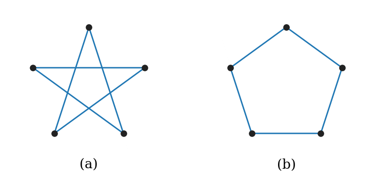

*그림 16. 이름을 붙이지 않은 오각별 모양과 정오각형 모양의 그림*

(a)의 맨 위 꼭짓점에 실의 한쪽 끝을 놓는다고 상상하고 이 꼭짓점을 $v_1$이라 한다. 실을 오른쪽 아래의 인접한 꼭짓점까지 놓고 그 꼭짓점을 $v_2$라 한 뒤, 다시 왼쪽 위의 인접한 꼭짓점까지 놓고 $v_3$이라 한다. 같은 방식으로 오른쪽 위를 $v_4$, 왼쪽 아래를 $v_5$라 하고 마지막에 맨 위의 $v_1$로 돌아온다. 실이 지나간 순서대로 첫 번째 변을 $e_1$, 두 번째 변을 $e_2$, 이런 식으로 $e_5$까지 이름을 붙인다.

이제 이름표가 붙은 실을 집어 들어 정오각형 모양으로 다시 놓는다고 상상한다. 그러면 $v_1, v_2, v_3, v_4, v_5$가 정오각형의 꼭짓점을 차례로 돌고, 변 $e_1, \ldots, e_5$가 정오각형의 변이 된다. 이것이 (b)와 같으므로 두 그림은 같은 그래프를 나타낸다.

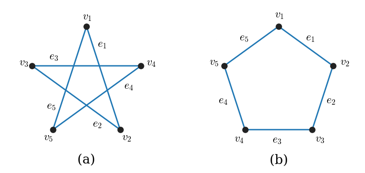

*그림 17. 같은 그래프가 되도록 이름을 붙인 오각별 모양과 정오각형 모양의 그림*

| 변 | 끝점 |
|:-----|:-----|
| $e_1$ | $\lbrace v_1, v_2 \rbrace$ |
| $e_2$ | $\lbrace v_2, v_3 \rbrace$ |
| $e_3$ | $\lbrace v_3, v_4 \rbrace$ |
| $e_4$ | $\lbrace v_4, v_5 \rbrace$ |
| $e_5$ | $\lbrace v_5, v_1 \rbrace$ |

*표 12. 예제 1.4.3에서 두 그림이 나타내는 그래프의 변-끝점 함수*

> **참고:** 두 그림이 같은 구조를 나타내도록 이름을 붙일 수 있는지 묻는 것은 두 그래프가 동형(isomorphic)인지 묻는 것과 같다. 동형은 10장에서 정확히 정의하고 판정 방법을 다룬다.

### 4.4 그래프로 나타낸 네트워크

그래프는 복잡한 상황을 한 장의 그림으로 나타내어 눈으로도, 컴퓨터로도 분석할 수 있게 해 주므로 강력한 문제 해결 도구이다.

**예제 1.4.4 (네트워크를 나타내는 그래프).** 전화망, 전력망, 가스관, 항공 운송 체계는 모두 그래프로 나타낼 수 있다. 소규모 근거리 통신망부터 전 세계의 수많은 컴퓨터를 잇는 인터넷까지, 컴퓨터 네트워크도 마찬가지이다. 이런 체계를 설계할 때는 비용을 최소화하거나 특정 서비스를 최적화하도록 어떤 변을 둘지 고르는 문제가 생긴다. 그림 18은 **허브 앤 스포크 모델(hub-and-spoke model)** 이라 부르는 전형적인 네트워크이다.

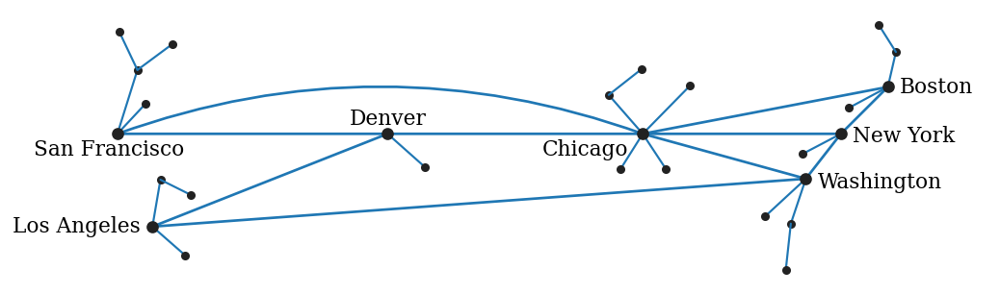

*그림 18. 주요 도시를 허브로 하고 주변 지점을 스포크로 잇는 허브 앤 스포크 네트워크*

그림 18에서 이름이 붙은 도시들은 **허브(hub)** 로서 서로 변으로 이어지고, 각 허브에는 이름이 없는 작은 꼭짓점, 즉 **스포크(spoke)** 들이 매달려 있다. 스포크는 자기 허브와만 이어지므로, 스포크에서 다른 지역으로 가려면 허브를 거쳐야 한다. 특히 Chicago는 San Francisco, Denver, Boston, New York, Washington과 모두 이어져 있어 가장 많은 변이 모이는 허브이다.

**예제 1.4.5 (월드 와이드 웹을 나타내는 그래프).** 월드 와이드 웹(World Wide Web)은 인터넷에 담긴 문서, 즉 웹페이지가 서로 이어진 체계이다. 사용자는 웹 브라우저에서 하이퍼링크를 눌러 한 웹페이지에서 다른 웹페이지로 빠르게 옮겨 간다. 웹페이지를 꼭짓점으로, 하이퍼링크를 변으로 보면 웹 전체가 하나의 거대한 그래프가 된다. 위키백과 대문 페이지를 중심으로 드나드는 하이퍼링크 연결의 극히 일부만 그려도 수많은 꼭짓점이 복잡하게 얽힌 그림이 된다. 웹의 정보량이 막대하므로 검색 엔진은 이런 그래프에서 정보를 효율적으로 찾는 알고리즘을 쓴다. 하이퍼링크는 한 페이지에서 다른 페이지로 가는 방향이 있으므로, 이 그래프는 4.5절의 방향 그래프로 보는 것이 더 정확하다.

### 4.5 방향 그래프

**방향 그래프(directed graph)** 는 각 변이 꼭짓점의 집합이 아니라 꼭짓점의 순서쌍과 대응한다는 점만 빼면 (방향이 없는) 그래프와 같다. 따라서 방향 그래프의 각 변은 순서쌍의 첫째 꼭짓점에서 둘째 꼭짓점으로 향하는 화살표로 그릴 수 있다.

> **용어 정의:** **방향 그래프(directed graph)** 또는 **다이그래프(digraph)** $G$는 두 유한 집합, 즉 공집합이 아닌 꼭짓점의 집합 $V(G)$와 **유향 변(directed edge)** 의 집합 $D(G)$로 이루어진다. 각 유향 변은 꼭짓점의 순서쌍과 대응하며, 그 꼭짓점들을 변의 끝점이라 한다. 변 $e$가 꼭짓점의 순서쌍 $(v, w)$와 대응하면 $e$를 $v$에서 $w$로의 (유향) 변이라 한다.

모든 방향 그래프에는 변의 방향을 무시하여 얻는 보통의 (방향이 없는) 그래프가 하나씩 대응한다.

**예제 1.4.6 (지식을 나타내는 그래프).** 인공지능의 많은 응용에서는 정보를 모아 **지식 베이스(knowledge base)** 로 컴퓨터 안에 표현한다. 지식의 표현 방식과 인공지능 프로그램의 성질 덕분에, 컴퓨터는 입력된 형태 그대로 자료를 꺼내는 데 그치지 않고 내장된 추론 규칙으로 지식 베이스에서 새로운 사실을 이끌어 낼 수 있다. 예를 들어 Los Angeles Times가 대도시 일간지이고 대도시 일간지는 전국 뉴스를 싣는다는 지식으로부터, 인공지능 프로그램은 Los Angeles Times가 전국 뉴스를 싣는다고 추론할 수 있다. 그림 19는 정기 간행물에 관한 단순화된 지식 베이스를 방향 그래프로 나타낸 것이다.

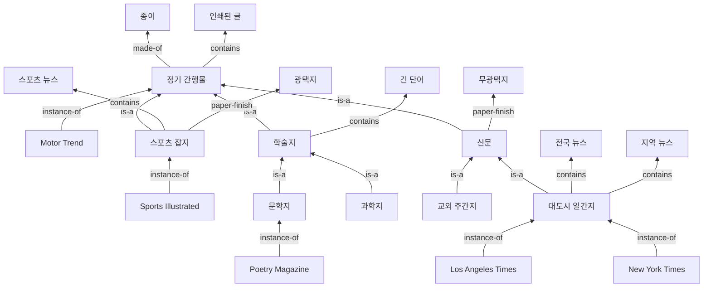

*그림 19. 정기 간행물에 관한 지식 베이스를 나타낸 방향 그래프*

이 지식 베이스에 따르면 New York Times는 어떤 종이 마감을 쓰는가? New York Times에서 대도시 일간지로 가는 화살표(instance-of)는 New York Times가 대도시 일간지의 한 예임을 나타낸다. 대도시 일간지에서 신문으로 가는 화살표(is-a)는 대도시 일간지가 신문의 일종임을 나타내고, 신문에서 무광택지로 가는 화살표(paper-finish)는 신문의 종이 마감이 무광택임을 나타낸다. 따라서 New York Times의 종이 마감은 무광택이라고 추론할 수 있다. 이 추론은 방향 그래프에서 화살표를 따라 New York Times에서 무광택지까지 가는 길을 찾는 일과 같다.

### 4.6 그래프로 퍼즐 풀기

**예제 1.4.7 (채식주의자와 식인종).** 인공지능 연구에서 예제로 자주 쓰는 유명한 퍼즐의 변형이다. 어떤 섬의 사람은 모두 채식주의자이거나 식인종이다. 처음에 채식주의자 두 명과 식인종 두 명이 강의 왼쪽 기슭에 있고, 최대 두 명이 탈 수 있는 배가 함께 있다. 목표는 네 사람을 모두 오른쪽 기슭으로 옮기는 것이다. 어려운 점은 어느 기슭에서도 식인종의 수가 채식주의자의 수보다 많아지는 순간이 있어서는 안 된다는 것이다. 그렇게 되면 채식주의자가 위험에 처한다.

> **참고:** 이 규칙은 채식주의자가 적어도 한 명 있는 기슭에만 적용되는 것으로 해석해야 한다. 그림 20의 풀이에 나오는 상태 $(c / Bvvc)$에서 왼쪽 기슭에는 식인종 한 명만 있는데, 채식주의자가 없는 기슭까지 규칙을 적용하면 이 상태가 금지되어 풀이가 성립하지 않기 때문이다.

강의 두 기슭에 채식주의자, 식인종, 배가 어떻게 배치되었는지를 나타내는 표기를 도입하면 체계적으로 풀 수 있다. $v$는 채식주의자, $c$는 식인종, $B$는 배를 나타내고, 빗금 왼쪽에는 왼쪽 기슭의 상태를, 오른쪽에는 오른쪽 기슭의 상태를 쓴다. 예를 들어 $(vvc / Bc)$는 왼쪽 기슭에 채식주의자 둘과 식인종 하나가 있고, 오른쪽 기슭에 식인종 하나와 배가 있는 상태이다. 처음 상태는 $(vvccB /)$이고, 목표 상태는 모든 사람과 배가 오른쪽 기슭에 있는 $(/ Bvvcc)$이다.

이제 처음 상태에서 규칙을 지키는 이동을 차례로 해서 도달할 수 있는 배치들을 꼭짓점으로 하는 그래프를 만든다. 꼭짓점 $x$에서 규칙을 지키는 한 번의 이동으로 꼭짓점 $y$에 도달할 수 있으면 $x$와 $y$를 변으로 잇는다. 처음 상태에서 배에 태울 수 있는 경우는 다섯 가지인데, 각 경우를 확인하면 다음과 같다.

- 채식주의자 한 명과 식인종 한 명이 건넌다: $(vc / Bvc)$. 두 기슭 모두 채식주의자 1명, 식인종 1명이므로 허용된다.
- 식인종 두 명이 건넌다: $(vv / Bcc)$. 오른쪽 기슭에는 채식주의자가 없으므로 허용된다.
- 식인종 한 명이 건넌다: $(vvc / Bc)$. 허용된다.
- 채식주의자 두 명이 건넌다: $(cc / Bvv)$. 왼쪽 기슭에는 채식주의자가 없으므로 허용된다.
- 채식주의자 한 명이 건넌다: $(vcc / Bv)$. 왼쪽 기슭에서 식인종 2명이 채식주의자 1명보다 많으므로 금지된다.

따라서 $(vvccB /)$에서 $(vc / Bvc)$, $(vv / Bcc)$, $(vvc / Bc)$, $(cc / Bvv)$로 변을 긋는다. 이동은 언제나 되돌릴 수 있으므로 유향 변 대신 방향이 없는 변을 쓴다. $(vc / Bvc)$에서 가능한 이동은 $(vvccB /)$로 되돌아가는 것과 오른쪽의 채식주의자가 배를 타고 돌아와 $(vvcB / c)$가 되는 것뿐이다. 같은 과정을 $(/ Bvvcc)$에 도달할 때까지 계속하면 그림 20의 그래프를 얻는다.

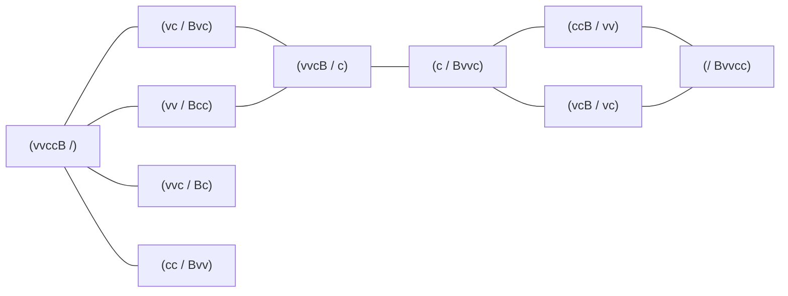

*그림 20. 채식주의자와 식인종 퍼즐의 상태와 이동을 나타낸 그래프*

그래프에서 처음 상태부터 목표 상태까지 가는 길을 찾으면 퍼즐이 풀린다. 그 가운데 하나는 다음과 같다.

$$
(vvccB /) \to (vc / Bvc) \to (vvcB / c) \to (c / Bvvc) \to (ccB / vv) \to (/ Bvvcc)
$$

각 단계를 말로 풀면, 채식주의자와 식인종이 한 명씩 건너가고, 채식주의자가 혼자 돌아오고, 채식주의자 두 명이 건너가고, 식인종이 혼자 돌아오고, 마지막으로 식인종 두 명이 건너간다. 그래프에서 처음 상태와 $(vvcB / c)$ 사이의 길이 두 가지이고 $(c / Bvvc)$와 목표 상태 사이의 길도 두 가지이므로, 다섯 번의 이동으로 끝나는 풀이는 $2 \times 2 = 4$가지이다. $(vvc / Bc)$와 $(cc / Bvv)$에서는 처음 상태로 되돌아가는 이동밖에 없으므로 이 두 상태는 막다른 곳이다.

> **참고:** 그림 20은 목표 상태에 도달하면 탐색을 멈춘 그래프이다. 목표 상태에서도 배를 타고 돌아오는 이동을 계속 따져 보면 $(cB / vvc)$와 $(vvB / cc)$의 두 상태가 더 나오지만, 이 상태들은 풀이에 필요하지 않다.

> **[인공지능]** 인공지능의 상태 공간 탐색(state-space search)은 문제의 가능한 상태를 꼭짓점으로, 한 번의 행동으로 일어나는 전이를 변으로 하는 그래프에서 처음 상태로부터 목표 상태까지의 경로를 찾는 방법이다. 너비 우선 탐색은 처음 상태에서 가까운 상태부터 차례로 펼쳐 나가므로, 이 퍼즐에서 이동 횟수가 가장 적은 풀이를 찾는다.

### 4.7 꼭짓점의 차수

> **용어 정의:** $G$가 그래프이고 $v$가 $G$의 꼭짓점일 때, $v$의 **차수(degree)** $\deg(v)$는 $v$에 접하는 변의 수이다. 단, 루프는 두 번 센다.

루프를 두 번 세므로, 그래프의 그림에서 꼭짓점의 차수는 그 꼭짓점에 닿는 변의 끝부분이 몇 개인지 세어 구할 수 있다. 루프는 양 끝이 모두 같은 꼭짓점에 닿으므로 끝부분 두 개를 보탠다.

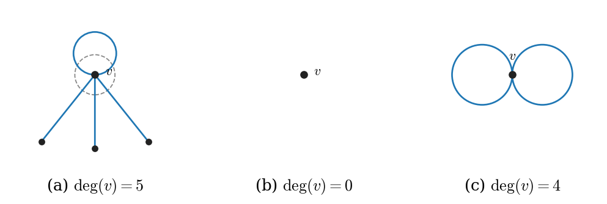

*그림 21. 꼭짓점의 차수: 루프 하나와 변 셋, 고립 꼭짓점, 루프 둘*

그림 21의 (a)에서 $v$에는 루프 하나와 보통의 변 세 개가 접한다. $v$ 주위의 점선 원을 지나는 변의 끝부분은 루프의 양 끝 두 개와 세 변의 끝 세 개이므로 $\deg(v) = 2 + 3 = 5$이다. (b)의 고립 꼭짓점은 접하는 변이 없으므로 $\deg(v) = 0$이고, (c)의 $v$에는 루프 두 개가 접하므로 $\deg(v) = 2 + 2 = 4$이다.

**예제 1.4.8 (꼭짓점의 차수).** 그림 22의 그래프 $G$에서 각 꼭짓점의 차수를 구한다.

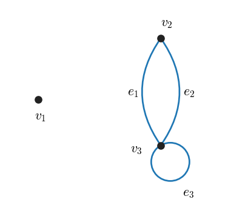

*그림 22. 고립 꼭짓점, 평행 변, 루프가 있는 그래프*

- $\deg(v_1) = 0$이다. $v_1$에 접하는 변이 없다($v_1$은 고립 꼭짓점이다).
- $\deg(v_2) = 2$이다. $e_1$과 $e_2$가 모두 $v_2$에 접한다.
- $\deg(v_3) = 4$이다. $e_1$과 $e_2$가 $v_3$에 접하고, 루프 $e_3$도 $v_3$에 접하여 차수에 2를 보탠다. 따라서 $1 + 1 + 2 = 4$이다.

같은 방법으로 예제 1.4.1의 그래프(그림 14)에서 차수를 구하면 $\deg(v_1) = 3$($e_1$, $e_2$, $e_3$), $\deg(v_2) = 2$($e_1$, $e_4$), $\deg(v_3) = 3$($e_2$, $e_3$, $e_4$), $\deg(v_4) = 0$, $\deg(v_5) = 1 + 2 = 3$($e_5$와 루프 $e_6$), $\deg(v_6) = 1 + 2 = 3$($e_5$와 루프 $e_7$)이다. 차수의 합은 $3 + 2 + 3 + 0 + 3 + 3 = 14$로 변의 수 7의 두 배이고, 예제 1.4.8에서도 $0 + 2 + 4 = 6$으로 변의 수 3의 두 배이다. 이것이 모든 그래프에서 성립한다는 사실은 10장에서 증명한다.

### 4.8 그래프 색칠

**예제 1.4.9 (그래프로 지도 색칠하기).** 그림 23을 나라 A부터 J까지가 그려진 지도라고 생각한다. 경계를 맞댄 두 나라가 같은 색이 되지 않도록 지도를 색칠할 수 있음을 보인다.

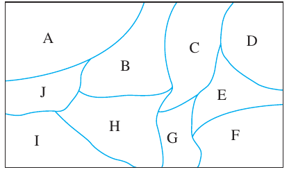

*그림 23. 나라 A부터 J까지로 이루어진 지도*

지도의 색칠은 나라의 크기나 모양과는 상관없고, 어느 나라가 어느 나라와 맞닿아 있는지에만 달려 있다. 따라서 나라를 꼭짓점으로 하고, 맞닿은 두 나라를 나타내는 꼭짓점 사이에 변을 그은 그래프를 만든다. 그래프의 꼭짓점을 색칠하는 것이 곧 지도의 나라를 색칠하는 것이다.

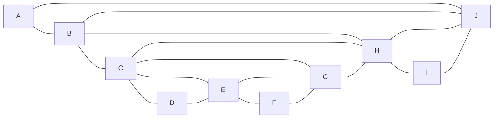

*그림 24. 지도에서 맞닿은 나라끼리 이은 그래프*

그림 24에서 각 꼭짓점의 차수는 $\deg(A) = 2$, $\deg(B) = 4$, $\deg(C) = 5$, $\deg(D) = 2$, $\deg(E) = 4$, $\deg(F) = 2$, $\deg(G) = 4$, $\deg(H) = 5$, $\deg(I) = 2$, $\deg(J) = 4$이다.

색을 정할 때 비교적 효율적인 전략은, 각 단계에서 아직 색칠하지 않은 꼭짓점 가운데 차수가 가장 큰 것, 즉 색칠하지 않은 다른 꼭짓점과 가장 많이 이어진 것에 먼저 색을 주는 것이다. 그런 꼭짓점이 여럿이면 어느 것을 골라도 된다. 한 그래프를 올바르게 색칠하는 방법은 대개 여러 가지이기 때문이다. 이 전략에 따라 색칠하는 과정은 다음과 같다.

| 단계 | 선택 | 근거 |
|:-----|:-----|:-----|
| 1 | C를 파란색으로 칠한다. | C와 H의 차수가 5로 가장 크며, 그중 C를 고른다. |
| 2 | J를 파란색으로 칠한다. | C와 이어지지 않은 A, F, I, J 가운데 J가 다른 꼭짓점과 가장 많이 이어져 있다. |
| 3 | F를 파란색으로 칠한다. | C와도 J와도 이어지지 않은 꼭짓점은 F뿐이다. |
| 4 | C, J, F와 그 변을 지운다. | 남은 그래프의 변은 A와 B, B와 H, H와 I, H와 G, G와 E, E와 D이다. |
| 5 | H를 회색으로 칠한다. | 남은 그래프에서 H의 차수가 3으로 가장 크다. |
| 6 | E를 회색으로 칠한다. | H와 이어지지 않은 A, D, E 가운데 남은 그래프에서 E의 차수가 2로 가장 크다. |
| 7 | A를 회색으로 칠한다. | A는 H와도 E와도 이어지지 않는다. |
| 8 | B, D, G, I를 검은색으로 칠한다. | 이 네 꼭짓점은 서로 하나도 이어지지 않는다. |

*표 13. 차수가 큰 꼭짓점부터 색을 정하는 과정*

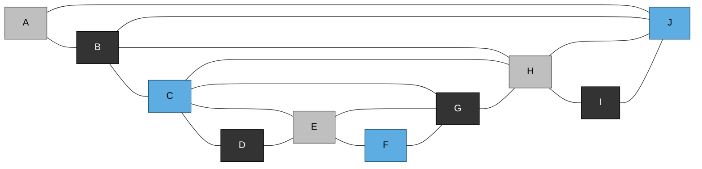

*그림 25. 세 가지 색으로 칠한 지도의 그래프*

그림 25의 17개 변을 하나씩 확인하면 양 끝의 색이 같은 변이 없다. 이 색칠을 지도로 옮기면 C, J, F는 파란색, H, A, E는 회색, B, D, G, I는 검은색이 되어 맞닿은 두 나라가 같은 색을 가지지 않는다.

이 지도는 세 가지 색으로 칠할 수 있었다. 두 가지 색으로는 부족한데, 예를 들어 B, C, H는 서로 모두 맞닿아 있으므로 세 나라에 모두 다른 색을 써야 하기 때문이다. 지도에 따라서는 네 가지 색이 필요하기도 하다. 중앙아프리카의 우간다, 르완다, 콩고민주공화국, 탄자니아, 부룬디 지역의 지도를 그래프로 나타내면 그림 26과 같다.

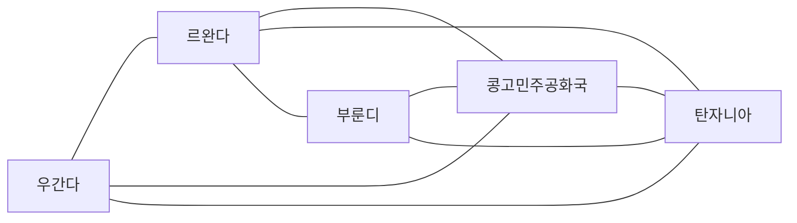

*그림 26. 중앙아프리카 일부 지역에서 맞닿은 나라끼리 이은 그래프*

르완다, 부룬디, 콩고민주공화국, 탄자니아의 네 나라는 서로 모두 맞닿아 있다. 따라서 네 나라에 모두 다른 색을 써야 하므로 세 가지 색으로는 부족하다.

1800년대 중반에 어떤 지도든 맞닿은 두 지역이 같은 색이 되지 않도록 네 가지 색만으로 칠할 수 있다는 추측이 나왔다. 이 추측은 1976년 일리노이 대학교 어배너섐페인 캠퍼스의 아펠(Kenneth Appel)과 하켄(Wolfgang Haken)이 참임을 증명하여 **4색 정리(four-color theorem)** 로 불린다. 두 사람은 지도를 그래프로 나타내고, 수학적 연역과 거의 2000가지 특수한 경우에 대한 컴퓨터 검사를 결합한 새롭고도 논란이 많았던 방법을 썼다.

1950년 대학생 넬슨(Edward Nelson)은 평면의 모든 점을 색칠하되 거리가 정확히 1인 두 점은 서로 다른 색이 되게 하려면 최소 몇 가지 색이 필요한지 물었다. 넬슨 자신은 세 가지 색으로는 부족함을 보였고, 동료 학생 이스벨(John Isbell)은 일곱 가지 색이면 충분한 예를 만들었다. 따라서 최솟값은 4, 5, 6, 7 가운데 하나였다. 2018년 생물학자이자 아마추어 수학자인 드 그레이(Aubrey de Grey)가 독창적인 아이디어와 컴퓨터 계산을 결합하여 네 가지 색으로도 부족한 예를 만들었으므로, 최솟값은 5, 6, 7 가운데 하나이며 정확한 값은 아직 알려지지 않았다.

> **참고:** 교재는 이스벨의 결과 뒤의 범위를 4, 5, 6으로, 드 그레이의 결과 뒤의 범위를 5 또는 6으로 적고 있다. 그러나 일곱 가지 색으로 충분하다는 사실만으로는 최솟값이 7일 가능성이 배제되지 않으므로, 교재가 제시한 사실들로부터 얻을 수 있는 범위는 각각 4부터 7까지와 5부터 7까지이다.

여러 가지 문제를 그 특징을 그래프로 나타내고 꼭짓점을 색칠하여 풀 수 있다. 예를 들어 여러 위원회에 겹쳐 속한 위원이 있을 때 정해진 수의 시간대 안에 위원회 회의 일정을 짜는 문제는, 위원회를 꼭짓점으로 하고 위원을 공유하는 두 위원회를 변으로 이은 그래프를 색칠하는 문제가 된다. 같은 색은 같은 시간대를 뜻하므로, 변으로 이어진 두 위원회는 다른 시간대에 배정된다.

> **[알고리즘]** 차수가 큰 꼭짓점부터 색을 정하는 방법은 각 단계에서 그 순간 가장 좋아 보이는 선택을 하고 되돌리지 않는 탐욕 알고리즘(greedy algorithm)의 한 예이다. 이 방법은 빠르지만 언제나 가장 적은 수의 색을 쓰는 것은 아니며, 일반적인 그래프에서 필요한 최소 색 수를 효율적으로 구하는 알고리즘은 알려져 있지 않다.

---

 

## 개념 적용

**T/F 점검:**

| 문장 | 판단과 근거 |
|:-----|:-----|
| $\lbrace 1, 2, 2, 3 \rbrace$은 원소가 네 개인 집합이다. | **F.** 같은 원소를 여러 번 적어도 하나로 세므로 원소는 1, 2, 3의 세 개이다. |
| $\emptyset$과 $\lbrace \emptyset \rbrace$은 같은 집합이다. | **F.** $\emptyset$은 원소가 없고, $\lbrace \emptyset \rbrace$은 $\emptyset$ 하나를 원소로 가진다. |
| 모든 집합은 자기 자신의 진부분집합이다. | **F.** 모든 집합은 자기 자신의 부분집합이지만, 자기 자신에 속하지 않는 원소가 있을 수 없으므로 진부분집합은 아니다. |
| $A = \lbrace 1, 2 \rbrace$, $B = \lbrace a \rbrace$이면 $A \times B = B \times A$이다. | **F.** $(1, a) \in A \times B$이지만 $B \times A$의 원소는 첫째 성분이 $a$이므로 $(1, a) \notin B \times A$이다. |
| $\forall x \in \mathbf{R},\ \exists y \in \mathbf{R} \text{ s.t. } x + y = 0$과 $\exists y \in \mathbf{R} \text{ s.t. } \forall x \in \mathbf{R},\ x + y = 0$은 같은 뜻이다. | **F.** 앞의 명제는 $y = -x$로 참이지만, 뒤의 명제는 모든 $x$에 통하는 $y$ 하나를 요구하므로 거짓이다. |
| 함수의 화살표 도표에서는 공역의 각 원소에 화살표가 정확히 하나씩 들어와야 한다. | **F.** 조건은 정의역의 각 원소에서 화살표가 정확히 하나 나가는 것이다. 공역의 원소에는 화살표가 여러 개 들어오거나 하나도 들어오지 않아도 된다. |
| 변이 하나도 없는 그래프도 그래프의 정의를 만족한다. | **T.** $V(G)$만 공집합이 아니면 되고 $E(G)$는 공집합이어도 된다. |
| 루프는 그 끝점의 차수에 2를 더한다. | **T.** 차수의 정의에서 루프는 두 번 센다. |

---

 

## 요약

| 개념 | 핵심 요약 |
|:-----|:-----|
| 변수 | 대상에 임시로 붙이는 이름이며, 값을 모르는 대상을 계산하거나 집합의 모든 원소에 대해 일반적으로 말할 때 쓴다. |
| 전칭 명제, 조건 명제, 존재 명제 | 각각 모든 원소에 대해 성질이 참이라는 명제, 한 가지가 참이면 다른 것도 참이라는 명제, 성질이 참인 대상이 적어도 하나 있다는 명제이다. |
| 전칭 조건 명제 | 모든 $x$에 대해 $P(x)$이면 $Q(x)$라는 명제이며, 순수한 조건 명제나 순수한 전칭 명제처럼 바꾸어 쓸 수 있다. |
| 전칭 존재 명제와 존재 전칭 명제 | $\forall x\ \exists y$는 각 $x$마다 $y$가 따로 있어도 되고, $\exists y\ \forall x$는 모든 $x$에 통하는 $y$ 하나가 있어야 하므로 순서를 바꾸면 뜻이 달라진다. |
| 집합과 원소나열법 | 집합은 원소로만 결정되므로(외연 공리) 나열 순서와 중복은 영향을 주지 않는다. |
| 조건제시법 | $\lbrace x \in S \mid P(x) \rbrace$는 $S$의 원소 가운데 $P(x)$가 참인 것 전체의 집합이며, 같은 조건이라도 $S$가 다르면 다른 집합이 된다. |
| 부분집합과 진부분집합 | $A \subseteq B$는 $A$의 모든 원소가 $B$에 속한다는 뜻이고, 진부분집합은 여기에 $B$에만 속하는 원소가 적어도 하나 있다는 조건을 더한다. |
| $\in$와 $\subseteq$ | $\in$는 원소와 집합 사이의 관계이고, $\subseteq$는 집합과 집합 사이의 관계이다. |
| 순서쌍과 순서 n-튜플 | $(a, b) = (c, d)$는 $a = c$이고 $b = d$일 때에만 성립하며, 쿠라토프스키는 $(a, b)$를 $\lbrace \lbrace a \rbrace, \lbrace a, b \rbrace \rbrace$로 정의하였다. |
| 데카르트 곱 | $A_1 \times \cdots \times A_n$은 $i$번째 성분이 $A_i$에 속하는 순서 n-튜플 전체의 집합이며, $(A \times B) \times C$와 $A \times B \times C$는 다른 대상이다. |
| 문자열 | 유한 집합 $A$ 위의 길이 $n$인 문자열은 괄호와 쉼표 없이 쓴 순서 n-튜플이며, 빈 문자열 $\lambda$의 길이는 0이다. |
| 관계 | $A$에서 $B$로의 관계는 $A \times B$의 부분집합이며, $x \mathrel{R} y$는 $(x, y) \in R$을 뜻한다. $A$를 정의역, $B$를 공역이라 한다. |
| 화살표 도표 | $x \mathrel{R} y$일 때 그리고 그때에만 $x$에서 $y$로 화살표를 그려 관계를 나타낸다. |
| 함수 | 정의역의 각 원소가 공역의 원소 정확히 하나와 관계를 맺는 관계이며, 그 원소를 $F(x)$로 쓴다. |
| 함수의 상등 | 정의역과 공역이 같은 두 함수는 정의역의 모든 $x$에서 $f(x) = g(x)$일 때 같다. |
| 그래프 | 공집합이 아닌 꼭짓점의 유한 집합과 변의 유한 집합으로 이루어지며, 각 변은 끝점 하나 또는 둘과 대응한다. |
| 그래프의 용어 | 루프는 끝점이 하나인 변, 평행 변은 끝점의 집합이 같은 변들, 고립 꼭짓점은 접하는 변이 없는 꼭짓점이다. 인접은 꼭짓점끼리나 변끼리, 접함은 변과 끝점 사이에 쓴다. |
| 방향 그래프 | 각 변이 꼭짓점의 순서쌍 $(v, w)$와 대응하여 $v$에서 $w$로 향하는 그래프이다. |
| 차수 | $\deg(v)$는 $v$에 접하는 변의 수이며, 루프는 두 번 센다. |
| 그래프 색칠 | 인접한 두 꼭짓점이 다른 색이 되도록 칠하는 문제이며, 지도 색칠과 일정 배정 같은 문제를 모형화한다. 평면 지도는 네 가지 색이면 충분하다(4색 정리). |

---

 

## 점검 문제

1. **명제의 형태:** 모든 정수에는 그보다 큰 정수가 있다는 명제를 변수를 써서 전칭 존재 명제의 형태로 쓰라. 또 전칭과 존재의 순서를 바꾼 명제를 쓰고 참과 거짓을 판정하라.

   

   
정답

   전칭 존재 명제로 쓰면 모든 정수 $n$에 대해 $m > n$인 정수 $m$이 있다, 즉 $\forall n \in \mathbf{Z},\ \exists m \in \mathbf{Z} \text{ s.t. } m > n$이다. 각 $n$에 대해 $m = n + 1$을 고르면 되므로 참이다. 순서를 바꾸면 $\exists m \in \mathbf{Z} \text{ s.t. } \forall n \in \mathbf{Z},\ m > n$, 즉 모든 정수보다 큰 정수 $m$이 있다는 명제가 된다. 그런 $m$이 있다면 $n = m$일 때 $m > m$이어야 하므로 모순이다. 따라서 거짓이다.

   

2. **조건제시법:** 다음 집합을 원소나열법으로 쓰라. (a) $\lbrace x \in \mathbf{Z} \mid x^2 < 10 \rbrace$ (b) $\lbrace x \in \mathbf{Z}^{+} \mid x^2 < 10 \rbrace$ (c) $\lbrace x \in \mathbf{Z}^{\text{nonneg}} \mid x < 0 \rbrace$

   

   
정답

   (a) $x^2 < 10$인 정수는 $x^2$이 0, 1, 4, 9인 정수이므로 $\lbrace -3, -2, -1, 0, 1, 2, 3 \rbrace$이다. $(\pm 4)^2 = 16 \ge 10$이므로 $\pm 4$부터는 속하지 않는다. (b) 그 가운데 양의 정수만 남기면 $\lbrace 1, 2, 3 \rbrace$이다. (c) 음이 아닌 정수 가운데 0보다 작은 것은 없으므로 공집합 $\emptyset$이다.

   

3. **원소와 부분집합:** $X = \lbrace 1, \lbrace 1 \rbrace, \lbrace 2, 3 \rbrace \rbrace$일 때 다음 각 문장의 참과 거짓을 판정하라. (a) $\lbrace 1 \rbrace \in X$ (b) $\lbrace 1 \rbrace \subseteq X$ (c) $\lbrace 2 \rbrace \subseteq X$ (d) $\lbrace \lbrace 2, 3 \rbrace \rbrace \subseteq X$

   

   
정답

   $X$의 원소는 $1$, $\lbrace 1 \rbrace$, $\lbrace 2, 3 \rbrace$의 세 개이다. (a) 참이다. $\lbrace 1 \rbrace$이 원소 목록에 있다. (b) 참이다. $\lbrace 1 \rbrace$의 유일한 원소 1이 $X$의 원소이다. (c) 거짓이다. $\lbrace 2 \rbrace$의 원소 2는 $X$의 원소가 아니다(2는 $\lbrace 2, 3 \rbrace$의 원소일 뿐이다). (d) 참이다. $\lbrace \lbrace 2, 3 \rbrace \rbrace$의 유일한 원소 $\lbrace 2, 3 \rbrace$이 $X$의 원소이다.

   

4. **데카르트 곱:** $A = \lbrace 0, 1 \rbrace$, $B = \lbrace a, b, c \rbrace$일 때 $A \times B$를 원소나열법으로 쓰고, $A \times B$와 $B \times A$와 $A \times A \times A$의 원소 수를 구하라. $(0, a) \in B \times A$인가?

   

   
정답

   $A \times B = \lbrace (0, a), (0, b), (0, c), (1, a), (1, b), (1, c) \rbrace$이며 원소는 $2 \times 3 = 6$개이다. $B \times A$도 $3 \times 2 = 6$개이고, $A \times A \times A$는 $2 \times 2 \times 2 = 8$개이다. $B \times A$의 원소는 첫째 성분이 $B$에 속해야 하는데 $0 \notin B$이므로 $(0, a) \notin B \times A$이다.

   

5. **문자열:** $\lbrace 0, 1 \rbrace$ 위의 길이 3인 비트 문자열 가운데 1이 정확히 한 번 나오는 것을 모두 쓰라. 또 길이 3인 비트 문자열은 모두 몇 개인가?

   

   
정답

   1이 들어갈 자리를 고르면 되므로 $100$, $010$, $001$의 세 개이다. 길이 3인 비트 문자열은 각 자리에 0이나 1을 넣으므로 모두 $2 \times 2 \times 2 = 8$개이다.

   

6. **관계와 함수의 판정:** $A = \lbrace 1, 2, 3 \rbrace$, $B = \lbrace 1, 2, 3, 4 \rbrace$이고 $A$에서 $B$로의 관계 $R$이 $(x, y) \in R \iff y = 2x$로 정의될 때, $R$을 원소나열법으로 쓰고 $R$이 함수인지 판정하라.

   

   
정답

   $x = 1$이면 $y = 2 \in B$, $x = 2$이면 $y = 4 \in B$, $x = 3$이면 $y = 6 \notin B$이다. 따라서 $R = \lbrace (1, 2), (2, 4) \rbrace$이다. 정의역의 원소 3이 $R$의 어떤 순서쌍의 첫째 원소도 아니므로 함수의 성질 1을 만족하지 않는다. 따라서 $R$은 함수가 아니다.

   

7. **함수와 치역:** $A = \lbrace 1, 2, 3 \rbrace$에서 $B = \lbrace a, b, c \rbrace$로의 관계 $F = \lbrace (1, a), (2, a), (3, b) \rbrace$는 함수인가? 함수라면 $F(2)$와 치역을 구하라.

   

   
정답

   함수이다. 정의역의 원소 1, 2, 3이 각각 정확히 한 순서쌍의 첫째 원소이다. 1과 2가 모두 $a$로 가는 것은 허용된다. $F(2) = a$이고, 함숫값 전체의 집합인 치역은 $\lbrace a, b \rbrace$이다. 공역의 원소 $c$로는 어떤 원소도 가지 않으므로 치역과 공역은 다르다.

   

8. **함수의 상등:** $\mathbf{Z}$에서 $\mathbf{Z}$로의 함수 $f(n) = (n + 1)^2 - n^2$과 $g(n) = 2n + 1$은 같은 함수인가?

   

   
정답

   같은 함수이다. 모든 정수 $n$에 대해 $(n + 1)^2 - n^2 = (n^2 + 2n + 1) - n^2 = 2n + 1$이므로 $f(n) = g(n)$이다. 정의역과 공역이 같고 정의역의 모든 원소에서 값이 같으므로 $f = g$이다. 예를 들어 $n = 3$이면 $f(3) = 16 - 9 = 7$, $g(3) = 7$이다.

   

9. **그래프의 용어와 차수:** 꼭짓점 집합이 $\lbrace v_1, v_2, v_3, v_4 \rbrace$이고 변-끝점 함수가 $e_1 \mapsto \lbrace v_1, v_2 \rbrace$, $e_2 \mapsto \lbrace v_1, v_2 \rbrace$, $e_3 \mapsto \lbrace v_2, v_3 \rbrace$, $e_4 \mapsto \lbrace v_3 \rbrace$인 그래프에서 루프, 평행 변, 고립 꼭짓점을 찾고 각 꼭짓점의 차수를 구하라.

   

   
정답

   루프는 끝점이 하나인 $e_4$이고, 평행 변은 끝점의 집합이 같은 $e_1$과 $e_2$이며, 고립 꼭짓점은 어떤 변의 끝점도 아닌 $v_4$이다. 차수는 $\deg(v_1) = 2$($e_1$, $e_2$), $\deg(v_2) = 3$($e_1$, $e_2$, $e_3$), $\deg(v_3) = 1 + 2 = 3$($e_3$과 루프 $e_4$), $\deg(v_4) = 0$이다. 차수의 합 $2 + 3 + 3 + 0 = 8$은 변의 수 4의 두 배이다.

   

10. **그래프 색칠:** 예제 1.4.3의 정오각형 그래프(꼭짓점 $v_1, \ldots, v_5$가 차례로 이어진 그래프)를 인접한 두 꼭짓점이 다른 색이 되도록 칠하려면 최소 몇 가지 색이 필요한가?

    

    
정답

    세 가지이다. 두 가지 색으로 칠하려 하면 $v_1$부터 두 색을 번갈아 써야 하므로 $v_1, v_3, v_5$가 같은 색, $v_2, v_4$가 다른 색이 된다. 그런데 $v_5$와 $v_1$이 변 $e_5$로 이어져 있으므로 모순이다. 반면 $v_1, v_3$을 첫째 색, $v_2, v_4$를 둘째 색, $v_5$를 셋째 색으로 칠하면 인접한 두 꼭짓점의 색이 모두 다르다.

    

