# Chapter 1 — Speaking Mathematically

[Repository Guide](../../README.md) | [English](Concepts_Lecture.md) | [한국어](Concepts_Lecture.ko.md)

> **Last Updated:** 2026-11-04
>
> Discrete Mathematics with Applications, Epp, Ch 1

> **Learning Objectives:**
> 1. Use variables to rewrite universal, conditional, and existential statements and their combinations in several equivalent forms
> 2. Describe sets in set-roster and set-builder notation, and distinguish the membership relation $\in$ from the subset relation $\subseteq$
> 3. Define ordered pairs, ordered n-tuples, Cartesian products, and strings, and list all of their elements for given sets
> 4. Define a relation as a subset of a Cartesian product, and decide whether a relation given as a set of ordered pairs or as an arrow diagram is a function
> 5. Define the vertices, edges, loops, parallel edges, adjacency, incidence, and degree of a graph, and solve simple problems with a graph model

---

## Table of Contents

- [Overview of Discrete Mathematics](#overview-of-discrete-mathematics)
- [1. Variables](#1-variables)
  - [1.1 Two Uses of Variables](#11-two-uses-of-variables)
  - [1.2 Three Important Kinds of Mathematical Statements](#12-three-important-kinds-of-mathematical-statements)
  - [1.3 Universal Conditional Statements](#13-universal-conditional-statements)
  - [1.4 Universal Existential Statements](#14-universal-existential-statements)
  - [1.5 Existential Universal Statements](#15-existential-universal-statements)
  - [1.6 A Definition That Uses All Three Phrases: Limit of a Sequence](#16-a-definition-that-uses-all-three-phrases-limit-of-a-sequence)
- [2. The Language of Sets](#2-the-language-of-sets)
  - [2.1 Sets, Elements, and Set-Roster Notation](#21-sets-elements-and-set-roster-notation)
  - [2.2 Frequently Used Sets of Numbers](#22-frequently-used-sets-of-numbers)
  - [2.3 Set-Builder Notation](#23-set-builder-notation)
  - [2.4 Subsets](#24-subsets)
  - [2.5 Ordered Pairs and Ordered n-Tuples](#25-ordered-pairs-and-ordered-n-tuples)
  - [2.6 Cartesian Products](#26-cartesian-products)
  - [2.7 Strings](#27-strings)
- [3. The Language of Relations and Functions](#3-the-language-of-relations-and-functions)
  - [3.1 The Intuitive Idea of a Relation](#31-the-intuitive-idea-of-a-relation)
  - [3.2 Definition of a Relation](#32-definition-of-a-relation)
  - [3.3 Arrow Diagram of a Relation](#33-arrow-diagram-of-a-relation)
  - [3.4 Functions](#34-functions)
  - [3.5 Function Machines and Functions Defined by Formulas](#35-function-machines-and-functions-defined-by-formulas)
  - [3.6 Equality of Functions](#36-equality-of-functions)
- [4. The Language of Graphs](#4-the-language-of-graphs)
  - [4.1 The Intuitive Idea of a Graph](#41-the-intuitive-idea-of-a-graph)
  - [4.2 Definition and Terminology of Graphs](#42-definition-and-terminology-of-graphs)
  - [4.3 Several Drawings of the Same Graph](#43-several-drawings-of-the-same-graph)
  - [4.4 Networks Represented by Graphs](#44-networks-represented-by-graphs)
  - [4.5 Directed Graphs](#45-directed-graphs)
  - [4.6 Solving a Puzzle with a Graph](#46-solving-a-puzzle-with-a-graph)
  - [4.7 Degree of a Vertex](#47-degree-of-a-vertex)
  - [4.8 Graph Coloring](#48-graph-coloring)
- [Concept Applications](#concept-applications)
- [Summary](#summary)
- [Self-Check Questions](#self-check-questions)

---

 

## Overview of Discrete Mathematics

**Discrete mathematics** is the mathematics of objects that are separate from one another and can be distinguished and counted one by one, such as integers, finite sets, strings, and graphs. It contrasts with calculus, which studies objects without gaps such as the real number line; Section 2.2 returns to this distinction. A computer is a machine that processes finite bit strings in a finite number of steps, so arguing that a program is correct, structuring data, and judging the efficiency of an algorithm are mostly carried out in the language of discrete mathematics. For this reason discrete mathematics is regarded, together with data structures, as one of the most essential introductory courses in computer science, and it lays the groundwork for the upper-level courses of the third and fourth years.

This course first builds the fundamental concepts of computer science, namely logic, proofs, functions, relations, and graphs, and then moves on to algebraic structures such as Boolean algebra and to the analysis of algorithms. The chapters cover the following content.

| Chapter | Topic | Core Content |
|:-----|:-----|:-----|
| Chapter 1 | Speaking Mathematically | The language of variables, sets, relations and functions, and graphs |
| Chapter 2 | The Logic of Compound Statements | Logical operations and truth tables, logical equivalence, conditional statements, valid arguments, digital logic circuits, number systems and circuits for addition |
| Chapter 3 | The Logic of Quantified Statements | Predicates and quantifiers, multiple quantifiers, arguments with quantified statements |
| Chapter 4 | Elementary Number Theory and Methods of Proof | Direct proof and counterexample, rational numbers, divisibility, the quotient-remainder theorem, floor and ceiling, proof by contradiction and by contraposition |
| Chapter 5 | Sequences, Mathematical Induction, and Recursion | Sequences and summation notation, mathematical induction and strong mathematical induction, loop invariants, recurrence relations |
| Chapter 6 | Set Theory | Set operations and proofs of their properties, Boolean algebra, Russell's paradox and the halting problem |
| Chapter 7 | Properties of Functions | One-to-one and onto functions, inverse functions, composition, cardinality and countability |
| Chapter 8 | Properties of Relations | Reflexive, symmetric, and transitive relations, equivalence relations, partial order relations |
| Chapter 9 | Counting and Probability | The multiplication and addition rules, permutations and combinations, the pigeonhole principle, the binomial theorem, expected value, conditional probability and Bayes' theorem |
| Chapter 10 | Theory of Graphs and Trees | Walks, paths, and circuits, Euler and Hamiltonian circuits, adjacency matrices, isomorphism, trees and spanning trees, shortest paths |
| Chapter 11 | Analysis of Algorithm Efficiency | O-, Ω-, and Θ-notations, efficiency of searching and sorting algorithms, exponential and logarithmic functions |

*Table 1. Topics and core content of each chapter*

Chapter 1 introduces the four languages used in every later chapter: variables, sets, relations and functions, and graphs. The goal of this chapter is to form the habit of reading and writing definitions precisely; the deeper properties of each concept are developed with proofs in later chapters.

---

 

## 1. Variables

### 1.1 Two Uses of Variables

> **Definition:** A **variable** is a temporary name given to an object in order to refer to it. Because various values can be put in its place, it plays the role of a placeholder.

Variables are used mainly for the following two purposes.

1. **To name an object whose value is not yet known.** When one suspects that there are one or more values but does not know what they are, a name allows concrete computations with the object that help discover its possible values.
2. **To say something that holds equally for all elements of a set.** By speaking about an arbitrarily chosen element rather than one particular value, the statement keeps its generality.

As an example of the first use, consider the question whether there is a number such that doubling it and adding 3 gives the same result as squaring it. The words "the number" become more ambiguous as a sentence grows longer. Introducing a variable $x$ makes the question short and clear.

$$
\text{Is there a number } x \text{ such that } 2x + 3 = x^2 \text{?}
$$

To stress the placeholder role, one may also write it with an empty box as $2 \cdot \square + 3 = \square^2$. Trying several values in the box shows that some make the two sides equal and others do not. Indeed, rearranging gives $x^2 - 2x - 3 = 0$, that is, $(x - 3)(x + 1) = 0$, so $x = 3$ or $x = -1$. For $x = 3$ the left side is $2 \cdot 3 + 3 = 9$ and the right side is $3^2 = 9$; for $x = -1$ the left side is $2 \cdot (-1) + 3 = 1$ and the right side is $(-1)^2 = 1$.

> **[Programming Languages]** A variable in a program binds a name to a memory location and stores a value in that location. It resembles a mathematical variable in that it creates a place into which values can be put, but it differs in that the stored value of a program variable can change during execution.

As an example of the second use, consider the sentence: no matter what number might be chosen, if it is greater than 2, then its square is greater than 4. Giving the arbitrarily chosen number the name $n$ and replacing every "it" by $n$ removes the ambiguity without losing generality.

- No matter what number $n$ might be chosen, if $n$ is greater than 2, then $n^2$ is greater than 4.

**Example 1.1.1 (Writing Sentences Using Variables).** Rewrite the following two sentences more formally using variables.

- (a) Are there numbers with the property that the sum of their squares equals the square of their sum?
  - Are there numbers $a$ and $b$ with the property that $a^2 + b^2 = (a + b)^2$?
  - Do there exist any numbers $a$ and $b$ such that $a^2 + b^2 = (a + b)^2$?
- (b) Given any real number, its square is nonnegative.
  - Given any real number $r$, $r^2$ is nonnegative.
  - For every real number $r$, $r^2 \ge 0$.

The answer to (a) is yes. Expanding the right side gives $(a + b)^2 = a^2 + 2ab + b^2$, so the equation is equivalent to $2ab = 0$, that is, $ab = 0$. Hence the equation holds exactly when at least one of $a$ and $b$ is 0. For example, with $a = 1$ and $b = 0$ the left side $1^2 + 0^2 = 1$ equals the right side $(1 + 0)^2 = 1$.

### 1.2 Three Important Kinds of Mathematical Statements

A **statement** is a sentence that is true or false; its precise definition is given in Chapter 2. The most important statements in mathematics are of the following three kinds.

> **Definition:** A **universal statement** asserts that every element of some set has a certain property. Example: All positive numbers are greater than zero.

> **Definition:** A **conditional statement** asserts that whenever one thing is true, a second thing must be true as well. Example: If 378 is divisible by 18, then 378 is divisible by 6.

> **Definition:** An **existential statement** asserts, for a property that may hold for some things and fail for others, that at least one thing has the property. Example: There is a prime number that is even.

In the conditional example, $378 = 18 \times 21$ and $378 = 6 \times 63$, so both the hypothesis and the conclusion are true. The existential example is true because 2 is both even and prime.

Universal and existential statements are written symbolically as follows. The symbol $\forall$ is read "for all" and $\exists$ is read "there exists".

$$
\forall x \in A,\ P(x)
$$

This means that the property $P(x)$ holds for every element $x$ in the set $A$.

$$
\exists y \in B \text{ such that } P(y)
$$

This means that the set $B$ contains at least one element $y$ for which the property $P(y)$ is true. "Such that" is commonly abbreviated s.t. The exact grammar and meaning of these symbols are treated in Chapter 3; in this chapter they serve only as a concise shorthand for sentences.

The three kinds of statements combine into more complex statements. The same statement can be written in everyday language or with variables, and the ability to move freely between the two is a basic skill for reading and writing mathematics. Sections 1.3 to 1.5 examine three typical combinations.

### 1.3 Universal Conditional Statements

Universal statements contain some variation of the words "for every", and conditional statements contain some version of the words "if-then".

> **Definition:** A **universal conditional statement** is a statement that is both universal and conditional. Its form is "for every $x$, if $x$ is $P$, then $x$ is $Q$".

For example, consider the following statement.

- For every animal $a$, if $a$ is a dog, then $a$ is a mammal.

An important fact about universal conditional statements is that they can be rewritten so that they look purely conditional or purely universal. Making the conditional nature explicit and the universal nature implicit gives the following.

- If $a$ is a dog, then $a$ is a mammal.
- If an animal is a dog, then the animal is a mammal.

Conversely, making the universal nature explicit and the conditional nature implicit gives the following.

- For every dog $a$, $a$ is a mammal.
- All dogs are mammals.

All four sentences express the same statement. The ability to translate among these forms is enormously useful in mathematics and in many parts of computer science.

**Example 1.1.2 (Rewriting a Universal Conditional Statement).** Rewrite the following statement in five forms.

$$
\forall x \in \mathbf{R},\ \text{if } x \ne 0 \text{ then } x^2 > 0
$$

That is, for every real number $x$, if $x$ is nonzero then $x^2$ is positive.

- (a) If a real number is nonzero, then its square is positive.
- (b) For every nonzero real number $x$, $x^2$ is positive.
- (c) If $x$ is a nonzero real number, then $x^2$ is positive.
- (d) The square of any nonzero real number is positive.
- (e) All nonzero real numbers have positive squares.

> **Caution:** A variable $x$ introduced in the first part of a sentence must also be used in the second part. Writing "if $x$ is a nonzero real number, then the square is positive" leaves unclear what is being squared. Writing "$x^2$ is positive" as in (c) links the conclusion to the $x$ introduced earlier.

### 1.4 Universal Existential Statements

> **Definition:** A **universal existential statement** is a statement whose first part says that a certain property is true for all objects of a given type (universal) and whose second part asserts the existence of something (existential). Symbolically it has the form $\forall x \in A,\ \exists y \in B \text{ such that } P(x, y)$, meaning that every $x$ has at least one matching $y$.

> **Definition:** For a number $b$ to be an **additive inverse** of a number $a$ means that $a + b = 0$.

Consider the following statement.

- Every real number has an additive inverse.

The property of having an additive inverse applies universally to all real numbers, and the property itself asserts the existence of an object, an additive inverse. Using the fact that an additive inverse is a real number, the statement can be written in several ways, from less formal to more formal.

- All real numbers have additive inverses.
- For every real number $r$, there is an additive inverse for $r$.
- For every real number $r$, there is a real number $s$ such that $s$ is an additive inverse for $r$.

The important point is that the object whose existence is asserted depends on the object chosen first. Naming the variables as in the third form lets one state this dependence clearly. Since $s = -r$, when $r$ is positive $s$ is negative, when $r$ is negative $s$ is positive, and when $r = 0$ also $s = 0$. For example, $s = -5$ for $r = 5$, and $s = 2.5$ for $r = -2.5$. Variables thus allow one to refer to quantities unambiguously throughout a long argument without restricting attention to specific values.

**Example 1.1.3 (Rewriting a Universal Existential Statement).** Rewrite the statement that every pot has a lid in three ways.

- (a) All pots have lids.
- (b) For every pot $P$, there is a lid for $P$.
- (c) For every pot $P$, there is a lid $L$ such that $L$ is a lid for $P$.

In (c) the lid $L$ may depend on the pot $P$. The statement is true even if each pot has its own matching lid.

### 1.5 Existential Universal Statements

> **Definition:** An **existential universal statement** is a statement whose first part asserts that a certain object exists (existential) and whose second part says that the object satisfies a certain property for all things of a certain kind (universal). Symbolically it has the form $\exists y \in B \text{ such that } \forall x \in A,\ P(x, y)$, meaning that there is one $y$ that works for every $x$ at once.

Consider the following statement.

- There is a positive integer that is less than or equal to every positive integer.

This statement is true: 1 is a positive integer, and $1 \le n$ for every positive integer $n$. It too can be written in several forms.

- Some positive integer is less than or equal to every positive integer.
- There is a positive integer $m$ that is less than or equal to every positive integer.
- There is a positive integer $m$ such that every positive integer is greater than or equal to $m$.
- There is a positive integer $m$ with the property that for every positive integer $n$, $m \le n$.

**Example 1.1.4 (Rewriting an Existential Universal Statement).** Rewrite the statement that a class contains a person who is at least as old as every person in the class in three ways.

- (a) Some person in the class is at least as old as every person in the class.
- (b) There is a person $p$ in the class such that $p$ is at least as old as every person in the class.
- (c) There is a person $p$ in the class with the property that for every person $q$ in the class, $p$ is at least as old as $q$.

The statement says that the class has an oldest person. If the class is a finite nonempty set, it is always true. Since $q$ may be $p$ itself in (c), the phrase must be "at least as old as" rather than "older than".

> **Caution:** Swapping the universal and existential parts changes the meaning. $\forall x \in \mathbf{R},\ \exists y \in \mathbf{R} \text{ such that } x + y = 0$ is true, because for each $x$ one may choose $y = -x$. In contrast, $\exists y \in \mathbf{R} \text{ such that } \forall x \in \mathbf{R},\ x + y = 0$ is false. If such a $y$ existed, then $x = 0$ would give $0 + y = 0$, so $y = 0$; but then $x = 1$ gives $1 + 0 = 1 \ne 0$, a contradiction. For the same reason, the statement that every pot has a lid differs from the statement that one lid fits every pot.

The forms seen so far are summarized below.

| Kind | Symbolic Form | Example |
|:-----|:-----|:-----|
| Universal statement | $\forall x \in A,\ P(x)$ | All positive numbers are greater than zero |
| Conditional statement | If $P$ then $Q$ | If 378 is divisible by 18, then 378 is divisible by 6 |
| Existential statement | $\exists y \in B \text{ s.t. } P(y)$ | There is a prime number that is even |
| Universal conditional statement | $\forall x \in A$, if $P(x)$ then $Q(x)$ | For every animal $a$, if $a$ is a dog, then $a$ is a mammal |
| Universal existential statement | $\forall x \in A,\ \exists y \in B \text{ s.t. } P(x, y)$ | Every real number has an additive inverse |
| Existential universal statement | $\exists y \in B \text{ s.t. } \forall x \in A,\ P(x, y)$ | There is a positive integer that is less than or equal to every positive integer |

*Table 2. Kinds of statements and their symbolic forms*

### 1.6 A Definition That Uses All Three Phrases: Limit of a Sequence

Some of the most important mathematical concepts can only be defined with all three phrases "for every", "there is", and "if-then". A typical example is the limit of a sequence. For a sequence of real numbers $a_1, a_2, a_3, \ldots$, saying that the limit of $a_n$ as $n$ approaches infinity is $L$ means the following.

$$
\forall \varepsilon \in \mathbf{R}^{+},\ \exists N \in \mathbf{Z} \text{ such that } \forall n \in \mathbf{Z},\ \text{if } n > N \text{ then } -\varepsilon < a_n - L < \varepsilon
$$

That is, for every positive real number $\varepsilon$, there is an integer $N$ such that for every integer $n$, if $n > N$ then $-\varepsilon < a_n - L < \varepsilon$. The definition stacks a universal part for $\varepsilon$, an existential part for $N$, a universal part for $n$, and a conditional statement, in that order. Because $N$ is determined after $\varepsilon$ is chosen, $N$ may depend on $\varepsilon$.

For example, let $a_n = 1/n$ and $L = 0$. Given $\varepsilon = 0.01$, choose $N = 100$. Then for every integer $n > 100$, $0 < 1/n < 1/100 = 0.01$, so $-0.01 < a_n - 0 < 0.01$ holds. In general, given $\varepsilon$, it suffices to choose an integer $N \ge 1/\varepsilon$; then $n > N$ implies $n > 1/\varepsilon$, so $0 < 1/n < \varepsilon$. Methods for handling such statements are studied in detail with multiple quantifiers in Chapter 3.

---

 

## 2. The Language of Sets

### 2.1 Sets, Elements, and Set-Roster Notation

The use of the word set as a formal mathematical term began with Georg Cantor in 1879. For most mathematical purposes it is enough to think of a set intuitively, as Cantor did, simply as a collection of elements. For example, if $I$ is the set of all integers from 1 to 100, then 57 is an element of $I$.

> **Definition:** A **set** is a collection of objects, and each object in a set is called an **element** of the set. If $S$ is a set, $x \in S$ means that $x$ is an element of $S$, and $x \notin S$ means that $x$ is not an element of $S$.

> **Definition:** **Set-roster notation** specifies a set by writing all of its elements between braces. For example, $\lbrace 1, 2, 3 \rbrace$ is the set whose elements are 1, 2, and 3.

When there are many or infinitely many elements, an **ellipsis** $\ldots$ shows the pattern. The ellipsis is read "and so forth".

- $\lbrace 1, 2, 3, \ldots, 100 \rbrace$: the set of all integers from 1 to 100
- $\lbrace 1, 2, 3, \ldots \rbrace$: the set of all positive integers

According to the **axiom of extension**, a set is completely determined by what its elements are. The order in which the elements are listed and whether some elements are listed more than once do not affect the set.

The set with no elements is called the **empty set** and is written $\emptyset$. In set-roster notation, $\emptyset = \lbrace \ \rbrace$. Properties of the empty set are treated in detail in Chapter 6.

**Example 1.2.1 (Using the Set-Roster Notation).**

- (a) What are the elements of $A = \lbrace 1, 2, 3 \rbrace$, $B = \lbrace 3, 1, 2 \rbrace$, and $C = \lbrace 1, 1, 2, 3, 3, 3 \rbrace$, and how are the three sets related? All three have exactly the same three elements 1, 2, and 3. By the axiom of extension, $A$, $B$, and $C$ are simply different ways to represent the same set.
- (b) Is $\lbrace 0 \rbrace = 0$? No. $\lbrace 0 \rbrace$ is a set with one element, namely 0, whereas 0 is the symbol that represents the number zero. A set and a number are different objects.
- (c) How many elements are in the set $\lbrace 1, \lbrace 1 \rbrace \rbrace$? Two. One is the number 1, and the other is the set $\lbrace 1 \rbrace$ whose only element is 1.
- (d) For each nonnegative integer $n$, let $U_n = \lbrace n, -n \rbrace$. Find $U_1$, $U_2$, and $U_0$. $U_1 = \lbrace 1, -1 \rbrace$ and $U_2 = \lbrace 2, -2 \rbrace$. Since $U_0 = \lbrace 0, -0 \rbrace = \lbrace 0, 0 \rbrace = \lbrace 0 \rbrace$, the set $U_0$ has only one element.

> **Caution:** $0$, $\lbrace 0 \rbrace$, $\emptyset$, and $\lbrace \emptyset \rbrace$ are all different objects. $0$ is a number, $\lbrace 0 \rbrace$ is the set whose only element is 0, $\emptyset$ is the set with no elements, and $\lbrace \emptyset \rbrace$ is the set whose only element is the empty set. Hence $\emptyset$ has 0 elements and $\lbrace \emptyset \rbrace$ has 1 element.

### 2.2 Frequently Used Sets of Numbers

Frequently used sets of numbers have special symbols.

| Symbol | Set |
|:-----|:-----|
| $\mathbf{R}$ | The set of all real numbers |
| $\mathbf{Z}$ | The set of all integers |
| $\mathbf{Q}$ | The set of all rational numbers, or quotients of integers |
| $\mathbf{R}^{+}$, $\mathbf{R}^{-}$ | The set of positive real numbers, the set of negative real numbers |
| $\mathbf{Z}^{+}$, $\mathbf{Z}^{-}$ | The set of positive integers, the set of negative integers |
| $\mathbf{Z}^{\text{nonneg}}$ | The set of nonnegative integers $\lbrace 0, 1, 2, 3, \ldots \rbrace$ |

*Table 3. Frequently used sets of numbers and their symbols*

The superscripts $+$, $-$, and nonneg indicate that only the positive, negative, or nonnegative elements are included. $\mathbf{Z}$ is the first letter of the German word Zahlen, meaning numbers. When written by hand, the bold letters are replaced by the double-struck forms $\mathbb{R}$, $\mathbb{Q}$, and $\mathbb{Z}$. A **rational number** is a number that can be written as a quotient of integers; it is defined precisely in Chapter 4.

> **Caution:** $\mathbf{Z}$ is a symbol for the set of all integers, not a shorthand for the word integer. Writing "$x$ is $\mathbf{Z}$" is wrong; write "$x \in \mathbf{Z}$" or "$x$ is an integer".

Some authors call the set of nonnegative integers the set of natural numbers $\mathbf{N}$, while others call only the positive integers natural numbers. To prevent confusion, this chapter also avoids the phrase natural numbers and distinguishes $\mathbf{Z}^{+}$ from $\mathbf{Z}^{\text{nonneg}}$.

The set of real numbers is usually pictured as the set of all points on a line. A middle point, called the **origin**, corresponds to 0, and a unit of distance is marked off. Each point to the right of the origin corresponds to the positive real number equal to its distance from the origin, and each point to the left corresponds to the negative real number obtained by putting a minus sign in front of that distance. The set of real numbers is therefore divided into three parts: the positive real numbers, the negative real numbers, and the number 0. Note that 0 is neither positive nor negative. The integers are divided in the same way into the positive integers, 0, and the negative integers.

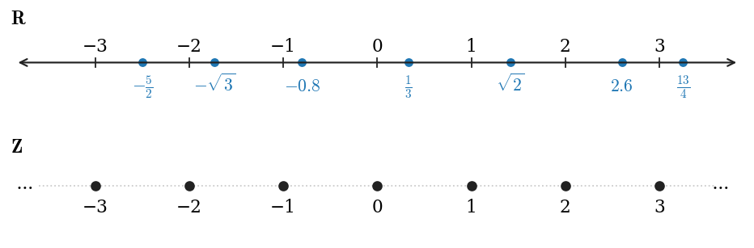

*Figure 1. The real number line with several real numbers marked, and the integers as points at fixed intervals*

The upper line in Figure 1 marks $-\frac{5}{2}$, $-\sqrt{3}$, $-0.8$, $\frac{1}{3}$, $\sqrt{2}$, $2.6$, and $\frac{13}{4}$. The real number line is called **continuous** because it is imagined to have no holes. The integers, in contrast, correspond to points located at fixed intervals along the real number line. Every integer is a real number, but because the integers are all separated from each other, the set of integers is called **discrete**. The name discrete mathematics comes from this distinction between continuous and discrete mathematical objects.

### 2.3 Set-Builder Notation

Another way to specify a set is to state the condition its elements must satisfy.

> **Definition:** **Set-builder notation**: Let $S$ be a set and let $P(x)$ be a property that elements of $S$ may or may not satisfy. The set of all elements $x$ in $S$ such that $P(x)$ is true is denoted as follows.
>
> $$\lbrace x \in S \mid P(x) \rbrace$$

The left-hand brace is read "the set of all" and the vertical line is read "such that". The expression is therefore read as the set of all elements $x$ in $S$ such that $P(x)$ is true. A vertical line stands for "such that" only inside set-builder notation. In all other mathematical contexts, "such that" is abbreviated as s.t., s.th., or the symbol $\ni$.

Occasionally one writes $\lbrace x \mid P(x) \rbrace$ without being specific about where the element $x$ comes from. Unrestricted use of this notation, however, leads to genuine contradictions in set theory; Russell's paradox, the best-known example, is treated in Chapter 6. Hence $\lbrace x \mid P(x) \rbrace$ is used only as a convenience in cases where the set $S$ could be specified if necessary.

**Example 1.2.2 (Using the Set-Builder Notation).** Given that $\mathbf{R}$, $\mathbf{Z}$, and $\mathbf{Z}^{+}$ are the sets of all real numbers, all integers, and all positive integers, describe the following sets.

- (a) $\lbrace x \in \mathbf{R} \mid -2 < x < 5 \rbrace$ is the **open interval** of real numbers strictly between $-2$ and 5. It does not contain $-2$ or 5, and it has infinitely many real numbers as elements.
- (b) $\lbrace x \in \mathbf{Z} \mid -2 < x < 5 \rbrace$ is the set of all integers strictly between $-2$ and 5, and it equals $\lbrace -1, 0, 1, 2, 3, 4 \rbrace$.
- (c) Since all the integers in $\mathbf{Z}^{+}$ are positive, $\lbrace x \in \mathbf{Z}^{+} \mid -2 < x < 5 \rbrace = \lbrace 1, 2, 3, 4 \rbrace$.

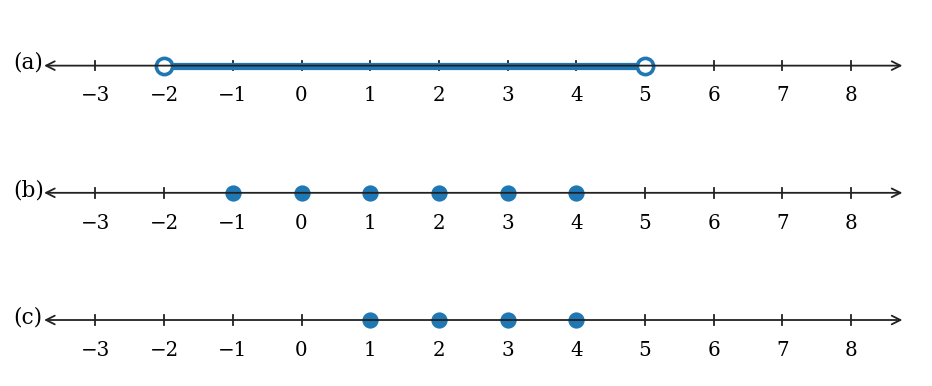

*Figure 2. The three sets obtained by applying the same condition −2 < x < 5 to the real numbers, the integers, and the positive integers*

> **Key Point:** A set in set-builder notation is determined jointly by the condition $P(x)$ and by the set $S$ from which elements are taken. The three sets in Example 1.2.2 share the same condition but differ because $S$ differs.

### 2.4 Subsets

The most basic relation between sets is that of subset.

> **Definition:** If $A$ and $B$ are sets, then $A$ is called a **subset** of $B$, written $A \subseteq B$, if, and only if, every element of $A$ is also an element of $B$. Symbolically:
>
> $$A \subseteq B \iff \text{for every } x, \text{ if } x \in A \text{ then } x \in B$$
>
> The phrases $A$ is contained in $B$ and $B$ contains $A$ are alternative ways of saying the same thing.

Negating the definition of subset, for a set $A$ not to be a subset of a set $B$ means that there is at least one element of $A$ that is not an element of $B$.

$$
A \nsubseteq B \iff \text{there is at least one element } x \text{ such that } x \in A \text{ and } x \notin B
$$

> **Definition:** Let $A$ and $B$ be sets. $A$ is a **proper subset** of $B$, written $A \subsetneq B$, if, and only if, every element of $A$ is in $B$ but there is at least one element of $B$ that is not in $A$.

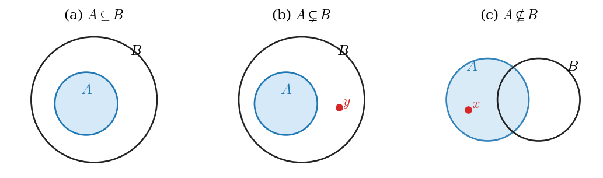

*Figure 3. A subset, a proper subset, and a set that is not a subset*

In Figure 3(b), the element $y$ is in $B$ but not in $A$, so $A$ is a proper subset of $B$. In Figure 3(c), the element $x$ is in $A$ but not in $B$, so $A \nsubseteq B$.

> **Caution:** Some books write a proper subset as $A \subset B$, while others use the same symbol $\subset$ to mean $\subseteq$. When reading the symbol, check the book's definition first. In this chapter, a subset is written $\subseteq$ and a proper subset $\subsetneq$.

**Example 1.2.3 (Subsets).** Let $A = \mathbf{Z}^{+}$, $B = \lbrace n \in \mathbf{Z} \mid 0 \le n \le 100 \rbrace$, and $C = \lbrace 100, 200, 300, 400, 500 \rbrace$. Evaluate the truth and falsity of each statement.

- (a) $B \subseteq A$: False. Zero is in $B$ but is not a positive integer, so it is not in $A$. Thus $B \nsubseteq A$.
- (b) $C$ is a proper subset of $A$: True. Each element of $C$ is a positive integer and hence in $A$, and there are elements of $A$, such as 1, that are not in $C$.
- (c) $C$ and $B$ have at least one element in common: True. 100 is in both sets.
- (d) $C \subseteq B$: False. 200 is in $C$ but not in $B$.
- (e) $C \subseteq C$: True. Every element of $C$ is an element of $C$. In general, the definition of subset implies that every set is a subset of itself.

Combining (e) with the definition of proper subset, every set is a subset of itself, but no set is a proper subset of itself, because $A$ cannot have an element that is not in $A$.

**Example 1.2.4 (Distinction between $\in$ and $\subseteq$).** Of the following statements, only (a), (d), and (f) are true.

| Statement | Result | Reason |
|:-----|:-----|:-----|
| (a) $2 \in \lbrace 1, 2, 3 \rbrace$ | True | 2 is one of the listed elements. |
| (b) $\lbrace 2 \rbrace \in \lbrace 1, 2, 3 \rbrace$ | False | The only elements of $\lbrace 1, 2, 3 \rbrace$ are 1, 2, and 3, and the number 2 is not equal to the set $\lbrace 2 \rbrace$. |
| (c) $2 \subseteq \lbrace 1, 2, 3 \rbrace$ | False | For this to hold, 2 would have to be a set all of whose elements are in $\lbrace 1, 2, 3 \rbrace$, but 2 is not a set. |
| (d) $\lbrace 2 \rbrace \subseteq \lbrace 1, 2, 3 \rbrace$ | True | The only element of $\lbrace 2 \rbrace$, namely 2, is in $\lbrace 1, 2, 3 \rbrace$. |
| (e) $\lbrace 2 \rbrace \subseteq \lbrace \lbrace 1 \rbrace, \lbrace 2 \rbrace \rbrace$ | False | The element 2 of $\lbrace 2 \rbrace$ is equal to neither $\lbrace 1 \rbrace$ nor $\lbrace 2 \rbrace$, so it is not an element of the right-hand set. |
| (f) $\lbrace 2 \rbrace \in \lbrace \lbrace 1 \rbrace, \lbrace 2 \rbrace \rbrace$ | True | The elements of the right-hand set are $\lbrace 1 \rbrace$ and $\lbrace 2 \rbrace$, and $\lbrace 2 \rbrace$ is one of them. |

*Table 4. Deciding membership and subset statements*

> **Caution:** $\in$ is a relation between an element and a set, while $\subseteq$ is a relation between two sets. To check $a \in X$, see whether $a$ itself appears in the list of elements of $X$; to check $Y \subseteq X$, see whether each element of $Y$ appears in the list of elements of $X$.

### 2.5 Ordered Pairs and Ordered n-Tuples

When Cantor's set theory appeared in the late nineteenth century, it began to seem possible to build all branches of mathematics from set theory and logic alone. A major stumbling block was how to define an ordered pair as a set. Since a set is unaffected by the order in which its elements are listed, $\lbrace a, b \rbrace$ and $\lbrace b, a \rbrace$ are the same set, whereas an ordered pair must be able to indicate which element comes first.

In 1914, Norbert Wiener and Felix Hausdorff each gave definitions of an ordered pair as a certain type of set, but both were somewhat awkward. In 1921, Kazimierz Kuratowski published the following definition, which has since become standard.

$$
(a, b) = \lbrace \lbrace a \rbrace, \lbrace a, b \rbrace \rbrace
$$

The elements of this set are $\lbrace a \rbrace$ and $\lbrace a, b \rbrace$. If $a \ne b$, the two elements are distinct sets, and $a$ is in both sets whereas $b$ is in only one. This difference distinguishes $a$ as the first element and $b$ as the second element. If $a = b$, the set becomes $\lbrace \lbrace a \rbrace, \lbrace a, a \rbrace \rbrace = \lbrace \lbrace a \rbrace \rbrace$, and $a$ is both the first and the second element.

It can be checked step by step that this definition has the property expected of ordered pairs: if $\lbrace \lbrace a \rbrace, \lbrace a, b \rbrace \rbrace = \lbrace \lbrace c \rbrace, \lbrace c, d \rbrace \rbrace$, then $a = c$ and $b = d$. The converse (if $a = c$ and $b = d$, the two sets are equal) follows by direct substitution.

1. **Case $a = b$.** The left-hand set is $\lbrace \lbrace a \rbrace \rbrace$, which has one element. The right-hand set must also have one element, so $\lbrace c \rbrace = \lbrace c, d \rbrace$ and therefore $d = c$. Now $\lbrace \lbrace a \rbrace \rbrace = \lbrace \lbrace c \rbrace \rbrace$ gives $\lbrace a \rbrace = \lbrace c \rbrace$, so $a = c$. Altogether $a = b = c = d$, so $a = c$ and $b = d$.
2. **Case $a \ne b$.** The left-hand set has two elements: the one-element set $\lbrace a \rbrace$ and the two-element set $\lbrace a, b \rbrace$. The right-hand set must also have two elements, so $c \ne d$. The one-element members of the two sets must be equal, so $\lbrace a \rbrace = \lbrace c \rbrace$, that is, $a = c$. The two-element members must also be equal, so $\lbrace a, b \rbrace = \lbrace c, d \rbrace = \lbrace a, d \rbrace$. Hence $b \in \lbrace a, d \rbrace$, and since $b \ne a$, it follows that $b = d$.

In both cases $a = c$ and $b = d$, so Kuratowski's definition distinguishes order. However, mathematicians realized that ordered pairs could be defined entirely in terms of sets only long after ordered pairs had been used extensively, and the set notation would be cumbersome to use regularly, so $\lbrace \lbrace a \rbrace, \lbrace a, b \rbrace \rbrace$ is usually written simply as $(a, b)$.

> **Definition:** Given elements $a$ and $b$, the symbol $(a, b)$ denotes the **ordered pair** consisting of $a$ and $b$ together with the specification that $a$ is the **first element** and $b$ is the **second element**. Two ordered pairs $(a, b)$ and $(c, d)$ are equal if, and only if, $a = c$ and $b = d$.
>
> $$(a, b) = (c, d) \iff a = c \text{ and } b = d$$

**Example 1.2.5 (Ordered Pairs).**

- (a) Is $(1, 2) = (2, 1)$? No. By the definition of equality of ordered pairs, $(1, 2) = (2, 1)$ holds only if $1 = 2$ and $2 = 1$, but $1 \ne 2$.
- (b) Is $\left(3, \frac{5}{10}\right) = \left(\sqrt{9}, \frac{1}{2}\right)$? Yes. The two pairs are equal exactly when $3 = \sqrt{9}$ and $\frac{5}{10} = \frac{1}{2}$, and both equations are true since $\sqrt{9} = 3$ and $\frac{5}{10} = \frac{1}{2}$.
- (c) What is the first element of $(1, 1)$? It is 1. The first and the second elements are both 1.

The ordered n-tuple generalizes the notation for an ordered pair to any finite number of elements, and it takes both order and multiplicity into account.

> **Definition:** Let $n$ be a positive integer and let $x_1, x_2, \ldots, x_n$ be (not necessarily distinct) elements. The **ordered n-tuple** $(x_1, x_2, \ldots, x_n)$ consists of $x_1, x_2, \ldots, x_n$ together with the ordering: first $x_1$, then $x_2$, and so forth up to $x_n$. An ordered 2-tuple is called an ordered pair, and an ordered 3-tuple is called an **ordered triple**. Two ordered n-tuples are equal if, and only if, all corresponding components are equal.
>
> $$(x_1, x_2, \ldots, x_n) = (y_1, y_2, \ldots, y_n) \iff x_1 = y_1,\ x_2 = y_2,\ \ldots,\ x_n = y_n$$

**Example 1.2.6 (Ordered n-Tuples).**

- (a) Is $(1, 2, 3, 4) = (1, 2, 4, 3)$? No. For the two ordered 4-tuples to be equal, $1 = 1$, $2 = 2$, $3 = 4$, and $4 = 3$ must all hold, but $3 \ne 4$.
- (b) Is $\left(3, (-2)^2, \frac{1}{2}\right) = \left(\sqrt{9}, 4, \frac{3}{6}\right)$? Yes. $3 = \sqrt{9}$, $(-2)^2 = 4$, and $\frac{1}{2} = \frac{3}{6}$ are all true.

> **Caution:** Sets and ordered n-tuples treat order and repetition differently. $\lbrace 1, 2, 1 \rbrace = \lbrace 1, 1, 2 \rbrace = \lbrace 1, 2 \rbrace$, but $(1, 2, 1)$ and $(1, 1, 2)$ are different ordered triples because their second components differ.

### 2.6 Cartesian Products

> **Definition:** Given sets $A_1, A_2, \ldots, A_n$, the **Cartesian product** of $A_1, A_2, \ldots, A_n$, denoted $A_1 \times A_2 \times \cdots \times A_n$, is the set of all ordered n-tuples $(a_1, a_2, \ldots, a_n)$ where $a_1 \in A_1$, $a_2 \in A_2$, $\ldots$, $a_n \in A_n$.
>
> $$A_1 \times A_2 \times \cdots \times A_n = \lbrace (a_1, a_2, \ldots, a_n) \mid a_1 \in A_1,\ a_2 \in A_2,\ \ldots,\ a_n \in A_n \rbrace$$
>
> In particular, $A_1 \times A_2 = \lbrace (a_1, a_2) \mid a_1 \in A_1 \text{ and } a_2 \in A_2 \rbrace$ is the Cartesian product of $A_1$ and $A_2$.

**Example 1.2.7 (Cartesian Products).** Let $A = \lbrace x, y \rbrace$, $B = \lbrace 1, 2, 3 \rbrace$, and $C = \lbrace a, b \rbrace$. Here $x$, $y$, $a$, and $b$ are not variables but distinct symbols used as elements.

(a) The first component is taken from $A$ and the second from $B$.

$$
A \times B = \lbrace (x, 1), (y, 1), (x, 2), (y, 2), (x, 3), (y, 3) \rbrace
$$

(b) Reversing the order, the first component comes from $B$.

$$
B \times A = \lbrace (1, x), (1, y), (2, x), (2, y), (3, x), (3, y) \rbrace
$$

(c) The product of a set with itself is also defined.

$$
A \times A = \lbrace (x, x), (x, y), (y, x), (y, y) \rbrace
$$

(d) $A \times B$ has 6 elements, the number of elements of $A$, 2, times the number of elements of $B$, 3. $B \times A$ also has $3 \times 2 = 6$ elements, and $A \times A$ has $2 \times 2 = 4$. This is why it makes sense to call a Cartesian product a product, and the counting principle is generalized as the multiplication rule in Chapter 9.

(e) Since $A \times B$ is a set, it may itself be used to make up another Cartesian product. $(A \times B) \times C$ is the set of ordered pairs whose first component is an element of $A \times B$, that is, an ordered pair.

$$
\begin{aligned}
(A \times B) \times C &= \lbrace (u, v) \mid u \in A \times B \text{ and } v \in C \rbrace \\
&= \lbrace ((x, 1), a), ((x, 2), a), ((x, 3), a), ((y, 1), a), ((y, 2), a), ((y, 3), a), \\
&\qquad ((x, 1), b), ((x, 2), b), ((x, 3), b), ((y, 1), b), ((y, 2), b), ((y, 3), b) \rbrace
\end{aligned}
$$

(f) $A \times B \times C$ is superficially similar to $(A \times B) \times C$ but is not the same mathematical object. $(A \times B) \times C$ is a set of ordered pairs one of whose components is itself an ordered pair, whereas $A \times B \times C$ is a set of ordered triples.

$$
\begin{aligned}
A \times B \times C &= \lbrace (u, v, w) \mid u \in A,\ v \in B, \text{ and } w \in C \rbrace \\
&= \lbrace (x, 1, a), (x, 2, a), (x, 3, a), (y, 1, a), (y, 2, a), (y, 3, a), \\
&\qquad (x, 1, b), (x, 2, b), (x, 3, b), (y, 1, b), (y, 2, b), (y, 3, b) \rbrace
\end{aligned}
$$

Both sets have $2 \times 3 \times 2 = 12$ elements, but, for example, $((x, 1), a)$ is an ordered pair and $(x, 1, a)$ is an ordered triple, so they are different elements.

(g) $\mathbf{R} \times \mathbf{R}$ is the set of all ordered pairs $(x, y)$ where both $x$ and $y$ are real numbers. If horizontal and vertical axes are drawn on a plane and a unit length is marked off, each ordered pair in $\mathbf{R} \times \mathbf{R}$ corresponds to a unique point in the plane. The first component gives the horizontal position of the point and the second gives the vertical position. A plane with this coordinate system is called the **Cartesian plane**.

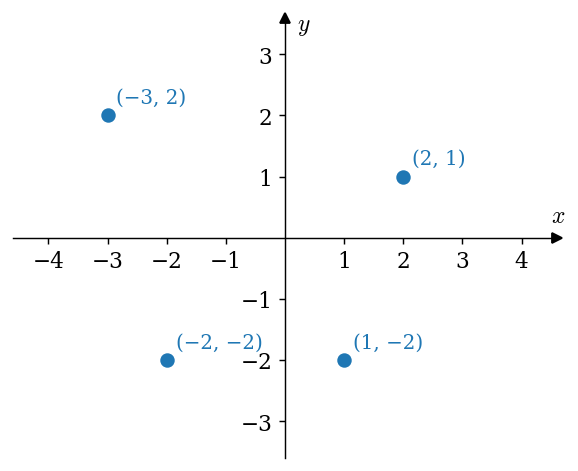

*Figure 4. The Cartesian plane with four ordered pairs plotted as points*

> **Caution:** In general $A \times B \ne B \times A$. In Example 1.2.7, $(x, 1) \in A \times B$ but $(x, 1) \notin B \times A$, because the elements of $B \times A$ have a number as their first component.

### 2.7 Strings

Another notation that is important in both mathematics and computer science is the string.

> **Definition:** Let $n$ be a positive integer and let $A$ be a finite set. A **string of length n over A** is an ordered n-tuple of elements of $A$ written without parentheses or commas. The elements of $A$ are called the **characters** of the string. The **null string** over $A$ is the string with no characters; it is often denoted $\lambda$ and is said to have length 0. If $A = \lbrace 0, 1 \rbrace$, a string over $A$ is called a **bit string**.

For example, the ordered triple $(a, b, a)$ written as a string is $aba$, which has length 3. $0110$ is a bit string of length 4.

**Example 1.2.8 (Strings).** Let $A = \lbrace a, b \rbrace$. List all the strings of length 3 over $A$ in which some character appears at least twice. The answer consists of the following 8 strings.

$$
aab,\ aba,\ baa,\ aaa,\ bba,\ bab,\ abb,\ bbb
$$

A string of length 3 over $A$ puts $a$ or $b$ in each position, so there are $2 \times 2 \times 2 = 8$ such strings in all. In other words, every string of length 3 satisfies the condition. With only two characters for three positions, some two positions must hold the same character; this argument is the pigeonhole principle of Chapter 9.

Just as computer programming must distinguish kinds of data structures and respect their notations, mathematics must distinguish the following objects.

| Notation | Object | Description |
|:-----|:-----|:-----|
| $\lbrace a, b, c \rbrace$ | Set | Three elements $a$, $b$, and $c$, with no order. |
| $\lbrace \lbrace a, b \rbrace, c \rbrace$ | Set | Two elements, $\lbrace a, b \rbrace$ and $c$. |
| $(a, b, c)$ | Ordered triple | Components $a$, $b$, and $c$ in that order. |
| $(a, (b, c))$ | Ordered pair | First element $a$, second element the ordered pair $(b, c)$. |
| $abc$ | String | A string of length 3 over $\lbrace a, b, c \rbrace$. |

*Table 5. Mathematical objects that look alike but differ*

> **[Theory of Computation]** In the theory of computation, a finite set is called an alphabet, and a set of strings over an alphabet is called a language. Automata and grammars are devices that decide whether a given string belongs to a language or generate the strings of a language, and all of this starts from the strings defined here.

---

 

## 3. The Language of Relations and Functions

### 3.1 The Intuitive Idea of a Relation

There are many kinds of relationships in the world. Two people are related by blood if they share a common ancestor, and related by marriage if one shares a common ancestor with the spouse of the other. There are also relationships between student and teacher and between people who work for the same employer.

The objects of mathematics may be related in various ways as well. Sets $A$ and $B$ may be related if $A$ is a subset of $B$, if $A$ is not a subset of $B$, or if $A$ and $B$ have at least one element in common. Numbers $x$ and $y$ may be related if $x < y$, if $x$ is a factor of $y$, or if $x^2 + y^2 = 1$. Two identifiers in a computer program may be related if they have the same first eight characters, or if the same memory location is used to store their values when the program is executed.

As a concrete example, let $A = \lbrace 0, 1, 2 \rbrace$ and $B = \lbrace 1, 2, 3 \rbrace$, and say that an element $x$ in $A$ is related to an element $y$ in $B$ if, and only if, $x < y$. Writing $x \mathrel{R} y$ as shorthand for the sentence "$x$ is related to $y$", the following hold.

$$
0 \mathrel{R} 1,\quad 0 \mathrel{R} 2,\quad 0 \mathrel{R} 3,\quad 1 \mathrel{R} 2,\quad 1 \mathrel{R} 3,\quad 2 \mathrel{R} 3
$$

These hold because $0 < 1$, $0 < 2$, $0 < 3$, $1 < 2$, $1 < 3$, and $2 < 3$. On the other hand, writing $x \not\mathrel{R} y$ for the sentence "$x$ is not related to $y$" gives $1 \not\mathrel{R} 1$, $2 \not\mathrel{R} 1$, and $2 \not\mathrel{R} 2$, because $1 \not< 1$, $2 \not< 1$, and $2 \not< 2$.

As seen in Section 2.6, $A \times B = \lbrace (x, y) \mid x \in A \text{ and } y \in B \rbrace$, which here has $3 \times 3 = 9$ elements. Marking the ordered pairs whose components are related gives the following.

| $x \backslash y$ | 1 | 2 | 3 |
|:-----|:-----|:-----|:-----|
| 0 | $(0, 1)$: related | $(0, 2)$: related | $(0, 3)$: related |
| 1 | $(1, 1)$: not related | $(1, 2)$: related | $(1, 3)$: related |
| 2 | $(2, 1)$: not related | $(2, 2)$: not related | $(2, 3)$: related |

*Table 6. The ordered pairs of A × B and whether x < y holds*

Collecting only the ordered pairs whose components are related gives the following set.

$$
\lbrace (0, 1), (0, 2), (0, 3), (1, 2), (1, 3), (2, 3) \rbrace
$$

Knowing which ordered pairs lie in this set is equivalent to knowing which elements are related to which. The relation itself can therefore be thought of as the totality of ordered pairs whose elements are related by the given condition. The formal definition of relation based on this idea was introduced by the American mathematician and logician C. S. Peirce in the nineteenth century.

### 3.2 Definition of a Relation

> **Definition:** Let $A$ and $B$ be sets. A **relation** $R$ from $A$ to $B$ is a subset of $A \times B$. Given an ordered pair $(x, y)$ in $A \times B$, $x$ is related to $y$ by $R$, written $x \mathrel{R} y$, if, and only if, $(x, y)$ is in $R$. The set $A$ is called the **domain** of $R$ and the set $B$ is called its **co-domain**.
>
> $$x \mathrel{R} y \iff (x, y) \in R, \qquad x \not\mathrel{R} y \iff (x, y) \notin R$$

**Example 1.3.1 (A Relation as a Subset).** Let $A = \lbrace 1, 2 \rbrace$ and $B = \lbrace 1, 2, 3 \rbrace$, and define a relation $R$ from $A$ to $B$ as follows: for any $(x, y) \in A \times B$,

$$
(x, y) \in R \iff \frac{x - y}{2} \text{ is an integer}
$$

(a) $A \times B = \lbrace (1, 1), (1, 2), (1, 3), (2, 1), (2, 2), (2, 3) \rbrace$. To determine the elements of $R$, examine whether each ordered pair in $A \times B$ satisfies the defining condition.

| Ordered Pair $(x, y)$ | $\frac{x - y}{2}$ | Integer? | In $R$? |
|:-----|:-----|:-----|:-----|
| $(1, 1)$ | $\frac{0}{2} = 0$ | Yes | $(1, 1) \in R$ |
| $(1, 2)$ | $\frac{-1}{2}$ | No | $(1, 2) \notin R$ |
| $(1, 3)$ | $\frac{-2}{2} = -1$ | Yes | $(1, 3) \in R$ |
| $(2, 1)$ | $\frac{1}{2}$ | No | $(2, 1) \notin R$ |
| $(2, 2)$ | $\frac{0}{2} = 0$ | Yes | $(2, 2) \in R$ |
| $(2, 3)$ | $\frac{-1}{2}$ | No | $(2, 3) \notin R$ |

*Table 7. Deciding which ordered pairs belong to the relation R of Example 1.3.1*

Thus $R = \lbrace (1, 1), (1, 3), (2, 2) \rbrace$.

(b) $1 \mathrel{R} 3$ because $(1, 3) \in R$. $2 \not\mathrel{R} 3$ because $(2, 3) \notin R$. $2 \mathrel{R} 2$ because $(2, 2) \in R$.

(c) The domain of $R$ is $\lbrace 1, 2 \rbrace$ and the co-domain is $\lbrace 1, 2, 3 \rbrace$.

$\frac{x - y}{2}$ is an integer exactly when $x - y$ is even, that is, when $x$ and $y$ are both odd or both even. Seen this way, the three ordered pairs in $R$ can be found at once without Table 7.

**Example 1.3.2 (The Circle Relation).** Define a relation $C$ from $\mathbf{R}$ to $\mathbf{R}$ as follows: for any $(x, y) \in \mathbf{R} \times \mathbf{R}$,

$$
(x, y) \in C \iff x^2 + y^2 = 1.
$$

(a) Decide whether several ordered pairs are in $C$. $x \mathrel{C} y$ means the same as $(x, y) \in C$.

| Question | Computation | Result |
|:-----|:-----|:-----|
| $(1, 0) \in C$? | $1^2 + 0^2 = 1$ | Yes |
| $(0, 0) \in C$? | $0^2 + 0^2 = 0 \ne 1$ | No |
| $\left(-\frac{1}{2}, \frac{\sqrt{3}}{2}\right) \in C$? | $\left(-\frac{1}{2}\right)^2 + \left(\frac{\sqrt{3}}{2}\right)^2 = \frac{1}{4} + \frac{3}{4} = 1$ | Yes |
| $-2 \mathrel{C} 0$? | $(-2)^2 + 0^2 = 4 \ne 1$ | No, $-2 \not\mathrel{C} 0$ |
| $0 \mathrel{C} (-1)$? | $0^2 + (-1)^2 = 1$ | Yes |
| $1 \mathrel{C} 1$? | $1^2 + 1^2 = 2 \ne 1$ | No, $1 \not\mathrel{C} 1$ |

*Table 8. Decisions for the circle relation C*

(b) The domain and co-domain of $C$ are both $\mathbf{R}$, the set of all real numbers.

(c) Plotting all points of $C$ in the Cartesian plane gives the circle of radius 1 centered at the origin.

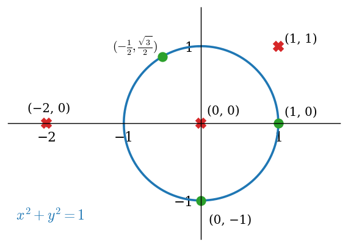

*Figure 5. The unit circle as the graph of the circle relation C, with the six ordered pairs that were tested*

In Figure 5, the green dots on the circle are ordered pairs in $C$, and the red X marks are ordered pairs not in $C$.

> **Caution:** The domain of a relation is the whole first set specified when the relation is defined. For example, no real number $y$ satisfies $2^2 + y^2 = 1$, so 2 is related to no element, yet the domain of $C$ is still $\mathbf{R}$. Do not confuse this with the calculus usage in which the domain means the set where a formula is defined.

### 3.3 Arrow Diagram of a Relation

Suppose $R$ is a relation from a set $A$ to a set $B$. The **arrow diagram** for $R$ is obtained as follows.

1. Represent the elements of $A$ as points in one region and the elements of $B$ as points in another region.
2. For each $x$ in $A$ and $y$ in $B$, draw an arrow from $x$ to $y$ if, and only if, $x$ is related to $y$ by $R$.

$$
\text{draw an arrow from } x \text{ to } y \iff x \mathrel{R} y \iff (x, y) \in R
$$

The relation $x < y$ of Section 3.1 drawn as an arrow diagram is shown in Figure 6.

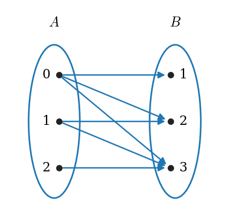

*Figure 6. Arrow diagram of the relation x < y from A = {0, 1, 2} to B = {1, 2, 3}*

**Example 1.3.3 (Arrow Diagrams of Relations).** Let $A = \lbrace 1, 2, 3 \rbrace$ and $B = \lbrace 1, 3, 5 \rbrace$, and define relations $S$ and $T$ from $A$ to $B$ as follows: for every $(x, y) \in A \times B$,

$$
(x, y) \in S \iff x < y, \qquad T = \lbrace (2, 1), (2, 5) \rbrace.
$$

$S$ is a "less than" relation. Of the nine ordered pairs in $A \times B$, the five with $x < y$ are $(1, 3)$, $(1, 5)$, $(2, 3)$, $(2, 5)$, and $(3, 5)$, so $S = \lbrace (1, 3), (1, 5), (2, 3), (2, 5), (3, 5) \rbrace$. The pairs $(1, 1)$, $(2, 1)$, $(3, 1)$, and $(3, 3)$ are not in $S$ because $1 < 1$, $2 < 1$, $3 < 1$, and $3 < 3$ are false.

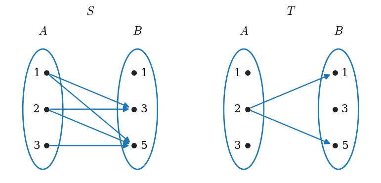

*Figure 7. Arrow diagrams of the relations S and T of Example 1.3.3*

These relations illustrate that several arrows may come out of the same element of $A$ pointing in different directions (1 and 2 in $S$, and 2 in $T$). It is also quite possible for an element of $A$ to have no arrow coming out of it (1 and 3 in $T$).

### 3.4 Functions

Section 2.5 defined ordered pairs in terms of sets, Section 2.6 defined Cartesian products in terms of ordered pairs, and Section 3.2 defined relations as subsets of Cartesian products. Thus functions can now be defined in a way that depends only on the concept of set. Although this definition is not obviously related to the way functions are usually handled, it is satisfying from a theoretical point of view and well suited to operating with functions on a computer, so computer scientists particularly like it.

> **Definition:** A **function** $F$ from a set $A$ to a set $B$ is a relation with domain $A$ and co-domain $B$ that satisfies the following two properties.
>
> 1. For every element $x$ in $A$, there is an element $y$ in $B$ such that $(x, y) \in F$.
> 2. For all elements $x$ in $A$ and $y$ and $z$ in $B$, if $(x, y) \in F$ and $(x, z) \in F$, then $y = z$.

Stated less formally, a relation $F$ from $A$ to $B$ is a function if, and only if:

1. Every element of $A$ is the first element of an ordered pair of $F$.
2. No two distinct ordered pairs in $F$ have the same first element.

In most mathematical situations a function is thought of as sending elements of one set, the domain, to elements of another set, the co-domain. If $F$ is a function from $A$ to $B$, then for a given element $x$ of $A$, property 1 guarantees that at least one element of $B$ is related to $x$, and property 2 guarantees that there is at most one such element. Hence each element of the domain corresponds to exactly one element of the co-domain, and that element can be given a special name.

> **Definition:** If $F$ is a function from $A$ to $B$, then for any element $x$ in $A$, the unique element of $B$ that is related to $x$ by $F$ is denoted $F(x)$, which is read "$F$ of $x$". That is, $x \mathrel{F} y \iff y = F(x)$.

**Example 1.3.4 (Functions and Relations on Finite Sets).** Let $A = \lbrace 2, 4, 6 \rbrace$ and $B = \lbrace 1, 3, 5 \rbrace$. Determine which of the relations $R$, $S$, and $T$ below are functions from $A$ to $B$.

- (a) $R = \lbrace (2, 5), (4, 1), (4, 3), (6, 5) \rbrace$
- (b) For every $(x, y) \in A \times B$, $(x, y) \in S \iff y = x + 1$
- (c) $T$ is defined by the arrow diagram on the right of Figure 8, that is, $T = \lbrace (2, 5), (4, 1), (6, 1) \rbrace$.

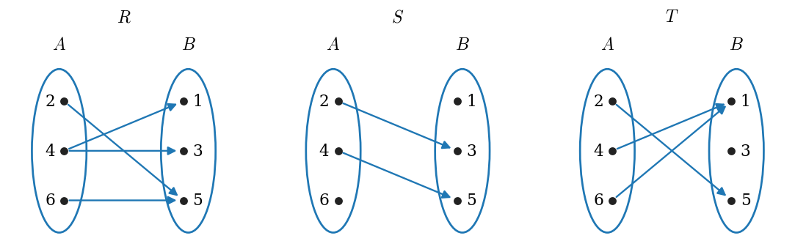

*Figure 8. Arrow diagrams of the relations R, S, and T of Example 1.3.4*

- (a) $R$ is not a function because it does not satisfy property 2. The ordered pairs $(4, 1)$ and $(4, 3)$ have the same first element but different second elements. In the arrow diagram, two arrows come out of 4: one points to 1 and the other to 3.
- (b) $S$ is not a function because it does not satisfy property 1. Since $2 + 1 = 3 \in B$ and $4 + 1 = 5 \in B$, $S = \lbrace (2, 3), (4, 5) \rbrace$. But for $6 \in A$ there is no $y$ in $B$ with $y = 6 + 1 = 7$, so 6 is not the first element of any ordered pair in $S$. In the arrow diagram, no arrow comes out of 6.
- (c) $T$ is a function. Each element of $\lbrace 2, 4, 6 \rbrace$ is related to some element of $\lbrace 1, 3, 5 \rbrace$, and no element is related to more than one element. So one can write $T(2) = 5$, $T(4) = 1$, and $T(6) = 1$.

Stated in terms of the arrow diagram, the two properties become the following.

1. There is an arrow coming out of each element of the domain.
2. No element of the domain has more than one arrow coming out of it.

> **Caution:** The function conditions concern only the domain side. Several elements of the domain may go to the same element of the co-domain, as $T(4) = T(6) = 1$ in (c), and an element of the co-domain, such as 3, may receive no arrow at all. The set of all values, $\lbrace 1, 5 \rbrace$, is called the **range** of the function, and the range may differ from the co-domain. The range is defined precisely in Chapter 7.

**Example 1.3.5 (Functions and Relations on Sets of Strings).** Let $A = \lbrace a, b \rbrace$ and let $S$ be the set of all strings over $A$.

(a) Define a relation $L$ from $S$ to $\mathbf{Z}^{\text{nonneg}}$ as follows: for every string $s$ in $S$ and every nonnegative integer $n$, $(s, n) \in L$ means that the length of $s$ is $n$. Every string has one and only one length, so $L$ is a function. Since $abaaba$ has 6 characters, $L(abaaba) = 6$, and $L(bbb) = 3$.

(b) Define a relation $C$ from $S$ to $S$ as follows: for all strings $s$ and $t$ in $S$, $(s, t) \in C$ means that $t = as$. Here $as$ is the string obtained by appending $a$ on the left of the characters in $s$, and $C$ is called **concatenation** by $a$ on the left. Every string in $S$ consists only of $a$'s and $b$'s, and adding one more $a$ on the left still gives a string of $a$'s and $b$'s, so the result is again in $S$ and is uniquely determined. Hence $C$ is a function. $C(abaaba) = aabaaba$ and $C(bbb) = abbb$.

> **[Databases]** A relation (table) in a relational database is a subset of the Cartesian product $D_1 \times \cdots \times D_n$ of the sets $D_1, \ldots, D_n$ of values that the columns may take, and each row of the table is one ordered n-tuple. The binary relation defined here is the case $n = 2$; n-ary relations are treated in Chapter 8.

### 3.5 Function Machines and Functions Defined by Formulas

It is useful to think of a function as a machine. If $f$ is a function from $X$ to $Y$ and an input $x$ of $X$ is given, $f$ can be viewed as a machine that processes $x$ in a certain way to produce the output $f(x)$. This is called a **function machine**.

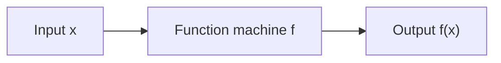

*Figure 9. A function machine that processes the input x to produce the output f(x)*

**Example 1.3.6 (Functions Defined by Formulas).**

- The **squaring function** $f$ is the function from $\mathbf{R}$ to $\mathbf{R}$ defined by $f(x) = x^2$ for every real number $x$. No matter what real number is substituted for $x$, the output is the square of that number. This can be written $f(\square) = \square^2$, or $f: x \mapsto x^2$ to say that $f$ sends each real number $x$ to $x^2$. For example, $f(-3) = 9$ and $f(0.5) = 0.25$.
- The **successor function** $g$ is the function from $\mathbf{Z}$ to $\mathbf{Z}$ defined by $g(n) = n + 1$. No matter what integer is substituted, the output is that number plus 1, written $g: n \mapsto n + 1$. For example, $g(-3) = -2$ and $g(99) = 100$.
- An example of a **constant function** is the function $h$ from $\mathbf{Q}$ to $\mathbf{Z}$ defined by $h(r) = 2$ for all rational numbers $r$. No matter what the input, the output is always 2, written $h: r \mapsto 2$. For example, $h\left(\frac{1}{2}\right) = 2$ and $h(-7) = 2$.

In the formula $f(x) = x^2$, $x$ is a **dummy variable**. Any other symbol could replace it, as long as the replacement is made everywhere $x$ appears; for example, $f(t) = t^2$ describes the same function.

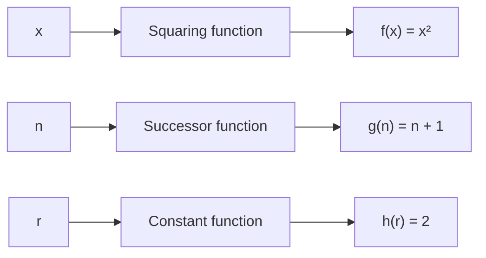

*Figure 10. Function machines for the squaring, successor, and constant functions*

A function is an entity in its own right. It can be thought of as a certain relationship between sets or as an input/output machine that operates according to a certain rule. This is why a function is generally denoted by a single symbol or string of symbols, such as $f$, $G$, $\log$, or $\sin$.

### 3.6 Equality of Functions

A relation is a subset of a Cartesian product, and a function is a special kind of relation. Specifically, if $f$ and $g$ are functions from a set $A$ to a set $B$, then the following hold.

$$
f = \lbrace (x, y) \in A \times B \mid y = f(x) \rbrace, \qquad g = \lbrace (x, y) \in A \times B \mid y = g(x) \rbrace
$$

Two functions are equal when these two sets are equal, which gives the following equality condition.

$$
f = g \iff f(x) = g(x) \text{ for all } x \text{ in } A
$$

**Example 1.3.7 (Equality of Functions).** Define functions $f$ and $g$ from $\mathbf{R}$ to $\mathbf{R}$ by the following formulas for every $x \in \mathbf{R}$.

$$
f(x) = |x|, \qquad g(x) = \sqrt{x^2}
$$

$f = g$, because the absolute value of any real number equals the square root of its square. Using the fact that the symbol $\sqrt{\ }$ denotes the nonnegative square root, check this by cases.

1. If $x \ge 0$, then $x$ is a nonnegative square root of $x^2$, so $\sqrt{x^2} = x = |x|$.
2. If $x < 0$, then $-x > 0$ and $(-x)^2 = x^2$, so $\sqrt{x^2} = -x$, and by the definition of absolute value $|x| = -x$. Hence $\sqrt{x^2} = |x|$.

For example, with $x = -3$, $f(-3) = |-3| = 3$ and $g(-3) = \sqrt{9} = 3$. Since $f(x) = g(x)$ for all $x \in \mathbf{R}$, $f = g$.

> **Caution:** Equality of functions is decided by the values at every element of the domain, not by the appearance of the formulas. As in Example 1.3.7, formulas that look different may define the same function. This equality condition also concerns two functions with the same domain and the same co-domain.

---

 

## 4. The Language of Graphs

### 4.1 The Intuitive Idea of a Graph

An organization is forming teams of three people for several projects and wants as many members of each team as possible to have worked together successfully before. Each member therefore lists the people they have previously worked with.

| Name | Previous Partners |
|:-----|:-----|
| Ana | Dan, Flo |
| Bev | Cai, Flo, Hal |
| Cai | Bev, Flo |
| Dan | Ana, Ed |
| Ed | Dan, Hal |
| Flo | Cai, Bev, Ana |
| Gia | Hal |
| Hal | Gia, Ed, Bev, Ira |
| Ira | Hal |

*Table 9. Previous partners of each member*

Drawing each person as a dot and joining two people who worked together with a line gives Figure 11.

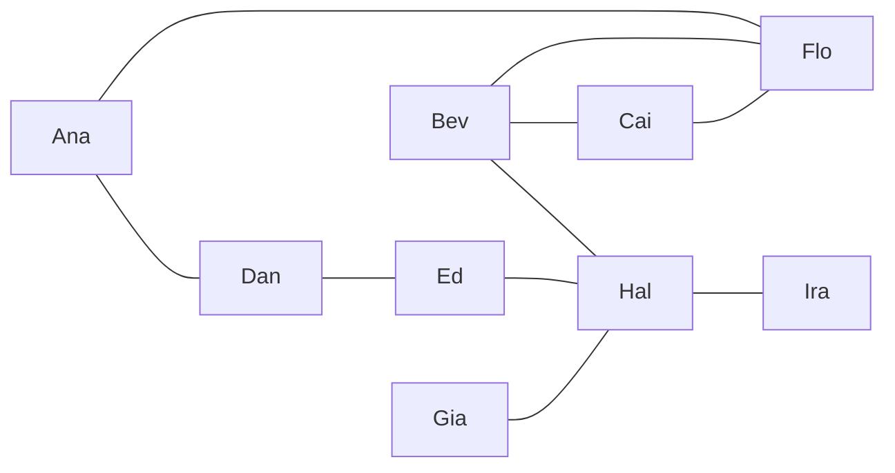

*Figure 11. A graph of previous partnerships*

In the drawing, Bev, Cai, and Flo are all joined to one another, so it is reasonable for these three to form one team. Removing these three leaves Figure 12.

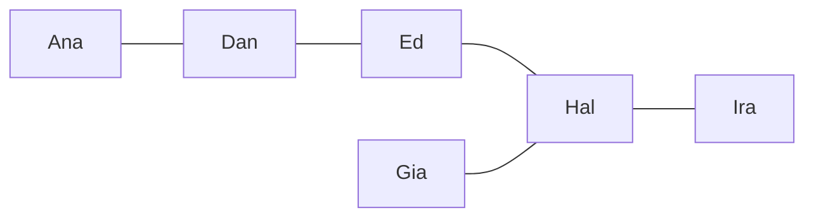

*Figure 12. The partnerships remaining after Bev, Cai, and Flo are removed*

The only person Gia and Ira have worked with is Hal. So placing Hal on the same team as Ed would leave Gia and Ira on a team with no previous partner. If instead Hal is placed on a team with Gia and Ira, the remaining team consists of Ana, Dan, and Ed, and since Ana and Dan, and Dan and Ed, have worked together, everyone on both teams works with a previous partner.

Pictures of this kind represent a structure called a **graph**. Its dots are **vertices** (singular **vertex**), and the lines joining vertices are **edges**. A drawing may show two edges crossing at a point that is not a vertex, and such a crossing point is not a vertex of the graph. This notion of graph is unrelated to the graph of an equation or of a function.

### 4.2 Definition and Terminology of Graphs

A graph is a mathematical structure for modeling relationships between pairs of objects. It is made up of a set of vertices and a set of edges, each edge joining a pair of vertices, and the two sets are sometimes written together as $G = (V, E)$ with vertex set $V$ and edge set $E$. An edge may be drawn straight or curved, and it joins either two different vertices or a vertex to itself.

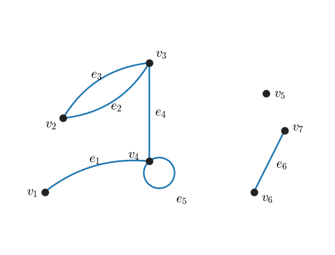

*Figure 13. A graph with parallel edges, a loop, and an isolated vertex*

In Figure 13 the vertices are labeled with $v$'s and the edges with $e$'s. An edge that connects a vertex to itself, such as $e_5$, is called a **loop**, and two edges that connect the same pair of vertices, such as $e_2$ and $e_3$, are called **parallel edges**. A vertex that is not connected by any edge to another vertex, such as $v_5$, is called an **isolated vertex**. The formal definitions of these terms are as follows.

> **Definition:** A **graph** $G$ consists of two finite sets: a nonempty set $V(G)$ of **vertices** and a set $E(G)$ of **edges**. Each edge is associated with a set of one or two vertices, called its **endpoints**, and the rule that assigns to each edge its endpoints is called the **edge-endpoint function**.
>
> An edge whose set of endpoints has a single vertex is a **loop**, and two or more distinct edges with the same set of endpoints are **parallel**. An edge **connects** its endpoints. Two vertices joined by an edge are **adjacent**, and a vertex that is an endpoint of a loop is **adjacent to itself**.
>
> An edge is **incident on** each of its endpoints, two edges incident on a common endpoint are **adjacent**, and a vertex on which no edge is incident is **isolated**.

> **Caution:** "Adjacent" is used between two vertices or between two edges, whereas "incident on" is used between an edge and a vertex that is its endpoint. Also, by definition $V(G)$ must be nonempty, but $E(G)$ may be empty. A graph with no edges consists only of isolated vertices.

A graph is usually pictured with dots for vertices and line segments or curves for edges, and any such picture determines exactly one graph.

**Example 1.4.1 (Terminology).** Consider the graph in Figure 14.

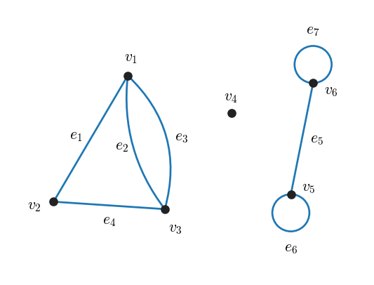

*Figure 14. A graph with six vertices and seven edges*

(a) The vertex set is $\lbrace v_1, v_2, v_3, v_4, v_5, v_6 \rbrace$ and the edge set is $\lbrace e_1, e_2, e_3, e_4, e_5, e_6, e_7 \rbrace$. The edge-endpoint function is as follows.

| Edge | Endpoints |
|:-----|:-----|
| $e_1$ | $\lbrace v_1, v_2 \rbrace$ |
| $e_2$ | $\lbrace v_1, v_3 \rbrace$ |
| $e_3$ | $\lbrace v_1, v_3 \rbrace$ |
| $e_4$ | $\lbrace v_2, v_3 \rbrace$ |
| $e_5$ | $\lbrace v_5, v_6 \rbrace$ |
| $e_6$ | $\lbrace v_5 \rbrace$ |
| $e_7$ | $\lbrace v_6 \rbrace$ |

*Table 10. Edge-endpoint function of the graph of Example 1.4.1*

(b) The items matching each term are as follows.

- Edges incident on $v_1$: $e_1$, $e_2$, $e_3$
- Vertices adjacent to $v_1$: $v_2$, $v_3$
- Edges adjacent to $e_1$: $e_2$, $e_3$, $e_4$ ($e_2$ and $e_3$ share the endpoint $v_1$ with $e_1$, and $e_4$ shares $v_2$)
- Loops: $e_6$, $e_7$
- Parallel edges: $e_2$ and $e_3$
- Vertices adjacent to themselves: $v_5$, $v_6$
- Isolated vertex: $v_4$

The isolated vertex $v_4$ does not appear in Table 10: every edge must have one or two endpoints, but nothing requires a vertex to be an endpoint of some edge.

### 4.3 Several Drawings of the Same Graph

A picture determines its graph, but the converse fails: one graph can be drawn in many ways, with edges of different lengths and shapes and with vertices in different positions. Only the vertex set, the edge set, and the edge-endpoint function matter.

**Example 1.4.2 (Drawing More Than One Picture for a Graph).** Consider the graph with vertex set $\lbrace v_1, v_2, v_3, v_4 \rbrace$, edge set $\lbrace e_1, e_2, e_3, e_4 \rbrace$, and the following edge-endpoint function.

| Edge | Endpoints |
|:-----|:-----|
| $e_1$ | $\lbrace v_1, v_3 \rbrace$ |
| $e_2$ | $\lbrace v_2, v_4 \rbrace$ |
| $e_3$ | $\lbrace v_2, v_4 \rbrace$ |
| $e_4$ | $\lbrace v_3 \rbrace$ |

*Table 11. Edge-endpoint function of the graph of Example 1.4.2*

Drawings (a) and (b) in Figure 15 both represent this graph. In (a), $e_1$ is drawn crossing the parallel edges $e_2$ and $e_3$, and in (b) the two parts are drawn apart, but both drawings have the edge-endpoint function of Table 11.

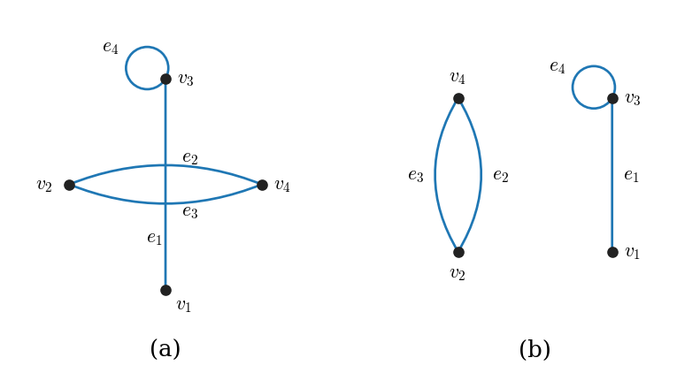

*Figure 15. Two drawings of the same graph*

**Example 1.4.3 (Labeling Drawings to Show They Represent the Same Graph).** Label the vertices and edges of the two drawings in Figure 16, a five-pointed star (a) and a regular pentagon (b), so that both drawings represent the same graph.

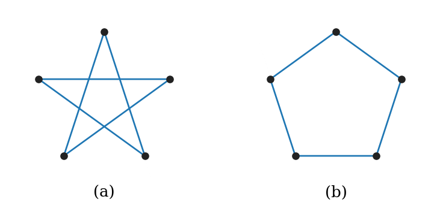

*Figure 16. Unlabeled drawings shaped as a five-pointed star and a regular pentagon*

Imagine putting one end of a piece of string at the top vertex of (a), and call this vertex $v_1$. Lay the string to the adjacent vertex on the lower right and call it $v_2$, then lay it to the adjacent vertex on the upper left and call it $v_3$. Continue in the same way, calling the upper right vertex $v_4$ and the lower left vertex $v_5$, and finally return to the top vertex $v_1$. Name the edges in the order the string passes over them: the first edge $e_1$, the second $e_2$, and so forth up to $e_5$.

Now imagine picking up the piece of string, together with its labels, and repositioning it as a regular pentagon. Then $v_1, v_2, v_3, v_4, v_5$ go around the vertices of the pentagon in order, and the edges $e_1, \ldots, e_5$ become the sides of the pentagon. This is the same as (b), so both drawings represent the same graph.

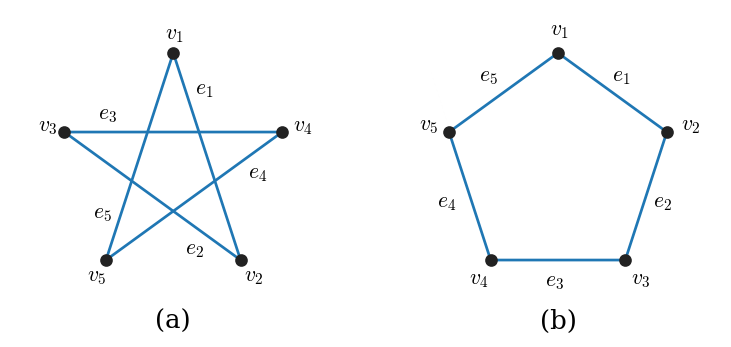

*Figure 17. The star-shaped and pentagon-shaped drawings labeled so that they represent the same graph*

| Edge | Endpoints |
|:-----|:-----|
| $e_1$ | $\lbrace v_1, v_2 \rbrace$ |
| $e_2$ | $\lbrace v_2, v_3 \rbrace$ |
| $e_3$ | $\lbrace v_3, v_4 \rbrace$ |
| $e_4$ | $\lbrace v_4, v_5 \rbrace$ |
| $e_5$ | $\lbrace v_5, v_1 \rbrace$ |

*Table 12. Edge-endpoint function of the graph represented by both drawings in Example 1.4.3*

> **Note:** Asking whether two drawings can be labeled so that they represent the same structure is the same as asking whether two graphs are isomorphic. Isomorphism is defined precisely, together with methods for deciding it, in Chapter 10.

### 4.4 Networks Represented by Graphs

Graphs are effective for solving problems because a single picture can capture a complicated situation, and that picture can be studied both by eye and by computer.

**Example 1.4.4 (Using a Graph to Represent a Network).** Telephone systems, power grids, gas pipelines, and airline routes are all naturally modeled by graphs, and so are computer networks of every size, from a local area network to the worldwide Internet. Designing such a system involves deciding which connections to build, for instance to keep the cost low or to improve some kind of service. Figure 18 shows a common network structure called the **hub-and-spoke model**.

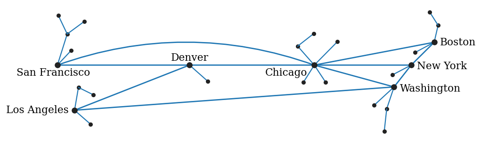

*Figure 18. A hub-and-spoke network in which major cities act as hubs and surrounding points are attached as spokes*

In Figure 18 the named cities are **hubs** connected to one another by edges, and each hub has small unnamed vertices, the **spokes**, attached to it. A spoke is connected only to its own hub, so travel from a spoke to another region must pass through a hub. In particular, Chicago is connected to San Francisco, Denver, Boston, New York, and Washington, making it the hub where the most edges meet.

**Example 1.4.5 (Using a Graph to Represent the World Wide Web).** The World Wide Web consists of documents on the Internet, called webpages, that are linked to one another, and a user of a Web browser jumps from page to page by clicking hyperlinks. Regarding webpages as vertices and hyperlinks as edges turns the whole Web into one enormous graph. Drawing only a minute fraction of the hyperlink connections radiating in and out from the Wikipedia main page already gives a dense tangle of vertices. Because the amount of information on the Web is so vast, search engines use algorithms that find information efficiently in such graphs. Since a hyperlink goes in a direction from one page to another, this graph is more precisely regarded as a directed graph in the sense of Section 4.5.

### 4.5 Directed Graphs

A **directed graph** differs from an (undirected) graph in one respect: each edge corresponds to an ordered pair of vertices instead of a set of vertices. An edge can therefore be drawn as an arrow from the first vertex of its pair to the second.

> **Definition:** A **directed graph**, or **digraph**, $G$ consists of two finite sets: a nonempty set $V(G)$ of vertices and a set $D(G)$ of **directed edges**, where each directed edge is associated with an ordered pair of vertices called its endpoints. If edge $e$ is associated with the ordered pair $(v, w)$ of vertices, then $e$ is said to be the (directed) edge from $v$ to $w$.

Each directed graph has an associated ordinary (undirected) graph, obtained by ignoring the directions of the edges.

**Example 1.4.6 (Using a Graph to Represent Knowledge).** Many artificial intelligence systems store the information they gather in a **knowledge base** inside the computer. Thanks to how the knowledge is organized and how the program works, the system can do more than return stored data unchanged: built-in rules of inference let it deduce facts that were never entered. Told that the Los Angeles Times is a big-city daily and that big-city dailies contain national news, for example, such a program can conclude that the Los Angeles Times contains national news. Figure 19 is a directed graph representing a simplified knowledge base about periodical publications.

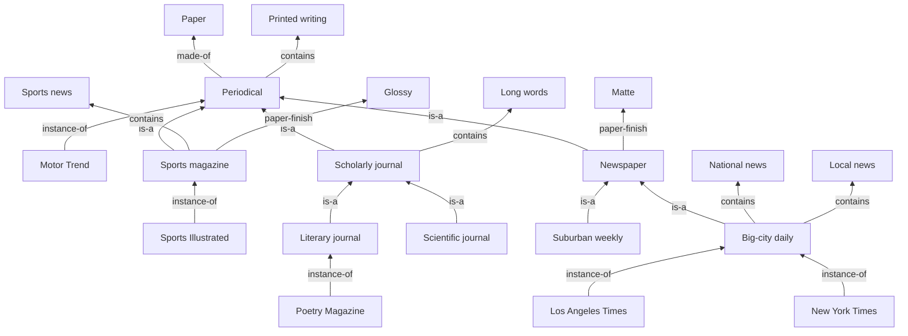

*Figure 19. A directed graph representing a knowledge base about periodicals*

According to this knowledge base, what paper finish does the New York Times use? The instance-of arrow from New York Times to big-city daily says that the New York Times is a big-city daily. The is-a arrow from big-city daily to newspaper says that every big-city daily is a newspaper, and the paper-finish arrow from newspaper to matte says that newspapers are printed on matte paper. So the New York Times uses a matte finish. This inference amounts to finding a way from New York Times to matte by following arrows in the directed graph.

### 4.6 Solving a Puzzle with a Graph

**Example 1.4.7 (Vegetarians and Cannibals).** The following puzzle is a version of a well-known example from artificial intelligence. Every inhabitant of an island is either a vegetarian or a cannibal. Two vegetarians and two cannibals stand on the left bank of a river with a boat that carries at most two people, and all four must be brought to the right bank. The difficulty is a safety rule: on neither bank may the cannibals ever outnumber the vegetarians, or the vegetarians are in danger.

> **Note:** The rule must be read as applying only to a bank where at least one vegetarian is present. In the state $(c / Bvvc)$, which appears in the solution of Figure 20, the left bank holds a single cannibal; if the rule also applied to banks without vegetarians, this state would be forbidden and the solution would fail.

A notation for how the vegetarians, the cannibals, and the boat are arranged on the two banks makes a systematic approach possible. $v$ stands for a vegetarian, $c$ for a cannibal, and $B$ for the boat; the state of the left bank is written to the left of the slash and the state of the right bank to its right. For example, $(vvc / Bc)$ means that two vegetarians and one cannibal are on the left bank and one cannibal and the boat are on the right bank. The initial state is $(vvccB /)$, and the goal is $(/ Bvvcc)$, in which everyone and the boat are on the right bank.

Now construct a graph whose vertices are the arrangements that can be reached by a sequence of legal moves from the initial state. Connect vertex $x$ to vertex $y$ if $y$ can be reached from $x$ in one legal move. From the initial state, five boatloads are possible; checking each gives the following.

- One vegetarian and one cannibal cross: $(vc / Bvc)$. Each bank has 1 vegetarian and 1 cannibal, so this is allowed.
- Two cannibals cross: $(vv / Bcc)$. The right bank has no vegetarian, so this is allowed.
- One cannibal crosses: $(vvc / Bc)$. Allowed.
- Two vegetarians cross: $(cc / Bvv)$. The left bank has no vegetarian, so this is allowed.
- One vegetarian crosses: $(vcc / Bv)$. On the left bank 2 cannibals outnumber 1 vegetarian, so this is forbidden.

Hence draw edges from $(vvccB /)$ to $(vc / Bvc)$, $(vv / Bcc)$, $(vvc / Bc)$, and $(cc / Bvv)$. Since each legal move is reversible, undirected edges are used rather than directed ones. From $(vc / Bvc)$, the only legal moves are to go back to $(vvccB /)$ or for the vegetarian on the right to bring the boat back, giving $(vvcB / c)$. Continuing this process until $(/ Bvvcc)$ is reached gives the graph of Figure 20.

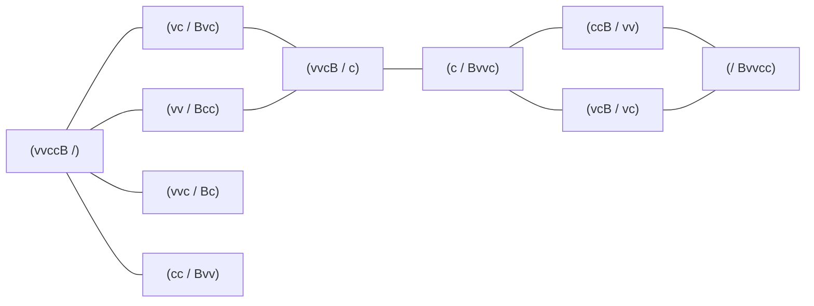

*Figure 20. A graph of the states and moves of the vegetarians and cannibals puzzle*

Finding a way from the initial state to the goal in the graph solves the puzzle. One such sequence is the following.

$$
(vvccB /) \to (vc / Bvc) \to (vvcB / c) \to (c / Bvvc) \to (ccB / vv) \to (/ Bvvcc)
$$

In words, one vegetarian and one cannibal cross, the vegetarian returns alone, the two vegetarians cross, the cannibal returns alone, and finally the two cannibals cross. Since there are two ways between the initial state and $(vvcB / c)$ and two ways between $(c / Bvvc)$ and the goal, there are $2 \times 2 = 4$ solutions with five moves. From $(vvc / Bc)$ and $(cc / Bvv)$ the only move leads back to the initial state, so these two states are dead ends.

> **Note:** Figure 20 is the graph obtained by stopping once the goal is reached. If moves that take the boat back from the goal are also explored, two more states, $(cB / vvc)$ and $(vvB / cc)$, appear, but they are not needed for the solution.

> **[Artificial Intelligence]** State-space search in artificial intelligence finds a path from the initial state to a goal state in a graph whose vertices are the possible states of a problem and whose edges are the transitions caused by single actions. Breadth-first search expands states in order of their distance from the initial state, so on this puzzle it finds a solution with the fewest moves.

### 4.7 Degree of a Vertex

> **Definition:** For a vertex $v$ of a graph $G$, the **degree** of $v$, written $\deg(v)$, is the number of edges incident on $v$, where each loop at $v$ is counted twice.

Since a loop is counted twice, the degree of a vertex can be read off a drawing of the graph by counting how many end segments of edges touch the vertex. Both ends of a loop touch the same vertex, so a loop contributes two end segments.

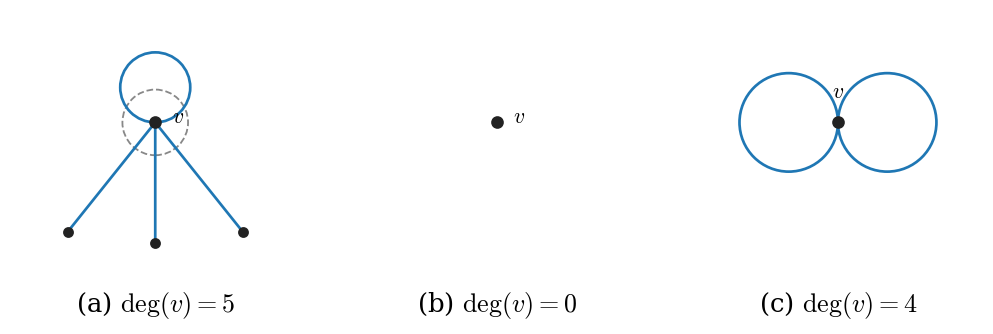

*Figure 21. Degrees of vertices: one loop and three edges, an isolated vertex, two loops*

In Figure 21(a), one loop and three ordinary edges are incident on $v$. The end segments crossing the dashed circle around $v$ are the two ends of the loop and the three ends of the other edges, so $\deg(v) = 2 + 3 = 5$. The isolated vertex in (b) has no incident edge, so $\deg(v) = 0$, and two loops are incident on $v$ in (c), so $\deg(v) = 2 + 2 = 4$.

**Example 1.4.8 (Degree of a Vertex).** Find the degree of each vertex of the graph $G$ in Figure 22.

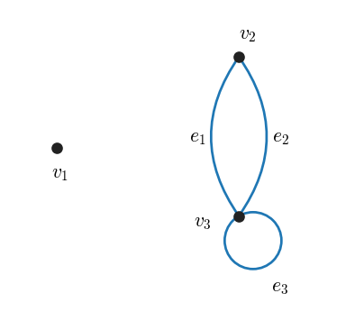

*Figure 22. A graph with an isolated vertex, parallel edges, and a loop*

- $\deg(v_1) = 0$, since no edge is incident on $v_1$ ($v_1$ is isolated).
- $\deg(v_2) = 2$, since both $e_1$ and $e_2$ are incident on $v_2$.
- $\deg(v_3) = 4$, since $e_1$ and $e_2$ are incident on $v_3$ and the loop $e_3$ is also incident on $v_3$, contributing 2 to the degree. Thus $1 + 1 + 2 = 4$.

In the same way, the degrees in the graph of Example 1.4.1 (Figure 14) are $\deg(v_1) = 3$ ($e_1$, $e_2$, $e_3$), $\deg(v_2) = 2$ ($e_1$, $e_4$), $\deg(v_3) = 3$ ($e_2$, $e_3$, $e_4$), $\deg(v_4) = 0$, $\deg(v_5) = 1 + 2 = 3$ ($e_5$ and the loop $e_6$), and $\deg(v_6) = 1 + 2 = 3$ ($e_5$ and the loop $e_7$). The sum of the degrees is $3 + 2 + 3 + 0 + 3 + 3 = 14$, twice the number of edges, 7; in Example 1.4.8 as well, $0 + 2 + 4 = 6$ is twice the number of edges, 3. That this holds for every graph is proved in Chapter 10.

### 4.8 Graph Coloring

**Example 1.4.9 (Using a Graph to Color a Map).** Regard Figure 23 as a map with countries labeled A to J. Show that the map can be colored so that no two adjacent countries have the same color.

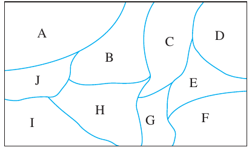

*Figure 23. A map consisting of countries A to J*

Whether a coloring works has nothing to do with the sizes or shapes of the countries; only the pattern of shared borders matters. So represent each country by a vertex and join two vertices by an edge when the countries are adjacent. A coloring of the vertices of this graph is then the same thing as a coloring of the map.

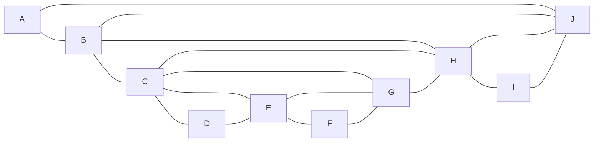

*Figure 24. A graph joining adjacent countries of the map*

In Figure 24 the degrees of the vertices are $\deg(A) = 2$, $\deg(B) = 4$, $\deg(C) = 5$, $\deg(D) = 2$, $\deg(E) = 4$, $\deg(F) = 2$, $\deg(G) = 4$, $\deg(H) = 5$, $\deg(I) = 2$, and $\deg(J) = 4$.

When assigning colors, a relatively efficient strategy is, at each stage, to give a color first to an uncolored vertex of maximum degree, that is, one connected to the largest number of other uncolored vertices. If there are several such vertices, any of them may be chosen, because a graph usually has several acceptable colorings. Coloring by this strategy proceeds as follows.

| Step | Choice | Reason |
|:-----|:-----|:-----|
| 1 | Color C blue. | C and H have the maximum degree 5; choose C. |
| 2 | Color J blue. | Of A, F, I, and J, which are not connected to C, J is connected to the most other vertices. |
| 3 | Color F blue. | F is the only vertex connected to neither C nor J. |
| 4 | Remove C, J, F and their edges. | The remaining edges are A and B, B and H, H and I, H and G, G and E, and E and D. |
| 5 | Color H gray. | In the remaining graph, H has the maximum degree 3. |
| 6 | Color E gray. | Of A, D, and E, which are not connected to H, E has the largest degree, 2, in the remaining graph. |
| 7 | Color A gray. | A is connected to neither H nor E. |
| 8 | Color B, D, G, I black. | No two of these four vertices are connected. |

*Table 13. Choosing colors starting from vertices of maximum degree*

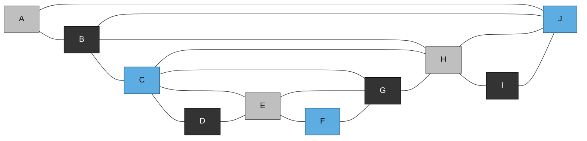

*Figure 25. The graph of the map colored with three colors*

Checking the 17 edges of Figure 25 one by one shows that no edge has the same color at both ends. Translating this coloring back to the map gives C, J, and F blue, H, A, and E gray, and B, D, G, and I black, so no two adjacent countries share a color.

This map could be colored with three colors. Two colors are not enough because, for example, B, C, and H are all adjacent to each other, so all three need different colors. Some maps even require four colors. A map of the region of Uganda, Rwanda, the Democratic Republic of the Congo, Tanzania, and Burundi in Central Africa, represented as a graph, is shown in Figure 26.

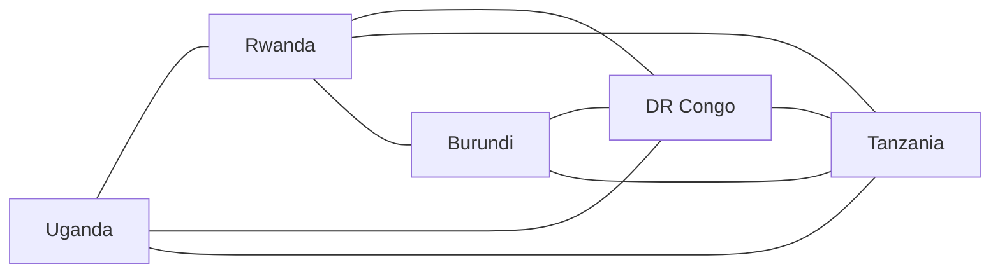

*Figure 26. A graph joining adjacent countries in part of Central Africa*

The four countries Rwanda, Burundi, the Democratic Republic of the Congo, and Tanzania are all adjacent to one another. Since all four need different colors, three colors are not enough.

A conjecture from the middle of the nineteenth century held that four colors always suffice to color a map so that adjacent regions receive different colors. Kenneth Appel and Wolfgang Haken of the University of Illinois at Urbana-Champaign proved it in 1976, and the result is now called the **four-color theorem**. Their proof translated maps into graphs and combined mathematical reasoning with a computer check of almost 2000 special cases, a novel method that was controversial at the time.

In 1950 Edward Nelson, a university student, asked how many colors are needed to color all the points of the plane so that no two points at distance exactly 1 have the same color. Nelson himself showed that three colors are not enough, and a fellow student, John Isbell, gave an example showing that seven colors suffice. Thus the minimum was one of 4, 5, 6, and 7. In 2018 Aubrey de Grey, a biologist and amateur mathematician, combined ingenuity with computer calculations to construct an example showing that four colors are not enough, so the minimum is one of 5, 6, and 7, and its exact value is still unknown.

> **Note:** The textbook states the range after Isbell's result as 4, 5, or 6, and the range after de Grey's result as 5 or 6. However, the fact that seven colors suffice does not rule out a minimum of 7, so the ranges that follow from the facts the textbook presents are 4 to 7 and 5 to 7, respectively.

A variety of problems can be modeled by representing their features with a graph and solved by coloring its vertices. For example, scheduling committee meetings in a fixed number of time slots when some members serve on several committees becomes the problem of coloring the graph whose vertices are the committees and whose edges join two committees that share a member. Equal colors mean equal time slots, so two committees joined by an edge are assigned different time slots.

> **[Algorithms]** Choosing colors starting from vertices of maximum degree is an example of a greedy algorithm, which at each step makes the choice that looks best at the moment and never revises it. The method is fast but does not always use the fewest colors, and no efficient algorithm is known that computes the minimum number of colors for a general graph.

---

 

## Concept Applications

**True/False Check:**

| Statement | Judgment and Reason |
|:-----|:-----|
| $\lbrace 1, 2, 2, 3 \rbrace$ is a set with four elements. | **F.** An element listed more than once is counted once, so the elements are the three numbers 1, 2, and 3. |
| $\emptyset$ and $\lbrace \emptyset \rbrace$ are the same set. | **F.** $\emptyset$ has no elements, while $\lbrace \emptyset \rbrace$ has the single element $\emptyset$. |
| Every set is a proper subset of itself. | **F.** Every set is a subset of itself, but it cannot have an element outside itself, so it is not a proper subset of itself. |
| If $A = \lbrace 1, 2 \rbrace$ and $B = \lbrace a \rbrace$, then $A \times B = B \times A$. | **F.** $(1, a) \in A \times B$, but the elements of $B \times A$ have first component $a$, so $(1, a) \notin B \times A$. |
| $\forall x \in \mathbf{R},\ \exists y \in \mathbf{R} \text{ s.t. } x + y = 0$ and $\exists y \in \mathbf{R} \text{ s.t. } \forall x \in \mathbf{R},\ x + y = 0$ mean the same thing. | **F.** The first is true with $y = -x$, but the second demands a single $y$ that works for every $x$, so it is false. |
| In the arrow diagram of a function, exactly one arrow must enter each element of the co-domain. | **F.** The condition is that exactly one arrow leaves each element of the domain. An element of the co-domain may receive several arrows or none. |
| A graph with no edges satisfies the definition of a graph. | **T.** Only $V(G)$ must be nonempty; $E(G)$ may be empty. |
| A loop adds 2 to the degree of its endpoint. | **T.** In the definition of degree, a loop is counted twice. |

---

 

## Summary

| Concept | Key Summary |
|:-----|:-----|
| Variable | A temporary name for an object, used to compute with an object whose value is unknown or to speak generally about all elements of a set. |
| Universal, conditional, and existential statements | A statement that a property is true for all elements, a statement that if one thing is true then another is also true, and a statement that at least one thing has the property, respectively. |
| Universal conditional statement | A statement of the form for every $x$, if $P(x)$ then $Q(x)$, which can be rewritten to look purely conditional or purely universal. |
| Universal existential and existential universal statements | In $\forall x\ \exists y$ each $x$ may have its own $y$, while in $\exists y\ \forall x$ one $y$ must work for every $x$, so swapping the order changes the meaning. |
| Sets and set-roster notation | A set is determined only by its elements (axiom of extension), so the order of listing and repetitions do not matter. |
| Set-builder notation | $\lbrace x \in S \mid P(x) \rbrace$ is the set of all elements of $S$ for which $P(x)$ is true; the same condition with a different $S$ gives a different set. |
| Subset and proper subset | $A \subseteq B$ means that every element of $A$ is in $B$; a proper subset additionally requires at least one element of $B$ that is not in $A$. |
| $\in$ and $\subseteq$ | $\in$ relates an element to a set, while $\subseteq$ relates a set to a set. |
| Ordered pairs and ordered n-tuples | $(a, b) = (c, d)$ holds only when $a = c$ and $b = d$; Kuratowski defined $(a, b)$ as $\lbrace \lbrace a \rbrace, \lbrace a, b \rbrace \rbrace$. |
| Cartesian product | $A_1 \times \cdots \times A_n$ is the set of all ordered n-tuples whose $i$th component is in $A_i$; $(A \times B) \times C$ and $A \times B \times C$ are different objects. |
| String | A string of length $n$ over a finite set $A$ is an ordered n-tuple written without parentheses or commas; the null string $\lambda$ has length 0. |
| Relation | A relation from $A$ to $B$ is a subset of $A \times B$, and $x \mathrel{R} y$ means $(x, y) \in R$. $A$ is the domain and $B$ the co-domain. |
| Arrow diagram | A relation is pictured by drawing an arrow from $x$ to $y$ if, and only if, $x \mathrel{R} y$. |
| Function | A relation in which each element of the domain is related to exactly one element of the co-domain, written $F(x)$. |
| Equality of functions | Two functions with the same domain and co-domain are equal when $f(x) = g(x)$ for every $x$ in the domain. |
| Graph | Consists of a nonempty finite set of vertices and a finite set of edges, each edge associated with one or two endpoints. |
| Graph terminology | A loop is an edge with one endpoint, parallel edges share the same set of endpoints, and an isolated vertex has no incident edge. Adjacency is used between vertices or between edges, incidence between an edge and its endpoint. |
| Directed graph | A graph in which each edge is associated with an ordered pair $(v, w)$ of vertices and goes from $v$ to $w$. |
| Degree | $\deg(v)$ is the number of edges incident on $v$, with a loop counted twice. |
| Graph coloring | Coloring vertices so that adjacent vertices get different colors; it models problems such as map coloring and scheduling. Four colors suffice for any planar map (four-color theorem). |

---

 

## Self-Check Questions

1. **Forms of statements:** Write the statement that every integer has a larger integer in the form of a universal existential statement using variables. Then write the statement with the universal and existential parts swapped and decide whether it is true.

   

   
Answer

   As a universal existential statement: for every integer $n$, there is an integer $m$ such that $m > n$, that is, $\forall n \in \mathbf{Z},\ \exists m \in \mathbf{Z} \text{ s.t. } m > n$. It is true because $m = n + 1$ works for each $n$. Swapping the order gives $\exists m \in \mathbf{Z} \text{ s.t. } \forall n \in \mathbf{Z},\ m > n$, the statement that some integer $m$ is larger than every integer. If such an $m$ existed, taking $n = m$ would require $m > m$, a contradiction. Hence it is false.

   

2. **Set-builder notation:** Write the following sets in set-roster notation. (a) $\lbrace x \in \mathbf{Z} \mid x^2 < 10 \rbrace$ (b) $\lbrace x \in \mathbf{Z}^{+} \mid x^2 < 10 \rbrace$ (c) $\lbrace x \in \mathbf{Z}^{\text{nonneg}} \mid x < 0 \rbrace$

   

   
Answer

   (a) The integers with $x^2 < 10$ are those with $x^2$ equal to 0, 1, 4, or 9, so the set is $\lbrace -3, -2, -1, 0, 1, 2, 3 \rbrace$. Since $(\pm 4)^2 = 16 \ge 10$, no integer from $\pm 4$ outward belongs. (b) Keeping only the positive integers gives $\lbrace 1, 2, 3 \rbrace$. (c) No nonnegative integer is less than 0, so the set is the empty set $\emptyset$.

   

3. **Elements and subsets:** Let $X = \lbrace 1, \lbrace 1 \rbrace, \lbrace 2, 3 \rbrace \rbrace$. Decide whether each statement is true. (a) $\lbrace 1 \rbrace \in X$ (b) $\lbrace 1 \rbrace \subseteq X$ (c) $\lbrace 2 \rbrace \subseteq X$ (d) $\lbrace \lbrace 2, 3 \rbrace \rbrace \subseteq X$

   

   
Answer

   The elements of $X$ are the three objects $1$, $\lbrace 1 \rbrace$, and $\lbrace 2, 3 \rbrace$. (a) True: $\lbrace 1 \rbrace$ is in the list of elements. (b) True: the only element of $\lbrace 1 \rbrace$, namely 1, is an element of $X$. (c) False: the element 2 of $\lbrace 2 \rbrace$ is not an element of $X$ (2 is only an element of $\lbrace 2, 3 \rbrace$). (d) True: the only element of $\lbrace \lbrace 2, 3 \rbrace \rbrace$, namely $\lbrace 2, 3 \rbrace$, is an element of $X$.

   

4. **Cartesian products:** Let $A = \lbrace 0, 1 \rbrace$ and $B = \lbrace a, b, c \rbrace$. Write $A \times B$ in set-roster notation and find the numbers of elements of $A \times B$, $B \times A$, and $A \times A \times A$. Is $(0, a) \in B \times A$?

   

   
Answer

   $A \times B = \lbrace (0, a), (0, b), (0, c), (1, a), (1, b), (1, c) \rbrace$, which has $2 \times 3 = 6$ elements. $B \times A$ also has $3 \times 2 = 6$ elements, and $A \times A \times A$ has $2 \times 2 \times 2 = 8$. The first component of an element of $B \times A$ must be in $B$, and $0 \notin B$, so $(0, a) \notin B \times A$.

   

5. **Strings:** List all bit strings of length 3 over $\lbrace 0, 1 \rbrace$ in which 1 appears exactly once. How many bit strings of length 3 are there in all?

   

   
Answer

   Choosing the position of the 1 gives the three strings $100$, $010$, and $001$. A bit string of length 3 puts 0 or 1 in each position, so there are $2 \times 2 \times 2 = 8$ in all.

   

6. **Deciding relations and functions:** Let $A = \lbrace 1, 2, 3 \rbrace$ and $B = \lbrace 1, 2, 3, 4 \rbrace$, and define a relation $R$ from $A$ to $B$ by $(x, y) \in R \iff y = 2x$. Write $R$ in set-roster notation and decide whether $R$ is a function.

   

   
Answer

   For $x = 1$, $y = 2 \in B$; for $x = 2$, $y = 4 \in B$; for $x = 3$, $y = 6 \notin B$. Hence $R = \lbrace (1, 2), (2, 4) \rbrace$. The domain element 3 is not the first element of any ordered pair of $R$, so property 1 of a function fails. Therefore $R$ is not a function.

   

7. **Function and range:** Is the relation $F = \lbrace (1, a), (2, a), (3, b) \rbrace$ from $A = \lbrace 1, 2, 3 \rbrace$ to $B = \lbrace a, b, c \rbrace$ a function? If so, find $F(2)$ and the range.

   

   
Answer

   It is a function. Each of the domain elements 1, 2, and 3 is the first element of exactly one ordered pair. That 1 and 2 both go to $a$ is allowed. $F(2) = a$, and the range, the set of all values, is $\lbrace a, b \rbrace$. No element goes to the co-domain element $c$, so the range differs from the co-domain.

   

8. **Equality of functions:** Are the functions $f(n) = (n + 1)^2 - n^2$ and $g(n) = 2n + 1$ from $\mathbf{Z}$ to $\mathbf{Z}$ the same function?

   

   
Answer

   Yes. For every integer $n$, $(n + 1)^2 - n^2 = (n^2 + 2n + 1) - n^2 = 2n + 1$, so $f(n) = g(n)$. The two functions have the same domain and co-domain and agree at every element of the domain, so $f = g$. For example, with $n = 3$, $f(3) = 16 - 9 = 7$ and $g(3) = 7$.

   

9. **Graph terminology and degree:** In the graph with vertex set $\lbrace v_1, v_2, v_3, v_4 \rbrace$ and edge-endpoint function $e_1 \mapsto \lbrace v_1, v_2 \rbrace$, $e_2 \mapsto \lbrace v_1, v_2 \rbrace$, $e_3 \mapsto \lbrace v_2, v_3 \rbrace$, $e_4 \mapsto \lbrace v_3 \rbrace$, find the loops, parallel edges, and isolated vertices, and find the degree of each vertex.

   

   
Answer

   The loop is $e_4$, which has one endpoint; the parallel edges are $e_1$ and $e_2$, which have the same set of endpoints; and the isolated vertex is $v_4$, which is an endpoint of no edge. The degrees are $\deg(v_1) = 2$ ($e_1$, $e_2$), $\deg(v_2) = 3$ ($e_1$, $e_2$, $e_3$), $\deg(v_3) = 1 + 2 = 3$ ($e_3$ and the loop $e_4$), and $\deg(v_4) = 0$. The sum of the degrees, $2 + 3 + 3 + 0 = 8$, is twice the number of edges, 4.

   

10. **Graph coloring:** What is the minimum number of colors needed to color the pentagon graph of Example 1.4.3 (vertices $v_1, \ldots, v_5$ joined in order) so that adjacent vertices have different colors?

    

    
Answer

    Three. With two colors, the colors would have to alternate starting from $v_1$, so $v_1, v_3, v_5$ would get one color and $v_2, v_4$ the other. But $v_5$ and $v_1$ are joined by the edge $e_5$, a contradiction. On the other hand, coloring $v_1, v_3$ with the first color, $v_2, v_4$ with the second, and $v_5$ with the third gives different colors to every pair of adjacent vertices.

    

