# 2장 — 합성 명제의 논리

[레포지토리 안내](../../README.ko.md) | [English](Concepts_Lecture.md) | [한국어](Concepts_Lecture.ko.md)

> **최종 수정일:** 2026-11-04
>
> Discrete Mathematics with Applications, Epp, Ch 2

> **학습 목표:**
> 1. 부정, 논리곱, 논리합, 조건, 쌍조건 연결사의 진리표를 작성하고, 진리표나 논리적 동치 법칙으로 두 명제 형식이 논리적 동치인지 판정할 수 있다
> 2. 조건 명제의 부정, 대우, 역, 이를 쓰고, ~일 때만 문장과 필요조건, 충분조건을 조건 명제로 바꿀 수 있다
> 3. 진리표의 임계 행으로 논증 형식의 타당성을 판정하고, 추론 규칙을 이어 결론을 이끌어 내며, 역의 오류와 이의 오류를 찾아낼 수 있다
> 4. 조합 회로의 입출력 표와 부울 식을 서로 변환하고, 논리합 표준형으로 회로를 설계하며, 논리적 동치를 이용하여 회로를 간략화할 수 있다
> 5. 2진, 10진, 16진 표기를 서로 변환하고, 반가산기와 전가산기의 동작과 8비트 2의 보수를 이용한 덧셈, 뺄셈, 오버플로 판정을 설명할 수 있다

---

## 목차

- [1. 논리적 형식과 논리적 동치](#1-논리적-형식과-논리적-동치)
  - [1.1 논증과 논리적 형식](#11-논증과-논리적-형식)
  - [1.2 명제](#12-명제)
  - [1.3 합성 명제](#13-합성-명제)
  - [1.4 진릿값](#14-진릿값)
  - [1.5 일반적인 명제 형식의 진릿값](#15-일반적인-명제-형식의-진릿값)
  - [1.6 논리적 동치](#16-논리적-동치)
  - [1.7 항진명제와 모순명제](#17-항진명제와-모순명제)
  - [1.8 논리적 동치 법칙](#18-논리적-동치-법칙)
- [2. 조건 명제](#2-조건-명제)
  - [2.1 조건 명제와 진리표](#21-조건-명제와-진리표)
  - [2.2 조건 명제가 들어간 논리적 동치](#22-조건-명제가-들어간-논리적-동치)
  - [2.3 조건 명제를 논리합으로 나타내기](#23-조건-명제를-논리합으로-나타내기)
  - [2.4 조건 명제의 부정](#24-조건-명제의-부정)
  - [2.5 대우](#25-대우)
  - [2.6 역과 이](#26-역과-이)
  - [2.7 ~일 때만과 쌍조건 명제](#27-일-때만과-쌍조건-명제)
  - [2.8 필요조건과 충분조건](#28-필요조건과-충분조건)
  - [2.9 조건 명제에 관한 두 가지 주의점](#29-조건-명제에-관한-두-가지-주의점)
- [3. 타당한 논증과 부당한 논증](#3-타당한-논증과-부당한-논증)
  - [3.1 논증 형식과 타당성](#31-논증-형식과-타당성)
  - [3.2 전건 긍정과 후건 부정](#32-전건-긍정과-후건-부정)
  - [3.3 그 밖의 추론 규칙](#33-그-밖의-추론-규칙)
  - [3.4 오류](#34-오류)
  - [3.5 모순 규칙](#35-모순-규칙)
  - [3.6 추론 규칙 정리](#36-추론-규칙-정리)
- [4. 응용: 디지털 논리 회로](#4-응용-디지털-논리-회로)
  - [4.1 스위치 회로와 논리](#41-스위치-회로와-논리)
  - [4.2 블랙박스와 게이트](#42-블랙박스와-게이트)
  - [4.3 회로의 입출력 표](#43-회로의-입출력-표)
  - [4.4 회로에 대응하는 부울 식](#44-회로에-대응하는-부울-식)
  - [4.5 부울 식에 대응하는 회로](#45-부울-식에-대응하는-회로)
  - [4.6 입출력 표에 대응하는 회로 설계](#46-입출력-표에-대응하는-회로-설계)
  - [4.7 조합 회로의 간략화](#47-조합-회로의-간략화)
  - [4.8 NAND 게이트와 NOR 게이트](#48-nand-게이트와-nor-게이트)
- [5. 응용: 수 체계와 덧셈 회로](#5-응용-수-체계와-덧셈-회로)
  - [5.1 10진 표기](#51-10진-표기)
  - [5.2 2진 표기](#52-2진-표기)
  - [5.3 2진 덧셈과 뺄셈](#53-2진-덧셈과-뺄셈)
  - [5.4 덧셈 회로](#54-덧셈-회로)
  - [5.5 2의 보수와 부호 있는 정수](#55-2의-보수와-부호-있는-정수)
  - [5.6 2의 보수를 이용한 덧셈과 뺄셈](#56-2의-보수를-이용한-덧셈과-뺄셈)
  - [5.7 16진 표기](#57-16진-표기)
- [개념 적용](#개념-적용)
- [요약](#요약)
- [점검 문제](#점검-문제)

---

<br>

## 1. 논리적 형식과 논리적 동치

논리학은 추론, 즉 전제로부터 결론을 이끌어 내는 방법을 연구한다. 이 장은 명제를 연결사로 묶은 합성 명제의 논리를 다루며, 그 결과는 디지털 논리 회로의 설계(4절), 관계형 데이터베이스, 오토마타 이론, 인공지능 같은 컴퓨터 과학의 여러 분야의 이론적 기초가 된다.

### 1.1 논증과 논리적 형식

**논증(argument)** 은 어떤 주장이 참임을 보이기 위해 늘어놓은 명제들의 나열이다. 나열의 마지막에 오는 주장을 **결론(conclusion)** 이라 하고, 그 앞의 명제들을 **전제(premise)** 라 한다. 결론을 믿으려면 전제가 그 자체로 받아들일 만하거나 참이라고 알려진 다른 명제에서 따라 나와야 한다.

논리학에서는 논증의 **형식**과 **내용**을 구별한다. 논리적 분석은 내용이 옳은지를 판단해 주지 않지만, 전제가 참이면 결론도 반드시 참이 되는 형식인지를 판단해 준다. 이 때문에 논리학을 필연적 추론의 과학이라고 부르기도 한다.

내용은 전혀 다르지만 형식이 같은 두 논증을 비교한다. 문장의 성분이 되는 명제를 $p$, $q$, $r$ 같은 문자로 나타내고, "not $p$"는 "$p$가 아니다"라는 문장을 뜻하며, 기호 $\therefore$는 "그러므로"를 뜻한다.

- **논증 1.** 종이 울리거나($p$) 깃발이 내려가면($q$), 경주가 끝난다($r$). 그러므로 경주가 끝나지 않았으면(not $r$), 종이 울리지 않았고(not $p$) 깃발도 내려가지 않았다(not $q$).
- **논증 2.** $x = 2$이거나($p$) $x = -2$이면($q$), $x^2 = 4$이다($r$). 그러므로 $x^2 \neq 4$이면(not $r$), $x \neq 2$이고(not $p$) $x \neq -2$이다(not $q$).

두 논증의 공통 형식은 다음과 같다.

$$
\begin{array}{l}
p \text{ 또는 } q \text{이면 } r \text{이다.} \\
\hline
\therefore\ r \text{가 아니면 } p \text{가 아니고 } q \text{가 아니다.}
\end{array}
$$

이 형식은 3절에서 정의할 의미로 **타당하다**. 즉 전제가 참이면 결론도 반드시 참이다. 논증 1과 논증 2의 내용이 무엇이든 형식이 같으므로, 한쪽이 타당하면 다른 쪽도 타당하다.

**예제 2.1.1 (논리적 형식 찾기).** 논증 (b)가 논증 (a)와 같은 형식이 되도록 빈칸을 채우고, 공통 형식을 문자로 나타낸다.

- (a) 제인이 수학 전공이거나 제인이 컴퓨터 과학 전공이면, 제인은 수학 150을 수강한다. 제인은 컴퓨터 과학 전공이다. 그러므로 제인은 수학 150을 수강한다.
- (b) 논리학이 쉽거나 (1) ______ 이면, (2) ______ 이다. 나는 열심히 공부한다. 그러므로 나는 이 과목에서 A를 받는다.

(a)의 둘째 전제는 첫째 전제의 "또는" 뒤쪽 성분과 같고, 결론은 첫째 전제의 "이면" 뒤쪽 성분과 같다. (b)의 둘째 전제가 "나는 열심히 공부한다"이므로 빈칸 (1)은 "나는 열심히 공부한다"이고, 결론이 "나는 이 과목에서 A를 받는다"이므로 빈칸 (2)는 "나는 이 과목에서 A를 받는다"이다. 공통 형식은 다음과 같다.

$$
\begin{array}{l}
p \text{ 또는 } q \text{이면 } r \text{이다.} \\
q \\
\hline
\therefore\ r
\end{array}
$$

### 1.2 명제

형식 논리의 정의는 대부분 주의 깊게 생각하고 말하는 사람의 직관적인 논리와 일치하도록 만들어졌다. 둘 사이에 차이가 있다면 모호함을 없애고 일관성을 얻기 위해서이다. 수학 이론에서 새 용어는 이미 정의된 용어로 정의하지만, 이 과정은 어딘가에서 시작해야 하므로 몇 개의 용어는 정의하지 않은 채 남겨 둔다. 논리학에서는 **문장**, **참**, **거짓**이 정의하지 않는 기본 용어이다.

> **용어 정의:** **명제(statement, proposition)** 는 참이거나 거짓이지만 둘 다는 아닌 문장이다.

- "2 더하기 2는 4이다"는 참이므로 명제이고, "2 더하기 2는 5이다"는 거짓이므로 역시 명제이다. 같은 이유로 $2 + 5 = 7$은 참인 명제이고 $2 - 2 = 7$은 거짓인 명제이다.
- $x - 2 = 7$은 $x$의 값이 정해지지 않으면 참인지 거짓인지 알 수 없으므로 명제가 아니다. $x$에 특정한 값이 주어지면 비로소 명제가 된다.
- $x^2 + 2 = 11$은 $x = 3$이나 $x = -3$이면 참이고 다른 값이면 거짓이므로, $x$가 정해지기 전에는 명제가 아니다.
- $x + y > 0$은 $x = -1$, $y = 2$이면 참이고 $x = -1$, $y = 1$이면 거짓이므로, $x$와 $y$가 정해지기 전에는 명제가 아니다.

변수가 들어 있는 이런 문장을 명제로 바꾸는 방법은 3장에서 다룬다.

### 1.3 합성 명제

간단한 명제로부터 더 복잡한 논리식을 만드는 세 기호를 도입한다. 이 기호들을 **논리 연결사(logical connective)** 라 한다.

| 기호 | 읽는 법 | 이름 |
|:-:|:-----|:-----|
| $\sim p$ | not $p$, $p$가 아니다 | 부정 (negation) |
| $p \wedge q$ | $p$ and $q$, $p$이고 $q$ | 논리곱 (conjunction) |
| $p \vee q$ | $p$ or $q$, $p$이거나 $q$ | 논리합 (disjunction) |

*표 1. 세 가지 기본 논리 연결사의 기호와 읽는 법*

일부 컴퓨터 언어와 교재에서는 $\sim$ 대신 $\neg$를 쓴다. 명제를 연결사로 묶어 만든 명제를 **합성 명제(compound statement)** 라 한다.

**연산 순서.** $\sim$와 $\wedge$ 또는 $\vee$가 함께 있는 식에서는 $\sim$를 먼저 계산한다. 예를 들어 $\sim p \wedge q$는 $(\sim p) \wedge q$를 뜻한다. 일반 대수식처럼 괄호로 순서를 바꿀 수 있으므로, $\sim(p \wedge q)$는 $p$와 $q$의 논리곱의 부정이다. $\wedge$와 $\vee$는 같은 순위로 보므로 $p \wedge q \vee r$는 모호하며, $(p \wedge q) \vee r$ 또는 $p \wedge (q \vee r)$처럼 괄호를 써야 의미가 정해진다.

> **주의:** 일반 대수에서 곱셈이 덧셈보다 먼저인 것과 달리, 이 장에서 따르는 규칙에서는 $\wedge$와 $\vee$ 사이에 우선순위가 없다. 일부 교재와 C 같은 프로그래밍 언어는 $\wedge$를 $\vee$보다 먼저 계산하므로, 두 연결사가 섞이면 반드시 괄호를 써서 뜻을 분명히 한다.

**일상 언어의 번역.** 여러 낱말이 $\wedge$, $\vee$, $\sim$로 번역된다. 두 독립된 절을 잇는 "그러나"(but)는 "그리고"와 같게 번역한다. "그러나"는 뒤에 오는 내용이 예상 밖일 때 "그리고" 대신 쓰는 말일 뿐 논리적 의미는 같다. "$p$도 아니고 $q$도 아니다"(neither $p$ nor $q$)는 "$p$가 아니고 $q$가 아니다"를 뜻한다.

$$
p \text{ but } q \;\text{ means }\; p \wedge q, \qquad \text{neither } p \text{ nor } q \;\text{ means }\; \sim p \wedge \sim q
$$

**예제 2.1.2 (but과 neither-nor의 번역).** $h$를 "덥다", $s$를 "화창하다"라 할 때 다음 문장을 기호로 쓴다.

- (a) 덥지 않지만 화창하다. 이 문장은 "덥지 않고 화창하다"와 같으므로 $\sim h \wedge s$이다.
- (b) 덥지도 않고 화창하지도 않다. 이 문장은 "덥지 않고, 화창하지 않다"를 뜻하므로 $\sim h \wedge \sim s$이다.

**부등식과 and, or.** $x$, $a$, $b$가 특정한 실수일 때 다음이 성립한다. 특정한 실수라고 정하는 이유는 $x < a$, $x \geq b$ 같은 문장이 참이나 거짓으로 정해져 명제가 되게 하기 위해서이다.

$$
x \leq a \;\text{ means }\; x < a \text{ or } x = a, \qquad a \leq x \leq b \;\text{ means }\; a \leq x \text{ and } x \leq b
$$

예를 들어 $2 \leq x \leq 1$은 "$2 \leq x$이고 $x \leq 1$"을 뜻하는데, 어떤 실수 $x$도 두 조건을 동시에 만족하지 않으므로 항상 거짓이다.

**예제 2.1.3 (and, or와 부등식).** $x$가 특정한 실수이고, $p$, $q$, $r$가 각각 "$0 < x$", "$x < 3$", "$x = 3$"을 나타낼 때 다음 부등식을 기호로 쓴다.

- (a) $x \leq 3$은 "$x < 3$ 또는 $x = 3$"이므로 $q \vee r$이다.
- (b) $0 < x < 3$은 "$0 < x$이고 $x < 3$"이므로 $p \wedge q$이다.
- (c) $0 < x \leq 3$은 "$0 < x$이고, $x < 3$ 또는 $x = 3$"이므로 $p \wedge (q \vee r)$이다. 괄호가 없으면 $p \wedge q \vee r$가 되어 모호해진다.

### 1.4 진릿값

합성 문장이 명제가 되려면 참이나 거짓 중 하나의 **진릿값(truth value)** 이 정해져야 한다. 이제 연결사로 만든 문장의 진릿값을 성분 명제의 진릿값으로 정의한다. 이 정의에서 $p$, $q$는 임의의 명제를 대신하는 문자이며, 이런 문자를 **명제 변수(statement variable)** 라 한다.

> **용어 정의:** $p$가 명제 변수일 때 $p$의 **부정(negation)** 은 "not $p$" 또는 "$p$가 아니다"이며 $\sim p$로 나타낸다. $\sim p$는 $p$와 반대의 진릿값을 가진다. 즉 $p$가 참이면 $\sim p$는 거짓이고, $p$가 거짓이면 $\sim p$는 참이다.

부정은 원래 명제가 거짓이라는 것이 정확히 무엇을 뜻하는지를 표현하는 명제이다. 진릿값을 정리한 표를 **진리표(truth table)** 라 하며, T는 참, F는 거짓을 뜻한다.

| $p$ | $\sim p$ |
|:-:|:-:|
| T | F |
| F | T |

*표 2. 부정 $\sim p$의 진리표*

일상 언어에서 "덥고 화창하다"는 덥다는 조건과 화창하다는 조건이 모두 만족될 때 참이고, 둘 중 하나라도 만족되지 않으면 거짓이다. 논리곱의 정의는 이 이해와 일치한다.

> **용어 정의:** $p$와 $q$가 명제 변수일 때 $p$와 $q$의 **논리곱(conjunction)** 은 "$p$ and $q$"이며 $p \wedge q$로 나타낸다. $p \wedge q$는 $p$와 $q$가 모두 참일 때, 그리고 그때에만 참이다. $p$나 $q$ 중 하나가 거짓이거나 둘 다 거짓이면 $p \wedge q$는 거짓이다.

진리표는 $p$와 $q$의 진릿값 조합 네 가지를 한 행씩 나열하고, 그 행에서 전체 명제의 진릿값을 맨 오른쪽 열에 적어 만든다.

| $p$ | $q$ | $p \wedge q$ |
|:-:|:-:|:-:|
| T | T | T |
| T | F | F |
| F | T | F |
| F | F | F |

*표 3. 논리곱 $p \wedge q$의 진리표*

두 변수의 진릿값은 TT, TF, FT, FF의 순서로 적는 것이 관례이다. 순서가 달라도 표의 내용은 같지만, 같은 순서를 쓰면 여러 표를 쉽게 비교할 수 있으므로 이 장의 모든 표는 이 순서를 따른다.

**포괄적 논리합과 배타적 논리합.** 일상 언어의 "또는"은 두 가지로 쓰인다. 식당 직원이 "커피, 차, 또는 우유"를 고르라고 하면 하나만 고를 수 있다는 **배타적** 의미이고(둘 이상을 원하면 추가 요금을 낸다), "크림 또는 설탕"을 넣겠느냐고 하면 둘 다 넣어도 되는 **포괄적** 의미이다. 수학과 논리학에서는 모호함을 피하기 위해 "또는"을 항상 포괄적 의미("및/또는")로 이해한다. 기호 $\vee$는 포괄적 의미의 "또는"을 뜻하는 라틴어 vel에서 왔다. 배타적 의미를 나타내려면 "$p$ 또는 $q$이지만 둘 다는 아니다"라고 쓴다.

> **용어 정의:** $p$와 $q$가 명제 변수일 때 $p$와 $q$의 **논리합(disjunction)** 은 "$p$ or $q$"이며 $p \vee q$로 나타낸다. $p \vee q$는 $p$가 참이거나, $q$가 참이거나, 둘 다 참일 때 참이고, $p$와 $q$가 모두 거짓일 때에만 거짓이다.

| $p$ | $q$ | $p \vee q$ |
|:-:|:-:|:-:|
| T | T | T |
| T | F | T |
| F | T | T |
| F | F | F |

*표 4. 논리합 $p \vee q$의 진리표*

예를 들어 $2 \leq 2$는 "$2 < 2$ 또는 $2 = 2$"를 뜻하고, $2 = 2$가 참이므로 참이다.

> **핵심:** 논리곱은 두 성분이 모두 참인 첫째 행에서만 T이고, 논리합은 두 성분이 모두 거짓인 마지막 행에서만 F이다. 표를 채울 때는 논리곱이면 두 성분이 모두 T인 행에 T를, 논리합이면 두 성분이 모두 F인 행에 F를 먼저 적고 나머지 행을 반대 값으로 채우면 빠르다.

### 1.5 일반적인 명제 형식의 진릿값

$\sim p \vee q$, $(p \vee q) \wedge \sim(p \wedge q)$, $(p \wedge q) \vee r$처럼 더 복잡한 식에도 진릿값을 정할 수 있다.

> **용어 정의:** **명제 형식(statement form, propositional form)** 은 $p$, $q$, $r$ 같은 명제 변수와 $\sim$, $\wedge$, $\vee$ 같은 논리 연결사로 이루어진 식으로, 명제 변수에 실제 명제를 대입하면 명제가 된다. 명제 형식의 진리표는 성분 명제 변수의 진릿값의 모든 조합에 대하여 명제 형식의 진릿값을 보여 준다.

명제 형식의 진릿값은 대수식을 계산할 때와 같은 규칙으로 구한다. 진릿값의 조합마다 가장 안쪽 괄호 안의 식을 먼저 계산하고, 그다음 안쪽 괄호, 그다음 괄호의 순서로 바깥쪽까지 계산한다. 명제 형식은 4절에서 다루는 부울 식과 밀접하게 대응한다.

**예제 2.1.4 (배타적 논리합의 진리표).** "또는"을 배타적 의미로 쓰면 "$p$ 또는 $q$"는 "$p$ 또는 $q$이고, $p$와 $q$가 둘 다인 것은 아니다"를 뜻하므로 기호로 $(p \vee q) \wedge \sim(p \wedge q)$이다. 이 명제 형식의 진리표를 만든다.

1. $p$, $q$, $p \vee q$, $p \wedge q$, $\sim(p \wedge q)$, $(p \vee q) \wedge \sim(p \wedge q)$의 열을 만들고, $p$와 $q$ 열에 가능한 모든 T, F 조합을 적는다.
2. $\vee$와 $\wedge$의 진리표로 $p \vee q$와 $p \wedge q$ 열을 채운다.
3. $p \wedge q$ 열의 반대 값으로 $\sim(p \wedge q)$ 열을 채운다. 예를 들어 첫째 행은 $p \wedge q$가 T이므로 F이다.
4. 논리곱은 두 성분이 모두 참일 때만 참이므로, $p \vee q$와 $\sim(p \wedge q)$가 모두 T인 둘째 행과 셋째 행에 T를 적고 나머지 행에 F를 적는다.

| $p$ | $q$ | $p \vee q$ | $p \wedge q$ | $\sim(p \wedge q)$ | $(p \vee q) \wedge \sim(p \wedge q)$ |
|:-:|:-:|:-:|:-:|:-:|:-:|
| T | T | T | T | F | F |
| T | F | T | F | T | T |
| F | T | T | F | T | T |
| F | F | F | F | T | F |

*표 5. 배타적 논리합 $(p \vee q) \wedge \sim(p \wedge q)$의 진리표*

결과는 $p$와 $q$의 진릿값이 다를 때에만 T이다. 배타적 논리합은 흔히 $p \oplus q$ 또는 $p$ XOR $q$로 쓴다.

**예제 2.1.5 ($(p \wedge q) \vee \sim r$의 진리표).** 변수가 $n$개이면 진릿값 조합은 $2^n$개이므로 변수 세 개에는 여덟 행이 필요하다. 세 변수의 관례적인 순서는 $p$ 열을 T 네 개, F 네 개로, $q$ 열을 T 두 개, F 두 개씩 번갈아, $r$ 열을 T, F를 하나씩 번갈아 채우는 것이다. $p \wedge q$와 $\sim r$ 열을 먼저 채운 뒤, 논리합은 두 성분이 모두 거짓일 때만 거짓이므로 $p \wedge q$와 $\sim r$가 모두 F인 셋째, 다섯째, 일곱째 행에만 F를 적는다.

| $p$ | $q$ | $r$ | $p \wedge q$ | $\sim r$ | $(p \wedge q) \vee \sim r$ |
|:-:|:-:|:-:|:-:|:-:|:-:|
| T | T | T | T | F | T |
| T | T | F | T | T | T |
| T | F | T | F | F | F |
| T | F | F | F | T | T |
| F | T | T | F | F | F |
| F | T | F | F | T | T |
| F | F | T | F | F | F |
| F | F | F | F | T | T |

*표 6. $(p \wedge q) \vee \sim r$의 진리표*

> **핵심:** 진릿값을 정하는 규칙 덕분에 성분 명제의 진릿값만 알면 논리만으로 합성 명제의 진릿값을 판단할 수 있다. 논리는 성분 명제 자체의 참과 거짓을 알려 주지 않으며, 따로 얻은 정보들을 하나의 일관된 판단으로 묶어 준다.

> **[컴퓨터프로그래밍]** C, C++, Java는 부정, 논리곱, 논리합을 각각 `!`, `&&`, `||`로 쓴다. 예를 들어 C의 조건식 `!(a && b)`는 $\sim(a \wedge b)$와 같은 뜻이다.

### 1.6 논리적 동치

"6은 2보다 크다"와 "2는 6보다 작다"는 같은 내용을 다르게 말한 것이다. 이는 "보다 크다"와 "보다 작다"라는 말의 정의 때문이다. 반면 (1) "개는 짖고 고양이는 야옹 한다"와 (2) "고양이는 야옹 하고 개는 짖는다"가 같은 내용인 이유는 낱말의 뜻과 관계없이 명제의 논리적 형식 때문이다. (1)과 (2) 같은 관계의 형식을 가진 두 명제는 항상 둘 다 참이거나 둘 다 거짓이다. "개는 짖는다"를 $p$, "고양이는 야옹 한다"를 $q$로 두면 다음 표처럼 모든 조합에서 $p \wedge q$와 $q \wedge p$의 진릿값이 같다.

| $p$ | $q$ | $p \wedge q$ | $q \wedge p$ |
|:-:|:-:|:-:|:-:|
| T | T | T | T |
| T | F | F | F |
| F | T | F | F |
| F | F | F | F |

*표 7. 모든 행에서 진릿값이 같은 $p \wedge q$와 $q \wedge p$*

> **용어 정의:** 두 명제 형식이 명제 변수에 명제를 대입하는 모든 경우에 같은 진릿값을 가질 때, 그리고 그때에만 두 명제 형식은 **논리적 동치(logically equivalent)** 라 한다. 명제 형식 $P$와 $Q$가 논리적 동치임을 $P \equiv Q$로 나타낸다. 두 명제는 같은 성분 명제를 같은 명제 변수로 바꾸었을 때 얻는 형식이 논리적 동치일 때, 그리고 그때에만 논리적 동치라 한다.

**두 명제 형식 $P$와 $Q$의 논리적 동치를 판정하는 방법**은 다음과 같다.

1. $P$의 진릿값 열과 $Q$의 진릿값 열이 있는 진리표를 만든다.
2. 명제 변수의 진릿값 조합마다 $P$와 $Q$의 진릿값을 비교한다.
   - 모든 행에서 같으면 $P$와 $Q$는 논리적 동치이다.
   - 한 행이라도 다르면 $P$와 $Q$는 논리적 동치가 아니다.

**예제 2.1.6 (이중 부정).** 명제의 부정의 부정은 원래 명제와 논리적 동치이다. 아래 표에서 $p$와 $\sim(\sim p)$의 진릿값이 모든 행에서 같으므로 $\sim(\sim p) \equiv p$이다.

| $p$ | $\sim p$ | $\sim(\sim p)$ |
|:-:|:-:|:-:|
| T | F | T |
| F | T | F |

*표 8. $p$와 진릿값이 같은 $\sim(\sim p)$*

**논리적 동치가 아님을 보이는 두 방법.** 하나는 진리표에서 두 명제 형식의 진릿값이 다른 행을 찾는 것이고, 다른 하나는 한쪽은 참, 다른 쪽은 거짓이 되게 하는 구체적인 명제를 찾는 것이다.

**예제 2.1.7 (동치가 아님을 보이기).** $\sim(p \wedge q)$와 $\sim p \wedge \sim q$가 논리적 동치가 아님을 두 방법으로 보인다.

(a) 진리표를 이용하면 둘째 행과 셋째 행에서 두 명제 형식의 진릿값이 다르므로 논리적 동치가 아니다.

| $p$ | $q$ | $\sim p$ | $\sim q$ | $p \wedge q$ | $\sim(p \wedge q)$ | $\sim p \wedge \sim q$ |
|:-:|:-:|:-:|:-:|:-:|:-:|:-:|
| T | T | F | F | T | F | F |
| T | F | F | T | F | T | F |
| F | T | T | F | F | T | F |
| F | F | T | T | F | T | T |

*표 9. 둘째, 셋째 행에서 진릿값이 다른 $\sim(p \wedge q)$와 $\sim p \wedge \sim q$*

(b) 구체적인 예를 이용한다. $p$를 "$0 < 1$", $q$를 "$1 < 0$"이라 두면, $\sim(p \wedge q)$는 "$0 < 1$이고 $1 < 0$인 것은 아니다"이므로 참이다. 반면 $\sim p \wedge \sim q$는 "$0 \not< 1$이고 $1 \not< 0$"이므로 거짓이다. 한쪽을 참, 다른 쪽을 거짓으로 만드는 대입이 있으므로 두 명제 형식은 논리적 동치가 아니다.

**드모르간의 법칙.** "존은 키가 크고 짐은 빨간 머리이다"가 참이려면 두 성분이 모두 참이어야 한다. 따라서 이 명제가 거짓이려면 적어도 한 성분이 거짓이어야 하고, 그 부정은 "존은 키가 크지 않거나 짐은 빨간 머리가 아니다"이다. 일반적으로 두 명제의 논리곱의 부정은 각 명제의 부정의 논리합과 논리적 동치이다. 다음 표의 마지막 두 열이 모든 행에서 같으므로 $\sim(p \wedge q) \equiv \sim p \vee \sim q$이다.

| $p$ | $q$ | $\sim p$ | $\sim q$ | $p \wedge q$ | $\sim(p \wedge q)$ | $\sim p \vee \sim q$ |
|:-:|:-:|:-:|:-:|:-:|:-:|:-:|
| T | T | F | F | T | F | F |
| T | F | F | T | F | T | T |
| F | T | T | F | F | T | T |
| F | F | T | T | F | T | T |

*표 10. 드모르간의 법칙 $\sim(p \wedge q) \equiv \sim p \vee \sim q$의 확인*

같은 방법으로 논리합의 부정은 각 명제의 부정의 논리곱과 논리적 동치임을 확인할 수 있다.

| $p$ | $q$ | $\sim p$ | $\sim q$ | $p \vee q$ | $\sim(p \vee q)$ | $\sim p \wedge \sim q$ |
|:-:|:-:|:-:|:-:|:-:|:-:|:-:|
| T | T | F | F | T | F | F |
| T | F | F | T | T | F | F |
| F | T | T | F | T | F | F |
| F | F | T | T | F | T | T |

*표 11. 드모르간의 법칙 $\sim(p \vee q) \equiv \sim p \wedge \sim q$의 확인*

> **핵심:** **드모르간의 법칙(De Morgan's laws)** 은 다음 두 동치이다. and 명제의 부정은 각 성분을 부정한 or 명제와 논리적 동치이고, or 명제의 부정은 각 성분을 부정한 and 명제와 논리적 동치이다.
>
> $$\sim(p \wedge q) \equiv \sim p \vee \sim q, \qquad \sim(p \vee q) \equiv \sim p \wedge \sim q$$

이 법칙은 이를 처음 형식적인 수학 용어로 서술한 오거스터스 드모르간(Augustus De Morgan)의 이름을 딴 것이다.

**예제 2.1.9 (드모르간의 법칙 적용).** 다음 명제의 부정을 쓴다.

- (a) "존은 키가 180 cm이고 몸무게가 90 kg 이상이다"는 $p \wedge q$ 꼴이므로 부정은 $\sim p \vee \sim q$ 꼴인 "존은 키가 180 cm가 아니거나 몸무게가 90 kg 미만이다"이다.
- (b) "버스가 늦었거나 톰의 시계가 느렸다"는 $p \vee q$ 꼴이므로 부정은 $\sim p \wedge \sim q$ 꼴인 "버스는 늦지 않았고 톰의 시계는 느리지 않았다"이다. "neither $p$ nor $q$"가 "$\sim p$ and $\sim q$"와 같으므로 "버스가 늦지도 않았고 톰의 시계가 느리지도 않았다"라고 써도 된다.

**부등식의 부정.** $x$가 특정한 실수일 때 $x \not< 2$($x$가 2보다 작지 않다)는 수직선에서 $x$가 2의 왼쪽에 있지 않다는 뜻이므로, $x = 2$이거나 $x$가 2의 오른쪽에 있다는 것과 같다. 따라서 $x \not< 2$는 $x \geq 2$와 동치이다. 같은 이유로 $x \not> 2$는 $x \leq 2$와, $x \not\leq 2$는 $x > 2$와, $x \not\geq 2$는 $x < 2$와 동치이다. 아래 그림 (a)는 $x \not> 2$를 만족하는 영역이다.

**예제 2.1.10 (부등식과 드모르간의 법칙).** $-1 < x \leq 4$의 부정을 드모르간의 법칙으로 쓴다. 주어진 명제는 "$-1 < x$이고 $x \leq 4$"와 같으므로, 드모르간의 법칙에 의해 부정은 "$-1 \not< x$이거나 $x \not\leq 4$"이고, 이는 "$-1 \geq x$이거나 $x > 4$"와 동치이다. 아래 그림 (b)의 칠한 영역이 이 부정을 만족하는 $x$이다.

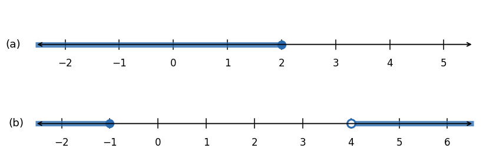

*그림 1. (a) x > 2가 아닌 실수의 영역과 (b) −1 ≥ x 또는 x > 4인 실수의 영역*

> **주의:** $-1 < x \leq 4$의 부정은 $-1 \not< x \not\leq 4$가 아니고, $-1 \geq x > 4$도 아니다. 이어 쓴 부등식은 "and"를 뜻하므로 $-1 \geq x > 4$는 "$-1 \geq x$이고 $x > 4$"가 되어 어떤 실수도 만족하지 않는다. 부정은 "or"로 이어진 두 부등식이다.

드모르간의 법칙은 프로그램 작성에도 자주 쓰인다. 예를 들어 날짜 1부터 날짜 2까지(양 끝 포함)의 범위 밖에서 수정된 파일을 모두 지우려면 다음 동치를 이용한다.

$$
\sim(\text{date1} \leq \text{date} \leq \text{date2}) \equiv (\text{date} < \text{date1}) \vee (\text{date2} < \text{date})
$$

**예제 2.1.11 (주의가 필요한 경우).** 드모르간의 법칙에 따르면 $p$: "짐은 키가 크고 짐은 말랐다"의 부정은 $\sim p$: "짐은 키가 크지 않거나 짐은 마르지 않았다"이다. 그런데 $p$를 "짐은 키가 크고 말랐다"로 줄여 쓰고 그 부정을 "짐이 키가 크고 마른 것은 아니다"로 쓰면, 부정이 and 명제처럼 보여 드모르간의 법칙에 어긋나는 것 같다. 실제로는 어긋나지 않는다. 형식 논리에서 and와 or는 완전한 명제 사이에만 쓸 수 있고 문장 조각 사이에는 쓸 수 없다. "키가 크고 마른"은 하나의 문장 조각이므로, 드모르간의 법칙을 적용하려면 먼저 "짐은 키가 크다"와 "짐은 말랐다"라는 두 완전한 명제로 풀어 써야 한다.

> **주의:** 논리 법칙은 생각을 돕는 도구이지 생각을 기계적으로 대신하는 도구가 아니다. 법칙을 적용하기 전에 and와 or의 양쪽이 완전한 명제인지 확인한다.

### 1.7 항진명제와 모순명제

> **용어 정의:** **항진명제(tautology)** 는 명제 변수에 어떤 진릿값의 명제를 대입하더라도 항상 참인 명제 형식이다. 형식이 항진명제인 명제를 항진적 명제(tautological statement)라 한다. **모순명제(contradiction)** 는 명제 변수에 어떤 진릿값의 명제를 대입하더라도 항상 거짓인 명제 형식이다. 형식이 모순명제인 명제를 모순적 명제(contradictory statement)라 한다.

항진적 명제의 참과 모순적 명제의 거짓은 명제의 논리적 구조에서 나오며, 명제가 담고 있는 의미와는 관계가 없다. 이 장에서는 항진명제를 굵은 $\mathbf{t}$, 모순명제를 굵은 $\mathbf{c}$로 나타낸다.

**예제 2.1.12 (항진명제와 모순명제).** 아래 표에서 $p \vee \sim p$ 열은 모두 T이므로 항진명제이고, $p \wedge \sim p$ 열은 모두 F이므로 모순명제이다. 어떤 명제든 참이거나 거짓이므로 "$p$이거나 $p$가 아니다"는 항상 참이고, 참이면서 동시에 거짓일 수는 없으므로 "$p$이고 $p$가 아니다"는 항상 거짓이다.

| $p$ | $\sim p$ | $p \vee \sim p$ | $p \wedge \sim p$ |
|:-:|:-:|:-:|:-:|
| T | F | T | F |
| F | T | T | F |

*표 12. 항진명제 $p \vee \sim p$와 모순명제 $p \wedge \sim p$의 진리표*

**예제 2.1.13 (항진명제와 모순명제가 들어간 논리적 동치).** $\mathbf{t}$가 항진명제이고 $\mathbf{c}$가 모순명제이면 $p \wedge \mathbf{t} \equiv p$이고 $p \wedge \mathbf{c} \equiv \mathbf{c}$이다. $\mathbf{t}$는 모든 행에서 T, $\mathbf{c}$는 모든 행에서 F이므로 다음 표를 얻는다.

| $p$ | $\mathbf{t}$ | $p \wedge \mathbf{t}$ | $\mathbf{c}$ | $p \wedge \mathbf{c}$ |
|:-:|:-:|:-:|:-:|:-:|
| T | T | T | F | F |
| F | T | F | F | F |

*표 13. $p \wedge \mathbf{t} \equiv p$와 $p \wedge \mathbf{c} \equiv \mathbf{c}$의 확인*

$p \wedge \mathbf{t}$ 열은 $p$ 열과 같고, $p \wedge \mathbf{c}$ 열은 $\mathbf{c}$ 열과 같다.

### 1.8 논리적 동치 법칙

논리적 동치를 알면 논증을 만들기가 쉬워진다. 어떤 명제의 한 형식에서는 결론이 어떻게 나오는지 보기 어렵지만, 논리적 동치인 다른 형식에서는 쉽게 보이는 경우가 많기 때문이다. 자주 쓰는 논리적 동치를 다음 정리로 모은다.

> **핵심:** **논리적 동치 법칙.** 임의의 명제 변수 $p$, $q$, $r$, 항진명제 $\mathbf{t}$, 모순명제 $\mathbf{c}$에 대하여 다음 논리적 동치가 성립한다.

| 법칙 | 첫째 형태 | 둘째 형태 |
|:-----|:-----|:-----|
| 1. 교환 법칙 (commutative laws) | $p \wedge q \equiv q \wedge p$ | $p \vee q \equiv q \vee p$ |
| 2. 결합 법칙 (associative laws) | $(p \wedge q) \wedge r \equiv p \wedge (q \wedge r)$ | $(p \vee q) \vee r \equiv p \vee (q \vee r)$ |
| 3. 분배 법칙 (distributive laws) | $p \wedge (q \vee r) \equiv (p \wedge q) \vee (p \wedge r)$ | $p \vee (q \wedge r) \equiv (p \vee q) \wedge (p \vee r)$ |
| 4. 항등 법칙 (identity laws) | $p \wedge \mathbf{t} \equiv p$ | $p \vee \mathbf{c} \equiv p$ |
| 5. 부정 법칙 (negation laws) | $p \vee \sim p \equiv \mathbf{t}$ | $p \wedge \sim p \equiv \mathbf{c}$ |
| 6. 이중 부정 법칙 (double negative law) | $\sim(\sim p) \equiv p$ | |
| 7. 멱등 법칙 (idempotent laws) | $p \wedge p \equiv p$ | $p \vee p \equiv p$ |
| 8. 전체 한계 법칙 (universal bound laws) | $p \vee \mathbf{t} \equiv \mathbf{t}$ | $p \wedge \mathbf{c} \equiv \mathbf{c}$ |
| 9. 드모르간의 법칙 (De Morgan's laws) | $\sim(p \wedge q) \equiv \sim p \vee \sim q$ | $\sim(p \vee q) \equiv \sim p \wedge \sim q$ |
| 10. 흡수 법칙 (absorption laws) | $p \vee (p \wedge q) \equiv p$ | $p \wedge (p \vee q) \equiv p$ |
| 11. $\mathbf{t}$와 $\mathbf{c}$의 부정 (negations of t and c) | $\sim \mathbf{t} \equiv \mathbf{c}$ | $\sim \mathbf{c} \equiv \mathbf{t}$ |

*표 14. 논리적 동치 법칙*

**증명.** 각 법칙은 양변의 진리표를 만들어 모든 행의 진릿값이 같음을 확인하여 증명한다. 교환 법칙의 첫째 형태, 이중 부정 법칙, 부정 법칙, 항등 법칙의 첫째 형태, 드모르간의 법칙, 전체 한계 법칙의 둘째 형태는 1.6절과 1.7절의 진리표로 이미 확인했다. 나머지도 같은 방법으로 확인한다. 예를 들어 분배 법칙의 첫째 형태는 변수가 세 개이므로 여덟 행의 표가 필요하며, 아래 표의 $p \wedge (q \vee r)$ 열과 $(p \wedge q) \vee (p \wedge r)$ 열이 모든 행에서 같다.

| $p$ | $q$ | $r$ | $q \vee r$ | $p \wedge (q \vee r)$ | $p \wedge q$ | $p \wedge r$ | $(p \wedge q) \vee (p \wedge r)$ |
|:-:|:-:|:-:|:-:|:-:|:-:|:-:|:-:|
| T | T | T | T | T | T | T | T |
| T | T | F | T | T | T | F | T |
| T | F | T | T | T | F | T | T |
| T | F | F | F | F | F | F | F |
| F | T | T | T | F | F | F | F |
| F | T | F | T | F | F | F | F |
| F | F | T | T | F | F | F | F |
| F | F | F | F | F | F | F | F |

*표 15. 분배 법칙 $p \wedge (q \vee r) \equiv (p \wedge q) \vee (p \wedge r)$의 확인*

흡수 법칙도 같은 방법으로 확인한다. 아래 표에서 $p \vee (p \wedge q)$ 열과 $p \wedge (p \vee q)$ 열이 모두 $p$ 열과 같다. 직관적으로 $p \vee (p \wedge q)$는 $p$가 참이면 참이고, $p$가 거짓이면 $p \wedge q$도 거짓이므로 거짓이다.

| $p$ | $q$ | $p \wedge q$ | $p \vee (p \wedge q)$ | $p \vee q$ | $p \wedge (p \vee q)$ |
|:-:|:-:|:-:|:-:|:-:|:-:|
| T | T | T | T | T | T |
| T | F | F | T | T | T |
| F | T | F | F | T | F |
| F | F | F | F | F | F |

*표 16. 흡수 법칙의 확인*

처음 다섯 법칙(교환, 결합, 분배, 항등, 부정 법칙)으로부터 나머지 법칙을 모두 이끌어 낼 수 있다. 이 다섯 법칙은 6장에서 다루는 **부울 대수(Boolean algebra)** 라는 수학적 구조의 공리가 된다.

> **참고:** 법칙의 $p$, $q$, $r$ 자리에는 명제 변수뿐 아니라 임의의 명제 형식을 넣을 수 있다. 법칙은 모든 진릿값 조합에서 성립하므로, 명제 형식을 넣어도 그 명제 형식이 가질 수 있는 진릿값에 대해 그대로 성립하기 때문이다. 예를 들어 드모르간의 법칙의 $p$ 자리에 $\sim p$를 넣으면 $\sim(\sim p \wedge q) \equiv \sim(\sim p) \vee \sim q$를 얻는다.

**예제 2.1.14 (명제 형식의 간략화).** 논리적 동치 법칙을 이용하여 $\sim(\sim p \wedge q) \wedge (p \vee q) \equiv p$를 보인다. 왼쪽 식의 일부를 논리적 동치인 식으로 바꿀 때마다 전체도 논리적 동치인 식이 되므로, 오른쪽 식이 나올 때까지 바꾸어 나간다.

$$
\begin{aligned}
\sim(\sim p \wedge q) \wedge (p \vee q) &\equiv (\sim(\sim p) \vee \sim q) \wedge (p \vee q) && \text{드모르간의 법칙} \\
&\equiv (p \vee \sim q) \wedge (p \vee q) && \text{이중 부정 법칙} \\
&\equiv p \vee (\sim q \wedge q) && \text{분배 법칙} \\
&\equiv p \vee (q \wedge \sim q) && \wedge\text{의 교환 법칙} \\
&\equiv p \vee \mathbf{c} && \text{부정 법칙} \\
&\equiv p && \text{항등 법칙}
\end{aligned}
$$

셋째 줄은 분배 법칙의 둘째 형태 $p \vee (q \wedge r) \equiv (p \vee q) \wedge (p \vee r)$를 오른쪽에서 왼쪽으로 읽어 $q$ 자리에 $\sim q$, $r$ 자리에 $q$를 넣은 것이다. 이런 간략화 능력은 논리적으로 효율적인 프로그램을 작성하고 디지털 논리 회로를 설계(4절)하는 데 쓰인다.

> **주의:** 논리적 동치 법칙으로는 두 명제 형식이 논리적 동치임을 증명할 수 있지만, 동치가 **아님**을 증명할 수는 없다. 진리표는 동치와 비동치를 모두 판정할 수 있고 컴퓨터 프로그램으로 만들기도 쉽지만, 변수가 $n$개이면 $2^n$개의 행을 확인해야 한다. 반대로 법칙을 쓰면 빨리 끝나는 경우가 있다. 예를 들어 $p \wedge (\sim q \wedge \sim r) \equiv (p \wedge \sim q) \wedge \sim r$는 결합 법칙에서 바로 나오지만, 진리표로 확인하려면 여덟 행을 만들어야 한다.

---

<br>

## 2. 조건 명제

추론은 가정에서 결론으로 나아가는 과정이며, 그 목표는 "이러이러한 것이 알려져 있으면 저러저러한 것이 성립해야 한다"고 말하는 것이다. 이 절은 이런 문장을 다루는 조건 명제를 정의하고, 조건 명제와 관련된 여러 변형과 논리적 동치를 정리한다.

### 2.1 조건 명제와 진리표

$p$와 $q$가 명제일 때 "$p$이면 $q$이다"(if $p$ then $q$) 꼴의 문장을 $p \to q$로 나타낸다. 이때 $p$를 **가정(hypothesis)**, $q$를 **결론(conclusion)** 이라 한다. 예를 들어 "4,686이 6으로 나누어떨어지면 4,686은 3으로 나누어떨어진다"에서 "4,686이 6으로 나누어떨어진다"가 가정이고 "4,686은 3으로 나누어떨어진다"가 결론이다. $q$의 참이 $p$의 참에 조건으로 걸려 있으므로 이런 문장을 조건 명제라 부른다.

$p \to q$를 명제로 정의하려면 $\wedge$, $\vee$처럼 진릿값을 정해야 한다. 그 정의는 일상적인 의미를 바탕으로 한다. 가게 주인이 면접을 보러 온 사람에게 "월요일 아침에 출근하면 채용하겠다"고 약속했다고 가정한다. 주인이 거짓말을 했다고 말할 수 있는 경우는 그 사람이 월요일 아침에 출근했는데 채용되지 않은 경우뿐이다. 약속은 조건(월요일 아침 출근)이 만족될 때 무엇이 일어나는지만 말하고, 조건이 만족되지 않을 때에 대해서는 아무것도 말하지 않는다. 따라서 조건이 만족되지 않으면 채용되든 아니든 약속이 거짓이었다고 할 수 없다. 이렇게 조건 명제가 거짓인 유일한 경우는 가정이 참이고 결론이 거짓인 경우이며, 진리표의 각 행은 T나 F 중 하나로 채워야 하므로 나머지 행은 모두 T가 된다.

> **용어 정의:** $p$와 $q$가 명제 변수일 때 **조건 명제(conditional statement)** $p \to q$는 "$p$이면 $q$이다" 또는 "$p$는 $q$를 함의한다"(p implies q)이다. $p \to q$는 $p$가 참이고 $q$가 거짓일 때 거짓이고, 그 밖의 경우에는 참이다. $p$를 조건 명제의 가정 또는 **전건(antecedent)**, $q$를 결론 또는 **후건(consequent)** 이라 한다.

| $p$ | $q$ | $p \to q$ |
|:-:|:-:|:-:|
| T | T | T |
| T | F | F |
| F | T | T |
| F | F | T |

*표 17. 조건 명제 $p \to q$의 진리표*

가정이 거짓이라는 이유로 참이 되는 조건 명제를 **공허하게 참(vacuously true)** 이라 하거나 기본적으로 참(true by default)이라 한다. 예를 들어 "월요일 아침에 출근하면 채용하겠다"는 그 사람이 월요일 아침에 출근하지 않으면 공허하게 참이다. 일반적으로 if-then 문장의 "if" 부분이 거짓이면 결론이 참이든 거짓이든 문장 전체는 참이다.

**예제 2.2.1 (가정이 거짓인 조건 명제).** "$0 = 1$이면 $1 = 2$이다"는 이상하게 보이지만, 가정 $0 = 1$이 거짓이므로 명제 전체는 참이다. 실제로 $0 = 1$을 가정하고 양변에 1을 더하면 $1 = 2$를 이끌어 낼 수 있다.

> **참고:** 철학자 콰인(W. V. O. Quine)은 $p \to q$를 "$p$는 $q$를 함의한다"로 읽지 말라고 권했다. "함의한다"는 말이 $q$를 $p$에서 논리적으로 이끌어 낼 수 있다는 인상을 주지만 실제로는 그렇지 않은 경우가 많기 때문이다. 그래도 이 표현은 $\to$ 기호를 대신하기 편해서 널리 쓰인다.

**연산 순서.** $\to$와 $\wedge$, $\vee$, $\sim$가 함께 있는 식에서는 $\to$를 마지막에 계산한다. 즉 $\sim$를 먼저, 그다음 $\wedge$와 $\vee$를, 마지막에 $\to$를 계산한다.

**예제 2.2.2 ($p \vee \sim q \to \sim p$의 진리표).** 연산 순서에 따라 이 식은 $(p \vee (\sim q)) \to (\sim p)$를 뜻하므로 가정은 $p \vee \sim q$, 결론은 $\sim p$이다. $p$와 $q$의 네 조합을 적고, 부정의 정의로 $\sim p$와 $\sim q$ 열을, $\vee$의 정의로 $p \vee \sim q$ 열을 채운다. 마지막으로 가정 $p \vee \sim q$가 T이고 결론 $\sim p$가 F인 첫째, 둘째 행에 F를, 나머지 두 행에 T를 적는다.

| $p$ | $q$ | $\sim p$ | $\sim q$ | $p \vee \sim q$ | $p \vee \sim q \to \sim p$ |
|:-:|:-:|:-:|:-:|:-:|:-:|
| T | T | F | F | T | F |
| T | F | F | T | T | F |
| F | T | T | F | F | T |
| F | F | T | T | T | T |

*표 18. $p \vee \sim q \to \sim p$의 진리표*

### 2.2 조건 명제가 들어간 논리적 동치

세 명제 $p$, $q$, $r$에 대하여 $p$가 참이면 $r$가 참이고, $q$가 참이어도 $r$가 참이라는 것을 안다고 가정한다. 그러면 $p$와 $q$ 중 어느 것이 성립하든 $r$가 성립해야 한다. 경우 나누기에 의한 분석은 이 생각에 바탕을 둔다.

**예제 2.2.3 (경우 나누기, $p \vee q \to r \equiv (p \to r) \wedge (q \to r)$).** 여덟 가지 진릿값 조합을 적고, or와 if-then의 정의로 $p \vee q$, $p \to r$, $q \to r$ 열을 채운다. 예를 들어 $p \to r$ 열은 $p$가 참이고 $r$가 거짓인 둘째, 넷째 행에서 F이다. $p \vee q \to r$ 열은 가정 $p \vee q$가 참이고 결론 $r$가 거짓인 둘째, 넷째, 여섯째 행에서 F이고 나머지 행에서 T이다. 마지막 두 열이 모든 행에서 같으므로 두 명제 형식은 논리적 동치이다.

| $p$ | $q$ | $r$ | $p \vee q$ | $p \to r$ | $q \to r$ | $p \vee q \to r$ | $(p \to r) \wedge (q \to r)$ |
|:-:|:-:|:-:|:-:|:-:|:-:|:-:|:-:|
| T | T | T | T | T | T | T | T |
| T | T | F | T | F | F | F | F |
| T | F | T | T | T | T | T | T |
| T | F | F | T | F | T | F | F |
| F | T | T | T | T | T | T | T |
| F | T | F | T | T | F | F | F |
| F | F | T | F | T | T | T | T |
| F | F | F | F | T | T | T | T |

*표 19. $p \vee q \to r$와 $(p \to r) \wedge (q \to r)$의 논리적 동치*

### 2.3 조건 명제를 논리합으로 나타내기

"$p$이면 $q$이다"는 "$p$가 아니거나 $q$이다"와 논리적 동치이다.

$$
p \to q \equiv \sim p \vee q
$$

아래 진리표의 $p \to q$ 열과 $\sim p \vee q$ 열이 모든 행에서 같다. 두 식 모두 $p$가 T이고 $q$가 F인 둘째 행에서만 F이기 때문이다.

| $p$ | $q$ | $\sim p$ | $p \to q$ | $\sim p \vee q$ |
|:-:|:-:|:-:|:-:|:-:|
| T | T | F | T | T |
| T | F | F | F | F |
| F | T | T | T | T |
| F | F | T | T | T |

*표 20. $p \to q \equiv \sim p \vee q$의 확인*

**예제 2.2.4 ($\sim p \vee q$와 $p \to q$의 동치 응용).** "제시간에 출근하든지, 해고되든지 둘 중 하나이다"를 if-then 꼴로 바꾼다. $\sim p$를 "제시간에 출근한다", $q$를 "해고된다"로 두면 주어진 문장은 $\sim p \vee q$이다. 이때 $p$는 "제시간에 출근하지 않는다"이므로, 동치인 $p \to q$는 "제시간에 출근하지 않으면 해고된다"이다.

### 2.4 조건 명제의 부정

정의에 의해 $p \to q$는 가정 $p$가 참이고 결론 $q$가 거짓일 때, 그리고 그때에만 거짓이다. 따라서 "$p$이면 $q$이다"의 부정은 "$p$이고 $q$가 아니다"와 논리적 동치이다.

$$
\sim(p \to q) \equiv p \wedge \sim q
$$

이 결과는 2.3절의 동치 $p \to q \equiv \sim p \vee q$의 양변을 부정하여 얻을 수도 있다.

$$
\begin{aligned}
\sim(p \to q) &\equiv \sim(\sim p \vee q) && \text{2.3절의 동치} \\
&\equiv \sim(\sim p) \wedge (\sim q) && \text{드모르간의 법칙} \\
&\equiv p \wedge \sim q && \text{이중 부정 법칙}
\end{aligned}
$$

진리표로 확인해도 $\sim(p \to q)$ 열과 $p \wedge \sim q$ 열이 모든 행에서 같다.

| $p$ | $q$ | $p \to q$ | $\sim(p \to q)$ | $\sim q$ | $p \wedge \sim q$ |
|:-:|:-:|:-:|:-:|:-:|:-:|
| T | T | T | F | F | F |
| T | F | F | T | T | T |
| F | T | T | F | F | F |
| F | F | T | F | T | F |

*표 21. $\sim(p \to q) \equiv p \wedge \sim q$의 확인*

**예제 2.2.5 (if-then 명제의 부정).** 다음 명제의 부정을 쓴다.

- (a) "내 차가 정비소에 있으면 나는 수업에 갈 수 없다"의 가정 $p$는 "내 차가 정비소에 있다", 결론 $q$는 "나는 수업에 갈 수 없다"이다. 부정 $p \wedge \sim q$는 "내 차는 정비소에 있고 나는 수업에 갈 수 있다"이다.
- (b) "세라가 아테네에 살면 세라는 그리스에 산다"의 부정은 "세라는 아테네에 살고 그리스에 살지 않는다"이다. 미국의 조지아 주, 오하이오 주, 위스콘신 주에도 아테네라는 도시가 있으므로 이 부정은 참일 수 있다.

> **주의:** if-then 명제의 부정은 "만약"으로 시작하지 않는다. 조건 명제의 부정을 다른 조건 명제로 쓰고 싶은 유혹을 피하고, "가정이 성립하고 결론이 성립하지 않는다"는 and 명제로 쓴다.

### 2.5 대우

조건 명제와 그 대우가 논리적 동치라는 사실은 논리학의 가장 기본적인 법칙 가운데 하나이다.

> **용어 정의:** "$p$이면 $q$이다" 꼴의 조건 명제의 **대우(contrapositive)** 는 "$q$가 아니면 $p$가 아니다"이다. 기호로 $p \to q$의 대우는 $\sim q \to \sim p$이다.

> **핵심:** 조건 명제는 그 대우와 논리적 동치이다. 즉 $p \to q \equiv \sim q \to \sim p$이다.

두 식 모두 $p$가 T이고 $q$가 F일 때에만 F이다. $\sim q \to \sim p$가 F이려면 가정 $\sim q$가 T, 결론 $\sim p$가 F이어야 하고, 이는 $q$가 F, $p$가 T라는 뜻이기 때문이다. 2.6절의 표에서 $p \to q$ 열과 $\sim q \to \sim p$ 열이 모든 행에서 같음을 확인할 수 있다.

**예제 2.2.6 (대우 쓰기).** 다음 명제를 동치인 대우로 쓴다.

- (a) "하워드가 호수를 헤엄쳐 건널 수 있으면, 하워드는 섬까지 헤엄쳐 갈 수 있다"의 대우는 "하워드가 섬까지 헤엄쳐 갈 수 없으면, 하워드는 호수를 헤엄쳐 건널 수 없다"이다.
- (b) "오늘이 부활절이면 내일은 월요일이다"의 대우는 "내일이 월요일이 아니면 오늘은 부활절이 아니다"이다.

문제를 풀 때 원래 조건 명제보다 대우가 다루기 쉬운 경우가 있다. 이 동치는 3.2절의 후건 부정이라는 추론 규칙과, 4장에서 다루는 대우에 의한 증명의 바탕이 된다.

### 2.6 역과 이

조건 명제의 다른 두 변형은 원래 조건 명제와 논리적 동치가 아니다.

> **용어 정의:** "$p$이면 $q$이다" 꼴의 조건 명제가 주어졌을 때
> 1. **역(converse)** 은 "$q$이면 $p$이다"이다. 기호로 $p \to q$의 역은 $q \to p$이다.
> 2. **이(inverse)** 는 "$p$가 아니면 $q$가 아니다"이다. 기호로 $p \to q$의 이는 $\sim p \to \sim q$이다.

**예제 2.2.7 (역과 이 쓰기).** 2.5절의 두 명제의 역과 이를 쓴다.

- (a) 역은 "하워드가 섬까지 헤엄쳐 갈 수 있으면, 하워드는 호수를 헤엄쳐 건널 수 있다"이고, 이는 "하워드가 호수를 헤엄쳐 건널 수 없으면, 하워드는 섬까지 헤엄쳐 갈 수 없다"이다.
- (b) 역은 "내일이 월요일이면 오늘은 부활절이다"이고, 이는 "오늘이 부활절이 아니면 내일은 월요일이 아니다"이다.

"오늘이 부활절이면 내일은 월요일이다"는 부활절이 항상 일요일이므로 언제나 참이다. 그러나 그 역과 이는 부활절이 아닌 모든 일요일에 거짓이다. 그런 일요일에는 내일이 월요일이지만 오늘은 부활절이 아니기 때문이다.

| $p$ | $q$ | $p \to q$ | $\sim q \to \sim p$ | $q \to p$ | $\sim p \to \sim q$ |
|:-:|:-:|:-:|:-:|:-:|:-:|
| T | T | T | T | T | T |
| T | F | F | F | T | T |
| F | T | T | T | F | F |
| F | F | T | T | T | T |

*표 22. 조건 명제, 대우, 역, 이의 진리표*

> **핵심:** 위 표에서 다음 세 사실을 읽을 수 있다.
> 1. 조건 명제와 그 역은 논리적 동치가 아니다(둘째, 셋째 행에서 다르다).
> 2. 조건 명제와 그 이는 논리적 동치가 아니다(둘째, 셋째 행에서 다르다).
> 3. 조건 명제의 역과 이는 서로 논리적 동치이다. 이(inverse)가 역의 대우이기 때문이다($q \to p$의 대우는 $\sim p \to \sim q$이다).

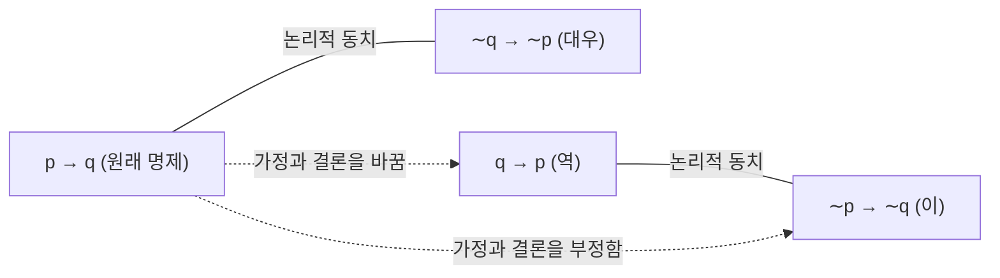

*그림 2. 조건 명제와 대우, 역, 이 사이의 관계*

> **주의:** 조건 명제가 참이면 그 역과 이도 참이라고 믿기 쉽지만 옳지 않다. 역은 참일 수도 있지만 반드시 참인 것은 아니다.

### 2.7 ~일 때만과 쌍조건 명제

**~일 때만(only if)** 을 쓴 문장 "$p$ only if $q$"(한국어로는 "$q$일 때만 $p$이다")는 $q$가 일어날 때에만 $p$가 일어날 수 있다는 뜻이다. 즉 $q$가 일어나지 않으면 $p$도 일어날 수 없다. 대우의 동치에 의해, 이는 $p$가 일어나면 $q$도 일어나야 한다는 말과 같다.

> **용어 정의:** $p$와 $q$가 명제일 때 "$p$ only if $q$"는 "$q$가 아니면 $p$가 아니다"를 뜻하고, 이와 동치로 "$p$이면 $q$이다"를 뜻한다.

**예제 2.2.8 (only if를 if-then으로 바꾸기).** "존은 1,000 m 달리기를 2.5분 안에 뛸 때만 세계 기록을 깰 것이다"를 서로 대우인 두 가지 if-then 꼴로 쓴다. $p$를 "존이 세계 기록을 깬다", $q$를 "존이 1,000 m를 2.5분 안에 뛴다"로 두면 주어진 문장은 "$p$ only if $q$"이다.

- 첫째 형태($\sim q \to \sim p$): 존이 1,000 m를 2.5분 안에 뛰지 못하면, 존은 세계 기록을 깨지 못할 것이다.
- 둘째 형태($p \to q$): 존이 세계 기록을 깬다면, 존은 1,000 m를 2.5분 안에 뛴 것이다.

> **주의:** "$p$ only if $q$"는 "$p$ if $q$"(즉 $q \to p$)를 뜻하지 않는다. 존이 2.5분 안에 뛰어야만 기록을 깰 수 있다는 말은 2.5분 안에 뛰면 기록을 깬다는 뜻이 아니다. 기록이 2.5분보다 훨씬 짧다면 2.5분 안에 뛰어도 기록을 깨지 못할 수 있다. 따라서 "$p$ only if $q$"가 참이면서 "$p$ if $q$"가 거짓일 수 있다.

> **용어 정의:** 명제 변수 $p$와 $q$의 **쌍조건 명제(biconditional)** 는 "$p$ if, and only if, $q$"($p$일 때, 그리고 그때에만 $q$)이며 $p \leftrightarrow q$로 나타낸다. $p \leftrightarrow q$는 $p$와 $q$의 진릿값이 같을 때 참이고 다를 때 거짓이다. "if and only if"는 흔히 **iff**로 줄여 쓴다.

| $p$ | $q$ | $p \leftrightarrow q$ |
|:-:|:-:|:-:|
| T | T | T |
| T | F | F |
| F | T | F |
| F | F | T |

*표 23. 쌍조건 명제 $p \leftrightarrow q$의 진리표*

연산 순서에서 $\leftrightarrow$는 $\to$와 같은 순위이다. $\wedge$와 $\vee$처럼 둘 사이의 순서는 괄호로만 나타낼 수 있다. 다섯 논리 연산자 전체의 순서는 다음과 같다.

| 순서 | 연산자 | 설명 |
|:-:|:-:|:-----|
| 1 | $\sim$ | 부정을 가장 먼저 계산한다. |
| 2 | $\wedge$, $\vee$ | 그다음 계산한다. 둘이 함께 있으면 괄호가 필요할 수 있다. |
| 3 | $\to$, $\leftrightarrow$ | 마지막에 계산한다. 둘이 함께 있으면 괄호가 필요할 수 있다. |

*표 24. 논리 연산자의 연산 순서*

"if"와 "only if"의 정의에 따르면 "$p$ if, and only if, $q$"는 "$p$ if $q$"와 "$p$ only if $q$"를 함께 말하는 것과 같아야 한다. 다음 표는 실제로 그러함을 보여 준다.

$$
p \leftrightarrow q \equiv (p \to q) \wedge (q \to p)
$$

| $p$ | $q$ | $p \to q$ | $q \to p$ | $p \leftrightarrow q$ | $(p \to q) \wedge (q \to p)$ |
|:-:|:-:|:-:|:-:|:-:|:-:|
| T | T | T | T | T | T |
| T | F | F | T | F | F |
| F | T | T | F | F | F |
| F | F | T | T | T | T |

*표 25. $p \leftrightarrow q \equiv (p \to q) \wedge (q \to p)$의 확인*

**예제 2.2.9 (if and only if).** "이 컴퓨터 프로그램은 가능한 모든 입력 데이터에 대해 올바른 답을 낼 때, 그리고 그때에만 올바르다"를 두 if-then 명제의 논리곱으로 쓰면 "이 프로그램이 올바르면 가능한 모든 입력 데이터에 대해 올바른 답을 내고, 이 프로그램이 가능한 모든 입력 데이터에 대해 올바른 답을 내면 이 프로그램은 올바르다"이다.

### 2.8 필요조건과 충분조건

형식적인 문장에서 쓰는 필요조건과 충분조건이라는 말은 논리학의 정의와 정확히 일치한다.

> **용어 정의:** $r$와 $s$가 명제일 때
> - "$r$는 $s$의 **충분조건(sufficient condition)** 이다"는 "$r$이면 $s$이다"($r \to s$)를 뜻한다.
> - "$r$는 $s$의 **필요조건(necessary condition)** 이다"는 "$r$가 아니면 $s$가 아니다"($\sim r \to \sim s$)를 뜻한다.

$r$가 $s$의 충분조건이라는 말은 $r$가 일어나면 $s$가 일어나는 것이 보장된다는 뜻이다. $r$가 $s$의 필요조건이라는 말은 $r$가 일어나지 않으면 $s$도 일어날 수 없다는 뜻, 즉 $s$가 일어나려면 $r$가 반드시 일어나야 한다는 뜻이다. 조건 명제와 대우의 동치에 의해 "$r$는 $s$의 필요조건이다"는 "$s$이면 $r$이다"($s \to r$)도 뜻한다. 따라서 "$r$는 $s$의 필요충분조건이다"는 "$r$ if, and only if, $s$"($r \leftrightarrow s$)를 뜻한다.

**예제 2.2.10 (필요조건과 충분조건의 해석).** "존이 투표할 자격이 있으면 존은 18세 이상이다"에서 "존이 투표할 자격이 있다"가 참이면 "존은 18세 이상이다"가 참임이 보장되므로, 앞의 조건은 뒤의 조건의 충분조건이다. 또 "존은 18세 이상이다"는 "존이 투표할 자격이 있다"의 필요조건이다. 존이 18세 미만이면 투표할 자격이 없기 때문이다.

**예제 2.2.11 (충분조건을 if-then 꼴로 바꾸기).** "피아가 미국 땅에서 태어난 것은 피아가 미국 시민이기 위한 충분조건이다"는 "피아가 미국 땅에서 태어났으면 피아는 미국 시민이다"이다.

**예제 2.2.12 (필요조건을 if-then 꼴로 바꾸기).** "조지가 35세가 된 것은 조지가 미국 대통령이 되기 위한 필요조건이다"를 대우를 이용하여 두 가지로 쓴다. $r$를 "조지가 35세가 되었다", $s$를 "조지가 미국 대통령이 될 수 있다"로 둔다.

- 첫째 형태($\sim r \to \sim s$): 조지가 35세가 되지 않았으면 조지는 미국 대통령이 될 수 없다.
- 둘째 형태($s \to r$): 조지가 미국 대통령이 될 수 있다면 조지는 35세가 된 것이다.

여러 표현이 같은 조건 명제를 나타내므로 다음 표로 정리한다.

| 표현 | 기호 |
|:-----|:-:|
| $p$이면 $q$이다 (if $p$ then $q$) | $p \to q$ |
| $p$는 $q$를 함의한다 ($p$ implies $q$) | $p \to q$ |
| $q$일 때만 $p$이다 ($p$ only if $q$) | $p \to q$ |
| $p$는 $q$의 충분조건이다 | $p \to q$ |
| $q$는 $p$의 필요조건이다 | $p \to q$ |
| $p$일 때, 그리고 그때에만 $q$이다 ($p$ if and only if $q$) | $p \leftrightarrow q$ |
| $p$는 $q$의 필요충분조건이다 | $p \leftrightarrow q$ |

*표 26. 조건 명제와 쌍조건 명제를 나타내는 여러 표현*

### 2.9 조건 명제에 관한 두 가지 주의점

**첫째, 가정과 결론의 내용이 관련될 필요는 없다.** 일상 대화에서는 "컴퓨터가 기계이면 베이브 루스는 야구 선수였다"나 "$2 + 2 = 5$이면 미키 마우스는 미국 대통령이다" 같은 말을 하지 않는다. "$p$이면 $q$이다"라는 문장은 $p$와 $q$ 사이에 내용상의 관련이 있을 때만 쓰기 때문이다. 그러나 논리학에서는 조건 명제의 두 부분이 관련된 의미를 가질 필요가 없다. 그런 요구는 실제로 적용할 수도 없다. 어떤 사람에게 관련이 없어 보이는 두 절이 다른 사람에게는 관련이 있어 보일 수 있으므로, 모든 조건 명제를 미리 검사하는 중앙 심판이 있어야 하는데 이는 현실적이지 않다. 따라서 "컴퓨터가 기계이면 베이브 루스는 야구 선수였다"는 허용되며, 가정과 결론이 모두 참이므로 참이다. "$2 + 2 = 5$이면 미키 마우스는 미국 대통령이다"도 허용되며, 가정이 거짓이므로 참이다. 수학에서는 원래 의도한 상황을 잘 다루도록 신중하게 만든 정의가 만든 사람이 생각하지 못한 극단적인 경우까지 만족하는 일이 자주 있다. 정의를 끝까지 탐구하여 특이한 경우를 포함한 모든 경우를 이해하는 습관이 중요하다.

**둘째, 일상 언어에서는 조건 명제를 쌍조건 명제의 뜻으로 쓰는 경우가 많다.** "저녁을 먹을 때, 그리고 그때에만 디저트를 먹을 수 있다"는 논리적으로 다음 두 명제의 논리곱과 같다.

- 명제 1: 저녁을 먹으면 디저트를 먹을 수 있다.
- 명제 2: 저녁을 먹을 때만 디저트를 먹을 수 있다. 즉 저녁을 먹지 않으면 디저트를 먹을 수 없다.

그러나 이렇게 말하는 부모는 드물다. 대부분 보상을 강조하여 "저녁을 먹으면 디저트를 줄게"라고 하거나 벌을 강조하여 "저녁을 먹어야만 디저트를 줄게"라고 한다. 그래도 보상을 약속한 부모는 벌도 암시하고, 벌을 말한 부모도 저녁을 먹으면 디저트를 준다. 두 경우 모두 조건 명제가 쌍조건 명제로 해석되기를 기대하는 것이다. 이렇게 조건 명제를 쌍조건 명제로 해석하는 데 익숙하므로, 조건 명제가 그 역이나 이와 항상 동치라고 잘못 믿기 쉽다. 수학과 과학처럼 정확성이 중요한 곳에서는 if-then 문장을 형식적인 정의대로 해석하고, 그 역이나 이와 혼동하지 않아야 한다.

---

<br>

## 3. 타당한 논증과 부당한 논증

수학과 논리학에서 논증은 다툼이 아니라 결론으로 끝나는 명제의 나열이다. 이 절은 논증이 타당한지, 즉 결론이 앞의 명제들로부터 반드시 따라 나오는지를 판정하는 방법을 다루며, 그 판정이 논증의 내용이 아니라 형식에만 달려 있음을 보인다.

### 3.1 논증 형식과 타당성

1.1절에서 본 것처럼 논증의 논리적 형식은 내용과 분리할 수 있다. 예를 들어 다음 논증은 왼쪽의 추상적인 형식을 가진다.

$$
\begin{array}{l}
p \text{이면 } q \text{이다.} \\
p \\
\hline
\therefore\ q
\end{array}
\qquad\qquad
\begin{array}{l}
\text{소크라테스가 사람이면, 소크라테스는 죽는다.} \\
\text{소크라테스는 사람이다.} \\
\hline
\therefore\ \text{소크라테스는 죽는다.}
\end{array}
$$

추상적인 형식을 다룰 때는 $p$와 $q$를 명제를 대입할 수 있는 변수로 생각한다. 논증 형식은 모든 전제를 참으로 만드는 명제를 대입할 때마다 결론도 참이 될 때, 그리고 그때에만 타당하다.

> **용어 정의:** **논증(argument)** 은 명제의 나열이고, **논증 형식(argument form)** 은 명제 형식의 나열이다. 논증의 명제와 논증 형식의 명제 형식 가운데 마지막 것을 제외한 나머지를 모두 **전제(premise)** (또는 가정)라 하고, 마지막 것을 **결론(conclusion)** 이라 한다. "그러므로"라고 읽는 기호 $\therefore$는 보통 결론 바로 앞에 쓴다. 논증 형식이 **타당하다(valid)** 는 것은 전제의 명제 변수에 어떤 명제를 대입하더라도 대입한 전제가 모두 참이면 결론도 참이라는 뜻이다. 논증이 타당하다는 것은 그 형식이 타당하다는 뜻이다. 타당하지 않은 논증 형식을 **부당하다(invalid)** 고 한다.

타당한 논증의 핵심은 결론의 참이 전제의 참으로부터 반드시, 즉 논리적 형식만으로 따라 나온다는 것이다. 모든 전제가 참이고 결론이 거짓인 타당한 논증은 있을 수 없다. 논증이 타당하고 전제가 참이면 결론의 참은 전제의 참으로부터 추론(inferred) 또는 연역(deduced)되었다고 한다. 결론이 반드시 그렇지는 않다면 그것은 타당한 연역이 아니다.

**논증 형식의 타당성을 판정하는 방법**은 다음과 같다.

1. 논증 형식의 전제와 결론을 확인한다.
2. 모든 전제와 결론의 진릿값을 보여 주는 진리표를 만든다.
3. 모든 전제가 참인 행을 **임계 행(critical row)** 이라 한다. 결론이 거짓인 임계 행이 있으면, 이 형식의 논증이 참인 전제와 거짓인 결론을 가질 수 있으므로 논증 형식은 부당하다. 모든 임계 행에서 결론이 참이면 논증 형식은 타당하다.

> **주의:** 전제 가운데 하나라도 거짓이면 그 행은 결론에 관해 아무 정보도 주지 않는다. 결론은 참일 수도 거짓일 수도 있다. 그래서 타당성을 판정할 때는 임계 행의 결론만 보면 된다.

**예제 2.3.1 (타당성 판정).** 다음 논증 형식이 타당한지 진리표로 판정한다.

$$
\begin{array}{l}
p \to q \vee \sim r \\
q \to p \wedge r \\
\hline
\therefore\ p \to r
\end{array}
$$

전제는 $p \to q \vee \sim r$와 $q \to p \wedge r$이고 결론은 $p \to r$이다. 연산 순서에 따라 첫째 전제는 $p \to (q \vee \sim r)$, 둘째 전제는 $q \to (p \wedge r)$이다. 중간 열 $\sim r$, $q \vee \sim r$, $p \wedge r$를 먼저 채운 뒤 전제와 결론의 열을 채운다.

| $p$ | $q$ | $r$ | $\sim r$ | $q \vee \sim r$ | $p \wedge r$ | 전제 $p \to q \vee \sim r$ | 전제 $q \to p \wedge r$ | 결론 $p \to r$ | 비고 |
|:-:|:-:|:-:|:-:|:-:|:-:|:-:|:-:|:-:|:-----|
| T | T | T | F | T | T | T | T | T | 임계 행, 결론 참 |
| T | T | F | T | T | F | T | F | F | |
| T | F | T | F | F | T | F | T | T | |
| T | F | F | T | T | F | T | T | F | 임계 행, 결론 거짓 |
| F | T | T | F | T | F | T | F | T | |
| F | T | F | T | T | F | T | F | T | |
| F | F | T | F | F | F | T | T | T | 임계 행, 결론 참 |
| F | F | F | T | T | F | T | T | T | 임계 행, 결론 참 |

*표 27. 넷째 행에서 전제가 모두 참이고 결론이 거짓인 논증 형식의 진리표*

전제와 결론이 모두 참인 경우(첫째, 일곱째, 여덟째 행)가 여럿 있지만, 넷째 행($p$가 T, $q$가 F, $r$가 F)에서는 두 전제가 모두 참인데 결론이 거짓이다. 이 행은 이 형식의 논증이 참인 전제와 거짓인 결론을 가질 수 있음을 보여 주므로 이 논증 형식은 부당하다.

### 3.2 전건 긍정과 후건 부정

전제 두 개와 결론 하나로 이루어진 논증 형식을 **삼단 논법(syllogism)** 이라 하고, 첫째 전제를 대전제(major premise), 둘째 전제를 소전제(minor premise)라 한다. 가장 유명한 삼단 논법은 **전건 긍정(modus ponens)** 이다.

$$
\begin{array}{l}
p \text{이면 } q \text{이다.} \\
p \\
\hline
\therefore\ q
\end{array}
$$

modus ponens는 "긍정하는 방법"이라는 뜻의 라틴어로, 결론이 긍정문이다. 다음은 이 형식의 논증이다.

- 비가 오면 땅이 젖는다($p \to q$). 비가 온다($p$). 그러므로 땅이 젖는다($q$).
- 371,487의 각 자리 숫자의 합이 3으로 나누어떨어지면 371,487은 3으로 나누어떨어진다. 371,487의 각 자리 숫자의 합은 3으로 나누어떨어진다($3 + 7 + 1 + 4 + 8 + 7 = 30$). 그러므로 371,487은 3으로 나누어떨어진다.

전건 긍정은 진리표를 보기 전부터 직관적으로 받아들이는 형식이지만, 타당성의 형식적인 정의가 직관과 일치함을 확인하기 위해 진리표로 증명한다.

| $p$ | $q$ | 전제 $p \to q$ | 전제 $p$ | 결론 $q$ | 비고 |
|:-:|:-:|:-:|:-:|:-:|:-----|
| T | T | T | T | T | 임계 행, 결론 참 |
| T | F | F | T | F | |
| F | T | T | F | T | |
| F | F | T | F | F | |

*표 28. 전건 긍정의 진리표*

두 전제가 모두 참인 행은 첫째 행뿐이고 그 행에서 결론도 참이므로 전건 긍정은 타당하다.

또 하나의 타당한 논증 형식은 **후건 부정(modus tollens)** 이다.

$$
\begin{array}{l}
p \text{이면 } q \text{이다.} \\
\sim q \\
\hline
\therefore\ \sim p
\end{array}
$$

modus tollens는 "부정하는 방법"이라는 뜻의 라틴어로, 결론이 부정문이다. 다음은 이 형식의 논증이다.

- 비가 오면 땅이 젖는다($p \to q$). 땅이 젖지 않았다($\sim q$). 그러므로 비가 오지 않는다($\sim p$).
- 제우스가 인간이면 제우스는 죽는다. 제우스는 죽지 않는다. 그러므로 제우스는 인간이 아니다.

후건 부정이 타당한 이유는 귀류법으로 직관적으로 설명할 수 있다. (1) "제우스가 인간이면 제우스는 죽는다"와 (2) "제우스는 죽지 않는다"가 참이라고 가정한다. 제우스가 인간이라면 (1)에 의해 제우스는 죽어야 하지만 (2)에 의해 죽지 않으므로, 제우스는 인간일 수 없다. 형식적으로는 조건 명제가 대우와 동치($p \to q \equiv \sim q \to \sim p$)라는 사실과 전건 긍정을 합하여 얻을 수도 있고, 다음 진리표로 확인할 수도 있다.

| $p$ | $q$ | 전제 $p \to q$ | 전제 $\sim q$ | 결론 $\sim p$ | 비고 |
|:-:|:-:|:-:|:-:|:-:|:-----|
| T | T | T | F | F | |
| T | F | F | T | F | |
| F | T | T | F | T | |
| F | F | T | T | T | 임계 행, 결론 참 |

*표 29. 후건 부정의 진리표*

임계 행은 넷째 행 하나이고 그 행에서 결론이 참이므로 후건 부정은 타당하다.

> **핵심:** 전건 긍정은 가정이 성립함을 알고 결론으로 나아가는 전진 추론이고, 후건 부정은 결론이 성립하지 않음을 알고 가정이 성립하지 않는다고 거슬러 올라가는 후진 추론이다.

인지 심리학 연구에 따르면 대학생은 거의 모두 전건 긍정을 직관적으로 정확히 이해하지만, 후건 부정을 올바르게 적용하는 비율은 60%에 못 미친다. 그런데 수학적 추론에서 후건 부정은 전건 긍정만큼 자주 쓰이므로 그 형식을 주의 깊게 익혀야 한다.

**예제 2.3.2 (전건 긍정과 후건 부정의 인식).** 전건 긍정이나 후건 부정을 이용하여 다음 논증이 타당한 추론이 되도록 결론을 채운다.

- (a) 비둘기가 비둘기집보다 많으면, 적어도 두 마리의 비둘기가 같은 집에 산다. 비둘기가 비둘기집보다 많다. 그러므로 적어도 두 마리의 비둘기가 같은 집에 산다(전건 긍정).
- (b) 870,232가 6으로 나누어떨어지면 3으로 나누어떨어진다. 870,232는 3으로 나누어떨어지지 않는다. 그러므로 870,232는 6으로 나누어떨어지지 않는다(후건 부정). 실제로 각 자리 숫자의 합 $8 + 7 + 0 + 2 + 3 + 2 = 22$는 3의 배수가 아니다.

### 3.3 그 밖의 추론 규칙

> **용어 정의:** **추론 규칙(rule of inference)** 은 타당한 논증 형식이다.

따라서 전건 긍정과 후건 부정은 모두 추론 규칙이다. 다음은 연역적 추론에서 자주 쓰는 추론 규칙이다.

**일반화(generalization).** 다음 두 논증 형식은 타당하다.

$$
\text{(a)}\ \begin{array}{l} p \\ \hline \therefore\ p \vee q \end{array}
\qquad\qquad
\text{(b)}\ \begin{array}{l} q \\ \hline \therefore\ p \vee q \end{array}
$$

첫째 형식은 $p$가 참이면, 더 일반적으로 다른 어떤 명제 $q$에 대해서도 "$p$ 또는 $q$"가 참이라는 뜻이다. 논리합은 한 성분만 참이어도 참이기 때문이다. 예를 들어 학교의 상급생(3학년과 4학년)을 세는 일을 맡았는데 안톤이 3학년이라는 말을 들었다고 가정한다. 그러면 "안톤은 3학년이다. 그러므로 (더 일반적으로) 안톤은 3학년이거나 4학년이다"라고 추론하고, 상급생은 3학년 또는 4학년을 뜻하므로 안톤을 명단에 넣는다.

**특수화(specialization).** 다음 두 논증 형식은 타당하다.

$$
\text{(a)}\ \begin{array}{l} p \wedge q \\ \hline \therefore\ p \end{array}
\qquad\qquad
\text{(b)}\ \begin{array}{l} p \wedge q \\ \hline \therefore\ q \end{array}
$$

논리곱이 참이면 두 성분이 모두 참이기 때문이다. 대상을 어떤 성질로 분류할 때는 그 성질 말고도 많은 것을 아는 경우가 많으며, 이때 관심 있는 성질에 집중하기 위해 나머지 정보를 버린다. 예를 들어 그래프 알고리즘을 아는 사람과 함께 프로젝트를 하려는데, 아나가 수치 해석과 그래프 알고리즘을 모두 안다는 것을 알았다. "아나는 수치 해석을 알고 아나는 그래프 알고리즘을 안다. 그러므로 (특히) 아나는 그래프 알고리즘을 안다"라고 추론하고 아나에게 함께하자고 제안한다.

일반화와 특수화는 이미 알려진 정리의 가정에 맞도록 사실을 다듬어 더 많은 결론을 이끌어 낼 때 수학에서 자주 쓰인다. 소거, 추이, 경우 나누기도 널리 쓰이는 도구이다.

**소거(elimination).** 다음 두 논증 형식은 타당하다.

$$
\text{(a)}\ \begin{array}{l} p \vee q \\ \sim q \\ \hline \therefore\ p \end{array}
\qquad\qquad
\text{(b)}\ \begin{array}{l} p \vee q \\ \sim p \\ \hline \therefore\ q \end{array}
$$

가능성이 두 가지뿐인데 하나를 배제할 수 있으면 다른 하나가 성립해야 한다는 뜻이다. 예를 들어 어떤 수 $x$에 대해 "$x - 3 = 0$ 또는 $x + 2 = 0$"임을 알고, 또 $x$가 음수가 아님을 안다고 가정한다. 그러면 $x \neq -2$이므로 $x + 2 \neq 0$이고, 소거에 의해 $x - 3 = 0$이라고 결론짓는다.

**추이(transitivity).** 다음 논증 형식은 타당하다.

$$
\begin{array}{l}
p \to q \\
q \to r \\
\hline
\therefore\ p \to r
\end{array}
$$

수학의 많은 논증은 if-then 명제의 사슬로 이루어져 있다. 첫째 명제가 둘째를 함의하고 둘째가 셋째를 함의하면, 첫째가 셋째를 함의한다고 결론지을 수 있다. 예를 들어 $n$이 특정한 정수일 때 "$n$이 18로 나누어떨어지면 $n$은 9로 나누어떨어진다"와 "$n$이 9로 나누어떨어지면 $n$의 각 자리 숫자의 합은 9로 나누어떨어진다"로부터 "$n$이 18로 나누어떨어지면 $n$의 각 자리 숫자의 합은 9로 나누어떨어진다"를 얻는다.

**경우 나누기(proof by division into cases).** 다음 논증 형식은 타당하다.

$$
\begin{array}{l}
p \vee q \\
p \to r \\
q \to r \\
\hline
\therefore\ r
\end{array}
$$

둘 중 하나가 참임을 알고, 어느 경우에나 같은 결론이 따라 나옴을 보일 수 있으면, 그 결론은 참이어야 한다. 예를 들어 $x$가 0이 아닌 특정한 실수라고 가정한다. 실수의 삼분 성질(trichotomy property)에 의해 모든 실수는 양수, 음수, 0 중 하나이므로, 소거에 의해 $x$는 양수이거나 음수이다. 그러면 "$x$는 양수이거나 음수이다. $x$가 양수이면 $x^2 > 0$이다. $x$가 음수이면 $x^2 > 0$이다. 그러므로 $x^2 > 0$이다"라고 추론할 수 있다.

이 규칙들이 타당하다는 것도 진리표로 확인한다. 예를 들어 경우 나누기의 진리표에서 세 전제가 모두 참인 임계 행은 첫째, 셋째, 다섯째 행이고, 세 행 모두에서 결론 $r$가 참이다.

| $p$ | $q$ | $r$ | 전제 $p \vee q$ | 전제 $p \to r$ | 전제 $q \to r$ | 결론 $r$ | 비고 |
|:-:|:-:|:-:|:-:|:-:|:-:|:-:|:-----|
| T | T | T | T | T | T | T | 임계 행, 결론 참 |
| T | T | F | T | F | F | F | |
| T | F | T | T | T | T | T | 임계 행, 결론 참 |
| T | F | F | T | F | T | F | |
| F | T | T | T | T | T | T | 임계 행, 결론 참 |
| F | T | F | T | T | F | F | |
| F | F | T | F | T | T | T | |
| F | F | F | F | T | T | F | |

*표 30. 경우 나누기가 타당함을 보이는 진리표*

**예제 2.3.8 (더 복잡한 연역).** 아침에 수업에 가려는데 안경이 없다. 다음 명제가 참임을 안다.

- (a) 내가 부엌에서 수업 노트를 읽었다면, 내 안경은 부엌 식탁 위에 있다.
- (b) 내 안경이 부엌 식탁 위에 있다면, 나는 아침 식사 때 안경을 보았다.
- (c) 나는 아침 식사 때 안경을 보지 못했다.
- (d) 나는 거실에서 수업 노트를 읽었거나 부엌에서 수업 노트를 읽었다.
- (e) 내가 거실에서 수업 노트를 읽었다면, 내 안경은 커피 탁자 위에 있다.

안경은 어디에 있는가? 각 명제를 기호로 나타낸다.

- $RK$: 나는 부엌에서 수업 노트를 읽었다.
- $GK$: 내 안경은 부엌 식탁 위에 있다.
- $SB$: 나는 아침 식사 때 안경을 보았다.
- $RL$: 나는 거실에서 수업 노트를 읽었다.
- $GC$: 내 안경은 커피 탁자 위에 있다.

그러면 (a)는 $RK \to GK$, (b)는 $GK \to SB$, (c)는 $\sim SB$, (d)는 $RL \vee RK$, (e)는 $RL \to GC$이다. 다음 단계로 답을 얻는다.

1. (a) $RK \to GK$와 (b) $GK \to SB$로부터 **추이**에 의해 $RK \to SB$이다.
2. 1의 결론 $RK \to SB$와 (c) $\sim SB$로부터 **후건 부정**에 의해 $\sim RK$이다.
3. (d) $RL \vee RK$와 2의 결론 $\sim RK$로부터 **소거**에 의해 $RL$이다.
4. (e) $RL \to GC$와 3의 결론 $RL$로부터 **전건 긍정**에 의해 $GC$이다.

따라서 안경은 커피 탁자 위에 있다.

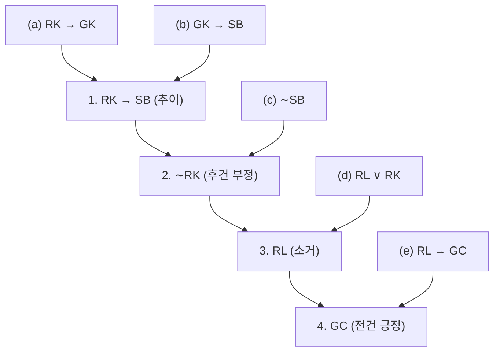

*그림 3. 안경의 위치를 찾는 연역에서 전제와 추론 규칙의 연결*

### 3.4 오류

**오류(fallacy)** 는 부당한 논증을 낳는 추론의 잘못이다. 흔한 오류로 다음 세 가지가 있다.

- **모호한 전제를 모호하지 않은 것처럼 쓰기.** "모든 은행(bank)은 강가에 있다. 내 돈은 은행(bank)에 있다. 그러므로 내 돈은 강가에 있다." 영어 bank가 은행과 강둑이라는 두 뜻을 가지는 것을 이용한 잘못이다.
- **순환 논증(circular reasoning).** 증명할 것을 전제에서 이끌어 내지 않고 미리 가정하는 잘못이다. "이 책은 믿을 만하다. 10쪽에 그렇게 쓰여 있기 때문이다"는 결론을 전제로 뒷받침한다.
- **성급한 결론(jumping to a conclusion).** 충분한 근거 없이 결론을 내리는 잘못이다. "이웃집 개가 나를 물었다. 그러므로 모든 개는 위험하다"는 부족한 증거에서 일반적인 결론을 이끌어 낸다.

이 절은 이 밖에 전건 긍정과 후건 부정과 겉모양은 비슷하지만 실제로는 부당한 두 오류, 역의 오류와 이의 오류를 다룬다. 논증이 부당함을 보이는 방법은 두 가지이다. 진리표에서 모든 전제가 참인데 결론이 거짓인 임계 행을 하나 찾거나, 같은 형식이면서 전제가 참이고 결론이 거짓인 논증을 하나 찾는 것이다.

> **핵심:** 논증이 타당하려면 같은 형식이면서 전제가 모두 참인 모든 논증의 결론이 참이어야 한다. 따라서 논증이 부당하다는 것은 같은 형식이면서 전제가 모두 참이고 결론이 거짓인 논증이 존재한다는 뜻이다.

**예제 2.3.9 (역의 오류).** 다음 논증이 부당함을 보인다.

$$
\begin{array}{l}
\text{지크가 부정행위자이면, 지크는 뒷줄에 앉는다.} \\
\text{지크는 뒷줄에 앉는다.} \\
\hline
\therefore\ \text{지크는 부정행위자이다.}
\end{array}
$$

많은 사람이 이 논증이 부당함을 직관적으로 안다. 첫째 전제는 지크가 부정행위자라는 것이 알려졌을 때의 정보만 주고, 그렇지 않을 때는 아무 정보도 주지 않는다. 부정행위자가 아니면서 우연히 뒷줄에 앉는 사람을 생각할 수 있고, 그 사람의 이름을 지크 자리에 넣으면 첫째 전제는 공허하게 참이고 둘째 전제도 참이지만 결론은 거짓이다. 이 논증의 일반 형식과 진리표는 다음과 같다.

$$
\begin{array}{l}
p \to q \\
q \\
\hline
\therefore\ p
\end{array}
$$

| $p$ | $q$ | 전제 $p \to q$ | 전제 $q$ | 결론 $p$ | 비고 |
|:-:|:-:|:-:|:-:|:-:|:-----|
| T | T | T | T | T | 임계 행, 결론 참 |
| T | F | F | F | T | |
| F | T | T | T | F | 임계 행, 결론 거짓 |
| F | F | T | F | F | |

*표 31. 셋째 행이 부당함을 보여 주는 역의 오류의 진리표*

셋째 임계 행에서 결론이 거짓이므로 이 형식은 부당하다. 첫째 전제 $p \to q$를 그 역 $q \to p$로 바꾸면 결론이 따라 나오므로 이 오류를 **역의 오류(converse error)** 라 한다. 조건 명제는 그 역과 논리적 동치가 아니므로 그렇게 바꿀 수 없다. 역의 오류는 **후건 긍정의 오류(fallacy of affirming the consequent)** 라고도 한다.

**예제 2.3.10 (이의 오류).** 다음 논증을 생각한다.

$$
\begin{array}{l}
\text{이 두 꼭짓점이 인접하면, 두 꼭짓점의 색은 같지 않다.} \\
\text{이 두 꼭짓점은 인접하지 않는다.} \\
\hline
\therefore\ \text{이 두 꼭짓점의 색은 같다.}
\end{array}
$$

이 논증의 형식은 $p \to q$, $\sim p$, $\therefore\ \sim q$이다.

| $p$ | $q$ | 전제 $p \to q$ | 전제 $\sim p$ | 결론 $\sim q$ | 비고 |
|:-:|:-:|:-:|:-:|:-:|:-----|
| T | T | T | F | F | |
| T | F | F | F | T | |
| F | T | T | T | F | 임계 행, 결론 거짓 |
| F | F | T | T | T | 임계 행, 결론 참 |

*표 32. 셋째 행이 부당함을 보여 주는 이의 오류의 진리표*

셋째 임계 행에서 결론이 거짓이므로 이 형식은 부당하다. 첫째 전제를 그 이 $\sim p \to \sim q$로 바꾸면 결론이 따라 나오므로 이 오류를 **이의 오류(inverse error)** 라 한다. 조건 명제는 그 이와 논리적 동치가 아니므로 그렇게 바꿀 수 없다. 이의 오류는 **전건 부정의 오류(fallacy of denying the antecedent)** 라고도 한다.

**타당성과 참.** 논증이 타당해 보이면 결론을 참으로 받아들이고, 논증이 수상해 보이면 결론이 거짓이라고 생각하는 사람이 있다. 이는 옳지 않다.

> **주의:** 논리학에서 "참"과 "타당"은 전혀 다른 뜻이다. 타당한 논증의 결론이 거짓일 수 있고, 부당한 논증의 결론이 참일 수 있다.

**예제 2.3.11 (거짓인 전제와 거짓인 결론을 가진 타당한 논증).** 다음 논증은 전건 긍정에 의해 타당하지만 대전제가 거짓이고 결론도 거짓이다.

$$
\begin{array}{l}
\text{캐나다가 미국의 북쪽에 있으면, 캐나다의 기온은 결코 영상으로 오르지 않는다.} \\
\text{캐나다는 미국의 북쪽에 있다.} \\
\hline
\therefore\ \text{캐나다의 기온은 결코 영상으로 오르지 않는다.}
\end{array}
$$

"모든 새는 헤엄칠 수 있다. 고양이는 새이다. 그러므로 고양이는 헤엄칠 수 있다"도 두 전제가 모두 거짓이지만 형식은 타당한 논증이다. 이 논증의 "모든"이 들어간 형식이 타당한 이유는 3장에서 다룬다.

**예제 2.3.12 (참인 전제와 참인 결론을 가진 부당한 논증).** 다음 논증은 역의 오류를 범하므로 부당하지만 결론은 참이다.

$$
\begin{array}{l}
\text{뉴욕이 대도시이면, 뉴욕에는 고층 건물이 있다.} \\
\text{뉴욕에는 고층 건물이 있다.} \\
\hline
\therefore\ \text{뉴욕은 대도시이다.}
\end{array}
$$

> **용어 정의:** 논증이 타당하고 모든 전제가 참일 때, 그리고 그때에만 논증을 **건전하다(sound)** 고 한다. 건전하지 않은 논증을 건전하지 않다(unsound)고 한다.

타당성은 논증 형식의 성질이다. 어떤 논증이 타당하면 같은 형식의 다른 모든 논증도 타당하고, 어떤 논증이 부당하면 같은 형식의 다른 모든 논증도 부당하다. 전제와 결론의 진릿값 조합 가운데 각 형식에서 나타날 수 있는 것을 정리하면 다음과 같다.

| 전제와 결론의 진릿값 | 타당한 형식의 논증 | 부당한 형식의 논증 |
|:-----|:-:|:-:|
| 전제가 모두 참, 결론이 참 | 가능 | 가능 |
| 전제가 모두 참, 결론이 거짓 | 불가능 | 가능 |
| 적어도 한 전제가 거짓, 결론이 참 | 가능 | 가능 |
| 적어도 한 전제가 거짓, 결론이 거짓 | 가능 | 가능 |

*표 33. 타당한 형식과 부당한 형식에서 나타날 수 있는 진릿값 조합*

> **핵심:** 결론이 참이라고 확신할 수 있는 것은 논증이 건전할 때, 즉 논증이 타당하고 모든 전제가 참임을 알 때뿐이다.

### 3.5 모순 규칙

논리적 모순이라는 개념을 이용하면 **모순 규칙(contradiction rule)** 이라는 추론 방법으로 결론을 이끌어 낼 수 있다. $p$를 참임을 보이고 싶은 명제라 한다.

> **핵심:** **모순 규칙.** 명제 $p$가 거짓이라는 가정이 논리적으로 모순에 이른다는 것을 보일 수 있으면, $p$가 참이라고 결론지을 수 있다.

**예제 2.3.13 (모순 규칙의 타당성).** $\mathbf{c}$가 모순명제일 때 다음 논증 형식이 타당함을 보인다.

$$
\begin{array}{l}
\sim p \to \mathbf{c} \\
\hline
\therefore\ p
\end{array}
$$

| $p$ | $\sim p$ | $\mathbf{c}$ | 전제 $\sim p \to \mathbf{c}$ | 결론 $p$ | 비고 |
|:-:|:-:|:-:|:-:|:-:|:-----|
| T | F | F | T | T | 임계 행, 결론 참 |
| F | T | F | F | F | |

*표 34. 모순 규칙의 진리표*

$\mathbf{c}$는 항상 F이므로 전제 $\sim p \to \mathbf{c}$는 $\sim p$가 F인 첫째 행에서만 참이다. 전제가 참인 임계 행은 첫째 행 하나이고 그 행에서 결론 $p$도 참이므로 이 논증 형식은 타당하다.

모순 규칙은 4장에서 다루는 귀류법(proof by contradiction)의 논리적 핵심이다. 이를 조금 바꾼 규칙, 즉 모순에 이르는 가정은 거짓이라는 규칙은 모순되는 답을 배제하여 논리 퍼즐을 푸는 데도 쓰인다.

**예제 2.3.14 (기사와 악당).** 논리학자 레이먼드 스멀리언(Raymond Smullyan)은 항상 참말만 하는 **기사(knight)** 와 항상 거짓말만 하는 **악당(knave)** 두 종류의 사람이 사는 섬을 묘사했다. 이 섬에서 두 주민 A와 B를 만났다.

- A가 말한다: B는 기사이다.
- B가 말한다: A와 나는 종류가 다르다.

A와 B는 각각 무엇인가? 답은 둘 다 악당이다. 이를 다음과 같이 추론한다.

| 단계 | 근거 |
|:-----|:-----|
| A가 기사라고 가정한다. | 가정 |
| $\therefore$ A의 말은 참이다. | 기사의 정의 |
| $\therefore$ B도 기사이다. | A가 그렇게 말했다. |
| $\therefore$ B의 말은 참이다. | 기사의 정의 |
| $\therefore$ A와 B는 종류가 다르다. | B가 그렇게 말했다. |
| $\therefore$ A와 B는 모두 기사이면서 종류가 다르다는 모순에 이른다. | 앞의 두 결론 |
| $\therefore$ 가정은 거짓이다. | 모순 규칙 |
| $\therefore$ A는 기사가 아니다. | 가정의 부정 |
| $\therefore$ A는 악당이다. | 소거: 모든 주민은 기사이거나 악당이다. |
| $\therefore$ A의 말은 거짓이다. | 악당의 정의 |
| $\therefore$ B는 기사가 아니다. | A의 말 "B는 기사이다"가 거짓이다. |
| $\therefore$ B도 악당이다. | 소거 |

*표 35. 기사와 악당 문제의 추론 단계와 근거*

이 추론은 문제에 답이 있다면 A와 B가 모두 악당이어야 함을 보여 준다. 문제 자체가 모순이어서 답이 없을 가능성도 있으므로, 실제로 답이 되는지 확인한다. A와 B가 모두 악당이면 A의 말 "B는 기사이다"는 거짓이고, B의 말 "A와 나는 종류가 다르다"도 둘이 같은 종류이므로 거짓이다. 두 악당이 모두 거짓말을 하므로 조건에 맞는다.

### 3.6 추론 규칙 정리

중요한 추론 규칙을 다음 표로 정리한다. 각 칸에서 $\therefore$ 앞은 전제이고 뒤는 결론이다.

| 규칙 | 형식 | 규칙 | 형식 |
|:-----|:-----|:-----|:-----|
| 전건 긍정 (modus ponens) | $p \to q$<br>$p$<br>$\therefore\ q$ | 소거 (elimination) | (a) $p \vee q$, $\sim q$, $\therefore\ p$<br>(b) $p \vee q$, $\sim p$, $\therefore\ q$ |
| 후건 부정 (modus tollens) | $p \to q$<br>$\sim q$<br>$\therefore\ \sim p$ | 추이 (transitivity) | $p \to q$<br>$q \to r$<br>$\therefore\ p \to r$ |
| 일반화 (generalization) | (a) $p$, $\therefore\ p \vee q$<br>(b) $q$, $\therefore\ p \vee q$ | 경우 나누기 (division into cases) | $p \vee q$<br>$p \to r$<br>$q \to r$<br>$\therefore\ r$ |
| 특수화 (specialization) | (a) $p \wedge q$, $\therefore\ p$<br>(b) $p \wedge q$, $\therefore\ q$ | 모순 규칙 (contradiction rule) | $\sim p \to \mathbf{c}$<br>$\therefore\ p$ |
| 논리곱 규칙 (conjunction) | $p$<br>$q$<br>$\therefore\ p \wedge q$ | | |

*표 36. 타당한 논증 형식(추론 규칙)*

논리곱 규칙은 두 전제가 각각 참이면 그 논리곱도 참이라는 규칙으로, 논리곱의 정의에서 바로 나온다.

---

<br>

## 4. 응용: 디지털 논리 회로

이 절은 1절의 논리 연결사가 디지털 회로의 동작과 정확히 대응함을 보이고, 회로와 입출력 표, 부울 식 사이를 오가는 방법과 회로를 간략화하는 방법을 다룬다.

### 4.1 스위치 회로와 논리

1930년대 후반 MIT 대학원생이던 클로드 섀넌(Claude Shannon)은 전화 교환 회로 같은 스위칭 장치의 동작과 논리 연결사의 동작이 서로 닮았다는 것을 알아차렸고, 이 유사성을 이용하여 회로 설계 문제를 풀어 1938년에 석사 학위 논문으로 발표했다.

간단한 스위치는 닫혀 있으면 한 단자에서 다른 단자로 전류가 흐르고, 열려 있으면 전류가 흐르지 않는다. 전지와 전구가 연결된 회로에 스위치를 넣으면 전구는 전류가 흐를 때, 그리고 그때에만 켜진다. 아래 그림 (a)처럼 두 스위치 $P$, $Q$를 **직렬(in series)** 로 연결하면 두 스위치가 모두 닫혀야 전구가 켜지고, 그림 (b)처럼 **병렬(in parallel)** 로 연결하면 적어도 하나의 스위치가 닫히면 전구가 켜진다. 그림의 왼쪽 기호는 전지, 오른쪽 원 기호는 전구이다.

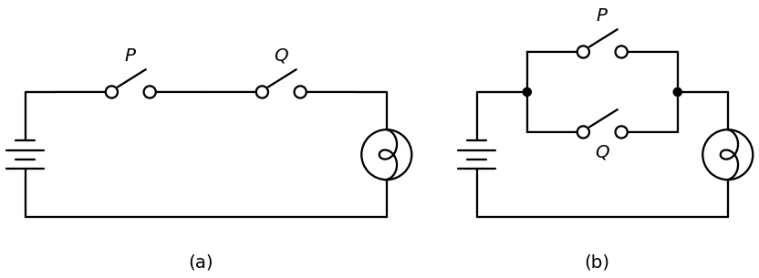

*그림 4. (a) 두 스위치를 직렬로 연결한 회로와 (b) 병렬로 연결한 회로*

| $P$ | $Q$ | 직렬 회로의 전구 | 병렬 회로의 전구 |
|:-:|:-:|:-:|:-:|
| 닫힘 | 닫힘 | 켜짐 | 켜짐 |
| 닫힘 | 열림 | 꺼짐 | 켜짐 |
| 열림 | 닫힘 | 꺼짐 | 켜짐 |
| 열림 | 열림 | 꺼짐 | 꺼짐 |

*표 37. 직렬 회로와 병렬 회로에서 스위치 상태에 따른 전구의 상태*

"닫힘"과 "켜짐"을 T로, "열림"과 "꺼짐"을 F로 바꾸면 직렬 회로의 열은 and의 진리표가 되고 병렬 회로의 열은 or의 진리표가 된다. 그래서 직렬 회로는 논리식 $P \wedge Q$에, 병렬 회로는 $P \vee Q$에 대응한다고 한다. 더 복잡한 회로는 더 복잡한 논리식에 대응하며, 이 대응은 회로의 설계와 분석에 널리 쓰여 왔다.

1940년대와 1950년대에 스위치는 전자 소자로 바뀌었고, 닫힘과 열림이라는 물리적 상태는 높은 전압과 낮은 전압 같은 전자적 상태로 바뀌었다. 이 기술은 전자 계산기, 전화 교환 시스템, 신호등 제어기 같은 현대의 디지털 시스템을 낳았다. 디지털 시스템의 기본 전자 부품을 **디지털 논리 회로(digital logic circuit)** 라 한다. "논리"는 회로 설계에서 논리가 하는 중요한 역할을, "디지털"은 연속적인 신호가 아니라 이산적인(서로 떨어진) 신호를 처리한다는 것을 나타낸다. 공학자들은 전자 스위치가 만드는 신호 값을 여전히 참과 거짓이라 부르지만, 보통 T와 F 대신 1과 0으로 쓴다. 기호 0과 1을 **비트(bit)** 라 하며, 2진 숫자(binary digit)를 줄인 말이다. 이 용어는 1946년 통계학자 존 튜키(John Tukey)가 도입했다.

### 4.2 블랙박스와 게이트

신호 비트(1과 0)의 조합은 여러 회로를 거쳐 다른 신호 비트의 조합으로 바뀐다. 회로를 만드는 기술은 다양하므로, 설계자는 기본 회로를 **블랙박스(black box)** 로 생각하는 것이 편리하다. 블랙박스의 내부에는 회로의 구체적인 구현이 들어 있지만, 이를 무시하고 입력 신호와 출력 신호 사이의 관계에만 집중한다.

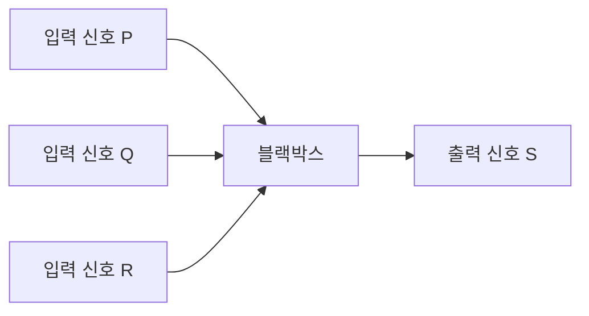

*그림 5. 입력 신호 세 개와 출력 신호 하나를 가진 블랙박스*

블랙박스의 동작은 가능한 모든 입력 신호와 그에 대응하는 출력 신호를 나열한 **입출력 표(input/output table)** 로 완전히 정해진다. 위 블랙박스는 입력 신호가 세 개이고 각각 1이나 0이므로 입력 조합은 $2^3 = 8$가지이다. 가능한 입출력 대응의 하나는 다음과 같다.

| $P$ | $Q$ | $R$ | $S$ |
|:-:|:-:|:-:|:-:|
| 1 | 1 | 1 | 1 |
| 1 | 1 | 0 | 0 |
| 1 | 0 | 1 | 0 |
| 1 | 0 | 0 | 1 |
| 0 | 1 | 1 | 0 |
| 0 | 1 | 0 | 1 |
| 0 | 0 | 1 | 1 |
| 0 | 0 | 0 | 0 |

*표 38. 입력 세 개를 가진 블랙박스의 입출력 표의 예*

예를 들어 셋째 행은 입력이 $P = 1$, $Q = 0$, $R = 1$일 때 출력 $S$가 0임을 나타낸다. 이 표의 출력은 입력 가운데 1의 개수가 홀수일 때 1이다.

더 복잡한 회로는 덜 복잡한 블랙박스 회로를 연결하여 효율적으로 설계한다. 그런 기본 회로 세 가지가 NOT 게이트, AND 게이트, OR 게이트이다.

- **NOT 게이트(NOT-gate)** 또는 **인버터(inverter)** 는 입력 신호 하나와 출력 신호 하나를 가진 회로이다. 입력이 1이면 출력은 0이고, 입력이 0이면 출력은 1이다.
- **AND 게이트(AND-gate)** 는 입력 신호 두 개와 출력 신호 하나를 가진 회로이다. 두 입력이 모두 1이면 출력은 1이고, 그렇지 않으면 0이다.
- **OR 게이트(OR-gate)** 도 입력 신호 두 개와 출력 신호 하나를 가진다. 두 입력이 모두 0이면 출력은 0이고, 그렇지 않으면 1이다.

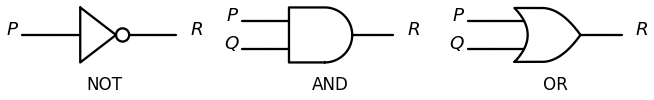

*그림 6. NOT 게이트, AND 게이트, OR 게이트의 기호*

| $P$ | NOT 게이트의 출력 $R$ |
|:-:|:-:|
| 1 | 0 |
| 0 | 1 |

*표 39. NOT 게이트의 입출력 표*

| $P$ | $Q$ | AND 게이트의 출력 $R$ | OR 게이트의 출력 $R$ |
|:-:|:-:|:-:|:-:|
| 1 | 1 | 1 | 1 |
| 1 | 0 | 0 | 1 |
| 0 | 1 | 0 | 1 |
| 0 | 0 | 0 | 0 |

*표 40. AND 게이트와 OR 게이트의 입출력 표*

1을 T로, 0을 F로 보면 NOT, AND, OR 게이트가 신호에 하는 일은 논리 연결사 $\sim$, $\wedge$, $\vee$가 명제에 하는 일과 정확히 같다.

게이트는 여러 방법으로 이어 붙일 수 있다. 다음 규칙을 지키면 그 결과는 **조합 회로(combinational circuit)**, 즉 어느 순간의 출력이 이전 입력과 관계없이 그 순간의 입력만으로 완전히 정해지는 회로가 된다.

> **핵심:** **조합 회로의 규칙**
> 1. 두 입력선을 하나로 합치지 않는다.
> 2. 입력선 하나를 중간에서 갈라 서로 다른 두 게이트의 입력으로 쓸 수 있다.
> 3. 출력선을 다른 게이트의 입력으로 쓸 수 있다.
> 4. 어떤 게이트의 출력도 결국 그 게이트 자신으로 되돌아가서는 안 된다.

규칙 4를 어기는 더 복잡한 회로를 **순차 회로(sequential circuit)** 라 하며, 그 출력은 현재 입력뿐 아니라 이전 입력에도 달려 있다.

> **[논리설계]** 논리 설계에서는 같은 연산을 다른 기호로 쓴다. $P \wedge Q$는 $PQ$ 또는 $P \cdot Q$로, $P \vee Q$는 $P + Q$로, $\sim P$는 $P'$ 또는 $\overline{P}$로 쓰며, 진릿값 T와 F 대신 1과 0을 쓴다. 출력이 이전 상태에 의존하는 순차 회로는 플립플롭을 이용하여 구성한다.

### 4.3 회로의 입출력 표

입력 신호가 주어지면 회로를 게이트별로 따라가며 출력을 구할 수 있다.

**예제 2.4.1 (주어진 입력에 대한 출력 구하기).** 아래 그림의 두 회로에 대해 주어진 입력 신호에서의 출력을 구한다. 그림의 붉은 숫자는 각 선의 신호 값이다.

- (a) 입력 $P = 0$, $Q = 1$. 왼쪽에서 오른쪽으로 각 게이트의 동작을 따라간다. NOT 게이트가 $P = 0$을 1로 바꾸므로 AND 게이트의 두 입력은 모두 1이고, 따라서 출력 $R$는 1이다.
- (b) 입력 $P = 1$, $Q = 0$, $R = 1$. 입력 $P$가 1이므로 OR 게이트의 출력은 1이다. NOT 게이트가 이 1을 0으로 바꾸므로 AND 게이트의 두 입력은 0과 $R = 1$이고, 따라서 출력 $S$는 0이다.

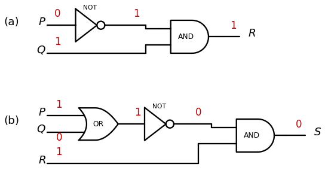

*그림 7. 입력 신호를 게이트별로 따라가며 구한 두 회로의 출력*

회로의 입출력 표 전체를 만들려면 가능한 입력 조합마다 회로를 따라가며 출력을 구한다.

**예제 2.4.2 (회로의 입출력 표 만들기).** 아래 회로는 $P$를 OR 게이트의 한 입력으로 직접 보내고, $Q$를 NOT 게이트를 거쳐 OR 게이트의 다른 입력으로 보낸다.

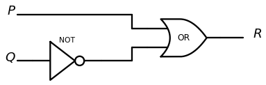

*그림 8. P와 NOT 게이트를 거친 Q를 OR 게이트에 넣는 회로*

네 가지 입력 조합을 나열하고 각각 따라간다. 예를 들어 $P = 0$, $Q = 1$이면 NOT 게이트의 출력이 0이므로 OR 게이트의 두 입력이 모두 0이 되어 출력 $R$는 0이다. 다른 조합에서는 OR 게이트의 입력 가운데 적어도 하나가 1이므로 출력이 1이다.

| $P$ | $Q$ | $R$ |
|:-:|:-:|:-:|
| 1 | 1 | 1 |
| 1 | 0 | 1 |
| 0 | 1 | 0 |
| 0 | 0 | 1 |

*표 41. P와 NOT 게이트를 거친 Q를 OR 게이트에 넣는 회로의 입출력 표*

### 4.4 회로에 대응하는 부울 식

논리학에서 $p$, $q$, $r$ 같은 변수는 명제를 나타내고, 명제는 T와 F 두 진릿값 중 하나만 가진다. $p \wedge (\sim q \vee r)$처럼 명제 변수와 논리 연결사로 이루어진 식이 명제 형식이었다. 기호 논리학의 창시자 가운데 한 사람인 영국의 수학자 조지 불(George Boole)을 기려, 명제 변수나 입력 신호처럼 두 값 중 하나만 가지는 변수를 **부울 변수(Boolean variable)** 라 하고, 부울 변수와 연결사 $\sim$, $\wedge$, $\vee$로 이루어진 식을 **부울 식(Boolean expression)** 이라 한다.

> **참고:** 엄밀하게는 $(\sim p \wedge q) \vee (p \wedge r)$나 $\sim(\sim(p \wedge q) \vee r)$처럼 의미 있는 식만 부울 식이며, 기호를 아무렇게나 늘어놓은 식은 부울 식이 아니다. 어떤 식이 의미 있는지는 재귀적 정의로 엄밀하게 정할 수 있다.

NOT, AND, OR 게이트를 이어 만든 회로가 주어지면, 각 게이트가 입력 변수에 하는 일을 따라가며 대응하는 부울 식을 얻는다.

**예제 2.4.3 (회로에 대응하는 부울 식 찾기).** 아래 그림의 두 회로에 대응하는 부울 식을 구한다. 검은 점은 두 선이 연결된 곳이며, 점 없이 교차하는 선은 서로 닿지 않는다고 본다.

- (a) 회로를 왼쪽에서 오른쪽으로 따라가며 각 게이트의 출력을 기호로 적는다. 입력 $P$와 $Q$는 각각 갈라져 OR 게이트와 AND 게이트에 들어가므로, 두 게이트의 출력은 $P \vee Q$와 $P \wedge Q$이다. NOT 게이트가 $P \wedge Q$를 $\sim(P \wedge Q)$로 바꾸고, 마지막 AND 게이트가 $P \vee Q$와 $\sim(P \wedge Q)$를 받으므로 최종 식은 $(P \vee Q) \wedge \sim(P \wedge Q)$이다. 이는 1.5절의 배타적 논리합, 즉 "$P$ 또는 $Q$이지만 둘 다는 아니다"이다.
- (b) 첫 AND 게이트의 출력은 $P \wedge Q$, NOT 게이트의 출력은 $\sim R$이고, 이 둘을 받는 AND 게이트의 출력은 $(P \wedge Q) \wedge \sim R$이다.

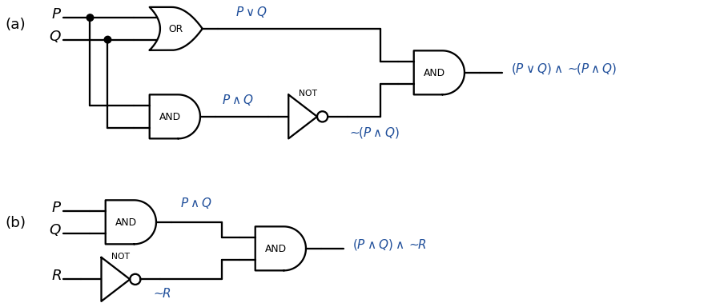

*그림 9. (a) 배타적 논리합을 계산하는 회로와 (b) (P ∧ Q) ∧ ∼R를 계산하는 회로*

(b)의 회로는 $P = 1$, $Q = 1$, $R = 0$인 단 하나의 입력 조합에서만 1을 출력하고 다른 모든 조합에서 0을 출력한다. 즉 입출력 표의 출력 열에 1이 정확히 한 행에만 있으며, 이 회로는 한 입력 조합을 "인식"한다고 할 수 있다.

> **용어 정의:** **인식기(recognizer)** 는 특정한 입력 신호 조합 하나에 대해서만 1을 출력하고 다른 모든 조합에 대해 0을 출력하는 회로이다.

| $P$ | $Q$ | $R$ | $(P \wedge Q) \wedge \sim R$ |
|:-:|:-:|:-:|:-:|
| 1 | 1 | 1 | 0 |
| 1 | 1 | 0 | 1 |
| 1 | 0 | 1 | 0 |
| 1 | 0 | 0 | 0 |
| 0 | 1 | 1 | 0 |
| 0 | 1 | 0 | 0 |
| 0 | 0 | 1 | 0 |
| 0 | 0 | 0 | 0 |

*표 42. 입력 조합 110을 인식하는 인식기의 입출력 표*

입력이 두 개인 경우도 같다. 예를 들어 $P \wedge \sim Q$는 $P = 1$, $Q = 0$일 때만 1이므로 입력 조합 10의 인식기이다.

### 4.5 부울 식에 대응하는 회로

반대로 부울 식이 주어지면 대응하는 회로를 만들 수 있다. 식의 가장 바깥쪽 연산에서 시작하여 안쪽으로 들어가면서, 회로도의 오른쪽에서 왼쪽으로 각 연산에 대응하는 게이트를 추가한다.

**예제 2.4.4(a) (부울 식에 대응하는 회로 만들기).** 부울 식 $(\sim P \wedge Q) \vee \sim Q$의 회로를 만든다.

1. 입력 변수 $P$, $Q$를 회로도의 왼쪽에 세로로 적는다.
2. 식을 계산할 때 마지막으로 하는 연산이 $\vee$이므로 오른쪽 끝에 OR 게이트를 둔다.
3. OR 게이트의 한 입력은 $\sim P \wedge Q$이므로 OR 게이트 왼쪽에 AND 게이트를 두고 그 출력을 OR 게이트에 넣는다.
4. AND 게이트의 한 입력은 $\sim P$이므로 $P$에서 NOT 게이트를 거쳐 AND 게이트로 선을 잇고, 다른 입력 $Q$는 $Q$에서 AND 게이트로 바로 잇는다.
5. OR 게이트의 다른 입력은 $\sim Q$이므로 $Q$에서 갈라진 선을 NOT 게이트를 거쳐 OR 게이트로 잇는다.

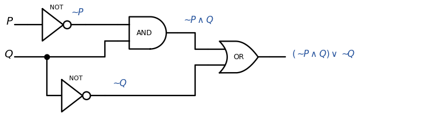

*그림 10. 부울 식 (∼P ∧ Q) ∨ ∼Q에 대응하는 회로*

**예제 2.4.4(b) (다섯 입력의 논리곱).** $((P \wedge Q) \wedge (R \wedge S)) \wedge T$의 회로는 마지막 연산인 $((P \wedge Q) \wedge (R \wedge S))$와 $T$ 사이의 $\wedge$에 대응하는 AND 게이트를 오른쪽 끝에 두고, 그 왼쪽에 $P \wedge Q$와 $R \wedge S$ 사이의 $\wedge$에 대응하는 AND 게이트를, 다시 그 왼쪽에 $P$와 $Q$ 사이, $R$와 $S$ 사이의 $\wedge$에 대응하는 AND 게이트 두 개를 두어 만든다(아래 그림 (a)).

결합 법칙에 의해 $P \wedge Q \wedge R \wedge S \wedge T$에 괄호를 넣는 모든 방법은 논리적 동치인 식을 준다. 예를 들어 $((P \wedge Q) \wedge (R \wedge S)) \wedge T \equiv (P \wedge (Q \wedge R)) \wedge (S \wedge T)$이므로, $(P \wedge (Q \wedge R)) \wedge (S \wedge T)$에 대응하는 그림 (b)의 회로는 그림 (a)의 회로와 입출력 표가 같다. 따라서 두 회로는 모두 $P \wedge Q \wedge R \wedge S \wedge T$를 구현하며, 이런 회로를 **다중 입력 AND 게이트(multiple-input AND-gate)** 라 하고 그림 (c)의 기호로 나타낸다. 다중 입력 OR 게이트도 같은 방법으로 만든다.

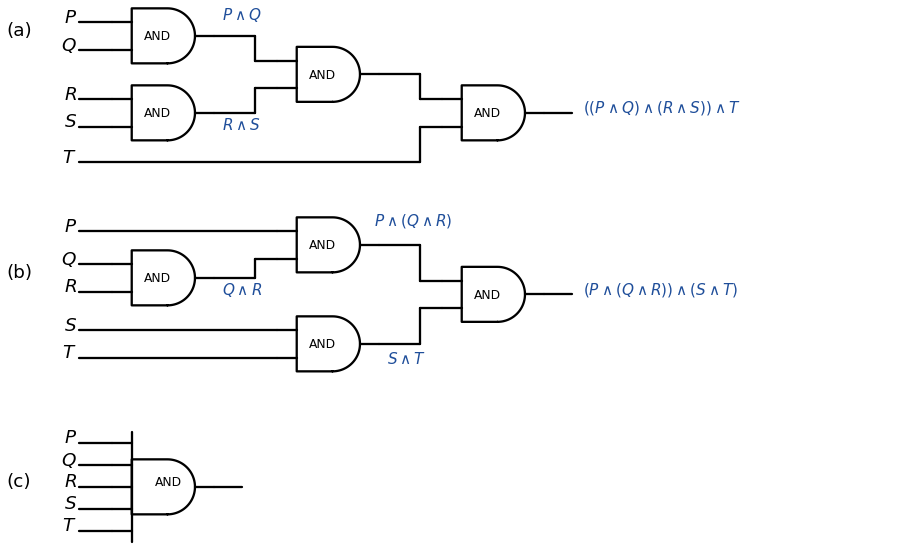

*그림 11. (a) ((P ∧ Q) ∧ (R ∧ S)) ∧ T의 회로, (b) (P ∧ (Q ∧ R)) ∧ (S ∧ T)의 회로, (c) 다섯 입력 AND 게이트의 기호*

### 4.6 입출력 표에 대응하는 회로 설계

지금까지 회로의 입출력 표를 만드는 방법, 회로에 대응하는 부울 식을 찾는 방법, 부울 식에 대응하는 회로를 만드는 방법을 보았다. 이제 입출력 표가 주어졌을 때 그 표를 가지는 회로(또는 부울 식)를 설계하는 방법을 다룬다. 핵심은 여러 인식기를 병렬로 묶는 것이다.

**예제 2.4.5 (주어진 입출력 표의 회로 설계).** 다음 입출력 표를 가지는 회로를 설계한다.

| $P$ | $Q$ | $R$ | $S$ |
|:-:|:-:|:-:|:-:|
| 1 | 1 | 1 | 1 |
| 1 | 1 | 0 | 0 |
| 1 | 0 | 1 | 1 |
| 1 | 0 | 0 | 1 |
| 0 | 1 | 1 | 0 |
| 0 | 1 | 0 | 0 |
| 0 | 0 | 1 | 0 |
| 0 | 0 | 0 | 0 |

*표 43. 회로를 설계할 입출력 표*

1. 출력이 1인 행을 찾는다. 이 표에서는 첫째, 셋째, 넷째 행이다.
2. 각 행에 대해, 그 행의 입력 조합에서만 1(참)이고 다른 모든 조합에서 0(거짓)인 and 식을 만든다. 첫째 행($P = 1$, $Q = 1$, $R = 1$)의 식은 $P \wedge Q \wedge R$이다. 셋째 행($P = 1$, $Q = 0$, $R = 1$)의 식은 $P \wedge \sim Q \wedge R$이고, 넷째 행($P = 1$, $Q = 0$, $R = 0$)의 식은 $P \wedge \sim Q \wedge \sim R$이다. 각 변수는 그 행에서 값이 1이면 그대로, 0이면 부정하여 쓴다.
3. 주어진 표를 진리표로 가지는 부울 식은 $P \wedge Q \wedge R = 1$인 경우, $P \wedge \sim Q \wedge R = 1$인 경우, $P \wedge \sim Q \wedge \sim R = 1$인 경우에 1이고 다른 경우에는 0이어야 한다. 따라서 세 식의 논리합이 답이다.

$$
S = (P \wedge Q \wedge R) \vee (P \wedge \sim Q \wedge R) \vee (P \wedge \sim Q \wedge \sim R)
$$

이 식에 대응하는 회로는 다음과 같다. 세 AND 게이트가 각 행의 인식기이고, OR 게이트가 이들을 병렬로 묶는다.

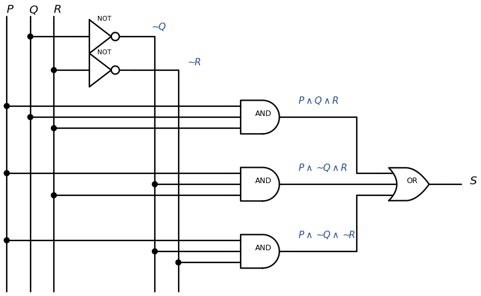

*그림 12. 세 인식기를 OR 게이트로 묶어 주어진 입출력 표를 구현한 회로*

> **용어 정의:** 위 식처럼, 각 항이 논리곱이고 각 논리곱에 $P$와 $\sim P$ 중 하나, $Q$와 $\sim Q$ 중 하나, $R$와 $\sim R$ 중 하나가 나타나는 항들의 논리합으로 이루어진 식을 **논리합 표준형(disjunctive normal form)** 또는 **곱의 합(sum-of-products)** 형식이라 한다.

> **주의:** 출력이 모두 0인 입출력 표에는 1인 행이 없으므로 이 방법으로 항을 만들 수 없다. 이때는 $P \wedge \sim P$ 같은 모순명제가 그 표를 진리표로 가지는 식이다.

> **[논리설계]** 논리 설계에서는 각 행의 인식기 항을 **최소항(minterm)** 이라 하고, 입력 $PQR$를 2진수로 읽은 행 번호로 이름을 붙인다. 위 표에서 출력이 1인 행은 111, 101, 100, 즉 7, 5, 4번 행이므로 $S = \Sigma(4, 5, 7) = PQR + PQ'R + PQ'R'$로 쓴다. 논리합 표준형은 최소항의 합(sum of minterms)과 같다.

### 4.7 조합 회로의 간략화

아래 그림의 두 조합 회로를 비교한다.

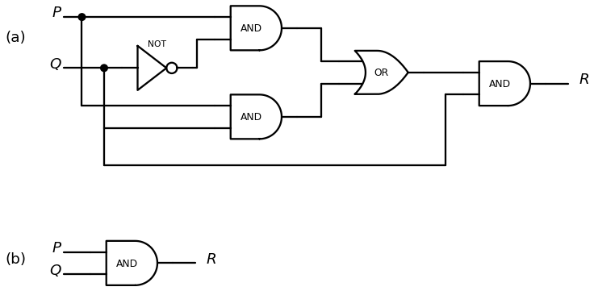

*그림 13. 입출력 표가 같은 두 조합 회로, (a) 게이트 다섯 개의 회로와 (b) AND 게이트 하나의 회로*

회로 (a)를 따라가면 입출력 표는 다음과 같으며, 이는 회로 (b)의 입출력 표와 같다.

| $P$ | $Q$ | $R$ |
|:-:|:-:|:-:|
| 1 | 1 | 1 |
| 1 | 0 | 0 |
| 0 | 1 | 0 |
| 0 | 0 | 0 |

*표 44. 두 회로에 공통인 입출력 표*

두 회로는 같은 입력 조합을 같은 출력으로 바꾸므로 같은 일을 한다. 그러나 회로 (b)는 게이트가 훨씬 적어 더 간단하며, 집적 회로의 일부로 만들 때 공간을 덜 차지하고 전력도 덜 쓴다.

> **용어 정의:** 두 디지털 논리 회로의 입출력 표가 같을 때, 그리고 그때에만 두 회로는 **동치(equivalent)** 라 한다.

논리적 동치인 명제 형식은 진리표가 같으므로, 두 회로에 대응하는 부울 식을 구하고 그 식들을 명제 형식으로 보아 논리적 동치임을 보이면 두 회로가 동치임을 알 수 있다.

**예제 2.4.6 (두 회로가 동치임을 보이기).** 위 그림의 회로 (a)와 (b)에 대응하는 부울 식은 각각 $((P \wedge \sim Q) \vee (P \wedge Q)) \wedge Q$와 $P \wedge Q$이다. 1.8절의 논리적 동치 법칙에 의해 다음이 성립한다.

$$
\begin{aligned}
((P \wedge \sim Q) \vee (P \wedge Q)) \wedge Q &\equiv (P \wedge (\sim Q \vee Q)) \wedge Q && \text{분배 법칙} \\
&\equiv (P \wedge (Q \vee \sim Q)) \wedge Q && \vee\text{의 교환 법칙} \\
&\equiv (P \wedge \mathbf{t}) \wedge Q && \text{부정 법칙} \\
&\equiv P \wedge Q && \text{항등 법칙}
\end{aligned}
$$

첫째 줄은 분배 법칙 $p \wedge (q \vee r) \equiv (p \wedge q) \vee (p \wedge r)$를 오른쪽에서 왼쪽으로 읽어 공통인 $P$를 묶어 낸 것이다. 따라서 두 식의 진리표가 같고, 두 회로의 입출력 표도 같으므로 두 회로는 동치이다.

> **핵심:** 조합 회로를 간략화하는 일반적인 방법은 대응하는 부울 식을 구하고, 논리적 동치 법칙으로 더 짧고 논리적 동치인 부울 식을 찾은 뒤, 그 짧은 식에 대응하는 회로를 만드는 것이다.

### 4.8 NAND 게이트와 NOR 게이트

회로를 간략화하는 또 하나의 방법은 사용하는 게이트의 종류를 가능한 한 줄인 동치 회로를 찾는 것이다. 이때 NAND 게이트와 NOR 게이트가 특히 유용하다.

- **NAND 게이트**는 AND 게이트 뒤에 NOT 게이트를 붙인 것처럼 동작한다. 출력은 두 입력이 모두 1일 때, 그리고 그때에만 0이다.
- **NOR 게이트**는 OR 게이트 뒤에 NOT 게이트를 붙인 것처럼 동작한다. 출력은 두 입력이 모두 0일 때, 그리고 그때에만 1이다.

이 게이트에 대응하는 논리 기호는 NAND의 $\mid$와 NOR의 $\downarrow$이다. $\mid$는 셰퍼(H. M. Sheffer)의 이름을 따서 **셰퍼 스트로크(Sheffer stroke)**, $\downarrow$는 퍼스(C. S. Peirce)의 이름을 따서 **퍼스 화살표(Peirce arrow)** 라 한다. 일부 자료는 NAND를 $\uparrow$로 쓰기도 한다.

$$
P \mid Q \equiv \sim(P \wedge Q), \qquad P \downarrow Q \equiv \sim(P \vee Q)
$$

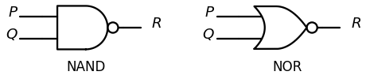

*그림 14. NAND 게이트와 NOR 게이트의 기호*

| $P$ | $Q$ | NAND 출력 $P \mid Q$ | NOR 출력 $P \downarrow Q$ |
|:-:|:-:|:-:|:-:|
| 1 | 1 | 0 | 0 |
| 1 | 0 | 1 | 0 |
| 0 | 1 | 1 | 0 |
| 0 | 0 | 1 | 1 |

*표 45. NAND 게이트와 NOR 게이트의 입출력 표*

모든 부울 식은 셰퍼 스트로크만으로 쓴 식이나 퍼스 화살표만으로 쓴 식과 논리적 동치임을 보일 수 있다. 따라서 모든 디지털 논리 회로는 NAND 게이트만 쓰는 회로나 NOR 게이트만 쓰는 회로와 동치이다. 그 이유는 다음과 같다. 모든 부울 식은 $\sim$, $\wedge$, $\vee$로 이루어지므로, 이 세 연산을 각각 셰퍼 스트로크만으로 나타낼 수 있으면 된다.

**예제 2.4.7 (셰퍼 스트로크로 식 바꾸기).** 논리적 동치 법칙과 셰퍼 스트로크의 정의를 이용하여 (a) $\sim P \equiv P \mid P$와 (b) $P \vee Q \equiv (P \mid P) \mid (Q \mid Q)$를 보인다.

$$
\begin{aligned}
\text{(a)}\quad \sim P &\equiv \sim(P \wedge P) && \wedge\text{의 멱등 법칙} \\
&\equiv P \mid P && \mid\text{의 정의}
\end{aligned}
$$

$$
\begin{aligned}
\text{(b)}\quad P \vee Q &\equiv \sim(\sim(P \vee Q)) && \text{이중 부정 법칙} \\
&\equiv \sim(\sim P \wedge \sim Q) && \text{드모르간의 법칙} \\
&\equiv \sim((P \mid P) \wedge (Q \mid Q)) && \text{(a)} \\
&\equiv (P \mid P) \mid (Q \mid Q) && \mid\text{의 정의}
\end{aligned}
$$

(b)의 셋째 줄은 (a)를 $P$와 $Q$에 각각 적용하여 $\sim P$를 $P \mid P$로, $\sim Q$를 $Q \mid Q$로 바꾼 것이다. 남은 $\wedge$도 같은 방법으로 나타낼 수 있다.

$$
\begin{aligned}
P \wedge Q &\equiv \sim(\sim(P \wedge Q)) && \text{이중 부정 법칙} \\
&\equiv \sim(P \mid Q) && \mid\text{의 정의} \\
&\equiv (P \mid Q) \mid (P \mid Q) && \text{(a)를 } P \mid Q \text{에 적용}
\end{aligned}
$$

따라서 $\sim$, $\wedge$, $\vee$가 모두 셰퍼 스트로크만으로 표현되며, NAND 게이트만으로 모든 조합 회로를 만들 수 있다.

---

<br>

## 5. 응용: 수 체계와 덧셈 회로

이 절은 컴퓨터가 수를 나타내는 2진 표기와 16진 표기, 2진 덧셈과 뺄셈, 4절의 게이트로 덧셈을 하는 회로, 그리고 음수를 나타내는 2의 보수를 다룬다.

### 5.1 10진 표기

초등학교에서 배우는 **10진 표기(decimal notation)** 는 각 숫자에 자릿값을 곱하여 수를 해석한다. 예를 들어 5,049는 천의 자리에 5, 백의 자리에 0, 십의 자리에 4, 일의 자리에 9가 있으므로 다음과 같다.

$$
5{,}049 = 5 \cdot (1{,}000) + 0 \cdot (100) + 4 \cdot (10) + 9 \cdot (1) = 5 \cdot 10^3 + 0 \cdot 10^2 + 4 \cdot 10^1 + 9 \cdot 10^0
$$

일반적으로 10진 표기는 모든 양의 정수를 $d \cdot 10^n$ 꼴의 곱들의 합으로 유일하게 쓸 수 있다는 사실에 바탕을 둔다. 여기서 각 $n$은 음이 아닌 정수이고 각 $d$는 10진 숫자 0, 1, 2, ..., 9 중 하나이다. "decimal"은 10을 뜻하는 라틴어 어근 deci에서 왔다. 10진(10을 밑으로 하는) 표기는 수를 숫자의 나열로 나타내며, 각 숫자의 위치가 곱할 10의 거듭제곱을 나타낸다. 맨 오른쪽이 일의 자리($10^0$의 자리)이고, 그 왼쪽이 십의 자리($10^1$의 자리), 그 왼쪽이 백의 자리($10^2$의 자리)이다.

| 자리 | $10^3$ (천) | $10^2$ (백) | $10^1$ (십) | $10^0$ (일) |
|:-----|:-:|:-:|:-:|:-:|
| 10진 숫자 | 5 | 0 | 4 | 9 |

*표 46. 5,049의 각 자리와 자릿값*

### 5.2 2진 표기

10이라는 수에 특별한 의미가 있는 것은 아니다. 손가락이 열 개라서 10을 밑으로 쓸 뿐이며, 1보다 큰 어떤 정수도 수 체계의 밑이 될 수 있다. 컴퓨터 과학에서는 현대 전자 장치의 신호가 항상 두 상태 중 하나이므로 2를 밑으로 하는 **2진 표기(binary notation)** 가 특히 중요하다. 모든 양의 정수는 $d \cdot 2^n$ 꼴의 곱들의 합으로 유일하게 나타낼 수 있다. 여기서 각 $n$은 음이 아닌 정수이고 각 $d$는 2진 숫자, 즉 **비트** 0 또는 1이다. 이 사실의 증명은 5장에서 다룬다. 예를 들어 다음과 같다.

$$
27 = 16 + 8 + 2 + 1 = 1 \cdot 2^4 + 1 \cdot 2^3 + 0 \cdot 2^2 + 1 \cdot 2^1 + 1 \cdot 2^0
$$

2진 표기에서도 10진 표기처럼 밑의 거듭제곱은 쓰지 않고 숫자만 쓰므로 $27_{10} = 11011_2$이다. 아래 첨자는 수를 쓴 밑이 10인지 2인지를 나타낸다. 2진 표기의 자리는 2의 거듭제곱에 대응한다. 맨 오른쪽이 일의 자리($2^0$의 자리), 그 왼쪽이 이의 자리($2^1$의 자리), 그 왼쪽이 사의 자리($2^2$의 자리)이다.

| 자리 | $2^4$ (16) | $2^3$ (8) | $2^2$ (4) | $2^1$ (2) | $2^0$ (1) |
|:-----|:-:|:-:|:-:|:-:|:-:|
| 2진 숫자 | 1 | 1 | 0 | 1 | 1 |

*표 47. $11011_2$의 각 자리와 자릿값*

10진 표기처럼 앞에 붙는 0은 마음대로 붙이거나 뗄 수 있다. 예를 들어 $003_{10} = 3_{10} = 1 \cdot 2^1 + 1 \cdot 2^0 = 11_2 = 011_2$이다.

**예제 2.5.1 (1부터 9까지의 2진 표기).** 각 수를 2의 거듭제곱의 합으로 쓰면 2진 표기를 얻는다.

| 10진수 | 2의 거듭제곱의 합 | 2진수 |
|:-:|:-----|:-:|
| 1 | $1 \cdot 2^0$ | $1_2$ |
| 2 | $1 \cdot 2^1 + 0 \cdot 2^0$ | $10_2$ |
| 3 | $1 \cdot 2^1 + 1 \cdot 2^0$ | $11_2$ |
| 4 | $1 \cdot 2^2 + 0 \cdot 2^1 + 0 \cdot 2^0$ | $100_2$ |
| 5 | $1 \cdot 2^2 + 0 \cdot 2^1 + 1 \cdot 2^0$ | $101_2$ |
| 6 | $1 \cdot 2^2 + 1 \cdot 2^1 + 0 \cdot 2^0$ | $110_2$ |
| 7 | $1 \cdot 2^2 + 1 \cdot 2^1 + 1 \cdot 2^0$ | $111_2$ |
| 8 | $1 \cdot 2^3 + 0 \cdot 2^2 + 0 \cdot 2^1 + 0 \cdot 2^0$ | $1000_2$ |
| 9 | $1 \cdot 2^3 + 0 \cdot 2^2 + 0 \cdot 2^1 + 1 \cdot 2^0$ | $1001_2$ |

*표 48. 1부터 9까지의 정수의 2진 표기*

2진수와 10진수 사이를 변환할 때는 2의 거듭제곱 목록이 유용하다. 소수점 아래 자리에는 음의 지수를 가진 거듭제곱이 대응한다.

| $n$ | 0 | 1 | 2 | 3 | 4 | 5 | 6 | 7 | 8 | 9 | 10 |
|:-----|:-:|:-:|:-:|:-:|:-:|:-:|:-:|:-:|:-:|:-:|:-:|
| $2^n$ | 1 | 2 | 4 | 8 | 16 | 32 | 64 | 128 | 256 | 512 | 1024 |
| $2^{-n}$ | 1 | $1/2$ | $1/4$ | $1/8$ | $1/16$ | $1/32$ | $1/64$ | $1/128$ | $1/256$ | $1/512$ | $1/1024$ |

*표 49. 2의 거듭제곱*

**예제 2.5.2 (2진수를 10진수로 바꾸기).** $110101_2$를 10진 표기로 나타낸다. 각 비트에 그 자리의 2의 거듭제곱을 곱하여 더한다.

$$
110101_2 = 1 \cdot 2^5 + 1 \cdot 2^4 + 0 \cdot 2^3 + 1 \cdot 2^2 + 0 \cdot 2^1 + 1 \cdot 2^0 = 32 + 16 + 4 + 1 = 53_{10}
$$

같은 계산을 다음 도식으로 할 수도 있다. 오른쪽 비트부터 차례로 1, 2, 4, 8, 16, 32를 곱하여 더한다.

```text
  1   1   0   1   0   1
  │   │   │   │   │   └──  1 ×  1 =  1
  │   │   │   │   └──────  0 ×  2 =  0
  │   │   │   └──────────  1 ×  4 =  4
  │   │   └──────────────  0 ×  8 =  0
  │   └──────────────────  1 × 16 = 16
  └──────────────────────  1 × 32 = 32
                                    --
                                    53
```

**예제 2.5.3 (10진수를 2진수로 바꾸기).** 209를 2진 표기로 나타낸다. 209를 넘지 않는 가장 큰 2의 거듭제곱부터 시작하여 작은 거듭제곱 순서로 209를 2의 거듭제곱의 합으로 쓴다.

1. 209는 128과 256 사이에 있으므로 209보다 작은 가장 큰 2의 거듭제곱은 128이다. 따라서 $209 = 128 + (\text{더 작은 수})$이다.
2. $209 - 128 = 81$이고 81은 64와 128 사이에 있으므로 $209 = 128 + 64 + (\text{더 작은 수})$이다.
3. $81 - 64 = 17$이고 17은 16과 32 사이에 있으므로 16을 더한다. $17 - 16 = 1 = 2^0$이다.

$$
209 = 128 + 64 + 16 + 1 = 1 \cdot 2^7 + 1 \cdot 2^6 + 0 \cdot 2^5 + 1 \cdot 2^4 + 0 \cdot 2^3 + 0 \cdot 2^2 + 0 \cdot 2^1 + 1 \cdot 2^0
$$

합에 들어 있는 2의 거듭제곱의 자리에는 1을, 빠진 거듭제곱의 자리에는 0을 쓰면 $209_{10} = 11010001_2$이다. 2로 반복하여 나누는 다른 변환 방법은 5장에서 다룬다.

**2진 소수.** 소수점 아래의 비트에는 $2^{-1}, 2^{-2}, \ldots$이 대응한다. 예를 들어 다음과 같다.

$$
1011.01_2 = 1 \cdot 2^3 + 0 \cdot 2^2 + 1 \cdot 2^1 + 1 \cdot 2^0 + 0 \cdot 2^{-1} + 1 \cdot 2^{-2} = 8 + 2 + 1 + \frac{1}{4} = 11.25
$$

### 5.3 2진 덧셈과 뺄셈

2진 산술의 계산 방법은 10진 산술과 같으며, 10진 산술에서 10이 하는 역할을 2진 산술에서는 2($= 10_2$)가 한다. 비트 두 개의 덧셈은 다음 네 가지이다.

$$
0 + 0 = 00_2, \qquad 0 + 1 = 01_2, \qquad 1 + 0 = 01_2, \qquad 1 + 1 = 10_2
$$

$1_{10} + 1_{10} = 2_{10}$을 2진 표기로 쓰면 $1_2 + 1_2 = 10_2$이므로, 1 두 개를 더하면 자리올림(carry) 1이 생긴다. 1 세 개를 더해도 $3_{10} = 11_2$이므로 그 자리에 1을 쓰고 자리올림 1이 생긴다.

> **주의:** $10_2$를 "십"으로 읽지 않는다. $10_2$는 2이며 "일 영, 밑 2"로 읽는다.

**예제 2.5.4 (2진 덧셈).** $1101_2 + 111_2$를 2진 표기로 계산한다.

```text
    1 1 1      ← 자리올림
    1 1 0 1
+     1 1 1
-----------
  1 0 1 0 0
```

오른쪽 자리부터 계산한다. 첫째 자리는 $1 + 1 = 10_2$이므로 0을 쓰고 1을 올린다. 둘째 자리는 $0 + 1 + 1 = 10_2$이므로 0을 쓰고 1을 올린다. 셋째 자리는 $1 + 1 + 1 = 11_2$이므로 1을 쓰고 1을 올린다. 넷째 자리는 $1 + 0 + 1 = 10_2$이므로 0을 쓰고 1을 올리며, 올린 1이 다섯째 자리가 된다. 결과는 $10100_2$이고, 10진수로 $13 + 7 = 20$과 일치한다.

**2진 뺄셈.** 뺄셈은 10진 뺄셈처럼 빌림(borrow)으로 계산한다. 비트 하나의 뺄셈은 $0 - 0 = 0$, $1 - 0 = 1$, $1 - 1 = 0$이고, $0 - 1$은 바로 윗자리에서 1을 빌려 $10_2 - 1_2 = 1_2$로 계산한다. 10진 뺄셈에서 $10_{10} - 1_{10} = 9_{10}$을 이용해 여러 자리에 걸쳐 빌리듯이, 2진 뺄셈에서도 여러 자리에 걸쳐 빌릴 수 있다. 다음은 10진수 $1000 - 58$에서 천의 자리의 1을 빌려 백의 자리와 십의 자리가 9가 되고 일의 자리가 10이 되는 모습이다.

```text
   0   9   9  10    ← 빌린 뒤의 값
   1   0   0   0
-          5   8
----------------
       9   4   2
```

2진수에서는 $10_2$에서 $1_2$를 빌려 주면 $1_2$가 남는다. 따라서 빌림이 여러 자리를 지나가면 중간 자리들은 9가 아니라 1이 된다.

**예제 2.5.5 (2진 뺄셈).** $11000_2 - 1011_2$를 2진 표기로 계산한다.

```text
   0  10   1   1  10    ← 빌린 뒤의 값
   1   1   0   0   0
-      1   0   1   1
--------------------
       1   1   0   1
```

첫째 자리의 $0 - 1$을 계산하려면 빌려야 하는데 둘째, 셋째 자리가 0이므로 넷째 자리의 1을 빌린다. 넷째 자리는 0이 되고, 빌린 값이 셋째, 둘째 자리를 지나며 각 자리에 1을 남기고 첫째 자리는 $10_2$가 된다. 따라서 첫째 자리는 $10_2 - 1 = 1$, 둘째 자리는 $1 - 1 = 0$, 셋째 자리는 $1 - 0 = 1$이다. 넷째 자리는 이제 $0 - 1$이므로 다섯째 자리의 1을 빌려 $10_2 - 1 = 1$이 되고, 다섯째 자리는 $0 - 0 = 0$이다. 결과는 $1101_2$이고, 10진수로 $24 - 11 = 13$과 일치한다.

### 5.4 덧셈 회로

두 비트 $P$와 $Q$의 합을 만드는 회로를 설계한다. $P$와 $Q$는 각각 0 또는 1이며 다음이 성립한다.

$$
1_2 + 1_2 = 10_2, \qquad 1_2 + 0_2 = 01_2, \qquad 0_2 + 1_2 = 01_2, \qquad 0_2 + 0_2 = 00_2
$$

따라서 회로에는 출력이 두 개 있어야 한다. 왼쪽 비트를 **자리올림(carry)**, 오른쪽 비트를 **합(sum)** 이라 한다. 자리올림은 $P$와 $Q$가 모두 1일 때만 1이므로 부울 식 $P \wedge Q$에 대응하는 AND 게이트로 만든다. 합은 $P$와 $Q$ 중 정확히 하나가 1일 때 1이므로 배타적 논리합 $(P \vee Q) \wedge \sim(P \wedge Q)$의 회로(4.4절)로 만든다. 이렇게 두 비트를 더하는 회로를 **반가산기(half-adder)** 라 한다.

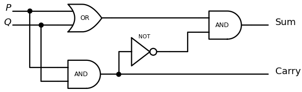

*그림 15. 두 비트 P와 Q를 더하는 반가산기 회로*

| $P$ | $Q$ | 자리올림 | 합 |
|:-:|:-:|:-:|:-:|
| 1 | 1 | 1 | 0 |
| 1 | 0 | 0 | 1 |
| 0 | 1 | 0 | 1 |
| 0 | 0 | 0 | 0 |

*표 50. 반가산기의 입출력 표*

위 회로는 AND 게이트의 출력 $P \wedge Q$를 갈라 자리올림으로 내보내는 동시에 NOT 게이트에 넣어 $\sim(P \wedge Q)$를 만든다. 4.4절의 배타적 논리합 회로와 같은 식을 계산하면서 AND 게이트 하나를 두 출력이 함께 쓴다.

여러 자리의 2진수를 더하는 회로를 만들려면 비트 세 개를 더하는 회로가 필요하다. 두 비트를 더하면 왼쪽 자리로 자리올림이 생길 수 있으므로, 어떤 자리에서는 세 비트를 더해야 하기 때문이다. 예를 들어 $11_2 + 11_2$에서 오른쪽 자리는 두 비트의 합이지만, 자리올림 때문에 왼쪽 자리는 세 비트 $1 + 1 + 1$의 합이다.

```text
  1        ← 자리올림
    1 1
+   1 1
-------
  1 1 0
```

비트 세 개의 합을 계산하는 회로를 **전가산기(full-adder)** 라 한다. 세 비트 $P$, $Q$, $R$를 더한 결과의 왼쪽 비트(자리올림)를 $C$, 오른쪽 비트(합)를 $S$라 한다. 전가산기는 덧셈이 이항 연산이라는 사실, 즉 한 번에 두 수만 더할 수 있다는 사실에 바탕을 둔다. 먼저 $P$와 $Q$를 더하고, 그 결과에 $R$를 더한다. 예를 들어 $1_2 + 0_2 + 1_2$는 먼저 $1_2 + 0_2 = 01_2$를 구하고, 여기에 $1_2$를 더하여 $01_2 + 1_2 = 10_2$를 얻는다.

1. 반가산기로 $P$와 $Q$를 더하여 두 자리 2진수 $C_1 S_1$을 얻는다.
2. $C_1 S_1$에 $R$를 더한다.
   - (a) 반가산기로 $S_1$과 $R$를 더하여 두 자리 2진수 $C_2 S$를 얻는다. 이 $S$가 세 비트 합의 맨 오른쪽 비트이다.
   - (b) 맨 왼쪽 비트 $C$를 정한다. 먼저 $C_1$과 $C_2$가 동시에 1일 수는 없다. $C_1 = 1$이면 $P$와 $Q$가 모두 1이므로 $S_1 = 0$이고, 따라서 $S_1 + R$의 자리올림 $C_2$는 0이기 때문이다. 다음으로 $C$는 $P + Q$에서 자리올림이 생기거나 $S_1 + R$에서 자리올림이 생길 때 1이다. 즉 $C = 1$일 필요충분조건은 $C_1 = 1$ 또는 $C_2 = 1$이므로, $C$는 $C_1$과 $C_2$를 OR 게이트에 넣어 얻는다.

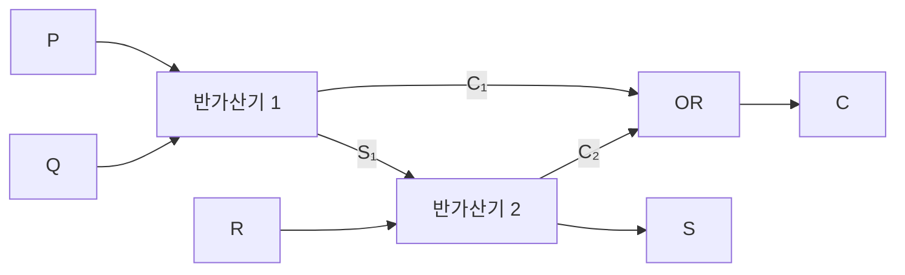

*그림 16. 반가산기 두 개와 OR 게이트 하나로 만든 전가산기*

| $P$ | $Q$ | $R$ | $C$ | $S$ |
|:-:|:-:|:-:|:-:|:-:|
| 1 | 1 | 1 | 1 | 1 |
| 1 | 1 | 0 | 1 | 0 |
| 1 | 0 | 1 | 1 | 0 |
| 1 | 0 | 0 | 0 | 1 |
| 0 | 1 | 1 | 1 | 0 |
| 0 | 1 | 0 | 0 | 1 |
| 0 | 0 | 1 | 0 | 1 |
| 0 | 0 | 0 | 0 | 0 |

*표 51. 전가산기의 입출력 표*

표에서 $C$는 세 비트 가운데 1이 두 개 이상일 때 1이고, $S$는 1의 개수가 홀수일 때 1이다.

전가산기 두 개와 반가산기 하나를 함께 쓰면 세 자리 2진수 $PQR$와 $STU$를 더하여 합 $WXYZ$를 얻는 회로를 만들 수 있다. 이런 회로를 **병렬 가산기(parallel adder)** 라 하며, 같은 방법으로 임의의 유한한 길이의 2진수를 더하는 병렬 가산기를 만들 수 있다.

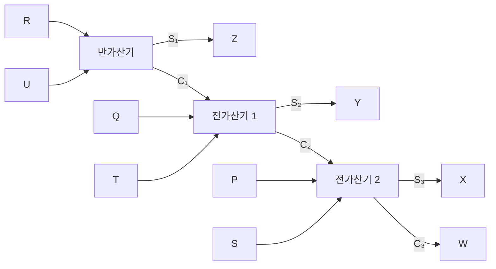

*그림 17. PQR와 STU를 더하여 WXYZ를 얻는 병렬 가산기*

예를 들어 $101_2 + 011_2$를 계산하면 다음과 같다. 반가산기가 $R = 1$, $U = 1$을 더하여 $Z = 0$, $C_1 = 1$을 낸다. 첫째 전가산기가 $Q = 0$, $T = 1$, $C_1 = 1$을 더하여 $Y = 0$, $C_2 = 1$을 낸다. 둘째 전가산기가 $P = 1$, $S = 0$, $C_2 = 1$을 더하여 $X = 0$, $W = 1$을 낸다. 따라서 $WXYZ = 1000_2$이고, 10진수로 $5 + 3 = 8$과 일치한다.

### 5.5 2의 보수와 부호 있는 정수

컴퓨터는 보통 정해진 개수의 비트로 정수를 나타낸다. 한 가지 방법은 특정한 비트(보통 맨 왼쪽 비트)로 부호를 나타내고 나머지 비트로 절댓값을 2진 표기로 나타내는 것이다. 그러나 이 방법은 덧셈 절차가 복잡하고, 0의 표현이 유일하지 않다. 예를 들어 8비트에서 $00000000$과 $10000000$이 모두 0(각각 $+0$과 $-0$)을 나타낸다. 더 널리 쓰는 방법은 **2의 보수(two's complement)** 로, 정수를 쉽게 더할 수 있고 0의 표현이 유일하다. 실제로는 주로 64비트와 32비트를 쓰지만, 원리는 모든 비트 길이에서 같으므로 여기서는 간단하게 8비트로 설명한다. 8비트로는 $-128$부터 127까지 256개의 정수를 나타낼 수 있고, 32비트를 쓰면 $2^{32} = 4{,}294{,}967{,}296$개, 즉 약 43억 개의 정수를 나타낼 수 있다.

> **용어 정의:** $-128$ 이상 127 이하의 정수 $a$의 **8비트 2의 보수(8-bit two's complement)** 는 $a \geq 0$이면 $a$의 8비트 2진 표현이고, $a < 0$이면 $2^8 - \lvert a \rvert$의 8비트 2진 표현이다.
>
> $$a \geq 0 \Rightarrow a, \qquad a < 0 \Rightarrow 2^8 - \lvert a \rvert$$

따라서 음이 아닌 정수의 8비트 2의 보수는 그 수의 8비트 2진 표현과 같다. 음의 정수의 예로 $-46$을 보면 다음과 같다.

$$
(2^8 - \lvert -46 \rvert)_{10} = (256 - 46)_{10} = 210_{10} = (128 + 64 + 16 + 2)_{10} = 11010010_2
$$

따라서 $-46$의 8비트 2의 보수는 $11010010$이다. 음의 정수에 대해서는 정의를 그대로 적용하는 것보다 계산이 적은 다음 방법이 편리하다.

> **핵심:** **음의 정수의 8비트 2의 보수를 구하는 방법.** $-128$ 이상인 음의 정수 $a$에 대하여
> 1. $\lvert a \rvert$의 8비트 2진 표현을 쓴다.
> 2. 모든 1을 0으로, 모든 0을 1로 바꾼다. 이를 비트 뒤집기(flipping) 또는 비트의 보수화(complementing)라 한다.
> 3. 2진 덧셈으로 1을 더한다.

**예제 2.5.6 (2의 보수 구하기).** 위 방법으로 $-46$의 8비트 2의 보수를 구한다. $\lvert -46 \rvert = 46 = (32 + 8 + 4 + 2)_{10} = 00101110_2$이다. 비트를 뒤집으면 $11010001$이고, 1을 더하면 $11010010$이다. 정의로 직접 구한 결과와 같다.

이 방법이 일반적으로 옳은 이유는 다음 세 사실 때문이다.

1. $2^8 - 1$의 2진 표현은 $11111111_2$이다.
2. 8비트 2진수 $a$를 $11111111_2$에서 빼면 모든 1이 0으로, 모든 0이 1로 바뀐다. 각 자리에서 $1 - 0 = 1$, $1 - 1 = 0$이고 빌림이 생기지 않기 때문이다.
3. 모든 수 $a$에 대하여 $2^8 - \lvert a \rvert = [(2^8 - 1) - \lvert a \rvert] + 1$이다.

$a = -46$에 적용하면 다음과 같다.

```text
  1 1 1 1 1 1 1 1     2^8 - 1
- 0 0 1 0 1 1 1 0     |-46|
-----------------
  1 1 0 1 0 0 0 1     (2^8 - 1) - |-46|   ← 비트가 뒤바뀐다
+ 0 0 0 0 0 0 0 1     1
-----------------
  1 1 0 1 0 0 1 0     2^8 - |-46|
```

비트 수가 다른 경우도 원리는 같다. 예를 들어 4비트에서 $-5$의 2의 보수는 $5 = 0101_2$의 비트를 뒤집은 $1010_2$에 1을 더한 $1011_2$이고, 이는 $2^4 - 5 = 11 = 1011_2$와 같다. 비트를 뒤집는 것은 $1111_2 = 2^4 - 1$에서 빼는 것이고, 여기에 1을 더하면 $10000_2 = 2^4$에서 뺀 것이 된다.

127이 8비트 2의 보수 체계에서 가장 큰 정수이고 $127_{10} = 01111111_2$이므로, 음이 아닌 정수의 8비트 2의 보수는 모두 맨 앞 비트가 0이다. 음의 정수 $a$의 2의 보수 $2^8 - \lvert a \rvert$는 128 이상 255 이하이므로 맨 앞 비트가 항상 1이다. $-128$부터 127까지의 8비트 2의 보수 표현은 다음과 같다.

| 정수 | 8비트 2의 보수 | 음의 정수에 대한 2의 보수의 10진 값 |
|:-:|:-:|:-:|
| 127 | 01111111 | |
| 126 | 01111110 | |
| $\vdots$ | $\vdots$ | |
| 2 | 00000010 | |
| 1 | 00000001 | |
| 0 | 00000000 | |
| $-1$ | 11111111 | $2^8 - 1$ |
| $-2$ | 11111110 | $2^8 - 2$ |
| $-3$ | 11111101 | $2^8 - 3$ |
| $\vdots$ | $\vdots$ | $\vdots$ |
| $-127$ | 10000001 | $2^8 - 127$ |
| $-128$ | 10000000 | $2^8 - 128$ |

*표 52. 8비트 2의 보수로 나타낸 −128부터 127까지의 정수*

$-46$의 2의 보수 $11010010$에 다시 2의 보수 절차를 적용하면, 비트를 뒤집어 $00101101$, 1을 더해 $00101110$이 되어 46의 2의 보수를 얻는다. 일반적으로 2의 보수 형태의 양수나 음수에 2의 보수 절차를 적용하면 그 수의 반대수(부호를 바꾼 수)를 얻는다. 유일한 예외는 $-128$이다. $10000000$을 뒤집으면 $01111111$이고 1을 더하면 다시 $10000000$이 되는데, 128은 8비트 체계로 나타낼 수 없기 때문이다.

주어진 8비트 2의 보수가 나타내는 음의 정수의 10진 표현은 다음과 같이 구한다.

1. 주어진 2의 보수에 2의 보수 절차를 적용한다.
2. 결과의 10진 값을 쓰고, 그 앞에 음의 부호를 붙인다.

**예제 2.5.7 (주어진 2의 보수가 나타내는 수 찾기).** 2의 보수가 $10101001$인 정수의 10진 표현을 구한다. 맨 왼쪽 비트가 1이므로 이 정수는 음수이다. 2의 보수 절차를 적용하면 비트를 뒤집어 $01010110$, 1을 더해 $01010111_2 = (64 + 16 + 4 + 2 + 1)_{10} = 87_{10} = \lvert -87 \rvert_{10}$이다. 따라서 답은 $-87$이다. 정의로 $-87$의 2의 보수를 직접 구하여 확인한다.

$$
(2^8 - \lvert -87 \rvert)_{10} = (256 - 87)_{10} = 169_{10} = (128 + 32 + 8 + 1)_{10} = 10101001_2
$$

### 5.6 2의 보수를 이용한 덧셈과 뺄셈

2의 보수 표현의 가장 큰 장점은 음이 아닌 정수의 2진 덧셈에 쓰는 회로를 그대로 2의 보수 체계의 덧셈과 뺄셈에 쓸 수 있다는 것이다. 모든 실수에 대해 $a - b = a + (-b)$이므로 뺄셈은 덧셈으로 바꿀 수 있다. 예를 들어 $78 - 46 = 78 + (-46)$이고 답은 32여야 한다. 78의 8비트 2의 보수는 $78 = 64 + 8 + 4 + 2$이므로 보통의 2진 표현 $01001110$과 같고, $-46$의 8비트 2의 보수는 앞에서 구한 $11010010$이다. 두 수를 2진 덧셈으로 더하면 다음과 같다.

```text
    0 1 0 0 1 1 1 0     78
+   1 1 0 1 0 0 1 0     -46
-------------------
  1 0 0 1 0 0 0 0 0
```

결과의 아홉째 자리, 즉 $2^8$의 자리에 자리올림 1이 생긴다. 이를 버리면 $00100000$이 남고, $32 = 2^5$이므로 $32_{10} = 00100000_2$가 되어 8비트 2의 보수 형식의 올바른 답이다. 일반적으로 8비트 2의 보수 형식의 수를 더하여 $2^8$의 자리에 자리올림 1이 생기면 버린다. 이는 합을 $2^8$으로 나눈 나머지로 줄이는 것과 같으며, 두 수의 합이 사용하는 고정 길이 체계의 범위(여기서는 $-128$부터 127까지) 안에 있는 한 보통의 10진 산술과 같은 결과를 준다. 이 방법이 옳다는 사실은 모듈러 산술의 일반적인 성질에서 나온다.

> **핵심:** **8비트 2의 보수로 두 정수를 더하는 방법.** $-128$ 이상 127 이하인 두 정수의 합이 역시 $-128$ 이상 127 이하일 때
> 1. 두 정수를 8비트 2의 보수 표현으로 바꾼다.
> 2. 보통의 2진 덧셈으로 더하고, $2^8$의 자리에 생기는 자리올림 1은 버린다.
> 3. 결과를 10진 표기로 되돌린다.

4비트에서도 같다. $7 - 5 = 7 + (-5)$를 4비트 2의 보수로 계산하면 $0111_2 + 1011_2 = 10010_2$이고, $2^4$의 자리의 자리올림을 버리면 $0010_2 = 2$이다.

> **주의:** 맨 왼쪽 자리 밖으로 나가는 자리올림을 버리는 것은 정상적인 절차이며, 그 자체로 오류를 뜻하지 않는다. 아래의 오버플로 오류는 합이 표현 범위를 벗어난 경우를 말하며, 자리올림이 생겼는지와는 다른 문제이다.

정수를 $-128$부터 127까지로 제한하면 두 정수의 합이 범위를 벗어날 수 있다. 예를 들어 $(-87) + (-46) = -133$은 $-128$보다 작으므로 나타내려면 8비트보다 많은 비트가 필요하다. 이 결과는 컴퓨터 구조가 정한 8비트 고정 길이 체계 밖에 있으므로 흔히 **오버플로 오류(overflow error)** 라 부른다. 실제 환경처럼 정수를 64비트로 나타내면 $-2^{63}$부터 $2^{63} - 1$까지, 즉 약 $\pm 9.22 \times 10^{18}$ 범위의 정수를 나타낼 수 있으므로 오버플로 없이 매우 많은 계산을 할 수 있다.

오버플로 오류는 간단히 찾아낼 수 있다. $-128$ 이상 127 이하인 두 정수의 실제 합이 이 범위를 벗어날 필요충분조건은, 두 정수가 모두 양수인데 8비트 2의 보수로 계산한 합의 맨 앞 비트가 1(음수처럼 보임)이거나, 두 정수가 모두 음수인데 계산한 합의 맨 앞 비트가 0(음이 아닌 수처럼 보임)인 것이다. 두 번째 경우에는 계산한 합이 $00000000$이 되어 0처럼 보이는 $(-128) + (-128)$도 포함된다. $(-87) + (-46)$을 계산하면 다음과 같다.

```text
    1 0 1 0 1 0 0 1     -87
+   1 1 0 1 0 0 1 0     -46
-------------------
  1 0 1 1 1 1 0 1 1
```

$2^8$의 자리의 1을 버리면 $01111011$이 남고, 맨 앞 비트가 0이므로 두 음수의 합이 양수로 나타난다. 따라서 컴퓨터는 오버플로 오류를 알린다. 만약 자리올림을 버리지 않고 9비트 결과 $101111011$을 9비트 2의 보수로 해석했다면 $379 - 512 = -133$이 되어 올바른 답이지만, $-133$은 8비트 2의 보수 체계로 나타낼 수 없으므로 오류가 된다.

> **[컴퓨터구조]** 프로세서의 덧셈기는 같은 회로로 부호 없는 정수와 2의 보수 정수를 더한다. 2의 보수 덧셈의 오버플로는 맨 앞(부호) 비트로 들어가는 자리올림과 그 비트에서 나가는 자리올림이 다를 때 일어나며, 이는 위의 부호 규칙과 같은 조건이다. 위 예에서는 부호 비트로 들어가는 자리올림이 0이고 나가는 자리올림이 1이다.

### 5.7 16진 표기

2진 표기로 쓴 수는 10진 표기보다 훨씬 많은 자리를 차지하지만, 컴퓨터의 동작은 2진수로 분석하는 것이 가장 좋을 때가 많다. **16진 표기(hexadecimal notation)** 는 10진 표기보다도 짧고, 2진 표기와 서로 바꾸기가 2진과 10진 사이보다 훨씬 쉽다. hexadecimal은 "6"을 뜻하는 그리스어 어근 hex-와 "10"을 뜻하는 라틴어 어근 deci-를 합친 말로 16을 뜻하며, 16진 표기를 16을 밑으로 하는 표기라고도 한다. 16진 표기는 모든 양의 정수를 $d \cdot 16^n$ 꼴의 수의 합으로 유일하게 나타낼 수 있다는 사실에 바탕을 둔다. 여기서 각 $n$은 음이 아닌 정수이고 각 $d$는 0부터 15까지의 정수이다. 모호함을 피하려면 각 16진 숫자를 기호 하나로 나타내야 하므로, 10부터 15까지를 A, B, C, D, E, F로 쓴다.

| 10진수 | 16진수 | 4비트 2진수 | 10진수 | 16진수 | 4비트 2진수 |
|:-:|:-:|:-:|:-:|:-:|:-:|
| 0 | 0 | 0000 | 8 | 8 | 1000 |
| 1 | 1 | 0001 | 9 | 9 | 1001 |
| 2 | 2 | 0010 | 10 | A | 1010 |
| 3 | 3 | 0011 | 11 | B | 1011 |
| 4 | 4 | 0100 | 12 | C | 1100 |
| 5 | 5 | 0101 | 13 | D | 1101 |
| 6 | 6 | 0110 | 14 | E | 1110 |
| 7 | 7 | 0111 | 15 | F | 1111 |

*표 53. 16진 숫자와 그 10진 값, 4비트 2진 표현*

**예제 2.5.8 (16진수를 10진수로 바꾸기).** $3\text{CF}_{16}$을 10진 표기로 바꾼다. 2진수의 도식과 같이 각 숫자에 그 자리의 16의 거듭제곱을 곱하여 더한다. $3_{16} = 3_{10}$, $\text{C}_{16} = 12_{10}$, $\text{F}_{16} = 15_{10}$이고 자릿값은 $16^2 = 256$, $16^1 = 16$, $16^0 = 1$이다.

$$
3\text{CF}_{16} = 3 \cdot 256 + 12 \cdot 16 + 15 \cdot 1 = 768 + 192 + 15 = 975_{10}
$$

**16진수를 2진수로 바꾸는 원리.** $\text{C50A}_{16}$의 각 항을 2의 거듭제곱으로 다시 쓰고 지수 법칙을 적용한다. $\text{C}_{16} = 12_{10}$, $5_{16} = 5_{10}$, $0_{16} = 0_{10}$, $\text{A}_{16} = 10_{10}$이다.

$$
\begin{aligned}
10 \cdot 16^0 &= (2^3 + 2) \cdot 1 = 2^3 + 2 && 10 = 2^3 + 2 \\
0 \cdot 16^1 &= 0 \cdot 2^4 = 0 && 16^1 = 2^4 \\
5 \cdot 16^2 &= (2^2 + 1) \cdot 2^8 = 2^{10} + 2^8 && 5 = 2^2 + 1,\ 16^2 = (2^4)^2 = 2^8,\ 2^2 \cdot 2^8 = 2^{10} \\
12 \cdot 16^3 &= (2^3 + 2^2) \cdot 2^{12} = 2^{15} + 2^{14} && 12 = 2^3 + 2^2,\ 16^3 = (2^4)^3 = 2^{12}
\end{aligned}
$$

이 항들을 더하면 2진수를 쓰는 규칙과 2진 덧셈 규칙에 의해 다음을 얻는다.

$$
(2^{15} + 2^{14}) + (2^{10} + 2^8) + 0 + (2^3 + 2) = 1100\,0000\,0000\,0000_2 + 0101\,0000\,0000_2 + 0000\,0000_2 + 1010_2 = 1100\,0101\,0000\,1010_2
$$

결과를 보면 $\text{C}_{16}$이 $1100$, $5_{16}$이 $0101$, $0_{16}$이 $0000$, $\text{A}_{16}$이 $1010$이 되어 그대로 이어져 있다. $16 = 2^4$이므로 16진수 한 자리가 2진수의 네 자리를 정확히 차지하기 때문이다.

> **핵심:** **16진수를 2진수로 바꾸는 방법.** 정수의 각 16진 숫자를 4비트 2진수로 쓰고, 그 결과를 차례로 이어 붙인다.

**예제 2.5.9 (16진수를 2진수로 바꾸기).** $\text{B09F}_{16}$을 2진 표기로 바꾼다. $\text{B}_{16} = 11_{10} = 1011_2$, $0_{16} = 0_{10} = 0000_2$, $9_{16} = 9_{10} = 1001_2$, $\text{F}_{16} = 15_{10} = 1111_2$이므로 다음과 같다.

```text
   B      0      9      F
   ↕      ↕      ↕      ↕
 1011   0000   1001   1111
```

답은 $1011000010011111_2$이다.

> **핵심:** **2진수를 16진수로 바꾸는 방법.** 위 절차를 거꾸로 한다.
> 1. 2진수의 숫자를 오른쪽부터 네 개씩 묶고, 필요하면 앞에 0을 붙인다.
> 2. 네 자리 묶음을 각각 16진 숫자로 바꾸고 차례로 이어 붙인다.

**예제 2.5.10 (2진수를 16진수로 바꾸기).** $100110110101001_2$를 16진 표기로 바꾼다. 오른쪽에서 왼쪽으로 네 자리씩 묶고 앞에 0을 하나 붙이면 $0100\ 1101\ 1010\ 1001$이다. 각 묶음을 16진 숫자로 바꾸면 $0100 \to 4$, $1101 \to \text{D}$, $1010 \to \text{A}$, $1001 \to 9$이므로 답은 $\text{4DA9}_{16}$이다.

컴퓨터에서 흔히 쓰는 32비트 정수를 16진 표기로 쓰면 여덟 문자만 있으면 된다.

**예제 2.5.11 (메모리 덤프 읽기).** 대부분의 컴퓨터에서 주소를 붙일 수 있는 가장 작은 메모리 단위는 **바이트(byte)**, 즉 8비트이다. 디버깅 과정에서 메모리의 내용을 순서대로 출력하는 것을 덤프(dump)라 하며, 공간을 아끼고 읽기 쉽게 하려고 2진수 대신 16진수로 출력한다. 메모리 덤프의 한 부분이 A3 BB 59 2E일 때 네 메모리 위치의 실제 내용은 각 16진 숫자를 4비트로 바꾸어 얻는다.

$$
\text{A3}_{16} = 10100011_2, \qquad \text{BB}_{16} = 10111011_2, \qquad \text{59}_{16} = 01011001_2, \qquad \text{2E}_{16} = 00101110_2
$$

---

<br>

## 개념 적용

**T/F 점검:**

| 문장 | 판단과 근거 |
|:-----|:-----|
| $p \to q$가 거짓이면 $p$는 참이다. | **T.** 조건 명제가 거짓인 경우는 가정 $p$가 참이고 결론 $q$가 거짓인 경우뿐이다. |
| $\sim(p \wedge q)$는 $\sim p \wedge \sim q$와 논리적 동치이다. | **F.** 드모르간의 법칙에 의해 $\sim(p \wedge q) \equiv \sim p \vee \sim q$이며, $\sim p \wedge \sim q$와는 $p$와 $q$의 진릿값이 다른 두 행에서 다르다. |
| 조건 명제와 그 역은 항상 진릿값이 같다. | **F.** $p$가 참이고 $q$가 거짓이면 $p \to q$는 거짓이지만 역 $q \to p$는 참이다. 조건 명제와 항상 진릿값이 같은 것은 대우이다. |
| "$p$ only if $q$"는 $q \to p$를 뜻한다. | **F.** "$p$ only if $q$"는 "$q$가 아니면 $p$가 아니다", 즉 $p \to q$를 뜻한다. |
| 타당한 논증의 결론은 항상 참이다. | **F.** 타당성은 전제가 모두 참일 때 결론이 참임을 보장할 뿐이다. 전제가 거짓이면 타당한 논증의 결론도 거짓일 수 있다. 결론의 참이 보장되는 것은 건전한 논증이다. |
| 전제 $p \to q$와 $q$에서 $p$를 결론짓는 논증은 부당하다. | **T.** 역의 오류이다. $p$가 거짓이고 $q$가 참인 임계 행에서 결론이 거짓이다. |
| 입출력 표가 같은 두 회로는 게이트의 수가 달라도 동치이다. | **T.** 두 디지털 논리 회로의 동치는 입출력 표가 같다는 것으로 정의된다. |
| NAND 게이트만으로 NOT, AND, OR 게이트의 동작을 모두 만들 수 있다. | **T.** $\sim P \equiv P \mid P$, $P \wedge Q \equiv (P \mid Q) \mid (P \mid Q)$, $P \vee Q \equiv (P \mid P) \mid (Q \mid Q)$이다. |
| 8비트 2의 보수 덧셈에서 $2^8$의 자리에 자리올림이 생기면 오버플로 오류이다. | **F.** 그 자리올림은 버리는 것이 정상 절차이다. 예를 들어 $78 + (-46)$은 자리올림이 생기지만 올바른 답 32를 준다. 오버플로는 두 양수를 더해 계산한 합의 맨 앞 비트가 1이거나 두 음수를 더해 계산한 합의 맨 앞 비트가 0일 때 일어난다. |
| 16진수 한 자리는 2진수 네 자리에 정확히 대응한다. | **T.** $16 = 2^4$이므로 16진 숫자 하나는 4비트 2진수 하나로 바뀐다. |

---

<br>

## 요약

| 개념 | 핵심 요약 |
|:-----|:-----|
| 명제 | 참이거나 거짓이지만 둘 다는 아닌 문장이다. 변수가 정해지지 않은 $x - 2 = 7$ 같은 문장은 명제가 아니다. |
| 부정, 논리곱, 논리합 | $\sim p$는 $p$와 반대의 진릿값을 가지고, $p \wedge q$는 둘 다 참일 때만 참이며, $p \vee q$는 둘 다 거짓일 때만 거짓이다. |
| 연산 순서 | $\sim$를 먼저, $\wedge$와 $\vee$를 그다음, $\to$와 $\leftrightarrow$를 마지막에 계산하며, 같은 순위끼리 섞이면 괄호를 쓴다. |
| 명제 형식과 진리표 | 명제 변수와 연결사로 이루어진 식이며, 변수가 $n$개이면 진리표는 $2^n$개의 행을 가진다. |
| 논리적 동치 | 모든 진릿값 조합에서 진릿값이 같은 두 명제 형식이며 $P \equiv Q$로 쓴다. 한 행이라도 다르면 동치가 아니다. |
| 드모르간의 법칙 | $\sim(p \wedge q) \equiv \sim p \vee \sim q$이고 $\sim(p \vee q) \equiv \sim p \wedge \sim q$이다. |
| 항진명제와 모순명제 | 항상 참인 명제 형식 $\mathbf{t}$와 항상 거짓인 명제 형식 $\mathbf{c}$이다. |
| 논리적 동치 법칙 | 교환, 결합, 분배, 항등, 부정, 이중 부정, 멱등, 전체 한계, 드모르간, 흡수 법칙과 $\mathbf{t}$, $\mathbf{c}$의 부정으로 이루어지며, 식을 간략화하는 데 쓴다. |
| 조건 명제 | $p \to q$는 $p$가 참이고 $q$가 거짓일 때만 거짓이다. 가정이 거짓이면 공허하게 참이다. |
| 조건 명제의 동치 | $p \to q \equiv \sim p \vee q$이고 $\sim(p \to q) \equiv p \wedge \sim q$이며, 부정은 if로 시작하지 않는다. |
| 대우, 역, 이 | 대우 $\sim q \to \sim p$는 원래 명제와 동치이고, 역 $q \to p$와 이 $\sim p \to \sim q$는 원래 명제와 동치가 아니지만 서로 동치이다. |
| ~일 때만과 쌍조건 명제 | "$p$ only if $q$"는 $p \to q$이고, $p \leftrightarrow q$는 $(p \to q) \wedge (q \to p)$와 동치이다. |
| 필요조건과 충분조건 | $r$가 $s$의 충분조건이면 $r \to s$이고, 필요조건이면 $\sim r \to \sim s$, 즉 $s \to r$이다. |
| 논증의 타당성 | 모든 임계 행(전제가 모두 참인 행)에서 결론이 참이면 타당하고, 결론이 거짓인 임계 행이 하나라도 있으면 부당하다. |
| 추론 규칙 | 전건 긍정, 후건 부정, 일반화, 특수화, 논리곱 규칙, 소거, 추이, 경우 나누기, 모순 규칙은 타당한 논증 형식이다. |
| 오류 | 역의 오류($p \to q$, $q$, $\therefore\ p$)와 이의 오류($p \to q$, $\sim p$, $\therefore\ \sim q$)는 부당하다. |
| 건전성 | 타당하고 모든 전제가 참인 논증이며, 결론의 참이 보장되는 것은 건전한 논증뿐이다. |
| 디지털 논리 회로 | NOT, AND, OR 게이트는 $\sim$, $\wedge$, $\vee$에 대응하며, 조합 회로의 출력은 현재 입력만으로 정해진다. |
| 회로와 부울 식 | 회로를 따라가 부울 식을 얻고, 부울 식의 가장 바깥 연산부터 오른쪽에서 왼쪽으로 게이트를 놓아 회로를 만든다. |
| 논리합 표준형 | 출력이 1인 행마다 인식기 항을 만들어 논리합으로 묶으면 주어진 입출력 표를 구현하는 식을 얻는다. |
| 회로의 간략화 | 입출력 표가 같은 회로는 동치이며, 논리적 동치 법칙으로 부울 식을 줄여 게이트 수를 줄인다. |
| NAND와 NOR | $P \mid Q \equiv \sim(P \wedge Q)$, $P \downarrow Q \equiv \sim(P \vee Q)$이며, 각각만으로 모든 부울 식을 표현할 수 있다. |
| 2진 표기와 16진 표기 | 자리가 2와 16의 거듭제곱에 대응하며, 16진 숫자 하나는 4비트 2진수 하나와 같다. |
| 반가산기와 전가산기 | 반가산기는 두 비트의 자리올림 $P \wedge Q$와 합(배타적 논리합)을 내고, 전가산기는 반가산기 두 개와 OR 게이트로 세 비트를 더한다. |
| 2의 보수 | 음의 정수 $a$의 8비트 2의 보수는 $2^8 - \lvert a \rvert$이며, $\lvert a \rvert$의 비트를 뒤집고 1을 더해 구한다. |
| 2의 보수 덧셈 | $2^8$의 자리의 자리올림은 버리며, 두 양수를 더해 계산한 합의 맨 앞 비트가 1이거나 두 음수를 더해 계산한 합의 맨 앞 비트가 0이면 오버플로 오류이다. |

---

<br>

## 점검 문제

1. **동치 법칙을 이용한 간략화:** 논리적 동치 법칙을 이용하여 $\sim(p \vee \sim q) \vee (\sim p \wedge \sim q) \equiv \sim p$임을 보여라. 각 단계에 사용한 법칙을 쓰라.

   <details>
   <summary>정답</summary>

   $\sim(p \vee \sim q) \equiv \sim p \wedge \sim(\sim q)$(드모르간의 법칙) $\equiv \sim p \wedge q$(이중 부정 법칙)이다. 따라서 주어진 식은 $(\sim p \wedge q) \vee (\sim p \wedge \sim q)$이고, 분배 법칙으로 $\sim p$를 묶어 내면 $\sim p \wedge (q \vee \sim q)$, 부정 법칙으로 $\sim p \wedge \mathbf{t}$, 항등 법칙으로 $\sim p$를 얻는다.

   </details>

2. **진리표를 이용한 동치 판정:** $p \to (q \to r)$와 $(p \wedge q) \to r$가 논리적 동치인지 판정하라.

   <details>
   <summary>정답</summary>

   논리적 동치이다. $(p \wedge q) \to r$는 $p \wedge q$가 참이고 $r$가 거짓일 때, 즉 $p$, $q$, $r$가 T, T, F인 행에서만 거짓이다. $p \to (q \to r)$는 $p$가 참이고 $q \to r$가 거짓일 때만 거짓인데, $q \to r$가 거짓이려면 $q$가 참이고 $r$가 거짓이어야 하므로 역시 T, T, F인 행에서만 거짓이다. 여덟 행 가운데 두 식이 거짓인 행이 같고 나머지 행에서는 모두 참이므로 진릿값이 모든 행에서 같다.

   </details>

3. **조건 명제의 변형:** "정수 $n$이 6으로 나누어떨어지면 $n$은 짝수이다"의 부정, 대우, 역, 이를 쓰고, 원래 명제와 진릿값이 항상 같은 것을 고르라. 역과 이가 거짓이 되는 예도 들라.

   <details>
   <summary>정답</summary>

   부정은 "$n$은 6으로 나누어떨어지고 짝수가 아니다", 대우는 "$n$이 짝수가 아니면 $n$은 6으로 나누어떨어지지 않는다", 역은 "$n$이 짝수이면 $n$은 6으로 나누어떨어진다", 이는 "$n$이 6으로 나누어떨어지지 않으면 $n$은 짝수가 아니다"이다. 원래 명제와 항상 진릿값이 같은 것은 대우이다. $n = 2$이면 역의 가정(짝수)은 참이고 결론(6으로 나누어떨어짐)은 거짓이므로 역은 거짓이며, 이의 가정(6으로 나누어떨어지지 않음)은 참이고 결론(짝수가 아님)은 거짓이므로 이도 거짓이다.

   </details>

4. **필요조건과 충분조건:** 실수 $x$에 대하여 "$x > 2$"는 "$x^2 > 4$"의 충분조건인가? 필요조건인가?

   <details>
   <summary>정답</summary>

   충분조건이다. $x > 2$이면 $x^2 > 4$이므로 "$x > 2$이면 $x^2 > 4$"가 참이다. 그러나 필요조건은 아니다. 필요조건이려면 "$x^2 > 4$이면 $x > 2$"가 참이어야 하는데, $x = -3$이면 $x^2 = 9 > 4$이지만 $x > 2$가 아니다.

   </details>

5. **타당성 판정:** 논증 형식 $p \to q$, $q \to r$, $\sim r$, $\therefore\ \sim p$가 타당한지 임계 행으로 판정하고, 추론 규칙으로도 설명하라.

   <details>
   <summary>정답</summary>

   타당하다. 전제 $\sim r$가 참이려면 $r$가 F이고, 그때 $q \to r$가 참이려면 $q$가 F이며, 다시 $p \to q$가 참이려면 $p$가 F이어야 한다. 따라서 임계 행은 $p$, $q$, $r$가 모두 F인 행 하나이고, 그 행에서 결론 $\sim p$는 참이다. 추론 규칙으로는 추이에 의해 $p \to r$를 얻고, $p \to r$와 $\sim r$에 후건 부정을 적용하여 $\sim p$를 얻는다.

   </details>

6. **오류 찾기:** "비가 오면 길이 젖는다. 길이 젖었다. 그러므로 비가 왔다"는 어떤 오류인가? 이 형식의 논증이 거짓 결론을 낼 수 있는 상황을 들라.

   <details>
   <summary>정답</summary>

   형식이 $p \to q$, $q$, $\therefore\ p$이므로 역의 오류(후건 긍정의 오류)이다. 예를 들어 비가 오지 않았는데 살수차가 길에 물을 뿌린 경우, 첫째 전제는 가정이 거짓이므로 공허하게 참이고 둘째 전제 "길이 젖었다"도 참이지만 결론 "비가 왔다"는 거짓이다.

   </details>

7. **회로의 간략화:** 4.5절에서 만든 $(\sim P \wedge Q) \vee \sim Q$의 회로의 입출력 표를 구하고, 이 회로가 게이트 하나와 동치임을 보여라.

   <details>
   <summary>정답</summary>

   입력 $(P, Q)$가 $(1, 1)$이면 $\sim P \wedge Q = 0$, $\sim Q = 0$이므로 출력은 0이다. $(1, 0)$이면 $\sim Q = 1$이므로 1, $(0, 1)$이면 $\sim P \wedge Q = 1$이므로 1, $(0, 0)$이면 $\sim Q = 1$이므로 1이다. 이는 NAND 게이트의 입출력 표이다. 법칙으로는 $(\sim P \wedge Q) \vee \sim Q \equiv (\sim P \vee \sim Q) \wedge (Q \vee \sim Q)$(분배 법칙) $\equiv (\sim P \vee \sim Q) \wedge \mathbf{t}$(부정 법칙) $\equiv \sim P \vee \sim Q$(항등 법칙) $\equiv \sim(P \wedge Q)$(드모르간의 법칙) $= P \mid Q$이다.

   </details>

8. **입출력 표로 회로 설계:** 두 입력 $P$, $Q$에 대해 $(P, Q) = (1, 0)$과 $(0, 1)$일 때만 출력이 1인 회로의 부울 식을 논리합 표준형으로 쓰라. 이 식은 무엇을 계산하는가?

   <details>
   <summary>정답</summary>

   출력이 1인 행 $(1, 0)$의 인식기 항은 $P \wedge \sim Q$, 행 $(0, 1)$의 인식기 항은 $\sim P \wedge Q$이므로 식은 $(P \wedge \sim Q) \vee (\sim P \wedge Q)$이다. 두 입력이 다를 때만 1이므로 배타적 논리합을 계산하며, $(P \vee Q) \wedge \sim(P \wedge Q)$와 논리적 동치이다.

   </details>

9. **2의 보수 덧셈:** $-100$의 8비트 2의 보수를 구하고, 이를 이용하여 $50 + (-100)$을 계산하라. 또 $100 + 50$을 8비트 2의 보수로 계산하면 어떻게 되는지 설명하라.

   <details>
   <summary>정답</summary>

   $100 = 01100100_2$의 비트를 뒤집으면 $10011011$이고 1을 더하면 $10011100$이므로 $-100$의 2의 보수는 $10011100$이다. $50 = 00110010_2$와 더하면 $00110010 + 10011100 = 11001110$이고 자리올림은 없다. 맨 앞 비트가 1이므로 음수이며, 2의 보수 절차를 적용하면 $00110001$에 1을 더한 $00110010 = 50$이므로 답은 $-50$이다. $100 + 50$은 $01100100 + 00110010 = 10010110$인데, 두 양수의 합의 맨 앞 비트가 1이 되었으므로 오버플로 오류이다. 실제로 150은 127보다 크다.

   </details>

10. **16진 표기:** $\text{2E9}_{16}$을 10진 표기와 2진 표기로 바꾸라.

    <details>
    <summary>정답</summary>

    10진 표기는 $2 \cdot 16^2 + 14 \cdot 16 + 9 = 512 + 224 + 9 = 745$이다. 2진 표기는 각 16진 숫자를 4비트로 바꾸어 $0010\ 1110\ 1001$을 이어 붙이고 앞의 0을 떼면 $1011101001_2$이다. 확인하면 $512 + 128 + 64 + 32 + 8 + 1 = 745$이다.

    </details>

---
