# Chapter 2 — The Logic of Compound Statements

[Repository Guide](../../README.md) | [English](Concepts_Lecture.md) | [한국어](Concepts_Lecture.ko.md)

> **Last Updated:** 2026-11-10
>
> Discrete Mathematics with Applications, Epp, Ch 2

> **Learning Objectives:**
> 1. Construct truth tables for the negation, conjunction, disjunction, conditional, and biconditional connectives, and decide whether two statement forms are logically equivalent using truth tables or the laws of logical equivalence
> 2. Write the negation, contrapositive, converse, and inverse of a conditional statement, and rewrite only-if sentences and necessary and sufficient conditions as conditional statements
> 3. Determine the validity of an argument form from the critical rows of a truth table, chain rules of inference to derive conclusions, and detect the converse error and the inverse error
> 4. Convert between the input/output table and the Boolean expression of a combinational circuit, design circuits in disjunctive normal form, and simplify circuits using logical equivalence
> 5. Convert among binary, decimal, and hexadecimal notation, and explain the half-adder, the full-adder, and addition, subtraction, and overflow detection with 8-bit two's complements

---

## Table of Contents

- [1. Logical Form and Logical Equivalence](#1-logical-form-and-logical-equivalence)
  - [1.1 Arguments and Logical Form](#11-arguments-and-logical-form)
  - [1.2 Statements](#12-statements)
  - [1.3 Compound Statements](#13-compound-statements)
  - [1.4 Truth Values](#14-truth-values)
  - [1.5 Evaluating More General Statement Forms](#15-evaluating-more-general-statement-forms)
  - [1.6 Logical Equivalence](#16-logical-equivalence)
  - [1.7 Tautologies and Contradictions](#17-tautologies-and-contradictions)
  - [1.8 Laws of Logical Equivalence](#18-laws-of-logical-equivalence)
- [2. Conditional Statements](#2-conditional-statements)
  - [2.1 The Conditional and Its Truth Table](#21-the-conditional-and-its-truth-table)
  - [2.2 Logical Equivalences Involving Conditionals](#22-logical-equivalences-involving-conditionals)
  - [2.3 Representation of If-Then as Or](#23-representation-of-if-then-as-or)
  - [2.4 The Negation of a Conditional Statement](#24-the-negation-of-a-conditional-statement)
  - [2.5 The Contrapositive](#25-the-contrapositive)
  - [2.6 The Converse and the Inverse](#26-the-converse-and-the-inverse)
  - [2.7 Only If and the Biconditional](#27-only-if-and-the-biconditional)
  - [2.8 Necessary and Sufficient Conditions](#28-necessary-and-sufficient-conditions)
  - [2.9 Two Remarks on Conditional Statements](#29-two-remarks-on-conditional-statements)
- [3. Valid and Invalid Arguments](#3-valid-and-invalid-arguments)
  - [3.1 Argument Forms and Validity](#31-argument-forms-and-validity)
  - [3.2 Modus Ponens and Modus Tollens](#32-modus-ponens-and-modus-tollens)
  - [3.3 Additional Rules of Inference](#33-additional-rules-of-inference)
  - [3.4 Fallacies](#34-fallacies)
  - [3.5 The Contradiction Rule](#35-the-contradiction-rule)
  - [3.6 Summary of Rules of Inference](#36-summary-of-rules-of-inference)
- [4. Application: Digital Logic Circuits](#4-application-digital-logic-circuits)
  - [4.1 Switching Circuits and Logic](#41-switching-circuits-and-logic)
  - [4.2 Black Boxes and Gates](#42-black-boxes-and-gates)
  - [4.3 The Input/Output Table for a Circuit](#43-the-inputoutput-table-for-a-circuit)
  - [4.4 The Boolean Expression Corresponding to a Circuit](#44-the-boolean-expression-corresponding-to-a-circuit)
  - [4.5 The Circuit Corresponding to a Boolean Expression](#45-the-circuit-corresponding-to-a-boolean-expression)
  - [4.6 Designing a Circuit for a Given Input/Output Table](#46-designing-a-circuit-for-a-given-inputoutput-table)
  - [4.7 Simplifying Combinational Circuits](#47-simplifying-combinational-circuits)
  - [4.8 NAND and NOR Gates](#48-nand-and-nor-gates)
- [5. Application: Number Systems and Circuits for Addition](#5-application-number-systems-and-circuits-for-addition)
  - [5.1 Decimal Notation](#51-decimal-notation)
  - [5.2 Binary Notation](#52-binary-notation)
  - [5.3 Binary Addition and Subtraction](#53-binary-addition-and-subtraction)
  - [5.4 Circuits for Computer Addition](#54-circuits-for-computer-addition)
  - [5.5 Two's Complements and Signed Integers](#55-twos-complements-and-signed-integers)
  - [5.6 Addition and Subtraction in Two's Complement Form](#56-addition-and-subtraction-in-twos-complement-form)
  - [5.7 Hexadecimal Notation](#57-hexadecimal-notation)
- [Concept Applications](#concept-applications)
- [Summary](#summary)
- [Self-Check Questions](#self-check-questions)

---

<br>

## 1. Logical Form and Logical Equivalence

Logic studies reasoning, that is, how conclusions are derived from premises. This chapter treats the logic of compound statements, which are statements joined by connectives, and its results form the theoretical basis of many areas of computer science such as digital logic circuit design (Section 4), relational databases, automata theory, and artificial intelligence.

### 1.1 Arguments and Logical Form

An **argument** is a list of statements put forward to establish that some claim is true. The claim that comes last is the **conclusion**, and the statements before it are the **premises**. A conclusion deserves belief only if its premises can be accepted by themselves or can be derived from other statements already known to be true.

Logic distinguishes the **form** of an argument from its **content**. Logical analysis does not judge whether the content is right, but it does judge whether the form guarantees that the conclusion is true whenever the premises are true. For this reason logic is sometimes called the science of necessary inference.

Compare two arguments whose content is entirely different but whose form is the same. Letters such as $p$, $q$, and $r$ stand for component sentences, "not $p$" stands for the sentence "It is not the case that $p$," and the symbol $\therefore$ means "therefore."

- **Argument 1.** If the bell rings ($`p`$) or the flag drops ($`q`$), then the race is over ($`r`$). Therefore, if the race is not over (not $`r`$), then the bell has not rung (not $`p`$) and the flag has not dropped (not $`q`$).
- **Argument 2.** If $x = 2$ ($`p`$) or $x = -2$ ($`q`$), then $x^2 = 4$ ($`r`$). Therefore, if $x^2 \neq 4$ (not $`r`$), then $x \neq 2$ (not $`p`$) and $x \neq -2$ (not $`q`$).

The common form of the two arguments is as follows.

```math
\begin{array}{l}
\text{If } p \text{ or } q \text{, then } r. \\
\hline
\therefore\ \text{If not } r \text{, then not } p \text{ and not } q.
\end{array}
```

This form is **valid** in the sense defined in Section 3: whenever the premise is true, the conclusion must be true. Because Arguments 1 and 2 have the same form, whatever their content, one is valid exactly when the other is.

**Example 2.1.1 (Identifying Logical Form).** Complete argument (b) so that its form matches that of argument (a), and express the shared form with letters.

- (a) If Jane is a math major or Jane is a computer science major, then Jane will take Math 150. Jane is a computer science major. Therefore, Jane will take Math 150.
- (b) If logic is easy or (1) ______ , then (2) ______ . I will study hard. Therefore, I will get an A in this course.

In (a) the second premise equals the component after "or" in the first premise, and the conclusion equals the component after "then." Since the second premise of (b) is "I will study hard," blank (1) is "I (will) study hard," and since the conclusion is "I will get an A in this course," blank (2) is "I will get an A in this course." The common form is as follows.

```math
\begin{array}{l}
\text{If } p \text{ or } q \text{, then } r. \\
q \\
\hline
\therefore\ r
\end{array}
```

### 1.2 Statements

The definitions of formal logic were mostly chosen to match the intuitive logic of people who think and speak carefully; where they depart from it, the purpose is to remove ambiguity and to gain consistency. A mathematical theory defines new terms by means of earlier ones, and since this chain has to begin somewhere, a few terms stay undefined. In logic the undefined starting terms are **sentence**, **true**, and **false**.

> **Definition:** A **statement** (or **proposition**) is a sentence that is true or false but not both.

- "Two plus two equals four" is a statement because it is true, and "Two plus two equals five" is a statement because it is false. For the same reason $2 + 5 = 7$ is a true statement and $2 - 2 = 7$ is a false statement.
- $x - 2 = 7$ is not a statement, because its truth cannot be decided until the value of $x$ is fixed. It becomes a statement once a particular value is given to $x$.
- $x^2 + 2 = 11$ is true for $x = 3$ or $x = -3$ and false for other values, so it is not a statement until $x$ is fixed.
- $x + y > 0$ is true for $x = -1$, $y = 2$ and false for $x = -1$, $y = 1$, so it is not a statement until $x$ and $y$ are fixed.

Ways to turn such sentences with variables into statements are discussed in Chapter 3.

### 1.3 Compound Statements

Three symbols are used to combine simple statements into more complex logical expressions. They are called **logical connectives**.

| Symbol | Read as | Name |
|:-:|:-----|:-----|
| $\sim p$ | not $p$, it is not the case that $p$ | negation |
| $p \wedge q$ | $p$ and $q$ | conjunction |
| $p \vee q$ | $p$ or $q$ | disjunction |

*Table 1. Symbols and readings of the three basic logical connectives*

Some computer languages and books use $\neg$ in place of $\sim$. A statement built from statements with connectives is called a **compound statement**.

**Order of operations.** In an expression with $\sim$ together with $\wedge$ or $\vee$, $\sim$ is performed first. For instance, $\sim p \wedge q$ means $(\sim p) \wedge q$. As in algebra, parentheses override this order, so $\sim(p \wedge q)$ is the negation of the conjunction of $p$ and $q$. The symbols $\wedge$ and $\vee$ are coequal in order, so $p \wedge q \vee r$ is ambiguous and must be written as $(p \wedge q) \vee r$ or $p \wedge (q \vee r)$ to have meaning.

> **Caution:** Unlike ordinary algebra, where multiplication comes before addition, the convention followed in this chapter gives no precedence between $\wedge$ and $\vee$. Some books and programming languages such as C evaluate $\wedge$ before $\vee$, so always use parentheses to make the meaning clear when the two connectives are mixed.

**Translating everyday language.** Various words translate into $\wedge$, $\vee$, or $\sim$. "But" linking two independent clauses translates the same as "and"; "but" is used in place of "and" only when the part that follows is somehow unexpected, and its logical meaning is the same. "Neither $p$ nor $q$" means "not $p$ and not $q$."

```math
p \text{ but } q \;\text{ means }\; p \wedge q, \qquad \text{neither } p \text{ nor } q \;\text{ means }\; \sim p \wedge \sim q
```

**Example 2.1.2 (Translating But and Neither-Nor).** Let $h$ be "It is hot" and $s$ be "It is sunny," and write the following sentences symbolically.

- (a) It is not hot but it is sunny. This sentence is equivalent to "It is not hot and it is sunny," so it is $\sim h \wedge s$.
- (b) It is neither hot nor sunny. This sentence means "It is not hot and it is not sunny," so it is $\sim h \wedge \sim s$.

**Inequalities with and and or.** For particular real numbers $x$, $a$, and $b$ the following hold. The numbers are taken to be particular so that sentences such as $x < a$ and $x \geq b$ are either true or false, and hence are statements.

```math
x \leq a \;\text{ means }\; x < a \text{ or } x = a, \qquad a \leq x \leq b \;\text{ means }\; a \leq x \text{ and } x \leq b
```

For instance, $2 \leq x \leq 1$ means "$`2 \leq x`$ and $x \leq 1$," which is always false because no real number $x$ satisfies both conditions at once.

**Example 2.1.3 (And, Or, and Inequalities).** Suppose $x$ is a particular real number and let $p$, $q$, and $r$ stand for "$`0 < x`$," "$`x < 3`$," and "$`x = 3`$," respectively. Write the following inequalities symbolically.

- (a) $x \leq 3$ is "$`x < 3`$ or $x = 3$," so it is $q \vee r$.
- (b) $0 < x < 3$ is "$`0 < x`$ and $x < 3$," so it is $p \wedge q$.
- (c) $0 < x \leq 3$ is "$`0 < x`$, and $x < 3$ or $x = 3$," so it is $p \wedge (q \vee r)$. Without the parentheses it would be the ambiguous $p \wedge q \vee r$.

### 1.4 Truth Values

For a compound sentence to be a statement, it must have a well-defined **truth value**, true or false. The truth values of sentences built with connectives are now defined in terms of the truth values of their components. In these definitions $p$ and $q$ are letters standing for arbitrary statements; such letters are called **statement variables**.

> **Definition:** If $p$ is a statement variable, the **negation** of $p$ is "not $p$" or "It is not the case that $p$" and is denoted $\sim p$. It has the opposite truth value from $p$: if $p$ is true, $\sim p$ is false; if $p$ is false, $\sim p$ is true.

The negation is the statement that expresses exactly what it means for the original statement to be false. A table that summarizes truth values is called a **truth table**; T means true and F means false.

| $p$ | $\sim p$ |
|:-:|:-:|
| T | F |
| F | T |

*Table 2. Negation $`\sim p`$: truth table*

In everyday speech, "It is hot and it is sunny" counts as true when the weather is both hot and sunny, and as false as soon as one of the two fails. The definition of conjunction agrees with this understanding.

> **Definition:** If $p$ and $q$ are statement variables, the **conjunction** of $p$ and $q$ is "$`p`$ and $q$," denoted $p \wedge q$. It is true when, and only when, both $p$ and $q$ are true. If either $p$ or $q$ is false, or if both are false, $p \wedge q$ is false.

A truth table lists the four combinations of truth values for $p$ and $q$, one per row, and puts the truth value of the whole statement in the right-most column of that row.

| $p$ | $q$ | $p \wedge q$ |
|:-:|:-:|:-:|
| T | T | T |
| T | F | F |
| F | T | F |
| F | F | F |

*Table 3. Conjunction $`p \wedge q`$: truth table*

It is customary to list the truth values of two variables in the order TT, TF, FT, FF. Another order gives the same information, but a fixed order makes tables easy to compare, so every table in this chapter follows it.

**Inclusive and exclusive or.** Everyday "or" has two uses. When a restaurant server asks a customer to choose "coffee, tea, or milk," only one drink is meant and a second one costs extra: this is the **exclusive** sense. When the server asks whether the customer wants "cream or sugar," taking both is fine: this is the **inclusive** sense. To avoid ambiguity, mathematics and logic always read "or" inclusively (as "and/or"). The symbol $\vee$ derives from vel, the Latin word for "or" in the inclusive sense. The exclusive sense is expressed explicitly as "$`p`$ or $q$ but not both."

> **Definition:** If $p$ and $q$ are statement variables, the **disjunction** of $p$ and $q$ is "$`p`$ or $q$," denoted $p \vee q$. It is true when either $p$ is true, or $q$ is true, or both are true; it is false only when both $p$ and $q$ are false.

| $p$ | $q$ | $p \vee q$ |
|:-:|:-:|:-:|
| T | T | T |
| T | F | T |
| F | T | T |
| F | F | F |

*Table 4. Disjunction $`p \vee q`$: truth table*

For instance, $2 \leq 2$ means "$`2 < 2`$ or $2 = 2$," and it is true because $2 = 2$ is true.

> **Key Point:** A conjunction is T only in the first row, where both components are true, and a disjunction is F only in the last row, where both components are false. To fill a table quickly, first put T in the rows where both components are T (for and) or F in the rows where both are F (for or), and then fill the remaining rows with the opposite value.

### 1.5 Evaluating More General Statement Forms

Truth values can also be assigned to more complicated expressions such as $\sim p \vee q$, $(p \vee q) \wedge \sim(p \wedge q)$, and $(p \wedge q) \vee r$.

> **Definition:** A **statement form** (or **propositional form**) is an expression built from statement variables such as $p$, $q$, and $r$ with logical connectives such as $\sim$, $\wedge$, and $\vee$; replacing each statement variable by an actual statement turns it into a statement. The truth table of a statement form lists the truth value of the form for every possible assignment of truth values to its statement variables.

Truth values of a statement form are computed by the same rules used for algebraic expressions. For each combination of truth values, evaluate the expressions in the innermost parentheses first, then those in the next innermost parentheses, and so on outward. Statement forms correspond closely to the Boolean expressions of Section 4.

**Example 2.1.4 (Truth Table for Exclusive Or).** When "or" is used in its exclusive sense, "$`p`$ or $q$" means "$`p`$ or $q$, and not both $p$ and $q$," which in symbols is $(p \vee q) \wedge \sim(p \wedge q)$. Construct the truth table for this statement form.

1. Make columns for $p$, $q$, $p \vee q$, $p \wedge q$, $\sim(p \wedge q)$, and $(p \vee q) \wedge \sim(p \wedge q)$, and fill the $p$ and $q$ columns with all possible combinations of T and F.
2. Fill the $p \vee q$ and $p \wedge q$ columns using the truth tables for $\vee$ and $\wedge$.
3. Fill the $\sim(p \wedge q)$ column with the opposites of the $p \wedge q$ column. For example, the first row is F because $p \wedge q$ is T there.
4. A conjunction is true only when both components are true, so put T in rows 2 and 3, where both $p \vee q$ and $\sim(p \wedge q)$ are T, and F in the other rows.

| $p$ | $q$ | $p \vee q$ | $p \wedge q$ | $\sim(p \wedge q)$ | $(p \vee q) \wedge \sim(p \wedge q)$ |
|:-:|:-:|:-:|:-:|:-:|:-:|
| T | T | T | T | F | F |
| T | F | T | F | T | T |
| F | T | T | F | T | T |
| F | F | F | F | T | F |

*Table 5. Exclusive or $`(p \vee q) \wedge \sim(p \wedge q)`$: truth table*

The result is T exactly when $p$ and $q$ have different truth values. Exclusive or is often written $p \oplus q$ or $p$ XOR $q$.

**Example 2.1.5 (Truth Table for $`(p \wedge q) \vee \sim r`$).** With $n$ variables there are $2^n$ combinations of truth values, so three variables need eight rows. The customary order for three variables fills the $p$ column with four T's and then four F's, the $q$ column with alternating pairs of T's and F's, and the $r$ column with alternating single T's and F's. After filling the $p \wedge q$ and $\sim r$ columns, put F only in rows 3, 5, and 7, where both $p \wedge q$ and $\sim r$ are F, because a disjunction is false only when both components are false.

| $p$ | $q$ | $r$ | $p \wedge q$ | $\sim r$ | $(p \wedge q) \vee \sim r$ |
|:-:|:-:|:-:|:-:|:-:|:-:|
| T | T | T | T | F | T |
| T | T | F | T | T | T |
| T | F | T | F | F | F |
| T | F | F | F | T | T |
| F | T | T | F | F | F |
| F | T | F | F | T | T |
| F | F | T | F | F | F |
| F | F | F | F | T | T |

*Table 6. $`(p \wedge q) \vee \sim r`$: truth table*

> **Key Point:** Thanks to the rules for truth values, once the truth values of the components are known, logic alone settles the truth value of a compound statement. Logic cannot say whether the components themselves are true; its role is to combine separately known facts into one consistent judgment.

> **[Computer Programming]** C, C++, and Java write negation, conjunction, and disjunction as `!`, `&&`, and `||`. For example, the C condition `!(a && b)` means the same as $\sim(a \wedge b)$.

### 1.6 Logical Equivalence

"6 is greater than 2" and "2 is less than 6" express the same fact, and they do so because of what the phrases "greater than" and "less than" mean. The sentences (1) "Dogs bark and cats meow" and (2) "Cats meow and dogs bark" also express the same fact, but here the meanings of the words play no role: the agreement comes from the logical form of the two statements. Whenever two statements have forms related as those of (1) and (2) are, they are true together or false together. Writing $p$ for "Dogs bark" and $q$ for "Cats meow," the table below shows that $p \wedge q$ and $q \wedge p$ take the same truth value under every combination.

| $p$ | $q$ | $p \wedge q$ | $q \wedge p$ |
|:-:|:-:|:-:|:-:|
| T | T | T | T |
| T | F | F | F |
| F | T | F | F |
| F | F | F | F |

*Table 7. Truth table of $`p \wedge q`$ and $`q \wedge p`$, which agree in every row*

> **Definition:** Two statement forms are **logically equivalent** if, and only if, every substitution of statements for their statement variables gives the two forms the same truth value. When statement forms $P$ and $Q$ are logically equivalent, this is written $P \equiv Q$. Two statements are logically equivalent if, and only if, their forms are logically equivalent when each occurrence of the same component statement is replaced by the same statement variable.

**Testing whether two statement forms $P$ and $Q$ are logically equivalent** proceeds as follows.

1. Make a truth table that has a column of truth values for $P$ and a column for $Q$.
2. In each row, that is, for each assignment of truth values to the statement variables, compare the truth values of $P$ and $Q$.
   - If they agree in every row, $P$ and $Q$ are logically equivalent.
   - If they differ in some row, $P$ and $Q$ are not logically equivalent.

**Example 2.1.6 (Double Negation).** Negating a statement twice gives a statement logically equivalent to the original. In the table below $p$ and $\sim(\sim p)$ agree in every row, so $\sim(\sim p) \equiv p$.

| $p$ | $\sim p$ | $\sim(\sim p)$ |
|:-:|:-:|:-:|
| T | F | T |
| F | T | F |

*Table 8. Truth table of $`\sim(\sim p)`$ and $`p`$, which have the same truth values*

**Two ways to show nonequivalence.** One is to find a row of the truth table in which the two statement forms differ; the other is to find concrete statements that make one form true and the other false.

**Example 2.1.7 (Showing Nonequivalence).** Show in two ways that $\sim(p \wedge q)$ and $\sim p \wedge \sim q$ are not logically equivalent.

(a) With a truth table, the two statement forms differ in rows 2 and 3, so they are not logically equivalent.

| $p$ | $q$ | $\sim p$ | $\sim q$ | $p \wedge q$ | $\sim(p \wedge q)$ | $\sim p \wedge \sim q$ |
|:-:|:-:|:-:|:-:|:-:|:-:|:-:|
| T | T | F | F | T | F | F |
| T | F | F | T | F | T | F |
| F | T | T | F | F | T | F |
| F | F | T | T | F | T | T |

*Table 9. Truth table of $`\sim(p \wedge q)`$ and $`\sim p \wedge \sim q`$, which differ in rows 2 and 3*

(b) With a concrete example, let $p$ be "$`0 < 1`$" and $q$ be "$`1 < 0`$." Then $\sim(p \wedge q)$ is "It is not the case that both $0 < 1$ and $1 < 0$," which is true, whereas $\sim p \wedge \sim q$ is "$`0 \not< 1`$ and $1 \not< 0$," which is false. Since some substitution makes one form true and the other false, the forms are not logically equivalent.

**De Morgan's laws.** The statement "John is tall and Jim is redheaded" is true only when both of its parts are true. It is therefore false as soon as at least one part is false, so its negation is "John is not tall or Jim is not redheaded." In general, negating a conjunction of two statements gives a statement logically equivalent to the disjunction of the two negations. The last two columns of the following table agree in every row, so $\sim(p \wedge q) \equiv \sim p \vee \sim q$.

| $p$ | $q$ | $\sim p$ | $\sim q$ | $p \wedge q$ | $\sim(p \wedge q)$ | $\sim p \vee \sim q$ |
|:-:|:-:|:-:|:-:|:-:|:-:|:-:|
| T | T | F | F | T | F | F |
| T | F | F | T | F | T | T |
| F | T | T | F | F | T | T |
| F | F | T | T | F | T | T |

*Table 10. De Morgan's law $`\sim(p \wedge q) \equiv \sim p \vee \sim q`$: verification*

The same method shows that the negation of a disjunction is logically equivalent to the conjunction of the negations.

| $p$ | $q$ | $\sim p$ | $\sim q$ | $p \vee q$ | $\sim(p \vee q)$ | $\sim p \wedge \sim q$ |
|:-:|:-:|:-:|:-:|:-:|:-:|:-:|
| T | T | F | F | T | F | F |
| T | F | F | T | T | F | F |
| F | T | T | F | T | F | F |
| F | F | T | T | F | T | T |

*Table 11. De Morgan's law $`\sim(p \vee q) \equiv \sim p \wedge \sim q`$: verification*

> **Key Point:** **De Morgan's laws** are the following two equivalences: the negation of an and statement is logically equivalent to the or of the negated components, and the negation of an or statement is logically equivalent to the and of the negated components.
>
> ```math
> \sim(p \wedge q) \equiv \sim p \vee \sim q, \qquad \sim(p \vee q) \equiv \sim p \wedge \sim q
> ```

The laws are named after Augustus De Morgan, who first stated them in formal mathematical terms.

**Example 2.1.9 (Applying De Morgan's Laws).** Write negations of the following statements.

- (a) "John is 180 centimeters tall and he weighs at least 90 kilograms" has the form $p \wedge q$, so its negation has the form $\sim p \vee \sim q$: "John is not 180 centimeters tall or he weighs less than 90 kilograms."
- (b) "The bus was late or Tom's watch was slow" has the form $p \vee q$, so its negation has the form $\sim p \wedge \sim q$: "The bus was not late and Tom's watch was not slow." Since "neither $p$ nor $q$" means "$`\sim p`$ and $\sim q$," another answer is "Neither was the bus late nor was Tom's watch slow."

**Negating inequalities.** For a particular real number $x$, $x \not< 2$ ($x$ is not less than 2) says that on the number line $x$ is not to the left of 2, so $x$ either equals 2 or lies to its right. Hence $x \not< 2$ is equivalent to $x \geq 2$. Similarly, $x \not> 2$ is equivalent to $x \leq 2$, $x \not\leq 2$ to $x > 2$, and $x \not\geq 2$ to $x < 2$. Part (a) of the figure below shows the region where $x \not> 2$.

**Example 2.1.10 (Inequalities and De Morgan's Laws).** Use De Morgan's laws to write the negation of $-1 < x \leq 4$. The given statement is equivalent to "$`-1 < x`$ and $x \leq 4$," so by De Morgan's laws its negation is "$`-1 \not< x`$ or $x \not\leq 4$," which is equivalent to "$`-1 \geq x`$ or $x > 4$." The shaded region in part (b) of the figure below contains exactly the $x$ that satisfy this negation.

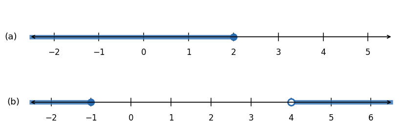

*Figure 1. (a) Real numbers that are not greater than 2 and (b) real numbers with −1 ≥ x or x > 4*

> **Caution:** The negation of $-1 < x \leq 4$ is not $-1 \not< x \not\leq 4$, and it is not $-1 \geq x > 4$ either. A chain of inequalities means "and," so $-1 \geq x > 4$ would mean "$`-1 \geq x`$ and $x > 4$," which no real number satisfies. The negation is two inequalities joined by "or."

De Morgan's laws are often used in writing programs. For instance, to delete all files modified outside the range from date 1 through date 2 inclusive, a program uses the following equivalence.

```math
\sim(\text{date1} \leq \text{date} \leq \text{date2}) \equiv (\text{date} < \text{date1}) \vee (\text{date2} < \text{date})
```

**Example 2.1.11 (A Cautionary Case).** De Morgan's laws turn $p$: "Jim is tall and Jim is thin" into the negation $\sim p$: "Jim is not tall or Jim is not thin." If $p$ is shortened to "Jim is tall and thin" and its negation is written "Jim is not tall and thin," the negation looks like an and statement, as if De Morgan's laws had been broken. They have not. Formal logic lets and and or connect only complete statements, never sentence fragments, and "tall and thin" is a fragment. Before De Morgan's laws can be applied, the statement must be expanded into the two complete statements "Jim is tall" and "Jim is thin."

> **Caution:** The laws of logic are an aid to thinking, not a mechanical substitute for it. Before applying a law, check that complete statements stand on both sides of each and and each or.

### 1.7 Tautologies and Contradictions

> **Definition:** A **tautology** is a statement form that is true for every assignment of truth values to the statements substituted for its statement variables, and a statement whose form is a tautology is called a tautological statement. A **contradiction** is a statement form that is false for every such assignment, and a statement whose form is a contradiction is called a contradictory statement.

A tautological statement is true, and a contradictory statement is false, purely because of its logical structure; what the statement is about makes no difference. In this chapter a tautology is denoted by a bold $\mathbf{t}$ and a contradiction by a bold $\mathbf{c}$.

**Example 2.1.12 (Tautologies and Contradictions).** In the table below the $p \vee \sim p$ column is all T's, so it is a tautology, and the $p \wedge \sim p$ column is all F's, so it is a contradiction. Every statement is true or false, so "$`p`$ or not $p$" is always true, and no statement is both true and false, so "$`p`$ and not $p$" is always false.

| $p$ | $\sim p$ | $p \vee \sim p$ | $p \wedge \sim p$ |
|:-:|:-:|:-:|:-:|
| T | F | T | F |
| F | T | T | F |

*Table 12. Tautology $`p \vee \sim p`$ and contradiction $`p \wedge \sim p`$: truth table*

**Example 2.1.13 (Logical Equivalences Involving Tautologies and Contradictions).** If $\mathbf{t}$ is a tautology and $\mathbf{c}$ is a contradiction, then $p \wedge \mathbf{t} \equiv p$ and $p \wedge \mathbf{c} \equiv \mathbf{c}$. Since $\mathbf{t}$ is T in every row and $\mathbf{c}$ is F in every row, the following table results.

| $p$ | $\mathbf{t}$ | $p \wedge \mathbf{t}$ | $\mathbf{c}$ | $p \wedge \mathbf{c}$ |
|:-:|:-:|:-:|:-:|:-:|
| T | T | T | F | F |
| F | T | F | F | F |

*Table 13. $`p \wedge \mathbf{t} \equiv p`$ and $`p \wedge \mathbf{c} \equiv \mathbf{c}`$: verification*

The $p \wedge \mathbf{t}$ column equals the $p$ column, and the $p \wedge \mathbf{c}$ column equals the $\mathbf{c}$ column.

### 1.8 Laws of Logical Equivalence

Knowing logical equivalences makes arguments easier to build. It often happens that a conclusion is hard to see from one form of a statement but easy to see from a logically equivalent form. The most useful logical equivalences are collected in the following theorem.

> **Key Point:** **Laws of logical equivalence.** Given any statement variables $p$, $q$, and $r$, a tautology $\mathbf{t}$, and a contradiction $\mathbf{c}$, the following logical equivalences hold.

| Law | First form | Second form |
|:-----|:-----|:-----|
| 1. Commutative laws | $p \wedge q \equiv q \wedge p$ | $p \vee q \equiv q \vee p$ |
| 2. Associative laws | $(p \wedge q) \wedge r \equiv p \wedge (q \wedge r)$ | $(p \vee q) \vee r \equiv p \vee (q \vee r)$ |
| 3. Distributive laws | $p \wedge (q \vee r) \equiv (p \wedge q) \vee (p \wedge r)$ | $p \vee (q \wedge r) \equiv (p \vee q) \wedge (p \vee r)$ |
| 4. Identity laws | $p \wedge \mathbf{t} \equiv p$ | $p \vee \mathbf{c} \equiv p$ |
| 5. Negation laws | $p \vee \sim p \equiv \mathbf{t}$ | $p \wedge \sim p \equiv \mathbf{c}$ |
| 6. Double negative law | $\sim(\sim p) \equiv p$ | |
| 7. Idempotent laws | $p \wedge p \equiv p$ | $p \vee p \equiv p$ |
| 8. Universal bound laws | $p \vee \mathbf{t} \equiv \mathbf{t}$ | $p \wedge \mathbf{c} \equiv \mathbf{c}$ |
| 9. De Morgan's laws | $\sim(p \wedge q) \equiv \sim p \vee \sim q$ | $\sim(p \vee q) \equiv \sim p \wedge \sim q$ |
| 10. Absorption laws | $p \vee (p \wedge q) \equiv p$ | $p \wedge (p \vee q) \equiv p$ |
| 11. Negations of t and c | $\sim \mathbf{t} \equiv \mathbf{c}$ | $\sim \mathbf{c} \equiv \mathbf{t}$ |

*Table 14. Laws of logical equivalence*

**Proof.** Each law is proved by constructing truth tables for both sides and checking that they agree in every row. The first form of the commutative laws, the double negative law, the negation laws, the first form of the identity laws, De Morgan's laws, and the second form of the universal bound laws were already checked by the tables of Sections 1.6 and 1.7. The others are checked in the same way. For example, the first distributive law involves three variables and so needs an eight-row table; in the table below the $p \wedge (q \vee r)$ column and the $(p \wedge q) \vee (p \wedge r)$ column agree in every row.

| $p$ | $q$ | $r$ | $q \vee r$ | $p \wedge (q \vee r)$ | $p \wedge q$ | $p \wedge r$ | $(p \wedge q) \vee (p \wedge r)$ |
|:-:|:-:|:-:|:-:|:-:|:-:|:-:|:-:|
| T | T | T | T | T | T | T | T |
| T | T | F | T | T | T | F | T |
| T | F | T | T | T | F | T | T |
| T | F | F | F | F | F | F | F |
| F | T | T | T | F | F | F | F |
| F | T | F | T | F | F | F | F |
| F | F | T | T | F | F | F | F |
| F | F | F | F | F | F | F | F |

*Table 15. Distributive law $`p \wedge (q \vee r) \equiv (p \wedge q) \vee (p \wedge r)`$: verification*

The absorption laws are checked in the same way. In the table below the $p \vee (p \wedge q)$ and $p \wedge (p \vee q)$ columns both equal the $p$ column. Intuitively, $p \vee (p \wedge q)$ is true when $p$ is true, and when $p$ is false, $p \wedge q$ is also false, so the whole is false.

| $p$ | $q$ | $p \wedge q$ | $p \vee (p \wedge q)$ | $p \vee q$ | $p \wedge (p \vee q)$ |
|:-:|:-:|:-:|:-:|:-:|:-:|
| T | T | T | T | T | T |
| T | F | F | T | T | T |
| F | T | F | F | T | F |
| F | F | F | F | F | F |

*Table 16. Verification of the absorption laws*

All the other laws can be derived from the first five (the commutative, associative, distributive, identity, and negation laws). These five laws are the axioms of a mathematical structure called a **Boolean algebra**, treated in Chapter 6.

> **Note:** Any statement form, not only a statement variable, may be put in place of $p$, $q$, or $r$ in a law. A law holds for every combination of truth values, so it still holds for whatever truth values the substituted statement form takes. For example, putting $\sim p$ in place of $p$ in De Morgan's law gives $\sim(\sim p \wedge q) \equiv \sim(\sim p) \vee \sim q$.

**Example 2.1.14 (Simplifying a Statement Form).** Use the laws of logical equivalence to show that $\sim(\sim p \wedge q) \wedge (p \vee q) \equiv p$. Each time part of the left-hand form is replaced by a logically equivalent expression, the whole remains logically equivalent, so replacements continue until the right-hand form appears.

```math
\begin{aligned}
\sim(\sim p \wedge q) \wedge (p \vee q) &\equiv (\sim(\sim p) \vee \sim q) \wedge (p \vee q) && \text{by De Morgan's laws} \\
&\equiv (p \vee \sim q) \wedge (p \vee q) && \text{by the double negative law} \\
&\equiv p \vee (\sim q \wedge q) && \text{by the distributive law} \\
&\equiv p \vee (q \wedge \sim q) && \text{by the commutative law for } \wedge \\
&\equiv p \vee \mathbf{c} && \text{by the negation law} \\
&\equiv p && \text{by the identity law}
\end{aligned}
```

The third line reads the second distributive law $p \vee (q \wedge r) \equiv (p \vee q) \wedge (p \vee r)$ from right to left with $\sim q$ in place of $q$ and $q$ in place of $r$. Skill in such simplification is useful in writing logically efficient programs and in designing digital logic circuits (Section 4).

> **Caution:** The laws of logical equivalence can prove that two statement forms are logically equivalent, but they cannot prove that two forms are **not** equivalent. Truth tables decide both equivalence and nonequivalence and are easy to program, but with $n$ variables they require checking $2^n$ rows. Conversely, the laws are sometimes much faster. For instance, $p \wedge (\sim q \wedge \sim r) \equiv (p \wedge \sim q) \wedge \sim r$ follows at once from the associative law, whereas a truth table check needs eight rows.

---

<br>

## 2. Conditional Statements

Reasoning moves from a hypothesis to a conclusion, and its goal is a claim of the shape "if this is known, then that must hold." This section defines the conditional statement, which expresses such claims, and collects its variants and the logical equivalences that involve it.

### 2.1 The Conditional and Its Truth Table

For statements $p$ and $q$, a sentence of the form "If $p$ then $q$" is denoted $p \to q$. Here $p$ is called the **hypothesis** and $q$ the **conclusion**. For instance, in "If 4,686 is divisible by 6, then 4,686 is divisible by 3," the hypothesis is "4,686 is divisible by 6" and the conclusion is "4,686 is divisible by 3." The name conditional reflects that the truth of $q$ is made to depend on the truth of $p$.

To make $p \to q$ a statement, its truth values must be fixed just as they were for $\wedge$ and $\vee$, and the choice follows everyday usage. Imagine that a shop owner tells a job applicant, "If you show up for work Monday morning, then you will get the job." The owner can be accused of breaking the promise only if the applicant comes in on Monday morning and is not hired. The promise describes what happens when its condition (coming in on Monday morning) is met and is silent about the case in which the condition is not met, so in that case it cannot be called false, whether the applicant is hired or not. Hence a conditional is false in exactly one situation, a true hypothesis with a false conclusion, and since each row of a truth table must hold T or F, every other row holds T.

> **Definition:** If $p$ and $q$ are statement variables, the **conditional statement** $p \to q$ is "If $p$ then $q$" or "$`p`$ implies $q$." It is false when $p$ is true and $q$ is false, and true in every other case. The statement $p$ is the hypothesis (or **antecedent**) of the conditional, and $q$ is its conclusion (or **consequent**).

| $p$ | $q$ | $p \to q$ |
|:-:|:-:|:-:|
| T | T | T |
| T | F | F |
| F | T | T |
| F | F | T |

*Table 17. Conditional $`p \to q`$: truth table*

A conditional that is true only because its hypothesis is false is said to be **vacuously true**, or true by default. The shop owner's promise, for example, is vacuously true when the applicant never comes in on Monday morning. In general, an if-then statement whose "if" part is false is true as a whole, regardless of the truth value of its conclusion.

**Example 2.2.1 (A Conditional Statement with a False Hypothesis).** "If $0 = 1$ then $1 = 2$" looks odd, yet it is true because its hypothesis $0 = 1$ is false. In fact, assuming $0 = 1$ and adding 1 to both sides does yield $1 = 2$.

> **Note:** The philosopher W. V. O. Quine advised against reading $p \to q$ as "$`p`$ implies $q$," because the word "implies" suggests that $q$ can be logically deduced from $p$, which is often not the case. The phrase is still widely used as a convenient replacement for the symbol $\to$.

**Order of operations.** In an expression that contains $\to$ together with $\wedge$, $\vee$, and $\sim$, the $\to$ is performed last. That is, $\sim$ is performed first, then $\wedge$ and $\vee$, and finally $\to$.

**Example 2.2.2 (Truth Table for $`p \vee \sim q \to \sim p`$).** By the order of operations this expression means $(p \vee (\sim q)) \to (\sim p)$, so the hypothesis is $p \vee \sim q$ and the conclusion is $\sim p$. List the four combinations of $p$ and $q$, fill the $\sim p$ and $\sim q$ columns by the definition of negation, and fill the $p \vee \sim q$ column by the definition of $\vee$. Finally, put F in rows 1 and 2, where the hypothesis $p \vee \sim q$ is T and the conclusion $\sim p$ is F, and T in the other two rows.

| $p$ | $q$ | $\sim p$ | $\sim q$ | $p \vee \sim q$ | $p \vee \sim q \to \sim p$ |
|:-:|:-:|:-:|:-:|:-:|:-:|
| T | T | F | F | T | F |
| T | F | F | T | T | F |
| F | T | T | F | F | T |
| F | F | T | T | T | T |

*Table 18. $`p \vee \sim q \to \sim p`$: truth table*

### 2.2 Logical Equivalences Involving Conditionals

Suppose that for three statements $p$, $q$, and $r$ it is known that $r$ is true whenever $p$ is true and also whenever $q$ is true. Then $r$ must hold no matter whether $p$ or $q$ is the case. The method of analysis by division into cases is based on this idea.

**Example 2.2.3 (Division into Cases, $`p \vee q \to r \equiv (p \to r) \wedge (q \to r)`$).** List the eight combinations of truth values and fill the $p \vee q$, $p \to r$, and $q \to r$ columns by the definitions of or and if-then. For example, the $p \to r$ column is F in rows 2 and 4, where $p$ is true and $r$ is false. The $p \vee q \to r$ column is F in rows 2, 4, and 6, where the hypothesis $p \vee q$ is true and the conclusion $r$ is false, and T in the other rows. The last two columns agree in every row, so the two statement forms are logically equivalent.

| $p$ | $q$ | $r$ | $p \vee q$ | $p \to r$ | $q \to r$ | $p \vee q \to r$ | $(p \to r) \wedge (q \to r)$ |
|:-:|:-:|:-:|:-:|:-:|:-:|:-:|:-:|
| T | T | T | T | T | T | T | T |
| T | T | F | T | F | F | F | F |
| T | F | T | T | T | T | T | T |
| T | F | F | T | F | T | F | F |
| F | T | T | T | T | T | T | T |
| F | T | F | T | T | F | F | F |
| F | F | T | F | T | T | T | T |
| F | F | F | F | T | T | T | T |

*Table 19. $`p \vee q \to r`$ and $`(p \to r) \wedge (q \to r)`$: logical equivalence*

### 2.3 Representation of If-Then as Or

"If $p$ then $q$" is logically equivalent to "not $p$ or $q$."

```math
p \to q \equiv \sim p \vee q
```

In the truth table below the $p \to q$ and $\sim p \vee q$ columns agree in every row, because both are F only in row 2, where $p$ is T and $q$ is F.

| $p$ | $q$ | $\sim p$ | $p \to q$ | $\sim p \vee q$ |
|:-:|:-:|:-:|:-:|:-:|
| T | T | F | T | T |
| T | F | F | F | F |
| F | T | T | T | T |
| F | F | T | T | T |

*Table 20. $`p \to q \equiv \sim p \vee q`$: verification*

**Example 2.2.4 (Applying the Equivalence between $\sim p \vee q$ and $`p \to q`$).** Rewrite "Either you get to work on time or you are fired" in if-then form. Take $\sim p$ to be "You get to work on time" and $q$ to be "You are fired," so the sentence has the form $\sim p \vee q$. Then $p$ says "You do not get to work on time," and the equivalent form $p \to q$ reads "If you do not get to work on time, then you are fired."

### 2.4 The Negation of a Conditional Statement

By definition, $p \to q$ is false if, and only if, its hypothesis $p$ is true and its conclusion $q$ is false. Hence the negation of "if $p$ then $q$" is logically equivalent to "$`p`$ and not $q$."

```math
\sim(p \to q) \equiv p \wedge \sim q
```

The same result follows by negating both sides of the equivalence $p \to q \equiv \sim p \vee q$ of Section 2.3.

```math
\begin{aligned}
\sim(p \to q) &\equiv \sim(\sim p \vee q) && \text{by the equivalence of Section 2.3} \\
&\equiv \sim(\sim p) \wedge (\sim q) && \text{by De Morgan's laws} \\
&\equiv p \wedge \sim q && \text{by the double negative law}
\end{aligned}
```

A truth table confirms it as well: the $\sim(p \to q)$ and $p \wedge \sim q$ columns agree in every row.

| $p$ | $q$ | $p \to q$ | $\sim(p \to q)$ | $\sim q$ | $p \wedge \sim q$ |
|:-:|:-:|:-:|:-:|:-:|:-:|
| T | T | T | F | F | F |
| T | F | F | T | T | T |
| F | T | T | F | F | F |
| F | F | T | F | T | F |

*Table 21. $`\sim(p \to q) \equiv p \wedge \sim q`$: verification*

**Example 2.2.5 (Negations of If-Then Statements).** Write negations of the following statements.

- (a) In "If my car is in the repair shop, then I cannot get to class," the hypothesis $p$ is "My car is in the repair shop" and the conclusion $q$ is "I cannot get to class." The negation $p \wedge \sim q$ is "My car is in the repair shop and I can get to class."
- (b) The negation of "If Sara lives in Athens, then she lives in Greece" is "Sara lives in Athens and she does not live in Greece." There are cities named Athens in Georgia, Ohio, and Wisconsin, so this negation can be true.

> **Caution:** A negated if-then statement is not itself an if-then statement, so it does not begin with "if." Instead of writing the negation of a conditional as another conditional, write it as the and statement "the hypothesis holds and the conclusion does not."

### 2.5 The Contrapositive

The logical equivalence of a conditional statement and its contrapositive ranks among the most basic laws of logic.

> **Definition:** The **contrapositive** of a conditional statement of the form "If $p$ then $q$" is "If $\sim q$ then $\sim p$." Symbolically, the contrapositive of $p \to q$ is $\sim q \to \sim p$.

> **Key Point:** A conditional statement is logically equivalent to its contrapositive: $p \to q \equiv \sim q \to \sim p$.

Both forms are F only when $p$ is T and $q$ is F. For $\sim q \to \sim p$ to be F, the hypothesis $\sim q$ must be T and the conclusion $\sim p$ must be F, which means that $q$ is F and $p$ is T. The table in Section 2.6 shows that the $p \to q$ and $\sim q \to \sim p$ columns agree in every row.

**Example 2.2.6 (Writing the Contrapositive).** Write each statement in its equivalent contrapositive form.

- (a) The contrapositive of "If Howard can swim across the lake, then Howard can swim to the island" is "If Howard cannot swim to the island, then Howard cannot swim across the lake."
- (b) The contrapositive of "If today is Easter, then tomorrow is Monday" is "If tomorrow is not Monday, then today is not Easter."

When solving a problem, the contrapositive is sometimes easier to work with than the original conditional. This equivalence is the basis of the rule of inference called modus tollens (Section 3.2) and of the method of proof by contraposition treated in Chapter 4.

### 2.6 The Converse and the Inverse

A conditional statement has two further variants, and neither is logically equivalent to it.

> **Definition:** **Converse and inverse.** Suppose a conditional statement of the form "If $p$ then $q$" is given.
> 1. The **converse** is "If $q$ then $p$." Symbolically, the converse of $p \to q$ is $q \to p$.
> 2. The **inverse** is "If $\sim p$ then $\sim q$." Symbolically, the inverse of $p \to q$ is $\sim p \to \sim q$.

**Example 2.2.7 (Writing the Converse and the Inverse).** Write the converse and inverse of the two statements of Section 2.5.

- (a) The converse is "If Howard can swim to the island, then Howard can swim across the lake," and the inverse is "If Howard cannot swim across the lake, then Howard cannot swim to the island."
- (b) The converse is "If tomorrow is Monday, then today is Easter," and the inverse is "If today is not Easter, then tomorrow is not Monday."

"If today is Easter, then tomorrow is Monday" never fails, because Easter always falls on a Sunday. Its converse and inverse, however, are false on every Sunday other than Easter: on such a day tomorrow is Monday, yet today is not Easter.

| $p$ | $q$ | $p \to q$ | $\sim q \to \sim p$ | $q \to p$ | $\sim p \to \sim q$ |
|:-:|:-:|:-:|:-:|:-:|:-:|
| T | T | T | T | T | T |
| T | F | F | F | T | T |
| F | T | T | T | F | F |
| F | F | T | T | T | T |

*Table 22. Truth table for a conditional, its contrapositive, its converse, and its inverse*

> **Key Point:** The table above shows the following three facts.
> 1. A conditional statement and its converse are not logically equivalent (they differ in rows 2 and 3).
> 2. A conditional statement and its inverse are not logically equivalent (they differ in rows 2 and 3).
> 3. The converse and the inverse of a conditional statement are logically equivalent to each other, because the inverse is the contrapositive of the converse (the contrapositive of $q \to p$ is $`\sim p \to \sim q`$).

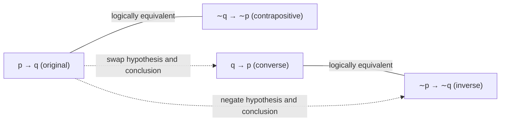

*Figure 2. Relations among a conditional and its contrapositive, converse, and inverse*

> **Caution:** It is a common belief that a true conditional statement must have a true converse and a true inverse, but this belief is wrong. The converse may happen to be true, yet nothing guarantees it.

### 2.7 Only If and the Biconditional

"$`p`$ only if $q$" says that $p$ cannot happen unless $q$ happens as well. In other words, if $q$ fails to happen, then $p$ cannot happen either. By the equivalence with the contrapositive, this amounts to saying that whenever $p$ happens, $q$ must happen too.

> **Definition:** **Meaning of only if.** If $p$ and $q$ are statements, "$`p`$ only if $q$" means "if not $q$ then not $p$," or, equivalently, "if $p$ then $q$."

**Example 2.2.8 (Converting Only If to If-Then).** Rewrite "John will break the world's record for the 1,000-meter run only if he runs the 1,000 meters in under 2.5 minutes" in two if-then forms, one the contrapositive of the other. With $p$ for "John breaks the world's record" and $q$ for "John runs the 1,000 meters in under 2.5 minutes," the sentence is "$`p`$ only if $q$."

- First form ($`\sim q \to \sim p`$): If John does not run the 1,000 meters in under 2.5 minutes, then he will not break the world's record.
- Second form ($`p \to q`$): If John breaks the world's record, then he will have run the 1,000 meters in under 2.5 minutes.

> **Caution:** "$`p`$ only if $q$" does not mean "$`p`$ if $q$" (that is, $`q \to p`$). Saying that John can break the record only if he runs under 2.5 minutes does not mean that he breaks the record if he runs under 2.5 minutes. If the record is well below 2.5 minutes, a time under 2.5 minutes may still not be fast enough. So "$`p`$ only if $q$" can be true while "$`p`$ if $q$" is false.

> **Definition:** Given statement variables $p$ and $q$, the **biconditional** of $p$ and $q$ is "$`p`$ if, and only if, $q$" and is denoted $p \leftrightarrow q$. It is true if $p$ and $q$ have the same truth value and false if they have opposite truth values. The words "if and only if" are often abbreviated **iff**.

| $p$ | $q$ | $p \leftrightarrow q$ |
|:-:|:-:|:-:|
| T | T | T |
| T | F | F |
| F | T | F |
| F | F | T |

*Table 23. Biconditional $`p \leftrightarrow q`$: truth table*

In the order of operations $\leftrightarrow$ has the same rank as $\to$, so, as with $\wedge$ and $\vee$, parentheses are the only means of fixing which of the two is applied first. The complete order of the five logical operators is as follows.

| Order | Operators | Description |
|:-:|:-:|:-----|
| 1 | $\sim$ | Evaluate negations first. |
| 2 | $\wedge$, $\vee$ | Evaluate these second. When both are present, parentheses may be needed. |
| 3 | $\to$, $\leftrightarrow$ | Evaluate these last. When both are present, parentheses may be needed. |

*Table 24. Order of operations for the logical operators*

Given what "if" and "only if" each mean, "$`p`$ if, and only if, $q$" ought to say the same thing as "$`p`$ if $q$" together with "$`p`$ only if $q$." The following table confirms this.

```math
p \leftrightarrow q \equiv (p \to q) \wedge (q \to p)
```

| $p$ | $q$ | $p \to q$ | $q \to p$ | $p \leftrightarrow q$ | $(p \to q) \wedge (q \to p)$ |
|:-:|:-:|:-:|:-:|:-:|:-:|
| T | T | T | T | T | T |
| T | F | F | T | F | F |
| F | T | T | F | F | F |
| F | F | T | T | T | T |

*Table 25. $`p \leftrightarrow q \equiv (p \to q) \wedge (q \to p)`$: verification*

**Example 2.2.9 (If and Only If).** The sentence "This program is correct if, and only if, it produces correct answers for every possible set of input data" splits into the conjunction of two if-then statements: "If this program is correct, then it produces correct answers for every possible set of input data, and if this program produces correct answers for every possible set of input data, then it is correct."

### 2.8 Necessary and Sufficient Conditions

In careful formal usage, the expressions necessary condition and sufficient condition mean exactly what their logical definitions say.

> **Definition:** **Necessary and sufficient conditions.** If $r$ and $s$ are statements:
> - "$`r`$ is a **sufficient condition** for $s$" means "if $r$ then $s$" ($`r \to s`$).
> - "$`r`$ is a **necessary condition** for $s$" means "if not $r$ then not $s$" ($`\sim r \to \sim s`$).

To say that $r$ is a sufficient condition for $s$ means that the occurrence of $r$ guarantees the occurrence of $s$. To say that $r$ is a necessary condition for $s$ means that if $r$ does not occur, then $s$ cannot occur either; that is, $r$ must occur for $s$ to occur. By the equivalence of a conditional and its contrapositive, "$`r`$ is a necessary condition for $s$" also means "if $s$ then $r$" ($`s \to r`$). Consequently, "$`r`$ is a necessary and sufficient condition for $s$" means "$`r`$ if, and only if, $s$" ($`r \leftrightarrow s`$).

**Example 2.2.10 (Interpreting Necessary and Sufficient Conditions).** In "If John is eligible to vote, then he is at least 18 years old," knowing that John is eligible to vote guarantees that he is at least 18, so the first condition is sufficient for the second. Conversely, being at least 18 is necessary for being eligible to vote, since a John younger than 18 could not vote.

**Example 2.2.11 (Converting a Sufficient Condition to If-Then Form).** "Pia's birth on U.S. soil is a sufficient condition for her to be a U.S. citizen" becomes "If Pia was born on U.S. soil, then she is a U.S. citizen."

**Example 2.2.12 (Converting a Necessary Condition to If-Then Form).** Use the contrapositive to rewrite "George's attaining age 35 is a necessary condition for his being president of the United States" in two ways. Let $r$ be "George has attained age 35" and $s$ be "George can be president of the United States."

- First form ($`\sim r \to \sim s`$): If George has not attained the age of 35, then he cannot be president of the United States.
- Second form ($`s \to r`$): If George can be president of the United States, then he has attained the age of 35.

Since many phrases express the same conditional statement, the following table collects them.

| Phrase | Symbol |
|:-----|:-:|
| if $p$ then $q$ | $p \to q$ |
| $p$ implies $q$ | $p \to q$ |
| $p$ only if $q$ | $p \to q$ |
| $p$ is a sufficient condition for $q$ | $p \to q$ |
| $q$ is a necessary condition for $p$ | $p \to q$ |
| $p$ if, and only if, $q$ | $p \leftrightarrow q$ |
| $p$ is a necessary and sufficient condition for $q$ | $p \leftrightarrow q$ |

*Table 26. Phrases that express conditional and biconditional statements*

### 2.9 Two Remarks on Conditional Statements

**First, the hypothesis and the conclusion need not share subject matter.** Nobody says "If computers are machines, then Babe Ruth was a baseball player" or "If $2 + 2 = 5$, then Mickey Mouse is president of the United States" in conversation, because people use "If $p$ then $q$" only when $p$ and $q$ are connected in content. Logic imposes no such requirement on the two parts of a conditional, and such a requirement could not be enforced anyway: two clauses that look unrelated to one reader may look related to another, so every conditional would need approval in advance from some central judge, which is unworkable. Hence "If computers are machines, then Babe Ruth was a baseball player" is a legitimate statement, true because its hypothesis and its conclusion are both true, and "If $2 + 2 = 5$, then Mickey Mouse is president of the United States" is legitimate as well, true because its hypothesis is false. In mathematics a definition carefully designed for the intended situations frequently also covers extreme cases its designer never imagined, so it is worth working through every case a definition covers, the unusual ones included.

**Second, everyday speech often states a conditional where a biconditional is meant.** The sentence "You will get dessert if, and only if, you eat your dinner" amounts logically to the following two statements taken together.

- Statement 1: If you eat your dinner, then you will get dessert.
- Statement 2: You will get dessert only if you eat your dinner; that is, if you do not eat your dinner, then you will not get dessert.

Parents rarely put it this way. Most stress either the reward, "If you eat your dinner, you will get dessert," or the penalty, "You will get dessert only if you eat your dinner." Even so, a parent who states the reward also means the penalty, and a parent who states the penalty will still give dessert to a child who finishes dinner; in both cases the conditional is meant to be heard as a biconditional. Because conditionals are so routinely read as biconditionals, it is easy to fall into the mistaken belief that a conditional always agrees with its converse and inverse. In mathematics, science, and any other setting that requires precision, an if-then statement must be read according to its formal definition and must not be confused with its converse or inverse.

---

<br>

## 3. Valid and Invalid Arguments

In mathematics and logic the word argument does not mean a quarrel; it means a list of statements that ends in a conclusion. This section explains how to decide whether an argument is valid, meaning that its conclusion follows of necessity from the statements before it, and shows that the decision depends only on the form of the argument, never on its content.

### 3.1 Argument Forms and Validity

Section 1.1 showed that the logical form of an argument can be separated from what the argument is about. For example, the argument on the right has the abstract form on the left.

```math
\begin{array}{l}
\text{If } p \text{ then } q. \\
p \\
\hline
\therefore\ q
\end{array}
\qquad\qquad
\begin{array}{l}
\text{If Socrates is a man, then Socrates is mortal.} \\
\text{Socrates is a man.} \\
\hline
\therefore\ \text{Socrates is mortal.}
\end{array}
```

In the abstract form, $p$ and $q$ are placeholders into which statements can be substituted. An argument form is valid if, and only if, every substitution that makes all the premises true also makes the conclusion true.

> **Definition:** An **argument** is a sequence of statements, and an **argument form** is a sequence of statement forms. In either case every item except the last is a **premise** (also called an assumption or hypothesis), and the last item is the **conclusion**; the symbol $\therefore$, read "therefore," is usually written in front of the conclusion. An argument form is **valid** when every substitution of particular statements for the statement variables in its premises that makes all the premises true also makes the conclusion true. An argument is valid when its form is valid, and an argument form that is not valid is **invalid**.

What matters about a valid argument is that its form alone forces the conclusion to be true whenever the premises are true, so no valid argument has all premises true and a false conclusion. When a valid argument has true premises, its conclusion is said to be inferred, or deduced, from them. A conclusion that does not necessarily follow is not a valid deduction.

**Testing an argument form for validity** proceeds as follows.

1. Determine which statement forms are premises and which one is the conclusion.
2. Build a truth table that shows the truth value of every premise and of the conclusion.
3. Call a row in which every premise is true a **critical row**. If the conclusion is false in some critical row, an argument of this form can have true premises together with a false conclusion, and the argument form is invalid. If the conclusion is true in every critical row, the argument form is valid.

> **Caution:** A row in which some premise is false says nothing about the conclusion, which may be true or false there. This is why only the conclusions in the critical rows matter for validity.

**Example 2.3.1 (Determining Validity or Invalidity).** Determine with a truth table whether the following argument form is valid.

```math
\begin{array}{l}
p \to q \vee \sim r \\
q \to p \wedge r \\
\hline
\therefore\ p \to r
\end{array}
```

The premises are $p \to q \vee \sim r$ and $q \to p \wedge r$, and the conclusion is $p \to r$. By the order of operations the first premise is $p \to (q \vee \sim r)$ and the second is $q \to (p \wedge r)$. Fill the intermediate columns $\sim r$, $q \vee \sim r$, and $p \wedge r$ first, then the columns for the premises and the conclusion.

| $p$ | $q$ | $r$ | $\sim r$ | $q \vee \sim r$ | $p \wedge r$ | Premise $p \to q \vee \sim r$ | Premise $q \to p \wedge r$ | Conclusion $p \to r$ | Remark |
|:-:|:-:|:-:|:-:|:-:|:-:|:-:|:-:|:-:|:-----|
| T | T | T | F | T | T | T | T | T | critical row, conclusion true |
| T | T | F | T | T | F | T | F | F | |
| T | F | T | F | F | T | F | T | T | |
| T | F | F | T | T | F | T | T | F | critical row, conclusion false |
| F | T | T | F | T | F | T | F | T | |
| F | T | F | T | T | F | T | F | T | |
| F | F | T | F | F | F | T | T | T | critical row, conclusion true |
| F | F | F | T | T | F | T | T | T | critical row, conclusion true |

*Table 27. Truth table of an argument form whose premises are all true and whose conclusion is false in row 4*

Rows 1, 7, and 8 make every premise and the conclusion true, but row 4 ($p$ T, $q$ F, $r$ F) makes both premises true and the conclusion false. That single row proves that an argument of this form can lead from true premises to a false conclusion, so this argument form is invalid.

### 3.2 Modus Ponens and Modus Tollens

An argument form with exactly two premises and one conclusion is a **syllogism**; its first premise is the major premise and its second the minor premise. The most famous syllogism is **modus ponens**.

```math
\begin{array}{l}
\text{If } p \text{ then } q. \\
p \\
\hline
\therefore\ q
\end{array}
```

Modus ponens is Latin for "method of affirming"; the conclusion is an affirmation. Here are arguments of this form.

- If it rains, the ground is wet ($`p \to q`$). It rains ($`p`$). Therefore, the ground is wet ($`q`$).
- If the sum of the digits of 371,487 is divisible by 3, then 371,487 is divisible by 3. The sum of the digits of 371,487 is divisible by 3 ($`3 + 7 + 1 + 4 + 8 + 7 = 30`$). Therefore, 371,487 is divisible by 3.

Modus ponens is accepted intuitively even before truth tables are known, but a truth table proof confirms that the formal definition of validity agrees with intuition.

| $p$ | $q$ | Premise $p \to q$ | Premise $p$ | Conclusion $q$ | Remark |
|:-:|:-:|:-:|:-:|:-:|:-----|
| T | T | T | T | T | critical row, conclusion true |
| T | F | F | T | F | |
| F | T | T | F | T | |
| F | F | T | F | F | |

*Table 28. Truth table for modus ponens*

Only the first row makes both premises true, and the conclusion is true in that row, so modus ponens is valid.

Another valid argument form is **modus tollens**.

```math
\begin{array}{l}
\text{If } p \text{ then } q. \\
\sim q \\
\hline
\therefore\ \sim p
\end{array}
```

Modus tollens is Latin for "method of denying"; the conclusion is a denial. Here are arguments of this form.

- If it rains, the ground is wet ($`p \to q`$). The ground is not wet ($`\sim q`$). Therefore, it does not rain ($`\sim p`$).
- If Zeus is human, then Zeus is mortal. Zeus is not mortal. Therefore, Zeus is not human.

Proof by contradiction gives an intuitive reason why modus tollens is valid. Assume that (1) "If Zeus is human, then Zeus is mortal" and (2) "Zeus is not mortal" both hold. Were Zeus human, (1) would make him mortal, contradicting (2); so Zeus is not human. Formally, the validity follows from modus ponens together with the equivalence of a conditional and its contrapositive ($`p \to q \equiv \sim q \to \sim p`$), and it can also be checked with the following truth table.

| $p$ | $q$ | Premise $p \to q$ | Premise $\sim q$ | Conclusion $\sim p$ | Remark |
|:-:|:-:|:-:|:-:|:-:|:-----|
| T | T | T | F | F | |
| T | F | F | T | F | |
| F | T | T | F | T | |
| F | F | T | T | T | critical row, conclusion true |

*Table 29. Truth table for modus tollens*

The only critical row is row 4, and the conclusion is true there, so modus tollens is valid.

> **Key Point:** Modus ponens is forward reasoning, which goes from knowing that the hypothesis holds to the conclusion, whereas modus tollens is backward reasoning, which goes from knowing that the conclusion fails back to the failure of the hypothesis.

Research in cognitive psychology has found that almost every college student handles modus ponens correctly by intuition, whereas fewer than 60% use modus tollens correctly. Since mathematical reasoning relies on modus tollens nearly as often as on modus ponens, its form is worth learning with care.

**Example 2.3.2 (Recognizing Modus Ponens and Modus Tollens).** Complete each argument with a conclusion that makes it a valid inference by modus ponens or modus tollens.

- (a) If there are more pigeons than there are pigeonholes, then at least two pigeons roost in the same hole. There are more pigeons than there are pigeonholes. Therefore, at least two pigeons roost in the same hole (by modus ponens).
- (b) If 870,232 is divisible by 6, then it is divisible by 3. 870,232 is not divisible by 3. Therefore, 870,232 is not divisible by 6 (by modus tollens). Indeed, the digit sum $8 + 7 + 0 + 2 + 3 + 2 = 22$ is not a multiple of 3.

### 3.3 Additional Rules of Inference

> **Definition:** A **rule of inference** is a form of argument that is valid.

Modus ponens and modus tollens are therefore rules of inference. The rules below also appear constantly in deductive reasoning.

**Generalization.** The following argument forms are valid.

```math
\text{(a)}\ \begin{array}{l} p \\ \hline \therefore\ p \vee q \end{array}
\qquad\qquad
\text{(b)}\ \begin{array}{l} q \\ \hline \therefore\ p \vee q \end{array}
```

The first form says that once $p$ is true, the more general statement "$`p`$ or $q$" is true for any statement $q$ whatsoever, because a disjunction needs only one true component. Suppose, for instance, that the job is to count the upperclassmen (juniors and seniors) of a school and word comes that Anton is a junior. One reasons, "Anton is a junior; hence, more generally, Anton is a junior or a senior," and because an upperclassman is a junior or a senior, Anton goes on the list.

**Specialization.** The following argument forms are valid.

```math
\text{(a)}\ \begin{array}{l} p \wedge q \\ \hline \therefore\ p \end{array}
\qquad\qquad
\text{(b)}\ \begin{array}{l} p \wedge q \\ \hline \therefore\ q \end{array}
```

They hold because a true conjunction has two true components. When things are sorted by one property, much more is usually known about them than that property, and the rest is set aside so that attention stays on the property that matters. Suppose, for instance, that a project needs a partner who knows graph algorithms and it turns out that Ana knows both numerical analysis and graph algorithms. One reasons, "Ana knows numerical analysis and Ana knows graph algorithms; hence, in particular, Ana knows graph algorithms," and asks Ana to join the project.

Mathematicians use generalization and specialization constantly to reshape known facts so that they match the hypotheses of existing theorems, from which further conclusions follow. Elimination, transitivity, and division into cases are equally common tools.

**Elimination.** The following argument forms are valid.

```math
\text{(a)}\ \begin{array}{l} p \vee q \\ \sim q \\ \hline \therefore\ p \end{array}
\qquad\qquad
\text{(b)}\ \begin{array}{l} p \vee q \\ \sim p \\ \hline \therefore\ q \end{array}
```

These forms say that when only two possibilities exist and one of them is excluded, the other must hold. For instance, if it is known about a particular number $x$ that "$`x - 3 = 0`$ or $x + 2 = 0$" and also that $x$ is not negative, then $x \neq -2$, so $x + 2 \neq 0$, and elimination gives $x - 3 = 0$.

**Transitivity.** The following argument form is valid.

```math
\begin{array}{l}
p \to q \\
q \to r \\
\hline
\therefore\ p \to r
\end{array}
```

Mathematical arguments often string if-then statements together: if a first statement implies a second and the second implies a third, then the first implies the third. For instance, for a particular integer $n$, "If $n$ is divisible by 18, then $n$ is divisible by 9" and "If $n$ is divisible by 9, then the sum of the digits of $n$ is divisible by 9" give "If $n$ is divisible by 18, then the sum of the digits of $n$ is divisible by 9."

**Proof by division into cases.** The following argument form is valid.

```math
\begin{array}{l}
p \vee q \\
p \to r \\
q \to r \\
\hline
\therefore\ r
\end{array}
```

When at least one of two statements is known to be true and the same conclusion can be derived from each of them, that conclusion must be true. For instance, suppose $x$ is a particular nonzero real number. By the trichotomy property of the real numbers, every real number is positive, negative, or zero, so by elimination $x$ is positive or negative. One can then reason, "$`x`$ is positive or $x$ is negative. If $x$ is positive, then $x^2 > 0$. If $x$ is negative, then $x^2 > 0$. Therefore, $x^2 > 0$."

The validity of these rules is also checked with truth tables. For example, in the truth table for division into cases the critical rows, where all three premises are true, are rows 1, 3, and 5, and the conclusion $r$ is true in all three.

| $p$ | $q$ | $r$ | Premise $p \vee q$ | Premise $p \to r$ | Premise $q \to r$ | Conclusion $r$ | Remark |
|:-:|:-:|:-:|:-:|:-:|:-:|:-:|:-----|
| T | T | T | T | T | T | T | critical row, conclusion true |
| T | T | F | T | F | F | F | |
| T | F | T | T | T | T | T | critical row, conclusion true |
| T | F | F | T | F | T | F | |
| F | T | T | T | T | T | T | critical row, conclusion true |
| F | T | F | T | T | F | F | |
| F | F | T | F | T | T | T | |
| F | F | F | F | T | T | F | |

*Table 30. Truth table showing that division into cases is valid*

**Example 2.3.8 (A More Complex Deduction).** On the way out to class one morning, a student notices that their glasses are missing. The following statements are known to be true.

- (a) If I was reading my class notes in the kitchen, then my glasses are on the kitchen table.
- (b) If my glasses are on the kitchen table, then I saw them at breakfast.
- (c) I did not see my glasses at breakfast.
- (d) I was reading my class notes in the living room or I was reading my class notes in the kitchen.
- (e) If I was reading my class notes in the living room, then my glasses are on the coffee table.

Where are the glasses? Write each statement symbolically.

- $RK$: I was reading my class notes in the kitchen.
- $GK$: My glasses are on the kitchen table.
- $SB$: I saw my glasses at breakfast.
- $RL$: I was reading my class notes in the living room.
- $GC$: My glasses are on the coffee table.

Then (a) is $RK \to GK$, (b) is $GK \to SB$, (c) is $\sim SB$, (d) is $RL \vee RK$, and (e) is $RL \to GC$. The following steps reach the answer.

1. From (a) $RK \to GK$ and (b) $GK \to SB$, $RK \to SB$ by **transitivity**.
2. From the conclusion of step 1, $RK \to SB$, and (c) $\sim SB$, $\sim RK$ by **modus tollens**.
3. From (d) $RL \vee RK$ and the conclusion of step 2, $\sim RK$, $RL$ by **elimination**.
4. From (e) $RL \to GC$ and the conclusion of step 3, $RL$, $GC$ by **modus ponens**.

Thus the glasses are on the coffee table.

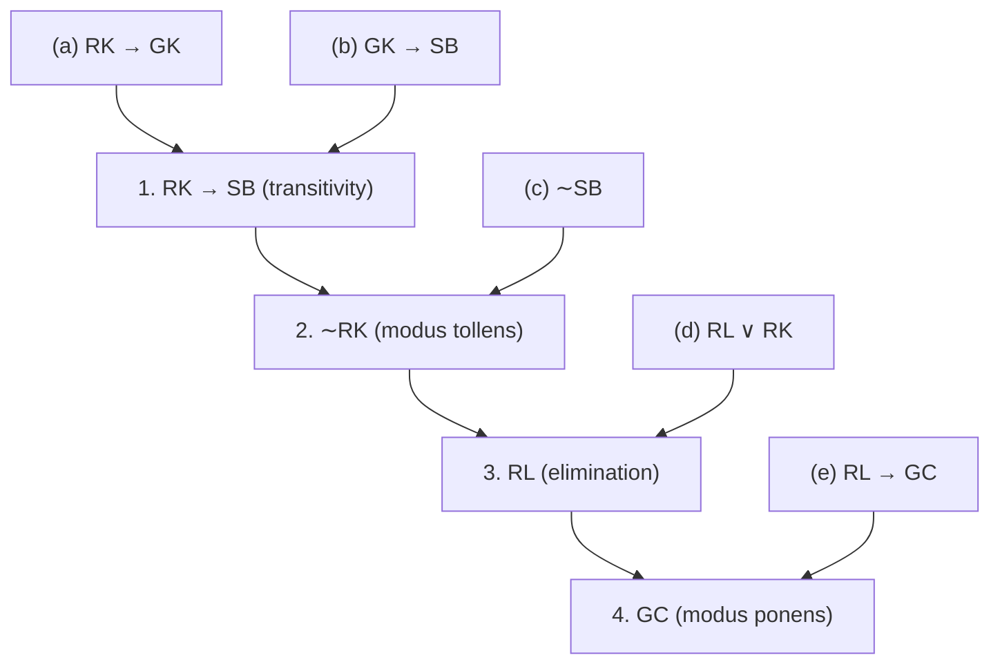

*Figure 3. Premises and rules of inference linked in the deduction that locates the glasses*

### 3.4 Fallacies

A **fallacy** is a mistake in reasoning that produces an invalid argument. Three frequent fallacies are listed below.

- **Using ambiguous premises as if they were unambiguous.** "All banks are beside rivers. My money is in a bank. Therefore, my money is beside a river." The error exploits the two meanings of bank, a financial institution and a riverbank.
- **Circular reasoning.** Taking for granted the very thing to be proved instead of deriving it from the premises. "This book is trustworthy because it says so on page 10" supports the conclusion with the conclusion itself.
- **Jumping to a conclusion.** Drawing a conclusion without adequate grounds. "My neighbor's dog bit me; therefore, all dogs are dangerous" draws a general conclusion from inadequate evidence.

This section also examines two further fallacies, the converse error and the inverse error, which look like modus ponens and modus tollens on the surface but are invalid. An argument can be shown invalid in two ways: by exhibiting a critical row of its truth table in which the conclusion is false, or by exhibiting another argument of the same form whose premises are true and whose conclusion is false.

> **Key Point:** An argument is valid when every argument of its form that has all premises true also has a true conclusion. So an argument is invalid exactly when some argument of the same form has all premises true and a false conclusion.

**Example 2.3.9 (Converse Error).** Show that the following argument is invalid.

```math
\begin{array}{l}
\text{If Zeke is a cheater, then Zeke sits in the back row.} \\
\text{Zeke sits in the back row.} \\
\hline
\therefore\ \text{Zeke is a cheater.}
\end{array}
```

Most people sense at once that this argument is invalid. The first premise tells something about Zeke only in the case that he is a cheater and is silent otherwise. Picture someone who does not cheat but happens to sit in the back row; putting that person's name in place of Zeke makes the first premise vacuously true and the second premise true, while the conclusion is false. The general form of the argument and its truth table are as follows.

```math
\begin{array}{l}
p \to q \\
q \\
\hline
\therefore\ p
\end{array}
```

| $p$ | $q$ | Premise $p \to q$ | Premise $q$ | Conclusion $p$ | Remark |
|:-:|:-:|:-:|:-:|:-:|:-----|
| T | T | T | T | T | critical row, conclusion true |
| T | F | F | F | T | |
| F | T | T | T | F | critical row, conclusion false |
| F | F | T | F | F | |

*Table 31. Truth table for the converse error, whose row 3 shows invalidity*

The conclusion is false in the critical row 3, so the form is invalid. The conclusion would follow if the premise $p \to q$ were swapped for its converse $q \to p$, which is why this fallacy is named the **converse error**. The swap is illegitimate because a conditional and its converse are not logically equivalent. Another name for the converse error is the **fallacy of affirming the consequent**.

**Example 2.3.10 (Inverse Error).** Consider the following argument.

```math
\begin{array}{l}
\text{If these two vertices are adjacent, then they do not have the same color.} \\
\text{These two vertices are not adjacent.} \\
\hline
\therefore\ \text{These two vertices have the same color.}
\end{array}
```

The form of this argument is $p \to q$, $\sim p$, $`\therefore\ \sim q`$.

| $p$ | $q$ | Premise $p \to q$ | Premise $\sim p$ | Conclusion $\sim q$ | Remark |
|:-:|:-:|:-:|:-:|:-:|:-----|
| T | T | T | F | F | |
| T | F | F | F | T | |
| F | T | T | T | F | critical row, conclusion false |
| F | F | T | T | T | critical row, conclusion true |

*Table 32. Truth table for the inverse error, whose row 3 shows invalidity*

The conclusion is false in the critical row 3, so the form is invalid. The conclusion would follow if the first premise were swapped for its inverse $\sim p \to \sim q$, which is why this fallacy is named the **inverse error**. The swap is illegitimate because a conditional and its inverse are not logically equivalent. Another name for the inverse error is the **fallacy of denying the antecedent**.

**Validity and truth.** Some people treat the conclusion of an argument that looks valid as true and the conclusion of an argument that looks suspicious as false. Both habits are mistaken.

> **Caution:** In logic, "true" and "valid" mean quite different things: a valid argument can end in a false conclusion, and an invalid argument can end in a true one.

**Example 2.3.11 (A Valid Argument with a False Premise and a False Conclusion).** The following argument is valid because it has the form of modus ponens, yet its major premise and its conclusion are both false.

```math
\begin{array}{l}
\text{If Canada is north of the United States, then temperatures in Canada never rise above freezing.} \\
\text{Canada is north of the United States.} \\
\hline
\therefore\ \text{Temperatures in Canada never rise above freezing.}
\end{array}
```

"All birds can swim. Cats are birds. Therefore, cats can swim" is another argument with a valid form whose two premises are both false. Why such a form involving "all" is valid is explained in Chapter 3.

**Example 2.3.12 (An Invalid Argument with True Premises and a True Conclusion).** The following argument is invalid because it commits the converse error, but its conclusion is true.

```math
\begin{array}{l}
\text{If New York is a big city, then New York has tall buildings.} \\
\text{New York has tall buildings.} \\
\hline
\therefore\ \text{New York is a big city.}
\end{array}
```

> **Definition:** An argument is **sound** if, and only if, it is valid and every one of its premises is true; an argument that is not sound is unsound.

Validity belongs to argument forms: arguments that share a form are either all valid or all invalid. The combinations of truth values of premises and conclusion that can occur for each kind of form are summarized below.

| Truth values of premises and conclusion | Argument of a valid form | Argument of an invalid form |
|:-----|:-:|:-:|
| all premises true, conclusion true | possible | possible |
| all premises true, conclusion false | impossible | possible |
| at least one premise false, conclusion true | possible | possible |
| at least one premise false, conclusion false | possible | possible |

*Table 33. Combinations of truth values that can occur for valid and invalid forms*

> **Key Point:** The conclusion of an argument is guaranteed to be true only when the argument is sound, that is, only when the argument is known to be valid and all its premises are known to be true.

### 3.5 The Contradiction Rule

The concept of logical contradiction supports a technique of reasoning called the **contradiction rule**. Let $p$ be a statement whose truth is to be deduced.

> **Key Point:** **Contradiction rule.** If assuming that statement $p$ is false leads by logic to a contradiction, then $p$ may be concluded to be true.

**Example 2.3.13 (Validity of the Contradiction Rule).** Show that the following argument form is valid, where $\mathbf{c}$ is a contradiction.

```math
\begin{array}{l}
\sim p \to \mathbf{c} \\
\hline
\therefore\ p
\end{array}
```

| $p$ | $\sim p$ | $\mathbf{c}$ | Premise $\sim p \to \mathbf{c}$ | Conclusion $p$ | Remark |
|:-:|:-:|:-:|:-:|:-:|:-----|
| T | F | F | T | T | critical row, conclusion true |
| F | T | F | F | F | |

*Table 34. Truth table for the contradiction rule*

Since $\mathbf{c}$ is always F, the premise $\sim p \to \mathbf{c}$ is true only in row 1, where $\sim p$ is F. The only critical row is row 1, and the conclusion $p$ is true there, so this argument form is valid.

The contradiction rule is the logical core of proof by contradiction, treated in Chapter 4. A small variant of it, namely that an assumption leading to a contradiction must be false, also settles many logic puzzles by ruling out answers that lead to contradictions.

**Example 2.3.14 (Knights and Knaves).** The logician Raymond Smullyan invented an island inhabited by two kinds of people: **knights**, whose every statement is true, and **knaves**, whose every statement is false. On this island a visitor meets two natives, A and B.

- A says: B is a knight.
- B says: A and I are of opposite type.

What are A and B? The answer is that both are knaves, by the following reasoning.

| Step | Reason |
|:-----|:-----|
| Suppose A is a knight. | supposition |
| $\therefore$ What A says is true. | definition of knight |
| $\therefore$ B is also a knight. | That is what A said. |
| $\therefore$ What B says is true. | definition of knight |
| $\therefore$ A and B are of opposite types. | That is what B said. |
| $\therefore$ This leads to the contradiction that A and B are both knights and of opposite types. | the two previous conclusions |
| $\therefore$ The supposition is false. | contradiction rule |
| $\therefore$ A is not a knight. | negation of the supposition |
| $\therefore$ A is a knave. | elimination: every inhabitant is a knight or a knave |
| $\therefore$ What A says is false. | definition of knave |
| $\therefore$ B is not a knight. | A's statement "B is a knight" is false. |
| $\therefore$ B is also a knave. | elimination |

*Table 35. Steps and reasons in the knights and knaves puzzle*

The reasoning proves only that, if the puzzle has any solution, both A and B are knaves. A puzzle could also be self-contradictory and have no solution at all, so the answer must be checked. If A and B are both knaves, A's statement "B is a knight" is false, and B's statement "A and I are of opposite type" is also false because the two are of the same type. Both knaves lie, so the conditions are met.

### 3.6 Summary of Rules of Inference

The following table summarizes the most important rules of inference. In each cell the statements before $\therefore$ are the premises and the statement after it is the conclusion.

| Rule | Form | Rule | Form |
|:-----|:-----|:-----|:-----|
| Modus ponens | $p \to q$<br>$`p`$<br>$`\therefore\ q`$ | Elimination | (a) $p \vee q$, $\sim q$, $`\therefore\ p`$<br>(b) $p \vee q$, $\sim p$, $`\therefore\ q`$ |
| Modus tollens | $p \to q$<br>$`\sim q`$<br>$`\therefore\ \sim p`$ | Transitivity | $p \to q$<br>$`q \to r`$<br>$`\therefore\ p \to r`$ |
| Generalization | (a) $p$, $`\therefore\ p \vee q`$<br>(b) $q$, $`\therefore\ p \vee q`$ | Proof by division into cases | $p \vee q$<br>$`p \to r`$<br>$`q \to r`$<br>$`\therefore\ r`$ |
| Specialization | (a) $p \wedge q$, $`\therefore\ p`$<br>(b) $p \wedge q$, $`\therefore\ q`$ | Contradiction rule | $\sim p \to \mathbf{c}$<br>$`\therefore\ p`$ |
| Conjunction | $p$<br>$`q`$<br>$`\therefore\ p \wedge q`$ | | |

*Table 36. Valid argument forms (rules of inference)*

The conjunction rule says that if two premises are each true, then their conjunction is true; it follows at once from the definition of conjunction.

---

<br>

## 4. Application: Digital Logic Circuits

This section shows that the logical connectives of Section 1 correspond exactly to the behavior of digital circuits, and treats how to move among circuits, input/output tables, and Boolean expressions and how to simplify circuits.

### 4.1 Switching Circuits and Logic

In the late 1930s Claude Shannon, a graduate student at MIT, observed that switching devices such as telephone switching circuits behave like logical connectives. He applied this resemblance to problems of circuit design and presented the results in his 1938 master's thesis.

A simple switch lets current pass between its two terminals when it is closed and blocks the current when it is open. In a circuit that contains a battery, a light bulb, and switches, the bulb is on exactly when current flows through it. When two switches $P$ and $Q$ are connected **in series** as in part (a) of the figure below, the bulb turns on only when both switches are closed; when they are connected **in parallel** as in part (b), the bulb turns on when at least one switch is closed. In the figure the symbol on the left is a battery and the circle on the right is a light bulb.

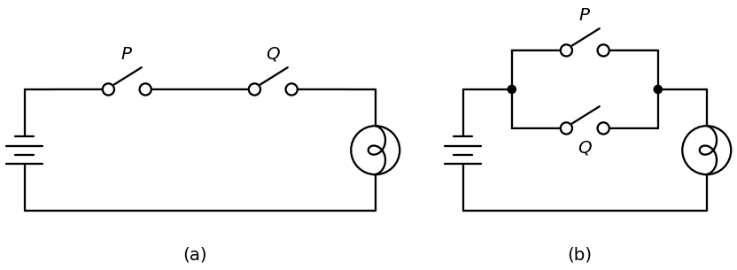

*Figure 4. (a) A circuit with two switches in series and (b) a circuit with two switches in parallel*

| $P$ | $Q$ | Bulb in the series circuit | Bulb in the parallel circuit |
|:-:|:-:|:-:|:-:|
| closed | closed | on | on |
| closed | open | off | on |
| open | closed | off | on |
| open | open | off | off |

*Table 37. State of the light bulb in the series and parallel circuits for each state of the switches*

Writing T for closed and on and F for open and off turns the series column into the truth table of and and the parallel column into the truth table of or. For this reason the series circuit is said to correspond to the logical expression $P \wedge Q$ and the parallel circuit to $P \vee Q$. More elaborate circuits correspond in the same way to more elaborate logical expressions, and this correspondence has long been a standard tool for designing and analyzing circuits.

During the 1940s and 1950s electronic devices took the place of mechanical switches, and the physical states closed and open gave way to electronic states such as high and low voltage. This technology made modern digital systems possible, among them electronic computers, telephone switching systems, and traffic light controllers. The basic electronic building blocks of a digital system are called **digital logic circuits**: "logic" reflects the central part logic plays in their design, and "digital" reflects that they process discrete (separate) signals rather than continuous ones. Engineers still speak of the signal values of an electronic switch as true and false but usually write them as 1 and 0 instead of T and F. The symbols 0 and 1 are called **bits**, a contraction of binary digits; the statistician John Tukey coined the word in 1946.

### 4.2 Black Boxes and Gates

Circuits turn one combination of signal bits (1's and 0's) into another. Since circuits can be built with many different technologies, designers find it convenient to treat basic circuits as **black boxes**. A black box hides the details of how the circuit is built, and attention is placed solely on how its output signals depend on its input signals.

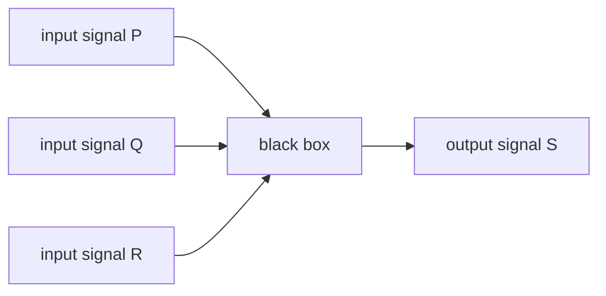

*Figure 5. A black box with three input signals and one output signal*

An **input/output table**, which lists every possible combination of input signals together with the resulting output signals, determines the behavior of a black box completely. The black box above has three input signals, each 1 or 0, so there are $2^3 = 8$ input combinations. One possible correspondence of inputs to outputs is the following.

| $P$ | $Q$ | $R$ | $S$ |
|:-:|:-:|:-:|:-:|
| 1 | 1 | 1 | 1 |
| 1 | 1 | 0 | 0 |
| 1 | 0 | 1 | 0 |
| 1 | 0 | 0 | 1 |
| 0 | 1 | 1 | 0 |
| 0 | 1 | 0 | 1 |
| 0 | 0 | 1 | 1 |
| 0 | 0 | 0 | 0 |

*Table 38. An example of an input/output table for a black box with three inputs*

The third row, for instance, indicates that for inputs $P = 1$, $Q = 0$, and $R = 1$ the output $S$ is 0. The output of this table is 1 exactly when an odd number of inputs are 1.

More complicated circuits are designed efficiently by connecting less complicated black box circuits. Three such basic circuits are the NOT-gate, the AND-gate, and the OR-gate.

- A **NOT-gate** (or **inverter**) has a single input signal and a single output signal and reverses the input: an input of 1 gives an output of 0, and an input of 0 gives an output of 1.
- An **AND-gate** has two input signals and one output signal; its output is 1 when both inputs are 1 and 0 otherwise.
- An **OR-gate** likewise has two input signals and one output signal; its output is 0 when both inputs are 0 and 1 otherwise.

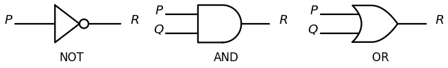

*Figure 6. Symbols for the NOT-gate, the AND-gate, and the OR-gate*

| $P$ | NOT-gate output $R$ |
|:-:|:-:|
| 1 | 0 |
| 0 | 1 |

*Table 39. Input/output table for the NOT-gate*

| $P$ | $Q$ | AND-gate output $R$ | OR-gate output $R$ |
|:-:|:-:|:-:|:-:|
| 1 | 1 | 1 | 1 |
| 1 | 0 | 0 | 1 |
| 0 | 1 | 0 | 1 |
| 0 | 0 | 0 | 0 |

*Table 40. Input/output tables for the AND-gate and the OR-gate*

Once 1 is identified with T and 0 with F, the NOT-, AND-, and OR-gates act on signals exactly as the connectives $\sim$, $\wedge$, and $\vee$ act on statements.

Gates can be wired together in many ways. Wiring that follows the rules below yields a **combinational circuit**, a circuit whose output at each moment depends only on its input at that same moment and not on earlier inputs.

> **Key Point:** **Rules for a combinational circuit**
> 1. Two input wires are never joined into one.
> 2. One input wire may branch partway along and feed two different gates.
> 3. The output wire of a gate may serve as an input to another gate.
> 4. The output of a gate must never lead, directly or through other gates, back into that same gate.

More complex circuits that violate rule 4 are called **sequential circuits**; their output depends both on the current input and on previous inputs.

> **[Digital Logic Design]** Logic design writes the same operations with other symbols. $P \wedge Q$ is written $PQ$ or $P \cdot Q$, $P \vee Q$ is written $P + Q$, and $\sim P$ is written $P'$ or $\overline{P}$, with 1 and 0 in place of the truth values T and F. Sequential circuits, whose output depends on previous states, are built with flip-flops.

### 4.3 The Input/Output Table for a Circuit

Given input signals for a circuit, its output is found by tracing through the circuit gate by gate.

**Example 2.4.1 (Determining Output for a Given Input).** Find the outputs of the two circuits in the figure below for the given input signals. The red numbers in the figure are the signal values on the wires.

- (a) Inputs $P = 0$ and $Q = 1$. Move from left to right, tracing the action of each gate. The NOT-gate changes $P = 0$ to 1, so both inputs to the AND-gate are 1, and hence the output $R$ is 1.
- (b) Inputs $P = 1$, $Q = 0$, and $R = 1$. The output of the OR-gate is 1 because the input $P$ is 1. The NOT-gate changes this 1 into 0, so the two inputs to the AND-gate are 0 and $R = 1$, and hence the output $S$ is 0.

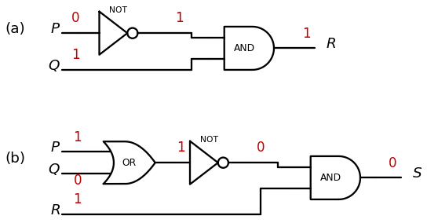

*Figure 7. Outputs of two circuits found by tracing the input signals gate by gate*

The complete input/output table of a circuit is obtained by tracing the circuit once for every possible combination of input signals.

**Example 2.4.2 (Constructing the Input/Output Table for a Circuit).** The circuit below sends $P$ directly to one input of an OR-gate and sends $Q$ through a NOT-gate to the other input.

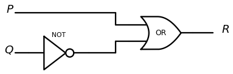

*Figure 8. A circuit that feeds P and the NOT-gate output of Q into an OR-gate*

List the four input combinations and trace each one. For example, if $P = 0$ and $Q = 1$, the output of the NOT-gate is 0, so both inputs to the OR-gate are 0 and the output $R$ is 0. For the other combinations at least one input to the OR-gate is 1, so the output is 1.

| $P$ | $Q$ | $R$ |
|:-:|:-:|:-:|
| 1 | 1 | 1 |
| 1 | 0 | 1 |
| 0 | 1 | 0 |
| 0 | 0 | 1 |

*Table 41. Input/output table for the circuit that feeds P and the NOT-gate output of Q into an OR-gate*

### 4.4 The Boolean Expression Corresponding to a Circuit

In logic, variables such as $p$, $q$, and $r$ represent statements, and a statement has only one of the two truth values T and F. An expression such as $p \wedge (\sim q \vee r)$, composed of statement variables and logical connectives, is a statement form. In honor of George Boole, the English mathematician who was one of the founders of symbolic logic, any variable that can take only one of two values, such as a statement variable or an input signal, is called a **Boolean variable**, and an expression composed of Boolean variables and the connectives $\sim$, $\wedge$, and $\vee$ is called a **Boolean expression**.

> **Note:** Strictly speaking, only meaningful expressions such as $(\sim p \wedge q) \vee (p \wedge r)$ and $\sim(\sim(p \wedge q) \vee r)$ are Boolean expressions; arbitrary strings of symbols are not. Which expressions are meaningful can be specified precisely by a recursive definition.

For a circuit made of NOT-, AND-, and OR-gates, following what each gate does to the input variables produces a corresponding Boolean expression.

**Example 2.4.3 (Finding a Boolean Expression for a Circuit).** Find Boolean expressions for the two circuits in the figure below. A black dot marks a point where two wires are joined; wires that cross with no dot do not touch.

- (a) Trace the circuit from left to right, writing the output of each gate symbolically. The inputs $P$ and $Q$ are each split and fed to an OR-gate and an AND-gate, whose outputs are $P \vee Q$ and $P \wedge Q$. The NOT-gate changes $P \wedge Q$ to $\sim(P \wedge Q)$, and the final AND-gate receives $P \vee Q$ and $\sim(P \wedge Q)$, so the final expression is $(P \vee Q) \wedge \sim(P \wedge Q)$. This is the exclusive or of Section 1.5: "$`P`$ or $Q$ but not both."
- (b) The first AND-gate outputs $P \wedge Q$, the NOT-gate outputs $\sim R$, and the AND-gate that receives both outputs $(P \wedge Q) \wedge \sim R$.

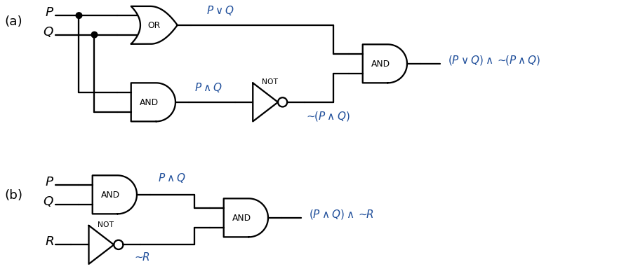

*Figure 9. (a) A circuit computing exclusive or and (b) a circuit computing (P ∧ Q) ∧ ∼R*

The circuit in (b) outputs 1 for exactly one combination of inputs, $P = 1$, $Q = 1$, and $R = 0$, and outputs 0 for all others. Its output column has a 1 in exactly one row, so the circuit can be said to "recognize" one particular combination of inputs.

> **Definition:** A **recognizer** is a circuit whose output is 1 for exactly one combination of input signals and 0 for every other combination.

| $P$ | $Q$ | $R$ | $(P \wedge Q) \wedge \sim R$ |
|:-:|:-:|:-:|:-:|
| 1 | 1 | 1 | 0 |
| 1 | 1 | 0 | 1 |
| 1 | 0 | 1 | 0 |
| 1 | 0 | 0 | 0 |
| 0 | 1 | 1 | 0 |
| 0 | 1 | 0 | 0 |
| 0 | 0 | 1 | 0 |
| 0 | 0 | 0 | 0 |

*Table 42. Input/output table for a recognizer of the input combination 110*

The same holds with two inputs. For example, $P \wedge \sim Q$ is 1 only when $P = 1$ and $Q = 0$, so it is a recognizer for the input combination 10.

### 4.5 The Circuit Corresponding to a Boolean Expression

Conversely, a circuit can be constructed for a given Boolean expression. Work from the outermost operation of the expression to the innermost, adding the gates that correspond to the operations moving from right to left in the circuit diagram.

**Example 2.4.4(a) (Constructing a Circuit for a Boolean Expression).** Construct the circuit for the Boolean expression $(\sim P \wedge Q) \vee \sim Q$.

1. Write the input variables $P$ and $Q$ in a column on the left side of the diagram.
2. The last operation performed when evaluating the expression is $\vee$, so put an OR-gate at the extreme right.
3. One input to the OR-gate is $\sim P \wedge Q$, so draw an AND-gate to the left of the OR-gate and send its output into the OR-gate.
4. One input to the AND-gate is $\sim P$, so draw a line from $P$ through a NOT-gate to the AND-gate; the other input, $Q$, goes directly from $Q$ to the AND-gate.
5. The other input to the OR-gate is $\sim Q$, so draw a line split from $Q$ through a NOT-gate to the OR-gate.

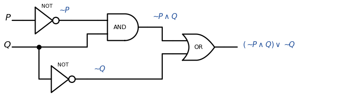

*Figure 10. The circuit corresponding to the Boolean expression (∼P ∧ Q) ∨ ∼Q*

**Example 2.4.4(b) (A Conjunction of Five Inputs).** The circuit for $((P \wedge Q) \wedge (R \wedge S)) \wedge T$ puts at the extreme right an AND-gate for the final $\wedge$ between $((P \wedge Q) \wedge (R \wedge S))$ and $T$, to its left an AND-gate for the $\wedge$ between $P \wedge Q$ and $R \wedge S$, and further left two AND-gates for the $\wedge$'s between $P$ and $Q$ and between $R$ and $S$ (part (a) of the figure below).

By the associative law, all ways of adding parentheses to $P \wedge Q \wedge R \wedge S \wedge T$ give logically equivalent expressions. For example, $((P \wedge Q) \wedge (R \wedge S)) \wedge T \equiv (P \wedge (Q \wedge R)) \wedge (S \wedge T)$, so the circuit in part (b), which corresponds to $(P \wedge (Q \wedge R)) \wedge (S \wedge T)$, has the same input/output table as the circuit in part (a). Hence both circuits implement $P \wedge Q \wedge R \wedge S \wedge T$; a circuit of this kind is called a **multiple-input AND-gate** and is drawn with the symbol in part (c). Multiple-input OR-gates are built in the same way.

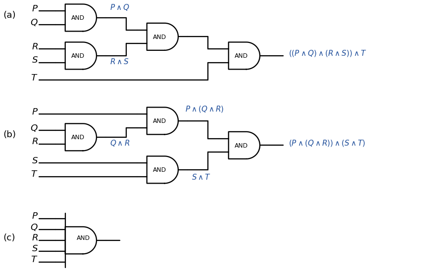

*Figure 11. (a) The circuit for ((P ∧ Q) ∧ (R ∧ S)) ∧ T, (b) the circuit for (P ∧ (Q ∧ R)) ∧ (S ∧ T), and (c) the symbol for a five-input AND-gate*

### 4.6 Designing a Circuit for a Given Input/Output Table

The preceding sections went from a circuit to its input/output table, from a circuit to its Boolean expression, and from a Boolean expression to its circuit. The remaining direction starts from an input/output table and asks for a circuit (or a Boolean expression) that has it. The idea is to combine several recognizers in parallel.

**Example 2.4.5 (Designing a Circuit for a Given Input/Output Table).** Design a circuit with the following input/output table.

| $P$ | $Q$ | $R$ | $S$ |
|:-:|:-:|:-:|:-:|
| 1 | 1 | 1 | 1 |
| 1 | 1 | 0 | 0 |
| 1 | 0 | 1 | 1 |
| 1 | 0 | 0 | 1 |
| 0 | 1 | 1 | 0 |
| 0 | 1 | 0 | 0 |
| 0 | 0 | 1 | 0 |
| 0 | 0 | 0 | 0 |

*Table 43. The input/output table for which a circuit is designed*

1. Identify the rows whose output is 1. In this table they are rows 1, 3, and 4.
2. For each such row, construct an and expression that is 1 (true) for the exact input combination of that row and 0 (false) for all other combinations. The expression for row 1 ($P = 1$, $Q = 1$, $`R = 1`$) is $P \wedge Q \wedge R$. The expression for row 3 ($P = 1$, $Q = 0$, $`R = 1`$) is $P \wedge \sim Q \wedge R$, and the expression for row 4 ($P = 1$, $Q = 0$, $`R = 0`$) is $P \wedge \sim Q \wedge \sim R$. Each variable is written as it is when its value in the row is 1 and negated when its value is 0.
3. A Boolean expression with the given table as its truth table must be 1 in case $P \wedge Q \wedge R = 1$, in case $P \wedge \sim Q \wedge R = 1$, or in case $P \wedge \sim Q \wedge \sim R = 1$, and 0 in all other cases. Hence the disjunction of the three expressions is an answer.

```math
S = (P \wedge Q \wedge R) \vee (P \wedge \sim Q \wedge R) \vee (P \wedge \sim Q \wedge \sim R)
```

The circuit corresponding to this expression is shown below. The three AND-gates are the recognizers for the rows, and the OR-gate puts them together in parallel.

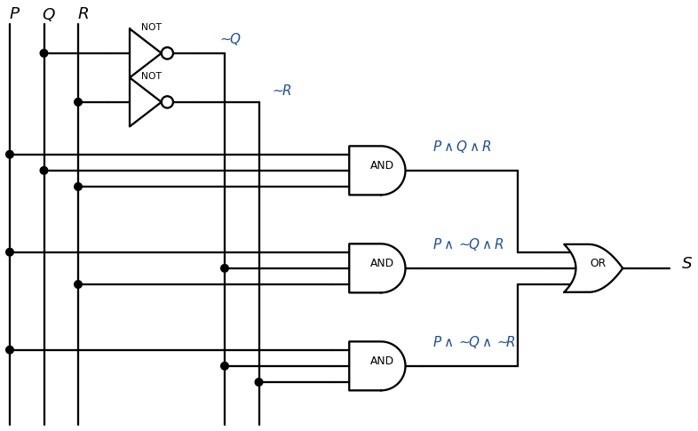

*Figure 12. A circuit implementing the given input/output table by joining three recognizers with an OR-gate*

> **Definition:** An expression such as the one above, which is a disjunction of terms, each term being a conjunction that contains one of $P$ and $\sim P$, one of $Q$ and $\sim Q$, and one of $R$ and $\sim R$, is in **disjunctive normal form**, also called **sum-of-products form**.

> **Caution:** An input/output table whose outputs are all 0 has no row with output 1, so this method produces no terms. In that case a contradiction such as $P \wedge \sim P$ is an expression with the table as its truth table.

> **[Digital Logic Design]** Logic design calls the recognizer term of each row a **minterm** and names it by the row number obtained by reading the inputs $PQR$ as a binary number. In the table above the rows with output 1 are 111, 101, and 100, that is, rows 7, 5, and 4, so one writes $S = \Sigma(4, 5, 7) = PQR + PQ'R + PQ'R'$. Disjunctive normal form is the same as a sum of minterms.

### 4.7 Simplifying Combinational Circuits

Compare the two combinational circuits in the figure below.

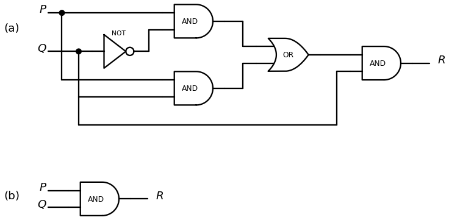

*Figure 13. Two combinational circuits with the same input/output table, (a) a circuit of five gates and (b) a single AND-gate*

Tracing through circuit (a) gives the following input/output table, which is the same as that of circuit (b).

| $P$ | $Q$ | $R$ |
|:-:|:-:|:-:|
| 1 | 1 | 1 |
| 1 | 0 | 0 |
| 0 | 1 | 0 |
| 0 | 0 | 0 |

*Table 44. The input/output table common to both circuits*

The two circuits do the same job, since each turns every combination of input signals into the same output signal. Circuit (b), however, uses far fewer gates, so on an integrated circuit it would occupy less area and consume less power.

> **Definition:** Two digital logic circuits are **equivalent** if, and only if, their input/output tables are identical.

Logically equivalent statement forms have the same truth table, so two circuits can be shown to be equivalent by finding their Boolean expressions and proving that these expressions, viewed as statement forms, are logically equivalent.

**Example 2.4.6 (Showing That Two Circuits Are Equivalent).** The Boolean expressions corresponding to circuits (a) and (b) in the figure above are $((P \wedge \sim Q) \vee (P \wedge Q)) \wedge Q$ and $P \wedge Q$, respectively. By the laws of logical equivalence of Section 1.8:

```math
\begin{aligned}
((P \wedge \sim Q) \vee (P \wedge Q)) \wedge Q &\equiv (P \wedge (\sim Q \vee Q)) \wedge Q && \text{by the distributive law} \\
&\equiv (P \wedge (Q \vee \sim Q)) \wedge Q && \text{by the commutative law for } \vee \\
&\equiv (P \wedge \mathbf{t}) \wedge Q && \text{by the negation law} \\
&\equiv P \wedge Q && \text{by the identity law}
\end{aligned}
```

The first line reads the distributive law $p \wedge (q \vee r) \equiv (p \wedge q) \vee (p \wedge r)$ from right to left to factor out the common $P$. Hence the two expressions have the same truth table, the two circuits have the same input/output table, and the circuits are equivalent.

> **Key Point:** In general, a combinational circuit is simplified by finding its Boolean expression, using the laws of logical equivalence to find a shorter, logically equivalent Boolean expression, and constructing the circuit for this shorter expression.

### 4.8 NAND and NOR Gates

A circuit can also be simplified by replacing it with an equivalent circuit that uses as few kinds of gates as possible. NAND-gates and NOR-gates are particularly useful for this.

- A **NAND-gate** acts like an AND-gate followed by a NOT-gate. Its output is 0 when, and only when, both inputs are 1.
- A **NOR-gate** acts like an OR-gate followed by a NOT-gate. Its output is 1 when, and only when, both inputs are 0.

The logical symbols for these gates are $\mid$ for NAND and $\downarrow$ for NOR. The symbol $\mid$ is called the **Sheffer stroke** after H. M. Sheffer, and $\downarrow$ is called the **Peirce arrow** after C. S. Peirce. Some sources write NAND as $\uparrow$.

```math
P \mid Q \equiv \sim(P \wedge Q), \qquad P \downarrow Q \equiv \sim(P \vee Q)
```

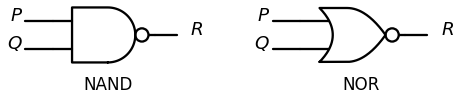

*Figure 14. Symbols for the NAND-gate and the NOR-gate*

| $P$ | $Q$ | NAND output $P \mid Q$ | NOR output $P \downarrow Q$ |
|:-:|:-:|:-:|:-:|
| 1 | 1 | 0 | 0 |
| 1 | 0 | 1 | 0 |
| 0 | 1 | 1 | 0 |
| 0 | 0 | 1 | 1 |

*Table 45. Input/output tables for the NAND-gate and the NOR-gate*

Every Boolean expression is logically equivalent to an expression that uses Sheffer strokes alone, and also to one that uses Peirce arrows alone. Consequently every digital logic circuit has an equivalent circuit built only from NAND-gates, and another built only from NOR-gates. The reason is as follows: every Boolean expression is built from $\sim$, $\wedge$, and $\vee$, so it suffices to express each of these three operations with Sheffer strokes alone.

**Example 2.4.7 (Rewriting Expressions Using the Sheffer Stroke).** Use the laws of logical equivalence and the definition of the Sheffer stroke to show that (a) $\sim P \equiv P \mid P$ and (b) $P \vee Q \equiv (P \mid P) \mid (Q \mid Q)$.

```math
\begin{aligned}
\text{(a)}\quad \sim P &\equiv \sim(P \wedge P) && \text{by the idempotent law for } \wedge \\
&\equiv P \mid P && \text{by definition of } \mid
\end{aligned}
```

```math
\begin{aligned}
\text{(b)}\quad P \vee Q &\equiv \sim(\sim(P \vee Q)) && \text{by the double negative law} \\
&\equiv \sim(\sim P \wedge \sim Q) && \text{by De Morgan's laws} \\
&\equiv \sim((P \mid P) \wedge (Q \mid Q)) && \text{by part (a)} \\
&\equiv (P \mid P) \mid (Q \mid Q) && \text{by definition of } \mid
\end{aligned}
```

The third line of (b) applies part (a) to $P$ and to $Q$, replacing $\sim P$ by $P \mid P$ and $\sim Q$ by $Q \mid Q$. The remaining $\wedge$ can be expressed in the same way.

```math
\begin{aligned}
P \wedge Q &\equiv \sim(\sim(P \wedge Q)) && \text{by the double negative law} \\
&\equiv \sim(P \mid Q) && \text{by definition of } \mid \\
&\equiv (P \mid Q) \mid (P \mid Q) && \text{by part (a) applied to } P \mid Q
\end{aligned}
```

Hence $\sim$, $\wedge$, and $\vee$ can all be expressed with the Sheffer stroke alone, and every combinational circuit can be built from NAND-gates only.

---

<br>

## 5. Application: Number Systems and Circuits for Addition

This section treats the binary and hexadecimal notations with which computers represent numbers, binary addition and subtraction, circuits that add with the gates of Section 4, and two's complements, which represent negative numbers.

### 5.1 Decimal Notation

In the **decimal notation** taught in elementary school, the value of a number is the sum of its digits multiplied by their place values. In 5,049, for example, the digits 5, 0, 4, and 9 occupy the thousands, hundreds, tens, and ones places, so

```math
5{,}049 = 5 \cdot (1{,}000) + 0 \cdot (100) + 4 \cdot (10) + 9 \cdot (1) = 5 \cdot 10^3 + 0 \cdot 10^2 + 4 \cdot 10^1 + 9 \cdot 10^0
```

Decimal notation in general rests on the fact that every positive integer has exactly one expression as a sum of products $d \cdot 10^n$, with each $n$ a nonnegative integer and each $d$ one of the decimal digits 0, 1, 2, ..., 9. The word decimal derives from deci, the Latin root for ten. Decimal (base 10) notation writes a number as a string of digits, and the position of each digit tells which power of 10 multiplies it: the right-most position is the ones place (the $10^0$ place), the next position to the left is the tens place (the $10^1$ place), and the one after that is the hundreds place (the $10^2$ place).

| Place | $10^3$ (thousands) | $10^2$ (hundreds) | $10^1$ (tens) | $10^0$ (ones) |
|:-----|:-:|:-:|:-:|:-:|
| Decimal digit | 5 | 0 | 4 | 9 |

*Table 46. Places and place values of 5,049*

### 5.2 Binary Notation

The number 10 has no special status: it serves as a base only because people have ten fingers, and any integer larger than 1 could be used instead. In computer science, base 2, or **binary notation**, is of special importance, because the signals of modern electronic devices always take one of just two states. Every positive integer has exactly one expression as a sum of products $d \cdot 2^n$, where each $n$ is a nonnegative integer and each $d$ is a binary digit, or **bit**, equal to 0 or 1. This fact is proved in Chapter 5. For example,

```math
27 = 16 + 8 + 2 + 1 = 1 \cdot 2^4 + 1 \cdot 2^3 + 0 \cdot 2^2 + 1 \cdot 2^1 + 1 \cdot 2^0
```

As in decimal notation, binary notation writes only the digits and omits the powers of the base, so $27_{10} = 11011_2$; the subscripts tell whether a number is written in base 10 or base 2. The places of binary notation stand for powers of 2: the ones place (the $2^0$ place) is right-most, the twos place (the $2^1$ place) is next to it on the left, and the fours place (the $2^2$ place) comes after that.

| Place | $2^4$ (16) | $2^3$ (8) | $2^2$ (4) | $2^1$ (2) | $2^0$ (1) |
|:-----|:-:|:-:|:-:|:-:|:-:|
| Binary digit | 1 | 1 | 0 | 1 | 1 |

*Table 47. $`11011_2`$: places and place values*

Leading zeros can be inserted or removed freely, just as in decimal notation. For example, $003_{10} = 3_{10} = 1 \cdot 2^1 + 1 \cdot 2^0 = 11_2 = 011_2$.

**Example 2.5.1 (Binary Notation for the Integers from 1 to 9).** Writing each number as a sum of powers of 2 gives its binary notation.

| Decimal | Sum of powers of 2 | Binary |
|:-:|:-----|:-:|
| 1 | $1 \cdot 2^0$ | $1_2$ |
| 2 | $1 \cdot 2^1 + 0 \cdot 2^0$ | $10_2$ |
| 3 | $1 \cdot 2^1 + 1 \cdot 2^0$ | $11_2$ |
| 4 | $1 \cdot 2^2 + 0 \cdot 2^1 + 0 \cdot 2^0$ | $100_2$ |
| 5 | $1 \cdot 2^2 + 0 \cdot 2^1 + 1 \cdot 2^0$ | $101_2$ |
| 6 | $1 \cdot 2^2 + 1 \cdot 2^1 + 0 \cdot 2^0$ | $110_2$ |
| 7 | $1 \cdot 2^2 + 1 \cdot 2^1 + 1 \cdot 2^0$ | $111_2$ |
| 8 | $1 \cdot 2^3 + 0 \cdot 2^2 + 0 \cdot 2^1 + 0 \cdot 2^0$ | $1000_2$ |
| 9 | $1 \cdot 2^3 + 0 \cdot 2^2 + 0 \cdot 2^1 + 1 \cdot 2^0$ | $1001_2$ |

*Table 48. Binary notation for the integers from 1 to 9*

A list of powers of 2 is useful for conversions between binary and decimal. Places after the binary point correspond to powers with negative exponents.

| $n$ | 0 | 1 | 2 | 3 | 4 | 5 | 6 | 7 | 8 | 9 | 10 |
|:-----|:-:|:-:|:-:|:-:|:-:|:-:|:-:|:-:|:-:|:-:|:-:|
| $2^n$ | 1 | 2 | 4 | 8 | 16 | 32 | 64 | 128 | 256 | 512 | 1024 |
| $2^{-n}$ | 1 | $1/2$ | $1/4$ | $1/8$ | $1/16$ | $1/32$ | $1/64$ | $1/128$ | $1/256$ | $1/512$ | $1/1024$ |

*Table 49. Powers of 2*

**Example 2.5.2 (Converting a Binary to a Decimal Number).** Represent $110101_2$ in decimal notation by multiplying each bit by the power of 2 of its place and adding.

```math
110101_2 = 1 \cdot 2^5 + 1 \cdot 2^4 + 0 \cdot 2^3 + 1 \cdot 2^2 + 0 \cdot 2^1 + 1 \cdot 2^0 = 32 + 16 + 4 + 1 = 53_{10}
```

The same computation can be done with the following schema, multiplying the bits from the right by 1, 2, 4, 8, 16, and 32 and adding.

```text
  1   1   0   1   0   1
  │   │   │   │   │   └──  1 ×  1 =  1
  │   │   │   │   └──────  0 ×  2 =  0
  │   │   │   └──────────  1 ×  4 =  4
  │   │   └──────────────  0 ×  8 =  0
  │   └──────────────────  1 × 16 = 16
  └──────────────────────  1 × 32 = 32
                                    --
                                    53
```

**Example 2.5.3 (Converting a Decimal to a Binary Number).** Write 209 in binary notation by expressing it as a sum of powers of 2, beginning with the largest power of 2 not exceeding 209 and working downward.

1. 209 lies between 128 and 256, so the highest power of 2 less than 209 is 128. Hence $209 = 128 + (\text{a smaller number})$.
2. $209 - 128 = 81$, and 81 lies between 64 and 128, so $209 = 128 + 64 + (\text{a smaller number})$.
3. $81 - 64 = 17$, and 17 lies between 16 and 32, so 16 is added. Then $17 - 16 = 1 = 2^0$.

```math
209 = 128 + 64 + 16 + 1 = 1 \cdot 2^7 + 1 \cdot 2^6 + 0 \cdot 2^5 + 1 \cdot 2^4 + 0 \cdot 2^3 + 0 \cdot 2^2 + 0 \cdot 2^1 + 1 \cdot 2^0
```

Writing 1 in the position of each power of 2 that occurs in the sum and 0 in the position of each missing power gives $209_{10} = 11010001_2$. Another conversion procedure, which uses repeated division by 2, is discussed in Chapter 5.

**Binary fractions.** The bits after the binary point correspond to $2^{-1}, 2^{-2}, \ldots$. For example,

```math
1011.01_2 = 1 \cdot 2^3 + 0 \cdot 2^2 + 1 \cdot 2^1 + 1 \cdot 2^0 + 0 \cdot 2^{-1} + 1 \cdot 2^{-2} = 8 + 2 + 1 + \frac{1}{4} = 11.25
```

### 5.3 Binary Addition and Subtraction

Binary arithmetic works just like decimal arithmetic, except that 2 ($`= 10_2`$) takes over the role that 10 plays in decimal arithmetic. Adding two bits gives the following four cases.

```math
0 + 0 = 00_2, \qquad 0 + 1 = 01_2, \qquad 1 + 0 = 01_2, \qquad 1 + 1 = 10_2
```

Since $1_{10} + 1_{10} = 2_{10}$ becomes $1_2 + 1_2 = 10_2$ in binary notation, adding two 1's results in a carry of 1. Adding three 1's also results in a carry of 1, with 1 written in that place, because $3_{10} = 11_2$.

> **Caution:** Do not read $10_2$ as "ten"; it is the number two. Read $10_2$ as "one oh base two."

**Example 2.5.4 (Addition in Binary Notation).** Add $1101_2$ and $111_2$ using binary notation.

```text
    1 1 1      ← carry row
    1 1 0 1
+     1 1 1
-----------
  1 0 1 0 0
```

Work from the right. In the first place $1 + 1 = 10_2$, so write 0 and carry 1. In the second place $0 + 1 + 1 = 10_2$, so write 0 and carry 1. In the third place $1 + 1 + 1 = 11_2$, so write 1 and carry 1. In the fourth place $1 + 0 + 1 = 10_2$, so write 0 and carry 1, and the carried 1 becomes the fifth place. The result is $10100_2$, which agrees with $13 + 7 = 20$ in decimal.

**Binary subtraction.** Subtraction is done with borrowing, as in decimal subtraction. The single-bit cases are $0 - 0 = 0$, $1 - 0 = 1$, and $1 - 1 = 0$, and $0 - 1$ is computed by borrowing 1 from the next higher place: $10_2 - 1_2 = 1_2$. Just as decimal subtraction uses $10_{10} - 1_{10} = 9_{10}$ to borrow across several columns, binary subtraction may also borrow across more than one column. In the decimal computation $1000 - 58$ below, the 1 in the thousands place is borrowed, leaving 9 in the hundreds and tens places and 10 in the ones place.

```text
   0   9   9  10    ← values after borrowing
   1   0   0   0
-          5   8
----------------
       9   4   2
```

In binary, when $1_2$ is borrowed from $10_2$, what remains is $1_2$. So when a borrow passes through several places, the intermediate places become 1, not 9.

**Example 2.5.5 (Subtraction in Binary Notation).** Subtract $1011_2$ from $11000_2$ using binary notation.

```text
   0  10   1   1  10    ← values after borrowing
   1   1   0   0   0
-      1   0   1   1
--------------------
       1   1   0   1
```

The first place requires computing $0 - 1$, so a borrow is needed; the second and third places are 0, so the 1 in the fourth place is borrowed. The fourth place becomes 0, the borrowed value leaves 1 in each of the third and second places as it passes, and the first place becomes $10_2$. So the first place is $10_2 - 1 = 1$, the second is $1 - 1 = 0$, and the third is $1 - 0 = 1$. The fourth place is now $0 - 1$, so it borrows the 1 in the fifth place and gives $10_2 - 1 = 1$, and the fifth place is $0 - 0 = 0$. The result is $1101_2$, which agrees with $24 - 11 = 13$ in decimal.

### 5.4 Circuits for Computer Addition

Consider designing a circuit to produce the sum of two binary digits $P$ and $Q$. Both $P$ and $Q$ can be 0 or 1, and the following facts are known.

```math
1_2 + 1_2 = 10_2, \qquad 1_2 + 0_2 = 01_2, \qquad 0_2 + 1_2 = 01_2, \qquad 0_2 + 0_2 = 00_2
```

The sum of two bits can therefore have two digits, so the circuit needs two outputs: the left digit, called the **carry**, and the right digit, called the **sum**. The carry is 1 only when both $P$ and $Q$ are 1, so it is produced by the AND-gate corresponding to the Boolean expression $P \wedge Q$. The sum is 1 when exactly one of $P$ and $Q$ is 1, so it is produced by the circuit for exclusive or, $(P \vee Q) \wedge \sim(P \wedge Q)$ (Section 4.4). This circuit, which adds two bits, is called a **half-adder**.

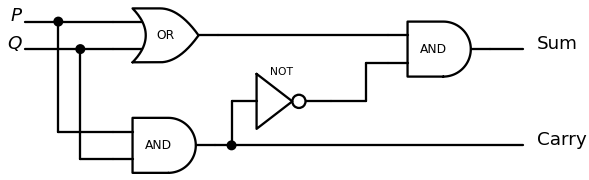

*Figure 15. A half-adder circuit that adds two bits P and Q*

| $P$ | $Q$ | Carry | Sum |
|:-:|:-:|:-:|:-:|
| 1 | 1 | 1 | 0 |
| 1 | 0 | 0 | 1 |
| 0 | 1 | 0 | 1 |
| 0 | 0 | 0 | 0 |

*Table 50. Input/output table for the half-adder*

The circuit above splits the AND-gate output $P \wedge Q$, sending it out as the carry and also into a NOT-gate to form $\sim(P \wedge Q)$. It computes the same expression as the exclusive-or circuit of Section 4.4 while the two outputs share one AND-gate.

A circuit that adds multidigit binary numbers needs a circuit that adds three bits, because adding two bits may produce a carry into the next place to the left, so some places require adding three bits. For example, in $11_2 + 11_2$ the right place is a sum of two bits, but because of the carry the left place is a sum of three bits, $1 + 1 + 1$.

```text
  1        ← carry row
    1 1
+   1 1
-------
  1 1 0
```

A circuit that computes the sum of three bits is called a **full-adder**. Let $C$ be the left bit (carry) and $S$ the right bit (sum) of the result of adding three bits $P$, $Q$, and $R$. The design of the full-adder uses the fact that addition is a binary operation, which combines only two numbers at a time. So $P$ is first added to $Q$, and then $R$ is added to the result. For instance, $1_2 + 0_2 + 1_2$ is computed by first finding $1_2 + 0_2 = 01_2$ and then adding $1_2$ to get $01_2 + 1_2 = 10_2$.

1. Add $P$ and $Q$ with a half-adder to obtain the two-digit binary number $C_1 S_1$.
2. Add $R$ to $C_1 S_1$.
   - (a) Add $S_1$ and $R$ with a half-adder to obtain the two-digit number $C_2 S$. This $S$ is the right-most digit of the whole sum of the three bits.
   - (b) Determine the left-most digit $C$. First, $C_1$ and $C_2$ cannot both be 1: if $C_1 = 1$, then $P$ and $Q$ are both 1, so $S_1 = 0$, and hence the carry $C_2$ of $S_1 + R$ is 0. Next, $C$ is 1 when the addition of $P$ and $Q$ gives a carry or the addition of $S_1$ and $R$ gives a carry. That is, $C = 1$ if, and only if, $C_1 = 1$ or $C_2 = 1$, so $C$ is obtained by feeding $C_1$ and $C_2$ into an OR-gate.

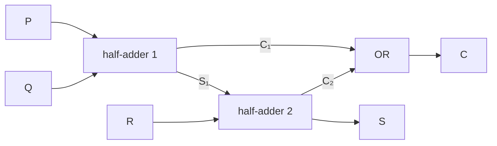

*Figure 16. A full-adder built from two half-adders and one OR-gate*

| $P$ | $Q$ | $R$ | $C$ | $S$ |
|:-:|:-:|:-:|:-:|:-:|
| 1 | 1 | 1 | 1 | 1 |
| 1 | 1 | 0 | 1 | 0 |
| 1 | 0 | 1 | 1 | 0 |
| 1 | 0 | 0 | 0 | 1 |
| 0 | 1 | 1 | 1 | 0 |
| 0 | 1 | 0 | 0 | 1 |
| 0 | 0 | 1 | 0 | 1 |
| 0 | 0 | 0 | 0 | 0 |

*Table 51. Input/output table for the full-adder*

In the table, $C$ is 1 when two or more of the three bits are 1, and $S$ is 1 when the number of 1's is odd.

Combining two full-adders with one half-adder gives a circuit that adds the three-digit binary numbers $PQR$ and $STU$ and outputs their sum $WXYZ$. A circuit of this kind is a **parallel adder**, and the same construction yields parallel adders for binary numbers of any finite length.

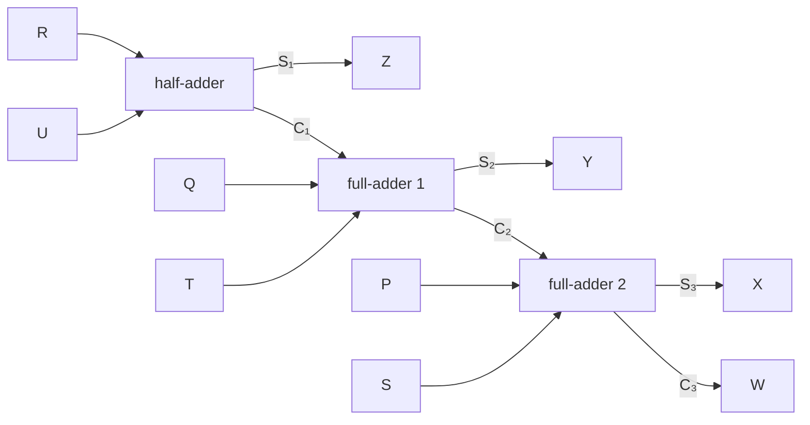

*Figure 17. A parallel adder that adds PQR and STU to obtain WXYZ*

For example, computing $101_2 + 011_2$ proceeds as follows. The half-adder adds $R = 1$ and $U = 1$ and outputs $Z = 0$ and $C_1 = 1$. The first full-adder adds $Q = 0$, $T = 1$, and $C_1 = 1$ and outputs $Y = 0$ and $C_2 = 1$. The second full-adder adds $P = 1$, $S = 0$, and $C_2 = 1$ and outputs $X = 0$ and $W = 1$. Hence $WXYZ = 1000_2$, which agrees with $5 + 3 = 8$ in decimal.

### 5.5 Two's Complements and Signed Integers

Computers usually store an integer in a fixed number of bits. One scheme reserves one bit, normally the left-most, for the sign and writes the absolute value in binary in the remaining bits. This scheme makes addition awkward and gives 0 two representations: with 8 bits, both $00000000$ and $10000000$ represent 0 (as $+0$ and $`-0`$). The more common scheme, **two's complements**, makes integer addition easy and represents 0 in only one way. In practice 64-bit and 32-bit integers are the most common, but the ideas do not depend on the bit length, so this discussion uses 8 bits for simplicity. Eight bits represent the 256 integers from $-128$ through 127, and 32 bits represent $2^{32} = 4{,}294{,}967{,}296$ integers, about 4.3 billion.

> **Definition:** The **8-bit two's complement** for an integer $a$ between $-128$ and 127 is the 8-bit binary representation of $a$ if $a \geq 0$ and of $2^8 - \lvert a \rvert$ if $a < 0$.
>
> ```math
> a \geq 0 \Rightarrow a, \qquad a < 0 \Rightarrow 2^8 - \lvert a \rvert
> ```

Thus the 8-bit two's complement of a nonnegative integer is the same as its 8-bit binary representation. For the negative integer $-46$, for example,

```math
(2^8 - \lvert -46 \rvert)_{10} = (256 - 46)_{10} = 210_{10} = (128 + 64 + 16 + 2)_{10} = 11010010_2
```

so the 8-bit two's complement of $-46$ is $11010010$. For negative integers the following method, which involves less arithmetic than applying the definition directly, is more convenient.

> **Key Point:** **The 8-bit two's complement of a negative integer.** For a negative integer $a$ that is at least $-128$:
> 1. Write the 8-bit binary representation of $\lvert a \rvert$.
> 2. Change every 1 to 0 and every 0 to 1; this step is called flipping, or complementing, the bits.
> 3. Add 1 in binary notation.

**Example 2.5.6 (Finding a Two's Complement).** Use the method above to find the 8-bit two's complement of $-46$. Here $`\lvert -46 \rvert = 46 = (32 + 8 + 4 + 2)_{10} = 00101110_2`$. Flipping the bits gives $11010001$, and adding 1 gives $11010010$, the same result as obtained directly from the definition.

The method works in general because of the following three facts.

1. The binary representation of $2^8 - 1$ is $11111111_2$.
2. Subtracting an 8-bit binary number $a$ from $11111111_2$ switches all the 1's to 0's and all the 0's to 1's, because in each place $1 - 0 = 1$ and $1 - 1 = 0$ with no borrowing.
3. $2^8 - \lvert a \rvert = [(2^8 - 1) - \lvert a \rvert] + 1$ for any number $a$.

Applied to $a = -46$, the facts give the following.

```text
  1 1 1 1 1 1 1 1     2^8 - 1
- 0 0 1 0 1 1 1 0     |-46|
-----------------
  1 1 0 1 0 0 0 1     (2^8 - 1) - |-46|   ← bits switched
+ 0 0 0 0 0 0 0 1     1
-----------------
  1 1 0 1 0 0 1 0     2^8 - |-46|
```

The principle is the same for other bit lengths. For example, with 4 bits the two's complement of $-5$ is obtained by flipping the bits of $5 = 0101_2$ to get $1010_2$ and adding 1 to get $1011_2$, which equals $2^4 - 5 = 11 = 1011_2$. Flipping the bits subtracts from $1111_2 = 2^4 - 1$, and adding 1 turns this into subtraction from $10000_2 = 2^4$.

The largest integer in the 8-bit two's complement system is 127, and $127_{10} = 01111111_2$, so the 8-bit two's complement of every nonnegative integer begins with 0. For a negative integer $a$, the two's complement $2^8 - \lvert a \rvert$ lies between 128 and 255, so it always begins with 1. The 8-bit two's complement representations of the integers from $-128$ through 127 are as follows.

| Integer | 8-bit two's complement | Decimal form of the two's complement for negative integers |
|:-:|:-:|:-:|
| 127 | 01111111 | |
| 126 | 01111110 | |
| $\vdots$ | $\vdots$ | |
| 2 | 00000010 | |
| 1 | 00000001 | |
| 0 | 00000000 | |
| $-1$ | 11111111 | $2^8 - 1$ |
| $-2$ | 11111110 | $2^8 - 2$ |
| $-3$ | 11111101 | $2^8 - 3$ |
| $\vdots$ | $\vdots$ | $\vdots$ |
| $-127$ | 10000001 | $2^8 - 127$ |
| $-128$ | 10000000 | $2^8 - 128$ |

*Table 52. Integers from −128 through 127 in 8-bit two's complement*

Applying the two's complement procedure again to $11010010$, the two's complement of $-46$, gives $00101101$ after flipping and $00101110$ after adding 1, which is the two's complement of 46. In general, applying the procedure to the two's complement of a positive or negative integer produces the two's complement of its negative (the integer with the opposite sign). The only exception is $-128$: flipping $10000000$ gives $01111111$, and adding 1 gives $10000000$ again, because 128 cannot be represented in the 8-bit system.

The decimal representation of the negative integer that has a given 8-bit two's complement is found as follows.

1. Apply the two's complement procedure to the given two's complement.
2. Write the decimal equivalent of the result and put a minus sign in front of it.

**Example 2.5.7 (Finding a Number with a Given Two's Complement).** Find the decimal representation of the integer with two's complement $10101001$. The left-most digit is 1, so the integer is negative. Applying the two's complement procedure gives $01010110$ after flipping and $`01010111_2 = (64 + 16 + 4 + 2 + 1)_{10} = 87_{10} = \lvert -87 \rvert_{10}`$ after adding 1. So the answer is $-87$. Check it by deriving the two's complement of $-87$ directly from the definition.

```math
(2^8 - \lvert -87 \rvert)_{10} = (256 - 87)_{10} = 169_{10} = (128 + 32 + 8 + 1)_{10} = 10101001_2
```

### 5.6 Addition and Subtraction in Two's Complement Form

The chief benefit of two's complements is that the circuits that add nonnegative binary integers can also carry out both additions and subtractions of integers written in two's complement form. Since $a - b = a + (-b)$ for all real numbers, any subtraction can be changed into an addition. For example, $78 - 46 = 78 + (-46)$, and the answer should be 32. The 8-bit two's complement of 78 is the same as its ordinary binary representation $01001110$, because $78 = 64 + 8 + 4 + 2$, and the 8-bit two's complement of $-46$ is $11010010$, as found above. Adding the two numbers by binary addition gives the following.

```text
    0 1 0 0 1 1 1 0     78
+   1 1 0 1 0 0 1 0     -46
-------------------
  1 0 0 1 0 0 0 0 0
```

A carry bit of 1 appears in the ninth position, the $2^8$ place. Dropping it leaves $00100000$, the correct answer in 8-bit two's complement form, since $32 = 2^5$ gives $32_{10} = 00100000_2$. In general, whenever the addition of 8-bit two's complements produces a carry of 1 in the $2^8$ place, that carry is dropped. Dropping it amounts to reducing the sum modulo $2^8$, and the result matches ordinary decimal arithmetic as long as the true sum lies in the range of the fixed-length system (here, $-128$ through 127). The correctness of the procedure is a consequence of the general properties of modular arithmetic.

> **Key Point:** **General procedure for adding two integers with 8-bit two's complements.** To add two integers in the range $-128$ through 127 whose sum is also in that range:
> 1. Write both integers in 8-bit two's complement form.
> 2. Add them by ordinary binary addition and drop any carry of 1 into the $2^8$ place.
> 3. Convert the result back to decimal notation.

The same holds with 4 bits. Computing $7 - 5 = 7 + (-5)$ with 4-bit two's complements gives $0111_2 + 1011_2 = 10010_2$, and discarding the carry in the $2^4$ position leaves $0010_2 = 2$.

> **Caution:** Discarding the carry out of the left-most position is a normal step of the procedure and does not by itself indicate an error. The overflow error below means that the sum lies outside the representable range, which is a different matter from whether a carry occurs.

When integers are restricted to the range $-128$ through 127, the sum of two integers can fall outside the range. For instance, $(-87) + (-46) = -133$, which is less than $-128$ and therefore requires more than eight bits. Such a result lies outside the 8-bit fixed-length system that the computer architecture provides, and the situation is commonly called an **overflow error**. With the 64-bit integers of realistic environments, the range runs from $-2^{63}$ to $2^{63} - 1$, roughly $\pm 9.22 \times 10^{18}$, so the vast majority of integer computations never overflow.

Overflow is easy to detect. The true sum of two integers in the range $-128$ through 127 falls outside that range if, and only if, either both integers are positive and their sum computed with 8-bit two's complements has leading bit 1 (so it looks negative), or both integers are negative and the computed sum has leading bit 0 (so it looks nonnegative). The second case includes $(-128) + (-128)$, whose computed sum is $00000000$, which looks like 0. Computing $(-87) + (-46)$ gives the following.

```text
    1 0 1 0 1 0 0 1     -87
+   1 1 0 1 0 0 1 0     -46
-------------------
  1 0 1 1 1 1 0 1 1
```

Dropping the 1 in the $2^8$ place leaves $01111011$, whose leading bit is 0, so the sum of two negative numbers appears to be positive, and the computer signals an overflow error. Had the carry been kept, the 9-bit result $101111011$ read as a 9-bit two's complement would give $379 - 512 = -133$, the correct value; but $-133$ has no 8-bit two's complement, so the 8-bit computation must report an error.

> **[Computer Architecture]** A processor's adder adds unsigned integers and two's complement integers with the same circuit. Overflow in two's complement addition occurs when the carry into the leading (sign) bit differs from the carry out of that bit, which is the same condition as the sign rule above. In the example above, the carry into the sign bit is 0 and the carry out of it is 1.

### 5.7 Hexadecimal Notation

A binary numeral is much longer than the decimal numeral for the same number, even though binary is often the most natural language for analyzing how a computer operates. **Hexadecimal notation** is shorter still than decimal, and converting between hexadecimal and binary is far simpler than converting between binary and decimal. The name joins the Greek root hex-, for six, and the Latin root deci-, for ten, and so means sixteen; hexadecimal notation is also called base 16 notation. It rests on the fact that every positive integer has exactly one expression as a sum of numbers $d \cdot 16^n$, where each $n$ is a nonnegative integer and each $d$ is an integer from 0 to 15. Each hexadecimal digit must be a single symbol, or numerals would be ambiguous, so the values 10 through 15 are written A, B, C, D, E, and F.

| Decimal | Hexadecimal | 4-bit binary | Decimal | Hexadecimal | 4-bit binary |
|:-:|:-:|:-:|:-:|:-:|:-:|
| 0 | 0 | 0000 | 8 | 8 | 1000 |
| 1 | 1 | 0001 | 9 | 9 | 1001 |
| 2 | 2 | 0010 | 10 | A | 1010 |
| 3 | 3 | 0011 | 11 | B | 1011 |
| 4 | 4 | 0100 | 12 | C | 1100 |
| 5 | 5 | 0101 | 13 | D | 1101 |
| 6 | 6 | 0110 | 14 | E | 1110 |
| 7 | 7 | 0111 | 15 | F | 1111 |

*Table 53. Hexadecimal digits with their decimal values and 4-bit binary equivalents*

**Example 2.5.8 (Converting from Hexadecimal to Decimal Notation).** Convert $`3\text{CF}_{16}`$ to decimal notation. As in the schema for binary numbers, multiply each digit by the power of 16 of its place and add. Here $3_{16} = 3_{10}$, $`\text{C}_{16} = 12_{10}`$, and $`\text{F}_{16} = 15_{10}`$, and the place values are $16^2 = 256$, $16^1 = 16$, and $16^0 = 1$.

```math
3\text{CF}_{16} = 3 \cdot 256 + 12 \cdot 16 + 15 \cdot 1 = 768 + 192 + 15 = 975_{10}
```

**Why hexadecimal converts easily to binary.** Rewrite each term of $`\text{C50A}_{16}`$ with powers of 2 and apply the laws of exponents. Here $`\text{C}_{16} = 12_{10}`$, $5_{16} = 5_{10}$, $0_{16} = 0_{10}$, and $`\text{A}_{16} = 10_{10}`$.

```math
\begin{aligned}
10 \cdot 16^0 &= (2^3 + 2) \cdot 1 = 2^3 + 2 && 10 = 2^3 + 2 \\
0 \cdot 16^1 &= 0 \cdot 2^4 = 0 && 16^1 = 2^4 \\
5 \cdot 16^2 &= (2^2 + 1) \cdot 2^8 = 2^{10} + 2^8 && 5 = 2^2 + 1,\ 16^2 = (2^4)^2 = 2^8,\ 2^2 \cdot 2^8 = 2^{10} \\
12 \cdot 16^3 &= (2^3 + 2^2) \cdot 2^{12} = 2^{15} + 2^{14} && 12 = 2^3 + 2^2,\ 16^3 = (2^4)^3 = 2^{12}
\end{aligned}
```

Adding these terms, by the rules for writing binary numbers and for binary addition,

```math
(2^{15} + 2^{14}) + (2^{10} + 2^8) + 0 + (2^3 + 2) = 1100\,0000\,0000\,0000_2 + 0101\,0000\,0000_2 + 0000\,0000_2 + 1010_2 = 1100\,0101\,0000\,1010_2
```

In the result, $`\text{C}_{16}`$ has become $1100$, $5_{16}$ has become $0101$, $0_{16}$ has become $0000$, and $`\text{A}_{16}`$ has become $1010$, placed side by side. This happens because $16 = 2^4$, so each hexadecimal digit occupies exactly four binary places.

> **Key Point:** **Converting hexadecimal to binary.** Write each hexadecimal digit of the integer as a 4-bit binary number and place the results side by side in order.

**Example 2.5.9 (Converting from Hexadecimal to Binary Notation).** Convert $`\text{B09F}_{16}`$ to binary notation. Since $`\text{B}_{16} = 11_{10} = 1011_2`$, $0_{16} = 0_{10} = 0000_2$, $9_{16} = 9_{10} = 1001_2$, and $`\text{F}_{16} = 15_{10} = 1111_2`$,

```text
   B      0      9      F
   ↕      ↕      ↕      ↕
 1011   0000   1001   1111
```

and the answer is $1011000010011111_2$.

> **Key Point:** **Converting binary to hexadecimal.** Reverse the procedure above.
> 1. Split the binary digits into groups of four, counting from the right, and put zeros in front if needed.
> 2. Replace each group of four by its hexadecimal digit and write these digits side by side in order.

**Example 2.5.10 (Converting from Binary to Hexadecimal Notation).** Convert $100110110101001_2$ to hexadecimal notation. Grouping the digits in sets of four from right to left and adding one leading 0 gives $`0100\ 1101\ 1010\ 1001`$. Converting each group, $0100 \to 4$, $1101 \to \text{D}$, $1010 \to \text{A}$, and $1001 \to 9$, so the answer is $`\text{4DA9}_{16}`$.

The 32-bit integers commonly used in computers need only eight characters in hexadecimal notation.

**Example 2.5.11 (Reading a Memory Dump).** On most computers the smallest unit of memory with its own address is the **byte**, a group of eight bits. During debugging one sometimes prints the contents of memory locations in order, which is called a dump; the contents are shown in hexadecimal rather than binary because hexadecimal takes less space and is easier to read. If a segment of a memory dump is A3 BB 59 2E, the actual contents of the four memory locations are found by converting each hexadecimal digit to 4 bits.

```math
\text{A3}_{16} = 10100011_2, \qquad \text{BB}_{16} = 10111011_2, \qquad \text{59}_{16} = 01011001_2, \qquad \text{2E}_{16} = 00101110_2
```

---

<br>

## Concept Applications

**True/False Check:**

| Statement | Judgment and Reason |
|:-----|:-----|
| If $p \to q$ is false, then $p$ is true. | **T.** The only case in which a conditional is false is when the hypothesis $p$ is true and the conclusion $q$ is false. |
| $\sim(p \wedge q)$ is logically equivalent to $\sim p \wedge \sim q$. | **F.** By De Morgan's laws $\sim(p \wedge q) \equiv \sim p \vee \sim q$, which differs from $\sim p \wedge \sim q$ in the two rows where $p$ and $q$ have different truth values. |
| A conditional statement and its converse always have the same truth value. | **F.** If $p$ is true and $q$ is false, then $p \to q$ is false but the converse $q \to p$ is true. The form that always has the same truth value as a conditional is its contrapositive. |
| "$`p`$ only if $q$" means $q \to p$. | **F.** "$`p`$ only if $q$" means "if not $q$ then not $p$," that is, $p \to q$. |
| The conclusion of a valid argument is always true. | **F.** Validity only guarantees that the conclusion is true when all premises are true. With a false premise, a valid argument can have a false conclusion. A true conclusion is guaranteed only by a sound argument. |
| The argument that concludes $p$ from the premises $p \to q$ and $q$ is invalid. | **T.** It is the converse error. In the critical row where $p$ is false and $q$ is true, the conclusion is false. |
| Two circuits with the same input/output table are equivalent even if they have different numbers of gates. | **T.** Equivalence of two digital logic circuits is defined as having identical input/output tables. |
| NAND-gates alone can reproduce the actions of NOT-, AND-, and OR-gates. | **T.** $\sim P \equiv P \mid P$, $P \wedge Q \equiv (P \mid Q) \mid (P \mid Q)$, and $P \vee Q \equiv (P \mid P) \mid (Q \mid Q)$. |
| In 8-bit two's complement addition, a carry in the $2^8$ position means an overflow error. | **F.** Discarding that carry is the normal procedure. For example, $78 + (-46)$ produces such a carry but gives the correct answer 32. Overflow occurs when the computed sum of two positive numbers has leading bit 1 or the computed sum of two negative numbers has leading bit 0. |
| One hexadecimal digit corresponds exactly to four binary digits. | **T.** Since $16 = 2^4$, each hexadecimal digit converts to one 4-bit binary number. |

---

<br>

## Summary

| Concept | Key Summary |
|:-----|:-----|
| Statement | A sentence that is true or false but not both. A sentence such as $x - 2 = 7$ with an unspecified variable is not a statement. |
| Negation, conjunction, disjunction | $\sim p$ has the opposite truth value of $p$, $p \wedge q$ is true only when both are true, and $p \vee q$ is false only when both are false. |
| Order of operations | Evaluate $\sim$ first, then $\wedge$ and $\vee$, and finally $\to$ and $\leftrightarrow$, using parentheses when operators of equal rank are mixed. |
| Statement form and truth table | An expression of statement variables and connectives; with $n$ variables its truth table has $2^n$ rows. |
| Logical equivalence | Two statement forms with the same truth value in every combination of truth values, written $P \equiv Q$. A single differing row shows nonequivalence. |
| De Morgan's laws | $\sim(p \wedge q) \equiv \sim p \vee \sim q$ and $\sim(p \vee q) \equiv \sim p \wedge \sim q$. |
| Tautology and contradiction | A statement form $\mathbf{t}$ that is always true and a statement form $\mathbf{c}$ that is always false. |
| Laws of logical equivalence | The commutative, associative, distributive, identity, negation, double negative, idempotent, universal bound, De Morgan's, and absorption laws and the negations of $\mathbf{t}$ and $\mathbf{c}$, used to simplify expressions. |
| Conditional statement | $p \to q$ is false only when $p$ is true and $q$ is false. It is vacuously true when the hypothesis is false. |
| Equivalences of conditionals | $p \to q \equiv \sim p \vee q$ and $\sim(p \to q) \equiv p \wedge \sim q$, so a negation does not start with if. |
| Contrapositive, converse, inverse | The contrapositive $\sim q \to \sim p$ is equivalent to the original, while the converse $q \to p$ and the inverse $\sim p \to \sim q$ are not equivalent to the original but are equivalent to each other. |
| Only if and the biconditional | "$`p`$ only if $q$" is $p \to q$, and $p \leftrightarrow q$ is equivalent to $(p \to q) \wedge (q \to p)$. |
| Necessary and sufficient conditions | If $r$ is a sufficient condition for $s$, then $r \to s$; if it is a necessary condition, then $\sim r \to \sim s$, that is, $s \to r$. |
| Validity of arguments | Valid if the conclusion is true in every critical row (row with all premises true), and invalid if some critical row has a false conclusion. |
| Rules of inference | Modus ponens, modus tollens, generalization, specialization, conjunction, elimination, transitivity, division into cases, and the contradiction rule are valid argument forms. |
| Fallacies | The converse error ($p \to q$, $q$, $`\therefore\ p`$) and the inverse error ($p \to q$, $\sim p$, $`\therefore\ \sim q`$) are invalid. |
| Soundness | A valid argument with all premises true; only a sound argument guarantees a true conclusion. |
| Digital logic circuits | NOT-, AND-, and OR-gates correspond to $\sim$, $\wedge$, and $\vee$, and the output of a combinational circuit is determined by its current input alone. |
| Circuits and Boolean expressions | Trace a circuit to get its Boolean expression, and build a circuit by placing gates from right to left starting with the outermost operation. |
| Disjunctive normal form | Forming a recognizer term for each row with output 1 and joining them by disjunction gives an expression that implements a given input/output table. |
| Simplifying circuits | Circuits with identical input/output tables are equivalent, and shortening the Boolean expression by the laws of logical equivalence reduces the number of gates. |
| NAND and NOR | $P \mid Q \equiv \sim(P \wedge Q)$ and $P \downarrow Q \equiv \sim(P \vee Q)$, and each alone can express every Boolean expression. |
| Binary and hexadecimal notation | Places correspond to powers of 2 and 16, and one hexadecimal digit equals one 4-bit binary number. |
| Half-adder and full-adder | A half-adder outputs the carry $P \wedge Q$ and the sum (exclusive or) of two bits, and a full-adder adds three bits with two half-adders and an OR-gate. |
| Two's complement | The 8-bit two's complement of a negative integer $a$ is $2^8 - \lvert a \rvert$, found by flipping the bits of $\lvert a \rvert$ and adding 1. |
| Two's complement addition | The carry in the $2^8$ position is discarded, and overflow error occurs when the computed sum of two positive numbers has leading bit 1 or that of two negative numbers has leading bit 0. |

---

<br>

## Self-Check Questions

1. **Simplifying with the laws:** Use the laws of logical equivalence to show that $\sim(p \vee \sim q) \vee (\sim p \wedge \sim q) \equiv \sim p$. Give the law used in each step.

   <details>
   <summary>Answer</summary>

   $\sim(p \vee \sim q) \equiv \sim p \wedge \sim(\sim q)$ (De Morgan's laws) $\equiv \sim p \wedge q$ (double negative law). So the given form is $(\sim p \wedge q) \vee (\sim p \wedge \sim q)$; factoring out $\sim p$ by the distributive law gives $\sim p \wedge (q \vee \sim q)$, the negation law gives $\sim p \wedge \mathbf{t}$, and the identity law gives $\sim p$.

   </details>

2. **Deciding equivalence with a truth table:** Decide whether $p \to (q \to r)$ and $(p \wedge q) \to r$ are logically equivalent.

   <details>
   <summary>Answer</summary>

   They are logically equivalent. $(p \wedge q) \to r$ is false only when $p \wedge q$ is true and $r$ is false, that is, only in the row where $p$, $q$, $r$ are T, T, F. $p \to (q \to r)$ is false only when $p$ is true and $q \to r$ is false, and $q \to r$ is false only when $q$ is true and $r$ is false, so it is also false only in the row T, T, F. The two forms are false in the same row of the eight and true in all others, so they agree in every row.

   </details>

3. **Variants of a conditional:** Write the negation, contrapositive, converse, and inverse of "If an integer $n$ is divisible by 6, then $n$ is even," and identify the one that always has the same truth value as the original. Also give an example that makes the converse and the inverse false.

   <details>
   <summary>Answer</summary>

   The negation is "$`n`$ is divisible by 6 and $n$ is not even," the contrapositive is "If $n$ is not even, then $n$ is not divisible by 6," the converse is "If $n$ is even, then $n$ is divisible by 6," and the inverse is "If $n$ is not divisible by 6, then $n$ is not even." The contrapositive always has the same truth value as the original. For $n = 2$ the converse has a true hypothesis (even) and a false conclusion (divisible by 6), so it is false, and the inverse has a true hypothesis (not divisible by 6) and a false conclusion (not even), so it is also false.

   </details>

4. **Necessary and sufficient conditions:** For a real number $x$, is "$`x > 2`$" a sufficient condition for "$`x^2 > 4`$"? Is it a necessary condition?

   <details>
   <summary>Answer</summary>

   It is a sufficient condition: if $x > 2$, then $x^2 > 4$, so "if $x > 2$ then $x^2 > 4$" is true. It is not a necessary condition: that would require "if $x^2 > 4$ then $x > 2$" to be true, but for $x = -3$, $x^2 = 9 > 4$ while $x > 2$ fails.

   </details>

5. **Determining validity:** Use critical rows to decide whether the argument form $p \to q$, $q \to r$, $\sim r$, $`\therefore\ \sim p`$ is valid, and explain it with rules of inference as well.

   <details>
   <summary>Answer</summary>

   It is valid. For the premise $\sim r$ to be true, $r$ must be F; then for $q \to r$ to be true, $q$ must be F; and then for $p \to q$ to be true, $p$ must be F. So the only critical row is the one where $p$, $q$, and $r$ are all F, and in that row the conclusion $\sim p$ is true. With rules of inference, transitivity gives $p \to r$, and modus tollens applied to $p \to r$ and $\sim r$ gives $\sim p$.

   </details>

6. **Finding a fallacy:** Which fallacy is "If it rains, the street is wet. The street is wet. Therefore, it rained"? Describe a situation in which an argument of this form gives a false conclusion.

   <details>
   <summary>Answer</summary>

   Its form is $p \to q$, $q$, $`\therefore\ p`$, so it is the converse error (the fallacy of affirming the consequent). For example, if it did not rain but a street cleaning truck sprayed water on the street, the first premise is vacuously true because its hypothesis is false, the second premise "The street is wet" is true, but the conclusion "It rained" is false.

   </details>

7. **Simplifying a circuit:** Find the input/output table of the circuit for $(\sim P \wedge Q) \vee \sim Q$ built in Section 4.5, and show that the circuit is equivalent to a single gate.

   <details>
   <summary>Answer</summary>

   For input $(P, Q) = (1, 1)$, $\sim P \wedge Q = 0$ and $\sim Q = 0$, so the output is 0. For $(1, 0)$, $\sim Q = 1$, so the output is 1; for $(0, 1)$, $\sim P \wedge Q = 1$, so it is 1; for $(0, 0)$, $\sim Q = 1$, so it is 1. This is the input/output table of a NAND-gate. By the laws, $(\sim P \wedge Q) \vee \sim Q \equiv (\sim P \vee \sim Q) \wedge (Q \vee \sim Q)$ (distributive law) $\equiv (\sim P \vee \sim Q) \wedge \mathbf{t}$ (negation law) $\equiv \sim P \vee \sim Q$ (identity law) $\equiv \sim(P \wedge Q)$ (De Morgan's laws) $= P \mid Q$.

   </details>

8. **Designing a circuit from a table:** For two inputs $P$ and $Q$, write in disjunctive normal form the Boolean expression of a circuit whose output is 1 only for $(P, Q) = (1, 0)$ and $(0, 1)$. What does this expression compute?

   <details>
   <summary>Answer</summary>

   The recognizer term for the row $(1, 0)$ is $P \wedge \sim Q$ and that for the row $(0, 1)$ is $\sim P \wedge Q$, so the expression is $(P \wedge \sim Q) \vee (\sim P \wedge Q)$. It is 1 exactly when the two inputs differ, so it computes exclusive or and is logically equivalent to $(P \vee Q) \wedge \sim(P \wedge Q)$.

   </details>

9. **Two's complement addition:** Find the 8-bit two's complement of $-100$ and use it to compute $50 + (-100)$. Also explain what happens when $100 + 50$ is computed with 8-bit two's complements.

   <details>
   <summary>Answer</summary>

   Flipping the bits of $100 = 01100100_2$ gives $10011011$, and adding 1 gives $10011100$, so the two's complement of $-100$ is $10011100$. Adding $50 = 00110010_2$ gives $00110010 + 10011100 = 11001110$ with no carry. The leading bit is 1, so the result is negative; applying the two's complement procedure gives $00110001$ plus 1, which is $00110010 = 50$, so the answer is $-50$. For $100 + 50$, $01100100 + 00110010 = 10010110$; the sum of two positive numbers has a leading bit of 1, so this is an overflow error. Indeed, 150 is greater than 127.

   </details>

10. **Hexadecimal notation:** Convert $`\text{2E9}_{16}`$ to decimal and binary notation.

    <details>
    <summary>Answer</summary>

    In decimal, $2 \cdot 16^2 + 14 \cdot 16 + 9 = 512 + 224 + 9 = 745$. In binary, convert each hexadecimal digit to 4 bits, juxtapose them as $`0010\ 1110\ 1001`$, and drop the leading zeros to get $1011101001_2$. As a check, $512 + 128 + 64 + 32 + 8 + 1 = 745$.

    </details>

---
