# 3장 — 한정 명제의 논리

[레포지토리 안내](../../README.ko.md) | [English](Concepts_Lecture.md) | [한국어](Concepts_Lecture.ko.md)

> **최종 수정일:** 2026-11-04
>
> Discrete Mathematics with Applications, Epp, Ch 3

> **학습 목표:**
> 1. 술어, 정의역, 진리 집합을 정의하고 전칭 명제와 존재 명제의 진릿값을 판정할 수 있다
> 2. 일상 언어로 쓴 명제를 한정기호와 변수를 쓴 형식적 명제로 옮기고, 형식적 명제를 여러 가지 비형식적 문장으로 풀어 쓸 수 있다
> 3. 한정 명제와 전칭 조건 명제의 부정을 쓰고, 전칭 조건 명제의 대우, 역, 이와 필요조건, 충분조건, "\~일 때만"의 뜻을 설명할 수 있다
> 4. 서로 다른 한정기호가 섞인 명제를 해석하고, 한정기호의 순서가 뜻을 바꾸는 이유와 그 부정을 설명할 수 있다
> 5. 전칭 예화, 전칭 전건 긍정, 전칭 후건 부정, 전칭 추이로 한정 명제를 포함한 논증의 타당성을 보일 수 있다
> 6. 오일러 도표로 논증의 타당성을 검사하고 역의 오류와 이의 오류를 찾아낼 수 있다

---

## 목차

- [1. 술어와 한정 명제 I](#1-술어와-한정-명제-i)
  - [1.1 술어 논리가 필요한 이유](#11-술어-논리가-필요한-이유)
  - [1.2 술어와 진리 집합](#12-술어와-진리-집합)
  - [1.3 전칭 한정기호](#13-전칭-한정기호)
  - [1.4 존재 한정기호](#14-존재-한정기호)
  - [1.5 형식적 언어와 비형식적 언어](#15-형식적-언어와-비형식적-언어)
  - [1.6 전칭 조건 명제](#16-전칭-조건-명제)
  - [1.7 전칭 명제와 존재 명제의 동치 형태](#17-전칭-명제와-존재-명제의-동치-형태)
  - [1.8 속박 변수와 유효 범위](#18-속박-변수와-유효-범위)
  - [1.9 암묵적 한정](#19-암묵적-한정)
  - [1.10 타르스키의 세계](#110-타르스키의-세계)
- [2. 술어와 한정 명제 II](#2-술어와-한정-명제-ii)
  - [2.1 한정 명제의 부정](#21-한정-명제의-부정)
  - [2.2 전칭 조건 명제의 부정](#22-전칭-조건-명제의-부정)
  - [2.3 한정기호와 논리곱, 논리합의 관계](#23-한정기호와-논리곱-논리합의-관계)
  - [2.4 공허하게 참인 전칭 명제](#24-공허하게-참인-전칭-명제)
  - [2.5 전칭 조건 명제의 변형](#25-전칭-조건-명제의-변형)
  - [2.6 필요조건, 충분조건, "~일 때만"](#26-필요조건-충분조건-일-때만)
- [3. 다중 한정기호를 포함한 명제](#3-다중-한정기호를-포함한-명제)
  - [3.1 서로 다른 한정기호의 해석 규칙](#31-서로-다른-한정기호의-해석-규칙)
  - [3.2 여러 한정기호를 포함한 명제의 해석](#32-여러-한정기호를-포함한-명제의-해석)
  - [3.3 비형식적 언어에서 형식적 언어로](#33-비형식적-언어에서-형식적-언어로)
  - [3.4 모호한 언어](#34-모호한-언어)
  - [3.5 다중 한정기호 명제의 부정](#35-다중-한정기호-명제의-부정)
  - [3.6 한정기호의 순서](#36-한정기호의-순서)
  - [3.7 형식 논리 표기](#37-형식-논리-표기)
  - [3.8 프롤로그](#38-프롤로그)
- [4. 한정 명제를 포함한 논증](#4-한정-명제를-포함한-논증)
  - [4.1 전칭 예화](#41-전칭-예화)
  - [4.2 전칭 전건 긍정](#42-전칭-전건-긍정)
  - [4.3 증명 속의 전칭 전건 긍정](#43-증명-속의-전칭-전건-긍정)
  - [4.4 전칭 후건 부정](#44-전칭-후건-부정)
  - [4.5 한정 명제를 포함한 논증의 타당성](#45-한정-명제를-포함한-논증의-타당성)
  - [4.6 도표를 이용한 타당성 검사](#46-도표를-이용한-타당성-검사)
  - [4.7 새로운 논증 형식 만들기](#47-새로운-논증-형식-만들기)
  - [4.8 역의 오류, 이의 오류와 귀추법](#48-역의-오류-이의-오류와-귀추법)
- [개념 적용](#개념-적용)
- [요약](#요약)
- [점검 문제](#점검-문제)
- [참고 문헌](#참고-문헌)

---

<br>

## 1. 술어와 한정 명제 I

### 1.1 술어 논리가 필요한 이유

2장에서는 단순 명제를 연결사 $\sim$, $\wedge$, $\vee$, $\to$, $\leftrightarrow$로 결합한 합성 명제를 분석했다. 이 분석으로 인간의 추론을 상당 부분 설명할 수 있지만, 일상과 수학에서 만나는 논증의 대부분은 그 방법만으로 타당성을 판정할 수 없다. 다음 논증이 대표적인 예이다.

- 모든 사람은 죽는다.
- 소크라테스는 사람이다.
- $\therefore$ 소크라테스는 죽는다.

이 논증은 직관적으로 올바르다. 그러나 세 문장을 합성 명제의 언어로 옮기면 서로 무관한 세 단순 명제 $p$, $q$, $r$가 될 뿐이므로, 2장의 진리표 방법으로는 "$p$이고 $q$이므로 $r$"가 타당함을 보일 수 없다. 이런 논증을 분석하려면 문장을 주어와 술어로 나누듯 명제를 더 작은 부분으로 나누고, "모든"이나 "어떤"처럼 양을 나타내는 말이 하는 특별한 역할을 이해해야 한다.

> **용어 정의:** 술어와 한정 명제를 기호로 분석하는 체계를 **술어 논리(predicate calculus)** 라 한다. 2장에서 다룬 합성 명제의 기호적 분석은 **명제 논리(statement calculus, propositional calculus)** 라 한다.

### 1.2 술어와 진리 집합

문장 $x^2 + 2 = 11$은 $x$의 값에 따라 참이 되기도 하고 거짓이 되기도 하므로 명제가 아니다. 마찬가지로 문장 $x + y > 0$도 진릿값이 변수 $x$와 $y$의 값에 따라 달라지므로 명제가 아니다.

문법에서 술어는 문장에서 주어에 관한 정보를 주는 부분이다. "제임스는 베드퍼드 대학의 학생이다"라는 문장에서 "제임스"는 주어이고 "베드퍼드 대학의 학생이다"는 술어이다. 즉 술어는 문장에서 주어를 뺀 나머지 부분이다.

논리학에서는 문장에서 명사의 일부나 전부를 지워 술어를 얻는다. 예를 들어 $P$가 "베드퍼드 대학의 학생이다"를, $Q$가 "에 다니는 학생이다"를 나타낸다고 하면, 문장 "$x$는 베드퍼드 대학의 학생이다"와 "$x$는 $y$에 다니는 학생이다"는 각각 $P(x)$와 $Q(x, y)$로 기호화된다. 이때 $P$와 $Q$를 **술어 기호(predicate symbol)**, 적절한 집합에서 값을 갖는 $x$와 $y$를 **술어 변수(predicate variable)** 라 한다. 술어 변수 자리에 구체적인 값을 대입하면 명제가 된다. 간단히 하기 위해 술어 기호와 그에 맞는 술어 변수를 합친 것을 술어라 부르며, 다른 문헌에서는 같은 대상을 **명제 함수(propositional function)** 나 **열린 문장(open sentence)** 이라 부르기도 한다.

> **용어 정의:** **술어(predicate)** 는 유한 개의 변수를 포함하고, 그 변수에 구체적인 값을 대입하면 명제가 되는 문장이다. 술어 변수의 **정의역(domain)** 은 그 변수 자리에 대입할 수 있는 모든 값의 집합이다.

예를 들어 $P(x)$를 "$x > 3$"이라는 술어, 곧 "$x$는 3보다 크다"로 두면 $P(x)$ 자체는 명제가 아니다. 그러나 $x$에 4를 대입한 $P(4)$는 $4 > 3$이므로 참인 명제이고, $P(2)$는 $2 > 3$이므로 거짓인 명제이다.

**예제 3.1.1 (술어의 진릿값 구하기).** 정의역이 실수 전체의 집합 $\mathbf{R}$인 술어 $P(x)$를 "$x^2 > x$"로 둔다. $P(2)$, $P(\frac{1}{2})$, $P(-\frac{1}{2})$를 쓰고 각각의 진릿값을 구한다.

**풀이.** 각 값을 $x$에 대입하여 부등식을 계산하면 다음과 같다.

| 명제 | 대입한 식 | 계산 결과 | 진릿값 |
|:-----|:-----|:-----|:-----|
| $P(2)$ | $2^2 > 2$ | $4 > 2$ | 참 |
| $P(\frac{1}{2})$ | $(\frac{1}{2})^2 > \frac{1}{2}$ | $\frac{1}{4} > \frac{1}{2}$ | 거짓 |
| $P(-\frac{1}{2})$ | $(-\frac{1}{2})^2 > -\frac{1}{2}$ | $\frac{1}{4} > -\frac{1}{2}$ | 참 |

*표 1. 술어 $x^2 > x$에 세 값을 대입한 결과*

$0 < x < 1$이면 $x$에 1보다 작은 양수 $x$를 곱한 $x^2$이 $x$보다 작아지므로 $P(\frac{1}{2})$가 거짓이 된다. 일반적으로 $x^2 > x$는 $x(x - 1) > 0$과 같고, 두 인수의 부호가 같아야 하므로 $x < 0$이거나 $x > 1$일 때에만 성립한다.

한 변수 술어의 정의역 원소를 변수에 대입하면 그 결과는 참 또는 거짓인 명제가 된다. 술어를 참으로 만드는 원소만 모은 집합을 진리 집합이라 한다.

> **용어 정의:** $P(x)$가 술어이고 $x$의 정의역이 $D$일 때, $P(x)$의 **진리 집합(truth set)** 은 $x$에 대입했을 때 $P(x)$를 참으로 만드는 $D$의 원소 전체의 집합이며 $\lbrace x \in D \mid P(x) \rbrace$로 나타낸다. 이 기호는 "$P(x)$를 만족하는 $D$의 모든 $x$의 집합"으로 읽는다.

예를 들어 정수 가운데 제곱이 1인 수는 $-1$과 1뿐이므로 $\lbrace x \in \mathbf{Z} \mid x^2 = 1 \rbrace = \lbrace -1, 1 \rbrace$이다. 예제 3.1.1의 술어라면 진리 집합은 $\lbrace x \in \mathbf{R} \mid x < 0 \text{ or } x > 1 \rbrace$이다.

**예제 3.1.2 (술어의 진리 집합 구하기).** $Q(n)$을 "$n$은 8의 약수이다"라는 술어로 둔다. (a) $n$의 정의역이 양의 정수 전체의 집합 $\mathbf{Z}^{+}$일 때와 (b) 정수 전체의 집합 $\mathbf{Z}$일 때 $Q(n)$의 진리 집합을 구한다.

**풀이.**

- (a) 8을 나머지 없이 나누는 양의 정수는 1, 2, 4, 8뿐이므로 진리 집합은 $\lbrace 1, 2, 4, 8 \rbrace$이다.
- (b) $8 = (-1)(-8) = (-2)(-4)$이므로 음의 정수 $-1$, $-2$, $-4$, $-8$도 8을 나머지 없이 나눈다. 따라서 진리 집합은 $\lbrace 1, 2, 4, 8, -1, -2, -4, -8 \rbrace$이다.

> **주의:** 같은 술어라도 정의역이 바뀌면 진리 집합이 바뀌고, 그 술어로 만든 명제의 진릿값도 바뀔 수 있다. 술어를 다룰 때는 변수의 정의역을 함께 확인해야 한다.

### 1.3 전칭 한정기호

술어를 명제로 바꾸는 한 가지 방법은 모든 변수에 구체적인 값을 대입하는 것이다. 예를 들어 $x$가 35를 나타내면 "$x$는 5로 나누어떨어진다"는 $35 = 5 \cdot 7$이므로 참인 명제이다. 또 다른 방법은 **한정기호(quantifier)** 를 붙이는 것이다. 한정기호는 "어떤"이나 "모든"처럼 양을 나타내는 말로, 주어진 술어가 정의역의 원소 몇 개에 대해 참인지를 말해 준다. 한정기호의 형식적 개념은 19세기 후반 미국의 철학자이자 논리학자인 찰스 샌더스 퍼스(Charles Sanders Peirce)와 독일의 논리학자 고틀로프 프레게(Gottlob Frege)가 각각 독립적으로 기호 논리에 도입했다.

기호 $\forall$를 **전칭 한정기호(universal quantifier)** 라 한다. 문맥에 따라 "모든", "각", "임의의", "주어진 어떤"으로 읽으며, 영어로는 for every, for each, for any, given any, for all로 읽는다. 전칭 한정기호는 어떤 성질이 특정한 정의역의 모든 원소에 대해 성립함을 나타낸다. 예를 들어 "모든 사람은 죽는다"는 다음과 같이 쓴다.

$\forall$ 사람 $x$, $x$는 죽는다.

이 문장은 "모든 사람 $x$에 대해 $x$는 죽는다"로 읽는다. 사람 전체의 집합을 $H$라 하면 더 형식적으로 "$\forall x \in H$, $x$는 죽는다"로 쓸 수 있다. 여기서 $x$는 모든 사람이 공통으로 가진 성질만 가지고 그 밖의 성질은 가지지 않는, 개별적이지만 일반적인 대상으로 생각하면 된다.

전칭 명제에서 술어 변수의 정의역은 보통 $\forall$ 기호와 변수 이름 사이에 쓰거나($\forall$ 사람 $x$) 변수 이름 바로 뒤에 쓴다($\forall x \in H$). 기호와 말이 섞인 문장에서는 $\forall$ 하나가 둘 이상의 변수를 가리킬 수 있다. 예를 들어 "모든 실수 $x$와 $y$에 대해 $x + y = y + x$"는 "$\forall$ 실수 $x$와 $y$, $x + y = y + x$"로 쓴다. 더 형식적인 기호 논리에서는 변수마다 $\forall$를 따로 붙여 $\forall x \in \mathbf{R}\,(\forall y \in \mathbf{R}\,(x + y = y + x))$로 쓴다.

> **용어 정의:** $Q(x)$를 술어, $D$를 $x$의 정의역이라 한다. **전칭 명제(universal statement)** 는 $\forall x \in D,\ Q(x)$ 꼴의 명제이다. 이 명제는 $D$의 각 $x$에 대해 $Q(x)$가 참일 때, 그리고 그때에만 참이고, $Q(x)$가 거짓이 되는 $x$가 $D$에 적어도 하나 있을 때, 그리고 그때에만 거짓이다. $Q(x)$를 거짓으로 만드는 $x$의 값을 그 전칭 명제의 **반례(counterexample)** 라 한다.

**예제 3.1.3 (전칭 명제의 참과 거짓).**

- (a) $D = \lbrace 1, 2, 3, 4, 5 \rbrace$일 때 명제 $\forall x \in D,\ x^2 \geq x$를 소리 내어 읽는 방법을 하나 쓰고, 이 명제가 참임을 보인다.
- (b) 명제 $\forall x \in \mathbf{R},\ x^2 \geq x$가 거짓임을 보이는 반례를 찾는다.

**풀이.**

- (a) "집합 $D$의 모든 $x$에 대해 $x^2$은 $x$보다 크거나 같다"로 읽는다. $D$의 원소를 하나씩 대입하면 $1^2 = 1 \geq 1$, $2^2 = 4 \geq 2$, $3^2 = 9 \geq 3$, $4^2 = 16 \geq 4$, $5^2 = 25 \geq 5$이므로 $x^2 \geq x$는 $D$의 모든 원소에 대해 참이다. 따라서 $\forall x \in D,\ x^2 \geq x$는 참이다.
- (b) 이 명제는 모든 실수 $x$에 대해 $x^2 \geq x$라고 주장한다. 그런데 $x = \frac{1}{2}$이면 $(\frac{1}{2})^2 = \frac{1}{4}$이고 $\frac{1}{4} \not\geq \frac{1}{2}$이다. 따라서 $x = \frac{1}{2}$은 반례이고 $\forall x \in \mathbf{R},\ x^2 \geq x$는 거짓이다. $0 < x < 1$인 실수는 모두 반례가 되지만, 거짓임을 보이는 데는 반례 하나로 충분하다.

(a)에서 쓴 기법을 **전수 조사법(method of exhaustion)** 이라 한다. 정의역의 원소마다 술어가 참인지 따로 확인하는 방법으로, 원리적으로는 술어 변수의 정의역이 유한할 때 언제나 쓸 수 있다. 디지털 컴퓨터가 보급되면서 이 방법을 쓰기가 훨씬 쉬워졌고, 전문가 시스템(expert system)이나 지식 기반 시스템은 질문에 답할 때 이 방법을 많이 쓴다. 그러나 수학에서 다루는 집합은 대부분 무한하므로 일반적인 수학적 결과를 이끌어 내는 데는 거의 쓸 수 없다.

### 1.4 존재 한정기호

기호 $\exists$는 "존재한다"를 뜻하며 **존재 한정기호(existential quantifier)** 라 한다. "어떤 것이 존재한다", "어떤 것에 대해", "적어도 하나"로 읽으며, 영어로는 there exists, there is a, we can find a, there is at least one, for some, for at least one으로 읽는다. 존재 한정기호는 정의역 $D$에 성질 $Q(x)$를 만족하는 원소가 적어도 하나 있음을 나타낸다. 예를 들어 "수학 140 과목을 듣는 학생이 있다"는 다음과 같이 쓴다.

$\exists$ 사람 $p$ such that $p$는 수학 140 과목의 학생이다.

사람 전체의 집합을 $P$라 하면 더 형식적으로 "$\exists p \in P$ such that $p$는 수학 140 과목의 학생이다"로 쓴다. 정의역은 $\exists$ 기호와 변수 이름 사이나 변수 이름 바로 뒤에 표시하고, 술어 앞에 such that을 넣는다. such that은 "다음 조건을 만족하는"이라는 뜻이며, 이 장의 형식적 명제에서는 이 말을 영어 그대로 쓴다. "$\exists$ 정수 $m$과 $n$ such that $m + n = m \cdot n$"에서처럼 $\exists$ 하나가 두 변수 $m$과 $n$을 함께 가리킬 수도 있다. 더 형식적인 기호 논리에서는 such that을 쓰지 않고(뜻으로는 들어 있다) 변수마다 $\exists$를 따로 붙여 $\exists m \in \mathbf{Z}\,(\exists n \in \mathbf{Z}\,(m + n = m \cdot n))$로 쓴다.

> **용어 정의:** $Q(x)$를 술어, $D$를 $x$의 정의역이라 한다. **존재 명제(existential statement)** 는 $\exists x \in D \text{ such that } Q(x)$ 꼴의 명제이다. 이 명제는 $Q(x)$가 참이 되는 $x$가 $D$에 적어도 하나 있을 때, 그리고 그때에만 참이고, $D$의 모든 $x$에 대해 $Q(x)$가 거짓일 때, 그리고 그때에만 거짓이다.

**예제 3.1.4 (존재 명제의 참과 거짓).**

- (a) 명제 $\exists m \in \mathbf{Z}^{+} \text{ such that } m^2 = m$을 소리 내어 읽는 방법을 하나 쓰고, 이 명제가 참임을 보인다.
- (b) $E = \lbrace 5, 6, 7, 8 \rbrace$일 때 명제 $\exists m \in E \text{ such that } m^2 = m$이 거짓임을 보인다.

**풀이.**

- (a) "$m^2 = m$을 만족하는 양의 정수 $m$이 적어도 하나 있다"로 읽는다. $1^2 = 1$이므로 $m = 1$이 조건을 만족한다. 따라서 이 명제는 참이다.
- (b) $5^2 = 25 \neq 5$, $6^2 = 36 \neq 6$, $7^2 = 49 \neq 7$, $8^2 = 64 \neq 8$이므로 5부터 8까지의 어떤 정수도 $m^2 = m$을 만족하지 않는다. 따라서 이 명제는 거짓이다. 거짓임을 보이기 위해 $E$의 원소를 모두 확인했으므로 이것도 전수 조사법이다.

두 정의를 비교하면 명제의 진릿값을 정하는 데 필요한 일이 다음과 같이 정리된다.

| 명제 | 참임을 보이는 방법 | 거짓임을 보이는 방법 |
|:-----|:-----|:-----|
| $\forall x \in D,\ Q(x)$ | $D$의 모든 $x$에 대해 $Q(x)$가 참임을 보인다 | $Q(x)$가 거짓인 $x$(반례) 하나를 찾는다 |
| $\exists x \in D \text{ such that } Q(x)$ | $Q(x)$가 참인 $x$ 하나를 찾는다 | $D$의 모든 $x$에 대해 $Q(x)$가 거짓임을 보인다 |

*표 2. 전칭 명제와 존재 명제의 진릿값을 정하는 방법*

### 1.5 형식적 언어와 비형식적 언어

새로운 수학 개념을 이해하려면 기호로 된 형식적 언어를 일상의 비형식적 언어로 옮길 수 있어야 한다. 반대로 복잡한 문제를 생각할 때는 비형식적 언어를 형식적 언어로 옮기는 능력이 똑같이 중요하다.

**예제 3.1.5 (형식적 언어를 비형식적 언어로 옮기기).** 다음 형식적 명제를 기호 $\forall$와 $\exists$를 쓰지 않고, 같은 뜻의 여러 가지 비형식적 문장으로 바꾼다. (a) $\forall x \in \mathbf{R},\ x^2 \geq 0$, (b) $\forall x \in \mathbf{R},\ x^2 \neq -1$, (c) $\exists m \in \mathbf{Z}^{+} \text{ such that } m^2 = m$.

| 형식적 명제 | 같은 뜻의 비형식적 문장 |
|:-----|:-----|
| (a) $\forall x \in \mathbf{R},\ x^2 \geq 0$ | 모든 실수는 음이 아닌 제곱을 가진다. 또는: 실수의 제곱은 모두 음이 아니다. 또는: 임의의 실수는 음이 아닌 제곱을 가진다. 또는: 각 실수의 제곱은 음이 아니다. |
| (b) $\forall x \in \mathbf{R},\ x^2 \neq -1$ | 모든 실수는 제곱이 $-1$이 아니다. 또는: 제곱이 $-1$인 실수는 없다. |
| (c) $\exists m \in \mathbf{Z}^{+} \text{ such that } m^2 = m$ | 제곱이 자기 자신과 같은 양의 정수가 있다. 또는: 자기 제곱과 같은 양의 정수를 적어도 하나 찾을 수 있다. 또는: 어떤 양의 정수는 자기 제곱과 같다. 또는: 어떤 양의 정수들은 자기 제곱과 같다. |

*표 3. 형식적 명제를 같은 뜻의 비형식적 문장으로 옮긴 예*

(b)의 두 번째 문장처럼 "그런 것은 없다"는 "모두 그렇지 않다"와 같은 뜻이다. 영어에서도 none are나 no ... are는 all are not과 같은 뜻이다.

> **주의:** 일상 언어에서 (c)의 마지막 문장 "어떤 양의 정수들은 자기 제곱과 같다"는 그런 양의 정수가 적어도 둘 있다는 뜻으로 받아들여질 수 있다. 수학에서는 마지막 두 문장을 같은 뜻, 곧 "적어도 하나 있다"로 이해한다.

전칭 명제와 존재 명제를 비형식적으로 다시 쓰는 또 다른 방법은 한정의 말을 문장 끝에 두는 것이다. 예를 들어 영어에서는 For any real number $x$, $x^2$ is nonnegative 대신 $x^2$ is nonnegative for any real number $x$라고 쓸 수 있다. 이때 한정기호가 문장의 나머지를 뒤따른다고 하고, 이런 한정기호를 **후행 한정기호(trailing quantifier)** 라 한다. 한국어 문장에서도 "$2n$은 짝수이다. 이는 임의의 정수 $n$에 대해 성립한다"처럼 한정의 말이 뒤에 붙는 경우가 있으므로, 문장을 형식화할 때는 한정의 말이 어디에 있든 찾아내야 한다.

**예제 3.1.6 (후행 한정기호).** 다음 문장을 한정기호가 문장의 나머지를 뒤따르도록 바꾼다.

| 원래 문장 | 한정기호가 뒤따르는 문장 |
|:-----|:-----|
| (a) For any integer $n$, $2n$ is even. (임의의 정수 $n$에 대해 $2n$은 짝수이다.) | $2n$ is even for any integer $n$. |
| (b) There exists at least one real number $x$ such that $x^2 \leq 0$. ($x^2 \leq 0$인 실수 $x$가 적어도 하나 있다.) | $x^2 \leq 0$ for some real number $x$. 또는: $x^2 \leq 0$ for at least one real number $x$. |

*표 4. 한정기호를 문장 끝으로 옮긴 영어 문장의 예*

**예제 3.1.7 (비형식적 언어를 형식적 언어로 옮기기).** 다음 문장을 한정기호와 변수를 써서 형식적으로 쓴다.

- (a) 모든 삼각형은 세 변을 가진다. → $\forall$ 삼각형 $t$, $t$는 세 변을 가진다. 또는: $\forall t \in T$, $t$는 세 변을 가진다(여기서 $T$는 모든 삼각형의 집합이다).
- (b) 날개가 있는 개는 없다. → $\forall$ 개 $d$, $d$는 날개를 가지지 않는다. 또는: $\forall d \in D$, $d$는 날개를 가지지 않는다(여기서 $D$는 모든 개의 집합이다).
- (c) 어떤 프로그램은 구조적이다. → $\exists$ 프로그램 $p$ such that $p$는 구조적이다. 또는: $\exists p \in P$ such that $p$는 구조적이다(여기서 $P$는 모든 프로그램의 집합이다).

"모든 삼각형은 세 변을 가진다"와 "각 삼각형은 세 변을 가진다"는 같은 뜻이다. (b)처럼 "없다"로 끝나는 문장은 존재하지 않음을 말하므로, 술어를 부정한 전칭 명제로 형식화한다.

### 1.6 전칭 조건 명제

수학에서 가장 중요한 명제 형태는 다음과 같은 **전칭 조건 명제(universal conditional statement)** 라고 할 수 있다.

$$\forall x,\ P(x) \to Q(x)$$

이 식은 "모든 $x$에 대해 $P(x)$이면 $Q(x)$이다"로 읽는다. 전칭 조건 명제는 수학뿐 아니라 컴퓨터 과학 등 여러 분야에서 매우 흔하게 쓰이며, 이 형태에 익숙해지는 것은 수학의 언어를 익히는 데 필수적이다.

**예제 3.1.8 (전칭 조건 명제를 비형식적으로 쓰기).** 다음 명제를 한정기호나 변수 없이 비형식적으로 바꾼다.

$$\forall x \in \mathbf{R},\ x > 2 \to x^2 > 4$$

**풀이.**

- 실수가 2보다 크면 그 제곱은 4보다 크다.
- 또는: 실수가 2보다 클 때마다 그 제곱은 4보다 크다.
- 또는: 2보다 큰 임의의 실수의 제곱은 4보다 크다.
- 또는: 2보다 큰 모든 실수의 제곱은 4보다 크다.

**예제 3.1.9 (전칭 조건 명제를 형식적으로 쓰기).** 다음 문장을 "$\forall$ \_\_\_\_, \_\_\_\_이면 \_\_\_\_이다" 꼴로 바꾼다.

- (a) 실수가 정수이면 그 실수는 유리수이다. → $\forall$ 실수 $x$, $x$가 정수이면 $x$는 유리수이다. 또는: $\forall x \in \mathbf{R}$, $x \in \mathbf{Z}$이면 $x \in \mathbf{Q}$이다.
- (b) 모든 바이트는 8비트로 이루어진다. → $\forall x$, $x$가 바이트이면 $x$는 8비트로 이루어진다.
- (c) 초록색 소방차는 없다. → $\forall x$, $x$가 소방차이면 $x$는 초록색이 아니다.

(b)와 (c)처럼 전칭 조건 명제에서는 술어 변수의 정의역을 따로 밝히지 않는 경우가 많다.

전칭 조건 명제의 뜻을 따져 보면 2장에서 조건 명제의 진리표를 왜 그렇게 정의했는지 한층 깊이 이해할 수 있다. "$\forall$ 실수 $x$, $x > 2$이면 $x^2 > 4$이다"는 경험과 직관으로 볼 때 참이다. 그러면 "$x > 2$이면 $x^2 > 4$이다"는 모든 실수 $x$에 대해 참이어야 하고, 가정 $x > 2$를 거짓으로 만드는 $x$에 대해서도 참이어야 한다.

| $x$ | 가정 $x > 2$ | 결론 $x^2 > 4$ | 조건 명제 "$x > 2$이면 $x^2 > 4$" |
|:-----|:-----|:-----|:-----|
| 3 | 참 | 참 ($9 > 4$) | 참이어야 한다 |
| 1 | 거짓 | 거짓 ($1 > 4$는 거짓) | 참이어야 한다 |
| $-3$ | 거짓 | 참 ($9 > 4$) | 참이어야 한다 |

*표 5. 참인 전칭 조건 명제에 세 실수를 대입한 결과*

$x = 1$이면 가정과 결론이 모두 거짓이고, $x = -3$이면 가정은 거짓이고 결론은 참이다. 두 경우 모두 조건 명제가 참이어야 원래의 전칭 명제가 참이 된다. 따라서 가정이 거짓인 조건 명제는 결론의 진릿값과 관계없이 참으로 해석해야 한다. 또한 타당한 논증의 정의 자체도 전칭 조건 명제이다. 즉 "구성 명제의 진릿값의 모든 조합에 대해, 전제가 모두 참이면 결론도 참이다"라는 꼴이다.

### 1.7 전칭 명제와 존재 명제의 동치 형태

"$\forall$ 실수 $x$, $x$가 정수이면 $x$는 유리수이다"와 "$\forall$ 정수 $x$, $x$는 유리수이다"는 정수의 집합이 실수의 집합의 부분집합이므로 같은 뜻이다. 둘 다 비형식적으로 "모든 정수는 유리수이다"로 옮길 수 있다. 일반적으로 다음 꼴의 명제는

$$\forall x \in U,\ P(x) \to Q(x)$$

$U$를 $P(x)$를 참으로 만드는 $x$의 값 전체로 이루어진 부분집합 $D$로 좁히면 언제나 다음 꼴로 바꿔 쓸 수 있다.

$$\forall x \in D,\ Q(x)$$

거꾸로 $\forall x \in D,\ Q(x)$ 꼴의 명제는 "$\forall x$, $x$가 $D$에 속하면 $Q(x)$이다"로 바꿔 쓸 수 있다. 두 형태는 같은 내용을 정의역을 어디에 두느냐만 달리하여 표현한 것이다.

**예제 3.1.10 (전칭 명제의 동치 형태).** "모든 정사각형은 직사각형이다"를 "$\forall x$, \_\_\_\_이면 \_\_\_\_이다"와 "$\forall$ \_\_\_\_ $x$, \_\_\_\_" 두 꼴로 쓴다.

**풀이.** "$\forall x$, $x$가 정사각형이면 $x$는 직사각형이다"와 "$\forall$ 정사각형 $x$, $x$는 직사각형이다"이다.

존재 명제도 마찬가지로 "$\exists x$ such that $P(x)$이고 $Q(x)$이다"는 "$\exists x \in D$ such that $Q(x)$"로 바꿔 쓸 수 있다. 여기서 $D$는 $P(x)$를 참으로 만드는 $x$ 전체의 집합이다.

**예제 3.1.11 (존재 명제의 동치 형태).** **소수(prime number)** 는 1보다 큰 정수 가운데 양의 약수가 1과 자기 자신뿐인 수이다. "소수이면서 짝수인 정수가 있다"라는 명제를 생각한다. $\text{Prime}(n)$을 "$n$은 소수이다", $\text{Even}(n)$을 "$n$은 짝수이다"로 두고 이 명제를 (a) "$\exists n$ such that \_\_\_\_ $\wedge$ \_\_\_\_"와 (b) "$\exists$ \_\_\_\_ $n$ such that \_\_\_\_" 꼴로 쓴다.

**풀이.**

- (a) $\exists n \text{ such that } \text{Prime}(n) \wedge \text{Even}(n)$.
- (b) 두 가지 답이 있다. "$\exists$ 소수 $n$ such that $\text{Even}(n)$"과 "$\exists$ 짝수 $n$ such that $\text{Prime}(n)$"이다.

$n = 2$는 소수이면서 짝수이므로 이 명제는 참이다.

### 1.8 속박 변수와 유효 범위

"모든 정수 $x$에 대해 $x^2 \geq 0$"이라는 명제에서 변수의 이름이 반드시 $x$일 필요는 없다. 이름을 일관되게 쓰기만 하면 어떤 이름이든 좋다. 예를 들어 다음 세 명제는 모두 같은 뜻이다.

- 모든 정수 $x$에 대해 $x^2 \geq 0$이다.
- 모든 정수 $n$에 대해 $n^2 \geq 0$이다.
- 모든 정수 $s$에 대해 $s^2 \geq 0$이다.

각 경우에 변수는 정수 집합의 임의의 원소를 위한 자리를 지킬 뿐이다. 세 명제는 모두 어떤 정수를 골라 제곱하더라도 그 결과가 음이 아니라고 말한다. 그러나 한 명제를 다 쓰고 나면, 그 명제에 쓴 기호는 다른 맥락에서 전혀 다른 뜻으로 다시 쓸 수 있다. 예를 들어 다음 두 명제를 생각한다.

1. 모든 정수 $x$에 대해 $x^2 \geq 0$이다.
2. $x^3 = 8$인 실수 $x$가 존재한다.

두 명제 모두 변수 이름으로 $x$를 쓰지만, 명제 1의 $x$와 명제 2의 $x$는 서로 다른 역할을 한다.

> **용어 정의:** 한정기호에 딸려 그 한정기호의 통제를 받는 변수를 그 한정기호에 **속박된(bound)** 변수, 곧 **속박 변수(bound variable)** 라 한다. 변수의 **유효 범위(scope)** 는 한정기호가 그 변수를 도입한 곳에서 시작하여 그 한정 명제가 끝나는 곳에서 끝난다.

속박 변수의 이름을 일관되게 바꾸어도 명제의 뜻은 바뀌지 않는다. 예를 들어 $\forall x \in \mathbf{Z},\ x^2 \geq 0$과 $\forall y \in \mathbf{Z},\ y^2 \geq 0$은 같은 명제이다.

수학에서 변수를 쓰는 방식은 프로그래밍에서 변수를 쓰는 방식과 비슷하다. 프로그램의 변수도 자리 표시자 역할을 하며, 값을 넣을 수 있는 (실제 또는 가상의) 메모리 위치를 만든다. 또 프로그램에서 변수가 속박되는 방식은 수학적 변수가 명제 안에서 속박되는 방식과 비슷하다. 다음 두 Python 프로그램을 비교한다.

```python
# 프로그램 1
def f():
    X = "Hi"
    print(X)

def g():
    X = "Bye"
    print(X)

f()
g()
```

```python
# 프로그램 2
def f():
    S = "Hi"
    print(S)

def g():
    S = "Bye"
    print(S)

f()
g()
```

프로그램 1에서 함수 `f`는 변수 `X`에 문자열 `"Hi"`를 넣고 출력하며, 함수 `g`는 변수 `X`에 `"Bye"`를 넣고 출력한다. 마지막 두 줄은 `f`와 `g`를 차례로 호출한다. 프로그램 2는 변수 이름을 `X` 대신 `S`로 썼다는 점만 다르다. 두 프로그램의 출력은 모두 다음과 같다.

```text
Hi
Bye
```

두 프로그램에서 변수 `X`와 `S`는 그것을 정의한 함수의 **지역 변수(local variable)** 이다. 지역 변수는 함수가 호출될 때마다 만들어지고 호출이 끝나면 곧바로 없어진다. 지역 변수는 그것을 정의한 함수에 속박되어 있고, 유효 범위는 그 함수로 제한된다. 함수 정의 바깥에서는 같은 변수 이름을 다른 목적으로 쓸 수 있다. 그래서 `f`와 `g`는 각자의 정의 안에서 같은 이름을 쓸 수 있고, 두 프로그램의 `f`와 `g`는 같은 함수를 정의한다.

> **[프로그래밍언어]** 프로그래밍 언어에서는 이름이 변수나 함수 같은 대상과 연결되는 것을 바인딩이라 하고, 그 바인딩이 유효한 프로그램의 부분을 유효 범위라 한다. 함수 안에서 정의한 지역 변수의 유효 범위는 그 함수 본문이므로, 다른 함수에서 같은 이름을 써도 서로 영향을 주지 않는다. 속박 변수의 이름을 일관되게 바꾸어도 명제의 뜻이 그대로인 것처럼, 지역 변수의 이름을 함수 안에서 일관되게 바꾸어도 프로그램의 동작은 그대로이다.

### 1.9 암묵적 한정

다음 문장을 생각한다.

수가 정수이면 그 수는 유리수이다.

1.7절에서 보았듯이 이 문장은 전칭 명제와 같은 뜻이다. 그러나 이 문장에는 "모든", "각", "임의의" 같은 말이 없다. 영어 원문 If a number is an integer, then it is a rational number에서는 부정관사 a가 전칭 한정을 알려 주는 유일한 단서이다. 이런 경우를 **암묵적 한정(implicit quantification)** 이라 한다. 기호로 쓰면 $\forall x \in \mathbf{Z},\ x \in \mathbf{Q}$이다. 같은 방식으로 "2로 나누어떨어지는 정수는 짝수이다"는 "$\forall x \in \mathbf{Z}$, $x$가 2로 나누어떨어지면 $x$는 짝수이다"를 뜻한다. 암묵적 한정은 명시적인 한정기호를 생략하고 문맥에서 그것을 짐작하게 하여 문장을 간결하게 만든다.

존재 한정도 암묵적일 수 있다. 예를 들어 "24는 두 짝수의 합으로 쓸 수 있다"는 형식적으로 "$\exists$ 짝수 $m$과 $n$ such that $24 = m + n$"이다.

수학 문서에는 암묵적으로 한정된 명제가 많다. 위의 첫 예처럼 부정관사(a, an)로 드러나기도 하고, 문장의 일반적인 맥락이 뜻의 일부를 정하기도 한다. 예를 들어 $x$가 언제나 실수를 나타내는 대수학 과목에서 술어 "$x > 2$이면 $x^2 > 4$"는 명제 "모든 실수 $x$에 대해 $x > 2$이면 $x^2 > 4$"와 같은 뜻으로 해석한다. 수학자들은 이런 암묵적 한정을 이중 화살표로 나타내 $x > 2 \Rightarrow x^2 > 4$처럼 쓰기도 한다.

> **용어 정의:** $P(x)$와 $Q(x)$를 술어라 하고, $x$의 공통 정의역을 $D$라 한다.
>
> - 표기 $P(x) \Rightarrow Q(x)$는 $P(x)$의 진리 집합의 모든 원소가 $Q(x)$의 진리 집합에 속한다는 뜻이다. 이는 $\forall x,\ P(x) \to Q(x)$와 같다.
> - 표기 $P(x) \Leftrightarrow Q(x)$는 $P(x)$와 $Q(x)$의 진리 집합이 같다는 뜻이다. 이는 $\forall x,\ P(x) \leftrightarrow Q(x)$와 같다.

즉 $P(x) \Rightarrow Q(x)$는 $P(x)$의 진리 집합이 $Q(x)$의 진리 집합의 부분집합이라는 뜻이고, $P(x) \Leftrightarrow Q(x)$는 두 진리 집합이 서로의 부분집합이라는 뜻이다. $\to$와 $\leftrightarrow$는 명제를 만드는 연결사이고, $\Rightarrow$와 $\Leftrightarrow$는 술어 사이의 관계가 정의역 전체에서 성립함을 주장하는 표기라는 점에 유의한다.

**예제 3.1.12 ($\Rightarrow$와 $\Leftrightarrow$ 쓰기).** $n$의 정의역을 양의 정수 전체의 집합 $\mathbf{Z}^{+}$로 두고, 술어 $Q(n)$, $R(n)$, $S(n)$을 다음 표와 같이 정한다. 기호 $\Rightarrow$와 $\Leftrightarrow$로 세 술어 사이에 성립하는 관계를 나타낸다.

| 술어 | 뜻 | 진리 집합 |
|:-----|:-----|:-----|
| $Q(n)$ | $n$은 8의 약수이다 | $\lbrace 1, 2, 4, 8 \rbrace$ |
| $R(n)$ | $n$은 4의 약수이다 | $\lbrace 1, 2, 4 \rbrace$ |
| $S(n)$ | $n < 5$이고 $n \neq 3$이다 | $\lbrace 1, 2, 4 \rbrace$ |

*표 6. 양의 정수를 정의역으로 하는 세 술어와 그 진리 집합*

**풀이.**

1. 예제 3.1.2에서 본 대로 $Q(n)$의 진리 집합은 $\lbrace 1, 2, 4, 8 \rbrace$이고, 같은 방식으로 $R(n)$의 진리 집합은 $\lbrace 1, 2, 4 \rbrace$이다. $R(n)$의 진리 집합의 모든 원소가 $Q(n)$의 진리 집합에 속하므로 $\forall n \in \mathbf{Z}^{+},\ R(n) \to Q(n)$이 참이다. 따라서 $R(n) \Rightarrow Q(n)$, 곧 "$n$은 4의 약수이다 $\Rightarrow$ $n$은 8의 약수이다"가 성립한다.
2. $S(n)$을 만족하는 양의 정수는 5보다 작은 1, 2, 3, 4에서 3을 뺀 1, 2, 4이므로 $S(n)$의 진리 집합은 $\lbrace 1, 2, 4 \rbrace$이고 $R(n)$의 진리 집합과 같다. 따라서 $\forall n \in \mathbf{Z}^{+},\ R(n) \leftrightarrow S(n)$이 참이고, $R(n) \Leftrightarrow S(n)$, 곧 "$n$은 4의 약수이다 $\Leftrightarrow$ $n < 5$이고 $n \neq 3$이다"가 성립한다.
3. $S(n)$의 진리 집합의 모든 원소가 $Q(n)$의 진리 집합에 속하므로 $\forall n \in \mathbf{Z}^{+},\ S(n) \to Q(n)$이 참이다. 따라서 $S(n) \Rightarrow Q(n)$, 곧 "$n < 5$이고 $n \neq 3$이다 $\Rightarrow$ $n$은 8의 약수이다"가 성립한다.

반면 $8$은 $Q(n)$의 진리 집합에 속하지만 $R(n)$의 진리 집합에는 속하지 않으므로 $Q(n) \Rightarrow R(n)$은 성립하지 않는다.

한정이 겉으로 드러나지 않아 해석에 주의해야 하는 경우도 있다. 예를 들어 수학 교재에 (a) $(x + 1)^2 = x^2 + 2x + 1$과 (b) "$3x - 4 = 5$를 풀어라"가 나오는 경우를 생각한다. 두 문장 모두 한정기호를 명시하지 않지만, 독자는 (a)의 $x$를 전칭으로, (b)의 $x$를 존재로 한정된 것으로 이해해야 한다. 한정을 드러내면 다음과 같다.

- (a) $\forall$ 실수 $x$, $(x + 1)^2 = x^2 + 2x + 1$.
- (b) (값을 찾아서) $\exists$ 실수 $x$ such that $3x - 4 = 5$임을 보여라. 실제로 $x = 3$이 그 값이다.

명제가 전칭으로 한정되었는지 존재로 한정되었는지에 따라 그 명제를 어떻게 적용할 수 있는지와 그 명제를 참으로 보이려면 어떤 방법을 써야 하는지가 결정적으로 달라진다. 따라서 수학 문서를 읽을 때는 숨은 한정기호를 알아채야 논리적으로 올바르게 해석할 수 있다.

### 1.10 타르스키의 세계

**타르스키의 세계(Tarski's World)** 는 정보 과학자 존 바와이즈(Jon Barwise)와 존 에치멘디(John Etchemendy)가 형식 논리의 원리를 가르치고 배우기 위해 만든 컴퓨터 프로그램이다. 두 사람의 저서 *The Language of First-Order Logic*에 소개되어 있으며, 이름은 논리학자 알프레드 타르스키(Alfred Tarski)에서 따왔다. 이 프로그램은 크기, 모양, 색이 다양한 블록을 격자 위에 보여 주고, 그 배치를 논리 연산자와 술어로 기술하게 한다.

2차원 판에서는 다음과 같은 술어를 쓴다. $\text{Triangle}(x)$는 "$x$는 삼각형이다", $\text{Blue}(y)$는 "$y$는 파란색이다", $\text{RightOf}(x, y)$는 "$x$는 $y$의 오른쪽에 있다(다른 행에 있어도 된다)"를 뜻한다. 마찬가지로 $\text{Square}$, $\text{Circle}$, $\text{Gray}$, $\text{Black}$도 모양과 색을 나타낸다. 개별 대상에는 $a$, $b$, $c$ 같은 이름을 붙인다.

**예제 3.1.13 (타르스키의 세계 조사하기).** 그림 1은 2차원 타르스키의 세계의 한 배치이다. 격자 위쪽과 왼쪽의 숫자는 열과 행의 번호이다.

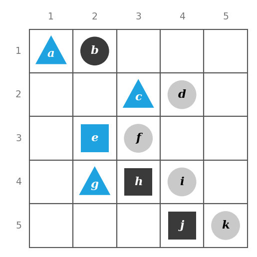

*그림 1. 열한 개의 대상이 놓인 타르스키의 세계*

그림의 대상을 표로 정리하면 다음과 같다.

| 대상 | 모양 | 색 | 행 | 열 |
|:-----|:-----|:-----|:-----|:-----|
| $a$ | 삼각형 | 파랑 | 1 | 1 |
| $b$ | 원 | 검정 | 1 | 2 |
| $c$ | 삼각형 | 파랑 | 2 | 3 |
| $d$ | 원 | 회색 | 2 | 4 |
| $e$ | 정사각형 | 파랑 | 3 | 2 |
| $f$ | 원 | 회색 | 3 | 3 |
| $g$ | 삼각형 | 파랑 | 4 | 2 |
| $h$ | 정사각형 | 검정 | 4 | 3 |
| $i$ | 원 | 회색 | 4 | 4 |
| $j$ | 정사각형 | 검정 | 5 | 4 |
| $k$ | 원 | 회색 | 5 | 5 |

*표 7. 그림 1의 각 대상의 모양, 색, 위치*

모든 변수의 정의역을 그림 1의 대상 전체의 집합으로 두고, 다음 명제의 참과 거짓을 판정한다.

- (a) $\forall t,\ \text{Triangle}(t) \to \text{Blue}(t)$
- (b) $\forall x,\ \text{Blue}(x) \to \text{Triangle}(x)$
- (c) $\exists y \text{ such that } \text{Square}(y) \wedge \text{RightOf}(d, y)$
- (d) $\exists z \text{ such that } \text{Square}(z) \wedge \text{Gray}(z)$

**풀이.**

- (a) 참이다. 삼각형은 $a$, $c$, $g$뿐이고 셋 모두 파란색이므로, 모든 삼각형은 파란색이다.
- (b) 거짓이다. $e$는 파란색이지만 삼각형이 아니므로 반례이다.
- (c) 참이다. $e$(2열)와 $h$(3열)는 정사각형이고 $d$(4열)는 둘의 오른쪽에 있다. 정사각형 $j$는 $d$와 같은 4열에 있으므로 조건을 만족하지 않지만, 존재 명제는 한 대상만 조건을 만족하면 참이다.
- (d) 거짓이다. 정사각형은 $e$, $h$, $j$이고 각각 파랑, 검정, 검정이므로 회색 정사각형은 없다.

> **주의:** (a)는 참이지만 앞뒤를 바꾼 (b)는 거짓이다. 전칭 조건 명제가 참이라고 해서 가정과 결론을 바꾼 명제가 참이 되지는 않는다. 이 관계는 2.5절에서 역으로 다시 다룬다.

---

<br>

## 2. 술어와 한정 명제 II

이 절에서는 1절의 내용을 이어서 한정 명제를 부정하는 규칙, $\forall$, $\exists$, $\wedge$, $\vee$ 사이의 관계, 공허하게 참인 전칭 명제, 전칭 조건 명제의 변형을 다루고, 필요조건, 충분조건, "\~일 때만"의 뜻을 한정 명제로 확장한다.

### 2.1 한정 명제의 부정

"모든 수학자는 안경을 쓴다"라는 명제를 생각한다. 많은 사람이 그 부정을 "안경을 쓰는 수학자는 없다"라고 말하지만, 안경을 쓰지 않는 수학자가 한 명만 있어도 모든 수학자가 안경을 쓴다는 단언은 거짓이 된다. 따라서 올바른 부정은 "안경을 쓰지 않는 수학자가 적어도 한 명 있다"이다. 전칭 명제의 부정의 일반적인 형태는 부정의 정의와 전칭 명제, 존재 명제의 진릿값의 정의에서 곧바로 나온다.

> **핵심:** **정리 3.2.1 (전칭 명제의 부정).** $\forall x \in D,\ Q(x)$ 꼴의 명제의 부정은 $\exists x \in D \text{ such that } \sim Q(x)$ 꼴의 명제와 논리적으로 동치이다.

$$\sim(\forall x \in D,\ Q(x)) \equiv \exists x \in D \text{ such that } \sim Q(x)$$

**증명.** 두 명제가 언제나 같은 진릿값을 가짐을 보인다.

1. $\sim(\forall x \in D,\ Q(x))$가 참인 것은 $\forall x \in D,\ Q(x)$가 거짓인 것과 같다(부정의 정의).
2. $\forall x \in D,\ Q(x)$가 거짓인 것은 $Q(x)$가 거짓이 되는 $x$가 $D$에 적어도 하나 있는 것과 같다(전칭 명제의 정의).
3. $Q(x)$가 거짓이 되는 것은 $\sim Q(x)$가 참이 되는 것과 같으므로, 이는 $\sim Q(x)$가 참이 되는 $x$가 $D$에 적어도 하나 있는 것과 같다(부정의 정의).
4. 그런 $x$가 있는 것은 $\exists x \in D \text{ such that } \sim Q(x)$가 참인 것과 같다(존재 명제의 정의).

따라서 두 명제는 술어와 정의역에 관계없이 같은 진릿값을 가진다.

즉 **전칭 명제("모두 그렇다")의 부정은 존재 명제("어떤 것은 그렇지 않다", "그렇지 않은 것이 적어도 하나 있다")와 논리적으로 동치이다.** 한정 명제에 대해 논리적 동치라고 할 때는, 술어 기호에 어떤 술어를 대입하고 술어 변수의 정의역으로 어떤 집합을 쓰더라도 두 명제의 진릿값이 언제나 같다는 뜻이다.

이번에는 "어떤 눈송이들은 똑같다"라는 명제를 생각한다. 이 명제가 거짓이라는 것은 어떤 눈송이도 다른 눈송이와 똑같지 않다는 뜻이다. 즉 부정은 "똑같은 눈송이는 없다" 또는 "모든 눈송이는 서로 다르다"이다. 존재 명제의 부정의 일반적인 형태도 정의에서 곧바로 나온다.

> **핵심:** **정리 3.2.2 (존재 명제의 부정).** $\exists x \in D \text{ such that } Q(x)$ 꼴의 명제의 부정은 $\forall x \in D,\ \sim Q(x)$ 꼴의 명제와 논리적으로 동치이다.

$$\sim(\exists x \in D \text{ such that } Q(x)) \equiv \forall x \in D,\ \sim Q(x)$$

**증명.** $\sim(\exists x \in D \text{ such that } Q(x))$가 참인 것은 존재 명제가 거짓인 것과 같고(부정의 정의), 이는 $D$의 모든 $x$에 대해 $Q(x)$가 거짓인 것과 같다(존재 명제의 정의). $Q(x)$가 거짓인 것은 $\sim Q(x)$가 참인 것과 같으므로, 이는 $D$의 모든 $x$에 대해 $\sim Q(x)$가 참인 것, 곧 $\forall x \in D,\ \sim Q(x)$가 참인 것과 같다(전칭 명제의 정의).

즉 **존재 명제("어떤 것은 그렇다")의 부정은 전칭 명제("그런 것은 없다", "모두 그렇지 않다")와 논리적으로 동치이다.** 두 정리를 비형식적인 읽기와 함께 정리하면 다음과 같다.

| 명제 | 부정 | 부정의 비형식적 읽기 |
|:-----|:-----|:-----|
| $\forall x \in D,\ Q(x)$ | $\exists x \in D \text{ such that } \sim Q(x)$ | 모든 $x$가 $Q(x)$를 만족하는 것은 아니다. 즉 $Q(x)$가 성립하지 않는 $x$가 존재한다. |
| $\exists x \in D \text{ such that } Q(x)$ | $\forall x \in D,\ \sim Q(x)$ | $Q(x)$를 만족하는 $x$는 존재하지 않는다. 즉 모든 $x$에 대해 $Q(x)$가 성립하지 않는다. |

*표 8. 전칭 명제와 존재 명제의 부정 규칙*

**예제 3.2.1 (한정 명제 부정하기).** 다음 명제의 형식적 부정을 쓴다.

- (a) $\forall$ 소수 $p$, $p$는 홀수이다.
- (b) $\exists$ 삼각형 $T$ such that $T$의 내각의 합은 $200^\circ$이다.

**풀이.**

- (a) 전칭 명제의 부정 규칙을 적용하면 "$\exists$ 소수 $p$ such that $p$는 홀수가 아니다"이다. 소수 2가 홀수가 아니므로 부정이 참이고 원래 명제는 거짓이다.
- (b) 존재 명제의 부정 규칙을 적용하면 "$\forall$ 삼각형 $T$, $T$의 내각의 합은 $200^\circ$가 아니다"이다. 삼각형의 내각의 합은 언제나 $180^\circ$이므로 부정이 참이다.

비형식적으로 주어진 명제의 부정을 쓸 때는 특히 실수하기 쉽다. 실수를 피하는 한 가지 방법은 명제를 먼저 형식적으로 다시 쓰고 형식적 규칙으로 부정하는 것이다.

**예제 3.2.2 (부정의 추가 예).** 다음 명제를 형식적으로 다시 쓰고, 형식적 부정과 비형식적 부정을 쓴다.

- (a) 정직한 정치인은 없다.
- (b) 1,357은 1과 37 사이의 어떤 정수로도 나누어떨어지지 않는다.

**풀이.**

- (a) 형식적 명제는 "$\forall$ 정치인 $x$, $x$는 정직하지 않다"이다. 형식적 부정은 "$\exists$ 정치인 $x$ such that $x$는 정직하다"이고, 비형식적 부정은 "어떤 정치인은 정직하다"이다.
- (b) 영어 원문 The number 1,357 is not divisible by any integer between 1 and 37에는 후행 한정기호가 있다. 형식적으로 쓰면 "$\forall$ 1과 37 사이의 정수 $n$, 1,357은 $n$으로 나누어떨어지지 않는다"이다. 형식적 부정은 "$\exists$ 1과 37 사이의 정수 $n$ such that 1,357은 $n$으로 나누어떨어진다"이고, 비형식적 부정은 "1,357은 1과 37 사이의 어떤 정수로 나누어떨어진다"이다.

(b)에서 어느 쪽이 참인지는 계산으로 확인할 수 있다. $1357 = 23 \times 59$이고 23은 1과 37 사이의 정수이므로 부정이 참이고 원래 명제는 거짓이다.

부정을 쓸 때 실수를 피하는 또 다른 방법은 명제가 형식적이든 비형식적이든 "주어진 명제가 거짓이라는 것은 정확히 무슨 뜻인가? 어떤 명제가 참이면 주어진 명제가 거짓이라고 말하는 것과 같은가?"라고 스스로 묻는 것이다.

**예제 3.2.3 (부정의 또 다른 예).** 다음 명제의 비형식적 부정을 쓴다.

- (a) 모든 컴퓨터 프로그램은 유한하다.
- (b) 어떤 컴퓨터 해커는 40세가 넘었다.

**풀이.**

- (a) 이 명제는 모든 컴퓨터 프로그램이 어떤 성질을 만족한다고 주장한다. 이 명제가 거짓이려면 그 성질을 만족하지 않는 프로그램이 적어도 하나 있어야 한다. 따라서 부정은 "유한하지 않은 컴퓨터 프로그램이 있다" 또는 "어떤 컴퓨터 프로그램은 무한하다"이다.
- (b) 이 명제는 어떤 성질을 가진 컴퓨터 해커가 적어도 한 명 있다는 주장과 같다. 이 명제가 거짓이려면 그 성질을 가진 해커가 한 명도 없어야 한다. 따라서 부정은 "40세가 넘은 컴퓨터 해커는 없다" 또는 "모든 컴퓨터 해커는 40세 이하이다"이다.

> **주의:** 한정 명제에 "않다"만 끼워 넣어 부정하면 뜻이 모호해질 수 있다. 예를 들어 "모든 수학자는 안경을 쓴다"의 부정으로 "모든 수학자가 안경을 쓰지 않는다"를 생각할 수 있다. 이 문장은 "모든 수학자가 안경을 쓰는 것은 아니다"(논리적 부정)로 읽힐 수도 있고, "안경을 쓰는 수학자는 한 명도 없다"로 읽힐 수도 있다. 두 번째 읽기는 논리적 부정보다 훨씬 강한 명제로, 논리적 부정을 함의하지만 그것과 동치는 아니다. 영어의 All mathematicians do not wear glasses도 같은 모호성을 가진다.

### 2.2 전칭 조건 명제의 부정

전칭 조건 명제의 부정은 수학에서 특히 중요하다. 그 형태는 이미 알고 있는 사실들로부터 다음과 같이 유도된다.

1. 전칭 명제의 부정 규칙(정리 3.2.1)에 의해 $\sim(\forall x,\ P(x) \to Q(x)) \equiv \exists x \text{ such that } \sim(P(x) \to Q(x))$이다.
2. 2장에서 보았듯이 조건 명제의 부정은 논리곱 명제와 동치이다. 즉 $\sim(P(x) \to Q(x)) \equiv P(x) \wedge \sim Q(x)$이다.
3. 2의 동치를 1에 대입하면 $\sim(\forall x,\ P(x) \to Q(x)) \equiv \exists x \text{ such that } (P(x) \wedge \sim Q(x))$를 얻는다.

> **핵심:** **전칭 조건 명제의 부정.** $\sim(\forall x,\ P(x) \to Q(x)) \equiv \exists x \text{ such that } P(x) \wedge \sim Q(x)$. 즉 전칭 조건 명제의 부정은 가정은 참이고 결론은 거짓인 $x$가 적어도 하나 있다는 존재 명제이다.

**예제 3.2.4 (전칭 조건 명제 부정하기).** (a)의 형식적 부정과 (b)의 비형식적 부정을 쓴다.

- (a) $\forall$ 사람 $p$, $p$가 금발이면 $p$는 파란 눈을 가진다.
- (b) 컴퓨터 프로그램이 100,000줄보다 길면 그 프로그램에는 버그가 있다.

**풀이.**

- (a) "$\exists$ 사람 $p$ such that $p$는 금발이고 $p$는 파란 눈을 가지지 않는다."
- (b) (b)는 모든 컴퓨터 프로그램에 대한 암묵적 전칭 조건 명제이다. 부정은 "100,000줄보다 길면서 버그가 없는 컴퓨터 프로그램이 적어도 하나 있다"이다.

> **주의:** 전칭 조건 명제의 부정은 조건 명제가 아니다. "$\exists x$ such that $P(x) \to \sim Q(x)$"나 "$\forall x,\ P(x) \to \sim Q(x)$"로 쓰면 틀린다. 부정은 가정과 결론의 부정을 "그리고"로 묶은 존재 명제이다.

### 2.3 한정기호와 논리곱, 논리합의 관계

$\forall$ 명제의 부정은 $\exists$ 명제이고, $\exists$ 명제의 부정은 $\forall$ 명제이다. 이 사실은 논리곱($\wedge$) 명제의 부정은 논리합($\vee$) 명제이고 논리합 명제의 부정은 논리곱 명제라는 드모르간의 법칙과 닮았다. 이 닮음은 우연이 아니다. 전칭 명제는 논리곱 명제의 일반화이고, 존재 명제는 논리합 명제의 일반화이다.

$Q(x)$가 술어이고 $x$의 정의역 $D$가 유한 집합 $\lbrace x_1, x_2, \ldots, x_n \rbrace$이면 다음이 성립한다.

$$\forall x \in D,\ Q(x) \equiv Q(x_1) \wedge Q(x_2) \wedge \cdots \wedge Q(x_n)$$

$$\exists x \in D \text{ such that } Q(x) \equiv Q(x_1) \vee Q(x_2) \vee \cdots \vee Q(x_n)$$

예를 들어 $Q(x)$를 "$x \cdot x = x$"라 하고 $D = \lbrace 0, 1 \rbrace$로 두면, $\forall x \in D,\ Q(x)$는 "모든 이진 숫자 $x$에 대해 $x \cdot x = x$"이고, 이는 "$0 \cdot 0 = 0$이고 $1 \cdot 1 = 1$"과 같으며 기호로는 $Q(0) \wedge Q(1)$이다. 두 등식이 모두 성립하므로 이 명제는 참이다.

마찬가지로 $Q(x)$를 "$x + x = x$"라 하고 $D = \lbrace 0, 1 \rbrace$로 두면, $\exists x \in D \text{ such that } Q(x)$는 "$x + x = x$인 이진 숫자 $x$가 있다"이고, 이는 "$0 + 0 = 0$이거나 $1 + 1 = 1$"과 같으며 기호로는 $Q(0) \vee Q(1)$이다. $1 + 1 = 2 \neq 1$이지만 $0 + 0 = 0$이 성립하므로 논리합은 참이고, 이 존재 명제도 참이다.

정의역이 유한하면 이 대응을 이용해 정리 3.2.1을 드모르간의 법칙으로 다시 얻을 수 있다.

$$\sim(\forall x \in D,\ Q(x)) \equiv \sim(Q(x_1) \wedge \cdots \wedge Q(x_n)) \equiv \sim Q(x_1) \vee \cdots \vee \sim Q(x_n) \equiv \exists x \in D \text{ such that } \sim Q(x)$$

첫째 동치는 위의 대응, 둘째 동치는 드모르간의 법칙, 셋째 동치는 존재 명제와 논리합의 대응에서 나온다.

> **주의:** 이 대응에서 알 수 있듯이 $\forall$는 $\wedge$에 대해, $\exists$는 $\vee$에 대해 분배된다. 즉 $\forall x\,(P(x) \wedge Q(x)) \equiv (\forall x\, P(x)) \wedge (\forall x\, Q(x))$이고 $\exists x\,(P(x) \vee Q(x)) \equiv (\exists x\, P(x)) \vee (\exists x\, Q(x))$이다. 그러나 엇갈린 조합은 동치가 아니다. 정의역을 $\mathbf{Z}$, $P(x)$를 "$x$는 짝수이다", $Q(x)$를 "$x$는 홀수이다"로 두면, $\exists x\,(P(x) \wedge Q(x))$는 거짓이지만 $(\exists x\, P(x)) \wedge (\exists x\, Q(x))$는 참이다. 또 $\forall x\,(P(x) \vee Q(x))$는 참이지만 $(\forall x\, P(x)) \vee (\forall x\, Q(x))$는 거짓이다.

### 2.4 공허하게 참인 전칭 명제

탁자 위에 그릇이 하나 있고, 그 옆에 파란 공 다섯 개와 회색 공 다섯 개가 쌓여 있어 어느 공이든 그릇에 넣을 수 있는 상황을 생각한다. 그림 2의 (a)처럼 파란 공 세 개와 회색 공 한 개를 그릇에 넣으면, 그릇 안의 공 하나가 회색이므로 "그릇 안의 모든 공은 파란색이다"는 거짓이다.

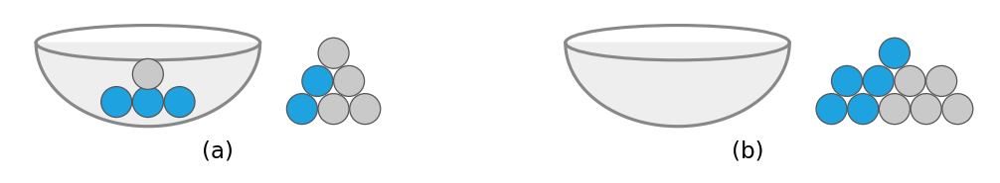

*그림 2. 파란 공 세 개와 회색 공 한 개가 든 그릇과 빈 그릇*

이번에는 그림 2의 (b)처럼 그릇에 공을 하나도 넣지 않은 경우를 생각한다. 이때 "그릇 안의 모든 공은 파란색이다"는 참인가, 거짓인가? 이 명제는 그 부정이 참일 때, 그리고 그때에만 거짓이다. 그 부정은 "그릇 안에 파란색이 아닌 공이 있다"이다. 이 부정이 참이 되는 유일한 방법은 그릇 안에 파란색이 아닌 공이 실제로 있는 것인데, 그런 공은 없다. 따라서 부정은 거짓이고, 원래 명제는 "기본적으로" 참이다.

10개의 공 전체의 집합을 $D$, $P(x)$를 "$x$는 그릇 안에 있다", $Q(x)$를 "$x$는 파란색이다"로 두면 이 명제는 $\forall x \in D,\ P(x) \to Q(x)$이다. 그릇이 비어 있으면 모든 $x$에 대해 $P(x)$가 거짓이므로 각 조건 명제 $P(x) \to Q(x)$는 $Q(x)$와 관계없이 참이고, 따라서 전칭 명제도 참이다.

> **용어 정의:** $\forall x \in D$, $P(x)$이면 $Q(x)$이다 꼴의 명제는 $D$의 모든 $x$에 대해 $P(x)$가 거짓일 때, 그리고 그때에만 **공허하게 참(vacuously true)** 또는 **기본적으로 참(true by default)** 이라고 한다. 이때 $Q(x)$의 진릿값과 관계없이 각 $x$에 대한 조건 명제 $P(x) \to Q(x)$는 참이다.

> **참고:** 일상 언어에서 "일반적으로"는 대체로 그렇지만 언제나 그렇지는 않다는 뜻으로 쓰인다(일반적으로 버스를 타지만 오늘은 걸어왔다). 수학에서 "일반적으로"는 뒤에 오는 내용이 언제나 성립하는 일반화라는 뜻이다.

같은 원리로, 정의역이 공집합 $\emptyset$이면 $\forall x \in \emptyset,\ Q(x)$는 반례가 있을 수 없으므로 언제나 참이고, $\exists x \in \emptyset \text{ such that } Q(x)$는 조건을 만족하는 원소가 있을 수 없으므로 언제나 거짓이다. Python의 내장 함수 `all`과 `any`도 같은 약속을 따른다. `all`은 주어진 반복 가능 객체가 비어 있으면 `True`를, `any`는 비어 있으면 `False`를 반환한다[1].

```python
balls_in_bowl = []                                       # 그릇이 비어 있다
print(all(color == "blue" for color in balls_in_bowl))  # 모든 공이 파란색인가
print(any(color != "blue" for color in balls_in_bowl))  # 파란색이 아닌 공이 있는가
```

첫째 줄은 그릇 안의 공의 색을 담을 빈 리스트를 만든다. 둘째 줄은 "그릇 안의 모든 공은 파란색이다"를 검사하여 `True`를 출력하고, 셋째 줄은 그 부정인 "파란색이 아닌 공이 있다"를 검사하여 `False`를 출력한다.

```text
True
False
```

### 2.5 전칭 조건 명제의 변형

2장에서 보았듯이 조건 명제에는 대우, 역, 이가 있다. 이 용어의 정의는 전칭 조건 명제로 그대로 확장된다.

> **용어 정의:** $\forall x \in D$, $P(x)$이면 $Q(x)$이다 꼴의 명제를 생각한다.
>
> 1. 그 **대우(contrapositive)** 는 $\forall x \in D$, $\sim Q(x)$이면 $\sim P(x)$이다 꼴의 명제이다.
> 2. 그 **역(converse)** 은 $\forall x \in D$, $Q(x)$이면 $P(x)$이다 꼴의 명제이다.
> 3. 그 **이(inverse)** 는 $\forall x \in D$, $\sim P(x)$이면 $\sim Q(x)$이다 꼴의 명제이다.

**예제 3.2.5 (전칭 조건 명제의 대우, 역, 이).** "실수가 2보다 크면 그 제곱은 4보다 크다"의 대우, 역, 이를 형식적으로, 그리고 비형식적으로 쓴다.

**풀이.** 원래 명제를 형식적으로 쓰면 $\forall x \in \mathbf{R}$, $x > 2$이면 $x^2 > 4$이다. 모든 실수 $x$와 $a$에 대해 "$x \not> a$"와 "$x \leq a$"가 동치라는 사실을 쓰면 다음을 얻는다.

| 명제 | 형식적 표현 | 비형식적 표현 | 진릿값과 근거 |
|:-----|:-----|:-----|:-----|
| 원래 명제 | $\forall x \in \mathbf{R}$, $x > 2$이면 $x^2 > 4$ | 실수가 2보다 크면 그 제곱은 4보다 크다. | 참. $x > 2 > 0$이면 $x^2 = x \cdot x > 2x > 4$이다. |
| 대우 | $\forall x \in \mathbf{R}$, $x^2 \leq 4$이면 $x \leq 2$ | 실수의 제곱이 4 이하이면 그 수는 2 이하이다. | 참. 원래 명제와 논리적으로 동치이다. |
| 역 | $\forall x \in \mathbf{R}$, $x^2 > 4$이면 $x > 2$ | 실수의 제곱이 4보다 크면 그 수는 2보다 크다. | 거짓. $x = -3$이면 $(-3)^2 = 9 > 4$이지만 $-3 \not> 2$이다. |
| 이 | $\forall x \in \mathbf{R}$, $x \leq 2$이면 $x^2 \leq 4$ | 실수가 2 이하이면 그 제곱은 4 이하이다. | 거짓. $x = -3$이면 $-3 \leq 2$이지만 $(-3)^2 = 9 \not\leq 4$이다. |

*표 9. 전칭 조건 명제의 대우, 역, 이와 그 진릿값*

2장에서는 조건 명제가 그 대우와 논리적으로 동치이고, 역이나 이와는 동치가 아님을 보였다. 이 사실은 전칭 조건 명제와 그 대우, 역, 이에도 그대로 일반화된다.

**대우와의 동치.** $P(x)$와 $Q(x)$를 임의의 술어, $D$를 $x$의 정의역이라 한다. $p \to q \equiv \sim q \to \sim p$(2장)이므로, $D$의 특정한 $x$가 "$P(x)$이면 $Q(x)$"를 참으로 만들면 그 $x$는 "$\sim Q(x)$이면 $\sim P(x)$"도 참으로 만들고, 그 역도 성립한다. 따라서 "$P(x)$이면 $Q(x)$"가 $D$의 모든 $x$에 대해 참인 것과 "$\sim Q(x)$이면 $\sim P(x)$"가 $D$의 모든 $x$에 대해 참인 것은 같다. 즉 전칭 조건 명제는 그 대우와 논리적으로 동치이다.

$$\forall x \in D,\ P(x) \to Q(x) \equiv \forall x \in D,\ \sim Q(x) \to \sim P(x)$$

**역, 이와의 비동치.** 표 9에서 원래 명제는 참이지만 역은 거짓이다. 이처럼 전칭 조건 명제는 그 역과 진릿값이 다를 수 있으므로, 전칭 조건 명제는 그 역과 논리적으로 동치가 아니다. 같은 표에서 이도 거짓이므로 전칭 조건 명제는 그 이와도 동치가 아니다.

$$\forall x \in D,\ P(x) \to Q(x) \not\equiv \forall x \in D,\ Q(x) \to P(x)$$

$$\forall x \in D,\ P(x) \to Q(x) \not\equiv \forall x \in D,\ \sim P(x) \to \sim Q(x)$$

> **참고:** 역 $\forall x,\ Q(x) \to P(x)$의 대우는 $\forall x,\ \sim P(x) \to \sim Q(x)$, 곧 이이다. 따라서 역과 이는 서로 논리적으로 동치이며, 표 9에서도 둘의 진릿값이 같다.

### 2.6 필요조건, 충분조건, "~일 때만"

필요조건, 충분조건, "\~일 때만"의 정의도 전칭 조건 명제로 확장할 수 있다.

> **용어 정의:**
>
> - "$\forall x$, $r(x)$는 $s(x)$의 **충분조건(sufficient condition)** 이다"는 "$\forall x$, $r(x)$이면 $s(x)$이다"를 뜻한다.
> - "$\forall x$, $r(x)$는 $s(x)$의 **필요조건(necessary condition)** 이다"는 "$\forall x$, $\sim r(x)$이면 $\sim s(x)$이다"를 뜻하며, 이는 대우에 의해 "$\forall x$, $s(x)$이면 $r(x)$이다"와 동치이다.
> - "$\forall x$, $s(x)$**일 때만(only if)** $r(x)$이다"는 "$\forall x$, $\sim s(x)$이면 $\sim r(x)$이다"를 뜻하며, 이는 대우에 의해 "$\forall x$, $r(x)$이면 $s(x)$이다"와 동치이다.

영어의 $r(x)$ only if $s(x)$는 한국어로 "$s(x)$일 때만 $r(x)$이다"로 옮긴다. 세 표현을 전칭 조건 명제로 정리하면 다음과 같다.

| 표현 | 전칭 조건 명제 | 대우로 쓴 동치 형태 |
|:-----|:-----|:-----|
| $r(x)$는 $s(x)$의 충분조건이다 | $\forall x,\ r(x) \to s(x)$ | $\forall x,\ \sim s(x) \to \sim r(x)$ |
| $r(x)$는 $s(x)$의 필요조건이다 | $\forall x,\ s(x) \to r(x)$ | $\forall x,\ \sim r(x) \to \sim s(x)$ |
| $s(x)$일 때만 $r(x)$이다 ($r(x)$ only if $s(x)$) | $\forall x,\ r(x) \to s(x)$ | $\forall x,\ \sim s(x) \to \sim r(x)$ |

*표 10. 충분조건, 필요조건, 일 때만을 전칭 조건 명제로 옮긴 형태*

**예제 3.2.6 (필요조건과 충분조건).** 다음 문장을 "필요"나 "충분"이라는 말을 쓰지 않고, 명시적으로나 암묵적으로 한정된 전칭 조건 명제로 바꾼다.

- (a) 정사각형인 것은 직사각형인 것의 충분조건이다.
- (b) 35세 이상인 것은 미국 대통령이 되기 위한 필요조건이다.

**풀이.**

- (a) 형식적으로는 "$\forall x$, $x$가 정사각형이면 $x$는 직사각형이다"이다. 암묵적인 전칭 한정으로는 "도형이 정사각형이면 그 도형은 직사각형이다"이다.
- (b) 형식적으로는 "$\forall$ 사람 $x$, $x$가 35세 미만이면 $x$는 미국 대통령이 될 수 없다"이다. 명제와 그 대우가 동치이므로 "$\forall$ 사람 $x$, $x$가 미국 대통령이면 $x$는 35세 이상이다"로도 쓸 수 있다.

**예제 3.2.7 (일 때만).** "두 수의 곱은 두 수 중 하나가 0일 때만 0이다"를 전칭 조건 명제로 바꾼다.

**풀이.** 정의에 따라 "$s$일 때만 $r$"은 "$s$가 아니면 $r$가 아니다"이므로 비형식적으로는 "두 수 중 하나가 0인 경우가 아니면, 두 수의 곱은 0이 아니다"이다. "두 수 중 하나가 0인 경우가 아니다"는 드모르간의 법칙에 의해 "두 수 모두 0이 아니다"와 같으므로, 이 문장은 "두 수가 모두 0이 아니면 두 수의 곱은 0이 아니다"로 쓸 수 있다. 명제와 그 대우가 동치이므로 "두 수의 곱이 0이면 두 수 중 하나는 0이다"로도 쓸 수 있다. 형식적으로는 $\forall a, b \in \mathbf{R}$, $ab = 0$이면 $a = 0$ 또는 $b = 0$이다.

---

<br>

## 3. 다중 한정기호를 포함한 명제

### 3.1 서로 다른 한정기호의 해석 규칙

컴퓨터 칩을 만드는 공장을 견학하는데 안내인이 "생산 공정의 모든 세부 사항을 감독하는 사람이 있습니다"라고 말하는 상황을 생각한다. 이 문장에는 존재 한정기호 "있다"와 전칭 한정기호 "모든"의 비형식적 표현이 함께 들어 있다. 이 문장은 다음 두 가지로 해석할 수 있다.

- 생산 공정의 모든 세부 사항을 감독하는 한 사람이 있다.
- 생산 공정의 세부 사항마다 그것을 감독하는 사람이 있지만, 세부 사항마다 감독자가 다를 수 있다.

안내인은 어느 쪽을 뜻했을 수도 있다. 이 문장만으로는 그 뜻이 모호하며, 앞뒤 맥락이 있어야 해석을 정할 수 있다. 일상에서는 이런 모호성을 맥락으로 해결하거나 서로 오해한 채 지나가기도 한다. 그러나 수학, 형식 논리, 컴퓨터 과학에서는 모든 사람이 명제를 똑같이 해석해야 한다. 예를 들어 소프트웨어 개발의 초기 단계에서는 프로그래머 분석가와 고객이 신중하게 논의하여, 고객이 원하는 것에 대한 모호한 설명을 양쪽이 합의할 수 있는 모호하지 않은 프로그램 명세로 바꾼다.

중요한 기술적 명제에는 $\exists$와 $\forall$가 함께 들어 있는 경우가 많으므로, 이를 일관되게 해석하기 위한 관례가 생겼다.

> **핵심:** 한 명제에 둘 이상의 종류의 한정기호가 있으면, 한정기호가 나타내는 행동을 한정기호가 나오는 순서대로 수행한다고 생각한다.

예를 들어 다음 꼴의 명제를 생각한다.

$$\forall x \in D,\ \exists y \in E \text{ such that } P(x, y)$$

이 명제가 참임을 보이려면 다음 도전을 해결할 수 있어야 한다.

- 도전하는 쪽이 집합 $D$의 원소를 아무것이나 하나 고른다. 그 원소를 $x$라 부른다.
- 증명하는 쪽은 이 $x$와 함께 성질 $P(x, y)$를 만족하는 원소 $y$를 $E$에서 찾아야 한다.

**$y$는 $x$가 정해진 뒤에 고르므로, $x$마다 다른 $y$를 써도 된다.** $\forall x$의 유효 범위는 명제 전체에 걸치지만 $\exists y$의 유효 범위는 명제 중간에서 시작하므로, $y$의 값은 $x$의 값에 따라 달라질 수 있다.

이번에는 $\exists$가 $\forall$보다 앞에 오는 다음 꼴의 명제를 생각한다.

$$\exists x \in D \text{ such that } \forall y \in E,\ P(x, y)$$

이 명제가 참임을 보이려면 증명하는 쪽이 다음 성질을 가진 원소 $x$ 하나를 $D$에서 정해야 한다.

- $x$가 정해진 뒤, 도전하는 쪽이 $E$의 원소를 아무것이나 하나 고른다. 그 원소를 $y$라 부른다.
- 증명하는 쪽은 정해 둔 $x$와 이 $y$가 함께 $P(x, y)$를 만족함을 보여야 한다.

정해 둔 $x$ 하나가 도전하는 쪽이 고를 수 있는 모든 $y$에 대해 성립해야 한다. **한번 정한 $x$는 바꿀 수 없다.** $\exists x$의 유효 범위가 명제 전체에 걸치기 때문이다. 두 꼴의 진행 순서를 그림으로 비교하면 다음과 같다.

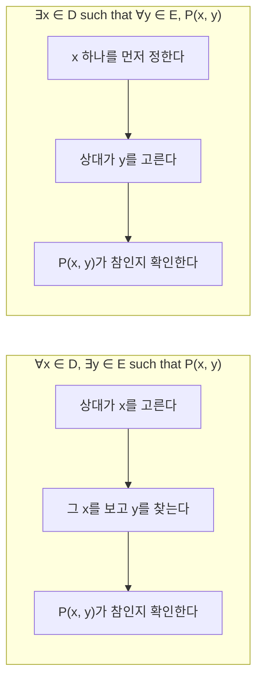

*그림 3. 전칭 존재 꼴과 존재 전칭 꼴의 명제를 참으로 보이는 순서*

**예제 3.3.1 (타르스키의 세계에서 $\forall\exists$ 명제의 참).** 그림 4의 타르스키의 세계를 생각한다.

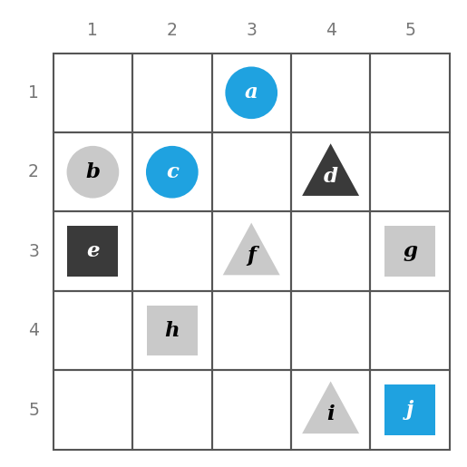

*그림 4. 열 개의 대상이 놓인 타르스키의 세계*

| 대상 | 모양 | 색 | 행 | 열 |
|:-----|:-----|:-----|:-----|:-----|
| $a$ | 원 | 파랑 | 1 | 3 |
| $b$ | 원 | 회색 | 2 | 1 |
| $c$ | 원 | 파랑 | 2 | 2 |
| $d$ | 삼각형 | 검정 | 2 | 4 |
| $e$ | 정사각형 | 검정 | 3 | 1 |
| $f$ | 삼각형 | 회색 | 3 | 3 |
| $g$ | 정사각형 | 회색 | 3 | 5 |
| $h$ | 정사각형 | 회색 | 4 | 2 |
| $i$ | 삼각형 | 회색 | 5 | 4 |
| $j$ | 정사각형 | 파랑 | 5 | 5 |

*표 11. 그림 4의 각 대상의 모양, 색, 위치*

다음 명제가 이 세계에서 참임을 보인다: "모든 삼각형 $x$에 대해, $x$와 같은 색인 정사각형 $y$가 있다."

**풀이.** 이 명제는 상대가 어떤 삼각형을 주더라도 그와 같은 색인 정사각형을 찾을 수 있다는 뜻이다. 삼각형은 $d$, $f$, $i$ 셋뿐이므로 각 삼각형에 대해 같은 색의 정사각형을 찾으면 된다.

| 주어진 $x$ | 고른 $y$ | $y$가 $x$와 같은 색인지 확인 |
|:-----|:-----|:-----|
| $d$ (검정) | $e$ (검정) | 예 |
| $f$ 또는 $i$ (회색) | $h$ 또는 $g$ (회색) | 예 |

*표 12. 각 삼각형과 같은 색인 정사각형의 선택*

**예제 3.3.2 (타르스키의 세계에서 $\exists\forall$ 명제의 참).** 그림 4의 세계에서 다음 명제가 참임을 보인다: "어떤 삼각형 $x$는 모든 원 $y$의 오른쪽에 있다."

**풀이.** 이 명제는 모든 원의 오른쪽에 있는 삼각형 하나를 찾을 수 있다는 뜻이다. 원은 $a$(3열), $b$(1열), $c$(2열)이다. 4열에 있는 $d$나 $i$를 고르면 세 원 모두의 오른쪽에 있다. 반면 3열의 $f$는 $a$와 같은 열이므로 $a$의 오른쪽에 있지 않다.

| 고른 $x$ | 상대가 줄 수 있는 $y$ | $x$가 $y$의 오른쪽에 있는지 확인 |
|:-----|:-----|:-----|
| $d$ 또는 $i$ (4열) | $a$ (3열) | 예 |
| | $b$ (1열) | 예 |
| | $c$ (2열) | 예 |

*표 13. 모든 원의 오른쪽에 있는 삼각형의 확인*

> **핵심:** **서로 다른 두 한정기호를 포함한 명제의 해석.** $\forall x \in D,\ \exists y \in E \text{ such that } P(x, y)$가 참임을 보이려면, 다른 사람이 $D$에서 원하는 원소 $x$를 고르게 한 뒤 그 $x$에 대해 성립하는 $y$를 $E$에서 찾아야 한다. $\exists x \in D \text{ such that } \forall y \in E,\ P(x, y)$가 참임을 보이려면, 누가 어떤 $y$를 골라 도전하더라도 성립하는 $x$ 하나를 $D$에서 찾아야 한다.

### 3.2 여러 한정기호를 포함한 명제의 해석

**예제 3.3.3 (둘 이상의 한정기호를 포함한 명제의 해석).** 한 대학 식당의 배식 줄에는 샐러드, 주요리, 디저트, 음료의 네 코너가 있다. 샐러드 코너에는 그린 샐러드와 과일 샐러드, 주요리 코너에는 스파게티와 생선, 디저트 코너에는 파이와 케이크, 음료 코너에는 우유, 소다, 커피가 있다. 세 학생 Uta, Tim, Yuen이 고른 항목은 다음과 같다.

| 학생 | 샐러드 | 주요리 | 디저트 | 음료 |
|:-----|:-----|:-----|:-----|:-----|
| Uta | 그린 샐러드 | 스파게티 | 파이 | 우유 |
| Tim | 과일 샐러드 | 생선 | 파이, 케이크 | 우유, 커피 |
| Yuen | (고르지 않음) | 스파게티, 생선 | 파이 | 소다 |

*표 14. 세 학생이 코너별로 고른 항목*

다음 명제를 비형식적으로 쓰고 진릿값을 구한다.

- (a) $\exists$ 항목 $I$ such that $\forall$ 학생 $S$, $S$는 $I$를 골랐다.
- (b) $\exists$ 학생 $S$ such that $\forall$ 항목 $I$, $S$는 $I$를 골랐다.
- (c) $\exists$ 학생 $S$ such that $\forall$ 코너 $Z$, $\exists$ $Z$의 항목 $I$ such that $S$는 $I$를 골랐다.
- (d) $\forall$ 학생 $S$, $\forall$ 코너 $Z$, $\exists$ $Z$의 항목 $I$ such that $S$는 $I$를 골랐다.

**풀이.**

- (a) "모든 학생이 고른 항목이 있다." 참이다. 세 학생 모두 파이를 골랐다.
- (b) "모든 항목을 고른 학생이 있다." 거짓이다. 아홉 개 항목을 모두 고른 학생은 없다.
- (c) "모든 코너에서 적어도 한 항목씩 고른 학생이 있다." 참이다. Uta와 Tim이 모두 그렇다.
- (d) "모든 학생이 모든 코너에서 적어도 한 항목씩 골랐다." 거짓이다. Yuen은 샐러드를 고르지 않았다.

### 3.3 비형식적 언어에서 형식적 언어로

대부분의 문제는 비형식적 언어로 주어지지만, 그 문제를 풀려면 더 형식적인 표현으로 옮겨야 하는 경우가 많다.

**예제 3.3.4 (다중 한정기호를 포함한 명제의 형식화).** 실수 $a$의 **역수(reciprocal)** 는 $ab = 1$을 만족하는 실수 $b$이다. 다음 두 참인 명제를 한정기호와 변수를 써서 형식적으로 쓴다.

- (a) 0이 아닌 모든 실수는 역수를 가진다.
- (b) 역수를 가지지 않는 실수가 있다.

**풀이.**

- (a) $\forall$ 0이 아닌 실수 $u$, $\exists$ 실수 $v$ such that $uv = 1$.
- (b) $\exists$ 실수 $c$ such that $\forall$ 실수 $d$, $cd \neq 1$.

(b)에서 $c = 0$으로 두면 모든 실수 $d$에 대해 $0 \cdot d = 0 \neq 1$이므로 0은 역수가 없다.

**예제 3.3.5 (가장 작은 양의 정수가 있다).** 모든 정수는 실수이고, 실수는 양수, 음수, 0(양수도 음수도 아님)의 세 종류로 나뉜다. "가장 작은 양의 정수가 있다"를 $\exists$와 $\forall$를 모두 써서 형식적으로 쓴다.

**풀이.** 가장 작은 양의 정수가 있다는 것은, 상대가 어떤 양의 정수 $n$을 고르더라도 $m$이 $n$보다 작거나 같도록 하는 양의 정수 $m$이 있다는 뜻이다.

$\exists$ 양의 정수 $m$ such that $\forall$ 양의 정수 $n$, $m \leq n$.

1은 모든 양의 정수보다 작거나 같은 양의 정수이므로 이 명제는 참이다(그림 5의 위쪽).

**예제 3.3.6 (가장 작은 양의 실수는 없다).** 수직선 위의 양의 실수는 0의 오른쪽에 있는 모든 점에 대응한다. 실수 $x$가 아무리 작은 양수이더라도 $x/2$는 양수이면서 $x$보다 작다(그림 5의 아래쪽). 따라서 "가장 작은 양의 실수는 없다"는 참이다. 이 명제를 $\forall$와 $\exists$를 모두 써서 형식적으로 쓴다.

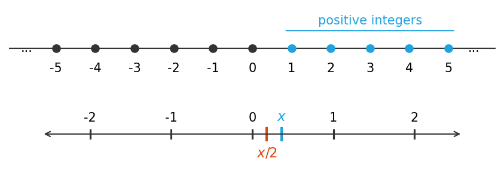

*그림 5. 양의 정수가 표시된 수직선과 양수 x와 x/2가 표시된 실수 직선*

**풀이.** $\forall$ 양의 실수 $x$, $\exists$ 양의 실수 $y$ such that $y < x$.

$0 < x/2 < x$인 이유는 실수의 성질로 다음과 같이 보일 수 있다.

1. $x$는 양수이므로 $0 < x$이다.
2. 부등식 $0 < x$의 양변에 $x$를 더하면 $x < 2x$이다. 따라서 $0 < x < 2x$이다.
3. 이 부등식의 각 변에 양수 $\frac{1}{2}$을 곱한다. 양수를 곱해도 부등호의 방향은 바뀌지 않으므로 $0 < x/2 < x$이다.

이 명제는 "$\exists$ 양의 실수 $m$ such that $\forall$ 양의 실수 $n$, $m \leq n$"(가장 작은 양의 실수가 있다)의 부정과 같다는 점에 주목할 필요가 있다. 3.5절의 부정 규칙을 적용하면 "$\forall$ 양의 실수 $m$, $\exists$ 양의 실수 $n$ such that $m > n$"이 되고, 이는 변수 이름만 다를 뿐 위의 답과 같다.

**예제 3.3.7 (수열의 극한의 정의).** 미적분학에서 배우는 수열의 극한의 정의는 한정기호 $\forall$와 $\exists$, 그리고 조건 명제를 함께 쓴다. $n$이 무한히 커질 때 수열 $a_n$의 극한이 $L$이라는 것을 $\lim_{n \to \infty} a_n = L$로 쓰며, 이는 $n$이 한없이 커짐에 따라 $a_n$의 값이 $L$에 **임의로** 가까워진다는 뜻이다. 더 정확히 말하면, 임의의 양수 $\varepsilon$이 주어지면 $n$이 $N$보다 클 때마다 $a_n$이 수직선 위에서 $L - \varepsilon$과 $L + \varepsilon$ 사이에 놓이게 하는 정수 $N$을 찾을 수 있다는 뜻이다. 기호로 쓰면 다음과 같다.

$$\forall \varepsilon > 0,\ \exists \text{ an integer } N \text{ such that } \forall \text{ integer } n,\ n > N \to L - \varepsilon < a_n < L + \varepsilon$$

이 정의는 논리적으로 복잡하므로 많은 학생이 어려워하는 것이 당연하다. 구체적인 수열로 확인하면 이해가 쉽다. $a_n = 1 + (-1)^n \frac{1.6}{n}$, $L = 1$, $\varepsilon = 0.25$로 두면 $\lvert a_n - 1 \rvert = \frac{1.6}{n}$이므로 $L - \varepsilon < a_n < L + \varepsilon$은 $\frac{1.6}{n} < 0.25$, 곧 $n > 6.4$와 같다. 따라서 $N = 6$으로 두면 $n > 6$인 모든 정수 $n$에 대해 $a_n$이 띠 안에 놓인다(그림 6). $\varepsilon = 0.1$로 줄이면 $\frac{1.6}{n} < 0.1$, 곧 $n > 16$이어야 하므로 $N = 16$이 필요하다.

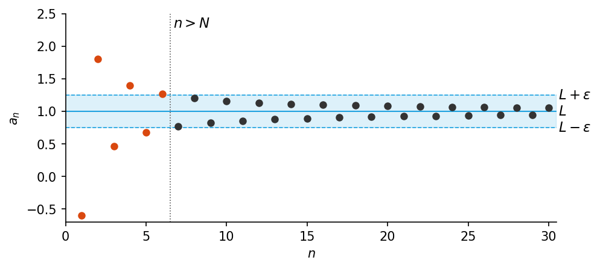

*그림 6. 극한 1로 수렴하는 수열의 항과 폭이 ε인 띠, n > N 이후의 항은 모두 띠 안에 있음*

> **[미적분학]** 수열의 극한을 이 $\varepsilon$-$N$ 정의로 엄밀하게 다루는 것은 미적분학과 해석학의 출발점이다. 정의에서 $\forall \varepsilon$이 $\exists N$보다 앞에 오므로, $N$은 $\varepsilon$이 주어진 뒤에 정하며 $\varepsilon$마다 다른 $N$을 써도 된다. 위의 예에서 $\varepsilon$을 0.25에서 0.1로 줄이자 필요한 $N$이 6에서 16으로 커진 것이 그 예이다.

### 3.4 모호한 언어

모자를 쓴 젊은 여인의 옆모습으로도 보이고 큰 코를 가진 노파의 얼굴로도 보이는 유명한 착시 그림이 있다. 이 그림에서 노파의 입은 젊은 여인의 목걸이에 해당한다. 대부분의 사람은 한 가지 모습을 먼저 보고 나면 다른 모습을 보기 어려워한다.

모호한 언어도 마찬가지이다. 3.1절 처음의 공장 안내인의 문장을 한 가지로 해석하고 나면 다른 해석이 가능하다는 것을 알아차리기 어렵고, 두 가지 뜻을 설명을 들은 뒤에도 다른 해석을 떠올리기 어려울 수 있다. 비형식적으로 쓴 명제는 여러 가지로 해석될 수 있지만, 한 가지로 해석하지 않으면 그 참과 거짓을 판정할 수 없다. 따라서 맥락을 이용해 그 뜻을 최대한 정확하게 파악해야 한다.

### 3.5 다중 한정기호 명제의 부정

여러 한정기호를 포함한 명제도 단순한 한정 명제와 같은 규칙으로 부정할 수 있다. 다음 두 규칙을 떠올린다.

$$\sim(\forall x \in D,\ P(x)) \equiv \exists x \in D \text{ such that } \sim P(x)$$

$$\sim(\exists x \in D \text{ such that } P(x)) \equiv \forall x \in D,\ \sim P(x)$$

이 규칙을 바깥쪽 한정기호부터 차례로 적용하면 다음을 얻는다.

1. $\sim(\forall x \in D,\ \exists y \in E \text{ such that } P(x, y))$
2. $\equiv \exists x \in D \text{ such that } \sim(\exists y \in E \text{ such that } P(x, y))$ (전칭 명제의 부정 규칙)
3. $\equiv \exists x \in D \text{ such that } \forall y \in E,\ \sim P(x, y)$ (존재 명제의 부정 규칙)

같은 방식으로 다음을 얻는다.

1. $\sim(\exists x \in D \text{ such that } \forall y \in E,\ P(x, y))$
2. $\equiv \forall x \in D,\ \sim(\forall y \in E,\ P(x, y))$ (존재 명제의 부정 규칙)
3. $\equiv \forall x \in D,\ \exists y \in E \text{ such that } \sim P(x, y)$ (전칭 명제의 부정 규칙)

> **핵심:** **서로 다른 두 한정기호를 포함한 명제의 부정.**
>
> - $\sim(\forall x \in D,\ \exists y \in E \text{ such that } P(x, y)) \equiv \exists x \in D \text{ such that } \forall y \in E,\ \sim P(x, y)$
> - $\sim(\exists x \in D \text{ such that } \forall y \in E,\ P(x, y)) \equiv \forall x \in D,\ \exists y \in E \text{ such that } \sim P(x, y)$
>
> 즉 부정을 한정기호 안쪽으로 옮길 때마다 $\forall$와 $\exists$가 서로 바뀌고, 한정기호의 순서는 그대로이며, 맨 안쪽 술어에 부정이 붙는다.

같은 종류의 한정기호가 이어질 때도 같은 규칙을 두 번 적용하면 $\sim(\forall x \in D,\ \forall y \in E,\ P(x, y)) \equiv \exists x \in D \text{ such that } \exists y \in E \text{ such that } \sim P(x, y)$이고, $\sim(\exists x \in D \text{ such that } \exists y \in E \text{ such that } P(x, y)) \equiv \forall x \in D,\ \forall y \in E,\ \sim P(x, y)$이다.

**예제 3.3.8 (타르스키의 세계에서 명제 부정하기).** 그림 4의 타르스키의 세계를 다시 본다. 다음 명제의 부정을 쓰고, 주어진 명제와 그 부정 중 어느 쪽이 참인지 판정한다.

- (a) 모든 정사각형 $x$에 대해, $x$와 같은 색인 원 $y$가 있다.
- (b) 모든 정사각형 $y$의 오른쪽에 있는 삼각형 $x$가 있다.

**풀이.**

- (a) 부정의 첫 단계는 "$\exists$ 정사각형 $x$ such that $\sim$($\exists$ 원 $y$ such that $x$와 $y$는 같은 색이다)"이고, 최종 형태는 "$\exists$ 정사각형 $x$ such that $\forall$ 원 $y$, $x$와 $y$는 같은 색이 아니다"이다. 부정이 참이다. 정사각형 $e$는 검은색인데 원 $a$, $b$, $c$는 각각 파랑, 회색, 파랑이므로 검은 원이 없다. 즉 어떤 원과도 색이 같지 않은 정사각형 $e$가 있다.
- (b) 원래 명제는 "$\exists$ 삼각형 $x$ such that $\forall$ 정사각형 $y$, $x$는 $y$의 오른쪽에 있다"이다. 부정의 첫 단계는 "$\forall$ 삼각형 $x$, $\sim$($\forall$ 정사각형 $y$, $x$는 $y$의 오른쪽에 있다)"이고, 최종 형태는 "$\forall$ 삼각형 $x$, $\exists$ 정사각형 $y$ such that $x$는 $y$의 오른쪽에 있지 않다"이다. 부정이 참이다. 삼각형 $d$, $f$, $i$는 각각 4, 3, 4열에 있으므로 어느 것도 5열에 있는 정사각형 $g$나 $j$의 오른쪽에 있지 않다.

### 3.6 한정기호의 순서

다음 두 명제를 생각한다.

- $\forall$ 사람 $x$, $\exists$ 사람 $y$ such that $x$는 $y$를 사랑한다.
- $\exists$ 사람 $y$ such that $\forall$ 사람 $x$, $x$는 $y$를 사랑한다.

두 명제는 한정기호의 순서만 다르다. 그러나 첫째 명제는 어떤 사람이 주어지더라도 그 사람이 사랑하는 누군가를 찾을 수 있다는 뜻이고, 둘째 명제는 모든 사람에게 사랑받는 한 사람이 있다는 뜻이다. 이 두 문장은 서로 다른 두 한정기호를 포함한 명제의 매우 중요한 성질을 보여 준다.

> **핵심:** $\forall$와 $\exists$를 모두 포함한 명제에서 한정기호의 순서를 바꾸면 명제의 뜻이 크게 달라질 수 있다.

반면 한 한정기호 바로 뒤에 **같은 종류의** 한정기호가 오면 그 순서는 뜻에 영향을 주지 않는다. 예를 들어 실수 덧셈의 교환 법칙 "$\forall$ 실수 $x$, $\forall$ 실수 $y$, $x + y = y + x$"는 "$\forall$ 실수 $y$, $\forall$ 실수 $x$, $x + y = y + x$"와 같은 뜻이다. 그래서 이 성질을 덜 형식적으로 "$\forall$ 실수 $x$와 $y$, $x + y = y + x$"로 쓸 수 있다.

> **참고:** 순서를 바꾼 두 명제 사이에는 한쪽 방향의 함의가 있다. $\exists x\ \forall y,\ P(x, y)$가 참이면 그 명제를 참으로 만드는 $x$ 하나가 모든 $y$에 대해 쓰이므로 $\forall y\ \exists x,\ P(x, y)$도 참이다. 그러나 그 역은 일반적으로 성립하지 않는다. 위의 사랑의 예에서 둘째 명제가 참이면 첫째 명제도 참이지만, 첫째 명제가 참이라고 둘째 명제가 참이 되지는 않는다.

**예제 3.3.9 (타르스키의 세계에서 한정기호의 순서).** 그림 4의 타르스키의 세계에서 다음 두 명제의 진릿값이 같은지 판정한다.

- (a) 모든 정사각형 $x$에 대해, $x$와 색이 다른 삼각형 $y$가 있다.
- (b) 모든 정사각형 $x$와 색이 다른 삼각형 $y$가 있다.

**풀이.** (a)는 상대가 어떤 정사각형을 주더라도 그와 색이 다른 삼각형을 찾을 수 있다는 뜻이며, 참이다. 정사각형 $g$나 $h$(회색)가 주어지면 삼각형 $d$(검정)를, $e$(검정)가 주어지면 삼각형 $f$나 $i$(회색)를, $j$(파랑)가 주어지면 $d$(검정)나 $f$, $i$(회색)를 고르면 된다.

(b)는 세계의 모든 정사각형과 색이 다른 삼각형 하나가 있다는 뜻이며, 거짓이다. 삼각형 중 두 개($f$, $i$)는 회색인데 세계에 회색 정사각형($g$, $h$)이 있으므로 이 둘은 쓸 수 없다. 남은 삼각형 $d$는 검은색인데 검은 정사각형 $e$가 있으므로 $d$도 쓸 수 없다. 따라서 한 명제는 참이고 다른 명제는 거짓이어서 진릿값이 반대이다.

> **주의:** 서로 다른 두 한정기호를 포함한 명제에서 한정기호의 순서를 뒤집으면 명제의 진릿값이 반대로 바뀔 수 있다.

### 3.7 형식 논리 표기

컴퓨터 과학의 일부 분야에서는 논리적 명제를 순수하게 기호로만 표현한다. 이 표기에서는 변수의 성질을 모두 술어로 나타내고, 존재 명제에서 such that을 쓰지 않는다. 형식적 명제의 뜻을 파악할 때는 적절한 곳마다 such that을 마음속으로 넣어 읽으면 도움이 된다. 이 형식은 다음 사실에 바탕을 둔다.

- "$\forall x$ in $D$, $P(x)$"는 $\forall x\,(x \in D \to P(x))$로 쓸 수 있다.
- "$\exists x$ in $D$ such that $P(x)$"는 $\exists x\,(x \in D \wedge P(x))$로 쓸 수 있다.

> **주의:** $\forall$에는 $\to$를, $\exists$에는 $\wedge$를 짝지어야 한다. $\forall x\,(\text{Circle}(x) \wedge \text{Above}(x, f))$는 "모든 대상이 원이고 $f$보다 위에 있다"는 뜻이 되어 의도와 다르다. $\exists x\,(\text{Square}(x) \to \text{Black}(x))$는 정사각형이 아닌 대상이 하나만 있어도 그 대상에 대해서는 가정이 거짓인 조건 명제가 참이 되므로, 검은 정사각형이 없어도 참이 된다.

**예제 3.3.10 (타르스키의 세계에서 명제의 형식화).** 그림 4의 타르스키의 세계를 다시 생각한다. $\text{Triangle}(x)$, $\text{Circle}(x)$, $\text{Square}(x)$는 각각 "$x$는 삼각형이다", "$x$는 원이다", "$x$는 정사각형이다"를, $\text{Blue}(x)$, $\text{Gray}(x)$, $\text{Black}(x)$는 각각 "$x$는 파란색이다", "$x$는 회색이다", "$x$는 검은색이다"를 뜻한다. $\text{RightOf}(x, y)$, $\text{Above}(x, y)$, $\text{SameColor}(x, y)$는 각각 "$x$는 $y$의 오른쪽에 있다", "$x$는 $y$의 위에 있다", "$x$는 $y$와 같은 색이다"를 뜻하고, 표기 $x = y$는 술어 "$x$는 $y$와 같다"를 나타낸다. 모든 변수의 공통 정의역 $D$는 타르스키의 세계의 모든 대상의 집합이다. 형식 논리 표기로 다음 명제를 쓰고, 각 명제의 형식적 부정을 쓴다.

- (a) 모든 원 $x$에 대해 $x$는 $f$의 위에 있다.
- (b) 검은색인 정사각형 $x$가 있다.
- (c) 모든 원 $x$에 대해, $x$와 같은 색인 정사각형 $y$가 있다.
- (d) 모든 삼각형 $y$의 오른쪽에 있는 정사각형 $x$가 있다.

**풀이.**

(a) 명제는 $\forall x\,(\text{Circle}(x) \to \text{Above}(x, f))$이다. 부정은 다음과 같다.

1. $\sim(\forall x\,(\text{Circle}(x) \to \text{Above}(x, f)))$
2. $\equiv \exists x\, \sim(\text{Circle}(x) \to \text{Above}(x, f))$ ($\forall$ 명제의 부정 법칙)
3. $\equiv \exists x\,(\text{Circle}(x) \wedge \sim\text{Above}(x, f))$ (조건 명제의 부정 법칙)

(b) 명제는 $\exists x\,(\text{Square}(x) \wedge \text{Black}(x))$이다. 부정은 다음과 같다.

1. $\sim(\exists x\,(\text{Square}(x) \wedge \text{Black}(x)))$
2. $\equiv \forall x\, \sim(\text{Square}(x) \wedge \text{Black}(x))$ ($\exists$ 명제의 부정 법칙)
3. $\equiv \forall x\,(\sim\text{Square}(x) \vee \sim\text{Black}(x))$ (드모르간의 법칙)

(c) 명제는 $\forall x\,(\text{Circle}(x) \to \exists y\,(\text{Square}(y) \wedge \text{SameColor}(x, y)))$이다. 부정은 다음과 같다.

1. $\sim(\forall x\,(\text{Circle}(x) \to \exists y\,(\text{Square}(y) \wedge \text{SameColor}(x, y))))$
2. $\equiv \exists x\, \sim(\text{Circle}(x) \to \exists y\,(\text{Square}(y) \wedge \text{SameColor}(x, y)))$ ($\forall$ 명제의 부정 법칙)
3. $\equiv \exists x\,(\text{Circle}(x) \wedge \sim(\exists y\,(\text{Square}(y) \wedge \text{SameColor}(x, y))))$ (조건 명제의 부정 법칙)
4. $\equiv \exists x\,(\text{Circle}(x) \wedge \forall y\, \sim(\text{Square}(y) \wedge \text{SameColor}(x, y)))$ ($\exists$ 명제의 부정 법칙)
5. $\equiv \exists x\,(\text{Circle}(x) \wedge \forall y\,(\sim\text{Square}(y) \vee \sim\text{SameColor}(x, y)))$ (드모르간의 법칙)

(d) 명제는 $\exists x\,(\text{Square}(x) \wedge \forall y\,(\text{Triangle}(y) \to \text{RightOf}(x, y)))$이다. 부정은 다음과 같다.

1. $\sim(\exists x\,(\text{Square}(x) \wedge \forall y\,(\text{Triangle}(y) \to \text{RightOf}(x, y))))$
2. $\equiv \forall x\, \sim(\text{Square}(x) \wedge \forall y\,(\text{Triangle}(y) \to \text{RightOf}(x, y)))$ ($\exists$ 명제의 부정 법칙)
3. $\equiv \forall x\,(\sim\text{Square}(x) \vee \sim(\forall y\,(\text{Triangle}(y) \to \text{RightOf}(x, y))))$ (드모르간의 법칙)
4. $\equiv \forall x\,(\sim\text{Square}(x) \vee \exists y\, \sim(\text{Triangle}(y) \to \text{RightOf}(x, y)))$ ($\forall$ 명제의 부정 법칙)
5. $\equiv \forall x\,(\sim\text{Square}(x) \vee \exists y\,(\text{Triangle}(y) \wedge \sim\text{RightOf}(x, y)))$ (조건 명제의 부정 법칙)

$\text{Above}(x, y)$를 $\text{RightOf}$와 같은 방식으로 "$x$가 $y$보다 위쪽 행에 있다(다른 열이어도 된다)"로 해석하면, 그림 4의 세계에서 네 명제는 모두 참이고 부정은 모두 거짓이다. (a) 원 $a$(1행), $b$와 $c$(2행)는 모두 3행의 $f$보다 위에 있다. (b) $e$가 검은 정사각형이다. (c) 원 $a$와 $c$(파랑)에는 정사각형 $j$(파랑)가, $b$(회색)에는 $g$나 $h$(회색)가 있다. (d) 5열의 정사각형 $g$나 $j$는 삼각형 $d$, $f$, $i$(4, 3, 4열)의 오른쪽에 있다.

완전히 형식적인 표기의 단점은 복잡하고 직관적인 이해와 거리가 있어서, 그것을 쓸 때 저지른 실수를 알아채지 못할 수 있다는 것이다. 장점은 부정을 구하는 것 같은 연산을 완전히 기계적으로 수행할 수 있고 컴퓨터로 프로그래밍할 수 있다는 것이다. 또 형식적 조작에 익숙해지면 그것으로 직관을 점검하고, 거꾸로 직관으로 형식적 조작을 점검할 수 있다. 형식 논리 표기는 인공지능, 프로그램 검증, 오토마타 이론과 형식 언어 같은 컴퓨터 과학 분야에서 쓰인다.

> **용어 정의:** 한정기호, 변수, 술어, 논리 연결사의 기호를 모두 합쳐 **1차 논리의 언어(language of first-order logic)** 라 한다. 이 언어는 일상 언어보다 여러 면에서 단순하지만, 외국어를 익힐 때와 같은 종류의 연습이 있어야 익숙해진다.

### 3.8 프롤로그

프로그래밍 언어 **프롤로그(Prolog)** 는 논리 프로그래밍(programming in logic)의 줄임말로, 1970년대 프랑스에서 콜메로에(A. Colmerauer)와 루셀(P. Roussel)이 인공지능 분야의 프로그래머를 돕기 위해 개발했다. 간단한 프롤로그 프로그램은 어떤 상황을 기술하는 명제들의 집합과 그 상황에 관한 질문으로 이루어진다. 언어에 탐색과 추론 기법이 내장되어 있어서 주어진 명제로부터 답을 이끌어 내므로, 프로그래머는 질문의 종류마다 별도의 프로그램을 짤 필요가 없다.

**예제 3.3.11 (프롤로그 프로그램).** 다음 그림처럼 색칠한 블록이 탁자 위에 두 줄로 쌓여 있다. $g$는 회색 블록, $b_1$, $b_2$, $b_3$는 파란 블록 1, 2, 3, $w_1$, $w_2$는 흰 블록 1, 2이다.

```text
   ┌──────┐    ┌──────┐
   │  g   │    │  w2  │
   ├──────┤    ├──────┤
   │  b1  │    │  b2  │
   ├──────┤    ├──────┤
   │  w1  │    │  b3  │
 ══╧══════╧════╧══════╧══
```

*그림 7. 탁자 위에 두 줄로 쌓인 회색, 파란색, 흰색 블록*

다음은 이 그림을 기술하고 그에 관해 두 가지 질문을 하는 프롤로그 명제이다.

```text
isabove(g, b1)      color(g, gray)      color(b3, blue)
isabove(b1, w1)     color(b1, blue)     color(w1, white)
isabove(w2, b2)     color(b2, blue)     color(w2, white)
isabove(b2, b3)     isabove(X, Z) if isabove(X, Y) and isabove(Y, Z)
1. ?color(b1, blue)          2. ?isabove(X, w1)
```

명제 `isabove(g, b1)`과 `color(g, gray)`는 각각 "$g$는 $b_1$의 위에 있다"와 "$g$는 회색이다"로 해석한다. 명제 `isabove(X, Z) if isabove(X, Y) and isabove(Y, Z)`는 "모든 $X$, $Y$, $Z$에 대해, $X$가 $Y$의 위에 있고 $Y$가 $Z$의 위에 있으면 $X$는 $Z$의 위에 있다"로 해석한다. 이 프로그램에서 대문자로 시작하는 이름은 변수이다.

질문 1의 `?color(b1, blue)`는 블록 $b_1$이 파란색인지 묻는다. 프롤로그는 이에 Yes라고 답한다. 질문 2의 `?isabove(X, w1)`은 술어 "$X$는 $w_1$의 위에 있다"를 참으로 만드는 블록 $X$를 모두 묻는다. 프롤로그는 그런 블록을 모두 나열하여 `X = b1, X = g`라고 답한다. `X = b1`은 주어진 사실을 찾아보기만 하면 얻는다. 그러나 `X = g`는 사실 `isabove(g, b1)`과 `isabove(b1, w1)`, 그리고 규칙 `isabove(X, Z) if isabove(X, Y) and isabove(Y, Z)`로부터 **추론**해야 한다. 규칙의 $X$, $Y$, $Z$에 $g$, $b_1$, $w_1$을 대입하는 것은 4.1절의 전칭 예화이고, 두 사실로부터 결론을 얻는 것은 전건 긍정이다.

이 프로그램에 다음 질문을 추가하면 프롤로그는 표의 답을 낸다.

| 질문 | 뜻 | 답 |
|:-----|:-----|:-----|
| (a) `?isabove(b2, w1)` | $b_2$는 $w_1$의 위에 있는가? | No |
| (b) `?color(w1, X)` | 어떤 색 $X$에 대해 "$w_1$은 $X$색이다"가 참인가? | `X = white` |
| (c) `?color(X, blue)` | 어떤 블록 $X$에 대해 "$X$는 파란색이다"가 참인가? | `X = b1, X = b2, X = b3` |

*표 15. 블록 프로그램에 추가한 질문과 프롤로그의 답*

(a)에서 $b_2$는 $w_1$과 다른 줄에 있으므로 주어진 사실과 규칙으로 `isabove(b2, w1)`을 이끌어 낼 수 없다. 프롤로그는 이끌어 낼 수 없는 질문에 No라고 답한다.

> **참고:** 프롤로그 처리기마다 상수, 변수, 술어 이름과 질문, 답의 형식을 나타내는 관례가 다르며, 위의 표기는 에든버러 프롤로그의 관례와 비슷하다. ISO 표준 프롤로그에서는 사실과 규칙을 마침표로 끝내고, 규칙은 `isabove(X, Z) :- isabove(X, Y), isabove(Y, Z).`처럼, 질문은 `?- color(b1, blue).`처럼 쓴다. 표준 처리기는 절을 위에서부터, 규칙의 조건을 왼쪽부터 차례로 시도하는 깊이 우선 탐색으로 답을 찾는다[2]. 그래서 위 규칙을 그대로 쓰면 답이 No인 질문 (a)에서 같은 규칙을 끝없이 다시 적용하여 멈추지 않는다. 실제 프로그램에서는 바로 위에 놓인 관계 `on`과 그로부터 정의하는 관계 `above`를 나누어 `above(X, Z) :- on(X, Z).`와 `above(X, Z) :- on(X, Y), above(Y, Z).`처럼 쓰면 이 문제를 피할 수 있다.

---

<br>

## 4. 한정 명제를 포함한 논증

### 4.1 전칭 예화

> **용어 정의:** **전칭 예화(universal instantiation)** 는 다음 규칙이다. 어떤 성질이 한 집합의 **모든 것**에 대해 참이면, 그 성질은 그 집합의 **임의의 특정한** 것에 대해서도 참이다. 기호로 쓰면 $\forall x \in D,\ Q(x)$가 참이고 $a$가 $D$의 특정한 원소이면 $Q(a)$가 참이다.

전칭 예화라는 이름은 특정한 경우에서 성질이 참이라는 사실이 더 일반적인 전칭적 진리의 특별한 사례(instance)로서 나온다는 뜻이다. 이 논증 형식의 타당성은 전칭 명제의 진릿값의 정의에서 곧바로 나온다. 전칭 예화의 가장 유명한 예는 다음 논증이다.

- 모든 사람은 죽는다.
- 소크라테스는 사람이다.
- $\therefore$ 소크라테스는 죽는다.

전칭 예화는 사실상 모든 연역적 추론의 바탕이 되는 도구이다. 수학의 공식, 정의, 정리는 개별 상황에 거듭 적용되는 일반적인 틀이다. 정리는 어떤 종류의 모든 대상이 어떤 성질을 가진다고 말하며, 그 종류의 특정한 대상이 나타나면 전칭 예화가 그 성질을 그 대상에 옮겨 준다. 한 번의 증명이나 풀이에서 이 단계를 열 번, 스무 번 이상 쓰기도 한다.

예를 들어 $r$가 특정한 실수이고 $k$가 특정한 정수일 때 $r^{k+1} \cdot r$를 간단히 해야 하는 상황을 생각한다. 대수학에서 다음 전칭 명제가 참임을 알고 있다.

1. 모든 실수 $x$와 모든 정수 $m$, $n$에 대해 $x^m \cdot x^n = x^{m+n}$이다.
2. 모든 실수 $x$에 대해 $x^1 = x$이다.

그러면 다음과 같이 계산한다.

$$r^{k+1} \cdot r = r^{k+1} \cdot r^1 = r^{(k+1)+1} = r^{k+2}$$

첫째 등호는 1단계, 둘째 등호는 2단계이고, 마지막 등호는 기본적인 대수 계산이다. 1단계와 2단계의 추론을 나누어 보면 다음과 같다.

| 단계 | 전칭적 진리 | 특정한 사례 | 결론 |
|:-----|:-----|:-----|:-----|
| 1단계 | 모든 실수 $x$에 대해 $x^1 = x$ | $r$는 특정한 실수이다 | $\therefore r^1 = r$ |
| 2단계 | 모든 실수 $x$와 모든 정수 $m$, $n$에 대해 $x^m \cdot x^n = x^{m+n}$ | $r$는 특정한 실수이고 $k + 1$과 1은 특정한 정수이다 | $\therefore r^{k+1} \cdot r^1 = r^{(k+1)+1}$ |

*표 16. 거듭제곱 계산의 각 단계를 이루는 전칭 예화*

두 논증은 모두 전칭 예화의 예이다.

> **참고:** 엄밀히 말하면 지수 법칙 $x^m \cdot x^n = x^{m+n}$은 거듭제곱이 정의되는 경우, 곧 $x \neq 0$이거나 $m$과 $n$이 음이 아닌 정수인 경우에 성립한다. $x = 0$이고 지수가 음수이면 $0^{-1}$처럼 정의되지 않는 식이 생기기 때문이다. 위의 계산에서는 $r^{k+1}$이 정의된다고 가정한다.

### 4.2 전칭 전건 긍정

전칭 예화를 2장의 전건 긍정과 결합하면 **전칭 전건 긍정(universal modus ponens)** 이라는 타당한 논증 형식을 얻는다. 첫째 전제를 **대전제(major premise)**, 둘째 전제를 **소전제(minor premise)** 라 한다.

| 구성 | 형식적 표현 | 비형식적 표현 |
|:-----|:-----|:-----|
| 대전제 | $\forall x$, $P(x)$이면 $Q(x)$이다. | $x$가 $P(x)$를 참으로 만들면, $x$는 $Q(x)$도 참으로 만든다. |
| 소전제 | 특정한 $a$에 대해 $P(a)$이다. | $a$는 $P(x)$를 참으로 만든다. |
| 결론 | $\therefore Q(a)$ | $\therefore a$는 $Q(x)$를 참으로 만든다. |

*표 17. 전칭 전건 긍정의 형식*

대전제를 "$P(x)$를 참으로 만드는 모든 것은 $Q(x)$도 참으로 만든다"로 쓸 수도 있는데, 그러면 결론은 전칭 예화만으로 나온다. 그러나 대부분의 수학적 상황에서는 조건 명제 형태가 더 자연스럽다.

**예제 3.4.1 (전칭 전건 긍정 알아보기).** 다음 논증을 한정기호, 변수, 술어 기호를 써서 다시 쓰고, 타당한지 판정한다.

- 정수가 짝수이면 그 제곱은 짝수이다.
- $k$는 짝수인 특정한 정수이다.
- $\therefore$ $k^2$은 짝수이다.

**풀이.** 대전제는 "$\forall x$, $x$가 짝수인 정수이면 $x^2$은 짝수이다"로 쓸 수 있다. $E(x)$를 "$x$는 짝수인 정수이다", $S(x)$를 "$x^2$은 짝수이다"로 두고, $k$가 짝수인 특정한 정수를 나타내게 하면 논증은 다음 형태가 된다.

- $\forall x$, $E(x)$이면 $S(x)$이다.
- 특정한 $k$에 대해 $E(k)$이다.
- $\therefore S(k)$

이 논증은 전칭 전건 긍정의 형태이므로 타당하다.

**예제 3.4.2 (전칭 전건 긍정으로 결론 이끌어 내기).** 다음 두 전제로부터 전칭 전건 긍정으로 얻는 결론을 쓴다.

- (피타고라스 정리) $T$가 빗변이 $c$이고 두 다리가 $a$, $b$인 직각삼각형이면 $c^2 = a^2 + b^2$이다.
- 어떤 직각삼각형의 두 다리는 모두 1이고 빗변은 $c$이다.

**풀이.** $c^2 = 1^2 + 1^2 = 2$이다. 이 식의 양변에 음이 아닌 제곱근을 취하면 $c = \sqrt{2}$이다. 이는 길이가 $\sqrt{2}$인 선분이 있음을 보여 준다. $\sqrt{2}$가 유리수가 아니라는 증명은 4장에서 다룬다.

### 4.3 증명 속의 전칭 전건 긍정

4장에서는 한정 명제를 증명하는 방법을 다룬다. 여기서는 짝수 두 개의 합이 짝수라는 증명을 예로 든다. 이 증명은 짝수의 정의, 곧 정수가 **짝수**인 것은 그 정수가 어떤 정수의 2배와 같을 때, 그리고 그때에만이라는 정의를 쓴다. 형식적으로는 "$\forall$ 정수 $x$, $x$가 짝수인 것은 $\exists$ 정수 $k$ such that $x = 2k$인 것과 동치이다"이다.

$m$과 $n$을 특정하지만 임의로 택한 짝수라 한다. 그러면 어떤 정수 $r$에 대해 $m = 2r$이고⁽¹⁾, 어떤 정수 $s$에 대해 $n = 2s$이다⁽²⁾. 따라서

$$m + n = 2r + 2s = 2(r + s)$$

이다. 첫째 등호는 대입으로, 둘째 등호는 2를 묶어 내어 얻는다⁽³⁾. 이제 $r + s$는 정수이고⁽⁴⁾, 따라서 $2(r + s)$는 짝수이다⁽⁵⁾. 그러므로 $m + n$은 짝수이다.

다음 표는 번호를 붙인 각 단계가 전칭 전건 긍정으로 타당한 논증임을 보인다.

| 단계 | 대전제 | 소전제 | 결론 |
|:-----|:-----|:-----|:-----|
| (1) | 정수가 짝수이면 그 정수는 어떤 정수의 2배와 같다. | $m$은 특정한 짝수이다. | $\therefore$ $m$은 어떤 정수(이를 $r$라 한다)의 2배와 같다. |
| (2) | 정수가 짝수이면 그 정수는 어떤 정수의 2배와 같다. | $n$은 특정한 짝수이다. | $\therefore$ $n$은 어떤 정수(이를 $s$라 한다)의 2배와 같다. |
| (3a) | 어떤 양이 정수이면 그것은 실수이다. | $r$와 $s$는 특정한 정수이다. | $\therefore$ $r$와 $s$는 실수이다. |
| (3b) | 모든 $a$, $b$, $c$에 대해 $a$, $b$, $c$가 실수이면 $ab + ac = a(b + c)$이다. | 2, $r$, $s$는 특정한 실수이다. | $\therefore$ $2r + 2s = 2(r + s)$이다. |
| (4) | 모든 $u$, $v$에 대해 $u$와 $v$가 정수이면 $u + v$는 정수이다. | $r$와 $s$는 두 특정한 정수이다. | $\therefore$ $r + s$는 정수이다. |
| (5) | 어떤 수가 어떤 정수의 2배와 같으면 그 수는 짝수이다. | $2(r + s)$는 정수 $r + s$의 2배와 같다. | $\therefore$ $2(r + s)$는 짝수이다. |

*표 18. 짝수의 합이 짝수라는 증명의 각 단계를 이루는 전칭 전건 긍정*

> **용어 정의:** **존재 예화(existential instantiation)** 는 어떤 것이 존재한다는 것을 알거나 이끌어 냈으면 그것에 이름을 붙일 수 있다는 논리 원리이다. 단계 (1)과 (2)에서 정수에 $r$와 $s$라는 이름을 붙일 수 있는 것은 이 원리 덕분이다.

짝수의 합이 짝수라는 증명을 실제로 쓸 때는 이 논증들을 일일이 적지 않는다. 증명에 익숙한 사람은 이 단계들을 의식하지 않고 거치는데, 이 형식이 완전히 몸에 배었기 때문이다.

### 4.4 전칭 후건 부정

또 하나의 매우 중요한 추론 규칙은 **전칭 후건 부정(universal modus tollens)** 이다. 이 규칙의 타당성은 전칭 예화와 2장의 후건 부정을 결합하여 얻는다. 전칭 후건 부정은 수학적 논증의 가장 중요한 방법 가운데 하나인 귀류법(4장)의 핵심이다.

| 구성 | 형식적 표현 | 비형식적 표현 |
|:-----|:-----|:-----|
| 대전제 | $\forall x$, $P(x)$이면 $Q(x)$이다. | $x$가 $P(x)$를 참으로 만들면, $x$는 $Q(x)$도 참으로 만든다. |
| 소전제 | 특정한 $a$에 대해 $\sim Q(a)$이다. | $a$는 $Q(x)$를 참으로 만들지 않는다. |
| 결론 | $\therefore \sim P(a)$ | $\therefore a$는 $P(x)$를 참으로 만들지 않는다. |

*표 19. 전칭 후건 부정의 형식*

**예제 3.4.3 (전칭 후건 부정의 형태 알아보기).** 다음 논증을 한정기호, 변수, 술어 기호를 써서 다시 쓰고, 대전제를 조건 명제 형태로 쓴 뒤 타당한지 판정한다.

- 모든 사람은 죽는다.
- 제우스는 죽지 않는다.
- $\therefore$ 제우스는 사람이 아니다.

**풀이.** 대전제는 "$\forall x$, $x$가 사람이면 $x$는 죽는다"로 쓸 수 있다. $H(x)$를 "$x$는 사람이다", $M(x)$를 "$x$는 죽는다"로 두고 $Z$가 제우스를 나타내게 하면 논증은 다음과 같다.

- $\forall x$, $H(x)$이면 $M(x)$이다.
- $\sim M(Z)$
- $\therefore \sim H(Z)$

이 논증은 전칭 후건 부정의 형태이므로 타당하다.

**예제 3.4.4 (전칭 후건 부정으로 결론 이끌어 내기).** "모든 교수는 건망증이 있다"와 "Tom Hutchins는 건망증이 없다"로부터 전칭 후건 부정으로 얻는 결론을 쓴다.

**풀이.** Tom Hutchins는 교수가 아니다.

### 4.5 한정 명제를 포함한 논증의 타당성

한정 명제를 포함한 논증의 타당성에 대한 직관적인 정의는 합성 명제를 포함한 논증의 경우와 같다. 논증은 그 결론의 참이 전제의 참으로부터 **필연적으로** 따라 나올 때, 그리고 그때에만 타당하다. 형식적인 정의는 다음과 같다.

> **용어 정의:** **논증 형식(argument form)** 이 **타당하다(valid)** 는 것은, 전제의 술어 기호에 어떤 특정한 술어를 대입하더라도 그 결과로 얻은 전제가 모두 참이면 결론도 참이라는 뜻이다. **논증(argument)** 은 그 형식이 타당할 때, 그리고 그때에만 타당하다고 한다. 논증은 그 형식이 타당하고 전제가 모두 참일 때, 그리고 그때에만 **건전하다(sound)** 고 한다.

앞에서 말했듯이 전칭 예화의 타당성은 전칭 명제의 진릿값의 정의에서 곧바로 나온다. 술어 논리에서 논증의 타당성을 일반적으로 형식적으로 증명하는 것은 이 장의 범위를 넘는다. 여기서는 그런 증명이 가능함을 보이고 그 모습을 엿보기 위해 전칭 전건 긍정의 타당성을 증명한다.

**정리 (전칭 전건 긍정의 타당성).** 전칭 전건 긍정은 다음 논증 형식이다: $\forall x$, $P(x)$이면 $Q(x)$이다. 특정한 $a$에 대해 $P(a)$이다. $\therefore Q(a)$. 이 형식은 타당하다.

**증명.**

1. 대전제와 소전제가 모두 참이라고 가정한다. [결론 $Q(a)$도 참임을 보여야 한다.]
2. 소전제에 의해 특정한 $a$에 대해 $P(a)$가 참이다.
3. 대전제와 전칭 예화에 의해 그 특정한 $a$에 대해 명제 "$P(a)$이면 $Q(a)$이다"가 참이다.
4. "$P(a)$이면 $Q(a)$이다"와 "$P(a)$"가 모두 참이므로, 전건 긍정에 의해 $Q(a)$도 참이다. [이것이 보여야 할 것이었다.]

같은 방식으로 전칭 후건 부정도 타당하다. 대전제와 소전제 $\sim Q(a)$가 참이라고 가정하면, 전칭 예화에 의해 "$P(a)$이면 $Q(a)$이다"가 참이고, 이것과 $\sim Q(a)$로부터 후건 부정에 의해 $\sim P(a)$가 참이다.

위의 증명은 추상적이며, 이 단계에서 이런 증명을 스스로 만드는 것이 목표는 아니다. 더 깊은 논리학이 이 주제를 어떻게 다루는지 미리 보여 주는 예이다. 또 이 증명은 형식 논리의 흥미로운 특징 하나를 드러낸다. 논리 규칙이 타당함을 보이는 데 논리 규칙 자체를 쓴다는 점이다.

### 4.6 도표를 이용한 타당성 검사

다음 명제를 생각한다.

모든 정수는 유리수이다.

형식적으로 쓰면 "$\forall$ 정수 $n$, $n$은 유리수이다"이다. 정수 전체의 집합과 유리수 전체의 집합을 원판으로 나타내면, 이 명제가 참이라는 것은 그림 8처럼 정수 원판을 유리수 원판 안에 완전히 넣는 것으로 나타난다.

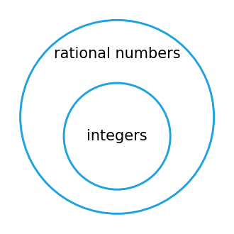

*그림 8. 유리수 원판 안에 놓인 정수 원판*

$\forall x \in D,\ Q(x)$와 "$\forall x$, $x$가 $D$에 속하면 $Q(x)$이다"는 논리적으로 동치이므로, 둘 다 이런 도표로 나타낼 수 있다. 집합을 원판으로 그려 논증을 분석하는 이런 그림을 **오일러 도표(diagram for arguments)** 라 한다. 이런 도표로 논증을 분석한 최초의 사람은 독일의 수학자이자 철학자 고트프리트 빌헬름 라이프니츠(Gottfried Wilhelm Leibniz)였던 것으로 보인다.

도표로 논증의 타당성을 검사하려면 두 전제가 모두 참인 배치를 빠짐없이 그린 뒤, 그 각각에서 결론이 참인지 확인한다.

**예제 3.4.5 (도표로 타당성 보이기).** 다음 삼단 논법이 타당함을 도표로 보인다.

- 모든 사람은 죽는다.
- 제우스는 죽지 않는다.
- $\therefore$ 제우스는 사람이 아니다.

**풀이.** 대전제는 그림 9의 (a)처럼 "사람" 원판을 "죽는 것" 원판 안에 넣어 나타낸다. 소전제는 그림 9의 (b)처럼 "제우스"라는 점을 "죽는 것" 원판 밖에 찍어 나타낸다. 두 도표를 합치는 방법은 그림 9의 (c) 하나뿐이다.

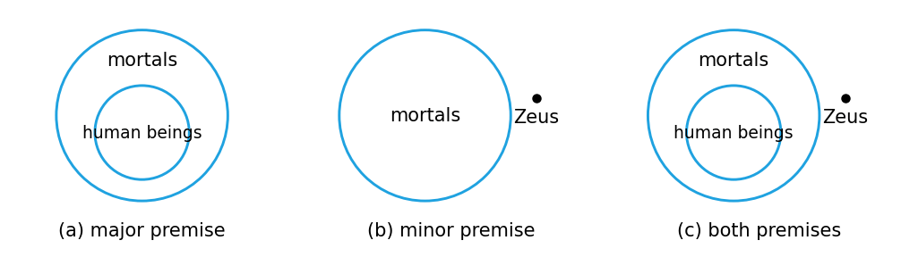

*그림 9. 대전제, 소전제, 두 전제를 합친 도표로 보인 타당한 논증*

제우스를 나타내는 점은 "죽는 것" 원판 밖에 있으므로 그 안에 있는 "사람" 원판의 밖에도 반드시 있다. 따라서 결론의 참은 전제의 참으로부터 필연적으로 따라 나온다. 전제가 참이면서 결론이 거짓일 수는 없으므로 이 논증은 타당하다.

**예제 3.4.6 (도표로 부당함 보이기).** 다음 논증이 부당함을 도표로 보인다.

- 모든 사람은 죽는다.
- 펠릭스는 죽는다.
- $\therefore$ 펠릭스는 사람이다.

**풀이.** 대전제와 소전제를 도표로 나타내면 그림 10의 (a), (b)와 같다. 알 수 있는 것은 펠릭스를 나타내는 점이 "죽는 것" 원판 안 **어딘가에** 있다는 것뿐이다. 그 점이 "사람" 원판에 대해 어디에 있는지는 정할 수 없으므로 그림 10의 (c)와 (d) 두 경우가 모두 가능하다.

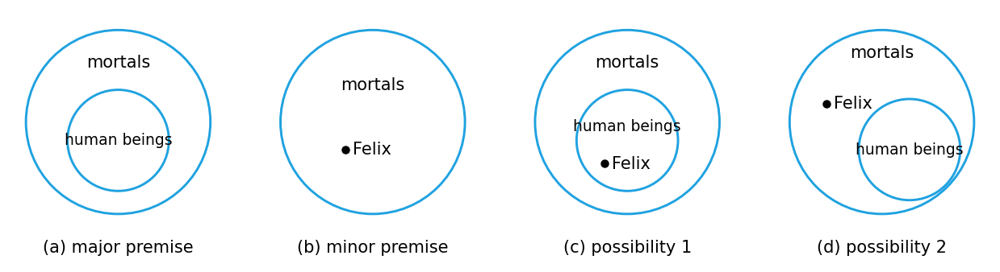

*그림 10. 대전제, 소전제와 두 전제를 함께 만족하는 두 가지 배치로 보인 부당한 논증*

결론 "펠릭스는 사람이다"는 (c)에서는 참이지만 (d)에서는 참이 아니다(펠릭스는 예를 들어 고양이일 수도 있다). 결론이 전제로부터 필연적으로 따라 나오지 않으므로 이 논증은 부당하다.

> **주의:** 도표로 타당성을 검사할 때는 전제가 허용하는 배치를 모두 그려야 한다. 이 예에서 두 전제를 합쳐 그림 10의 (c)만 그리고 (d)를 그리지 않으면, 논증이 타당하다고 잘못 결론 내리게 된다.

예제 3.4.6의 논증은 대전제를 그 역으로 바꾸면 타당해진다. 그러나 전칭 조건 명제는 그 역과 논리적으로 동치가 아니므로, 일반적으로 그런 바꿈은 할 수 없다. 이 논증은 **역의 오류(converse error)** 를 범한다고 한다.

| 구성 | 형식적 표현 | 비형식적 표현 |
|:-----|:-----|:-----|
| 대전제 | $\forall x$, $P(x)$이면 $Q(x)$이다. | $x$가 $P(x)$를 참으로 만들면, $x$는 $Q(x)$도 참으로 만든다. |
| 소전제 | 특정한 $a$에 대해 $Q(a)$이다. | $a$는 $Q(x)$를 참으로 만든다. |
| 결론 | $\therefore P(a)$ (부당한 결론) | $\therefore a$는 $P(x)$를 참으로 만든다. (부당한 결론) |

*표 20. 한정 명제 형태의 역의 오류*

다음 논증 형식은 조건 명제가 그 이와 논리적으로 동치라면 타당하겠지만, 실제로는 동치가 아니므로 부당하다. 이 형식은 **이의 오류(inverse error)** 를 범한다고 한다.

| 구성 | 형식적 표현 | 비형식적 표현 |
|:-----|:-----|:-----|
| 대전제 | $\forall x$, $P(x)$이면 $Q(x)$이다. | $x$가 $P(x)$를 참으로 만들면, $x$는 $Q(x)$도 참으로 만든다. |
| 소전제 | 특정한 $a$에 대해 $\sim P(a)$이다. | $a$는 $P(x)$를 참으로 만들지 않는다. |
| 결론 | $\therefore \sim Q(a)$ (부당한 결론) | $\therefore a$는 $Q(x)$를 참으로 만들지 않는다. (부당한 결론) |

*표 21. 한정 명제 형태의 이의 오류*

이의 오류도 도표로 확인할 수 있다. 그림 10에서 "사람" 원판 밖이면서 "죽는 것" 원판 안에 있는 점은 사람이 아니지만($\sim P(a)$) 죽는다($Q(a)$). 따라서 "사람이 아니므로 죽지 않는다"는 결론은 필연적이지 않다.

**예제 3.4.7 ("없다"를 포함한 논증).** 다음 논증의 타당성을 도표로 검사한다.

- 수평 점근선을 가지는 다항 함수는 없다.
- 이 함수는 수평 점근선을 가진다.
- $\therefore$ 이 함수는 다항 함수가 아니다.

**풀이.** 대전제는 그림 11처럼 서로 전혀 겹치지 않는 두 원판, 곧 다항 함수의 원판과 수평 점근선을 가지는 함수의 원판으로 나타내는 것이 좋다. 소전제는 "이 함수"라는 점을 수평 점근선을 가지는 함수의 원판 안에 찍어 나타낸다.

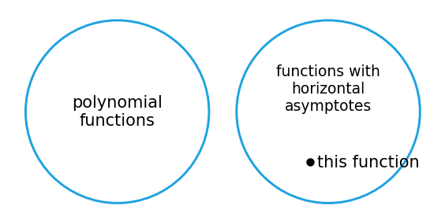

*그림 11. 서로 겹치지 않는 다항 함수의 원판과 수평 점근선을 가지는 함수의 원판*

도표를 보면 "이 함수"는 다항 함수의 원판 밖에 있을 수밖에 없다. 따라서 결론의 참은 전제의 참으로부터 필연적으로 따라 나오고, 논증은 타당하다.

예제 3.4.7은 다른 방법으로도 풀 수 있다. "수평 점근선을 가지는 다항 함수는 없다"를 동치인 "$\forall x$, $x$가 다항 함수이면 $x$는 수평 점근선을 가지지 않는다"로 바꾸면 논증은 다음 형태가 된다.

- $\forall x$, $P(x)$이면 $Q(x)$이다.
- 특정한 $a$에 대해 $\sim Q(a)$이다.
- $\therefore \sim P(a)$

여기서 $P(x)$는 "$x$는 다항 함수이다", $Q(x)$는 "$x$는 수평 점근선을 가지지 않는다"이다. 이 논증은 전칭 후건 부정에 의해 타당하다.

> **참고:** 미적분학에서처럼 $\lim_{x \to \infty} f(x) = L$ 또는 $\lim_{x \to -\infty} f(x) = L$일 때 직선 $y = L$을 수평 점근선이라 정의하면, 상수 함수 $f(x) = c$는 다항 함수이면서 수평 점근선 $y = c$를 가진다. 따라서 대전제는 상수가 아닌 다항 함수에 대해서만 참이다. 타당성은 논증 형식만으로 정해지므로 이 논증이 타당하다는 결론은 바뀌지 않지만, 대전제를 그대로 두면 건전한 논증은 아니다.

### 4.7 새로운 논증 형식 만들기

전칭 전건 긍정과 전칭 후건 부정은 전칭 예화를 전건 긍정과 후건 부정에 결합하여 얻었다. 같은 방식으로 전칭 예화를 2장의 다른 타당한 논증 형식과 결합하면 전칭 한정 명제를 포함한 새로운 논증 형식을 얻을 수 있다. 예를 들어 2장에서 소개한 추이라는 논증 형식은 다음과 같다.

- $p \to q$
- $q \to r$
- $\therefore p \to r$

이 형식을 전칭 예화와 결합하면 **전칭 추이(universal transitivity)** 라는 타당한 논증 형식을 얻는다.

| 구성 | 형식적 표현 | 비형식적 표현 |
|:-----|:-----|:-----|
| 전제 1 | $\forall x,\ P(x) \to Q(x)$ | $P(x)$를 참으로 만드는 모든 $x$는 $Q(x)$도 참으로 만든다. |
| 전제 2 | $\forall x,\ Q(x) \to R(x)$ | $Q(x)$를 참으로 만드는 모든 $x$는 $R(x)$도 참으로 만든다. |
| 결론 | $\therefore \forall x,\ P(x) \to R(x)$ | $\therefore$ $P(x)$를 참으로 만드는 모든 $x$는 $R(x)$도 참으로 만든다. |

*표 22. 전칭 추이의 형식*

전칭 추이가 타당한 이유는 다음과 같다. 정의역의 원소 $x$를 임의로 하나 고르면, 전칭 예화에 의해 $P(x) \to Q(x)$와 $Q(x) \to R(x)$가 참이고, 추이에 의해 $P(x) \to R(x)$가 참이다. $x$를 임의로 골랐으므로 $P(x) \to R(x)$는 모든 $x$에 대해 참이다. 이렇게 임의로 고른 원소에 대해 보인 성질을 모든 원소로 일반화하는 방법은 4장에서 다룬다. 지금까지 본 규칙들의 관계를 정리하면 다음과 같다.

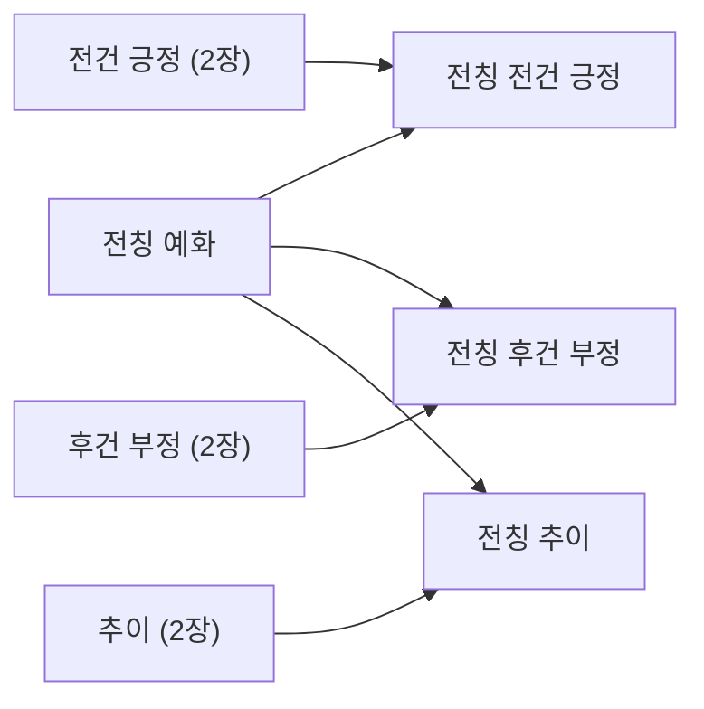

*그림 12. 전칭 예화와 2장의 추론 규칙을 결합하여 얻는 논증 형식*

**예제 3.4.8 (타르스키의 세계에 관한 논증 평가하기).** 다음 논증은 예제 3.1.13과 3.3.1에서 본 것처럼 여러 종류와 색의 대상이 놓인 배치에 관한 것이다. 전제의 순서를 바꾸고 다시 써서 결론이 전제로부터 타당하게 따라 나옴을 보인다.

1. 모든 삼각형은 파란색이다.
2. 어떤 대상이 모든 정사각형의 오른쪽에 있으면, 그 대상은 모든 원의 위에 있다.
3. 어떤 대상이 모든 정사각형의 오른쪽에 있지 않으면, 그 대상은 파란색이 아니다.

$\therefore$ 모든 삼각형은 모든 원의 위에 있다.

**풀이.** 먼저 전제와 결론을 조건 명제 형태로 다시 쓴다.

1. $\forall x$, $x$가 삼각형이면 $x$는 파란색이다.
2. $\forall x$, $x$가 모든 정사각형의 오른쪽에 있으면 $x$는 모든 원의 위에 있다.
3. $\forall x$, $x$가 모든 정사각형의 오른쪽에 있지 않으면 $x$는 파란색이 아니다.

$\therefore$ $\forall x$, $x$가 삼각형이면 $x$는 모든 원의 위에 있다.

목표는 각 전제의 결론이 다음 전제의 가정이 되도록 전제의 순서를 바꾸는 것이다. 또 논증의 결론인 조건 명제의 가정은 첫 전제의 가정과 같아야 하고, 그 결론은 마지막 전제의 결론과 같아야 한다. 이를 위해 일부 명제를 대우로 바꿔 써야 할 수도 있다.

이 예에서 전제 1은 "$x$가 삼각형이다"로 시작하고 전제 2는 "$x$는 모든 원의 위에 있다"로 끝나므로, 전제 1을 맨 앞에, 전제 2를 맨 뒤에, 전제 3을 그 사이에 둔다. 전제 3은 그대로는 앞뒤 전제와 이어지지 않지만, 그 대우는 이어진다.

- 전제 1: $\forall x$, $x$가 삼각형이면 $x$는 파란색이다.
- 전제 3(대우): $\forall x$, $x$가 파란색이면 $x$는 모든 정사각형의 오른쪽에 있다.
- 전제 2: $\forall x$, $x$가 모든 정사각형의 오른쪽에 있으면 $x$는 모든 원의 위에 있다.

전제 1과 전제 3(대우)을 전칭 추이로 합치면 다음 명제를 얻는다. 이를 명제 4라 한다.

- 명제 4: $\forall x$, $x$가 삼각형이면 $x$는 모든 정사각형의 오른쪽에 있다.

명제 4와 전제 2를 전칭 추이로 합치면 "$\forall x$, $x$가 삼각형이면 $x$는 모든 원의 위에 있다"를 얻는다. 이것이 논증의 결론이다.

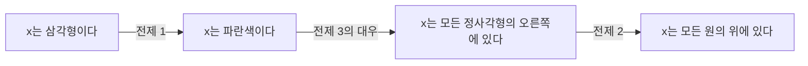

*그림 13. 순서를 바꾸고 대우를 쓴 세 전제가 이루는 조건 명제의 사슬*

### 4.8 역의 오류, 이의 오류와 귀추법

많은 사람이 역의 오류와 이의 오류를 범하는 한 가지 이유는, 대전제가 단순한 조건 명제가 아니라 쌍조건 명제라면 그 논증 형식이 타당하기 때문이다. 2장에서 보았듯이 많은 사람이 쌍조건 명제와 조건 명제를 혼동한다. 예를 들어 다음 논증을 생각한다.

- 마을의 모든 범죄자는 죄악의 소굴이라는 술집에 자주 간다.
- 존은 죄악의 소굴에 자주 간다.
- $\therefore$ 존은 마을의 범죄자 중 한 명이다.

이 논증은 역의 오류를 범하므로, 두 전제가 모두 참이어도 결론은 거짓일 수 있다. 이런 형태의 논증은 연관이 있다는 이유만으로 부당하게 죄를 씌우려 한다. 그러나 대전제가 쌍조건 명제에 가까울수록 결론이 참일 가능성은 커진다. 범죄자가 아닌 사람은 거의 그 술집에 가지 않는데 존이 그 술집에 자주 간다면, 존이 범죄자일 가능성은 크다(확실하지는 않다). 주어진 전제를 근거로 존을 의심하는 것은 합리적일 수 있지만, 그를 유죄로 판단하는 것은 잘못이다.

역의 오류를 변형한 추론은 주의해서 쓰면 매우 유용한 도구이다. 의사가 진단을 내리고 정비사가 자동차를 수리할 때 쓰는 추론이며, 어떤 현상에 대한 설명을 만들어 낼 때 쓰는 추론이다. 그 형태는 다음과 같다. "모든 $x$에 대해 $P(x)$이면 $Q(x)$이다"가 참이고 특정한 $a$에 대해 $Q(a)$가 참이면, 명제 $P(a)$를 확인해 본다. $P(a)$는 참일 수도 있다.

예를 들어 의사가 다음 두 사실을 알고 있다고 가정한다.

- 모든 $x$에 대해, $x$가 폐렴에 걸렸으면 $x$는 열과 오한이 있고, 기침을 심하게 하고, 매우 피곤하고 괴롭다.
- 존은 열과 오한이 있고, 기침을 심하게 하고, 매우 피곤하고 괴롭다.

이 자료를 근거로 의사는 폐렴이라는 진단이 유력한 가능성이지만 확실하지는 않다고 결론 내린다. 의사는 폐렴을 검출하도록 고안된 검사를 하여 이 진단을 더 뒷받침하려 할 것이다. 어떤 질병에 대해 증상의 집합이 필요충분조건에 가까울수록 의사의 진단은 더 확실해진다.

> **용어 정의:** "모든 $x$에 대해 $P(x)$이면 $Q(x)$이다"와 $Q(a)$로부터 $P(a)$를 그럴듯한 설명으로 추정하는 추론을 인공지능 연구에서 **귀추법(abduction)** 이라 한다. 귀추법의 결론은 확실한 결론이 아니라 확인해 볼 가설이다.

> **[인공지능]** 인공지능에서 지식 표현과 논리적 추론은 사실과 규칙을 논리식으로 표현하고 그로부터 새로운 사실을 이끌어 내는 방법을 다룬다. 3.8절의 프롤로그처럼 전칭 예화와 전건 긍정으로 결론을 이끄는 연역 추론은 전제가 참이면 결론도 반드시 참이다. 반면 귀추법은 관찰된 결과를 가장 잘 설명하는 원인을 가설로 제시하므로 결론이 틀릴 수 있다. 어떤 분야 전문가의 판단을 흉내 내는 전문가 시스템이라는 컴퓨터 프로그램은 진단처럼 이런 귀추적 추론이 필요한 일에 쓰인다.

---

<br>

## 개념 적용

**T/F 점검:**

| 문장 | 판단과 근거 |
|:-----|:-----|
| $\forall x \in \mathbf{R},\ x^2 \geq x$의 반례는 $x = \frac{1}{2}$ 하나뿐이다. | **F.** $0 < x < 1$인 모든 실수가 반례이다. 예를 들어 $x = \frac{1}{3}$이면 $x^2 = \frac{1}{9} < \frac{1}{3}$이다. |
| 정의역 $D$가 공집합이면 $\forall x \in D,\ Q(x)$는 $Q(x)$가 무엇이든 참이다. | **T.** 부정 $\exists x \in D \text{ such that } \sim Q(x)$는 $D$에 원소가 없으므로 거짓이고, 따라서 원래 명제는 공허하게 참이다. |
| "모든 컴퓨터 프로그램은 유한하다"의 부정은 "모든 컴퓨터 프로그램은 무한하다"이다. | **F.** 부정은 "유한하지 않은 컴퓨터 프로그램이 적어도 하나 있다"이다. 제시된 문장은 부정보다 훨씬 강한 명제이다. |
| $\sim(\forall x,\ P(x) \to Q(x))$는 $\exists x \text{ such that } P(x) \to \sim Q(x)$와 동치이다. | **F.** 조건 명제의 부정은 논리곱이므로 $\exists x \text{ such that } P(x) \wedge \sim Q(x)$와 동치이다. |
| 전칭 조건 명제와 그 대우는 언제나 같은 진릿값을 가진다. | **T.** 각 $x$에 대해 $p \to q \equiv \sim q \to \sim p$이므로 두 전칭 명제는 논리적으로 동치이다. |
| "$s(x)$일 때만 $r(x)$이다"는 $\forall x,\ s(x) \to r(x)$를 뜻한다. | **F.** "$r(x)$ only if $s(x)$"는 $\forall x,\ r(x) \to s(x)$를 뜻한다. 즉 $s(x)$는 $r(x)$의 필요조건이다. |
| $\forall x\ \exists y,\ P(x, y)$가 참이면 $\exists y\ \forall x,\ P(x, y)$도 참이다. | **F.** 모든 사람이 누군가를 사랑하더라도 모든 사람에게 사랑받는 한 사람이 있다는 보장은 없다. |
| 오일러 도표에서 전제를 만족하는 배치 하나에서 결론이 참이면 논증은 타당하다. | **F.** 전제를 만족하는 모든 배치에서 결론이 참이어야 한다. 예제 3.4.6에서는 결론이 거짓인 배치가 있다. |
| 전칭 전건 긍정은 전칭 예화와 전건 긍정을 결합한 논증 형식이다. | **T.** 대전제에 전칭 예화를 적용하여 $P(a) \to Q(a)$를 얻고, 소전제 $P(a)$와 전건 긍정으로 $Q(a)$를 얻는다. |

---

<br>

## 요약

| 개념 | 핵심 요약 |
|:-----|:-----|
| 술어 | 유한 개의 변수를 포함하고 변수에 값을 대입하면 명제가 되는 문장이다. |
| 정의역과 진리 집합 | 정의역은 변수에 대입할 수 있는 값의 집합이고, 진리 집합 $\lbrace x \in D \mid P(x) \rbrace$는 술어를 참으로 만드는 원소의 집합이다. |
| 전칭 명제 | $\forall x \in D,\ Q(x)$는 $D$의 모든 $x$에 대해 $Q(x)$가 참일 때 참이고, 반례 하나로 거짓이 된다. |
| 존재 명제 | $\exists x \in D \text{ such that } Q(x)$는 $Q(x)$를 만족하는 $x$가 하나라도 있으면 참이고, 모든 $x$에서 $Q(x)$가 거짓일 때 거짓이다. |
| 전수 조사법 | 유한 정의역의 원소를 하나씩 모두 확인하여 명제의 진릿값을 정하는 방법이다. |
| 전칭 조건 명제 | $\forall x,\ P(x) \to Q(x)$ 꼴의 명제이며, 정의역을 $P(x)$의 진리 집합으로 좁힌 $\forall x \in D,\ Q(x)$와 동치이다. |
| 속박 변수와 유효 범위 | 한정기호에 딸린 변수는 이름을 일관되게 바꾸어도 뜻이 같고, 유효 범위는 도입된 곳부터 명제의 끝까지이다. |
| 암묵적 한정 | 명시적 한정기호 없이 문맥으로 한정을 나타내며, $P(x) \Rightarrow Q(x)$는 진리 집합의 포함을, $P(x) \Leftrightarrow Q(x)$는 진리 집합의 일치를 뜻한다. |
| 한정 명제의 부정 | $\sim(\forall x,\ Q(x)) \equiv \exists x \text{ such that } \sim Q(x)$이고 $\sim(\exists x \text{ such that } Q(x)) \equiv \forall x,\ \sim Q(x)$이다. |
| 전칭 조건 명제의 부정 | $\sim(\forall x,\ P(x) \to Q(x)) \equiv \exists x \text{ such that } P(x) \wedge \sim Q(x)$이다. |
| 한정기호와 논리곱, 논리합 | 유한 정의역에서 전칭 명제는 논리곱, 존재 명제는 논리합과 같으므로 부정 규칙은 드모르간의 법칙의 일반화이다. |
| 공허하게 참인 명제 | 모든 $x$에서 가정 $P(x)$가 거짓이면 $\forall x \in D,\ P(x) \to Q(x)$는 $Q(x)$와 관계없이 참이다. |
| 대우, 역, 이 | 전칭 조건 명제는 대우와 동치이고, 역이나 이와는 동치가 아니며, 역과 이는 서로 동치이다. |
| 필요조건, 충분조건, 일 때만 | $r$가 $s$의 충분조건이면 $\forall x,\ r(x) \to s(x)$, 필요조건이면 $\forall x,\ s(x) \to r(x)$이고, "$s(x)$일 때만 $r(x)$"는 $\forall x,\ r(x) \to s(x)$이다. |
| 다중 한정기호의 해석 | 한정기호의 행동을 나오는 순서대로 수행하며, $\forall x\ \exists y$에서는 $y$가 $x$에 따라 달라져도 되고 $\exists x\ \forall y$에서는 하나의 $x$가 모든 $y$에 대해 성립해야 한다. |
| 다중 한정기호의 부정 | 부정을 안쪽으로 옮길 때마다 $\forall$와 $\exists$가 바뀌고 순서는 유지되며 맨 안쪽 술어가 부정된다. |
| 한정기호의 순서 | 서로 다른 한정기호의 순서를 바꾸면 뜻과 진릿값이 바뀔 수 있지만, 같은 종류의 한정기호끼리는 순서를 바꿔도 된다. |
| 형식 논리 표기 | $\forall x \in D,\ P(x)$는 $\forall x\,(x \in D \to P(x))$로, 존재 명제는 $\exists x\,(x \in D \wedge P(x))$로 쓴다. |
| 프롤로그 | 사실과 규칙을 기술하면 내장된 탐색과 추론으로 질문에 답하는 논리 프로그래밍 언어이다. |
| 전칭 예화 | 모든 원소에 대해 참인 성질은 그 집합의 특정한 원소에 대해서도 참이다. |
| 전칭 전건 긍정과 전칭 후건 부정 | $\forall x,\ P(x) \to Q(x)$와 $P(a)$로부터 $Q(a)$를, $\sim Q(a)$로부터 $\sim P(a)$를 이끌어 내는 타당한 형식이다. |
| 타당성과 건전성 | 논증 형식은 어떤 술어를 대입해도 전제가 참이면 결론이 참일 때 타당하고, 논증은 타당하면서 전제가 모두 참일 때 건전하다. |
| 오일러 도표 | 집합을 원판으로 그려 전제가 허용하는 모든 배치에서 결론이 참인지 확인하여 타당성을 검사한다. |
| 역의 오류와 이의 오류 | $Q(a)$로부터 $P(a)$를, $\sim P(a)$로부터 $\sim Q(a)$를 이끌어 내는 부당한 논증 형식이다. |
| 전칭 추이 | $\forall x,\ P(x) \to Q(x)$와 $\forall x,\ Q(x) \to R(x)$로부터 $\forall x,\ P(x) \to R(x)$를 이끌어 내는 타당한 형식이다. |
| 귀추법 | $Q(a)$를 관찰하고 $P(a)$를 그럴듯한 설명으로 추정하는 추론이며, 결론은 확인해야 할 가설이다. |

---

<br>

## 점검 문제

1. **진리 집합:** 정의역이 $\mathbf{R}$인 술어 $P(x)$를 "$x^2 > x$"로 둘 때 $P(x)$의 진리 집합을 구하고, 예제 3.1.1의 세 값 2, $\frac{1}{2}$, $-\frac{1}{2}$이 그 집합에 속하는지 확인하라.

   <details>
   <summary>정답</summary>

   $x^2 > x$는 $x^2 - x > 0$, 곧 $x(x - 1) > 0$과 같다. 두 인수의 곱이 양수이려면 두 인수의 부호가 같아야 하므로, 둘 다 양수인 $x > 1$이거나 둘 다 음수인 $x < 0$이다. 따라서 진리 집합은 $\lbrace x \in \mathbf{R} \mid x < 0 \text{ or } x > 1 \rbrace$이다. $2 > 1$이므로 2는 속하고, $-\frac{1}{2} < 0$이므로 $-\frac{1}{2}$도 속하며, $0 < \frac{1}{2} < 1$이므로 $\frac{1}{2}$은 속하지 않는다. 이는 예제 3.1.1의 결과와 일치한다.

   </details>

2. **전수 조사법:** $D = \lbrace -1, 0, 1, 2 \rbrace$일 때 다음 명제의 진릿값을 구하라. (a) $\forall x \in D,\ x^3 \geq x$ (b) $\forall x \in D,\ x^2 > x$ (c) $\exists x \in D \text{ such that } x^2 = x + 2$

   <details>
   <summary>정답</summary>

   (a) 참이다. $(-1)^3 = -1 \geq -1$, $0^3 = 0 \geq 0$, $1^3 = 1 \geq 1$, $2^3 = 8 \geq 2$이므로 $D$의 모든 원소가 부등식을 만족한다. (b) 거짓이다. $x = 0$이면 $0 > 0$이 거짓이므로 0이 반례이다($x = 1$도 반례이다). (c) 참이다. $x = -1$이면 $(-1)^2 = 1$이고 $-1 + 2 = 1$이므로 등식이 성립한다($x = 2$도 $4 = 4$로 성립한다).

   </details>

3. **다중 한정 명제의 부정:** "모든 학생은 적어도 한 과목에서 A를 받았다"를 한정기호를 써서 형식적으로 쓰고, 형식적 부정과 비형식적 부정을 쓰라.

   <details>
   <summary>정답</summary>

   형식적 명제는 "$\forall$ 학생 $s$, $\exists$ 과목 $c$ such that $s$는 $c$에서 A를 받았다"이다. 부정을 안쪽으로 옮길 때마다 한정기호가 바뀌므로 형식적 부정은 "$\exists$ 학생 $s$ such that $\forall$ 과목 $c$, $s$는 $c$에서 A를 받지 않았다"이다. 비형식적 부정은 "어떤 과목에서도 A를 받지 못한 학생이 있다"이다.

   </details>

4. **부정과 변형:** 명제 "$\forall$ 정수 $n$, $n$이 6으로 나누어떨어지면 $n$은 3으로 나누어떨어진다"의 부정, 대우, 역, 이를 쓰고 각각의 진릿값을 구하라.

   <details>
   <summary>정답</summary>

   원래 명제는 참이다($n = 6k$이면 $n = 3(2k)$). 부정은 "$\exists$ 정수 $n$ such that $n$은 6으로 나누어떨어지고 3으로 나누어떨어지지 않는다"이며 거짓이다. 대우는 "$\forall$ 정수 $n$, $n$이 3으로 나누어떨어지지 않으면 $n$은 6으로 나누어떨어지지 않는다"이며 원래 명제와 동치이므로 참이다. 역은 "$\forall$ 정수 $n$, $n$이 3으로 나누어떨어지면 $n$은 6으로 나누어떨어진다"이며 $n = 3$이 반례이므로 거짓이다. 이는 "$\forall$ 정수 $n$, $n$이 6으로 나누어떨어지지 않으면 $n$은 3으로 나누어떨어지지 않는다"이며 역시 $n = 3$이 반례이므로 거짓이다.

   </details>

5. **필요조건, 충분조건, 일 때만:** 다음 세 문장이 모두 같은 전칭 조건 명제를 나타냄을 보이라. (a) 4로 나누어떨어지는 것은 짝수인 것의 충분조건이다. (b) 짝수인 것은 4로 나누어떨어지는 것의 필요조건이다. (c) 정수는 짝수일 때만 4로 나누어떨어진다.

   <details>
   <summary>정답</summary>

   (a) "$r$는 $s$의 충분조건"은 $\forall x,\ r(x) \to s(x)$이므로 "$\forall$ 정수 $n$, $n$이 4로 나누어떨어지면 $n$은 짝수이다"이다. (b) "$r$는 $s$의 필요조건"은 $\forall x,\ s(x) \to r(x)$이고, 여기서 $r$는 짝수인 것, $s$는 4로 나누어떨어지는 것이므로 역시 "$\forall$ 정수 $n$, $n$이 4로 나누어떨어지면 $n$은 짝수이다"이다. (c) "$s$일 때만 $r$"은 $\forall x,\ r(x) \to s(x)$이고, 여기서 $r$는 4로 나누어떨어지는 것, $s$는 짝수인 것이므로 같은 명제이다. 이 명제는 $n = 4k$이면 $n = 2(2k)$이므로 참이다.

   </details>

6. **한정기호의 순서:** $D = E = \lbrace 1, 2, 3 \rbrace$일 때 (a) $\forall x \in D,\ \exists y \in E \text{ such that } x + y = 4$와 (b) $\exists y \in E \text{ such that } \forall x \in D,\ x + y = 4$의 진릿값을 구하고, (b)의 부정을 쓰라.

   <details>
   <summary>정답</summary>

   (a)는 참이다. $x = 1$에는 $y = 3$, $x = 2$에는 $y = 2$, $x = 3$에는 $y = 1$을 고르면 된다. $y$가 $x$에 따라 달라져도 된다. (b)는 거짓이다. 하나의 $y$가 세 $x$ 모두에 대해 $x + y = 4$를 만족하려면 $y = 3$, $y = 2$, $y = 1$이 동시에 성립해야 하는데 이는 불가능하다. (b)의 부정은 $\forall y \in E,\ \exists x \in D \text{ such that } x + y \neq 4$이며 참이다. 예를 들어 $y = 1$에는 $x = 1$, $y = 2$에는 $x = 1$, $y = 3$에는 $x = 2$가 있다.

   </details>

7. **형식 논리 표기:** 그림 4의 타르스키의 세계에서 "모든 원 $x$에 대해, $x$와 색이 다른 삼각형 $y$가 있다"를 형식 논리 표기로 쓰고, 그 부정을 구하고, 어느 쪽이 참인지 판정하라.

   <details>
   <summary>정답</summary>

   명제는 $\forall x\,(\text{Circle}(x) \to \exists y\,(\text{Triangle}(y) \wedge \sim\text{SameColor}(x, y)))$이다. 부정은 $\exists x\,(\text{Circle}(x) \wedge \forall y\,(\sim\text{Triangle}(y) \vee \text{SameColor}(x, y)))$이다. 원래 명제가 참이다. 원 $a$와 $c$(파랑)에는 삼각형 $d$(검정)나 $f$, $i$(회색)를, 원 $b$(회색)에는 삼각형 $d$(검정)를 고르면 된다.

   </details>

8. **도표와 논증의 타당성:** 대전제 "모든 정사각형은 직사각형이다"에 대해 (a) 소전제 "도형 $F$는 직사각형이다"에서 "$F$는 정사각형이다"를 이끌어 내는 논증과 (b) 소전제 "도형 $G$는 직사각형이 아니다"에서 "$G$는 정사각형이 아니다"를 이끌어 내는 논증의 타당성을 판정하라.

   <details>
   <summary>정답</summary>

   대전제는 "정사각형" 원판을 "직사각형" 원판 안에 넣은 도표로 나타난다. (a) $F$의 점은 "직사각형" 원판 안 어딘가에 있으면 되므로 "정사각형" 원판 밖에 있을 수도 있다(정사각형이 아닌 직사각형). 결론이 필연적이지 않으므로 부당하며, 역의 오류이다. (b) $G$의 점은 "직사각형" 원판 밖에 있으므로 그 안의 "정사각형" 원판 밖에도 반드시 있다. 따라서 타당하며, 전칭 후건 부정의 형태이다.

   </details>

9. **전칭 추이:** 다음 논증이 타당함을 전제를 다시 써서 보이라. 전제 1: 컴파일 오류가 있는 프로그램은 실행되지 않는다. 전제 2: 테스트를 통과한 프로그램은 실행된다. 결론: 컴파일 오류가 있는 프로그램은 테스트를 통과하지 못한다.

   <details>
   <summary>정답</summary>

   전제와 결론을 조건 명제로 쓰면 전제 1은 "$\forall x$, $x$에 컴파일 오류가 있으면 $x$는 실행되지 않는다", 전제 2는 "$\forall x$, $x$가 테스트를 통과하면 $x$는 실행된다", 결론은 "$\forall x$, $x$에 컴파일 오류가 있으면 $x$는 테스트를 통과하지 못한다"이다. 전제 1의 결론 "실행되지 않는다"가 다음 전제의 가정이 되도록 전제 2를 대우로 바꾸면 "$\forall x$, $x$가 실행되지 않으면 $x$는 테스트를 통과하지 못한다"이다. 전제 1과 바꾼 전제 2를 전칭 추이로 합치면 결론을 얻으므로 논증은 타당하다.

   </details>

10. **공허하게 참인 명제:** 정의역 $D$가 공집합일 때 $\forall x \in D,\ Q(x)$와 $\exists x \in D \text{ such that } Q(x)$의 진릿값을 구하고, 이유를 부정 규칙으로 설명하라.

    <details>
    <summary>정답</summary>

    $\forall x \in D,\ Q(x)$는 참이다. 이 명제의 부정은 $\exists x \in D \text{ such that } \sim Q(x)$인데, $D$에 원소가 없으므로 조건을 만족하는 $x$가 있을 수 없어 부정이 거짓이기 때문이다. 반면 $\exists x \in D \text{ such that } Q(x)$는 $Q(x)$를 만족하는 원소가 $D$에 있을 수 없으므로 거짓이며, 그 부정 $\forall x \in D,\ \sim Q(x)$는 공허하게 참이다.

    </details>

---

<br>

## 참고 문헌

1. Python Software Foundation, "Built-in Functions," *The Python Standard Library*, https://docs.python.org/3/library/functions.html
2. W. F. Clocksin and C. S. Mellish, *Programming in Prolog: Using the ISO Standard*, 5th ed. Berlin, Germany: Springer, 2003.
