# Chapter 3 — The Logic of Quantified Statements

[Repository Guide](../../README.md) | [English](Concepts_Lecture.md) | [한국어](Concepts_Lecture.ko.md)

> **Last Updated:** 2026-11-10
>
> Discrete Mathematics with Applications, Epp, Ch 3

> **Learning Objectives:**
> 1. Define predicates, domains, and truth sets, and determine the truth values of universal and existential statements
> 2. Translate statements written in everyday language into formal statements with quantifiers and variables, and restate formal statements in several informal ways
> 3. Write negations of quantified statements and of universal conditional statements, and explain the contrapositive, converse, and inverse of a universal conditional statement and the meaning of necessary condition, sufficient condition, and "only if"
> 4. Interpret statements that mix different quantifiers, and explain why the order of quantifiers changes the meaning and how such statements are negated
> 5. Show the validity of arguments with quantified statements using universal instantiation, universal modus ponens, universal modus tollens, and universal transitivity
> 6. Test arguments for validity with diagrams and detect the converse error and the inverse error

---

## Table of Contents

- [1. Predicates and Quantified Statements I](#1-predicates-and-quantified-statements-i)
  - [1.1 Why Predicate Logic Is Needed](#11-why-predicate-logic-is-needed)
  - [1.2 Predicates and Truth Sets](#12-predicates-and-truth-sets)
  - [1.3 The Universal Quantifier](#13-the-universal-quantifier)
  - [1.4 The Existential Quantifier](#14-the-existential-quantifier)
  - [1.5 Formal and Informal Language](#15-formal-and-informal-language)
  - [1.6 Universal Conditional Statements](#16-universal-conditional-statements)
  - [1.7 Equivalent Forms of Universal and Existential Statements](#17-equivalent-forms-of-universal-and-existential-statements)
  - [1.8 Bound Variables and Scope](#18-bound-variables-and-scope)
  - [1.9 Implicit Quantification](#19-implicit-quantification)
  - [1.10 Tarski's World](#110-tarskis-world)
- [2. Predicates and Quantified Statements II](#2-predicates-and-quantified-statements-ii)
  - [2.1 Negations of Quantified Statements](#21-negations-of-quantified-statements)
  - [2.2 Negations of Universal Conditional Statements](#22-negations-of-universal-conditional-statements)
  - [2.3 Quantifiers, Conjunction, and Disjunction](#23-quantifiers-conjunction-and-disjunction)
  - [2.4 Vacuous Truth of Universal Statements](#24-vacuous-truth-of-universal-statements)
  - [2.5 Variants of Universal Conditional Statements](#25-variants-of-universal-conditional-statements)
  - [2.6 Necessary and Sufficient Conditions, Only If](#26-necessary-and-sufficient-conditions-only-if)
- [3. Statements with Multiple Quantifiers](#3-statements-with-multiple-quantifiers)
  - [3.1 Rules for Interpreting Different Quantifiers](#31-rules-for-interpreting-different-quantifiers)
  - [3.2 Interpreting Statements with Several Quantifiers](#32-interpreting-statements-with-several-quantifiers)
  - [3.3 From Informal to Formal Language](#33-from-informal-to-formal-language)
  - [3.4 Ambiguous Language](#34-ambiguous-language)
  - [3.5 Negations of Statements with Multiple Quantifiers](#35-negations-of-statements-with-multiple-quantifiers)
  - [3.6 Order of Quantifiers](#36-order-of-quantifiers)
  - [3.7 Formal Logical Notation](#37-formal-logical-notation)
  - [3.8 Prolog](#38-prolog)
- [4. Arguments with Quantified Statements](#4-arguments-with-quantified-statements)
  - [4.1 Universal Instantiation](#41-universal-instantiation)
  - [4.2 Universal Modus Ponens](#42-universal-modus-ponens)
  - [4.3 Universal Modus Ponens in a Proof](#43-universal-modus-ponens-in-a-proof)
  - [4.4 Universal Modus Tollens](#44-universal-modus-tollens)
  - [4.5 Validity of Arguments with Quantified Statements](#45-validity-of-arguments-with-quantified-statements)
  - [4.6 Using Diagrams to Test for Validity](#46-using-diagrams-to-test-for-validity)
  - [4.7 Creating Additional Forms of Argument](#47-creating-additional-forms-of-argument)
  - [4.8 Converse and Inverse Errors and Abduction](#48-converse-and-inverse-errors-and-abduction)
- [Concept Applications](#concept-applications)
- [Summary](#summary)
- [Self-Check Questions](#self-check-questions)
- [References](#references)

---

<br>

## 1. Predicates and Quantified Statements I

### 1.1 Why Predicate Logic Is Needed

Chapter 2 analyzed compound statements, which are simple statements joined by the connectives $\sim$, $\wedge$, $\vee$, $\to$, and $\leftrightarrow$. This analysis explains a good part of human reasoning, but for most arguments met in everyday life and in mathematics it cannot decide validity on its own. The following argument is a typical example.

- All men are mortal.
- Socrates is a man.
- $\therefore$ Socrates is mortal.

The argument is intuitively correct. However, translating the three sentences into the language of compound statements only gives three unrelated simple statements $p$, $q$, and $r$, so the truth table method of Chapter 2 cannot show that "$`p`$ and $q$, therefore $r$" is valid. To analyze arguments like this one, statements must be split into smaller parts, in the way sentences are split into subjects and predicates, and the special role of words that denote quantities, such as "all" and "some", must be understood.

> **Definition:** The symbolic analysis of predicates and quantified statements is called the **predicate calculus**. The symbolic analysis of compound statements studied in Chapter 2 is called the **statement calculus** (or **propositional calculus**).

### 1.2 Predicates and Truth Sets

The sentence $x^2 + 2 = 11$ is not a statement, because it may be true or false depending on the value of $x$. Similarly, the sentence $x + y > 0$ is not a statement, because its truth value depends on the values of the variables $x$ and $y$.

In grammar, a sentence divides into a subject and a predicate, the predicate being whatever the sentence says about the subject. For the sentence "James is a student at Bedford College", the subject is "James" and the predicate is "is a student at Bedford College"; deleting the subject leaves exactly the predicate.

In logic, predicates are obtained by removing some or all of the nouns from a sentence. For instance, let $P$ stand for "is a student at Bedford College" and $Q$ for "is a student at". Then the sentences "$`x`$ is a student at Bedford College" and "$`x`$ is a student at $y$" are symbolized as $P(x)$ and $Q(x, y)$. Here $P$ and $Q$ are **predicate symbols**, and $x$ and $y$, which take values in appropriate sets, are **predicate variables**. When concrete values are substituted for the predicate variables, a statement results. For simplicity, a predicate symbol together with suitable predicate variables is called a predicate; other treatments of logic call such objects **propositional functions** or **open sentences**.

> **Definition:** A **predicate** is a sentence with finitely many variables that turns into a statement once each variable is replaced by a specific value. The **domain** of a predicate variable is the set of values allowed to replace that variable.

For example, if $P(x)$ is the predicate "$`x > 3`$", that is, "$`x`$ is greater than 3", then $P(x)$ itself is not a statement. But $P(4)$, obtained by substituting 4 for $x$, is a true statement because $4 > 3$, and $P(2)$ is a false statement because $2 > 3$ is false.

**Example 3.1.1 (Finding Truth Values of a Predicate).** Let $P(x)$ be the predicate "$`x^2 > x`$" with domain the set $\mathbf{R}$ of all real numbers. Write $P(2)$, $P(\frac{1}{2})$, and $P(-\frac{1}{2})$, and find the truth value of each.

**Solution.** Substituting each value for $x$ and evaluating the inequality gives the following.

| Statement | Substituted Form | Evaluation | Truth Value |
|:-----|:-----|:-----|:-----|
| $P(2)$ | $2^2 > 2$ | $4 > 2$ | True |
| $P(\frac{1}{2})$ | $(\frac{1}{2})^2 > \frac{1}{2}$ | $\frac{1}{4} > \frac{1}{2}$ | False |
| $P(-\frac{1}{2})$ | $(-\frac{1}{2})^2 > -\frac{1}{2}$ | $\frac{1}{4} > -\frac{1}{2}$ | True |

*Table 1. Predicate $`x^2 > x`$: results of substituting three values*

If $0 < x < 1$, multiplying $x$ by the positive number $x$, which is less than 1, gives an $x^2$ that is smaller than $x$, so $P(\frac{1}{2})$ is false. In general, $x^2 > x$ is equivalent to $x(x - 1) > 0$, and since the two factors must have the same sign, it holds exactly when $x < 0$ or $x > 1$.

Substituting any element of the domain into a predicate of one variable produces a statement, which is either true or false. Collecting the elements for which this statement is true gives the truth set.

> **Definition:** If $P(x)$ is a predicate and $x$ has domain $D$, the **truth set** of $P(x)$ is the set of all elements of $D$ that make $P(x)$ true when they are substituted for $x$, and it is denoted $\lbrace x \in D \mid P(x) \rbrace$. This notation is read "the set of all $x$ in $D$ such that $P(x)$".

For example, the only integers whose square is 1 are $-1$ and 1, so $\lbrace x \in \mathbf{Z} \mid x^2 = 1 \rbrace = \lbrace -1, 1 \rbrace$. For the predicate of Example 3.1.1, the truth set is $\lbrace x \in \mathbf{R} \mid x < 0 \text{ or } x > 1 \rbrace$.

**Example 3.1.2 (Finding the Truth Set of a Predicate).** Let $Q(n)$ be the predicate "$`n`$ is a factor of 8". Find the truth set of $Q(n)$ if (a) the domain of $n$ is $\mathbf{Z}^{+}$, the set of all positive integers, and (b) the domain of $n$ is $\mathbf{Z}$, the set of all integers.

**Solution.**

- (a) The positive integers that divide 8 without remainder are exactly 1, 2, 4, and 8, so the truth set is $\lbrace 1, 2, 4, 8 \rbrace$.
- (b) Since $8 = (-1)(-8) = (-2)(-4)$, the negative integers $-1$, $-2$, $-4$, and $-8$ also divide 8 without remainder. So the truth set is $\lbrace 1, 2, 4, 8, -1, -2, -4, -8 \rbrace$.

> **Caution:** The same predicate can have a different truth set when its domain changes, and the truth values of statements built from it can change as well. Always check the domain of the variable together with the predicate.

### 1.3 The Universal Quantifier

A predicate becomes a statement when every one of its variables receives a specific value. For example, giving $x$ the value 35 turns "$`x`$ is divisible by 5" into a true statement, since $35 = 5 \cdot 7$. A second way is to attach **quantifiers**, words of quantity such as "some" and "all" that state for how many elements of the domain the predicate holds. Quantifiers entered symbolic logic as a formal notion in the late nineteenth century, through the independent work of the American philosopher and logician Charles Sanders Peirce and the German logician Gottlob Frege.

The symbol $\forall$ is called the **universal quantifier**. According to context it is read "for every", "for each", "for any", "given any", or "for all". It asserts that a property holds for every element of a given domain. For example, "All human beings are mortal" is written as follows.

$\forall$ human beings $x$, $x$ is mortal.

This is read "For every human being $x$, $x$ is mortal." If $H$ is the set of all human beings, the statement can be written more formally as "$`\forall x \in H`$, $x$ is mortal." Think of $x$ as an individual but generic object, with all the properties shared by every human being and no other properties.

In a universal statement, the domain of the predicate variable is usually indicated either between the $\forall$ symbol and the variable name ($\forall$ human being $`x`$) or immediately after the variable name ($`\forall x \in H`$). In sentences that mix symbols and words, one $\forall$ can refer to two or more variables. For instance, "For all real numbers $x$ and $y$, $x + y = y + x$" is written "$`\forall`$ real numbers $x$ and $y$, $x + y = y + x$". More formal versions of symbolic logic attach a separate $\forall$ to each variable: $`\forall x \in \mathbf{R}\,(\forall y \in \mathbf{R}\,(x + y = y + x))`$.

> **Definition:** Let $Q(x)$ be a predicate and $D$ the domain of $x$. A **universal statement** is a statement of the form $`\forall x \in D,\ Q(x)`$. It is true if, and only if, $Q(x)$ is true for each individual $x$ in $D$, and it is false if, and only if, $Q(x)$ is false for at least one $x$ in $D$. A value of $x$ for which $Q(x)$ is false is called a **counterexample** to the universal statement.

**Example 3.1.3 (Truth and Falsity of Universal Statements).**

- (a) Let $D = \lbrace 1, 2, 3, 4, 5 \rbrace$, and consider the statement $`\forall x \in D,\ x^2 \geq x`$. Write one way to read this statement out loud, and show that it is true.
- (b) Find a counterexample to show that the statement $`\forall x \in \mathbf{R},\ x^2 \geq x`$ is false.

**Solution.**

- (a) It is read "For every $x$ in the set $D$, $x^2$ is greater than or equal to $x$." Substituting the elements of $D$ one by one gives $1^2 = 1 \geq 1$, $2^2 = 4 \geq 2$, $3^2 = 9 \geq 3$, $4^2 = 16 \geq 4$, and $5^2 = 25 \geq 5$, so $x^2 \geq x$ is true for every element of $D$. Hence $`\forall x \in D,\ x^2 \geq x`$ is true.
- (b) The statement claims that $x^2 \geq x$ for every real number $x$. But when $x = \frac{1}{2}$, $(\frac{1}{2})^2 = \frac{1}{4}$ and $\frac{1}{4} \not\geq \frac{1}{2}$. So $x = \frac{1}{2}$ is a counterexample, and $`\forall x \in \mathbf{R},\ x^2 \geq x`$ is false. Every real number with $0 < x < 1$ is a counterexample, but a single counterexample suffices to show falsity.

The technique used in (a) is called the **method of exhaustion**. It shows the truth of the predicate separately for each individual element of the domain, and in principle it can be used whenever the domain of the predicate variable is finite. Digital computers have made this method far easier to use, and expert systems and knowledge-based systems use it to answer many of the questions posed to them. Because most sets in mathematics are infinite, however, the method can rarely be used to derive general mathematical results.

### 1.4 The Existential Quantifier

The symbol $\exists$ denotes "there exists" and is called the **existential quantifier**. It is read "there exists", "there is a", "we can find a", "there is at least one", "for some", or "for at least one". It asserts that the domain $D$ contains at least one element with the property $Q(x)$. For example, "There is a student in Math 140" is written as follows.

$\exists$ a person $p$ such that $p$ is a student in Math 140.

If $P$ is the set of all people, it is written more formally as "$`\exists p \in P`$ such that $p$ is a student in Math 140." The domain is indicated either between the $\exists$ symbol and the variable name or immediately after the variable name, and the words such that are inserted just before the predicate. The words such that mean "satisfying the following condition". As in "$`\exists`$ integers $m$ and $n$ such that $m + n = m \cdot n$", one $\exists$ can refer to both variables $m$ and $n$. More formal versions of symbolic logic do not write out such that (although it is understood) and attach a separate $\exists$ to each variable: $`\exists m \in \mathbf{Z}\,(\exists n \in \mathbf{Z}\,(m + n = m \cdot n))`$.

> **Definition:** Let $Q(x)$ be a predicate and $D$ the domain of $x$. An **existential statement** is a statement of the form $\exists x \in D \text{ such that } Q(x)$. It is true if, and only if, $Q(x)$ is true for at least one $x$ in $D$, and it is false if, and only if, $Q(x)$ is false for all $x$ in $D$.

**Example 3.1.4 (Truth and Falsity of Existential Statements).**

- (a) Consider the statement $\exists m \in \mathbf{Z}^{+} \text{ such that } m^2 = m$. Write one way to read this statement out loud, and show that it is true.
- (b) Let $E = \lbrace 5, 6, 7, 8 \rbrace$, and show that the statement $\exists m \in E \text{ such that } m^2 = m$ is false.

**Solution.**

- (a) It is read "There is at least one positive integer $m$ such that $m^2 = m$." Since $1^2 = 1$, $m = 1$ satisfies the condition. Hence the statement is true.
- (b) Since $5^2 = 25 \neq 5$, $6^2 = 36 \neq 6$, $7^2 = 49 \neq 7$, and $8^2 = 64 \neq 8$, no integer from 5 through 8 satisfies $m^2 = m$. Hence the statement is false. All elements of $E$ were checked to show falsity, so this is also the method of exhaustion.

Comparing the two definitions summarizes what must be done to decide the truth value of each kind of statement.

| Statement | How to Show It Is True | How to Show It Is False |
|:-----|:-----|:-----|
| $`\forall x \in D,\ Q(x)`$ | Show that $Q(x)$ is true for every $x$ in $D$ | Find one $x$ (a counterexample) for which $Q(x)$ is false |
| $\exists x \in D \text{ such that } Q(x)$ | Find one $x$ for which $Q(x)$ is true | Show that $Q(x)$ is false for every $x$ in $D$ |

*Table 2. How to decide the truth values of universal and existential statements*

### 1.5 Formal and Informal Language

To make sense of mathematical concepts that are new, it is important to be able to translate formal language, written in symbols, into everyday informal language. Conversely, when thinking out a complicated problem, it is equally important to be able to translate informal language into formal language.

**Example 3.1.5 (Translating from Formal to Informal Language).** Rewrite the following formal statements in a variety of equivalent but more informal ways, without using the symbol $\forall$ or $\exists$: (a) $`\forall x \in \mathbf{R},\ x^2 \geq 0`$, (b) $`\forall x \in \mathbf{R},\ x^2 \neq -1`$, (c) $\exists m \in \mathbf{Z}^{+} \text{ such that } m^2 = m$.

| Formal Statement | Equivalent Informal Sentences |
|:-----|:-----|
| (a) $`\forall x \in \mathbf{R},\ x^2 \geq 0`$ | Every real number has a nonnegative square. Or: All real numbers have nonnegative squares. Or: Any real number has a nonnegative square. Or: The square of each real number is nonnegative. |
| (b) $`\forall x \in \mathbf{R},\ x^2 \neq -1`$ | All real numbers have squares that do not equal $-1$. Or: No real numbers have squares equal to $-1$. |
| (c) $\exists m \in \mathbf{Z}^{+} \text{ such that } m^2 = m$ | There is a positive integer whose square is equal to itself. Or: At least one positive integer can be found that equals its own square. Or: Some positive integer equals its own square. Or: Some positive integers equal their own squares. |

*Table 3. Formal statements translated into equivalent informal sentences*

As in the second sentence of (b), the words none are or no ... are are equivalent to the words all are not.

> **Caution:** In ordinary language, the last sentence of (c), "Some positive integers equal their own squares", may be taken to mean that there are at least two such positive integers. In mathematics, the last two sentences are understood to mean the same thing, namely "there is at least one".

A universal or existential statement can also be restated informally by moving the quantifying words to the end of the sentence: "For any real number $x$, $x^2$ is nonnegative" becomes "$`x^2`$ is nonnegative for any real number $x$". A quantifier placed after the rest of the sentence in this way is called a **trailing quantifier**. Because quantifying words can appear at the end of a sentence as well as at the beginning, they must be searched for throughout the sentence when it is formalized.

**Example 3.1.6 (Trailing Quantifiers).** Rewrite the following statements so that the quantifier trails the rest of the sentence.

| Original Sentence | Sentence with a Trailing Quantifier |
|:-----|:-----|
| (a) For any integer $n$, $2n$ is even. | $2n$ is even for any integer $n$. |
| (b) There exists at least one real number $x$ such that $x^2 \leq 0$. | $x^2 \leq 0$ for some real number $x$. Or: $x^2 \leq 0$ for at least one real number $x$. |

*Table 4. Sentences with the quantifier moved to the end*

**Example 3.1.7 (Translating from Informal to Formal Language).** Rewrite each of the following statements formally, using quantifiers and variables.

- (a) All triangles have three sides. → $\forall$ triangle $t$, $t$ has three sides. Or: $\forall t \in T$, $t$ has three sides (where $T$ is the set of all triangles).
- (b) No dogs have wings. → $\forall$ dog $d$, $d$ does not have wings. Or: $\forall d \in D$, $d$ does not have wings (where $D$ is the set of all dogs).
- (c) Some programs are structured. → $\exists$ a program $p$ such that $p$ is structured. Or: $\exists p \in P$ such that $p$ is structured (where $P$ is the set of all programs).

The sentences "All triangles have three sides" and "Every triangle has three sides" mean the same thing. A sentence such as (b), which says that something does not exist, is formalized as a universal statement with a negated predicate.

### 1.6 Universal Conditional Statements

It can reasonably be argued that the most important form of statement in mathematics is the following **universal conditional statement**.

```math
\forall x,\ P(x) \to Q(x)
```

This is read "For every $x$, if $P(x)$ then $Q(x)$." Universal conditional statements are very common in mathematics, computer science, and many other fields, and familiarity with this form is essential for learning to speak mathematics.

**Example 3.1.8 (Writing Universal Conditional Statements Informally).** Rewrite the following statement informally, without quantifiers or variables.

```math
\forall x \in \mathbf{R},\ x > 2 \to x^2 > 4
```

**Solution.**

- If a real number is greater than 2, then its square is greater than 4.
- Or: Whenever a real number is greater than 2, its square is greater than 4.
- Or: The square of any real number greater than 2 is greater than 4.
- Or: The squares of all real numbers greater than 2 are greater than 4.

**Example 3.1.9 (Writing Universal Conditional Statements Formally).** Rewrite each of the following statements in the form "$`\forall`$ \_\_\_\_, if \_\_\_\_ then \_\_\_\_".

- (a) If a real number is an integer, then it is a rational number. → $\forall$ real number $x$, if $x$ is an integer, then $x$ is a rational number. Or: $\forall x \in \mathbf{R}$, if $x \in \mathbf{Z}$ then $x \in \mathbf{Q}$.
- (b) All bytes have eight bits. → $\forall x$, if $x$ is a byte, then $x$ has eight bits.
- (c) No fire trucks are green. → $\forall x$, if $x$ is a fire truck, then $x$ is not green.

As in (b) and (c), it is common to omit explicit identification of the domain of predicate variables in universal conditional statements.

Careful thought about the meaning of universal conditional statements gives a deeper understanding of why the truth table for an if-then statement was defined as it was in Chapter 2. Experience and intuition say that "$`\forall`$ real number $x$, if $x > 2$ then $x^2 > 4$" is true. That means "if $x > 2$ then $x^2 > 4$" must be true for every real number $x$, including the values of $x$ that make the hypothesis $x > 2$ false.

| $x$ | Hypothesis $x > 2$ | Conclusion $x^2 > 4$ | Conditional "if $x > 2$ then $x^2 > 4$" |
|:-----|:-----|:-----|:-----|
| 3 | True | True ($`9 > 4`$) | Must be true |
| 1 | False | False ($1 > 4$ is false) | Must be true |
| $-3$ | False | True ($`9 > 4`$) | Must be true |

*Table 5. Three real numbers substituted into a true universal conditional statement*

For $x = 1$ the hypothesis and the conclusion are both false, and for $x = -3$ the hypothesis is false while the conclusion is true. Since the universal statement is true, the conditional has to be true in these rows as well, which is why an if-then statement whose hypothesis is false is counted as true whatever its conclusion. The definition of a valid argument has the same universal conditional shape: for every assignment of truth values to the component statements, if all the premises are true, then the conclusion is true.

### 1.7 Equivalent Forms of Universal and Existential Statements

Since every integer is a real number, "$`\forall`$ real number $x$, if $x$ is an integer then $x$ is rational" says exactly what "$`\forall`$ integer $x$, $x$ is rational" says; informally, both read "All integers are rational." More generally, a statement of the following form

```math
\forall x \in U,\ P(x) \to Q(x)
```

can always be rewritten in the following form by narrowing $U$ to the subset $D$ consisting of all values of $x$ that make $P(x)$ true.

```math
\forall x \in D,\ Q(x)
```

Conversely, a statement of the form $`\forall x \in D,\ Q(x)`$ can be rewritten as "$`\forall x`$, if $x$ is in $D$ then $Q(x)$." The two forms express the same content and differ only in where the domain is stated.

**Example 3.1.10 (Equivalent Forms for Universal Statements).** Rewrite "All squares are rectangles" in the two forms "$`\forall x`$, if \_\_\_\_ then \_\_\_\_" and "$`\forall`$ \_\_\_\_ $x$, \_\_\_\_".

**Solution.** "$`\forall x`$, if $x$ is a square then $x$ is a rectangle" and "$`\forall`$ square $x$, $x$ is a rectangle".

Similarly, a statement of the form "$`\exists x`$ such that $P(x)$ and $Q(x)$" can be rewritten as "$`\exists x \in D`$ such that $Q(x)$", where $D$ is the set of all $x$ for which $P(x)$ is true.

**Example 3.1.11 (Equivalent Forms for Existential Statements).** A **prime number** is an integer greater than 1 whose only positive integer factors are 1 and the number itself. Consider the statement "There is an integer that is both prime and even." Let $\text{Prime}(n)$ be "$`n`$ is prime" and $\text{Even}(n)$ be "$`n`$ is even", and rewrite the statement in the two forms (a) "$`\exists n`$ such that \_\_\_\_ $\wedge$ \_\_\_\_" and (b) "$`\exists`$ \_\_\_\_ $n$ such that \_\_\_\_".

**Solution.**

- (a) $\exists n \text{ such that } \text{Prime}(n) \wedge \text{Even}(n)$.
- (b) There are two answers: "$`\exists`$ a prime number $n$ such that $\text{Even}(n)$" and "$`\exists`$ an even number $n$ such that $\text{Prime}(n)$".

Since $n = 2$ is both prime and even, the statement is true.

### 1.8 Bound Variables and Scope

In the statement "For every integer $x$, $x^2 \geq 0$", the variable does not have to be called $x$. Any name can be used as long as it is used consistently. For instance, the following three statements all have the same meaning.

- For every integer $x$, $x^2 \geq 0$.
- For every integer $n$, $n^2 \geq 0$.
- For every integer $s$, $s^2 \geq 0$.

In all three the letter is only a placeholder for an arbitrary integer, and each says that the square of any integer is nonnegative. The letter keeps this role only inside its own statement; once the statement ends, the same letter is free to mean something else elsewhere, as in the following two statements.

1. For every integer $x$, $x^2 \geq 0$.
2. There exists a real number $x$ such that $x^3 = 8$.

Both statements use the variable name $x$, but the $x$ in Statement 1 serves a different function from the $x$ in Statement 2.

> **Definition:** A variable associated with a quantifier and controlled by it is said to be **bound** by that quantifier, and it is called a **bound variable**. The **scope** of the variable begins where the quantifier introduces it and ends at the end of the quantified statement.

Renaming a bound variable consistently does not change the meaning of the statement. For example, $`\forall x \in \mathbf{Z},\ x^2 \geq 0`$ and $`\forall y \in \mathbf{Z},\ y^2 \geq 0`$ are the same statement.

The way variables are used in mathematics is similar to the way they are used in programming. A variable in a program also serves as a placeholder, creating a location in (actual or virtual) memory into which its values can be placed. In addition, the way a variable is bound in a program is similar to the way a mathematical variable is bound in a statement. Compare the following two Python programs.

```python
# Program 1
def f():
    X = "Hi"
    print(X)

def g():
    X = "Bye"
    print(X)

f()
g()
```

```python
# Program 2
def f():
    S = "Hi"
    print(S)

def g():
    S = "Bye"
    print(S)

f()
g()
```

In Program 1, the function `f` stores the string `"Hi"` in the variable `X` and prints it, and the function `g` stores `"Bye"` in the variable `X` and prints it. The last two lines call `f` and then `g`. Program 2 differs only in using the variable name `S` instead of `X`. The output of both programs is the following.

```text
Hi
Bye
```

In both programs, the variable `X` or `S` is a **local variable** of the function where it is defined. A local variable is created each time the function is called and destroyed as soon as the call is complete. It is bound by the function that defines it, and its scope is restricted to that function. Outside the function definition, the variable name can be used for any other purpose. That is why `f` and `g` can use the same name in their definitions, and why `f` and `g` define the same functions in both programs.

> **[Programming Languages]** In programming languages, the association of a name with an entity such as a variable or a function is called a binding, and the part of the program in which the binding is in effect is called its scope. The scope of a local variable defined inside a function is the body of that function, so using the same name in another function has no effect on it. Just as renaming a bound variable consistently leaves the meaning of a statement unchanged, renaming a local variable consistently within its function leaves the behavior of the program unchanged.

### 1.9 Implicit Quantification

Consider the following statement.

If a number is an integer, then it is a rational number.

As shown in Section 1.7, this statement is equivalent to a universal statement. However, it does not contain the telltale word "all", "every", or "any". The only clue that indicates its universal quantification is the indefinite article a. This is an example of **implicit quantification**. In symbols it is $`\forall x \in \mathbf{Z},\ x \in \mathbf{Q}`$. In the same way, "An integer divisible by 2 is even" means "$`\forall x \in \mathbf{Z}`$, if $x$ is divisible by 2, then $x$ is even." Implicit quantification simplifies language by omitting explicit quantifiers and letting the context supply them.

Existential quantification can also be implicit. For instance, the statement "The number 24 can be written as a sum of two even integers" is expressed formally as "$`\exists`$ even integers $m$ and $n$ such that $24 = m + n$."

Mathematical writing contains many examples of implicitly quantified statements. Some occur, as in the first example above, through the presence of the word a or an; others occur where the general context of a sentence supplies part of its meaning. For example, in an algebra course in which the letter $x$ always denotes a real number, the predicate "if $x > 2$ then $x^2 > 4$" is interpreted to mean the same as the statement "For every real number $x$, if $x > 2$ then $x^2 > 4$." Mathematicians often use a double arrow to indicate this implicit quantification, writing $x > 2 \Rightarrow x^2 > 4$.

> **Definition:** **Implicit quantification.** Let $P(x)$ and $Q(x)$ be predicates, and suppose the common domain of $x$ is $D$.
>
> - The notation $P(x) \Rightarrow Q(x)$ means that every element in the truth set of $P(x)$ is in the truth set of $Q(x)$. This is the same as $`\forall x,\ P(x) \to Q(x)`$.
> - The notation $P(x) \Leftrightarrow Q(x)$ means that $P(x)$ and $Q(x)$ have identical truth sets. This is the same as $`\forall x,\ P(x) \leftrightarrow Q(x)`$.

In other words, $P(x) \Rightarrow Q(x)$ means that the truth set of $P(x)$ is a subset of the truth set of $Q(x)$, and $P(x) \Leftrightarrow Q(x)$ means that each truth set is a subset of the other. Note that $\to$ and $\leftrightarrow$ are connectives that build statements, whereas $\Rightarrow$ and $\Leftrightarrow$ are notations asserting that a relation between predicates holds throughout the domain.

**Example 3.1.12 (Using $\Rightarrow$ and $`\Leftrightarrow`$).** Let the domain of $n$ be $\mathbf{Z}^{+}$, the set of positive integers, and let the predicates $Q(n)$, $R(n)$, and $S(n)$ be as in the following table. Use the symbols $\Rightarrow$ and $\Leftrightarrow$ to indicate true relationships among the three predicates.

| Predicate | Meaning | Truth Set |
|:-----|:-----|:-----|
| $Q(n)$ | $n$ is a factor of 8 | $\lbrace 1, 2, 4, 8 \rbrace$ |
| $R(n)$ | $n$ is a factor of 4 | $\lbrace 1, 2, 4 \rbrace$ |
| $S(n)$ | $n < 5$ and $n \neq 3$ | $\lbrace 1, 2, 4 \rbrace$ |

*Table 6. Three predicates on the positive integers and their truth sets*

**Solution.**

1. As noted in Example 3.1.2, the truth set of $Q(n)$ is $\lbrace 1, 2, 4, 8 \rbrace$, and by similar reasoning the truth set of $R(n)$ is $\lbrace 1, 2, 4 \rbrace$. Every element in the truth set of $R(n)$ is in the truth set of $Q(n)$, so $`\forall n \in \mathbf{Z}^{+},\ R(n) \to Q(n)`$ is true. Hence $R(n) \Rightarrow Q(n)$, that is, "$`n`$ is a factor of 4 $\Rightarrow$ $n$ is a factor of 8".
2. The positive integers satisfying $S(n)$ are 1, 2, 3, 4 (those less than 5) with 3 removed, namely 1, 2, 4, so the truth set of $S(n)$ is $\lbrace 1, 2, 4 \rbrace$, identical to the truth set of $R(n)$. Hence $`\forall n \in \mathbf{Z}^{+},\ R(n) \leftrightarrow S(n)`$ is true, and $R(n) \Leftrightarrow S(n)$, that is, "$`n`$ is a factor of 4 $\Leftrightarrow$ $n < 5$ and $n \neq 3$".
3. Every element in the truth set of $S(n)$ is in the truth set of $Q(n)$, so $`\forall n \in \mathbf{Z}^{+},\ S(n) \to Q(n)`$ is true. Hence $S(n) \Rightarrow Q(n)$, that is, "$`n < 5`$ and $n \neq 3$ $\Rightarrow$ $n$ is a factor of 8".

On the other hand, $8$ is in the truth set of $Q(n)$ but not in that of $R(n)$, so $Q(n) \Rightarrow R(n)$ does not hold.

Some questions of quantification are subtle because the quantifiers are hidden. For instance, suppose a mathematics text contains (a) $(x + 1)^2 = x^2 + 2x + 1$ and (b) "Solve $3x - 4 = 5$." Neither sentence contains explicit quantification, but the reader is supposed to understand the $x$ in (a) as universally quantified and the $x$ in (b) as existentially quantified. When the quantification is made explicit, they become the following.

- (a) $\forall$ real number $x$, $(x + 1)^2 = x^2 + 2x + 1$.
- (b) Show (by finding a value) that $\exists$ a real number $x$ such that $3x - 4 = 5$. Indeed, $x = 3$ is that value.

Whether a statement is quantified universally or existentially crucially determines both how the statement can be applied and what method must be used to establish its truth. Thus it is important to notice hidden quantifiers when reading mathematics, so that statements are interpreted in a logically correct way.

### 1.10 Tarski's World

**Tarski's World** is a computer program developed by the information scientists Jon Barwise and John Etchemendy for teaching and learning the principles of formal logic. It is described in their book *The Language of First-Order Logic*, and it is named after the logician Alfred Tarski. The program shows blocks of various sizes, shapes, and colors located on a grid, and lets the user describe the arrangement with logical operators and predicates.

The two-dimensional version uses predicates such as the following. $\text{Triangle}(x)$ means "$`x`$ is a triangle", $\text{Blue}(y)$ means "$`y`$ is blue", and $\text{RightOf}(x, y)$ means "$`x`$ is to the right of $y$ (but possibly in a different row)". Similarly, $\text{Square}$, $\text{Circle}$, $\text{Gray}$, and $\text{Black}$ describe shapes and colors. Individual objects are given names such as $a$, $b$, or $c$.

**Example 3.1.13 (Investigating Tarski's World).** Figure 1 shows an arrangement of objects in a two-dimensional Tarski world. The numbers above and to the left of the grid are the column and row numbers.

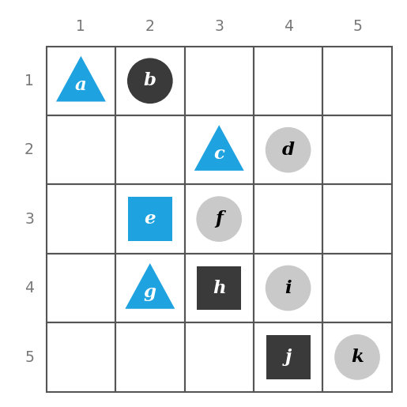

*Figure 1. A Tarski world with eleven objects*

The objects in the figure are listed in the following table.

| Object | Shape | Color | Row | Column |
|:-----|:-----|:-----|:-----|:-----|
| $a$ | Triangle | Blue | 1 | 1 |
| $b$ | Circle | Black | 1 | 2 |
| $c$ | Triangle | Blue | 2 | 3 |
| $d$ | Circle | Gray | 2 | 4 |
| $e$ | Square | Blue | 3 | 2 |
| $f$ | Circle | Gray | 3 | 3 |
| $g$ | Triangle | Blue | 4 | 2 |
| $h$ | Square | Black | 4 | 3 |
| $i$ | Circle | Gray | 4 | 4 |
| $j$ | Square | Black | 5 | 4 |
| $k$ | Circle | Gray | 5 | 5 |

*Table 7. Shape, color, and position of each object in Figure 1*

Let the domain of all variables be the set of objects in Figure 1, and determine the truth or falsity of each of the following statements.

- (a) $`\forall t,\ \text{Triangle}(t) \to \text{Blue}(t)`$
- (b) $`\forall x,\ \text{Blue}(x) \to \text{Triangle}(x)`$
- (c) $\exists y \text{ such that } \text{Square}(y) \wedge \text{RightOf}(d, y)$
- (d) $\exists z \text{ such that } \text{Square}(z) \wedge \text{Gray}(z)$

**Solution.**

- (a) True. The only triangles are $a$, $c$, and $g$, and all three are blue, so every triangle is blue.
- (b) False. $e$ is blue and it is not a triangle, so it is a counterexample.
- (c) True. $e$ (column 2) and $h$ (column 3) are squares, and $d$ (column 4) is to their right. The square $j$ is in column 4, the same column as $d$, so it does not satisfy the condition, but an existential statement is true as soon as one object satisfies it.
- (d) False. The squares are $e$, $h$, and $j$, which are blue, black, and black, so there is no gray square.

> **Caution:** Statement (a) is true, but statement (b), which swaps its two parts, is false. The truth of a universal conditional statement does not make the statement with hypothesis and conclusion interchanged true. This relationship returns as the converse in Section 2.5.

---

<br>

## 2. Predicates and Quantified Statements II

This section continues Section 1 with the rules for negating quantified statements, the relation among $\forall$, $\exists$, $\wedge$, and $\vee$, the vacuous truth of universal statements, and variants of universal conditional statements, and it extends the meaning of necessary condition, sufficient condition, and "only if" to quantified statements.

### 2.1 Negations of Quantified Statements

Consider the statement "All mathematicians wear glasses." Many people would say that its negation is "No mathematicians wear glasses", but if even one mathematician does not wear glasses, the sweeping statement that all mathematicians wear glasses is false. So a correct negation is "There is at least one mathematician who does not wear glasses." The general form of the negation of a universal statement follows immediately from the definition of negation and the definitions of the truth values of universal and existential statements.

> **Key Point:** **Theorem 3.2.1 (Negation of a Universal Statement).** The negation of a statement of the form $`\forall x \in D,\ Q(x)`$ is logically equivalent to a statement of the form $\exists x \in D \text{ such that } \sim Q(x)$.

```math
\sim(\forall x \in D,\ Q(x)) \equiv \exists x \in D \text{ such that } \sim Q(x)
```

**Proof.** The proof shows that the two statements always have the same truth value.

1. $`\sim(\forall x \in D,\ Q(x))`$ is true exactly when $`\forall x \in D,\ Q(x)`$ is false (definition of negation).
2. $`\forall x \in D,\ Q(x)`$ is false exactly when $Q(x)$ is false for at least one $x$ in $D$ (definition of a universal statement).
3. $Q(x)$ is false exactly when $\sim Q(x)$ is true, so this is the same as $\sim Q(x)$ being true for at least one $x$ in $D$ (definition of negation).
4. The existence of such an $x$ is exactly the truth of $\exists x \in D \text{ such that } \sim Q(x)$ (definition of an existential statement).

Hence the two statements have the same truth value no matter what predicate and domain are used.

Thus **the negation of a universal statement ("all are") is logically equivalent to an existential statement ("some are not" or "there is at least one that is not").** Logical equivalence for quantified statements means that the statements always have identical truth values no matter what predicates are substituted for the predicate symbols and no matter what sets are used for the domains of the predicate variables.

Now consider the statement "Some snowflakes are the same." For this statement to be false means that not a single snowflake is the same as any other. In other words, its negation is "No snowflakes are the same" or "All snowflakes are different." The general form of the negation of an existential statement also follows immediately from the definitions.

> **Key Point:** **Theorem 3.2.2 (Negation of an Existential Statement).** The negation of a statement of the form $\exists x \in D \text{ such that } Q(x)$ is logically equivalent to a statement of the form $`\forall x \in D,\ \sim Q(x)`$.

```math
\sim(\exists x \in D \text{ such that } Q(x)) \equiv \forall x \in D,\ \sim Q(x)
```

**Proof.** $\sim(\exists x \in D \text{ such that } Q(x))$ is true exactly when the existential statement is false (definition of negation), which happens exactly when $Q(x)$ is false for every $x$ in $D$ (definition of an existential statement). Since $Q(x)$ is false exactly when $\sim Q(x)$ is true, this is the same as $\sim Q(x)$ being true for every $x$ in $D$, that is, $`\forall x \in D,\ \sim Q(x)`$ being true (definition of a universal statement).

Thus **the negation of an existential statement ("some are") is logically equivalent to a universal statement ("none are" or "all are not").** The two theorems, with informal readings, are summarized below.

| Statement | Negation | Informal Reading of the Negation |
|:-----|:-----|:-----|
| $`\forall x \in D,\ Q(x)`$ | $\exists x \in D \text{ such that } \sim Q(x)$ | Not all $x$ satisfy $Q(x)$. That is, there exists an $x$ for which $Q(x)$ does not hold. |
| $\exists x \in D \text{ such that } Q(x)$ | $`\forall x \in D,\ \sim Q(x)`$ | There does not exist an $x$ satisfying $Q(x)$. That is, for all $x$, $Q(x)$ does not hold. |

*Table 8. Rules for negating universal and existential statements*

**Example 3.2.1 (Negating Quantified Statements).** Write formal negations for the following statements.

- (a) $\forall$ primes $p$, $p$ is odd.
- (b) $\exists$ a triangle $T$ such that the sum of the angles of $T$ equals $200^\circ$.

**Solution.**

- (a) Applying the rule for the negation of a universal statement gives "$`\exists`$ a prime $p$ such that $p$ is not odd." Since the prime 2 is not odd, the negation is true and the original statement is false.
- (b) Applying the rule for the negation of an existential statement gives "$`\forall`$ triangles $T$, the sum of the angles of $T$ does not equal $200^\circ$." Since the angles of a triangle always sum to $180^\circ$, the negation is true.

Special care is needed to avoid mistakes when writing negations of statements that are given informally. One way to avoid error is to rewrite the statement formally first and take the negation using the formal rule.

**Example 3.2.2 (More Negations).** Rewrite the following statements formally, and then write formal and informal negations.

- (a) No politicians are honest.
- (b) The number 1,357 is not divisible by any integer between 1 and 37.

**Solution.**

- (a) The formal version is "$`\forall`$ politicians $x$, $x$ is not honest." The formal negation is "$`\exists`$ a politician $x$ such that $x$ is honest", and the informal negation is "Some politicians are honest."
- (b) The original English sentence, The number 1,357 is not divisible by any integer between 1 and 37, has a trailing quantifier. Written formally it becomes "$`\forall`$ integer $n$ between 1 and 37, 1,357 is not divisible by $n$." The formal negation is "$`\exists`$ an integer $n$ between 1 and 37 such that 1,357 is divisible by $n$", and the informal negation is "The number 1,357 is divisible by some integer between 1 and 37."

Which side is true in (b) can be checked by computation. Since $1357 = 23 \times 59$ and 23 is an integer between 1 and 37, the negation is true and the original statement is false.

Another important way to avoid error when taking negations, whether the statement is formal or informal, is to ask: "What exactly would it mean for the given statement to be false? What statement, if true, would be equivalent to saying that the given statement is false?"

**Example 3.2.3 (Still More Negations).** Write informal negations for the following statements.

- (a) All computer programs are finite.
- (b) Some computer hackers are over 40.

**Solution.**

- (a) The statement asserts that all computer programs satisfy a certain property. For it to be false, there would have to be at least one program that does not satisfy the property. So the negation is "There is a computer program that is not finite" or "Some computer programs are infinite."
- (b) The statement is equivalent to saying that there is at least one computer hacker with a certain property. For it to be false, not a single hacker can have that property. So the negation is "No computer hackers are over 40" or "All computer hackers are 40 or under."

> **Caution:** Negating a quantified statement just by inserting "not" can make it ambiguous. For example, "All mathematicians do not wear glasses" might be offered as the negation of "All mathematicians wear glasses." This sentence can be read as "Not all mathematicians wear glasses" (the logical negation) or as "Not a single mathematician wears glasses." The second reading is a much stronger statement than the logical negation; it implies the negation but is not equivalent to it.

### 2.2 Negations of Universal Conditional Statements

Negations of universal conditional statements are of special importance in mathematics. Their form is derived from facts already established, as follows.

1. By the rule for negating a universal statement (Theorem 3.2.1), $`\sim(\forall x,\ P(x) \to Q(x)) \equiv \exists x \text{ such that } \sim(P(x) \to Q(x))`$.
2. As shown in Chapter 2, the negation of an if-then statement is logically equivalent to an and statement: $\sim(P(x) \to Q(x)) \equiv P(x) \wedge \sim Q(x)$.
3. Substituting the equivalence in step 2 into step 1 gives $`\sim(\forall x,\ P(x) \to Q(x)) \equiv \exists x \text{ such that } (P(x) \wedge \sim Q(x))`$.

> **Key Point:** **Negation of a Universal Conditional Statement.** $`\sim(\forall x,\ P(x) \to Q(x)) \equiv \exists x \text{ such that } P(x) \wedge \sim Q(x)`$. That is, the negation of a universal conditional statement is an existential statement saying that there is at least one $x$ for which the hypothesis is true and the conclusion is false.

**Example 3.2.4 (Negating Universal Conditional Statements).** Write a formal negation for statement (a) and an informal negation for statement (b).

- (a) $\forall$ person $p$, if $p$ is blond then $p$ has blue eyes.
- (b) If a computer program has more than 100,000 lines, then it contains a bug.

**Solution.**

- (a) "$`\exists`$ a person $p$ such that $p$ is blond and $p$ does not have blue eyes."
- (b) Statement (b) is an implicitly quantified universal conditional statement about all computer programs. Its negation is "There is at least one computer program that has more than 100,000 lines and does not contain a bug."

> **Caution:** The negation of a universal conditional statement is not a conditional statement. Writing it as "$`\exists x`$ such that $P(x) \to \sim Q(x)$" or as "$`\forall x,\ P(x) \to \sim Q(x)`$" is wrong. The negation is an existential statement that joins the hypothesis and the negated conclusion with "and".

### 2.3 Quantifiers, Conjunction, and Disjunction

The negation of a $\forall$ statement is a $\exists$ statement, and the negation of a $\exists$ statement is a $\forall$ statement. These facts are analogous to De Morgan's laws, which state that the negation of a conjunction ($`\wedge`$) is a disjunction ($`\vee`$) and that the negation of a disjunction is a conjunction. The similarity is not accidental: universal statements are generalizations of and statements, and existential statements are generalizations of or statements.

If $Q(x)$ is a predicate and the domain $D$ of $x$ is the finite set $\lbrace x_1, x_2, \ldots, x_n \rbrace$, then the following hold.

```math
\forall x \in D,\ Q(x) \equiv Q(x_1) \wedge Q(x_2) \wedge \cdots \wedge Q(x_n)
```

```math
\exists x \in D \text{ such that } Q(x) \equiv Q(x_1) \vee Q(x_2) \vee \cdots \vee Q(x_n)
```

For example, let $Q(x)$ be "$`x \cdot x = x`$" and $D = \lbrace 0, 1 \rbrace$. Then $`\forall x \in D,\ Q(x)`$ can be rewritten as "$`\forall`$ binary digits $x$, $x \cdot x = x$", which is equivalent to "$`0 \cdot 0 = 0`$ and $1 \cdot 1 = 1$", written in symbols as $Q(0) \wedge Q(1)$. Both equations hold, so the statement is true.

Similarly, let $Q(x)$ be "$`x + x = x`$" and $D = \lbrace 0, 1 \rbrace$. Then $\exists x \in D \text{ such that } Q(x)$ can be rewritten as "$`\exists`$ a binary digit $x$ such that $x + x = x$", which is equivalent to "$`0 + 0 = 0`$ or $1 + 1 = 1$", written in symbols as $Q(0) \vee Q(1)$. Although $1 + 1 = 2 \neq 1$, the equation $0 + 0 = 0$ holds, so the disjunction is true and the existential statement is true.

When the domain is finite, this correspondence recovers Theorem 3.2.1 from De Morgan's laws.

```math
\sim(\forall x \in D,\ Q(x)) \equiv \sim(Q(x_1) \wedge \cdots \wedge Q(x_n)) \equiv \sim Q(x_1) \vee \cdots \vee \sim Q(x_n) \equiv \exists x \in D \text{ such that } \sim Q(x)
```

The first equivalence comes from the correspondence above, the second from De Morgan's laws, and the third from the correspondence between existential statements and disjunctions.

> **Caution:** This correspondence shows that $\forall$ distributes over $\wedge$ and $\exists$ distributes over $\vee$: $`\forall x\,(P(x) \wedge Q(x)) \equiv (\forall x\, P(x)) \wedge (\forall x\, Q(x))`$ and $`\exists x\,(P(x) \vee Q(x)) \equiv (\exists x\, P(x)) \vee (\exists x\, Q(x))`$. The mixed combinations, however, are not equivalent. With domain $\mathbf{Z}$, $P(x)$ "$`x`$ is even", and $Q(x)$ "$`x`$ is odd", the statement $`\exists x\,(P(x) \wedge Q(x))`$ is false, but $`(\exists x\, P(x)) \wedge (\exists x\, Q(x))`$ is true. Also, $`\forall x\,(P(x) \vee Q(x))`$ is true, but $`(\forall x\, P(x)) \vee (\forall x\, Q(x))`$ is false.

### 2.4 Vacuous Truth of Universal Statements

Consider a bowl sitting on a table, next to which is a pile of five blue and five gray balls, any of which may be placed in the bowl. If three blue balls and one gray ball are placed in the bowl, as in Figure 2 (a), the statement "All the balls in the bowl are blue" is false, since one of the balls in the bowl is gray.

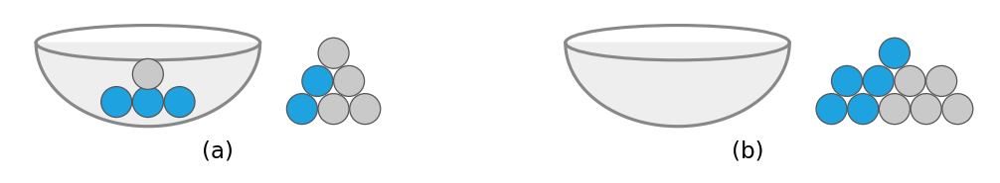

*Figure 2. A bowl holding three blue balls and one gray ball, and an empty bowl*

Now consider the case in which no balls at all are placed in the bowl, as in Figure 2 (b). Is the statement "All the balls in the bowl are blue" true or false? The statement is false if, and only if, its negation is true. Its negation is "There exists a ball in the bowl that is not blue." The only way this negation can be true is for there actually to be a nonblue ball in the bowl, and there is none. Hence the negation is false, and the statement is true "by default".

Let $D$ be the set of all ten balls, $P(x)$ "$`x`$ is in the bowl", and $Q(x)$ "$`x`$ is blue". Then the statement is $`\forall x \in D,\ P(x) \to Q(x)`$. When the bowl is empty, $P(x)$ is false for every $x$, so each conditional $P(x) \to Q(x)$ is true regardless of $Q(x)$, and hence the universal statement is true.

> **Definition:** A statement of the form $\forall x \in D$, if $P(x)$ then $Q(x)$ is called **vacuously true** or **true by default** if, and only if, $P(x)$ is false for every $x$ in $D$. In that case, the conditional $P(x) \to Q(x)$ is true for each $x$ regardless of the truth value of $Q(x)$.

> **Note:** In ordinary language, the words "in general" mean that something is usually, but not always, the case (in general I take the bus, but today I walked). In mathematics, the words "in general" signal that what follows is a generalization that always holds true.

By the same principle, if the domain is the empty set $\emptyset$, then $`\forall x \in \emptyset,\ Q(x)`$ is always true, because there can be no counterexample, and $\exists x \in \emptyset \text{ such that } Q(x)$ is always false, because no element can satisfy the condition. The Python built-in functions `all` and `any` follow the same convention: `all` returns `True` when the given iterable is empty, and `any` returns `False` when it is empty [1].

```python
balls_in_bowl = []                                       # the bowl is empty
print(all(color == "blue" for color in balls_in_bowl))  # are all balls blue?
print(any(color != "blue" for color in balls_in_bowl))  # is some ball not blue?
```

The first line creates an empty list to hold the colors of the balls in the bowl. The second line tests "All the balls in the bowl are blue" and prints `True`, and the third line tests its negation, "There is a ball that is not blue", and prints `False`.

```text
True
False
```

### 2.5 Variants of Universal Conditional Statements

As seen in Chapter 2, a conditional statement has a contrapositive, a converse, and an inverse. The definitions of these terms extend directly to universal conditional statements.

> **Definition:** **Variants of universal conditionals.** Consider a statement of the form $\forall x \in D$, if $P(x)$ then $Q(x)$.
>
> 1. Its **contrapositive** is the statement $\forall x \in D$, if $\sim Q(x)$ then $\sim P(x)$.
> 2. Its **converse** is the statement $\forall x \in D$, if $Q(x)$ then $P(x)$.
> 3. Its **inverse** is the statement $\forall x \in D$, if $\sim P(x)$ then $\sim Q(x)$.

**Example 3.2.5 (Contrapositive, Converse, and Inverse of a Universal Conditional Statement).** Write a formal and an informal contrapositive, converse, and inverse for "If a real number is greater than 2, then its square is greater than 4."

**Solution.** The formal version of the statement is $\forall x \in \mathbf{R}$, if $x > 2$ then $x^2 > 4$. Using the equivalence of "$`x \not> a`$" and "$`x \leq a`$" for all real numbers $x$ and $a$ gives the following.

| Statement | Formal Version | Informal Version | Truth Value and Reason |
|:-----|:-----|:-----|:-----|
| Original | $\forall x \in \mathbf{R}$, if $x > 2$ then $x^2 > 4$ | If a real number is greater than 2, then its square is greater than 4. | True. If $x > 2 > 0$, then $x^2 = x \cdot x > 2x > 4$. |
| Contrapositive | $\forall x \in \mathbf{R}$, if $x^2 \leq 4$ then $x \leq 2$ | If the square of a real number is less than or equal to 4, then the number is less than or equal to 2. | True. It is logically equivalent to the original statement. |
| Converse | $\forall x \in \mathbf{R}$, if $x^2 > 4$ then $x > 2$ | If the square of a real number is greater than 4, then the number is greater than 2. | False. For $x = -3$, $(-3)^2 = 9 > 4$ but $-3 \not> 2$. |
| Inverse | $\forall x \in \mathbf{R}$, if $x \leq 2$ then $x^2 \leq 4$ | If a real number is less than or equal to 2, then the square of the number is less than or equal to 4. | False. For $x = -3$, $-3 \leq 2$ but $(-3)^2 = 9 \not\leq 4$. |

*Table 9. Contrapositive, converse, and inverse of a universal conditional statement and their truth values*

Chapter 2 showed that a conditional statement is logically equivalent to its contrapositive and is not logically equivalent to either its converse or its inverse. These facts generalize directly to universal conditional statements and their contrapositives, converses, and inverses.

**Equivalence with the contrapositive.** Let $P(x)$ and $Q(x)$ be any predicates and $D$ the domain of $x$. Since $p \to q \equiv \sim q \to \sim p$ (Chapter 2), any particular $x$ in $D$ that makes "if $P(x)$ then $Q(x)$" true also makes "if $\sim Q(x)$ then $\sim P(x)$" true, and conversely. Hence "if $P(x)$ then $Q(x)$" is true for all $x$ in $D$ if, and only if, "if $\sim Q(x)$ then $\sim P(x)$" is true for all $x$ in $D$. That is, a universal conditional statement is logically equivalent to its contrapositive.

```math
\forall x \in D,\ P(x) \to Q(x) \equiv \forall x \in D,\ \sim Q(x) \to \sim P(x)
```

**Nonequivalence with the converse and inverse.** In Table 9, the original statement is true but its converse is false. Since a universal conditional statement can have a different truth value from its converse, it is not logically equivalent to its converse. In the same table the inverse is also false, so a universal conditional statement is not logically equivalent to its inverse either.

```math
\forall x \in D,\ P(x) \to Q(x) \not\equiv \forall x \in D,\ Q(x) \to P(x)
```

```math
\forall x \in D,\ P(x) \to Q(x) \not\equiv \forall x \in D,\ \sim P(x) \to \sim Q(x)
```

> **Note:** The contrapositive of the converse $`\forall x,\ Q(x) \to P(x)`$ is $`\forall x,\ \sim P(x) \to \sim Q(x)`$, which is the inverse. Hence the converse and the inverse are logically equivalent to each other, and in Table 9 they indeed have the same truth value.

### 2.6 Necessary and Sufficient Conditions, Only If

The definitions of necessary, sufficient, and "only if" can also be extended to universal conditional statements.

> **Definition:** **Necessary, sufficient, and only if.**
>
> - "$`\forall x`$, $r(x)$ is a **sufficient condition** for $s(x)$" means "$`\forall x`$, if $r(x)$ then $s(x)$".
> - "$`\forall x`$, $r(x)$ is a **necessary condition** for $s(x)$" means "$`\forall x`$, if $\sim r(x)$ then $\sim s(x)$", which by the contrapositive is equivalent to "$`\forall x`$, if $s(x)$ then $r(x)$".
> - "$`\forall x`$, $r(x)$ **only if** $s(x)$" means "$`\forall x`$, if $\sim s(x)$ then $\sim r(x)$", which by the contrapositive is equivalent to "$`\forall x`$, if $r(x)$ then $s(x)$".

The three expressions are summarized as universal conditional statements below.

| Expression | Universal Conditional Statement | Equivalent Form by the Contrapositive |
|:-----|:-----|:-----|
| $r(x)$ is a sufficient condition for $s(x)$ | $`\forall x,\ r(x) \to s(x)`$ | $`\forall x,\ \sim s(x) \to \sim r(x)`$ |
| $r(x)$ is a necessary condition for $s(x)$ | $`\forall x,\ s(x) \to r(x)`$ | $`\forall x,\ \sim r(x) \to \sim s(x)`$ |
| $r(x)$ only if $s(x)$ | $`\forall x,\ r(x) \to s(x)`$ | $`\forall x,\ \sim s(x) \to \sim r(x)`$ |

*Table 10. Sufficient condition, necessary condition, and only if written as universal conditional statements*

**Example 3.2.6 (Necessary and Sufficient Conditions).** Rewrite each of the following as a universal conditional statement, quantified either explicitly or implicitly, without using the word necessary or sufficient.

- (a) Squareness is a sufficient condition for rectangularity.
- (b) Being at least 35 years old is a necessary condition for being president of the United States.

**Solution.**

- (a) A formal version is "$`\forall x`$, if $x$ is a square, then $x$ is a rectangle." With implicit universal quantification it is "If a figure is a square, then it is a rectangle."
- (b) A formal version is "$`\forall`$ person $x$, if $x$ is younger than 35, then $x$ cannot be president of the United States." By the equivalence between a statement and its contrapositive, it can also be written "$`\forall`$ person $x$, if $x$ is president of the United States, then $x$ is at least 35 years old."

**Example 3.2.7 (Only If).** Rewrite "A product of two numbers is 0 only if one of the numbers is 0" as a universal conditional statement.

**Solution.** By definition, "$`r`$ only if $s$" means "if not $s$, then not $r$", so informally the answer is "If it is not the case that one of two numbers is 0, then the product of the numbers is not 0." By De Morgan's laws, "it is not the case that one of two numbers is 0" is the same as "neither of the two numbers is 0", so the sentence can be written "If neither of two numbers is 0, then the product of the numbers is not 0." By the equivalence between a statement and its contrapositive, it can also be written "If a product of two numbers is 0, then one of the numbers is 0." Formally, $\forall a, b \in \mathbf{R}$, if $ab = 0$ then $a = 0$ or $b = 0$.

---

<br>

## 3. Statements with Multiple Quantifiers

### 3.1 Rules for Interpreting Different Quantifiers

Consider a visit to a factory that manufactures computer microchips, during which the guide says, "There is a person supervising every detail of the production process." This sentence contains informal versions of both the existential quantifier "there is" and the universal quantifier "every". It can be interpreted in the following two ways.

- A single person supervises every detail of the production process.
- Each detail of the production process has someone supervising it, though different details may have different supervisors.

Either reading is possible, so the sentence on its own is ambiguous, and only the surrounding conversation could decide which was meant. Everyday speech tolerates such ambiguity, relying on context and occasionally ending in a misunderstanding. Mathematics, formal logic, and computer science cannot tolerate it, because a statement must mean the same thing to every reader. Software development is a typical case: at the start of a project, an analyst and a client work together to replace the client's loose description of what is wanted with a precise specification that both accept.

Because many important technical statements contain both $\exists$ and $\forall$, a convention has developed for interpreting them uniformly.

> **Key Point:** If a statement has quantifiers of different kinds, read it as a sequence of actions, one for each quantifier, carried out in the order in which the quantifiers are written.

For instance, consider a statement of the following form.

```math
\forall x \in D,\ \exists y \in E \text{ such that } P(x, y)
```

To show that such a statement is true, one must be able to meet the following challenge.

- A challenger picks any element of $D$ at all; call it $x$.
- The prover must then produce an element $y$ of $E$ such that this $x$ and the chosen $y$ together satisfy $P(x, y)$.

**Since $y$ is chosen only after $x$ is known, a different $y$ may be used for each $x$.** The scope of $\forall x$ covers the whole statement, while the scope of $\exists y$ begins in the middle, and this is why $y$ is allowed to depend on $x$.

Now consider a statement of the following form, in which $\exists$ comes before $\forall$.

```math
\exists x \in D \text{ such that } \forall y \in E,\ P(x, y)
```

To show that such a statement is true, the prover must name one single element $x$ of $D$ with the following property.

- Once $x$ has been named, a challenger may pick any element of $E$ at all; call it $y$.
- The prover must show that the fixed $x$ and this $y$ together satisfy $P(x, y)$.

The single $x$ must work for every $y$ the challenger might pick. **Once named, $x$ may not be changed,** because the scope of $\exists x$ covers the entire statement. The order of steps in the two forms is compared below.

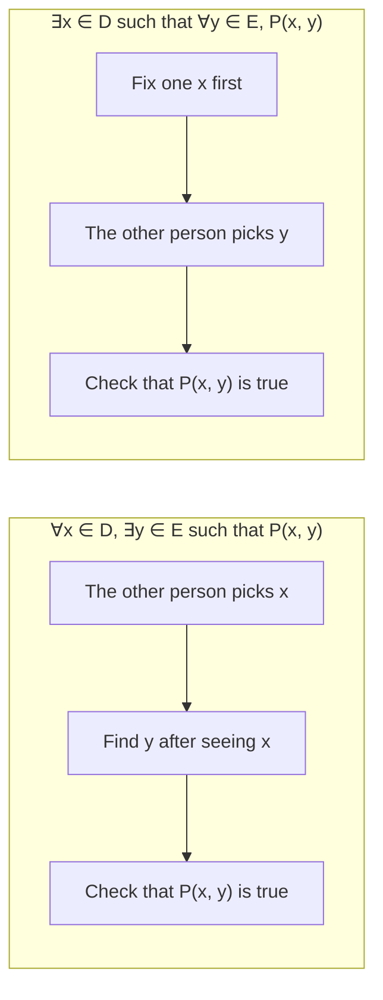

*Figure 3. Order of steps for showing the truth of universal existential and existential universal statements*

**Example 3.3.1 (Truth of a $\forall\exists$ Statement in a Tarski World).** Consider the Tarski world in Figure 4.

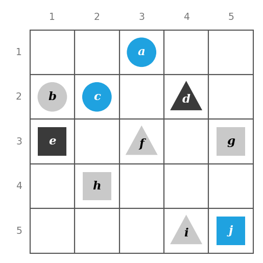

*Figure 4. A Tarski world with ten objects*

| Object | Shape | Color | Row | Column |
|:-----|:-----|:-----|:-----|:-----|
| $a$ | Circle | Blue | 1 | 3 |
| $b$ | Circle | Gray | 2 | 1 |
| $c$ | Circle | Blue | 2 | 2 |
| $d$ | Triangle | Black | 2 | 4 |
| $e$ | Square | Black | 3 | 1 |
| $f$ | Triangle | Gray | 3 | 3 |
| $g$ | Square | Gray | 3 | 5 |
| $h$ | Square | Gray | 4 | 2 |
| $i$ | Triangle | Gray | 5 | 4 |
| $j$ | Square | Blue | 5 | 5 |

*Table 11. Shape, color, and position of each object in Figure 4*

Show that the following statement is true in this world: "For every triangle $x$, there is a square $y$ such that $x$ and $y$ have the same color."

**Solution.** The statement says that for any triangle a challenger picks, a square of the same color can be found. There are only three triangles, $d$, $f$, and $i$, so it suffices to find a square of the same color for each of them.

| Given $x$ | Choose $y$ | Check That $y$ Has the Same Color as $x$ |
|:-----|:-----|:-----|
| $d$ (black) | $e$ (black) | Yes |
| $f$ or $i$ (gray) | $h$ or $g$ (gray) | Yes |

*Table 12. Choice of a square with the same color as each triangle*

**Example 3.3.2 (Truth of a $\exists\forall$ Statement in a Tarski World).** Show that the following statement is true in the world of Figure 4: "There is a triangle $x$ such that for every circle $y$, $x$ is to the right of $y$."

**Solution.** The statement says that some single triangle lies to the right of every circle. The circles are $a$ (column 3), $b$ (column 1), and $c$ (column 2). Choosing $d$ or $i$, both in column 4, gives a triangle to the right of all three circles. On the other hand, $f$ is in column 3, the same column as $a$, so it is not to the right of $a$.

| Choose $x$ | Possible $y$ | Check That $x$ Is to the Right of $y$ |
|:-----|:-----|:-----|
| $d$ or $i$ (column 4) | $a$ (column 3) | Yes |
| | $b$ (column 1) | Yes |
| | $c$ (column 2) | Yes |

*Table 13. Check of a triangle to the right of all the circles*

> **Key Point:** **Interpreting statements with two different quantifiers.** To establish the truth of $`\forall x \in D,\ \exists y \in E \text{ such that } P(x, y)`$, let an arbitrary element $x$ of $D$ be chosen by someone else, and then find a $y$ in $E$ that works for that particular $x$. To establish the truth of $`\exists x \in D \text{ such that } \forall y \in E,\ P(x, y)`$, find one particular $x$ in $D$ that works for every $y$ in $E$ that anyone might choose.

### 3.2 Interpreting Statements with Several Quantifiers

**Example 3.3.3 (Interpreting Statements with More Than One Quantifier).** A cafeteria line has four stations. Green salad and fruit salad are offered at the salad station, spaghetti and fish at the main course station, pie and cake at the dessert station, and milk, soda, and coffee at the beverage station. Three students, Uta, Tim, and Yuen, pass through the line and take the following items.

| Student | Salad | Main Course | Dessert | Beverage |
|:-----|:-----|:-----|:-----|:-----|
| Uta | Green salad | Spaghetti | Pie | Milk |
| Tim | Fruit salad | Fish | Pie, cake | Milk, coffee |
| Yuen | (none) | Spaghetti, fish | Pie | Soda |

*Table 14. Items chosen by three students at each station*

Write each of the following statements informally and find its truth value.

- (a) $\exists$ an item $I$ such that $\forall$ student $S$, $S$ chose $I$.
- (b) $\exists$ a student $S$ such that $\forall$ item $I$, $S$ chose $I$.
- (c) $\exists$ a student $S$ such that $\forall$ station $Z$, $\exists$ an item $I$ in $Z$ such that $S$ chose $I$.
- (d) $\forall$ student $S$, $\forall$ station $Z$, $\exists$ an item $I$ in $Z$ such that $S$ chose $I$.

**Solution.**

- (a) "There is an item that was chosen by every student." True; every student chose pie.
- (b) "There is a student who chose every available item." False; no student chose all nine items.
- (c) "There is a student who chose at least one item from every station." True; both Uta and Tim did.
- (d) "Every student chose at least one item from every station." False; Yuen did not choose a salad.

### 3.3 From Informal to Formal Language

Problems usually arrive in everyday language, and solving them often begins with restating them formally.

**Example 3.3.4 (Translating Statements with Multiple Quantifiers into Formal Language).** The **reciprocal** of a real number $a$ is a real number $b$ such that $ab = 1$. The following two statements are true. Rewrite them formally using quantifiers and variables.

- (a) Every nonzero real number has a reciprocal.
- (b) There is a real number with no reciprocal.

**Solution.**

- (a) $\forall$ nonzero real number $u$, $\exists$ a real number $v$ such that $uv = 1$.
- (b) $\exists$ a real number $c$ such that $\forall$ real number $d$, $cd \neq 1$.

In (b), taking $c = 0$ gives $0 \cdot d = 0 \neq 1$ for every real number $d$, so 0 has no reciprocal.

**Example 3.3.5 (There Is a Smallest Positive Integer).** Every integer is a real number, and real numbers are of three types: positive, negative, and zero (zero being neither positive nor negative). Write "There is a smallest positive integer" formally using both $\exists$ and $\forall$.

**Solution.** A smallest positive integer is a positive integer $m$ that is less than or equal to every positive integer $n$, whichever $n$ is chosen.

$\exists$ a positive integer $m$ such that $\forall$ positive integer $n$, $m \leq n$.

The statement is true: the positive integer 1 satisfies $1 \leq n$ for every positive integer $n$ (top of Figure 5).

**Example 3.3.6 (There Is No Smallest Positive Real Number).** The positive real numbers correspond to all the points to the right of 0 on the number line. No matter how small a positive real number $x$ is, the number $x/2$ is both positive and less than $x$ (bottom of Figure 5). Thus "There is no smallest positive real number" is true. Write this statement formally using both $\forall$ and $\exists$.

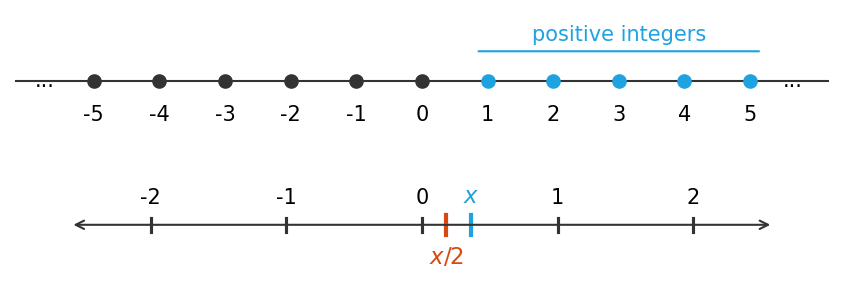

*Figure 5. A number line with the positive integers marked, and a real line with a positive x and x/2 marked*

**Solution.** $\forall$ positive real number $x$, $\exists$ a positive real number $y$ such that $y < x$.

The reason that $0 < x/2 < x$ follows from the properties of the real numbers.

1. Since $x$ is positive, $0 < x$.
2. Adding $x$ to both sides of $0 < x$ gives $x < 2x$. Hence $0 < x < 2x$.
3. Multiply each part of this inequality by the positive number $\frac{1}{2}$. Multiplying by a positive number does not change the direction of an inequality, so $0 < x/2 < x$.

Notice that this statement is the negation of "$`\exists`$ a positive real number $m$ such that $\forall$ positive real number $n$, $m \leq n$" (there is a smallest positive real number). Applying the negation rule of Section 3.5 gives "$`\forall`$ positive real number $m$, $\exists$ a positive real number $n$ such that $m > n$", which differs from the answer above only in the names of the variables.

**Example 3.3.7 (The Definition of Limit of a Sequence).** The definition of the limit of a sequence, studied in calculus, uses both quantifiers $\forall$ and $\exists$ and also if-then. The statement that the limit of the sequence $a_n$ as $n$ goes to infinity equals $L$ is written $\lim_{n \to \infty} a_n = L$, and it means that the values of $a_n$ become **arbitrarily** close to $L$ as $n$ gets larger and larger without bound. More precisely, given any positive number $\varepsilon$, an integer $N$ can be found such that whenever $n$ is larger than $N$, the number $a_n$ sits between $L - \varepsilon$ and $L + \varepsilon$ on the number line. Symbolically:

```math
\forall \varepsilon > 0,\ \exists \text{ an integer } N \text{ such that } \forall \text{ integer } n,\ n > N \to L - \varepsilon < a_n < L + \varepsilon
```

Because the definition nests three quantifiers and a conditional, it is often found difficult on first reading, and a concrete sequence helps. Let $a_n = 1 + (-1)^n \frac{1.6}{n}$, $L = 1$, and $\varepsilon = 0.25$. Then $\lvert a_n - 1 \rvert = \frac{1.6}{n}$, so $L - \varepsilon < a_n < L + \varepsilon$ is equivalent to $\frac{1.6}{n} < 0.25$, that is, $n > 6.4$. Hence with $N = 6$, every integer $n > 6$ puts $a_n$ inside the band (Figure 6). If $\varepsilon$ is reduced to $0.1$, the condition becomes $\frac{1.6}{n} < 0.1$, that is, $n > 16$, so $N = 16$ is needed.

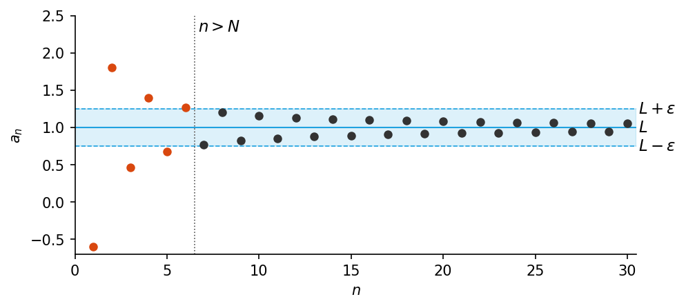

*Figure 6. Terms of a sequence converging to 1 and a band of width ε, with every term after n > N inside the band*

> **[Calculus]** Treating limits of sequences rigorously with this $\varepsilon$-$`N`$ definition is the starting point of calculus and analysis. Because $\forall \varepsilon$ comes before $\exists N$ in the definition, $N$ is chosen after $\varepsilon$ is given, and a different $N$ may be used for each $\varepsilon$. In the example above, reducing $\varepsilon$ from 0.25 to 0.1 increased the required $N$ from 6 to 16.

### 3.4 Ambiguous Language

There is a famous ambiguous drawing that can be seen either as the silhouette of a young woman wearing a large hat or as the face of an elderly woman with a large nose. In this drawing, the mouth of the elderly woman is the necklace of the young woman. Once most people see one of the images, they find it difficult to perceive the other.

So it is with ambiguous language. Once the factory guide's sentence at the beginning of Section 3.1 has been interpreted in one way, it can be hard to see that it could be understood in the other way, even after the two possible meanings are explained. Statements written informally may be open to multiple interpretations, but their truth or falsity cannot be determined without interpreting them one way or another. Therefore context must be used to ascertain their meaning as best as possible.

### 3.5 Negations of Statements with Multiple Quantifiers

Statements with several quantifiers can be negated with the same rules used for simpler quantified statements. Recall the following two rules.

```math
\sim(\forall x \in D,\ P(x)) \equiv \exists x \in D \text{ such that } \sim P(x)
```

```math
\sim(\exists x \in D \text{ such that } P(x)) \equiv \forall x \in D,\ \sim P(x)
```

Applying these rules from the outermost quantifier inward gives the following.

1. $`\sim(\forall x \in D,\ \exists y \in E \text{ such that } P(x, y))`$
2. $\equiv \exists x \in D \text{ such that } \sim(\exists y \in E \text{ such that } P(x, y))$ (rule for negating a universal statement)
3. $`\equiv \exists x \in D \text{ such that } \forall y \in E,\ \sim P(x, y)`$ (rule for negating an existential statement)

In the same way, the following is obtained.

1. $`\sim(\exists x \in D \text{ such that } \forall y \in E,\ P(x, y))`$
2. $`\equiv \forall x \in D,\ \sim(\forall y \in E,\ P(x, y))`$ (rule for negating an existential statement)
3. $`\equiv \forall x \in D,\ \exists y \in E \text{ such that } \sim P(x, y)`$ (rule for negating a universal statement)

> **Key Point:** **Negations of statements with two different quantifiers.**
>
> - $`\sim(\forall x \in D,\ \exists y \in E \text{ such that } P(x, y)) \equiv \exists x \in D \text{ such that } \forall y \in E,\ \sim P(x, y)`$
> - $`\sim(\exists x \in D \text{ such that } \forall y \in E,\ P(x, y)) \equiv \forall x \in D,\ \exists y \in E \text{ such that } \sim P(x, y)`$
>
> That is, each time the negation moves inside a quantifier, $\forall$ and $\exists$ are exchanged, the order of the quantifiers stays the same, and the negation finally attaches to the innermost predicate.

When quantifiers of the same kind follow one another, applying the same rule twice gives $`\sim(\forall x \in D,\ \forall y \in E,\ P(x, y)) \equiv \exists x \in D \text{ such that } \exists y \in E \text{ such that } \sim P(x, y)`$ and $`\sim(\exists x \in D \text{ such that } \exists y \in E \text{ such that } P(x, y)) \equiv \forall x \in D,\ \forall y \in E,\ \sim P(x, y)`$.

**Example 3.3.8 (Negating Statements in a Tarski World).** Refer again to the Tarski world of Figure 4. Write a negation for each of the following statements, and determine which is true, the given statement or its negation.

- (a) For every square $x$, there is a circle $y$ such that $x$ and $y$ have the same color.
- (b) There is a triangle $x$ such that for every square $y$, $x$ is to the right of $y$.

**Solution.**

- (a) The first version of the negation is "$`\exists`$ a square $x$ such that $\sim$($\exists$ a circle $y$ such that $x$ and $y$ have the same color)", and the final version is "$`\exists`$ a square $x$ such that $\forall$ circle $y$, $x$ and $y$ do not have the same color." The negation is true. Square $e$ is black, and the circles $a$, $b$, and $c$ are blue, gray, and blue, so no circle is black. That is, there is a square, $e$, that does not have the same color as any circle.
- (b) The given statement is "$`\exists`$ a triangle $x$ such that $\forall$ square $y$, $x$ is to the right of $y$." The first version of the negation is "$`\forall`$ triangle $x$, $\sim$($\forall$ square $y$, $x$ is to the right of $`y`$)", and the final version is "$`\forall`$ triangle $x$, $\exists$ a square $y$ such that $x$ is not to the right of $y$." The negation is true. The triangles $d$, $f$, and $i$ are in columns 4, 3, and 4, so none of them is to the right of square $g$ or square $j$, which are in column 5.

### 3.6 Order of Quantifiers

Consider the following two statements.

- $\forall$ person $x$, $\exists$ a person $y$ such that $x$ loves $y$.
- $\exists$ a person $y$ such that $\forall$ person $x$, $x$ loves $y$.

Only the order of the quantifiers differs, yet the meanings are far apart. The first says that each person loves somebody, possibly a different somebody for each person; the second says that one particular individual is loved by everybody. The pair illustrates the following basic fact about statements with two different quantifiers.

> **Key Point:** In a statement containing both $\forall$ and $\exists$, changing the order of the quantifiers can significantly change the meaning of the statement.

When two adjacent quantifiers are **of the same type**, however, they may be interchanged without changing the meaning. For example, the commutative property of addition of real numbers, "$`\forall`$ real number $x$, $\forall$ real number $y$, $x + y = y + x$", means the same as "$`\forall`$ real number $y$, $\forall$ real number $x$, $x + y = y + x$". Thus the property can be expressed a little less formally as "$`\forall`$ real numbers $x$ and $y$, $x + y = y + x$".

> **Note:** There is a one-way implication between the two orders. If $`\exists x\ \forall y,\ P(x, y)`$ is true, then the one $x$ that makes it true works for every $y$, so $`\forall y\ \exists x,\ P(x, y)`$ is also true. The converse does not hold in general. In the love example above, if the second statement is true then the first is also true, but the truth of the first does not make the second true.

**Example 3.3.9 (Quantifier Order in a Tarski World).** In the Tarski world of Figure 4, determine whether the following two statements have the same truth value.

- (a) For every square $x$, there is a triangle $y$ such that $x$ and $y$ have different colors.
- (b) There exists a triangle $y$ such that for every square $x$, $x$ and $y$ have different colors.

**Solution.** Statement (a) says that for any square a challenger picks, a triangle of a different color can be found, and it is true. For square $g$ or $h$ (gray), use triangle $d$ (black); for $e$ (black), use triangle $f$ or $i$ (gray); and for $j$ (blue), use $d$ (black) or $f$ or $i$ (gray).

Statement (b) claims that one particular triangle differs in color from every square, and it is false. The gray triangles $f$ and $i$ fail because the squares $g$ and $h$ are gray, and the black triangle $d$ fails because the square $e$ is black. Since these are all the triangles, no choice works. So (a) is true and (b) is false, and the two statements have opposite truth values.

> **Caution:** In a statement with two different quantifiers, interchanging them can turn a true statement into a false one, or the reverse.

### 3.7 Formal Logical Notation

In some areas of computer science, logical statements are expressed in purely symbolic notation. The notation describes all properties of variables with predicates and omits the words such that in existential statements. When figuring out the meaning of a formal statement, it helps to think the words such that each time they are appropriate. The formalism depends on the following facts.

- "$`\forall x`$ in $D$, $P(x)$" can be written as $`\forall x\,(x \in D \to P(x))`$.
- "$`\exists x`$ in $D$ such that $P(x)$" can be written as $`\exists x\,(x \in D \wedge P(x))`$.

> **Caution:** $\forall$ must be paired with $\to$, and $\exists$ with $\wedge$. The formula $`\forall x\,(\text{Circle}(x) \wedge \text{Above}(x, f))`$ says "every object is a circle and is above $f$", which is not what is intended. The formula $`\exists x\,(\text{Square}(x) \to \text{Black}(x))`$ is true as soon as there is one object that is not a square, because the conditional with a false hypothesis is true for that object, so it is true even when there is no black square.

**Example 3.3.10 (Formalizing Statements in a Tarski World).** Consider once more the Tarski world of Figure 4. Let $\text{Triangle}(x)$, $\text{Circle}(x)$, and $\text{Square}(x)$ mean "$`x`$ is a triangle", "$`x`$ is a circle", and "$`x`$ is a square"; let $\text{Blue}(x)$, $\text{Gray}(x)$, and $\text{Black}(x)$ mean "$`x`$ is blue", "$`x`$ is gray", and "$`x`$ is black". Let $\text{RightOf}(x, y)$, $\text{Above}(x, y)$, and $\text{SameColor}(x, y)$ mean "$`x`$ is to the right of $y$", "$`x`$ is above $y$", and "$`x`$ has the same color as $y$", and use the notation $x = y$ for the predicate "$`x`$ is equal to $y$". Let the common domain $D$ of all variables be the set of all objects in the Tarski world. Use formal logical notation to write each of the following statements, and write a formal negation for each statement.

- (a) For every circle $x$, $x$ is above $f$.
- (b) There is a square $x$ such that $x$ is black.
- (c) For every circle $x$, there is a square $y$ such that $x$ and $y$ have the same color.
- (d) There is a square $x$ such that for every triangle $y$, $x$ is to the right of $y$.

**Solution.**

(a) The statement is $`\forall x\,(\text{Circle}(x) \to \text{Above}(x, f))`$. Its negation is derived as follows.

1. $`\sim(\forall x\,(\text{Circle}(x) \to \text{Above}(x, f)))`$
2. $`\equiv \exists x\, \sim(\text{Circle}(x) \to \text{Above}(x, f))`$ (by the law for negating a $\forall$ statement)
3. $`\equiv \exists x\,(\text{Circle}(x) \wedge \sim\text{Above}(x, f))`$ (by the law for negating an if-then statement)

(b) The statement is $`\exists x\,(\text{Square}(x) \wedge \text{Black}(x))`$. Its negation is derived as follows.

1. $`\sim(\exists x\,(\text{Square}(x) \wedge \text{Black}(x)))`$
2. $`\equiv \forall x\, \sim(\text{Square}(x) \wedge \text{Black}(x))`$ (by the law for negating a $\exists$ statement)
3. $`\equiv \forall x\,(\sim\text{Square}(x) \vee \sim\text{Black}(x))`$ (by De Morgan's law)

(c) The statement is $`\forall x\,(\text{Circle}(x) \to \exists y\,(\text{Square}(y) \wedge \text{SameColor}(x, y)))`$. Its negation is derived as follows.

1. $`\sim(\forall x\,(\text{Circle}(x) \to \exists y\,(\text{Square}(y) \wedge \text{SameColor}(x, y))))`$
2. $`\equiv \exists x\, \sim(\text{Circle}(x) \to \exists y\,(\text{Square}(y) \wedge \text{SameColor}(x, y)))`$ (by the law for negating a $\forall$ statement)
3. $`\equiv \exists x\,(\text{Circle}(x) \wedge \sim(\exists y\,(\text{Square}(y) \wedge \text{SameColor}(x, y))))`$ (by the law for negating an if-then statement)
4. $`\equiv \exists x\,(\text{Circle}(x) \wedge \forall y\, \sim(\text{Square}(y) \wedge \text{SameColor}(x, y)))`$ (by the law for negating a $\exists$ statement)
5. $`\equiv \exists x\,(\text{Circle}(x) \wedge \forall y\,(\sim\text{Square}(y) \vee \sim\text{SameColor}(x, y)))`$ (by De Morgan's law)

(d) The statement is $`\exists x\,(\text{Square}(x) \wedge \forall y\,(\text{Triangle}(y) \to \text{RightOf}(x, y)))`$. Its negation is derived as follows.

1. $`\sim(\exists x\,(\text{Square}(x) \wedge \forall y\,(\text{Triangle}(y) \to \text{RightOf}(x, y))))`$
2. $`\equiv \forall x\, \sim(\text{Square}(x) \wedge \forall y\,(\text{Triangle}(y) \to \text{RightOf}(x, y)))`$ (by the law for negating a $\exists$ statement)
3. $`\equiv \forall x\,(\sim\text{Square}(x) \vee \sim(\forall y\,(\text{Triangle}(y) \to \text{RightOf}(x, y))))`$ (by De Morgan's law)
4. $`\equiv \forall x\,(\sim\text{Square}(x) \vee \exists y\, \sim(\text{Triangle}(y) \to \text{RightOf}(x, y)))`$ (by the law for negating a $\forall$ statement)
5. $`\equiv \forall x\,(\sim\text{Square}(x) \vee \exists y\,(\text{Triangle}(y) \wedge \sim\text{RightOf}(x, y)))`$ (by the law for negating an if-then statement)

If $\text{Above}(x, y)$ is interpreted in the same way as $\text{RightOf}$, as "$`x`$ is in a higher row than $y$ (but possibly in a different column)", then all four statements are true in the world of Figure 4 and all four negations are false. (a) The circles $a$ (row 1), $b$ and $c$ (row 2) are all above $f$ in row 3. (b) $e$ is a black square. (c) The circles $a$ and $c$ (blue) have the square $j$ (blue), and $b$ (gray) has $g$ or $h$ (gray). (d) The square $g$ or $j$ in column 5 is to the right of the triangles $d$, $f$, and $i$ (columns 4, 3, and 4).

Fully formal notation has a cost: it is long and far from intuition, so a slip made while using it can easily go unnoticed. Its benefit is that operations such as negation become purely mechanical, to the point that a computer can carry them out. With practice, formal manipulation and intuition check each other, each catching errors the other misses. This notation is the working language of several areas of computer science, among them artificial intelligence, program verification, and automata theory and formal languages.

> **Definition:** The **language of first-order logic** is the language built from quantifier symbols, variables, predicates, and logical connectives. Although it is in many ways simpler than everyday language, becoming fluent in it takes the kind of practice that any foreign language requires.

### 3.8 Prolog

**Prolog**, whose name abbreviates programming in logic, is a programming language created in France in the 1970s by A. Colmerauer and P. Roussel for work in artificial intelligence. A basic Prolog program lists statements that describe a situation and then poses questions about it. The language itself contains the search and inference machinery that finds answers from the stated facts, so the programmer does not need to write a separate procedure for each kind of question.

**Example 3.3.11 (A Prolog Program).** Colored blocks are stacked in two columns on a table, as in the following picture. $g$ is the gray block, $b_1$, $b_2$, and $b_3$ are blue blocks 1, 2, and 3, and $w_1$ and $w_2$ are white blocks 1 and 2.

```text
   ┌──────┐    ┌──────┐
   │  g   │    │  w2  │
   ├──────┤    ├──────┤
   │  b1  │    │  b2  │
   ├──────┤    ├──────┤
   │  w1  │    │  b3  │
 ══╧══════╧════╧══════╧══
```

*Figure 7. Gray, blue, and white blocks stacked in two columns on a table*

The following Prolog statements describe this picture and ask two questions about it.

```text
isabove(g, b1)      color(g, gray)      color(b3, blue)
isabove(b1, w1)     color(b1, blue)     color(w1, white)
isabove(w2, b2)     color(b2, blue)     color(w2, white)
isabove(b2, b3)     isabove(X, Z) if isabove(X, Y) and isabove(Y, Z)
1. ?color(b1, blue)          2. ?isabove(X, w1)
```

The statements `isabove(g, b1)` and `color(g, gray)` are interpreted as "$`g`$ is above $b_1$" and "$`g`$ is colored gray". The statement `isabove(X, Z) if isabove(X, Y) and isabove(Y, Z)` is interpreted as "For all $X$, $Y$, and $Z$, if $X$ is above $Y$ and $Y$ is above $Z$, then $X$ is above $Z$." In this program, names that begin with a capital letter are variables.

Question 1, `?color(b1, blue)`, asks whether block $b_1$ is colored blue, and Prolog answers Yes. Question 2, `?isabove(X, w1)`, asks for all blocks $X$ for which the predicate "$`X`$ is above $w_1$" is true, and Prolog answers by listing all such blocks: `X = b1, X = g`. The solution `X = b1` is found by merely searching the given facts. However, `X = g` must be **inferred** from the facts `isabove(g, b1)` and `isabove(b1, w1)` and the rule `isabove(X, Z) if isabove(X, Y) and isabove(Y, Z)`. Substituting $g$, $b_1$, and $w_1$ for $X$, $Y$, and $Z$ in the rule is the universal instantiation of Section 4.1, and drawing the conclusion from the two facts is modus ponens.

If the following questions are added to the program, Prolog gives the answers in the table.

| Question | Meaning | Answer |
|:-----|:-----|:-----|
| (a) `?isabove(b2, w1)` | Is $b_2$ above $w_1$? | No |
| (b) `?color(w1, X)` | For what colors $X$ is "$`w_1`$ is colored $X$" true? | `X = white` |
| (c) `?color(X, blue)` | For what blocks $X$ is "$`X`$ is colored blue" true? | `X = b1, X = b2, X = b3` |

*Table 15. Questions added to the block program and Prolog's answers*

In (a), $b_2$ is in a different column from $w_1$, so `isabove(b2, w1)` cannot be derived from the given facts and rule. Prolog answers No to a question it cannot derive.

> **Note:** Different Prolog implementations follow different conventions for representing constant, variable, and predicate names and forms of questions and answers; the notation above is similar to that of Edinburgh Prolog. In ISO standard Prolog, facts and rules end with a period, a rule is written like `isabove(X, Z) :- isabove(X, Y), isabove(Y, Z).`, and a question like `?- color(b1, blue).`. A standard processor searches for answers depth first, trying clauses from top to bottom and the conditions of a rule from left to right [2]. With the rule written exactly as above, question (a), whose answer is No, therefore applies the same rule again and again and never terminates. Real programs avoid the problem by separating the relation `on` (directly on top of) from the derived relation `above`, writing `above(X, Z) :- on(X, Z).` and `above(X, Z) :- on(X, Y), above(Y, Z).`.

---

<br>

## 4. Arguments with Quantified Statements

### 4.1 Universal Instantiation

> **Definition:** **Universal instantiation** is the rule that a property holding for **every** element of a set holds for **each particular** element of that set. In symbols, if $`\forall x \in D,\ Q(x)`$ is true and $a$ is a particular element of $D$, then $Q(a)$ is true.

The name reflects that the particular case is obtained as an instance of the general, universal fact. The rule is valid simply because of what it means for a universal statement to be true. The best-known example is the following argument.

- All men are mortal.
- Socrates is a man.
- $\therefore$ Socrates is mortal.

Universal instantiation underlies essentially all deductive reasoning. Formulas, definitions, and theorems are general patterns, each applied again and again to particular cases. A theorem asserts a property of every object of some type; whenever a particular object of that type appears, universal instantiation transfers the property to it. A single proof or solution may use this step ten, twenty, or more times.

For example, suppose $r^{k+1} \cdot r$ must be simplified, where $r$ is a particular real number and $k$ is a particular integer. Algebra shows that the following universal statements are true.

1. For every real number $x$ and all integers $m$ and $n$, $x^m \cdot x^n = x^{m+n}$.
2. For every real number $x$, $x^1 = x$.

The computation then proceeds as follows.

```math
r^{k+1} \cdot r = r^{k+1} \cdot r^1 = r^{(k+1)+1} = r^{k+2}
```

The first equality is step 1, the second is step 2, and the last is basic algebra. The reasoning behind steps 1 and 2 is broken down below.

| Step | Universal Truth | Particular Instance | Conclusion |
|:-----|:-----|:-----|:-----|
| Step 1 | For every real number $x$, $x^1 = x$ | $r$ is a particular real number | $\therefore r^1 = r$ |
| Step 2 | For every real number $x$ and all integers $m$ and $n$, $x^m \cdot x^n = x^{m+n}$ | $r$ is a particular real number, and $k + 1$ and 1 are particular integers | $\therefore r^{k+1} \cdot r^1 = r^{(k+1)+1}$ |

*Table 16. Universal instantiation in each step of a power computation*

Both arguments are examples of universal instantiation.

> **Note:** Strictly speaking, the law of exponents $x^m \cdot x^n = x^{m+n}$ holds when the powers are defined, that is, when $x \neq 0$ or when $m$ and $n$ are nonnegative integers. If $x = 0$ and an exponent is negative, an undefined expression such as $0^{-1}$ appears. The computation above assumes that $r^{k+1}$ is defined.

### 4.2 Universal Modus Ponens

Combining universal instantiation with modus ponens from Chapter 2 gives the valid argument form called **universal modus ponens**. The first premise is called the **major premise**, and the second the **minor premise**.

| Part | Formal Version | Informal Version |
|:-----|:-----|:-----|
| Major premise | $\forall x$, if $P(x)$ then $Q(x)$. | If $x$ makes $P(x)$ true, then $x$ makes $Q(x)$ true. |
| Minor premise | $P(a)$ for a particular $a$. | $a$ makes $P(x)$ true. |
| Conclusion | $\therefore Q(a)$ | $\therefore a$ makes $Q(x)$ true. |

*Table 17. The form of universal modus ponens*

If the major premise were phrased as "Everything that makes $P(x)$ true makes $Q(x)$ true", universal instantiation alone would yield the conclusion. In most mathematical situations, though, the if-then phrasing is the natural one.

**Example 3.4.1 (Recognizing Universal Modus Ponens).** Rewrite the following argument using quantifiers, variables, and predicate symbols, and decide whether it is valid.

- If an integer is even, then its square is even.
- $k$ is a particular integer that is even.
- $\therefore$ $k^2$ is even.

**Solution.** The major premise can be rewritten as "$`\forall x`$, if $x$ is an even integer then $x^2$ is even." Let $E(x)$ be "$`x`$ is an even integer", let $S(x)$ be "$`x^2`$ is even", and let $k$ stand for a particular integer that is even. Then the argument has the following form.

- $\forall x$, if $E(x)$ then $S(x)$.
- $E(k)$, for a particular $k$.
- $\therefore S(k)$

This argument has the form of universal modus ponens and is therefore valid.

**Example 3.4.2 (Drawing Conclusions Using Universal Modus Ponens).** Write the conclusion that can be inferred from the following two premises using universal modus ponens.

- (Pythagorean theorem) If $T$ is any right triangle with hypotenuse $c$ and legs $a$ and $b$, then $c^2 = a^2 + b^2$.
- A certain right triangle has both legs equal to 1 and hypotenuse $c$.

**Solution.** $c^2 = 1^2 + 1^2 = 2$. Taking the nonnegative square root of both sides of this equation gives $c = \sqrt{2}$. This shows that there is a line segment whose length is $\sqrt{2}$. A proof that $\sqrt{2}$ is not a rational number appears in Chapter 4.

### 4.3 Universal Modus Ponens in a Proof

Chapter 4 discusses methods of proving quantified statements. Here, a proof that the sum of any two even integers is even serves as an example. It uses the definition of even integer: an integer is **even** if, and only if, it equals twice some integer. Formally, "$`\forall`$ integer $x$, $x$ is even if, and only if, $\exists$ an integer $k$ such that $x = 2k$."

Suppose $m$ and $n$ are particular but arbitrarily chosen even integers. Then $m = 2r$ for some integer $r$⁽¹⁾, and $n = 2s$ for some integer $s$⁽²⁾. Hence

```math
m + n = 2r + 2s = 2(r + s)
```

where the first equality holds by substitution and the second by factoring out the 2⁽³⁾. Now $r + s$ is an integer⁽⁴⁾, and so $2(r + s)$ is even⁽⁵⁾. Thus $m + n$ is even.

The following table shows how each of the numbered steps is justified by an argument that is valid by universal modus ponens.

| Step | Major Premise | Minor Premise | Conclusion |
|:-----|:-----|:-----|:-----|
| (1) | If an integer is even, then it equals twice some integer. | $m$ is a particular even integer. | $\therefore$ $m$ equals twice some integer, say, $r$. |
| (2) | If an integer is even, then it equals twice some integer. | $n$ is a particular even integer. | $\therefore$ $n$ equals twice some integer, say, $s$. |
| (3a) | If a quantity is an integer, then it is a real number. | $r$ and $s$ are particular integers. | $\therefore$ $r$ and $s$ are real numbers. |
| (3b) | For all $a$, $b$, and $c$, if $a$, $b$, and $c$ are real numbers, then $ab + ac = a(b + c)$. | 2, $r$, and $s$ are particular real numbers. | $\therefore$ $2r + 2s = 2(r + s)$. |
| (4) | For all $u$ and $v$, if $u$ and $v$ are integers, then $u + v$ is an integer. | $r$ and $s$ are two particular integers. | $\therefore$ $r + s$ is an integer. |
| (5) | If a number equals twice some integer, then that number is even. | $2(r + s)$ equals twice the integer $r + s$. | $\therefore$ $2(r + s)$ is even. |

*Table 18. Universal modus ponens in each step of the proof that the sum of even integers is even*

> **Definition:** **Existential instantiation** is the logical principle that if the existence of something is known or has been deduced, the thing may be given a name. It is this principle that allows the integers in steps (1) and (2) to be called $r$ and $s$.

A written proof that the sum of two even integers is even does not spell out this chain of arguments. Experienced readers and writers of proofs carry out these steps without noticing them, because the pattern has become second nature.

### 4.4 Universal Modus Tollens

A second key rule of inference is **universal modus tollens**, which is valid because it combines universal instantiation with the modus tollens of Chapter 2. It is the core of proof by contradiction (Chapter 4), one of the principal methods of mathematical argument.

| Part | Formal Version | Informal Version |
|:-----|:-----|:-----|
| Major premise | $\forall x$, if $P(x)$ then $Q(x)$. | If $x$ makes $P(x)$ true, then $x$ makes $Q(x)$ true. |
| Minor premise | $\sim Q(a)$, for a particular $a$. | $a$ does not make $Q(x)$ true. |
| Conclusion | $\therefore \sim P(a)$ | $\therefore a$ does not make $P(x)$ true. |

*Table 19. The form of universal modus tollens*

**Example 3.4.3 (Recognizing the Form of Universal Modus Tollens).** Rewrite the following argument using quantifiers, variables, and predicate symbols, write the major premise in conditional form, and decide whether the argument is valid.

- All human beings are mortal.
- Zeus is not mortal.
- $\therefore$ Zeus is not human.

**Solution.** The major premise can be rewritten as "$`\forall x`$, if $x$ is human then $x$ is mortal." Let $H(x)$ be "$`x`$ is human", let $M(x)$ be "$`x`$ is mortal", and let $Z$ stand for Zeus. The argument becomes the following.

- $\forall x$, if $H(x)$ then $M(x)$.
- $\sim M(Z)$
- $\therefore \sim H(Z)$

This argument has the form of universal modus tollens and is therefore valid.

**Example 3.4.4 (Drawing Conclusions Using Universal Modus Tollens).** Write the conclusion that can be inferred from "All professors are absent-minded" and "Tom Hutchins is not absent-minded" using universal modus tollens.

**Solution.** Tom Hutchins is not among the professors.

### 4.5 Validity of Arguments with Quantified Statements

Validity means the same thing here as for arguments built from compound statements: an argument is valid exactly when the truth of its premises **forces** the truth of its conclusion. The formal definition is as follows.

> **Definition:** An **argument form** is **valid** if every substitution of particular predicates for its predicate symbols that makes all the premises true also makes the conclusion true. An **argument** is valid when its form is valid, and it is **sound** when, in addition, all of its premises are true.

The validity of universal instantiation comes straight from the meaning of a universal statement, as noted earlier. A general theory of validity proofs in the predicate calculus is not developed here; instead, the validity of universal modus ponens is proved below as a sample of what such a proof looks like.

**Theorem (Validity of Universal Modus Ponens).** Universal modus ponens is the argument form: $\forall x$, if $P(x)$ then $Q(x)$. $P(a)$ for a particular $a$. $\therefore Q(a)$. This form is valid.

**Proof.**

1. Suppose the major and minor premises are both true. [It must be shown that the conclusion $Q(a)$ is also true.]
2. By the minor premise, $P(a)$ is true for a particular value of $a$.
3. By the major premise and universal instantiation, the statement "If $P(a)$ then $Q(a)$" is true for that particular $a$.
4. Since "If $P(a)$ then $Q(a)$" and "$`P(a)`$" are both true, $Q(a)$ is true by modus ponens. [This is what was to be shown.]

Universal modus tollens is valid in the same way. If the major premise and the minor premise $\sim Q(a)$ are true, then "If $P(a)$ then $Q(a)$" is true by universal instantiation, and from it and $\sim Q(a)$, $\sim P(a)$ is true by modus tollens.

This proof is abstract, and constructing such proofs is not the aim at this stage; it serves as a preview of a more advanced treatment. It also shows a curious feature of formal logic: the rules of logic are themselves used to establish that the rules of logic are valid.

### 4.6 Using Diagrams to Test for Validity

Consider the following statement.

All integers are rational numbers.

Formally, it is "$`\forall`$ integer $n$, $n$ is a rational number." Draw the integers and the rational numbers as two disks; the statement is true exactly when the integers disk lies wholly inside the rationals disk, as in Figure 8.

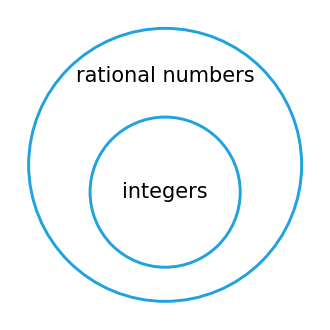

*Figure 8. The integers disk inside the rational numbers disk*

Since $`\forall x \in D,\ Q(x)`$ and "$`\forall x`$, if $x$ is in $D$ then $Q(x)$" are logically equivalent, a picture of this kind represents either one. Pictures that draw sets as disks in order to analyze arguments are called **diagrams for arguments** (Euler diagrams). The German mathematician and philosopher Gottfried Wilhelm Leibniz may have been the first to use them for this purpose.

To test an argument with diagrams, draw every arrangement in which both premises are true, and check whether the conclusion is true in each of them.

**Example 3.4.5 (Using a Diagram to Show Validity).** Use diagrams to show the validity of the following syllogism.

- All human beings are mortal.
- Zeus is not mortal.
- $\therefore$ Zeus is not a human being.

**Solution.** The major premise is pictured by placing a disk labeled "human beings" inside a disk labeled "mortals", as in Figure 9 (a). The minor premise is pictured by placing a dot labeled "Zeus" outside the disk labeled "mortals", as in Figure 9 (b). The two diagrams fit together in only one way, shown in Figure 9 (c).

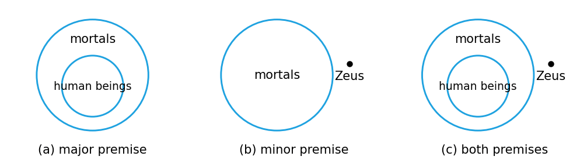

*Figure 9. A valid argument shown by diagrams of the major premise, the minor premise, and both premises together*

A dot outside the mortals disk cannot lie in the human beings disk, which sits inside it. So whenever both premises hold, the conclusion holds too; no situation makes the premises true and the conclusion false, and the argument is valid.

**Example 3.4.6 (Using Diagrams to Show Invalidity).** Use a diagram to show the invalidity of the following argument.

- All human beings are mortal.
- Felix is mortal.
- $\therefore$ Felix is a human being.

**Solution.** Figure 10 (a) and (b) picture the two premises. The premises place the Felix dot **somewhere** in the mortals disk and say nothing about its position relative to the human beings disk, so both arrangements (c) and (d) of Figure 10 are consistent with them.

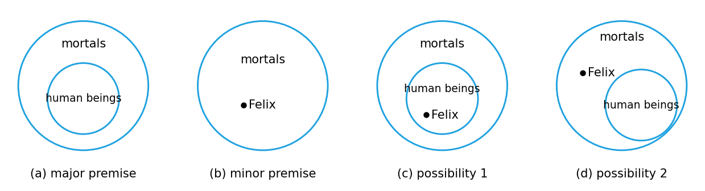

*Figure 10. An invalid argument shown by the major premise, the minor premise, and two arrangements satisfying both premises*

In (c) the conclusion "Felix is a human being" holds, but in (d) it fails (Felix could be a cat, for instance). The premises therefore do not force the conclusion, and the argument is invalid.

> **Caution:** When testing validity with diagrams, every arrangement allowed by the premises must be drawn. In this example, putting the diagrams for the premises together to obtain only Figure 10 (c) and not (d) would lead to the erroneous conclusion that the argument is valid.

Replacing the major premise of Example 3.4.6 by its converse would make the argument valid, but a universal conditional statement and its converse are not logically equivalent, so that replacement is not allowed in general. An argument of this shape commits the **converse error**.

| Part | Formal Version | Informal Version |
|:-----|:-----|:-----|
| Major premise | $\forall x$, if $P(x)$ then $Q(x)$. | If $x$ makes $P(x)$ true, then $x$ makes $Q(x)$ true. |
| Minor premise | $Q(a)$ for a particular $a$. | $a$ makes $Q(x)$ true. |
| Conclusion | $\therefore P(a)$ (invalid conclusion) | $\therefore a$ makes $P(x)$ true. (invalid conclusion) |

*Table 20. The converse error in quantified form*

The next form would be valid only if a conditional statement were logically equivalent to its inverse. Since it is not, the form is invalid, and an argument of this shape commits the **inverse error**.

| Part | Formal Version | Informal Version |
|:-----|:-----|:-----|
| Major premise | $\forall x$, if $P(x)$ then $Q(x)$. | If $x$ makes $P(x)$ true, then $x$ makes $Q(x)$ true. |
| Minor premise | $\sim P(a)$, for a particular $a$. | $a$ does not make $P(x)$ true. |
| Conclusion | $\therefore \sim Q(a)$ (invalid conclusion) | $\therefore a$ does not make $Q(x)$ true. (invalid conclusion) |

*Table 21. The inverse error in quantified form*

The inverse error can also be seen in a diagram. In Figure 10, a dot outside the human beings disk but inside the mortals disk is not a human being ($`\sim P(a)`$) and yet is mortal ($`Q(a)`$). Hence the conclusion "it is not a human being, so it is not mortal" does not follow necessarily.

**Example 3.4.7 (An Argument with "No").** Use diagrams to test the following argument for validity.

- No polynomial functions have horizontal asymptotes.
- This function has a horizontal asymptote.
- $\therefore$ This function is not a polynomial function.

**Solution.** The major premise is pictured as two disks with no common points, one for polynomial functions and one for functions with horizontal asymptotes (Figure 11). The minor premise puts a dot labeled "this function" in the second disk.

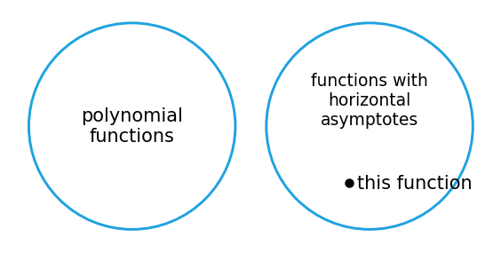

*Figure 11. Nonoverlapping disks for polynomial functions and for functions with horizontal asymptotes*

Because the disks do not overlap, the dot cannot be in the polynomial functions disk. The premises therefore force the conclusion, and the argument is valid.

Example 3.4.7 can also be solved another way. Transform "No polynomial functions have horizontal asymptotes" into the equivalent statement "$`\forall x`$, if $x$ is a polynomial function, then $x$ does not have a horizontal asymptote." Then the argument has the following form.

- $\forall x$, if $P(x)$ then $Q(x)$.
- $\sim Q(a)$, for a particular $a$.
- $\therefore \sim P(a)$

Here $P(x)$ is "$`x`$ is a polynomial function" and $Q(x)$ is "$`x`$ does not have a horizontal asymptote." This argument is valid by universal modus tollens.

> **Note:** If, as in calculus, the line $y = L$ is defined to be a horizontal asymptote when $\lim_{x \to \infty} f(x) = L$ or $\lim_{x \to -\infty} f(x) = L$, then a constant function $f(x) = c$ is a polynomial function with the horizontal asymptote $y = c$. Hence the major premise is true only for nonconstant polynomial functions. Since validity is determined by the argument form alone, the conclusion that the argument is valid does not change, but with the major premise as stated the argument is not sound.

### 4.7 Creating Additional Forms of Argument

Universal modus ponens and universal modus tollens arose from pairing universal instantiation with modus ponens and modus tollens. Pairing universal instantiation with the other valid forms of Chapter 2 produces further argument forms for universally quantified statements. Transitivity from Chapter 2, for example, has the following form.

- $p \to q$
- $q \to r$
- $\therefore p \to r$

Combining this form with universal instantiation gives the valid argument form called **universal transitivity**.

| Part | Formal Version | Informal Version |
|:-----|:-----|:-----|
| Premise 1 | $`\forall x,\ P(x) \to Q(x)`$ | Any $x$ that makes $P(x)$ true makes $Q(x)$ true. |
| Premise 2 | $`\forall x,\ Q(x) \to R(x)`$ | Any $x$ that makes $Q(x)$ true makes $R(x)$ true. |
| Conclusion | $`\therefore \forall x,\ P(x) \to R(x)`$ | $\therefore$ Any $x$ that makes $P(x)$ true makes $R(x)$ true. |

*Table 22. The form of universal transitivity*

Universal transitivity is valid for the following reason. Choose any element $x$ of the domain; by universal instantiation $P(x) \to Q(x)$ and $Q(x) \to R(x)$ are true, and by transitivity $P(x) \to R(x)$ is true. Since $x$ was chosen arbitrarily, $P(x) \to R(x)$ is true for every $x$. This method of generalizing a property shown for an arbitrarily chosen element to all elements is discussed in Chapter 4. The relationships among the rules seen so far are summarized below.

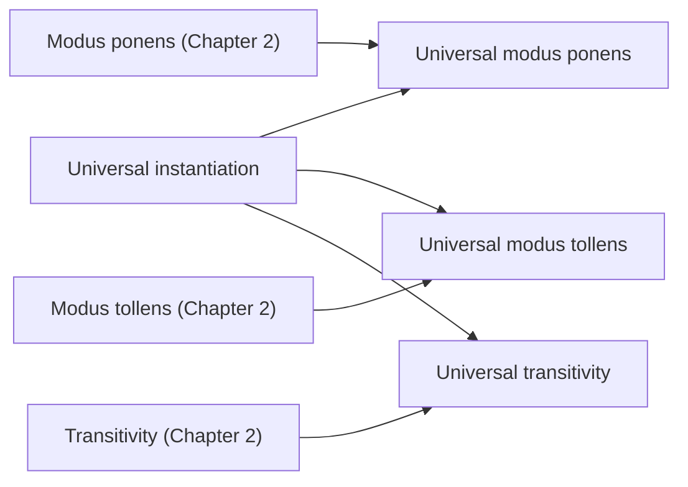

*Figure 12. Argument forms obtained by combining universal instantiation with the rules of inference of Chapter 2*

**Example 3.4.8 (Evaluating an Argument for Tarski's World).** The following argument refers to arrangements of objects of various types and colors like those in Examples 3.1.13 and 3.3.1. Reorder and rewrite the premises to show that the conclusion follows as a valid consequence of the premises.

1. All the triangles are blue.
2. If an object is to the right of all the squares, then it is above all the circles.
3. If an object is not to the right of all the squares, then it is not blue.

$\therefore$ All the triangles are above all the circles.

**Solution.** First rewrite the premises and the conclusion in if-then form.

1. $\forall x$, if $x$ is a triangle, then $x$ is blue.
2. $\forall x$, if $x$ is to the right of all the squares, then $x$ is above all the circles.
3. $\forall x$, if $x$ is not to the right of all the squares, then $x$ is not blue.

$\therefore$ $\forall x$, if $x$ is a triangle, then $x$ is above all the circles.

The premises should be arranged in a chain in which the conclusion of each premise is the hypothesis of the next. The chain must start with the hypothesis of the argument's conclusion and end with the conclusion of the argument's conclusion. Some premises may have to be replaced by their contrapositives to make the links match.

Here Premise 1 starts with "$`x`$ is a triangle" and Premise 2 ends with "$`x`$ is above all the circles", so Premise 1 goes first, Premise 2 goes last, and Premise 3 goes between them. Premise 3 itself does not link the other two, but its contrapositive does.

- Premise 1: $\forall x$, if $x$ is a triangle, then $x$ is blue.
- Premise 3 (contrapositive): $\forall x$, if $x$ is blue, then $x$ is to the right of all the squares.
- Premise 2: $\forall x$, if $x$ is to the right of all the squares, then $x$ is above all the circles.

Putting Premise 1 and Premise 3 (contrapositive) together by universal transitivity gives the following statement, called Statement 4.

- Statement 4: $\forall x$, if $x$ is a triangle, then $x$ is to the right of all the squares.

Putting Statement 4 together with Premise 2 by universal transitivity gives "$`\forall x`$, if $x$ is a triangle, then $x$ is above all the circles." This is the conclusion of the argument.

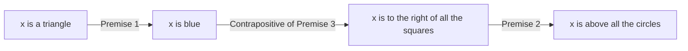

*Figure 13. Chain of conditionals formed by the reordered premises with a contrapositive*

### 4.8 Converse and Inverse Errors and Abduction

Converse and inverse errors are common partly because both forms would be valid if the major premise were a biconditional instead of a conditional, and, as noted in Chapter 2, the two are easily confused. Consider the following argument.

- All the town criminals frequent the Den of Iniquity bar.
- John frequents the Den of Iniquity bar.
- $\therefore$ John is one of the town criminals.

The argument commits the converse error, so its conclusion can be false even when both premises are true; it is an unfair attempt to prove guilt by association. Still, the nearer the major premise is to a biconditional, the more probable the conclusion becomes: if the bar's customers are almost all criminals, John's visits make it likely, though not certain, that he is one. The premises may justify suspicion of John, but they do not justify a conviction.

Used with care, a variant of the converse error is a valuable way of reasoning. Physicians use it to diagnose illness, mechanics use it to find what is wrong with a car, and scientists use it to propose explanations of phenomena. The pattern is as follows: when "For every $x$, if $P(x)$ then $Q(x)$" is true and $Q(a)$ is observed for a particular $a$, consider $P(a)$ as a candidate explanation and test it, since it may well be true.

For instance, suppose a doctor knows the following two facts.

- For every $x$, if $x$ has pneumonia, then $x$ has a fever and chills, coughs deeply, and feels exceptionally tired and miserable.
- John has a fever and chills, coughs deeply, and feels exceptionally tired and miserable.

From these facts the doctor can conclude only that pneumonia is a strong possibility, not a certainty, and would normally order laboratory tests aimed specifically at pneumonia to confirm it. The more nearly the symptoms form a necessary and sufficient condition for the illness, the more confident the diagnosis can be.

> **Definition:** The reasoning that infers $P(a)$ as a plausible explanation from "For every $x$, if $P(x)$ then $Q(x)$" and $Q(a)$ is called **abduction** by researchers working in artificial intelligence. The conclusion of abduction is not a certain conclusion but a hypothesis to be checked.

> **[Artificial Intelligence]** In artificial intelligence, knowledge representation and logical reasoning deal with expressing facts and rules as logical formulas and deriving new facts from them. Deductive reasoning that draws conclusions by universal instantiation and modus ponens, as Prolog does in Section 3.8, guarantees that the conclusion is true whenever the premises are true. Abduction, in contrast, proposes as a hypothesis the cause that best explains an observed result, so its conclusion may be wrong. Computer programs called expert systems, which attempt to duplicate the judgment of an expert in some field, are used for tasks such as diagnosis that require this kind of abductive reasoning.

---

<br>

## Concept Applications

**True/False Check:**

| Statement | Judgment and Reason |
|:-----|:-----|
| The only counterexample to $`\forall x \in \mathbf{R},\ x^2 \geq x`$ is $x = \frac{1}{2}$. | **F.** Every real number with $0 < x < 1$ is a counterexample. For instance, if $x = \frac{1}{3}$, then $x^2 = \frac{1}{9} < \frac{1}{3}$. |
| If the domain $D$ is the empty set, then $`\forall x \in D,\ Q(x)`$ is true whatever $Q(x)$ is. | **T.** The negation $\exists x \in D \text{ such that } \sim Q(x)$ is false because $D$ has no elements, so the original statement is vacuously true. |
| The negation of "All computer programs are finite" is "All computer programs are infinite." | **F.** The negation is "There is at least one computer program that is not finite." The given sentence is a much stronger statement than the negation. |
| $`\sim(\forall x,\ P(x) \to Q(x))`$ is equivalent to $\exists x \text{ such that } P(x) \to \sim Q(x)$. | **F.** The negation of a conditional is a conjunction, so it is equivalent to $\exists x \text{ such that } P(x) \wedge \sim Q(x)$. |
| A universal conditional statement and its contrapositive always have the same truth value. | **T.** For each $x$, $p \to q \equiv \sim q \to \sim p$, so the two universal statements are logically equivalent. |
| "$`r(x)`$ only if $s(x)$" means $`\forall x,\ s(x) \to r(x)`$. | **F.** It means $`\forall x,\ r(x) \to s(x)`$. That is, $s(x)$ is a necessary condition for $r(x)$. |
| If $`\forall x\ \exists y,\ P(x, y)`$ is true, then $`\exists y\ \forall x,\ P(x, y)`$ is also true. | **F.** Even if everyone loves someone, there need not be one person who is loved by everyone. |
| In a diagram for arguments, if the conclusion is true in one arrangement satisfying the premises, the argument is valid. | **F.** The conclusion must be true in every arrangement satisfying the premises. In Example 3.4.6 there is an arrangement in which the conclusion is false. |
| Universal modus ponens is the argument form obtained by combining universal instantiation with modus ponens. | **T.** Applying universal instantiation to the major premise gives $P(a) \to Q(a)$, and the minor premise $P(a)$ with modus ponens gives $Q(a)$. |

---

<br>

## Summary

| Concept | Key Summary |
|:-----|:-----|
| Predicate | A sentence with finitely many variables that becomes a statement once values replace the variables. |
| Domain and truth set | The domain is the set of values that may be substituted for a variable, and the truth set $\lbrace x \in D \mid P(x) \rbrace$ is the set of elements that make the predicate true. |
| Universal statement | $`\forall x \in D,\ Q(x)`$ is true when $Q(x)$ is true for every $x$ in $D$, and a single counterexample makes it false. |
| Existential statement | $\exists x \in D \text{ such that } Q(x)$ is true when at least one $x$ satisfies $Q(x)$, and false when $Q(x)$ is false for every $x$. |
| Method of exhaustion | A method that decides the truth value of a statement by checking every element of a finite domain one by one. |
| Universal conditional statement | A statement of the form $`\forall x,\ P(x) \to Q(x)`$, equivalent to $`\forall x \in D,\ Q(x)`$ with the domain narrowed to the truth set of $P(x)$. |
| Bound variables and scope | A variable attached to a quantifier keeps the same meaning when renamed consistently, and its scope runs from where it is introduced to the end of the statement. |
| Implicit quantification | Quantification indicated by context without explicit quantifiers; $P(x) \Rightarrow Q(x)$ means inclusion of truth sets and $P(x) \Leftrightarrow Q(x)$ means equality of truth sets. |
| Negation of quantified statements | $`\sim(\forall x,\ Q(x)) \equiv \exists x \text{ such that } \sim Q(x)`$ and $`\sim(\exists x \text{ such that } Q(x)) \equiv \forall x,\ \sim Q(x)`$. |
| Negation of universal conditionals | $`\sim(\forall x,\ P(x) \to Q(x)) \equiv \exists x \text{ such that } P(x) \wedge \sim Q(x)`$. |
| Quantifiers, conjunction, and disjunction | On a finite domain a universal statement is a conjunction and an existential statement is a disjunction, so the negation rules generalize De Morgan's laws. |
| Vacuous truth | If the hypothesis $P(x)$ is false for every $x$, then $`\forall x \in D,\ P(x) \to Q(x)`$ is true regardless of $Q(x)$. |
| Contrapositive, converse, inverse | A universal conditional statement is equivalent to its contrapositive but not to its converse or inverse, and the converse and inverse are equivalent to each other. |
| Necessary, sufficient, only if | $r$ is a sufficient condition for $s$ means $`\forall x,\ r(x) \to s(x)`$, a necessary condition means $`\forall x,\ s(x) \to r(x)`$, and "$`r(x)`$ only if $s(x)$" means $`\forall x,\ r(x) \to s(x)`$. |
| Interpreting multiple quantifiers | The actions of the quantifiers are performed in the order they occur; in $`\forall x\ \exists y`$ the $y$ may depend on $x$, and in $`\exists x\ \forall y`$ one $x$ must work for every $y$. |
| Negating multiple quantifiers | Each time the negation moves inward, $\forall$ and $\exists$ are exchanged, the order is kept, and the innermost predicate is negated. |
| Order of quantifiers | Swapping different quantifiers can change the meaning and truth value, but quantifiers of the same kind may be swapped freely. |
| Formal logical notation | $`\forall x \in D,\ P(x)`$ is written $`\forall x\,(x \in D \to P(x))`$, and an existential statement is written $`\exists x\,(x \in D \wedge P(x))`$. |
| Prolog | A logic programming language that answers questions by built-in search and inference once facts and rules are stated. |
| Universal instantiation | A property true of every element of a set is true of any particular element of the set. |
| Universal modus ponens and tollens | Valid forms that derive $Q(a)$ from $`\forall x,\ P(x) \to Q(x)`$ and $P(a)$, and $\sim P(a)$ from $\sim Q(a)$. |
| Validity and soundness | An argument form is valid if any predicates that make the premises true make the conclusion true, and an argument is sound if it is valid and all its premises are true. |
| Diagrams for arguments | Validity is tested by drawing sets as disks and checking that the conclusion is true in every arrangement the premises allow. |
| Converse and inverse errors | Invalid argument forms that derive $P(a)$ from $Q(a)$, and $\sim Q(a)$ from $\sim P(a)$. |
| Universal transitivity | A valid form that derives $`\forall x,\ P(x) \to R(x)`$ from $`\forall x,\ P(x) \to Q(x)`$ and $`\forall x,\ Q(x) \to R(x)`$. |
| Abduction | Reasoning that observes $Q(a)$ and infers $P(a)$ as a plausible explanation; its conclusion is a hypothesis to be checked. |

---

<br>

## Self-Check Questions

1. **Truth set:** For the predicate $P(x)$ "$`x^2 > x`$" with domain $\mathbf{R}$, find the truth set of $P(x)$, and check whether the three values 2, $\frac{1}{2}$, and $-\frac{1}{2}$ of Example 3.1.1 belong to it.

   <details>
   <summary>Answer</summary>

   $x^2 > x$ is equivalent to $x^2 - x > 0$, that is, $x(x - 1) > 0$. A product of two factors is positive exactly when the two factors have the same sign, so either both are positive, $x > 1$, or both are negative, $x < 0$. Hence the truth set is $\lbrace x \in \mathbf{R} \mid x < 0 \text{ or } x > 1 \rbrace$. Since $2 > 1$, 2 belongs; since $-\frac{1}{2} < 0$, $-\frac{1}{2}$ belongs; and since $0 < \frac{1}{2} < 1$, $\frac{1}{2}$ does not belong. This agrees with Example 3.1.1.

   </details>

2. **Method of exhaustion:** Let $D = \lbrace -1, 0, 1, 2 \rbrace$. Find the truth value of each statement: (a) $`\forall x \in D,\ x^3 \geq x`$ (b) $`\forall x \in D,\ x^2 > x`$ (c) $\exists x \in D \text{ such that } x^2 = x + 2$

   <details>
   <summary>Answer</summary>

   (a) True. Since $(-1)^3 = -1 \geq -1$, $0^3 = 0 \geq 0$, $1^3 = 1 \geq 1$, and $2^3 = 8 \geq 2$, every element of $D$ satisfies the inequality. (b) False. For $x = 0$, $0 > 0$ is false, so 0 is a counterexample ($x = 1$ is also a counterexample). (c) True. For $x = -1$, $(-1)^2 = 1$ and $-1 + 2 = 1$, so the equation holds ($x = 2$ also works, with $`4 = 4`$).

   </details>

3. **Negating a multiply quantified statement:** Write "Every student received an A in at least one course" formally with quantifiers, and write its formal and informal negations.

   <details>
   <summary>Answer</summary>

   The formal statement is "$`\forall`$ student $s$, $\exists$ a course $c$ such that $s$ received an A in $c$." Each time the negation moves inward the quantifier changes, so the formal negation is "$`\exists`$ a student $s$ such that $\forall$ course $c$, $s$ did not receive an A in $c$." The informal negation is "There is a student who did not receive an A in any course."

   </details>

4. **Negation and variants:** For the statement "$`\forall`$ integer $n$, if $n$ is divisible by 6, then $n$ is divisible by 3", write the negation, contrapositive, converse, and inverse, and find the truth value of each.

   <details>
   <summary>Answer</summary>

   The original statement is true (if $n = 6k$, then $`n = 3(2k)`$). The negation is "$`\exists`$ an integer $n$ such that $n$ is divisible by 6 and $n$ is not divisible by 3", which is false. The contrapositive is "$`\forall`$ integer $n$, if $n$ is not divisible by 3, then $n$ is not divisible by 6", which is equivalent to the original and therefore true. The converse is "$`\forall`$ integer $n$, if $n$ is divisible by 3, then $n$ is divisible by 6", which is false with counterexample $n = 3$. The inverse is "$`\forall`$ integer $n$, if $n$ is not divisible by 6, then $n$ is not divisible by 3", which is also false with counterexample $n = 3$.

   </details>

5. **Necessary, sufficient, only if:** Show that the following three sentences all express the same universal conditional statement. (a) Being divisible by 4 is a sufficient condition for being even. (b) Being even is a necessary condition for being divisible by 4. (c) An integer is divisible by 4 only if it is even.

   <details>
   <summary>Answer</summary>

   (a) "$`r`$ is a sufficient condition for $s$" is $`\forall x,\ r(x) \to s(x)`$, so it is "$`\forall`$ integer $n$, if $n$ is divisible by 4, then $n$ is even." (b) "$`r`$ is a necessary condition for $s$" is $`\forall x,\ s(x) \to r(x)`$; here $r$ is being even and $s$ is being divisible by 4, so it is again "$`\forall`$ integer $n$, if $n$ is divisible by 4, then $n$ is even." (c) "$`r`$ only if $s$" is $`\forall x,\ r(x) \to s(x)`$; here $r$ is being divisible by 4 and $s$ is being even, so it is the same statement. The statement is true, because if $n = 4k$, then $n = 2(2k)$.

   </details>

6. **Order of quantifiers:** Let $D = E = \lbrace 1, 2, 3 \rbrace$. Find the truth values of (a) $`\forall x \in D,\ \exists y \in E \text{ such that } x + y = 4`$ and (b) $`\exists y \in E \text{ such that } \forall x \in D,\ x + y = 4`$, and write the negation of (b).

   <details>
   <summary>Answer</summary>

   (a) is true. Choose $y = 3$ for $x = 1$, $y = 2$ for $x = 2$, and $y = 1$ for $x = 3$; $y$ may depend on $x$. (b) is false. For one $y$ to satisfy $x + y = 4$ for all three values of $x$, the equations $y = 3$, $y = 2$, and $y = 1$ would have to hold at the same time, which is impossible. The negation of (b) is $`\forall y \in E,\ \exists x \in D \text{ such that } x + y \neq 4`$, which is true. For instance, $x = 1$ works for $y = 1$, $x = 1$ for $y = 2$, and $x = 2$ for $y = 3$.

   </details>

7. **Formal logical notation:** In the Tarski world of Figure 4, write "For every circle $x$, there is a triangle $y$ such that $x$ and $y$ have different colors" in formal logical notation, find its negation, and determine which is true.

   <details>
   <summary>Answer</summary>

   The statement is $`\forall x\,(\text{Circle}(x) \to \exists y\,(\text{Triangle}(y) \wedge \sim\text{SameColor}(x, y)))`$. Its negation is $`\exists x\,(\text{Circle}(x) \wedge \forall y\,(\sim\text{Triangle}(y) \vee \text{SameColor}(x, y)))`$. The original statement is true. For circles $a$ and $c$ (blue), choose triangle $d$ (black) or $f$ or $i$ (gray); for circle $b$ (gray), choose triangle $d$ (black).

   </details>

8. **Diagrams and validity:** With the major premise "All squares are rectangles", decide the validity of (a) the argument that derives "$`F`$ is a square" from the minor premise "Figure $F$ is a rectangle", and (b) the argument that derives "$`G`$ is not a square" from the minor premise "Figure $G$ is not a rectangle".

   <details>
   <summary>Answer</summary>

   The major premise is represented by a "squares" disk inside a "rectangles" disk. (a) The dot for $F$ only has to be somewhere inside the "rectangles" disk, so it may lie outside the "squares" disk (a rectangle that is not a square). The conclusion does not follow necessarily, so the argument is invalid; it is the converse error. (b) The dot for $G$ is outside the "rectangles" disk, so it is necessarily outside the "squares" disk inside it. Hence the argument is valid; it has the form of universal modus tollens.

   </details>

9. **Universal transitivity:** Show that the following argument is valid by rewriting the premises. Premise 1: A program with a compile error does not run. Premise 2: A program that passes its tests runs. Conclusion: A program with a compile error does not pass its tests.

   <details>
   <summary>Answer</summary>

   As conditionals, Premise 1 is "$`\forall x`$, if $x$ has a compile error, then $x$ does not run", Premise 2 is "$`\forall x`$, if $x$ passes its tests, then $x$ runs", and the conclusion is "$`\forall x`$, if $x$ has a compile error, then $x$ does not pass its tests." To make the conclusion of Premise 1, "does not run", the hypothesis of the next premise, rewrite Premise 2 as its contrapositive: "$`\forall x`$, if $x$ does not run, then $x$ does not pass its tests." Putting Premise 1 and the rewritten Premise 2 together by universal transitivity gives the conclusion, so the argument is valid.

   </details>

10. **Vacuous truth:** When the domain $D$ is the empty set, find the truth values of $`\forall x \in D,\ Q(x)`$ and $\exists x \in D \text{ such that } Q(x)$, and explain the reason with the negation rules.

    <details>
    <summary>Answer</summary>

    $`\forall x \in D,\ Q(x)`$ is true. Its negation is $\exists x \in D \text{ such that } \sim Q(x)$, and since $D$ has no elements, no $x$ can satisfy the condition, so the negation is false. On the other hand, $\exists x \in D \text{ such that } Q(x)$ is false because $D$ can contain no element satisfying $Q(x)$, and its negation $`\forall x \in D,\ \sim Q(x)`$ is vacuously true.

    </details>

---

<br>

## References

1. Python Software Foundation, "Built-in Functions," *The Python Standard Library*, https://docs.python.org/3/library/functions.html
2. W. F. Clocksin and C. S. Mellish, *Programming in Prolog: Using the ISO Standard*, 5th ed. Berlin, Germany: Springer, 2003.
