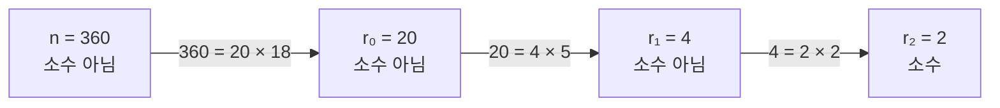
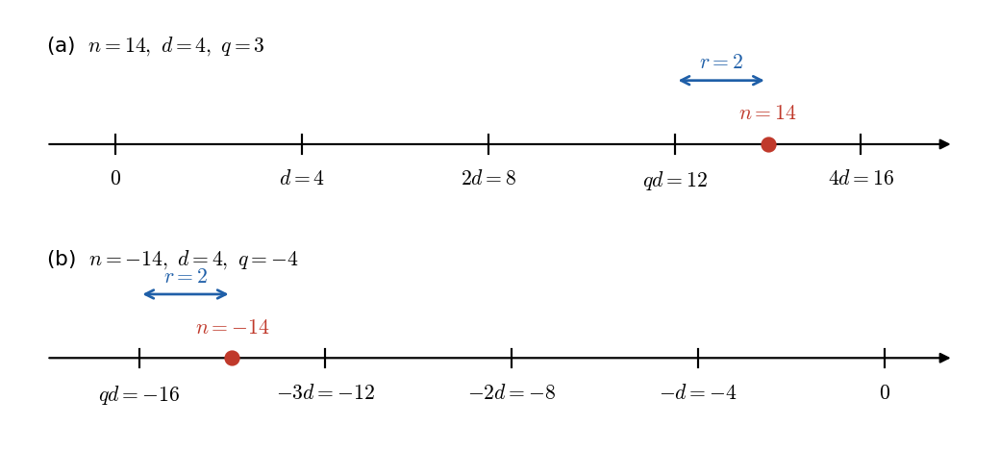
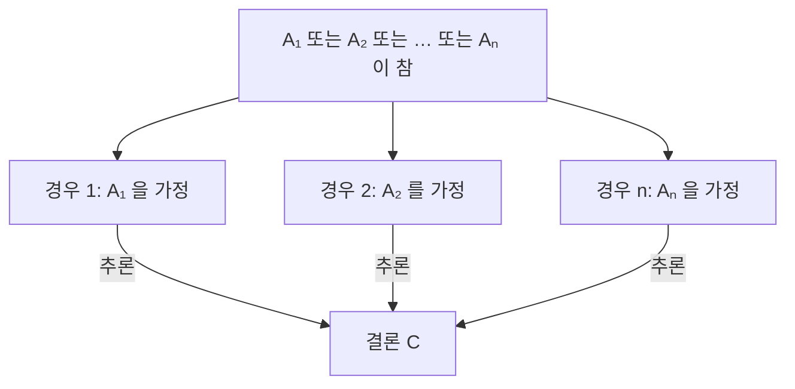
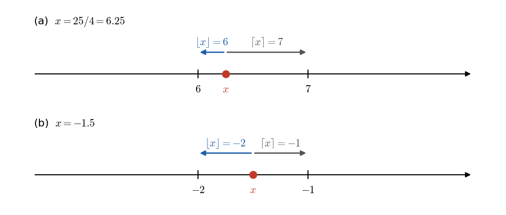
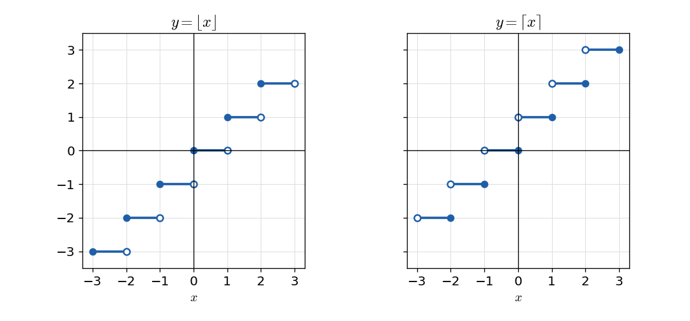
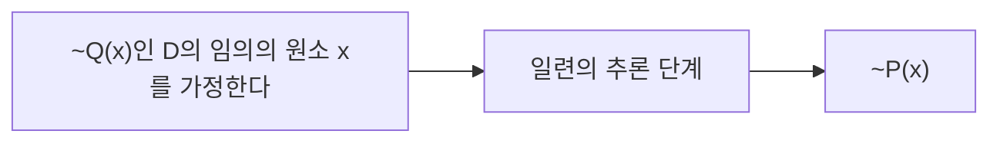
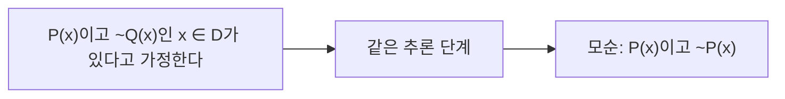
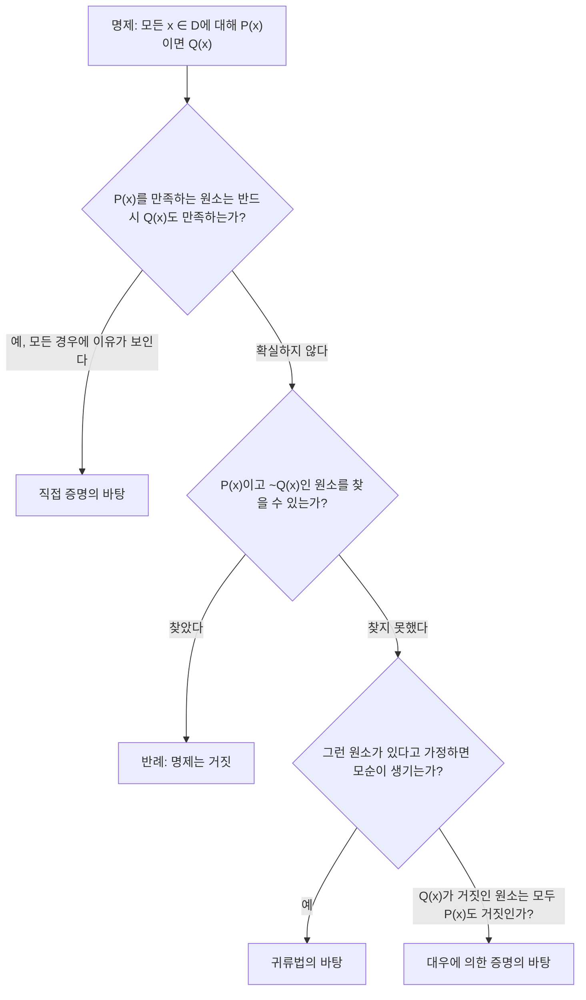
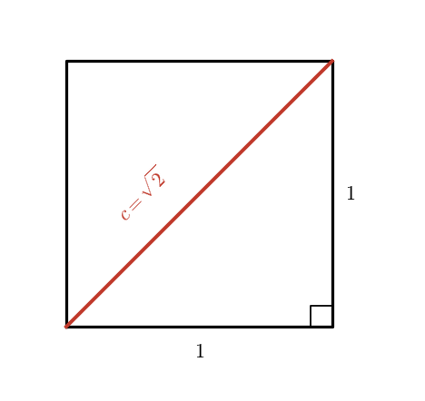

# 4장 — 초등 정수론과 증명 방법

[레포지토리 안내](../../README.ko.md) | [English](Concepts_Lecture.md) | [한국어](Concepts_Lecture.ko.md)

> **최종 수정일:** 2026-11-04
>
> Discrete Mathematics with Applications, Epp, Ch 4

> **학습 목표:**
> 1. 짝수, 홀수, 소수, 합성수, 유리수, 나누어떨어짐의 정의를 이용하여 정수에 관한 명제를 직접 증명하거나 반례로 반증할 수 있다
> 2. 일반적 특수 사례로부터의 일반화에 따라 증명의 시작점과 보여야 할 결론을 정하고, 증명 작성의 흔한 실수를 찾아낼 수 있다
> 3. 몫-나머지 정리와 div, mod를 이용하여 나머지를 계산하고 경우 나누기로 정수의 성질을 증명할 수 있다
> 4. 바닥 함수와 천장 함수의 정의로부터 그 성질을 증명하거나 반례로 반증할 수 있다
> 5. 귀류법과 대우에 의한 증명을 구분하여 적용하고, $\sqrt{2}$의 무리성과 소수의 무한성을 증명할 수 있다
> 6. 산술의 기본 정리로 정수를 표준 소인수분해 형태로 쓰고 나누어떨어짐 문제에 활용할 수 있다

---

## 목차

- [1. 직접 증명과 반례 I: 도입](#1-직접-증명과-반례-i-도입)
  - [1.1 증명의 역할과 기본 가정](#11-증명의-역할과-기본-가정)
  - [1.2 짝수, 홀수, 소수, 합성수](#12-짝수-홀수-소수-합성수)
  - [1.3 존재 명제의 증명](#13-존재-명제의-증명)
  - [1.4 반례에 의한 전칭 명제의 반증](#14-반례에-의한-전칭-명제의-반증)
  - [1.5 전칭 명제의 증명](#15-전칭-명제의-증명)
  - [1.6 증명의 시작과 끝 정하기](#16-증명의-시작과-끝-정하기)
- [2. 직접 증명과 반례 II: 증명 작성 요령](#2-직접-증명과-반례-ii-증명-작성-요령)
  - [2.1 전칭 명제의 증명을 쓰는 지침](#21-전칭-명제의-증명을-쓰는-지침)
  - [2.2 증명의 다양성](#22-증명의-다양성)
  - [2.3 흔한 실수](#23-흔한-실수)
  - [2.4 증명 작성과 검토의 예](#24-증명-작성과-검토의-예)
  - [2.5 존재 명제가 거짓임을 보이기](#25-존재-명제가-거짓임을-보이기)
  - [2.6 추측, 증명, 반증](#26-추측-증명-반증)
- [3. 직접 증명과 반례 III: 유리수](#3-직접-증명과-반례-iii-유리수)
  - [3.1 유리수와 무리수](#31-유리수와-무리수)
  - [3.2 일반적 특수 사례로부터의 일반화 다시 보기](#32-일반적-특수-사례로부터의-일반화-다시-보기)
  - [3.3 유리수의 성질 증명](#33-유리수의-성질-증명)
  - [3.4 이미 증명한 결과로 새 결과 유도하기](#34-이미-증명한-결과로-새-결과-유도하기)
- [4. 직접 증명과 반례 IV: 나누어떨어짐](#4-직접-증명과-반례-iv-나누어떨어짐)
  - [4.1 나누어떨어짐의 정의](#41-나누어떨어짐의-정의)
  - [4.2 나누어떨어짐의 성질 증명](#42-나누어떨어짐의-성질-증명)
  - [4.3 반례와 나누어떨어짐](#43-반례와-나누어떨어짐)
  - [4.4 산술의 기본 정리](#44-산술의-기본-정리)
- [5. 직접 증명과 반례 V: 경우 나누기와 몫-나머지 정리](#5-직접-증명과-반례-v-경우-나누기와-몫-나머지-정리)
  - [5.1 몫-나머지 정리](#51-몫-나머지-정리)
  - [5.2 div와 mod](#52-div와-mod)
  - [5.3 정수의 표현과 경우 나누기](#53-정수의-표현과-경우-나누기)
  - [5.4 절댓값과 삼각 부등식](#54-절댓값과-삼각-부등식)
- [6. 직접 증명과 반례 VI: 바닥 함수와 천장 함수](#6-직접-증명과-반례-vi-바닥-함수와-천장-함수)
  - [6.1 바닥 함수와 천장 함수의 정의](#61-바닥-함수와-천장-함수의-정의)
  - [6.2 바닥 함수의 성질: 반증과 증명](#62-바닥-함수의-성질-반증과-증명)
  - [6.3 n/2의 바닥 함수와 div, mod](#63-n2의-바닥-함수와-div-mod)
- [7. 간접 증명: 귀류법과 대우에 의한 증명](#7-간접-증명-귀류법과-대우에-의한-증명)
  - [7.1 귀류법](#71-귀류법)
  - [7.2 대우에 의한 증명](#72-대우에-의한-증명)
  - [7.3 귀류법과 대우에 의한 증명의 관계](#73-귀류법과-대우에-의한-증명의-관계)
  - [7.4 문제 해결 도구로서의 증명](#74-문제-해결-도구로서의-증명)
- [8. 간접 증명: 두 가지 유명한 정리](#8-간접-증명-두-가지-유명한-정리)
  - [8.1 √2의 무리성](#81-2의-무리성)
  - [8.2 소수는 무한히 많은가](#82-소수는-무한히-많은가)
  - [8.3 간접 증명을 쓰는 때](#83-간접-증명을-쓰는-때)
  - [8.4 정수론의 미해결 문제](#84-정수론의-미해결-문제)
- [개념 적용](#개념-적용)
- [요약](#요약)
- [점검 문제](#점검-문제)
- [참고 문헌](#참고-문헌)

---

<br>

## 1. 직접 증명과 반례 I: 도입

이 장은 정수, 유리수, 실수의 성질을 소재로 삼아 수학적 명제가 참인지 거짓인지를 판정하는 방법을 다룬다. 정수의 성질을 연구하는 분야를 **정수론(number theory)** 이라 하며, 이 장에서는 정수론의 기초 개념인 짝수와 홀수, 소수와 합성수, 유리수, 나누어떨어짐, 몫과 나머지, 바닥 함수와 천장 함수를 정의하고, 이 개념들을 재료로 직접 증명, 반례에 의한 반증, 귀류법, 대우에 의한 증명을 익힌다.

### 1.1 증명의 역할과 기본 가정

**증명(proof)** 은 어떤 명제가 참임을 회의적인 청자(흔히 자기 자신)에게 납득시키기 위해 신중하게 쌓아 올린 논증이다. 청자가 모든 단계마다 그 이유를 따져 묻는다고 상상하고, 그 물음 하나하나에 답할 수 있으면 증명 전체가 올바르다.

예를 들어 $5x + 3 = 33$을 만족하는 수 $x$는 6임을 수학 기호에 익숙하지 않은 사람에게 설명한다면 다음과 같이 논증할 수 있다.

1. $5x + 3 = 33$이면 양변에서 3을 뺀 결과도 같다. 같은 두 양에서 같은 수를 빼면 결과가 같기 때문이다.
2. $5x + 3$에서 3을 빼면 $5x$가 남고, $33 - 3 = 30$이다. 따라서 $5x = 30$이다.
3. 5를 곱하여 30이 되는 수는 6뿐이다. 따라서 $x = 6$이다.

숙련된 수학자는 독자가 쉽게 채울 수 있는 이유를 생략하기도 한다. 그러나 증명을 처음 배울 때는 이유를 너무 적게 쓰기보다 너무 많이 쓰는 편이 낫다. 증명을 쓰는 과정에서 논증의 약점과 무의식적으로 세운 가정이 드러나고, 뛰어난 수학자도 당연해 보이던 세부 사항을 꼼꼼히 확인하다가 그것이 거짓임을 발견하는 일이 많다. 항공기 엔진의 추력 계산처럼 수학적 논증의 정확성이 생명과 직결되는 경우도 있으므로, 그럴듯한 추측과 확실한 결론을 구별하는 능력이 중요하다.

직관만으로 확신하기 어려운 예로 바닥 함수(6절)에 관한 두 질문이 있다. 모든 실수 $x$에 대해 $\lfloor x - 1 \rfloor = \lfloor x \rfloor - 1$인가? 모든 실수 $x, y$에 대해 $\lfloor x - y \rfloor = \lfloor x \rfloor - \lfloor y \rfloor$인가? 앞의 질문의 답은 예이고 뒤의 질문의 답은 아니오이며, 두 답의 근거는 6절의 기법으로 확립한다.

이 장의 증명은 다음 사실을 증명 없이 사용한다.

- 기초 대수의 법칙(교환 법칙, 결합 법칙, 분배 법칙, 등식과 부등식의 기본 성질 등)이 성립한다.
- 등호의 세 성질: 모든 대상 $A, B, C$에 대해 (1) $A = A$, (2) $A = B$이면 $B = A$, (3) $A = B$이고 $B = C$이면 $A = C$이다.
- **대입 원리(principle of substitution)**: 모든 대상 $A, B$에 대해 $A = B$이면 $A$가 쓰인 자리 어디에나 $B$를 대신 쓸 수 있다.
- 0과 1 사이에는 정수가 없다.
- 정수 전체의 집합은 덧셈, 뺄셈, 곱셈에 대해 **닫혀 있다(closed)**. 즉 두 정수의 합, 차, 곱은 정수이다.

> **주의:** 정수는 나눗셈에 대해 닫혀 있지 않다. $3 \div 2 = 3/2$는 정수가 아니고, $3 \div 0$은 수조차 아니다. 그래서 정수에 관한 정의와 증명은 나눗셈 대신 곱셈으로 표현한다(예: $`n = 2k`$).

### 1.2 짝수, 홀수, 소수, 합성수

명제가 참인지 판단하려면 먼저 그 명제가 무엇에 관한 것인지, 즉 쓰인 모든 용어의 뜻을 정확히 알아야 한다. 수학에서는 용어를 매우 엄밀하게 정의하며, 정의를 거의 글자 그대로 익혀 두는 것이 중요하다.

> **용어 정의:** 정수 $n$이 **짝수(even)** 라는 것은 $n$이 어떤 정수의 2배와 같다는 것이고, **홀수(odd)** 라는 것은 $n$이 어떤 정수의 2배에 1을 더한 값과 같다는 것이다. 기호로 쓰면 정수 $n$에 대해 다음과 같다.
>
> - $n$이 짝수 $\iff$ 어떤 정수 $k$에 대해 $n = 2k$
> - $n$이 홀수 $\iff$ 어떤 정수 $k$에 대해 $n = 2k + 1$

정의는 양쪽 방향으로 쓰인다. 어떤 정수가 짝수라는 사실을 알면 그 정수를 2와 어떤 정수의 곱으로 쓸 수 있고, 반대로 어떤 정수가 2와 어떤 정수의 곱과 같다는 사실을 알면 그 정수가 짝수라고 결론 내릴 수 있다.

| 알고 있는 사실 | 이끌어 낼 수 있는 사실 | 쓰는 방향 |
|:-----|:-----|:-----|
| 정수 $n$이 짝수이다 | 어떤 정수 $k$에 대해 $n = 2k$이다 | 정의의 $\Rightarrow$ 방향 (only if) |
| 어떤 정수 $k$에 대해 $n = 2k$이다 | $n$은 짝수이다 | 정의의 $\Leftarrow$ 방향 (if) |

*표 1. 짝수의 정의를 증명에서 쓰는 두 방향*

많은 책이 정의를 쓸 때 if and only if 대신 if만 쓰지만(예: 어떤 정수의 2배와 같으면 그 정수를 짝수라고 한다), 정의는 언제나 쌍조건 명제로 읽는다. 증명에서는 대개 두 방향이 모두 필요하다.

또 짝수와 홀수의 정의는 한정 명제이므로, 정의에 쓰인 변수는 그 한정기호에 묶인 지역 변수이고 유효 범위는 정의의 끝까지이다(3장). 따라서 변수 이름을 다른 기호로 바꾸어도 뜻이 달라지지 않는다. 다음은 모두 같은 내용이다.

- 모든 정수 $n$에 대해, $n$이 짝수 $\iff$ 어떤 정수 $r$에 대해 $n = 2r$
- 모든 정수 $m$에 대해, $m$이 짝수 $\iff$ 어떤 정수 $a$에 대해 $m = 2a$
- 모든 정수 $a$에 대해, $a$가 홀수 $\iff$ 어떤 정수 $s$에 대해 $a = 2s + 1$
- 모든 정수 $k$에 대해, $k$가 홀수 $\iff$ 어떤 정수 $n$에 대해 $k = 2n + 1$

**예제 4.1.1 (짝수와 홀수).** 정의를 이용하여 다음 물음에 답한다. $a, b$는 정수이다.

- (a) 0은 짝수인가? 그렇다. $0 = 2 \cdot 0$이고 0은 정수이다.
- (b) $-301$은 홀수인가? 그렇다. $-301 = 2 \cdot (-151) + 1$이고 $-151$은 정수이다.
- (c) $6a^2b$는 짝수인가? 그렇다. $6a^2b = 2(3a^2b)$이고, $3a^2b$는 정수의 곱이므로 정수이다.
- (d) $10a + 8b + 1$은 홀수인가? 그렇다. $10a + 8b + 1 = 2(5a + 4b) + 1$이고, $5a + 4b$는 정수의 곱의 합이므로 정수이다.
- (e) 모든 정수는 짝수이거나 홀수인가? 그렇다. 그러나 그 이유는 정의에서 바로 보이지 않는다. 이 사실은 5.3절에서 몫-나머지 정리로 증명하며, 어떤 정수도 짝수이면서 홀수일 수는 없다는 사실은 7.1절에서 귀류법으로 보인다.

정수 $6 = 2 \cdot 3$은 자신보다 작은 두 양의 정수의 곱이다. 반면 7은 그렇게 쓸 수 없고, 7의 양의 약수는 1과 7뿐이다. 7처럼 1보다 크면서 자신보다 작은 두 양의 정수의 곱으로 쓸 수 없는 정수를 소수라 한다.

> **용어 정의:** 정수 $n$이 **소수(prime)** 라는 것은 $n > 1$이고, $n = rs$를 만족하는 모든 양의 정수 $r, s$에 대해 $r$과 $s$ 중 하나가 $n$과 같다는 것이다. 정수 $n$이 **합성수(composite)** 라는 것은 $n > 1$이고, $1 < r < n$과 $1 < s < n$을 만족하는 정수 $r, s$가 있어 $n = rs$라는 것이다. 기호로 쓰면 $n > 1$인 정수 $n$에 대해 다음과 같다.
>
> - $n$이 소수 $\iff$ $n = rs$인 모든 양의 정수 $r, s$에 대해 ($r = 1$이고 $`s = n`$) 또는 ($r = n$이고 $`s = 1`$)
> - $n$이 합성수 $\iff$ $n = rs$이고 $1 < r < n$, $1 < s < n$인 양의 정수 $r, s$가 존재

**예제 4.1.2 (소수와 합성수).**

- (a) 1은 소수인가? 아니다. 소수는 1보다 커야 한다.
- (b) 1보다 큰 모든 정수는 소수이거나 합성수인가? 그렇다. $n$을 1보다 큰 임의의 정수라 한다. $n = rs$를 만족하는 양의 정수 쌍 $(r, s)$를 모두 생각하면, $r = n, s = 1$과 $r = 1, s = n$의 두 쌍은 언제나 있다. 또 $n = rs$이고 $r, s$가 양의 정수이므로 모든 쌍은 $1 \le r \le n$, $1 \le s \le n$을 만족한다. $n$이 소수이면 이 두 쌍이 $n$을 $rs$로 쓰는 방법의 전부이다. 소수가 아니면 $r$도 $s$도 1이나 $n$이 아닌 쌍이 있고, 이 쌍은 $1 < r < n$, $1 < s < n$을 만족하므로 $n$은 합성수이다.
- (c) 처음 여섯 개의 소수는 2, 3, 5, 7, 11, 13이다.
- (d) 처음 여섯 개의 합성수는 4, 6, 8, 9, 10, 12이다.

> **주의:** 두 정의 모두 $n > 1$을 요구하므로 1, 0, 음의 정수는 소수도 합성수도 아니다. 1을 소수에서 제외하는 이유는 4.4절의 산술의 기본 정리에서 설명한다.

### 1.3 존재 명제의 증명

3장에서 정의한 대로, 존재 명제

```math
\exists x \in D \text{ such that } Q(x)
```

는 $D$의 원소 가운데 적어도 하나의 $x$에 대해 $Q(x)$가 참일 때, 그리고 그때에만 참이다. 이를 증명하는 한 가지 방법은 $Q(x)$를 참으로 만드는 $x$를 $D$에서 실제로 찾아 보이는 것이고, 다른 방법은 그런 $x$를 찾는 절차를 제시하는 것이다. 두 방법을 **구성적 존재 증명(constructive proof of existence)** 이라 한다. 그 바탕에 있는 논리 원리는 **존재 일반화(existential generalization)** 로, 어떤 성질이 특정한 대상에 대해 참임을 알면 그 성질을 만족하는 대상이 존재한다고 결론 내릴 수 있다는 원리이다.

**예제 4.1.3 (구성적 존재 증명).**

- (a) 두 소수의 합으로 쓰는 방법이 두 가지인 짝수 $n$이 존재함을 증명한다. $n = 10$으로 둔다. $10 = 5 + 5 = 3 + 7$이고 3, 5, 7은 모두 소수이다. 따라서 그런 짝수, 즉 10이 존재한다.
- (b) $r$과 $s$가 정수일 때 $22r + 18s = 2k$인 정수 $k$가 존재함을 증명한다. $k = 11r + 9s$로 둔다. $k$는 정수의 곱의 합이므로 정수이고, 대입과 분배 법칙에 의해 $2k = 2(11r + 9s) = 22r + 18s$이다. 따라서 그런 정수 $k$가 존재한다.

**비구성적 존재 증명(nonconstructive proof of existence)** 은 (a) 공리나 이미 증명된 정리가 $Q(x)$를 참으로 만드는 $x$의 존재를 보장함을 보이거나, (b) 그런 $x$가 없다고 가정하면 모순이 생김을 보이는 증명이다. 비구성적 증명의 단점은 $x$가 어디에 있는지, 어떻게 찾는지에 관한 단서를 거의 주지 않는다는 것이다. 컴퓨터가 널리 쓰이면서, 해당 값을 컴퓨터로 계산하는 절차까지 담은 구성적 증명을 더 선호하게 되었다.

### 1.4 반례에 의한 전칭 명제의 반증

명제를 **반증한다(disprove)** 는 것은 그 명제가 거짓임을 보인다는 뜻이다. $`\forall x \in D,\ P(x) \to Q(x)`$ 꼴의 명제가 거짓임을 보이는 것은 그 부정이 참임을 보이는 것과 같고, 그 부정은 다음의 존재 명제이다.

```math
\exists x \in D \text{ such that } P(x) \wedge \sim Q(x)
```

존재 명제가 참임을 보일 때는 대개 예를 하나 제시한다. 이 예는 원래 명제가 거짓임을 보이는 데 쓰이므로 **반례(counterexample)** 라 부른다.

> **핵심:** **반례에 의한 반증.** $`\forall x \in D,\ P(x) \to Q(x)`$ 꼴의 명제를 반증하려면, 가정 $P(x)$는 참이고 결론 $Q(x)$는 거짓이 되는 $x$를 $D$에서 하나 찾는다. 그런 $x$를 반례라 한다.

**예제 4.1.4 (반례에 의한 반증).** 명제 "모든 실수 $a, b$에 대해, $a^2 = b^2$이면 $a = b$이다"를 반증한다. 가정 $a^2 = b^2$은 참이고 결론 $a = b$는 거짓인 실수 $a, b$를 찾으면 된다. 양수와 음수의 제곱이 모두 양수라는 사실이 실마리가 된다. $a = 1$, $b = -1$로 두면 $a^2 = 1^2 = 1$이고 $b^2 = (-1)^2 = 1$이므로 $a^2 = b^2$이지만, $1 \ne -1$이므로 $a \ne b$이다. 반례는 하나면 충분하며, $2$와 $-2$, $0.5$와 $-0.5$ 등도 반례이다.

> **참고:** 예제 4.1.4는 두 수의 제곱이 같다고 해서 두 수가 같은 것은 아님을 보인다. 그러나 두 **양수**의 제곱이 같으면 두 수는 같다. 반례를 찾는 과정은 이처럼 가정을 좁혀 참이 되는 명제를 만드는 데 도움이 된다.

여러 경우에 성립하는 성질을 보고 모든 경우에 성립한다고 추측했는데 증명이 잘 되지 않으면, 증명의 열쇠를 아직 찾지 못했거나 추측 자체가 거짓일 수 있다. 증명이 막히면 잠시 멈추고 반례를 찾아보는 것이 좋다. 증명이 어디서 막히는지를 분석하면 반례를 찾는 데 도움이 되고, 반례를 찾으면 문제를 더 깊이 이해하게 되어 가정을 바꾼 더 좁지만 참인 명제를 세울 수 있다.

### 1.5 전칭 명제의 증명

증명해야 하는 수학 명제의 대부분은 전칭 명제이며, 다음 표준형으로 생각하면 편리하다(1장, 3장).

```math
\forall x \in D,\ P(x) \to Q(x)
```

$D$가 유한하거나 $P(x)$를 만족하는 원소가 유한 개뿐이면, 그 원소를 하나하나 모두 확인하는 **전수 조사법(method of exhaustion)** 으로 증명할 수 있다.

**예제 4.1.5 (전수 조사법).** "$`4 \le n \le 26`$인 모든 짝수 $n$은 두 소수의 합으로 쓸 수 있다"를 증명한다. 해당하는 짝수는 12개뿐이므로 각각을 확인한다.

| $n$ | 4 | 6 | 8 | 10 | 12 | 14 | 16 | 18 | 20 | 22 | 24 | 26 |
|:-----|:-----|:-----|:-----|:-----|:-----|:-----|:-----|:-----|:-----|:-----|:-----|:-----|
| 두 소수의 합 | $2+2$ | $3+3$ | $3+5$ | $5+5$ | $5+7$ | $3+11$ | $5+11$ | $7+11$ | $7+13$ | $5+17$ | $5+19$ | $7+19$ |

*표 2. 4 이상 26 이하의 짝수를 두 소수의 합으로 쓴 결과*

대부분의 수학적 상황에서는 전수 조사법을 쓸 수 없다. 예를 들어 2보다 큰 모든 짝수를 두 소수의 합으로 쓸 수 있음을 전수 조사로 증명하려면 무한히 많은 짝수를 확인해야 한다. 정의역이 유한해도 전수 조사가 현실적으로 불가능할 수 있다. 어떤 컴퓨터의 곱셈 회로가 표현 범위 안의 모든 수의 쌍에 대해 올바른 결과를 내는지 전부 확인하려면 곱셈만 해도 수천 년이 걸린다.

정의역의 크기와 관계없이 쓸 수 있는 가장 강력한 방법은 **전칭 일반화(universal generalization)** 라는 논리 원리에 바탕을 둔다. 그 내용을 더 잘 드러내는 이름은 일반적 특수 사례로부터의 일반화이다.

> **핵심:** **일반적 특수 사례로부터의 일반화(generalizing from the generic particular).** 어떤 집합의 모든 원소가 어떤 성질을 만족함을 보이려면, $x$가 그 집합에서 특정하지만 임의로 택한 원소라고 가정하고, $x$가 그 성질을 만족함을 보인다.

**예제 4.1.6 (수 맞히기 놀이).** 상대에게 아무 수나 고르게 하고, 5를 더하고, 4를 곱하고, 6을 빼고, 2로 나누고, 처음 고른 수의 2배를 빼게 한다. 그러면 상대가 어떤 수를 골랐든 결과는 언제나 7이다. 그 이유는 상대가 고른 수를 담은 빈 상자, 즉 변수 $x$로 계산을 따라가면 드러난다.

| 단계 | 대수적 결과 |
|:-----|:-----|
| 수를 고른다 | $x$ |
| 5를 더한다 | $x + 5$ |
| 4를 곱한다 | $(x + 5) \cdot 4 = 4x + 20$ |
| 6을 뺀다 | $(4x + 20) - 6 = 4x + 14$ |
| 2로 나눈다 | $(4x + 14)/2 = 2x + 7$ |
| 처음 수의 2배를 뺀다 | $(2x + 7) - 2x = 7$ |

*표 3. 수 맞히기 놀이의 각 단계를 변수 x로 계산한 결과*

$x$는 하나의 대상이라는 점에서 특정하지만, 어떤 수든 그 자리에 들어갈 수 있다는 점에서 임의로 택한 것, 즉 일반적인(generic) 원소이다. 계산이 끝나면 $x$에 해당하는 부분이 모두 상쇄되므로, 처음 수가 무엇이든 결과는 7이라고 일반화할 수 있다.

$x$를 임의로 택하는 목적은 정의역의 모든 원소로 일반화할 수 있는 증명을 만드는 데 있다. $x$를 임의로 택하면 정의역의 다른 원소에는 성립하지 않는 특별한 가정을 $x$에 두지 않게 되므로, $x$에 관해 이끌어 낸 모든 결론은 정의역의 어느 원소에 대해서도 똑같이 성립한다.

이 원리를 "$`P(x)`$이면 $Q(x)$" 꼴의 성질에 적용하면 직접 증명이 된다. 조건 명제가 거짓이 되는 경우는 가정이 참이고 결론이 거짓인 경우뿐이다. 따라서 $P(x)$의 참이 $Q(x)$의 참을 강제함을 보이면 조건 명제가 증명된다. 이를 $D$의 모든 원소로 일반화하려면, $P(x)$를 참으로 만드는 $D$의 원소 $x$를 특정하지만 임의로 택했다고 가정하고 $x$가 $Q(x)$를 참으로 만듦을 보이면 된다.

> **핵심:** **직접 증명(direct proof)의 방법.**
>
> 1. 증명할 명제를 $`\forall x \in D,\ P(x) \to Q(x)`$ 꼴로 쓴다. 이 단계는 흔히 머릿속으로 한다.
> 2. $x$가 가정 $P(x)$를 참으로 만드는, 특정하지만 임의로 택한 $D$의 원소라고 가정하며 증명을 시작한다. 이 단계는 흔히 $x \in D$이고 $P(x)$라고 가정한다고 줄여 쓴다.
> 3. 정의, 이미 확립된 결과, 논리적 추론 규칙을 이용하여 결론 $Q(x)$가 참임을 보인다.

**예제 4.1.7 (직접 증명).** 임의의 두 짝수의 합은 짝수임을 증명한다.

먼저 명제를 믿을 만한지 확인한다. $2 + 4$, $6 + 10$, $12 + 12$, $28 + 54$처럼 짝수 쌍을 몇 개 더해 보면 합이 모두 짝수이다. 그러나 모든 짝수 쌍을 확인할 수는 없으므로, 몇 가지 예에서 참이라는 사실만으로 일반적으로 참이라고 확신할 수는 없다. 많은 예에서 성립하면서도 일반적으로는 거짓인 성질이 많다.

일반적인 증명을 만들기 위해 명제를 형식적으로 다시 쓴다.

- **형식적 재진술:** 모든 정수 $m, n$에 대해, $m$과 $n$이 짝수이면 $m + n$은 짝수이다.
- **시작점:** $m$과 $n$이 특정하지만 임의로 택한 짝수라고 가정한다. 줄여서 $m$과 $n$이 임의의 짝수라고 가정한다.
- **보여야 할 것:** $m + n$은 짝수이다.

> **주의:** 명제의 "두" 짝수는 반드시 서로 다른 두 정수를 뜻하지 않는다. 임의로 택한 두 정수는 다를 가능성이 크지만 같을 수도 있다.

시작점과 결론은 모두 짝수라는 용어를 포함하므로 짝수의 정의를 써야 한다. $m$과 $n$이 짝수이므로 각각 어떤 정수의 2배와 같다. 여기서 존재 예화라는 논리 법칙이 쓰인다.

> **용어 정의:** **존재 예화(existential instantiation).** 어떤 종류의 대상이 존재한다고 가정했거나 이끌어 냈으면, 그 이름이 같은 논의에서 다른 대상을 가리키는 데 쓰이고 있지 않는 한, 그 대상에 이름을 붙일 수 있다.

따라서 $m$이 2배로 표현되는 정수에 $r$, $n$이 2배로 표현되는 정수에 $s$라는 이름을 붙여 $m = 2r$, $n = 2s$로 쓴다.

> **주의:** $m$과 $n$은 임의로 택한 것이므로 어떤 짝수 쌍이든 될 수 있다. $m = 2r$, $n = 2r$처럼 같은 이름을 쓰면 $m = n$이 되어, 일반적으로는 성립하지 않는 가정을 몰래 들여오게 된다.

이제 $m + n = 2r + 2s$이고, 보여야 할 것은 $m + n$이 2와 어떤 정수의 곱이라는 것이다. 분배 법칙에 의해 $2r + 2s = 2(r + s)$이고, 두 정수의 합인 $r + s$는 정수이다. 이 분석을 정리와 형식적 증명으로 정리하면 다음과 같다.

**정리 4.1.1.** 임의의 두 짝수의 합은 짝수이다.

**증명.** $m$과 $n$이 특정하지만 임의로 택한 짝수라고 가정한다. [$`m + n`$이 짝수임을 보여야 한다.] 짝수의 정의에 의해 어떤 정수 $r, s$에 대해 $m = 2r$, $n = 2s$이다. 그러면 다음이 성립한다.

```math
\begin{aligned}
m + n &= 2r + 2s \\
&= 2(r + s)
\end{aligned}
```

첫 등호는 대입에 의한 것이고, 둘째 등호는 2를 묶어 낸 것이다. $t = r + s$로 놓는다. $t$는 정수의 합이므로 정수이다(이것도 존재 예화의 한 쓰임이다). 따라서 정수 $t$에 대해 $m + n = 2t$이고, 짝수의 정의에 의해 $m + n$은 짝수이다. [이것이 보여야 할 것이었다.]

증명 속의 대괄호 [ ]는 논리의 흐름을 드러내기 위한 설명이며, 생략해도 증명은 완전하다. 커누스(Donald Knuth)는 명세에서 컴퓨터 프로그램을 만드는 일을 공리에서 수학적 증명을 쓰는 일에 비유했는데, 이 비유에서 대괄호 설명은 프로그램의 주석에 해당한다. 주석이 없어도 프로그램은 실행되지만 주석은 사람이 프로그램을 이해하는 데 도움이 된다.

증명은 흔히 "이것이 보여야 할 것이었다"라는 뜻의 문장으로 끝나며, 라틴어로는 quod erat demonstrandum, 줄여서 Q.E.D.라 한다. 정리 4.1.1의 증명에는 짝수 정의의 두 방향이 모두 쓰였다. $m$과 $n$이 짝수라는 사실에서 $m = 2r$, $n = 2s$라는 꼴을 얻을 때는 $\Rightarrow$ 방향을, $m + n = 2t$에서 $m + n$이 짝수라고 결론 내릴 때는 $\Leftarrow$ 방향을 썼다. 수학에서 **정리(theorem)** 는 증명되어 참임이 알려진 명제를 말한다.

지금까지 다룬 명제의 형태와 증명, 반증 방법을 정리하면 다음과 같다.

| 명제의 형태 | 참임을 보이는 방법 | 거짓임을 보이는 방법 |
|:-----|:-----|:-----|
| 존재 명제 $\exists x \in D \text{ such that } Q(x)$ | 구성적 존재 증명(예를 찾거나 찾는 절차 제시), 비구성적 존재 증명 | 부정인 전칭 명제 $`\forall x \in D,\ \sim Q(x)`$를 증명 (2.5절) |
| 전칭 명제 $`\forall x \in D,\ P(x) \to Q(x)`$ | 전수 조사법(유한한 경우), 일반적 특수 사례로부터의 일반화(직접 증명), 간접 증명 (7절) | 반례 하나를 제시 |

*표 4. 명제의 형태에 따른 증명과 반증의 방법*

### 1.6 증명의 시작과 끝 정하기

일반적 특수 사례로부터의 일반화와 직접 증명의 방법을 이해하면, 내용을 모르는 정리라도 증명의 첫 문장과 마지막 문장은 쓸 수 있다. 증명의 시작점과 보여야 할 결론은 명제의 내용이 아니라 언어적 형식에만 달려 있기 때문이다.

**예제 4.1.8 (시작점과 보여야 할 결론).** "모든 완전 이분 그래프는 연결 그래프이다"라는 명제의 첫 문장과 마지막 문장을 쓴다. 완전 이분 그래프와 연결 그래프의 뜻을 몰라도 된다. 한정기호와 변수를 써서 다시 쓰면 다음과 같다.

- **형식적 재진술:** 모든 그래프 $G$에 대해, $G$가 완전 이분 그래프이면 $G$는 연결 그래프이다. 여기서 정의역은 모든 그래프의 집합, 가정은 $G$가 완전 이분 그래프라는 것, 결론은 $G$가 연결 그래프라는 것이다.
- **시작점:** $G$가 완전 이분 그래프인, 특정하지만 임의로 택한 그래프라고 가정한다.
- **보여야 할 결론:** $G$는 연결 그래프이다.

따라서 증명은 다음 모양을 가진다.

```text
증명: G가 완전 이분 그래프인, [특정하지만 임의로 택한] 그래프라고 가정한다.
  ...
그러므로 G는 연결 그래프이다.
```

**예제 4.1.9 (증명의 빈칸 채우기).** 정리 "모든 정수 $r, s$에 대해, $r$이 짝수이고 $s$가 홀수이면 $3r + 2s$는 짝수이다"의 증명을 각 단계의 이유와 함께 쓴다.

1. $r$과 $s$가 $r$은 짝수, $s$는 홀수인 특정하지만 임의로 택한 정수라고 가정한다. [$`3r + 2s`$가 짝수임을 보여야 한다.]
2. 짝수와 홀수의 정의에 의해 어떤 정수 $m, n$에 대해 $r = 2m$, $s = 2n + 1$이다.
3. 대입하면 $3r + 2s = 3(2m) + 2(2n + 1)$이다.
4. 전개하면 $3(2m) + 2(2n + 1) = 6m + 4n + 2$이다.
5. 2를 묶어 내면 $6m + 4n + 2 = 2(3m + 2n + 1)$이다.
6. $t = 3m + 2n + 1$로 놓는다. $m, n, 3, 2, 1$이 정수이고 정수의 곱과 합은 정수이므로 $t$는 정수이다.
7. 따라서 정수 $t$에 대해 $3r + 2s = 2t$이고, 짝수의 정의에 의해 $3r + 2s$는 짝수이다.

---

<br>

## 2. 직접 증명과 반례 II: 증명 작성 요령

증명은 수학적 명제가 참이라는 설득력 있는 논증을 전달하는 수단이다. 독자는 증명에 실제로 적힌 것만 볼 수 있고 적히지 않은 생각은 볼 수 없으므로, 증명은 명확하고 완전해야 한다. 이상적인 증명은 독자가 그 명제가 왜 참인지 이해하게 해 준다.

### 2.1 전칭 명제의 증명을 쓰는 지침

오랜 시간에 걸쳐 증명의 최종본을 쓰는 다음 규칙이 표준으로 자리 잡았다.

1. **증명할 정리를 먼저 적는다.** 증명을 읽는 사람이 정리의 내용을 언제든 참조할 수 있게 한다.
2. **증명의 시작을 증명이라는 낱말로 분명히 표시한다.** 정리에 관한 일반적인 논의와 실제 증명을 구분한다.
3. **증명을 자기 완결적으로 쓴다.** 증명에 쓰는 모든 변수의 뜻을 증명 안에서 설명한다. 따라서 증명은 처음 쓰는 변수와 그 종류를 밝히며 시작한다(예: $m$과 $n$이 임의의 짝수라고 가정한다, $x$를 2보다 큰 실수라고 둔다 같은 문장). 이는 컴퓨터 프로그램의 첫머리에서 변수와 자료형을 선언하는 것과 비슷하다. 증명 중간에 존재가 확인된 양에 새 변수 이름을 붙일 수도 있다. 예를 들어 $n$이 짝수라고 가정했으면 "$`n`$이 짝수이므로 어떤 정수 $s$에 대해 $n = 2s$이다"라고 쓴다.
4. **완전하고 문법에 맞는 문장으로 쓴다.** 기호와 약어를 쓰지 말라는 뜻이 아니라, 기호를 문장 안에 넣어 쓰라는 뜻이다. 예를 들어 $m + n = 2r + 2s = 2(r + s)$처럼 등호가 이어진 식은 첫 등호를 "같다"로, 그다음 등호를 "이는 다시 \~와 같다"로 읽으면 하나의 문장이 된다.
5. **각 문장이 어떤 지위에 있는지 독자에게 알린다.** 어떤 내용이 가정인지, 이미 확립된 것인지, 아직 보여야 할 것인지를 독자가 헷갈려서는 안 된다. 가정이면 가정한다라는 말을, 보여야 할 것이면 보여야 한다라는 말을 앞에 붙인다. 보여야 할 내용을 바꾸어 말하면서 새 변수를 도입할 때 특히 중요하다(2.3절의 실수 5).
6. **모든 주장에 이유를 단다.** 증명의 각 주장은 정리의 가정, 정리에 나오는 용어의 정의, 증명의 앞부분에서 얻은 결과, 이미 확립되었거나 가정하기로 합의한 수학적 결과 가운데 하나에서 나와야 한다. 가정에 의해, \~의 정의에 의해, 정리 \~에 의해 같은 말로 이유를 밝힌다. 정의와 정리는 이름이나 번호로 가리키는 것이 좋고, 증명 본문에 정의를 다시 적어야 하면 변수를 쓰지 않는다. 정의에 쓰인 변수의 유효 범위는 그 정의의 끝까지이므로, 정의 속 변수가 증명의 변수와 같은 기호이면 한 기호가 두 가지 뜻을 갖게 될 수 있다.
7. **논리를 드러내는 작은 말을 넣는다.** 각 문장이 앞 문장과 어떤 관계인지 밝힌다. 앞 문장에서 따라 나오면 \~이므로, 그러면, 따라서, 그러므로, 그 결과 같은 말로 시작하고 이유를 덧붙인다. 바로 앞에서 따라 나오지는 않지만 뒤에서 필요한 새 사실을 꺼낼 때는 \~에 주목한다, \~임을 상기한다, 그런데, 이제 같은 말을 쓴다. 앞의 변수로 새 변수를 정의할 때는 "$`t = r + s`$로 놓는다"처럼 쓰며, 수학과 컴퓨터 과학의 관례에 따라 새 변수를 등호의 왼쪽에, 그 변수를 정의하는 식을 오른쪽에 둔다.
8. **등식과 부등식은 따로 줄을 잡아 보인다.** 다른 사람이 읽기 쉽고 자신도 계산의 정확성을 확인하기 쉽다.

### 2.2 증명의 다양성

같은 명제의 증명이라도 두 사람이 쓴 것이 똑같은 경우는 드물다. 수학적 단계가 같아도 표기, 설명의 양, 단계를 잇는 말이 다를 수 있다. 각 단계를 얼마나 자세히 설명할지는 결국 증명을 쓰는 사람과 읽을 사람 사이에서 정해진다. 처음 증명을 배울 때는 자세히 설명한 증명을 따르는 것이 좋으며, 대괄호 [ ] 안의 설명은 논리의 흐름이나 숨은 가정을 밝히기 위한 것이므로 쓸지 말지는 작성자가 정한다.

### 2.3 흔한 실수

증명을 쓸 때 가장 흔히 저지르는 실수는 다음과 같다.

1. **예로부터 논증하기.** 예를 살펴보는 일은 문제 해결에 매우 유익하지만, 몇 가지 경우에 참임을 보여서 일반적인 명제를 증명할 수는 없다. "두 짝수의 합은 짝수이다. $m = 14$, $n = 6$이면 둘 다 짝수이고 $m + n = 20$도 짝수이기 때문이다"라는 논증은 참인 결론을 지지하는 증거이기는 하지만 증명은 아니다. 부당한 논증의 결론이 참일 수 있듯, 예에 의한 논증도 참인 명제를 증명한 것처럼 보일 수 있다. 결론이 임의로 택한 모든 짝수 $m, n$에 대해 참임을 보여야 한다.
2. **같은 문자를 두 가지 뜻으로 쓰기.** "$`m`$과 $n$이 임의의 홀수라고 가정한다. 홀수의 정의에 의해 정수 $k$에 대해 $m = 2k + 1$, $n = 2k + 1$이다"라고 쓰면 안 된다. 증명 속 변수는 프로그램의 전역 변수처럼 한 번 도입되면 증명 끝까지 같은 뜻을 가진다. $k$를 두 식에 함께 쓰면 $m$과 $n$이 모두 $2k + 1$과 같아져 서로 같아지므로, 이 증명은 같은 두 홀수에 대해서만 결론을 보인 것이 된다.
3. **결론으로 건너뛰기.** 충분한 이유 없이 어떤 것이 참이라고 주장하는 것이다. "$`m`$과 $n$이 짝수이므로 어떤 정수 $r, s$에 대해 $m = 2r$, $n = 2s$이다. 그러면 $m + n = 2r + 2s$이다. 따라서 $m + n$은 짝수이다"라는 논증은, 2배하면 $m + n$이 되는 정수를 찾지 않은 채 결론으로 건너뛰었다.
4. **증명할 것을 가정하기.** 결론으로 건너뛰기의 변형이다. 두 홀수의 곱이 홀수임을 증명하면서 "홀수끼리 곱하면 곱은 홀수이다. 따라서 $mn$은 홀수이다"라고 쓰면 증명할 내용을 근거로 사용한 것이다.
5. **이미 아는 것과 보여야 할 것을 혼동하기.** 결론을 변수로 바꾸어 말할 때 생기는 더 미묘한 실수이다. 두 홀수의 곱이 홀수임을 보이면서 "$`mn`$이 홀수임을 보여야 한다. 이는 $mn = 2s + 1$인 정수 $s$가 존재한다는 뜻이다. 또 $m = 2a + 1$, $n = 2b + 1$이다. 그러면 $mn = (2a + 1)(2b + 1) = 2s + 1$이므로 $mn$은 홀수이다"라고 쓰면, $s$의 존재는 $mn$이 홀수임을 알 때에만 보장되는데도 그것을 이미 아는 사실처럼 썼다. "이는 $mn = 2s + 1$인 정수 $s$가 존재함을 보여야 한다는 뜻이다"라고 썼다면 이 실수를 피할 수 있었다. 가장 좋은 방법은 가정의 일부이거나 가정에서 이끌어 낸 것이 아닌 변수는 증명에 도입하지 않는 것이다.
6. **존재를 뜻할 자리에 임의를 쓰기.** "$`m`$이 임의의 홀수라고 가정한다"는 올바르지만, 이어서 "홀수의 정의에 의해 모든 정수 $a$에 대해 $m = 2a + 1$이다"라고 쓰면 틀린다. $a$는 아무 정수나 될 수 없으며, $m = 2a + 1$을 $a$에 대해 풀면 가능한 값은 $(m - 1)/2$ 하나뿐이다. 올바른 문장은 "어떤 정수 $a$에 대해 $m = 2a + 1$이다" 또는 "$`m = 2a + 1`$인 정수 $a$가 존재한다"이다.
7. **\~이므로를 쓸 자리에 \~이면을 쓰기.** "$`p`$가 소수라고 가정한다. $p$가 소수이면 $p$는 더 작은 두 양의 정수의 곱으로 쓸 수 없다"는 첫 문장에서 이미 알려진 $p$의 소수성을 의심하는 것처럼 읽힌다. "$`p`$가 소수이므로 $p$는 더 작은 두 양의 정수의 곱으로 쓸 수 없다"라고 써야 한다. 그 자체로 심각한 오류는 아니지만 부정확한 사고를 드러내며, 증명의 뒷부분에서 문제를 일으킬 수 있다.

> **주의:** 증명을 읽는 사람은 무엇이 이미 보인 것이고 무엇이 아직 보여야 할 것인지 헷갈려서는 안 된다. 가정과 결론의 지위를 문장마다 분명히 밝힌다.

### 2.4 증명 작성과 검토의 예

**예제 4.2.1 (홀수에서 짝수를 뺀 차).** 홀수와 짝수의 정의와 1.1절의 기본 가정만 써서, 임의의 홀수에서 임의의 짝수를 뺀 차는 홀수임을 증명한다. 홀수를 $a$, 짝수를 $b$라 부르면 명제는 "모든 정수 $a, b$에 대해, $a$가 홀수이고 $b$가 짝수이면 $a - b$는 홀수이다"이다. 따라서 시작점은 $a$가 임의의 홀수, $b$가 임의의 짝수라는 가정이고, 보여야 할 결론은 $a - b$가 홀수라는 것이다.

**정리 4.2.1.** 임의의 홀수와 임의의 짝수의 차(홀수에서 짝수를 뺀 값)는 홀수이다.

**증명.**

1. $a$가 임의의 홀수이고 $b$가 임의의 짝수라고 가정한다. [$`a - b`$가 홀수임을 보여야 한다.]
2. 홀수의 정의에 의해 어떤 정수 $r$에 대해 $a = 2r + 1$이고, 짝수의 정의에 의해 어떤 정수 $s$에 대해 $b = 2s$이다.
3. 대입하면 $a - b = (2r + 1) - 2s$이다.
4. 동류항을 정리하면 $(2r + 1) - 2s = 2r - 2s + 1$이다.
5. 2를 묶어 내면 $2r - 2s + 1 = 2(r - s) + 1$이다.
6. $t = r - s$로 놓는다.
7. $t$는 정수의 차이므로 정수이다.
8. 따라서 대입에 의해 정수 $t$에 대해 $a - b = 2t + 1$이다.
9. 홀수의 정의에 의해 $a - b$는 홀수이다. [이것이 보여야 할 것이었다.]

1\~3행은 증명의 일반적인 구조, 정의, 대입에서 바로 나온다. 다음 단계를 정하려면 보여야 할 것을 다시 본다. 홀수의 정의에 의해 $a - b$가 2와 어떤 정수의 곱에 1을 더한 값임을 보이면 되므로, $(2r + 1) - 2s$를 그 꼴로 바꾸는 것이 4\~8행이고, 9행은 보여야 할 것을 얻었음을 선언한다.

증명을 평가할 때도 같은 주의가 필요하다. 다음 예제는 잘못된 증명을 검토하는 과정을 보여 준다.

**예제 4.2.2 (제안된 증명의 오류 찾기).** 다음 증명의 오류를 찾는다.

정리: $n$이 임의의 짝수이면 $(-1)^n = 1$이다.

1. $n$이 임의의 짝수라고 가정한다. [$`(-1)^n = 1`$임을 보여야 한다.]
2. 짝수의 정의에 의해 어떤 정수 $a$에 대해 $n = 2a$이다.
3. 대입하면 $(-1)^n = (-1)^{2a}$이다.
4. 지수 법칙에 의해 $(-1)^{2a} = ((-1)^a)^2$이다.
5. 0이 아닌 실수의 제곱은 양수이므로 $((-1)^a)^2 = 1$이다.

이 증명은 5행에서 결론으로 건너뛰었다. 0이 아닌 실수의 제곱이 양수라는 사실은 참이지만, 그 사실만으로는 $(-1)^a$의 제곱이 바로 1이라는 결론이 나오지 않는다. 양수라는 것과 1이라는 것은 다르다.

### 2.5 존재 명제가 거짓임을 보이기

존재 명제의 부정은 전칭 명제이다. 따라서 존재 명제가 거짓임을 보이려면 그 부정인 전칭 명제가 참임을 증명해야 한다.

**예제 4.2.3 (존재 명제의 반증).** 명제 "$`n^2 + 3n + 2`$가 소수인 양의 정수 $n$이 존재한다"가 거짓임을 보인다. 그 부정은 "모든 양의 정수 $n$에 대해 $n^2 + 3n + 2$는 소수가 아니다"이고, 전칭 명제이므로 일반적 특수 사례로부터의 일반화로 증명한다.

**증명.** $n$이 특정하지만 임의로 택한 양의 정수라고 가정한다. [$`n^2 + 3n + 2`$가 소수가 아님을 보인다.] 인수분해하면 다음과 같다.

```math
n^2 + 3n + 2 = (n + 1)(n + 2)
```

$n + 1$과 $n + 2$는 정수의 합이므로 정수이고, $n \ge 1$이므로 $n + 1 \ge 2 > 1$이고 $n + 2 \ge 3 > 1$이다. 따라서 $n^2 + 3n + 2$는 1보다 큰 두 정수의 곱이고, 두 인수가 모두 1보다 크므로 각각은 곱 자체보다 작다. 그러므로 $n^2 + 3n + 2$는 소수가 아니다. 예를 들어 $n = 1$이면 $1 + 3 + 2 = 6 = 2 \cdot 3$이고, $n = 4$이면 $16 + 12 + 2 = 30 = 5 \cdot 6$이다.

### 2.6 추측, 증명, 반증

**추측(conjecture)** 은 참이라고 믿어지지만 아직 증명되지도 반증되지도 않은 명제이다. 추측이 증명되면 정리가 되고, 반례가 발견되면 거짓으로 판명된다. 수학사의 대표적인 추측 세 가지는 이 과정을 잘 보여 준다.

| 추측 | 내용 | 결과 |
|:-----|:-----|:-----|
| 페르마의 마지막 정리 | $n \ge 3$인 정수에 대해 $x^n + y^n = z^n$을 만족하는 양의 정수 $x, y, z$는 없다($n = 2$이면 $3^2 + 4^2 = 5^2$, $5^2 + 12^2 = 13^2$처럼 해가 많다) | 페르마(1601\~1665)가 책의 여백에 증명을 발견했다고 적었지만 증명은 남지 않았다. 1986년 리벳(Kenneth Ribet)이 다른 추측(타니야마-시무라 추측)에서 이 정리가 따라 나옴을 보였고, 와일스(Andrew Wiles)가 1993년 증명을 발표했다. 검토 중 발견된 오류를 테일러(Richard Taylor)와 함께 1994년에 바로잡았고 증명은 1995년에 출판되었다 |
| 골드바흐 추측 | 2보다 큰 모든 짝수는 두 소수의 합으로 쓸 수 있다 | 컴퓨터로 적어도 $10^{18}$까지 참임이 확인되었지만 증명되지 않았다. 유한한 확인과 무한 사이에는 넘을 수 없는 간격이 있다 |
| 오일러의 추측 | $a^4 + b^4 + c^4 = d^4$을 만족하는 양의 정수 해는 없다 | 많은 수에서 성립하는 듯했지만 1987년 엘키스(Noam Elkies)가 거짓임을 보였다. 프라이(Roger Frye)가 컴퓨터 탐색으로 찾은 반례는 $95800^4 + 217519^4 + 414560^4 = 422481^4$이다 |

*표 5. 증명되거나 반증되거나 미해결로 남은 대표적인 추측*

오일러의 추측은 그럴듯한 정수론의 추측도 반례 하나로 무너질 수 있음을 보여 준다. 또 2000년 클레이 수학연구소가 각각 100만 달러의 상금을 건 일곱 개의 난제 가운데 하나인 P 대 NP 문제는, 어떤 종류의 문제를 지금 알려진 매우 비효율적인 방법보다 효율적으로 컴퓨터로 풀 수 있는지를 묻는다. 알고리즘의 효율성은 11장에서 다룬다.

---

<br>

## 3. 직접 증명과 반례 III: 유리수

정수의 합, 차, 곱은 정수이지만 정수의 몫은 대부분 정수가 아니다. 그러나 정수의 몫은 그 자체로 중요하며, 이를 유리수라 한다.

### 3.1 유리수와 무리수

> **용어 정의:** 실수 $r$이 **유리수(rational number)** 라는 것은 $r$을 분모가 0이 아닌 두 정수의 몫으로 나타낼 수 있다는 것이다. 유리수가 아닌 실수를 **무리수(irrational number)** 라 한다. 기호로 쓰면 실수 $r$에 대해 다음과 같다.
>
> - $r$이 유리수 $\iff$ $r = a/b$이고 $b \ne 0$인 정수 $a, b$가 존재

영어 rational에는 비(ratio)라는 낱말이 들어 있으며, 유리수는 정수의 비로 쓸 수 있는 수이다.

**예제 4.3.1 (유리수인지 판정하기).**

- (a) $10/3$은 유리수인가? 그렇다. 정수 10과 3의 몫이다.
- (b) $-\frac{5}{39}$는 유리수인가? 그렇다. $-\frac{5}{39} = \frac{-5}{39}$는 정수 $-5$와 39의 몫이다.
- (c) $0.281$은 유리수인가? 그렇다. $0.281 = 281/1000$이다. 같은 논리로 유한 소수는 모두 유리수이므로, 유한 소수만 표시하는 계산기는 유리수만 정확히 나타낼 수 있다.
- (d) 7은 유리수인가? 그렇다. $7 = 7/1$이다.
- (e) 0은 유리수인가? 그렇다. $0 = 0/1$이다.
- (f) $2/0$은 유리수인가? 아니다. 0으로 나누는 것은 허용되지 않으므로 $2/0$은 실수가 아니다.
- (g) $2/0$은 무리수인가? 아니다. 모든 무리수는 실수인데 $2/0$은 실수가 아니다.
- (h) $0.12121212\ldots$(12가 끝없이 반복됨)는 유리수인가? 그렇다. 아래 계산이 근거이다.
- (i) $m$과 $n$이 0이 아닌 정수이면 $(m + n)/(mn)$은 유리수인가? 그렇다. 아래 설명이 근거이다.

(h)의 근거: $x = 0.12121212\ldots$로 놓으면 $100x = 12.12121212\ldots$이다. 두 식을 빼면 소수점 아래의 반복 부분이 상쇄된다.

```math
\begin{aligned}
100x - x &= 12.12121212\ldots - 0.12121212\ldots = 12 \\
100x - x &= 99x
\end{aligned}
```

따라서 $99x = 12$이고 $x = 12/99$이다. 이는 0이 아닌 두 정수의 비이므로 유리수이다(약분하면 $4/33$이다). 같은 방법으로 순환 소수는 모두 유리수임을 보일 수 있고, 거꾸로 모든 유리수는 유한 소수나 순환 소수로 쓸 수 있다(9장).

(i)의 근거: $m$과 $n$이 정수이므로 $m + n$과 $mn$도 정수이다(정수의 합과 곱은 정수). 또 다음 성질에 의해 $mn \ne 0$이다.

> **용어 정의:** **영의 곱 성질(zero product property).** 두 실수가 모두 0이 아니면 그 곱도 0이 아니다. 같은 내용을, 두 실수의 곱이 0이면 둘 중 적어도 하나는 0이라고 쓸 수도 있다.

따라서 $(m + n)/(mn)$은 분모가 0이 아닌 두 정수의 몫이므로 유리수이다.

### 3.2 일반적 특수 사례로부터의 일반화 다시 보기

어떤 성질이 정의역의 모든 원소에 대해 성립한다고 주장하면, 상대는 정의역에서 아무 원소나 골라 그 원소가 성질을 만족함을 증명해 보라고 요구할 수 있다. 주장을 증명하려면 그런 요구에 모두 답할 수 있어야 한다. 즉 임의로 택한 원소에 대해 성질이 성립함을 납득시킬 방법이 있어야 한다.

예를 들어 A가 모든 정수는 유리수라고 주장하고, B가 $n = 7$에 대해 보이라고 요구한다. A는 $7 = 7/1$이 정수의 몫이므로 유리수라고 답한다. B가 $n = -12$로 다시 요구하면 A는 $-12 = -12/1$이라고 답하고, $n = 0$으로 요구하면 $0 = 0/1$이라고 답한다. A가 모든 요구에 답할 수 있는 것은 정수를 유리수 꼴로 바꾸는 일반적인 절차, 즉 받은 정수를 1로 나누는 절차를 갖고 있기 때문이다. 어떤 정수 $n$이 주어지든 $n = n/1$은 분모가 0이 아닌 정수의 몫이므로 유리수이다. 이 논의가 다음 정리의 비형식적인 증명이다.

**정리 4.3.1.** 모든 정수는 유리수이다.

### 3.3 유리수의 성질 증명

**예제 4.3.2 (유리수의 합).** 임의의 두 유리수의 합은 유리수임을 증명한다. 먼저 명제를 모든 \~에 대해, \~이면 \~이다 꼴로 다시 쓴다.

- **형식적 재진술:** 모든 실수 $r, s$에 대해, $r$과 $s$가 유리수이면 $r + s$는 유리수이다.
- **시작점:** $r$과 $s$가 유리수인, 특정하지만 임의로 택한 실수라고 가정한다. 줄여서 $r$과 $s$가 임의의 유리수라고 가정한다.
- **보여야 할 것:** $r + s$는 유리수이다.

$r$과 $s$가 유리수라는 것은 유리수의 정의에 의해 $b \ne 0$, $d \ne 0$인 어떤 정수 $a, b, c, d$에 대해 $r = a/b$, $s = c/d$라는 뜻이다. 대입하면 다음을 얻는다.

```math
r + s = \frac{a}{b} + \frac{c}{d} \qquad (4.3.1)
```

$r + s$가 유리수임을 보이려면 이 값을 분모가 0이 아닌 두 정수의 비 하나로 써야 한다. 식 (4.3.1)의 우변을 통분하면 다음과 같다.

```math
\frac{a}{b} + \frac{c}{d} = \frac{ad}{bd} + \frac{bc}{bd} = \frac{ad + bc}{bd}
```

이 분수는 정수의 비인가? 정수의 곱과 합은 정수이므로 $ad + bc$와 $bd$는 정수이다. 분모 $bd$는 0이 아닌가? $b \ne 0$이고 $d \ne 0$이므로 영의 곱 성질에 의해 $bd \ne 0$이다. 따라서 $r + s$는 유리수이다.

**정리 4.3.2.** 임의의 두 유리수의 합은 유리수이다.

**증명.** $r$과 $s$가 임의의 유리수라고 가정한다. [$`r + s`$가 유리수임을 보여야 한다.] 유리수의 정의에 의해 $b \ne 0$, $d \ne 0$인 어떤 정수 $a, b, c, d$에 대해 $r = a/b$, $s = c/d$이다. 따라서 다음이 성립한다.

```math
r + s = \frac{a}{b} + \frac{c}{d} = \frac{ad + bc}{bd}
```

첫 등호는 대입에 의한 것이고 둘째 등호는 기초 대수에 의한 것이다. $p = ad + bc$, $q = bd$로 놓는다. $a, b, c, d$가 모두 정수이고 정수의 곱과 합은 정수이므로 $p$와 $q$는 정수이다. 또 영의 곱 성질에 의해 $q \ne 0$이다. 따라서 $p, q$가 정수이고 $q \ne 0$일 때 $r + s = p/q$이므로, 유리수의 정의에 의해 $r + s$는 유리수이다. [이것이 보여야 할 것이었다.]

### 3.4 이미 증명한 결과로 새 결과 유도하기

1절은 고등학교 수준의 기초 대수, 정수가 덧셈, 뺄셈, 곱셈에 닫혀 있다는 사실, 정리에 나오는 용어의 정의만으로 명제의 참과 거짓을 판정했다. 이를 정의로부터 직접 증명한다고 한다. 정의로부터 직접 증명한 명제가 쌓이면, 그 명제들을 근거로 새 결과를 이끌어 내는 또 다른 증명 방법을 쓸 수 있다.

**예제 4.3.3 (짝수와 홀수에 관한 결과의 유도).** 짝수와 홀수의 다음 성질이 이미 증명되었다고 가정한다.

1. 임의의 두 짝수의 합, 곱, 차는 짝수이다.
2. 임의의 두 홀수의 합과 차는 짝수이다.
3. 임의의 두 홀수의 곱은 홀수이다.
4. 임의의 짝수와 임의의 홀수의 곱은 짝수이다.
5. 임의의 홀수와 임의의 짝수의 합은 홀수이다.
6. 임의의 홀수에서 임의의 짝수를 뺀 차는 홀수이다.
7. 임의의 짝수에서 임의의 홀수를 뺀 차는 홀수이다.

이 성질을 써서, $a$가 임의의 짝수이고 $b$가 임의의 홀수이면 $\frac{a^2 + b^2 + 1}{2}$이 정수임을 증명한다.

**증명.** $a$가 임의의 짝수이고 $b$가 임의의 홀수라고 가정한다. 성질 3에 의해 $b^2 = b \cdot b$는 홀수이고, 성질 1에 의해 $a^2 = a \cdot a$는 짝수이다. 성질 5에 의해 $a^2 + b^2$은 홀수이고, 1도 홀수이므로 성질 2에 의해 $(a^2 + b^2) + 1$은 짝수이다. 짝수의 정의에 의해 $a^2 + b^2 + 1 = 2k$인 정수 $k$가 존재하고, 양변을 2로 나누면 $\frac{a^2 + b^2 + 1}{2} = k$이다. 따라서 $\frac{a^2 + b^2 + 1}{2}$은 정수이다. 예를 들어 $a = 4$, $b = 3$이면 $(16 + 9 + 1)/2 = 13$이다.

**따름정리(corollary)** 는 이미 증명된 정리로부터 그 참이 곧바로 따라 나오는 명제이다.

**예제 4.3.4 (유리수의 2배).** 정리 4.3.2의 따름정리로 다음을 이끌어 낸다.

**따름정리 4.3.3.** 유리수의 2배는 유리수이다.

**증명.** $r$이 임의의 유리수라고 가정한다. 그러면 $2r = r + r$은 두 유리수의 합이다. 따라서 정리 4.3.2에 의해 $2r$은 유리수이다.

---

<br>

## 4. 직접 증명과 반례 IV: 나누어떨어짐

초등학교에서 12를 3으로 나누면 4라고 배울 때, 12개의 물건을 3개씩 묶으면 남는 것 없이 4묶음이 된다는 뜻으로 배운다. 이를 12는 3으로 나누어떨어진다, 3은 12를 나눈다고 말한다. 나누어떨어짐은 정수의 성질을 연구하는 정수론의 중심 개념이다.

### 4.1 나누어떨어짐의 정의

> **용어 정의:** 정수 $n$과 $d$에 대해, $n$이 $d$로 **나누어떨어진다(divisible)** 는 것은 $n$이 $d$와 어떤 정수의 곱과 같고 $d \ne 0$이라는 것이다. 이를 $d \mid n$으로 쓰고 $d$가 $n$을 나눈다고 읽는다. 기호로 쓰면 정수 $n, d$에 대해 다음과 같다.
>
> - $d \mid n \iff n = dk$이고 $d \ne 0$인 정수 $k$가 존재
>
> $n$이 $d$로 나누어떨어진다는 것을 $n$은 $d$의 **배수(multiple)** 이다, $d$는 $n$의 **인수(factor)** 이다, $d$는 $n$의 **약수(divisor)** 이다라고도 말한다. $d$가 $n$을 나누지 않으면 $d \nmid n$으로 쓴다.

> **참고:** 정의에 $d \ne 0$이 들어 있으므로, 정수 $n$과 $d$에 대해 $d \mid n$임을 알면 $d \ne 0$이라고 가정해도 된다.

**예제 4.4.1 (나누어떨어짐).** 각 경우를 정의에 따라 판정한다.

| 질문 | 답 | 근거 |
|:-----|:-----|:-----|
| 21은 3으로 나누어떨어지는가? | 그렇다 | $21 = 3 \cdot 7$ |
| 5는 40을 나누는가? | 그렇다 | $40 = 5 \cdot 8$ |
| $7 \mid 42$인가? | 그렇다 | $42 = 7 \cdot 6$ |
| 32는 $-16$의 배수인가? | 그렇다 | $32 = (-16) \cdot (-2)$ |
| 6은 54의 인수인가? | 그렇다 | $54 = 6 \cdot 9$ |
| 7은 $-7$의 인수인가? | 그렇다 | $-7 = 7 \cdot (-1)$ |

*표 6. 나누어떨어짐의 정의로 판정한 여섯 가지 예*

**예제 4.4.2 (0의 약수).** $k$가 0이 아닌 임의의 정수이면 $k$는 0을 나누는가? 그렇다. $0 = k \cdot 0$이고 0은 정수이기 때문이다. 반면 정의가 $d \ne 0$을 요구하므로 0은 어떤 정수도 나누지 않는다.

나누어떨어짐의 유용한 두 성질은 (1) 양의 정수가 다른 양의 정수를 나누면 앞의 수가 뒤의 수보다 작거나 같다는 것과 (2) 1의 약수는 1과 $-1$뿐이라는 것이다.

**정리 4.4.1 (양의 정수의 양의 약수).** 모든 정수 $a, b$에 대해, $a$와 $b$가 양수이고 $a \mid b$이면 $a \le b$이다.

**증명.** $a$와 $b$가 $a \mid b$인 임의의 양의 정수라고 가정한다. [$`a \le b`$임을 보여야 한다.]

1. 나누어떨어짐의 정의에 의해 $b = ak$인 정수 $k$가 존재한다.
2. $a > 0$, $b > 0$이므로 $k > 0$이다. $k \le 0$이면 양수 $a$와의 곱 $ak$가 0 이하가 되어 $b > 0$과 모순되기 때문이다.
3. 0과 1 사이에 정수가 없으므로 양의 정수 $k$는 $1 \le k$를 만족한다.
4. 부등식의 양변에 양수를 곱해도 부등호의 방향이 유지되므로, $1 \le k$의 양변에 $a$를 곱하면 $a \le ka = b$이다.
5. 따라서 $a \le b$이다. [이것이 보여야 할 것이었다.]

**정리 4.4.2 (1의 약수).** 1의 약수는 1과 $-1$뿐이다.

**증명.** $1 \cdot 1 = 1$이고 $(-1)(-1) = 1$이므로 1과 $-1$은 1의 약수이다. 이제 $m$이 1을 나누는 임의의 정수라고 가정한다. 그러면 $1 = mn$인 정수 $n$이 존재한다. 두 수의 곱이 양수이면 두 수는 모두 양수이거나 모두 음수이다.

- **$m, n$이 모두 양수인 경우:** $m$은 1의 양의 약수이므로 정리 4.4.1에 의해 $m \le 1$이다. 1 이하인 양의 정수는 1뿐이므로 $m = 1$이다.
- **$m, n$이 모두 음수인 경우:** $(-m)(-n) = mn = 1$이므로 $-m$은 1의 양의 약수이다. 앞의 경우와 같은 논리로 $-m = 1$이고 $m = -1$이다.

따라서 $m = 1$ 또는 $m = -1$이고, 1의 약수는 1과 $-1$뿐이다.

**예제 4.4.3 (나누어떨어짐과 대수식).**

- (a) $a, b$가 정수이면 $3a + 3b$는 3으로 나누어떨어지는가? 그렇다. 분배 법칙에 의해 $3a + 3b = 3(a + b)$이고, $a + b$는 두 정수의 합이므로 정수이다.
- (b) $k, m$이 정수이면 $10km$은 5로 나누어떨어지는가? 그렇다. 결합 법칙에 의해 $10km = 5 \cdot (2km)$이고, $2km$은 세 정수의 곱이므로 정수이다.

나누어떨어짐의 정의를 존재 한정기호로 쓰면 $d \mid n \iff \exists k \in \mathbf{Z} \text{ such that } n = dk \wedge d \ne 0$이다. 존재 명제의 부정은 전칭 명제이므로, $d$가 $n$을 나누지 않는다는 것은 모든 정수 $k$에 대해 $n \ne dk$이거나 $d = 0$이라는 뜻이다. $d \ne 0$이면 이는 몫 $n/d$가 정수가 아니라는 뜻이다.

```math
d \nmid n \iff \frac{n}{d} \notin \mathbf{Z} \qquad (n, d \in \mathbf{Z},\ d \ne 0)
```

**예제 4.4.4 (나누어떨어지지 않음의 확인).** $4 \mid 15$인가? 아니다. $15/4 = 3.75$는 정수가 아니다.

> **주의:** $a \mid b$와 $a/b$를 혼동하지 않는다. $a \mid b$는 "$`a`$가 $b$를 나눈다"라는 **문장**으로, $b = ak$인 정수 $k$가 있다는 뜻이다. 양변을 $a$로 나누면 $b/a = k$이므로, $a \ne 0$일 때 $a \mid b$와 $b/a$가 정수라는 것은 동치이다. 반면 $a/b$는 $a$를 $b$로 나눈 **수**이며 정수일 수도 있고 아닐 수도 있다. 특히 $4 \mid (3 + 5) = 4 \mid 8$처럼 쓰면 "4는 3 더하기 5를 나눈다는 4는 8을 나눈다와 같다"라는 무의미한 문장이 된다.

**예제 4.4.5 (소수와 나누어떨어짐).** 소수는 다음과 같이 정의할 수도 있다. $n > 1$인 정수 $n$이 소수라는 것은 $n$의 양의 약수가 1과 $n$ 자신뿐이라는 것이다.

### 4.2 나누어떨어짐의 성질 증명

나누어떨어짐의 가장 유용한 성질 가운데 하나는 추이성이다. 첫째 수가 둘째 수를 나누고 둘째 수가 셋째 수를 나누면, 첫째 수는 셋째 수를 나눈다.

**예제 4.4.6 (나누어떨어짐의 추이성).** 모든 정수 $a, b, c$에 대해 $a \mid b$이고 $b \mid c$이면 $a \mid c$임을 증명한다. 명제가 이미 형식적으로 쓰여 있으므로 시작점과 결론을 바로 읽을 수 있다.

- **시작점:** $a, b, c$가 $a \mid b$이고 $b \mid c$인, 특정하지만 임의로 택한 정수라고 가정한다.
- **보여야 할 것:** $a \mid c$, 즉 $c$가 $a$와 어떤 정수의 곱이라는 것이다.

$a \mid b$이므로 어떤 정수 $r$에 대해 $b = ar$이고 (4.4.1), $b \mid c$이므로 어떤 정수 $s$에 대해 $c = bs$이다 (4.4.2). 식 (4.4.2)는 $c$를 $b$로, 식 (4.4.1)은 $b$를 $a$로 나타내므로, (4.4.1)을 (4.4.2)에 대입하면 $c$를 $a$로 나타내는 식을 얻는다.

```math
c = bs = (ar)s = a(rs)
```

마지막 등호는 곱셈의 결합 법칙이다. $c$를 $a$와 어떤 수의 곱으로 나타냈으므로, 그 수 $rs$가 정수임만 확인하면 된다. $rs$는 두 정수의 곱이므로 정수이다.

**정리 4.4.3 (나누어떨어짐의 추이성).** 모든 정수 $a, b, c$에 대해, $a$가 $b$를 나누고 $b$가 $c$를 나누면 $a$는 $c$를 나눈다.

**증명.** $a, b, c$가 $a$는 $b$를 나누고 $b$는 $c$를 나누는, 특정하지만 임의로 택한 정수라고 가정한다. [$`a`$가 $c$를 나눔을 보여야 한다.] 나누어떨어짐의 정의에 의해 어떤 정수 $r, s$에 대해 $b = ar$, $c = bs$이다. 대입하고 기초 대수를 쓰면 $c = bs = (ar)s = a(rs)$이다. $k = rs$로 놓으면 $k$는 정수의 곱이므로 정수이고, $c = ak$이다. 또 $a \mid b$이므로 $a \ne 0$이다. 따라서 나누어떨어짐의 정의에 의해 $a$는 $c$를 나눈다. [이것이 보여야 할 것이었다.]

소수의 정의를 그대로 따르면, 어떤 정수가 소수임을 보이려면 1보다 크고 자신보다 작은 모든 정수로 나누어떨어지지 않음을 확인해야 할 것 같다. 그러나 실제로는 자신보다 작은 **소수**로 나누어떨어지는지만 확인하면 된다. 이는 정리 4.4.1, 4.4.3과 다음 정리에서 따라 나온다. $n$이 $1 < d < n$인 약수 $d$를 가지면, 다음 정리에 의해 $d$를 나누는 소수 $p$가 있고, 추이성에 의해 $p \mid n$이며, 정리 4.4.1에 의해 $p \le d < n$이기 때문이다.

다음 정리의 아이디어는 단순하다. 1보다 큰 정수에서 출발하여, 소수이면 끝내고 소수가 아니면 더 작은 두 양의 인수의 곱으로 쓴다. 그 인수 가운데 하나가 소수이면 끝내고, 아니면 그 인수를 다시 더 작은 양의 인수의 곱으로 쓴다. 인수는 모두 양수로 택할 수 있고 단계마다 작아지므로, 이 과정은 언젠가 소수에서 끝난다.

**정리 4.4.4 (소수로 나누어떨어짐).** 1보다 큰 모든 정수는 어떤 소수로 나누어떨어진다.

**증명.** $n$이 1보다 큰, 특정하지만 임의로 택한 정수라고 가정한다. [$`n`$을 나누는 소수가 있음을 보여야 한다.]

1. $n$이 소수이면 $n$은 소수 $n$ 자신으로 나누어떨어지므로 증명이 끝난다.
2. $n$이 소수가 아니면, 예제 4.1.2(b)에서처럼 $n = r_0 s_0$이고 $1 < r_0 < n$, $1 < s_0 < n$인 정수 $r_0, s_0$이 있다. 나누어떨어짐의 정의에 의해 $r_0 \mid n$이다.
3. $r_0$이 소수이면 $r_0$은 $n$을 나누는 소수이므로 증명이 끝난다. $r_0$이 소수가 아니면 $r_0 = r_1 s_1$이고 $1 < r_1 < r_0$, $1 < s_1 < r_0$인 정수 $r_1, s_1$이 있다. 정의에 의해 $r_1 \mid r_0$이고 이미 $r_0 \mid n$이므로, 추이성에 의해 $r_1 \mid n$이다.
4. $r_1$이 소수이면 증명이 끝나고, 아니면 같은 방법으로 $r_1 = r_2 s_2$로 쓰고 $r_2 \mid r_1$, $r_1 \mid n$에서 $r_2 \mid n$을 얻는다. 이 과정을 소인수를 찾을 때까지 반복한다.
5. 새 인수는 앞의 인수보다 작고(그 앞의 인수는 $n$보다 작다) 1보다 크며, 1과 $n$ 사이에 있는 정수는 $n$개보다 적으므로, 이 과정은 유한 번의 단계 안에 끝난다. 그 결과 $k \ge 0$이고 $1 < r_k < r_{k-1} < \cdots < r_1 < r_0 < n$이며 각 $i = 0, 1, \ldots, k$에 대해 $r_i \mid n$인 수열 $r_0, r_1, \ldots, r_k$를 얻는다.
6. 과정이 끝나는 조건은 $r_k$가 소수라는 것이므로, $r_k$는 $n$을 나누는 소수이다. [이것이 보여야 할 것이었다.]

> **참고:** 5단계에서 과정이 반드시 끝난다는 주장은 엄밀하게는 정수에 관한 공리인 정렬 원리로 정당화한다. 정렬 원리와, 같은 정리를 강한 수학적 귀납법으로 증명하는 방법은 5장에서 다룬다.

예를 들어 $n = 360$에 이 과정을 적용하면 다음과 같다. 인수분해는 여러 방법으로 할 수 있으며, 어떤 방법을 택하든 과정은 소수에서 끝난다.



*그림 1. n = 360에서 인수를 거듭 쪼개어 소인수 2에 이르는 과정*

$2 \mid 4$, $4 \mid 20$, $20 \mid 360$이므로 추이성에 의해 $2 \mid 360$이다.

### 4.3 반례와 나누어떨어짐

제안된 나누어떨어짐의 성질이 일반적으로 참이 아님을 보이려면, 그 성질이 거짓이 되는 정수의 예 하나만 찾으면 된다.

**예제 4.4.7 (제안된 성질의 확인).** 명제 "모든 정수 $a, b$에 대해 $a \mid b$이고 $b \mid a$이면 $a = b$이다"는 참인가 거짓인가? 거짓이다. 반례를 찾는 과정은 증명을 시도하는 과정과 비슷하게 시작한다.

- **시작점:** $a$와 $b$가 $a \mid b$이고 $b \mid a$인 정수라고 가정한다.
- **물음:** 반드시 $a = b$인가, 아니면 어떤 $a, b$에 대해서는 $a \ne b$일 수 있는가?

나누어떨어짐의 정의에 의해 어떤 정수 $h, k$에 대해 $b = ha$, $a = kb$이다. 두 식을 합치면 다음과 같다.

```math
b = ha = h(kb) = (hk)b
```

$b \mid a$이므로 $b \ne 0$이고, 양 끝의 $b$를 약분하면 $1 = hk$이다. 즉 $h$와 $k$는 1의 약수이므로, 정리 4.4.2에 의해 둘 다 1이거나 둘 다 $-1$이다. $h = k = 1$이면 $b = a$이지만, $h = k = -1$이면 $b = -a$이고 $a \ne 0$이므로 $a \ne b$이다. 이 분석에서 $b = -a$로 두면 반례를 얻을 수 있음을 알 수 있다.

- **반례:** $a = 2$, $b = -2$로 둔다. $-2 = (-1) \cdot 2$이고 $2 = (-1) \cdot (-2)$이므로 $a \mid b$이고 $b \mid a$이지만, $2 \ne -2$이므로 $a \ne b$이다. 따라서 명제는 거짓이다.

> **참고:** 이 분석은 명제를 고쳐 참으로 만드는 방법도 알려 준다. $a$와 $b$를 양의 정수로 제한하면 정리 4.4.1에 의해 $a \le b$이고 $b \le a$이므로 $a = b$이다. 증명을 시도하다가 반례를 발견하기도 하고, 반례를 찾다가 명제가 참인 이유를 깨닫기도 한다. 중요한 것은 자신의 신중한 추론으로 확신할 때까지 열린 마음을 유지하는 것이다.

### 4.4 산술의 기본 정리

정수의 나누어떨어짐에 관한 가장 포괄적인 결과는 정수의 소인수분해의 유일성에 관한 정리이며, 그 중요성 때문에 **산술의 기본 정리(fundamental theorem of arithmetic)** 라고도 부른다. 기원전 300년경의 유클리드(Euclid)도 이 정리를 알았던 것으로 보이지만, 처음으로 정확하게 서술한 사람은 1801년의 가우스(Carl Friedrich Gauss)이다.

이 정리에 따르면 1보다 큰 정수는 소수이거나, 소수의 곱으로 쓸 수 있으며 그 표현은 소수를 쓰는 순서를 빼면 유일하다. 예를 들어 $72 = 2 \cdot 2 \cdot 2 \cdot 3 \cdot 3 = 2 \cdot 3 \cdot 3 \cdot 2 \cdot 2 = 3 \cdot 2 \cdot 2 \cdot 3 \cdot 2$처럼 세 개의 2와 두 개의 3은 어떤 순서로든 쓸 수 있지만, 72를 소수의 곱으로 쓰는 모든 방법에는 정확히 세 개의 2와 두 개의 3이 들어 있다. 다른 소수의 모임으로는 곱이 72가 되지 않는다.

**정리 4.4.5 (정수의 소인수분해 유일성 정리, 산술의 기본 정리).** 1보다 큰 임의의 정수 $n$에 대해, 양의 정수 $k$, 서로 다른 소수 $p_1, p_2, \ldots, p_k$, 양의 정수 $e_1, e_2, \ldots, e_k$가 존재하여

```math
n = p_1^{e_1} p_2^{e_2} p_3^{e_3} \cdots p_k^{e_k}
```

이고, $n$을 소수의 곱으로 나타낸 다른 모든 표현은 인수를 쓰는 순서를 빼면 이 표현과 같다.

> **참고:** 1을 소수에 넣지 않는 이유가 이 정리에 있다. 1이 소수라면 $6 = 2 \cdot 3 = 1 \cdot 2 \cdot 3 = 1 \cdot 1 \cdot 2 \cdot 3$처럼 소인수분해가 유일하지 않게 된다. 이 정리의 증명은 5장의 수학적 귀납법 같은 도구가 필요하므로 여기서는 결과만 사용한다.

산술의 기본 정리 덕분에 1보다 큰 모든 정수는 소인수를 왼쪽부터 오름차순으로 쓰는 표준적인 꼴로 나타낼 수 있다.

> **용어 정의:** 1보다 큰 정수 $n$의 **표준 소인수분해 형태(standard factored form)** 는 $n = p_1^{e_1} p_2^{e_2} p_3^{e_3} \cdots p_k^{e_k}$ 꼴의 표현이다. 여기서 $k$는 양의 정수, $p_1, p_2, \ldots, p_k$는 소수, $e_1, e_2, \ldots, e_k$는 양의 정수이고, $p_1 < p_2 < \cdots < p_k$이다.

**예제 4.4.8 (표준 소인수분해 형태로 쓰기).** 3,300을 표준 소인수분해 형태로 쓴다. 먼저 인수를 모두 찾은 뒤 오름차순으로 정리한다.

```math
\begin{aligned}
3300 &= 100 \cdot 33 = 4 \cdot 25 \cdot 3 \cdot 11 \\
&= 2 \cdot 2 \cdot 5 \cdot 5 \cdot 3 \cdot 11 = 2^2 \cdot 3^1 \cdot 5^2 \cdot 11^1
\end{aligned}
```

**예제 4.4.9 (소인수분해의 유일성을 이용한 문제 풀이).** 정수 $m$이 다음을 만족한다고 한다.

```math
8 \cdot 7 \cdot 6 \cdot 5 \cdot 4 \cdot 3 \cdot 2 \cdot m = 17 \cdot 16 \cdot 15 \cdot 14 \cdot 13 \cdot 12 \cdot 11 \cdot 10
```

$17 \mid m$인가? 그렇다. 17은 우변의 소인수 가운데 하나이므로, 산술의 기본 정리에 의해 좌변의 소인수 가운데에도 있어야 한다. 그런데 17은 8, 7, 6, 5, 4, 3, 2의 어떤 소인수와도 같지 않다(이 수들의 소인수는 모두 7 이하이다). 따라서 17은 $m$의 소인수로 나타나야 하고, $17 \mid m$이다. 실제로 계산하면 $m = 24310 = 17 \cdot 1430$이다.

---

<br>

## 5. 직접 증명과 반례 V: 경우 나누기와 몫-나머지 정리

11을 4로 나누면 몫은 2, 나머지는 3이다. 이는 11이 4개짜리 묶음 2개와 남는 3개로 이루어진다는 뜻이며, 식으로는 $11 = 2 \cdot 4 + 3$이다. 남는 수 3은 묶음의 크기 4보다 작다. 4개 이상 남았다면 4개짜리 묶음을 하나 더 만들 수 있었기 때문이다.

### 5.1 몫-나머지 정리

**몫-나머지 정리(quotient-remainder theorem)** 는 임의의 정수 $n$을 임의의 양의 정수 $d$로 나누면 몫 $q$와, $d$보다 작은 음이 아닌 나머지 $r$을 얻는다는 정리이다.

**정리 4.5.1 (몫-나머지 정리).** 임의의 정수 $n$과 양의 정수 $d$에 대해, 다음을 만족하는 정수 $q$와 $r$이 유일하게 존재한다.

```math
n = dq + r, \qquad 0 \le r < d
```

$q$와 $r$이 존재한다는 부분의 증명은 5장의 정렬 원리를 쓰며, 유일하다는 부분은 귀류법으로 보일 수 있다.

$n$이 양수이면 이 정리를 수직선에서 다음과 같이 볼 수 있다. $0, d, 2d, 3d, \ldots$로 $d$씩 나아가다가 $n$을 넘지 않는 마지막 배수 $qd$에서 멈추면, $qd$에서 $n$까지의 거리가 나머지 $r$이다. $n$이 음수이면 $r$이 음이 아니어야 하므로, $d$에 음의 정수 $q$를 곱하여 $dq$가 $n$과 같거나($`r = 0`$) $n$보다 아래에 놓이게 하고, 양의 정수 $r$을 더해 $n$으로 돌아온다.



*그림 2. n = 14와 n = -14를 d = 4로 나눌 때의 몫과 나머지를 나타낸 수직선*

**예제 4.5.1 (몫-나머지 정리).** 주어진 $n, d$에 대해 $n = dq + r$, $0 \le r < d$인 정수 $q, r$을 구한다.

| $n$ | $d$ | 식 | $q$ | $r$ |
|:-----|:-----|:-----|:-----|:-----|
| 54 | 4 | $54 = 4 \cdot 13 + 2$ | 13 | 2 |
| $-54$ | 4 | $-54 = 4 \cdot (-14) + 2$ | $-14$ | 2 |
| 54 | 70 | $54 = 70 \cdot 0 + 54$ | 0 | 54 |

*표 7. 세 가지 n, d에 대한 몫과 나머지*

> **주의:** $-54 = 4 \cdot (-13) - 2$도 참인 등식이지만 나머지 $-2$가 음수이므로 몫-나머지 정리의 꼴이 아니다. 나머지는 언제나 $0 \le r < d$를 만족해야 하며, $n$이 음수일 때는 몫을 한 단계 더 작게 잡아 $-54 = 4 \cdot (-14) + 2$로 쓴다.

### 5.2 div와 mod

> **용어 정의:** 정수 $n$과 양의 정수 $d$에 대해, **$n$ div $d$** 는 $n$을 $d$로 나누어 얻는 정수 몫이고, **$n$ mod $d$** 는 $n$을 $d$로 나누어 얻는 음이 아닌 정수 나머지이다. 기호로 쓰면, $n$과 $d$가 정수이고 $d > 0$일 때 다음과 같다.
>
> - $n \text{ div } d = q$이고 $n \text{ mod } d = r$ $\iff$ $n = dq + r$ (단, $q, r$은 정수이고 $`0 \le r < d`$)

몫-나머지 정리에 의해 $n \text{ mod } d$는 $0, 1, \ldots, d - 1$ 가운데 하나이다. 또 정수 $n$이 $d$로 나누어떨어질 필요충분조건은 $n \text{ mod } d = 0$이다. mod라는 낱말과 이 뜻은 1801년 가우스가 도입한 법(modulus)이라는 말에서 왔다.

많은 프로그래밍 언어가 몫과 나머지를 구하는 연산자를 제공하지만, 그 정의는 언어마다 다르다. Python은 $n$ div $d$를 `n // d`, $n$ mod $d$를 `n % d`로 쓰며, 양의 $d$에 대해서는 정수 $n$의 부호와 관계없이 몫-나머지 정리를 만족하는 값을 준다. C, C#, Java는 $n$ div $d$를 `n / d`, $n$ mod $d$를 `n % d`로 쓰며, $n \ge 0$이고 $d > 0$이면 수학적 정의와 같은 값을 주지만 음수 입력에서는 다른 값을 줄 수 있다. 예를 들어 Java의 정수 나눗셈은 몫을 0 쪽으로 버리고, 0이 아닌 나머지는 피제수(나누어지는 수)와 부호가 같다 [1].

| 식 | 수학적 정의 | Python | Java |
|:-----|:-----|:-----|:-----|
| $54$ div $4$, $54$ mod $4$ | 13, 2 | `54 // 4` = 13, `54 % 4` = 2 | `54 / 4` = 13, `54 % 4` = 2 |
| $-54$ div $4$, $-54$ mod $4$ | $-14$, 2 | `-54 // 4` = -14, `-54 % 4` = 2 | `-54 / 4` = -13, `-54 % 4` = -2 |

*표 8. 수학의 div, mod와 Python, Java 연산자의 결과 비교*

> **주의:** 음수가 나올 수 있는 값의 나머지를 Java나 C로 계산할 때는 결과가 음수일 수 있다. 수학적인 $n$ mod $d$($`d > 0`$)가 필요하면 결과가 음수일 때 $d$를 더해 보정한다. 예를 들어 Java에서 `-54 % 4`는 $-2$이고 $-2 + 4 = 2$가 수학적 나머지이다.

**예제 4.5.2 (손이나 사칙 계산기로 div와 mod 구하기).** $32$ div $9$와 $32$ mod $9$를 구한다. 손으로 나눗셈을 하면 $9 \times 3 = 27$이고 $32 - 27 = 5$이므로 $32 = 9 \cdot 3 + 5$, 즉 $32$ div $9 = 3$, $32$ mod $9 = 5$이다. 사칙 계산기로 구할 때는, 음이 아닌 정수 $n$과 양의 정수 $d$에 대해 $n \div d$를 계산하고 소수점 아래를 버리면 $n$ div $d$이다. $n = dq + r$에 $q = n$ div $d$, $r = n$ mod $d$를 대입하면 $n = d \cdot (n \text{ div } d) + n \text{ mod } d$이므로 다음 식으로 나머지를 얻는다.

```math
n \text{ mod } d = n - d \cdot (n \text{ div } d)
```

$32 \div 9 = 3.555\ldots$에서 소수점 아래를 버리면 $32$ div $9 = 3$이고, $32$ mod $9 = 32 - 9 \cdot 3 = 32 - 27 = 5$이다.

**예제 4.5.3 (요일 계산).** 오늘이 화요일이고 올해와 내년이 모두 윤년이 아니면, 1년 뒤는 무슨 요일인가? 윤년이 아닌 해는 365일이고 한 주는 7일이다. $365 = 52 \cdot 7 + 1$이므로 $365$ div $7 = 52$, $365$ mod $7 = 1$이다. 52주, 즉 364일 뒤는 화요일이므로 365일 뒤는 그다음 날인 수요일이다. 일반적으로 일요일 = 0, 월요일 = 1, ..., 토요일 = 6으로 번호를 붙이고 오늘의 요일을 $`\text{Day}_T`$, $N$일 뒤의 요일을 $`\text{Day}_N`$이라 하면 다음이 성립한다.

```math
\text{Day}_N = (\text{Day}_T + N) \text{ mod } 7 \qquad (4.5.1)
```

화요일은 2이므로 $(2 + 365) \text{ mod } 7 = 367 \text{ mod } 7 = 3$이고($`367 = 7 \cdot 52 + 3`$), 3은 수요일이다.

**예제 4.5.4 (mod에 관한 문제).**

(a) $n$이 양의 정수이면 $n$ mod 10은 $n$의 10진 표기에서 일의 자리 숫자임을 증명한다.

**증명.** $n$이 임의의 양의 정수라고 가정한다. $n$의 10진 표기를 $d_k d_{k-1} \cdots d_2 d_1 d_0$이라 하면, $d_0, d_1, \ldots, d_k$는 0 이상 9 이하의 정수이고 $d_k \ne 0$이며 다음이 성립한다.

```math
n = d_k \cdot 10^k + d_{k-1} \cdot 10^{k-1} + \cdots + d_2 \cdot 10^2 + d_1 \cdot 10 + d_0
```

$d_0$은 일의 자리 숫자이다. 마지막 항을 뺀 모든 항에서 10을 묶어 내면 다음과 같다.

```math
n = 10 \cdot (d_k \cdot 10^{k-1} + d_{k-1} \cdot 10^{k-2} + \cdots + d_2 \cdot 10 + d_1) + d_0
```

괄호 안은 정수이고 $0 \le d_0 < 10$이므로, 몫-나머지 정리의 유일성에 의해 $n$ mod $10 = d_0$이다. 예를 들어 $4738 = 10 \cdot 473 + 8$이므로 $4738$ mod $10 = 8$이다.

(b) 정수 $m$에 대해 $m$ mod $11 = 6$이면 $4m$ mod $11$은 얼마인가? $m$을 11로 나눈 나머지가 6이므로 $m = 11q + 6$인 정수 $q$가 있다. 따라서 다음이 성립한다.

```math
4m = 44q + 24 = 44q + 22 + 2 = 11(4q + 2) + 2
```

$4q + 2$는 정수이고 $0 \le 2 < 11$이므로 $4m$ mod $11 = 2$이다. 예를 들어 $m = 17$이면 $17 = 11 \cdot 1 + 6$이고 $4m = 68 = 11 \cdot 6 + 2$이다.

### 5.3 정수의 표현과 경우 나누기

1.2절에서 홀수를 짝수가 아닌 정수로 정의할 수도 있었지만, 정리를 증명하기에 더 편리하도록 2배에 1을 더한 꼴로 정의했다. 몫-나머지 정리는 두 관점을 연결하여 모든 정수가 짝수이거나 홀수임을 보장한다. 임의의 정수 $n$을 $d = 2$로 나누면, 몫-나머지 정리에 의해 $n = 2q + r$이고 $0 \le r < 2$인 정수 $q, r$이 유일하게 존재한다. $0 \le r < 2$를 만족하는 정수는 0과 1뿐이므로, 어떤 정수 $q$에 대해 $n = 2q + 0 = 2q$ 또는 $n = 2q + 1$이다. 앞의 경우 $n$은 짝수, 뒤의 경우 $n$은 홀수이다. 따라서 $n$은 짝수이거나 홀수이며, $q$와 $r$이 유일하므로 짝수이면서 동시에 홀수일 수는 없다. 정수가 짝수인지 홀수인지를 그 정수의 **홀짝성(parity)** 이라 하고, 모든 정수가 짝수이거나 홀수라는 사실을 **홀짝성 성질(parity property)** 이라 한다. 예를 들어 5의 홀짝성은 홀수이고 28의 홀짝성은 짝수이다.

**예제 4.5.5 (연속한 정수는 홀짝성이 반대이다).** 두 정수가 **연속한다(consecutive)** 는 것은 한 정수가 다른 정수보다 1만큼 크다는 것이다. 따라서 작은 정수를 $m$이라 하면 다음 정수는 $m + 1$이다. 연속한 두 정수 가운데 하나는 짝수, 다른 하나는 홀수임을 증명하려면, 작은 정수가 짝수인 경우와 홀수인 경우로 나누어 분석하면 된다.

**정리 4.5.2 (홀짝성 성질).** 연속한 두 정수는 홀짝성이 반대이다.

**증명.** 특정하지만 임의로 택한 연속한 두 정수를 $m$과 $m + 1$이라 한다. [$`m`$과 $m + 1$ 중 하나는 짝수이고 다른 하나는 홀수임을 보여야 한다.] 홀짝성 성질에 의해 $m$은 짝수이거나 홀수이므로, 두 경우로 나누어 증명한다.

- **경우 1 ($m$이 짝수):** 어떤 정수 $k$에 대해 $m = 2k$이므로 $m + 1 = 2k + 1$이고, 홀수의 정의에 의해 $m + 1$은 홀수이다. 따라서 이 경우 $m$은 짝수, $m + 1$은 홀수이다.
- **경우 2 ($m$이 홀수):** 어떤 정수 $k$에 대해 $m = 2k + 1$이므로 $m + 1 = (2k + 1) + 1 = 2k + 2 = 2(k + 1)$이다. $k + 1$은 두 정수의 합이므로 정수이고, $m + 1$은 2와 어떤 정수의 곱이므로 짝수이다. 따라서 이 경우에도 하나는 짝수, 다른 하나는 홀수이다.

어느 경우가 일어나든 $m$과 $m + 1$ 가운데 하나는 짝수, 다른 하나는 홀수이다. [이것이 보여야 할 것이었다.]

증명을 경우로 나누는 것은 컴퓨터 프로그램의 if-then-else 문에서 제어가 옮겨 가는 것과 같다. $m$이 짝수이면 경우 1로, 아니면 경우 2로 제어가 넘어간다. 주어진 정수에는 한 경우만 해당하지만, 임의로 주어진 정수에 대해 성립하는 증명을 얻으려면 두 경우를 모두 다루어야 한다.

일반적으로 증명의 어느 단계에서 $A_1$ 또는 $A_2$ 또는 ... 또는 $A_n$이 참임을 알고 결론 $C$를 이끌어 내고 싶다고 한다. 논리합의 정의에 의해 적어도 하나의 $A_i$가 참이지만 어느 것인지는 모를 수 있다. 이때 $A_1$을 가정하여 $C$를 이끌어 내고, $A_2$를 가정하여 $C$를 이끌어 내고, 같은 방법으로 $A_n$까지 진행하면, 어느 $A_i$가 참이든 $C$가 참이라고 결론 내릴 수 있다.

> **핵심:** **경우 나누기(proof by division into cases).** "$`A_1`$ 또는 $A_2$ 또는 ... 또는 $A_n$이면 $C$이다" 꼴의 명제를 증명하려면 다음을 모두 증명한다. $A_1$이면 $C$이다. $A_2$이면 $C$이다. ... $A_n$이면 $C$이다. 그러면 $A_1, A_2, \ldots, A_n$ 가운데 어느 것이 성립하든 $C$가 참이다.



*그림 3. 경우 나누기에 의한 증명의 구조*

경우 나누기는 2장에서 타당성을 확인한 논증 형식을 일반화한 것이다. 정리 4.5.2는 이 방법을 $d = 2$인 몫-나머지 정리와 결합했으며, $d$에 다른 값을 쓰면 더 다양한 결과를 얻는다.

**예제 4.5.6 (법 4에 따른 정수의 표현).** 모든 정수 $n$은 어떤 정수 $q$에 대해 $n = 4q$, $n = 4q + 1$, $n = 4q + 2$, $n = 4q + 3$의 네 꼴 가운데 하나로 쓸 수 있음을 보인다.

임의의 정수 $n$에 제수 4로 몫-나머지 정리를 적용하면 $n = 4q + r$이고 $0 \le r < 4$인 정수 $q, r$이 존재한다. 4보다 작은 음이 아닌 나머지는 0, 1, 2, 3뿐이므로 $n$은 위 네 꼴 가운데 하나이다. 다시 말해 $n$ mod 4는 0, 1, 2, 3 가운데 하나이다.

다음 예제는 법 4에 따른 표현이 정수론의 결과를 확립하는 데 어떻게 쓰이는지 보여 준다. 실제로 낯선 정리를 증명할 때 처음부터 형식적인 증명을 쓰는 사람은 드물다. 먼저 몇 가지 예로 정리를 믿을 만한지 확인하고, 여러 접근을 시도한 뒤에야 성공하는 방법을 찾는다. 형식적인 증명은 추리 소설의 결말처럼 그 과정을 체계적으로 되짚고 남은 실마리를 모두 정리한 것이다.

**예제 4.5.7 (홀수의 제곱).** 임의의 홀수의 제곱은 어떤 정수 $m$에 대해 $8m + 1$ 꼴임을 증명한다. 다르게 말하면 홀수의 제곱을 8로 나눈 나머지는 언제나 1이다. 먼저 몇 가지 예를 확인한다.

| 홀수 $n$ | $4q + r$ 꼴 | $n^2$ | $n^2 = 8m + 1$의 $m$ |
|:-----|:-----|:-----|:-----|
| 1 | $4 \cdot 0 + 1$ | 1 | 0 |
| 3 | $4 \cdot 0 + 3$ | 9 | 1 |
| 5 | $4 \cdot 1 + 1$ | 25 | 3 |
| 7 | $4 \cdot 1 + 3$ | 49 | 6 |
| 9 | $4 \cdot 2 + 1$ | 81 | 10 |

*표 9. 작은 홀수의 제곱을 8m + 1 꼴로 쓴 예*

- **형식적 재진술:** 모든 홀수 $n$에 대해, $n^2 = 8m + 1$인 정수 $m$이 존재한다.
- **시작점:** $n$이 특정하지만 임의로 택한 홀수라고 가정한다.
- **보여야 할 것:** $n^2 = 8m + 1$인 정수 $m$이 존재한다.

왜 그런 $m$이 있어야 하는가? $n^2 = 8m + 1$은 $(n^2 - 1)/8$이 정수라는 것, 즉 $8 \mid (n^2 - 1)$과 같다. $n^2 - 1 = (n - 1)(n + 1)$이고 $n$이 홀수이므로 $n - 1$과 $n + 1$은 모두 짝수이다. 그래서 곱은 4로 나누어떨어지지만, 이것만으로는 8로 나누어떨어짐을 보일 수 없다. 다른 접근으로 $n = 2q + 1$로 쓰면 $n^2 = 4q^2 + 4q + 1 = 4(q^2 + q) + 1$이다. 이로부터 $n^2$이 $4m + 1$ 꼴임은 분명하지만 $8m + 1$ 꼴임은 분명하지 않다. 또 다른 접근은 예제 4.5.6을 쓰는 것이다. 모든 정수는 $4q$, $4q + 1$, $4q + 2$, $4q + 3$ 가운데 하나의 꼴이고, 이 가운데 홀수는 $4q + 1$과 $4q + 3$이다. 이 두 꼴로 경우를 나누면 각 경우에서 직접 계산으로 결론이 나온다.

**정리 4.5.3.** 임의의 홀수의 제곱은 어떤 정수 $m$에 대해 $8m + 1$ 꼴이다.

**증명.** $n$이 특정하지만 임의로 택한 홀수라고 가정한다. 제수 4로 몫-나머지 정리를 적용하면 $n$은 어떤 정수 $q$에 대해 $4q$, $4q + 1$, $4q + 2$, $4q + 3$ 가운데 하나의 꼴이다. $n$은 홀수이고 $4q = 2(2q)$와 $4q + 2 = 2(2q + 1)$은 짝수이므로, $n$은 $4q + 1$ 또는 $4q + 3$ 꼴이다.

**경우 1 (어떤 정수 $q$에 대해 $`n = 4q + 1`$):** [$`n^2 = 8m + 1`$인 정수 $m$을 찾아야 한다.] 대입하고 전개하면 다음과 같다.

```math
\begin{aligned}
n^2 &= (4q + 1)^2 = (4q + 1)(4q + 1) \\
&= 16q^2 + 8q + 1 \\
&= 8(2q^2 + q) + 1
\end{aligned}
```

$m = 2q^2 + q$로 놓으면 $2$와 $q$가 정수이고 정수의 합과 곱은 정수이므로 $m$은 정수이며, $n^2 = 8m + 1$이다.

**경우 2 (어떤 정수 $q$에 대해 $`n = 4q + 3`$):** [$`n^2 = 8m + 1`$인 정수 $m$을 찾아야 한다.] 대입하고 전개하면 다음과 같다.

```math
\begin{aligned}
n^2 &= (4q + 3)^2 = (4q + 3)(4q + 3) \\
&= 16q^2 + 24q + 9 \\
&= 16q^2 + 24q + (8 + 1) \\
&= 8(2q^2 + 3q + 1) + 1
\end{aligned}
```

9를 $8 + 1$로 쪼갠 것은 식을 8과 어떤 정수의 곱에 1을 더한 꼴로 만들기 위해서이다. $m = 2q^2 + 3q + 1$로 놓으면 $1, 2, 3, q$가 정수이므로 $m$은 정수이며, $n^2 = 8m + 1$이다.

두 경우 모두에서, 홀수 $n$이 $4q + 1$ 꼴이든 $4q + 3$ 꼴이든 어떤 정수 $m$에 대해 $n^2 = 8m + 1$이다. [이것이 보여야 할 것이었다.]

정리 4.5.3은 "모든 홀수 $n$에 대해 $n^2$ mod $8 = 1$"이라고 쓸 수도 있다. 일반적으로 정수 $n$을 양의 정수 $d$로 나눈 나머지는 $0, 1, 2, \ldots, d - 1$ 가운데 하나이므로, $n$은 어떤 정수 $q$에 대해 $dq, dq + 1, dq + 2, \ldots, dq + (d - 1)$ 가운데 하나의 꼴로 쓸 수 있다. $d$에 여러 값을 주고 그 결과로 생기는 경우를 분석하면 정수의 많은 성질을 얻을 수 있다.

### 5.4 절댓값과 삼각 부등식

삼각 부등식은 절댓값에 관한 가장 중요한 결과 가운데 하나이며 수학의 여러 분야에 응용된다.

> **용어 정의:** 실수 $x$의 **절댓값(absolute value)** $\lvert x \rvert$는 다음과 같이 정의한다.
>
> - $x \ge 0$이면 $\lvert x \rvert = x$
> - $x < 0$이면 $\lvert x \rvert = -x$

**삼각 부등식(triangle inequality)** 은 두 수의 합의 절댓값이 두 수의 절댓값의 합보다 작거나 같다는 결과이다. 그 증명은 경우 나누기로 얻는 두 사실에 바탕을 두며, 두 사실은 보조정리로 서술한다. **보조정리(lemma)** 는 그 자체로는 큰 관심을 끌지 않지만 다른 결과를 이끌어 내는 데 도움이 되는 명제이다.

**보조정리 4.5.4.** 모든 실수 $r$에 대해 $-\lvert r \rvert \le r \le \lvert r \rvert$이다.

**증명.** $r$이 임의의 실수라고 가정하고, $r = 0$, $r > 0$, $r < 0$의 세 경우로 나눈다.

- **경우 1 ($`r = 0`$):** 절댓값의 정의에 의해 $\lvert r \rvert = r = 0$이다. $0 = -0$이므로 $-\lvert r \rvert = 0 = r = \lvert r \rvert$이고, 따라서 $-\lvert r \rvert \le r \le \lvert r \rvert$이다.
- **경우 2 ($`r > 0`$):** 절댓값의 정의에 의해 $\lvert r \rvert = r$이다. 또 $r$은 양수이고 $-\lvert r \rvert = -r$은 음수이므로 $-\lvert r \rvert < r$이다. 따라서 $-\lvert r \rvert \le r \le \lvert r \rvert$이다.
- **경우 3 ($`r < 0`$):** 절댓값의 정의에 의해 $\lvert r \rvert = -r$이고, 양변에 $-1$을 곱하면 $-\lvert r \rvert = r$이다. 또 $r$은 음수이고 $\lvert r \rvert$는 양수이므로 $r < \lvert r \rvert$이다. 따라서 이 경우에도 $-\lvert r \rvert \le r \le \lvert r \rvert$이다.

모든 경우에 $-\lvert r \rvert \le r \le \lvert r \rvert$이다. [이것이 보여야 할 것이었다.]

**보조정리 4.5.5.** 모든 실수 $r$에 대해 $\lvert -r \rvert = \lvert r \rvert$이다.

**증명.** $r$이 임의의 실수라고 가정한다. $r > 0$이면 $-r < 0$이고, $r < 0$이면 $-r > 0$이라는 사실을 쓰며 세 경우로 나눈다.

- **경우 1 ($`r > 0`$):** $-r < 0$이므로 절댓값의 정의에 의해 $\lvert -r \rvert = -(-r) = r$이고, $r > 0$이므로 $\lvert r \rvert = r$이다. 따라서 $\lvert -r \rvert = \lvert r \rvert$이다.
- **경우 2 ($`r = 0`$):** $-r = 0$이므로 $\lvert -r \rvert = 0 = \lvert r \rvert$이다.
- **경우 3 ($`r < 0`$):** $-r > 0$이므로 $\lvert -r \rvert = -r$이고, $r < 0$이므로 $\lvert r \rvert = -r$이다. 따라서 $\lvert -r \rvert = \lvert r \rvert$이다.

모든 경우에 $\lvert -r \rvert = \lvert r \rvert$이다.

**정리 4.5.6 (삼각 부등식).** 모든 실수 $x, y$에 대해 $\lvert x + y \rvert \le \lvert x \rvert + \lvert y \rvert$이다.

**증명.** $x$와 $y$가 임의의 실수라고 가정하고, $x + y$의 부호에 따라 두 경우로 나눈다. 증명에는 $a \le c$이고 $b \le d$이면 $a + b \le c + d$라는 부등식의 성질을 쓴다.

- **경우 1 ($`x + y \ge 0`$):** $\lvert x + y \rvert = x + y$이다. 보조정리 4.5.4에 의해 $x \le \lvert x \rvert$이고 $y \le \lvert y \rvert$이므로, 두 부등식을 더하면 $\lvert x + y \rvert = x + y \le \lvert x \rvert + \lvert y \rvert$이다.
- **경우 2 ($`x + y < 0`$):** $\lvert x + y \rvert = -(x + y) = (-x) + (-y)$이다. 보조정리 4.5.4를 $-x$와 $-y$에 적용하고 보조정리 4.5.5를 쓰면 $-x \le \lvert -x \rvert = \lvert x \rvert$이고 $-y \le \lvert -y \rvert = \lvert y \rvert$이다. 두 부등식을 더하면 $\lvert x + y \rvert = (-x) + (-y) \le \lvert x \rvert + \lvert y \rvert$이다.

두 경우 모두 $\lvert x + y \rvert \le \lvert x \rvert + \lvert y \rvert$이다. [이것이 보여야 할 것이었다.]

예를 들어 $x = 3$, $y = -5$이면 $\lvert x + y \rvert = \lvert -2 \rvert = 2$이고 $\lvert x \rvert + \lvert y \rvert = 3 + 5 = 8$이므로 $2 \le 8$이다. $x = 2$, $y = 4$처럼 두 수의 부호가 같으면 $\lvert 6 \rvert = 6 = 2 + 4$로 등호가 성립한다.

---

<br>

## 6. 직접 증명과 반례 VI: 바닥 함수와 천장 함수

실수 하나를 수직선 위에 놓았다고 상상한다. 그 수의 바닥과 천장은 그 수 바로 왼쪽과 바로 오른쪽에 있는 정수이다(수 자체가 정수이면 바닥과 천장 모두 그 수 자신이다). 많은 프로그래밍 언어가 바닥 함수와 천장 함수를 내장 함수로 제공하며(예: Python의 `math.floor`, `math.ceil` [2]), 이 개념은 여러 알고리즘의 효율성을 분석하는 데에도 중요하다.

### 6.1 바닥 함수와 천장 함수의 정의

> **용어 정의:** 실수 $x$의 **바닥(floor)** $\lfloor x \rfloor$는 $n \le x < n + 1$을 만족하는 유일한 정수 $n$이다. 기호로 쓰면, $x$가 실수이고 $n$이 정수일 때 다음과 같다.
>
> - $\lfloor x \rfloor = n \iff n \le x < n + 1$

> **용어 정의:** 실수 $x$의 **천장(ceiling)** $\lceil x \rceil$는 $n - 1 < x \le n$을 만족하는 유일한 정수 $n$이다. 기호로 쓰면, $x$가 실수이고 $n$이 정수일 때 다음과 같다.
>
> - $\lceil x \rceil = n \iff n - 1 < x \le n$

$x$를 정수로 보내는 함수로 보면, $x \mapsto \lfloor x \rfloor$를 **바닥 함수**, $x \mapsto \lceil x \rceil$를 **천장 함수**라 한다. 바닥은 $x$ 이하인 가장 큰 정수이고, 천장은 $x$ 이상인 가장 작은 정수이다. 일부 계산기는 $\lfloor x \rfloor$를 INT($`x`$)로 표기한다.



*그림 4. x = 6.25와 x = -1.5의 바닥과 천장을 나타낸 수직선*



*그림 5. 바닥 함수와 천장 함수의 그래프*

그림 5에서 채운 점은 그 값을 갖는 끝점이고 빈 점은 갖지 않는 끝점이다. 바닥 함수의 각 계단은 $[n, n + 1)$에서 값 $n$을, 천장 함수의 각 계단은 $(n - 1, n]$에서 값 $n$을 갖는다.

**예제 4.6.1 (바닥과 천장의 계산).**

| $x$ | 정의의 부등식 | $\lfloor x \rfloor$ | $\lceil x \rceil$ |
|:-----|:-----|:-----|:-----|
| $25/4 = 6.25$ | $6 < 6.25 < 7$ | 6 | 7 |
| $0.999$ | $0 < 0.999 < 1$ | 0 | 1 |
| $-2.01$ | $-3 < -2.01 < -2$ | $-3$ | $-2$ |

*표 10. 세 실수의 바닥과 천장*

> **주의:** 음수의 바닥은 0 쪽이 아니라 왼쪽(더 작은 쪽)의 정수이다. $\lfloor -2.01 \rfloor = -3$이며 $-2$가 아니다. 소수점 아래를 버리는 연산은 양수에서만 바닥과 같다.

**예제 4.6.2 (응용).** 어느 대학의 학생 1,370명에게 교외 행사에 버스를 타고 갈 기회를 준다. 버스 한 대에는 최대 40명이 탄다.

- (a) 경제적인 이유로 꽉 찬 버스만 보낸다면 보낼 수 있는 버스는 최대 몇 대인가? $\lfloor 1370/40 \rfloor = \lfloor 34.25 \rfloor = 34$대이다.
- (b) 덜 찬 버스 한 대를 허용하여 모든 학생을 태우려면 몇 대가 필요한가? $\lceil 1370/40 \rceil = \lceil 34.25 \rceil = 35$대이다.

**예제 4.6.3 (바닥의 일반적인 값).** $k$가 정수이면 $\lfloor k \rfloor$와 $\lfloor k + 1/2 \rfloor$는 얼마인가? $k$가 정수이고 $k \le k < k + 1$이므로 $\lfloor k \rfloor = k$이다. 또 $k$가 정수이고 $k \le k + \frac{1}{2} < k + 1$이므로 $\lfloor k + \frac{1}{2} \rfloor = k$이다.

### 6.2 바닥 함수의 성질: 반증과 증명

**예제 4.6.4 (바닥의 성질로 제안된 명제의 반증).** 명제 "모든 실수 $x, y$에 대해 $\lfloor x + y \rfloor = \lfloor x \rfloor + \lfloor y \rfloor$이다"는 참인가 거짓인가? 거짓이다. 반례로 $x = y = \frac{1}{2}$을 택하면 다음과 같다.

```math
\lfloor x \rfloor + \lfloor y \rfloor = \left\lfloor \tfrac{1}{2} \right\rfloor + \left\lfloor \tfrac{1}{2} \right\rfloor = 0 + 0 = 0, \qquad \lfloor x + y \rfloor = \left\lfloor \tfrac{1}{2} + \tfrac{1}{2} \right\rfloor = \lfloor 1 \rfloor = 1
```

따라서 $\lfloor x + y \rfloor = \lfloor x \rfloor + \lfloor y \rfloor$가 언제나 성립하는 것은 아니다.

이 반례는 다음과 같은 추론으로 찾을 수 있다. 양수 $x$는 정수 부분 $\lfloor x \rfloor$와 소수점 아래 부분의 합이다. 예를 들어 $2.6 = 2 + 0.6$에서 2는 정수 부분, 0.6은 소수점 아래 부분이다. 양수 $x, y, x + y$의 소수점 아래 부분을 각각 $a, b, c$라 하면 $0 \le a, b, c < 1$이고 다음 두 식이 성립한다.

```math
\begin{aligned}
x + y &= \lfloor x \rfloor + \lfloor y \rfloor + (a + b) \\
x + y &= \lfloor x + y \rfloor + c
\end{aligned}
```

두 식을 비교하면, $a + b \ge 1$이 되도록 $x$와 $y$를 고를 때 반례가 생김을 알 수 있다. $x = y = \frac{1}{2}$이면 $a + b = 1$이다.

이 분석은 반대로, $x$와 $y$가 양수이고 소수점 아래 부분의 합이 1보다 작으면 $\lfloor x + y \rfloor = \lfloor x \rfloor + \lfloor y \rfloor$임을 보여 준다. 특히 $x$가 양수이고 $m$이 양의 정수이면, $m$의 소수점 아래 부분이 0이므로 $\lfloor x + m \rfloor = \lfloor x \rfloor + m$이다. 정의를 쓰면 이 등식이 모든 실수 $x$와 모든 정수 $m$에 대해 성립함을 보일 수 있다.

**예제 4.6.5 (바닥의 성질 증명).** 모든 실수 $x$와 모든 정수 $m$에 대해 $\lfloor x + m \rfloor = \lfloor x \rfloor + m$임을 증명한다. $x$가 특정하지만 임의로 택한 실수이고 $m$이 특정하지만 임의로 택한 정수라고 가정한다. 식에 $\lfloor x \rfloor$와 $\lfloor x + m \rfloor$가 들어 있으므로 하나에 이름을 붙이는 것이 자연스럽다. $n = \lfloor x \rfloor$로 놓으면, 바닥의 정의에 의해 $n$은 정수이고 $n \le x < n + 1$이다. 이 이중 부등식의 모든 변에 $m$을 더하면 $\lfloor x + m \rfloor$를 $n$으로 계산할 수 있다.

**정리 4.6.1.** 모든 실수 $x$와 모든 정수 $m$에 대해 $\lfloor x + m \rfloor = \lfloor x \rfloor + m$이다.

**증명.** 실수 $x$와 정수 $m$이 임의로 주어졌다고 가정한다. [$`\lfloor x + m \rfloor = \lfloor x \rfloor + m`$임을 보여야 한다.]

1. $n = \lfloor x \rfloor$로 놓는다. 바닥의 정의에 의해 $n$은 정수이고 $n \le x < n + 1$이다.
2. 세 변에 $m$을 더하면 $n + m \le x + m < n + m + 1$이다. 부등식의 양변에 같은 수를 더해도 부등호의 방향은 바뀌지 않기 때문이다.
3. $n$과 $m$이 정수이고 정수의 합은 정수이므로 $n + m$은 정수이다. 따라서 바닥의 정의에 의해 보여야 할 식의 좌변은 $\lfloor x + m \rfloor = n + m$이다.
4. 한편 $n = \lfloor x \rfloor$이므로 대입하면 $n + m = \lfloor x \rfloor + m$이고, 이는 보여야 할 식의 우변이다.
5. 따라서 $\lfloor x + m \rfloor = \lfloor x \rfloor + m$이다. [이것이 보여야 할 것이었다.]

예를 들어 $x = 2.7$, $m = -5$이면 $\lfloor 2.7 - 5 \rfloor = \lfloor -2.3 \rfloor = -3$이고 $\lfloor 2.7 \rfloor - 5 = 2 - 5 = -3$이다. 정리 4.6.1에 $m = -1$을 넣으면 1.1절의 첫 질문인 $\lfloor x - 1 \rfloor = \lfloor x \rfloor - 1$이 모든 실수 $x$에 대해 성립함을 얻는다. 반면 둘째 질문의 $\lfloor x - y \rfloor = \lfloor x \rfloor - \lfloor y \rfloor$는 일반적으로 성립하지 않으며, 예제 4.6.4와 같은 방식으로 반례를 찾을 수 있다.

> **주의:** 정리 4.6.1은 더하는 수 $m$이 **정수**일 때만 성립한다. 정수가 아닌 수를 더하면 예제 4.6.4처럼 바닥 밖으로 꺼낼 수 없다.

### 6.3 n/2의 바닥 함수와 div, mod

이진 탐색과 병합 정렬 같은 알고리즘을 분석하려면 정수 $n$에 대해 $\lfloor n/2 \rfloor$의 값을 알아야 하며, 그 값은 $n$의 홀짝성에 따라 달라진다.

**정리 4.6.2 (n/2의 바닥).** 임의의 정수 $n$에 대해 다음이 성립한다.

- $n$이 짝수이면 $\lfloor n/2 \rfloor = n/2$이다.
- $n$이 홀수이면 $\lfloor n/2 \rfloor = (n - 1)/2$이다.

**증명.** $n$이 특정하지만 임의로 택한 정수라고 가정한다. 몫-나머지 정리에 의해 $n$은 홀수이거나 짝수이다.

- **경우 1 ($n$이 홀수):** 어떤 정수 $k$에 대해 $n = 2k + 1$이다. [$`\lfloor n/2 \rfloor = (n - 1)/2`$임을 보여야 한다.] 좌변은 $\left\lfloor \frac{n}{2} \right\rfloor = \left\lfloor \frac{2k + 1}{2} \right\rfloor = \left\lfloor k + \frac{1}{2} \right\rfloor = k$이다. $k$가 정수이고 $k \le k + \frac{1}{2} < k + 1$이기 때문이다. 우변은 $\frac{n - 1}{2} = \frac{(2k + 1) - 1}{2} = \frac{2k}{2} = k$이다. 두 변이 모두 $k$이므로 $\lfloor n/2 \rfloor = (n - 1)/2$이다.
- **경우 2 ($n$이 짝수):** 어떤 정수 $k$에 대해 $n = 2k$이므로 $n/2 = k$는 정수이다. 예제 4.6.3에 의해 $\lfloor n/2 \rfloor = \lfloor k \rfloor = k = n/2$이다.

예를 들어 $\lfloor 7/2 \rfloor = \lfloor 3.5 \rfloor = 3 = (7 - 1)/2$이고, $\lfloor -7/2 \rfloor = \lfloor -3.5 \rfloor = -4 = (-7 - 1)/2$이다.

> **[알고리즘]** 이진 탐색은 정렬된 배열의 탐색 구간 $[\text{low}, \text{high}]$에서 가운데 위치 $\lfloor (\text{low} + \text{high})/2 \rfloor$의 원소와 목표 값을 비교하여 구간을 절반으로 줄이는 알고리즘이다. 구간의 크기가 홀수인지 짝수인지에 따라 정리 4.6.2의 두 경우가 나타나므로, 남는 구간의 크기를 정확히 세려면 이 정리가 필요하다.

정수 $n$과 양의 정수 $d$가 주어지면, 몫-나머지 정리는 $n = dq + r$이고 $0 \le r < d$인 정수 $q, r$이 유일하게 존재함을 보장한다. 다음 정리는 바닥 함수로 $q$와 $r$을 나타낼 수 있음을 보인다.

```math
q = \left\lfloor \frac{n}{d} \right\rfloor, \qquad r = n - d \cdot \left\lfloor \frac{n}{d} \right\rfloor
```

따라서 계산기나 프로그래밍 언어에 바닥 함수는 있지만 div와 mod가 없으면, 정수 $n$과 양의 정수 $d$에 대해 div와 mod를 다음과 같이 정의할 수 있다.

```math
n \text{ div } d = \left\lfloor \frac{n}{d} \right\rfloor, \qquad n \text{ mod } d = n - d \cdot \left\lfloor \frac{n}{d} \right\rfloor \qquad (4.6.1)
```

또 $d$가 $n$을 나누는 것은 $n$ mod $d = 0$인 것과 동치이므로, 바닥 기호로 쓰면 $d \mid n \iff n = d \cdot \lfloor n/d \rfloor$이다.

**정리 4.6.3.** $n$이 임의의 정수이고 $d$가 양의 정수이며 $q = \lfloor n/d \rfloor$, $r = n - d \cdot \lfloor n/d \rfloor$이면, $n = dq + r$이고 $0 \le r < d$이다.

**증명.** $n$이 임의의 정수, $d$가 양의 정수이고 $q = \lfloor n/d \rfloor$, $r = n - d \cdot \lfloor n/d \rfloor$라고 가정한다. [$`n = dq + r`$이고 $0 \le r < d$임을 보여야 한다.]

1. 대입하면 $dq + r = d \cdot \lfloor n/d \rfloor + (n - d \cdot \lfloor n/d \rfloor) = n$이다. 따라서 $0 \le r < d$만 보이면 된다.
2. $q = \lfloor n/d \rfloor$이므로 바닥의 정의에 의해 $q \le n/d < q + 1$이다.
3. 모든 변에 양수 $d$를 곱하면 $dq \le n < dq + d$이다.
4. 모든 변에서 $dq$를 빼면 $0 \le n - dq < d$이다.
5. 그런데 $r = n - d \cdot \lfloor n/d \rfloor = n - dq$이므로, 대입하면 $0 \le r < d$이다. [이것이 보여야 할 것이었다.]

**예제 4.6.6 (div와 mod의 계산).** 바닥 기호로 3,850 div 17과 3,850 mod 17을 구한다. 식 (4.6.1)에 의해 다음과 같다.

```math
\begin{aligned}
3850 \text{ div } 17 &= \lfloor 3850/17 \rfloor = \lfloor 226.4705882\ldots \rfloor = 226 \\
3850 \text{ mod } 17 &= 3850 - 17 \cdot \lfloor 3850/17 \rfloor = 3850 - 17 \cdot 226 = 3850 - 3842 = 8
\end{aligned}
```

음수에도 같은 공식이 성립한다. $n = -54$, $d = 4$이면 $\lfloor -54/4 \rfloor = \lfloor -13.5 \rfloor = -14$이고 $-54 - 4 \cdot (-14) = -54 + 56 = 2$이므로, 표 7의 $q = -14$, $r = 2$와 일치한다.

---

<br>

## 7. 간접 증명: 귀류법과 대우에 의한 증명

직접 증명은 명제의 가정에서 출발하여 추론을 거듭해 결론에 이른다. **간접 증명(indirect argument)** 은 더 우회적이다. 이 절은 간접 증명의 두 형태인 귀류법과 대우에 의한 증명을 다룬다.

### 7.1 귀류법

**귀류법(proof by contradiction)** 은 명제가 참이거나 거짓이며 둘 다일 수는 없다는 사실에 바탕을 둔다. 명제가 참이 아니라고 가정했을 때 논리적으로 모순, 불가능, 부조리에 이른다면 그 가정은 거짓이고, 따라서 명제는 참이다. 가정을 불가능이나 부조리로 환원한다는 뜻에서 reductio ad absurdum 또는 reductio ad impossibile이라고도 부른다.

귀류법은 일상에서도 쓰인다. 은행 강도 혐의를 받는 사람은 다음처럼 알리바이로 무죄를 주장할 수 있다. 내가 범행을 저질렀다고 가정하면 범행 시각에 범행 현장에 있었어야 한다. 그런데 그 시각에 나는 현장에서 멀리 떨어진 곳에서 20명과 회의를 하고 있었고 그들이 증언할 것이다. 한 사람이 동시에 두 곳에 있을 수는 없으므로 이는 가정과 모순이며, 따라서 그 가정은 거짓이다. 토론에서도 상대의 주장이 옳다고 잠시 가정하고, 그로부터 청중이 받아들일 수 없는 터무니없는 결론을 이끌어 내어 상대의 주장이 거짓임을 보이는 기법이 쓰인다.

> **핵심:** **귀류법의 방법.**
>
> 1. 증명할 명제가 거짓이라고 가정한다. 즉 명제의 부정이 참이라고 가정한다.
> 2. 이 가정에서 논리적으로 모순이 나옴을 보인다.
> 3. 증명할 명제가 참이라고 결론 내린다.

> **주의:** 귀류법에서는 증명할 명제의 부정을 정확히 써야 한다. 부정을 잘못 쓰면 나머지 증명 전체가 무너진다. 한정기호가 있는 명제의 부정은 3장의 규칙을 따른다.

언제 직접 증명을 쓰고 언제 귀류법을 쓸지에 관한 명확한 규칙은 없지만 일반적인 지침은 있다. 어떤 성질을 가진 대상이 **없음**을 보이려 하거나, 어떤 대상이 어떤 성질을 **갖지 않음**을 보이려 할 때는 귀류법이 적합하다. 다음 세 정리가 그런 예이다.

**예제 4.7.1 (가장 큰 정수는 없다).** 여기서 성질은 가장 큰 정수라는 것이고, 그런 성질을 가진 대상이 없음을 보이려 한다. 따라서 그 부정, 즉 그런 대상이 있다고 가정하며 시작한다.

- **시작점:** 그렇지 않다고 가정한다. 즉 가장 큰 정수가 있다고 가정하고 그것을 $N$이라 한다. 이는 모든 정수 $n$에 대해 $N \ge n$이라는 뜻이다.
- **보여야 할 것:** 이 가정에서 논리적으로 모순이 나온다.

**정리 4.7.1.** 가장 큰 정수는 없다.

**증명.** [정리의 부정을 참이라고 가정한다.] 그렇지 않다고 가정한다. 즉 가장 큰 정수 $N$이 있다고 가정한다. [모순을 이끌어 내야 한다.] 그러면 모든 정수 $n$에 대해 $N \ge n$이다. $M = N + 1$로 놓는다. $M$은 정수의 합이므로 정수이고, $M = N + 1$이므로 $M > N$이다. 따라서 $M$은 $N$보다 큰 정수이다. 그러면 $N$은 가장 큰 정수이면서 가장 큰 정수가 아니므로 모순이다. [이 모순은 가정이 거짓이고 따라서 정리가 참임을 보인다.]

모순에 이른 뒤의 논리는 언제나 같다. 모순이 생겼으므로 가정이 거짓이고 정리가 참이다. 그래서 대부분의 수학 책은 모순을 얻은 지점에서 귀류법의 증명을 끝낸다.

**예제 4.7.2 (짝수이면서 홀수인 정수는 없다).** 이 사실은 몫-나머지 정리의 유일성 부분에서도 얻을 수 있다. 다음 증명에서 모순은 $1/2$이 정수가 아니라는 사실에서 나온다.

**정리 4.7.2.** 짝수이면서 홀수인 정수는 없다.

**증명.** [정리의 부정을 참이라고 가정한다.] 그렇지 않다고 가정한다. 즉 짝수이면서 홀수인 정수 $n$이 적어도 하나 있다고 가정한다. [모순을 이끌어 내야 한다.] 짝수의 정의에 의해 어떤 정수 $a$에 대해 $n = 2a$이고, 홀수의 정의에 의해 어떤 정수 $b$에 대해 $n = 2b + 1$이다. $n$에 관한 두 식을 같게 놓고 정리하면 다음과 같다.

```math
2a = 2b + 1 \implies 2a - 2b = 1 \implies 2(a - b) = 1 \implies a - b = \frac{1}{2}
```

$a$와 $b$가 정수이므로 차 $a - b$도 정수여야 한다. 그런데 $a - b = 1/2$이고 $1/2$은 정수가 아니다. 따라서 $a - b$는 정수이면서 정수가 아니므로 모순이다. [이 모순은 가정이 거짓이고 따라서 정리가 참임을 보인다.]

어떤 대상이 어떤 성질을 갖지 않음을 보이려면, 그 대상이 그 성질을 갖는다고 가정하고 모순을 이끌어 내야 할 수 있다. 다음 예제는 유리수와 무리수의 합이라는 대상이 유리수라는 성질을 갖지 않음을 보인다.

**예제 4.7.3 (유리수와 무리수의 합).** 임의의 유리수와 임의의 무리수의 합은 무리수임을 귀류법으로 증명한다. 먼저 부정을 신중하게 쓴다. 증명할 명제를 형식적으로 쓰면 "모든 실수 $r, s$에 대해, $r$이 유리수이고 $s$가 무리수이면 $r + s$는 무리수이다"이므로, 그 부정은 "$`r + s`$가 유리수인 유리수 $r$과 무리수 $s$가 존재한다"이다.

> **주의:** "임의의 유리수와 임의의 무리수의 합은 무리수이다"의 부정은 "임의의 유리수와 임의의 무리수의 합은 유리수이다"가 **아니다.** 전칭 명제의 부정은 존재 명제이므로, 올바른 부정은 합이 유리수가 되는 유리수와 무리수가 **존재한다**는 것이다.

- **시작점:** 그렇지 않다고 가정한다. 즉 $r + s$가 유리수인 유리수 $r$과 무리수 $s$가 있다고 가정한다.
- **보여야 할 것:** 이 가정에서 모순이 나온다.

$r$은 유리수, $s$는 무리수, $r + s$는 유리수라고 가정했다. 유리수와 무리수의 정의에 의해 $r$과 $r + s$에는 대입할 편리한 식이 있지만, $s$에 대해서는 정수의 몫으로 쓸 수 없다는 것밖에 말할 수 없다. 무리수에는 대입할 편리한 식이 없기 때문이다.

```math
r = \frac{a}{b} \quad (4.7.1), \qquad r + s = \frac{c}{d} \quad (4.7.2), \qquad a, b, c, d \in \mathbf{Z},\ b \ne 0,\ d \ne 0
```

(4.7.1)을 (4.7.2)에 대입하고 양변에서 $a/b$를 빼면 다음과 같다.

```math
s = \frac{c}{d} - \frac{a}{b} = \frac{bc}{bd} - \frac{ad}{bd} = \frac{bc - ad}{bd}
```

정수의 곱과 차는 정수이므로 $bc - ad$와 $bd$는 정수이고, 영의 곱 성질에 의해 $bd \ne 0$이다. 따라서 $s$는 분모가 0이 아닌 두 정수의 몫이므로 유리수이고, 이는 $s$가 무리수라는 가정과 모순이다.

**정리 4.7.3.** 임의의 유리수와 임의의 무리수의 합은 무리수이다.

**증명.** [정리의 부정을 참이라고 가정한다.] 그렇지 않다고 가정한다. 즉 $r + s$가 유리수인 유리수 $r$과 무리수 $s$가 있다고 가정한다. [모순을 이끌어 내야 한다.] 유리수의 정의에 의해 $b \ne 0$, $d \ne 0$인 어떤 정수 $a, b, c, d$에 대해 $r = a/b$, $r + s = c/d$이다. 대입하면 $\frac{a}{b} + s = \frac{c}{d}$이고, 양변에서 $a/b$를 빼고 대수 법칙을 쓰면 $s = \frac{bc - ad}{bd}$이다. $a, b, c, d$가 정수이고 정수의 곱과 차는 정수이므로 $bc - ad$와 $bd$는 정수이며, 영의 곱 성질에 의해 $bd \ne 0$이다. 따라서 유리수의 정의에 의해 $s$는 유리수이고, 이는 $s$가 무리수라는 가정과 모순이다. [따라서 가정은 거짓이고 정리는 참이다.]

### 7.2 대우에 의한 증명

간접 증명의 둘째 형태인 **대우에 의한 증명(proof by contraposition)** 은 조건 명제가 그 대우와 논리적으로 동치라는 사실(2장)에 바탕을 둔다. 명제의 대우를 직접 증명하고 원래 명제가 참이라고 결론 내린다. 조건 명제와 대우는 동치이므로, 대우가 참이면 원래 명제도 참이다.

> **핵심:** **대우에 의한 증명의 방법.**
>
> 1. 증명할 명제를 $`\forall x \in D,\ P(x) \to Q(x)`$ 꼴로 쓴다. 이 단계는 머릿속으로 해도 된다.
> 2. 이를 대우 $`\forall x \in D,\ \sim Q(x) \to \sim P(x)`$, 즉 모든 $x \in D$에 대해 $Q(x)$가 거짓이면 $P(x)$가 거짓이라는 꼴로 바꾼다. 이 단계도 머릿속으로 해도 된다.
> 3. 대우를 직접 증명한다. (a) $x$가 $Q(x)$를 거짓으로 만드는, 특정하지만 임의로 택한 $D$의 원소라고 가정한다. (b) $P(x)$가 거짓임을 보인다.

**예제 4.7.4 (정수의 제곱이 짝수이면 그 정수는 짝수이다).** 모든 정수 $n$에 대해 $n^2$이 짝수이면 $n$이 짝수임을 증명한다. 먼저 대우를 만든다.

- **대우:** 모든 정수 $n$에 대해, $n$이 짝수가 아니면 $n^2$은 짝수가 아니다.

제수 2로 몫-나머지 정리를 적용하면 모든 정수는 짝수이거나 홀수이고, 정리 4.7.2에 의해 짝수이면서 홀수인 정수는 없다. 따라서 짝수가 아닌 정수는 홀수이고, 짝수가 아닌 제곱도 홀수이다. 그러므로 대우를 다음과 같이 다시 쓸 수 있다.

- **대우:** 모든 정수 $n$에 대해, $n$이 홀수이면 $n^2$은 홀수이다.

이 명제는 간단한 계산으로 직접 증명된다.

**명제 4.7.4.** 모든 정수 $n$에 대해, $n^2$이 짝수이면 $n$은 짝수이다.

**증명 (대우에 의한 증명).** $n$이 임의의 홀수라고 가정한다. [$`n^2`$이 홀수임을 보여야 한다.] 홀수의 정의에 의해 어떤 정수 $k$에 대해 $n = 2k + 1$이다. 대입과 대수 계산으로 다음을 얻는다.

```math
n^2 = (2k + 1)^2 = 4k^2 + 4k + 1 = 2(2k^2 + 2k) + 1
```

정수의 곱과 합은 정수이므로 $2k^2 + 2k$는 정수이다. 따라서 $n^2$은 2와 어떤 정수의 곱에 1을 더한 값이고, 홀수의 정의에 의해 $n^2$은 홀수이다. [이것이 보여야 할 것이었다.]

> **참고:** 번호가 붙은 결과에서 **정리(theorem)** 는 증명된 명제 가운데 특히 중요하고 다양한 결과로 이어지는 것을 가리키고, **명제(proposition)** 는 덜 중요하지만 기록해 둘 만한 증명된 결과를 가리킨다. 명제 4.7.4는 8.1절에서 $\sqrt{2}$가 무리수임을 증명하는 데 쓰인다. 여기서 명제라는 말은 2장에서 정의한 명제(참 또는 거짓인 문장)와 달리, 증명된 결과에 붙이는 이름이다.

### 7.3 귀류법과 대우에 의한 증명의 관계

대우에 의한 증명은 모두 귀류법의 언어로 다시 쓸 수 있다. 대우에 의한 증명은 $`\forall x \in D,\ P(x) \to Q(x)`$를, 동치인 명제 $`\forall x \in D,\ \sim Q(x) \to \sim P(x)`$를 직접 증명하여 보인다. 즉 $\sim Q(x)$인 $D$의 임의의 원소 $x$를 가정하고 $\sim P(x)$를 보인다.



*그림 6. 대우에 의한 증명의 흐름*

똑같은 추론 단계를 귀류법의 핵심으로 쓸 수 있으며, 달라지는 것은 단계를 적는 맥락뿐이다. 귀류법으로 다시 쓰려면 $P(x)$이고 $\sim Q(x)$인 $x \in D$가 있다고 가정하고, 대우에 의한 증명의 단계를 따라 $\sim P(x)$를 이끌어 낸다. $\sim P(x)$는 $P(x)$이고 $\sim Q(x)$라는 가정과 모순이다. 두 명제의 논리곱과 모순이 되려면 그중 하나와만 모순이면 되기 때문이다.



*그림 7. 같은 추론 단계를 쓰는 귀류법의 흐름*

예를 들어 명제 4.7.4는 귀류법으로 다음과 같이 증명할 수 있다.

**명제 4.7.4.** 모든 정수 $n$에 대해, $n^2$이 짝수이면 $n$은 짝수이다.

**증명 (귀류법).** [정리의 부정을 참이라고 가정한다.] 그렇지 않다고 가정한다. 즉 $n^2$은 짝수이고 $n$은 짝수가 아닌 정수 $n$이 있다고 가정한다. [모순을 이끌어 내야 한다.] 제수 2로 몫-나머지 정리를 적용하면 모든 정수는 짝수이거나 홀수이므로, 짝수가 아닌 $n$은 홀수이고 어떤 정수 $k$에 대해 $n = 2k + 1$이다. 대입과 대수 계산으로 $n^2 = (2k + 1)^2 = 4k^2 + 4k + 1 = 2(2k^2 + 2k) + 1$을 얻는다. $2k^2 + 2k$는 정수이므로 홀수의 정의에 의해 $n^2$은 홀수이다. 따라서 $n^2$은 짝수이면서 홀수이고, 이는 짝수이면서 홀수인 정수는 없다는 정리 4.7.2와 모순이다. [이 모순은 가정이 거짓이고 따라서 명제가 참임을 보인다.]

| 기준 | 대우에 의한 증명 | 귀류법 |
|:-----|:-----|:-----|
| 출발점 | $\sim Q(x)$인 임의의 $x$ | 명제의 부정($P(x)$이고 $\sim Q(x)$인 $x$가 존재) |
| 목표 | $\sim P(x)$라는 정해진 결론 | 어떤 모순이든 하나 |
| 장점 | 보여야 할 결론이 분명하고, 복잡한 명제의 부정을 (잘못) 만드는 일을 피한다 | 어떤 모순이든 얻으면 끝나며, 적용 범위가 넓다 |
| 단점 | 전칭 조건 명제에만 쓸 수 있다 | 어떤 모순을 목표로 할지 알기 어려울 수 있다 |
| 적용 예 | 명제 4.7.4 | 명제 4.7.4, $\sqrt{2}$의 무리성(8.1절) |

*표 11. 대우에 의한 증명과 귀류법의 비교*

대우에 의한 증명으로 증명할 수 있는 명제는 모두 귀류법으로도 증명할 수 있지만 그 역은 성립하지 않는다. "$`\sqrt{2}`$는 무리수이다" 같은 명제는 조건 명제가 아니므로 귀류법으로는 증명할 수 있어도 대우에 의한 증명으로는 증명할 수 없다.

### 7.4 문제 해결 도구로서의 증명

직접 증명, 반례에 의한 반증, 귀류법, 대우에 의한 증명은 모두 명제의 참과 거짓을 판정하는 도구이다. 예를 다루다 보면 "정의역의 모든 원소에 대해, (가정)이면 (결론)이다" 꼴의 명제가 참일 것 같다는 느낌이 들 수 있다. 그때는 다음 순서로 탐구한다.



*그림 8. 명제의 참과 거짓을 탐구하는 순서*

1. 가정을 만족하는 정의역의 원소를 상상하고, 그 원소가 반드시 결론을 만족하는지 묻는다. 모든 경우에 그렇다는 것이 보이면 명제는 참이고, 그 통찰이 직접 증명의 바탕이 된다.
2. 그렇다는 것이 분명하지 않으면, 가정은 만족하고 결론은 만족하지 않는 원소가 있는지 찾는다. 찾으면 명제는 거짓이고 반례를 얻는다.
3. 그런 원소를 찾지 못하면 아예 없을 수 있다. 가정은 만족하고 결론은 만족하지 않는 원소가 있다고 가정했을 때 모순에 이르면 명제는 참이고 귀류법의 바탕을 얻는다. 또는 결론이 거짓인 원소를 상상하고 그 원소가 가정도 만족하지 않는지 물어, 모든 경우에 그렇다면 대우에 의한 증명의 바탕을 얻는다.

어려운 문제의 해결은 이 순서대로 곧게 진행되는 경우가 드물다. 반례를 찾다 실패한 경험이 직접 증명을 다시 시도하게 하기도 한다. 문제 해결을 연구한 심리학자들에 따르면 가장 성공적인 문제 해결자는 한 방법에 오래 매달리지 않고 여러 접근을 유연하게 시도하는 사람이다. 증명과 반증의 기술은 운동이나 악기 연주처럼 연습을 통해 몸에 익으며, 어떤 경우에도 증명이나 반증은 무엇보다 설득력 있는 논증이어야 한다. 직접 증명과 간접 증명, 반례의 구조를 아는 것과 함께 상상력, 직관, 상식을 활용해야 한다.

---

<br>

## 8. 간접 증명: 두 가지 유명한 정리

이 절은 수학에서 가장 유명한 두 정리, 곧 $\sqrt{2}$가 무리수라는 정리와 소수가 무한히 많다는 정리를 증명한다. 두 증명은 모두 간접 증명이며 2,000여 년 전부터 알려져 있었지만, 오늘날에도 수학적 논증의 모범으로 꼽힌다.

### 8.1 √2의 무리성

고대 그리스의 수학자들은 임의의 두 선분 $A$와 $B$에 대해, 적당한 단위 길이를 정하면 $A$는 정확히 $m$단위, $B$는 정확히 $n$단위가 되는 정수 $m, n$이 있다고 믿었다. 이를 두 선분이 그 단위에 대해 **공통 단위로 잴 수 있다(commensurable)** 고 한다. 그러면 $A$와 $B$의 길이를 각각 $\ell_A$, $\ell_B$라 할 때, 두 길이의 비는 정수의 비와 같다.

```math
\frac{\ell_A}{\ell_B} = \frac{m}{n}
```

길이가 $\sqrt{2}$인 선분은 쉽게 얻을 수 있다. 한 변의 길이가 1인 정사각형의 대각선을 그으면 된다.



*그림 9. 한 변의 길이가 1인 정사각형과 길이가 √2인 대각선*

피타고라스 정리에 의해 $c^2 = 1^2 + 1^2 = 2$이므로 $c = \sqrt{2}$이다. 그리스인의 믿음이 옳다면 대각선과 변의 길이의 비가 정수의 비 $m/n$이어야 하므로 $c/1 = \sqrt{2} = m/n$이 되어, $\sqrt{2}$는 두 정수의 비, 즉 유리수여야 한다. 기원전 5세기 또는 4세기에 피타고라스의 추종자들은 $\sqrt{2}$가 유리수가 아님을 발견했고, 이 발견은 자연수가 모든 현상을 기술한다는 그들의 믿음을 뒤흔들었다.

다음 증명은 아리스토텔레스도 알고 있었고 유클리드의 원론 제10권에 실린 증명과 비슷하다. 증명은 부정, 즉 $\sqrt{2}$가 유리수라고 가정하며 시작한다. 그러면 $\sqrt{2} = m/n$인 정수 $m, n$이 있다. $m$과 $n$에 공약수가 있으면 약분하여 $m/n$과 같으면서 분자와 분모에 공약수가 없는 분수를 얻을 수 있다(예: $`18/12 = (6 \cdot 3)/(6 \cdot 2) = 3/2`$). 따라서 **일반성을 잃지 않고(without loss of generality)** 처음부터 $m$과 $n$에 공약수가 없다고 가정할 수 있다. 그런 다음 $m$과 $n$에 공약수 2가 있다는 모순을 이끌어 낸다. 증명에는 명제 4.7.4(정수의 제곱이 짝수이면 그 정수는 짝수이다)를 쓴다.

**정리 4.8.1 (√2의 무리성).** $\sqrt{2}$는 무리수이다.

**증명 (귀류법).** [부정을 참이라고 가정한다.] 그렇지 않다고 가정한다. 즉 $\sqrt{2}$가 유리수라고 가정한다. 그러면 공약수가 없는 정수 $m, n$이 있어 다음이 성립한다[필요하면 $m$과 $n$을 공약수로 나눈다]. [모순을 이끌어 내야 한다.]

```math
\sqrt{2} = \frac{m}{n} \qquad (4.8.1)
```

1. 식 (4.8.1)의 양변을 제곱하면 $2 = m^2/n^2$이고, 다시 쓰면 다음과 같다.

```math
m^2 = 2n^2 \qquad (4.8.2)
```

2. 식 (4.8.2)는 $m^2$이 2와 정수 $n^2$의 곱이라는 뜻이므로, 짝수의 정의에 의해 $m^2$은 짝수이다. 명제 4.7.4에 의해 $m$은 짝수이다. 이 사실을 기억해 둔다.
3. $m$이 짝수이므로 짝수의 정의에 의해 어떤 정수 $k$에 대해 다음이 성립한다.

```math
m = 2k \qquad (4.8.3)
```

4. 식 (4.8.3)을 식 (4.8.2)에 대입하면 $m^2 = (2k)^2 = 4k^2 = 2n^2$이고, 가장 오른쪽 등식의 양변을 2로 나누면 $n^2 = 2k^2$이다.
5. 따라서 $n^2$은 짝수이고, 명제 4.7.4에 의해 $n$은 짝수이다.
6. 2단계에서 $m$도 짝수임을 알았으므로 $m$과 $n$은 공약수 2를 갖는다. 이는 $m$과 $n$에 공약수가 없다는 가정과 모순이다. [따라서 가정은 거짓이고 정리는 참이다.]

> **참고:** $m$과 $n$에 공약수가 없다고 가정할 수 있다는 것은 엄밀하게는 정수의 정렬 원리(5장)에서 나온다.

$\sqrt{2}$의 무리성을 알면 다른 실수의 무리성을 이끌어 낼 수 있다.

**예제 4.8.1 ($1 + 3\sqrt{2}$의 무리성).** $1 + 3\sqrt{2}$가 무리수임을 귀류법으로 증명한다. 핵심은 $1 + 3\sqrt{2}$를 정수의 비로 쓸 수 있다면 $\sqrt{2}$도 정수의 비로 쓸 수 있게 된다는 관찰이고, 정리 4.8.1에 의해 이는 불가능하다.

**명제 4.8.2.** $1 + 3\sqrt{2}$는 무리수이다.

**증명.** 그렇지 않다고 가정한다. 즉 $1 + 3\sqrt{2}$가 유리수라고 가정한다. [모순을 이끌어 내야 한다.] 유리수의 정의에 의해 $b \ne 0$인 어떤 정수 $a, b$에 대해 $1 + 3\sqrt{2} = a/b$이다. 양변에서 1을 빼고, $1 = b/b$를 대입하고, 분모가 같은 분수의 뺄셈 규칙을 쓰면 다음과 같다.

```math
3\sqrt{2} = \frac{a}{b} - 1 = \frac{a}{b} - \frac{b}{b} = \frac{a - b}{b}
```

양변을 3으로 나누면 $\sqrt{2} = \frac{a - b}{3b}$이다. $a$와 $b$가 정수이고 정수의 차와 곱은 정수이므로 $a - b$와 $3b$는 정수이며, 영의 곱 성질에 의해 $3b \ne 0$이다. 따라서 $\sqrt{2}$는 분모가 0이 아닌 두 정수 $a - b$와 $3b$의 몫이므로 유리수의 정의에 의해 유리수이다. 이는 $\sqrt{2}$가 무리수라는 사실과 모순이다. [이 모순은 가정이 거짓임을 보인다.] 따라서 $1 + 3\sqrt{2}$는 무리수이다.

### 8.2 소수는 무한히 많은가

소수는 자신보다 작은 두 양의 정수의 곱으로 쓸 수 없는 1보다 큰 정수이다. 소수 전체의 집합은 무한한가, 아니면 가장 큰 소수가 있는가? 답은 유클리드가 알고 있었으며, 소수가 무한히 많다는 증명은 원론 제9권에 실려 있다. 유클리드의 증명에는 아직 확립하지 않은 사실 하나가 필요하다. 소수가 어떤 정수를 나누면 그 다음 정수는 나누지 않는다는 것이다.

**명제 4.8.3.** 임의의 정수 $a$와 임의의 소수 $p$에 대해, $p \mid a$이면 $p \nmid (a + 1)$이다.

**증명 (귀류법).** 그렇지 않다고 가정한다. 즉 $p \mid a$이고 $p \mid (a + 1)$인 정수 $a$와 소수 $p$가 있다고 가정한다. 나누어떨어짐의 정의에 의해 $a = pr$이고 $a + 1 = ps$인 정수 $r, s$가 있다. 그러면 다음이 성립한다.

```math
1 = (a + 1) - a = ps - pr = p(s - r)
```

$s - r$은 정수이므로 $p \mid 1$이다. 그런데 정리 4.4.2에 의해 1의 약수는 1과 $-1$뿐이므로 $p \le 1$이고, $p$는 소수이므로 $p > 1$이다. 따라서 $p \le 1$이면서 $p > 1$이므로 모순이다. [따라서 가정은 거짓이고 명제는 참이다.]

유클리드의 증명의 아이디어는 다음과 같다. 소수의 집합이 유한하다고 가정하면 모든 소수의 곱에 1을 더한 수를 만들 수 있다. 정리 4.4.4에 의해 이 수는 어떤 소수로 나누어떨어져야 한다. 그런데 명제 4.8.3에 의해 이 수는 집합에 있는 어떤 소수로도 나누어떨어지지 않는다. 따라서 모든 소수의 집합에 없는 소수가 있어야 하므로 불가능하다.

**정리 4.8.4 (소수의 무한성).** 소수의 집합은 무한하다.

**증명 (귀류법).** 그렇지 않다고 가정한다. 즉 소수의 집합이 유한하다고 가정한다. [모순을 이끌어 내야 한다.]

1. 그러면 모든 소수 가운데 가장 큰 소수 $p$가 있고, 소수를 오름차순으로 $2, 3, 5, 7, 11, \ldots, p$와 같이 나열할 수 있다.
2. 모든 소수의 곱에 1을 더한 수를 $N$이라 한다.

```math
N = (2 \cdot 3 \cdot 5 \cdot 7 \cdot 11 \cdots p) + 1
```

3. $N > 1$이므로 정리 4.4.4에 의해 $N$은 어떤 소수 $q$로 나누어떨어진다.
4. $q$는 소수이므로 목록 $2, 3, 5, 7, 11, \ldots, p$의 소수 가운데 하나와 같다. 따라서 나누어떨어짐의 정의에 의해 $q$는 $2 \cdot 3 \cdot 5 \cdot 7 \cdot 11 \cdots p$를 나눈다.
5. 명제 4.8.3에 의해 $q$는 $(2 \cdot 3 \cdot 5 \cdot 7 \cdot 11 \cdots p) + 1$, 즉 $N$을 나누지 않는다.
6. 따라서 $N$은 $q$로 나누어떨어지면서 나누어떨어지지 않으므로 모순이다. [따라서 가정은 거짓이고 정리는 참이다.]

> **주의:** 정리 4.8.4의 증명은 어떤 지점까지의 소수를 모두 곱하고 1을 더한 수 $N$이 목록에 없는 소수로 나누어떨어짐을 보일 뿐, $N$ 자체가 소수임을 보이지는 않는다. $N$이 소수가 아닌 경우도 있다.

### 8.3 간접 증명을 쓰는 때

7절과 8절의 예는 명제를 언제 직접 증명하고 언제 간접 증명할지에 대한 확정적인 답을 주지 않는다. 많은 정리는 두 방법으로 모두 증명할 수 있지만, 두 방법이 모두 가능하면 대개 간접 증명이 더 번거롭다. 간접 증명을 쓰라는 분명한 단서가 없으면 먼저 직접 증명을 시도한다. 그것이 성공하지 못하면 반례를 찾는다. 반례를 찾지 못하면 귀류법이나 대우에 의한 증명을 시도한다.

### 8.4 정수론의 미해결 문제

소수가 무한히 많다는 것은 증명했지만, 소수를 만들어 내는 공식은 알려져 있지 않다. 다만 어떤 공식은 다른 공식보다 소수를 더 많이 만들어 낸다. 다음 표는 소수와 관련된 대표적인 질문과 그 상태를 정리한 것이다.

| 질문 | 내용 | 상태 |
|:-----|:-----|:-----|
| 메르센 소수 | $p$가 소수일 때 $2^p - 1$ 꼴인 소수이다. 이 꼴의 수가 모두 소수인 것은 아니지만, 소수 판정이 다른 수보다 쉬워서 알려진 가장 큰 소수의 대부분이 메르센 소수이다 | 무한히 많은지 알려져 있지 않다 |
| 페르마 소수 | 음이 아닌 정수 $n$에 대해 $2^{2^n} + 1$ 꼴인 소수이다 | 무한히 많은지 알려져 있지 않다 |
| $n^2 + 1$ 꼴의 소수 | 양의 정수 $n$에 대해 $n^2 + 1$ 꼴인 소수가 무한히 많은가 | 미해결 |
| 제곱수 사이의 소수 | 양의 정수 $n$에 대해 $n^2$과 $(n + 1)^2$ 사이에 언제나 소수가 있는가 | 미해결 |
| 쌍둥이 소수 추측 | $p$와 $p + 2$가 모두 소수인 쌍이 무한히 많다 | 미해결. 2013년 장이탕(Yitang Zhang)이 차이가 70,000,000 이하인 소수 쌍이 무한히 많음을 처음으로 증명했고, 2014년 여러 수학자의 공동 연구로 이 상한이 246까지 줄었다 |
| 소피 제르맹의 추측 | $p$와 $2p + 1$이 모두 소수인 소수 $p$가 무한히 많다(처음 몇 개는 2, 3, 5, 11, 23, 29, 41, 53) | 미해결 |
| 그린-타오 정리 | 1보다 큰 임의의 정수 $m$에 대해, 모두 소수인 등간격의 정수 $m$개가 존재한다 | 2004년 그린(Ben Green)과 타오(Terence Tao)가 증명 |
| 카탈랑의 추측 | $x, y, n, m$이 모두 1보다 큰 정수일 때 $x^n - y^m = 1$의 해는 $3^2 - 2^3 = 1$뿐이다 | 1844년 카탈랑(Eugène Catalan)이 제기, 2002년 미허일레스쿠(Preda Mihăilescu)가 증명 |
| 빌의 추측 | 양의 정수 $x, y, z$와 2보다 큰 정수 $m, n, k$에 대해 $x^m + y^n = z^k$이면 $x, y, z$는 공통 소인수를 갖는다. 즉 공통 인수가 없는 해는 없다 | 1993년 빌(Andrew Beal)이 제기, 미해결 |

*표 12. 소수와 관련된 대표적인 질문과 그 상태*

이 문제들은 정수론의 수많은 미해결 문제 가운데 일부일 뿐이다. 이러한 질문은 컴퓨터로 매우 큰 수까지 확인되어도 그것만으로 증명되지 않는다. 아무리 큰 수라도 무한에 비하면 극히 작은 부분에 불과하기 때문이다. 수학은 고정된 학문이 아니며, 오늘날에도 과거 어느 때보다 많은 질문이 제기되고 새로운 결과가 발견되고 있다.

---

<br>

## 개념 적용

다음 표는 여러 종류의 명제에 이 장의 방법을 적용하는 예이다.

| 명제 | 알맞은 방법 | 핵심 아이디어 |
|:-----|:-----|:-----|
| 모든 정수 $n$에 대해 $n^2 + 3n + 4$는 짝수이다 | 직접 증명과 경우 나누기 | $n = 2k$이면 $2(2k^2 + 3k + 2)$, $n = 2k + 1$이면 $2(2k^2 + 5k + 4)$로 쓴다 |
| 모든 양의 정수 $n$에 대해 $2^n + 3$은 소수이다 | 반례 | $n = 1, 2, 3, 4$이면 5, 7, 11, 19로 소수이지만, $n = 5$이면 $2^5 + 3 = 35 = 5 \cdot 7$이다 |
| $n^2 + 5n + 6$이 소수인 양의 정수 $n$이 존재한다 | 존재 명제의 반증(부정을 증명) | 모든 양의 정수 $n$에 대해 $n^2 + 5n + 6 = (n + 2)(n + 3)$이고 두 인수가 모두 1보다 크다 |
| $14a + 21b = 1$을 만족하는 정수 $a, b$는 없다 | 귀류법 | 그런 정수가 있다면 $1 = 7(2a + 3b)$이므로 $7 \mid 1$이 되어 정리 4.4.2와 모순이다 |
| 모든 정수 $a, b$에 대해 $ab$가 짝수이면 $a$와 $b$ 가운데 적어도 하나는 짝수이다 | 대우에 의한 증명 | 대우인 $a$와 $b$가 모두 홀수이면 $ab$가 홀수임을 직접 보인다 |
| 7은 소수이다 | 전수 조사법 | 2, 3, 4, 5, 6 가운데 7을 나누는 수가 없음을 확인한다 |

*표 13. 명제의 종류에 따른 증명 방법의 선택*

**T/F 점검:**

| 문장 | 판단과 근거 |
|:-----|:-----|
| 1은 소수이다. | **F.** 소수의 정의는 $n > 1$을 요구한다. 1을 소수로 인정하면 소인수분해의 유일성이 깨진다. |
| 0은 짝수이다. | **T.** $0 = 2 \cdot 0$이고 0은 정수이다. |
| $`\forall x \in D,\ P(x) \to Q(x)`$를 반증하려면 $P(x)$가 거짓인 $x$를 하나 찾으면 된다. | **F.** 반례는 $P(x)$가 참이고 $Q(x)$가 거짓인 $x$여야 한다. $P(x)$가 거짓이면 조건 명제는 그 $x$에 대해 참이다. |
| 모든 정수 $d$에 대해 $d \mid 0$이다. | **F.** $d \ne 0$이어야 한다. 0이 아닌 정수 $k$는 $0 = k \cdot 0$이므로 0을 나누지만, 0은 정의에 의해 어떤 수도 나누지 않는다. |
| $-17$ mod $5$는 3이다. | **T.** $-17 = 5 \cdot (-4) + 3$이고 $0 \le 3 < 5$이다. Java의 `-17 % 5`는 $-2$를 준다. |
| 모든 실수 $x$에 대해 $\lfloor x \rfloor$는 $x$의 소수점 아래를 버린 값이다. | **F.** 음수에서는 다르다. $\lfloor -2.5 \rfloor = -3$이지만 소수점 아래를 버리면 $-2$이다. |
| 무리수와 무리수의 합은 언제나 무리수이다. | **F.** $\sqrt{2}$와 $-\sqrt{2}$는 무리수이지만 합은 유리수 0이다. |
| 귀류법으로 증명할 수 있는 명제는 모두 대우에 의한 증명으로도 증명할 수 있다. | **F.** 대우에 의한 증명은 전칭 조건 명제에만 쓸 수 있다. "$`\sqrt{2}`$는 무리수이다"는 조건 명제의 꼴이 아니므로 대우에 의한 증명을 그대로 적용할 수 없고, 귀류법은 적용할 수 있다. |

---

<br>

## 요약

| 개념 | 핵심 요약 |
|:-----|:-----|
| 증명 | 회의적인 청자를 납득시키는 논증이며, 모든 단계에 이유가 있어야 한다. |
| 짝수와 홀수 | 정수 $n$은 어떤 정수 $k$에 대해 $n = 2k$이면 짝수, $n = 2k + 1$이면 홀수이다. 정의는 양방향으로 쓰인다. |
| 소수와 합성수 | 1보다 큰 정수 가운데 더 작은 두 양의 정수의 곱으로 쓸 수 없으면 소수, 쓸 수 있으면 합성수이다. 1은 둘 다 아니다. |
| 존재 명제의 증명 | 예를 찾거나 찾는 절차를 주는 구성적 증명과, 존재만 보이는 비구성적 증명이 있다. |
| 반례 | $`\forall x \in D,\ P(x) \to Q(x)`$를 반증하려면 $P(x)$가 참이고 $Q(x)$가 거짓인 $x$ 하나를 찾는다. |
| 전수 조사법 | 정의역이 유한하고 작을 때 모든 경우를 확인하는 방법이다. |
| 일반적 특수 사례로부터의 일반화 | 특정하지만 임의로 택한 원소가 성질을 만족함을 보이면 모든 원소가 만족한다. |
| 직접 증명 | $x \in D$이고 $P(x)$라고 가정하고, 정의와 이미 확립된 결과로 $Q(x)$를 보인다. |
| 존재 예화 | 존재가 알려진 대상에는, 같은 논의에서 쓰이지 않는 새 이름을 붙일 수 있다. |
| 흔한 실수 | 예로부터 논증, 같은 문자의 이중 사용, 결론으로 건너뛰기, 증명할 것을 가정, 아는 것과 보일 것의 혼동, 임의와 어떤의 혼동, 이면과 이므로의 혼동이 있다. |
| 존재 명제의 반증 | 존재 명제의 부정은 전칭 명제이므로 그 전칭 명제를 증명한다. |
| 유리수와 무리수 | 분모가 0이 아닌 정수의 몫으로 쓸 수 있는 실수가 유리수이고, 그렇지 않은 실수가 무리수이다. |
| 영의 곱 성질 | 0이 아닌 두 실수의 곱은 0이 아니다. 분모가 0이 아님을 보일 때 쓴다. |
| 유리수의 닫힘 | 정수는 유리수이고, 두 유리수의 합은 유리수이며, 유리수의 2배는 유리수이다. |
| 따름정리와 보조정리 | 따름정리는 정리에서 바로 따라 나오는 명제이고, 보조정리는 다른 결과를 증명하는 데 쓰는 명제이다. |
| 나누어떨어짐 | 정수 $n, d$에 대해 $d \mid n$은 $d \ne 0$이고 어떤 정수 $k$에 대해 $n = dk$라는 뜻이다. |
| 약수의 크기와 1의 약수 | 양의 정수 $a, b$에 대해 $a \mid b$이면 $a \le b$이고, 1의 약수는 1과 $-1$뿐이다. |
| 나누어떨어짐의 추이성 | $a \mid b$이고 $b \mid c$이면 $a \mid c$이다. |
| 소수로 나누어떨어짐 | 1보다 큰 모든 정수는 어떤 소수로 나누어떨어진다. |
| 산술의 기본 정리 | 1보다 큰 정수는 소수의 곱으로 순서를 빼면 유일하게 나타낼 수 있으며, 표준 소인수분해 형태는 소인수를 오름차순으로 쓴다. |
| 몫-나머지 정리 | 정수 $n$과 양의 정수 $d$에 대해 $n = dq + r$이고 $0 \le r < d$인 정수 $q, r$이 유일하게 존재한다. |
| div와 mod | $n$ div $d = q$, $n$ mod $d = r$이다. 음수 입력에서 Java와 C의 연산자 결과는 수학적 정의와 다를 수 있다. |
| 홀짝성 | 모든 정수는 짝수이거나 홀수이며 둘 다일 수 없고, 연속한 두 정수는 홀짝성이 반대이다. |
| 경우 나누기 | $A_1$ 또는 ... 또는 $A_n$에서 $C$를 보이려면 각 $A_i$에서 $C$를 보인다. 법 $d$에 따른 표현과 함께 자주 쓴다. |
| 홀수의 제곱 | 모든 홀수 $n$에 대해 $n^2 = 8m + 1$인 정수 $m$이 있다. |
| 삼각 부등식 | 모든 실수 $x, y$에 대해 $\lvert x + y \rvert \le \lvert x \rvert + \lvert y \rvert$이다. |
| 바닥과 천장 | $\lfloor x \rfloor = n \iff n \le x < n + 1$이고, $\lceil x \rceil = n \iff n - 1 < x \le n$이다. |
| 바닥의 성질 | 정수 $m$에 대해 $\lfloor x + m \rfloor = \lfloor x \rfloor + m$이지만, 일반적으로 $\lfloor x + y \rfloor \ne \lfloor x \rfloor + \lfloor y \rfloor$이다. |
| n/2의 바닥 | $n$이 짝수이면 $n/2$이고 홀수이면 $(n - 1)/2$이다. |
| 바닥과 div, mod | $n$ div $d = \lfloor n/d \rfloor$이고 $n$ mod $d = n - d \cdot \lfloor n/d \rfloor$이다. |
| 귀류법 | 명제의 부정을 가정하여 모순을 이끌어 내면 명제가 참이다. 대상이 없음이나 성질을 갖지 않음을 보일 때 알맞다. |
| 대우에 의한 증명 | $`\forall x,\ P(x) \to Q(x)`$ 대신 동치인 $`\forall x,\ \sim Q(x) \to \sim P(x)`$를 직접 증명한다. |
| 두 간접 증명의 관계 | 대우에 의한 증명은 모두 귀류법으로 바꿀 수 있지만 그 역은 성립하지 않는다. |
| √2의 무리성 | 기약 분수 $m/n$을 가정하면 $m$과 $n$이 모두 짝수가 되어 모순이다. |
| 소수의 무한성 | 모든 소수의 곱에 1을 더한 수는 목록에 없는 소수로 나누어떨어져야 하므로 소수의 목록은 유한할 수 없다. |
| 증명 방법의 선택 | 먼저 직접 증명을 시도하고, 실패하면 반례를 찾고, 그래도 안 되면 간접 증명을 시도한다. |

---

<br>

## 점검 문제

1. **반례:** 명제 "모든 음이 아닌 정수 $n$에 대해 $n^2 + n + 41$은 소수이다"는 $n = 0, 1, \ldots, 39$에서 모두 참이다. 이 명제는 참인가? 40개의 경우를 확인한 것이 증명이 되지 않는 이유와 함께 답하라.

   <details>
   <summary>정답</summary>

   거짓이다. $n = 40$이면 $40^2 + 40 + 41 = 40(40 + 1) + 41 = 40 \cdot 41 + 41 = 41 \cdot 41 = 1681$이므로 1보다 큰 두 정수의 곱이고 소수가 아니다. 정의역이 무한하므로 유한 개의 경우를 확인하는 것은 예로부터 논증하는 실수이며, 전수 조사법은 정의역이 유한할 때만 쓸 수 있다.

   </details>

2. **직접 증명:** 모든 정수 $m, n$에 대해, $m$과 $n$이 홀수이면 $mn + m + n$은 홀수임을 정의로부터 직접 증명하라.

   <details>
   <summary>정답</summary>

   $m$과 $n$이 특정하지만 임의로 택한 홀수라고 가정한다. 홀수의 정의에 의해 어떤 정수 $a, b$에 대해 $m = 2a + 1$, $n = 2b + 1$이다(서로 다른 이름을 쓴다). 대입하면 $mn + m + n = (2a + 1)(2b + 1) + (2a + 1) + (2b + 1) = 4ab + 2a + 2b + 1 + 2a + 1 + 2b + 1 = 4ab + 4a + 4b + 3 = 2(2ab + 2a + 2b + 1) + 1$이다. $t = 2ab + 2a + 2b + 1$로 놓으면 정수의 곱과 합이므로 $t$는 정수이고, $mn + m + n = 2t + 1$이므로 홀수의 정의에 의해 홀수이다.

   </details>

3. **증명의 오류:** 정리 "모든 정수 $n$에 대해 $n$이 3의 배수이면 $n^2$은 9의 배수이다"의 다음 증명에서 오류를 찾고 바로잡아라. "$`n`$이 3의 배수이므로 어떤 정수 $k$에 대해 $n = 3k$이다. $n^2$이 9의 배수라는 것은 $n^2 = 9m$인 정수 $m$이 존재한다는 뜻이다. 따라서 $n^2 = 9m$이고 $n^2$은 9의 배수이다."

   <details>
   <summary>정답</summary>

   이미 아는 것과 보여야 할 것을 혼동했다(2.3절의 실수 5). $m$의 존재는 보여야 할 결론인데, 이를 이미 아는 사실처럼 써서 결론으로 건너뛰었다. 올바른 증명: $n = 3k$를 대입하면 $n^2 = (3k)^2 = 9k^2$이다. $m = k^2$으로 놓으면 $m$은 정수의 곱이므로 정수이고, $n^2 = 9m$이므로 $9 \mid n^2$이다.

   </details>

4. **이미 증명한 결과의 활용:** $r$이 유리수이고 $s$가 무리수이면 $2r + s$는 무리수임을 이 장의 정리를 이용하여 보여라. 사용한 정리를 밝혀라.

   <details>
   <summary>정답</summary>

   따름정리 4.3.3에 의해 유리수 $r$의 2배인 $2r$은 유리수이다. 정리 4.7.3에 의해 유리수 $2r$과 무리수 $s$의 합 $2r + s$는 무리수이다. 정의로 돌아가지 않고 이미 증명한 결과에서 새 결과를 이끌어 낸 예이다.

   </details>

5. **산술의 기본 정리:** 정수 $m$이 $6 \cdot 5 \cdot 4 \cdot m = 13 \cdot 12 \cdot 11 \cdot 10$을 만족한다. 우변의 표준 소인수분해 형태를 쓰고, $13 \mid m$인지와 $2 \mid m$인지를 판정하라.

   <details>
   <summary>정답</summary>

   우변은 $13 \cdot 12 \cdot 11 \cdot 10 = 13 \cdot (2^2 \cdot 3) \cdot 11 \cdot (2 \cdot 5) = 2^3 \cdot 3 \cdot 5 \cdot 11 \cdot 13 = 17160$이다. 13은 우변의 소인수이므로 산술의 기본 정리에 의해 좌변의 소인수이기도 하고, 6, 5, 4의 소인수는 2, 3, 5뿐이므로 13은 $m$의 소인수여야 한다. 따라서 $13 \mid m$이다. 반면 2는 좌변의 $6 \cdot 5 \cdot 4 = 2^3 \cdot 3 \cdot 5$에도 들어 있으므로 같은 논리로는 판정할 수 없다. 우변의 2는 세 개이고 $6 \cdot 5 \cdot 4$의 2도 세 개이므로 $m$에는 2가 남지 않는다. 실제로 $m = 17160/120 = 143 = 11 \cdot 13$이므로 $2 \nmid m$이다.

   </details>

6. **div와 mod:** $-23$ div $5$와 $-23$ mod $5$를 몫-나머지 정리와 식 (4.6.1)로 각각 구하고, Python의 `-23 // 5`, `-23 % 5`와 Java의 `-23 / 5`, `-23 % 5`의 값을 비교하라.

   <details>
   <summary>정답</summary>

   $-23 = 5 \cdot (-5) + 2$이고 $0 \le 2 < 5$이므로 $-23$ div $5 = -5$, $-23$ mod $5 = 2$이다. 식 (4.6.1)로는 $\lfloor -23/5 \rfloor = \lfloor -4.6 \rfloor = -5$이고 $-23 - 5 \cdot (-5) = 2$로 같다. Python은 `-5`와 `2`를 주어 수학적 정의와 같다. Java는 몫을 0 쪽으로 버려 `-23 / 5`가 `-4`이고, `-23 % 5`는 $-23 - 5 \cdot (-4) = -3$이므로 `-3`을 준다. $-3 + 5 = 2$로 보정하면 수학적 나머지를 얻는다.

   </details>

7. **mod의 계산:** 정수 $m$에 대해 $m$ mod $9 = 7$이면 $5m$ mod $9$는 얼마인가? 또 오늘이 수요일이면 100일 뒤는 무슨 요일인가?

   <details>
   <summary>정답</summary>

   $m = 9q + 7$인 정수 $q$가 있으므로 $5m = 45q + 35 = 45q + 27 + 8 = 9(5q + 3) + 8$이다. $5q + 3$은 정수이고 $0 \le 8 < 9$이므로 $5m$ mod $9 = 8$이다. 요일은 식 (4.5.1)에서 수요일 = 3이므로 $(3 + 100)$ mod $7 = 103$ mod $7 = 5$이고($`103 = 7 \cdot 14 + 5`$), 5는 금요일이다.

   </details>

8. **경우 나누기:** 모든 정수 $n$에 대해 $n^3 + 2n$은 3으로 나누어떨어짐을 증명하라.

   <details>
   <summary>정답</summary>

   몫-나머지 정리에 의해 $n$은 어떤 정수 $q$에 대해 $3q$, $3q + 1$, $3q + 2$ 가운데 하나의 꼴이다. 경우 1: $n = 3q$이면 $n^3 + 2n = 27q^3 + 6q = 3(9q^3 + 2q)$이다. 경우 2: $n = 3q + 1$이면 $n^3 + 2n = (27q^3 + 27q^2 + 9q + 1) + (6q + 2) = 27q^3 + 27q^2 + 15q + 3 = 3(9q^3 + 9q^2 + 5q + 1)$이다. 경우 3: $n = 3q + 2$이면 $n^3 + 2n = (27q^3 + 54q^2 + 36q + 8) + (6q + 4) = 27q^3 + 54q^2 + 42q + 12 = 3(9q^3 + 18q^2 + 14q + 4)$이다. 세 경우 모두 괄호 안은 정수이므로 $3 \mid (n^3 + 2n)$이다.

   </details>

9. **대우와 귀류법:** 모든 정수 $n$에 대해 $3n + 1$이 짝수이면 $n$은 홀수임을 대우에 의한 증명과 귀류법으로 각각 증명하라.

   <details>
   <summary>정답</summary>

   대우에 의한 증명: 대우는 "$`n`$이 짝수이면 $3n + 1$은 홀수이다"이다(짝수가 아닌 정수는 홀수이다). $n$이 임의의 짝수이면 어떤 정수 $k$에 대해 $n = 2k$이고, $3n + 1 = 6k + 1 = 2(3k) + 1$이며 $3k$는 정수이므로 $3n + 1$은 홀수이다. 귀류법: $3n + 1$은 짝수이고 $n$은 홀수가 아닌 정수 $n$이 있다고 가정한다. $n$은 짝수이므로 위와 같이 $3n + 1$은 홀수가 되어, $3n + 1$이 짝수이면서 홀수가 된다. 이는 정리 4.7.2와 모순이다. 두 증명의 핵심 계산은 같고 맥락만 다르다.

   </details>

10. **소수의 무한성:** 정리 4.8.4의 증명에서 (a) $N > 1$이 필요한 이유, (b) $N$을 나누는 소수 $q$가 목록에 있는 소수일 수 없는 이유를 설명하고, (c) $N$이 반드시 소수인지 답하라.

    <details>
    <summary>정답</summary>

    (a) 정리 4.4.4는 1보다 큰 정수에 대해서만 소수 약수의 존재를 보장하므로 $N > 1$이어야 이를 적용할 수 있다. (b) $q$가 목록의 소수이면 $q$는 목록의 모든 소수의 곱을 나누고, 명제 4.8.3에 의해 그 곱에 1을 더한 $N$은 나누지 못하므로 $q \mid N$과 모순이다. (c) 반드시 소수인 것은 아니다. 증명은 $N$의 소인수가 목록 밖에 있음을 보일 뿐이며, $N$ 자체가 합성수인 경우도 있다.

    </details>

---

<br>

## 참고 문헌

1. J. Gosling *et al.*, "Multiplicative Operators," in *The Java Language Specification, Java SE 17 Edition*, Oracle, 2021, Sec. 15.17. https://docs.oracle.com/javase/specs/jls/se17/html/jls-15.html#jls-15.17
2. Python Software Foundation, "math: Mathematical functions," *The Python Standard Library*. https://docs.python.org/3/library/math.html
