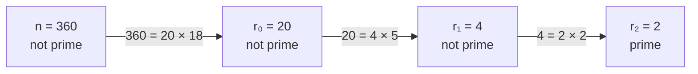
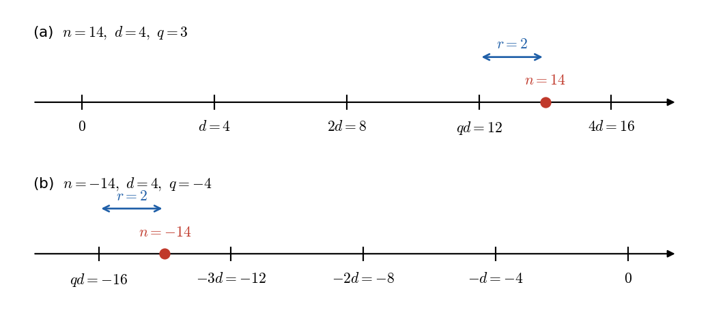
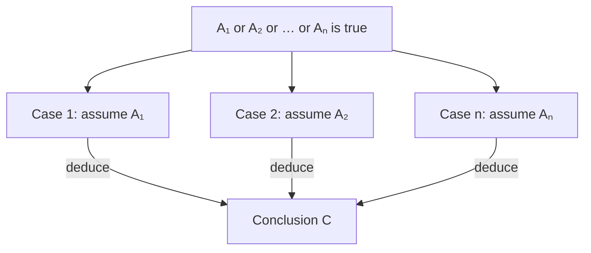
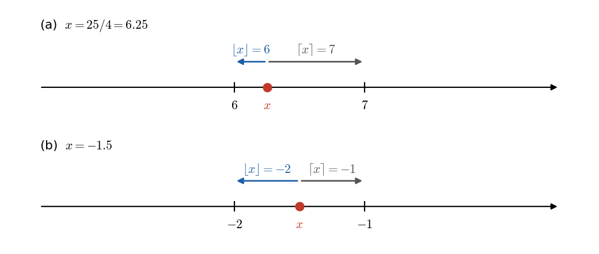
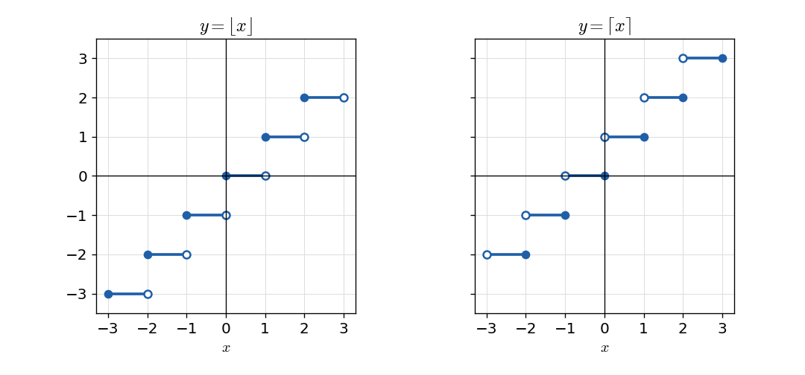
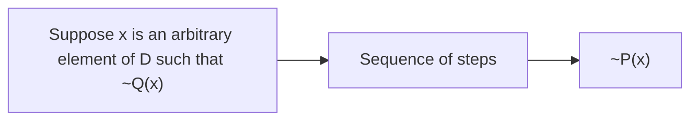
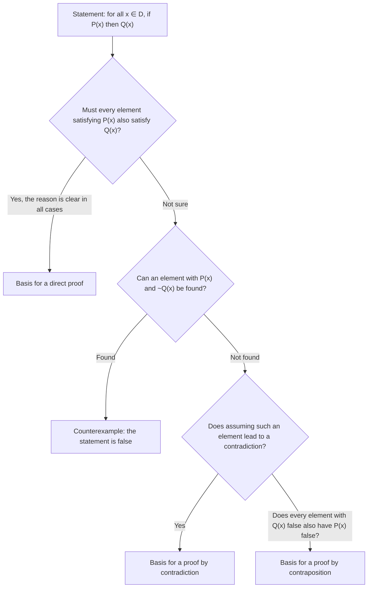
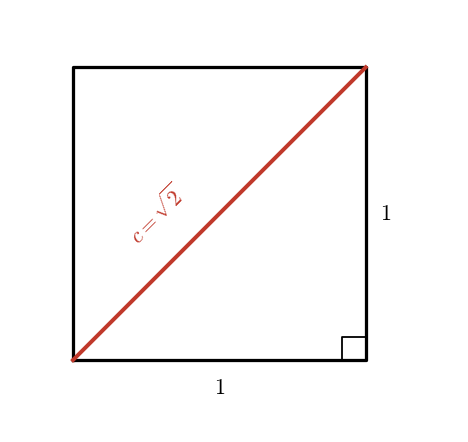

# Chapter 4 — Elementary Number Theory and Methods of Proof

[Repository Guide](../../README.md) | [English](Concepts_Lecture.md) | [한국어](Concepts_Lecture.ko.md)

> **Last Updated:** 2026-11-04
>
> Discrete Mathematics with Applications, Epp, Ch 4

> **Learning Objectives:**
> 1. Use the definitions of even, odd, prime, composite, rational, and divisibility to prove statements about integers directly or to disprove them by counterexample
> 2. Determine the starting point and the conclusion to be shown of a proof by generalizing from the generic particular, and detect common mistakes in proof writing
> 3. Compute remainders with the quotient-remainder theorem, div, and mod, and prove properties of integers by division into cases
> 4. Prove or disprove properties of the floor and ceiling functions from their definitions
> 5. Distinguish and apply proof by contradiction and proof by contraposition, and prove the irrationality of $\sqrt{2}$ and the infinitude of the primes
> 6. Write integers in standard factored form by the unique factorization of integers theorem and use it in divisibility problems

---

## Table of Contents

- [1. Direct Proof and Counterexample I: Introduction](#1-direct-proof-and-counterexample-i-introduction)
  - [1.1 The Role of Proof and Basic Assumptions](#11-the-role-of-proof-and-basic-assumptions)
  - [1.2 Even, Odd, Prime, and Composite Integers](#12-even-odd-prime-and-composite-integers)
  - [1.3 Proving Existential Statements](#13-proving-existential-statements)
  - [1.4 Disproving Universal Statements by Counterexample](#14-disproving-universal-statements-by-counterexample)
  - [1.5 Proving Universal Statements](#15-proving-universal-statements)
  - [1.6 Getting Proofs Started](#16-getting-proofs-started)
- [2. Direct Proof and Counterexample II: Writing Advice](#2-direct-proof-and-counterexample-ii-writing-advice)
  - [2.1 Directions for Writing Proofs of Universal Statements](#21-directions-for-writing-proofs-of-universal-statements)
  - [2.2 Variations among Proofs](#22-variations-among-proofs)
  - [2.3 Common Mistakes](#23-common-mistakes)
  - [2.4 Examples of Writing and Checking Proofs](#24-examples-of-writing-and-checking-proofs)
  - [2.5 Showing That an Existential Statement Is False](#25-showing-that-an-existential-statement-is-false)
  - [2.6 Conjecture, Proof, and Disproof](#26-conjecture-proof-and-disproof)
- [3. Direct Proof and Counterexample III: Rational Numbers](#3-direct-proof-and-counterexample-iii-rational-numbers)
  - [3.1 Rational and Irrational Numbers](#31-rational-and-irrational-numbers)
  - [3.2 More on Generalizing from the Generic Particular](#32-more-on-generalizing-from-the-generic-particular)
  - [3.3 Proving Properties of Rational Numbers](#33-proving-properties-of-rational-numbers)
  - [3.4 Deriving New Mathematics from Old](#34-deriving-new-mathematics-from-old)
- [4. Direct Proof and Counterexample IV: Divisibility](#4-direct-proof-and-counterexample-iv-divisibility)
  - [4.1 Definition of Divisibility](#41-definition-of-divisibility)
  - [4.2 Proving Properties of Divisibility](#42-proving-properties-of-divisibility)
  - [4.3 Counterexamples and Divisibility](#43-counterexamples-and-divisibility)
  - [4.4 The Unique Factorization of Integers Theorem](#44-the-unique-factorization-of-integers-theorem)
- [5. Direct Proof and Counterexample V: Division into Cases and the Quotient-Remainder Theorem](#5-direct-proof-and-counterexample-v-division-into-cases-and-the-quotient-remainder-theorem)
  - [5.1 The Quotient-Remainder Theorem](#51-the-quotient-remainder-theorem)
  - [5.2 div and mod](#52-div-and-mod)
  - [5.3 Representations of Integers and Division into Cases](#53-representations-of-integers-and-division-into-cases)
  - [5.4 Absolute Value and the Triangle Inequality](#54-absolute-value-and-the-triangle-inequality)
- [6. Direct Proof and Counterexample VI: Floor and Ceiling](#6-direct-proof-and-counterexample-vi-floor-and-ceiling)
  - [6.1 Definitions of Floor and Ceiling](#61-definitions-of-floor-and-ceiling)
  - [6.2 Properties of Floor: Disproof and Proof](#62-properties-of-floor-disproof-and-proof)
  - [6.3 The Floor of n/2 and div and mod](#63-the-floor-of-n2-and-div-and-mod)
- [7. Indirect Argument: Contradiction and Contraposition](#7-indirect-argument-contradiction-and-contraposition)
  - [7.1 Proof by Contradiction](#71-proof-by-contradiction)
  - [7.2 Proof by Contraposition](#72-proof-by-contraposition)
  - [7.3 Relation between Proof by Contradiction and Proof by Contraposition](#73-relation-between-proof-by-contradiction-and-proof-by-contraposition)
  - [7.4 Proof as a Problem-Solving Tool](#74-proof-as-a-problem-solving-tool)
- [8. Indirect Argument: Two Famous Theorems](#8-indirect-argument-two-famous-theorems)
  - [8.1 The Irrationality of √2](#81-the-irrationality-of-2)
  - [8.2 Are There Infinitely Many Prime Numbers?](#82-are-there-infinitely-many-prime-numbers)
  - [8.3 When to Use Indirect Proof](#83-when-to-use-indirect-proof)
  - [8.4 Open Questions in Number Theory](#84-open-questions-in-number-theory)
- [Concept Applications](#concept-applications)
- [Summary](#summary)
- [Self-Check Questions](#self-check-questions)
- [References](#references)

---

<br>

## 1. Direct Proof and Counterexample I: Introduction

This chapter uses properties of integers, rational numbers, and real numbers as its material and studies how to determine whether a mathematical statement is true or false. The field that studies properties of integers is called **number theory**. This chapter defines its basic concepts, namely even and odd integers, prime and composite numbers, rational numbers, divisibility, quotients and remainders, and the floor and ceiling functions, and uses them to practice direct proof, disproof by counterexample, proof by contradiction, and proof by contraposition.

### 1.1 The Role of Proof and Basic Assumptions

A **proof** is a carefully reasoned argument that convinces a skeptical listener (often oneself) that a statement is true. Imagine that the listener challenges the reason for every step; if each of those challenges can be answered, the proof as a whole is correct.

For example, to explain to someone unfamiliar with mathematical notation that a number $x$ satisfying $5x + 3 = 33$ must be 6, one can argue as follows.

1. If $5x + 3 = 33$, then subtracting 3 from both sides gives equal results, because subtracting the same number from two equal quantities gives equal results.
2. Subtracting 3 from $5x + 3$ leaves $5x$, and $33 - 3 = 30$. Hence $5x = 30$.
3. The only number that gives 30 when multiplied by 5 is 6. Hence $x = 6$.

Experienced mathematicians often omit reasons that the reader can easily supply. When first learning to write proofs, however, it is better to give too many reasons than too few. Writing a proof exposes weaknesses in an argument and assumptions made unconsciously, and even excellent mathematicians often discover, on checking seemingly obvious details carefully, that those details are false. Since the correctness of a mathematical argument can be a matter of life and death, as in computing the thrust of an airplane engine, the ability to distinguish a plausible guess from a certain conclusion is important.

Two questions about the floor function (Section 6) show how hard it can be to be sure by intuition alone. For every real number $x$, is $\lfloor x - 1 \rfloor = \lfloor x \rfloor - 1$? For all real numbers $x$ and $y$, is $\lfloor x - y \rfloor = \lfloor x \rfloor - \lfloor y \rfloor$? The answer to the first question is yes and the answer to the second is no, and the techniques of Section 6 establish both answers.

The proofs in this chapter use the following facts without proof.

- The laws of basic algebra (commutative, associative, and distributive laws, basic properties of equations and inequalities, and so on) hold.
- The three properties of equality: for all objects $A$, $B$, and $C$, (1) $A = A$, (2) if $A = B$ then $B = A$, and (3) if $A = B$ and $B = C$ then $A = C$.
- **Principle of substitution**: for all objects $A$ and $B$, if $A = B$, then $B$ may be substituted wherever $A$ appears.
- There is no integer between 0 and 1.
- The set of all integers is **closed** under addition, subtraction, and multiplication. That is, sums, differences, and products of two integers are integers.

> **Caution:** The integers are not closed under division. $3 \div 2 = 3/2$ is not an integer, and $3 \div 0$ is not even a number. This is why definitions and proofs about integers are expressed with multiplication instead of division (for example, $n = 2k$).

### 1.2 Even, Odd, Prime, and Composite Integers

To judge whether a statement is true, one must first know what the statement is about, that is, the exact meaning of every term in it. Mathematics defines terms very precisely, and it is important to learn definitions almost word for word.

> **Definition:** An integer $n$ is **even** if, and only if, $n$ equals twice some integer, and $n$ is **odd** if, and only if, $n$ equals twice some integer plus 1. Symbolically, for an integer $n$:
>
> - $n$ is even $\iff$ $n = 2k$ for some integer $k$
> - $n$ is odd $\iff$ $n = 2k + 1$ for some integer $k$

A definition is used in both directions. Knowing that an integer is even, one may write it as 2 times some integer; conversely, knowing that an integer equals 2 times some integer, one may conclude that the integer is even.

| Known fact | Fact that can be deduced | Direction used |
|:-----|:-----|:-----|
| The integer $n$ is even | $n = 2k$ for some integer $k$ | The $\Rightarrow$ direction of the definition (only if) |
| $n = 2k$ for some integer $k$ | $n$ is even | The $\Leftarrow$ direction of the definition (if) |

*Table 1. The two directions in which the definition of even is used in proofs*

Many books state definitions with if instead of if and only if (for example, an integer is called even if it equals twice some integer), but a definition is always read as a biconditional. Proofs usually need both directions.

Also, because the definitions of even and odd are quantified statements, the variables in them are local variables bound by their quantifiers, and their scope extends only to the end of the definition (Chapter 3). Hence renaming the variables does not change the meaning. The following all say the same thing.

- For every integer $n$, $n$ is even $\iff$ $n = 2r$ for some integer $r$
- For every integer $m$, $m$ is even $\iff$ $m = 2a$ for some integer $a$
- For every integer $a$, $a$ is odd $\iff$ $a = 2s + 1$ for some integer $s$
- For every integer $k$, $k$ is odd $\iff$ $k = 2n + 1$ for some integer $n$

**Example 4.1.1 (Even and Odd Integers).** Use the definitions to answer the following questions, where $a$ and $b$ are integers.

- (a) Is 0 even? Yes. $0 = 2 \cdot 0$ and 0 is an integer.
- (b) Is $-301$ odd? Yes. $-301 = 2 \cdot (-151) + 1$ and $-151$ is an integer.
- (c) Is $6a^2b$ even? Yes. $6a^2b = 2(3a^2b)$, and $3a^2b$ is an integer because it is a product of integers.
- (d) Is $10a + 8b + 1$ odd? Yes. $10a + 8b + 1 = 2(5a + 4b) + 1$, and $5a + 4b$ is an integer because it is a sum of products of integers.
- (e) Is every integer either even or odd? Yes, but the reason is not immediate from the definitions. This fact is proved with the quotient-remainder theorem in Section 5.3, and Section 7.1 shows by contradiction that no integer is both even and odd.

The integer $6 = 2 \cdot 3$ is a product of two smaller positive integers. On the other hand, 7 cannot be written this way; its only positive divisors are 1 and 7. An integer greater than 1 that, like 7, cannot be written as a product of two smaller positive integers is called prime.

> **Definition:** An integer $n$ is **prime** if, and only if, $n > 1$ and for all positive integers $r$ and $s$ with $n = rs$, one of $r$ and $s$ equals $n$. An integer $n$ is **composite** if, and only if, $n > 1$ and $n = rs$ for some integers $r$ and $s$ with $1 < r < n$ and $1 < s < n$. Symbolically, for each integer $n$ with $n > 1$:
>
> - $n$ is prime $\iff$ for all positive integers $r$ and $s$ with $n = rs$, ($r = 1$ and $s = n$) or ($r = n$ and $s = 1$)
> - $n$ is composite $\iff$ there exist positive integers $r$ and $s$ with $n = rs$, $1 < r < n$, and $1 < s < n$

**Example 4.1.2 (Prime and Composite Numbers).**

- (a) Is 1 prime? No. A prime number must be greater than 1.
- (b) Is every integer greater than 1 either prime or composite? Yes. Let $n$ be any integer greater than 1. Consider all pairs $(r, s)$ of positive integers with $n = rs$; the two pairs $r = n, s = 1$ and $r = 1, s = n$ always exist. Moreover, since $n = rs$ and $r$ and $s$ are positive integers, every such pair satisfies $1 \le r \le n$ and $1 \le s \le n$. If $n$ is prime, these two pairs are the only ways to write $n$ as $rs$. Otherwise there is a pair in which neither $r$ nor $s$ is 1 or $n$; that pair satisfies $1 < r < n$ and $1 < s < n$, so $n$ is composite.
- (c) The first six prime numbers are 2, 3, 5, 7, 11, 13.
- (d) The first six composite numbers are 4, 6, 8, 9, 10, 12.

> **Caution:** Both definitions require $n > 1$, so 1, 0, and the negative integers are neither prime nor composite. The reason for excluding 1 from the primes is explained with the unique factorization of integers theorem in Section 4.4.

### 1.3 Proving Existential Statements

As defined in Chapter 3, an existential statement

$$
\exists x \in D \text{ such that } Q(x)
$$

is true if, and only if, $Q(x)$ is true for at least one $x$ in $D$. One way to prove it is to actually find an $x$ in $D$ that makes $Q(x)$ true; another is to give a set of directions for finding such an $x$. Both methods are called **constructive proofs of existence**. The logical principle behind them is **existential generalization**: if a property is known to be true for a particular object, one may conclude that there exists an object with that property.

**Example 4.1.3 (Constructive Proofs of Existence).**

- (a) Prove that there is an even integer $n$ that can be written in two ways as a sum of two primes. Let $n = 10$. Then $10 = 5 + 5 = 3 + 7$, and 3, 5, and 7 are all prime. Hence such an even integer, namely 10, exists.
- (b) Suppose $r$ and $s$ are integers. Prove that there is an integer $k$ with $22r + 18s = 2k$. Let $k = 11r + 9s$. Then $k$ is an integer because it is a sum of products of integers, and by substitution and the distributive law, $2k = 2(11r + 9s) = 22r + 18s$. Hence such an integer $k$ exists.

A **nonconstructive proof of existence** shows either (a) that the existence of an $x$ making $Q(x)$ true is guaranteed by an axiom or a previously proved theorem, or (b) that assuming there is no such $x$ leads to a contradiction. The drawback of a nonconstructive proof is that it gives almost no clue about where $x$ is or how to find it. With the spread of computers, constructive proofs that also contain a procedure for computing the quantity have become more favored.

### 1.4 Disproving Universal Statements by Counterexample

To **disprove** a statement means to show that it is false. Showing that a statement of the form $\forall x \in D,\ P(x) \to Q(x)$ is false is the same as showing that its negation is true, and the negation is the existential statement

$$
\exists x \in D \text{ such that } P(x) \wedge \sim Q(x)
$$

To show that an existential statement is true one usually gives an example. Because this example is used to show that the original statement is false, it is called a **counterexample**.

> **Key Point:** **Disproof by counterexample.** To disprove a statement of the form $\forall x \in D,\ P(x) \to Q(x)$, find one $x$ in $D$ for which the hypothesis $P(x)$ is true and the conclusion $Q(x)$ is false. Such an $x$ is called a counterexample.

**Example 4.1.4 (Disproof by Counterexample).** Disprove the statement "For all real numbers $a$ and $b$, if $a^2 = b^2$ then $a = b$." It suffices to find real numbers $a$ and $b$ for which the hypothesis $a^2 = b^2$ is true and the conclusion $a = b$ is false. The fact that both positive and negative numbers have positive squares is the clue. Let $a = 1$ and $b = -1$. Then $a^2 = 1^2 = 1$ and $b^2 = (-1)^2 = 1$, so $a^2 = b^2$, but $a \ne b$ since $1 \ne -1$. One counterexample suffices; $2$ and $-2$, or $0.5$ and $-0.5$, are counterexamples as well.

> **Note:** Example 4.1.4 shows that two numbers with equal squares need not be equal. If the squares of two **positive** numbers are equal, however, the numbers are equal. Searching for a counterexample in this way helps one narrow the hypothesis to obtain a true statement.

If a property holds in many cases and one guesses that it holds in all cases but cannot prove it, either the key to the proof has not been found yet or the guess itself is false. When a proof is stuck, it is a good idea to pause and look for a counterexample. Analyzing where the proof gets stuck helps in the search, and finding a counterexample deepens one's understanding of the problem so that one can formulate a narrower but true statement by changing the hypothesis.

### 1.5 Proving Universal Statements

Most mathematical statements to be proved are universal, and it is convenient to think of them in the following standard form (Chapters 1 and 3).

$$
\forall x \in D,\ P(x) \to Q(x)
$$

When $D$ is finite or only finitely many elements satisfy $P(x)$, the statement can be proved by the **method of exhaustion**, which checks those elements one by one.

**Example 4.1.5 (The Method of Exhaustion).** Prove that every even integer $n$ with $4 \le n \le 26$ can be written as a sum of two primes. There are only 12 such even integers, so check each one.

| $n$ | 4 | 6 | 8 | 10 | 12 | 14 | 16 | 18 | 20 | 22 | 24 | 26 |
|:-----|:-----|:-----|:-----|:-----|:-----|:-----|:-----|:-----|:-----|:-----|:-----|:-----|
| Sum of two primes | $2+2$ | $3+3$ | $3+5$ | $5+5$ | $5+7$ | $3+11$ | $5+11$ | $7+11$ | $7+13$ | $5+17$ | $5+19$ | $7+19$ |

*Table 2. Even integers from 4 to 26 written as sums of two primes*

In most mathematical situations the method of exhaustion cannot be used. For example, proving by exhaustion that every even integer greater than 2 is a sum of two primes would require checking infinitely many even integers. Even when the domain is finite, exhaustion may be infeasible: checking that a computer's multiplication circuitry gives the correct result for every pair of numbers in its range would take thousands of years for the multiplications alone.

The most powerful technique, which works regardless of the size of the domain, rests on a logical principle called **universal generalization**. A more descriptive name is generalizing from the generic particular.

> **Key Point:** **Generalizing from the generic particular.** To prove that all elements of a set have a certain property, take an element $x$ of the set that is particular but arbitrarily chosen, and prove that $x$ has the property.

**Example 4.1.6 (A Number Trick).** Ask a person to pick any number, add 5, multiply by 4, subtract 6, divide by 2, and subtract twice the original number. Whatever number the person picked, the result is always 7. The reason becomes clear when the calculation is followed with an empty box holding the picked number, that is, with a variable $x$.

| Step | Algebraic result |
|:-----|:-----|
| Pick a number | $x$ |
| Add 5 | $x + 5$ |
| Multiply by 4 | $(x + 5) \cdot 4 = 4x + 20$ |
| Subtract 6 | $(4x + 20) - 6 = 4x + 14$ |
| Divide by 2 | $(4x + 14)/2 = 2x + 7$ |
| Subtract twice the original number | $(2x + 7) - 2x = 7$ |

*Table 3. Each step of the number trick computed with a variable x*

$x$ is particular in that it is a single object, and it is arbitrarily chosen, or generic, in that any number at all can take its place. Since everything that depends on $x$ cancels by the end of the calculation, one can generalize that the result is 7 whatever the initial number is.

The point of choosing $x$ arbitrarily is to make a proof that can be generalized to every element of the domain. Choosing $x$ arbitrarily means making no special assumption about $x$ that is not also true of the other elements of the domain, so every conclusion deduced about $x$ holds equally for any element of the domain.

Applying this principle to a property of the form "if $P(x)$ then $Q(x)$" gives direct proof. A conditional statement is false only when its hypothesis is true and its conclusion is false. Hence, showing that the truth of $P(x)$ forces the truth of $Q(x)$ proves the conditional. To generalize this to every element of $D$, suppose $x$ is a particular but arbitrarily chosen element of $D$ that makes $P(x)$ true, and show that $x$ makes $Q(x)$ true.

> **Key Point:** **Method of direct proof.**
>
> 1. Express the statement to be proved in the form $\forall x \in D,\ P(x) \to Q(x)$. This step is often done mentally.
> 2. Start the proof by supposing $x$ is a particular but arbitrarily chosen element of $D$ for which the hypothesis $P(x)$ is true. This step is often abbreviated as supposing $x \in D$ and $P(x)$.
> 3. Show that the conclusion $Q(x)$ is true by using definitions, previously established results, and the rules of logical inference.

**Example 4.1.7 (A Direct Proof).** Prove that the sum of any two even integers is even.

First check whether the statement is believable. Adding a few pairs of even integers, such as $2 + 4$, $6 + 10$, $12 + 12$, and $28 + 54$, gives even sums. Since not every pair of even integers can be checked, however, its truth in a few instances does not make it certain that it is true in general. Many properties hold in many examples and yet are false in general.

To build a general proof, restate the statement formally.

- **Formal restatement:** For all integers $m$ and $n$, if $m$ and $n$ are even, then $m + n$ is even.
- **Starting point:** Suppose $m$ and $n$ are particular but arbitrarily chosen even integers; in short, suppose $m$ and $n$ are any even integers.
- **To show:** $m + n$ is even.

> **Caution:** The word "two" in the statement does not necessarily mean two distinct integers. Two integers chosen arbitrarily are likely to be different, but they may be the same.

Both the starting point and the conclusion involve the term even, so the definition of even must be used. Since $m$ and $n$ are even, each equals twice some integer. Here a law of logic called existential instantiation is used.

> **Definition:** **Existential instantiation.** Once an object of a certain kind is assumed or proved to exist, it may be given a name, provided that the name is not already in use for something else in the same discussion.

So name the integer whose double is $m$ by $r$ and the integer whose double is $n$ by $s$, and write $m = 2r$ and $n = 2s$.

> **Caution:** Since $m$ and $n$ are chosen arbitrarily, they can be any pair of even integers. Using the same name, as in $m = 2r$ and $n = 2r$, would make $m = n$ and smuggle in an assumption that is not true in general.

Now $m + n = 2r + 2s$, and what must be shown is that $m + n$ equals 2 times some integer. By the distributive law, $2r + 2s = 2(r + s)$, and $r + s$ is an integer because it is a sum of two integers. Summarizing this analysis as a theorem and a formal proof gives the following.

**Theorem 4.1.1.** The sum of any two even integers is even.

**Proof.** Suppose $m$ and $n$ are particular but arbitrarily chosen even integers. [It must be shown that $m + n$ is even.] By definition of even, $m = 2r$ and $n = 2s$ for some integers $r$ and $s$. Then the following holds.

$$
\begin{aligned}
m + n &= 2r + 2s \\
&= 2(r + s)
\end{aligned}
$$

The first equality is by substitution, and the second is by factoring out 2. Let $t = r + s$. Then $t$ is an integer because it is a sum of integers (another use of existential instantiation). Hence $m + n = 2t$ for the integer $t$, and by definition of even, $m + n$ is even. [This is what was to be shown.]

The square brackets [ ] in a proof contain explanations that reveal the logical flow; the proof is complete without them. Donald Knuth compared constructing a computer program from a specification to writing a mathematical proof from axioms, and in this analogy the bracketed comments correspond to the comments of a program. A program runs without comments, but comments help a human reader understand it.

Proofs often end with a sentence meaning "which was to be demonstrated," in Latin quod erat demonstrandum, abbreviated Q.E.D. The proof of Theorem 4.1.1 used both directions of the definition of even. Deducing the forms $m = 2r$ and $n = 2s$ from the evenness of $m$ and $n$ used the $\Rightarrow$ direction, and concluding that $m + n$ is even from $m + n = 2t$ used the $\Leftarrow$ direction. In mathematics, a **theorem** is a statement known to be true because it has been proved.

The forms of statements discussed so far and the methods for proving and disproving them are summarized below.

| Form of statement | How to show it is true | How to show it is false |
|:-----|:-----|:-----|
| Existential statement $\exists x \in D \text{ such that } Q(x)$ | Constructive proof of existence (find an example or give directions for finding one), nonconstructive proof of existence | Prove its negation, the universal statement $\forall x \in D,\ \sim Q(x)$ (Section 2.5) |
| Universal statement $\forall x \in D,\ P(x) \to Q(x)$ | Method of exhaustion (finite cases), generalizing from the generic particular (direct proof), indirect proof (Section 7) | Give one counterexample |

*Table 4. Methods of proof and disproof by the form of the statement*

### 1.6 Getting Proofs Started

Once generalizing from the generic particular and the method of direct proof are understood, one can write the first and last sentences of a proof even for a theorem one does not understand, because what a proof assumes at the start and what it must reach at the end are fixed by the grammatical form of the statement alone, not by what the statement is about.

**Example 4.1.8 (Starting Point and Conclusion to Be Shown).** Write the first and last sentences of a proof of the statement "Every complete bipartite graph is connected." No knowledge of complete bipartite graphs or connected graphs is needed. Rewriting with a quantifier and a variable gives the following.

- **Formal restatement:** For every graph $G$, if $G$ is complete bipartite, then $G$ is connected. Here the domain is the set of all graphs, the hypothesis is that $G$ is complete bipartite, and the conclusion is that $G$ is connected.
- **Starting point:** Suppose $G$ is a particular but arbitrarily chosen graph such that $G$ is complete bipartite.
- **Conclusion to be shown:** $G$ is connected.

Thus the proof has the following shape.

```text
Proof: Suppose G is a [particular but arbitrarily chosen] graph such that G is complete bipartite.
  ...
Therefore, G is connected.
```

**Example 4.1.9 (Filling in the Blanks of a Proof).** Write the proof of the theorem "For all integers $r$ and $s$, if $r$ is even and $s$ is odd then $3r + 2s$ is even" with the reason for each step.

1. Suppose $r$ and $s$ are particular but arbitrarily chosen integers such that $r$ is even and $s$ is odd. [It must be shown that $3r + 2s$ is even.]
2. By definition of even and odd, $r = 2m$ and $s = 2n + 1$ for some integers $m$ and $n$.
3. By substitution, $3r + 2s = 3(2m) + 2(2n + 1)$.
4. Multiplying out, $3(2m) + 2(2n + 1) = 6m + 4n + 2$.
5. Factoring out 2, $6m + 4n + 2 = 2(3m + 2n + 1)$.
6. Let $t = 3m + 2n + 1$. Then $t$ is an integer because $m$, $n$, 3, 2, and 1 are integers and products and sums of integers are integers.
7. Hence $3r + 2s = 2t$ for the integer $t$, and by definition of even, $3r + 2s$ is even.

---

<br>

## 2. Direct Proof and Counterexample II: Writing Advice

A proof is a means of communicating a convincing argument that a mathematical statement is true. A reader sees only what is actually written in a proof, not the unwritten thoughts behind it, so a proof must be clear and complete. Ideally, a proof leads the reader to understand why the statement is true.

### 2.1 Directions for Writing Proofs of Universal Statements

Over time, the following rules for writing the final version of a proof have become standard.

1. **Copy the statement of the theorem first.** This lets the reader of the proof refer to the content of the theorem at any time.
2. **Clearly mark the beginning of the proof with the word Proof.** This separates general discussion about the theorem from the actual proof.
3. **Make the proof self-contained.** Explain the meaning of every variable used in the proof within the proof. Thus a proof begins by introducing its initial variables and stating what kind of objects they are (for example, sentences such as suppose $m$ and $n$ are any even integers, or let $x$ be a real number greater than 2). This is like declaring variables and their data types at the beginning of a computer program. A new variable name can also be given in the middle of a proof to a quantity whose existence has been established. For example, having supposed that $n$ is even, write "Since $n$ is even, $n = 2s$ for some integer $s$."
4. **Write in complete, grammatically correct sentences.** This does not mean avoiding symbols and abbreviations but incorporating them into sentences. For example, a chain of equalities such as $m + n = 2r + 2s = 2(r + s)$ reads as one sentence if the first equals sign is read as "equals" and each later one as "which equals."
5. **Keep the reader informed about the status of each statement.** The reader should never be in doubt about whether something is assumed, already established, or still to be shown. Preface an assumption with words such as suppose or assume, and something still to be shown with words such as it must be shown that. This is especially important when a new variable is introduced while rephrasing what must be shown (mistake 5 in Section 2.3).
6. **Give a reason for every assertion.** Each assertion in a proof should come from the hypothesis of the theorem, the definition of a term in the theorem, a result obtained earlier in the proof, or a mathematical result already established or agreed to be assumed. State the reason with phrases such as by hypothesis, by definition of ..., by Theorem .... It is best to refer to definitions and theorems by name or number, and if a definition must be restated in the body of the proof, do not use a variable in it. Because the scope of a variable in a definition extends only to the end of the definition, a variable in the definition that uses the same symbol as a variable in the proof can give one symbol two meanings.
7. **Include the little words and phrases that make the logic clear.** Indicate how each sentence is related to the previous one. If it follows from the previous sentence, begin with words such as because, since, then, thus, therefore, or consequently, and add the reason. When bringing in a new fact that does not follow immediately from what precedes but is needed later, use words such as observe that, recall that, but, or now. When defining a new variable in terms of earlier ones, write "Let $t = r + s$," following the convention in mathematics and computer science of putting the new variable on the left of the equal sign and the expression that defines it on the right.
8. **Display equations and inequalities on separate lines.** This makes them easier for others to read and for oneself to check for accuracy.

### 2.2 Variations among Proofs

Two proofs of the same statement written by two different people are rarely identical. Even when the mathematical steps are the same, the notation, the amount of explanation, and the words linking the steps may differ. How much detail to give for each step is ultimately settled between the writer of a proof and its intended reader. When first learning proofs, it is good to follow fully explained proofs; the explanations inside brackets [ ] are there to clarify the logical flow or hidden assumptions, so the writer decides whether to include them.

### 2.3 Common Mistakes

The following are the most common mistakes in writing proofs.

1. **Arguing from examples.** Looking at examples is very helpful in problem solving, but a general statement cannot be proved by showing it is true in some cases. The argument "The sum of two even integers is even because if $m = 14$ and $n = 6$, both are even and $m + n = 20$ is also even" is evidence for a true conclusion but not a proof. Just as an invalid argument can have a true conclusion, an argument from examples can look as if it proves a true statement. One must show that the conclusion is true for all arbitrarily chosen even integers $m$ and $n$.
2. **Using the same letter to mean two different things.** One must not write "Suppose $m$ and $n$ are any odd integers. By definition of odd, $m = 2k + 1$ and $n = 2k + 1$ for an integer $k$." A variable in a proof, like a global variable in a program, keeps the same meaning to the end of the proof once it is introduced. Using $k$ in both expressions makes both $m$ and $n$ equal to $2k + 1$ and hence equal to each other, so the proof shows the conclusion only for two identical odd integers.
3. **Jumping to a conclusion.** This means alleging the truth of something without an adequate reason. The argument "Since $m$ and $n$ are even, $m = 2r$ and $n = 2s$ for some integers $r$ and $s$. Then $m + n = 2r + 2s$. So $m + n$ is even" jumps to the conclusion without finding an integer that, when doubled, equals $m + n$.
4. **Assuming what is to be proved.** This is a variation of jumping to a conclusion. Writing "When odd integers are multiplied, the product is odd. Hence $mn$ is odd" while proving that the product of two odd integers is odd uses the very thing to be proved as a reason.
5. **Confusing what is known with what is still to be shown.** This is a more subtle mistake that occurs when the conclusion is restated with a variable. In showing that the product of two odd integers is odd, writing "It must be shown that $mn$ is odd. This means that there exists an integer $s$ such that $mn = 2s + 1$. Also $m = 2a + 1$ and $n = 2b + 1$. Then $mn = (2a + 1)(2b + 1) = 2s + 1$, so $mn$ is odd" treats the existence of $s$ as already known, although it is guaranteed only once $mn$ is known to be odd. Writing "This means it must be shown that there exists an integer $s$ such that $mn = 2s + 1$" would have avoided the mistake. The best way is not to introduce a variable into a proof unless it is part of the hypothesis or deducible from it.
6. **Using any where some is meant.** "Suppose $m$ is any odd integer" is correct, but continuing with "By definition of odd, $m = 2a + 1$ for any integer $a$" is wrong. $a$ cannot be just any integer; solving $m = 2a + 1$ for $a$ shows that the only possible value is $(m - 1)/2$. The correct sentence is "$m = 2a + 1$ for some integer $a$" or "there exists an integer $a$ such that $m = 2a + 1$."
7. **Using if where because is meant.** "Suppose $p$ is a prime number. If $p$ is prime, then $p$ cannot be written as a product of two smaller positive integers" reads as if it doubts the primeness of $p$, which is already known from the first sentence. One should write "Because $p$ is prime, $p$ cannot be written as a product of two smaller positive integers." This is not a serious error in itself, but it reflects imprecise thinking that can cause problems later in a proof.

> **Caution:** A reader of a proof should never be in doubt about what has already been shown and what still needs to be shown. Make the status of assumptions and conclusions clear in every sentence.

### 2.4 Examples of Writing and Checking Proofs

**Example 4.2.1 (An Odd Integer Minus an Even Integer).** Using only the definitions of odd and even and the basic assumptions of Section 1.1, prove that the difference of any odd integer and any even integer is odd. Calling the odd integer $a$ and the even integer $b$, the statement is "For all integers $a$ and $b$, if $a$ is odd and $b$ is even, then $a - b$ is odd." So the starting point is supposing that $a$ is any odd integer and $b$ is any even integer, and the conclusion to be shown is that $a - b$ is odd.

**Theorem 4.2.1.** The difference of any odd integer and any even integer (the odd integer minus the even integer) is odd.

**Proof.**

1. Suppose $a$ is any odd integer and $b$ is any even integer. [It must be shown that $a - b$ is odd.]
2. By definition of odd, $a = 2r + 1$ for some integer $r$, and by definition of even, $b = 2s$ for some integer $s$.
3. By substitution, $a - b = (2r + 1) - 2s$.
4. Combining like terms, $(2r + 1) - 2s = 2r - 2s + 1$.
5. Factoring out 2, $2r - 2s + 1 = 2(r - s) + 1$.
6. Let $t = r - s$.
7. Then $t$ is an integer because it is a difference of integers.
8. Hence, by substitution, $a - b = 2t + 1$ for the integer $t$.
9. By definition of odd, $a - b$ is odd. [This is what was to be shown.]

Lines 1-3 follow immediately from the general structure of a proof, the definitions, and substitution. To decide the next steps, look again at what must be shown. By definition of odd it suffices to show that $a - b$ equals 2 times some integer plus 1, so lines 4-8 transform $(2r + 1) - 2s$ into that form, and line 9 declares that what was to be shown has been obtained.

The same care is needed in evaluating a proof. The next example shows how to check a flawed proof.

**Example 4.2.2 (Identifying a Mistake in a Proposed Proof).** Find the mistake in the following proof.

Theorem: If $n$ is any even integer, then $(-1)^n = 1$.

1. Suppose $n$ is any even integer. [It must be shown that $(-1)^n = 1$.]
2. By definition of even, $n = 2a$ for some integer $a$.
3. By substitution, $(-1)^n = (-1)^{2a}$.
4. By a law of exponents, $(-1)^{2a} = ((-1)^a)^2$.
5. Since the square of any nonzero real number is positive, $((-1)^a)^2 = 1$.

This proof jumps to a conclusion in line 5. Although the square of a nonzero real number is indeed positive, that fact alone does not imply that the square of $(-1)^a$ is exactly 1. Being positive and being 1 are different things.

### 2.5 Showing That an Existential Statement Is False

The negation of an existential statement is universal. Hence, to show that an existential statement is false, one must prove that its negation, a universal statement, is true.

**Example 4.2.3 (Disproving an Existential Statement).** Show that the statement "There is a positive integer $n$ such that $n^2 + 3n + 2$ is prime" is false. Its negation is "For all positive integers $n$, $n^2 + 3n + 2$ is not prime," which is universal, so it is proved by generalizing from the generic particular.

**Proof.** Suppose $n$ is a particular but arbitrarily chosen positive integer. [It will be shown that $n^2 + 3n + 2$ is not prime.] Factoring gives the following.

$$
n^2 + 3n + 2 = (n + 1)(n + 2)
$$

$n + 1$ and $n + 2$ are integers because they are sums of integers, and since $n \ge 1$, $n + 1 \ge 2 > 1$ and $n + 2 \ge 3 > 1$. Hence $n^2 + 3n + 2$ is a product of two integers greater than 1, and because both factors are greater than 1, each is smaller than the product itself. Therefore $n^2 + 3n + 2$ is not prime. For example, if $n = 1$ then $1 + 3 + 2 = 6 = 2 \cdot 3$, and if $n = 4$ then $16 + 12 + 2 = 30 = 5 \cdot 6$.

### 2.6 Conjecture, Proof, and Disproof

A **conjecture** is a statement that is believed to be true but has been neither proved nor disproved. A conjecture that is proved becomes a theorem, and one for which a counterexample is found turns out to be false. Three famous conjectures in the history of mathematics illustrate this process.

| Conjecture | Content | Outcome |
|:-----|:-----|:-----|
| Fermat's last theorem | For integers $n \ge 3$, there are no positive integers $x$, $y$, $z$ with $x^n + y^n = z^n$ (for $n = 2$ there are many solutions, such as $3^2 + 4^2 = 5^2$ and $5^2 + 12^2 = 13^2$) | Fermat (1601-1665) wrote in the margin of a book that he had found a proof, but no proof survived. In 1986 Kenneth Ribet showed that the theorem follows from another conjecture (the Taniyama-Shimura conjecture), and Andrew Wiles announced a proof in 1993. An error found during checking was fixed with Richard Taylor in 1994, and the proof was published in 1995 |
| Goldbach conjecture | Every even integer greater than 2 can be written as a sum of two primes | It has been verified by computer up to at least $10^{18}$ but has not been proved. There is an unbridgeable gap between finite verification and infinity |
| Euler's conjecture | $a^4 + b^4 + c^4 = d^4$ has no positive integer solutions | It looked good for many numbers, but Noam Elkies showed it false in 1987. A counterexample found by Roger Frye in a computer search is $95800^4 + 217519^4 + 414560^4 = 422481^4$ |

*Table 5. Famous conjectures that were proved, disproved, or remain open*

Euler's conjecture shows that even a plausible conjecture in number theory can be overturned by a single counterexample. Also, P vs. NP, one of the seven classical problems for each of which the Clay Mathematics Institute announced a prize of one million dollars in 2000, asks whether problems of a certain class can be solved on a computer more efficiently than by the very inefficient methods currently known. The efficiency of algorithms is the subject of Chapter 11.

---

<br>

## 3. Direct Proof and Counterexample III: Rational Numbers

Sums, differences, and products of integers are integers, but most quotients of integers are not integers. Quotients of integers are nevertheless important in their own right and are called rational numbers.

### 3.1 Rational and Irrational Numbers

> **Definition:** A real number $r$ is **rational** if, and only if, $r$ can be expressed as a quotient of two integers with a nonzero denominator. A real number that is not rational is **irrational**. Symbolically, for a real number $r$:
>
> - $r$ is rational $\iff$ there exist integers $a$ and $b$ with $r = a/b$ and $b \ne 0$

The word rational contains the word ratio, and a rational number is one that can be written as a ratio of integers.

**Example 4.3.1 (Determining Whether Numbers Are Rational).**

- (a) Is $10/3$ rational? Yes. It is a quotient of the integers 10 and 3.
- (b) Is $-\frac{5}{39}$ rational? Yes. $-\frac{5}{39} = \frac{-5}{39}$ is a quotient of the integers $-5$ and 39.
- (c) Is $0.281$ rational? Yes. $0.281 = 281/1000$. By the same reasoning every finite decimal is rational, so a calculator that displays only finite decimals can represent only rational numbers exactly.
- (d) Is 7 rational? Yes. $7 = 7/1$.
- (e) Is 0 rational? Yes. $0 = 0/1$.
- (f) Is $2/0$ rational? No. Division by 0 is not allowed, so $2/0$ is not a real number.
- (g) Is $2/0$ irrational? No. Every irrational number is a real number, and $2/0$ is not a real number.
- (h) Is $0.12121212\ldots$ (with 12 repeating forever) rational? Yes. The computation below is the reason.
- (i) If $m$ and $n$ are nonzero integers, is $(m + n)/(mn)$ rational? Yes. The explanation below is the reason.

Reason for (h): Let $x = 0.12121212\ldots$. Then $100x = 12.12121212\ldots$. Subtracting the two equations cancels the repeating part after the decimal point.

$$
\begin{aligned}
100x - x &= 12.12121212\ldots - 0.12121212\ldots = 12 \\
100x - x &= 99x
\end{aligned}
$$

Hence $99x = 12$ and $x = 12/99$, a ratio of two nonzero integers, so it is rational (in lowest terms it is $4/33$). The same method shows that every repeating decimal is rational, and conversely every rational number can be written as a terminating or repeating decimal (Chapter 9).

Reason for (i): Since $m$ and $n$ are integers, so are $m + n$ and $mn$ (sums and products of integers are integers). Also $mn \ne 0$ by the following property.

> **Definition:** **Zero product property.** If neither of two real numbers is zero, then their product is also not zero. Equivalently, if a product of two real numbers is zero, then at least one of them is zero.

Hence $(m + n)/(mn)$ is a quotient of two integers with a nonzero denominator, so it is rational.

### 3.2 More on Generalizing from the Generic Particular

If one claims that a property holds for all elements of a domain, a challenger may pick any element of the domain and ask for a proof that it satisfies the property. To prove the claim, one must be able to meet every such challenge; that is, one must have a way to convince the challenger that the property holds for an arbitrarily chosen element.

For example, suppose A claims that every integer is rational, and B asks A to show it for $n = 7$. A answers that $7 = 7/1$ is a quotient of integers and hence rational. When B challenges again with $n = -12$, A answers $-12 = -12/1$, and when B challenges with $n = 0$, A answers $0 = 0/1$. A can meet every challenge because A has a general procedure for putting an integer into the form of a rational number: divide the given integer by 1. Whatever integer $n$ is given, $n = n/1$ is a quotient of integers with a nonzero denominator and hence rational. This discussion is an informal proof of the following theorem.

**Theorem 4.3.1.** Every integer is a rational number.

### 3.3 Proving Properties of Rational Numbers

**Example 4.3.2 (A Sum of Rational Numbers).** Prove that the sum of any two rational numbers is rational. First rewrite the statement in the form for all ..., if ... then ....

- **Formal restatement:** For all real numbers $r$ and $s$, if $r$ and $s$ are rational, then $r + s$ is rational.
- **Starting point:** Suppose $r$ and $s$ are particular but arbitrarily chosen real numbers such that $r$ and $s$ are rational; in short, suppose $r$ and $s$ are any rational numbers.
- **To show:** $r + s$ is rational.

By definition of rational, saying that $r$ and $s$ are rational means that $r = a/b$ and $s = c/d$ for some integers $a$, $b$, $c$, and $d$ with $b \ne 0$ and $d \ne 0$. Substitution gives the following.

$$
r + s = \frac{a}{b} + \frac{c}{d} \qquad (4.3.1)
$$

To show that $r + s$ is rational, this value must be written as a single ratio of two integers with a nonzero denominator. Rewriting the right-hand side of equation (4.3.1) with a common denominator gives the following.

$$
\frac{a}{b} + \frac{c}{d} = \frac{ad}{bd} + \frac{bc}{bd} = \frac{ad + bc}{bd}
$$

Is this fraction a ratio of integers? Yes: products and sums of integers are integers, so $ad + bc$ and $bd$ are integers. Is the denominator $bd$ nonzero? Yes: $b \ne 0$ and $d \ne 0$, so $bd \ne 0$ by the zero product property. Hence $r + s$ is rational.

**Theorem 4.3.2.** The sum of any two rational numbers is rational.

**Proof.** Suppose $r$ and $s$ are any rational numbers. [It must be shown that $r + s$ is rational.] By definition of rational, $r = a/b$ and $s = c/d$ for some integers $a$, $b$, $c$, and $d$ with $b \ne 0$ and $d \ne 0$. Thus the following holds.

$$
r + s = \frac{a}{b} + \frac{c}{d} = \frac{ad + bc}{bd}
$$

The first equality is by substitution and the second by basic algebra. Let $p = ad + bc$ and $q = bd$. Then $p$ and $q$ are integers because $a$, $b$, $c$, and $d$ are integers and products and sums of integers are integers. Also $q \ne 0$ by the zero product property. Hence $r + s = p/q$ where $p$ and $q$ are integers and $q \ne 0$, so $r + s$ is rational by definition of rational. [This is what was to be shown.]

### 3.4 Deriving New Mathematics from Old

Section 1 decided the truth and falsity of statements using only high-school algebra, the fact that the integers are closed under addition, subtraction, and multiplication, and the definitions of the terms in the theorems. This is called proving directly from the definitions. Once a collection of statements has been proved directly from the definitions, another method of proof becomes possible: the statements in the collection can be used to derive new results.

**Example 4.3.3 (Deriving Results about Even and Odd Integers).** Suppose the following properties of even and odd integers have already been proved.

1. The sum, product, and difference of any two even integers are even.
2. The sum and difference of any two odd integers are even.
3. The product of any two odd integers is odd.
4. The product of any even integer and any odd integer is even.
5. The sum of any odd integer and any even integer is odd.
6. The difference of any odd integer minus any even integer is odd.
7. The difference of any even integer minus any odd integer is odd.

Use these properties to prove that if $a$ is any even integer and $b$ is any odd integer, then $\frac{a^2 + b^2 + 1}{2}$ is an integer.

**Proof.** Suppose $a$ is any even integer and $b$ is any odd integer. By property 3, $b^2 = b \cdot b$ is odd, and by property 1, $a^2 = a \cdot a$ is even. By property 5, $a^2 + b^2$ is odd, and since 1 is also odd, $(a^2 + b^2) + 1$ is even by property 2. By definition of even, there is an integer $k$ with $a^2 + b^2 + 1 = 2k$, and dividing both sides by 2 gives $\frac{a^2 + b^2 + 1}{2} = k$. Hence $\frac{a^2 + b^2 + 1}{2}$ is an integer. For example, if $a = 4$ and $b = 3$, then $(16 + 9 + 1)/2 = 13$.

A **corollary** is a statement whose truth can be deduced immediately from a theorem that has already been proved.

**Example 4.3.4 (The Double of a Rational Number).** Derive the following as a corollary of Theorem 4.3.2.

**Corollary 4.3.3.** The double of a rational number is rational.

**Proof.** Suppose $r$ is any rational number. Then $2r = r + r$ is a sum of two rational numbers. So, by Theorem 4.3.2, $2r$ is rational.

---

<br>

## 4. Direct Proof and Counterexample IV: Divisibility

When children first learn that 12 divided by 3 is 4, they learn it to mean that 12 objects separated into groups of 3 make 4 groups with nothing left over. This is described by saying that 12 is divisible by 3, or that 3 divides 12. Divisibility is the central concept of number theory, the study of properties of integers.

### 4.1 Definition of Divisibility

> **Definition:** For integers $n$ and $d$, $n$ is **divisible** by $d$ if, and only if, $n$ equals $d$ times some integer and $d \ne 0$. This is written $d \mid n$ and read "$d$ divides $n$." Symbolically, for integers $n$ and $d$:
>
> - $d \mid n \iff$ there exists an integer $k$ with $n = dk$ and $d \ne 0$
>
> Instead of saying that $n$ is divisible by $d$, one also says that $n$ is a **multiple** of $d$, $d$ is a **factor** of $n$, or $d$ is a **divisor** of $n$. If $d$ does not divide $n$, one writes $d \nmid n$.

> **Note:** Because the definition contains $d \ne 0$, knowing $d \mid n$ for integers $n$ and $d$ allows one to assume $d \ne 0$.

**Example 4.4.1 (Divisibility).** Decide each case according to the definition.

| Question | Answer | Reason |
|:-----|:-----|:-----|
| Is 21 divisible by 3? | Yes | $21 = 3 \cdot 7$ |
| Does 5 divide 40? | Yes | $40 = 5 \cdot 8$ |
| Does $7 \mid 42$? | Yes | $42 = 7 \cdot 6$ |
| Is 32 a multiple of $-16$? | Yes | $32 = (-16) \cdot (-2)$ |
| Is 6 a factor of 54? | Yes | $54 = 6 \cdot 9$ |
| Is 7 a factor of $-7$? | Yes | $-7 = 7 \cdot (-1)$ |

*Table 6. Six examples decided by the definition of divisibility*

**Example 4.4.2 (Divisors of Zero).** If $k$ is any nonzero integer, does $k$ divide 0? Yes, because $0 = k \cdot 0$ and 0 is an integer. On the other hand, since the definition requires $d \ne 0$, 0 divides no integer.

Two useful properties of divisibility are (1) that if one positive integer divides a second positive integer, the first is less than or equal to the second, and (2) that the only divisors of 1 are 1 and $-1$.

**Theorem 4.4.1 (A Positive Divisor of a Positive Integer).** For all integers $a$ and $b$, if $a$ and $b$ are positive and $a \mid b$, then $a \le b$.

**Proof.** Suppose $a$ and $b$ are any positive integers such that $a \mid b$. [It must be shown that $a \le b$.]

1. By definition of divisibility, there exists an integer $k$ with $b = ak$.
2. Since $a > 0$ and $b > 0$, $k > 0$. If $k \le 0$, the product $ak$ with the positive number $a$ would be at most 0, contradicting $b > 0$.
3. Since there is no integer between 0 and 1, the positive integer $k$ satisfies $1 \le k$.
4. Multiplying both sides of an inequality by a positive number preserves its direction, so multiplying both sides of $1 \le k$ by $a$ gives $a \le ka = b$.
5. Hence $a \le b$. [This is what was to be shown.]

**Theorem 4.4.2 (Divisors of 1).** The only divisors of 1 are 1 and $-1$.

**Proof.** Since $1 \cdot 1 = 1$ and $(-1)(-1) = 1$, both 1 and $-1$ are divisors of 1. Now suppose $m$ is any integer that divides 1. Then there is an integer $n$ with $1 = mn$. If a product of two numbers is positive, the two numbers are both positive or both negative.

- **Case where $m$ and $n$ are both positive:** $m$ is a positive divisor of 1, so $m \le 1$ by Theorem 4.4.1. The only positive integer less than or equal to 1 is 1, so $m = 1$.
- **Case where $m$ and $n$ are both negative:** $(-m)(-n) = mn = 1$, so $-m$ is a positive divisor of 1. By the same reasoning as in the previous case, $-m = 1$ and $m = -1$.

Hence $m = 1$ or $m = -1$, and the only divisors of 1 are 1 and $-1$.

**Example 4.4.3 (Divisibility and Algebraic Expressions).**

- (a) If $a$ and $b$ are integers, is $3a + 3b$ divisible by 3? Yes. By the distributive law, $3a + 3b = 3(a + b)$, and $a + b$ is an integer because it is a sum of two integers.
- (b) If $k$ and $m$ are integers, is $10km$ divisible by 5? Yes. By the associative law, $10km = 5 \cdot (2km)$, and $2km$ is an integer because it is a product of three integers.

Writing the definition of divisibility with the existential quantifier gives $d \mid n \iff \exists k \in \mathbf{Z} \text{ such that } n = dk \wedge d \ne 0$. Since the negation of an existential statement is universal, $d$ does not divide $n$ if, and only if, $n \ne dk$ for every integer $k$ or $d = 0$. When $d \ne 0$, this means that the quotient $n/d$ is not an integer.

$$
d \nmid n \iff \frac{n}{d} \notin \mathbf{Z} \qquad (n, d \in \mathbf{Z},\ d \ne 0)
$$

**Example 4.4.4 (Checking Nondivisibility).** Does $4 \mid 15$? No. $15/4 = 3.75$ is not an integer.

> **Caution:** Do not confuse $a \mid b$ with $a/b$. $a \mid b$ is a **sentence**, "$a$ divides $b$," meaning that there is an integer $k$ with $b = ak$. Dividing both sides by $a$ gives $b/a = k$, so when $a \ne 0$, $a \mid b$ is equivalent to $b/a$ being an integer. On the other hand, $a/b$ is a **number**, the result of dividing $a$ by $b$, which may or may not be an integer. In particular, writing $4 \mid (3 + 5) = 4 \mid 8$ gives the meaningless sentence "4 divides the quantity 3 plus 5 equals 4 divides 8."

**Example 4.4.5 (Prime Numbers and Divisibility).** A prime number can also be defined as follows: an integer $n$ with $n > 1$ is prime if, and only if, its only positive divisors are 1 and $n$ itself.

### 4.2 Proving Properties of Divisibility

One of the most useful properties of divisibility is transitivity. If a first number divides a second and the second divides a third, then the first divides the third.

**Example 4.4.6 (Transitivity of Divisibility).** Prove that for all integers $a$, $b$, and $c$, if $a \mid b$ and $b \mid c$ then $a \mid c$. Since the statement is already written formally, the starting point and the conclusion can be read off immediately.

- **Starting point:** Suppose $a$, $b$, and $c$ are particular but arbitrarily chosen integers such that $a \mid b$ and $b \mid c$.
- **To show:** $a \mid c$, that is, $c$ equals $a$ times some integer.

Since $a \mid b$, $b = ar$ for some integer $r$ (4.4.1), and since $b \mid c$, $c = bs$ for some integer $s$ (4.4.2). Equation (4.4.2) expresses $c$ in terms of $b$, and equation (4.4.1) expresses $b$ in terms of $a$, so substituting (4.4.1) into (4.4.2) gives an equation expressing $c$ in terms of $a$.

$$
c = bs = (ar)s = a(rs)
$$

The last equality is the associative law for multiplication. Now that $c$ is expressed as $a$ times something, it remains only to check that this something, $rs$, is an integer. It is, because it is a product of two integers.

**Theorem 4.4.3 (Transitivity of Divisibility).** For all integers $a$, $b$, and $c$, if $a$ divides $b$ and $b$ divides $c$, then $a$ divides $c$.

**Proof.** Suppose $a$, $b$, and $c$ are particular but arbitrarily chosen integers such that $a$ divides $b$ and $b$ divides $c$. [It must be shown that $a$ divides $c$.] By definition of divisibility, $b = ar$ and $c = bs$ for some integers $r$ and $s$. By substitution and basic algebra, $c = bs = (ar)s = a(rs)$. Let $k = rs$. Then $k$ is an integer because it is a product of integers, and $c = ak$. Also $a \ne 0$ because $a \mid b$. Hence $a$ divides $c$ by definition of divisibility. [This is what was to be shown.]

Following the definition of prime literally, it would seem that to show an integer is prime one must check that it is not divisible by any integer greater than 1 and less than itself. In fact one need only check divisibility by **primes** less than itself. This follows from Theorems 4.4.1 and 4.4.3 and the next theorem: if $n$ has a divisor $d$ with $1 < d < n$, then by the next theorem some prime $p$ divides $d$, by transitivity $p \mid n$, and by Theorem 4.4.1 $p \le d < n$.

The idea of the next theorem is simple. Start with an integer greater than 1. If it is prime, stop; if not, write it as a product of two smaller positive factors. If one of these factors is prime, stop; if not, write that factor in turn as a product of still smaller positive factors. Since all the factors can be chosen positive and each is smaller than the one before, the process eventually ends at a prime.

**Theorem 4.4.4 (Divisibility by a Prime).** Every integer greater than 1 is divisible by a prime number.

**Proof.** Suppose $n$ is a particular but arbitrarily chosen integer greater than 1. [It must be shown that there is a prime number that divides $n$.]

1. If $n$ is prime, then $n$ is divisible by a prime number, namely itself, and the proof is complete.
2. If $n$ is not prime, then as in Example 4.1.2(b), $n = r_0 s_0$ for some integers $r_0$ and $s_0$ with $1 < r_0 < n$ and $1 < s_0 < n$. By definition of divisibility, $r_0 \mid n$.
3. If $r_0$ is prime, then $r_0$ is a prime number dividing $n$, and the proof is complete. If $r_0$ is not prime, then $r_0 = r_1 s_1$ for some integers $r_1$ and $s_1$ with $1 < r_1 < r_0$ and $1 < s_1 < r_0$. By definition, $r_1 \mid r_0$, and since already $r_0 \mid n$, transitivity gives $r_1 \mid n$.
4. If $r_1$ is prime, the proof is complete; otherwise write $r_1 = r_2 s_2$ in the same way and obtain $r_2 \mid n$ from $r_2 \mid r_1$ and $r_1 \mid n$. Repeat this process until a prime factor is found.
5. Each new factor is less than the previous one (which is less than $n$) and greater than 1, and there are fewer than $n$ integers between 1 and $n$, so the process ends in a finite number of steps. The result is a sequence $r_0, r_1, \ldots, r_k$ with $k \ge 0$, $1 < r_k < r_{k-1} < \cdots < r_1 < r_0 < n$, and $r_i \mid n$ for each $i = 0, 1, \ldots, k$.
6. The condition for termination is that $r_k$ is prime, so $r_k$ is a prime number that divides $n$. [This is what was to be shown.]

> **Note:** Strictly speaking, the claim in step 5 that the process must end is justified by an axiom for the integers called the well-ordering principle. The well-ordering principle and a proof of the same theorem by strong mathematical induction are discussed in Chapter 5.

For example, applying this process to $n = 360$ gives the following. The factorizations can be chosen in many ways, and whichever is chosen, the process ends at a prime.



*Figure 1. Repeatedly splitting factors of n = 360 until reaching the prime factor 2*

Since $2 \mid 4$, $4 \mid 20$, and $20 \mid 360$, transitivity gives $2 \mid 360$.

### 4.3 Counterexamples and Divisibility

To show that a proposed divisibility property is not universally true, one need only find one example of integers for which it is false.

**Example 4.4.7 (Checking a Proposed Property).** Is the statement "For all integers $a$ and $b$, if $a \mid b$ and $b \mid a$ then $a = b$" true or false? It is false. The search for a counterexample starts much like an attempt at a proof.

- **Starting point:** Suppose $a$ and $b$ are integers such that $a \mid b$ and $b \mid a$.
- **Question:** Must it follow that $a = b$, or could $a \ne b$ for some $a$ and $b$?

By definition of divisibility, $b = ha$ and $a = kb$ for some integers $h$ and $k$. Combining the two equations gives the following.

$$
b = ha = h(kb) = (hk)b
$$

Since $b \mid a$, $b \ne 0$, and canceling $b$ from the two ends gives $1 = hk$. That is, $h$ and $k$ are divisors of 1, so by Theorem 4.4.2 they are both 1 or both $-1$. If $h = k = 1$ then $b = a$, but if $h = k = -1$ then $b = -a$, and since $a \ne 0$, $a \ne b$. This analysis suggests that a counterexample can be found by taking $b = -a$.

- **Counterexample:** Let $a = 2$ and $b = -2$. Then $-2 = (-1) \cdot 2$ and $2 = (-1) \cdot (-2)$, so $a \mid b$ and $b \mid a$, but $a \ne b$ because $2 \ne -2$. Hence the statement is false.

> **Note:** The analysis also shows how to repair the statement. If $a$ and $b$ are restricted to positive integers, Theorem 4.4.1 gives $a \le b$ and $b \le a$, so $a = b$. A search for a proof can reveal a counterexample, and a search for a counterexample can reveal why a statement is true. What matters is to keep an open mind until convinced by one's own careful reasoning.

### 4.4 The Unique Factorization of Integers Theorem

The most comprehensive statement about divisibility of integers is the theorem on the uniqueness of the prime factorization of integers; because of its importance it is also called the **fundamental theorem of arithmetic**. Euclid, around 300 B.C.E., seems to have known the theorem, but it was first stated precisely by Carl Friedrich Gauss in 1801.

According to this theorem, an integer greater than 1 is either prime or can be written as a product of primes, and the representation is unique except for the order in which the primes are written. For example, $72 = 2 \cdot 2 \cdot 2 \cdot 3 \cdot 3 = 2 \cdot 3 \cdot 3 \cdot 2 \cdot 2 = 3 \cdot 2 \cdot 2 \cdot 3 \cdot 2$: the three 2s and two 3s can appear in any order, yet every prime factorization of 72 consists of exactly three 2s and two 3s. No other collection of primes multiplies out to 72.

**Theorem 4.4.5 (Unique Factorization of Integers Theorem, Fundamental Theorem of Arithmetic).** Given any integer $n > 1$, there exist a positive integer $k$, distinct prime numbers $p_1, p_2, \ldots, p_k$, and positive integers $e_1, e_2, \ldots, e_k$ such that

$$
n = p_1^{e_1} p_2^{e_2} p_3^{e_3} \cdots p_k^{e_k}
$$

and any other expression for $n$ as a product of prime numbers is identical to this one except, perhaps, for the order in which the factors are written.

> **Note:** This theorem is the reason 1 is not counted as a prime. If 1 were prime, factorizations would not be unique, as in $6 = 2 \cdot 3 = 1 \cdot 2 \cdot 3 = 1 \cdot 1 \cdot 2 \cdot 3$. Proving the theorem requires tools such as the mathematical induction of Chapter 5, so only the result is used here.

Because of the fundamental theorem of arithmetic, every integer greater than 1 can be put in a standard form in which the prime factors are written in ascending order from left to right.

> **Definition:** Given any integer $n > 1$, the **standard factored form** of $n$ is an expression of the form $n = p_1^{e_1} p_2^{e_2} p_3^{e_3} \cdots p_k^{e_k}$, where $k$ is a positive integer, $p_1, p_2, \ldots, p_k$ are prime numbers, $e_1, e_2, \ldots, e_k$ are positive integers, and $p_1 < p_2 < \cdots < p_k$.

**Example 4.4.8 (Writing Integers in Standard Factored Form).** Write 3,300 in standard factored form. First find all the factors, then write them in ascending order.

$$
\begin{aligned}
3300 &= 100 \cdot 33 = 4 \cdot 25 \cdot 3 \cdot 11 \\
&= 2 \cdot 2 \cdot 5 \cdot 5 \cdot 3 \cdot 11 = 2^2 \cdot 3^1 \cdot 5^2 \cdot 11^1
\end{aligned}
$$

**Example 4.4.9 (Using Unique Factorization to Solve a Problem).** Suppose an integer $m$ satisfies the following.

$$
8 \cdot 7 \cdot 6 \cdot 5 \cdot 4 \cdot 3 \cdot 2 \cdot m = 17 \cdot 16 \cdot 15 \cdot 14 \cdot 13 \cdot 12 \cdot 11 \cdot 10
$$

Does $17 \mid m$? Yes. Since 17 is one of the prime factors of the right-hand side, it must also be among the prime factors of the left-hand side by the fundamental theorem of arithmetic. But 17 equals no prime factor of 8, 7, 6, 5, 4, 3, or 2 (their prime factors are all at most 7). Hence 17 must occur as a prime factor of $m$, and $17 \mid m$. Indeed, computing gives $m = 24310 = 17 \cdot 1430$.

---

<br>

## 5. Direct Proof and Counterexample V: Division into Cases and the Quotient-Remainder Theorem

Dividing 11 by 4 gives a quotient of 2 and a remainder of 3. This means that 11 consists of 2 groups of 4 with 3 left over, which as an equation is $11 = 2 \cdot 4 + 3$. The number left over, 3, is smaller than the group size 4, because if 4 or more were left over, another group of 4 could be formed.

### 5.1 The Quotient-Remainder Theorem

The **quotient-remainder theorem** says that when any integer $n$ is divided by any positive integer $d$, the result is a quotient $q$ and a nonnegative remainder $r$ that is smaller than $d$.

**Theorem 4.5.1 (The Quotient-Remainder Theorem).** Given any integer $n$ and positive integer $d$, there exist unique integers $q$ and $r$ such that

$$
n = dq + r, \qquad 0 \le r < d
$$

The proof that $q$ and $r$ exist uses the well-ordering principle of Chapter 5, and the uniqueness part can be shown by proof by contradiction.

If $n$ is positive, the theorem can be seen on the number line as follows. Step forward by $d$ through $0, d, 2d, 3d, \ldots$ and stop at the last multiple $qd$ that does not exceed $n$; the distance from $qd$ to $n$ is the remainder $r$. If $n$ is negative, $r$ must still be nonnegative, so $d$ is multiplied by a negative integer $q$ to bring $dq$ either exactly to $n$ ($r = 0$) or to a point below $n$, and the positive integer $r$ is added to come back up to $n$.



*Figure 2. Number lines showing the quotient and remainder when n = 14 and n = -14 are divided by d = 4*

**Example 4.5.1 (The Quotient-Remainder Theorem).** For the given $n$ and $d$, find integers $q$ and $r$ with $n = dq + r$ and $0 \le r < d$.

| $n$ | $d$ | Equation | $q$ | $r$ |
|:-----|:-----|:-----|:-----|:-----|
| 54 | 4 | $54 = 4 \cdot 13 + 2$ | 13 | 2 |
| $-54$ | 4 | $-54 = 4 \cdot (-14) + 2$ | $-14$ | 2 |
| 54 | 70 | $54 = 70 \cdot 0 + 54$ | 0 | 54 |

*Table 7. Quotients and remainders for three choices of n and d*

> **Caution:** $-54 = 4 \cdot (-13) - 2$ is also a true equation, but its remainder $-2$ is negative, so it is not in the form of the quotient-remainder theorem. The remainder must always satisfy $0 \le r < d$; when $n$ is negative, take the quotient one step smaller and write $-54 = 4 \cdot (-14) + 2$.

### 5.2 div and mod

> **Definition:** Given an integer $n$ and a positive integer $d$, **$n$ div $d$** is the integer quotient obtained when $n$ is divided by $d$, and **$n$ mod $d$** is the nonnegative integer remainder obtained when $n$ is divided by $d$. Symbolically, if $n$ and $d$ are integers and $d > 0$:
>
> - $n \text{ div } d = q$ and $n \text{ mod } d = r$ $\iff$ $n = dq + r$ (where $q$ and $r$ are integers and $0 \le r < d$)

By the quotient-remainder theorem, $n \text{ mod } d$ is one of $0, 1, \ldots, d - 1$. Also, a necessary and sufficient condition for an integer $n$ to be divisible by $d$ is that $n \text{ mod } d = 0$. The word mod and this meaning come from the word modulus introduced by Gauss in 1801.

Many programming languages provide operators for quotients and remainders, but their definitions differ from language to language. Python writes $n$ div $d$ as `n // d` and $n$ mod $d$ as `n % d`, and for positive $d$ these give the values satisfying the quotient-remainder theorem regardless of the sign of the integer $n$. C, C#, and Java write $n$ div $d$ as `n / d` and $n$ mod $d$ as `n % d`; for $n \ge 0$ and $d > 0$ they give the same values as the mathematical definition, but for negative inputs they can give different values. For example, Java's integer division rounds the quotient toward 0, and a nonzero remainder has the same sign as the dividend (the number being divided) [1].

| Expression | Mathematical definition | Python | Java |
|:-----|:-----|:-----|:-----|
| $54$ div $4$, $54$ mod $4$ | 13, 2 | `54 // 4` = 13, `54 % 4` = 2 | `54 / 4` = 13, `54 % 4` = 2 |
| $-54$ div $4$, $-54$ mod $4$ | $-14$, 2 | `-54 // 4` = -14, `-54 % 4` = 2 | `-54 / 4` = -13, `-54 % 4` = -2 |

*Table 8. Mathematical div and mod compared with the results of the Python and Java operators*

> **Caution:** When computing remainders of values that may be negative in Java or C, the result can be negative. If the mathematical $n$ mod $d$ (with $d > 0$) is needed, correct a negative result by adding $d$. For example, in Java `-54 % 4` is $-2$, and $-2 + 4 = 2$ is the mathematical remainder.

**Example 4.5.2 (Computing div and mod by Hand or with a Four-Function Calculator).** Compute $32$ div $9$ and $32$ mod $9$. Dividing by hand, $9 \times 3 = 27$ and $32 - 27 = 5$, so $32 = 9 \cdot 3 + 5$, that is, $32$ div $9 = 3$ and $32$ mod $9 = 5$. With a four-function calculator, for a nonnegative integer $n$ and a positive integer $d$, compute $n \div d$ and discard the part after the decimal point to get $n$ div $d$. Substituting $q = n$ div $d$ and $r = n$ mod $d$ into $n = dq + r$ gives $n = d \cdot (n \text{ div } d) + n \text{ mod } d$, so the remainder is obtained from the following formula.

$$
n \text{ mod } d = n - d \cdot (n \text{ div } d)
$$

Discarding the fractional part of $32 \div 9 = 3.555\ldots$ gives $32$ div $9 = 3$, and $32$ mod $9 = 32 - 9 \cdot 3 = 32 - 27 = 5$.

**Example 4.5.3 (Computing the Day of the Week).** If today is Tuesday and neither this year nor next year is a leap year, what day of the week will it be 1 year from today? A year that is not a leap year has 365 days, and a week has 7 days. Since $365 = 52 \cdot 7 + 1$, $365$ div $7 = 52$ and $365$ mod $7 = 1$. Fifty-two weeks, or 364 days, from today will be a Tuesday, so 365 days from today will be the next day, Wednesday. In general, number the days Sunday = 0, Monday = 1, ..., Saturday = 6, let $\text{Day}_T$ be the day of the week today and $\text{Day}_N$ the day of the week in $N$ days; then the following holds.

$$
\text{Day}_N = (\text{Day}_T + N) \text{ mod } 7 \qquad (4.5.1)
$$

Tuesday is 2, so $(2 + 365) \text{ mod } 7 = 367 \text{ mod } 7 = 3$ (since $367 = 7 \cdot 52 + 3$), and 3 is Wednesday.

**Example 4.5.4 (Solving Problems about mod).**

(a) Prove that if $n$ is a positive integer, then $n$ mod 10 is the digit in the ones place of the decimal representation of $n$.

**Proof.** Suppose $n$ is any positive integer. Let the decimal representation of $n$ be $d_k d_{k-1} \cdots d_2 d_1 d_0$, where $d_0, d_1, \ldots, d_k$ are integers from 0 to 9 inclusive, $d_k \ne 0$, and the following holds.

$$
n = d_k \cdot 10^k + d_{k-1} \cdot 10^{k-1} + \cdots + d_2 \cdot 10^2 + d_1 \cdot 10 + d_0
$$

$d_0$ is the digit in the ones place. Factoring 10 out of every term but the last gives the following.

$$
n = 10 \cdot (d_k \cdot 10^{k-1} + d_{k-1} \cdot 10^{k-2} + \cdots + d_2 \cdot 10 + d_1) + d_0
$$

The expression in parentheses is an integer and $0 \le d_0 < 10$, so by the uniqueness in the quotient-remainder theorem, $n$ mod $10 = d_0$. For example, $4738 = 10 \cdot 473 + 8$, so $4738$ mod $10 = 8$.

(b) Suppose $m$ is an integer with $m$ mod $11 = 6$. What is $4m$ mod $11$? The remainder of $m$ divided by 11 is 6, so there is an integer $q$ with $m = 11q + 6$. Hence the following holds.

$$
4m = 44q + 24 = 44q + 22 + 2 = 11(4q + 2) + 2
$$

Since $4q + 2$ is an integer and $0 \le 2 < 11$, $4m$ mod $11 = 2$. For example, if $m = 17$, then $17 = 11 \cdot 1 + 6$ and $4m = 68 = 11 \cdot 6 + 2$.

### 5.3 Representations of Integers and Division into Cases

In Section 1.2 an odd integer could have been defined as an integer that is not even, but it was defined as twice an integer plus 1 because that form is more useful in proofs. The quotient-remainder theorem brings the two views together and guarantees that every integer is even or odd. Dividing any integer $n$ by $d = 2$, the quotient-remainder theorem gives unique integers $q$ and $r$ with $n = 2q + r$ and $0 \le r < 2$. The only integers satisfying $0 \le r < 2$ are 0 and 1, so for some integer $q$, $n = 2q + 0 = 2q$ or $n = 2q + 1$. In the first case $n$ is even, and in the second $n$ is odd. Hence $n$ is even or odd, and since $q$ and $r$ are unique, $n$ cannot be both even and odd. Whether an integer is even or odd is called its **parity**, and the fact that every integer is even or odd is called the **parity property**. For example, 5 has odd parity and 28 has even parity.

**Example 4.5.5 (Consecutive Integers Have Opposite Parity).** Two integers are **consecutive** if, and only if, one is one more than the other. So if the smaller integer is $m$, the next one is $m + 1$. To prove that of two consecutive integers one is even and the other is odd, divide the analysis into the case where the smaller integer is even and the case where it is odd.

**Theorem 4.5.2 (The Parity Property).** Any two consecutive integers have opposite parity.

**Proof.** Let $m$ and $m + 1$ be two particular but arbitrarily chosen consecutive integers. [It must be shown that one of $m$ and $m + 1$ is even and the other is odd.] By the parity property, $m$ is even or odd, so the proof is divided into two cases.

- **Case 1 ($m$ is even):** $m = 2k$ for some integer $k$, so $m + 1 = 2k + 1$, which is odd by definition of odd. Hence in this case $m$ is even and $m + 1$ is odd.
- **Case 2 ($m$ is odd):** $m = 2k + 1$ for some integer $k$, so $m + 1 = (2k + 1) + 1 = 2k + 2 = 2(k + 1)$. $k + 1$ is an integer because it is a sum of two integers, and $m + 1$ equals 2 times some integer, so it is even. Hence in this case too, one is even and the other is odd.

Whichever case occurs, one of $m$ and $m + 1$ is even and the other is odd. [This is what was to be shown.]

Dividing a proof into cases is like the transfer of control in an if-then-else statement of a computer program. If $m$ is even, control passes to case 1; if not, to case 2. Only one case applies to a given integer, but both cases must be handled to obtain a proof that is valid for an arbitrarily given integer.

In general, suppose that at some stage of a proof one knows that $A_1$ or $A_2$ or ... or $A_n$ is true and wants to deduce a conclusion $C$. By definition of or, at least one $A_i$ is true, although one may not know which. In this situation, assume $A_1$ and deduce $C$, assume $A_2$ and deduce $C$, and so on up to $A_n$; then one can conclude that $C$ is true whichever $A_i$ is true.

> **Key Point:** **Proof by division into cases.** To prove a statement of the form "If $A_1$ or $A_2$ or ... or $A_n$, then $C$," prove all of the following: if $A_1$, then $C$; if $A_2$, then $C$; ...; if $A_n$, then $C$. Then $C$ is true regardless of which of $A_1, A_2, \ldots, A_n$ holds.



*Figure 3. Structure of a proof by division into cases*

Division into cases generalizes an argument form whose validity was established in Chapter 2. Theorem 4.5.2 combined this method with the quotient-remainder theorem for $d = 2$; using other values of $d$ yields a variety of other results.

**Example 4.5.6 (Representing Integers mod 4).** Show that every integer $n$ can be written in one of the four forms $n = 4q$, $n = 4q + 1$, $n = 4q + 2$, $n = 4q + 3$ for some integer $q$.

Applying the quotient-remainder theorem to any integer $n$ with divisor 4 gives integers $q$ and $r$ with $n = 4q + r$ and $0 \le r < 4$. The only nonnegative remainders less than 4 are 0, 1, 2, and 3, so $n$ has one of the four forms. In other words, $n$ mod 4 is 0, 1, 2, or 3.

The next example shows how the representations of integers mod 4 help establish a result in number theory. In practice, very few people write a formal proof immediately when proving an unfamiliar theorem. They first check some examples to see whether the theorem is believable and find an approach that works only after trying several. A formal proof, like the ending of a mystery story, systematically reviews that process and ties up all the loose ends.

**Example 4.5.7 (The Square of an Odd Integer).** Prove that the square of any odd integer has the form $8m + 1$ for some integer $m$. In other words, the remainder of the square of an odd integer divided by 8 is always 1. First check some examples.

| Odd integer $n$ | Form $4q + r$ | $n^2$ | $m$ in $n^2 = 8m + 1$ |
|:-----|:-----|:-----|:-----|
| 1 | $4 \cdot 0 + 1$ | 1 | 0 |
| 3 | $4 \cdot 0 + 3$ | 9 | 1 |
| 5 | $4 \cdot 1 + 1$ | 25 | 3 |
| 7 | $4 \cdot 1 + 3$ | 49 | 6 |
| 9 | $4 \cdot 2 + 1$ | 81 | 10 |

*Table 9. Squares of small odd integers written in the form 8m + 1*

- **Formal restatement:** For every odd integer $n$, there exists an integer $m$ such that $n^2 = 8m + 1$.
- **Starting point:** Suppose $n$ is a particular but arbitrarily chosen odd integer.
- **To show:** There exists an integer $m$ such that $n^2 = 8m + 1$.

Why should such an $m$ exist? $n^2 = 8m + 1$ says that $(n^2 - 1)/8$ is an integer, that is, $8 \mid (n^2 - 1)$. Since $n^2 - 1 = (n - 1)(n + 1)$ and $n$ is odd, both $n - 1$ and $n + 1$ are even, so the product is divisible by 4; but that alone does not show divisibility by 8. Another approach is to write $n = 2q + 1$, which gives $n^2 = 4q^2 + 4q + 1 = 4(q^2 + q) + 1$. From this it is clear that $n^2$ has the form $4m + 1$, but it is not clear that it has the form $8m + 1$. Yet another approach uses Example 4.5.6. Every integer has one of the forms $4q$, $4q + 1$, $4q + 2$, $4q + 3$, and the odd ones among these are $4q + 1$ and $4q + 3$. Dividing into cases by these two forms, the conclusion follows by direct calculation in each case.

**Theorem 4.5.3.** The square of any odd integer has the form $8m + 1$ for some integer $m$.

**Proof.** Suppose $n$ is a particular but arbitrarily chosen odd integer. By the quotient-remainder theorem with divisor 4, $n$ has one of the forms $4q$, $4q + 1$, $4q + 2$, $4q + 3$ for some integer $q$. Since $n$ is odd and $4q = 2(2q)$ and $4q + 2 = 2(2q + 1)$ are even, $n$ has the form $4q + 1$ or $4q + 3$.

**Case 1 ($n = 4q + 1$ for some integer $q$):** [An integer $m$ such that $n^2 = 8m + 1$ must be found.] Substituting and expanding gives the following.

$$
\begin{aligned}
n^2 &= (4q + 1)^2 = (4q + 1)(4q + 1) \\
&= 16q^2 + 8q + 1 \\
&= 8(2q^2 + q) + 1
\end{aligned}
$$

Let $m = 2q^2 + q$. Then $m$ is an integer because $2$ and $q$ are integers and sums and products of integers are integers, and $n^2 = 8m + 1$.

**Case 2 ($n = 4q + 3$ for some integer $q$):** [An integer $m$ such that $n^2 = 8m + 1$ must be found.] Substituting and expanding gives the following.

$$
\begin{aligned}
n^2 &= (4q + 3)^2 = (4q + 3)(4q + 3) \\
&= 16q^2 + 24q + 9 \\
&= 16q^2 + 24q + (8 + 1) \\
&= 8(2q^2 + 3q + 1) + 1
\end{aligned}
$$

Splitting 9 into $8 + 1$ is motivated by the goal of writing the expression as 8 times some integer plus 1. Let $m = 2q^2 + 3q + 1$. Then $m$ is an integer because $1$, $2$, $3$, and $q$ are integers, and $n^2 = 8m + 1$.

In both cases, whether the odd integer $n$ has the form $4q + 1$ or $4q + 3$, $n^2 = 8m + 1$ for some integer $m$. [This is what was to be shown.]

Theorem 4.5.3 can also be written "For every odd integer $n$, $n^2$ mod $8 = 1$." In general, the remainder of an integer $n$ divided by a positive integer $d$ is one of $0, 1, 2, \ldots, d - 1$, so $n$ can be written in one of the forms $dq, dq + 1, dq + 2, \ldots, dq + (d - 1)$ for some integer $q$. Many properties of integers can be obtained by giving $d$ various values and analyzing the resulting cases.

### 5.4 Absolute Value and the Triangle Inequality

The triangle inequality is one of the most important results involving absolute value and has applications in many areas of mathematics.

> **Definition:** The **absolute value** $\lvert x \rvert$ of a real number $x$ is defined as follows.
>
> - If $x \ge 0$, then $\lvert x \rvert = x$
> - If $x < 0$, then $\lvert x \rvert = -x$

The **triangle inequality** states that the absolute value of a sum never exceeds the sum of the absolute values. Its proof rests on two facts obtained by division into cases, which are stated as lemmas. A **lemma** is a statement that has little intrinsic interest but helps in deriving other results.

**Lemma 4.5.4.** For every real number $r$, $-\lvert r \rvert \le r \le \lvert r \rvert$.

**Proof.** Suppose $r$ is any real number, and divide into the three cases $r = 0$, $r > 0$, and $r < 0$.

- **Case 1 ($r = 0$):** By definition of absolute value, $\lvert r \rvert = r = 0$. Since $0 = -0$, $-\lvert r \rvert = 0 = r = \lvert r \rvert$, and so $-\lvert r \rvert \le r \le \lvert r \rvert$.
- **Case 2 ($r > 0$):** By definition of absolute value, $\lvert r \rvert = r$. Also, since $r$ is positive and $-\lvert r \rvert = -r$ is negative, $-\lvert r \rvert < r$. Hence $-\lvert r \rvert \le r \le \lvert r \rvert$.
- **Case 3 ($r < 0$):** By definition of absolute value, $\lvert r \rvert = -r$, and multiplying both sides by $-1$ gives $-\lvert r \rvert = r$. Also, since $r$ is negative and $\lvert r \rvert$ is positive, $r < \lvert r \rvert$. Hence in this case too $-\lvert r \rvert \le r \le \lvert r \rvert$.

In every case $-\lvert r \rvert \le r \le \lvert r \rvert$. [This is what was to be shown.]

**Lemma 4.5.5.** For every real number $r$, $\lvert -r \rvert = \lvert r \rvert$.

**Proof.** Suppose $r$ is any real number. Using the facts that $r > 0$ implies $-r < 0$ and $r < 0$ implies $-r > 0$, divide into three cases.

- **Case 1 ($r > 0$):** Since $-r < 0$, the definition of absolute value gives $\lvert -r \rvert = -(-r) = r$, and since $r > 0$, $\lvert r \rvert = r$. Hence $\lvert -r \rvert = \lvert r \rvert$.
- **Case 2 ($r = 0$):** Since $-r = 0$, $\lvert -r \rvert = 0 = \lvert r \rvert$.
- **Case 3 ($r < 0$):** Since $-r > 0$, $\lvert -r \rvert = -r$, and since $r < 0$, $\lvert r \rvert = -r$. Hence $\lvert -r \rvert = \lvert r \rvert$.

In every case $\lvert -r \rvert = \lvert r \rvert$.

**Theorem 4.5.6 (The Triangle Inequality).** For all real numbers $x$ and $y$, $\lvert x + y \rvert \le \lvert x \rvert + \lvert y \rvert$.

**Proof.** Suppose $x$ and $y$ are any real numbers, and divide into two cases according to the sign of $x + y$. The proof uses the property of inequalities that if $a \le c$ and $b \le d$, then $a + b \le c + d$.

- **Case 1 ($x + y \ge 0$):** $\lvert x + y \rvert = x + y$. By Lemma 4.5.4, $x \le \lvert x \rvert$ and $y \le \lvert y \rvert$, and adding the two inequalities gives $\lvert x + y \rvert = x + y \le \lvert x \rvert + \lvert y \rvert$.
- **Case 2 ($x + y < 0$):** $\lvert x + y \rvert = -(x + y) = (-x) + (-y)$. Applying Lemma 4.5.4 to $-x$ and $-y$ and using Lemma 4.5.5 gives $-x \le \lvert -x \rvert = \lvert x \rvert$ and $-y \le \lvert -y \rvert = \lvert y \rvert$. Adding the two inequalities gives $\lvert x + y \rvert = (-x) + (-y) \le \lvert x \rvert + \lvert y \rvert$.

In both cases $\lvert x + y \rvert \le \lvert x \rvert + \lvert y \rvert$. [This is what was to be shown.]

For example, if $x = 3$ and $y = -5$, then $\lvert x + y \rvert = \lvert -2 \rvert = 2$ and $\lvert x \rvert + \lvert y \rvert = 3 + 5 = 8$, so $2 \le 8$. When the two numbers have the same sign, as with $x = 2$ and $y = 4$, equality holds: $\lvert 6 \rvert = 6 = 2 + 4$.

---

<br>

## 6. Direct Proof and Counterexample VI: Floor and Ceiling

Imagine a real number sitting on the number line. Its floor and ceiling are the integers immediately to its left and immediately to its right (if the number itself is an integer, its floor and ceiling both equal the number). Many programming languages provide the floor and ceiling functions as built-in functions (for example, Python's `math.floor` and `math.ceil` [2]), and these concepts are also important in analyzing the efficiency of many algorithms.

### 6.1 Definitions of Floor and Ceiling

> **Definition:** The **floor** $\lfloor x \rfloor$ of a real number $x$ is the unique integer $n$ such that $n \le x < n + 1$. Symbolically, if $x$ is a real number and $n$ is an integer:
>
> - $\lfloor x \rfloor = n \iff n \le x < n + 1$

> **Definition:** The **ceiling** $\lceil x \rceil$ of a real number $x$ is the unique integer $n$ such that $n - 1 < x \le n$. Symbolically, if $x$ is a real number and $n$ is an integer:
>
> - $\lceil x \rceil = n \iff n - 1 < x \le n$

Viewed as functions sending $x$ to an integer, $x \mapsto \lfloor x \rfloor$ is the **floor function** and $x \mapsto \lceil x \rceil$ is the **ceiling function**. The floor is the largest integer less than or equal to $x$, and the ceiling is the smallest integer greater than or equal to $x$. Some calculators denote $\lfloor x \rfloor$ by INT($x$).



*Figure 4. Number lines showing the floor and ceiling of x = 6.25 and x = -1.5*



*Figure 5. Graphs of the floor and ceiling functions*

In Figure 5, a filled dot is an endpoint at which the value is taken and an open dot is one at which it is not. Each step of the floor function takes the value $n$ on $[n, n + 1)$, and each step of the ceiling function takes the value $n$ on $(n - 1, n]$.

**Example 4.6.1 (Computing Floors and Ceilings).**

| $x$ | Inequality of the definition | $\lfloor x \rfloor$ | $\lceil x \rceil$ |
|:-----|:-----|:-----|:-----|
| $25/4 = 6.25$ | $6 < 6.25 < 7$ | 6 | 7 |
| $0.999$ | $0 < 0.999 < 1$ | 0 | 1 |
| $-2.01$ | $-3 < -2.01 < -2$ | $-3$ | $-2$ |

*Table 10. Floors and ceilings of three real numbers*

> **Caution:** The floor of a negative number is the integer to its left (the smaller one), not the one toward 0. $\lfloor -2.01 \rfloor = -3$, not $-2$. Discarding the digits after the decimal point agrees with the floor only for positive numbers.

**Example 4.6.2 (An Application).** A college offers its 1,370 students bus transportation to an event out of town, and each bus seats at most 40 passengers.

- (a) For reasons of economy, only full buses will be sent. What is the maximum number of buses that can be sent? $\lfloor 1370/40 \rfloor = \lfloor 34.25 \rfloor = 34$ buses.
- (b) If one partially filled bus is allowed, how many buses are needed to take all the students? $\lceil 1370/40 \rceil = \lceil 34.25 \rceil = 35$ buses.

**Example 4.6.3 (Some General Values of Floor).** If $k$ is an integer, what are $\lfloor k \rfloor$ and $\lfloor k + 1/2 \rfloor$? Since $k$ is an integer and $k \le k < k + 1$, $\lfloor k \rfloor = k$. Since $k$ is an integer and $k \le k + \frac{1}{2} < k + 1$, $\lfloor k + \frac{1}{2} \rfloor = k$.

### 6.2 Properties of Floor: Disproof and Proof

**Example 4.6.4 (Disproving an Alleged Property of Floor).** Is the statement "For all real numbers $x$ and $y$, $\lfloor x + y \rfloor = \lfloor x \rfloor + \lfloor y \rfloor$" true or false? It is false. As a counterexample, take $x = y = \frac{1}{2}$.

$$
\lfloor x \rfloor + \lfloor y \rfloor = \left\lfloor \tfrac{1}{2} \right\rfloor + \left\lfloor \tfrac{1}{2} \right\rfloor = 0 + 0 = 0, \qquad \lfloor x + y \rfloor = \left\lfloor \tfrac{1}{2} + \tfrac{1}{2} \right\rfloor = \lfloor 1 \rfloor = 1
$$

Hence it is not always the case that $\lfloor x + y \rfloor = \lfloor x \rfloor + \lfloor y \rfloor$.

This counterexample can be found by the following reasoning. A positive number $x$ is the sum of its integer part $\lfloor x \rfloor$ and its fractional part. For example, in $2.6 = 2 + 0.6$, 2 is the integer part and 0.6 is the fractional part. If $a$, $b$, and $c$ denote the fractional parts of the positive numbers $x$, $y$, and $x + y$, then $0 \le a, b, c < 1$ and the following two equations hold.

$$
\begin{aligned}
x + y &= \lfloor x \rfloor + \lfloor y \rfloor + (a + b) \\
x + y &= \lfloor x + y \rfloor + c
\end{aligned}
$$

Comparing the two equations shows that a counterexample arises when $x$ and $y$ are chosen so that $a + b \ge 1$. For $x = y = \frac{1}{2}$, $a + b = 1$.

Conversely, the analysis shows that if $x$ and $y$ are positive and the sum of their fractional parts is less than 1, then $\lfloor x + y \rfloor = \lfloor x \rfloor + \lfloor y \rfloor$. In particular, if $x$ is positive and $m$ is a positive integer, then since the fractional part of $m$ is 0, $\lfloor x + m \rfloor = \lfloor x \rfloor + m$. Using the definition, one can show that this equation holds for every real number $x$ and every integer $m$.

**Example 4.6.5 (Proving a Property of Floor).** Prove that for every real number $x$ and every integer $m$, $\lfloor x + m \rfloor = \lfloor x \rfloor + m$. Suppose $x$ is a particular but arbitrarily chosen real number and $m$ is a particular but arbitrarily chosen integer. Since the equation involves $\lfloor x \rfloor$ and $\lfloor x + m \rfloor$, it is natural to give one of them a name. Let $n = \lfloor x \rfloor$; by definition of floor, $n$ is an integer and $n \le x < n + 1$. Adding $m$ to all parts of this double inequality makes it possible to compute $\lfloor x + m \rfloor$ in terms of $n$.

**Theorem 4.6.1.** For every real number $x$ and every integer $m$, $\lfloor x + m \rfloor = \lfloor x \rfloor + m$.

**Proof.** Suppose a real number $x$ and an integer $m$ are given. [It must be shown that $\lfloor x + m \rfloor = \lfloor x \rfloor + m$.]

1. Let $n = \lfloor x \rfloor$. By definition of floor, $n$ is an integer and $n \le x < n + 1$.
2. Adding $m$ to all three parts gives $n + m \le x + m < n + m + 1$, since adding the same number to both sides of an inequality does not change its direction.
3. $n + m$ is an integer because $n$ and $m$ are integers and a sum of integers is an integer. Hence, by definition of floor, the left-hand side of the equation to be shown is $\lfloor x + m \rfloor = n + m$.
4. On the other hand, since $n = \lfloor x \rfloor$, substitution gives $n + m = \lfloor x \rfloor + m$, which is the right-hand side of the equation to be shown.
5. Hence $\lfloor x + m \rfloor = \lfloor x \rfloor + m$. [This is what was to be shown.]

For example, if $x = 2.7$ and $m = -5$, then $\lfloor 2.7 - 5 \rfloor = \lfloor -2.3 \rfloor = -3$ and $\lfloor 2.7 \rfloor - 5 = 2 - 5 = -3$. Putting $m = -1$ in Theorem 4.6.1 shows that the first question of Section 1.1, $\lfloor x - 1 \rfloor = \lfloor x \rfloor - 1$, holds for every real number $x$. In contrast, the second question's $\lfloor x - y \rfloor = \lfloor x \rfloor - \lfloor y \rfloor$ does not hold in general, and a counterexample can be found in the same way as in Example 4.6.4.

> **Caution:** Theorem 4.6.1 holds only when the number $m$ being added is an **integer**. A number that is not an integer cannot be pulled out of the floor, as Example 4.6.4 shows.

### 6.3 The Floor of n/2 and div and mod

Analyzing algorithms such as binary search and merge sort requires knowing the value of $\lfloor n/2 \rfloor$ for an integer $n$, and that value depends on the parity of $n$.

**Theorem 4.6.2 (The Floor of n/2).** For any integer $n$, the following holds.

- If $n$ is even, then $\lfloor n/2 \rfloor = n/2$.
- If $n$ is odd, then $\lfloor n/2 \rfloor = (n - 1)/2$.

**Proof.** Suppose $n$ is a particular but arbitrarily chosen integer. By the quotient-remainder theorem, $n$ is odd or even.

- **Case 1 ($n$ is odd):** $n = 2k + 1$ for some integer $k$. [It must be shown that $\lfloor n/2 \rfloor = (n - 1)/2$.] The left-hand side is $\left\lfloor \frac{n}{2} \right\rfloor = \left\lfloor \frac{2k + 1}{2} \right\rfloor = \left\lfloor k + \frac{1}{2} \right\rfloor = k$, because $k$ is an integer and $k \le k + \frac{1}{2} < k + 1$. The right-hand side is $\frac{n - 1}{2} = \frac{(2k + 1) - 1}{2} = \frac{2k}{2} = k$. Both sides equal $k$, so $\lfloor n/2 \rfloor = (n - 1)/2$.
- **Case 2 ($n$ is even):** $n = 2k$ for some integer $k$, so $n/2 = k$ is an integer. By Example 4.6.3, $\lfloor n/2 \rfloor = \lfloor k \rfloor = k = n/2$.

For example, $\lfloor 7/2 \rfloor = \lfloor 3.5 \rfloor = 3 = (7 - 1)/2$, and $\lfloor -7/2 \rfloor = \lfloor -3.5 \rfloor = -4 = (-7 - 1)/2$.

> **[Algorithms]** Binary search compares the target value with the element at the middle position $\lfloor (\text{low} + \text{high})/2 \rfloor$ of the search interval $[\text{low}, \text{high}]$ of a sorted array and halves the interval. Depending on whether the size of the interval is odd or even, the two cases of Theorem 4.6.2 occur, so this theorem is needed to count the size of the remaining interval exactly.

Given an integer $n$ and a positive integer $d$, the quotient-remainder theorem guarantees unique integers $q$ and $r$ with $n = dq + r$ and $0 \le r < d$. The next theorem shows that $q$ and $r$ can be expressed with the floor function.

$$
q = \left\lfloor \frac{n}{d} \right\rfloor, \qquad r = n - d \cdot \left\lfloor \frac{n}{d} \right\rfloor
$$

Thus, if a calculator or programming language has floor built in but not div and mod, div and mod can be defined as follows for an integer $n$ and a positive integer $d$.

$$
n \text{ div } d = \left\lfloor \frac{n}{d} \right\rfloor, \qquad n \text{ mod } d = n - d \cdot \left\lfloor \frac{n}{d} \right\rfloor \qquad (4.6.1)
$$

Also, since $d$ divides $n$ if, and only if, $n$ mod $d = 0$, in floor notation $d \mid n \iff n = d \cdot \lfloor n/d \rfloor$.

**Theorem 4.6.3.** If $n$ is any integer, $d$ is a positive integer, $q = \lfloor n/d \rfloor$, and $r = n - d \cdot \lfloor n/d \rfloor$, then $n = dq + r$ and $0 \le r < d$.

**Proof.** Suppose $n$ is any integer, $d$ is a positive integer, $q = \lfloor n/d \rfloor$, and $r = n - d \cdot \lfloor n/d \rfloor$. [It must be shown that $n = dq + r$ and $0 \le r < d$.]

1. By substitution, $dq + r = d \cdot \lfloor n/d \rfloor + (n - d \cdot \lfloor n/d \rfloor) = n$. So it remains only to show that $0 \le r < d$.
2. Since $q = \lfloor n/d \rfloor$, by definition of floor, $q \le n/d < q + 1$.
3. Multiplying all parts by the positive number $d$ gives $dq \le n < dq + d$.
4. Subtracting $dq$ from all parts gives $0 \le n - dq < d$.
5. But $r = n - d \cdot \lfloor n/d \rfloor = n - dq$, so by substitution, $0 \le r < d$. [This is what was to be shown.]

**Example 4.6.6 (Computing div and mod).** Use the floor notation to compute 3,850 div 17 and 3,850 mod 17. By formula (4.6.1):

$$
\begin{aligned}
3850 \text{ div } 17 &= \lfloor 3850/17 \rfloor = \lfloor 226.4705882\ldots \rfloor = 226 \\
3850 \text{ mod } 17 &= 3850 - 17 \cdot \lfloor 3850/17 \rfloor = 3850 - 17 \cdot 226 = 3850 - 3842 = 8
\end{aligned}
$$

The same formulas work for negative numbers. For $n = -54$ and $d = 4$, $\lfloor -54/4 \rfloor = \lfloor -13.5 \rfloor = -14$ and $-54 - 4 \cdot (-14) = -54 + 56 = 2$, which agree with $q = -14$ and $r = 2$ in Table 7.

---

<br>

## 7. Indirect Argument: Contradiction and Contraposition

A direct proof starts from the hypothesis of a statement and makes one deduction after another until it reaches the conclusion. An **indirect argument** is more roundabout. This section treats its two forms, proof by contradiction and proof by contraposition.

### 7.1 Proof by Contradiction

**Proof by contradiction** is based on the fact that a statement is either true or false but not both. If the assumption that a statement is not true leads logically to a contradiction, an impossibility, or an absurdity, then that assumption is false, and hence the statement is true. Because it reduces an assumption to an impossibility or absurdity, it is also called reductio ad absurdum or reductio ad impossibile.

Argument by contradiction occurs in everyday life as well. A person accused of robbing a bank can claim innocence with an alibi as follows. Suppose I did commit the crime. Then at the time of the crime I would have had to be at the scene. But at that time I was in a meeting with 20 people far from the scene, and they will testify to it. One person cannot be in two places at once, so this contradicts the supposition, and hence the supposition is false. In debate, too, one technique is to suppose for a moment that the opponent's claim is correct and to deduce from it a ridiculous conclusion the audience cannot accept, thereby showing the opponent's claim to be false.

> **Key Point:** **Method of proof by contradiction.**
>
> 1. Suppose the statement to be proved is false. That is, suppose that the negation of the statement is true.
> 2. Show that this supposition leads logically to a contradiction.
> 3. Conclude that the statement to be proved is true.

> **Caution:** In proof by contradiction, the negation of the statement to be proved must be written correctly. If the negation is taken incorrectly, the entire rest of the proof collapses. Negations of quantified statements follow the rules of Chapter 3.

There are no clear-cut rules for when to use a direct proof and when to use proof by contradiction, but there are general guidelines. Proof by contradiction is indicated when one wants to show that there is **no** object with a certain property, or that a certain object does **not** have a certain property. The next three theorems are examples.

**Example 4.7.1 (There Is No Greatest Integer).** Here the property is being the greatest integer, and the goal is to show that no object has it. So begin by supposing the negation, that such an object exists.

- **Starting point:** Suppose not. That is, suppose there is a greatest integer and call it $N$. This means $N \ge n$ for every integer $n$.
- **To show:** This supposition leads logically to a contradiction.

**Theorem 4.7.1.** There is no greatest integer.

**Proof.** [The negation of the theorem is supposed to be true.] Suppose not. That is, suppose there is a greatest integer $N$. [A contradiction must be deduced.] Then $N \ge n$ for every integer $n$. Let $M = N + 1$. $M$ is an integer because it is a sum of integers, and $M > N$ because $M = N + 1$. Thus $M$ is an integer greater than $N$. So $N$ is the greatest integer and $N$ is not the greatest integer, which is a contradiction. [This contradiction shows that the supposition is false and, hence, that the theorem is true.]

After a contradiction is reached, the logic is always the same: there is a contradiction, so the supposition is false and the theorem is true. For this reason, most mathematics texts end proofs by contradiction at the point where the contradiction is obtained.

**Example 4.7.2 (No Integer Can Be Both Even and Odd).** This fact can also be obtained from the uniqueness part of the quotient-remainder theorem. In the proof below, the contradiction comes from the fact that $1/2$ is not an integer.

**Theorem 4.7.2.** There is no integer that is both even and odd.

**Proof.** [The negation of the theorem is supposed to be true.] Suppose not. That is, suppose there is at least one integer $n$ that is both even and odd. [A contradiction must be deduced.] By definition of even, $n = 2a$ for some integer $a$, and by definition of odd, $n = 2b + 1$ for some integer $b$. Equating the two expressions for $n$ and rearranging gives the following.

$$
2a = 2b + 1 \implies 2a - 2b = 1 \implies 2(a - b) = 1 \implies a - b = \frac{1}{2}
$$

Since $a$ and $b$ are integers, the difference $a - b$ must also be an integer. But $a - b = 1/2$, and $1/2$ is not an integer. Thus $a - b$ is an integer and $a - b$ is not an integer, which is a contradiction. [This contradiction shows that the supposition is false and, hence, that the theorem is true.]

To show that a certain object does not have a certain property, one may need to assume that it does have the property and deduce a contradiction. The next example shows that the object "the sum of a rational number and an irrational number" does not have the property of being rational.

**Example 4.7.3 (The Sum of a Rational Number and an Irrational Number).** Use proof by contradiction to show that the sum of any rational number and any irrational number is irrational. First write the negation carefully. Formally, the statement to be proved is "For all real numbers $r$ and $s$, if $r$ is rational and $s$ is irrational, then $r + s$ is irrational," so its negation is "There exist a rational number $r$ and an irrational number $s$ such that $r + s$ is rational."

> **Caution:** The negation of "The sum of any rational number and any irrational number is irrational" is **not** "The sum of any rational number and any irrational number is rational." The negation of a universal statement is existential, so the correct negation is that there **exist** a rational number and an irrational number whose sum is rational.

- **Starting point:** Suppose not. That is, suppose there are a rational number $r$ and an irrational number $s$ such that $r + s$ is rational.
- **To show:** This supposition leads to a contradiction.

It has been supposed that $r$ is rational, $s$ is irrational, and $r + s$ is rational. By the definitions of rational and irrational, there are convenient expressions to substitute for $r$ and $r + s$, but about $s$ one can say only that it cannot be written as a quotient of integers, because there is no convenient expression to substitute for an irrational number.

$$
r = \frac{a}{b} \quad (4.7.1), \qquad r + s = \frac{c}{d} \quad (4.7.2), \qquad a, b, c, d \in \mathbf{Z},\ b \ne 0,\ d \ne 0
$$

Substituting (4.7.1) into (4.7.2) and subtracting $a/b$ from both sides gives the following.

$$
s = \frac{c}{d} - \frac{a}{b} = \frac{bc}{bd} - \frac{ad}{bd} = \frac{bc - ad}{bd}
$$

$bc - ad$ and $bd$ are integers because products and differences of integers are integers, and $bd \ne 0$ by the zero product property. Hence $s$ is a quotient of two integers with a nonzero denominator, so it is rational, which contradicts the supposition that $s$ is irrational.

**Theorem 4.7.3.** The sum of any rational number and any irrational number is irrational.

**Proof.** [The negation of the theorem is supposed to be true.] Suppose not. That is, suppose there are a rational number $r$ and an irrational number $s$ such that $r + s$ is rational. [A contradiction must be deduced.] By definition of rational, $r = a/b$ and $r + s = c/d$ for some integers $a$, $b$, $c$, and $d$ with $b \ne 0$ and $d \ne 0$. By substitution, $\frac{a}{b} + s = \frac{c}{d}$, and subtracting $a/b$ from both sides and using the laws of algebra gives $s = \frac{bc - ad}{bd}$. Since $a$, $b$, $c$, and $d$ are integers and products and differences of integers are integers, $bc - ad$ and $bd$ are integers, and $bd \ne 0$ by the zero product property. Hence $s$ is rational by definition of rational, which contradicts the supposition that $s$ is irrational. [Hence the supposition is false and the theorem is true.]

### 7.2 Proof by Contraposition

The second form of indirect argument, **proof by contraposition**, is based on the logical equivalence between a conditional statement and its contrapositive (Chapter 2). One proves the contrapositive of the statement by a direct proof and concludes that the original statement is true. Since a conditional statement and its contrapositive are equivalent, if the contrapositive is true, so is the original statement.

> **Key Point:** **Method of proof by contraposition.**
>
> 1. Express the statement to be proved in the form $\forall x \in D,\ P(x) \to Q(x)$. This step may be done mentally.
> 2. Rewrite it as the contrapositive $\forall x \in D,\ \sim Q(x) \to \sim P(x)$, that is, for every $x \in D$, if $Q(x)$ is false then $P(x)$ is false. This step may also be done mentally.
> 3. Prove the contrapositive by a direct proof. (a) Suppose $x$ is a particular but arbitrarily chosen element of $D$ such that $Q(x)$ is false. (b) Show that $P(x)$ is false.

**Example 4.7.4 (If the Square of an Integer Is Even, Then the Integer Is Even).** Prove that for every integer $n$, if $n^2$ is even then $n$ is even. First form the contrapositive.

- **Contrapositive:** For every integer $n$, if $n$ is not even then $n^2$ is not even.

By the quotient-remainder theorem with divisor 2, every integer is even or odd, and by Theorem 4.7.2, no integer is both even and odd. Hence an integer that is not even is odd, and a square that is not even is odd as well. So the contrapositive can be restated as follows.

- **Contrapositive:** For every integer $n$, if $n$ is odd then $n^2$ is odd.

A straightforward computation proves this statement directly.

**Proposition 4.7.4.** For every integer $n$, if $n^2$ is even then $n$ is even.

**Proof (by contraposition).** Suppose $n$ is any odd integer. [It must be shown that $n^2$ is odd.] By definition of odd, $n = 2k + 1$ for some integer $k$. Substitution and algebra give the following.

$$
n^2 = (2k + 1)^2 = 4k^2 + 4k + 1 = 2(2k^2 + 2k) + 1
$$

$2k^2 + 2k$ is an integer because products and sums of integers are integers. Hence $n^2$ equals 2 times some integer plus 1, and by definition of odd, $n^2$ is odd. [This is what was to be shown.]

> **Note:** Among numbered results, a **theorem** is a proved statement that is especially important and has many and varied consequences, and a **proposition** is a proved result that is less consequential but worth writing down. Proposition 4.7.4 is used in Section 8.1 to prove that $\sqrt{2}$ is irrational. Here the word proposition is a label for a proved result, unlike the statement defined in Chapter 2 (a sentence that is true or false).

### 7.3 Relation between Proof by Contradiction and Proof by Contraposition

Every proof by contraposition can be recast in the language of proof by contradiction. A proof by contraposition proves $\forall x \in D,\ P(x) \to Q(x)$ by giving a direct proof of the equivalent statement $\forall x \in D,\ \sim Q(x) \to \sim P(x)$. That is, it supposes an arbitrary element $x$ of $D$ with $\sim Q(x)$ and shows $\sim P(x)$.



*Figure 6. Flow of a proof by contraposition*

Exactly the same sequence of steps can be used as the heart of a proof by contradiction; only the context in which the steps are written changes. To rewrite the proof as a proof by contradiction, suppose there is an $x \in D$ with $P(x)$ and $\sim Q(x)$, and follow the steps of the proof by contraposition to deduce $\sim P(x)$. $\sim P(x)$ contradicts the supposition that $P(x)$ and $\sim Q(x)$, because to contradict a conjunction of two statements it is enough to contradict one of them.


*Figure 7. Flow of a proof by contradiction that uses the same steps*

For example, Proposition 4.7.4 can be proved by contradiction as follows.

**Proposition 4.7.4.** For every integer $n$, if $n^2$ is even then $n$ is even.

**Proof (by contradiction).** [The negation of the theorem is supposed to be true.] Suppose not. That is, suppose there is an integer $n$ such that $n^2$ is even and $n$ is not even. [A contradiction must be deduced.] By the quotient-remainder theorem with divisor 2, every integer is even or odd, so since $n$ is not even it is odd, and $n = 2k + 1$ for some integer $k$. Substitution and algebra give $n^2 = (2k + 1)^2 = 4k^2 + 4k + 1 = 2(2k^2 + 2k) + 1$. Since $2k^2 + 2k$ is an integer, $n^2$ is odd by definition of odd. Therefore $n^2$ is both even and odd, which contradicts Theorem 4.7.2, which states that no integer is both even and odd. [This contradiction shows that the supposition is false and, hence, that the proposition is true.]

| Criterion | Proof by contraposition | Proof by contradiction |
|:-----|:-----|:-----|
| Starting point | An arbitrary $x$ with $\sim Q(x)$ | The negation of the statement (there exists $x$ with $P(x)$ and $\sim Q(x)$) |
| Goal | The specific conclusion $\sim P(x)$ | Any contradiction whatsoever |
| Advantage | The conclusion to be shown is clear, and one avoids taking (possibly incorrectly) the negation of a complicated statement | The proof is done once any contradiction is obtained, and it applies more widely |
| Disadvantage | It can be used only for universal conditional statements | It may be hard to know which contradiction to aim for |
| Examples | Proposition 4.7.4 | Proposition 4.7.4, the irrationality of $\sqrt{2}$ (Section 8.1) |

*Table 11. Comparison of proof by contraposition and proof by contradiction*

Every statement that can be proved by contraposition can also be proved by contradiction, but the converse is not true. A statement such as "$\sqrt{2}$ is irrational" is not a conditional statement, so it can be proved by contradiction but not by contraposition.

### 7.4 Proof as a Problem-Solving Tool

Direct proof, disproof by counterexample, proof by contradiction, and proof by contraposition are all tools for determining whether statements are true or false. Working with examples may give a sense that a statement of the form "For all elements in a domain, if (hypothesis) then (conclusion)" might be true. Then explore in the following order.



*Figure 8. Order of exploring whether a statement is true or false*

1. Imagine elements of the domain that satisfy the hypothesis and ask whether they must satisfy the conclusion. If the answer is clearly yes in all cases, the statement is true and that insight forms the basis for a direct proof.
2. If this is not clear, look for elements that satisfy the hypothesis but not the conclusion. If some are found, the statement is false and a counterexample is obtained.
3. If none are found, perhaps none exist. If supposing elements that satisfy the hypothesis but not the conclusion leads to a contradiction, the statement is true and there is a basis for a proof by contradiction. Alternatively, imagine elements for which the conclusion is false and ask whether they also fail to satisfy the hypothesis; if so in all cases, there is a basis for a proof by contraposition.

Solving difficult problems rarely proceeds straight through this order. A failed search for a counterexample may lead one to retry a direct argument. Psychologists who study problem solving have found that the most successful problem solvers are flexible and try a variety of approaches without getting stuck on one for long. The skills of proof and disproof become internalized through practice, like those of a sport or a musical instrument, and above all, a proof or disproof must be a convincing argument. Along with knowing how direct and indirect proofs and counterexamples are structured, one must use imagination, intuition, and common sense.

---

<br>

## 8. Indirect Argument: Two Famous Theorems

This section proves two of the most famous theorems in mathematics: that $\sqrt{2}$ is irrational and that there are infinitely many primes. Both proofs are indirect arguments and were known more than 2,000 years ago, and they remain models of mathematical argument today.

### 8.1 The Irrationality of √2

The mathematicians of ancient Greece believed that for any two line segments $A$ and $B$, a unit of length could be chosen so that $A$ is exactly $m$ units long and $B$ is exactly $n$ units long for some integers $m$ and $n$. The two segments are then said to be **commensurable** with respect to that unit. In that case, denoting the lengths of $A$ and $B$ by $\ell_A$ and $\ell_B$, the ratio of the two lengths equals a ratio of integers.

$$
\frac{\ell_A}{\ell_B} = \frac{m}{n}
$$

A line segment of length $\sqrt{2}$ is easy to obtain: draw the diagonal of a square whose sides have length 1.



*Figure 9. A square with side length 1 and its diagonal of length √2*

By the Pythagorean theorem, $c^2 = 1^2 + 1^2 = 2$, so $c = \sqrt{2}$. If the belief of the Greeks were correct, the ratio of the lengths of the diagonal and the side would be a ratio of integers $m/n$, so $c/1 = \sqrt{2} = m/n$, and $\sqrt{2}$ would be a ratio of two integers, that is, rational. In the fifth or fourth century B.C.E., the followers of Pythagoras discovered that $\sqrt{2}$ is not rational, and this discovery shook their belief that whole numbers describe all phenomena.

The following proof was known to Aristotle and is similar to the one in the tenth book of Euclid's Elements. The proof begins by supposing the negation, that $\sqrt{2}$ is rational. Then there are integers $m$ and $n$ with $\sqrt{2} = m/n$. If $m$ and $n$ have common factors, they can be canceled to obtain a fraction equal to $m/n$ whose numerator and denominator have no common factors (for example, $18/12 = (6 \cdot 3)/(6 \cdot 2) = 3/2$). Thus, **without loss of generality**, one may assume that $m$ and $n$ have no common factors in the first place. One then derives the contradiction that $m$ and $n$ have the common factor 2. The proof uses Proposition 4.7.4 (if the square of an integer is even, then the integer is even).

**Theorem 4.8.1 (Irrationality of √2).** $\sqrt{2}$ is irrational.

**Proof (by contradiction).** [The negation is supposed to be true.] Suppose not. That is, suppose $\sqrt{2}$ is rational. Then there are integers $m$ and $n$ with no common factors such that the following holds [dividing $m$ and $n$ by any common factors if necessary]. [A contradiction must be derived.]

$$
\sqrt{2} = \frac{m}{n} \qquad (4.8.1)
$$

1. Squaring both sides of equation (4.8.1) gives $2 = m^2/n^2$, or equivalently:

$$
m^2 = 2n^2 \qquad (4.8.2)
$$

2. Equation (4.8.2) says that $m^2$ is 2 times the integer $n^2$, so $m^2$ is even by definition of even. By Proposition 4.7.4, $m$ is even. File this fact away for later.
3. Since $m$ is even, by definition of even the following holds for some integer $k$.

$$
m = 2k \qquad (4.8.3)
$$

4. Substituting equation (4.8.3) into equation (4.8.2) gives $m^2 = (2k)^2 = 4k^2 = 2n^2$, and dividing both sides of the rightmost equation by 2 gives $n^2 = 2k^2$.
5. Hence $n^2$ is even, and by Proposition 4.7.4, $n$ is even.
6. Step 2 showed that $m$ is also even, so $m$ and $n$ have the common factor 2. This contradicts the supposition that $m$ and $n$ have no common factors. [Hence the supposition is false and the theorem is true.]

> **Note:** Strictly speaking, being able to assume that $m$ and $n$ have no common factors is a consequence of the well-ordering principle for the integers (Chapter 5).

Once the irrationality of $\sqrt{2}$ is known, the irrationality of other real numbers can be derived from it.

**Example 4.8.1 (Irrationality of $1 + 3\sqrt{2}$).** Prove by contradiction that $1 + 3\sqrt{2}$ is irrational. The key observation is that if $1 + 3\sqrt{2}$ could be written as a ratio of integers, then so could $\sqrt{2}$, which is impossible by Theorem 4.8.1.

**Proposition 4.8.2.** $1 + 3\sqrt{2}$ is irrational.

**Proof.** Suppose not. That is, suppose $1 + 3\sqrt{2}$ is rational. [A contradiction must be derived.] By definition of rational, $1 + 3\sqrt{2} = a/b$ for some integers $a$ and $b$ with $b \ne 0$. Subtracting 1 from both sides, substituting $1 = b/b$, and using the rule for subtracting fractions with a common denominator gives the following.

$$
3\sqrt{2} = \frac{a}{b} - 1 = \frac{a}{b} - \frac{b}{b} = \frac{a - b}{b}
$$

Dividing both sides by 3 gives $\sqrt{2} = \frac{a - b}{3b}$. Since $a$ and $b$ are integers and differences and products of integers are integers, $a - b$ and $3b$ are integers, and $3b \ne 0$ by the zero product property. Hence $\sqrt{2}$ is a quotient of the two integers $a - b$ and $3b$ with a nonzero denominator, so it is rational by definition of rational. This contradicts the fact that $\sqrt{2}$ is irrational. [This contradiction shows that the supposition is false.] Hence $1 + 3\sqrt{2}$ is irrational.

### 8.2 Are There Infinitely Many Prime Numbers?

A prime number is an integer greater than 1 that cannot be written as a product of two smaller positive integers. Is the set of all primes infinite, or is there a largest prime? The answer was known to Euclid, and a proof that there are infinitely many primes appears in Book 9 of his Elements. Euclid's proof needs one fact not yet established: if a prime number divides an integer, then it does not divide the next integer.

**Proposition 4.8.3.** For any integer $a$ and any prime number $p$, if $p \mid a$ then $p \nmid (a + 1)$.

**Proof (by contradiction).** Suppose not. That is, suppose there exist an integer $a$ and a prime number $p$ such that $p \mid a$ and $p \mid (a + 1)$. By definition of divisibility, there are integers $r$ and $s$ with $a = pr$ and $a + 1 = ps$. Then the following holds.

$$
1 = (a + 1) - a = ps - pr = p(s - r)
$$

Since $s - r$ is an integer, $p \mid 1$. But by Theorem 4.4.2 the only divisors of 1 are 1 and $-1$, so $p \le 1$, while $p > 1$ because $p$ is prime. Thus $p \le 1$ and $p > 1$, which is a contradiction. [Hence the supposition is false and the proposition is true.]

The idea of Euclid's proof is as follows. Supposing the set of primes is finite, one can form the product of all the primes and add 1. By Theorem 4.4.4, this number must be divisible by some prime. But by Proposition 4.8.3, it is not divisible by any prime in the set. Hence there must be a prime not in the set of all primes, which is impossible.

**Theorem 4.8.4 (Infinitude of the Primes).** The set of prime numbers is infinite.

**Proof (by contradiction).** Suppose not. That is, suppose the set of prime numbers is finite. [A contradiction must be deduced.]

1. Then some prime $p$ is the largest of all the primes, and the primes can be listed in ascending order as $2, 3, 5, 7, 11, \ldots, p$.
2. Let $N$ be the product of all the primes plus 1.

$$
N = (2 \cdot 3 \cdot 5 \cdot 7 \cdot 11 \cdots p) + 1
$$

3. Since $N > 1$, Theorem 4.4.4 says that $N$ is divisible by some prime number $q$.
4. Because $q$ is prime, it equals one of the primes in the list $2, 3, 5, 7, 11, \ldots, p$. Hence, by definition of divisibility, $q$ divides $2 \cdot 3 \cdot 5 \cdot 7 \cdot 11 \cdots p$.
5. By Proposition 4.8.3, $q$ does not divide $(2 \cdot 3 \cdot 5 \cdot 7 \cdot 11 \cdots p) + 1$, which equals $N$.
6. Hence $N$ is divisible by $q$ and $N$ is not divisible by $q$, which is a contradiction. [Therefore the supposition is false and the theorem is true.]

> **Caution:** The proof of Theorem 4.8.4 shows only that the number $N$, formed by multiplying all the primes up to some point and adding 1, is divisible by a prime not on the list; it does not show that $N$ itself is prime. There are cases in which $N$ is not prime.

### 8.3 When to Use Indirect Proof

The examples of Sections 7 and 8 do not give a definitive answer to the question of when to prove a statement directly and when to prove it indirectly. Many theorems can be proved either way, but when both are possible, indirect proof is usually clumsier. In the absence of obvious clues calling for an indirect argument, first try a direct proof. If that does not succeed, look for a counterexample. If the search for a counterexample fails, try proof by contradiction or contraposition.

### 8.4 Open Questions in Number Theory

Although there are infinitely many primes, no formula for producing primes is known. Some formulas, however, produce primes more often than others. The table below summarizes famous questions about primes and their status.

| Question | Content | Status |
|:-----|:-----|:-----|
| Mersenne primes | Primes of the form $2^p - 1$ where $p$ is prime. Not every number of this form is prime, but because primality is easier to test for them than for other numbers, most of the largest known primes are Mersenne primes | Unknown whether there are infinitely many |
| Fermat primes | Primes of the form $2^{2^n} + 1$ for a nonnegative integer $n$ | Unknown whether there are infinitely many |
| Primes of the form $n^2 + 1$ | Are there infinitely many primes of the form $n^2 + 1$ for positive integers $n$? | Open |
| Primes between squares | Is there always a prime between $n^2$ and $(n + 1)^2$ for a positive integer $n$? | Open |
| Twin primes conjecture | There are infinitely many pairs of primes $p$ and $p + 2$ | Open. In 2013 Yitang Zhang was the first to prove that there are infinitely many pairs of primes differing by at most 70,000,000, and in 2014 a collaborative effort of many mathematicians reduced this bound to 246 |
| Sophie Germain's conjecture | There are infinitely many primes $p$ for which $2p + 1$ is also prime (the first few are 2, 3, 5, 11, 23, 29, 41, 53) | Open |
| Green-Tao theorem | For any integer $m > 1$, there are $m$ equally spaced integers that are all prime | Proved by Ben Green and Terence Tao in 2004 |
| Catalan's conjecture | For integers $x, y, n, m$ all greater than 1, the only solution of $x^n - y^m = 1$ is $3^2 - 2^3 = 1$ | Posed by Eugène Catalan in 1844, proved by Preda Mihăilescu in 2002 |
| Beal conjecture | If $x^m + y^n = z^k$ for positive integers $x, y, z$ and integers $m, n, k$ greater than 2, then $x, y, z$ have a common prime factor; that is, there are no solutions without a common factor | Posed by Andrew Beal in 1993, open |

*Table 12. Famous questions about primes and their status*

These are only a few of the many open questions in number theory. Checking such questions by computer up to extremely large numbers does not prove them, because any number, no matter how large, is a tiny portion compared with infinity. Mathematics is not a fixed subject; today more questions are being raised and more results discovered than ever before.

---

<br>

## Concept Applications

The table below shows how the methods of this chapter apply to various kinds of statements.

| Statement | Suitable method | Key idea |
|:-----|:-----|:-----|
| For every integer $n$, $n^2 + 3n + 4$ is even | Direct proof with division into cases | If $n = 2k$ write it as $2(2k^2 + 3k + 2)$, and if $n = 2k + 1$ as $2(2k^2 + 5k + 4)$ |
| For every positive integer $n$, $2^n + 3$ is prime | Counterexample | For $n = 1, 2, 3, 4$ the values 5, 7, 11, 19 are prime, but for $n = 5$, $2^5 + 3 = 35 = 5 \cdot 7$ |
| There is a positive integer $n$ such that $n^2 + 5n + 6$ is prime | Disproving an existential statement (prove its negation) | For every positive integer $n$, $n^2 + 5n + 6 = (n + 2)(n + 3)$, and both factors are greater than 1 |
| There are no integers $a$ and $b$ with $14a + 21b = 1$ | Proof by contradiction | If there were, $1 = 7(2a + 3b)$, so $7 \mid 1$, contradicting Theorem 4.4.2 |
| For all integers $a$ and $b$, if $ab$ is even then at least one of $a$ and $b$ is even | Proof by contraposition | Show directly the contrapositive: if $a$ and $b$ are both odd, then $ab$ is odd |
| 7 is prime | Method of exhaustion | Check that none of 2, 3, 4, 5, 6 divides 7 |

*Table 13. Choosing a method of proof by the kind of statement*

**True/False Check:**

| Statement | Judgment and Reason |
|:-----|:-----|
| 1 is prime. | **F.** The definition of prime requires $n > 1$. Counting 1 as prime would break the uniqueness of prime factorization. |
| 0 is even. | **T.** $0 = 2 \cdot 0$ and 0 is an integer. |
| To disprove $\forall x \in D,\ P(x) \to Q(x)$, it suffices to find one $x$ for which $P(x)$ is false. | **F.** A counterexample must be an $x$ for which $P(x)$ is true and $Q(x)$ is false. If $P(x)$ is false, the conditional is true for that $x$. |
| $d \mid 0$ for every integer $d$. | **F.** $d \ne 0$ is required. A nonzero integer $k$ divides 0 because $0 = k \cdot 0$, but by definition 0 divides no number. |
| $-17$ mod $5$ is 3. | **T.** $-17 = 5 \cdot (-4) + 3$ and $0 \le 3 < 5$. Java's `-17 % 5` gives $-2$. |
| For every real number $x$, $\lfloor x \rfloor$ is $x$ with the digits after the decimal point discarded. | **F.** It differs for negative numbers. $\lfloor -2.5 \rfloor = -3$, but discarding the digits after the decimal point gives $-2$. |
| The sum of two irrational numbers is always irrational. | **F.** $\sqrt{2}$ and $-\sqrt{2}$ are irrational, but their sum is the rational number 0. |
| Every statement that can be proved by contradiction can also be proved by contraposition. | **F.** Proof by contraposition applies only to universal conditional statements. "$\sqrt{2}$ is irrational" is not in conditional form, so proof by contraposition does not apply to it as stated, whereas proof by contradiction does. |

---

<br>

## Summary

| Concept | Key Summary |
|:-----|:-----|
| Proof | An argument that convinces a skeptical listener, with a reason for every step. |
| Even and odd | An integer $n$ is even if $n = 2k$ and odd if $n = 2k + 1$ for some integer $k$. Definitions are used in both directions. |
| Prime and composite | An integer greater than 1 is prime if it cannot be written as a product of two smaller positive integers and composite if it can. 1 is neither. |
| Proving existential statements | There are constructive proofs, which find an example or give directions for finding one, and nonconstructive proofs, which only show existence. |
| Counterexample | To disprove $\forall x \in D,\ P(x) \to Q(x)$, find one $x$ with $P(x)$ true and $Q(x)$ false. |
| Method of exhaustion | Checking every case, possible when the domain is finite and small. |
| Generalizing from the generic particular | If a particular but arbitrarily chosen element satisfies a property, every element does. |
| Direct proof | Suppose $x \in D$ and $P(x)$, and show $Q(x)$ using definitions and previously established results. |
| Existential instantiation | An object known to exist may be given a new name not otherwise used in the same discussion. |
| Common mistakes | Arguing from examples, using one letter for two things, jumping to a conclusion, assuming what is to be proved, confusing what is known with what is to be shown, confusing any with some, and confusing if with because. |
| Disproving an existential statement | The negation of an existential statement is universal, so prove that universal statement. |
| Rational and irrational numbers | A real number is rational if it is a quotient of integers with a nonzero denominator and irrational otherwise. |
| Zero product property | The product of two nonzero real numbers is nonzero. It is used to show that denominators are nonzero. |
| Closure of the rationals | Every integer is rational, the sum of two rational numbers is rational, and the double of a rational number is rational. |
| Corollaries and lemmas | A corollary follows immediately from a theorem, and a lemma is a statement used to prove other results. |
| Divisibility | For integers $n$ and $d$, $d \mid n$ means $d \ne 0$ and $n = dk$ for some integer $k$. |
| Size of divisors and divisors of 1 | For positive integers $a$ and $b$, $a \mid b$ implies $a \le b$, and the only divisors of 1 are 1 and $-1$. |
| Transitivity of divisibility | If $a \mid b$ and $b \mid c$, then $a \mid c$. |
| Divisibility by a prime | Every integer greater than 1 is divisible by a prime number. |
| Fundamental theorem of arithmetic | Every integer greater than 1 can be written as a product of primes, uniquely up to order, and its standard factored form lists the prime factors in ascending order. |
| Quotient-remainder theorem | For an integer $n$ and a positive integer $d$, there are unique integers $q$ and $r$ with $n = dq + r$ and $0 \le r < d$. |
| div and mod | $n$ div $d = q$ and $n$ mod $d = r$. For negative inputs, the Java and C operators can differ from the mathematical definition. |
| Parity | Every integer is even or odd but not both, and two consecutive integers have opposite parity. |
| Division into cases | To show $C$ from $A_1$ or ... or $A_n$, show $C$ from each $A_i$. It is often used with representations mod $d$. |
| Square of an odd integer | For every odd integer $n$, there is an integer $m$ with $n^2 = 8m + 1$. |
| Triangle inequality | For all real numbers $x$ and $y$, $\lvert x + y \rvert \le \lvert x \rvert + \lvert y \rvert$. |
| Floor and ceiling | $\lfloor x \rfloor = n \iff n \le x < n + 1$, and $\lceil x \rceil = n \iff n - 1 < x \le n$. |
| Properties of floor | For an integer $m$, $\lfloor x + m \rfloor = \lfloor x \rfloor + m$, but in general $\lfloor x + y \rfloor \ne \lfloor x \rfloor + \lfloor y \rfloor$. |
| Floor of n/2 | It is $n/2$ if $n$ is even and $(n - 1)/2$ if $n$ is odd. |
| Floor and div, mod | $n$ div $d = \lfloor n/d \rfloor$ and $n$ mod $d = n - d \cdot \lfloor n/d \rfloor$. |
| Proof by contradiction | If assuming the negation of a statement leads to a contradiction, the statement is true. It suits showing that no object exists or that an object lacks a property. |
| Proof by contraposition | Instead of $\forall x,\ P(x) \to Q(x)$, prove directly the equivalent $\forall x,\ \sim Q(x) \to \sim P(x)$. |
| Relation of the two indirect proofs | Every proof by contraposition can be turned into a proof by contradiction, but the converse does not hold. |
| Irrationality of √2 | Supposing a fraction $m/n$ in lowest terms makes both $m$ and $n$ even, a contradiction. |
| Infinitude of the primes | The product of all the primes plus 1 must be divisible by a prime not on the list, so the list of primes cannot be finite. |
| Choosing a method | First try a direct proof; if it fails, look for a counterexample; if that also fails, try an indirect proof. |

---

<br>

## Self-Check Questions

1. **Counterexample:** The statement "For every nonnegative integer $n$, $n^2 + n + 41$ is prime" is true for $n = 0, 1, \ldots, 39$. Is the statement true? Answer with the reason why checking these 40 cases is not a proof.

   <details>
   <summary>Answer</summary>

   It is false. For $n = 40$, $40^2 + 40 + 41 = 40(40 + 1) + 41 = 40 \cdot 41 + 41 = 41 \cdot 41 = 1681$, a product of two integers greater than 1, so it is not prime. The domain is infinite, so checking finitely many cases is the mistake of arguing from examples; the method of exhaustion applies only when the domain is finite.

   </details>

2. **Direct proof:** Prove directly from the definitions that for all integers $m$ and $n$, if $m$ and $n$ are odd then $mn + m + n$ is odd.

   <details>
   <summary>Answer</summary>

   Suppose $m$ and $n$ are particular but arbitrarily chosen odd integers. By definition of odd, $m = 2a + 1$ and $n = 2b + 1$ for some integers $a$ and $b$ (using different names). By substitution, $mn + m + n = (2a + 1)(2b + 1) + (2a + 1) + (2b + 1) = 4ab + 2a + 2b + 1 + 2a + 1 + 2b + 1 = 4ab + 4a + 4b + 3 = 2(2ab + 2a + 2b + 1) + 1$. Let $t = 2ab + 2a + 2b + 1$; $t$ is an integer because it is built from products and sums of integers, and $mn + m + n = 2t + 1$, so it is odd by definition of odd.

   </details>

3. **Mistake in a proof:** Find and correct the mistake in the following proof of the theorem "For every integer $n$, if $n$ is a multiple of 3 then $n^2$ is a multiple of 9." "Since $n$ is a multiple of 3, $n = 3k$ for some integer $k$. That $n^2$ is a multiple of 9 means that there exists an integer $m$ with $n^2 = 9m$. Hence $n^2 = 9m$, and $n^2$ is a multiple of 9."

   <details>
   <summary>Answer</summary>

   It confuses what is known with what is to be shown (mistake 5 of Section 2.3). The existence of $m$ is the conclusion to be shown, but the proof treats it as a known fact and jumps to the conclusion. A correct proof: substituting $n = 3k$ gives $n^2 = (3k)^2 = 9k^2$. Let $m = k^2$; $m$ is an integer because it is a product of integers, and $n^2 = 9m$, so $9 \mid n^2$.

   </details>

4. **Using results already proved:** Use the theorems of this chapter to show that if $r$ is rational and $s$ is irrational, then $2r + s$ is irrational. State the theorems used.

   <details>
   <summary>Answer</summary>

   By Corollary 4.3.3, $2r$, the double of the rational number $r$, is rational. By Theorem 4.7.3, the sum $2r + s$ of the rational number $2r$ and the irrational number $s$ is irrational. This is an example of deriving a new result from results already proved instead of returning to the definitions.

   </details>

5. **Fundamental theorem of arithmetic:** An integer $m$ satisfies $6 \cdot 5 \cdot 4 \cdot m = 13 \cdot 12 \cdot 11 \cdot 10$. Write the standard factored form of the right-hand side, and decide whether $13 \mid m$ and whether $2 \mid m$.

   <details>
   <summary>Answer</summary>

   The right-hand side is $13 \cdot 12 \cdot 11 \cdot 10 = 13 \cdot (2^2 \cdot 3) \cdot 11 \cdot (2 \cdot 5) = 2^3 \cdot 3 \cdot 5 \cdot 11 \cdot 13 = 17160$. Since 13 is a prime factor of the right-hand side, by the fundamental theorem of arithmetic it is also a prime factor of the left-hand side, and the prime factors of 6, 5, and 4 are only 2, 3, and 5, so 13 must be a prime factor of $m$. Hence $13 \mid m$. In contrast, 2 also appears in $6 \cdot 5 \cdot 4 = 2^3 \cdot 3 \cdot 5$ on the left-hand side, so the same reasoning cannot decide it. The right-hand side has three 2s and $6 \cdot 5 \cdot 4$ also has three 2s, so no 2 is left for $m$. Indeed $m = 17160/120 = 143 = 11 \cdot 13$, so $2 \nmid m$.

   </details>

6. **div and mod:** Compute $-23$ div $5$ and $-23$ mod $5$ both with the quotient-remainder theorem and with formula (4.6.1), and compare the values of Python's `-23 // 5` and `-23 % 5` and Java's `-23 / 5` and `-23 % 5`.

   <details>
   <summary>Answer</summary>

   $-23 = 5 \cdot (-5) + 2$ and $0 \le 2 < 5$, so $-23$ div $5 = -5$ and $-23$ mod $5 = 2$. With formula (4.6.1), $\lfloor -23/5 \rfloor = \lfloor -4.6 \rfloor = -5$ and $-23 - 5 \cdot (-5) = 2$, the same values. Python gives `-5` and `2`, matching the mathematical definition. Java rounds the quotient toward 0, so `-23 / 5` is `-4`, and `-23 % 5` gives `-3` because $-23 - 5 \cdot (-4) = -3$. Correcting with $-3 + 5 = 2$ gives the mathematical remainder.

   </details>

7. **Computing with mod:** If $m$ mod $9 = 7$ for an integer $m$, what is $5m$ mod $9$? Also, if today is Wednesday, what day of the week will it be 100 days from today?

   <details>
   <summary>Answer</summary>

   There is an integer $q$ with $m = 9q + 7$, so $5m = 45q + 35 = 45q + 27 + 8 = 9(5q + 3) + 8$. Since $5q + 3$ is an integer and $0 \le 8 < 9$, $5m$ mod $9 = 8$. For the day of the week, Wednesday = 3 in formula (4.5.1), so $(3 + 100)$ mod $7 = 103$ mod $7 = 5$ (since $103 = 7 \cdot 14 + 5$), and 5 is Friday.

   </details>

8. **Division into cases:** Prove that for every integer $n$, $n^3 + 2n$ is divisible by 3.

   <details>
   <summary>Answer</summary>

   By the quotient-remainder theorem, $n$ has one of the forms $3q$, $3q + 1$, $3q + 2$ for some integer $q$. Case 1: if $n = 3q$, then $n^3 + 2n = 27q^3 + 6q = 3(9q^3 + 2q)$. Case 2: if $n = 3q + 1$, then $n^3 + 2n = (27q^3 + 27q^2 + 9q + 1) + (6q + 2) = 27q^3 + 27q^2 + 15q + 3 = 3(9q^3 + 9q^2 + 5q + 1)$. Case 3: if $n = 3q + 2$, then $n^3 + 2n = (27q^3 + 54q^2 + 36q + 8) + (6q + 4) = 27q^3 + 54q^2 + 42q + 12 = 3(9q^3 + 18q^2 + 14q + 4)$. In all three cases the expression in parentheses is an integer, so $3 \mid (n^3 + 2n)$.

   </details>

9. **Contraposition and contradiction:** Prove that for every integer $n$, if $3n + 1$ is even then $n$ is odd, once by contraposition and once by contradiction.

   <details>
   <summary>Answer</summary>

   By contraposition: the contrapositive is "If $n$ is even, then $3n + 1$ is odd" (an integer that is not odd is even). If $n$ is any even integer, then $n = 2k$ for some integer $k$, and $3n + 1 = 6k + 1 = 2(3k) + 1$ with $3k$ an integer, so $3n + 1$ is odd. By contradiction: suppose there is an integer $n$ such that $3n + 1$ is even and $n$ is not odd. Then $n$ is even, so as above $3n + 1$ is odd, and $3n + 1$ is both even and odd. This contradicts Theorem 4.7.2. The key computation of the two proofs is the same; only the context differs.

   </details>

10. **Infinitude of the primes:** In the proof of Theorem 4.8.4, explain (a) why $N > 1$ is needed and (b) why a prime $q$ dividing $N$ cannot be a prime on the list, and (c) answer whether $N$ must be prime.

    <details>
    <summary>Answer</summary>

    (a) Theorem 4.4.4 guarantees a prime divisor only for integers greater than 1, so $N > 1$ is needed to apply it. (b) If $q$ were a prime on the list, $q$ would divide the product of all the primes on the list, and by Proposition 4.8.3 it could not divide $N$, that product plus 1, contradicting $q \mid N$. (c) Not necessarily. The proof shows only that the prime factors of $N$ lie outside the list, and there are cases in which $N$ itself is composite.

    </details>

---

<br>

## References

1. J. Gosling *et al.*, "Multiplicative Operators," in *The Java Language Specification, Java SE 17 Edition*, Oracle, 2021, Sec. 15.17. https://docs.oracle.com/javase/specs/jls/se17/html/jls-15.html#jls-15.17
2. Python Software Foundation, "math: Mathematical functions," *The Python Standard Library*. https://docs.python.org/3/library/math.html
