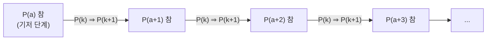
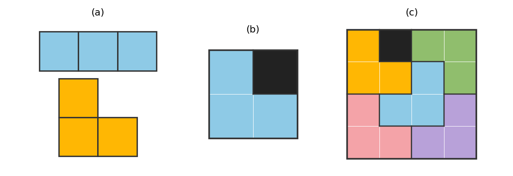
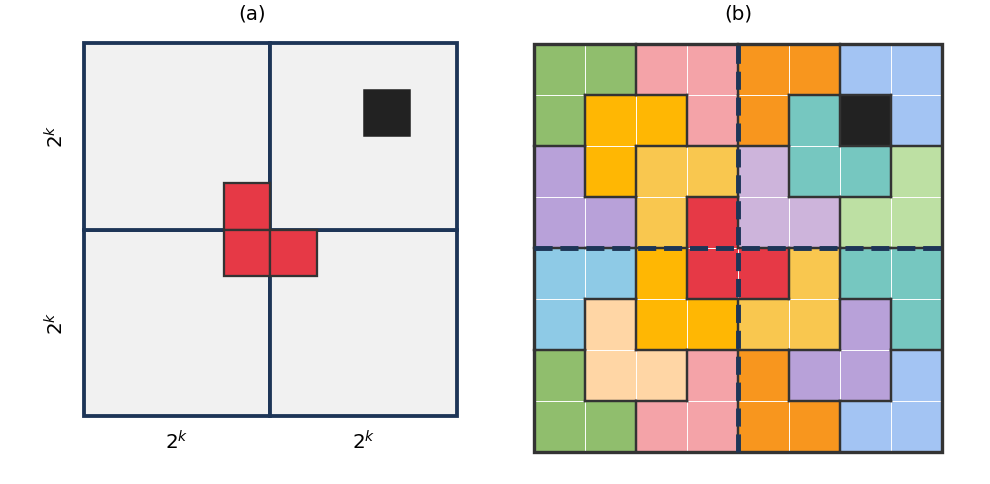
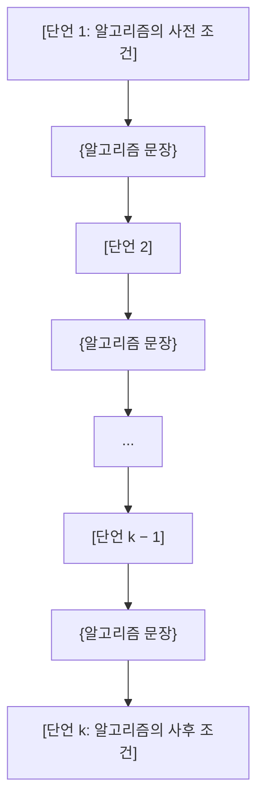
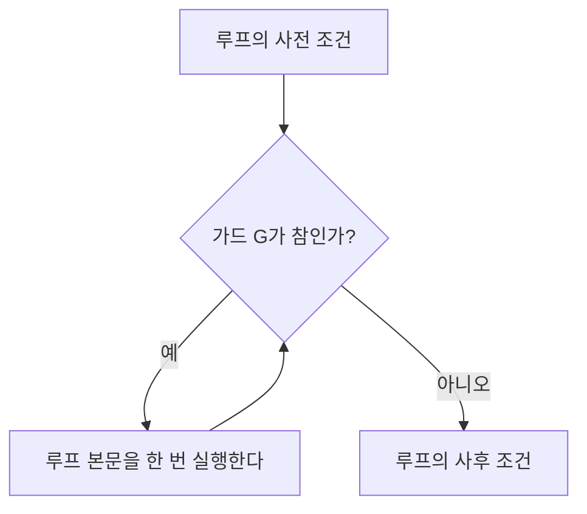
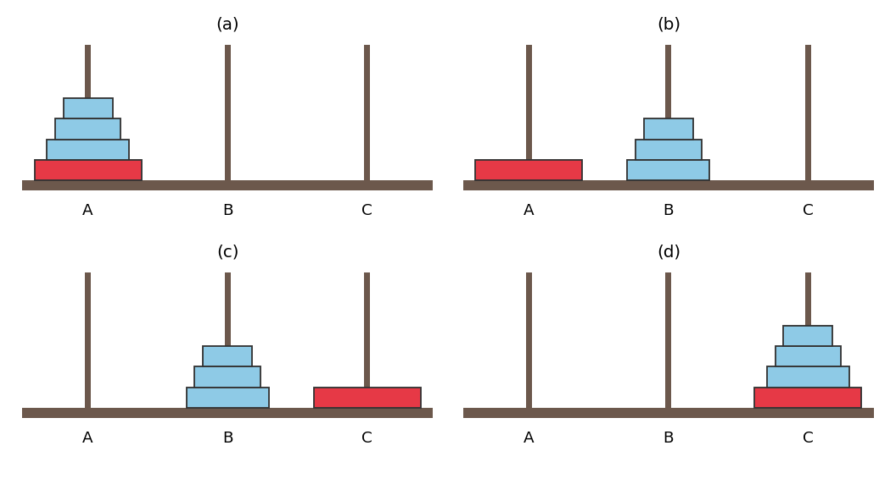
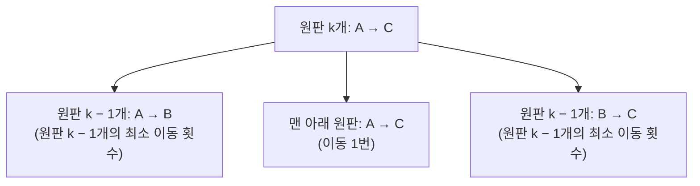

# 5장 — 수열, 수학적 귀납법, 재귀

[레포지토리 안내](../../README.ko.md) | [English](Concepts_Lecture.md) | [한국어](Concepts_Lecture.ko.md)

> **최종 수정일:** 2026-11-10
>
> Discrete Mathematics with Applications, Epp, Ch 5

> **학습 목표:**
> 1. 수열의 명시적 공식, 합 기호, 곱 기호, 계승, $\binom{n}{r}$ 표기를 사용하여 항과 합을 계산하고 합의 인덱스를 바꿀 수 있다
> 2. 기저 단계와 귀납 단계를 갖춘 수학적 귀납법으로 합 공식, 나누어떨어짐, 부등식, 수열의 성질을 증명할 수 있다
> 3. 강한 수학적 귀납법과 정수의 정렬 원리를 적용하고, 세 원리가 서로 동치라는 사실을 설명할 수 있다
> 4. 루프 불변식 정리를 이용하여 while 루프가 사전 조건과 사후 조건에 대해 정확함을 증명할 수 있다
> 5. 점화식과 초기 조건으로 수열을 재귀적으로 정의하고, 하노이의 탑, 피보나치 수, 복리 문제를 점화식으로 모형화할 수 있다

---

## 목차

- [1. 수열](#1-수열)
  - [1.1 수열과 명시적 공식](#11-수열과-명시적-공식)
  - [1.2 합 기호](#12-합-기호)
  - [1.3 곱 기호](#13-곱-기호)
  - [1.4 합과 곱의 성질](#14-합과-곱의-성질)
  - [1.5 변수 바꾸기](#15-변수-바꾸기)
  - [1.6 계승과 n 선택 r 표기](#16-계승과-n-선택-r-표기)
  - [1.7 프로그래밍에서의 수열](#17-프로그래밍에서의-수열)
  - [1.8 응용: 2로 반복해서 나누는 10진-2진 변환](#18-응용-2로-반복해서-나누는-10진-2진-변환)
- [2. 수학적 귀납법 I: 공식의 증명](#2-수학적-귀납법-i-공식의-증명)
  - [2.1 귀납적 추론과 수학적 귀납법](#21-귀납적-추론과-수학적-귀납법)
  - [2.2 수학적 귀납법의 원리](#22-수학적-귀납법의-원리)
  - [2.3 수학적 귀납법에 의한 증명 방법](#23-수학적-귀납법에-의한-증명-방법)
  - [2.4 처음 n개 정수의 합](#24-처음-n개-정수의-합)
  - [2.5 등비수열의 합](#25-등비수열의-합)
  - [2.6 등식을 증명하는 방법](#26-등식을-증명하는-방법)
  - [2.7 다른 공식 유도](#27-다른-공식-유도)
- [3. 수학적 귀납법 II: 응용](#3-수학적-귀납법-ii-응용)
  - [3.1 동전 문제: 3센트와 5센트 동전](#31-동전-문제-3센트와-5센트-동전)
  - [3.2 나누어떨어짐의 증명](#32-나누어떨어짐의-증명)
  - [3.3 부등식의 증명](#33-부등식의-증명)
  - [3.4 수열의 성질의 증명](#34-수열의-성질의-증명)
  - [3.5 트로미노 문제](#35-트로미노-문제)
- [4. 강한 수학적 귀납법과 정수의 정렬 원리](#4-강한-수학적-귀납법과-정수의-정렬-원리)
  - [4.1 강한 수학적 귀납법의 원리](#41-강한-수학적-귀납법의-원리)
  - [4.2 강한 수학적 귀납법의 적용](#42-강한-수학적-귀납법의-적용)
  - [4.3 2진 표현의 존재와 유일성](#43-2진-표현의-존재와-유일성)
  - [4.4 정수의 정렬 원리](#44-정수의-정렬-원리)
- [5. 응용: 알고리즘의 정확성](#5-응용-알고리즘의-정확성)
  - [5.1 프로그램의 정확성과 단언](#51-프로그램의-정확성과-단언)
  - [5.2 루프 불변식](#52-루프-불변식)
  - [5.3 곱을 계산하는 루프의 정확성](#53-곱을-계산하는-루프의-정확성)
  - [5.4 나눗셈 알고리즘의 정확성](#54-나눗셈-알고리즘의-정확성)
  - [5.5 유클리드 알고리즘의 정확성](#55-유클리드-알고리즘의-정확성)
- [6. 수열의 재귀적 정의](#6-수열의-재귀적-정의)
  - [6.1 점화식과 초기 조건](#61-점화식과-초기-조건)
  - [6.2 재귀적 사고](#62-재귀적-사고)
  - [6.3 하노이의 탑](#63-하노이의-탑)
  - [6.4 피보나치 수](#64-피보나치-수)
  - [6.5 복리](#65-복리)
  - [6.6 합과 곱의 재귀적 정의](#66-합과-곱의-재귀적-정의)
- [개념 적용](#개념-적용)
- [요약](#요약)
- [점검 문제](#점검-문제)

---

<br>

## 1. 수열

수학의 중요한 과제 하나는 반복되는 과정에 숨은 규칙을 찾아 정확히 기술하는 것이다. 반복되는 과정을 다루는 기본 구조가 **수열(sequence)** 이고, 수열에 관한 추측이 참인지 확인하는 기본 도구가 **수학적 귀납법(mathematical induction)** 이다. 이 장은 수열의 표기법에서 출발하여 보통의 수학적 귀납법과 강한 수학적 귀납법, 이 둘과 동치인 정수의 정렬 원리, 알고리즘의 정확성 증명, 재귀적으로 정의되는 수열을 차례로 다룬다.

### 1.1 수열과 명시적 공식

한 사람이 자신의 조상을 세대별로 센다고 가정한다. 부모는 2명, 조부모는 4명, 증조부모는 8명이고, 이런 식으로 계속된다. 이 수를 한 줄로 쓰면 $2, 4, 8, 16, 32, 64, 128, \ldots$이다. 끝의 $\ldots$는 **생략 부호(ellipsis)** 로, 같은 방식으로 계속된다는 뜻이다. 각 수에 그 수가 줄에서 차지하는 위치를 붙이면 다음 표를 얻는다.

| 위치 $k$ | 1 | 2 | 3 | 4 | 5 | 6 | 7 |
|:-----|:-----:|:-----:|:-----:|:-----:|:-----:|:-----:|:-----:|
| $k$세대 위 조상의 수 | 2 | 4 | 8 | 16 | 32 | 64 | 128 |

*표 1. 세대를 거슬러 올라갈 때 각 세대의 조상 수*

위치 1의 수 2는 $2^1$, 위치 2의 수 4는 $2^2$이고, 위치 3에서 7까지의 수 8, 16, 32, 64, 128은 각각 $2^3, 2^4, 2^5, 2^6, 2^7$이다. $k$세대 위 조상의 수를 $A_k$로 쓰면, 계산한 값들은 모든 $k$에 대해 $A_k = 2^k$라는 규칙을 강하게 시사한다.

> **참고:** 실제 조상의 수는 $k$가 크면 $2^k$보다 작다. 가계도의 서로 다른 가지에 같은 사람이 조상으로 여러 번 나타날 수 있기 때문이다. $A_k = 2^k$는 모든 조상이 서로 다르다는 가정 아래의 값이다.

> **용어 정의:** **수열(sequence)** 은 정의역이 주어진 두 정수 사이의 모든 정수이거나, 주어진 정수 이상인 모든 정수인 함수이다.

수열은 보통 원소를 한 줄로 나열하여 $a_m, a_{m+1}, a_{m+2}, \ldots, a_n$처럼 나타낸다. 각 원소 $a_k$(a 아래첨자 k로 읽는다)를 **항(term)** 이라 하고, $a_k$의 $k$를 **첨자(subscript)** 또는 **인덱스(index)** 라 한다. $m$은 **초항(initial term)** 의 첨자로 임의의 정수일 수 있고, $n$은 **끝항(final term)** 의 첨자로 $m$ 이상인 정수이다. 끝없이 이어지는 $a_m, a_{m+1}, a_{m+2}, \ldots$는 **무한수열(infinite sequence)** 이다. 수열은 함수이므로 $a_k$는 함수 $a$의 $k$에서의 값 $a(k)$를 첨자로 적은 것이다(함수는 1장).

> **용어 정의:** 수열의 **명시적 공식(explicit formula)** 또는 **일반항 공식(general formula)** 은 각 항 $a_k$를 첨자 $k$의 식으로 직접 나타내는 규칙이다.

**예제 5.1.1 (서로 다른 두 공식이 같은 항을 만드는 경우).** 두 수열 $a_1, a_2, a_3, \ldots$와 $b_2, b_3, b_4, \ldots$를 다음 명시적 공식으로 정의한다.

```math
a_k = \frac{k}{k+1} \quad (k \ge 1), \qquad b_i = \frac{i-1}{i} \quad (i \ge 2)
```

각 수열의 처음 다섯 항은 첨자를 공식에 대입하여 구한다.

| 순서 | $a_k$의 계산 | $b_i$의 계산 | 값 |
|:-----:|:-----|:-----|:-----:|
| 첫째 | $a_1 = \frac{1}{1+1}$ | $b_2 = \frac{2-1}{2}$ | $\frac{1}{2}$ |
| 둘째 | $a_2 = \frac{2}{2+1}$ | $b_3 = \frac{3-1}{3}$ | $\frac{2}{3}$ |
| 셋째 | $a_3 = \frac{3}{3+1}$ | $b_4 = \frac{4-1}{4}$ | $\frac{3}{4}$ |
| 넷째 | $a_4 = \frac{4}{4+1}$ | $b_5 = \frac{5-1}{5}$ | $\frac{4}{5}$ |
| 다섯째 | $a_5 = \frac{5}{5+1}$ | $b_6 = \frac{6-1}{6}$ | $\frac{5}{6}$ |

*표 2. 서로 다른 두 명시적 공식이 만드는 처음 다섯 항*

사실 두 수열의 모든 항이 같다. $b$의 $k$번째 항은 $b_{k+1}$이고, $b_{k+1} = \frac{(k+1)-1}{k+1} = \frac{k}{k+1} = a_k$이기 때문이다. 이처럼 같은 수열을 서로 다른 공식과 서로 다른 첨자 범위로 나타낼 수 있다.

**예제 5.1.2 (번갈아 나타나는 수열).** $c_j = (-1)^j$ $(j \ge 0)$로 정의한 수열의 처음 여섯 항은 $c_0 = (-1)^0 = 1$, $c_1 = (-1)^1 = -1$, $c_2 = 1$, $c_3 = -1$, $c_4 = 1$, $c_5 = -1$이다. $-1$의 짝수 거듭제곱은 1이고 홀수 거듭제곱은 $-1$이므로, 이 수열은 1과 $-1$ 사이를 끝없이 오간다. 무한수열이 유한 개의 값만 가질 수도 있다는 예이다.

**예제 5.1.3 (처음 몇 항에 맞는 명시적 공식 찾기).** 처음 항들이 다음과 같은 수열의 명시적 공식을 찾는다.

```math
1, \; -\frac{1}{4}, \; \frac{1}{9}, \; -\frac{1}{16}, \; \frac{1}{25}, \; -\frac{1}{36}, \; \ldots
```

일반항을 $a_k$로, 첫 항을 $a_1$로 둔다. 분모는 모두 완전제곱수 $1^2, 2^2, 3^2, 4^2, 5^2, 6^2$이고, 각 분모는 그 항의 첨자의 제곱이다. 분자는 $+1$과 $-1$이 번갈아 나타나는데, $k$가 홀수이면 $+1$, 짝수이면 $-1$이다. 이런 진동은 인수 $(-1)^{k+1}$로 만들 수 있다. $k$가 홀수이면 $k+1$이 짝수이므로 $(-1)^{k+1} = 1$이고, $k$가 짝수이면 $k+1$이 홀수이므로 $(-1)^{k+1} = -1$이기 때문이다. 따라서 처음 여섯 항을 맞게 내는 공식은 다음과 같다.

```math
a_k = \frac{(-1)^{k+1}}{k^2} \quad (k \ge 1)
```

첫 항을 $a_0$로 두었다면 같은 항들을 $a_k = \frac{(-1)^k}{(k+1)^2}$ $(k \ge 0)$로 쓸 수 있다.

> **주의:** 처음 몇 항에서 찾은 공식은 추측일 뿐이다. 처음 몇 항이 같은 두 수열이 뒤에서 달라질 수 있다. 예를 들어 $a_k = k$와 $b_k = k + (k-1)(k-2)(k-3)$ $(k \ge 1)$은 처음 세 항이 모두 1, 2, 3이지만 넷째 항은 $a_4 = 4$, $b_4 = 4 + 3 \cdot 2 \cdot 1 = 10$으로 다르다.

### 1.2 합 기호

조상의 예에서 최근 여섯 세대의 조상을 모두 더하면 $A_1 + A_2 + \cdots + A_6 = 2^1 + 2^2 + 2^3 + 2^4 + 2^5 + 2^6 = 126$명이다. 이런 합을 간단히 쓰기 위해 그리스 대문자 시그마 $\Sigma$를 쓰는 **합 기호(summation notation)** 를 사용한다.

> **용어 정의:** $m$과 $n$이 정수이고 $m \le n$일 때, 기호 $\sum_{k=m}^{n} a_k$는 $k = m$부터 $n$까지의 $a_k$의 합으로 읽으며, 항 $a_m, a_{m+1}, a_{m+2}, \ldots, a_n$을 모두 더한 값이다. $a_m + a_{m+1} + a_{m+2} + \cdots + a_n$을 이 합의 **전개형(expanded form)** 이라 하고, $k$를 합의 **인덱스(index)**, $m$을 **하한(lower limit)**, $n$을 **상한(upper limit)** 이라 한다.

```math
\sum_{k=m}^{n} a_k = a_m + a_{m+1} + a_{m+2} + \cdots + a_n
```

**예제 5.1.4 (합의 계산).** $a_1 = -2$, $a_2 = -1$, $a_3 = 0$, $a_4 = 1$, $a_5 = 2$일 때 세 합을 계산한다.

```math
\begin{aligned}
\text{(a)} \quad \sum_{k=1}^{5} a_k &= a_1 + a_2 + a_3 + a_4 + a_5 = (-2) + (-1) + 0 + 1 + 2 = 0 \\
\text{(b)} \quad \sum_{k=2}^{2} a_k &= a_2 = -1 \\
\text{(c)} \quad \sum_{k=1}^{2} a_{2k} &= a_{2 \cdot 1} + a_{2 \cdot 2} = a_2 + a_4 = -1 + 1 = 0
\end{aligned}
```

(b)처럼 하한과 상한이 같으면 합은 항 하나로 이루어진다. (c)에서는 인덱스 $k$가 1과 2를 취하지만 더해지는 항은 $a_{2k}$이므로 $a_2$와 $a_4$가 더해진다.

항이 공식으로 주어지는 경우가 많다. 예를 들어 $\sum_{k=1}^{5} k^2 = 1^2 + 2^2 + 3^2 + 4^2 + 5^2 = 1 + 4 + 9 + 16 + 25 = 55$이다. 상한이 변수이면 전개형에 생략 부호를 쓴다.

```math
\sum_{i=0}^{n} \frac{(-1)^i}{i+1} = \frac{(-1)^0}{0+1} + \frac{(-1)^1}{1+1} + \frac{(-1)^2}{2+1} + \cdots + \frac{(-1)^n}{n+1} = 1 - \frac{1}{2} + \frac{1}{3} - \cdots + \frac{(-1)^n}{n+1}
```

거꾸로 전개형을 합 기호로 바꾸려면 일반항을 인덱스의 식으로 찾는다. 다음 합에서 분자는 1부터 $n+1$까지, 분모는 $n$부터 $2n$까지 하나씩 커지므로, $i = 0, 1, \ldots, n$에 대해 일반항을 $\frac{i+1}{n+i}$로 쓸 수 있다. $i = 0$이면 $\frac{1}{n}$, $i = n$이면 $\frac{n+1}{2n}$이 되어 처음 항과 마지막 항이 맞는다.

```math
\frac{1}{n} + \frac{2}{n+1} + \frac{3}{n+2} + \cdots + \frac{n+1}{2n} = \sum_{i=0}^{n} \frac{i+1}{n+i}
```

위 두 예에서 상한 $n$은 **자유 변수(free variable)** 이다. $n$을 하한 이상인 어떤 정수로든 바꿀 수 있고, 바꿀 때마다 다른 합이 된다. 그러나 하나의 합 안에서 $n$은 상수처럼 작용하므로, 마지막 예처럼 항 안에 $n$이 나타나도 그 값은 항마다 변하지 않는다. 반면 인덱스는 합 기호에 **속박(bound)** 되어 하한부터 상한까지의 모든 값을 차례로 취한다. 이는 한정 명제에서 한정기호가 변수를 속박하는 것(3장)이나, 프로그램에서 지역 변수가 그 범위 안에서만 의미를 갖는 것과 비슷하다.

> **주의:** 작은 $n$에서 전개형의 값을 구할 때 실수하기 쉽다. $1^2 + 2^2 + 3^2 + \cdots + n^2$에 $n = 1$을 넣어 $1^2 + 2^2 + 3^2 + \cdots + 1^2$로 쓰면 틀린다. 이 식은 $1^2$에서 시작하여 $n^2$에서 끝나는 연속한 제곱의 합이므로, $n = 1$이면 $1^2$ 하나뿐이고, $n = 2$이면 $1^2 + 2^2$, $n = 3$이면 $1^2 + 2^2 + 3^2$이다.

전개형을 합 기호로 바꾸어 생각하면 이런 실수를 피할 수 있다. 예를 들어 $2^0 + 2^1 + 2^2 + \cdots + 2^n = \sum_{i=0}^{n} 2^i$이므로, $n = 0$이면 $\sum_{i=0}^{0} 2^i = 2^0 = 1$, $n = 1$이면 $2^0 + 2^1 = 1 + 2 = 3$, $n = 2$이면 $2^0 + 2^1 + 2^2 = 1 + 2 + 4 = 7$이다.

합 기호는 다음과 같이 **재귀적 정의(recursive definition)** 로 더 엄밀하게 정의할 수 있다. $m$이 정수일 때,

```math
\sum_{k=m}^{m} a_k = a_m, \qquad \sum_{k=m}^{n} a_k = \left( \sum_{k=m}^{n-1} a_k \right) + a_n \quad (n > m)
```

이다. 첫 식은 항이 하나인 합을 정하고, 둘째 식은 항이 $n - m + 1$개인 합을 항이 하나 적은 합과 마지막 항의 합으로 정한다. 재귀적 정의는 6절에서 자세히 다룬다. 문제를 풀 때는 이 정의를 이용하여 마지막 항을 따로 떼어 내거나, 반대로 여러 항을 하나의 합 기호로 묶는 경우가 많다.

```math
\begin{aligned}
\text{(a)} \quad \sum_{k=0}^{n} 2^k + 2^{n+1} &= (2^0 + 2^1 + \cdots + 2^n) + 2^{n+1} = \sum_{k=0}^{n+1} 2^k \\
\text{(b)} \quad \sum_{i=1}^{n+1} \frac{1}{i^2} &= \frac{1}{1^2} + \frac{1}{2^2} + \cdots + \frac{1}{n^2} + \frac{1}{(n+1)^2} = \sum_{i=1}^{n} \frac{1}{i^2} + \frac{1}{(n+1)^2}
\end{aligned}
```

**예제 5.1.10 (망원 합).** 각 항이 두 양의 차인 합을 전개하면 첫 부분과 마지막 부분을 제외한 모든 항이 연달아 소거되는 경우가 있다. 망원경을 접듯이 합이 줄어든다고 하여 이런 합을 **망원 합(telescoping sum)** 이라 한다. 먼저 1 이상인 모든 정수 $k$에 대해 다음 항등식이 성립한다. 두 분수를 공통분모 $k(k+1)$로 통분하면 분자가 $(k+1) - k = 1$이 되기 때문이다.

```math
\frac{1}{k} - \frac{1}{k+1} = \frac{(k+1) - k}{k(k+1)} = \frac{1}{k(k+1)}
```

이 항등식으로 각 항을 바꾸어 쓰고 전개하면, 각 괄호의 뒷부분이 다음 괄호의 앞부분과 소거되어 맨 앞의 $\frac{1}{1}$과 맨 뒤의 $-\frac{1}{n+1}$만 남는다.

```math
\sum_{k=1}^{n} \frac{1}{k(k+1)} = \sum_{k=1}^{n} \left( \frac{1}{k} - \frac{1}{k+1} \right) = \left( \frac{1}{1} - \frac{1}{2} \right) + \left( \frac{1}{2} - \frac{1}{3} \right) + \cdots + \left( \frac{1}{n} - \frac{1}{n+1} \right) = 1 - \frac{1}{n+1}
```

$n = 3$으로 확인하면 왼쪽은 $\frac{1}{2} + \frac{1}{6} + \frac{1}{12} = \frac{6 + 2 + 1}{12} = \frac{3}{4}$이고, 오른쪽은 $1 - \frac{1}{4} = \frac{3}{4}$이다.

### 1.3 곱 기호

수의 곱을 나타내는 기호는 합 기호와 같은 방식으로 정의하며, 그리스 대문자 파이 $\Pi$를 쓴다. 예를 들어 $\prod_{k=1}^{5} a_k = a_1 a_2 a_3 a_4 a_5$이다.

> **용어 정의:** $m$과 $n$이 정수이고 $m \le n$일 때, 기호 $\prod_{k=m}^{n} a_k$는 $k = m$부터 $n$까지의 $a_k$의 곱으로 읽으며, 항 $a_m, a_{m+1}, \ldots, a_n$을 모두 곱한 값 $a_m \cdot a_{m+1} \cdot a_{m+2} \cdots a_n$이다. 이 표기를 **곱 기호(product notation)** 라 한다.

곱 기호의 재귀적 정의는 다음과 같다. $m$이 정수일 때,

```math
\prod_{k=m}^{m} a_k = a_m, \qquad \prod_{k=m}^{n} a_k = \left( \prod_{k=m}^{n-1} a_k \right) \cdot a_n \quad (n > m)
```

이다. 예를 들어 $\prod_{k=1}^{5} k = 1 \cdot 2 \cdot 3 \cdot 4 \cdot 5 = 120$이고, 항이 하나뿐인 곱 $\prod_{k=1}^{1} \frac{k}{k+1}$은 $\frac{1}{1+1} = \frac{1}{2}$이다.

### 1.4 합과 곱의 성질

**정리 5.1.1.** $a_m, a_{m+1}, a_{m+2}, \ldots$와 $b_m, b_{m+1}, b_{m+2}, \ldots$가 실수의 수열이고 $c$가 임의의 실수이면, $m$ 이상인 모든 정수 $n$에 대해 다음 등식이 성립한다.

```math
\begin{aligned}
&1. \quad \sum_{k=m}^{n} a_k + \sum_{k=m}^{n} b_k = \sum_{k=m}^{n} (a_k + b_k) \\
&2. \quad c \cdot \sum_{k=m}^{n} a_k = \sum_{k=m}^{n} c \cdot a_k \\
&3. \quad \left( \prod_{k=m}^{n} a_k \right) \cdot \left( \prod_{k=m}^{n} b_k \right) = \prod_{k=m}^{n} (a_k \cdot b_k)
\end{aligned}
```

2번을 **일반화된 분배 법칙(generalized distributive law)** 이라 한다. 세 등식은 유한 개의 항을 교환 법칙, 결합 법칙, 분배 법칙으로 재배열하거나 묶은 결과로 이해할 수 있다. 그러나 생략 부호 뒤에 숨은 임의 개수의 항까지 엄밀하게 다루려면 수학적 귀납법이 필요하며, 1번의 증명은 6.6절에서 다룬다.

**예제 5.1.12 (성질을 이용하여 하나의 합이나 곱으로 쓰기).** 모든 정수 $k$에 대해 $a_k = k + 1$, $b_k = k - 1$일 때 다음과 같이 정리한다.

```math
\begin{aligned}
\sum_{k=m}^{n} a_k + 2 \cdot \sum_{k=m}^{n} b_k &= \sum_{k=m}^{n} (k+1) + 2 \cdot \sum_{k=m}^{n} (k-1) && \text{(i)} \\
&= \sum_{k=m}^{n} (k+1) + \sum_{k=m}^{n} 2 \cdot (k-1) && \text{(ii)} \\
&= \sum_{k=m}^{n} \bigl( (k+1) + 2 \cdot (k-1) \bigr) && \text{(iii)} \\
&= \sum_{k=m}^{n} (3k - 1) && \text{(iv)}
\end{aligned}
```

(i)은 $a_k$와 $b_k$의 공식을 대입한 것이고, (ii)는 정리 5.1.1의 2번, (iii)은 1번을 적용한 것이며, (iv)는 $(k+1) + 2k - 2 = 3k - 1$로 정리한 것이다. 곱도 같은 방법으로 정리한다. 대입한 뒤 정리 5.1.1의 3번을 적용하고 $(k+1)(k-1) = k^2 - 1$로 정리하면 된다.

```math
\left( \prod_{k=m}^{n} a_k \right) \cdot \left( \prod_{k=m}^{n} b_k \right) = \left( \prod_{k=m}^{n} (k+1) \right) \cdot \left( \prod_{k=m}^{n} (k-1) \right) = \prod_{k=m}^{n} \bigl( (k+1)(k-1) \bigr) = \prod_{k=m}^{n} (k^2 - 1)
```

> **주의:** 합의 곱은 곱의 합과 일반적으로 다르다. $\sum_{k=m}^{n} (a_k \cdot b_k)$와 $\left( \sum_{k=m}^{n} a_k \right) \cdot \left( \sum_{k=m}^{n} b_k \right)$는 보통 같지 않다. 예를 들어 $a_k = b_k = k$, $m = 1$, $n = 2$이면 앞의 것은 $1 + 4 = 5$, 뒤의 것은 $3 \cdot 3 = 9$이다. 또 상수를 더하는 경우 $\sum_{k=m}^{n} (a_k + c) = \sum_{k=m}^{n} a_k + (n - m + 1)c$이다. 상수 $c$가 항마다 한 번씩, 모두 $n - m + 1$번 더해지기 때문이다.

### 1.5 변수 바꾸기

$\sum_{k=1}^{3} k^2 = 1^2 + 2^2 + 3^2$이고 $\sum_{i=1}^{3} i^2 = 1^2 + 2^2 + 3^2$이므로 $\sum_{k=1}^{3} k^2 = \sum_{i=1}^{3} i^2$이다. 이처럼 합의 인덱스는 그 기호가 나타나는 모든 자리에서 일관되게 바꾸기만 하면 다른 기호로 바꾸어도 되는 **지역 변수(local variable)** 이며, 이런 변수를 **더미 변수(dummy variable)** 라고도 한다. 그 합 밖에서는 같은 기호가 전혀 다른 뜻을 가질 수 있다. 한정 명제의 변수도 일관되게 바꾸기만 하면 다른 기호로 바꿀 수 있다는 점에서 같다.

더 복잡한 **변수 바꾸기(change of variable)** 로 합의 모양을 바꿀 수도 있다. 예를 들어 다음 두 합은 같은 수를 더한다.

```math
\sum_{j=2}^{4} (j-1)^2 = (2-1)^2 + (3-1)^2 + (4-1)^2 = 1^2 + 2^2 + 3^2 = \sum_{k=1}^{3} k^2
```

**예제 5.1.13 (변수 바꾸기로 합 변환하기).** $\sum_{k=0}^{6} \frac{1}{k+1}$에 변수 바꾸기 $j = k + 1$을 적용한다. 절차는 세 단계이다.

1. **새 하한과 상한을 계산한다.** $k = 0$이면 $j = 0 + 1 = 1$이고, $k = 6$이면 $j = 6 + 1 = 7$이다. 따라서 새 합은 $j = 1$부터 $j = 7$까지이다.
2. **일반항을 새 변수로 바꾼다.** $j = k + 1$이므로 $k = j - 1$이고, $\frac{1}{k+1} = \frac{1}{(j-1)+1} = \frac{1}{j}$이다.
3. **두 결과를 합친다.** $\sum_{k=0}^{6} \frac{1}{k+1} = \sum_{j=1}^{7} \frac{1}{j}$이다.

$j$도 더미 변수이므로 모든 자리의 $j$를 $k$로 바꾸면 $\sum_{j=1}^{7} \frac{1}{j} = \sum_{k=1}^{7} \frac{1}{k}$이고, 결국 $\sum_{k=0}^{6} \frac{1}{k+1} = \sum_{k=1}^{7} \frac{1}{k}$를 얻는다.

**예제 5.1.14 (상한이 항 안에 나타나는 경우).** 두 합을 더하려면 한 합의 범위를 옮겨야 할 때가 있다(9장의 이항정리의 대수적 증명이 그 예이다). $\sum_{k=1}^{n+1} \frac{k}{n+k}$를 하한이 0, 상한이 $n$이고 인덱스가 여전히 $k$인 합으로 바꾼다.

먼저 $j = k - 1$로 변수를 바꾼다. 인덱스 $k$는 1부터 $n+1$까지의 값을 차례로 취하므로, $k = 1$이면 $j = 0$이고 $k = n + 1$이면 $j = (n+1) - 1 = n$이다. 여기서 $n$은 항에 대해 상수이므로 항마다 값이 변하지 않는다. $k = j + 1$을 대입하면 일반항은 $\frac{j+1}{n+(j+1)}$이 된다. 이어서 모든 $j$를 $k$로 바꾸면 다음을 얻는다.

```math
\sum_{k=1}^{n+1} \frac{k}{n+k} = \sum_{j=0}^{n} \frac{j+1}{n+(j+1)} = \sum_{k=0}^{n} \frac{k+1}{n+(k+1)}
```

$n = 1$로 확인하면 왼쪽은 $\frac{1}{2} + \frac{2}{3}$이고, 오른쪽은 $k = 0, 1$에 대해 $\frac{1}{2} + \frac{2}{3}$이다.

> **주의:** 변수 바꾸기에서 상한 $n$처럼 합 밖에서 온 변수는 바꾸지 않는다. 인덱스만 새 변수의 식으로 바꾸고, 하한과 상한도 반드시 함께 바꾼다.

### 1.6 계승과 n 선택 r 표기

어떤 정수까지의 연속한 양의 정수의 곱은 수학에서 매우 자주 나타나므로 따로 기호를 둔다.

> **용어 정의:** 양의 정수 $n$에 대해 **$n$ 계승(n factorial)** $n!$은 1부터 $n$까지의 모든 정수의 곱 $n! = n \cdot (n-1) \cdots 3 \cdot 2 \cdot 1$이다. **0 계승** $0!$은 1로 정의한다.

$0! = 1$이라는 정의는 어색해 보이지만, 9장에서 보듯이 많은 공식을 예외 없이 쓸 수 있게 해 준다. 처음 열 개의 계승은 다음과 같다.

| $n$ | 0 | 1 | 2 | 3 | 4 | 5 | 6 | 7 | 8 | 9 |
|:-----|:-----:|:-----:|:-----:|:-----:|:-----:|:-----:|:-----:|:-----:|:-----:|:-----:|
| $n!$ | 1 | 1 | 2 | 6 | 24 | 120 | 720 | 5,040 | 40,320 | 362,880 |

*표 3. 0부터 9까지의 계승*

계승은 매우 빠르게 커진다. 예를 들어 $40! \approx 8.16 \times 10^{47}$이며, 이런 수는 많은 프로그래밍 언어의 기본 정수 연산으로 정확히 계산할 수 없다. 64비트 부호 있는 정수의 최댓값은 $2^{63} - 1 \approx 9.22 \times 10^{18}$이므로, $20! \approx 2.43 \times 10^{18}$까지는 담을 수 있지만 $21! \approx 5.11 \times 10^{19}$부터는 담을 수 없다.

계승의 재귀적 정의는 다음과 같다. 음이 아닌 정수 $n$에 대해

```math
n! = \begin{cases} 1 & n = 0 \text{일 때} \\ n \cdot (n-1)! & n \ge 1 \text{일 때} \end{cases}
```

> **주의:** $n \cdot (n-1)!$은 $n \cdot [(n-1)!]$로 해석한다. 곱을 먼저 하여 $[n \cdot (n-1)]!$로 읽으면 안 된다.

재귀적 정의는 계승이 들어 있는 식을 간단히 할 때 유용하다. 큰 계승을 작은 계승과 나머지 인수의 곱으로 풀어 써서 공통 인수를 약분한다.

```math
\begin{aligned}
\text{(a)} \quad \frac{8!}{7!} &= \frac{8 \cdot 7!}{7!} = 8 \\
\text{(b)} \quad \frac{5!}{2! \cdot 3!} &= \frac{5 \cdot 4 \cdot 3!}{2! \cdot 3!} = \frac{5 \cdot 4}{2 \cdot 1} = 10 \\
\text{(c)} \quad \frac{1}{2! \cdot 4!} + \frac{1}{3! \cdot 3!} &= \frac{3}{3 \cdot 2! \cdot 4!} + \frac{4}{3! \cdot 4 \cdot 3!} = \frac{3}{3! \cdot 4!} + \frac{4}{3! \cdot 4!} = \frac{7}{144} \\
\text{(d)} \quad \frac{(n+1)!}{n!} &= \frac{(n+1) \cdot n!}{n!} = n + 1 \\
\text{(e)} \quad \frac{n!}{(n-3)!} &= \frac{n \cdot (n-1) \cdot (n-2) \cdot (n-3)!}{(n-3)!} = n(n-1)(n-2) = n^3 - 3n^2 + 2n
\end{aligned}
```

(c)에서는 공통분모를 만들기 위해 첫 분수의 분자와 분모에 3을, 둘째 분수의 분자와 분모에 4를 곱하고, $3 \cdot 2! = 3!$과 $4 \cdot 3! = 4!$을 이용한 뒤 $3! \cdot 4! = 6 \cdot 24 = 144$로 계산하였다. (e)는 $n \ge 3$일 때의 식이다.

계승의 중요한 쓰임 하나는 경우의 수와 확률에서 나타나는 다음 양을 계산하는 것이다.

> **용어 정의:** $n$과 $r$이 $0 \le r \le n$인 정수일 때, 기호 $\binom{n}{r}$은 **n 선택 r(n choose r)** 로 읽으며, 원소가 $n$개인 집합에서 고를 수 있는 크기 $r$인 부분집합의 개수를 나타낸다.

정의가 부분집합의 개수이므로 $\binom{n}{r}$은 항상 정수이다. 예를 들어 집합 $\lbrace a, b, c \rbrace$의 크기 2인 부분집합은 $\lbrace a, b \rbrace$, $\lbrace a, c \rbrace$, $\lbrace b, c \rbrace$의 세 개이므로 $\binom{3}{2} = 3$이다. 9장에서 증명하는 다음 공식으로 값을 계산할 수 있다.

```math
\binom{n}{r} = \frac{n!}{r!\,(n-r)!} \quad (0 \le r \le n \text{인 모든 정수 } n, r)
```

$\binom{n}{r}$은 항상 정수이므로 분모의 인수는 분자의 인수로 모두 약분된다. 계산기와 문헌에서는 $`_nC_r`$, $C(n, r)$, $C_{n,r}$ 같은 기호도 쓰며, C는 이 수를 **조합(combination)** 의 수라고 부르는 데서 왔다. 이항정리와의 관계 때문에 **이항계수(binomial coefficient)** 라고도 한다(9장).

```math
\begin{aligned}
\text{(a)} \quad \binom{8}{5} &= \frac{8!}{5!\,(8-5)!} = \frac{8 \cdot 7 \cdot 6 \cdot 5!}{5! \cdot 3 \cdot 2 \cdot 1} = \frac{8 \cdot 7 \cdot 6}{6} = 56 \\
\text{(b)} \quad \binom{4}{4} &= \frac{4!}{4!\,(4-4)!} = \frac{4!}{4! \cdot 0!} = \frac{24}{24 \cdot 1} = 1 \\
\text{(c)} \quad \binom{n+1}{n} &= \frac{(n+1)!}{n!\,((n+1)-n)!} = \frac{(n+1)!}{n! \cdot 1!} = \frac{(n+1) \cdot n!}{n!} = n + 1
\end{aligned}
```

(a)처럼 곱하기 전에 공통 인수를 먼저 약분하면 계산이 쉬워진다. (b)는 $0! = 1$ 덕분에 계산할 수 있으며, 원소가 4개인 집합의 크기 4인 부분집합은 자기 자신 하나뿐이라는 사실과도 맞는다.

### 1.7 프로그래밍에서의 수열

프로그래밍에서 중요한 자료형 하나가 유한 수열이며, 보통 **1차원 배열(one-dimensional array)** 이라 부른다. 예를 들어 노동자 50명의 임금을 분석하는 프로그램은 평균 임금과 각 임금이 평균에서 벗어난 정도를 계산해야 하므로 모든 임금을 기억해 두어야 한다. 50개의 변수 이름을 따로 만드는 대신 각 임금을 1차원 배열의 항 `W[1], W[2], W[3], ..., W[50]`으로 저장한다. 첨자를 대괄호 안에 쓰는 것은 예전에는 대부분의 키보드로 아래첨자를 입력할 수 없었기 때문이다.

> **[자료구조]** 1차원 배열은 같은 자료형의 원소를 연속된 메모리에 저장하고, 인덱스로 각 원소에 바로 접근하는 자료구조이다. C, Java, Python 같은 많은 언어는 인덱스를 0부터 매기므로 길이가 $n$인 배열의 원소는 `a[0]`부터 `a[n-1]`까지이다. 이는 첨자가 0에서 시작하는 수열과 같다.

반복문의 인덱스 변수도 지역 변수, 곧 더미 변수이다. 예를 들어 다음 세 코드 조각은 모두 `a[1]`, `a[2]`, ..., `a[n]`을 차례로 출력한다.

```text
for i := 1 to n         for j := 0 to n - 1      for k := 2 to n + 1
    print a[i]              print a[j + 1]           print a[k - 1]
next i                  next j                   next k
```

첫 코드는 `i`가 1부터 `n`까지 변하며 `a[i]`를 출력한다. 둘째 코드는 `j`가 0부터 `n - 1`까지 변하므로 `j + 1`이 1부터 `n`까지 변하고, 셋째 코드는 `k`가 2부터 `n + 1`까지 변하므로 `k - 1`이 1부터 `n`까지 변한다. 이는 1.5절의 변수 바꾸기와 같은 원리이다.

합, 곱, 계승의 재귀적 정의는 그대로 계산 알고리즘이 된다. 다음 두 의사코드는 모두 `a[1] + a[2] + ... + a[n]`, 곧 $\sum_{k=1}^{n} a[k]$를 계산한다.

```text
s := a[1]                    s := 0
for k := 2 to n              for k := 1 to n
    s := s + a[k]                s := s + a[k]
next k                       next k
```

왼쪽 코드는 1.2절의 재귀적 정의를 그대로 따른다. 첫 줄에서 항이 하나인 합 `a[1]`로 `s`를 시작하고, 반복할 때마다 지금까지의 합에 다음 항 `a[k]`를 더한다. 오른쪽 코드는 `s`를 0에서 시작하여 `a[1]`부터 더한다. $n \ge 1$이면 두 코드가 마지막에 얻는 `s`의 값은 같다. $n = 1$이면 왼쪽 반복문은 한 번도 실행되지 않고 `s`는 처음 값 `a[1]`을 그대로 유지한다.

### 1.8 응용: 2로 반복해서 나누는 10진-2진 변환

2장에서 10진 표기의 정수를 2진 표기로 바꾸는 방법을 다루었지만, 그 방법은 작은 수에만 편리하다. 음이 아닌 임의의 정수를 2진 표기로 바꾸는 체계적인 알고리즘은 2로 반복해서 나누는 것이다.

음이 아닌 정수 $a$를 몫-나머지 정리(4장)에 따라 2로 나누어 몫 `q[0]`과 나머지 `r[0]`을 얻는다. 몫이 0이 아니면 몫을 다시 2로 나누어 몫 `q[1]`과 나머지 `r[1]`을 얻고, 몫이 0이 될 때까지 이 과정을 반복한다. 각 단계의 나머지는 나누는 수 2보다 작으므로 언제나 0 또는 1이다. $a = 38$에 이 과정을 적용하면 다음과 같다.

| 단계 $i$ | 나누어지는 수 | 몫 `q[i]` | 나머지 `r[i]` |
|:-----:|:-----:|:-----:|:-----:|
| 0 | 38 | 19 | 0 |
| 1 | 19 | 9 | 1 |
| 2 | 9 | 4 | 1 |
| 3 | 4 | 2 | 0 |
| 4 | 2 | 1 | 0 |
| 5 | 1 | 0 | 1 |

*표 4. 38을 2로 반복해서 나눌 때의 몫과 나머지*

각 나눗셈을 등식으로 쓰면 $38 = 19 \cdot 2 + 0$, $19 = 9 \cdot 2 + 1$, $9 = 4 \cdot 2 + 1$, $4 = 2 \cdot 2 + 0$, $2 = 1 \cdot 2 + 0$, $1 = 0 \cdot 2 + 1$이다. 첫 등식의 몫 19에 둘째 등식을 대입하고, 다시 그 몫 9에 셋째 등식을 대입하는 식으로 반복 대입하면 다음을 얻는다.

```math
\begin{aligned}
38 &= 19 \cdot 2 + 0 \\
&= (9 \cdot 2 + 1) \cdot 2 + 0 = 9 \cdot 2^2 + 1 \cdot 2 + 0 \\
&= (4 \cdot 2 + 1) \cdot 2^2 + 1 \cdot 2 + 0 = 4 \cdot 2^3 + 1 \cdot 2^2 + 1 \cdot 2 + 0 \\
&= (2 \cdot 2 + 0) \cdot 2^3 + 1 \cdot 2^2 + 1 \cdot 2 + 0 = 2 \cdot 2^4 + 0 \cdot 2^3 + 1 \cdot 2^2 + 1 \cdot 2 + 0 \\
&= (1 \cdot 2 + 0) \cdot 2^4 + 0 \cdot 2^3 + 1 \cdot 2^2 + 1 \cdot 2 + 0 = 1 \cdot 2^5 + 0 \cdot 2^4 + 0 \cdot 2^3 + 1 \cdot 2^2 + 1 \cdot 2 + 0
\end{aligned}
```

오른쪽에서 2의 각 거듭제곱의 계수는 반복 나눗셈의 나머지이다. 맨 앞의 1도 $1 = 0 \cdot 2 + 1$의 나머지이다. 따라서 $38_{10} = 100110_2$이며, 이는 나머지를 마지막 것부터 거꾸로 읽은 $`(r[5] r[4] r[3] r[2] r[1] r[0])_2`$이다. 실제로 $2^5 + 2^2 + 2^1 = 32 + 4 + 2 = 38$이다.

일반적으로 음이 아닌 정수 $a$를 몫이 0이 될 때까지 2로 반복해서 나누어 나머지 $r[0], r[1], \ldots, r[k]$를 얻으면, 몫-나머지 정리에 의해 각 $r[i]$는 0 또는 1이고, 반복 대입으로 다음이 성립한다.

```math
a = 2^k \cdot r[k] + 2^{k-1} \cdot r[k-1] + \cdots + 2^2 \cdot r[2] + 2^1 \cdot r[1] + 2^0 \cdot r[0]
```

따라서 $a$의 2진 표현은 $`a_{10} = (r[k] r[k-1] \cdots r[2] r[1] r[0])_2`$이다. 예를 들어 29를 나누면 $29 = 14 \cdot 2 + 1$, $14 = 7 \cdot 2 + 0$, $7 = 3 \cdot 2 + 1$, $3 = 1 \cdot 2 + 1$, $1 = 0 \cdot 2 + 1$이므로 나머지는 차례로 $r[0] = 1$, $r[1] = 0$, $r[2] = 1$, $r[3] = 1$, $r[4] = 1$이고, $29_{10} = 11101_2$이다. 확인하면 $16 + 8 + 4 + 1 = 29$이다.

이 절차를 알고리즘으로 정리하면 다음과 같다(알고리즘 5.1.1). 입력은 음이 아닌 정수 `a`이고, 출력은 $`a = (r[i-1] \cdots r[1] r[0])_2`$를 만족하는 2진 숫자의 수열 `r[0], r[1], ..., r[i-1]`이다.

```text
Input: a
q := a, i := 0
while (i = 0 or q ≠ 0)
    r[i] := q mod 2
    q := q div 2
    i := i + 1
end while
Output: r[0], r[1], r[2], ..., r[i - 1]
```

둘째 줄은 아직 나누지 않은 몫 `q`를 입력값으로, 다음에 채울 나머지의 위치 `i`를 0으로 정한다. 반복문 안에서는 `q`를 2로 나눈 나머지를 `r[i]`에 저장하고(`mod`), 몫으로 `q`를 바꾼 뒤(`div`, 둘 다 4장), 다음 위치로 `i`를 1 늘린다. 가드 `i = 0 or q ≠ 0`의 `i = 0`은 입력이 0이어도 반복문이 한 번은 실행되어 `r[0] = 0`이 계산되게 한다. 입력이 0이면 `r[0] := 0`, `q := 0`, `i := 1`이 된 뒤 가드가 거짓이 되어 `r[0] = 0` 하나를 출력한다. 반복이 끝나면 `r[0], ..., r[i-1]`은 모두 0 또는 1이고 $`a = (r[i-1] r[i-2] \cdots r[1] r[0])_2`$이다.

---

<br>

## 2. 수학적 귀납법 I: 공식의 증명

### 2.1 귀납적 추론과 수학적 귀납법

자연과학에서는 연역과 귀납을 서로 다른 사고방식으로 소개한다. 연역은 일반 원리에서 논리 법칙으로 결론을 이끌어 내는 것이고, 귀납은 많은 구체적 사례에서 성립하는 것을 관찰한 뒤 일반 원리를 내세우는 것이다. 새로운 수학적 사실은 예를 실험하는 과정에서 발견되는 경우가 많지만, 증명 기법으로서의 수학적 귀납법은 귀납이 아니라 **연역**이다. 수학적 귀납법으로 증명된 정리는 다른 수학적 방법으로 증명된 정리와 똑같이 확실하다. 수학에서 자연과학적 의미의 귀납적 추론은 추측을 세우는 데에만 쓰고, 증명에는 쓰지 않는다.

예를 들어 다음 패턴을 관찰한다.

```math
\begin{aligned}
\text{1행:} \quad & 1 - \frac{1}{2} = \frac{1}{2} \\
\text{2행:} \quad & \left( 1 - \frac{1}{2} \right) \left( 1 - \frac{1}{3} \right) = \frac{1}{3} \\
\text{3행:} \quad & \left( 1 - \frac{1}{2} \right) \left( 1 - \frac{1}{3} \right) \left( 1 - \frac{1}{4} \right) = \frac{1}{4}
\end{aligned}
```

우연이라고 보기 어려운 패턴이므로 일반적으로 성립한다고 추측할 만하다. 그러나 이것은 아직 추측이다. 수학적 귀납법의 질문은 다음과 같다. 한 행에서 패턴이 성립한다는 사실이 다음 행에서도 성립함을 보장하는가? 3행의 등식이 참이라고 하고, 새 4행의 왼쪽에 들어 있는 처음 세 인수의 곱을 3행의 오른쪽 $\frac{1}{4}$로 바꾸면 다음을 얻는다.

```math
\left( 1 - \frac{1}{2} \right) \left( 1 - \frac{1}{3} \right) \left( 1 - \frac{1}{4} \right) \left( 1 - \frac{1}{5} \right) = \frac{1}{4} \left( 1 - \frac{1}{5} \right) = \frac{1}{4} \cdot \frac{4}{5} = \frac{1}{5}
```

따라서 패턴은 4행으로 이어진다. 1행에서 2행으로 가는 것도 같다. 2행의 왼쪽에서 $\left( 1 - \frac{1}{2} \right)$을 1행의 오른쪽 $\frac{1}{2}$로 바꾸면 $\frac{1}{2} \left( 1 - \frac{1}{3} \right) = \frac{1}{2} \cdot \frac{2}{3} = \frac{1}{3}$이다.

이제 일반적인 경우를 확인한다. $k$가 2 이상인 임의의 정수이고 $k$행의 패턴 $\left( 1 - \frac{1}{2} \right) \left( 1 - \frac{1}{3} \right) \cdots \left( 1 - \frac{1}{k} \right) = \frac{1}{k}$이 성립한다고 가정하면 다음이 성립한다.

```math
\left( 1 - \frac{1}{2} \right) \cdots \left( 1 - \frac{1}{k} \right) \left( 1 - \frac{1}{k+1} \right) = \frac{1}{k} \left( 1 - \frac{1}{k+1} \right) = \frac{1}{k} \cdot \frac{(k+1) - 1}{k+1} = \frac{1}{k} \cdot \frac{k}{k+1} = \frac{1}{k+1}
```

즉 2 이상인 모든 정수 $k$에 대해, $k$행의 패턴이 성립하면 $(k+1)$행의 패턴도 성립한다. 그런데 1행에서 패턴이 성립하므로 2행에서 성립하고, 2행에서 성립하므로 3행에서 성립하며, 이 논리가 끝없이 이어져 모든 행에서 성립한다. 이것이 수학적 귀납법의 기본 생각이다.

### 2.2 수학적 귀납법의 원리

> **핵심:** **수학적 귀납법의 원리(principle of mathematical induction).** $P(n)$이 정수 $n$에 대해 정의된 성질이고 $a$가 고정된 정수일 때, 다음 두 명제가 참이라고 한다.
> 1. $P(a)$가 참이다.
> 2. $a$ 이상인 모든 정수 $k$에 대해, $P(k)$가 참이면 $P(k+1)$도 참이다.
>
> 그러면 $a$ 이상인 모든 정수 $n$에 대해 $P(n)$이 참이다.

도미노에 비유하면 이해하기 쉽다. 무한히 많은 도미노가 한 줄로 서 있고, 어느 도미노가 넘어지면 반드시 다음 도미노도 넘어지도록 배치되어 있다고 가정한다. 여기에 첫 도미노가 넘어지면 모든 도미노가 넘어진다. $P(n)$을 $n$번째 도미노가 넘어진다는 문장으로 두면, 1 이상인 각 $k$에 대해 $P(k)$이면 $P(k+1)$이고, $P(1)$이 참이므로, 수학적 귀납법의 원리에 의해 1 이상인 모든 정수 $n$에 대해 $P(n)$이 참이다.



*그림 1. 기저 단계와 귀납 단계가 모든 정수 n ≥ a로 참을 전달하는 과정*

수학적 귀납법이 증명 방법으로 타당하다는 사실은 보통 **공리**로 받아들인다. 그래서 정리가 아니라 원리라고 부른다. 이 원리는 직관적으로 받아들이기 쉬운 정수의 다음 성질과 동치이다.

> **핵심:** 정수의 집합 $S$가 (1) $a \in S$이고 (2) $a$ 이상인 모든 정수 $k$에 대해 $k \in S$이면 $k+1 \in S$를 만족하면, $S$는 $a$ 이상인 모든 정수를 원소로 갖는다.

두 형태가 같다는 것은 $S$를 $P(n)$이 참인 정수 $n$ 전체의 집합으로 두면 알 수 있다.

### 2.3 수학적 귀납법에 의한 증명 방법

수학적 귀납법에 의한 증명은 두 단계로 이루어지며, 첫 단계를 **기저 단계(basis step)**, 둘째 단계를 **귀납 단계(inductive step)** 라 한다.

> **핵심:** **수학적 귀납법에 의한 증명 방법.** "$`a`$ 이상인 모든 정수 $n$에 대해 성질 $P(n)$이 참이다" 꼴의 명제를 증명하려면 다음 두 단계를 수행한다.
> 1. **기저 단계:** $P(a)$가 참임을 보인다.
> 2. **귀납 단계:** $a$ 이상인 모든 정수 $k$에 대해, $P(k)$가 참이면 $P(k+1)$이 참임을 보인다. 이를 위해 $k \ge a$인 특정하지만 임의로 택한 정수 $k$에 대해 $P(k)$가 참이라고 가정한다. 이 가정을 **귀납 가정(inductive hypothesis)** 이라 한다. 그런 다음 $P(k+1)$이 참임을 보인다.

귀납 단계는 4장의 일반적 특수 사례로부터의 일반화를 조건 명제에 적용한 것이다. 임의로 고른 $k$에 대해 조건 명제 "$`P(k)`$이면 $P(k+1)$"을 증명하므로, 모든 $k \ge a$에 대해 그 조건 명제가 증명된다.

$P(a)$, $P(k)$, $P(k+1)$을 쓸 때는 $P(n)$을 그대로 옮겨 적고 모든 $n$을 각각 $a$, $k$, $k+1$로 바꾼다. 이때 $k+1$은 괄호로 묶어 대입한다. 예를 들어 $P(n)$이 $1 + 2 + \cdots + n = \frac{n(n+1)}{2}$이면 $P(k+1)$은 $1 + 2 + \cdots + (k+1) = \frac{(k+1)((k+1)+1)}{2}$이다.

> **주의:** 귀납 가정은 증명하려는 결론 "모든 $n \ge a$에 대해 $P(n)$"을 가정하는 것이 아니다. 하나의 $k$에 대해 $P(k)$를 가정하고 그로부터 $P(k+1)$을 이끌어 내는, 조건 명제의 증명이다.

> **주의:** 두 단계 가운데 하나라도 빠지면 증명이 되지 않는다. 성질 $P(n)$: $n = n + 1$을 보면, $k = k + 1$이라고 가정하면 양변에 1을 더해 $k + 1 = k + 2$를 얻으므로 귀납 단계는 성립하지만, 어떤 정수에서도 $P(n)$은 거짓이다. 거꾸로 유한 개의 경우만 확인하는 것도 증명이 아니다. $n^2 + n + 41$은 $n = 0, 1, \ldots, 39$에서 모두 소수이지만 $n = 40$이면 $40^2 + 40 + 41 = 1681 = 41^2$으로 합성수이다.

### 2.4 처음 n개 정수의 합

**정리 5.2.1 (처음 n개 정수의 합).** 1 이상인 모든 정수 $n$에 대해 다음이 성립한다.

```math
1 + 2 + \cdots + n = \frac{n(n+1)}{2}
```

증명에 앞서 성질 $P(n)$을 정확히 정한다. 여기서 $P(n)$은 등식 $1 + 2 + \cdots + n = \frac{n(n+1)}{2}$ 자체이다. 이 등식의 주어는 1부터 $n$까지의 정수의 합이고 술어는 그 합이 $\frac{n(n+1)}{2}$과 같다는 것이므로, $P(n)$은 참이나 거짓을 판단할 수 있는 문장이다.

**증명 (수학적 귀납법).** $P(n)$을 등식 $1 + 2 + \cdots + n = \frac{n(n+1)}{2}$으로 둔다.

**기저 단계: $P(1)$이 참임을 보인다.** $P(1)$은 $1 = \frac{1(1+1)}{2}$이다. 왼쪽은 1부터 1까지의 정수의 합이므로 1이고, 오른쪽은 $\frac{1 \cdot 2}{2} = 1$이다. 따라서 $P(1)$은 참이다.

**귀납 단계: 1 이상인 모든 정수 $k$에 대해 $P(k)$이면 $P(k+1)$임을 보인다.** $k$가 1 이상인 정수이고 다음 귀납 가정 $P(k)$가 참이라고 가정한다.

```math
1 + 2 + \cdots + k = \frac{k(k+1)}{2}
```

보여야 할 것은 $P(k+1)$, 곧 다음 등식이다.

```math
1 + 2 + \cdots + (k+1) = \frac{(k+1)(k+2)}{2}
```

양변을 따로 계산하여 같은 양이 됨을 보인다. 왼쪽은 다음과 같다.

```math
\begin{aligned}
1 + 2 + \cdots + (k+1) &= (1 + 2 + \cdots + k) + (k+1) && \text{(1)} \\
&= \frac{k(k+1)}{2} + (k+1) && \text{(2)} \\
&= \frac{k(k+1)}{2} + \frac{2(k+1)}{2} && \text{(3)} \\
&= \frac{k^2 + k + 2k + 2}{2} = \frac{k^2 + 3k + 2}{2} && \text{(4)}
\end{aligned}
```

(1)은 연속한 정수의 합에서 마지막 항 $k+1$ 바로 앞의 항이 $k$임을 드러낸 것이다. (2)는 괄호 안의 합에 귀납 가정을 대입한 것이고, (3)은 둘째 항의 분자와 분모에 2를 곱하여 공통분모를 만든 것이며, (4)는 분자를 전개하고 동류항을 정리한 것이다. 한편 오른쪽은 분자를 전개하면 $\frac{(k+1)(k+2)}{2} = \frac{k^2 + 3k + 2}{2}$이다. 양변이 같은 양이므로 $P(k+1)$은 참이다.

기저 단계와 귀납 단계를 모두 증명했으므로, 수학적 귀납법의 원리에 의해 1 이상인 모든 정수 $n$에 대해 $P(n)$이 참이다.

같은 공식을 직관적으로 얻는 방법도 있다. $S = 1 + 2 + \cdots + n$을 거꾸로 쓰면 $S = n + (n-1) + \cdots + 1$이다. 두 식을 위아래 항끼리 더하면 각 쌍의 합이 $n + 1$이고 쌍이 $n$개이므로 $2S = n(n+1)$, 곧 $S = \frac{n(n+1)}{2}$이다. 1부터 100까지의 합이라면 $1 + 100$, $2 + 99$, ..., $50 + 51$의 50쌍이 모두 101이므로 합은 $50 \cdot 101 = 5{,}050$이다.

> **용어 정의:** 항의 개수가 변하는 합이 생략 부호나 합 기호를 포함하지 않는 식과 같음을 보였을 때, 그 합을 **닫힌 형태(closed form)** 로 썼다고 한다.

예를 들어 $1 + 2 + 3 + \cdots + n = \frac{n(n+1)}{2}$은 합 $1 + 2 + \cdots + n$을 닫힌 형태로 쓴 것이다. 정리 5.2.1을 이용하면 다른 합도 닫힌 형태로 구할 수 있다.

```math
\begin{aligned}
\text{(a)} \quad 2 + 4 + 6 + \cdots + 500 &= 2 \cdot (1 + 2 + 3 + \cdots + 250) = 2 \cdot \frac{250 \cdot 251}{2} = 62{,}750 \\
\text{(b)} \quad 5 + 6 + 7 + \cdots + 50 &= (1 + 2 + \cdots + 50) - (1 + 2 + 3 + 4) = \frac{50 \cdot 51}{2} - 10 = 1{,}265 \\
\text{(c)} \quad 1 + 2 + 3 + \cdots + (h-1) &= \frac{(h-1) \cdot [(h-1) + 1]}{2} = \frac{(h-1) \cdot h}{2} \quad (h \ge 2)
\end{aligned}
```

(a)는 각 항에서 2를 묶어 낸 뒤 $n = 250$인 공식을 적용하였고, (b)는 1부터 50까지의 합에서 1부터 4까지의 합을 빼고 $n = 50$인 공식을 적용하였으며, (c)는 $n = h - 1$인 공식을 적용하였다.

### 2.5 등비수열의 합

**등비수열(geometric sequence)** 은 각 항이 바로 앞 항에 일정한 인수를 곱해서 얻어지는 수열이다. 첫 항이 1이고 일정한 인수가 $r$이면 수열은 $1, r, r^2, r^3, \ldots, r^n, \ldots$이다. 이산수학에서는 보통 $0^0 = 1$로 정의하여, $r = 0$일 때도 $\sum_{i=0}^{n} r^i$를 따로 다루지 않아도 되게 한다. 다른 수학 분야에서는 $0^0$을 정의하지 않는 경우도 있다.

**정리 5.2.2 (등비수열의 합).** 1이 아닌 임의의 실수 $r$과 0 이상인 임의의 정수 $n$에 대해 다음이 성립한다.

```math
\sum_{i=0}^{n} r^i = \frac{r^{n+1} - 1}{r - 1}
```

전개형으로 쓰면 $r^0 + r^1 + r^2 + \cdots + r^n = \frac{r^{n+1} - 1}{r - 1}$이고, $r^0 = 1$, $r^1 = r$이므로 $n \ge 1$이면 $1 + r + r^2 + \cdots + r^n = \frac{r^{n+1} - 1}{r - 1}$로도 쓴다. 이 정리의 $P(n)$은 실수 변수 $r$을 포함한 등식이다. 그래서 먼저 $r$을 1이 아닌 특정하지만 임의로 택한 실수로 고정하고, $n$에 대한 수학적 귀납법을 $n = 0$부터 적용한다.

**증명 (수학적 귀납법).** $r$을 1이 아닌 특정하지만 임의로 택한 실수로 두고, $P(n)$을 등식 $\sum_{i=0}^{n} r^i = \frac{r^{n+1} - 1}{r - 1}$으로 둔다. 0 이상인 모든 정수 $n$에 대해 $P(n)$이 참임을 $n$에 대한 수학적 귀납법으로 보인다.

**기저 단계: $P(0)$이 참임을 보인다.** $P(0)$은 $\sum_{i=0}^{0} r^i = \frac{r^{0+1} - 1}{r - 1}$이다. 왼쪽은 $r^0 = 1$이고, 오른쪽은 $r^1 = r$이므로 $\frac{r - 1}{r - 1}$이다. $r \ne 1$이므로 $r - 1 \ne 0$이고, 따라서 오른쪽도 1이다. 그러므로 $P(0)$은 참이다.

**귀납 단계: 0 이상인 모든 정수 $k$에 대해 $P(k)$이면 $P(k+1)$임을 보인다.** $k$가 0 이상인 정수이고 귀납 가정 $\sum_{i=0}^{k} r^i = \frac{r^{k+1} - 1}{r - 1}$이 참이라고 가정한다. 보여야 할 것은 $\sum_{i=0}^{k+1} r^i = \frac{r^{(k+1)+1} - 1}{r - 1}$, 곧 $\sum_{i=0}^{k+1} r^i = \frac{r^{k+2} - 1}{r - 1}$이다. 이번에는 왼쪽을 단계적으로 바꾸어 오른쪽을 만든다.

```math
\begin{aligned}
\sum_{i=0}^{k+1} r^i &= \sum_{i=0}^{k} r^i + r^{k+1} && \text{(1)} \\
&= \frac{r^{k+1} - 1}{r - 1} + r^{k+1} && \text{(2)} \\
&= \frac{r^{k+1} - 1}{r - 1} + \frac{r^{k+1}(r - 1)}{r - 1} && \text{(3)} \\
&= \frac{(r^{k+1} - 1) + r^{k+1}(r - 1)}{r - 1} && \text{(4)} \\
&= \frac{r^{k+1} - 1 + r^{k+2} - r^{k+1}}{r - 1} && \text{(5)} \\
&= \frac{r^{k+2} - 1}{r - 1} && \text{(6)}
\end{aligned}
```

(1)은 $(k+2)$번째 항 $r^{k+1}$을 처음 $k+1$개의 항과 분리한 것이고, (2)는 귀납 가정을 대입한 것이다. (3)은 둘째 항의 분자와 분모에 $r - 1$을 곱하여 공통분모를 만든 것이고, (4)는 분수를 더한 것이며, (5)는 $r^{k+1} \cdot r = r^{k+1} \cdot r^1 = r^{k+2}$를 이용하여 전개한 것이고, (6)은 $r^{k+1}$끼리 소거한 것이다. 마지막 식이 $P(k+1)$의 오른쪽이므로 $P(k+1)$은 참이다.

기저 단계와 귀납 단계를 증명했으므로 정리가 성립한다.

### 2.6 등식을 증명하는 방법

2.4절과 2.5절의 증명은 등식을 증명하는 두 가지 타당한 방법을 보여 준다.

1. 왼쪽과 오른쪽을 각각 따로 변형하여 두 변이 같은 양이 됨을 보인다(정리 5.2.1의 귀납 단계).
2. 한쪽 변을 단계적으로 변형하여 다른 쪽 변과 같아짐을 보인다(정리 5.2.2의 귀납 단계).

그런데 증명하려는 등식에서 출발하여 참인 식을 이끌어 내는 방법은 타당하지 않다. 예를 들어 정리 5.2.2의 기저 단계를 다음처럼 쓰는 것은 잘못이다.

```math
\sum_{i=0}^{0} r^i = \frac{r^{0+1} - 1}{r - 1} \;\Rightarrow\; r^0 = \frac{r^1 - 1}{r - 1} \;\Rightarrow\; 1 = \frac{r - 1}{r - 1} \;\Rightarrow\; 1 = 1
```

어떤 문장에서 참인 결론을 이끌어 냈다고 해서 그 문장이 참인 것은 아니다. 거짓인 문장에서도 참인 결론을 이끌어 낼 수 있기 때문이다. 예를 들어 거짓인 $1 = 0$에서 출발하여 양변을 바꾸면 $0 = 1$이고, 두 등식을 변끼리 더하면 $1 + 0 = 0 + 1$, 곧 참인 $1 = 1$을 얻는다.

> **주의:** 등식이 참이라고 가정하고 참인 문장을 이끌어 내는 방식으로 등식을 증명하지 않는다. 그런 논증은 부당하다. 수학적 귀납법으로 공식을 증명할 때도 기저 단계와 귀납 단계 모두에서 위의 두 가지 타당한 방법을 사용한다.

### 2.7 다른 공식 유도

등비수열의 합 공식은 1이 아닌 실수 $r$마다 하나씩 있는 공식의 묶음으로 볼 수 있다. $m$이 3 이상인 정수일 때 두 합을 닫힌 형태로 쓴다.

```math
\begin{aligned}
\text{(a)} \quad 1 + 3 + 3^2 + \cdots + 3^{m-2} &= \frac{3^{(m-2)+1} - 1}{3 - 1} = \frac{3^{m-1} - 1}{2} \\
\text{(b)} \quad 3^2 + 3^3 + 3^4 + \cdots + 3^m &= 3^2 \cdot (1 + 3 + 3^2 + \cdots + 3^{m-2}) = 9 \cdot \frac{3^{m-1} - 1}{2}
\end{aligned}
```

(a)는 정리 5.2.2에 $r = 3$, $n = m - 2$를 적용한 것이고, (b)는 각 항에서 $3^2$을 묶어 낸 뒤 (a)를 이용한 것이다. $m = 3$으로 확인하면 (a)는 $1 + 3 = 4 = \frac{9 - 1}{2}$, (b)는 $9 + 27 = 36 = 9 \cdot \frac{9 - 1}{2}$이다.

등비수열의 합 공식을 직관적으로 얻는 방법도 있다. $S_n = 1 + r + r^2 + \cdots + r^n$이라 두면 $r S_n = r + r^2 + r^3 + \cdots + r^{n+1}$이다. 두 식을 빼면 가운데 항이 모두 소거되어 다음을 얻는다.

```math
r S_n - S_n = (r + r^2 + \cdots + r^{n+1}) - (1 + r + \cdots + r^n) = r^{n+1} - 1
```

한편 $r S_n - S_n = (r - 1) S_n$이므로, 두 식의 오른쪽을 같게 놓고 $r - 1 \ne 0$으로 나누면 $S_n = \frac{r^{n+1} - 1}{r - 1}$이다. 이 유도는 설득력이 있지만 수학적 귀납법만큼 논리적으로 빈틈이 없지는 않다. 생략 부호 속의 각 항이 어떤 모양이고 어떻게 소거된다는 주장을 모든 항에 대해 하나하나 확인할 수 없기 때문이다. 수학적 귀납법은 생략 부호의 한가운데에서 일어나는 일, 곧 $k$번째에서 $(k+1)$번째로 넘어가는 한 단계에 집중하여 계산이 옳음을 의심 없이 확인하게 해 준다.

---

<br>

## 3. 수학적 귀납법 II: 응용

2절에서 증명한 성질은 모두 등식이었다. 이 절에서는 수학적 귀납법을 더 일반적인 문장, 곧 금액을 만들 수 있다는 문장, 나누어떨어짐, 부등식, 재귀적으로 정의된 수열의 공식, 판을 덮을 수 있다는 문장에 적용한다. 증명의 큰 틀은 모두 같지만 기저 단계와 귀납 단계의 세부 내용은 문제마다 크게 다르다.

### 3.1 동전 문제: 3센트와 5센트 동전

1센트 동전을 없애고 3센트 동전을 새로 만든다면, 3센트와 5센트 동전만으로 낼 수 있는 금액은 무엇인가? 몇 가지 금액은 다음과 같이 만들 수 있다.

| 금액 | 만드는 방법 | 금액 | 만드는 방법 |
|:-----:|:-----|:-----:|:-----|
| 3센트 | 3 | 12센트 | 3 + 3 + 3 + 3 |
| 5센트 | 5 | 13센트 | 3 + 5 + 5 |
| 8센트 | 3 + 5 | 14센트 | 3 + 3 + 3 + 5 |
| 9센트 | 3 + 3 + 3 | 15센트 | 5 + 5 + 5 |
| 10센트 | 5 + 5 | 16센트 | 3 + 3 + 5 + 5 |
| 11센트 | 3 + 3 + 5 | 17센트 | 3 + 3 + 3 + 3 + 5 |

*표 5. 3센트와 5센트 동전으로 만들 수 있는 금액의 예*

1, 2, 4, 7센트는 만들 수 없지만, 8센트부터는 빠짐없이 만들 수 있는 것처럼 보인다. 이 표를 끝없이 이어 갈 수 있는지 보이려면, $k$센트를 만들 수 있다고 가정하고 $(k+1)$센트를 만들 수 있음을 보이면 된다. $k$센트를 만드는 동전 묶음에는 5센트 동전이 있거나 없다.

| 경우 | 빼는 동전 | 넣는 동전 | 금액의 변화 |
|:-----|:-----|:-----|:-----|
| 5센트 동전이 하나 이상 있다 | 5센트 1개 | 3센트 2개 | $-5 + 6 = +1$ |
| 5센트 동전이 없고 3센트 동전이 3개 이상 있다 | 3센트 3개 | 5센트 2개 | $-9 + 10 = +1$ |

*표 6. k센트를 (k+1)센트로 바꾸는 두 가지 동전 교체*

5센트 동전이 없으면 3센트 동전만 쓴 것이다. 이때 금액이 8센트 이상이면 3센트 동전의 개수는 $\frac{k}{3} \ge \frac{8}{3} > 2$이므로 3개 이상이고, 둘째 교체를 할 수 있다. 따라서 8 이상인 정수 $k$에 대해 $k$센트를 만들 수 있으면 $(k+1)$센트도 만들 수 있다. 이것이 귀납 단계이고, 8센트를 3센트 하나와 5센트 하나로 만들 수 있다는 사실이 기저 단계이다.

**명제 5.3.1.** 8 이상인 모든 정수 $n$에 대해, $n$센트는 3센트와 5센트 동전으로 만들 수 있다.

**증명 (수학적 귀납법).** $P(n)$을 문장 "$`n`$센트는 3센트와 5센트 동전으로 만들 수 있다"로 둔다.

**기저 단계: $P(8)$이 참임을 보인다.** 8센트는 3센트 동전 하나와 5센트 동전 하나로 만들 수 있으므로 $P(8)$은 참이다.

**귀납 단계: 8 이상인 모든 정수 $k$에 대해 $P(k)$이면 $P(k+1)$임을 보인다.** $k$가 8 이상인 정수이고, 귀납 가정으로 $k$센트를 3센트와 5센트 동전으로 만들 수 있다고 가정한다. $(k+1)$센트를 만들 수 있음을 보여야 한다.

- **경우 1 ($k$센트를 만드는 동전 중에 5센트 동전이 있는 경우):** 5센트 동전 하나를 3센트 동전 둘로 바꾸면 금액이 1센트 늘어 $(k+1)$센트가 된다.
- **경우 2 ($k$센트를 만드는 동전 중에 5센트 동전이 없는 경우):** 이때 동전은 모두 3센트 동전이고, $k \ge 8$이므로 3개 이상이다. 3센트 동전 셋을 빼고 5센트 동전 둘을 넣으면 금액이 1센트 늘어 $(k+1)$센트가 된다.

어느 경우든 $(k+1)$센트를 3센트와 5센트 동전으로 만들 수 있으므로 $P(k+1)$은 참이다. 기저 단계와 귀납 단계를 증명했으므로 명제가 성립한다.

> **주의:** 기저 단계의 값은 귀납 단계가 실제로 성립하는 범위와 맞아야 한다. 경우 2의 논리는 $k \ge 8$일 때 3센트 동전이 3개 이상이라는 사실에 기대므로, 귀납 단계는 $k \ge 8$에서만 쓸 수 있다. 실제로 7센트는 만들 수 없으므로 기저를 7 이하로 낮출 수 없다.

### 3.2 나누어떨어짐의 증명

**명제 5.3.2.** 0 이상인 모든 정수 $n$에 대해 $2^{2n} - 1$은 3으로 나누어떨어진다.

정수 $m$이 3으로 나누어떨어진다는 것은 어떤 정수 $r$에 대해 $m = 3r$이라는 뜻이다(4장). 처음 몇 값을 보면 $n = 1, 2, 3$에서 $2^{2n} - 1$은 $3, 15, 63$으로 모두 3의 배수이다.

증명의 핵심은 $2^{2(k+1)} - 1$과 귀납 가정의 $2^{2k} - 1$ 사이의 관계를 찾는 것이다. 지수 법칙으로 $2^{2(k+1)} - 1 = 2^{2k+2} - 1 = 2^{2k} \cdot 2^2 - 1 = 2^{2k} \cdot 4 - 1$이다. 여기서 $2^{2k} - 1$을 빼면 $2^{2k} \cdot 4 - 1 - (2^{2k} - 1) = 2^{2k} \cdot 3$으로 3의 배수가 남는다. 따라서 $2^{2k} \cdot 4 - 1 = 2^{2k} \cdot 3 + (2^{2k} - 1)$이고, 오른쪽의 두 항이 모두 3으로 나누어떨어지므로 그 합도 3으로 나누어떨어진다.

**증명 (수학적 귀납법).** $P(n)$을 문장 "$`2^{2n} - 1`$은 3으로 나누어떨어진다"로 둔다.

**기저 단계: $P(0)$이 참임을 보인다.** $2^{2 \cdot 0} - 1 = 2^0 - 1 = 1 - 1 = 0$이고, $0 = 3 \cdot 0$이므로 0은 3으로 나누어떨어진다. 따라서 $P(0)$은 참이다.

**귀납 단계: 0 이상인 모든 정수 $k$에 대해 $P(k)$이면 $P(k+1)$임을 보인다.** $k$가 0 이상인 정수이고 $2^{2k} - 1$이 3으로 나누어떨어진다고 가정한다. 나누어떨어짐의 정의에 의해 어떤 정수 $r$에 대해 $2^{2k} - 1 = 3r$이다. 그러면 다음이 성립한다.

```math
\begin{aligned}
2^{2(k+1)} - 1 &= 2^{2k+2} - 1 = 2^{2k} \cdot 2^2 - 1 && \text{(1)} \\
&= 2^{2k} \cdot 4 - 1 = 2^{2k} \cdot (3 + 1) - 1 && \text{(2)} \\
&= 2^{2k} \cdot 3 + (2^{2k} - 1) && \text{(3)} \\
&= 2^{2k} \cdot 3 + 3r && \text{(4)} \\
&= 3(2^{2k} + r) && \text{(5)}
\end{aligned}
```

(1)은 지수 법칙, (2)와 (3)은 대수 법칙, (4)는 귀납 가정을 대입한 것이고, (5)는 3을 묶어 낸 것이다. $2^{2k} + r$은 정수의 곱과 합이므로 정수이고, 따라서 나누어떨어짐의 정의에 의해 $2^{2(k+1)} - 1$은 3으로 나누어떨어진다. 곧 $P(k+1)$은 참이다. 기저 단계와 귀납 단계를 증명했으므로 명제가 성립한다.

### 3.3 부등식의 증명

**명제 5.3.3.** 3 이상인 모든 정수 $n$에 대해 $2n + 1 < 2^n$이다.

$n = 1$이면 $3 < 2$, $n = 2$이면 $5 < 4$로 거짓이므로 기저는 $n = 3$이다. 부등식의 증명에서는 귀납 가정을 일찍 적용하는 경우가 많다. $2(k+1) + 1 = (2k + 1) + 2$에 귀납 가정 $2k + 1 < 2^k$를 적용하면 $2(k+1) + 1 < 2^k + 2$를 얻는다. 목표는 오른쪽을 $2^{k+1}$로 만드는 것이므로, 남은 일은 $2^k + 2 < 2^{k+1}$, 곧 $2 < 2^k$를 보이는 것이다. 이는 $k \ge 3$이면 $2^k \ge 8$이므로 성립한다.

**증명 (수학적 귀납법).** $P(n)$을 부등식 $2n + 1 < 2^n$으로 둔다.

**기저 단계: $P(3)$이 참임을 보인다.** $2 \cdot 3 + 1 = 7$이고 $2^3 = 8$이며 $7 < 8$이므로 $P(3)$은 참이다.

**귀납 단계: 3 이상인 모든 정수 $k$에 대해 $P(k)$이면 $P(k+1)$임을 보인다.** $k$가 3 이상인 정수이고 귀납 가정 $2k + 1 < 2^k$가 참이라고 가정한다. 보여야 할 것은 $2(k+1) + 1 < 2^{k+1}$이다.

```math
\begin{aligned}
2(k+1) + 1 &= (2k + 1) + 2 && \text{(1)} \\
&< 2^k + 2 && \text{(2)} \\
&< 2^k + 2^k && \text{(3)} \\
&= 2 \cdot 2^k = 2^{k+1} && \text{(4)}
\end{aligned}
```

(1)은 대수 계산이고, (2)는 귀납 가정 $2k + 1 < 2^k$의 양변에 2를 더한 것이며, (3)은 $k \ge 3$이므로 $2 < 2^k$인 것을 이용한 것이고, (4)는 지수 법칙이다. 순서의 추이성에 의해 $2(k+1) + 1 < 2^{k+1}$이므로 $P(k+1)$은 참이다. 기저 단계와 귀납 단계를 증명했으므로 명제가 성립한다.

### 3.4 수열의 성질의 증명

수학적 귀납법으로 수열의 항들이 어떤 명시적 공식을 만족함을 보일 수 있다. 수열 $a_1, a_2, a_3, \ldots$를 다음과 같이 정의한다. 이렇게 앞의 항으로 다음 항을 정하는 정의는 6절에서 자세히 다루는 재귀적 정의이다.

```math
a_1 = 2, \qquad a_k = 5 a_{k-1} \quad (k \ge 2)
```

처음 네 항은 $a_1 = 2$, $a_2 = 5a_1 = 5 \cdot 2 = 10$, $a_3 = 5a_2 = 5 \cdot 10 = 50$, $a_4 = 5a_3 = 5 \cdot 50 = 250$이다. 이 값들은 1 이상인 모든 정수 $n$에 대해 $a_n = 2 \cdot 5^{n-1}$임을 시사한다.

**증명 (수학적 귀납법).** $P(n)$을 등식 $a_n = 2 \cdot 5^{n-1}$으로 두고, 1 이상인 모든 정수 $n$에 대해 $P(n)$이 참임을 보인다.

**기저 단계: $P(1)$이 참임을 보인다.** $P(1)$은 $a_1 = 2 \cdot 5^{1-1}$이다. 왼쪽은 수열의 정의에 의해 $a_1 = 2$이고, 오른쪽은 $2 \cdot 5^0 = 2 \cdot 1 = 2$이다. 양변이 같으므로 $P(1)$은 참이다.

**귀납 단계: 1 이상인 모든 정수 $k$에 대해 $P(k)$이면 $P(k+1)$임을 보인다.** $k$가 1 이상인 정수이고 귀납 가정 $a_k = 2 \cdot 5^{k-1}$이 참이라고 가정한다. 보여야 할 것은 $a_{k+1} = 2 \cdot 5^{(k+1)-1}$, 곧 $a_{k+1} = 2 \cdot 5^k$이다.

```math
a_{k+1} = 5 a_{(k+1)-1} = 5 a_k = 5 \cdot (2 \cdot 5^{k-1}) = 2 \cdot (5 \cdot 5^{k-1}) = 2 \cdot 5^k
```

첫 등호는 $k + 1 \ge 2$이므로 수열의 정의를 적용한 것이고, 둘째는 $(k+1) - 1 = k$, 셋째는 귀납 가정, 넷째는 인수의 재배열, 다섯째는 지수 법칙이다. 따라서 $P(k+1)$은 참이고, 수학적 귀납법에 의해 수열의 모든 항이 공식을 만족한다.

### 3.5 트로미노 문제

**폴리오미노(polyomino)** 는 도미노를 일반화한 것으로, 같은 크기의 정사각형 여러 개를 변끼리 붙여 만든 도형이다. 정사각형 세 개로 이루어진 폴리오미노를 **트로미노(tromino)** 라 하며, 세 칸이 일직선인 **일자형 트로미노(straight tromino)** 와 L자 모양인 **L자형 트로미노(L-shaped tromino)** 의 두 종류가 있다. 한 변에 정사각형이 $m$개 있는 체커판을 $m \times m$ 체커판이라 한다.



*그림 2. 두 종류의 트로미노와 한 칸을 뺀 2×2판, 4×4판을 L자형 트로미노로 덮은 예*

그림 2의 (a)는 위가 일자형, 아래가 L자형 트로미노이다. (b)는 $2 \times 2$판에서 검은 칸 하나를 뺀 나머지가 L자형 트로미노 하나와 같은 모양임을 보이고, (c)는 $4 \times 4$판에서 검은 칸 하나를 뺀 나머지 15칸을 L자형 트로미노 5개로 빈틈없이 덮은 예이다.

**정리 5.3.4 (트로미노로 판 덮기).** 1 이상인 모든 정수 $n$에 대해, $2^n \times 2^n$ 체커판에서 정사각형 하나를 빼면 나머지 정사각형은 L자형 트로미노로 빈틈없이 덮을 수 있다.

먼저 칸의 개수가 맞는지 확인한다. 남는 칸은 $4^n - 1 = 2^{2n} - 1$개이고, 명제 5.3.2에 의해 이 수는 3으로 나누어떨어진다. 그러므로 트로미노의 개수 $\frac{4^n - 1}{3}$은 정수이다. 이는 덮기가 가능하기 위한 필요조건일 뿐이고, 실제로 덮을 수 있다는 것은 수학적 귀납법으로 증명한다. 증명의 핵심은 $2^{k+1} = 2 \cdot 2^k$이므로 $2^{k+1} \times 2^{k+1}$판을 가로와 세로로 반씩 나누면 네 개의 $2^k \times 2^k$판이 생긴다는 관찰이다.

**증명 (수학적 귀납법).** $P(n)$을 문장 "$`2^n \times 2^n`$ 체커판에서 어느 정사각형 하나를 빼더라도 나머지 정사각형은 L자형 트로미노로 빈틈없이 덮을 수 있다"로 둔다.

**기저 단계: $P(1)$이 참임을 보인다.** $2^1 \times 2^1$판은 정사각형 네 개로 이루어진다. 어느 하나를 빼도 나머지 세 칸은 L자 모양이므로 L자형 트로미노 하나로 덮을 수 있다(그림 2의 (b)). 따라서 $P(1)$은 참이다.

**귀납 단계: 1 이상인 모든 정수 $k$에 대해 $P(k)$이면 $P(k+1)$임을 보인다.** $k$가 1 이상인 정수이고, 귀납 가정으로 $2^k \times 2^k$판에서 어느 칸 하나를 빼더라도 나머지를 L자형 트로미노로 덮을 수 있다고 가정한다. 정사각형 하나를 뺀 $2^{k+1} \times 2^{k+1}$판을 생각한다.

1. 판을 같은 크기의 네 사분면으로 나눈다. 각 사분면은 $2^k \times 2^k$판이다.
2. 뺀 칸은 네 사분면 가운데 하나에 들어 있다. 귀납 가정에 의해 그 사분면의 나머지 칸은 L자형 트로미노로 덮을 수 있다.
3. 나머지 세 사분면은 판의 중심에서 만나며, 중심에 닿은 세 사분면의 모퉁이 칸 세 개는 L자 모양을 이룬다. 이 세 칸에 L자형 트로미노 하나를 놓는다.
4. 이제 세 사분면은 각각 칸 하나가 이미 덮인 $2^k \times 2^k$판이므로, 그 칸을 뺀 칸으로 보면 귀납 가정에 의해 각 사분면의 나머지 칸도 L자형 트로미노로 덮을 수 있다.

따라서 처음에 뺀 칸을 제외한 $2^{k+1} \times 2^{k+1}$판의 모든 칸을 L자형 트로미노로 덮을 수 있고, $P(k+1)$은 참이다. 기저 단계와 귀납 단계를 증명했으므로 정리가 성립한다.



*그림 3. 귀납 단계에서 판을 네 사분면으로 나누고 중심에 트로미노 하나를 놓는 방법과 8×8판의 예*

그림 3의 (a)는 귀납 단계의 구성이다. 검은 칸이 뺀 칸이고, 빨간 칸 세 개가 중심에 놓는 트로미노이다. (b)는 같은 방법을 사분면 안에서도 되풀이하여 $8 \times 8$판을 실제로 덮은 결과이며, 점선이 첫 번째 분할을, 빨간 트로미노가 첫 단계에서 중심에 놓은 트로미노를 나타낸다.

> **[알고리즘]** 이 증명은 덮는 방법까지 알려 주는 구성적 증명이다. 큰 판을 같은 모양의 작은 판 네 개로 나누고, 각 판을 같은 방법으로 덮은 뒤 결과를 합치는 이 방식을 알고리즘에서는 분할 정복(divide and conquer)이라 부른다. 귀납 가정은 작은 문제가 이미 풀렸다는 가정에 해당한다.

---

<br>

## 4. 강한 수학적 귀납법과 정수의 정렬 원리

### 4.1 강한 수학적 귀납법의 원리

**강한 수학적 귀납법(strong mathematical induction)** 도 보통의 수학적 귀납법처럼 정수에 관한 일련의 명제가 참임을 증명하는 기법이며, 기저 단계와 귀납 단계로 이루어진다. 차이는 두 가지이다. 기저 단계에서 여러 개의 처음 값을 증명할 수 있고, 귀납 단계에서 $P(n)$이 하나의 $n$이 아니라 $k$까지의 모든 값에서 참이라고 가정한 뒤 $P(k+1)$을 증명한다.

> **핵심:** **강한 수학적 귀납법의 원리(principle of strong mathematical induction).** $P(n)$이 정수 $n$에 대해 정의된 성질이고 $a$와 $b$가 $a \le b$인 고정된 정수일 때, 다음 두 명제가 참이라고 한다.
> 1. **기저 단계:** $P(a), P(a+1), \ldots, P(b)$가 모두 참이다.
> 2. **귀납 단계:** $b$ 이상인 모든 정수 $k$에 대해, $a$부터 $k$까지의 각 정수 $i$에 대해 $P(i)$가 참이면 $P(k+1)$도 참이다.
>
> 그러면 $a$ 이상인 모든 정수 $n$에 대해 $P(n)$이 참이다.

귀납 단계의 가정, 곧 $a$부터 $k$까지의 각 정수 $i$에 대해 $P(i)$가 참이라는 가정을 **귀납 가정**이라 한다. 같은 뜻으로 $P(a), P(a+1), \ldots, P(k)$가 모두 참이라고 말할 수도 있다. 이 원리는 제2 귀납 원리(second principle of induction), 제2 유한 귀납 원리(second principle of finite induction), **완전 귀납법(principle of complete induction)** 이라고도 부른다.

보통의 수학적 귀납법으로 증명할 수 있는 명제는 강한 수학적 귀납법으로도 증명할 수 있다. $b$ 이상인 정수 $k$에 대해 $P(k)$ 하나만으로 $P(k+1)$이 나온다면, $P(a), \ldots, P(k)$가 모두 참일 때에도 당연히 $P(k+1)$이 나오기 때문이다. 역으로 강한 수학적 귀납법으로 증명할 수 있는 명제는 보통의 수학적 귀납법으로도 증명할 수 있다. 새 성질 $Q(n)$을 "$`a \le j \le n`$인 모든 정수 $j$에 대해 $P(j)$가 참이다"로 두고, $n \ge b$에 대해 보통의 수학적 귀납법을 적용하면 된다. 강한 원리의 기저 단계가 바로 $Q(b)$이고, $Q(k)$가 참이면 강한 원리의 귀납 단계에 의해 $P(k+1)$이 참이므로 $Q(k+1)$이 참이다. 따라서 $b$ 이상인 모든 $n$에 대해 $Q(n)$이 참이고, $Q(n)$은 $P(n)$을 포함하므로 $a$ 이상인 모든 $n$에 대해 $P(n)$이 참이다.

> **참고:** 엄밀히 말하면 귀납 단계를 "$`a - 1`$ 이상인 모든 정수 $k$에 대해, $a$부터 $k$까지의 각 $i$에 대해 $P(i)$이면 $P(k+1)$"로 바꾸면 기저 단계 없이도 원리를 쓸 수 있다. $k = a - 1$이면 "$`a`$부터 $a - 1$까지의 각 $i$에 대해 $P(i)$가 참이다"는 해당하는 $i$가 없어 공허하게 참이므로, 조건 명제가 참이라는 것에서 $P(a)$가 바로 나오기 때문이다. 그러나 귀납 단계의 논리가 $a \le k < b$에서는 통하지 않는 경우가 많으므로, 처음 값들을 기저 단계에서 따로 확인하는 습관이 바람직하다.

### 4.2 강한 수학적 귀납법의 적용

**예제 5.4.1 (소수로 나누어떨어짐).** 1보다 큰 모든 정수는 어떤 소수로 나누어떨어진다(4장의 정리 4.4.4). 귀납 단계의 착상은 다음과 같다. 1보다 큰 정수가 소수가 아니면 1보다 크고 자신보다 작은 두 양의 정수의 곱이다. 귀납 가정에 의해 그 작은 정수 각각은 소수로 나누어떨어지고, 나누어떨어짐의 추이성에 의해 그 소수가 처음 정수도 나눈다. 여기서 작은 인수는 $k$가 아닐 수 있으므로, $P(k)$ 하나만 가정하는 보통의 귀납법이 아니라 $2$부터 $k$까지 모두 가정하는 강한 귀납법이 필요하다.

**증명 (강한 수학적 귀납법).** $P(n)$을 문장 "$`n`$은 소수로 나누어떨어진다"로 둔다.

**기저 단계: $P(2)$가 참임을 보인다.** 2는 2로 나누어떨어지고 2는 소수이므로 $P(2)$는 참이다.

**귀납 단계: 2 이상인 모든 정수 $k$에 대해, 2부터 $k$까지의 모든 $i$에 대해 $P(i)$이면 $P(k+1)$임을 보인다.** $k$가 2 이상인 정수이고, 귀납 가정으로 2부터 $k$까지의 각 정수 $i$가 소수로 나누어떨어진다고 가정한다. $k + 1$이 소수로 나누어떨어짐을 보여야 한다.

- **경우 1 ($k + 1$이 소수인 경우):** $k + 1$은 소수인 자기 자신으로 나누어떨어진다.
- **경우 2 ($k + 1$이 소수가 아닌 경우):** $k + 1 = ab$이고 $1 < a < k + 1$, $1 < b < k + 1$인 정수 $a$, $b$가 있다. 특히 $2 \le a \le k$이므로 귀납 가정에 의해 $a$는 어떤 소수 $p$로 나누어떨어진다. 또 $k + 1 = ab$이므로 $k + 1$은 $a$로 나누어떨어진다. $p \mid a$이고 $a \mid (k+1)$이므로 나누어떨어짐의 추이성에 의해 $p \mid (k+1)$이다.

어느 경우든 $k + 1$은 소수로 나누어떨어지므로 $P(k+1)$은 참이다. 강한 수학적 귀납법의 기저 단계와 귀납 단계를 증명했으므로 명제가 성립한다.

**예제 5.4.2 (강한 귀납법으로 수열의 성질 증명하기).** 수열 $s_0, s_1, s_2, \ldots$를 다음과 같이 정의한다.

```math
s_0 = 0, \qquad s_1 = 4, \qquad s_k = 6 s_{k-1} - 5 s_{k-2} \quad (k \ge 2)
```

처음 네 항은 $s_0 = 0$, $s_1 = 4$, $s_2 = 6s_1 - 5s_0 = 6 \cdot 4 - 5 \cdot 0 = 24$, $s_3 = 6s_2 - 5s_1 = 6 \cdot 24 - 5 \cdot 4 = 144 - 20 = 124$이다. 이 값들은 0 이상인 모든 정수 $n$에 대해 $s_n = 5^n - 1$임을 시사한다. 정의에 따르면 뒤의 항을 계산하려면 바로 앞의 두 항이 필요하다. 그래서 기저 단계에서 처음 두 항을 모두 확인해야 한다. 첫 항만 확인하면 귀납 단계로 둘째 항을 이끌어 낼 수 없다. 둘째 항 $s_1$은 점화식이 아니라 초깃값으로 주어지기 때문이다.

**증명 (강한 수학적 귀납법).** $P(n)$을 등식 $s_n = 5^n - 1$로 두고, 0 이상인 모든 정수 $n$에 대해 $P(n)$이 참임을 보인다.

**기저 단계: $P(0)$과 $P(1)$이 참임을 보인다.** 정의에 의해 $s_0 = 0$, $s_1 = 4$이고, $5^0 - 1 = 1 - 1 = 0$, $5^1 - 1 = 5 - 1 = 4$이므로 두 값이 공식과 일치한다.

**귀납 단계: 1 이상인 모든 정수 $k$에 대해, 0부터 $k$까지의 모든 $i$에 대해 $P(i)$이면 $P(k+1)$임을 보인다.** $k$가 1 이상인 정수이고, 귀납 가정으로 $0 \le i \le k$인 각 정수 $i$에 대해 $s_i = 5^i - 1$이라고 가정한다. 보여야 할 것은 $s_{k+1} = 5^{k+1} - 1$이다. $k \ge 1$이므로 $k + 1 \ge 2$이고, 따라서 점화식을 적용할 수 있다.

```math
\begin{aligned}
s_{k+1} &= 6 s_k - 5 s_{k-1} && \text{(1)} \\
&= 6(5^k - 1) - 5(5^{k-1} - 1) && \text{(2)} \\
&= 6 \cdot 5^k - 6 - 5^k + 5 && \text{(3)} \\
&= (6 - 1) \cdot 5^k - 1 = 5 \cdot 5^k - 1 && \text{(4)} \\
&= 5^{k+1} - 1 && \text{(5)}
\end{aligned}
```

(1)은 수열의 정의, (2)는 귀납 가정을 $i = k$와 $i = k - 1$에 적용한 것이다. $0 \le k - 1 \le k$이므로 두 경우 모두 귀납 가정에 포함된다. (3)은 전개하고 $5 \cdot 5^{k-1} = 5^k$를 이용한 것이고, (4)는 $5^k$를 묶고 계산한 것이며, (5)는 지수 법칙이다. 따라서 $P(k+1)$은 참이고 명제가 성립한다.

**예제 5.4.3 (바닥 함수가 들어 있는 수열).** 수열 $a_1, a_2, a_3, \ldots$를 다음과 같이 정의한다. $\lfloor x \rfloor$는 4장의 바닥 함수이다.

```math
a_1 = 0, \qquad a_2 = 2, \qquad a_k = 3 a_{\lfloor k/2 \rfloor} + 2 \quad (k \ge 3)
```

처음 일곱 항은 다음과 같다.

```math
\begin{aligned}
a_3 &= 3 a_{\lfloor 3/2 \rfloor} + 2 = 3 a_1 + 2 = 3 \cdot 0 + 2 = 2 \\
a_4 &= 3 a_{\lfloor 4/2 \rfloor} + 2 = 3 a_2 + 2 = 3 \cdot 2 + 2 = 8 \\
a_5 &= 3 a_{\lfloor 5/2 \rfloor} + 2 = 3 a_2 + 2 = 8 \\
a_6 &= 3 a_{\lfloor 6/2 \rfloor} + 2 = 3 a_3 + 2 = 3 \cdot 2 + 2 = 8 \\
a_7 &= 3 a_{\lfloor 7/2 \rfloor} + 2 = 3 a_3 + 2 = 8
\end{aligned}
```

따라서 처음 일곱 항은 $0, 2, 2, 8, 8, 8, 8$이다. 1 이상인 모든 정수 $n$에 대해 $a_n$이 짝수임을 증명한다. 여기서는 $a_{k+1}$이 바로 앞의 항이 아니라 첨자가 절반쯤인 항에 의존하므로 강한 귀납법이 알맞다.

**증명 (강한 수학적 귀납법).** $P(n)$을 문장 "$`a_n`$은 짝수이다"로 둔다.

**기저 단계: $P(1)$과 $P(2)$가 참임을 보인다.** $a_1 = 0$과 $a_2 = 2$는 모두 짝수이다.

**귀납 단계: 2 이상인 모든 정수 $k$에 대해, 1부터 $k$까지의 모든 $i$에 대해 $P(i)$이면 $P(k+1)$임을 보인다.** $k$가 2 이상인 정수이고, 귀납 가정으로 $1 \le i \le k$인 각 정수 $i$에 대해 $a_i$가 짝수라고 가정한다. $k + 1 \ge 3$이므로 정의에 의해 $a_{k+1} = 3 a_{\lfloor (k+1)/2 \rfloor} + 2$이다. 그런데 $k \ge 2$이면 $\frac{k+1}{2} \ge \frac{3}{2}$이므로 $\lfloor \frac{k+1}{2} \rfloor \ge 1$이고, $k \ge 1$이면 $\frac{k+1}{2} \le k$이므로 $\lfloor \frac{k+1}{2} \rfloor \le k$이다. 따라서 귀납 가정에 의해 $a_{\lfloor (k+1)/2 \rfloor}$는 짝수이다. 홀수와 짝수의 곱은 짝수이므로 $3 a_{\lfloor (k+1)/2 \rfloor}$는 짝수이고, 두 짝수의 합은 짝수이므로 $3 a_{\lfloor (k+1)/2 \rfloor} + 2$도 짝수이다. 곧 $a_{k+1}$은 짝수이고 $P(k+1)$은 참이다. 따라서 명제가 성립한다.

**예제 5.4.4 (n개의 수를 곱하는 데 필요한 곱셈의 횟수).** 네 수의 곱은 괄호를 넣는 방법에 따라 여러 방식으로 계산할 수 있다. $((x_1 x_2) x_3) x_4$는 $x_1$과 $x_2$를 곱하고, 그 결과에 $x_3$을 곱한 뒤, 다시 $x_4$를 곱한다. $(x_1 x_2)(x_3 x_4)$는 $x_1$과 $x_2$를 곱하고 $x_3$과 $x_4$를 곱한 뒤 두 결과를 곱한다. 곱하는 순서는 다르지만 곱셈의 횟수는 둘 다 3번이다. 이를 일반화한다. 먼저 수 하나 $x_1$은 인수가 하나인 곱이고 곱셈 0번으로 계산한다고 약속한다. 극단적인 경우를 자연스럽게 다루기 위한 약속이다.

**명제.** 1 이상인 모든 정수 $n$에 대해, $x_1, x_2, \ldots, x_n$이 $n$개의 수이면 그 곱에 괄호를 어떻게 넣든 곱을 계산하는 데 쓰는 곱셈의 횟수는 $n - 1$이다.

**증명 (강한 수학적 귀납법).** $P(n)$을 위 명제의 문장으로 둔다.

**기저 단계: $P(1)$이 참임을 보인다.** 약속에 의해 $x_1$은 곱셈 0번으로 계산되는 곱이고 $0 = 1 - 1$이므로 $P(1)$은 참이다.

**귀납 단계: 1 이상인 모든 정수 $k$에 대해, 1부터 $k$까지의 모든 $i$에 대해 $P(i)$이면 $P(k+1)$임을 보인다.** $k$가 1 이상인 정수이고, 귀납 가정으로 1부터 $k$까지의 각 정수 $i$에 대해 수 $i$개의 곱은 괄호를 어떻게 넣든 곱셈 $i - 1$번으로 계산된다고 가정한다. $k + 1$개의 인수 $x_1, \ldots, x_{k+1}$의 곱에 괄호를 넣어 계산할 때, 어느 한 곱셈이 마지막으로 수행된다. 마지막 곱셈의 왼쪽 인수를 $L$, 오른쪽 인수를 $R$로 두고, $L$이 인수 $l$개의 곱, $R$이 인수 $r$개의 곱이라 하면 $l + r = k + 1$이고 $1 \le l \le k$, $1 \le r \le k$이다. 귀납 가정에 의해 $L$의 계산에는 곱셈 $l - 1$번, $R$의 계산에는 곱셈 $r - 1$번이 들고, $L \cdot R$을 계산하는 마지막 곱셈이 한 번 더 필요하다. 따라서 전체 곱셈의 횟수는

```math
(l - 1) + (r - 1) + 1 = (l + r) - 1 = (k + 1) - 1 = k
```

이고, $P(k+1)$은 참이다. 따라서 명제가 성립한다. 예를 들어 $((x_1 x_2) x_3)(x_4 x_5)$의 마지막 곱셈은 $(x_1 x_2) x_3$과 $x_4 x_5$를 곱하는 것이며, $l = 3$, $r = 2$이므로 곱셈은 $2 + 1 + 1 = 4$번이다.

### 4.3 2진 표현의 존재와 유일성

강한 수학적 귀납법으로 모든 양의 정수가 유일한 2진 표현을 가진다는, 컴퓨터 과학에서 자주 쓰는 사실을 증명할 수 있다. 기호가 많아 복잡해 보이지만 생각은 간단하다. $n$보다 작은 정수들이 2의 거듭제곱의 합으로 유일하게 표현된다면, $n$의 표현은 $\frac{n}{2}$(또는 $n$이 홀수이면 $`\frac{n-1}{2}`$)의 표현에 2를 곱해서(홀수이면 1을 더해서) 얻을 수 있다.

**정리 5.4.1 (2진 정수 표현의 존재와 유일성).** 임의의 양의 정수 $n$은 다음 꼴로 유일하게 표현된다. 여기서 $r$은 음이 아닌 정수이고, $c_r = 1$이며, $j = 0, 1, 2, \ldots, r-1$에 대해 $c_j$는 1 또는 0이다.

```math
n = c_r \cdot 2^r + c_{r-1} \cdot 2^{r-1} + \cdots + c_2 \cdot 2^2 + c_1 \cdot 2 + c_0
```

**증명.** 존재와 유일성을 따로 증명한다.

**존재 (강한 수학적 귀납법).** $P(n)$을 문장 "$`n`$은 위 꼴로 표현된다"로 둔다.

**기저 단계: $P(1)$이 참임을 보인다.** $r = 0$, $c_0 = 1$로 두면 $1 = c_0 \cdot 2^0$이므로 1은 요구된 꼴로 표현된다.

**귀납 단계: 1 이상인 모든 정수 $k$에 대해, 1부터 $k$까지의 모든 $i$에 대해 $P(i)$이면 $P(k+1)$임을 보인다.** $k$가 1 이상인 정수이고, 1부터 $k$까지의 각 정수가 요구된 꼴로 표현된다고 가정한다.

- **경우 1 ($k + 1$이 짝수인 경우):** $\frac{k+1}{2}$은 정수이고, $k \ge 1$이므로 $1 \le \frac{k+1}{2} \le k$이다. 귀납 가정에 의해 $\frac{k+1}{2} = c_r \cdot 2^r + \cdots + c_1 \cdot 2 + c_0$ ($c_r = 1$, 나머지 $c_j$는 0 또는 1)이다. 양변에 2를 곱하면 $k + 1 = c_r \cdot 2^{r+1} + c_{r-1} \cdot 2^r + \cdots + c_1 \cdot 2^2 + c_0 \cdot 2$이고, 이는 최고차 계수가 1이고 나머지 계수가 0 또는 1인 2의 거듭제곱의 합(상수항은 0)이므로 요구된 꼴이다.
- **경우 2 ($k + 1$이 홀수인 경우):** $k + 1$이 2 이상인 홀수이므로 $k + 1 \ge 3$이고, $k$는 2 이상인 짝수이다. 따라서 $\frac{k}{2}$는 정수이고 $1 \le \frac{k}{2} \le k$이다. 귀납 가정에 의해 $\frac{k}{2} = c_r \cdot 2^r + \cdots + c_1 \cdot 2 + c_0$이고, 양변에 2를 곱하고 1을 더하면 $k + 1 = c_r \cdot 2^{r+1} + c_{r-1} \cdot 2^r + \cdots + c_0 \cdot 2 + 1$이다. 이것도 요구된 꼴이다.

어느 경우든 $k + 1$은 요구된 꼴로 표현되므로 $P(k+1)$은 참이다. 따라서 존재 부분이 성립한다.

**유일성 (귀류법).** 어떤 양의 정수 $n$이 서로 다른 두 가지 방식으로 2의 서로 다른 거듭제곱의 합으로 표현된다고 가정한다. 두 표현에 공통으로 나타나는 거듭제곱을 양변에서 모두 지운다. 두 표현이 다르므로 적어도 한쪽에는 항이 남는다. 한쪽에만 항이 남으면 양수인 합이 0과 같아져 모순이다. 따라서 양쪽에 모두 항이 남고, 남은 거듭제곱들은 양쪽에서 서로 다르므로 양쪽의 최고차 거듭제곱 $2^r$과 $2^s$도 서로 다르다. 일반성을 잃지 않고(without loss of generality) $r < s$라 하면 다음 등식을 얻는다. 각 $c_i$와 $d_i$는 0 또는 1이다.

```math
2^r + c_{r-1} \cdot 2^{r-1} + \cdots + c_1 \cdot 2 + c_0 = 2^s + d_{s-1} \cdot 2^{s-1} + \cdots + d_1 \cdot 2 + d_0
```

그런데 각 $c_i \le 1$이므로 등비수열의 합(정리 5.2.2)과 $r + 1 \le s$에 의해 왼쪽은

```math
2^r + c_{r-1} \cdot 2^{r-1} + \cdots + c_1 \cdot 2 + c_0 \le 2^r + 2^{r-1} + \cdots + 2 + 1 = 2^{r+1} - 1 < 2^{r+1} \le 2^s
```

이고, 오른쪽은 $2^s$ 이상이다. 따라서 왼쪽이 오른쪽보다 작아 위 등식과 모순이다. 그러므로 가정은 거짓이고, 모든 양의 정수의 2진 표현은 유일하다.

존재 증명은 1.8절의 반복 나눗셈을 거꾸로 따라가는 것과 같다. 예를 들어 38은 짝수이므로 $19$의 표현을 2배 한다. 19는 홀수이므로 $9$의 표현을 2배 하고 1을 더한다. $9 = 2^3 + 1$이므로 $19 = 2 \cdot (2^3 + 1) + 1 = 2^4 + 2^1 + 2^0$이고, $38 = 2 \cdot (2^4 + 2^1 + 2^0) = 2^5 + 2^2 + 2^1$이다. 이는 $38_{10} = 100110_2$와 일치한다.

### 4.4 정수의 정렬 원리

정수의 정렬 원리는 보통의 수학적 귀납법이나 강한 수학적 귀납법과 겉모습이 매우 다르지만, 세 원리는 서로 동치이다. 곧 어느 하나가 참이면 나머지 둘도 참이다.

> **핵심:** **정수의 정렬 원리(well-ordering principle for the integers).** $S$가 하나 이상의 정수를 원소로 갖는 정수의 집합이고, $S$의 모든 원소가 어떤 고정된 정수보다 크면, $S$는 최소 원소를 갖는다.

문맥상 분명하면 줄여서 **정렬 원리(well-ordering principle)** 라고 부른다. 조건은 두 가지이다. $S$가 공집합이 아니어야 하고, $S$가 아래로 유계, 곧 모든 원소보다 작은 정수가 있어야 한다.


*그림 4. 서로 동치인 세 원리*

**예제 5.4.5 (최소 원소 찾기).** 각 집합에 최소 원소가 있으면 구하고, 없으면 정렬 원리에 어긋나지 않는 이유를 설명한다.

- **(a) 모든 양의 실수의 집합.** 최소 원소가 없다. $x$가 양의 실수이면 $\frac{x}{2}$도 양의 실수이고 $x$보다 작기 때문이다. 정렬 원리는 정수의 집합에 관한 것이고 이 집합은 정수의 집합이 아니므로 원리에 어긋나지 않는다.
- **(b) $n^2 < n$인 모든 음이 아닌 정수 $n$의 집합.** 이 부등식을 만족하는 음이 아닌 정수는 없다. $n = 0$이면 $0 < 0$이 거짓이고, $n \ge 1$이면 이 부등식의 양변에 $n$을 곱해 $n^2 \ge n$을 얻기 때문이다. 따라서 집합은 공집합이고 최소 원소가 없다. 정렬 원리는 원소가 하나 이상인 집합에 관한 것이므로 원리에 어긋나지 않는다.
- **(c) 정수 $k$에 대해 $46 - 7k$ 꼴인 모든 음이 아닌 정수의 집합.** 몇 가지 $k$에 대한 값은 다음 표와 같다.

| $k$ | $-3$ | $-2$ | $-1$ | 0 | 1 | 2 | 3 | 4 | 5 | 6 | 7 |
|:-----|:-----:|:-----:|:-----:|:-----:|:-----:|:-----:|:-----:|:-----:|:-----:|:-----:|:-----:|
| $46 - 7k$ | 67 | 60 | 53 | 46 | 39 | 32 | 25 | 18 | 11 | 4 | $-3$ |

*표 7. 여러 정수 k에 대한 46 − 7k의 값*

$46 - 7k$는 $k$가 커질수록 작아지므로, $k \ge 7$이면 $46 - 7k \le -3 < 0$이고 $k \le 0$이면 $46 - 7k \ge 46$이다. 따라서 집합의 원소는 $k = 0, 1, \ldots, 6$에서 나오는 $46, 39, 32, 25, 18, 11, 4$이고, 최소 원소는 $k = 6$일 때의 4이다. 다시 말해 46에서 7을 반복해서 빼면 6번 뺀 뒤 4가 남으며, 이것이 7을 반복해서 빼서 얻는 가장 작은 음이 아닌 정수이다. 곧 6은 46을 7로 나눈 몫이고 4는 나머지이다.

일반적으로 정수 $n$을 양의 정수 $d$로 나눈 나머지 $r$은 $n - dk$ 꼴인 음이 아닌 정수 가운데 가장 작은 것이다. 이것이 몫-나머지 정리의 존재 부분에 대한 다음 증명의 핵심이며, 유일성은 증명 끝에 짧게 덧붙인다.

**몫-나머지 정리 (존재 부분).** 임의의 정수 $n$과 임의의 양의 정수 $d$에 대해, $n = dq + r$이고 $0 \le r < d$인 정수 $q$와 $r$이 존재한다.

**증명 (정렬 원리).** $S$를 정수 $k$에 대해 $n - dk$ 꼴인 모든 음이 아닌 정수의 집합으로 둔다.

1. **$S$는 공집합이 아니다.** $n \ge 0$이면 $n - 0 \cdot d = n \ge 0$이므로 $n \in S$이다. $n < 0$이면 $n - nd = n(1 - d)$인데, $n < 0$이고 $d$가 양의 정수라서 $1 - d \le 0$이므로 $n(1 - d) \ge 0$이고, 따라서 $n - nd \in S$이다.
2. **$S$에 최소 원소 $r$이 있다.** $S$는 원소가 하나 이상이고 모든 원소가 $-1$보다 큰 정수의 집합이므로 정렬 원리에 의해 최소 원소 $r$을 갖는다. $S$의 모든 원소는 $n - dk$ 꼴이므로, 어떤 정수 $q$에 대해 $n - dq = r$이다. 양변에 $dq$를 더하면 $n = dq + r$이다.
3. **$0 \le r < d$이다.** $r \in S$이므로 $r \ge 0$이다. $r \ge d$라고 가정하면 $n - d(q+1) = n - dq - d = r - d \ge 0$이므로 $n - d(q+1)$은 $S$의 원소인데 $r$보다 작다. 이는 $r$이 $S$의 최소 원소라는 사실에 모순이므로 $r < d$이다.

따라서 $n = dq + r$이고 $0 \le r < d$인 정수 $q$와 $r$이 존재한다. 이런 $q$와 $r$은 유일하기도 하다. $n = dq_1 + r_1 = dq_2 + r_2$이고 $0 \le r_1 < d$, $0 \le r_2 < d$이면 $d(q_1 - q_2) = r_2 - r_1$이고 $-d < r_2 - r_1 < d$이다. $d(q_1 - q_2)$는 $d$의 배수인데, $q_1 \ne q_2$이면 그 절댓값이 $d$ 이상이 되어 $-d < r_2 - r_1 < d$에 어긋난다. 따라서 $q_1 = q_2$이고, $r_2 - r_1 = d \cdot 0 = 0$이므로 $r_1 = r_2$이다.

정렬 원리의 또 다른 결과는 음이 아닌 정수로 이루어진 순감소 수열은 유한하다는 사실이다. 곧 $r_1, r_2, r_3, \ldots$가 음이 아닌 정수의 수열이고 1 이상인 모든 $i$에 대해 $r_i > r_{i+1}$이면, 이 수열은 유한 수열이다. 수열의 항 전체의 집합은 공집합이 아니고 모든 원소가 $-1$보다 크므로, 정렬 원리에 의해 최소 원소 $r_k$를 갖는다. 그런데 다음 항 $r_{k+1}$이 있다면 수열이 순감소하므로 $r_{k+1} < r_k$가 되어 $r_k$가 최소라는 데 모순이다. 따라서 $r_k$가 마지막 항이다. 이 사실은 컴퓨터 과학에서 알고리즘이 유한 번의 단계 뒤에 끝남을 증명하는 데 자주 쓰이며, 5절에서 그 예를 본다.

---

<br>

## 5. 응용: 알고리즘의 정확성

### 5.1 프로그램의 정확성과 단언

컴퓨터 프로그램이 정확하다는 것은 무엇을 뜻하는가? 각 프로그램은 평균이나 중앙값 계산, 급여 계산, 이름의 사전순 정렬 같은 특정한 일을 하도록 설계된다. 이 절에서는 프로그램이 함께 제공되는 명세에 정해진 종류의 모든 입력 데이터에 대해 명세에 정해진 출력을 내면 그 프로그램이 **정확하다(correct)** 고 한다.

프로그래머는 보통 논리적 분석과 시행착오를 섞어 프로그램을 작성한다. 문법 오류(`if`를 `ik`로 쓰기, 변수를 선언하지 않기, 예약어를 변수 이름으로 쓰기 등)를 모두 고쳐도 올바른 출력을 막는 논리 오류가 남을 수 있다. 정답을 미리 아는 표본 데이터로 시험하는 방법이 흔히 쓰이고, 극단적인 상황을 시험하도록 표본을 일부러 고르기도 한다. 그러나 대부분의 프로그램은 가능한 입력이 무한히 많거나 감당할 수 없을 만큼 많으므로, 아무리 많이 시험해도 모든 입력에 대해 정확하다고 완전히 확신할 수는 없다. 그래서 1967년 플로이드(Robert W. Floyd)의 논문 이후, 프로그램을 작성하는 시점에 그 정확성을 증명하는 방법이 활발히 연구되어 왔다. 이 절에서는 정확성 증명의 일반적인 틀과 핵심 기법인 루프 불변식을 다루며, 프로그램보다 일반적인 용어인 알고리즘을 쓴다.

알고리즘은 어떤 초기 상태에서 어떤 최종 상태를 만들도록 설계된다. 두 상태 모두 입력 변수와 출력 변수에 관한 술어로 나타낼 수 있다.

> **용어 정의:** 알고리즘의 초기 상태를 기술하는 술어를 그 알고리즘의 **사전 조건(pre-condition)**, 최종 상태를 기술하는 술어를 **사후 조건(post-condition)** 이라 한다.

| 알고리즘 | 사전 조건 | 사후 조건 |
|:-----|:-----|:-----|
| 음이 아닌 정수의 곱 계산 | 입력 변수 $m$, $n$은 음이 아닌 정수이다 | 출력 변수 $p$는 $mn$과 같다 |
| 양의 정수를 다른 양의 정수로 나눈 몫과 나머지 계산 | 입력 변수 $a$, $b$는 양의 정수이다 | 출력 변수 $q$, $r$은 $a = bq + r$이고 $0 \le r < b$인 정수이다 |
| 실수의 1차원 배열 정렬 | 입력 변수 `A[1], A[2], ..., A[n]`은 실수의 1차원 배열이다 | 출력 변수 `B[1], B[2], ..., B[n]`은 `A[1], ..., A[n]`과 같은 원소를 가지며, $i \le j$이면 `B[i]` $\le$ `B[j]`인 실수의 1차원 배열이다 |

*표 8. 대표적인 알고리즘의 사전 조건과 사후 조건*

알고리즘의 정확성을 증명한다는 것은, 입력 변수의 값이 사전 조건을 만족하고 알고리즘의 문장들이 실행되면 사후 조건도 참이 됨을 보이는 것이다. 이를 위해 알고리즘의 문장들을 여러 구간으로 나누고, 전략적으로 고른 지점에 그 시점의 변수 상태에 관한 **단언(assertion)** 을 넣는다.



*그림 5. 알고리즘의 문장 사이에 단언을 넣은 구조*

연속한 두 단언을 그 사이 문장들의 사전 조건과 사후 조건으로 본다. $i = 1, 2, \ldots, k - 1$ 각각에 대해, 단언 $i$가 참이고 단언 $i$와 단언 $i+1$ 사이의 모든 문장이 실행되면 단언 $i+1$이 참임을 증명한다. 이 증명을 모두 마치면 단언 $k$가 참임을 안다. 단언 1이 알고리즘의 사전 조건이고 단언 $k$가 사후 조건이므로, 알고리즘 전체가 사전 조건과 사후 조건에 대해 정확하다고 결론짓는다.

### 5.2 루프 불변식

**루프 불변식(loop invariant)** 방법은 루프가 주어진 사전 조건과 사후 조건에 대해 정확함을 증명하는 데 쓰며, 수학적 귀납법의 원리에 기초한다. 알고리즘에 while 루프가 있고 루프로 들어가는 것이 조건 $G$로 제한된다고 가정한다. 이 조건을 **가드(guard)** 라 한다. 루프 바로 앞과 바로 뒤에 변수의 상태를 기술하는 단언이 있다고 하고, 앞의 것을 루프의 사전 조건, 뒤의 것을 루프의 사후 조건이라 한다. 단언을 붙인 루프는 다음 모양이다. 루프 본문에는 루프 밖으로 나가는 분기문이 없다고 가정한다.

```text
[Pre-condition for the loop]
while (G)
    [Statements in the body of the loop.
     None contain branching statements
     that lead outside the loop.]
end while
[Post-condition for the loop]
```



*그림 6. 가드가 참인 동안 본문을 반복하는 while 루프의 실행 흐름*

> **용어 정의:** 루프의 변수들이 루프의 사전 조건을 만족하고 루프가 유한 번의 단계 뒤에 끝날 때마다 루프의 사후 조건을 만족하면, 그리고 그럴 때에만, 그 루프는 사전 조건과 사후 조건에 대해 **정확하다(correct)** 고 정의한다.

이 정의는 루프가 끝난다는 사실을 전제로 하므로, 끝남은 따로 증명해야 한다. 아래 정리의 III이 그 역할을 한다.

> **용어 정의:** **루프 불변식(loop invariant)** 은 정의역이 정수의 집합인 술어로, 루프의 각 반복에 대해 반복 전에 참이면 반복 후에도 참이라는 조건을 만족한다.

루프 불변식이 추가로 두 조건, 곧 (1) 첫 반복 전에 참이고 (2) 루프가 유한 번 반복한 뒤 끝나면 불변식의 참이 루프의 사후 조건의 참을 보장한다는 조건을 만족하면, 루프는 사전 조건과 사후 조건에 대해 정확하다. 다음 정리가 이 생각을 정식화한 것으로, C. A. R. Hoare가 1969년에 처음 제시하였다.

**정리 5.5.1 (루프 불변식 정리).** 가드가 $G$인 while 루프와 알고리즘 변수에 관한 술어인 사전 조건과 사후 조건이 주어지고, 루프 불변식이라 부르는 술어 $I(n)$이 주어졌다고 가정한다. 다음 네 성질이 참이면 루프는 사전 조건과 사후 조건에 대해 정확하다.

- **I. 기저 성질(basis property):** 루프의 사전 조건이 참이면 첫 반복 전에 $I(0)$이 참이다.
- **II. 귀납 성질(inductive property):** 0 이상인 모든 정수 $k$에 대해, 루프의 한 반복 전에 가드 $G$와 루프 불변식 $I(k)$가 모두 참이면, 그 반복 후에 $I(k+1)$이 참이다.
- **III. 가드의 최종적 거짓(eventual falsity of guard):** 루프를 유한 번 반복한 뒤에는 가드 $G$가 거짓이 된다.
- **IV. 사후 조건의 정확성(correctness of the post-condition):** $G$가 거짓이고 $I(N)$이 참이 되는 최소의 반복 횟수를 $N$이라 할 때, 알고리즘 변수들의 값은 루프의 사후 조건에 명시된 대로이다.

**증명.** 술어 $I(n)$이 성질 I\~IV를 만족한다고 가정한다. 성질 I과 II는 다음 명제를 증명하는 데 필요한 기저 단계와 귀납 단계이다.

```math
\text{0 이상인 모든 정수 } n \text{에 대해, while 루프가 } n \text{번 반복하면 } I(n) \text{이 참이다.}
```

따라서 수학적 귀납법의 원리에 의해 이 명제는 참이다. 성질 III에 의해 가드 $G$는 결국 거짓이 되며, 그때까지 루프가 반복한 횟수를 $N$으로 둔다. 0 이상인 모든 $n$에 대해 $n$번째 반복 후에 $I(n)$이 참이므로, $N$번째 반복 후에도 $I(N)$이 참이다. 곧 $N$번째 반복 후에 가드는 거짓이고 $I(N)$은 참이다. 이것이 조건 명제인 성질 IV의 가정이다. 성질 IV는 가정에 의해 참이고 그 가정도 방금 보였듯이 참이므로, 전건 긍정에 의해 결론도 참이다. 곧 루프 실행 후 모든 알고리즘 변수의 값은 루프의 사후 조건에 명시된 대로이다.

좋은 루프 불변식을 찾는 것은 까다로운 일이며 더 깊은 공부가 필요하다. 또 알고리즘의 실행은 시간에 따라 진행되는 동적인 과정이어서, 변수의 이름은 같아도 값은 계속 바뀐다. 그래서 한 문장의 실행 직전 값과 직후 값을 구분해야 할 때는 변수 이름에 아래첨자 old와 new를 붙인다. 예를 들어 $`\text{product}_{\text{old}}`$는 문장 실행 직전의 값, $`\text{product}_{\text{new}}`$는 실행 직후의 값이다.

> **[알고리즘]** 알고리즘 과목에서는 삽입 정렬이나 이진 탐색처럼 반복문을 쓰는 알고리즘의 정확성을 보일 때 루프 불변식을 사용한다. 보통 불변식이 첫 반복 전에 참임(초기화), 한 반복이 불변식을 유지함(유지), 루프가 끝날 때 불변식이 원하는 결과를 줌(종료)을 보이며, 이는 위 정리의 성질 I, II, IV에 해당한다. 루프가 실제로 끝난다는 성질 III은 따로 확인한다.

### 5.3 곱을 계산하는 루프의 정확성

다음 루프는 내장된 곱셈 연산을 쓰지 않고, 음이 아닌 정수 $m$과 실수 $x$의 곱 $mx$를 계산한다. 루프에 앞서 변수 `i`와 `product`가 도입되어 초깃값 `i = 0`, `product = 0`을 갖는다.

```text
[Pre-condition: m is a nonnegative integer,
 x is a real number, i = 0, and product = 0.]
while (i ≠ m)
    1. product := product + x
    2. i := i + 1
end while
[Post-condition: product = mx]
```

문장 1은 `product`에 $x$를 한 번 더하고, 문장 2는 지금까지 더한 횟수 `i`를 1 늘린다. 루프 불변식과 가드는 다음과 같다.

```math
I(n): \; i = n \text{이고 } \text{product} = nx, \qquad G: \; i \ne m
```

**증명 (루프 불변식 정리).**

**I. 기저 성질.** $I(0)$은 "$`i = 0`$이고 $\text{product} = 0 \cdot x$"이다. 사전 조건에 의해 $i = 0$, $\text{product} = 0$이고 $0 \cdot x = 0$이므로, 첫 반복 전에 $I(0)$은 참이다.

**II. 귀납 성질.** $k$가 0 이상인 정수이고 한 반복 전에 $G \wedge I(k)$가 참이라고 가정한다. 그러면 루프 맨 위에서 $i \ne m$, $\text{product} = kx$, $i = k$이다. $i \ne m$이므로 가드를 통과하여 문장 1이 실행된다. 문장 1 실행 전에 $`\text{product}_{\text{old}} = kx`$이므로, 실행 후에는 다음과 같다.

```math
\text{product}_{\text{new}} = \text{product}_{\text{old}} + x = kx + x = (k+1)x
```

마찬가지로 문장 2 실행 전에 $i_{\text{old}} = k$이므로 실행 후에는 $i_{\text{new}} = i_{\text{old}} + 1 = k + 1$이다. 따라서 반복 후에 $I(k+1)$, 곧 "$`i = k + 1`$이고 $\text{product} = (k+1)x$"가 참이다.

**III. 가드의 최종적 거짓.** 가드 $G$는 $i \ne m$이고 $m$은 음이 아닌 정수이다. I과 II에 의해 0 이상인 모든 정수 $n$에 대해 루프가 $n$번 반복하면 $i = n$이고 $\text{product} = nx$이다. 따라서 $m$번 반복한 뒤 $i = m$이 되어 $G$는 거짓이 된다.

**IV. 사후 조건의 정확성.** $N$번 반복한 뒤 $G$가 거짓이고 $I(N)$이 참이라고 가정한다. $G$가 거짓이므로 $i = m$이고, $I(N)$이 참이므로 $i = N$, $\text{product} = Nx$이다. 따라서 $m = i = N$이고 $\text{product} = mx$로 사후 조건이 성립한다.

$m = 3$, $x = 1.5$로 실행을 추적하면 각 반복 뒤의 값이 불변식을 만족함을 볼 수 있다.

| 반복 횟수 $n$ | `i` | `product` | $I(n)$ | 가드 $i \ne m$ |
|:-----:|:-----:|:-----:|:-----:|:-----:|
| 0 | 0 | 0 | 참 | 참 |
| 1 | 1 | 1.5 | 참 | 참 |
| 2 | 2 | 3.0 | 참 | 참 |
| 3 | 3 | 4.5 | 참 | 거짓 |

*표 9. m = 3, x = 1.5일 때 곱 계산 루프의 실행 추적*

### 5.4 나눗셈 알고리즘의 정확성

나눗셈 알고리즘은 음이 아닌 정수 $a$와 양의 정수 $d$를 받아 $a = dq + r$이고 $0 \le r < d$인 음이 아닌 정수 $q$와 $r$을 계산한다. 이 알고리즘은 $a$에서 $d$를 남은 값이 $d$보다 작아질 때까지 반복해서 빼며, 뺀 횟수가 몫이고 남은 값이 나머지이다. 처음에 변수 `r`과 `q`가 도입되어 `r = a`, `q = 0`이 된다. 핵심 루프는 다음과 같다.

```text
[Pre-condition: a is a nonnegative integer
 and d is a positive integer, r = a, and q = 0.]
while (r ≥ d)
    1. r := r - d
    2. q := q + 1
end while
[Post-condition: q and r are nonnegative integers
 with the property that a = qd + r and 0 ≤ r < d.]
```

루프 불변식과 가드는 다음과 같다.

```math
I(n): \; r = a - nd \ge 0 \text{이고 } n = q, \qquad G: \; r \ge d
```

**증명 (루프 불변식 정리).**

**I. 기저 성질.** $I(0)$은 "$`r = a - 0 \cdot d \ge 0`$이고 $q = 0$"이다. 사전 조건에 의해 $r = a$, $a \ge 0$, $q = 0$이고, $a = a - 0 \cdot d$이므로 $r = a - 0 \cdot d \ge 0$이다. 따라서 첫 반복 전에 $I(0)$은 참이다.

**II. 귀납 성질.** $k$가 0 이상인 정수이고 한 반복 전에 $G \wedge I(k)$가 참이라고 가정한다. $G$가 참이므로 $r \ge d$이고 루프에 들어간다. $I(k)$가 참이므로 $r = a - kd \ge 0$이고 $k = q$이다. 따라서 문장 1, 2의 실행 전에 $r_{\text{old}} \ge d$, $r_{\text{old}} = a - kd$, $q_{\text{old}} = k$이다. 문장 1, 2를 실행하면 다음이 성립한다.

```math
r_{\text{new}} = r_{\text{old}} - d = (a - kd) - d = a - (k+1)d, \qquad q_{\text{new}} = q_{\text{old}} + 1 = k + 1
```

또 실행 전에 $r_{\text{old}} \ge d$였으므로 $r_{\text{new}} = r_{\text{old}} - d \ge d - d = 0$이다. 세 사실을 합치면 반복 후에 $r_{\text{new}} \ge 0$, $r_{\text{new}} = a - (k+1)d$, $q_{\text{new}} = k + 1$이므로 $I(k+1)$은 참이다.

**III. 가드의 최종적 거짓.** 가드 $G$는 $r \ge d$이다. 각 반복은 $r$을 $d$만큼 줄이면서도 $r$을 음이 아닌 값으로 유지한다. 따라서 $r$의 값들은 음이 아닌 정수의 순감소 수열을 이루며, 4.4절의 결과(정렬 원리)에 의해 유한하고 가장 작은 값 $r_{\min}$을 갖는다. 이때 $r_{\min} < d$이다. $r_{\min} \ge d$라면 루프가 한 번 더 반복되어 $r_{\min} - d$라는 더 작은 새 값이 생기므로, $r_{\min}$이 루프 반복으로 얻는 가장 작은 값이라는 데 모순이기 때문이다. 따라서 $r = r_{\min}$이 계산되는 순간 $r < d$가 되어 가드 $G$는 거짓이 된다.

**IV. 사후 조건의 정확성.** 어떤 음이 아닌 정수 $N$에 대해 $G$가 거짓이고 $I(N)$이 참이라고 가정한다. 그러면 $r < d$, $r = a - Nd$, $r \ge 0$, $q = N$이다. $q = N$을 대입하면 $r = a - qd$이고, 양변에 $qd$를 더하면 $a = qd + r$이다. 두 부등식을 합치면 $0 \le r < d$이다. 이것이 사후 조건에 명시된 $q$와 $r$의 값이므로 증명이 끝난다.

$a = 19$, $d = 5$로 추적하면 다음과 같으며, 마지막 줄에서 $19 = 3 \cdot 5 + 4$이다.

| 반복 횟수 $n$ | `r` | `q` | $r = a - nd$ | 가드 $r \ge d$ |
|:-----:|:-----:|:-----:|:-----:|:-----:|
| 0 | 19 | 0 | $19 - 0 \cdot 5 = 19$ | 참 |
| 1 | 14 | 1 | $19 - 1 \cdot 5 = 14$ | 참 |
| 2 | 9 | 2 | $19 - 2 \cdot 5 = 9$ | 참 |
| 3 | 4 | 3 | $19 - 3 \cdot 5 = 4$ | 거짓 |

*표 10. a = 19, d = 5일 때 나눗셈 루프의 실행 추적*

### 5.5 유클리드 알고리즘의 정확성

유클리드 알고리즘은 $A > B \ge 0$인 정수 $A$와 $B$를 받아 최대공약수를 계산한다. 정확성 증명에 필요한 정의와 두 보조정리를 먼저 정리한다.

> **용어 정의:** 동시에 0은 아닌 정수 $a$와 $b$의 **최대공약수(greatest common divisor)** $\gcd(a, b)$는 다음 두 조건을 만족하는 정수 $d$이다. (1) $d \mid a$이고 $d \mid b$이다. (2) 임의의 정수 $c$에 대해 $c \mid a$이고 $c \mid b$이면 $c \le d$이다.

**보조정리 4.10.1.** $r$이 양의 정수이면 $\gcd(r, 0) = r$이다. $r$은 자기 자신을 나누고 모든 양의 정수는 0을 나누므로 $r$은 $r$과 0의 공약수이다. 또 $r$보다 큰 정수는 $r$을 나눌 수 없으므로 $r$보다 큰 공약수는 없다.

**보조정리 4.10.2.** $a$와 $b$가 동시에 0은 아닌 정수이고, $q$와 $r$이 $a = bq + r$인 정수이면 $\gcd(a, b) = \gcd(b, r)$이다. $c$가 $a$와 $b$의 공약수이면 $c$는 $r = a - bq$도 나누므로 $b$와 $r$의 공약수이다. 거꾸로 $c$가 $b$와 $r$의 공약수이면 $c$는 $a = bq + r$도 나누므로 $a$와 $b$의 공약수이다. 두 쌍의 공약수 집합이 같으므로 최대공약수도 같다.

알고리즘은 $A$를 $B$로 나눈 나머지 $r$에 대해 보조정리 4.10.2로 $\gcd(A, B) = \gcd(B, r)$이라는 사실을 반복해서 이용하고, 나머지가 0이 되면 보조정리 4.10.1로 답을 얻는다. 루프 직전에 변수 `a`, `b`, `r`이 도입되어 `a = A`, `b = B`, `r = B`가 된다.

```text
[Pre-condition: A and B are integers
 with A > B ≥ 0, a = A, b = B, r = B.]
while (b ≠ 0)
    1. r := a mod b
    2. a := b
    3. b := r
end while
[Post-condition: a = gcd(A, B).]
```

문장 1은 `a`를 `b`로 나눈 나머지를 `r`에 저장하고, 문장 2와 3은 쌍 `(a, b)`를 `(b, r)`로 바꾼다. 루프 불변식과 가드는 다음과 같다.

```math
I(n): \; \gcd(a, b) = \gcd(A, B) \text{이고 } 0 \le b < a, \qquad G: \; b \ne 0
```

**증명 (루프 불변식 정리).**

**I. 기저 성질.** $I(0)$은 "$`\gcd(A, B) = \gcd(a, b)`$이고 $0 \le b < a$"이다. 사전 조건에 의해 $a = A$, $b = B$, $r = B$, $0 \le B < A$이다. 따라서 $\gcd(A, B) = \gcd(a, b)$이고, $0 \le B < A$, $b = B$, $a = A$이므로 $0 \le b < a$이다. 그러므로 $I(0)$은 참이다.

**II. 귀납 성질.** $k$가 0 이상인 정수이고 한 반복 전에 $G \wedge I(k)$가 참이라고 가정한다. $G$가 참이므로 $b_{\text{old}} \ne 0$이고 루프에 들어간다. $I(k)$가 참이므로 문장 1 실행 직전에 다음이 성립한다.

```math
\gcd(a_{\text{old}}, b_{\text{old}}) = \gcd(A, B), \qquad 0 \le b_{\text{old}} < a_{\text{old}} \qquad \text{(i)}
```

문장 1 실행 후 $r_{\text{new}} = a_{\text{old}} \bmod b_{\text{old}}$이다. 몫-나머지 정리에 의해 어떤 정수 $q$에 대해 $a_{\text{old}} = b_{\text{old}} \cdot q + r_{\text{new}}$이고 $0 \le r_{\text{new}} < b_{\text{old}}$이다(ii). $b_{\text{old}} \ne 0$이므로 보조정리 4.10.2에 의해 $\gcd(a_{\text{old}}, b_{\text{old}}) = \gcd(b_{\text{old}}, r_{\text{new}})$이고, (i)과 합치면 $\gcd(b_{\text{old}}, r_{\text{new}}) = \gcd(A, B)$이다(iii). 문장 2와 3을 실행하면 $a_{\text{new}} = b_{\text{old}}$, $b_{\text{new}} = r_{\text{new}}$이다(iv). (iv)를 (iii)에 대입하면 $\gcd(a_{\text{new}}, b_{\text{new}}) = \gcd(A, B)$이고, (iv)를 (ii)의 부등식에 대입하면 $0 \le b_{\text{new}} < a_{\text{new}}$이다. 따라서 반복 후에 $I(k+1)$이 참이다.

**III. 가드의 최종적 거짓.** 루프 반복으로 얻는 $b$의 각 값은 음이 아니고 바로 앞의 $b$ 값보다 작다. 새 $b$는 앞의 $b$로 나눈 나머지이기 때문이다. 따라서 정렬 원리에 의해 가장 작은 값 $b_{\min}$이 있다. 이때 $b_{\min} = 0$이다. $b_{\min} \ne 0$이라면 가드가 참이어서 루프가 한 번 더 반복되고, 그 반복에서 $b_{\min}$보다 작은 나머지 $r$이 계산되어 $b$가 그 값으로 바뀌므로 $b_{\min}$이 가장 작다는 데 모순이기 때문이다. 따라서 $b_{\min}$이 계산된 반복 직후에 가드는 거짓이 된다.

**IV. 사후 조건의 정확성.** 어떤 음이 아닌 정수 $N$에 대해 $G$가 거짓이고 $I(N)$이 참이라고 가정한다. $G$가 거짓이므로 $b = 0$이고, $I(N)$이 참이므로 $\gcd(a, b) = \gcd(A, B)$이며 $0 \le b < a$에서 $a$는 양의 정수이다. $b = 0$을 대입하면 $\gcd(a, 0) = \gcd(A, B)$이고, 보조정리 4.10.1에 의해 $\gcd(a, 0) = a$이므로 $a = \gcd(A, B)$이다.

$A = 330$, $B = 156$으로 추적하면 다음과 같다. 각 줄의 쌍은 앞 줄의 쌍을 나눈 결과이며, 예를 들어 $330 = 156 \cdot 2 + 18$이므로 둘째 줄의 쌍은 $(156, 18)$이다.

| 반복 횟수 $n$ | `a` | `b` | $\gcd(a, b)$ | 가드 $b \ne 0$ |
|:-----:|:-----:|:-----:|:-----:|:-----:|
| 0 | 330 | 156 | 6 | 참 |
| 1 | 156 | 18 | 6 | 참 |
| 2 | 18 | 12 | 6 | 참 |
| 3 | 12 | 6 | 6 | 참 |
| 4 | 6 | 0 | 6 | 거짓 |

*표 11. A = 330, B = 156일 때 유클리드 알고리즘 루프의 실행 추적*

루프가 끝나면 $a = 6$이므로 $\gcd(330, 156) = 6$이다. 모든 줄에서 $\gcd(a, b) = 6$으로 유지되는 것이 불변식의 의미이다.

---

<br>

## 6. 수열의 재귀적 정의

### 6.1 점화식과 초기 조건

수열을 정의하는 방법은 세 가지이다.

1. **처음 몇 항을 쓰는 방법.** 예를 들어 "수열 $3, 5, 7, \ldots$"처럼 쓰는 것은 비형식적이며 오해를 낳을 수 있다. 다음 항은 홀수의 수열이라면 9이고, 홀수인 소수의 수열이라면 11이다.
2. **명시적 공식을 주는 방법.** 예를 들어 $a_n = \frac{(-1)^n}{n+1}$ $(n \ge 0)$처럼 쓰면 각 항이 유일하게 정해지고, 대입으로 정해진 유한 번의 단계 안에 계산된다.
3. **재귀를 쓰는 방법.** 3.4절과 4.2절의 수열처럼, 뒤의 각 항을 앞의 항으로 정하는 등식과 하나 이상의 초깃값을 함께 준다. 명시적 공식을 찾기 매우 어렵거나 불가능하더라도 재귀로는 수열을 정의할 수 있는 경우가 있다.

수열을 재귀적으로 정의하는 것은 수학적 귀납법으로 정리를 증명하는 것과 닮았다. 점화식은 귀납 단계와, 초깃값을 주는 것은 기저 단계와 비슷하다. 실제로 수열을 재귀적으로 정의할 수 있다는 사실은 수학적 귀납법이 증명 방법으로 통한다는 사실과 동치이다.

> **용어 정의:** 수열 $a_0, a_1, a_2, \ldots$의 **점화식(recurrence relation)** 은 각 항 $a_k$를 그 앞의 항들 가운데 일부 $a_{k-1}, a_{k-2}, \ldots, a_{k-i}$와 관계 짓는 공식이다. 여기서 $i$는 $k - i \ge 0$인 정수이다. $i$가 고정된 정수이면, 이 점화식의 **초기 조건(initial conditions)** 은 $a_0, a_1, \ldots, a_{i-1}$의 값을 정한다. $i$가 $k$에 의존하면 초기 조건은 $m \ge 0$인 어떤 정수 $m$에 대해 $a_0, a_1, \ldots, a_m$의 값을 정한다.

**예제 5.6.1 (재귀적으로 정의된 수열의 항 계산하기).** 수열 $c_0, c_1, c_2, \ldots$를 다음과 같이 재귀적으로 정의한다.

```math
\text{(1)} \; c_k = c_{k-1} + k c_{k-2} + 1 \quad (k \ge 2, \text{ 점화식}), \qquad \text{(2)} \; c_0 = 1, \; c_1 = 2 \quad (\text{초기 조건})
```

$c_2$, $c_3$, $c_4$를 차례로 구한다. 각 항을 구할 때 앞에서 구한 값을 그대로 쓴다.

```math
\begin{aligned}
c_2 &= c_1 + 2 c_0 + 1 = 2 + 2 \cdot 1 + 1 = 5 && (k = 2 \text{를 (1)에 대입하고 (2)를 이용}) \\
c_3 &= c_2 + 3 c_1 + 1 = 5 + 3 \cdot 2 + 1 = 12 && (k = 3 \text{을 대입하고 } c_2 = 5, \; c_1 = 2 \text{를 이용}) \\
c_4 &= c_3 + 4 c_2 + 1 = 12 + 4 \cdot 5 + 1 = 33 && (k = 4 \text{를 대입하고 } c_3 = 12, \; c_2 = 5 \text{를 이용})
\end{aligned}
```

**예제 5.6.2 (점화식을 여러 방식으로 쓰기).** 수열 $s_0, s_1, s_2, \ldots$가 1 이상인 모든 정수 $k$에 대해 $s_k = 3 s_{k-1} - 1$을 만족한다고 가정한다. 그러면 0 이상인 모든 정수 $k$에 대해 $s_{k+1} = 3 s_k - 1$도 성립한다. 점화식은 비형식적으로 말해 수열의 임의의 항이 바로 앞 항의 3배에서 1을 뺀 값과 같다는 뜻이며, 0 이상인 정수 $k$에 대해 $s_{k+1}$의 바로 앞 항은 $s_k$이기 때문이다. 점화식을 $s_{\square} = 3 s_{\square - 1} - 1$로 보고, 빈칸 $\square$에 첨자가 범위 안에 있는 어떤 양의 정수 식이든 넣을 수 있다고 생각하면 된다.

**예제 5.6.3 (같은 점화식을 만족하는 서로 다른 수열).** 재귀적으로 정의된 수열이 첨자 0에서 시작할 필요는 없다. 또 하나의 점화식을 여러 수열이 만족할 수 있으며, 수열의 실제 값은 초기 조건이 정한다. 두 수열 $a_1, a_2, \ldots$와 $b_1, b_2, \ldots$가 2 이상인 모든 $k$에 대해 같은 점화식 $a_k = 3 a_{k-1}$, $b_k = 3 b_{k-1}$을 만족하지만 초기 조건이 $a_1 = 2$, $b_1 = 1$로 다르면 다음과 같다.

```math
\begin{aligned}
a_2 &= 3 a_1 = 3 \cdot 2 = 6, & a_3 &= 3 a_2 = 3 \cdot 6 = 18, & a_4 &= 3 a_3 = 3 \cdot 18 = 54 \\
b_2 &= 3 b_1 = 3 \cdot 1 = 3, & b_3 &= 3 b_2 = 3 \cdot 3 = 9, & b_4 &= 3 b_3 = 3 \cdot 9 = 27
\end{aligned}
```

따라서 $a$는 $2, 6, 18, 54, \ldots$로, $b$는 $1, 3, 9, 27, \ldots$로 시작한다.

**예제 5.6.4 (명시적 공식으로 주어진 수열이 점화식을 만족함을 보이기).** 벨기에의 수학자 카탈랑(Eugène Catalan)의 이름을 딴 **카탈랑 수(Catalan numbers)** 는 이산수학의 매우 다양한 맥락에서 나타나며, 1 이상인 각 정수 $n$에 대해 다음과 같이 정의한다.

```math
C_n = \frac{1}{n+1} \binom{2n}{n}
```

처음 세 항은 $C_1 = \frac{1}{2} \binom{2}{1} = \frac{1}{2} \cdot 2 = 1$, $C_2 = \frac{1}{3} \binom{4}{2} = \frac{1}{3} \cdot 6 = 2$, $C_3 = \frac{1}{4} \binom{6}{3} = \frac{1}{4} \cdot 20 = 5$이다. 이 수열이 2 이상인 모든 정수 $k$에 대해 점화식 $C_k = \frac{4k - 2}{k + 1} C_{k-1}$을 만족함을 보인다. 명시적 공식의 $n$에 $k$와 $k - 1$을 대입하면 다음을 얻는다.

```math
C_k = \frac{1}{k+1} \binom{2k}{k}, \qquad C_{k-1} = \frac{1}{(k-1)+1} \binom{2(k-1)}{k-1} = \frac{1}{k} \binom{2k-2}{k-1}
```

점화식의 오른쪽에서 출발하여 왼쪽으로 변형한다. 2 이상인 각 정수 $k$에 대해 다음이 성립한다.

```math
\begin{aligned}
\frac{4k-2}{k+1} C_{k-1} &= \frac{4k-2}{k+1} \left[ \frac{1}{k} \binom{2k-2}{k-1} \right] && \text{(1)} \\
&= \frac{2(2k-1)}{k+1} \cdot \frac{1}{k} \cdot \frac{(2k-2)!}{(k-1)!\,(2k-2-(k-1))!} && \text{(2)} \\
&= \frac{1}{k+1} \cdot (2(2k-1)) \cdot \frac{(2k-2)!}{(k(k-1)!)\,(k-1)!} && \text{(3)} \\
&= \frac{1}{k+1} \cdot (2(2k-1)) \cdot \frac{1}{k!\,(k-1)!} \cdot (2k-2)! \cdot \frac{1}{2} \cdot \frac{1}{k} \cdot 2k && \text{(4)} \\
&= \frac{1}{k+1} \cdot \frac{2}{2} \cdot \frac{1}{k!} \cdot \frac{1}{(k-1)!\,k} \cdot (2k)(2k-1)(2k-2)! && \text{(5)} \\
&= \frac{1}{k+1} \cdot \frac{(2k)!}{k!\,k!} = \frac{1}{k+1} \binom{2k}{k} = C_k && \text{(6)}
\end{aligned}
```

(1)은 $C_{k-1}$의 식을 대입한 것이고, (2)는 $4k - 2 = 2(2k - 1)$로 쓰고 n 선택 r의 공식을 적용한 것이다. (3)은 인수를 재배열하고 $2k - 2 - (k - 1) = k - 1$을 이용한 것이며, (4)는 $k(k-1)! = k!$로 쓰고 값이 1인 인수 $\frac{1}{2} \cdot \frac{1}{k} \cdot 2k$를 곱한 것이다. (5)는 인수를 다시 재배열한 것이고, (6)은 $(k-1)! \cdot k = k!$, $\frac{2}{2} = 1$, $2k(2k-1)(2k-2)! = (2k)!$을 이용한 뒤 n 선택 r의 공식과 $C_k$의 정의를 적용한 것이다.

### 6.2 재귀적 사고

재귀는 컴퓨터 과학의 핵심 개념 하나이다. 문제를 재귀적으로 푼다는 것은 원래 문제를 같은 형태의 더 작은 부분 문제들로 나누되, 이 과정을 여러 번 반복하면 마지막 부분 문제들이 작고 쉽게 풀리며, 부분 문제의 해를 엮어 원래 문제의 해를 만들 수 있게 나누는 것이다.

재귀적 풀이에서 가장 어려운 부분은 같은 종류의 더 작은 부분 문제의 해를 알 때 전체 문제의 해를 어떻게 얻는지 알아내는 것이다. 작은 부분 문제의 해를 이미 안다고 가정하고, 그 지식을 가장 잘 이용하여 큰 문제를 푸는 방법을 묻는다. 작은 부분 문제가 이미 풀렸다는 이 가정을 **재귀적 패러다임(recursive paradigm)** 또는 **재귀적 믿음의 도약(recursive leap of faith)** 이라 한다. 이 가정은 수학적 귀납법의 귀납 가정과 비슷하다.

> **[알고리즘]** 재귀 알고리즘은 자기 자신을 더 작은 입력으로 호출하는 알고리즘이며, 더 이상 나누지 않고 바로 답을 내는 기저 사례(base case)를 반드시 갖는다. 재귀 호출이 작은 입력에 대해 올바른 답을 준다고 믿고 큰 입력의 답을 조립하는 것이 재귀적 믿음의 도약이고, 이 믿음이 정당하다는 것은 입력 크기에 대한 수학적 귀납법으로 증명한다.

### 6.3 하노이의 탑

1883년 프랑스의 수학자 뤼카(Édouard Lucas)는 **하노이의 탑(Tower of Hanoi)** 이라는 퍼즐을 만들었다. 가운데에 구멍이 뚫린 크기가 서로 다른 원판들이 세 기둥 가운데 하나에 큰 것부터 작은 것 순서로 쌓여 있다. 원판을 한 번에 하나씩 옮겨 모든 원판을 다른 기둥으로 옮기되, 큰 원판을 작은 원판 위에 놓아서는 안 된다. 퍼즐의 설명서는 신전의 사제들이 64개의 황금 원판으로 이루어진 탑을 이 규칙대로 옮기고 있으며, 다 옮기면 세상이 끝난다는 전설을 소개하였다. 원판을 가장 효율적으로 옮긴다면 64개의 원판을 옮기는 데 몇 번의 이동이 필요한가?

재귀적으로 생각하면 우아하고 효율적으로 풀 수 있다. 원판 $k - 1$개로 이루어진 탑을 규칙대로 한 기둥에서 다른 기둥으로 옮기는 가장 효율적인 방법을 이미 안다고 가정한다. 그러면 원판 $k$개의 탑을 기둥 A에서 목표 기둥 C로 옮기는 가장 효율적인 방법은 다음과 같다.

1. **1단계:** 위의 원판 $k - 1$개를 기둥 A에서 기둥 B로 옮긴다. $k > 2$이면 이 단계에는 여러 번의 이동이 필요하지만, 재귀적 사고의 요점은 그 이동의 세부 사항에 매이지 않는 것이다.
2. **2단계:** 맨 아래 원판을 기둥 A에서 기둥 C로 옮긴다.
3. **3단계:** 위의 원판 $k - 1$개를 기둥 B에서 기둥 C로 옮긴다. $k > 2$이면 이 단계도 여러 번의 이동이 필요하다.



*그림 7. 원판 k개를 기둥 A에서 C로 옮기는 재귀적 방법의 네 위치*

그림 7에서 빨간 원판이 맨 아래 원판이고, 파란 원판들이 위의 원판 $k - 1$개로 이루어진 탑이다. (a)는 처음 위치, (b)는 원판 $k - 1$개를 A에서 B로 옮긴 뒤, (c)는 맨 아래 원판을 A에서 C로 옮긴 뒤, (d)는 원판 $k - 1$개를 B에서 C로 옮긴 뒤의 위치이다.

이 이동 순서가 가장 효율적인 이유는 다음과 같다. 원판 $k$개의 탑에서 맨 아래 원판을 옮기려면, 먼저 위의 원판 $k - 1$개를 모두 제3의 기둥으로 치워야 한다. 따라서 탑을 A에서 C로 옮기려면 위의 $k - 1$개를 적어도 두 번 통째로 옮겨야 한다. 한 번은 맨 아래 원판이 움직일 수 있도록 치우기 위해서이고, 한 번은 맨 아래 원판이 C로 옮겨진 뒤 그 위로 다시 쌓기 위해서이다. 만약 맨 아래 원판을 A에서 C로 바로 옮기지 않고 B를 거친다면, 위의 $k - 1$개를 적어도 두 번 더 옮겨야 하므로 이동 횟수가 늘어난다. 그러므로 최소 이동은 위치 (a)에서 (b), (c), (d)를 차례로 거쳐야 한다.



*그림 8. 원판 k개를 옮기는 문제가 같은 형태의 작은 문제 두 개와 한 번의 이동으로 나뉘는 구조*

이제 이 관찰을 수열로 나타낸다. 이 문제를 푸는 결정적인 단계는 수열을 기호로 정의하는 것이다. 1 이상인 각 정수 $n$에 대해 $m_n$을 원판 $n$개의 탑을 한 기둥에서 다른 기둥으로 옮기는 데 필요한 최소 이동 횟수로 정의한다. $m_n$은 기둥의 이름과 무관하다. 원판 $n$개를 A에서 C로 옮기든 A에서 B로 옮기든 최소 횟수는 같다. 또 위의 $n$개를 옮기는 동안 그 아래에 있는 더 큰 원판들이 그대로 있다면, $m_n$은 그 큰 원판의 개수와도 무관하다. 아래의 원판이 모두 더 크므로, 위의 원판들은 아래 원판이 없는 것처럼 옮길 수 있기 때문이다.

위치 (a)에서 (b)로 가는 데 $m_{k-1}$번, (b)에서 (c)로 가는 데 1번, (c)에서 (d)로 가는 데 $m_{k-1}$번이 필요하므로 다음이 성립한다.

```math
m_k = m_{k-1} + 1 + m_{k-1} = 2 m_{k-1} + 1 \quad (k \ge 2)
```

초기 조건은 수열의 정의에서 얻는다. 원판 하나를 한 기둥에서 다른 기둥으로 옮기는 데는 한 번의 이동이면 충분하므로 $m_1 = 1$이다. 따라서 수열 $m_1, m_2, m_3, \ldots$의 재귀적 정의는 다음과 같다.

```math
\text{(1)} \; m_k = 2 m_{k-1} + 1 \quad (k \ge 2, \text{ 점화식}), \qquad \text{(2)} \; m_1 = 1 \quad (\text{초기 조건})
```

다음 다섯 항은 $m_2 = 2 \cdot 1 + 1 = 3$, $m_3 = 2 \cdot 3 + 1 = 7$, $m_4 = 2 \cdot 7 + 1 = 15$, $m_5 = 2 \cdot 15 + 1 = 31$, $m_6 = 2 \cdot 31 + 1 = 63$이다. 원판 3개일 때의 7번의 이동을 실제로 쓰면 다음과 같다. 원판 1이 가장 작고 원판 3이 가장 크다.

| 이동 | 1 | 2 | 3 | 4 | 5 | 6 | 7 |
|:-----|:-----:|:-----:|:-----:|:-----:|:-----:|:-----:|:-----:|
| 원판 | 1 | 2 | 1 | 3 | 1 | 2 | 1 |
| 기둥 | A → C | A → B | C → B | A → C | B → A | B → C | A → C |

*표 12. 원판 3개를 기둥 A에서 C로 옮기는 최소 이동*

처음 세 이동은 원판 2개를 A에서 B로 옮기는 1단계($m_2 = 3$번), 넷째 이동은 맨 아래 원판을 옮기는 2단계, 마지막 세 이동은 원판 2개를 B에서 C로 옮기는 3단계($m_2 = 3$번)이다.

전설로 돌아가, 사제들이 1초에 원판 하나를 옮긴다면 세상이 끝날 때까지 $m_{64}$초가 걸린다. 위 계산을 이어 가면 $m_{64} = 18{,}446{,}744{,}073{,}709{,}551{,}615 \approx 1.844674 \times 10^{19}$초이다. 윤년을 고려해 1년을 365.25일로 잡으면 1년은 $60 \cdot 60 \cdot 24 \cdot 365.25 = 31{,}557{,}600$초이므로, 이는 약 $5.84542 \times 10^{11}$년, 곧 약 5845억 년이다. 점화식을 반복 대입하면 $m_n = 2^n - 1$이라는 명시적 공식을 얻으며, 이 공식이 옳다는 것은 수학적 귀납법으로 증명할 수 있다(점검 문제 8).

### 6.4 피보나치 수

재귀적으로 정의된 수열의 가장 오래된 예 하나가 피사의 레오나르도, 흔히 피보나치(Fibonacci)라고 불리는 중세 수학자의 저작에 나온다. 1202년 피보나치는 다음 문제를 냈다. 한 해의 시작에 토끼 한 쌍(수컷과 암컷)이 태어난다. 다음을 가정한다.

1. 토끼 한 쌍은 태어난 첫 달에는 새끼를 낳지 못하지만, 그 뒤로는 매달 말에 새 쌍 하나를 낳는다.
2. 토끼는 죽지 않는다.

한 해의 끝에 토끼는 몇 마리인가? 재귀를 이용하면 처음부터 한 달씩 세지 않고 문제의 핵심으로 바로 들어갈 수 있다. 앞선 모든 달의 말에 토끼가 몇 쌍이었는지 안다고 가정하면, 지금 달의 말에는 몇 쌍인가?

결정적인 관찰은 $k$번째 달 말에 태어나는 쌍의 수가 $k - 2$번째 달 말에 살아 있던 쌍의 수와 같다는 것이다. $k$번째 달 동안 새끼를 낳을 수 있는 쌍은 정확히 $k - 2$번째 달 말에 이미 살아 있던 쌍이기 때문이다. $k - 1$번째 달 말에 태어난 쌍은 $k$번째 달이 그 쌍의 첫 달이므로 아직 새끼를 낳지 못한다. 한편 $k$번째 달 말에 살아 있는 쌍의 수는 $k - 1$번째 달 말에 살아 있던 쌍의 수에 $k$번째 달 말에 새로 태어난 쌍의 수를 더한 것이다. 따라서 다음이 성립한다.

```math
\begin{pmatrix} k\text{번째 달 말에} \\ \text{살아 있는 쌍의 수} \end{pmatrix} = \begin{pmatrix} k-1\text{번째 달 말에} \\ \text{살아 있는 쌍의 수} \end{pmatrix} + \begin{pmatrix} k-2\text{번째 달 말에} \\ \text{살아 있는 쌍의 수} \end{pmatrix}
```

이 관찰을 수열로 다시 쓰는 것이 핵심이다. 1 이상인 각 정수 $n$에 대해 $F_n$을 $n$번째 달 말에 살아 있는 토끼 쌍의 수로 두고, $F_0$을 처음 쌍의 수 1로 둔다. 그러면 2 이상인 모든 정수 $k$에 대해 $F_k = F_{k-1} + F_{k-2}$이다. 또 첫 쌍은 둘째 달이 되어야 새끼를 낳을 수 있으므로 $F_1 = 1$이다. 따라서 **피보나치 수열(Fibonacci sequence)** 의 완전한 정의는 다음과 같다.

```math
\text{(1)} \; F_k = F_{k-1} + F_{k-2} \quad (k \ge 2, \text{ 점화식}), \qquad \text{(2)} \; F_0 = 1, \; F_1 = 1 \quad (\text{초기 조건})
```

피보나치의 질문에 답하려면 $F_2$부터 $F_{12}$까지를 차례로 계산한다. 예를 들어 $F_2 = F_1 + F_0 = 1 + 1 = 2$, $F_3 = F_2 + F_1 = 2 + 1 = 3$이고, 각 항은 바로 앞의 두 항의 합이다.

| $n$ | 0 | 1 | 2 | 3 | 4 | 5 | 6 | 7 | 8 | 9 | 10 | 11 | 12 |
|:-----|:-----:|:-----:|:-----:|:-----:|:-----:|:-----:|:-----:|:-----:|:-----:|:-----:|:-----:|:-----:|:-----:|
| $F_n$ | 1 | 1 | 2 | 3 | 5 | 8 | 13 | 21 | 34 | 55 | 89 | 144 | 233 |

*표 13. 피보나치 수 F_0부터 F_12까지*

열두 번째 달 말에는 토끼가 233쌍, 곧 466마리 있다.

> **주의:** 피보나치 수의 첨자를 매기는 방식은 문헌마다 다르다. 이 장은 $F_0 = F_1 = 1$로 시작하지만, $F_0 = 0$, $F_1 = 1$로 시작하는 정의도 널리 쓰인다. 두 정의는 첨자가 하나씩 밀려 있을 뿐이므로, 공식이나 결과를 옮겨 쓸 때는 어느 정의를 따르는지 먼저 확인한다.

### 6.5 복리

**예제 5.6.7 (연 복리).** 스물한 번째 생일에, 태어나던 날 한 친척이 연 4% 복리로 이자가 붙는 계좌에 100,000달러를 예금해 두었고 이제 그 계좌를 넘겨주겠다는 편지를 받았다고 가정한다. 지금 계좌에는 얼마가 있는가? 재귀적으로 접근하면, 어느 해 말의 금액은 그 전해 말의 금액에 그해 동안 붙은 이자를 더한 것이다. 그해의 이자는 이자율 4%, 곧 0.04에 전해 말의 금액을 곱한 것이다. 1 이상인 각 정수 $n$에 대해 $A_n$을 $n$년 말의 계좌 금액으로, $A_0$을 처음 금액 100,000달러로 두면, 1 이상인 모든 정수 $k$에 대해 다음이 성립한다.

```math
A_k = A_{k-1} + (0.04) \cdot A_{k-1} = (1 + 0.04) \cdot A_{k-1} = (1.04) \cdot A_{k-1}
```

따라서 수열 $A_0, A_1, A_2, \ldots$는 다음과 같이 완전히 정해진다. 수 1.04를 이 수열의 **성장 인수(growth factor)** 라 한다.

```math
\text{(1)} \; A_k = (1.04) \cdot A_{k-1} \quad (k \ge 1, \text{ 점화식}), \qquad \text{(2)} \; A_0 = 100{,}000 \quad (\text{초기 조건})
```

반복 대입으로 계산하면 다음과 같다. 각 해의 금액은 전해의 금액에 1.04를 곱한 것이다.

| $n$ (년) | 0 | 1 | 2 | 3 | ... | 19 | 20 | 21 |
|:-----|:-----:|:-----:|:-----:|:-----:|:-----:|:-----:|:-----:|:-----:|
| $A_n$ (달러) | 100,000.00 | 104,000.00 | 108,160.00 | 112,486.40 | ... | 210,684.92 | 219,112.31 | 227,876.81 |

*표 14. 연 4% 복리 계좌의 연도별 금액 (센트 단위로 반올림)*

예를 들어 $A_1 = 1.04 \cdot 100{,}000 = 104{,}000$, $A_2 = 1.04 \cdot 104{,}000 = 108{,}160$, $A_3 = 1.04 \cdot 108{,}160 = 112{,}486.40$이고, 같은 계산을 이어 가면 스물한 번째 생일의 금액은 $A_{21} \approx 227{,}876.81$달러이다. 3.4절의 예와 같은 방법으로 $A_n = 100{,}000 \cdot (1.04)^n$임을 수학적 귀납법으로 보일 수 있다.

**예제 5.6.8 (1년에 여러 번 복리로 계산하는 경우).** 연이율 $i$를 1년에 $m$번 복리로 계산하면 한 기간의 이자율은 $\frac{i}{m}$이다. 예를 들어 연 3%, 곧 0.03을 분기마다 복리로 계산하면 분기 이자율은 $\frac{0.03}{4} = 0.0075$이다. 추가 입금이나 출금이 없다고 할 때, 1 이상인 각 정수 $k$에 대해 $P_k$를 $k$번째 기간 말의 예금액으로 두면, $k$번째 기간에 붙는 이자는 $P_{k-1} \cdot \frac{i}{m}$이고 다음이 성립한다.

```math
P_k = P_{k-1} + P_{k-1} \left( \frac{i}{m} \right) = P_{k-1} \left( 1 + \frac{i}{m} \right)
```

10,000달러를 연 3% 분기 복리로 예금하면 $P_0 = 10{,}000$이고 점화식은 $P_k = (1.0075) \cdot P_{k-1}$ $(k \ge 1)$이다. 1년 뒤, 곧 네 분기 뒤의 금액은 반복 대입으로 구한다.

```math
\begin{aligned}
P_1 &= 1.0075 \cdot 10{,}000.00 = 10{,}075.00 \\
P_2 &= 1.0075 \cdot 10{,}075.00 \approx 10{,}150.56 \\
P_3 &\approx 1.0075 \cdot 10{,}150.56 \approx 10{,}226.69 \\
P_4 &\approx 1.0075 \cdot 10{,}226.69 \approx 10{,}303.39
\end{aligned}
```

따라서 1년 뒤 계좌에는 약 10,303.39달러가 있다. 1년 동안 계좌 금액이 늘어난 비율을 **연 실효 수익률(annual percentage yield, APY)** 이라 하며, 이 계좌의 APY는 다음과 같다. 분기마다 붙은 이자에도 이자가 붙으므로 APY는 명목 연이율 3%보다 조금 크다.

```math
\frac{10{,}303.39 - 10{,}000}{10{,}000} \approx 0.03034 = 3.034\%
```

### 6.6 합과 곱의 재귀적 정의

덧셈과 곱셈은 한 번에 두 수만 더하거나 곱할 수 있으므로 **이항 연산(binary operation)** 이라 한다. 세 개 이상의 수의 합과 곱을 엄밀히 정의하려면 재귀를 쓴다.

> **용어 정의:** **합과 곱의 재귀적 정의(recursive definitions of sum and product).** 양의 정수 $n$과 수 $a_1, a_2, \ldots, a_n$이 주어질 때, $i = 1$부터 $n$까지의 $a_i$의 합 $\sum_{i=1}^{n} a_i$와 곱 $\prod_{i=1}^{n} a_i$를 다음과 같이 정의한다.

```math
\sum_{i=1}^{1} a_i = a_1, \quad \sum_{i=1}^{n} a_i = \left( \sum_{i=1}^{n-1} a_i \right) + a_n \; (n > 1); \qquad \prod_{i=1}^{1} a_i = a_1, \quad \prod_{i=1}^{n} a_i = \left( \prod_{i=1}^{n-1} a_i \right) \cdot a_n \; (n > 1)
```

이 정의는 세 개 이상의 수의 합과 곱을 계산하는 순서를 정해 준다. 예를 들어 다음과 같다.

```math
\sum_{i=1}^{4} a_i = \left( \sum_{i=1}^{3} a_i \right) + a_4 = \left( \left( \sum_{i=1}^{2} a_i \right) + a_3 \right) + a_4 = ((a_1 + a_2) + a_3) + a_4
```

재귀적 정의와 수학적 귀납법을 함께 쓰면 일반적인 유한 합과 곱의 여러 성질을 증명할 수 있다. 다음은 정리 5.1.1의 1번을 $m = 1$인 경우에 증명한 것이다.

**예제 5.6.9 (합의 합).** 임의의 양의 정수 $n$에 대해, $a_1, \ldots, a_n$과 $b_1, \ldots, b_n$이 실수이면 다음이 성립한다.

```math
\sum_{i=1}^{n} (a_i + b_i) = \sum_{i=1}^{n} a_i + \sum_{i=1}^{n} b_i
```

**증명 (수학적 귀납법).** $P(n)$을 위 등식(임의의 실수 $a_1, \ldots, a_n$, $b_1, \ldots, b_n$에 대해)으로 두고, 1 이상인 모든 정수 $n$에 대해 $P(n)$이 참임을 $n$에 대한 수학적 귀납법으로 보인다.

**기저 단계: $P(1)$이 참임을 보인다.** 합 기호의 정의에 의해 $\sum_{i=1}^{1} (a_i + b_i) = a_1 + b_1$이고, 역시 정의에 의해 $a_1 + b_1 = \sum_{i=1}^{1} a_i + \sum_{i=1}^{1} b_i$이다. 따라서 $P(1)$은 참이다.

**귀납 단계: 1 이상인 모든 정수 $k$에 대해 $P(k)$이면 $P(k+1)$임을 보인다.** $k$가 1 이상인 정수이고 $a_1, \ldots, a_{k+1}$과 $b_1, \ldots, b_{k+1}$이 실수이며, 귀납 가정 $\sum_{i=1}^{k} (a_i + b_i) = \sum_{i=1}^{k} a_i + \sum_{i=1}^{k} b_i$가 참이라고 가정한다. 왼쪽을 변형하여 오른쪽을 만든다.

```math
\begin{aligned}
\sum_{i=1}^{k+1} (a_i + b_i) &= \sum_{i=1}^{k} (a_i + b_i) + (a_{k+1} + b_{k+1}) && \text{(1)} \\
&= \left( \sum_{i=1}^{k} a_i + \sum_{i=1}^{k} b_i \right) + (a_{k+1} + b_{k+1}) && \text{(2)} \\
&= \left( \sum_{i=1}^{k} a_i + a_{k+1} \right) + \left( \sum_{i=1}^{k} b_i + b_{k+1} \right) && \text{(3)} \\
&= \sum_{i=1}^{k+1} a_i + \sum_{i=1}^{k+1} b_i && \text{(4)}
\end{aligned}
```

(1)은 합 기호의 정의, (2)는 귀납 가정, (3)은 덧셈의 결합 법칙과 교환 법칙, (4)는 다시 합 기호의 정의를 적용한 것이다. 마지막 식이 $P(k+1)$의 오른쪽이므로 $P(k+1)$은 참이다. 따라서 모든 양의 정수 $n$에 대해 등식이 성립한다.

---

<br>

## 개념 적용

**T/F 점검:**

| 문장 | 판단과 근거 |
|:-----|:-----|
| 수학적 귀납법은 많은 사례를 관찰하여 일반 원리를 추측하는 귀납적 추론이다. | **F.** 수학적 귀납법은 기저 단계와 귀납 단계로부터 결론을 논리적으로 이끌어 내는 연역적 증명 방법이다. 사례 관찰은 추측을 세우는 데에만 쓴다. |
| 귀납 단계에서는 증명하려는 명제 "모든 $n \ge a$에 대해 $P(n)$"을 가정한다. | **F.** 귀납 단계는 특정하지만 임의로 택한 하나의 $k \ge a$에 대해 $P(k)$를 가정하고 $P(k+1)$을 보이는 조건 명제의 증명이다. |
| 귀납 단계만 증명되고 기저 단계가 거짓이면 결론을 얻을 수 없다. | **T.** $P(n)$: $n = n + 1$처럼 귀납 단계는 성립하지만 모든 $n$에서 거짓인 성질이 있다. 넘어지기 시작하는 첫 도미노가 없으면 아무것도 넘어지지 않는다. |
| $1^2 + 2^2 + \cdots + n^2$에 $n = 1$을 넣으면 $1^2 + 2^2 + 3^2 + \cdots + 1^2$이다. | **F.** 이 식은 $1^2$에서 시작하여 $n^2$에서 끝나는 합이므로 $n = 1$이면 $1^2$ 하나뿐이다. |
| 강한 수학적 귀납법으로 증명할 수 있는 명제는 보통의 수학적 귀납법으로도 증명할 수 있다. | **T.** $Q(n)$: "$`a \le j \le n`$인 모든 $j$에 대해 $P(j)$"에 보통의 귀납법을 적용하면 된다. 세 원리(보통의 귀납법, 강한 귀납법, 정렬 원리)는 서로 동치이다. |
| 모든 양의 실수의 집합은 최소 원소가 없으므로 정렬 원리의 반례이다. | **F.** 정렬 원리는 아래로 유계이고 공집합이 아닌 정수의 집합에 관한 원리이다. 양의 실수의 집합은 정수의 집합이 아니다. |
| 루프 불변식 정리의 네 성질 가운데 I과 II만 보이면 루프가 사후 조건을 만족한다. | **F.** I과 II는 반복 횟수에 대한 귀납법으로 불변식이 유지됨만 보인다. 루프가 끝난다는 III과, 끝났을 때 불변식이 사후 조건을 준다는 IV가 함께 필요하다. |
| 같은 점화식을 만족하는 두 수열은 항상 같은 수열이다. | **F.** 수열의 값은 초기 조건이 정한다. $a_k = 3a_{k-1}$을 만족해도 $a_1 = 2$이면 $2, 6, 18, \ldots$이고 $a_1 = 1$이면 $1, 3, 9, \ldots$이다. |

---

<br>

## 요약

| 개념 | 핵심 요약 |
|:-----|:-----|
| 수열 | 정의역이 두 정수 사이의 모든 정수이거나 어떤 정수 이상인 모든 정수인 함수이며, $a_k$를 항, $k$를 첨자라 한다. |
| 명시적 공식 | 항 $a_k$가 $k$에 어떻게 의존하는지 보이는 규칙이며, 처음 몇 항에 맞는 공식은 추측일 뿐이다. |
| 합 기호 | $\sum_{k=m}^{n} a_k = a_m + \cdots + a_n$이며, 재귀적으로 $\sum_{k=m}^{n} a_k = \sum_{k=m}^{n-1} a_k + a_n$으로 정의된다. |
| 곱 기호 | $\prod_{k=m}^{n} a_k = a_m \cdots a_n$이며, 재귀적으로 $\prod_{k=m}^{n} a_k = \left(\prod_{k=m}^{n-1} a_k\right) \cdot a_n$으로 정의된다. |
| 합과 곱의 성질 | 합의 합은 항별 합의 합이고, 상수는 합 밖으로 뺄 수 있으며, 곱의 곱은 항별 곱의 곱이다. |
| 더미 변수와 변수 바꾸기 | 합의 인덱스는 지역 변수이며, 변수를 바꿀 때는 하한, 상한, 일반항을 모두 새 변수로 바꾼다. |
| 망원 합 | 각 항을 차로 쓰면 연속한 항이 소거되어 $\sum_{k=1}^{n} \frac{1}{k(k+1)} = 1 - \frac{1}{n+1}$처럼 처음과 끝만 남는다. |
| 계승 | $n! = n(n-1) \cdots 2 \cdot 1$, $0! = 1$이며, $n! = n \cdot (n-1)!$의 재귀적 정의가 약분에 유용하다. |
| n 선택 r | 원소 $n$개인 집합의 크기 $r$인 부분집합의 수이며 $\binom{n}{r} = \frac{n!}{r!(n-r)!}$이다. |
| 반복 나눗셈에 의한 2진 변환 | 몫이 0이 될 때까지 2로 나눈 나머지를 마지막 것부터 읽으면 2진 표현이 된다. |
| 수학적 귀납법 | $P(a)$가 참이고 모든 $k \ge a$에 대해 $P(k) \Rightarrow P(k+1)$이면 모든 $n \ge a$에 대해 $P(n)$이 참이다. |
| 기저 단계와 귀납 단계 | 기저 단계는 $P(a)$를 보이고, 귀납 단계는 귀납 가정 $P(k)$에서 $P(k+1)$을 이끌어 낸다. |
| 처음 n개 정수의 합 | $1 + 2 + \cdots + n = \frac{n(n+1)}{2}$이다. |
| 등비수열의 합 | $r \ne 1$이면 $\sum_{i=0}^{n} r^i = \frac{r^{n+1} - 1}{r - 1}$이다. |
| 등식의 증명 | 양변을 따로 같은 양으로 바꾸거나 한 변을 다른 변으로 바꾸며, 결론에서 출발해 참인 식을 이끄는 방식은 부당하다. |
| 귀납법의 응용 | 동전 문제, 나누어떨어짐, 부등식, 재귀적 수열의 공식, 트로미노 덮기 같은 다양한 명제를 증명한다. |
| 강한 수학적 귀납법 | 기저 단계에서 $P(a), \ldots, P(b)$를 보이고, 귀납 단계에서 $P(a), \ldots, P(k)$를 모두 가정하여 $P(k+1)$을 보인다. |
| 2진 표현의 존재와 유일성 | 모든 양의 정수는 최고차 계수가 1이고 계수가 0 또는 1인 2의 거듭제곱의 합으로 유일하게 표현된다. |
| 정수의 정렬 원리 | 공집합이 아니고 아래로 유계인 정수의 집합은 최소 원소를 가지며, 두 귀납법과 동치이다. |
| 순감소 수열의 유한성 | 음이 아닌 정수의 순감소 수열은 유한하며, 알고리즘의 종료 증명에 쓰인다. |
| 사전 조건과 사후 조건 | 알고리즘의 초기 상태와 최종 상태를 기술하는 술어이다. |
| 루프 불변식 정리 | 기저 성질, 귀납 성질, 가드의 최종적 거짓, 사후 조건의 정확성이 성립하면 루프는 정확하다. |
| 유클리드 알고리즘의 불변식 | $\gcd(a, b) = \gcd(A, B)$이고 $0 \le b < a$인 성질이 반복마다 유지되어 $b = 0$일 때 $a = \gcd(A, B)$이다. |
| 점화식과 초기 조건 | 점화식은 각 항을 앞의 항들로 정하고, 초기 조건은 처음 항들의 값을 정하여 수열을 유일하게 결정한다. |
| 하노이의 탑 | 최소 이동 횟수는 $m_k = 2m_{k-1} + 1$, $m_1 = 1$을 만족하며 $m_n = 2^n - 1$이다. |
| 피보나치 수 | $F_k = F_{k-1} + F_{k-2}$, $F_0 = F_1 = 1$로 정의되며 토끼 문제의 답은 $F_{12} = 233$쌍이다. |
| 복리 | 성장 인수가 $1 + \frac{i}{m}$인 점화식 $P_k = P_{k-1}(1 + \frac{i}{m})$으로 예금액을 모형화한다. |

---

<br>

## 점검 문제

1. **합과 곱의 계산:** $\sum_{k=1}^{4} (2k - 1)$과 $\prod_{i=2}^{5} \frac{i-1}{i}$의 값을 구하라. 곱은 항들이 어떻게 소거되는지도 설명하라.

   <details>
   <summary>정답</summary>

   $\sum_{k=1}^{4} (2k - 1) = 1 + 3 + 5 + 7 = 16$이다. 곱은 $\frac{1}{2} \cdot \frac{2}{3} \cdot \frac{3}{4} \cdot \frac{4}{5}$이며, 각 분수의 분모가 다음 분수의 분자와 약분되어 첫 분자 1과 마지막 분모 5만 남는다. 따라서 값은 $\frac{1}{5}$이다.

   </details>

2. **변수 바꾸기:** $\sum_{k=3}^{n+2} (k - 2)^2$에 $j = k - 2$로 변수를 바꾼 뒤, 인덱스를 다시 $k$로 써서 하한이 1인 합으로 나타내라.

   <details>
   <summary>정답</summary>

   $k = 3$이면 $j = 1$, $k = n + 2$이면 $j = n$이므로 새 합은 $j = 1$부터 $n$까지이다. $k - 2 = j$이므로 일반항은 $j^2$이다. 따라서 $\sum_{k=3}^{n+2} (k - 2)^2 = \sum_{j=1}^{n} j^2$이고, $j$는 더미 변수이므로 $\sum_{k=1}^{n} k^2$로 쓸 수 있다. 상한의 $n$은 합 밖의 변수이므로 바꾸지 않는다.

   </details>

3. **계승과 n 선택 r:** $\frac{n!}{(n-2)!}$ $(n \ge 2)$을 간단히 하고, 이를 이용하여 $\binom{n}{2} = \frac{n(n-1)}{2}$임을 보인 뒤 $\binom{7}{2}$와 $\binom{7}{3}$을 구하라.

   <details>
   <summary>정답</summary>

   $n! = n(n-1) \cdot (n-2)!$이므로 $\frac{n!}{(n-2)!} = n(n-1)$이다. 공식에 의해 $\binom{n}{2} = \frac{n!}{2!(n-2)!} = \frac{n(n-1)}{2}$이다. 따라서 $\binom{7}{2} = \frac{7 \cdot 6}{2} = 21$이고, $\binom{7}{3} = \frac{7!}{3! \cdot 4!} = \frac{7 \cdot 6 \cdot 5}{3 \cdot 2 \cdot 1} = 35$이다.

   </details>

4. **나누어떨어짐의 귀납적 증명:** 0 이상인 모든 정수 $n$에 대해 $6^n - 1$이 5로 나누어떨어짐을 수학적 귀납법으로 증명하라.

   <details>
   <summary>정답</summary>

   $P(n)$을 "$`6^n - 1`$은 5로 나누어떨어진다"로 둔다. 기저 단계: $6^0 - 1 = 0 = 5 \cdot 0$이므로 $P(0)$은 참이다. 귀납 단계: $k \ge 0$이고 어떤 정수 $r$에 대해 $6^k - 1 = 5r$이라고 가정한다. 그러면 $6^{k+1} - 1 = 6 \cdot 6^k - 1 = (5 + 1) \cdot 6^k - 1 = 5 \cdot 6^k + (6^k - 1) = 5 \cdot 6^k + 5r = 5(6^k + r)$이고, $6^k + r$은 정수이므로 $6^{k+1} - 1$은 5로 나누어떨어진다. 따라서 수학적 귀납법에 의해 모든 $n \ge 0$에 대해 $P(n)$이 참이다.

   </details>

5. **부등식의 귀납적 증명:** 4 이상인 모든 정수 $n$에 대해 $n! > 2^n$임을 증명하라. 기저를 4로 잡는 이유도 쓰라.

   <details>
   <summary>정답</summary>

   기저 단계: $4! = 24 > 16 = 2^4$이다. 귀납 단계: $k \ge 4$이고 $k! > 2^k$라고 가정하면 $(k+1)! = (k+1) \cdot k! > (k+1) \cdot 2^k \ge 5 \cdot 2^k > 2 \cdot 2^k = 2^{k+1}$이다. 첫 부등호는 귀납 가정의 양변에 양수 $k + 1$을 곱한 것이고, 둘째는 $k + 1 \ge 5$, 셋째는 $5 > 2$이다. 기저를 4로 잡는 것은 $n = 1, 2, 3$에서 $1 > 2$, $2 > 4$, $6 > 8$이 모두 거짓이기 때문이다.

   </details>

6. **강한 수학적 귀납법:** $d_1 = 3$, $d_2 = 9$, $d_k = d_{k-1} + 6 d_{k-2}$ $(k \ge 3)$로 정의한 수열에 대해, 1 이상인 모든 정수 $n$에 대해 $d_n = 3^n$임을 증명하라. 기저 단계에서 값 두 개를 확인해야 하는 이유도 설명하라.

   <details>
   <summary>정답</summary>

   기저 단계: $d_1 = 3 = 3^1$, $d_2 = 9 = 3^2$이다. 귀납 단계: $k \ge 2$이고 $1 \le i \le k$인 모든 $i$에 대해 $d_i = 3^i$라고 가정한다. $k + 1 \ge 3$이므로 점화식이 적용되어 $d_{k+1} = d_k + 6 d_{k-1} = 3^k + 6 \cdot 3^{k-1} = 3^k + 2 \cdot 3^k = 3 \cdot 3^k = 3^{k+1}$이다. 여기서 $1 \le k - 1 \le k$이므로 $d_{k-1}$에도 귀납 가정을 쓸 수 있다. 점화식은 $k \ge 3$부터 적용되므로 $d_2$는 점화식으로 얻을 수 없는 초깃값이다. 그래서 $d_1$과 $d_2$를 모두 기저 단계에서 확인해야 한다.

   </details>

7. **정렬 원리와 몫, 나머지:** 정수 $k$에 대해 $59 - 8k$ 꼴인 모든 음이 아닌 정수의 집합의 최소 원소와 그때의 $k$를 구하고, 이 값이 몫-나머지 정리의 무엇에 해당하는지 설명하라.

   <details>
   <summary>정답</summary>

   $59 - 8k$는 $k$가 커질수록 작아지며 $k = 7$이면 $59 - 56 = 3$, $k = 8$이면 $59 - 64 = -5 < 0$이다. 따라서 최소 원소는 $k = 7$일 때의 3이다. 이는 $59 = 8 \cdot 7 + 3$, $0 \le 3 < 8$을 뜻하므로 7은 59를 8로 나눈 몫이고 3은 나머지이다.

   </details>

8. **하노이의 탑의 명시적 공식:** $m_1 = 1$, $m_k = 2 m_{k-1} + 1$ $(k \ge 2)$일 때, 1 이상인 모든 정수 $n$에 대해 $m_n = 2^n - 1$임을 수학적 귀납법으로 증명하고, 원판 10개를 옮기는 최소 이동 횟수를 구하라.

   <details>
   <summary>정답</summary>

   기저 단계: $m_1 = 1 = 2^1 - 1$이다. 귀납 단계: $k \ge 1$이고 $m_k = 2^k - 1$이라고 가정한다. $k + 1 \ge 2$이므로 점화식에 의해 $m_{k+1} = 2 m_k + 1 = 2(2^k - 1) + 1 = 2^{k+1} - 2 + 1 = 2^{k+1} - 1$이다. 따라서 모든 $n \ge 1$에 대해 $m_n = 2^n - 1$이고, $m_{10} = 2^{10} - 1 = 1{,}023$이다.

   </details>

9. **루프 불변식:** 다음 루프가 사전 조건과 사후 조건에 대해 정확함을 루프 불변식 $I(n)$: "$`i = n`$이고 $s = \frac{n(n+1)}{2}$"로 증명하라.

   ```text
   [Pre-condition: n0 is a nonnegative integer, i = 0, and s = 0.]
   while (i ≠ n0)
       1. i := i + 1
       2. s := s + i
   end while
   [Post-condition: s = n0(n0 + 1)/2]
   ```

   <details>
   <summary>정답</summary>

   가드는 $G$: $i \ne n_0$이다. I. 기저 성질: 사전 조건에서 $i = 0$, $s = 0 = \frac{0 \cdot 1}{2}$이므로 $I(0)$이 참이다. II. 귀납 성질: 반복 전에 $i \ne n_0$, $i = k$, $s = \frac{k(k+1)}{2}$이면 문장 1 뒤 $i_{\text{new}} = k + 1$이고, 문장 2 뒤 $s_{\text{new}} = \frac{k(k+1)}{2} + (k + 1) = \frac{(k+1)(k+2)}{2}$이므로 $I(k+1)$이 참이다. III. 가드의 최종적 거짓: I과 II에 의해 $n$번 반복 뒤 $i = n$이므로 $n_0$번 반복 뒤 $i = n_0$이 되어 가드가 거짓이 된다. IV. 사후 조건의 정확성: 가드가 거짓이면 $i = n_0$이고 $I(N)$에서 $i = N$, $s = \frac{N(N+1)}{2}$이므로 $N = n_0$이고 $s = \frac{n_0(n_0+1)}{2}$이다.

   </details>

10. **점화식으로 모형화하기:** 매년 말에 계좌 금액에 연 5%의 이자가 붙은 뒤 바로 1,000달러를 추가로 입금한다. 처음 금액이 $B_0 = 2{,}000$달러일 때 $B_k$에 대한 점화식을 세우고 $B_1$, $B_2$를 구하라.

    <details>
    <summary>정답</summary>

    $k$년 말의 금액 $B_k$는 전해 말의 금액에 이자를 더한 $(1.05) B_{k-1}$에 1,000을 더한 것이므로 $B_k = 1.05 \cdot B_{k-1} + 1{,}000$ $(k \ge 1)$, $B_0 = 2{,}000$이다. 따라서 $B_1 = 1.05 \cdot 2{,}000 + 1{,}000 = 3{,}100$이고, $B_2 = 1.05 \cdot 3{,}100 + 1{,}000 = 4{,}255$이다.

    </details>
