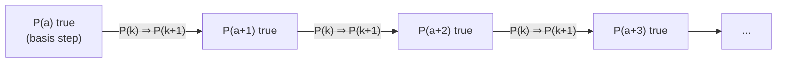
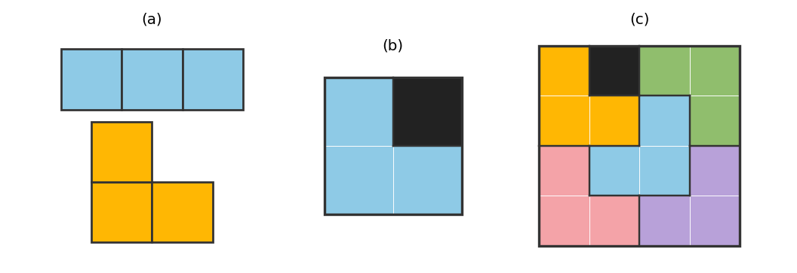
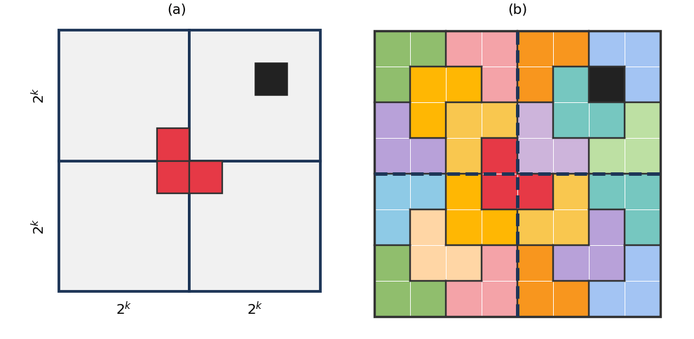
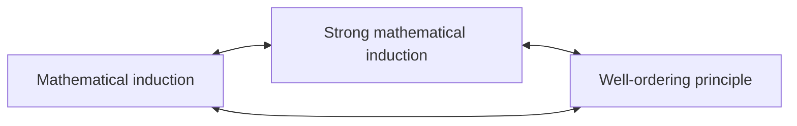
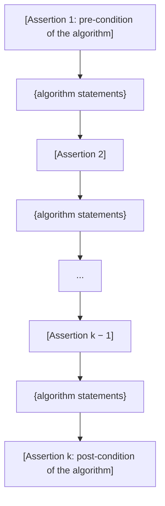
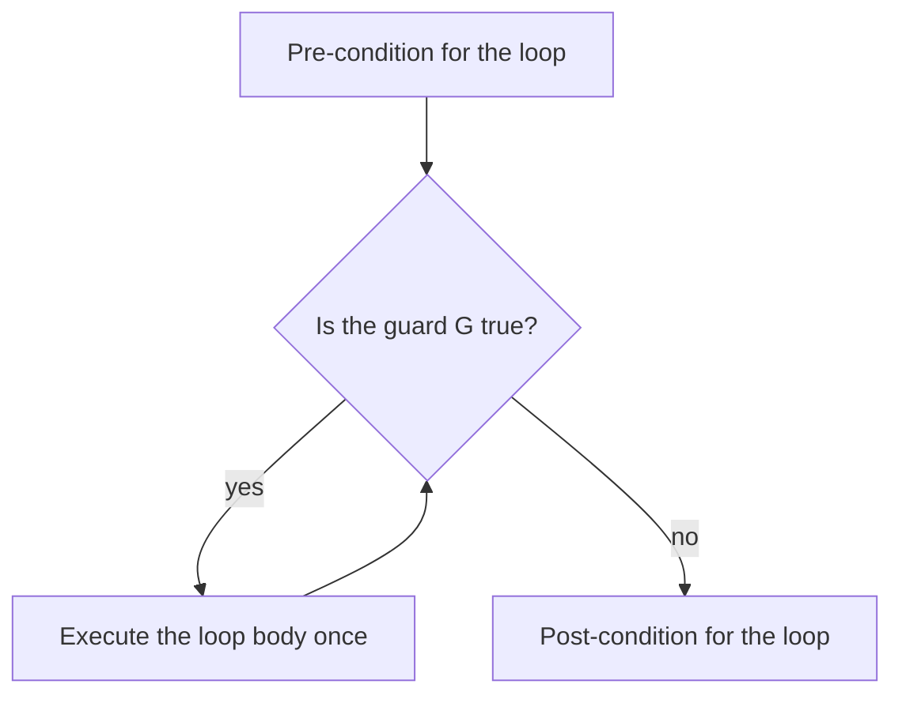
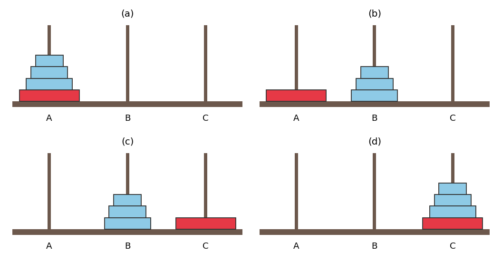
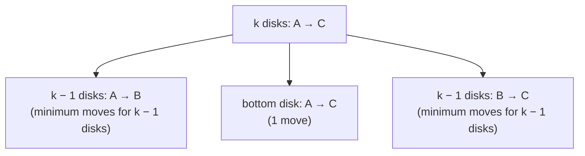

# Chapter 5 — Sequences, Mathematical Induction, and Recursion

[Repository Guide](../../README.md) | [English](Concepts_Lecture.md) | [한국어](Concepts_Lecture.ko.md)

> **Last Updated:** 2026-11-10
>
> Discrete Mathematics with Applications, Epp, Ch 5

> **Learning Objectives:**
> 1. Use explicit formulas, summation notation, product notation, factorials, and the $\binom{n}{r}$ notation to compute terms and sums, and change the index of a sum
> 2. Prove summation formulas, divisibility properties, inequalities, and properties of sequences by mathematical induction with a basis step and an inductive step
> 3. Apply strong mathematical induction and the well-ordering principle for the integers, and explain why the three principles are equivalent
> 4. Prove that a while loop is correct with respect to its pre-condition and post-condition by the loop invariant theorem
> 5. Define sequences recursively by recurrence relations and initial conditions, and model the Tower of Hanoi, the Fibonacci numbers, and compound interest with recurrence relations

---

## Table of Contents

- [1. Sequences](#1-sequences)
  - [1.1 Sequences and Explicit Formulas](#11-sequences-and-explicit-formulas)
  - [1.2 Summation Notation](#12-summation-notation)
  - [1.3 Product Notation](#13-product-notation)
  - [1.4 Properties of Summations and Products](#14-properties-of-summations-and-products)
  - [1.5 Change of Variable](#15-change-of-variable)
  - [1.6 Factorial and n Choose r Notation](#16-factorial-and-n-choose-r-notation)
  - [1.7 Sequences in Computer Programming](#17-sequences-in-computer-programming)
  - [1.8 Application: Converting from Base 10 to Base 2 by Repeated Division by 2](#18-application-converting-from-base-10-to-base-2-by-repeated-division-by-2)
- [2. Mathematical Induction I: Proving Formulas](#2-mathematical-induction-i-proving-formulas)
  - [2.1 Inductive Reasoning and Mathematical Induction](#21-inductive-reasoning-and-mathematical-induction)
  - [2.2 The Principle of Mathematical Induction](#22-the-principle-of-mathematical-induction)
  - [2.3 The Method of Proof by Mathematical Induction](#23-the-method-of-proof-by-mathematical-induction)
  - [2.4 The Sum of the First n Integers](#24-the-sum-of-the-first-n-integers)
  - [2.5 The Sum of a Geometric Sequence](#25-the-sum-of-a-geometric-sequence)
  - [2.6 Proving an Equality](#26-proving-an-equality)
  - [2.7 Deducing Additional Formulas](#27-deducing-additional-formulas)
- [3. Mathematical Induction II: Applications](#3-mathematical-induction-ii-applications)
  - [3.1 A Coin Problem with 3-Cent and 5-Cent Coins](#31-a-coin-problem-with-3-cent-and-5-cent-coins)
  - [3.2 Proving a Divisibility Property](#32-proving-a-divisibility-property)
  - [3.3 Proving an Inequality](#33-proving-an-inequality)
  - [3.4 Proving a Property of a Sequence](#34-proving-a-property-of-a-sequence)
  - [3.5 A Problem with Trominoes](#35-a-problem-with-trominoes)
- [4. Strong Mathematical Induction and the Well-Ordering Principle for the Integers](#4-strong-mathematical-induction-and-the-well-ordering-principle-for-the-integers)
  - [4.1 The Principle of Strong Mathematical Induction](#41-the-principle-of-strong-mathematical-induction)
  - [4.2 Applying Strong Mathematical Induction](#42-applying-strong-mathematical-induction)
  - [4.3 Existence and Uniqueness of Binary Representations](#43-existence-and-uniqueness-of-binary-representations)
  - [4.4 The Well-Ordering Principle for the Integers](#44-the-well-ordering-principle-for-the-integers)
- [5. Application: Correctness of Algorithms](#5-application-correctness-of-algorithms)
  - [5.1 Program Correctness and Assertions](#51-program-correctness-and-assertions)
  - [5.2 Loop Invariants](#52-loop-invariants)
  - [5.3 Correctness of a Loop to Compute a Product](#53-correctness-of-a-loop-to-compute-a-product)
  - [5.4 Correctness of the Division Algorithm](#54-correctness-of-the-division-algorithm)
  - [5.5 Correctness of the Euclidean Algorithm](#55-correctness-of-the-euclidean-algorithm)
- [6. Defining Sequences Recursively](#6-defining-sequences-recursively)
  - [6.1 Recurrence Relations and Initial Conditions](#61-recurrence-relations-and-initial-conditions)
  - [6.2 Thinking Recursively](#62-thinking-recursively)
  - [6.3 The Tower of Hanoi](#63-the-tower-of-hanoi)
  - [6.4 The Fibonacci Numbers](#64-the-fibonacci-numbers)
  - [6.5 Compound Interest](#65-compound-interest)
  - [6.6 Recursive Definitions of Sum and Product](#66-recursive-definitions-of-sum-and-product)
- [Concept Applications](#concept-applications)
- [Summary](#summary)
- [Self-Check Questions](#self-check-questions)

---

<br>

## 1. Sequences

One of the important tasks of mathematics is to discover the regularity hidden in a repeated process and to describe it precisely. The basic structure for studying repeated processes is the **sequence**, and the basic tool for checking whether a conjecture about a sequence is true is **mathematical induction**. This chapter starts from the notation of sequences and then treats ordinary and strong mathematical induction, the well-ordering principle for the integers that is equivalent to both, proofs of the correctness of algorithms, and recursively defined sequences.

### 1.1 Sequences and Explicit Formulas

Suppose that a person counts his or her ancestors generation by generation. There are 2 parents, 4 grandparents, 8 great-grandparents, and so forth. Written in a row, these numbers are $2, 4, 8, 16, 32, 64, 128, \ldots$. The final $\ldots$ is an **ellipsis**, which means "and so forth" in the same pattern. Labeling each number with its position in the row gives the following table.

| Position $k$ | 1 | 2 | 3 | 4 | 5 | 6 | 7 |
|:-----|:-----:|:-----:|:-----:|:-----:|:-----:|:-----:|:-----:|
| Ancestors $k$ generations back | 2 | 4 | 8 | 16 | 32 | 64 | 128 |

*Table 1. Number of ancestors in each generation back*

The number 2 at position 1 is $2^1$, the number 4 at position 2 is $2^2$, and the numbers 8, 16, 32, 64, 128 at positions 3 through 7 are $2^3, 2^4, 2^5, 2^6, 2^7$. Writing $A_k$ for the number of ancestors $k$ generations back, the computed values strongly suggest the rule $A_k = 2^k$ for every $k$.

> **Note:** The true number of ancestors is less than $2^k$ when $k$ is large, because the same person can appear as an ancestor several times on different branches of the family tree. The value $A_k = 2^k$ assumes that all ancestors are distinct.

> **Definition:** A **sequence** is a function defined on a block of consecutive integers: either every integer from one given integer up to a second given integer, or every integer from a given integer onward.

A sequence is usually represented by writing its elements in a row as $a_m, a_{m+1}, a_{m+2}, \ldots, a_n$. Each element $a_k$ (pronounced a sub k) is a **term** of the sequence, and the $k$ attached to it is its **subscript** or **index**. The first subscript $m$, belonging to the **initial term**, can be any integer, and the last subscript $n$, belonging to the **final term**, is an integer with $n \ge m$. The endless notation $a_m, a_{m+1}, a_{m+2}, \ldots$ denotes an **infinite sequence**. Since a sequence is a function, $a_k$ is the value $a(k)$ of the function $a$ at $k$ written with a subscript (functions are in Chapter 1).

> **Definition:** An **explicit formula** (or **general formula**) for a sequence is a rule that gives each term $a_k$ directly as an expression in its subscript $k$.

**Example 5.1.1 (Two Different Formulas Giving the Same Terms).** Define two sequences $a_1, a_2, a_3, \ldots$ and $b_2, b_3, b_4, \ldots$ by the following explicit formulas.

```math
a_k = \frac{k}{k+1} \quad (k \ge 1), \qquad b_i = \frac{i-1}{i} \quad (i \ge 2)
```

The first five terms of each sequence are found by substituting the subscripts into the formulas.

| Order | Computing $a_k$ | Computing $b_i$ | Value |
|:-----:|:-----|:-----|:-----:|
| First | $a_1 = \frac{1}{1+1}$ | $b_2 = \frac{2-1}{2}$ | $\frac{1}{2}$ |
| Second | $a_2 = \frac{2}{2+1}$ | $b_3 = \frac{3-1}{3}$ | $\frac{2}{3}$ |
| Third | $a_3 = \frac{3}{3+1}$ | $b_4 = \frac{4-1}{4}$ | $\frac{3}{4}$ |
| Fourth | $a_4 = \frac{4}{4+1}$ | $b_5 = \frac{5-1}{5}$ | $\frac{4}{5}$ |
| Fifth | $a_5 = \frac{5}{5+1}$ | $b_6 = \frac{6-1}{6}$ | $\frac{5}{6}$ |

*Table 2. First five terms produced by two different explicit formulas*

In fact all terms of the two sequences are identical. The $`k`$th term of $b$ is $b_{k+1}$, and $b_{k+1} = \frac{(k+1)-1}{k+1} = \frac{k}{k+1} = a_k$. Thus the same sequence can be written with different formulas and different subscript ranges.

**Example 5.1.2 (An Alternating Sequence).** The first six terms of the sequence defined by $c_j = (-1)^j$ $(j \ge 0)$ are $c_0 = (-1)^0 = 1$, $c_1 = (-1)^1 = -1$, $c_2 = 1$, $c_3 = -1$, $c_4 = 1$, $c_5 = -1$. Even powers of $-1$ equal 1 and odd powers equal $-1$, so the sequence oscillates endlessly between 1 and $-1$. This shows that an infinite sequence may take only finitely many values.

**Example 5.1.3 (Finding an Explicit Formula to Fit Given Initial Terms).** Find an explicit formula for a sequence whose initial terms are as follows.

```math
1, \; -\frac{1}{4}, \; \frac{1}{9}, \; -\frac{1}{16}, \; \frac{1}{25}, \; -\frac{1}{36}, \; \ldots
```

Denote the general term by $a_k$ and let the first term be $a_1$. The denominators are the perfect squares $1^2, 2^2, 3^2, 4^2, 5^2, 6^2$, and each denominator is the square of the subscript of its term. The numerators alternate between $+1$ and $-1$: $+1$ when $k$ is odd and $-1$ when $k$ is even. This oscillation is produced by the factor $(-1)^{k+1}$. When $k$ is odd, $k+1$ is even and $(-1)^{k+1} = 1$; when $k$ is even, $k+1$ is odd and $(-1)^{k+1} = -1$. Therefore a formula that gives the correct first six terms is the following.

```math
a_k = \frac{(-1)^{k+1}}{k^2} \quad (k \ge 1)
```

If the first term had been taken as $a_0$, the same terms could be written as $a_k = \frac{(-1)^k}{(k+1)^2}$ $(k \ge 0)$.

> **Caution:** A formula found from the first few terms is only a conjecture. Two sequences that agree in their first few terms may differ later. For example, $a_k = k$ and $b_k = k + (k-1)(k-2)(k-3)$ $(k \ge 1)$ both start with 1, 2, 3, but their fourth terms differ: $a_4 = 4$ and $b_4 = 4 + 3 \cdot 2 \cdot 1 = 10$.

### 1.2 Summation Notation

In the ancestor example, the total number of ancestors in the past six generations is $A_1 + A_2 + \cdots + A_6 = 2^1 + 2^2 + 2^3 + 2^4 + 2^5 + 2^6 = 126$. Such sums are written compactly in **summation notation**, which uses the capital Greek letter sigma, $\Sigma$.

> **Definition:** If $m$ and $n$ are integers and $m \le n$, the symbol $\sum_{k=m}^{n} a_k$, read the summation from $k$ equals $m$ to $n$ of $a_k$, is the sum of all the terms $a_m, a_{m+1}, a_{m+2}, \ldots, a_n$. The expression $a_m + a_{m+1} + a_{m+2} + \cdots + a_n$ is called the **expanded form** of the sum, $k$ is the **index** of the summation, $m$ is the **lower limit**, and $n$ is the **upper limit**.

```math
\sum_{k=m}^{n} a_k = a_m + a_{m+1} + a_{m+2} + \cdots + a_n
```

**Example 5.1.4 (Computing Summations).** Let $a_1 = -2$, $a_2 = -1$, $a_3 = 0$, $a_4 = 1$, and $a_5 = 2$. Compute three sums.

```math
\begin{aligned}
\text{(a)} \quad \sum_{k=1}^{5} a_k &= a_1 + a_2 + a_3 + a_4 + a_5 = (-2) + (-1) + 0 + 1 + 2 = 0 \\
\text{(b)} \quad \sum_{k=2}^{2} a_k &= a_2 = -1 \\
\text{(c)} \quad \sum_{k=1}^{2} a_{2k} &= a_{2 \cdot 1} + a_{2 \cdot 2} = a_2 + a_4 = -1 + 1 = 0
\end{aligned}
```

As in (b), when the lower and upper limits are equal, the sum consists of a single term. In (c) the index $k$ takes the values 1 and 2, but the terms being added are $a_{2k}$, so $a_2$ and $a_4$ are added.

Often the terms are given by a formula. For example, $\sum_{k=1}^{5} k^2 = 1^2 + 2^2 + 3^2 + 4^2 + 5^2 = 1 + 4 + 9 + 16 + 25 = 55$. When the upper limit is a variable, an ellipsis is used in the expanded form.

```math
\sum_{i=0}^{n} \frac{(-1)^i}{i+1} = \frac{(-1)^0}{0+1} + \frac{(-1)^1}{1+1} + \frac{(-1)^2}{2+1} + \cdots + \frac{(-1)^n}{n+1} = 1 - \frac{1}{2} + \frac{1}{3} - \cdots + \frac{(-1)^n}{n+1}
```

Conversely, to turn an expanded form into summation notation, find the general term as an expression in the index. In the following sum the numerators increase by one from 1 to $n+1$ and the denominators increase by one from $n$ to $2n$, so for $i = 0, 1, \ldots, n$ the general term can be written as $\frac{i+1}{n+i}$. When $i = 0$ it is $\frac{1}{n}$ and when $i = n$ it is $\frac{n+1}{2n}$, which match the first and last terms.

```math
\frac{1}{n} + \frac{2}{n+1} + \frac{3}{n+2} + \cdots + \frac{n+1}{2n} = \sum_{i=0}^{n} \frac{i+1}{n+i}
```

In the two examples above, the upper limit $n$ is a **free variable**. It may be replaced by any integer greater than or equal to the lower limit, and each replacement gives a different sum. Within one sum, however, $n$ acts like a constant, so even when $n$ appears in the terms, as in the last example, its value does not change from term to term. By contrast, the index is **bound** by the summation symbol and takes every value from the lower limit to the upper limit in succession. This is similar to a quantifier binding a variable in a quantified statement (Chapter 3) and to a local variable that has meaning only within its scope in a program.

> **Caution:** Mistakes are easy when evaluating an expanded form for small $n$. Writing $1^2 + 2^2 + 3^2 + \cdots + 1^2$ for $1^2 + 2^2 + 3^2 + \cdots + n^2$ with $n = 1$ is wrong. The expression is the sum of consecutive squares starting at $1^2$ and ending at $n^2$, so for $n = 1$ it is just $1^2$, for $n = 2$ it is $1^2 + 2^2$, and for $n = 3$ it is $1^2 + 2^2 + 3^2$.

Imagining the expanded form in summation notation avoids such mistakes. For example, $2^0 + 2^1 + 2^2 + \cdots + 2^n = \sum_{i=0}^{n} 2^i$, so for $n = 0$ the value is $\sum_{i=0}^{0} 2^i = 2^0 = 1$, for $n = 1$ it is $2^0 + 2^1 = 1 + 2 = 3$, and for $n = 2$ it is $2^0 + 2^1 + 2^2 = 1 + 2 + 4 = 7$.

Summation notation can be defined more precisely by the following **recursive definition**. If $m$ is an integer, then

```math
\sum_{k=m}^{m} a_k = a_m, \qquad \sum_{k=m}^{n} a_k = \left( \sum_{k=m}^{n-1} a_k \right) + a_n \quad (n > m)
```

The first equation fixes a sum with one term, and the second defines a sum with $n - m + 1$ terms as the sum with one fewer term plus the final term. Recursive definitions are discussed in detail in Section 6. When solving problems, this definition is often used to separate off the final term or, conversely, to combine several terms into a single summation.

```math
\begin{aligned}
\text{(a)} \quad \sum_{k=0}^{n} 2^k + 2^{n+1} &= (2^0 + 2^1 + \cdots + 2^n) + 2^{n+1} = \sum_{k=0}^{n+1} 2^k \\
\text{(b)} \quad \sum_{i=1}^{n+1} \frac{1}{i^2} &= \frac{1}{1^2} + \frac{1}{2^2} + \cdots + \frac{1}{n^2} + \frac{1}{(n+1)^2} = \sum_{i=1}^{n} \frac{1}{i^2} + \frac{1}{(n+1)^2}
\end{aligned}
```

**Example 5.1.10 (A Telescoping Sum).** When each term of a sum is a difference of two quantities, writing it in expanded form sometimes shows that all terms cancel except parts of the first and the last. Because the sum collapses like a telescope, it is called a **telescoping sum**. First, for every integer $k \ge 1$ the following identity holds, since bringing the two fractions to the common denominator $k(k+1)$ makes the numerator $(k+1) - k = 1$.

```math
\frac{1}{k} - \frac{1}{k+1} = \frac{(k+1) - k}{k(k+1)} = \frac{1}{k(k+1)}
```

Rewriting each term with this identity and expanding, the second part of each parenthesis cancels the first part of the next, and only the leading $\frac{1}{1}$ and the trailing $-\frac{1}{n+1}$ remain.

```math
\sum_{k=1}^{n} \frac{1}{k(k+1)} = \sum_{k=1}^{n} \left( \frac{1}{k} - \frac{1}{k+1} \right) = \left( \frac{1}{1} - \frac{1}{2} \right) + \left( \frac{1}{2} - \frac{1}{3} \right) + \cdots + \left( \frac{1}{n} - \frac{1}{n+1} \right) = 1 - \frac{1}{n+1}
```

Checking with $n = 3$, the left-hand side is $\frac{1}{2} + \frac{1}{6} + \frac{1}{12} = \frac{6 + 2 + 1}{12} = \frac{3}{4}$ and the right-hand side is $1 - \frac{1}{4} = \frac{3}{4}$.

### 1.3 Product Notation

The notation for a product of numbers is defined in the same way as summation notation, using the capital Greek letter pi, $\Pi$. For example, $\prod_{k=1}^{5} a_k = a_1 a_2 a_3 a_4 a_5$.

> **Definition:** If $m$ and $n$ are integers and $m \le n$, the symbol $\prod_{k=m}^{n} a_k$, read the product from $k$ equals $m$ to $n$ of $a_k$, is the product of all the terms $a_m, a_{m+1}, \ldots, a_n$, that is, $a_m \cdot a_{m+1} \cdot a_{m+2} \cdots a_n$. This notation is called **product notation**.

A recursive definition of product notation is as follows. If $m$ is an integer, then

```math
\prod_{k=m}^{m} a_k = a_m, \qquad \prod_{k=m}^{n} a_k = \left( \prod_{k=m}^{n-1} a_k \right) \cdot a_n \quad (n > m)
```

For example, $\prod_{k=1}^{5} k = 1 \cdot 2 \cdot 3 \cdot 4 \cdot 5 = 120$, and the product with a single factor $\prod_{k=1}^{1} \frac{k}{k+1}$ equals $\frac{1}{1+1} = \frac{1}{2}$.

### 1.4 Properties of Summations and Products

**Theorem 5.1.1.** If $a_m, a_{m+1}, a_{m+2}, \ldots$ and $b_m, b_{m+1}, b_{m+2}, \ldots$ are sequences of real numbers and $c$ is any real number, then the following equations hold for every integer $n \ge m$.

```math
\begin{aligned}
&1. \quad \sum_{k=m}^{n} a_k + \sum_{k=m}^{n} b_k = \sum_{k=m}^{n} (a_k + b_k) \\
&2. \quad c \cdot \sum_{k=m}^{n} a_k = \sum_{k=m}^{n} c \cdot a_k \\
&3. \quad \left( \prod_{k=m}^{n} a_k \right) \cdot \left( \prod_{k=m}^{n} b_k \right) = \prod_{k=m}^{n} (a_k \cdot b_k)
\end{aligned}
```

Equation 2 is called the **generalized distributive law**. The three equations can be understood as rearranging or regrouping finitely many terms by the commutative, associative, and distributive laws. However, handling an arbitrary number of terms hidden behind an ellipsis rigorously requires mathematical induction, and the proof of equation 1 is given in Section 6.6.

**Example 5.1.12 (Writing a Single Summation or Product by the Properties).** Let $a_k = k + 1$ and $b_k = k - 1$ for every integer $k$. Then the expressions simplify as follows.

```math
\begin{aligned}
\sum_{k=m}^{n} a_k + 2 \cdot \sum_{k=m}^{n} b_k &= \sum_{k=m}^{n} (k+1) + 2 \cdot \sum_{k=m}^{n} (k-1) && \text{(i)} \\
&= \sum_{k=m}^{n} (k+1) + \sum_{k=m}^{n} 2 \cdot (k-1) && \text{(ii)} \\
&= \sum_{k=m}^{n} \bigl( (k+1) + 2 \cdot (k-1) \bigr) && \text{(iii)} \\
&= \sum_{k=m}^{n} (3k - 1) && \text{(iv)}
\end{aligned}
```

Step (i) substitutes the formulas for $a_k$ and $b_k$, (ii) applies part 2 of Theorem 5.1.1, (iii) applies part 1, and (iv) simplifies $(k+1) + 2k - 2 = 3k - 1$. A product is simplified in the same way: substitute, apply part 3 of Theorem 5.1.1, and simplify $(k+1)(k-1) = k^2 - 1$.

```math
\left( \prod_{k=m}^{n} a_k \right) \cdot \left( \prod_{k=m}^{n} b_k \right) = \left( \prod_{k=m}^{n} (k+1) \right) \cdot \left( \prod_{k=m}^{n} (k-1) \right) = \prod_{k=m}^{n} \bigl( (k+1)(k-1) \bigr) = \prod_{k=m}^{n} (k^2 - 1)
```

> **Caution:** A product of sums is in general not a sum of products. The expressions $\sum_{k=m}^{n} (a_k \cdot b_k)$ and $\left( \sum_{k=m}^{n} a_k \right) \cdot \left( \sum_{k=m}^{n} b_k \right)$ are usually different. For example, with $a_k = b_k = k$, $m = 1$, and $n = 2$, the first is $1 + 4 = 5$ and the second is $3 \cdot 3 = 9$. Also, adding a constant gives $\sum_{k=m}^{n} (a_k + c) = \sum_{k=m}^{n} a_k + (n - m + 1)c$, because the constant $c$ is added once for each term, $n - m + 1$ times in all.

### 1.5 Change of Variable

Since $\sum_{k=1}^{3} k^2 = 1^2 + 2^2 + 3^2$ and $\sum_{i=1}^{3} i^2 = 1^2 + 2^2 + 3^2$, it follows that $\sum_{k=1}^{3} k^2 = \sum_{i=1}^{3} i^2$. The index of a summation is thus a **local variable** that may be replaced by any other symbol as long as the replacement is made consistently in every place where it occurs; such a variable is also called a **dummy variable**. Outside that summation the same symbol may have an entirely different meaning. A variable in a quantified statement can likewise be replaced by another symbol as long as the replacement is consistent.

A more complicated **change of variable** can also alter the appearance of a sum. For example, the following two sums add the same numbers.

```math
\sum_{j=2}^{4} (j-1)^2 = (2-1)^2 + (3-1)^2 + (4-1)^2 = 1^2 + 2^2 + 3^2 = \sum_{k=1}^{3} k^2
```

**Example 5.1.13 (Transforming a Sum by a Change of Variable).** Apply the change of variable $j = k + 1$ to $\sum_{k=0}^{6} \frac{1}{k+1}$. The procedure has three steps.

1. **Compute the new lower and upper limits.** When $k = 0$, $j = 0 + 1 = 1$, and when $k = 6$, $j = 6 + 1 = 7$. So the new sum runs from $j = 1$ to $j = 7$.
2. **Rewrite the general term in the new variable.** Since $j = k + 1$, $k = j - 1$, and $\frac{1}{k+1} = \frac{1}{(j-1)+1} = \frac{1}{j}$.
3. **Put the results together.** $\sum_{k=0}^{6} \frac{1}{k+1} = \sum_{j=1}^{7} \frac{1}{j}$.

Because $j$ is also a dummy variable, replacing every $j$ by $k$ gives $\sum_{j=1}^{7} \frac{1}{j} = \sum_{k=1}^{7} \frac{1}{k}$, and finally $\sum_{k=0}^{6} \frac{1}{k+1} = \sum_{k=1}^{7} \frac{1}{k}$.

**Example 5.1.14 (When the Upper Limit Appears in the Terms).** Sometimes the limits of one sum must be shifted before it can be added to another (the algebraic proof of the binomial theorem in Chapter 9 is an example). Rewrite $\sum_{k=1}^{n+1} \frac{k}{n+k}$ as a sum whose lower limit is 0 and upper limit is $n$ while the index is still $k$.

First change the variable by $j = k - 1$. The index $k$ takes the values 1 through $n+1$ in succession, so $j = 0$ when $k = 1$ and $j = (n+1) - 1 = n$ when $k = n + 1$. Here $n$ is a constant with respect to the terms, so its value does not change from term to term. Substituting $k = j + 1$ makes the general term $\frac{j+1}{n+(j+1)}$. Then changing every $j$ to $k$ gives the following.

```math
\sum_{k=1}^{n+1} \frac{k}{n+k} = \sum_{j=0}^{n} \frac{j+1}{n+(j+1)} = \sum_{k=0}^{n} \frac{k+1}{n+(k+1)}
```

Checking with $n = 1$, the left-hand side is $\frac{1}{2} + \frac{2}{3}$, and the right-hand side, for $k = 0, 1$, is also $\frac{1}{2} + \frac{2}{3}$.

> **Caution:** In a change of variable, do not change a variable that comes from outside the sum, such as the upper limit $n$. Rewrite only the index in terms of the new variable, and always change the lower and upper limits as well.

### 1.6 Factorial and n Choose r Notation

The product of all consecutive positive integers up to a given integer occurs so often in mathematics that it has its own notation.

> **Definition:** For each positive integer $n$, **$n$ factorial**, denoted $n!$, is the product of all the integers from 1 to $n$: $n! = n \cdot (n-1) \cdots 3 \cdot 2 \cdot 1$. **Zero factorial**, $0!$, is defined to be 1.

The definition $0! = 1$ may look odd, but, as Chapter 9 shows, it lets many formulas be written without exceptions. The first ten factorials are as follows.

| $n$ | 0 | 1 | 2 | 3 | 4 | 5 | 6 | 7 | 8 | 9 |
|:-----|:-----:|:-----:|:-----:|:-----:|:-----:|:-----:|:-----:|:-----:|:-----:|:-----:|
| $n!$ | 1 | 1 | 2 | 6 | 24 | 120 | 720 | 5,040 | 40,320 | 362,880 |

*Table 3. Factorials from 0 to 9*

Factorials grow very rapidly. For instance, $40! \approx 8.16 \times 10^{47}$, which is too large to be computed exactly with the standard integer arithmetic of many programming languages. The largest 64-bit signed integer is $2^{63} - 1 \approx 9.22 \times 10^{18}$, so it can hold values up to $20! \approx 2.43 \times 10^{18}$ but not $21! \approx 5.11 \times 10^{19}$ or larger.

A recursive definition of factorial is the following. For every nonnegative integer $n$,

```math
n! = \begin{cases} 1 & \text{if } n = 0 \\ n \cdot (n-1)! & \text{if } n \ge 1 \end{cases}
```

> **Caution:** The expression $n \cdot (n-1)!$ is interpreted as $n \cdot [(n-1)!]$. It must not be read as $[n \cdot (n-1)]!$ by multiplying first.

The recursive definition is useful for simplifying expressions containing factorials. Write the larger factorial as a smaller factorial times the remaining factors, and cancel the common factors.

```math
\begin{aligned}
\text{(a)} \quad \frac{8!}{7!} &= \frac{8 \cdot 7!}{7!} = 8 \\
\text{(b)} \quad \frac{5!}{2! \cdot 3!} &= \frac{5 \cdot 4 \cdot 3!}{2! \cdot 3!} = \frac{5 \cdot 4}{2 \cdot 1} = 10 \\
\text{(c)} \quad \frac{1}{2! \cdot 4!} + \frac{1}{3! \cdot 3!} &= \frac{3}{3 \cdot 2! \cdot 4!} + \frac{4}{3! \cdot 4 \cdot 3!} = \frac{3}{3! \cdot 4!} + \frac{4}{3! \cdot 4!} = \frac{7}{144} \\
\text{(d)} \quad \frac{(n+1)!}{n!} &= \frac{(n+1) \cdot n!}{n!} = n + 1 \\
\text{(e)} \quad \frac{n!}{(n-3)!} &= \frac{n \cdot (n-1) \cdot (n-2) \cdot (n-3)!}{(n-3)!} = n(n-1)(n-2) = n^3 - 3n^2 + 2n
\end{aligned}
```

In (c), to obtain a common denominator, the numerator and denominator of the first fraction are multiplied by 3 and those of the second by 4; then $3 \cdot 2! = 3!$ and $4 \cdot 3! = 4!$ are used, and $3! \cdot 4! = 6 \cdot 24 = 144$. Part (e) holds for $n \ge 3$.

An important use of factorials is computing the following quantity, which appears in counting and probability.

> **Definition:** For integers $n$ and $r$ with $0 \le r \le n$, the symbol $\binom{n}{r}$, read **n choose r**, denotes the number of subsets with exactly $r$ elements that a set of $n$ elements has.

Because the definition counts subsets, $\binom{n}{r}$ is always an integer. For example, the subsets of size 2 of the set $\lbrace a, b, c \rbrace$ are $\lbrace a, b \rbrace$, $\lbrace a, c \rbrace$, and $\lbrace b, c \rbrace$, so $\binom{3}{2} = 3$. Values can be computed with the following formula, which is proved in Chapter 9.

```math
\binom{n}{r} = \frac{n!}{r!\,(n-r)!} \quad (\text{for all integers } n, r \text{ with } 0 \le r \le n)
```

Since $\binom{n}{r}$ is always an integer, all factors of the denominator cancel with factors of the numerator. Calculators and books also write $`_nC_r`$, $C(n, r)$, and $C_{n,r}$; the letter C comes from the name **combinations** for these numbers. Because of their connection with the binomial theorem, they are also called **binomial coefficients** (Chapter 9).

```math
\begin{aligned}
\text{(a)} \quad \binom{8}{5} &= \frac{8!}{5!\,(8-5)!} = \frac{8 \cdot 7 \cdot 6 \cdot 5!}{5! \cdot 3 \cdot 2 \cdot 1} = \frac{8 \cdot 7 \cdot 6}{6} = 56 \\
\text{(b)} \quad \binom{4}{4} &= \frac{4!}{4!\,(4-4)!} = \frac{4!}{4! \cdot 0!} = \frac{24}{24 \cdot 1} = 1 \\
\text{(c)} \quad \binom{n+1}{n} &= \frac{(n+1)!}{n!\,((n+1)-n)!} = \frac{(n+1)!}{n! \cdot 1!} = \frac{(n+1) \cdot n!}{n!} = n + 1
\end{aligned}
```

As in (a), canceling common factors before multiplying makes the computation easier. Part (b) can be evaluated thanks to $0! = 1$, and the result matches the fact that the only 4-element subset of a 4-element set is the set itself.

### 1.7 Sequences in Computer Programming

An important data type in programming is the finite sequence, usually called a **one-dimensional array**. For example, a program that finds the mean of the wages of 50 workers and then how far each wage lies from that mean has to keep all 50 wages in memory. Rather than invent 50 unrelated variable names, it stores the wages as the terms `W[1], W[2], W[3], ..., W[50]` of a one-dimensional array. The subscript is placed in square brackets because for many years ordinary keyboards offered no way to type a lowered subscript.

> **[Data Structures]** A one-dimensional array stores elements of the same type in contiguous memory and gives direct access to each element by its index. Many languages, such as C, Java, and Python, number indices from 0, so the elements of an array of length $n$ are `a[0]` through `a[n-1]`. This corresponds to a sequence whose subscripts start at 0.

The index variable of a loop is likewise a local (dummy) variable. Each of the following three pieces of pseudocode, for example, prints `a[1]`, `a[2]`, ..., `a[n]` in that order.

```text
for i := 1 to n         for j := 0 to n - 1      for k := 2 to n + 1
    print a[i]              print a[j + 1]           print a[k - 1]
next i                  next j                   next k
```

In the first segment `i` runs from 1 to `n` and `a[i]` is printed. In the second, `j` runs from 0 to `n - 1`, so `j + 1` runs from 1 to `n`; in the third, `k` runs from 2 to `n + 1`, so `k - 1` runs from 1 to `n`. This is the same principle as the change of variable in Section 1.5.

The recursive definitions of sum, product, and factorial translate directly into computational algorithms. The following two pieces of pseudocode both compute `a[1] + a[2] + ... + a[n]`, that is, $\sum_{k=1}^{n} a[k]$.

```text
s := a[1]                    s := 0
for k := 2 to n              for k := 1 to n
    s := s + a[k]                s := s + a[k]
next k                       next k
```

The code on the left follows the recursive definition of Section 1.2 exactly. Its first line starts `s` at the one-term sum `a[1]`, and each pass of the loop adds the next term `a[k]` to the sum so far. The code on the right starts `s` at 0 and adds from `a[1]` on. For $n \ge 1$ both end with the same value of `s`. When $n = 1$ the loop on the left is never executed, and `s` keeps its initial value `a[1]`.

### 1.8 Application: Converting from Base 10 to Base 2 by Repeated Division by 2

Chapter 2 showed how to convert integers from decimal to binary notation, but that method is convenient only for small numbers. A systematic algorithm that works for every nonnegative integer is to divide by 2 again and again.

Start with a nonnegative integer $a$ and use the quotient-remainder theorem (Chapter 4) to write the division of $a$ by 2 as a quotient `q[0]` with a remainder `r[0]`. As long as the latest quotient is not 0, divide that quotient by 2 in turn, obtaining `q[1]` and `r[1]` and so on, and stop when a quotient equals 0. Every remainder is smaller than the divisor 2, so each one is 0 or 1. For $a = 38$ the process runs as follows.

| Stage $i$ | Dividend | Quotient `q[i]` | Remainder `r[i]` |
|:-----:|:-----:|:-----:|:-----:|
| 0 | 38 | 19 | 0 |
| 1 | 19 | 9 | 1 |
| 2 | 9 | 4 | 1 |
| 3 | 4 | 2 | 0 |
| 4 | 2 | 1 | 0 |
| 5 | 1 | 0 | 1 |

*Table 4. Quotients and remainders when 38 is repeatedly divided by 2*

Written as equations, the divisions are $38 = 19 \cdot 2 + 0$, $19 = 9 \cdot 2 + 1$, $9 = 4 \cdot 2 + 1$, $4 = 2 \cdot 2 + 0$, $2 = 1 \cdot 2 + 0$, and $1 = 0 \cdot 2 + 1$. Substituting the second equation for the quotient 19 in the first, then the third for the quotient 9, and so on, repeated substitution gives the following.

```math
\begin{aligned}
38 &= 19 \cdot 2 + 0 \\
&= (9 \cdot 2 + 1) \cdot 2 + 0 = 9 \cdot 2^2 + 1 \cdot 2 + 0 \\
&= (4 \cdot 2 + 1) \cdot 2^2 + 1 \cdot 2 + 0 = 4 \cdot 2^3 + 1 \cdot 2^2 + 1 \cdot 2 + 0 \\
&= (2 \cdot 2 + 0) \cdot 2^3 + 1 \cdot 2^2 + 1 \cdot 2 + 0 = 2 \cdot 2^4 + 0 \cdot 2^3 + 1 \cdot 2^2 + 1 \cdot 2 + 0 \\
&= (1 \cdot 2 + 0) \cdot 2^4 + 0 \cdot 2^3 + 1 \cdot 2^2 + 1 \cdot 2 + 0 = 1 \cdot 2^5 + 0 \cdot 2^4 + 0 \cdot 2^3 + 1 \cdot 2^2 + 1 \cdot 2 + 0
\end{aligned}
```

On the right, the coefficient of each power of 2 is one of the remainders of the repeated division; the leading 1 is the remainder of $1 = 0 \cdot 2 + 1$. Hence $38_{10} = 100110_2$, which is the remainders read backward from the last one, $`(r[5] r[4] r[3] r[2] r[1] r[0])_2`$. Indeed $2^5 + 2^2 + 2^1 = 32 + 4 + 2 = 38$.

In general, suppose that dividing a nonnegative integer $a$ by 2 again and again until the quotient becomes 0 yields the remainders $r[0], r[1], \ldots, r[k]$. Each $r[i]$ is 0 or 1 by the quotient-remainder theorem, and repeated substitution gives the following.

```math
a = 2^k \cdot r[k] + 2^{k-1} \cdot r[k-1] + \cdots + 2^2 \cdot r[2] + 2^1 \cdot r[1] + 2^0 \cdot r[0]
```

Thus the binary representation of $a$ is $`a_{10} = (r[k] r[k-1] \cdots r[2] r[1] r[0])_2`$. For example, dividing 29 gives $29 = 14 \cdot 2 + 1$, $14 = 7 \cdot 2 + 0$, $7 = 3 \cdot 2 + 1$, $3 = 1 \cdot 2 + 1$, and $1 = 0 \cdot 2 + 1$, so the remainders are $r[0] = 1$, $r[1] = 0$, $r[2] = 1$, $r[3] = 1$, $r[4] = 1$, and $29_{10} = 11101_2$. As a check, $16 + 8 + 4 + 1 = 29$.

Written as an algorithm, the procedure is the following (Algorithm 5.1.1). It takes a nonnegative integer `a` and returns binary digits `r[0], r[1], ..., r[i-1]` such that $`a = (r[i-1] \cdots r[1] r[0])_2`$.

```text
Input: a
q := a, i := 0
while (i = 0 or q ≠ 0)
    r[i] := q mod 2
    q := q div 2
    i := i + 1
end while
Output: r[0], r[1], r[2], ..., r[i - 1]
```

The second line sets the quotient still to be divided, `q`, to the input and the position of the next remainder, `i`, to 0. Inside the loop, the remainder of `q` divided by 2 is stored in `r[i]` (`mod`), `q` is replaced by the quotient (`div`, both from Chapter 4), and `i` is increased by 1 to move to the next position. The part `i = 0` of the guard `i = 0 or q ≠ 0` makes the loop execute at least once, so that `r[0] = 0` is computed even when the input is 0. For input 0, the loop sets `r[0] := 0`, `q := 0`, and `i := 1`, after which the guard is false and the single digit `r[0] = 0` is output. After the loop, `r[0], ..., r[i-1]` are all 0 or 1 and $`a = (r[i-1] r[i-2] \cdots r[1] r[0])_2`$.

---

<br>

## 2. Mathematical Induction I: Proving Formulas

### 2.1 Inductive Reasoning and Mathematical Induction

In the natural sciences, deduction and induction are taught as two distinct ways of reasoning. Deduction draws a conclusion from general principles by the rules of logic, while induction proposes a general principle after seeing it hold in many particular cases. Experiments with examples often lead to new mathematical facts, yet mathematical induction, as a method of proof, is a form of **deductive** reasoning, not of induction in this sense. A theorem established by mathematical induction is therefore as certain as a theorem established by any other valid proof. Inductive reasoning in the scientific sense serves mathematics only for forming conjectures, never for proving them.

For example, observe the following pattern.

```math
\begin{aligned}
\text{row 1:} \quad & 1 - \frac{1}{2} = \frac{1}{2} \\
\text{row 2:} \quad & \left( 1 - \frac{1}{2} \right) \left( 1 - \frac{1}{3} \right) = \frac{1}{3} \\
\text{row 3:} \quad & \left( 1 - \frac{1}{2} \right) \left( 1 - \frac{1}{3} \right) \left( 1 - \frac{1}{4} \right) = \frac{1}{4}
\end{aligned}
```

The pattern seems too regular to be a coincidence, so it is reasonable to conjecture that it holds in general. But it is still only a conjecture. The question that mathematical induction asks is this: does the fact that the pattern holds in one row guarantee that it holds in the next row? Suppose the equation in row 3 is true, and replace the product of the first three factors on the left-hand side of a new row 4 by the right-hand side $\frac{1}{4}$ of row 3. The result is the following.

```math
\left( 1 - \frac{1}{2} \right) \left( 1 - \frac{1}{3} \right) \left( 1 - \frac{1}{4} \right) \left( 1 - \frac{1}{5} \right) = \frac{1}{4} \left( 1 - \frac{1}{5} \right) = \frac{1}{4} \cdot \frac{4}{5} = \frac{1}{5}
```

So the pattern extends to row 4. Going from row 1 to row 2 works the same way: replacing $\left( 1 - \frac{1}{2} \right)$ on the left-hand side of row 2 by the right-hand side $\frac{1}{2}$ of row 1 gives $\frac{1}{2} \left( 1 - \frac{1}{3} \right) = \frac{1}{2} \cdot \frac{2}{3} = \frac{1}{3}$.

Now check the general case. Suppose $k$ is any integer that is at least 2 and that the pattern of row $k$, $\left( 1 - \frac{1}{2} \right) \left( 1 - \frac{1}{3} \right) \cdots \left( 1 - \frac{1}{k} \right) = \frac{1}{k}$, holds. Then the following holds.

```math
\left( 1 - \frac{1}{2} \right) \cdots \left( 1 - \frac{1}{k} \right) \left( 1 - \frac{1}{k+1} \right) = \frac{1}{k} \left( 1 - \frac{1}{k+1} \right) = \frac{1}{k} \cdot \frac{(k+1) - 1}{k+1} = \frac{1}{k} \cdot \frac{k}{k+1} = \frac{1}{k+1}
```

That is, for every integer $k \ge 2$, if the pattern holds in row $k$, then it also holds in row $k+1$. Since the pattern holds in row 1, it holds in row 2; since it holds in row 2, it holds in row 3; and the argument continues forever, so the pattern holds in every row. This is the basic idea of mathematical induction.

### 2.2 The Principle of Mathematical Induction

> **Key Point:** **Principle of mathematical induction.** Let $P(n)$ be a property defined for integers $n$, and let $a$ be a fixed integer. Suppose the following two statements are true.
> 1. $P(a)$ is true.
> 2. For every integer $k \ge a$, if $P(k)$ is true, then $P(k+1)$ is true.
>
> Then $P(n)$ is true for every integer $n \ge a$.

A domino analogy helps. Imagine infinitely many dominoes standing in a row, arranged so that whenever one domino falls, the next one must fall too. Then if the first domino falls, they all fall. Letting $P(n)$ be the sentence that the $`n`$th domino falls, for each $k \ge 1$, $P(k)$ implies $P(k+1)$, and $P(1)$ is true, so by the principle of mathematical induction $P(n)$ is true for every integer $n \ge 1$.



*Figure 1. How the basis step and the inductive step pass truth to every integer n ≥ a*

That mathematical induction is a valid method of proof is usually accepted as an **axiom**, and this is why it is called a principle instead of a theorem. It says the same thing as the following property of the integers, which is intuitively convincing.

> **Key Point:** If a set $S$ of integers satisfies (1) $a \in S$ and (2) for every integer $k \ge a$, if $k \in S$ then $k+1 \in S$, then every integer $n \ge a$ belongs to $S$.

To see that the two forms say the same thing, take $S$ to be the set of integers $n$ for which $P(n)$ holds.

### 2.3 The Method of Proof by Mathematical Induction

A proof by mathematical induction has two parts, called the **basis step** and the **inductive step**.

> **Key Point:** **Method of proof by mathematical induction.** To prove a statement of the form "For every integer $n \ge a$, a property $P(n)$ is true," perform the following two steps.
> 1. **Basis step:** Show that $P(a)$ is true.
> 2. **Inductive step:** Show that for every integer $k \ge a$, if $P(k)$ is true, then $P(k+1)$ is true. To do this, suppose that $P(k)$ is true for a particular but arbitrarily chosen integer $k \ge a$. This supposition is called the **inductive hypothesis**. Then show that $P(k+1)$ is true.

The inductive step applies generalizing from the generic particular (Chapter 4) to a conditional statement. Since the conditional statement "if $P(k)$ then $P(k+1)$" is proved for an arbitrarily chosen $k$, it is proved for every $k \ge a$.

To write $P(a)$, $P(k)$, and $P(k+1)$, copy $P(n)$ and replace every $n$ by $a$, $k$, and $k+1$, respectively; substitute $k+1$ in parentheses. For example, if $P(n)$ is $1 + 2 + \cdots + n = \frac{n(n+1)}{2}$, then $P(k+1)$ is $1 + 2 + \cdots + (k+1) = \frac{(k+1)((k+1)+1)}{2}$.

> **Caution:** The inductive hypothesis does not assume the conclusion to be proved, "for every $n \ge a$, $P(n)$." It is the proof of a conditional statement that assumes $P(k)$ for one $k$ and derives $P(k+1)$ from it.

> **Caution:** If either of the two steps is missing, there is no proof. Consider the property $P(n)$: $n = n + 1$. Assuming $k = k + 1$ and adding 1 to both sides gives $k + 1 = k + 2$, so the inductive step holds, yet $P(n)$ is false for every integer. Conversely, checking finitely many cases is not a proof. The number $n^2 + n + 41$ is prime for every $n = 0, 1, \ldots, 39$, but for $n = 40$ it is $40^2 + 40 + 41 = 1681 = 41^2$, which is composite.

### 2.4 The Sum of the First n Integers

**Theorem 5.2.1 (Sum of the First n Integers).** For every integer $n \ge 1$, the following holds.

```math
1 + 2 + \cdots + n = \frac{n(n+1)}{2}
```

Before the proof, identify the property $P(n)$ precisely. Here $P(n)$ is the equation $1 + 2 + \cdots + n = \frac{n(n+1)}{2}$ itself. Its subject is the sum of the integers from 1 to $n$ and its predicate says that this sum equals $\frac{n(n+1)}{2}$, so $P(n)$ is a sentence that is either true or false.

**Proof (by mathematical induction).** Let $P(n)$ be the equation $1 + 2 + \cdots + n = \frac{n(n+1)}{2}$.

**Basis step: show that $P(1)$ is true.** $P(1)$ is $1 = \frac{1(1+1)}{2}$. The left-hand side is the sum of the integers from 1 to 1, which is 1, and the right-hand side is $\frac{1 \cdot 2}{2} = 1$. Hence $P(1)$ is true.

**Inductive step: show that for every integer $k \ge 1$, if $P(k)$ then $P(k+1)$.** Suppose that $k$ is an integer with $k \ge 1$ and that the following inductive hypothesis $P(k)$ is true.

```math
1 + 2 + \cdots + k = \frac{k(k+1)}{2}
```

It remains to show $P(k+1)$, that is, the following equation.

```math
1 + 2 + \cdots + (k+1) = \frac{(k+1)(k+2)}{2}
```

The two sides are computed separately and shown to equal the same quantity. The left-hand side is as follows.

```math
\begin{aligned}
1 + 2 + \cdots + (k+1) &= (1 + 2 + \cdots + k) + (k+1) && \text{(1)} \\
&= \frac{k(k+1)}{2} + (k+1) && \text{(2)} \\
&= \frac{k(k+1)}{2} + \frac{2(k+1)}{2} && \text{(3)} \\
&= \frac{k^2 + k + 2k + 2}{2} = \frac{k^2 + 3k + 2}{2} && \text{(4)}
\end{aligned}
```

Step (1) makes explicit that in a sum of consecutive integers the term just before the last term $k+1$ is $k$. Step (2) substitutes the inductive hypothesis for the sum in parentheses, (3) puts the second term over the denominator 2 by multiplying its top and bottom by 2, and (4) multiplies out the numerator and combines like terms. The right-hand side, after multiplying out the numerator, is $\frac{(k+1)(k+2)}{2} = \frac{k^2 + 3k + 2}{2}$. The two sides equal the same quantity, so $P(k+1)$ is true.

Since both the basis step and the inductive step have been proved, the principle of mathematical induction gives that $P(n)$ is true for every integer $n \ge 1$.

There is also an intuitive way to obtain the same formula. Writing $S = 1 + 2 + \cdots + n$ backward gives $S = n + (n-1) + \cdots + 1$. Adding the two expressions term by term, each pair sums to $n + 1$ and there are $n$ pairs, so $2S = n(n+1)$, that is, $S = \frac{n(n+1)}{2}$. For the sum from 1 to 100, the 50 pairs $1 + 100$, $2 + 99$, ..., $50 + 51$ each sum to 101, so the total is $50 \cdot 101 = 5{,}050$.

> **Definition:** A sum whose number of terms depends on a variable is written in **closed form** once it has been shown to equal an expression that contains no ellipsis and no summation symbol.

For example, $1 + 2 + 3 + \cdots + n = \frac{n(n+1)}{2}$ writes the sum $1 + 2 + \cdots + n$ in closed form. Theorem 5.2.1 gives closed forms of other sums as well.

```math
\begin{aligned}
\text{(a)} \quad 2 + 4 + 6 + \cdots + 500 &= 2 \cdot (1 + 2 + 3 + \cdots + 250) = 2 \cdot \frac{250 \cdot 251}{2} = 62{,}750 \\
\text{(b)} \quad 5 + 6 + 7 + \cdots + 50 &= (1 + 2 + \cdots + 50) - (1 + 2 + 3 + 4) = \frac{50 \cdot 51}{2} - 10 = 1{,}265 \\
\text{(c)} \quad 1 + 2 + 3 + \cdots + (h-1) &= \frac{(h-1) \cdot [(h-1) + 1]}{2} = \frac{(h-1) \cdot h}{2} \quad (h \ge 2)
\end{aligned}
```

Part (a) factors 2 out of every term and applies the formula with $n = 250$, (b) subtracts the sum from 1 to 4 from the sum from 1 to 50 and applies the formula with $n = 50$, and (c) applies the formula with $n = h - 1$.

### 2.5 The Sum of a Geometric Sequence

A **geometric sequence** is a sequence in which each term is obtained from the preceding one by multiplying by a constant factor. If the first term is 1 and the constant factor is $r$, the sequence is $1, r, r^2, r^3, \ldots, r^n, \ldots$. In discrete mathematics one usually defines $0^0 = 1$, so that $\sum_{i=0}^{n} r^i$ needs no special attention when $r = 0$. In some other areas of mathematics $0^0$ is left undefined.

**Theorem 5.2.2 (Sum of a Geometric Sequence).** For any real number $r$ except 1 and any integer $n \ge 0$, the following holds.

```math
\sum_{i=0}^{n} r^i = \frac{r^{n+1} - 1}{r - 1}
```

In expanded form this is $r^0 + r^1 + r^2 + \cdots + r^n = \frac{r^{n+1} - 1}{r - 1}$, and since $r^0 = 1$ and $r^1 = r$, for $n \ge 1$ it is also written $1 + r + r^2 + \cdots + r^n = \frac{r^{n+1} - 1}{r - 1}$. The property $P(n)$ of this theorem is an equation containing a real variable $r$. So the proof first fixes $r$ as a particular but arbitrarily chosen real number other than 1 and then applies mathematical induction on $n$, starting at $n = 0$.

**Proof (by mathematical induction).** Let $r$ be a particular but arbitrarily chosen real number with $r \ne 1$, and let $P(n)$ be the equation $\sum_{i=0}^{n} r^i = \frac{r^{n+1} - 1}{r - 1}$. Mathematical induction on $n$ shows that $P(n)$ is true for every integer $n \ge 0$.

**Basis step: show that $P(0)$ is true.** $P(0)$ is $\sum_{i=0}^{0} r^i = \frac{r^{0+1} - 1}{r - 1}$. The left-hand side is $r^0 = 1$, and since $r^1 = r$ the right-hand side is $\frac{r - 1}{r - 1}$. Because $r \ne 1$, $r - 1 \ne 0$, so the right-hand side is also 1. Hence $P(0)$ is true.

**Inductive step: show that for every integer $k \ge 0$, if $P(k)$ then $P(k+1)$.** Suppose that $k$ is an integer with $k \ge 0$ and that the inductive hypothesis $\sum_{i=0}^{k} r^i = \frac{r^{k+1} - 1}{r - 1}$ is true. It remains to show $\sum_{i=0}^{k+1} r^i = \frac{r^{(k+1)+1} - 1}{r - 1}$, that is, $\sum_{i=0}^{k+1} r^i = \frac{r^{k+2} - 1}{r - 1}$. This time the left-hand side is transformed step by step into the right-hand side.

```math
\begin{aligned}
\sum_{i=0}^{k+1} r^i &= \sum_{i=0}^{k} r^i + r^{k+1} && \text{(1)} \\
&= \frac{r^{k+1} - 1}{r - 1} + r^{k+1} && \text{(2)} \\
&= \frac{r^{k+1} - 1}{r - 1} + \frac{r^{k+1}(r - 1)}{r - 1} && \text{(3)} \\
&= \frac{(r^{k+1} - 1) + r^{k+1}(r - 1)}{r - 1} && \text{(4)} \\
&= \frac{r^{k+1} - 1 + r^{k+2} - r^{k+1}}{r - 1} && \text{(5)} \\
&= \frac{r^{k+2} - 1}{r - 1} && \text{(6)}
\end{aligned}
```

Step (1) writes the $`(k+2)`$nd term $r^{k+1}$ separately from the first $k+1$ terms, and (2) substitutes the inductive hypothesis. Step (3) puts the second term over the common denominator $r - 1$ by multiplying its top and bottom by $r - 1$, (4) adds the fractions, (5) multiplies out using $r^{k+1} \cdot r = r^{k+1} \cdot r^1 = r^{k+2}$, and (6) cancels the $r^{k+1}$ terms. The last expression is the right-hand side of $P(k+1)$, so $P(k+1)$ is true.

Since the basis step and the inductive step have been proved, the theorem holds.

### 2.6 Proving an Equality

The proofs in Sections 2.4 and 2.5 illustrate two valid ways to prove an equation.

1. Simplify each side separately until both sides become the same expression (the inductive step of Theorem 5.2.1).
2. Rewrite one side step by step until it turns into the other side (the inductive step of Theorem 5.2.2).

Starting from the equation to be proved and deriving a true statement, however, is not valid. For example, writing the basis step of Theorem 5.2.2 as follows is wrong.

```math
\sum_{i=0}^{0} r^i = \frac{r^{0+1} - 1}{r - 1} \;\Rightarrow\; r^0 = \frac{r^1 - 1}{r - 1} \;\Rightarrow\; 1 = \frac{r - 1}{r - 1} \;\Rightarrow\; 1 = 1
```

Reaching a true conclusion from a statement says nothing about whether the statement itself is true, since false statements can also lead to true conclusions. For instance, starting from the false statement $1 = 0$ and swapping the sides gives $0 = 1$; adding the two equations side by side gives $1 + 0 = 0 + 1$, that is, the true statement $1 = 1$.

> **Caution:** An equation is not proved by taking it as true and arriving at a true statement; such an argument is invalid. In proofs of formulas by mathematical induction, both the basis step and the inductive step should use one of the two valid methods above.

### 2.7 Deducing Additional Formulas

The geometric sum formula may be regarded as a whole family of formulas, one for every real number $r$ other than 1. For an integer $m \ge 3$, write two sums in closed form.

```math
\begin{aligned}
\text{(a)} \quad 1 + 3 + 3^2 + \cdots + 3^{m-2} &= \frac{3^{(m-2)+1} - 1}{3 - 1} = \frac{3^{m-1} - 1}{2} \\
\text{(b)} \quad 3^2 + 3^3 + 3^4 + \cdots + 3^m &= 3^2 \cdot (1 + 3 + 3^2 + \cdots + 3^{m-2}) = 9 \cdot \frac{3^{m-1} - 1}{2}
\end{aligned}
```

Part (a) applies Theorem 5.2.2 with $r = 3$ and $n = m - 2$, and (b) factors $3^2$ out of every term and then uses (a). Checking with $m = 3$, (a) gives $1 + 3 = 4 = \frac{9 - 1}{2}$ and (b) gives $9 + 27 = 36 = 9 \cdot \frac{9 - 1}{2}$.

The geometric sum formula can also be found by an intuitive argument. Let $S_n = 1 + r + r^2 + \cdots + r^n$; then $r S_n = r + r^2 + r^3 + \cdots + r^{n+1}$. Subtracting the two expressions cancels all the middle terms and gives the following.

```math
r S_n - S_n = (r + r^2 + \cdots + r^{n+1}) - (1 + r + \cdots + r^n) = r^{n+1} - 1
```

On the other hand, $r S_n - S_n = (r - 1) S_n$, so equating the right-hand sides and dividing by $r - 1 \ne 0$ gives $S_n = \frac{r^{n+1} - 1}{r - 1}$. This derivation is persuasive but less rigorous than the inductive proof, because it relies on claims about the form and cancellation of terms hidden in the ellipsis, and those claims cannot be checked term by term. Mathematical induction instead isolates the one step that the ellipsis conceals, the passage from the $`k`$th case to the $`(k+1)`$st, and confirms that step beyond doubt.

---

<br>

## 3. Mathematical Induction II: Applications

The properties proved in Section 2 were all equations. This section applies mathematical induction to more general sentences: that an amount can be made, divisibility, inequalities, formulas for recursively defined sequences, and that a board can be covered. All of these proofs share the same two-step outline, while the work done inside the basis step and the inductive step varies a great deal from problem to problem.

### 3.1 A Coin Problem with 3-Cent and 5-Cent Coins

Imagine a currency with no 1¢ coin but with a new 3¢ coin. Which amounts can then be paid exactly with 3¢ and 5¢ coins alone? Some amounts can be obtained as follows.

| Amount | How to obtain it | Amount | How to obtain it |
|:-----:|:-----|:-----:|:-----|
| 3¢ | 3 | 12¢ | 3 + 3 + 3 + 3 |
| 5¢ | 5 | 13¢ | 3 + 5 + 5 |
| 8¢ | 3 + 5 | 14¢ | 3 + 3 + 3 + 5 |
| 9¢ | 3 + 3 + 3 | 15¢ | 5 + 5 + 5 |
| 10¢ | 5 + 5 | 16¢ | 3 + 3 + 5 + 5 |
| 11¢ | 3 + 3 + 5 | 17¢ | 3 + 3 + 3 + 3 + 5 |

*Table 5. Examples of amounts that can be made with 3¢ and 5¢ coins*

The amounts 1¢, 2¢, 4¢, and 7¢ cannot be made, but from 8¢ on every amount seems possible. To show that the table can be continued indefinitely, it suffices to assume that $k$¢ can be made and show that $(k+1)$¢ can be made. The collection of coins worth $k$¢ either contains a 5¢ coin or does not.

| Case | Coins removed | Coins added | Change in amount |
|:-----|:-----|:-----|:-----|
| At least one 5¢ coin is used | one 5¢ | two 3¢ | $-5 + 6 = +1$ |
| No 5¢ coin is used and at least three 3¢ coins are used | three 3¢ | two 5¢ | $-9 + 10 = +1$ |

*Table 6. The two coin replacements that turn k¢ into (k+1)¢*

If no 5¢ coin is used, only 3¢ coins are used. Then if the amount is at least 8¢, the number of 3¢ coins is $\frac{k}{3} \ge \frac{8}{3} > 2$, so there are at least three of them and the second replacement is possible. Therefore, for every integer $k \ge 8$, if $k$¢ can be made then $(k+1)$¢ can be made. This is the inductive step, and the fact that 8¢ can be made with one 3¢ coin and one 5¢ coin is the basis step.

**Proposition 5.3.1.** For every integer $n \ge 8$, $n$¢ can be obtained using 3¢ and 5¢ coins.

**Proof (by mathematical induction).** Let $P(n)$ be the sentence "$`n`$¢ can be obtained using 3¢ and 5¢ coins."

**Basis step: show that $P(8)$ is true.** 8¢ can be obtained using one 3¢ coin and one 5¢ coin, so $P(8)$ is true.

**Inductive step: show that for every integer $k \ge 8$, if $P(k)$ then $P(k+1)$.** Suppose that $k$ is an integer with $k \ge 8$ and, as the inductive hypothesis, that $k$¢ can be obtained using 3¢ and 5¢ coins. It must be shown that $(k+1)$¢ can be obtained.

- **Case 1 (the coins for $k$¢ include a 5¢ coin):** Exchange one 5¢ coin for two 3¢ coins. The total rises by 1¢ to $(k+1)$¢.
- **Case 2 (the coins for $k$¢ include no 5¢ coin):** Then every coin is a 3¢ coin, and since $k \ge 8$ there are at least three of them. Take away three 3¢ coins and put in two 5¢ coins; the total rises by 1¢ to $(k+1)$¢.

In either case $(k+1)$¢ can be obtained using 3¢ and 5¢ coins, so $P(k+1)$ is true. Since the basis step and the inductive step have been proved, the proposition holds.

> **Caution:** The value of the basis step must match the range in which the inductive step actually works. The argument of Case 2 relies on having at least three 3¢ coins when $k \ge 8$, so the inductive step can be used only for $k \ge 8$. In fact 7¢ cannot be made, so the basis cannot be lowered to 7 or below.

### 3.2 Proving a Divisibility Property

**Proposition 5.3.2.** For every integer $n \ge 0$, $2^{2n} - 1$ is divisible by 3.

An integer $m$ is divisible by 3 if, and only if, $m = 3r$ for some integer $r$ (Chapter 4). For the first few values, $n = 1, 2, 3$ give $2^{2n} - 1 = 3, 15, 63$, all multiples of 3.

The key to the proof is finding the relation between $2^{2(k+1)} - 1$ and $2^{2k} - 1$ of the inductive hypothesis. By the laws of exponents, $2^{2(k+1)} - 1 = 2^{2k+2} - 1 = 2^{2k} \cdot 2^2 - 1 = 2^{2k} \cdot 4 - 1$. Subtracting $2^{2k} - 1$ from it leaves $2^{2k} \cdot 4 - 1 - (2^{2k} - 1) = 2^{2k} \cdot 3$, a multiple of 3. Hence $2^{2k} \cdot 4 - 1 = 2^{2k} \cdot 3 + (2^{2k} - 1)$, and both terms on the right are divisible by 3, so their sum is divisible by 3.

**Proof (by mathematical induction).** Let $P(n)$ be the sentence "$`2^{2n} - 1`$ is divisible by 3."

**Basis step: show that $P(0)$ is true.** $2^{2 \cdot 0} - 1 = 2^0 - 1 = 1 - 1 = 0$, and 0 is divisible by 3 because $0 = 3 \cdot 0$. Hence $P(0)$ is true.

**Inductive step: show that for every integer $k \ge 0$, if $P(k)$ then $P(k+1)$.** Suppose that $k$ is an integer with $k \ge 0$ and that $2^{2k} - 1$ is divisible by 3. By definition of divisibility, $2^{2k} - 1 = 3r$ for some integer $r$. Then the following holds.

```math
\begin{aligned}
2^{2(k+1)} - 1 &= 2^{2k+2} - 1 = 2^{2k} \cdot 2^2 - 1 && \text{(1)} \\
&= 2^{2k} \cdot 4 - 1 = 2^{2k} \cdot (3 + 1) - 1 && \text{(2)} \\
&= 2^{2k} \cdot 3 + (2^{2k} - 1) && \text{(3)} \\
&= 2^{2k} \cdot 3 + 3r && \text{(4)} \\
&= 3(2^{2k} + r) && \text{(5)}
\end{aligned}
```

Step (1) uses the laws of exponents, (2) and (3) the laws of algebra, (4) substitutes the inductive hypothesis, and (5) factors out 3. Since $2^{2k} + r$ is a sum of products of integers, it is an integer, so by definition of divisibility $2^{2(k+1)} - 1$ is divisible by 3. That is, $P(k+1)$ is true. Since the basis step and the inductive step have been proved, the proposition holds.

### 3.3 Proving an Inequality

**Proposition 5.3.3.** For every integer $n \ge 3$, $2n + 1 < 2^n$.

For $n = 1$ the statement is $3 < 2$ and for $n = 2$ it is $5 < 4$, both false, so the basis is $n = 3$. In inequality proofs the inductive hypothesis can often be applied early. Applying the hypothesis $2k + 1 < 2^k$ to $2(k+1) + 1 = (2k + 1) + 2$ gives $2(k+1) + 1 < 2^k + 2$. The goal is a right-hand side of $2^{k+1}$, so what remains is to show $2^k + 2 < 2^{k+1}$, that is, $2 < 2^k$. This holds because $2^k \ge 8$ when $k \ge 3$.

**Proof (by mathematical induction).** Let $P(n)$ be the inequality $2n + 1 < 2^n$.

**Basis step: show that $P(3)$ is true.** $2 \cdot 3 + 1 = 7$, $2^3 = 8$, and $7 < 8$, so $P(3)$ is true.

**Inductive step: show that for every integer $k \ge 3$, if $P(k)$ then $P(k+1)$.** Suppose that $k$ is an integer with $k \ge 3$ and that the inductive hypothesis $2k + 1 < 2^k$ is true. It remains to show $2(k+1) + 1 < 2^{k+1}$.

```math
\begin{aligned}
2(k+1) + 1 &= (2k + 1) + 2 && \text{(1)} \\
&< 2^k + 2 && \text{(2)} \\
&< 2^k + 2^k && \text{(3)} \\
&= 2 \cdot 2^k = 2^{k+1} && \text{(4)}
\end{aligned}
```

Step (1) is algebra, (2) adds 2 to both sides of the inductive hypothesis $2k + 1 < 2^k$, (3) uses $2 < 2^k$, which holds because $k \ge 3$, and (4) is a law of exponents. By transitivity of order, $2(k+1) + 1 < 2^{k+1}$, so $P(k+1)$ is true. Since the basis step and the inductive step have been proved, the proposition holds.

### 3.4 Proving a Property of a Sequence

Mathematical induction can show that the terms of a sequence satisfy a certain explicit formula. Define a sequence $a_1, a_2, a_3, \ldots$ as follows. A definition that determines each term from earlier terms in this way is a recursive definition, discussed in detail in Section 6.

```math
a_1 = 2, \qquad a_k = 5 a_{k-1} \quad (k \ge 2)
```

The first four terms are $a_1 = 2$, $a_2 = 5a_1 = 5 \cdot 2 = 10$, $a_3 = 5a_2 = 5 \cdot 10 = 50$, and $a_4 = 5a_3 = 5 \cdot 50 = 250$. These values suggest that $a_n = 2 \cdot 5^{n-1}$ for every integer $n \ge 1$.

**Proof (by mathematical induction).** Let $P(n)$ be the equation $a_n = 2 \cdot 5^{n-1}$; the proof shows that $P(n)$ is true for every integer $n \ge 1$.

**Basis step: show that $P(1)$ is true.** $P(1)$ is $a_1 = 2 \cdot 5^{1-1}$. The left-hand side is $a_1 = 2$ by definition of the sequence, and the right-hand side is $2 \cdot 5^0 = 2 \cdot 1 = 2$. The two sides are equal, so $P(1)$ is true.

**Inductive step: show that for every integer $k \ge 1$, if $P(k)$ then $P(k+1)$.** Suppose that $k$ is an integer with $k \ge 1$ and that the inductive hypothesis $a_k = 2 \cdot 5^{k-1}$ is true. It remains to show $a_{k+1} = 2 \cdot 5^{(k+1)-1}$, that is, $a_{k+1} = 2 \cdot 5^k$.

```math
a_{k+1} = 5 a_{(k+1)-1} = 5 a_k = 5 \cdot (2 \cdot 5^{k-1}) = 2 \cdot (5 \cdot 5^{k-1}) = 2 \cdot 5^k
```

The first equality applies the definition of the sequence since $k + 1 \ge 2$; the second uses $(k+1) - 1 = k$, the third the inductive hypothesis, the fourth regrouping, and the fifth the laws of exponents. Hence $P(k+1)$ is true, and by mathematical induction every term of the sequence satisfies the formula.

### 3.5 A Problem with Trominoes

A **polyomino** extends the idea of a domino: it is a shape built from several equal squares, each attached to another along a full side. A polyomino made of three squares is called a **tromino**, and there are two types: the **straight tromino**, whose three squares lie in a line, and the **L-shaped tromino**. A checkerboard with $m$ squares on a side is called an $m \times m$ checkerboard.



*Figure 2. The two types of trominoes and coverings of a 2×2 and a 4×4 board with one square removed by L-shaped trominoes*

In Figure 2, part (a) shows a straight tromino on top and an L-shaped tromino below. Part (b) shows that a $2 \times 2$ board with one black square removed has the shape of a single L-shaped tromino, and part (c) shows a $4 \times 4$ board with one black square removed whose remaining 15 squares are covered completely by five L-shaped trominoes.

**Theorem 5.3.4 (Covering a Board with Trominoes).** For every integer $n \ge 1$, removing one square from a $2^n \times 2^n$ checkerboard leaves a region that L-shaped trominoes can cover exactly, with no square left uncovered.

First check that the count of squares works. The remaining number of squares is $4^n - 1 = 2^{2n} - 1$, which is divisible by 3 by Proposition 5.3.2, so the number of trominoes $\frac{4^n - 1}{3}$ is an integer. This is only a necessary condition for a covering; that a covering actually exists is proved by mathematical induction. The key observation is that since $2^{k+1} = 2 \cdot 2^k$, splitting a $2^{k+1} \times 2^{k+1}$ board in half both horizontally and vertically produces four $2^k \times 2^k$ boards.

**Proof (by mathematical induction).** Let $P(n)$ be the sentence "Whichever square is removed from a $2^n \times 2^n$ checkerboard, the remaining squares can be tiled completely by L-shaped trominoes."

**Basis step: show that $P(1)$ is true.** A $2^1 \times 2^1$ board consists of four squares. Whichever square is removed, the remaining three squares form an L, which one L-shaped tromino covers (part (b) of Figure 2). Hence $P(1)$ is true.

**Inductive step: show that for every integer $k \ge 1$, if $P(k)$ then $P(k+1)$.** Suppose that $k$ is an integer with $k \ge 1$ and, as the inductive hypothesis, that a $2^k \times 2^k$ board with any one square removed can be tiled by L-shaped trominoes. Consider a $2^{k+1} \times 2^{k+1}$ board with one square removed.

1. Divide the board into four equal quadrants. Each quadrant is a $2^k \times 2^k$ board.
2. The removed square lies in one of the four quadrants. By the inductive hypothesis, the remaining squares of that quadrant can be covered by L-shaped trominoes.
3. Each of the other three quadrants has one corner square at the center of the board, and these three squares together form an L. Place one L-shaped tromino on these three squares.
4. Each of these three quadrants is now a $2^k \times 2^k$ board with one square already covered; treating that square as removed, the inductive hypothesis shows that the remaining squares of each quadrant can also be covered by L-shaped trominoes.

Therefore every square of the $2^{k+1} \times 2^{k+1}$ board except the one originally removed can be covered by L-shaped trominoes, and $P(k+1)$ is true. Since the basis step and the inductive step have been proved, the theorem holds.



*Figure 3. Dividing the board into four quadrants and placing one tromino at the center in the inductive step, with an 8×8 example*

Part (a) of Figure 3 shows the construction of the inductive step: the black square is the removed square and the three red squares are the tromino placed at the center. Part (b) applies the same method again inside the quadrants to actually cover an $8 \times 8$ board; the dashed lines show the first division and the red tromino is the one placed at the center in the first stage.

> **[Algorithms]** This proof is constructive: it also tells how to cover the board. Splitting a large board into four smaller boards of the same shape, covering each by the same method, and combining the results is what algorithms call divide and conquer. The inductive hypothesis corresponds to assuming that the smaller problems have already been solved.

---

<br>

## 4. Strong Mathematical Induction and the Well-Ordering Principle for the Integers

### 4.1 The Principle of Strong Mathematical Induction

**Strong mathematical induction** serves the same purpose as ordinary mathematical induction, establishing a whole sequence of statements about integers, and its proofs also have a basis step and an inductive step. It differs in two respects. The basis step may prove several initial values, and the inductive step assumes that $P(n)$ is true not for a single value of $n$ but for all values through $k$, and then proves $P(k+1)$.

> **Key Point:** **Principle of strong mathematical induction.** Let $P(n)$ be a property defined for integers $n$, and let $a$ and $b$ be fixed integers with $a \le b$. Suppose the following two statements are true.
> 1. **Basis step:** $P(a), P(a+1), \ldots, P(b)$ are all true.
> 2. **Inductive step:** For every integer $k \ge b$, if $P(i)$ is true for each integer $i$ from $a$ through $k$, then $P(k+1)$ is true.
>
> Then $P(n)$ is true for every integer $n \ge a$.

The supposition in the inductive step, that $P(i)$ is true for each integer $i$ from $a$ through $k$, is called the **inductive hypothesis**. Equivalently, one may say that $P(a), P(a+1), \ldots, P(k)$ are all true. The principle is also known as the second principle of induction, the second principle of finite induction, and the **principle of complete induction**.

Any statement that can be proved by ordinary mathematical induction can be proved by strong mathematical induction. If, for an integer $k \ge b$, the truth of $P(k)$ alone implies the truth of $P(k+1)$, then certainly the truth of all of $P(a), \ldots, P(k)$ implies it too. Conversely, any statement that can be proved by strong mathematical induction can be proved by ordinary mathematical induction. Let the new property $Q(n)$ be "$`P(j)`$ is true for every integer $j$ with $a \le j \le n$," and apply ordinary mathematical induction to $Q(n)$ for $n \ge b$. The basis step of the strong principle is exactly $Q(b)$, and if $Q(k)$ is true, then $P(k+1)$ is true by the inductive step of the strong principle, so $Q(k+1)$ is true. Hence $Q(n)$ is true for every $n \ge b$, and since $Q(n)$ includes $P(n)$, $P(n)$ is true for every $n \ge a$.

> **Note:** In principle the basis step could be dropped by demanding the inductive step for every integer $k \ge a - 1$: if $P(i)$ holds for each $i$ from $a$ through $k$, then $P(k+1)$ holds. For $k = a - 1$ no $i$ satisfies $a \le i \le a - 1$, so the hypothesis "$`P(i)`$ is true for each $i$ from $a$ through $a - 1$" is vacuously true, and the conditional statement alone delivers $P(a)$. In practice, though, the inductive argument frequently breaks down for $a \le k < b$, so the initial values are best checked separately in a basis step.

### 4.2 Applying Strong Mathematical Induction

**Example 5.4.1 (Divisibility by a Prime).** Every integer greater than 1 is divisible by a prime number (Theorem 4.4.4 of Chapter 4). The idea for the inductive step is as follows. If an integer greater than 1 is not prime, it is a product of two positive integers that are greater than 1 and smaller than itself. By the inductive hypothesis each of these smaller integers is divisible by a prime, and by transitivity of divisibility that prime also divides the original integer. The smaller factor need not be $k$, so this requires strong induction, which assumes everything from 2 through $k$, rather than ordinary induction, which assumes only $P(k)$.

**Proof (by strong mathematical induction).** Let $P(n)$ be the sentence "$`n`$ is divisible by a prime number."

**Basis step: show that $P(2)$ is true.** 2 is divisible by 2 and 2 is a prime number, so $P(2)$ is true.

**Inductive step: show that for every integer $k \ge 2$, if $P(i)$ for every $i$ from 2 through $k$, then $P(k+1)$.** Suppose that $k$ is an integer with $k \ge 2$ and, as the inductive hypothesis, that each integer $i$ from 2 through $k$ is divisible by a prime number. It must be shown that $k + 1$ is divisible by a prime number.

- **Case 1 ($k + 1$ is prime):** $k + 1$ is divisible by a prime number, namely itself.
- **Case 2 ($k + 1$ is not prime):** There are integers $a$ and $b$ with $k + 1 = ab$, $1 < a < k + 1$, and $1 < b < k + 1$. In particular $2 \le a \le k$, so by the inductive hypothesis $a$ is divisible by some prime number $p$. Also, since $k + 1 = ab$, $k + 1$ is divisible by $a$. Since $p \mid a$ and $a \mid (k+1)$, transitivity of divisibility gives $p \mid (k+1)$.

In either case $k + 1$ is divisible by a prime number, so $P(k+1)$ is true. Since the basis step and the inductive step of strong mathematical induction have been proved, the statement holds.

**Example 5.4.2 (Proving a Property of a Sequence with Strong Induction).** Define a sequence $s_0, s_1, s_2, \ldots$ as follows.

```math
s_0 = 0, \qquad s_1 = 4, \qquad s_k = 6 s_{k-1} - 5 s_{k-2} \quad (k \ge 2)
```

The first four terms are $s_0 = 0$, $s_1 = 4$, $s_2 = 6s_1 - 5s_0 = 6 \cdot 4 - 5 \cdot 0 = 24$, and $s_3 = 6s_2 - 5s_1 = 6 \cdot 24 - 5 \cdot 4 = 144 - 20 = 124$. These values suggest that $s_n = 5^n - 1$ for every integer $n \ge 0$. By the definition, computing a later term requires the two preceding terms, so the basis step must check both of the first two terms. If only the first term were checked, the inductive step could not deduce the second term, because $s_1$ is given as an initial value rather than by the recurrence.

**Proof (by strong mathematical induction).** Let $P(n)$ be the equation $s_n = 5^n - 1$; the proof shows that $P(n)$ is true for every integer $n \ge 0$.

**Basis step: show that $P(0)$ and $P(1)$ are true.** By definition $s_0 = 0$ and $s_1 = 4$, and $5^0 - 1 = 1 - 1 = 0$ and $5^1 - 1 = 5 - 1 = 4$, so both values agree with the formula.

**Inductive step: show that for every integer $k \ge 1$, if $P(i)$ for every $i$ from 0 through $k$, then $P(k+1)$.** Suppose that $k$ is an integer with $k \ge 1$ and, as the inductive hypothesis, that $s_i = 5^i - 1$ for each integer $i$ with $0 \le i \le k$. It remains to show $s_{k+1} = 5^{k+1} - 1$. Since $k \ge 1$, $k + 1 \ge 2$, so the recurrence applies.

```math
\begin{aligned}
s_{k+1} &= 6 s_k - 5 s_{k-1} && \text{(1)} \\
&= 6(5^k - 1) - 5(5^{k-1} - 1) && \text{(2)} \\
&= 6 \cdot 5^k - 6 - 5^k + 5 && \text{(3)} \\
&= (6 - 1) \cdot 5^k - 1 = 5 \cdot 5^k - 1 && \text{(4)} \\
&= 5^{k+1} - 1 && \text{(5)}
\end{aligned}
```

Step (1) is the definition of the sequence, and (2) applies the inductive hypothesis with $i = k$ and $i = k - 1$; since $0 \le k - 1 \le k$, both cases are covered by the inductive hypothesis. Step (3) multiplies out and uses $5 \cdot 5^{k-1} = 5^k$, (4) factors out $5^k$ and computes, and (5) is a law of exponents. Hence $P(k+1)$ is true and the statement holds.

**Example 5.4.3 (A Sequence That Involves the Floor Function).** Define a sequence $a_1, a_2, a_3, \ldots$ as follows, where $\lfloor x \rfloor$ is the floor function of Chapter 4.

```math
a_1 = 0, \qquad a_2 = 2, \qquad a_k = 3 a_{\lfloor k/2 \rfloor} + 2 \quad (k \ge 3)
```

The next terms are as follows.

```math
\begin{aligned}
a_3 &= 3 a_{\lfloor 3/2 \rfloor} + 2 = 3 a_1 + 2 = 3 \cdot 0 + 2 = 2 \\
a_4 &= 3 a_{\lfloor 4/2 \rfloor} + 2 = 3 a_2 + 2 = 3 \cdot 2 + 2 = 8 \\
a_5 &= 3 a_{\lfloor 5/2 \rfloor} + 2 = 3 a_2 + 2 = 8 \\
a_6 &= 3 a_{\lfloor 6/2 \rfloor} + 2 = 3 a_3 + 2 = 3 \cdot 2 + 2 = 8 \\
a_7 &= 3 a_{\lfloor 7/2 \rfloor} + 2 = 3 a_3 + 2 = 8
\end{aligned}
```

So the first seven terms are $0, 2, 2, 8, 8, 8, 8$. The following proof shows that $a_n$ is even for every integer $n \ge 1$. Here $a_{k+1}$ depends not on the immediately preceding term but on a term whose subscript is about half as large, so strong induction is the right tool.

**Proof (by strong mathematical induction).** Let $P(n)$ be the sentence "$`a_n`$ is even."

**Basis step: show that $P(1)$ and $P(2)$ are true.** $a_1 = 0$ and $a_2 = 2$ are both even.

**Inductive step: show that for every integer $k \ge 2$, if $P(i)$ for every $i$ from 1 through $k$, then $P(k+1)$.** Suppose that $k$ is an integer with $k \ge 2$ and, as the inductive hypothesis, that $a_i$ is even for each integer $i$ with $1 \le i \le k$. Since $k + 1 \ge 3$, the definition gives $a_{k+1} = 3 a_{\lfloor (k+1)/2 \rfloor} + 2$. Now if $k \ge 2$ then $\frac{k+1}{2} \ge \frac{3}{2}$, so $\lfloor \frac{k+1}{2} \rfloor \ge 1$, and if $k \ge 1$ then $\frac{k+1}{2} \le k$, so $\lfloor \frac{k+1}{2} \rfloor \le k$. Hence $a_{\lfloor (k+1)/2 \rfloor}$ is even by the inductive hypothesis. A product of an odd and an even integer is even, so $3 a_{\lfloor (k+1)/2 \rfloor}$ is even, and a sum of two even integers is even, so $3 a_{\lfloor (k+1)/2 \rfloor} + 2$ is even. That is, $a_{k+1}$ is even and $P(k+1)$ is true. Hence the statement holds.

**Example 5.4.4 (The Number of Multiplications Needed to Multiply n Numbers).** A product of four numbers can be computed in several ways depending on how parentheses are placed. $((x_1 x_2) x_3) x_4$ multiplies $x_1$ and $x_2$, multiplies the result by $x_3$, and then multiplies that by $x_4$. $(x_1 x_2)(x_3 x_4)$ multiplies $x_1$ and $x_2$, multiplies $x_3$ and $x_4$, and then multiplies the two results. The order differs, but both use three multiplications. This generalizes as follows. First agree that a single number $x_1$ is a product with one factor and is computed with zero multiplications; this convention makes the extreme case work out naturally.

**Proposition.** For every integer $n \ge 1$ and any $n$ numbers $x_1, x_2, \ldots, x_n$, each way of parenthesizing their product computes it with exactly $n - 1$ multiplications.

**Proof (by strong mathematical induction).** Let $P(n)$ be the sentence of the proposition above.

**Basis step: show that $P(1)$ is true.** By the convention, $x_1$ is a product computed with 0 multiplications, and $0 = 1 - 1$, so $P(1)$ is true.

**Inductive step: show that for every integer $k \ge 1$, if $P(i)$ for every $i$ from 1 through $k$, then $P(k+1)$.** Suppose that $k$ is an integer with $k \ge 1$ and, as the inductive hypothesis, that for each integer $i$ from 1 through $k$ a product of $i$ numbers is computed with $i - 1$ multiplications no matter how the parentheses are placed. When parentheses are inserted to compute a product of $k + 1$ factors $x_1, \ldots, x_{k+1}$, some multiplication is performed last. Let $L$ be the left factor and $R$ the right factor of this final multiplication, and suppose $L$ is a product of $l$ factors and $R$ a product of $r$ factors; then $l + r = k + 1$, $1 \le l \le k$, and $1 \le r \le k$. By the inductive hypothesis, computing $L$ takes $l - 1$ multiplications and computing $R$ takes $r - 1$, and one final multiplication computes $L \cdot R$. Thus the total number of multiplications is

```math
(l - 1) + (r - 1) + 1 = (l + r) - 1 = (k + 1) - 1 = k
```

and $P(k+1)$ is true. Hence the proposition holds. For example, the final multiplication of $((x_1 x_2) x_3)(x_4 x_5)$ multiplies $(x_1 x_2) x_3$ by $x_4 x_5$; with $l = 3$ and $r = 2$, it uses $2 + 1 + 1 = 4$ multiplications.

### 4.3 Existence and Uniqueness of Binary Representations

Strong mathematical induction proves a fact used frequently in computer science: every positive integer has a unique binary representation. The notation makes the proof look complicated, but the idea is simple. Suppose every integer below $n$ can be written in exactly one way as a sum of distinct powers of 2. Then a representation of $n$ comes from doubling the representation of $\frac{n}{2}$ (or of $\frac{n-1}{2}$ when $n$ is odd, in which case 1 is added after doubling).

**Theorem 5.4.1 (Existence and Uniqueness of Binary Integer Representations).** Every positive integer $n$ has a unique representation of the following form, where $r$ is a nonnegative integer, $c_r = 1$, and $c_j$ is 1 or 0 for each $j = 0, 1, 2, \ldots, r-1$.

```math
n = c_r \cdot 2^r + c_{r-1} \cdot 2^{r-1} + \cdots + c_2 \cdot 2^2 + c_1 \cdot 2 + c_0
```

**Proof.** Existence and uniqueness are proved separately.

**Existence (by strong mathematical induction).** Let $P(n)$ be the sentence "$`n`$ can be represented in the form above."

**Basis step: show that $P(1)$ is true.** Let $r = 0$ and $c_0 = 1$. Then $1 = c_0 \cdot 2^0$, so 1 can be written in the required form.

**Inductive step: show that for every integer $k \ge 1$, if $P(i)$ for every $i$ from 1 through $k$, then $P(k+1)$.** Suppose that $k$ is an integer with $k \ge 1$ and that each integer from 1 through $k$ can be written in the required form.

- **Case 1 ($k + 1$ is even):** $\frac{k+1}{2}$ is an integer, and since $k \ge 1$, $1 \le \frac{k+1}{2} \le k$. By the inductive hypothesis, $\frac{k+1}{2} = c_r \cdot 2^r + \cdots + c_1 \cdot 2 + c_0$ (with $c_r = 1$ and every other $c_j$ equal to 0 or 1). Multiplying both sides by 2 gives $k + 1 = c_r \cdot 2^{r+1} + c_{r-1} \cdot 2^r + \cdots + c_1 \cdot 2^2 + c_0 \cdot 2$, a sum of powers of 2 with leading coefficient 1, other coefficients 0 or 1, and constant term 0, which is of the required form.
- **Case 2 ($k + 1$ is odd):** Since $k + 1$ is an odd integer that is at least 2, $k + 1 \ge 3$, and $k$ is an even integer that is at least 2. So $\frac{k}{2}$ is an integer and $1 \le \frac{k}{2} \le k$. By the inductive hypothesis, $\frac{k}{2} = c_r \cdot 2^r + \cdots + c_1 \cdot 2 + c_0$; multiplying both sides by 2 and adding 1 gives $k + 1 = c_r \cdot 2^{r+1} + c_{r-1} \cdot 2^r + \cdots + c_0 \cdot 2 + 1$, which is also of the required form.

In either case $k + 1$ can be written in the required form, so $P(k+1)$ is true. Hence the existence part holds.

**Uniqueness (by contradiction).** Suppose that some positive integer $n$ has two different representations as a sum of distinct powers of 2. Delete from both sides every power that appears in both representations. Since the representations differ, at least one side still has terms. If only one side had terms, a positive sum would equal 0, a contradiction. So both sides have terms, and since the remaining powers on the two sides are different, the highest powers $2^r$ and $2^s$ on the two sides are also different. Without loss of generality suppose $r < s$; this gives the following equation, where each $c_i$ and each $d_i$ is 0 or 1.

```math
2^r + c_{r-1} \cdot 2^{r-1} + \cdots + c_1 \cdot 2 + c_0 = 2^s + d_{s-1} \cdot 2^{s-1} + \cdots + d_1 \cdot 2 + d_0
```

But each $c_i \le 1$, so by the formula for the sum of a geometric sequence (Theorem 5.2.2) and $r + 1 \le s$, the left-hand side satisfies

```math
2^r + c_{r-1} \cdot 2^{r-1} + \cdots + c_1 \cdot 2 + c_0 \le 2^r + 2^{r-1} + \cdots + 2 + 1 = 2^{r+1} - 1 < 2^{r+1} \le 2^s
```

while the right-hand side is at least $2^s$. Thus the left-hand side is smaller than the right-hand side, which contradicts the equation above. Therefore the supposition is false, and the binary representation of every positive integer is unique.

The existence proof is the repeated division of Section 1.8 followed backward. For example, 38 is even, so the representation of $19$ is doubled. 19 is odd, so the representation of $9$ is doubled and 1 is added. Since $9 = 2^3 + 1$, $19 = 2 \cdot (2^3 + 1) + 1 = 2^4 + 2^1 + 2^0$ and $38 = 2 \cdot (2^4 + 2^1 + 2^0) = 2^5 + 2^2 + 2^1$. This agrees with $38_{10} = 100110_2$.

### 4.4 The Well-Ordering Principle for the Integers

At first sight the well-ordering principle for the integers has little in common with either form of induction, yet the three principles are equivalent: any one of them implies the other two.

> **Key Point:** **Well-ordering principle for the integers.** If $S$ is a set of integers with at least one element, and some fixed integer is smaller than every element of $S$, then $S$ has a least element.

When the context is clear, it is simply called the **well-ordering principle**. There are two conditions: $S$ must be nonempty, and $S$ must be bounded below, that is, some integer must be less than every element of $S$.



*Figure 4. The three mutually equivalent principles*

**Example 5.4.5 (Finding Least Elements).** For each set, find the least element if there is one; if not, explain why the well-ordering principle is not violated.

- **(a) The set of all positive real numbers.** There is no least element: if $x$ is a positive real number, then $\frac{x}{2}$ is a positive real number less than $x$. The well-ordering principle concerns sets of integers, and this set is not a set of integers, so there is no violation.
- **(b) The set of all nonnegative integers $n$ such that $n^2 < n$.** No nonnegative integer satisfies the inequality: for $n = 0$, $0 < 0$ is false, and for $n \ge 1$, multiplying both sides of $n \ge 1$ by $n$ gives $n^2 \ge n$. So the set is empty and has no least element. The well-ordering principle concerns sets with at least one element, so there is no violation.
- **(c) The set of all nonnegative integers of the form $46 - 7k$, where $k$ is an integer.** Values for several $k$ are shown in the following table.

| $k$ | $-3$ | $-2$ | $-1$ | 0 | 1 | 2 | 3 | 4 | 5 | 6 | 7 |
|:-----|:-----:|:-----:|:-----:|:-----:|:-----:|:-----:|:-----:|:-----:|:-----:|:-----:|:-----:|
| $46 - 7k$ | 67 | 60 | 53 | 46 | 39 | 32 | 25 | 18 | 11 | 4 | $-3$ |

*Table 7. Values of 46 − 7k for various integers k*

Since $46 - 7k$ decreases as $k$ increases, $46 - 7k \le -3 < 0$ for $k \ge 7$ and $46 - 7k \ge 46$ for $k \le 0$. So the elements of the set are $46, 39, 32, 25, 18, 11, 4$, coming from $k = 0, 1, \ldots, 6$, and the least element is 4, at $k = 6$. In other words, subtracting 7 from 46 six times leaves 4, the least nonnegative integer obtained by repeatedly subtracting 7. That is, 6 is the quotient and 4 is the remainder of the division of 46 by 7.

In general, when an integer $n$ is divided by a positive integer $d$, the remainder $r$ is the smallest nonnegative value among the integers $n - dk$. This observation drives the following proof that a quotient and a remainder exist, and a short argument for their uniqueness is added at the end.

**Quotient-remainder theorem (existence part).** For any integer $n$ and any positive integer $d$, there exist integers $q$ and $r$ such that $n = dq + r$ and $0 \le r < d$.

**Proof (by the well-ordering principle).** Let $S$ be the set of all nonnegative integers of the form $n - dk$, where $k$ is an integer.

1. **$S$ is nonempty.** If $n \ge 0$, then $n - 0 \cdot d = n \ge 0$, so $n \in S$. If $n < 0$, then $n - nd = n(1 - d)$, and since $n < 0$ and $d$ is a positive integer, $1 - d \le 0$, so $n(1 - d) \ge 0$ and $n - nd \in S$.
2. **$S$ has a least element $r$.** $S$ is a set of integers with at least one element, all of which are greater than $-1$, so by the well-ordering principle it has a least element $r$. Every element of $S$ has the form $n - dk$, so $n - dq = r$ for some integer $q$. Adding $dq$ to both sides gives $n = dq + r$.
3. **$0 \le r < d$.** Since $r \in S$, $r \ge 0$. Suppose $r \ge d$. Then $n - d(q+1) = n - dq - d = r - d \ge 0$, so $n - d(q+1)$ is an element of $S$ smaller than $r$. This contradicts the fact that $r$ is the least element of $S$, so $r < d$.

Therefore there exist integers $q$ and $r$ with $n = dq + r$ and $0 \le r < d$. These $q$ and $r$ are also unique. If $n = dq_1 + r_1 = dq_2 + r_2$ with $0 \le r_1 < d$ and $0 \le r_2 < d$, then $d(q_1 - q_2) = r_2 - r_1$ and $-d < r_2 - r_1 < d$. Now $d(q_1 - q_2)$ is a multiple of $d$, and if $q_1 \ne q_2$ its absolute value would be at least $d$, contradicting $-d < r_2 - r_1 < d$. Hence $q_1 = q_2$, and then $r_2 - r_1 = d \cdot 0 = 0$, so $r_1 = r_2$.

Another consequence of the well-ordering principle is that a strictly decreasing sequence of nonnegative integers is finite. That is, if $r_1, r_2, r_3, \ldots$ is a sequence of nonnegative integers with $r_i > r_{i+1}$ for every $i \ge 1$, then the sequence is a finite sequence. The set of all its terms is nonempty and all its elements are greater than $-1$, so by the well-ordering principle it has a least element $r_k$. If there were a next term $r_{k+1}$, then because the sequence is strictly decreasing, $r_{k+1} < r_k$, contradicting the minimality of $r_k$. So $r_k$ is the final term. Computer scientists rely on this fact to show that an algorithm stops after finitely many steps; Section 5 gives examples.

---

<br>

## 5. Application: Correctness of Algorithms

### 5.1 Program Correctness and Assertions

When should a computer program be called correct? Every program is written for a particular job, for instance finding the mean or median of some numbers, preparing a payroll, or putting names in alphabetical order. In this section a program is **correct** when, for every set of input data of the kind its documentation allows, it produces exactly the output that its documentation promises.

In practice, programs are developed partly by reasoning and partly by experiment. Removing every syntax error (a keyword typed as `ik` instead of `if`, an undeclared variable, a reserved word used as a variable name, and the like) still leaves the possibility of logical errors that make the output wrong. A common check is to run the program on test inputs whose answers are known in advance, often including deliberately extreme cases. Yet most programs accept infinitely many inputs, or so many that they cannot all be tried, so testing alone can never guarantee that a program is correct on every input. For this reason, since a 1967 paper by Robert W. Floyd, much research has gone into methods for proving programs correct while they are being written. This section describes the general shape of such proofs and their central tool, the loop invariant, and from here on speaks of algorithms rather than programs.

An algorithm is meant to turn a given initial state into a desired final state, and each of these states can be described by a predicate about the input and output variables.

> **Definition:** The **pre-condition** of an algorithm is the predicate that describes its initial state, and the **post-condition** is the predicate that describes its final state.

| Algorithm | Pre-condition | Post-condition |
|:-----|:-----|:-----|
| Computing a product of nonnegative integers | The input variables $m$ and $n$ are nonnegative integers | The output variable $p$ equals $mn$ |
| Dividing one positive integer by another to get a quotient and a remainder | The input variables $a$ and $b$ are positive integers | The output variables $q$ and $r$ are integers with $a = bq + r$ and $0 \le r < b$ |
| Sorting a one-dimensional array of real numbers | The input variable `A[1], A[2], ..., A[n]` holds real numbers in a one-dimensional array | The output variable `B[1], B[2], ..., B[n]` holds the same real numbers as `A[1], ..., A[n]` in a one-dimensional array, arranged so that `B[i]` $\le$ `B[j]` whenever $i \le j$ |

*Table 8. Pre-conditions and post-conditions of some typical algorithms*

To prove an algorithm correct is to show that whenever the input variables satisfy the pre-condition, executing the statements of the algorithm makes the post-condition true. To do this, the statements of the algorithm are divided into sections, and **assertions** about the current state of the variables are inserted at strategically chosen points.



*Figure 5. Structure of an algorithm with assertions inserted between its statements*

Each pair of successive assertions is treated as the pre-condition and post-condition of the statements between them. For each $i = 1, 2, \ldots, k - 1$, one proves that if Assertion $i$ is true and all statements between Assertion $i$ and Assertion $i+1$ are executed, then Assertion $i+1$ is true. Once all these proofs are done, Assertion $k$ is known to be true. Since Assertion 1 is the pre-condition of the algorithm and Assertion $k$ is its post-condition, one concludes that the whole algorithm is correct with respect to its pre-condition and post-condition.

### 5.2 Loop Invariants

The **loop invariant** method, which rests on the principle of mathematical induction, shows that a loop is correct relative to a given pre-condition and post-condition. Consider an algorithm containing a while loop whose body is entered only while a condition $G$, the **guard**, holds. Place an assertion about the variables directly before the loop and another directly after it; the first is the pre-condition for the loop and the second the post-condition for the loop. With these assertions written in, the loop looks as follows, where the body is assumed to contain no branch that jumps out of the loop.

```text
[Pre-condition for the loop]
while (G)
    [Statements in the body of the loop.
     None contain branching statements
     that lead outside the loop.]
end while
[Post-condition for the loop]
```



*Figure 6. Execution flow of a while loop that repeats its body while the guard is true*

> **Definition:** A loop is **correct** with respect to its pre- and post-conditions if, and only if, every time the loop starts with variables satisfying its pre-condition and stops after finitely many steps, the variables at that point satisfy its post-condition.

This definition presupposes that the loop terminates, so termination must be proved separately; property III of the theorem below plays that role.

> **Definition:** A **loop invariant** is a predicate, defined on a set of integers, that no iteration of the loop can make false: whenever it holds before an iteration, it still holds after that iteration.

Suppose a loop invariant has two further features: (1) it holds before the first iteration, and (2) once the loop stops after finitely many iterations, its truth guarantees the post-condition for the loop. Then the loop is correct with respect to its pre- and post-conditions. The theorem below makes this idea precise; C. A. R. Hoare first stated it in 1969.

**Theorem 5.5.1 (Loop Invariant Theorem).** Consider a while loop with guard $G$, a pre-condition and a post-condition that are predicates in the algorithm variables, and a predicate $I(n)$ called the loop invariant. If the four properties below all hold, the loop is correct with respect to its pre- and post-conditions.

- **I. Basis property:** Whenever the pre-condition for the loop holds, $I(0)$ is true before the loop body is executed for the first time.
- **II. Inductive property:** For every integer $k \ge 0$, if the guard $G$ and the loop invariant $I(k)$ both hold just before some iteration, then $I(k+1)$ holds just after it.
- **III. Eventual falsity of guard:** Once the loop has iterated some finite number of times, the guard $G$ is false.
- **IV. Correctness of the post-condition:** If $N$ is the smallest number of iterations after which $G$ is false and $I(N)$ is true, then at that point the algorithm variables have the values required by the post-condition of the loop.

**Proof.** Assume that the predicate $I(n)$ satisfies properties I-IV. Properties I and II are the basis step and inductive step needed to prove the following statement.

```math
\text{For every integer } n \ge 0, \text{ if the while loop iterates } n \text{ times, then } I(n) \text{ is true.}
```

So by the principle of mathematical induction this statement is true. By property III, the guard $G$ eventually becomes false; let $N$ be the number of iterations performed by then. Since $I(n)$ is true after the $`n`$th iteration for every $n \ge 0$, $I(N)$ is true after the $`N`$th iteration. That is, after the $`N`$th iteration the guard is false and $I(N)$ is true. This is the hypothesis of property IV, which is a conditional statement. Property IV is true by assumption and its hypothesis is true as just shown, so by modus ponens its conclusion is also true. That is, after execution of the loop the values of all algorithm variables are as specified in the post-condition for the loop.

Choosing a good loop invariant takes skill and is a topic for more advanced study. A second difficulty is that running an algorithm takes time: a variable keeps its name while its value changes from step to step. To distinguish the value of a variable just before a statement is executed from its value just after, the subscripts old and new are attached to the variable name. For example, $`\text{product}_{\text{old}}`$ is the value just before the statement and $`\text{product}_{\text{new}}`$ is the value just after.

> **[Algorithms]** Algorithms courses use loop invariants to show the correctness of iterative algorithms such as insertion sort and binary search. They usually show that the invariant is true before the first iteration (initialization), that one iteration preserves it (maintenance), and that the invariant gives the desired result when the loop ends (termination); these correspond to properties I, II, and IV of the theorem above. Property III, that the loop actually stops, is checked separately.

### 5.3 Correctness of a Loop to Compute a Product

The following loop computes the product $mx$ of a nonnegative integer $m$ and a real number $x$ without using a built-in multiplication operation. Before the loop, variables `i` and `product` are introduced with initial values `i = 0` and `product = 0`.

```text
[Pre-condition: m is a nonnegative integer,
 x is a real number, i = 0, and product = 0.]
while (i ≠ m)
    1. product := product + x
    2. i := i + 1
end while
[Post-condition: product = mx]
```

Statement 1 adds $x$ to `product` once more, and statement 2 increases by 1 the count `i` of additions done so far. The loop invariant and the guard are the following.

```math
I(n): \; i = n \text{ and } \text{product} = nx, \qquad G: \; i \ne m
```

**Proof (by the loop invariant theorem).**

**I. Basis property.** $I(0)$ is "$`i = 0`$ and $\text{product} = 0 \cdot x$." By the pre-condition, $i = 0$ and $\text{product} = 0$, and $0 \cdot x = 0$, so $I(0)$ is true before the first iteration.

**II. Inductive property.** Suppose $k$ is a nonnegative integer such that $G \wedge I(k)$ is true before an iteration. Then at the top of the loop, $i \ne m$, $\text{product} = kx$, and $i = k$. Because $i \ne m$, the loop body is entered and statement 1 runs. Before statement 1, $`\text{product}_{\text{old}} = kx`$, so after it the following holds.

```math
\text{product}_{\text{new}} = \text{product}_{\text{old}} + x = kx + x = (k+1)x
```

Similarly, before statement 2, $i_{\text{old}} = k$, so after it $i_{\text{new}} = i_{\text{old}} + 1 = k + 1$. Hence after the iteration $I(k+1)$, namely "$`i = k + 1`$ and $\text{product} = (k+1)x$," is true.

**III. Eventual falsity of guard.** The guard $G$ is $i \ne m$, and $m$ is a nonnegative integer. By I and II, for every integer $n \ge 0$, if the loop iterates $n$ times then $i = n$ and $\text{product} = nx$. So after $m$ iterations $i = m$, and $G$ becomes false.

**IV. Correctness of the post-condition.** Suppose that after $N$ iterations $G$ is false and $I(N)$ is true. Since $G$ is false, $i = m$, and since $I(N)$ is true, $i = N$ and $\text{product} = Nx$. Therefore $m = i = N$ and $\text{product} = mx$, so the post-condition holds.

Tracing the execution with $m = 3$ and $x = 1.5$ shows that the values after each iteration satisfy the invariant.

| Iterations $n$ | `i` | `product` | $I(n)$ | Guard $i \ne m$ |
|:-----:|:-----:|:-----:|:-----:|:-----:|
| 0 | 0 | 0 | true | true |
| 1 | 1 | 1.5 | true | true |
| 2 | 2 | 3.0 | true | true |
| 3 | 3 | 4.5 | true | false |

*Table 9. Trace of the product loop with m = 3 and x = 1.5*

### 5.4 Correctness of the Division Algorithm

The division algorithm takes a nonnegative integer $a$ and a positive integer $d$ and computes nonnegative integers $q$ and $r$ with $a = dq + r$ and $0 \le r < d$. It repeatedly subtracts $d$ from $a$ until what is left is less than $d$; the number of subtractions is the quotient and what is left is the remainder. Initially the variables `r` and `q` are introduced with `r = a` and `q = 0`. The crucial loop is the following.

```text
[Pre-condition: a is a nonnegative integer
 and d is a positive integer, r = a, and q = 0.]
while (r ≥ d)
    1. r := r - d
    2. q := q + 1
end while
[Post-condition: q and r are nonnegative integers
 with the property that a = qd + r and 0 ≤ r < d.]
```

The loop invariant and the guard are the following.

```math
I(n): \; r = a - nd \ge 0 \text{ and } n = q, \qquad G: \; r \ge d
```

**Proof (by the loop invariant theorem).**

**I. Basis property.** $I(0)$ is "$`r = a - 0 \cdot d \ge 0`$ and $q = 0$." By the pre-condition, $r = a$, $a \ge 0$, and $q = 0$, and since $a = a - 0 \cdot d$, it follows that $r = a - 0 \cdot d \ge 0$. Hence $I(0)$ is true before the first iteration.

**II. Inductive property.** Suppose $k$ is a nonnegative integer such that $G \wedge I(k)$ is true before an iteration. Since $G$ is true, $r \ge d$ and the loop is entered. Since $I(k)$ is true, $r = a - kd \ge 0$ and $k = q$. So before statements 1 and 2 are executed, $r_{\text{old}} \ge d$, $r_{\text{old}} = a - kd$, and $q_{\text{old}} = k$. Executing statements 1 and 2 gives the following.

```math
r_{\text{new}} = r_{\text{old}} - d = (a - kd) - d = a - (k+1)d, \qquad q_{\text{new}} = q_{\text{old}} + 1 = k + 1
```

In addition, since $r_{\text{old}} \ge d$ before the execution, $r_{\text{new}} = r_{\text{old}} - d \ge d - d = 0$. Putting the three facts together, after the iteration $r_{\text{new}} \ge 0$, $r_{\text{new}} = a - (k+1)d$, and $q_{\text{new}} = k + 1$, so $I(k+1)$ is true.

**III. Eventual falsity of guard.** The guard $G$ is $r \ge d$. Each iteration reduces $r$ by $d$ yet leaves $r$ nonnegative. So the values of $r$ form a strictly decreasing sequence of nonnegative integers, which by the result of Section 4.4 (the well-ordering principle) is finite and has a smallest value $r_{\min}$. Then $r_{\min} < d$: if $r_{\min} \ge d$, the loop would iterate once more and produce a new, smaller value $r_{\min} - d$, contradicting the fact that $r_{\min}$ is the smallest value obtained by iterating the loop. Hence as soon as $r = r_{\min}$ is computed, $r < d$ and the guard $G$ is false.

**IV. Correctness of the post-condition.** Suppose that for some nonnegative integer $N$, $G$ is false and $I(N)$ is true. Then $r < d$, $r = a - Nd$, $r \ge 0$, and $q = N$. Substituting $q = N$ gives $r = a - qd$, and adding $qd$ to both sides gives $a = qd + r$. Combining the two inequalities gives $0 \le r < d$. These are the values of $q$ and $r$ specified in the post-condition, which completes the proof.

A trace with $a = 19$ and $d = 5$ is as follows; the last row gives $19 = 3 \cdot 5 + 4$.

| Iterations $n$ | `r` | `q` | $r = a - nd$ | Guard $r \ge d$ |
|:-----:|:-----:|:-----:|:-----:|:-----:|
| 0 | 19 | 0 | $19 - 0 \cdot 5 = 19$ | true |
| 1 | 14 | 1 | $19 - 1 \cdot 5 = 14$ | true |
| 2 | 9 | 2 | $19 - 2 \cdot 5 = 9$ | true |
| 3 | 4 | 3 | $19 - 3 \cdot 5 = 4$ | false |

*Table 10. Trace of the division loop with a = 19 and d = 5*

### 5.5 Correctness of the Euclidean Algorithm

The Euclidean algorithm takes integers $A$ and $B$ with $A > B \ge 0$ and computes their greatest common divisor. First come the definition and the two lemmas needed for the correctness proof.

> **Definition:** The **greatest common divisor** $\gcd(a, b)$ of integers $a$ and $b$ that are not both zero is the integer $d$ that satisfies the following two conditions. (1) $d \mid a$ and $d \mid b$. (2) For every integer $c$, if $c \mid a$ and $c \mid b$, then $c \le d$.

**Lemma 4.10.1.** If $r$ is a positive integer, then $\gcd(r, 0) = r$. Since $r$ divides itself and every positive integer divides 0, $r$ is a common divisor of $r$ and 0. No integer larger than $r$ can divide $r$, so no common divisor is larger than $r$.

**Lemma 4.10.2.** If $a$ and $b$ are integers that are not both zero, and $q$ and $r$ are integers with $a = bq + r$, then $\gcd(a, b) = \gcd(b, r)$. If $c$ is a common divisor of $a$ and $b$, then $c$ also divides $r = a - bq$, so $c$ is a common divisor of $b$ and $r$. Conversely, if $c$ is a common divisor of $b$ and $r$, then $c$ also divides $a = bq + r$, so $c$ is a common divisor of $a$ and $b$. The two pairs have the same set of common divisors, so they have the same greatest common divisor.

The algorithm repeatedly uses Lemma 4.10.2 in the form $\gcd(A, B) = \gcd(B, r)$, where $r$ is the remainder of $A$ divided by $B$, and when the remainder becomes 0 it obtains the answer by Lemma 4.10.1. Just before the loop, variables `a`, `b`, and `r` are introduced with `a = A`, `b = B`, and `r = B`.

```text
[Pre-condition: A and B are integers
 with A > B ≥ 0, a = A, b = B, r = B.]
while (b ≠ 0)
    1. r := a mod b
    2. a := b
    3. b := r
end while
[Post-condition: a = gcd(A, B).]
```

Statement 1 stores the remainder of `a` divided by `b` in `r`, and statements 2 and 3 replace the pair `(a, b)` by `(b, r)`. The loop invariant and the guard are the following.

```math
I(n): \; \gcd(a, b) = \gcd(A, B) \text{ and } 0 \le b < a, \qquad G: \; b \ne 0
```

**Proof (by the loop invariant theorem).**

**I. Basis property.** $I(0)$ is "$`\gcd(A, B) = \gcd(a, b)`$ and $0 \le b < a$." By the pre-condition, $a = A$, $b = B$, $r = B$, and $0 \le B < A$. Hence $\gcd(A, B) = \gcd(a, b)$, and since $0 \le B < A$, $b = B$, and $a = A$, it follows that $0 \le b < a$. Therefore $I(0)$ is true.

**II. Inductive property.** Suppose $k$ is a nonnegative integer such that $G \wedge I(k)$ is true before an iteration. Since $G$ is true, $b_{\text{old}} \ne 0$ and the loop is entered. Since $I(k)$ is true, the following holds immediately before statement 1 is executed.

```math
\gcd(a_{\text{old}}, b_{\text{old}}) = \gcd(A, B), \qquad 0 \le b_{\text{old}} < a_{\text{old}} \qquad \text{(i)}
```

After statement 1, $r_{\text{new}} = a_{\text{old}} \bmod b_{\text{old}}$. By the quotient-remainder theorem, $a_{\text{old}} = b_{\text{old}} \cdot q + r_{\text{new}}$ for some integer $q$, and $0 \le r_{\text{new}} < b_{\text{old}}$ (ii). Since $b_{\text{old}} \ne 0$, Lemma 4.10.2 gives $\gcd(a_{\text{old}}, b_{\text{old}}) = \gcd(b_{\text{old}}, r_{\text{new}})$, and together with (i), $\gcd(b_{\text{old}}, r_{\text{new}}) = \gcd(A, B)$ (iii). Executing statements 2 and 3 gives $a_{\text{new}} = b_{\text{old}}$ and $b_{\text{new}} = r_{\text{new}}$ (iv). Substituting (iv) into (iii) gives $\gcd(a_{\text{new}}, b_{\text{new}}) = \gcd(A, B)$, and substituting (iv) into the inequality of (ii) gives $0 \le b_{\text{new}} < a_{\text{new}}$. Hence $I(k+1)$ is true after the iteration.

**III. Eventual falsity of guard.** Each value of $b$ obtained by iterating the loop is nonnegative and less than the previous value of $b$, because the new $b$ is a remainder of division by the previous $b$. So by the well-ordering principle there is a least value $b_{\min}$. In fact $b_{\min} = 0$: if $b_{\min} \ne 0$, the guard would be true and the loop would iterate once more, computing a remainder $r$ less than $b_{\min}$ and changing $b$ to that value, contradicting the minimality of $b_{\min}$. Hence the guard is false immediately after the iteration in which $b_{\min}$ is computed.

**IV. Correctness of the post-condition.** Suppose that for some nonnegative integer $N$, $G$ is false and $I(N)$ is true. Since $G$ is false, $b = 0$; since $I(N)$ is true, $\gcd(a, b) = \gcd(A, B)$, and $0 \le b < a$ makes $a$ a positive integer. Substituting $b = 0$ gives $\gcd(a, 0) = \gcd(A, B)$, and by Lemma 4.10.1, $\gcd(a, 0) = a$, so $a = \gcd(A, B)$.

A trace with $A = 330$ and $B = 156$ is as follows. Each row's pair comes from dividing the previous row's pair; for example, $330 = 156 \cdot 2 + 18$, so the pair in the second row is $(156, 18)$.

| Iterations $n$ | `a` | `b` | $\gcd(a, b)$ | Guard $b \ne 0$ |
|:-----:|:-----:|:-----:|:-----:|:-----:|
| 0 | 330 | 156 | 6 | true |
| 1 | 156 | 18 | 6 | true |
| 2 | 18 | 12 | 6 | true |
| 3 | 12 | 6 | 6 | true |
| 4 | 6 | 0 | 6 | false |

*Table 11. Trace of the Euclidean algorithm loop with A = 330 and B = 156*

When the loop ends, $a = 6$, so $\gcd(330, 156) = 6$. That $\gcd(a, b) = 6$ is maintained in every row is what the invariant means.

---

<br>

## 6. Defining Sequences Recursively

### 6.1 Recurrence Relations and Initial Conditions

There are three ways to define a sequence.

1. **Writing the first few terms.** Writing, for example, "the sequence $3, 5, 7, \ldots$" is informal and can cause misunderstandings: the next term is 9 for the sequence of odd integers but 11 for the sequence of odd primes.
2. **Giving an explicit formula.** Writing, for example, $a_n = \frac{(-1)^n}{n+1}$ $(n \ge 0)$ determines each term uniquely, and each term can be computed by substitution in a fixed, finite number of steps.
3. **Using recursion.** As with the sequences in Sections 3.4 and 4.2, give an equation that defines each later term by reference to earlier terms, together with one or more initial values. Sometimes it is very hard or impossible to find an explicit formula, yet the sequence can be defined recursively.

A recursive definition of a sequence parallels a proof by mathematical induction: the recurrence relation plays the role of the inductive step, and the initial values play the role of the basis step. Indeed, the possibility of defining sequences recursively and the validity of mathematical induction as a proof method are equivalent facts.

> **Definition:** A **recurrence relation** for a sequence $a_0, a_1, a_2, \ldots$ is a formula expressing each term $a_k$ through some of the terms before it, $a_{k-1}, a_{k-2}, \ldots, a_{k-i}$, where $i$ is an integer with $k - i \ge 0$. When $i$ is a fixed integer, the **initial conditions** of the recurrence relation give the values of $a_0, a_1, \ldots, a_{i-1}$. When $i$ depends on $k$, they give the values of $a_0, a_1, \ldots, a_m$ for some integer $m \ge 0$.

**Example 5.6.1 (Computing Terms of a Recursively Defined Sequence).** Define a sequence $c_0, c_1, c_2, \ldots$ recursively as follows.

```math
\text{(1)} \; c_k = c_{k-1} + k c_{k-2} + 1 \quad (k \ge 2, \text{ recurrence relation}), \qquad \text{(2)} \; c_0 = 1, \; c_1 = 2 \quad (\text{initial conditions})
```

Find $c_2$, $c_3$, and $c_4$ in turn, using each value already computed.

```math
\begin{aligned}
c_2 &= c_1 + 2 c_0 + 1 = 2 + 2 \cdot 1 + 1 = 5 && (k = 2 \text{ in (1), using (2)}) \\
c_3 &= c_2 + 3 c_1 + 1 = 5 + 3 \cdot 2 + 1 = 12 && (k = 3, \text{ using } c_2 = 5, \; c_1 = 2) \\
c_4 &= c_3 + 4 c_2 + 1 = 12 + 4 \cdot 5 + 1 = 33 && (k = 4, \text{ using } c_3 = 12, \; c_2 = 5)
\end{aligned}
```

**Example 5.6.2 (Writing a Recurrence Relation in More Than One Way).** Let $s_0, s_1, s_2, \ldots$ satisfy $s_k = 3 s_{k-1} - 1$ for every integer $k \ge 1$. Then $s_{k+1} = 3 s_k - 1$ also holds for every integer $k \ge 0$. Informally, the recurrence relation says that any term equals 3 times the previous term minus 1, and for any integer $k \ge 0$ the term previous to $s_{k+1}$ is $s_k$. One may think of the recurrence relation as $s_{\square} = 3 s_{\square - 1} - 1$, where any positive integer expression with subscripts in range may be placed in the box $\square$.

**Example 5.6.3 (Sequences That Satisfy the Same Recurrence Relation).** A recursively defined sequence need not start with subscript 0. Also, one recurrence relation may be satisfied by many sequences, and the actual values are determined by the initial conditions. If two sequences $a_1, a_2, \ldots$ and $b_1, b_2, \ldots$ satisfy the same recurrence relation $a_k = 3 a_{k-1}$, $b_k = 3 b_{k-1}$ for every $k \ge 2$ but have different initial conditions $a_1 = 2$ and $b_1 = 1$, the result is the following.

```math
\begin{aligned}
a_2 &= 3 a_1 = 3 \cdot 2 = 6, & a_3 &= 3 a_2 = 3 \cdot 6 = 18, & a_4 &= 3 a_3 = 3 \cdot 18 = 54 \\
b_2 &= 3 b_1 = 3 \cdot 1 = 3, & b_3 &= 3 b_2 = 3 \cdot 3 = 9, & b_4 &= 3 b_3 = 3 \cdot 9 = 27
\end{aligned}
```

Thus $a$ begins $2, 6, 18, 54, \ldots$ and $b$ begins $1, 3, 9, 27, \ldots$.

**Example 5.6.4 (Showing That a Sequence Given by an Explicit Formula Satisfies a Recurrence Relation).** The **Catalan numbers**, which bear the name of the Belgian mathematician Eugène Catalan, turn up in a surprisingly wide range of problems in discrete mathematics. For each integer $n \ge 1$ they are defined as follows.

```math
C_n = \frac{1}{n+1} \binom{2n}{n}
```

The first three terms are $C_1 = \frac{1}{2} \binom{2}{1} = \frac{1}{2} \cdot 2 = 1$, $C_2 = \frac{1}{3} \binom{4}{2} = \frac{1}{3} \cdot 6 = 2$, and $C_3 = \frac{1}{4} \binom{6}{3} = \frac{1}{4} \cdot 20 = 5$. The following proof shows that the sequence satisfies the recurrence relation $C_k = \frac{4k - 2}{k + 1} C_{k-1}$ for every integer $k \ge 2$. Substituting $k$ and $k - 1$ for $n$ in the explicit formula gives the following.

```math
C_k = \frac{1}{k+1} \binom{2k}{k}, \qquad C_{k-1} = \frac{1}{(k-1)+1} \binom{2(k-1)}{k-1} = \frac{1}{k} \binom{2k-2}{k-1}
```

Begin with the right-hand side of the recurrence relation and rewrite it until it becomes the left-hand side. For each integer $k \ge 2$, the following holds.

```math
\begin{aligned}
\frac{4k-2}{k+1} C_{k-1} &= \frac{4k-2}{k+1} \left[ \frac{1}{k} \binom{2k-2}{k-1} \right] && \text{(1)} \\
&= \frac{2(2k-1)}{k+1} \cdot \frac{1}{k} \cdot \frac{(2k-2)!}{(k-1)!\,(2k-2-(k-1))!} && \text{(2)} \\
&= \frac{1}{k+1} \cdot (2(2k-1)) \cdot \frac{(2k-2)!}{(k(k-1)!)\,(k-1)!} && \text{(3)} \\
&= \frac{1}{k+1} \cdot (2(2k-1)) \cdot \frac{1}{k!\,(k-1)!} \cdot (2k-2)! \cdot \frac{1}{2} \cdot \frac{1}{k} \cdot 2k && \text{(4)} \\
&= \frac{1}{k+1} \cdot \frac{2}{2} \cdot \frac{1}{k!} \cdot \frac{1}{(k-1)!\,k} \cdot (2k)(2k-1)(2k-2)! && \text{(5)} \\
&= \frac{1}{k+1} \cdot \frac{(2k)!}{k!\,k!} = \frac{1}{k+1} \binom{2k}{k} = C_k && \text{(6)}
\end{aligned}
```

Step (1) substitutes the expression for $C_{k-1}$, and (2) writes $4k - 2 = 2(2k - 1)$ and applies the formula for n choose r. Step (3) rearranges the factors and uses $2k - 2 - (k - 1) = k - 1$, and (4) writes $k(k-1)! = k!$ and multiplies by the factor $\frac{1}{2} \cdot \frac{1}{k} \cdot 2k$, whose value is 1. Step (5) rearranges the factors again, and (6) uses $(k-1)! \cdot k = k!$, $\frac{2}{2} = 1$, and $2k(2k-1)(2k-2)! = (2k)!$, then applies the formula for n choose r and the definition of $C_k$.

### 6.2 Thinking Recursively

Recursion is a fundamental idea in computer science. A recursive solution splits a problem into smaller problems of the same kind, chosen so that repeating the split eventually produces problems small enough to solve directly, and so that the answers to the smaller problems can be combined into an answer to the original one.

The hard part of a recursive solution is seeing how answers to smaller instances of the same problem yield an answer to the whole. The working method is to take those smaller answers as given and ask how they can best be used for the larger instance. Taking for granted that the smaller instances are already solved is known as the **recursive paradigm** or the **recursive leap of faith**. It plays the same role as the inductive hypothesis in a proof by mathematical induction.

> **[Algorithms]** A recursive algorithm calls itself on smaller inputs and must have a base case that returns an answer directly without further division. Trusting that the recursive calls return correct answers for smaller inputs and assembling the answer for a larger input from them is the recursive leap of faith, and that this trust is justified is proved by mathematical induction on the input size.

### 6.3 The Tower of Hanoi

In 1883 the French mathematician Édouard Lucas invented a puzzle called the **Tower of Hanoi**. Disks of different sizes with holes in their centers are piled on one of three poles in order of decreasing size. All disks must be transferred to another pole, one disk per move, and a disk may never rest on a smaller one. The directions to the puzzle told of a legend in which temple priests were moving a tower of 64 golden disks by these rules, and the world would end when they finished. If the disks are moved as efficiently as possible, how many moves are needed to move 64 disks?

Thinking recursively gives an elegant and efficient solution. Suppose that the most efficient way to move a tower of $k - 1$ disks from one pole to another by the rules is already known. Then the most efficient way to move a tower of $k$ disks from pole A to the target pole C is as follows.

1. **Step 1:** Move the top $k - 1$ disks from pole A to pole B. When $k > 2$ this takes many moves, but recursive thinking deliberately sets aside how those moves are carried out.
2. **Step 2:** Move the bottom disk from pole A to pole C.
3. **Step 3:** Move the top $k - 1$ disks from pole B to pole C. If $k > 2$, this step also requires several moves.



*Figure 7. The four positions of the recursive method for moving k disks from pole A to pole C*

In Figure 7 the red disk is the bottom disk and the blue disks form the tower of the top $k - 1$ disks. Position (a) is the initial position, (b) is after moving the $k - 1$ disks from A to B, (c) is after moving the bottom disk from A to C, and (d) is after moving the $k - 1$ disks from B to C.

This sequence of moves is the most efficient for the following reason. To move the bottom disk of a tower of $k$ disks, all of the top $k - 1$ disks must first be moved out of the way to a third pole. So moving the tower from A to C requires moving the top $k - 1$ disks as a whole at least twice: once to clear them off the bottom disk so that it can move, and once to stack them back on top after the bottom disk has reached C. Routing the bottom disk from A to C by way of B would force the top $k - 1$ disks to be moved as a whole at least twice more, which only adds moves. Therefore the minimum sequence of moves must go from position (a) through (b) and (c) to (d).



*Figure 8. The problem of moving k disks split into two smaller problems of the same form and one move*

Now express the observation as a sequence. The crucial step in solving this problem is to define the sequence symbolically. For each integer $n \ge 1$, let $m_n$ be the minimum number of moves needed to transfer a tower of $n$ disks from one pole to another. The value $m_n$ does not depend on the labels of the poles: moving $n$ disks from A to C takes the same minimum number of moves as moving them from A to B. It also does not depend on how many larger disks lie below the top $n$, as long as those stay in place while the top $n$ are moved, because the disks below are all larger, so the top disks can be moved as if the lower disks were not there.

Going from position (a) to (b) takes $m_{k-1}$ moves, from (b) to (c) takes 1 move, and from (c) to (d) takes $m_{k-1}$ moves, so the following holds.

```math
m_k = m_{k-1} + 1 + m_{k-1} = 2 m_{k-1} + 1 \quad (k \ge 2)
```

The initial condition comes from the definition of the sequence. One move suffices to move one disk from one pole to another, so $m_1 = 1$. Hence the recursive definition of the sequence $m_1, m_2, m_3, \ldots$ is the following.

```math
\text{(1)} \; m_k = 2 m_{k-1} + 1 \quad (k \ge 2, \text{ recurrence relation}), \qquad \text{(2)} \; m_1 = 1 \quad (\text{initial condition})
```

The next five terms are $m_2 = 2 \cdot 1 + 1 = 3$, $m_3 = 2 \cdot 3 + 1 = 7$, $m_4 = 2 \cdot 7 + 1 = 15$, $m_5 = 2 \cdot 15 + 1 = 31$, and $m_6 = 2 \cdot 31 + 1 = 63$. The seven moves for three disks are written out below; disk 1 is the smallest and disk 3 the largest.

| Move | 1 | 2 | 3 | 4 | 5 | 6 | 7 |
|:-----|:-----:|:-----:|:-----:|:-----:|:-----:|:-----:|:-----:|
| Disk | 1 | 2 | 1 | 3 | 1 | 2 | 1 |
| Poles | A → C | A → B | C → B | A → C | B → A | B → C | A → C |

*Table 12. Minimum moves for transferring three disks from pole A to pole C*

The first three moves are Step 1, moving two disks from A to B ($m_2 = 3$ moves); the fourth move is Step 2, moving the bottom disk; and the last three moves are Step 3, moving two disks from B to C ($m_2 = 3$ moves).

Returning to the legend, if the priests move one disk per second, the end of the world comes after $m_{64}$ seconds. Continuing the computation above gives $m_{64} = 18{,}446{,}744{,}073{,}709{,}551{,}615 \approx 1.844674 \times 10^{19}$ seconds. Taking a year as 365.25 days to account for leap years, a year has $60 \cdot 60 \cdot 24 \cdot 365.25 = 31{,}557{,}600$ seconds, so this is about $5.84542 \times 10^{11}$ years, or about 584.5 billion years. Repeated substitution in the recurrence relation gives the explicit formula $m_n = 2^n - 1$, whose correctness can be proved by mathematical induction (Self-Check Question 8).

### 6.4 The Fibonacci Numbers

A very old example of a recursively defined sequence comes from the medieval mathematician Leonardo of Pisa, better known as Fibonacci, who posed the following problem in 1202. At the start of a year a single pair of rabbits, one male and one female, is born. Assume the following.

1. A rabbit pair is not fertile during its first month of life but thereafter gives birth to one new pair at the end of every month.
2. No rabbits die.

How many rabbits are there when the year ends? Recursion lets one go straight to the heart of the problem instead of counting month by month from the start: assuming the numbers of pairs at the ends of all earlier months are known, how many pairs are there at the end of the present month?

The crucial observation is that the number of pairs born at the end of month $k$ equals the number of pairs alive at the end of month $k - 2$. The pairs that can give birth during month $k$ are exactly those already alive at the end of month $k - 2$; a pair born at the end of month $k - 1$ is in its first month during month $k$ and cannot yet give birth. Meanwhile, the number of pairs alive at the end of month $k$ is the number alive at the end of month $k - 1$ plus the number newly born at the end of month $k$. Therefore the following holds.

```math
\begin{pmatrix} \text{pairs alive at the} \\ \text{end of month } k \end{pmatrix} = \begin{pmatrix} \text{pairs alive at the} \\ \text{end of month } k-1 \end{pmatrix} + \begin{pmatrix} \text{pairs alive at the} \\ \text{end of month } k-2 \end{pmatrix}
```

The key move is to restate this observation in terms of a sequence. For each integer $n \ge 1$, let $F_n$ be the number of rabbit pairs alive at the end of month $n$, and let $F_0$ be the initial number of pairs, 1. Then $F_k = F_{k-1} + F_{k-2}$ for every integer $k \ge 2$. Also $F_1 = 1$, because the first pair is not fertile until the second month. Hence the complete definition of the **Fibonacci sequence** is the following.

```math
\text{(1)} \; F_k = F_{k-1} + F_{k-2} \quad (k \ge 2, \text{ recurrence relation}), \qquad \text{(2)} \; F_0 = 1, \; F_1 = 1 \quad (\text{initial conditions})
```

To answer Fibonacci's question, compute $F_2$ through $F_{12}$ in turn. For example, $F_2 = F_1 + F_0 = 1 + 1 = 2$ and $F_3 = F_2 + F_1 = 2 + 1 = 3$, and each term is the sum of the two preceding terms.

| $n$ | 0 | 1 | 2 | 3 | 4 | 5 | 6 | 7 | 8 | 9 | 10 | 11 | 12 |
|:-----|:-----:|:-----:|:-----:|:-----:|:-----:|:-----:|:-----:|:-----:|:-----:|:-----:|:-----:|:-----:|:-----:|
| $F_n$ | 1 | 1 | 2 | 3 | 5 | 8 | 13 | 21 | 34 | 55 | 89 | 144 | 233 |

*Table 13. The Fibonacci numbers F_0 through F_12*

So when the twelfth month ends there are 233 pairs, that is, 466 rabbits.

> **Caution:** Books index the Fibonacci numbers in different ways. This chapter starts with $F_0 = F_1 = 1$, but a definition starting with $F_0 = 0$ and $F_1 = 1$ is also widely used. The two definitions differ only by a shift of one in the subscript, so when copying a formula or result, first check which definition it uses.

### 6.5 Compound Interest

**Example 5.6.7 (Compound Interest).** Suppose that on the day a person was born, a relative deposited 100,000 dollars in an account earning 4% interest compounded annually, and on the person's twenty-first birthday a letter announces that the account will now be turned over to that person. How much is in the account now? Approached recursively, the amount at the end of any year is the amount at the end of the previous year plus the interest earned during the year, and that interest is the rate 4%, that is, 0.04, times the amount at the end of the previous year. For each integer $n \ge 1$ let $A_n$ be the amount in the account at the end of year $n$, and let $A_0$ be the initial amount, 100,000 dollars; then for every integer $k \ge 1$ the following holds.

```math
A_k = A_{k-1} + (0.04) \cdot A_{k-1} = (1 + 0.04) \cdot A_{k-1} = (1.04) \cdot A_{k-1}
```

So the sequence $A_0, A_1, A_2, \ldots$ is completely specified as follows. The number 1.04 is called the **growth factor** of the sequence.

```math
\text{(1)} \; A_k = (1.04) \cdot A_{k-1} \quad (k \ge 1, \text{ recurrence relation}), \qquad \text{(2)} \; A_0 = 100{,}000 \quad (\text{initial condition})
```

Repeated substitution gives the following; each year's amount is the previous year's amount times 1.04.

| $n$ (years) | 0 | 1 | 2 | 3 | ... | 19 | 20 | 21 |
|:-----|:-----:|:-----:|:-----:|:-----:|:-----:|:-----:|:-----:|:-----:|
| $A_n$ (dollars) | 100,000.00 | 104,000.00 | 108,160.00 | 112,486.40 | ... | 210,684.92 | 219,112.31 | 227,876.81 |

*Table 14. Yearly amounts in an account with 4% interest compounded annually (rounded to the cent)*

For example, $A_1 = 1.04 \cdot 100{,}000 = 104{,}000$, $A_2 = 1.04 \cdot 104{,}000 = 108{,}160$, and $A_3 = 1.04 \cdot 108{,}160 = 112{,}486.40$; continuing the same computation, the amount on the twenty-first birthday is $A_{21} \approx 227{,}876.81$ dollars. As in the example of Section 3.4, mathematical induction shows that $A_n = 100{,}000 \cdot (1.04)^n$.

**Example 5.6.8 (Compound Interest with Compounding Several Times a Year).** When an annual interest rate $i$ is compounded $m$ times per year, the interest rate per period is $\frac{i}{m}$. For instance, if 3%, that is, 0.03, annual interest is compounded quarterly, the rate per quarter is $\frac{0.03}{4} = 0.0075$. Assuming no additional deposits or withdrawals, let $P_k$ be the balance at the end of the $`k`$th period for each integer $k \ge 1$; the interest earned during the $`k`$th period is $P_{k-1} \cdot \frac{i}{m}$, and the following holds.

```math
P_k = P_{k-1} + P_{k-1} \left( \frac{i}{m} \right) = P_{k-1} \left( 1 + \frac{i}{m} \right)
```

If 10,000 dollars is deposited at 3% compounded quarterly, then $P_0 = 10{,}000$ and the recurrence relation is $P_k = (1.0075) \cdot P_{k-1}$ $(k \ge 1)$. The amount after one year, that is, after four quarters, is found by repeated substitution.

```math
\begin{aligned}
P_1 &= 1.0075 \cdot 10{,}000.00 = 10{,}075.00 \\
P_2 &= 1.0075 \cdot 10{,}075.00 \approx 10{,}150.56 \\
P_3 &\approx 1.0075 \cdot 10{,}150.56 \approx 10{,}226.69 \\
P_4 &\approx 1.0075 \cdot 10{,}226.69 \approx 10{,}303.39
\end{aligned}
```

So after one year the account holds about 10,303.39 dollars. The relative growth of the balance over one year is called the **annual percentage yield (APY)**, and the APY of this account is as follows. Because interest is also earned on the interest added each quarter, the APY is slightly larger than the nominal annual rate of 3%.

```math
\frac{10{,}303.39 - 10{,}000}{10{,}000} \approx 0.03034 = 3.034\%
```

### 6.6 Recursive Definitions of Sum and Product

Addition and multiplication are **binary operations**: each one combines exactly two numbers at a time. To give sums and products of three or more numbers a precise meaning, recursion is used.

> **Definition:** **Recursive definitions of sum and product.** Given a positive integer $n$ and numbers $a_1, a_2, \ldots, a_n$, the summation $\sum_{i=1}^{n} a_i$ and the product $\prod_{i=1}^{n} a_i$ from $i = 1$ to $n$ of the $a_i$ are defined as follows.

```math
\sum_{i=1}^{1} a_i = a_1, \quad \sum_{i=1}^{n} a_i = \left( \sum_{i=1}^{n-1} a_i \right) + a_n \; (n > 1); \qquad \prod_{i=1}^{1} a_i = a_1, \quad \prod_{i=1}^{n} a_i = \left( \prod_{i=1}^{n-1} a_i \right) \cdot a_n \; (n > 1)
```

The definitions also fix the order in which a sum or product of three or more numbers is evaluated, as in the following example.

```math
\sum_{i=1}^{4} a_i = \left( \sum_{i=1}^{3} a_i \right) + a_4 = \left( \left( \sum_{i=1}^{2} a_i \right) + a_3 \right) + a_4 = ((a_1 + a_2) + a_3) + a_4
```

Together with mathematical induction, these recursive definitions make it possible to prove many properties of finite sums and products in general. The following proves part 1 of Theorem 5.1.1 for the case $m = 1$.

**Example 5.6.9 (A Sum of Sums).** For any positive integer $n$, if $a_1, \ldots, a_n$ and $b_1, \ldots, b_n$ are real numbers, then the following holds.

```math
\sum_{i=1}^{n} (a_i + b_i) = \sum_{i=1}^{n} a_i + \sum_{i=1}^{n} b_i
```

**Proof (by mathematical induction).** Let $P(n)$ be the equation above (for any real numbers $a_1, \ldots, a_n$ and $`b_1, \ldots, b_n`$); mathematical induction on $n$ shows that $P(n)$ is true for every integer $n \ge 1$.

**Basis step: show that $P(1)$ is true.** By definition of summation, $\sum_{i=1}^{1} (a_i + b_i) = a_1 + b_1$, and also by definition, $a_1 + b_1 = \sum_{i=1}^{1} a_i + \sum_{i=1}^{1} b_i$. Hence $P(1)$ is true.

**Inductive step: show that for every integer $k \ge 1$, if $P(k)$ then $P(k+1)$.** Suppose that $k$ is an integer with $k \ge 1$, that $a_1, \ldots, a_{k+1}$ and $b_1, \ldots, b_{k+1}$ are real numbers, and that the inductive hypothesis $\sum_{i=1}^{k} (a_i + b_i) = \sum_{i=1}^{k} a_i + \sum_{i=1}^{k} b_i$ is true. Transform the left-hand side into the right-hand side.

```math
\begin{aligned}
\sum_{i=1}^{k+1} (a_i + b_i) &= \sum_{i=1}^{k} (a_i + b_i) + (a_{k+1} + b_{k+1}) && \text{(1)} \\
&= \left( \sum_{i=1}^{k} a_i + \sum_{i=1}^{k} b_i \right) + (a_{k+1} + b_{k+1}) && \text{(2)} \\
&= \left( \sum_{i=1}^{k} a_i + a_{k+1} \right) + \left( \sum_{i=1}^{k} b_i + b_{k+1} \right) && \text{(3)} \\
&= \sum_{i=1}^{k+1} a_i + \sum_{i=1}^{k+1} b_i && \text{(4)}
\end{aligned}
```

Step (1) is the definition of summation, (2) the inductive hypothesis, (3) the associative and commutative laws of addition, and (4) the definition of summation again. The last expression is the right-hand side of $P(k+1)$, so $P(k+1)$ is true. Hence the equation holds for every positive integer $n$.

---

<br>

## Concept Applications

**True/False Check:**

| Statement | Judgment and Reason |
|:-----|:-----|
| Mathematical induction is inductive reasoning that conjectures a general principle from many observed cases. | **F.** Mathematical induction is a deductive method of proof that derives the conclusion logically from the basis step and the inductive step. Observing cases is used only to make conjectures. |
| The inductive step assumes the statement to be proved, "for every $n \ge a$, $P(n)$." | **F.** The inductive step proves a conditional statement: it assumes $P(k)$ for one particular but arbitrarily chosen $k \ge a$ and shows $P(k+1)$. |
| If only the inductive step is proved and the basis step is false, no conclusion follows. | **T.** A property such as $P(n)$: $n = n + 1$ satisfies the inductive step but is false for every $n$. Without a first domino that falls, nothing falls. |
| Substituting $n = 1$ into $1^2 + 2^2 + \cdots + n^2$ gives $1^2 + 2^2 + 3^2 + \cdots + 1^2$. | **F.** The expression is a sum starting at $1^2$ and ending at $n^2$, so for $n = 1$ it is just $1^2$. |
| A statement that can be proved by strong mathematical induction can also be proved by ordinary mathematical induction. | **T.** Apply ordinary induction to $Q(n)$: "$`P(j)`$ for every $j$ with $a \le j \le n$." The three principles (ordinary induction, strong induction, well-ordering) are equivalent. |
| The set of all positive real numbers has no least element, so it is a counterexample to the well-ordering principle. | **F.** The well-ordering principle concerns nonempty sets of integers that are bounded below. The set of positive real numbers is not a set of integers. |
| Of the four properties in the loop invariant theorem, I and II alone guarantee that the loop satisfies its post-condition. | **F.** I and II only show, by induction on the number of iterations, that the invariant is maintained. Property III, that the loop terminates, and IV, that the invariant yields the post-condition at termination, are also needed. |
| Two sequences that satisfy the same recurrence relation are always the same sequence. | **F.** The initial conditions determine the values. Under $a_k = 3a_{k-1}$, $a_1 = 2$ gives $2, 6, 18, \ldots$ while $a_1 = 1$ gives $1, 3, 9, \ldots$. |

---

<br>

## Summary

| Concept | Key Summary |
|:-----|:-----|
| Sequence | A function whose domain is all integers between two integers or all integers from some integer on; $a_k$ is a term and $k$ its subscript. |
| Explicit formula | A rule showing how the term $a_k$ depends on $k$; a formula fitted to the first few terms is only a conjecture. |
| Summation notation | $\sum_{k=m}^{n} a_k = a_m + \cdots + a_n$, defined recursively by $\sum_{k=m}^{n} a_k = \sum_{k=m}^{n-1} a_k + a_n$. |
| Product notation | $\prod_{k=m}^{n} a_k = a_m \cdots a_n$, defined recursively by $\prod_{k=m}^{n} a_k = \left(\prod_{k=m}^{n-1} a_k\right) \cdot a_n$. |
| Properties of sums and products | A sum of sums is the sum of termwise sums, a constant factor can be moved outside a sum, and a product of products is the product of termwise products. |
| Dummy variable and change of variable | The index of a sum is a local variable; a change of variable rewrites the lower limit, upper limit, and general term in the new variable. |
| Telescoping sum | Writing each term as a difference cancels successive terms, leaving only the ends, as in $\sum_{k=1}^{n} \frac{1}{k(k+1)} = 1 - \frac{1}{n+1}$. |
| Factorial | $n! = n(n-1) \cdots 2 \cdot 1$ and $0! = 1$; the recursive definition $n! = n \cdot (n-1)!$ is useful for canceling. |
| n choose r | The number of subsets of size $r$ of a set with $n$ elements, $\binom{n}{r} = \frac{n!}{r!(n-r)!}$. |
| Binary conversion by repeated division | Reading the remainders of repeated division by 2 from the last one gives the binary representation. |
| Mathematical induction | If $P(a)$ is true and $P(k) \Rightarrow P(k+1)$ for every $k \ge a$, then $P(n)$ is true for every $n \ge a$. |
| Basis step and inductive step | The basis step shows $P(a)$, and the inductive step derives $P(k+1)$ from the inductive hypothesis $P(k)$. |
| Sum of the first n integers | $1 + 2 + \cdots + n = \frac{n(n+1)}{2}$. |
| Sum of a geometric sequence | For $r \ne 1$, $\sum_{i=0}^{n} r^i = \frac{r^{n+1} - 1}{r - 1}$. |
| Proving an equality | Transform both sides to the same quantity or one side into the other; deriving a true statement from the conclusion is invalid. |
| Applications of induction | Induction proves many kinds of statements, such as coin problems, divisibility, inequalities, formulas for recursive sequences, and tromino coverings. |
| Strong mathematical induction | The basis step shows $P(a), \ldots, P(b)$, and the inductive step assumes all of $P(a), \ldots, P(k)$ to show $P(k+1)$. |
| Existence and uniqueness of binary representation | Every positive integer is uniquely a sum of powers of 2 with leading coefficient 1 and coefficients 0 or 1. |
| Well-ordering principle for the integers | A nonempty set of integers that is bounded below has a least element; the principle is equivalent to both forms of induction. |
| Finiteness of decreasing sequences | A strictly decreasing sequence of nonnegative integers is finite, which is used to prove that algorithms terminate. |
| Pre-condition and post-condition | Predicates describing the initial and final states of an algorithm. |
| Loop invariant theorem | If the basis property, inductive property, eventual falsity of guard, and correctness of the post-condition hold, the loop is correct. |
| Invariant of the Euclidean algorithm | The property $\gcd(a, b) = \gcd(A, B)$ and $0 \le b < a$ is maintained by every iteration, so $a = \gcd(A, B)$ when $b = 0$. |
| Recurrence relation and initial conditions | The recurrence relation defines each term from earlier terms, and the initial conditions fix the first terms, determining the sequence uniquely. |
| Tower of Hanoi | The minimum number of moves satisfies $m_k = 2m_{k-1} + 1$ with $m_1 = 1$, and $m_n = 2^n - 1$. |
| Fibonacci numbers | Defined by $F_k = F_{k-1} + F_{k-2}$ with $F_0 = F_1 = 1$; the rabbit problem's answer is $F_{12} = 233$ pairs. |
| Compound interest | The amount on deposit is modeled by the recurrence $P_k = P_{k-1}(1 + \frac{i}{m})$ with growth factor $1 + \frac{i}{m}$. |

---

<br>

## Self-Check Questions

1. **Computing a sum and a product:** Find the values of $\sum_{k=1}^{4} (2k - 1)$ and $\prod_{i=2}^{5} \frac{i-1}{i}$. For the product, also explain how the factors cancel.

   <details>
   <summary>Answer</summary>

   $\sum_{k=1}^{4} (2k - 1) = 1 + 3 + 5 + 7 = 16$. The product is $\frac{1}{2} \cdot \frac{2}{3} \cdot \frac{3}{4} \cdot \frac{4}{5}$; the denominator of each fraction cancels the numerator of the next, leaving only the first numerator 1 and the last denominator 5. So the value is $\frac{1}{5}$.

   </details>

2. **Change of variable:** Apply the change of variable $j = k - 2$ to $\sum_{k=3}^{n+2} (k - 2)^2$, and then write the index as $k$ again to express it as a sum with lower limit 1.

   <details>
   <summary>Answer</summary>

   When $k = 3$, $j = 1$, and when $k = n + 2$, $j = n$, so the new sum runs from $j = 1$ to $n$. Since $k - 2 = j$, the general term is $j^2$. Hence $\sum_{k=3}^{n+2} (k - 2)^2 = \sum_{j=1}^{n} j^2$, and because $j$ is a dummy variable this can be written $\sum_{k=1}^{n} k^2$. The $n$ in the upper limit is a variable from outside the sum, so it is not changed.

   </details>

3. **Factorials and n choose r:** Simplify $\frac{n!}{(n-2)!}$ $(n \ge 2)$, use it to show that $\binom{n}{2} = \frac{n(n-1)}{2}$, and find $\binom{7}{2}$ and $\binom{7}{3}$.

   <details>
   <summary>Answer</summary>

   Since $n! = n(n-1) \cdot (n-2)!$, $\frac{n!}{(n-2)!} = n(n-1)$. By the formula, $\binom{n}{2} = \frac{n!}{2!(n-2)!} = \frac{n(n-1)}{2}$. Hence $\binom{7}{2} = \frac{7 \cdot 6}{2} = 21$, and $\binom{7}{3} = \frac{7!}{3! \cdot 4!} = \frac{7 \cdot 6 \cdot 5}{3 \cdot 2 \cdot 1} = 35$.

   </details>

4. **Inductive proof of divisibility:** Prove by mathematical induction that $6^n - 1$ is divisible by 5 for every integer $n \ge 0$.

   <details>
   <summary>Answer</summary>

   Let $P(n)$ be "$`6^n - 1`$ is divisible by 5." Basis step: $6^0 - 1 = 0 = 5 \cdot 0$, so $P(0)$ is true. Inductive step: suppose $k \ge 0$ and $6^k - 1 = 5r$ for some integer $r$. Then $6^{k+1} - 1 = 6 \cdot 6^k - 1 = (5 + 1) \cdot 6^k - 1 = 5 \cdot 6^k + (6^k - 1) = 5 \cdot 6^k + 5r = 5(6^k + r)$, and $6^k + r$ is an integer, so $6^{k+1} - 1$ is divisible by 5. Hence by mathematical induction $P(n)$ is true for every $n \ge 0$.

   </details>

5. **Inductive proof of an inequality:** Prove that $n! > 2^n$ for every integer $n \ge 4$. Also explain why the basis is taken at 4.

   <details>
   <summary>Answer</summary>

   Basis step: $4! = 24 > 16 = 2^4$. Inductive step: if $k \ge 4$ and $k! > 2^k$, then $(k+1)! = (k+1) \cdot k! > (k+1) \cdot 2^k \ge 5 \cdot 2^k > 2 \cdot 2^k = 2^{k+1}$. The first inequality multiplies both sides of the inductive hypothesis by the positive number $k + 1$, the second uses $k + 1 \ge 5$, and the third uses $5 > 2$. The basis is 4 because for $n = 1, 2, 3$ the statements $1 > 2$, $2 > 4$, and $6 > 8$ are all false.

   </details>

6. **Strong mathematical induction:** For the sequence defined by $d_1 = 3$, $d_2 = 9$, and $d_k = d_{k-1} + 6 d_{k-2}$ $(k \ge 3)$, prove that $d_n = 3^n$ for every integer $n \ge 1$. Also explain why the basis step must check two values.

   <details>
   <summary>Answer</summary>

   Basis step: $d_1 = 3 = 3^1$ and $d_2 = 9 = 3^2$. Inductive step: suppose $k \ge 2$ and $d_i = 3^i$ for every $i$ with $1 \le i \le k$. Since $k + 1 \ge 3$, the recurrence applies, and $d_{k+1} = d_k + 6 d_{k-1} = 3^k + 6 \cdot 3^{k-1} = 3^k + 2 \cdot 3^k = 3 \cdot 3^k = 3^{k+1}$. Here $1 \le k - 1 \le k$, so the inductive hypothesis also applies to $d_{k-1}$. The recurrence applies only from $k \ge 3$, so $d_2$ is an initial value that cannot be obtained from the recurrence. That is why both $d_1$ and $d_2$ must be checked in the basis step.

   </details>

7. **Well-ordering, quotient, and remainder:** Find the least element of the set of all nonnegative integers of the form $59 - 8k$, where $k$ is an integer, and the corresponding $k$, and explain what these values are in terms of the quotient-remainder theorem.

   <details>
   <summary>Answer</summary>

   $59 - 8k$ decreases as $k$ increases; for $k = 7$ it is $59 - 56 = 3$, and for $k = 8$ it is $59 - 64 = -5 < 0$. So the least element is 3, at $k = 7$. This means $59 = 8 \cdot 7 + 3$ with $0 \le 3 < 8$, so 7 is the quotient and 3 is the remainder of the division of 59 by 8.

   </details>

8. **Explicit formula for the Tower of Hanoi:** Given $m_1 = 1$ and $m_k = 2 m_{k-1} + 1$ $(k \ge 2)$, prove by mathematical induction that $m_n = 2^n - 1$ for every integer $n \ge 1$, and find the minimum number of moves for 10 disks.

   <details>
   <summary>Answer</summary>

   Basis step: $m_1 = 1 = 2^1 - 1$. Inductive step: suppose $k \ge 1$ and $m_k = 2^k - 1$. Since $k + 1 \ge 2$, the recurrence gives $m_{k+1} = 2 m_k + 1 = 2(2^k - 1) + 1 = 2^{k+1} - 2 + 1 = 2^{k+1} - 1$. Hence $m_n = 2^n - 1$ for every $n \ge 1$, and $m_{10} = 2^{10} - 1 = 1{,}023$.

   </details>

9. **Loop invariant:** Prove that the following loop is correct with respect to its pre- and post-conditions using the loop invariant $I(n)$: "$`i = n`$ and $s = \frac{n(n+1)}{2}$."

   ```text
   [Pre-condition: n0 is a nonnegative integer, i = 0, and s = 0.]
   while (i ≠ n0)
       1. i := i + 1
       2. s := s + i
   end while
   [Post-condition: s = n0(n0 + 1)/2]
   ```

   <details>
   <summary>Answer</summary>

   The guard is $G$: $i \ne n_0$. I. Basis property: by the pre-condition, $i = 0$ and $s = 0 = \frac{0 \cdot 1}{2}$, so $I(0)$ is true. II. Inductive property: if before an iteration $i \ne n_0$, $i = k$, and $s = \frac{k(k+1)}{2}$, then after statement 1 $i_{\text{new}} = k + 1$, and after statement 2 $s_{\text{new}} = \frac{k(k+1)}{2} + (k + 1) = \frac{(k+1)(k+2)}{2}$, so $I(k+1)$ is true. III. Eventual falsity of guard: by I and II, $i = n$ after $n$ iterations, so after $n_0$ iterations $i = n_0$ and the guard becomes false. IV. Correctness of the post-condition: when the guard is false, $i = n_0$, and $I(N)$ gives $i = N$ and $s = \frac{N(N+1)}{2}$, so $N = n_0$ and $s = \frac{n_0(n_0+1)}{2}$.

   </details>

10. **Modeling with a recurrence relation:** At the end of each year, 5% interest is added to an account and then 1,000 dollars more is deposited immediately. If the initial amount is $B_0 = 2{,}000$ dollars, write a recurrence relation for $B_k$ and find $B_1$ and $B_2$.

    <details>
    <summary>Answer</summary>

    The amount $B_k$ at the end of year $k$ is the previous amount with interest added, $(1.05) B_{k-1}$, plus 1,000, so $B_k = 1.05 \cdot B_{k-1} + 1{,}000$ $(k \ge 1)$ with $B_0 = 2{,}000$. Hence $B_1 = 1.05 \cdot 2{,}000 + 1{,}000 = 3{,}100$ and $B_2 = 1.05 \cdot 3{,}100 + 1{,}000 = 4{,}255$.

    </details>
