# 6장 — 집합론

[레포지토리 안내](../../README.ko.md) | [English](Concepts_Lecture.md) | [한국어](Concepts_Lecture.ko.md)

> **최종 수정일:** 2026-11-04
>
> Discrete Mathematics with Applications, Epp, Ch 6

> **학습 목표:**
> 1. 부분집합, 집합의 상등, 합집합, 교집합, 차집합, 여집합, 분할, 멱집합을 정의하고 주어진 집합에서 계산할 수 있다
> 2. 원소 논증으로 부분집합 관계와 집합의 상등을 증명하고, 어떤 집합이 공집합임을 증명할 수 있다
> 3. 반례를 구성하여 거짓인 집합 성질을 반증하고, 집합 항등식을 근거로 대수적 증명을 쓸 수 있다
> 4. 원소가 $n$개인 집합의 멱집합이 $2^n$개의 원소를 가짐을 수학적 귀납법으로 증명할 수 있다
> 5. 부울 대수의 공리로부터 보원의 유일성, 이중 보원 법칙, 멱등 법칙을 유도하고 쌍대성 원리를 설명할 수 있다
> 6. 러셀의 역설과 정지 문제의 증명이 같은 자기 참조 구조로 모순을 이끌어 냄을 설명할 수 있다

---

## 목차

- [1. 집합론: 정의와 원소 증명법](#1-집합론-정의와-원소-증명법)
  - [1.1 집합과 조건제시법](#11-집합과-조건제시법)
  - [1.2 부분집합: 증명과 반증](#12-부분집합-증명과-반증)
  - [1.3 집합의 상등](#13-집합의-상등)
  - [1.4 벤 다이어그램](#14-벤-다이어그램)
  - [1.5 집합의 연산](#15-집합의-연산)
  - [1.6 구간 표기법](#16-구간-표기법)
  - [1.7 첨자 붙은 집합족의 합집합과 교집합](#17-첨자-붙은-집합족의-합집합과-교집합)
  - [1.8 공집합](#18-공집합)
  - [1.9 집합의 분할](#19-집합의-분할)
  - [1.10 멱집합](#110-멱집합)
  - [1.11 부분집합 판정 알고리즘](#111-부분집합-판정-알고리즘)
- [2. 집합의 성질](#2-집합의-성질)
  - [2.1 부분집합 관계의 기본 성질](#21-부분집합-관계의-기본-성질)
  - [2.2 집합 연산의 절차적 정의](#22-집합-연산의-절차적-정의)
  - [2.3 부분집합 관계의 증명](#23-부분집합-관계의-증명)
  - [2.4 집합 항등식](#24-집합-항등식)
  - [2.5 분배 법칙의 증명](#25-분배-법칙의-증명)
  - [2.6 드모르간의 법칙의 증명](#26-드모르간의-법칙의-증명)
  - [2.7 부분집합과의 교집합과 합집합](#27-부분집합과의-교집합과-합집합)
  - [2.8 공집합의 성질](#28-공집합의-성질)
  - [2.9 일반화된 분배 법칙](#29-일반화된-분배-법칙)
- [3. 반증과 대수적 증명](#3-반증과-대수적-증명)
  - [3.1 거짓인 집합 성질의 반증](#31-거짓인-집합-성질의-반증)
  - [3.2 문제 해결 전략](#32-문제-해결-전략)
  - [3.3 부분집합의 개수](#33-부분집합의-개수)
  - [3.4 집합 항등식의 대수적 증명](#34-집합-항등식의-대수적-증명)
  - [3.5 일반화된 결합 법칙](#35-일반화된-결합-법칙)
- [4. 부울 대수, 러셀의 역설, 정지 문제](#4-부울-대수-러셀의-역설-정지-문제)
  - [4.1 논리적 동치와 집합 성질의 대응](#41-논리적-동치와-집합-성질의-대응)
  - [4.2 부울 대수의 정의](#42-부울-대수의-정의)
  - [4.3 부울 대수의 성질](#43-부울-대수의-성질)
  - [4.4 쌍대성 원리](#44-쌍대성-원리)
  - [4.5 이중 보원 법칙과 멱등 법칙의 증명](#45-이중-보원-법칙과-멱등-법칙의-증명)
  - [4.6 러셀의 역설](#46-러셀의-역설)
  - [4.7 정지 문제](#47-정지-문제)
- [개념 적용](#개념-적용)
- [요약](#요약)
- [점검 문제](#점검-문제)
- [참고 문헌](#참고-문헌)

---

<br>

## 1. 집합론: 정의와 원소 증명법

집합론은 집합을 이루는 원소 하나하나의 성질보다 집합 자체가 가지는 성질을 연구한다. 수, 함수, 관계를 비롯한 거의 모든 수학적 대상은 집합으로 정의할 수 있으므로 집합의 언어는 모든 수학 분야가 함께 쓰는 공통 언어이다. 이 절은 1장에서 도입한 집합의 기본 표기에 집합의 연산, 분할, 멱집합을 더하고, 집합 사이의 관계를 증명하는 기본 기법인 원소 논증을 소개한다.

### 1.1 집합과 조건제시법

논리학이 명제, 참, 거짓을 정의하지 않은 채 출발하듯이, 집합론은 **집합(set)** 과 **원소(element)** 를 정의하지 않는 기본 용어(undefined term)로 둔다. 집합론을 세운 칸토어(Georg Cantor)는 집합을 직관이나 사고의 대상 가운데 확정되어 있고 서로 구별되는 것들을 하나로 모은 전체로 묘사하였다. 그 전체를 이루는 대상 하나하나가 그 집합의 원소이다.

집합 $S$와 대상 $a$에 대해 다음 기호를 쓴다.

| 기호 | 뜻 |
|:-----|:-----|
| $a \in S$ | $a$는 $S$의 원소이다 |
| $a \notin S$ | $a$는 $S$의 원소가 아니다 |
| $\lbrace 1, 2, 3 \rbrace$ | 원소가 1, 2, 3인 집합 (원소나열법) |
| $\lbrace 1, 2, 3, \ldots \rbrace$ | 양의 정수 전체의 집합 |
| $\mathbf{Z}$, $\mathbf{Q}$, $\mathbf{R}$ | 정수 전체, 유리수 전체, 실수 전체의 집합 |

*표 1. 집합의 기본 기호*

$S$가 집합이고 $P(x)$가 $S$의 원소에 대해 참 또는 거짓이 되는 성질(술어)이면, **조건제시법(set-builder notation)** 으로 새 집합 $A$를 다음과 같이 정의할 수 있다.

```math
A = \lbrace x \in S \mid P(x) \rbrace
```

이 식은 "$`S`$의 원소 $x$ 가운데 $P(x)$를 만족하는 것 전체의 집합"이라고 읽는다. 세로 막대 $\mid$ 뒤에는 원소가 만족해야 할 조건을 쓴다. 예를 들어 $\lbrace x \in \mathbf{Z} \mid -2 < x < 3 \rbrace$는 $-2$보다 크고 3보다 작은 정수 전체이므로 $\lbrace -1, 0, 1, 2 \rbrace$이다.

> **주의:** $\lbrace x \in S \mid P(x) \rbrace$는 원소 하나가 아니라 집합이다. "전체의 집합"이라는 말을 빼고 "$`P(x)`$를 만족하는 $x$"라고 읽으면 조건을 만족하는 원소 하나를 가리키는 것처럼 오해하게 된다.

### 1.2 부분집합: 증명과 반증

1장에서 정의한 부분집합을 전칭 조건 명제로 다시 쓰면 다음과 같다.

> **용어 정의:** 집합 $A$의 모든 원소가 집합 $B$의 원소이면 $A$를 $B$의 **부분집합(subset)** 이라 하고 $A \subseteq B$로 쓴다.

```math
A \subseteq B \iff \forall x\ (x \in A \rightarrow x \in B)
```

전칭 명제의 부정은 존재 명제이므로(3장), 부분집합이 아니라는 것은 다음과 같은 존재 명제이다.

```math
A \not\subseteq B \iff \exists x\ (x \in A \land x \notin B)
```

따라서 $A \subseteq B$를 증명하려면 $A$의 모든 원소를 다루는 논증이 필요하지만, $A \subseteq B$를 반증하려면 $A$에 속하고 $B$에 속하지 않는 원소 하나만 찾으면 된다.

> **용어 정의:** $A \subseteq B$이고 $B$의 원소 가운데 $A$에 속하지 않는 것이 적어도 하나 있으면 $A$를 $B$의 **진부분집합(proper subset)** 이라 한다. 원소가 하나뿐인 집합 $\lbrace a \rbrace$는 **단원소 집합(singleton set)** 이라 한다.

**예제 6.1.1 (부분집합과 진부분집합 판정).** $A = \lbrace 1 \rbrace$, $B = \lbrace 1, \lbrace 1 \rbrace \rbrace$일 때 $A \subseteq B$인지, 그렇다면 진부분집합인지 판정한다.

- $A$의 원소는 수 1 하나뿐이고, 1은 $B$에 나열된 원소이다. 따라서 $A$의 모든 원소가 $B$에 속하므로 $A \subseteq B$이다.
- $B$의 원소는 수 1과 집합 $\lbrace 1 \rbrace$의 두 개이다. 집합 $\lbrace 1 \rbrace$은 수 1과 같지 않으므로 $\lbrace 1 \rbrace \notin A$이다. $B$에 $A$에 속하지 않는 원소가 있으므로 $A$는 $B$의 진부분집합이다.

> **주의:** 원소 관계 $\in$와 부분집합 관계 $\subseteq$를 구별해야 한다. 위 예에서 $\lbrace 1 \rbrace$은 $B$에 원소로 나열되어 있으므로 $\lbrace 1 \rbrace \in B$이고, 동시에 $\lbrace 1 \rbrace$의 유일한 원소 1이 $B$에 속하므로 $\lbrace 1 \rbrace \subseteq B$이기도 하다. 두 사실은 서로 다른 이유로 성립한다. 반면 $1 \in B$는 참이지만, 1은 집합으로 다루지 않으므로 $1 \subseteq B$라고 쓰지 않는다.

부분집합의 정의는 전칭 조건 명제이므로 4장의 직접 증명, 곧 일반적 특수 사례로부터의 일반화로 증명한다. 이렇게 부분집합 관계를 증명하는 방법을 **원소 논증(element argument)** 이라 하며, 집합론에서 가장 기본이 되는 증명 기법이다.

> **핵심:** **원소 논증.** 집합 $X$가 집합 $Y$의 부분집합임을 증명하려면 다음 두 단계를 밟는다.
> 1. $X$의 원소 $x$를 임의로 택한 특정 원소(particular but arbitrarily chosen element)로 둔다.
> 2. 그 $x$가 $Y$의 원소임을 보인다.

**예제 6.1.2 (부분집합 관계의 증명과 반증).** 두 집합을 다음과 같이 정의한다.

```math
A = \lbrace m \in \mathbf{Z} \mid \exists r \in \mathbf{Z},\ m = 6r + 12 \rbrace, \qquad B = \lbrace n \in \mathbf{Z} \mid \exists s \in \mathbf{Z},\ n = 3s \rbrace
```

원소를 몇 개 나열하면 감을 잡을 수 있다. $r = -2, -1, 0, 1$을 넣으면 $A$에는 $0, 6, 12, 18$이 들어 있고, $6r + 12 = 6(r + 2)$이므로 $A$는 6의 배수 전체이다. $B$는 3의 배수 전체 $\lbrace \ldots, -3, 0, 3, 6, \ldots \rbrace$이다.

(a) **$A \subseteq B$의 증명 개요.** 출발점은 $x$를 $A$의 임의의 원소로 두는 것이고, 보일 결론은 $x \in B$이다.

(b) **$A \subseteq B$의 증명.** $x$를 $A$의 임의의 원소라 하자. $x \in B$임을 보이려면 $B$의 정의에 따라 $x$가 3과 어떤 정수의 곱임을 보여야 한다.

1. $A$의 정의에 의해 $x = 6r + 12$인 정수 $r$가 있다.
2. $6r + 12 = 3(2r + 4)$이므로 $s = 2r + 4$로 둔다.
3. 정수의 곱과 합은 정수이므로 $s$는 정수이다.
4. $3s = 3(2r + 4) = 6r + 12 = x$이다.
5. 따라서 $B$의 정의에 의해 $x \in B$이다. $x$는 $A$의 임의의 원소였으므로 $A \subseteq B$이다.

(c) **$B \subseteq A$의 반증.** $B$에 속하지만 $A$에 속하지 않는 원소 하나를 찾으면 된다. $x = 3$을 택한다. $3 = 3 \cdot 1$이므로 $3 \in B$이다. $3 \in A$라면 $6r + 12 = 3$인 정수 $r$가 있어야 하는데, 이 식을 풀면 다음과 같다.

```math
6r + 12 = 3 \ \Rightarrow\ 2r + 4 = 1 \ \Rightarrow\ 2r = -3 \ \Rightarrow\ r = -\tfrac{3}{2}
```

첫 단계는 양변을 3으로 나누고, 둘째 단계는 양변에서 4를 빼고, 셋째 단계는 양변을 2로 나눈 것이다. $-\frac{3}{2}$는 정수가 아니므로 $3 \notin A$이다. 따라서 $3 \in B$이고 $3 \notin A$이므로 $B \not\subseteq A$이다.

### 1.3 집합의 상등

**외연 공리(axiom of extension)** 에 따르면 두 집합은 정확히 같은 원소를 가질 때, 그리고 그때에만 같다. 이를 부분집합의 언어로 쓰면 다음 정의가 된다.

> **용어 정의:** $A$의 모든 원소가 $B$에 속하고 $B$의 모든 원소가 $A$에 속하면 $A$와 $B$는 **같다(equal)** 고 하고 $A = B$로 쓴다.

```math
A = B \iff A \subseteq B \land B \subseteq A
```

따라서 두 집합이 같음을 증명하려면 $A \subseteq B$와 $B \subseteq A$를 각각 증명해야 한다.

**예제 6.1.3 (집합의 상등).** 두 집합을 다음과 같이 정의한다.

```math
A = \lbrace m \in \mathbf{Z} \mid \exists a \in \mathbf{Z},\ m = 2a \rbrace, \qquad B = \lbrace n \in \mathbf{Z} \mid \exists b \in \mathbf{Z},\ n = 2b - 2 \rbrace
```

$A = B$이다. 이를 두 부분으로 나누어 증명한다.

**1부: $A \subseteq B$.** $x$를 $A$의 임의의 원소라 하자. $A$의 정의에 의해 $x = 2a$인 정수 $a$가 있다. $x \in B$를 보이려면 $2a = 2b - 2$를 만족하는 정수 $b$를 찾아야 한다. 이 식을 $b$에 대해 풀면 $b = (2a + 2)/2 = a + 1$이다. 그래서 $b = a + 1$로 둔다. 정수의 합은 정수이므로 $b$는 정수이고, $2b - 2 = 2(a + 1) - 2 = 2a + 2 - 2 = 2a = x$이다. 따라서 $x \in B$이다.

**2부: $B \subseteq A$.** $x$를 $B$의 임의의 원소라 하자. $B$의 정의에 의해 $x = 2b - 2$인 정수 $b$가 있다. $2b - 2 = 2(b - 1)$이므로 $a = b - 1$로 둔다. 정수의 차는 정수이므로 $a$는 정수이고, $2a = 2(b - 1) = 2b - 2 = x$이다. 따라서 $x \in A$이다.

두 부분집합 관계가 모두 성립하므로 집합의 상등의 정의에 의해 $A = B$이다. 두 집합은 모두 짝수 전체의 집합이다.

> **참고:** 조건제시법 안의 변수 이름은 자리를 표시할 뿐이다. $A$의 정의에서 $m$과 $a$를 각각 $n$과 $b$로 바꾸어 $`A = \lbrace n \in \mathbf{Z} \mid \exists b \in \mathbf{Z},\ n = 2b \rbrace`$로 써도 같은 집합이다. 다만 바꿀 때는 식 안의 모든 곳을 일관되게 바꾸어야 한다.

### 1.4 벤 다이어그램

집합을 평면의 영역으로 나타내면 집합 사이의 관계를 **벤 다이어그램(Venn diagram)** 으로 그릴 수 있다. 이 그림은 영국의 수학자 벤(John Venn)이 1881년에 도입하였다. $A \subseteq B$는 그림 1처럼 두 가지로 나타낼 수 있다.

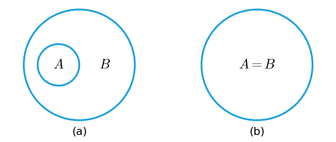

*그림 1. A ⊆ B를 나타내는 두 가지 벤 다이어그램*

$A \not\subseteq B$는 그림 2처럼 세 가지로 나타낼 수 있다. 어느 경우든 $A$에 속하면서 $B$에 속하지 않는 점 $x$가 있다는 것이 핵심이다.

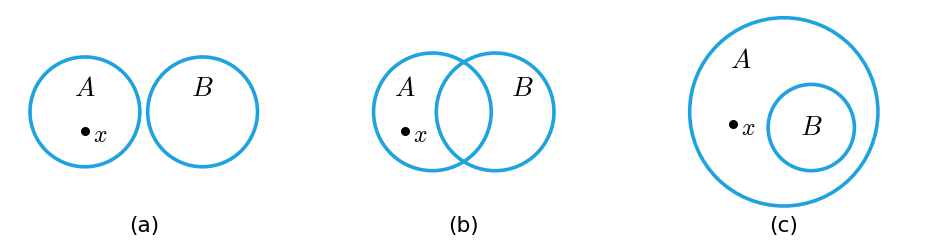

*그림 2. A ⊈ B를 나타내는 세 가지 벤 다이어그램*

벤 다이어그램의 어떤 부분 영역에는 점이 하나도 없을 수 있다고 허용하면 그림들 사이의 관계가 단순해진다. 그림 1의 (b)는 (a)에서 $B$의 $A$ 바깥 부분이 비어 있는 특수한 경우이다. 그림 2의 (a)는 (b)에서 겹치는 부분이 비어 있는 경우이고, (c)는 (b)에서 $B$의 $A$ 바깥 부분이 비어 있는 경우이다. 다만 세 그림 모두에서 $A$에 속하고 $B$에 속하지 않는 점이 실제로 있다는 사실은 따로 밝혀 두어야 한다.

**예제 6.1.4 (수 집합 사이의 관계).** 모든 정수 $n$은 $n = \frac{n}{1}$이므로 유리수이고, 모든 유리수는 실수이다. 따라서 $\mathbf{Z} \subseteq \mathbf{Q}$이고 $\mathbf{Q} \subseteq \mathbf{R}$이다. 또 $\frac{1}{2}$은 정수가 아닌 유리수이고 $\sqrt{2}$는 유리수가 아닌 실수이므로, $\mathbf{Z}$는 $\mathbf{Q}$의 진부분집합이고 $\mathbf{Q}$는 $\mathbf{R}$의 진부분집합이다. 그림 3은 이 관계를 보여 준다.

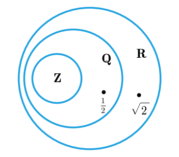

*그림 3. 정수, 유리수, 실수 집합의 포함 관계*

### 1.5 집합의 연산

수학적 논의는 대개 어떤 맥락 안에서 이루어진다. 예를 들어 논의하는 모든 집합이 실수의 집합이면 $\mathbf{R}$를 그 논의의 **전체집합(universal set)** 또는 **논의 영역(universe of discourse)** 이라 한다. 아래 정의에서 여집합은 전체집합 $U$를 기준으로 정해진다.

> **용어 정의:** $A$와 $B$가 전체집합 $U$의 부분집합이라 하자.
> 1. $A$와 $B$의 **합집합(union)** $A \cup B$는 $A$와 $B$ 가운데 적어도 하나에 속하는 원소 전체의 집합이다.
> 2. $A$와 $B$의 **교집합(intersection)** $A \cap B$는 $A$와 $B$에 공통으로 속하는 원소 전체의 집합이다.
> 3. $B$에서 $A$를 뺀 **차집합(difference)** $B - A$는 $B$에 속하고 $A$에 속하지 않는 원소 전체의 집합이다. $B$에 대한 $A$의 **상대 여집합(relative complement)** 이라고도 한다.
> 4. $A$의 **여집합(complement)** $A^c$는 $U$의 원소 가운데 $A$에 속하지 않는 것 전체의 집합이다.

기호로 쓰면 다음과 같다.

```math
\begin{aligned}
A \cup B &= \lbrace x \in U \mid x \in A \lor x \in B \rbrace \\
A \cap B &= \lbrace x \in U \mid x \in A \land x \in B \rbrace \\
B - A &= \lbrace x \in U \mid x \in B \land x \notin A \rbrace \\
A^c &= \lbrace x \in U \mid x \notin A \rbrace
\end{aligned}
```

기호 $\in$, $\cup$, $\cap$은 이탈리아의 수학자 페아노(Giuseppe Peano)가 1889년에 도입하였다. 그림 4는 네 연산의 결과를 색칠한 영역으로 보여 준다. 바깥의 직사각형이 전체집합 $U$이다.

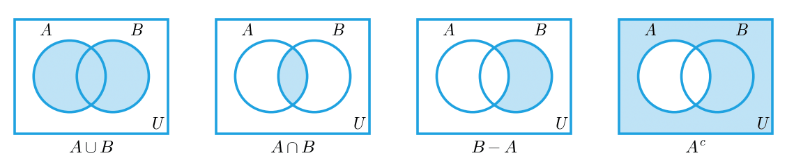

*그림 4. 합집합, 교집합, 차집합, 여집합의 벤 다이어그램*

**예제 6.1.5 (유한 집합의 연산).** 전체집합 $U = \lbrace a, b, c, d, e, f, g \rbrace$, $A = \lbrace a, c, e, g \rbrace$, $B = \lbrace d, e, f, g \rbrace$에서 계산한다.

- $A \cup B$: 두 집합의 원소를 모두 모으고 중복을 한 번만 적으면 $\lbrace a, c, d, e, f, g \rbrace$이다.
- $A \cap B$: 두 집합에 모두 있는 원소는 $e$와 $g$이므로 $\lbrace e, g \rbrace$이다.
- $B - A$: $B$의 원소 $d, e, f, g$ 가운데 $A$에 없는 것은 $d$와 $f$이므로 $\lbrace d, f \rbrace$이다.
- $A - B$: $A$의 원소 $a, c, e, g$ 가운데 $B$에 없는 것은 $a$와 $c$이므로 $\lbrace a, c \rbrace$이다.
- $A^c$: $U$의 원소 가운데 $A$에 없는 것은 $b, d, f$이므로 $\lbrace b, d, f \rbrace$이다.

> **주의:** 차집합은 순서에 따라 결과가 다르다. 위 예에서 $B - A = \lbrace d, f \rbrace$이지만 $A - B = \lbrace a, c \rbrace$이다. 또 여집합은 전체집합에 따라 달라지므로, 여집합을 쓰는 문제에서는 $U$가 무엇인지 먼저 확인해야 한다.

### 1.6 구간 표기법

실수의 부분집합 가운데 구간은 다음 **구간 표기법(interval notation)** 으로 간단히 쓴다. $a, b$는 $a \le b$인 실수이다.

| 구간 | 조건제시법 | 구간 | 조건제시법 |
|:-----|:-----|:-----|:-----|
| $(a, b)$ | $\lbrace x \in \mathbf{R} \mid a < x < b \rbrace$ | $[a, b]$ | $\lbrace x \in \mathbf{R} \mid a \le x \le b \rbrace$ |
| $(a, b]$ | $\lbrace x \in \mathbf{R} \mid a < x \le b \rbrace$ | $[a, b)$ | $\lbrace x \in \mathbf{R} \mid a \le x < b \rbrace$ |
| $(a, \infty)$ | $\lbrace x \in \mathbf{R} \mid x > a \rbrace$ | $[a, \infty)$ | $\lbrace x \in \mathbf{R} \mid x \ge a \rbrace$ |
| $(-\infty, b)$ | $\lbrace x \in \mathbf{R} \mid x < b \rbrace$ | $(-\infty, b]$ | $\lbrace x \in \mathbf{R} \mid x \le b \rbrace$ |

*표 2. 구간 표기법과 그에 해당하는 조건제시법*

둥근 괄호는 끝점을 포함하지 않고, 대괄호는 끝점을 포함한다. 기호 $\infty$와 $-\infty$는 수가 아니라 구간이 오른쪽이나 왼쪽으로 끝없이 이어진다는 표시이므로 언제나 둥근 괄호와 함께 쓴다. 구간 $(a, b)$는 순서쌍 $(a, b)$와 표기가 같지만, 어느 뜻인지는 문맥으로 구별된다.

**예제 6.1.6 (구간의 연산).** 전체집합을 $\mathbf{R}$로 두고 $A = (-1, 0]$, $B = [0, 1)$이라 하자. 그림 5는 두 집합과 연산 결과를 수직선에 나타낸 것이다. 속이 찬 점은 끝점을 포함함을, 속이 빈 점은 포함하지 않음을 뜻한다.

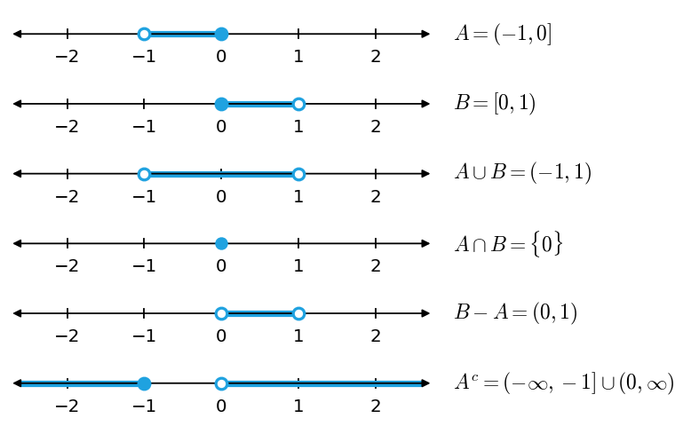

*그림 5. 구간 A, B와 그 합집합, 교집합, 차집합, 여집합*

- $A \cup B$: $x \in (-1, 0]$ 또는 $x \in [0, 1)$인 실수 전체이다. 두 구간이 0에서 이어지므로 $A \cup B = (-1, 1)$이다.
- $A \cap B$: $-1 < x \le 0$과 $0 \le x < 1$을 동시에 만족하는 실수는 $x = 0$뿐이므로 $A \cap B = \lbrace 0 \rbrace$이다.
- $B - A$: $0 \le x < 1$이면서 $-1 < x \le 0$이 아닌 실수이다. $B$에서 $A$와 겹치는 점은 0뿐이므로 $B - A = (0, 1)$이다.
- $A^c$: 다음과 같이 이중 부등식의 정의와 드모르간의 법칙을 적용한다.

```math
\begin{aligned}
x \in A^c &\iff \sim(-1 < x \le 0) \\
&\iff \sim(-1 < x \land x \le 0) \\
&\iff x \le -1 \lor x > 0
\end{aligned}
```

따라서 $A^c = (-\infty, -1] \cup (0, \infty)$이다.

### 1.7 첨자 붙은 집합족의 합집합과 교집합

합집합과 교집합은 셋 이상의 집합으로 자연스럽게 확장된다.

> **용어 정의:** $A_0, A_1, A_2, \ldots$가 전체집합 $U$의 부분집합이고 $n$이 음이 아닌 정수라 하자.
> 1. $\bigcup_{i=0}^{n} A_i$는 $i = 0, 1, \ldots, n$ 가운데 적어도 하나의 $i$에 대해 $A_i$에 속하는 원소 전체의 집합이다.
> 2. $\bigcup_{i=0}^{\infty} A_i$는 적어도 하나의 음이 아닌 정수 $i$에 대해 $A_i$에 속하는 원소 전체의 집합이다.
> 3. $\bigcap_{i=0}^{n} A_i$는 모든 $i = 0, 1, \ldots, n$에 대해 $A_i$에 속하는 원소 전체의 집합이다.
> 4. $\bigcap_{i=0}^{\infty} A_i$는 모든 음이 아닌 정수 $i$에 대해 $A_i$에 속하는 원소 전체의 집합이다.

한정기호로 쓰면 다음과 같다.

```math
\begin{aligned}
\bigcup_{i=0}^{n} A_i &= \lbrace x \in U \mid \exists i \in \lbrace 0, 1, \ldots, n \rbrace,\ x \in A_i \rbrace \\
\bigcup_{i=0}^{\infty} A_i &= \lbrace x \in U \mid \exists i \in \mathbf{Z}^{\text{nonneg}},\ x \in A_i \rbrace \\
\bigcap_{i=0}^{n} A_i &= \lbrace x \in U \mid \forall i \in \lbrace 0, 1, \ldots, n \rbrace,\ x \in A_i \rbrace \\
\bigcap_{i=0}^{\infty} A_i &= \lbrace x \in U \mid \forall i \in \mathbf{Z}^{\text{nonneg}},\ x \in A_i \rbrace
\end{aligned}
```

여기서 $\mathbf{Z}^{\text{nonneg}}$는 음이 아닌 정수 전체의 집합이다. $\bigcup_{i=0}^{n} A_i$는 "$`i`$가 0부터 $n$까지일 때 $A_i$의 합집합"이라고 읽으며, $A_0 \cup A_1 \cup \cdots \cup A_n$으로도 쓴다. 마찬가지로 $\bigcap_{i=0}^{n} A_i$는 $A_0 \cap A_1 \cap \cdots \cap A_n$으로도 쓴다. 합집합은 존재 한정기호, 교집합은 전칭 한정기호에 대응한다는 점에 주목할 필요가 있다.

**예제 6.1.7 (무한히 많은 구간의 합집합과 교집합).** 양의 정수 $i$마다 다음 구간을 정의한다.

```math
A_i = \lbrace x \in \mathbf{R} \mid -\tfrac{1}{i} < x < \tfrac{1}{i} \rbrace = \left(-\tfrac{1}{i}, \tfrac{1}{i}\right)
```

$A_1 = (-1, 1)$, $A_2 = (-\frac{1}{2}, \frac{1}{2})$, $A_3 = (-\frac{1}{3}, \frac{1}{3})$이고, $i$가 커질수록 구간이 좁아지므로 $A_1 \supseteq A_2 \supseteq A_3 \supseteq \cdots$이다.

(a) $A_1 \cup A_2 \cup A_3$: $A_2$와 $A_3$의 모든 원소가 $A_1 = (-1, 1)$에 속하므로 합집합은 가장 큰 구간 $(-1, 1)$이다. $A_1 \cap A_2 \cap A_3$: $A_3 \subseteq A_2 \subseteq A_1$이므로 세 구간에 모두 속하는 점은 가장 좁은 구간의 점이고, 교집합은 $(-\frac{1}{3}, \frac{1}{3})$이다.

(b) $\bigcup_{i=1}^{\infty} A_i$: 모든 $A_i$가 $(-1, 1)$에 포함되고 $A_1$ 자체가 $(-1, 1)$이므로 $\bigcup_{i=1}^{\infty} A_i = (-1, 1)$이다.

$\bigcap_{i=1}^{\infty} A_i$: 0은 모든 $A_i$에 속한다. 0이 아닌 실수 $x$에 대해서는 $i > \frac{1}{\lvert x \rvert}$인 양의 정수 $i$를 고를 수 있고, 그러면 $\frac{1}{i} < \lvert x \rvert$이므로 $x \notin A_i$이다. 따라서 모든 $A_i$에 속하는 실수는 0 하나뿐이고 $\bigcap_{i=1}^{\infty} A_i = \lbrace 0 \rbrace$이다.

> **주의:** 각 $A_i$가 무한히 많은 점을 가진 구간이어도 무한히 많은 집합의 교집합은 한 점이 될 수 있다. 유한 개의 교집합에서 보이는 규칙(가장 좁은 구간이 교집합이다)을 무한 개에 그대로 적용하면 안 된다. 무한 집합족에는 가장 좁은 구간이 없기 때문이다.

### 1.8 공집합

집합은 원소로 정해지는데, 원소가 하나도 없는 집합도 집합으로 인정하는 편이 편리하다. 그렇지 않으면 두 집합의 교집합을 구하거나 조건으로 집합을 정의할 때마다 결과에 원소가 있는지 먼저 확인해야 한다. 예를 들어 $\lbrace 1, 3 \rbrace \cap \lbrace 2, 4 \rbrace$에는 원소가 없고, 제곱이 음수인 실수는 없으므로 $\lbrace x \in \mathbf{R} \mid x^2 = -1 \rbrace$에도 원소가 없다.

> **용어 정의:** 원소가 하나도 없는 집합을 **공집합(empty set, null set)** 이라 하고 $\emptyset$로 쓴다.

원소가 없는 집합이 단 하나뿐이라는 사실은 2.8절에서 증명하며, 그래서 공집합이라는 하나의 이름을 붙일 수 있다. 위의 두 예는 $\lbrace 1, 3 \rbrace \cap \lbrace 2, 4 \rbrace = \emptyset$, $\lbrace x \in \mathbf{R} \mid x^2 = -1 \rbrace = \emptyset$으로 쓴다.

**예제 6.1.8 (원소가 없는 집합).** $D = \lbrace x \in \mathbf{R} \mid 3 < x < 2 \rbrace$와 $E = \lbrace x \in \mathbf{Z} \mid 2 < x < 3 \rbrace$를 구한다.

- $3 < x < 2$는 $3 < x$이고 $x < 2$라는 뜻이다. 3보다 크면서 2보다 작은 실수는 없으므로 $D = \emptyset$이다.
- $2 < x < 3$을 만족하는 실수는 많지만, 2와 3 사이에는 정수가 없으므로 $E = \emptyset$이다. 같은 조건이라도 어느 집합에서 원소를 고르는지에 따라 결과가 달라진다.

### 1.9 집합의 분할

집합을 겹치지 않는 조각들로 나누어야 하는 경우가 많다. 이런 나눔을 분할이라 한다.

> **용어 정의:** 두 집합 $A$와 $B$에 공통 원소가 없으면, 곧 $A \cap B = \emptyset$이면 두 집합은 **서로소(disjoint)** 라고 한다.

예를 들어 $A = \lbrace 1, 3, 5 \rbrace$와 $B = \lbrace 2, 4, 6 \rbrace$은 공통 원소가 없으므로 $\lbrace 1, 3, 5 \rbrace \cap \lbrace 2, 4, 6 \rbrace = \emptyset$이고, 두 집합은 서로소이다.

> **용어 정의:** 집합 $A_1, A_2, A_3, \ldots$에서 첨자가 다른 어떤 두 집합도 공통 원소를 갖지 않으면 이 집합들은 **쌍마다 서로소(mutually disjoint, pairwise disjoint)** 라고 한다. 곧 모든 정수 $i, j = 1, 2, 3, \ldots$에 대해 $i \ne j$이면 $A_i \cap A_j = \emptyset$이다.

**예제 6.1.10 (쌍마다 서로소인지 판정).**

- $A_1 = \lbrace 3, 5 \rbrace$, $A_2 = \lbrace 1, 4, 6 \rbrace$, $A_3 = \lbrace 2 \rbrace$: $A_1 \cap A_2 = \emptyset$, $A_1 \cap A_3 = \emptyset$, $A_2 \cap A_3 = \emptyset$이므로 쌍마다 서로소이다.
- $B_1 = \lbrace 2, 4, 6 \rbrace$, $B_2 = \lbrace 3, 7 \rbrace$, $B_3 = \lbrace 4, 5 \rbrace$: $B_1 \cap B_2 = \emptyset$, $B_2 \cap B_3 = \emptyset$이지만 $B_1 \cap B_3 = \lbrace 4 \rbrace$이므로 쌍마다 서로소가 아니다.

> **주의:** 쌍마다 서로소는 모든 집합의 교집합이 공집합이라는 조건보다 강하다. $\lbrace 1, 2 \rbrace$, $\lbrace 2, 3 \rbrace$, $\lbrace 3, 1 \rbrace$은 세 집합 모두의 교집합이 $\emptyset$이지만, 어느 두 집합을 골라도 공통 원소가 있으므로 쌍마다 서로소가 아니다.

그림 6처럼 영역 $A$를 경계선으로 $A_1, A_2, A_3, A_4$로 나누고, 경계선 위의 점은 한 조각에만 속하도록 정하면 $A = A_1 \cup A_2 \cup A_3 \cup A_4$이고 네 조각은 쌍마다 서로소이다. 이때 $A$를 쌍마다 서로소인 부분집합들의 합집합이라 하고, 집합 $\lbrace A_1, A_2, A_3, A_4 \rbrace$를 $A$의 분할이라 한다.

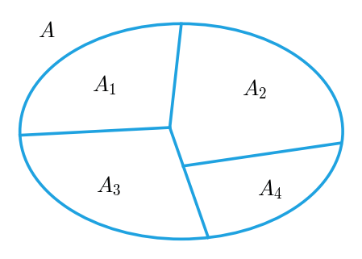

*그림 6. 집합 A를 네 조각으로 나눈 분할*

> **용어 정의:** 공집합이 아닌 집합들의 유한 또는 무한 모임 $\lbrace A_1, A_2, A_3, \ldots \rbrace$가 다음 두 조건을 만족하면 집합 $A$의 **분할(partition)** 이라 한다.
> 1. $A$는 모든 $A_i$의 합집합이다.
> 2. $A_1, A_2, A_3, \ldots$는 쌍마다 서로소이다.

**예제 6.1.11 (분할 판정).**

(a) $A = \lbrace 1, 2, 3, 4, 5, 6 \rbrace$, $A_1 = \lbrace 1, 2 \rbrace$, $A_2 = \lbrace 3, 4 \rbrace$, $A_3 = \lbrace 5, 6 \rbrace$일 때, 세 집합은 공집합이 아니고, $A_1 \cup A_2 \cup A_3 = A$이며, 어느 두 집합에도 공통 원소가 없다. 따라서 $\lbrace A_1, A_2, A_3 \rbrace$는 $A$의 분할이다.

(b) 정수 집합 $\mathbf{Z}$에서 다음 세 집합을 생각한다.

```math
\begin{aligned}
T_0 &= \lbrace n \in \mathbf{Z} \mid \exists k \in \mathbf{Z},\ n = 3k \rbrace \\
T_1 &= \lbrace n \in \mathbf{Z} \mid \exists k \in \mathbf{Z},\ n = 3k + 1 \rbrace \\
T_2 &= \lbrace n \in \mathbf{Z} \mid \exists k \in \mathbf{Z},\ n = 3k + 2 \rbrace
\end{aligned}
```

4장의 몫-나머지 정리에 따르면 모든 정수 $n$은 어떤 정수 $k$에 대해 $n = 3k$, $n = 3k + 1$, $n = 3k + 2$ 가운데 정확히 하나의 꼴로 나타난다. 모든 정수가 세 꼴 가운데 적어도 하나로 나타나므로 모든 정수가 $T_0$, $T_1$, $T_2$ 가운데 하나에 속하고, 따라서 $\mathbf{Z} = T_0 \cup T_1 \cup T_2$이다. 또 두 꼴로 동시에 나타나는 정수는 없으므로 어떤 정수도 두 집합에 동시에 속하지 않고, 따라서 세 집합은 쌍마다 서로소이다. 또 $0 \in T_0$, $1 \in T_1$, $2 \in T_2$이므로 세 집합 모두 공집합이 아니다. 그러므로 $\lbrace T_0, T_1, T_2 \rbrace$는 $\mathbf{Z}$의 분할이다.

> **참고:** 이 분할은 정수를 3으로 나눈 나머지에 따라 분류한 것이다. 8장에서 분할과 동치 관계가 서로를 정한다는 사실을 다루며, 이 분할은 법 3에 대한 합동의 동치류로 다시 나타난다.

### 1.10 멱집합

어떤 집합의 부분집합을 모두 모은 집합이 필요할 때가 많다. **멱집합 공리(power set axiom)** 는 그런 모임이 집합임을 보장한다.

> **용어 정의:** 집합 $A$의 부분집합 전체의 집합을 $A$의 **멱집합(power set)** 이라 하고 $\mathcal{P}(A)$로 쓴다.

**예제 6.1.12 (원소가 두 개인 집합의 멱집합).** $\mathcal{P}(\lbrace x, y \rbrace)$를 구한다.

- 2.8절에서 증명하듯이 공집합은 모든 집합의 부분집합이므로 $\emptyset \in \mathcal{P}(\lbrace x, y \rbrace)$이다.
- 모든 집합은 자기 자신의 부분집합이므로 $\lbrace x, y \rbrace \in \mathcal{P}(\lbrace x, y \rbrace)$이다.
- 그 밖의 부분집합은 원소를 하나씩 가진 $\lbrace x \rbrace$와 $\lbrace y \rbrace$이다.

따라서 다음과 같다.

```math
\mathcal{P}(\lbrace x, y \rbrace) = \lbrace \emptyset, \lbrace x \rbrace, \lbrace y \rbrace, \lbrace x, y \rbrace \rbrace
```

원소가 2개인 집합의 멱집합은 원소가 $4 = 2^2$개이다. 원소가 $n$개인 집합의 멱집합이 $2^n$개의 원소를 가진다는 일반적인 사실은 3.3절에서 증명한다.

> **주의:** 멱집합의 원소는 집합이다. $x \in \lbrace x, y \rbrace$이지만 $x \notin \mathcal{P}(\lbrace x, y \rbrace)$이고, 대신 $\lbrace x \rbrace \in \mathcal{P}(\lbrace x, y \rbrace)$이다. 일반적으로 $X \in \mathcal{P}(A)$와 $X \subseteq A$는 같은 뜻이다.

### 1.11 부분집합 판정 알고리즘

유한 집합 하나가 다른 유한 집합의 부분집합인지 판정하는 알고리즘을 생각하면 부분집합 개념을 계산의 관점에서 이해할 수 있다. 두 집합의 원소를 각각 배열에 늘어놓고, 첫 집합의 원소마다 둘째 집합의 원소들과 차례로 비교한다. 첫 집합의 어떤 원소가 둘째 집합의 어느 원소와도 같지 않으면 첫 집합은 부분집합이 아니다. 첫 집합의 모든 원소가 둘째 집합의 어떤 원소와 같으면 첫 집합은 부분집합이다.

다음은 이 생각을 정리한 알고리즘 6.1.1이다. 집합 $A$와 $B$는 1차원 배열 $a[1], \ldots, a[m]$과 $b[1], \ldots, b[n]$으로 주어진다.

```text
Algorithm 6.1.1  Testing Whether A ⊆ B
Input:  m (a positive integer), a[1], a[2], ..., a[m]   (the set A)
        n (a positive integer), b[1], b[2], ..., b[n]   (the set B)

i := 1, answer := "A ⊆ B"
while (i ≤ m and answer = "A ⊆ B")
    j := 1, found := "no"
    while (j ≤ n and found = "no")
        if a[i] = b[j] then found := "yes"
        j := j + 1
    end while
    if found = "no" then answer := "A ⊈ B"
    i := i + 1
end while

Output: answer (a string)
```

각 줄이 하는 일은 다음과 같다.

1. `i := 1, answer := "A ⊆ B"`: $A$의 첫 원소부터 검사하고, 반례가 나오기 전까지는 답을 "A ⊆ B"로 둔다.
2. 바깥 `while`: 검사할 $A$의 원소가 남아 있고 아직 반례가 나오지 않은 동안 반복한다.
3. `j := 1, found := "no"`: 현재 원소 $a[i]$를 $B$의 첫 원소부터 비교하며, 같은 원소를 아직 찾지 못했다고 표시한다.
4. 안쪽 `while`: 비교할 $B$의 원소가 남아 있고 아직 같은 원소를 찾지 못한 동안 반복한다.
5. `if a[i] = b[j] then found := "yes"`: 같은 원소를 찾으면 표시를 바꾼다. 이 표시 때문에 안쪽 반복이 끝난다.
6. `j := j + 1`: $B$의 다음 원소로 넘어간다.
7. 안쪽 반복이 끝났을 때 `found`가 여전히 "no"이면 $a[i]$가 $B$의 어느 원소와도 같지 않다는 뜻이므로 $a[i] \notin B$이다. 그래서 답을 "A ⊈ B"로 바꾸고, 이 값 때문에 바깥 반복도 끝난다.
8. `i := i + 1`: $A$의 다음 원소로 넘어간다.

답은 처음 값 "A ⊆ B"에서 반례를 만났을 때 한 번만 바뀐다. $A$의 모든 원소가 $B$에서 발견되면 답은 끝까지 "A ⊆ B"이다.

**예제 6.1.13 (알고리즘 6.1.1의 추적).** $m = 3$, $n = 4$이고 $a[1] = u$, $a[2] = v$, $a[3] = w$, $b[1] = w$, $b[2] = x$, $b[3] = y$, $b[4] = u$일 때 변수 $i$, $j$, `found`, `answer`의 변화를 추적한다. 표의 각 행은 안쪽 반복에서 비교를 한 번 한 뒤의 상태이며, 그 비교로 안쪽 반복이 끝나는 행의 `answer`는 바깥 반복의 `if` 문까지 실행한 뒤의 값이다.

| 비교 | $i$ | $a[i]$ | $j$ | $b[j]$ | $a[i] = b[j]$? | found | answer |
|:-----|:-----|:-----|:-----|:-----|:-----|:-----|:-----|
| 1 | 1 | $u$ | 1 | $w$ | 아니오 | no | A ⊆ B |
| 2 | 1 | $u$ | 2 | $x$ | 아니오 | no | A ⊆ B |
| 3 | 1 | $u$ | 3 | $y$ | 아니오 | no | A ⊆ B |
| 4 | 1 | $u$ | 4 | $u$ | 예 | yes | A ⊆ B |
| 5 | 2 | $v$ | 1 | $w$ | 아니오 | no | A ⊆ B |
| 6 | 2 | $v$ | 2 | $x$ | 아니오 | no | A ⊆ B |
| 7 | 2 | $v$ | 3 | $y$ | 아니오 | no | A ⊆ B |
| 8 | 2 | $v$ | 4 | $u$ | 아니오 | no | A ⊈ B |

*표 3. 알고리즘 6.1.1의 추적 결과*

- 비교 4에서 $a[1] = b[4] = u$를 찾아 `found`가 "yes"가 되고 $j$가 5로 늘어나 안쪽 반복이 끝난다. `found`가 "yes"이므로 답은 그대로이고 $i$가 2가 된다.
- $i = 2$에서는 `found`를 다시 "no"로 두고 $v$를 $w, x, y, u$와 차례로 비교하지만 같은 원소가 없다. 비교 8 뒤에 $j$가 5가 되어 안쪽 반복이 끝나고, `found`가 "no"이므로 답이 "A ⊈ B"로 바뀐다. $i$는 3이 되지만 답이 바뀌었으므로 바깥 반복이 끝난다.
- 출력은 "A ⊈ B"이다. 실제로 $v \in A$이고 $v \notin B$이므로 옳은 답이다. $a[3] = w$는 검사하지 않는다.

바깥 반복은 많아야 $m$번 돌고, 바깥 반복 한 번마다 안쪽 반복은 많아야 $n$번 돌므로, 이 알고리즘은 $a[i]$와 $b[j]$의 비교를 많아야 $mn$번 한다. 원소 하나가 집합에 속하는지 판정하는 문제도 같은 방식으로 풀 수 있다. 원소를 배열의 원소와 차례로 비교하여 같은 것이 있으면 속하고, 없으면 속하지 않는다.

> **[자료구조]** 집합을 정렬되지 않은 배열로 저장하면 소속 검사에 원소 수에 비례하는 시간이 든다. 정렬된 배열이면 이진 탐색을, 해시 테이블이면 평균 상수 시간의 조회를 쓸 수 있어 부분집합 판정도 그만큼 빨라진다. 어떤 표현을 고르든 $A$의 모든 원소가 $B$에 있는지를 판정한다는 점은 위 알고리즘과 같다.

---

<br>

## 2. 집합의 성질

합집합, 교집합, 여집합, 차집합 사이에는 많은 관계가 성립하며, 어떤 것은 모든 집합에 대해 참이고 어떤 것은 그렇지 않다. 이 절은 참인 집합 성질을 원소 논증으로 증명하는 방법과, 어떤 집합이 공집합임을 보이는 방법을 다룬다. 거짓인 성질을 반증하는 방법과 대수적 증명은 3절에서 다룬다.

### 2.1 부분집합 관계의 기본 성질

먼저 부분집합 관계에 관한 세 가지 성질을 정리한다. 합집합, 교집합, 차집합 연산은 포함 기호 $\subseteq$보다 먼저 계산한다. 예를 들어 $A \cap B \subseteq C$는 $(A \cap B) \subseteq C$를 뜻한다.

> **핵심:** **정리 6.2.1 (부분집합 관계).**
> 1. **교집합의 포함:** 모든 집합 $A$, $B$에 대해 (a) $A \cap B \subseteq A$이고 (b) $A \cap B \subseteq B$이다.
> 2. **합집합으로의 포함:** 모든 집합 $A$, $B$에 대해 (a) $A \subseteq A \cup B$이고 (b) $B \subseteq A \cup B$이다.
> 3. **부분집합의 추이성:** 모든 집합 $A$, $B$, $C$에 대해 $A \subseteq B$이고 $B \subseteq C$이면 $A \subseteq C$이다.

각 결론은 한 집합 $X$가 다른 집합 $Y$의 부분집합이라는 형태이므로, $x$를 $X$의 임의의 원소로 두고 $x \in Y$임을 보이면 증명된다.

### 2.2 집합 연산의 절차적 정의

집합 성질을 증명하는 요령은 각 연산의 정의를 원소에 대한 조건, 곧 절차적인 형태로 바꾸어 생각하는 것이다. 예를 들어 $X \cup Y = \lbrace x \mid x \in X \lor x \in Y \rbrace$이므로, 원소 $x$가 $X \cup Y$에 속한다는 것을 알면 $x$가 $X$나 $Y$에 속한다고 결론 내릴 수 있고, 반대로 $x$가 $X$나 $Y$에 속함을 알면 $x \in X \cup Y$라고 결론 내릴 수 있다. 다른 연산도 같은 방식으로 바꾸어 쓸 수 있다.

$X$와 $Y$가 전체집합 $U$의 부분집합이고 $x$, $y$가 $U$의 원소일 때 다음이 성립한다.

| 집합 | 절차적 정의 |
|:-----|:-----|
| $X \cup Y$ | $x \in X \cup Y \iff x \in X \lor x \in Y$ |
| $X \cap Y$ | $x \in X \cap Y \iff x \in X \land x \in Y$ |
| $X - Y$ | $x \in X - Y \iff x \in X \land x \notin Y$ |
| $X^c$ | $x \in X^c \iff x \notin X$ |
| $X \times Y$ | $(x, y) \in X \times Y \iff x \in X \land y \in Y$ |

*표 4. 집합 연산의 절차적 정의*

마지막 줄은 1장의 데카르트 곱에 대한 절차적 정의이다.

### 2.3 부분집합 관계의 증명

정리 6.2.1의 1(a), $A \cap B \subseteq A$의 증명을 살펴본다. 이 명제는 모든 집합 $A$, $B$에 대한 전칭 명제이므로 증명의 틀은 다음과 같다.

- **출발점:** $A$와 $B$를 임의로 택한 특정 집합이라 하자.
- **보일 것:** $A \cap B \subseteq A$.

부분집합의 정의에 따라 $A \cap B \subseteq A$는 $`\forall x\ (x \in A \cap B \rightarrow x \in A)`$와 같으므로, $x$를 $A \cap B$의 임의의 원소로 두고 $x \in A$를 보이면 된다. 두 사이를 메우는 데는 교집합의 절차적 정의와 논리 규칙을 쓴다. 다음 두 표는 정리 6.2.1의 1(a)와 2(a)의 증명을 한 단계씩 근거와 함께 적은 것이다.

| 진술 | 근거 |
|:-----|:-----|
| $A$와 $B$를 임의의 집합이라 하자. | 출발점 |
| $A \cap B \subseteq A$임을 보여야 한다. | 보일 결론 |
| $x$를 $A \cap B$의 임의의 원소라 하자. | 원소 논증의 시작 |
| 그러면 $x \in A$이고 $x \in B$이다. | 교집합의 정의 |
| 특히 $x \in A$이다. | 논리곱이 참이면 각 성분이 참이다(특수화) |
| 따라서 $A \cap B$의 모든 원소는 $A$에 속한다. | $x$는 $A \cap B$의 임의의 원소였다 |
| 그러므로 $A \cap B \subseteq A$이다. | 부분집합의 정의 |

*표 5. 정리 6.2.1의 1(a)의 증명*

| 진술 | 근거 |
|:-----|:-----|
| $A$와 $B$를 임의의 집합이라 하자. | 출발점 |
| $A \subseteq A \cup B$임을 보여야 한다. | 보일 결론 |
| $x$를 $A$의 임의의 원소라 하자. | 원소 논증의 시작 |
| 그러면 $x \in A \lor x \in B$가 참이다. | 논리합은 한 성분만 참이어도 참이다(일반화) |
| 따라서 $x \in A \cup B$이다. | 합집합의 정의 |
| 그러므로 $A$의 모든 원소는 $A \cup B$에 속한다. | $x$는 $A$의 임의의 원소였다 |
| 그러므로 $A \subseteq A \cup B$이다. | 부분집합의 정의 |

*표 6. 정리 6.2.1의 2(a)의 증명*

1(b)와 2(b)는 $A$와 $B$의 역할을 바꾸어 같은 방식으로 증명한다. 3의 추이성은 다음과 같이 증명한다. $A \subseteq B$이고 $B \subseteq C$인 집합 $A$, $B$, $C$를 택하고, $x$를 $A$의 임의의 원소라 하자. $A \subseteq B$이므로 부분집합의 정의에 의해 $x \in B$이다. 다시 $B \subseteq C$이므로 $x \in C$이다. $x$는 $A$의 임의의 원소였으므로 $A \subseteq C$이다.

**가정의 세계.** 호프스태터(Douglas Hofstadter)는 *괴델, 에셔, 바흐*에서 수학적 증명의 공상 규칙(fantasy rule)을 소개하였다. 증명에서 어떤 대상을 두거나 어떤 사실을 가정하면 현실 세계의 모든 사실에 더해 그 가정까지 참인 가상의 세계로 들어간다. 그 세계 안에서 다시 가정을 하면 한 단계 더 안쪽의 세계로 들어간다. 조건문이나 전칭 명제 형태의 결론을 하나 끌어낼 때마다 한 단계씩 바깥 세계로 돌아오며, 증명은 처음 가정을 한 세계로 돌아올 때 끝난다. 문제가 "(명제 1)이라 하자. (명제 2)를 증명하라." 꼴로 주어지면, 명제 1은 이미 참인 사실로 받아들이고 명제 2의 출발점에서 증명을 시작한다. 예를 들어 "$`A`$와 $B$를 임의의 집합이라 하자. $A \cap B \subseteq A$를 증명하라."라는 문제의 증명은 "$`x \in A \cap B`$라 하자"로 시작하며, $A$와 $B$를 임의로 고른 것은 이미 전제되어 있다.

> **주의:** 벤 다이어그램은 직관을 주지만 그 자체로는 엄밀한 증명이 아니다. 그림이 모든 경우를 대표한다는 사실을 말로 정당화하려면 원소 논증만큼 긴 설명이 필요하고, 집합이 넷 이상이면 모든 교집합 영역을 보여 주는 그림을 그리기도 어렵다. 예를 들어 모든 교집합 영역을 보여 주면서 회전 대칭인 벤 다이어그램은 집합의 개수가 4, 6, 8, 9처럼 합성수이면 그릴 수 없다. 반대로 개수가 소수이면 그런 그림이 존재함이 그릭스(Jerrold Griggs), 킬리언(Charles Killian), 새비지(Carla Savage)에 의해 증명되었지만, 개수가 커지면 그림이 지나치게 복잡해진다.

### 2.4 집합 항등식

**항등식(identity)** 은 변수 자리에 주어진 집합의 어떤 원소를 넣어도 성립하는 등식이다. 예를 들어 $a + b = b + a$는 실수 $a$, $b$를 어떻게 골라도 성립하므로 실수의 항등식이다. 다음 정리의 명제는 모두 집합 항등식, 곧 전체집합 $U$의 모든 부분집합에 대해 성립하는 등식이다.

> **핵심:** **정리 6.2.2 (집합 항등식).** 아래의 모든 집합은 전체집합 $U$의 부분집합이다. 각 법칙은 그 법칙에 나오는 모든 집합 $A$, $B$, $C$에 대해 성립한다.

| 번호 | 법칙 | (a) | (b) |
|:-----|:-----|:-----|:-----|
| 1 | 교환 법칙 | $A \cup B = B \cup A$ | $A \cap B = B \cap A$ |
| 2 | 결합 법칙 | $(A \cup B) \cup C = A \cup (B \cup C)$ | $(A \cap B) \cap C = A \cap (B \cap C)$ |
| 3 | 분배 법칙 | $A \cup (B \cap C) = (A \cup B) \cap (A \cup C)$ | $A \cap (B \cup C) = (A \cap B) \cup (A \cap C)$ |
| 4 | 항등 법칙 | $A \cup \emptyset = A$ | $A \cap U = A$ |
| 5 | 여집합 법칙 | $A \cup A^c = U$ | $A \cap A^c = \emptyset$ |
| 6 | 이중 여집합 법칙 | $(A^c)^c = A$ | |
| 7 | 멱등 법칙 | $A \cup A = A$ | $A \cap A = A$ |
| 8 | 전체 한계 법칙 | $A \cup U = U$ | $A \cap \emptyset = \emptyset$ |
| 9 | 드모르간의 법칙 | $(A \cup B)^c = A^c \cap B^c$ | $(A \cap B)^c = A^c \cup B^c$ |
| 10 | 흡수 법칙 | $A \cup (A \cap B) = A$ | $A \cap (A \cup B) = A$ |
| 11 | $U$와 $\emptyset$의 여집합 | $U^c = \emptyset$ | $\emptyset^c = U$ |
| 12 | 차집합 법칙 | $A - B = A \cap B^c$ | |

*표 7. 정리 6.2.2의 집합 항등식*

정리 6.2.2의 각 결론은 한 집합이 다른 집합과 같다는 것이다. 1.3절에서 보았듯이 두 집합이 같다는 것은 서로가 서로의 부분집합이라는 것이므로, 집합의 상등을 증명하는 가장 기본적인 방법은 다음과 같다.

> **핵심:** **집합의 상등을 증명하는 기본 방법.** $X = Y$를 증명하려면 다음 두 가지를 증명한다.
> 1. $X \subseteq Y$
> 2. $Y \subseteq X$

### 2.5 분배 법칙의 증명

정리 6.2.2의 3(a), 곧 모든 집합 $A$, $B$, $C$에 대해 $A \cup (B \cap C) = (A \cup B) \cap (A \cup C)$임을 증명한다. 이 증명은 2.3절의 증명보다 길기 때문에 먼저 논리 구조를 분석하고, 핵심 논증을 찾은 뒤, 정식 증명으로 정리한다.

증명할 명제는 전칭 명제이므로 일반적 특수 사례로부터의 일반화를 쓴다. 출발점은 $A$, $B$, $C$를 임의로 택한 집합으로 두는 것이고, 보일 것은 $A \cup (B \cap C) = (A \cup B) \cap (A \cup C)$이다. 두 집합이 같으려면 다음 두 포함 관계가 모두 성립해야 한다.

```math
A \cup (B \cap C) \subseteq (A \cup B) \cap (A \cup C) \qquad \text{그리고} \qquad (A \cup B) \cap (A \cup C) \subseteq A \cup (B \cap C)
```

첫째 포함 관계는 $`\forall x\ (x \in A \cup (B \cap C) \rightarrow x \in (A \cup B) \cap (A \cup C))`$이므로, $x \in A \cup (B \cap C)$라고 가정하고 $x \in (A \cup B) \cap (A \cup C)$를 보인다. 둘째 포함 관계도 마찬가지로 $x \in (A \cup B) \cap (A \cup C)$라고 가정하고 $x \in A \cup (B \cap C)$를 보인다. 그림 7은 이 증명의 구조를 상자로 나타낸 것이다. 안쪽 두 상자의 빈칸(세로 점)을 채우는 것이 남은 일이다.

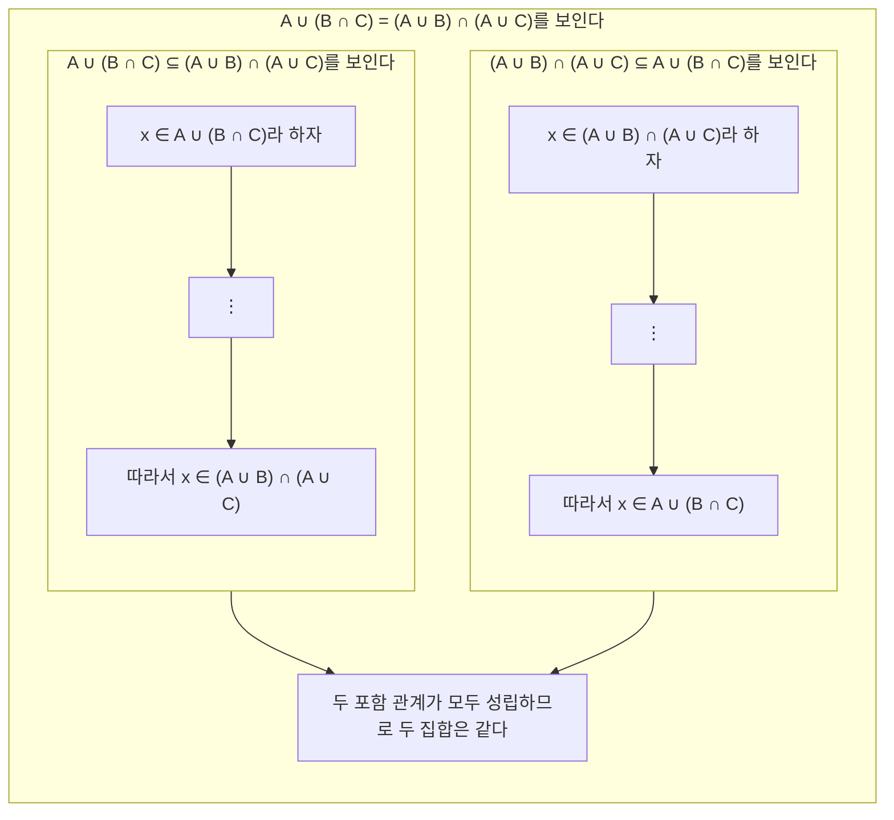

*그림 7. 분배 법칙 증명의 구조*

빈칸을 채울 때는 합집합의 절차적 정의를 두 방향으로 쓴다. $x \in B$임을 알면 $x \in A \lor x \in B$가 참이므로 $x \in A \cup B$라고 결론 내릴 수 있다. 반대로 원소가 두 집합의 합집합에 속한다는 것만 알고 어느 쪽에 속하는지 모를 때는, 첫째 집합에 속하는 경우와 둘째 집합에 속하는 경우로 나누어 어느 경우든 같은 결론이 나옴을 보여야 한다(2장의 경우 나누기).

> **핵심:** **정리 6.2.2의 3(a) (집합의 분배 법칙).** 모든 집합 $A$, $B$, $C$에 대해 $A \cup (B \cap C) = (A \cup B) \cap (A \cup C)$이다.

**증명.** $A$, $B$, $C$를 임의의 집합이라 하자.

**(1) $A \cup (B \cap C) \subseteq (A \cup B) \cap (A \cup C)$의 증명.** $x \in A \cup (B \cap C)$라 하자. 합집합의 정의에 의해 $x \in A$이거나 $x \in B \cap C$이다.

- **경우 1 ($`x \in A`$):** 합집합의 정의에 의해 $x \in A \cup B$이고 $x \in A \cup C$이다. 따라서 교집합의 정의에 의해 $x \in (A \cup B) \cap (A \cup C)$이다.
- **경우 2 ($`x \in B \cap C`$):** 교집합의 정의에 의해 $x \in B$이고 $x \in C$이다. $x \in B$이므로 합집합의 정의에 의해 $x \in A \cup B$이고, $x \in C$이므로 $x \in A \cup C$이다. 따라서 교집합의 정의에 의해 $x \in (A \cup B) \cap (A \cup C)$이다.

두 경우 모두 $x \in (A \cup B) \cap (A \cup C)$이다. $x$는 $A \cup (B \cap C)$의 임의의 원소였으므로 부분집합의 정의에 의해 $A \cup (B \cap C) \subseteq (A \cup B) \cap (A \cup C)$이다.

**(2) $(A \cup B) \cap (A \cup C) \subseteq A \cup (B \cap C)$의 증명.** $x \in (A \cup B) \cap (A \cup C)$라 하자. $x \in A$인 경우와 $x \notin A$인 경우로 나눈다.

- **경우 1 ($`x \in A`$):** 합집합의 정의에 의해 곧바로 $x \in A \cup (B \cap C)$이다.
- **경우 2 ($`x \notin A`$):** 교집합의 정의에 의해 $x \in A \cup B$이고 $x \in A \cup C$이다. $x \in A \cup B$이므로 $x$는 $A$와 $B$ 가운데 적어도 하나에 속하는데, $x \notin A$이므로 $x \in B$이다(소거). 같은 이유로 $x \in A \cup C$와 $x \notin A$에서 $x \in C$이다. 따라서 교집합의 정의에 의해 $x \in B \cap C$이고, 합집합의 정의에 의해 $x \in A \cup (B \cap C)$이다.

두 경우 모두 $x \in A \cup (B \cap C)$이므로, 부분집합의 정의에 의해 $(A \cup B) \cap (A \cup C) \subseteq A \cup (B \cap C)$이다.

**(3) 결론.** 두 포함 관계가 모두 증명되었으므로 집합의 상등의 정의에 의해 $A \cup (B \cap C) = (A \cup B) \cap (A \cup C)$이다. ∎

(2)에서 $x \in A$와 $x \notin A$로 경우를 나눈 이유는 다음과 같다. $x \in (A \cup B) \cap (A \cup C)$에서 얻는 정보는 $x \in A \lor x \in B$와 $x \in A \lor x \in C$이다. 두 정보를 만족하는 한 방법은 $x$가 $A$에 속하는 것이지만, 그렇지 않을 수도 있으므로 $x$가 $A$에 속하지 않는 경우도 따져야 한다. 그 경우에는 두 논리합에서 $x \in A$를 소거하여 $x \in B$와 $x \in C$를 얻는다.

**전방 연쇄와 후방 연쇄.** 인공지능 분야에서는 위 증명에 쓴 추론 방식을 **후방 연쇄(backward chaining)** 와 **전방 연쇄(forward chaining)** 라 부른다. 먼저 보여야 할 것을 목표로 보고, 어떤 일을 이루면 목표에 도달하는지 분석한다. 그 일을 하위 목표 $SG_1$이라 한다. 분배 법칙에서는 두 집합이 서로의 부분집합임을 보이는 것이 $SG_1$이다. 다시 $SG_1$에 도달하게 해 주는 일 $SG_2$를 찾는 식으로 목표에서 거꾸로 사슬을 만든다. 거꾸로 가기가 어려워지는 지점에서는 출발점의 정보로부터 $I_1$, $I_2$, ... 를 차례로 이끌어 내며 앞으로 나아가고, 어느 하위 목표에 닿으면 사슬이 완성된다.

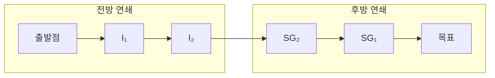

*그림 8. 전방 연쇄와 후방 연쇄로 완성되는 증명의 사슬*

### 2.6 드모르간의 법칙의 증명

여집합은 "아니다"로, 합집합과 교집합은 "또는"과 "그리고"로 정의되므로, 논리의 드모르간의 법칙(2장)에 대응하는 집합의 법칙이 있다는 것은 자연스럽다.

> **핵심:** **정리 6.2.2의 9(a) (집합의 드모르간의 법칙).** 모든 집합 $A$, $B$에 대해 $(A \cup B)^c = A^c \cap B^c$이다.

증명할 명제는 전칭 명제이므로 출발점은 $A$와 $B$를 임의로 택한 집합으로 두는 것이고, 보일 것은 $(A \cup B)^c \subseteq A^c \cap B^c$와 $A^c \cap B^c \subseteq (A \cup B)^c$이다. 각 단계에서 여집합, 합집합, 교집합의 절차적 정의를 쓰고, 핵심 단계에서 논리의 드모르간의 법칙을 쓴다.

**증명.** $A$와 $B$를 임의의 집합이라 하자.

**$(A \cup B)^c \subseteq A^c \cap B^c$의 증명.** $x \in (A \cup B)^c$라 하자.

1. 여집합의 정의에 의해 $x \notin A \cup B$이다.
2. 합집합의 정의에 의해 이는 $x \in A \lor x \in B$가 거짓이라는 뜻이다.
3. 논리의 드모르간의 법칙에 의해 $x \notin A$이고 $x \notin B$이다.
4. 여집합의 정의에 의해 $x \in A^c$이고 $x \in B^c$이다.
5. 교집합의 정의에 의해 $x \in A^c \cap B^c$이다.

따라서 부분집합의 정의에 의해 $(A \cup B)^c \subseteq A^c \cap B^c$이다.

**$A^c \cap B^c \subseteq (A \cup B)^c$의 증명.** $x \in A^c \cap B^c$라 하자.

1. 교집합의 정의에 의해 $x \in A^c$이고 $x \in B^c$이다.
2. 여집합의 정의에 의해 $x \notin A$이고 $x \notin B$이다.
3. 논리의 드모르간의 법칙에 의해 $x \in A \lor x \in B$는 거짓이다.
4. 합집합의 정의에 의해 $x \notin A \cup B$이다.
5. 여집합의 정의에 의해 $x \in (A \cup B)^c$이다.

따라서 $A^c \cap B^c \subseteq (A \cup B)^c$이다.

**결론.** 두 포함 관계가 모두 증명되었으므로 집합의 상등의 정의에 의해 $(A \cup B)^c = A^c \cap B^c$이다. ∎

두 방향의 증명은 같은 단계를 거꾸로 밟는다. 각 단계가 동치($`\iff`$)이기 때문이다. 9(b) $(A \cap B)^c = A^c \cup B^c$도 같은 방법으로 증명하며, 이때는 논리곱의 부정에 대한 드모르간의 법칙을 쓴다.

### 2.7 부분집합과의 교집합과 합집합

한 집합이 다른 집합의 부분집합이면, 두 집합의 교집합은 작은 쪽 집합이고 합집합은 큰 쪽 집합이다.

> **핵심:** **정리 6.2.3 (부분집합과의 교집합과 합집합).** 모든 집합 $A$, $B$에 대해 $A \subseteq B$이면 (a) $A \cap B = A$이고 (b) $A \cup B = B$이다.

**(a)의 증명.** $A \subseteq B$인 집합 $A$, $B$를 택한다. $A \cap B = A$를 보이려면 $A \cap B \subseteq A$와 $A \subseteq A \cap B$를 보여야 한다. 앞의 것은 정리 6.2.1의 교집합의 포함에 의해 이미 성립한다. 뒤의 것을 보이기 위해 $x$를 $A$의 임의의 원소라 하자. 가정 $A \subseteq B$와 부분집합의 정의에 의해 $x \in B$이다. 따라서 $x \in A$이고 $x \in B$이므로, 교집합의 정의에 의해 $x \in A \cap B$이다. 그러므로 $A \subseteq A \cap B$이고, 두 포함 관계에 의해 $A \cap B = A$이다. ∎

(b)도 같은 방법으로 증명하며, 점검 문제 5에서 다룬다.

### 2.8 공집합의 성질

1.8절에서 원소가 없는 집합을 도입하면서 그런 집합이 하나뿐이라는 사실의 증명을 뒤로 미루었다. 그 증명은 더 기본적인 사실, 곧 원소가 없는 집합은 모든 집합에 포함된다는 사실에 기대므로 이것부터 증명한다. 이 사실이 성립하지 않으려면 무엇이 필요한지 따져 보면 이유가 보인다. 전칭 명제의 부정은 존재 명제이므로, 집합 $E$가 집합 $A$의 부분집합이 아니라면 $E$에 속하고 $A$에 속하지 않는 원소가 있어야 한다. 그런데 $E$에 원소가 없으면 그런 원소도 있을 수 없다.

> **핵심:** **정리 6.2.4 (원소가 없는 집합은 모든 집합의 부분집합이다).** $E$가 원소가 없는 집합이고 $A$가 임의의 집합이면 $E \subseteq A$이다.

**증명 (귀류법).** 정리의 부정이 참이라고 가정한다. 곧 원소가 없는 집합 $E$와 어떤 집합 $A$가 있어 $E \not\subseteq A$라 하자. 그러면 부분집합의 정의에 의해 $E$의 원소이면서 $A$의 원소가 아닌 것이 있어야 한다. 그러나 $E$에는 원소가 없으므로 그런 원소는 있을 수 없다. 이는 모순이다. 따라서 원소가 없는 집합 $E$와 $E \not\subseteq A$인 집합 $A$가 있다는 가정은 거짓이고, 정리는 참이다. ∎

이 정리는 공허하게 참인 명제(2장, 3장)로도 이해할 수 있다. $E \subseteq A$는 $`\forall x\ (x \in E \rightarrow x \in A)`$와 같은데, $E$에 원소가 없으므로 가정 $x \in E$가 어떤 $x$에 대해서도 거짓이고, 따라서 이 조건문은 공허하게 참이다.

> **핵심:** **따름정리 6.2.5 (공집합의 유일성).** 원소가 없는 집합은 하나뿐이다.

**증명.** $E_1$과 $E_2$가 모두 원소가 없는 집합이라 하자. 정리 6.2.4에 의해 $E_1$에 원소가 없으므로 $E_1 \subseteq E_2$이고, $E_2$에 원소가 없으므로 $E_2 \subseteq E_1$이다. 따라서 집합의 상등의 정의에 의해 $E_1 = E_2$이다. ∎

따름정리 6.2.5에서 흥미로운 결과가 나온다. 지구에 사는 분홍 코끼리 전체의 집합과 제곱이 $-1$인 실수 전체의 집합은 둘 다 원소가 없으므로 같은 집합이다. 원소가 없는 집합이 유일하므로 이 집합에 공집합이라는 고유한 이름과 기호 $\emptyset$를 붙일 수 있다.

> **주의:** $\emptyset$와 $\lbrace \emptyset \rbrace$는 다르다. $\emptyset$에는 원소가 없지만 $\lbrace \emptyset \rbrace$에는 원소가 하나, 곧 공집합이 있다. 따라서 $\emptyset \in \lbrace \emptyset \rbrace$이고 $\lbrace \emptyset \rbrace \ne \emptyset$이다.

> **참고:** 프로그래밍 언어 Lisp과 Scheme에서도 같은 구별을 한다. `()`는 빈 리스트이고, `(())`는 빈 리스트 하나를 원소로 가진 리스트이다.

따름정리 6.2.5는 실용적인 판정 방법도 준다. $\emptyset$이 원소가 없는 유일한 집합이므로, 어떤 집합이 $\emptyset$과 같다는 것은 그 집합에 원소가 없다는 것과 같다.

> **핵심:** **집합이 공집합임을 증명하는 원소 방법.** 집합 $X$가 $\emptyset$와 같음을 증명하려면 $X$에 원소가 없음을 증명한다. 그러려면 $X$에 원소가 있다고 가정하고 모순을 이끌어 낸다.

**예제 6.2.4 (공집합임을 증명하기).** 정리 6.2.2의 8(b), 곧 모든 집합 $A$에 대해 $A \cap \emptyset = \emptyset$임을 증명한다.

$A$를 임의로 택한 집합이라 하자. 위의 원소 방법에 따라 $A \cap \emptyset$에 원소가 없음을 보이면 된다. $A \cap \emptyset$에 원소 $x$가 있다고 가정하자. 교집합의 정의에 의해 $x \in A$이고 $x \in \emptyset$이다. 특히 $x \in \emptyset$인데, $\emptyset$에는 원소가 없으므로 이는 불가능하다. 이 모순은 $A \cap \emptyset$에 원소 $x$가 있다는 가정이 거짓임을 보여 준다. 따라서 $A \cap \emptyset$에는 원소가 없고, $A \cap \emptyset = \emptyset$이다. ∎

다음은 조건문 형태의 집합 성질이다. 전칭 조건 명제이므로 직접 증명으로 시작한다. 곧 $A \subseteq B$와 $B \subseteq C^c$를 만족하는 임의의 집합 $A$, $B$, $C$를 가정하고 $A \cap C = \emptyset$을 보인다. 결론이 어떤 집합이 공집합이라는 것이므로 위의 원소 방법을 쓴다.

> **핵심:** **명제 6.2.6.** 모든 집합 $A$, $B$, $C$에 대해 $A \subseteq B$이고 $B \subseteq C^c$이면 $A \cap C = \emptyset$이다.

**증명.** $A \subseteq B$이고 $B \subseteq C^c$인 집합 $A$, $B$, $C$를 택한다. $A \cap C = \emptyset$을 보이기 위해, $A \cap C$에 원소 $x$가 있다고 가정한다.

1. 교집합의 정의에 의해 $x \in A$이고 $x \in C$이다.
2. $x \in A$이고 $A \subseteq B$이므로 부분집합의 정의에 의해 $x \in B$이다.
3. $x \in B$이고 $B \subseteq C^c$이므로 다시 부분집합의 정의에 의해 $x \in C^c$이다.
4. 여집합의 정의에 의해 $x \notin C$이다.
5. 1에서 $x \in C$였으므로 $x \in C$이고 $x \notin C$가 되어 모순이다.

따라서 $A \cap C$에 원소가 있다는 가정은 거짓이고, $A \cap C = \emptyset$이다. ∎

### 2.9 일반화된 분배 법칙

분배 법칙은 유한 개의 집합의 교집합으로 일반화된다. 표기는 복잡해지지만 기본 생각은 2.5절의 증명과 같다.

> **핵심:** **일반화된 분배 법칙.** 모든 양의 정수 $n$과 모든 집합 $A$, $B_1, B_2, \ldots, B_n$에 대해 다음이 성립한다.

```math
A \cup \left( \bigcap_{i=1}^{n} B_i \right) = \bigcap_{i=1}^{n} (A \cup B_i)
```

**증명.** $A$와 $B_1, \ldots, B_n$을 임의의 집합이라 하고 $n$을 양의 정수라 하자.

**1부: $A \cup \left( \bigcap_{i=1}^{n} B_i \right) \subseteq \bigcap_{i=1}^{n} (A \cup B_i)$.** $x$를 $A \cup \left( \bigcap_{i=1}^{n} B_i \right)$의 임의의 원소라 하자. 합집합의 정의에 의해 $x \in A$이거나 $x \in \bigcap_{i=1}^{n} B_i$이다.

- **경우 1 ($`x \in A`$):** 합집합의 정의에 의해 모든 정수 $i = 1, \ldots, n$에 대해 $x \in A \cup B_i$이다. 따라서 일반화된 교집합의 정의에 의해 $x \in \bigcap_{i=1}^{n} (A \cup B_i)$이다.
- **경우 2 ($`x \in \bigcap_{i=1}^{n} B_i`$):** 일반화된 교집합의 정의에 의해 모든 $i = 1, \ldots, n$에 대해 $x \in B_i$이다. 합집합의 정의에 의해 모든 $i$에 대해 $x \in A \cup B_i$이므로 $x \in \bigcap_{i=1}^{n} (A \cup B_i)$이다.

**2부: $\bigcap_{i=1}^{n} (A \cup B_i) \subseteq A \cup \left( \bigcap_{i=1}^{n} B_i \right)$.** $x$를 $\bigcap_{i=1}^{n} (A \cup B_i)$의 임의의 원소라 하자. 교집합의 정의에 의해 모든 $i = 1, \ldots, n$에 대해 $x \in A \cup B_i$이다. $x \in A$인 경우와 $x \notin A$인 경우로 나눈다.

- **경우 1 ($`x \in A`$):** 합집합의 정의에 의해 $x \in A \cup \left( \bigcap_{i=1}^{n} B_i \right)$이다.
- **경우 2 ($`x \notin A`$):** 모든 $i$에 대해 $x \in A \cup B_i$이고 $x \notin A$이므로, 모든 $i$에 대해 $x \in B_i$이다. 따라서 교집합의 정의에 의해 $x \in \bigcap_{i=1}^{n} B_i$이고, 합집합의 정의에 의해 $x \in A \cup \left( \bigcap_{i=1}^{n} B_i \right)$이다.

**결론.** 두 포함 관계가 모두 증명되었으므로 집합의 상등의 정의에 의해 두 집합은 같다. ∎

---

<br>

## 3. 반증과 대수적 증명

2절에서는 참인 집합 성질만 다루었다. 이 절은 제안된 집합 성질이 거짓일 때 반례로 반증하는 방법을 다루고, 멱집합의 원소 개수에 관한 중요한 정리를 증명한 뒤, 이미 참으로 알려진 성질로부터 새 성질을 유도하는 대수적 방법을 소개한다.

### 3.1 거짓인 집합 성질의 반증

전칭 명제가 거짓임을 보이려면 그 명제가 거짓이 되는 예, 곧 **반례(counterexample)** 하나를 찾으면 충분하다(3장).

**예제 6.3.1 (집합 항등식의 반례 찾기).** 다음 성질은 참인가?

```math
\text{모든 집합 } A, B, C \text{에 대해 } (A - B) \cup (B - C) = A - C
```

이 성질이 참이라는 것은 모든 집합 $A$, $B$, $C$에 대해 등식이 성립한다는 뜻이다. 따라서 이 성질이 거짓이라는 것은 등식이 성립하지 않는 집합 $A$, $B$, $C$가 있다는 뜻이다.

**1단계: 벤 다이어그램으로 예상하기.** 세 집합을 그림 9처럼 그리고, 여덟 개의 부분 영역 가운데 어느 것이든 비어 있을 수 있다고 생각하면 이 그림은 충분히 일반적이다. $(A - B) \cup (B - C)$에 해당하는 영역과 $A - C$에 해당하는 영역을 각각 색칠하여 비교한다.

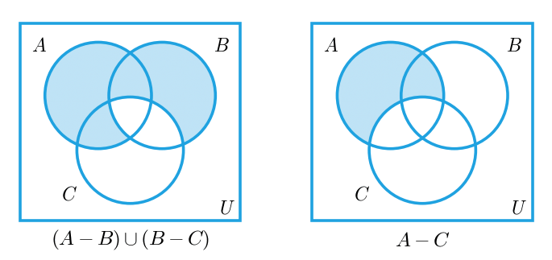

*그림 9. (A − B) ∪ (B − C)와 A − C의 영역 비교*

두 영역이 달라 보이므로 성질은 거짓일 것으로 예상된다. 예를 들어 $B$에만 속하고 $A$와 $C$에는 속하지 않는 원소는 $B - C$에 속하므로 $(A - B) \cup (B - C)$에 속하지만, $A$ 밖에 있으므로 $A - C$에는 속하지 않는다. 또 $A$와 $C$에 속하고 $B$에는 속하지 않는 원소는 $A - B$에 속하므로 좌변에 속하지만, $C$에 속하므로 $A - C$에는 속하지 않는다.

**2단계: 구체적인 반례 만들기.** 그림을 잘못 그리거나 잘못 읽지 않았음을 확인하려면 구체적인 반례를 만든다. 그림 10처럼 세 원으로 나뉜 일곱 개의 부분 영역에 1부터 7까지의 정수를 하나씩 넣는다. 성질에 여집합이 나온다면 원 바깥 영역도 필요하므로 그곳에 8을 넣는다. 그리고 $A$, $B$, $C$를 각 원 안의 수 전체로 정한다.

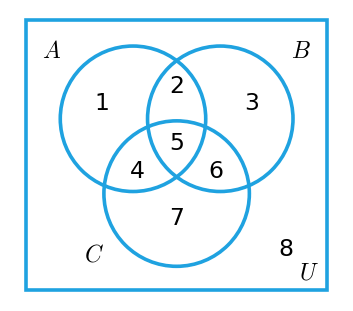

*그림 10. 세 집합의 부분 영역에 번호를 붙인 벤 다이어그램*

**반례 1.** $A = \lbrace 1, 2, 4, 5 \rbrace$, $B = \lbrace 2, 3, 5, 6 \rbrace$, $C = \lbrace 4, 5, 6, 7 \rbrace$이라 하자.

- $A - B$: $A$의 원소 1, 2, 4, 5 가운데 $B$에 없는 것은 1과 4이므로 $\lbrace 1, 4 \rbrace$이다.
- $B - C$: $B$의 원소 2, 3, 5, 6 가운데 $C$에 없는 것은 2와 3이므로 $\lbrace 2, 3 \rbrace$이다.
- $A - C$: $A$의 원소 1, 2, 4, 5 가운데 $C$에 없는 것은 1과 2이므로 $\lbrace 1, 2 \rbrace$이다.

따라서 $(A - B) \cup (B - C) = \lbrace 1, 4 \rbrace \cup \lbrace 2, 3 \rbrace = \lbrace 1, 2, 3, 4 \rbrace$이고 $A - C = \lbrace 1, 2 \rbrace$이다. $\lbrace 1, 2, 3, 4 \rbrace \ne \lbrace 1, 2 \rbrace$이므로 $(A - B) \cup (B - C) \ne A - C$이다.

**반례 2.** 더 간단한 반례도 있다. $B$에 $A$에 속하지 않는 원소(예를 들어 3)가 하나라도 있으면, $B$와 $A$, $C$에 다른 원소가 있든 없든 등식이 깨진다. $A = \emptyset$, $B = \lbrace 3 \rbrace$, $C = \emptyset$이라 하면 $A - B = \emptyset$, $B - C = \lbrace 3 \rbrace$, $A - C = \emptyset$이다. 따라서 $(A - B) \cup (B - C) = \emptyset \cup \lbrace 3 \rbrace = \lbrace 3 \rbrace$이지만 $A - C = \emptyset$이고, $\lbrace 3 \rbrace \ne \emptyset$이다.

**반례 3.** $A = C$가 단원소 집합이고 $B$가 공집합이어도 된다. $A = C = \lbrace 4 \rbrace$, $B = \emptyset$이면 $A - B = \lbrace 4 \rbrace$, $B - C = \emptyset$이므로 좌변은 $\lbrace 4 \rbrace$이고, $A - C = \emptyset$이다.

반례 2는 그림 10의 3번 영역($B$에만 속함)에, 반례 3은 4번 영역($A$와 $C$에만 속함)에 원소를 하나 둔 것으로, 1단계에서 찾은 두 차이를 각각 이용한 것이다.

### 3.2 문제 해결 전략

집합에 관한 전칭 명제가 참인지 거짓인지 모를 때 접근 방법은 두 가지이다. 하나는 무엇을 보여야 하고 어떤 수단으로 보일지를 따지며 증명을 시도하는 것이고, 다른 하나는 반례가 만족해야 할 조건을 찾아 나가는 것이다. 어느 쪽도 곧바로 성공한다는 보장이 없으므로 두 방법을 모두 염두에 두고, 한쪽 시도가 막히면 다른 쪽으로 방향을 바꾸는 것이 좋다. 어려운 문제에서는 두 방법을 여러 번 오가야 답에 이르는 경우가 많다. 두 시도는 서로에게 실마리를 준다. 증명이 막히는 경우에서 반례를 만드는 방법이 보이는 때가 많고, 반례의 조건들이 계속 서로 모순되면 그 모순이 증명의 핵심 단계를 드러내는 때가 많다.

### 3.3 부분집합의 개수

원소가 $n$개인 집합의 멱집합은 원소가 $2^n$개이다. 이 정리는 수학적 귀납법(5장)으로 증명하며, 다음 관찰에 바탕을 둔다. $X$가 집합이고 $z$가 $X$의 원소라 하자.

1. $X$의 부분집합은 $z$를 포함하지 않는 것과 $z$를 포함하는 것의 두 무리로 나뉜다.
2. $X$의 부분집합 가운데 $z$를 포함하지 않는 것은 $X - \lbrace z \rbrace$의 부분집합과 정확히 같다.
3. $z$를 포함하지 않는 부분집합 $A$마다 $z$를 포함하는 부분집합 $A \cup \lbrace z \rbrace$를 짝지으면 두 무리가 하나씩 짝지어진다. 따라서 $z$를 포함하는 부분집합의 개수는 $z$를 포함하지 않는 부분집합의 개수와 같다.

예를 들어 $X = \lbrace x, y, z \rbrace$이면 다음과 같이 짝지어진다.

| $z$를 포함하지 않는 $X$의 부분집합 | $z$를 포함하는 $X$의 부분집합 |
|:-----|:-----|
| $\emptyset$ | $\emptyset \cup \lbrace z \rbrace = \lbrace z \rbrace$ |
| $\lbrace x \rbrace$ | $\lbrace x \rbrace \cup \lbrace z \rbrace = \lbrace x, z \rbrace$ |
| $\lbrace y \rbrace$ | $\lbrace y \rbrace \cup \lbrace z \rbrace = \lbrace y, z \rbrace$ |
| $\lbrace x, y \rbrace$ | $\lbrace x, y \rbrace \cup \lbrace z \rbrace = \lbrace x, y, z \rbrace$ |

*표 8. z를 포함하지 않는 부분집합과 z를 포함하는 부분집합의 짝*

왼쪽 열은 $X - \lbrace z \rbrace = \lbrace x, y \rbrace$의 부분집합 4개이고, 오른쪽 열도 4개이므로 $X$의 부분집합은 모두 $4 + 4 = 8 = 2^3$개이다.

> **핵심:** **정리 6.3.1.** 모든 정수 $n \ge 0$에 대해, 집합 $X$의 원소가 $n$개이면 $\mathcal{P}(X)$의 원소는 $2^n$개이다.

**증명 (수학적 귀납법).** 술어 $P(n)$을 "원소가 $n$개인 모든 집합은 부분집합을 $2^n$개 가진다"로 둔다.

**기저 단계: $P(0)$이 참임을 보인다.** 원소가 0개인 집합은 $\emptyset$뿐이고, $\emptyset$의 부분집합은 $\emptyset$ 자신 하나뿐이다. 정리 6.2.4에 의해 $\emptyset \subseteq \emptyset$이고, $\emptyset$의 부분집합에는 원소가 있을 수 없기 때문이다. 따라서 원소가 0개인 집합의 부분집합은 $1 = 2^0$개이고, $P(0)$은 참이다.

**귀납 단계: 모든 정수 $k \ge 0$에 대해 $P(k)$가 참이면 $P(k + 1)$도 참임을 보인다.** $k \ge 0$인 정수 $k$를 임의로 택하고, 원소가 $k$개인 모든 집합은 부분집합을 $2^k$개 가진다고 가정한다(귀납 가정). 원소가 $k + 1$개인 모든 집합이 부분집합을 $2^{k+1}$개 가진다는 것을 보여야 한다.

$X$를 원소가 $k + 1$개인 집합이라 하자. $k + 1 \ge 1$이므로 $X$에서 원소 $z$를 하나 고를 수 있다. $X$의 모든 부분집합은 $z$를 포함하거나 포함하지 않는다. $z$를 포함하지 않는 부분집합은 정확히 $X - \lbrace z \rbrace$의 부분집합이고, $z$를 포함하지 않는 부분집합 $A$는 $z$를 포함하는 부분집합 $A \cup \lbrace z \rbrace$와 짝지어진다. 따라서 $z$를 포함하는 부분집합과 포함하지 않는 부분집합의 개수가 같고, $X$의 부분집합의 개수는 $X - \lbrace z \rbrace$의 부분집합의 개수의 두 배이다. $X - \lbrace z \rbrace$는 원소가 $k$개이므로 귀납 가정에 의해 부분집합이 $2^k$개이다. 그러므로 다음이 성립한다.

```math
\begin{aligned}
(X\text{의 부분집합의 개수}) &= 2 \cdot (X - \lbrace z \rbrace\text{의 부분집합의 개수}) \\
&= 2 \cdot 2^k \\
&= 2^{k+1}
\end{aligned}
```

둘째 줄은 귀납 가정을 대입한 것이고, 셋째 줄은 지수 법칙이다. 이로써 $P(k + 1)$이 참이다. 기저 단계와 귀납 단계가 모두 증명되었으므로 정리가 성립한다. ∎

짝짓기가 개수를 보존한다는 것은 다음과 같이 확인할 수 있다. $z$를 포함하지 않는 서로 다른 두 부분집합 $A_1 \ne A_2$에 $\lbrace z \rbrace$를 더해도 $A_1 = (A_1 \cup \lbrace z \rbrace) - \lbrace z \rbrace$이므로 결과가 서로 다르다. 또 $z$를 포함하는 부분집합 $D$는 $z$를 포함하지 않는 $D - \lbrace z \rbrace$에서 만들어진다. 곧 이 짝짓기는 두 무리 사이의 일대일 대응(7장)이다.

> **참고:** 원소를 $x_1, x_2, \ldots, x_n$으로 나열해 두면, 부분집합 $S$마다 $x_i \in S$일 때 $i$번째 비트가 1인 길이 $n$의 비트 문자열을 대응시킬 수 있다. 예를 들어 $\lbrace x, y, z \rbrace$에서 $\lbrace x, z \rbrace$는 101, $\emptyset$는 000에 대응한다. 길이 $n$의 비트 문자열은 $2^n$개이므로(9장의 곱의 법칙) 부분집합도 $2^n$개이다. 프로그램에서 작은 집합의 부분집합을 정수의 비트 마스크로 나타내는 것이 이 대응이다.

### 3.4 집합 항등식의 대수적 증명

$U$를 전체집합이라 하자. 정리 6.2.2의 항등식은 멱집합 $\mathcal{P}(U)$의 모든 원소, 곧 $U$의 모든 부분집합에 대해 성립한다. 이런 항등식을 어느 정도 갖추면 원소 논증으로 돌아가지 않고 식의 변형만으로 새 성질을 얻을 수 있다. 사실 합집합, 교집합, 여집합만 나오는 항등식은 정리 6.2.2의 (1)~(5)만으로 모두 증명할 수 있고, 여기에 (12) 차집합 법칙을 더하면 차집합이 나오는 항등식도 모두 증명할 수 있다.

이 방법이 가능한 것은 알려진 성질이 모두 전칭 명제이기 때문이다. 보통의 대수 법칙처럼 집합 법칙의 각 변수 자리에는 어떤 집합이든 넣을 수 있다. 예를 들어 분배 법칙

```math
A \cap (B \cup C) = (A \cap B) \cup (A \cap C)
```

는 임의의 세 집합을 넣을 수 있는 틀이다. $A_1$, $A_2$, $A_3$이 특정한 집합이면 $A$ 자리에 $A_1$, $B$ 자리에 $A_2$, $C$ 자리에 $A_3$을 넣어 다음을 얻는다.

```math
A_1 \cap (A_2 \cup A_3) = (A_1 \cap A_2) \cup (A_1 \cap A_3)
```

변수 자리에는 복합적인 집합도 넣을 수 있다. $W$, $X$, $Y$, $Z$가 임의의 집합이면 $A$ 자리에 $W \cap X$, $B$ 자리에 $Y$, $C$ 자리에 $Z$를 넣어 다음을 얻는다.

```math
(W \cap X) \cap (Y \cup Z) = ((W \cap X) \cap Y) \cup ((W \cap X) \cap Z)
```

이렇게 정리 6.2.2의 항등식을 한 단계씩 적용하여 새 항등식을 증명하는 방법을 **대수적 증명(algebraic proof)** 이라 한다.

**예제 6.3.2 (차집합 성질의 유도).** 모든 집합 $A$, $B$, $C$에 대해 $(A \cup B) - C = (A - C) \cup (B - C)$임을 대수적으로 증명한다. $A$, $B$, $C$를 임의의 집합이라 하자.

| 단계 | 식 | 근거 (정리 6.2.2) |
|:-----|:-----|:-----|
| 1 | $(A \cup B) - C = (A \cup B) \cap C^c$ | 차집합 법칙 (12) |
| 2 | $= C^c \cap (A \cup B)$ | $\cap$의 교환 법칙 1(b) |
| 3 | $= (C^c \cap A) \cup (C^c \cap B)$ | 분배 법칙 3(b) |
| 4 | $= (A \cap C^c) \cup (B \cap C^c)$ | $\cap$의 교환 법칙 1(b) |
| 5 | $= (A - C) \cup (B - C)$ | 차집합 법칙 (12) |

*표 9. (A ∪ B) − C = (A − C) ∪ (B − C)의 대수적 증명*

2단계에서 교환 법칙을 쓴 이유는 분배 법칙 3(b)가 공통 인자를 왼쪽에 둔 $A \cap (B \cup C)$의 형태로 서술되어 있기 때문이다. 4단계도 같은 이유로 결과를 차집합 법칙의 형태 $X \cap Y^c$에 맞춘다.

**예제 6.3.3 (공집합의 성질을 이용한 유도).** 모든 집합 $A$, $B$에 대해 $A - (A \cap B) = A - B$임을 대수적으로 증명한다. $A$와 $B$를 임의의 집합이라 하자.

| 단계 | 식 | 근거 (정리 6.2.2) |
|:-----|:-----|:-----|
| 1 | $A - (A \cap B) = A \cap (A \cap B)^c$ | 차집합 법칙 (12) |
| 2 | $= A \cap (A^c \cup B^c)$ | 드모르간의 법칙 9(b) |
| 3 | $= (A \cap A^c) \cup (A \cap B^c)$ | 분배 법칙 3(b) |
| 4 | $= \emptyset \cup (A \cap B^c)$ | 여집합 법칙 5(b) |
| 5 | $= (A \cap B^c) \cup \emptyset$ | $\cup$의 교환 법칙 1(a) |
| 6 | $= A \cap B^c$ | $\cup$의 항등 법칙 4(a) |
| 7 | $= A - B$ | 차집합 법칙 (12) |

*표 10. A − (A ∩ B) = A − B의 대수적 증명*

대수적 증명이 원소 논증보다 간단해 보일 때가 많지만, 원소 논증이 더 이해하기 쉬운 경우도 있다. 위 등식은 원소로 생각하면 바로 보인다. 원소가 $A - (A \cap B)$에 속한다는 것은 $A$에 속하면서 $A$와 $B$ 모두에 속하지는 않는다는 뜻인데, $A$에 속한다는 조건 아래에서 이는 $B$에 속하지 않는다는 것과 같다.

> **주의:** 대수적 증명에서는 정리 6.2.2의 성질을 서술된 형태 그대로 써야 한다. 예를 들어 항등 법칙 4(a)는 $A \cup \emptyset = A$로 서술되어 있으므로 $\emptyset \cup X$를 $X$로 바꾸려면 먼저 교환 법칙으로 $X \cup \emptyset$을 만들어야 한다. 위 예제의 5단계가 그 단계이다. 단계마다 근거를 하나씩 밝히는 것이 대수적 증명의 핵심이다.

### 3.5 일반화된 결합 법칙

**예제 6.3.4 (네 집합의 결합 법칙).** 모든 집합 $A_1$, $A_2$, $A_3$, $A_4$에 대해 다음이 성립함을 정리 6.2.2의 성질만으로 증명한다.

```math
((A_1 \cup A_2) \cup A_3) \cup A_4 = A_1 \cup ((A_2 \cup A_3) \cup A_4)
```

| 단계 | 식 | 근거 |
|:-----|:-----|:-----|
| 1 | $((A_1 \cup A_2) \cup A_3) \cup A_4 = (A_1 \cup (A_2 \cup A_3)) \cup A_4$ | $\cup$의 결합 법칙 2(a)에서 $A$ 자리에 $A_1$, $B$ 자리에 $A_2$, $C$ 자리에 $A_3$ |
| 2 | $= A_1 \cup ((A_2 \cup A_3) \cup A_4)$ | $\cup$의 결합 법칙 2(a)에서 $A$ 자리에 $A_1$, $B$ 자리에 $A_2 \cup A_3$, $C$ 자리에 $A_4$ |

*표 11. 네 집합에 대한 결합 법칙의 대수적 증명*

1단계는 식의 안쪽 부분 $(A_1 \cup A_2) \cup A_3$에만 결합 법칙을 적용하고 나머지는 그대로 둔 것이다. 같은 집합끼리는 서로 바꾸어 넣을 수 있기 때문이다. 이런 단계를 되풀이하면 합집합이 여러 개 이어진 식에서 괄호를 어떻게 치든 결과가 같음을 보일 수 있으며, 그래서 $A_1 \cup A_2 \cup A_3 \cup A_4$처럼 괄호 없이 쓴다.

---

<br>

## 4. 부울 대수, 러셀의 역설, 정지 문제

2장의 논리적 동치와 이 장의 집합 성질은 놀랄 만큼 닮았다. 이 절은 그 공통 구조를 부울 대수로 추상화하고, 집합론의 기초를 흔든 러셀의 역설과 같은 논리 구조를 가진 계산 이론의 결과인 정지 문제를 다룬다.

### 4.1 논리적 동치와 집합 성질의 대응

다음 표는 2장의 논리적 동치(명제 변수 $p$, $q$, $`r`$)와 정리 6.2.2의 집합 성질(집합 $A$, $B$, $`C`$)을 나란히 놓은 것이다. $\mathbf{t}$는 항진명제, $\mathbf{c}$는 모순명제, $\sim$는 부정이다.

| 법칙 | 논리적 동치 | 집합 성질 |
|:-----|:-----|:-----|
| 교환 법칙 | $p \lor q \equiv q \lor p$, $p \land q \equiv q \land p$ | $A \cup B = B \cup A$, $A \cap B = B \cap A$ |
| 결합 법칙 | $(p \lor q) \lor r \equiv p \lor (q \lor r)$, $(p \land q) \land r \equiv p \land (q \land r)$ | $(A \cup B) \cup C = A \cup (B \cup C)$, $(A \cap B) \cap C = A \cap (B \cap C)$ |
| 분배 법칙 | $p \lor (q \land r) \equiv (p \lor q) \land (p \lor r)$, $p \land (q \lor r) \equiv (p \land q) \lor (p \land r)$ | $A \cup (B \cap C) = (A \cup B) \cap (A \cup C)$, $A \cap (B \cup C) = (A \cap B) \cup (A \cap C)$ |
| 항등 법칙 | $p \lor \mathbf{c} \equiv p$, $p \land \mathbf{t} \equiv p$ | $A \cup \emptyset = A$, $A \cap U = A$ |
| 부정 법칙, 여집합 법칙 | $p \lor {\sim p} \equiv \mathbf{t}$, $p \land {\sim p} \equiv \mathbf{c}$ | $A \cup A^c = U$, $A \cap A^c = \emptyset$ |
| 이중 부정 법칙, 이중 여집합 법칙 | ${\sim}({\sim p}) \equiv p$ | $(A^c)^c = A$ |
| 멱등 법칙 | $p \lor p \equiv p$, $p \land p \equiv p$ | $A \cup A = A$, $A \cap A = A$ |
| 전체 한계 법칙 | $p \lor \mathbf{t} \equiv \mathbf{t}$, $p \land \mathbf{c} \equiv \mathbf{c}$ | $A \cup U = U$, $A \cap \emptyset = \emptyset$ |
| 드모르간의 법칙 | ${\sim}(p \lor q) \equiv {\sim p} \land {\sim q}$, ${\sim}(p \land q) \equiv {\sim p} \lor {\sim q}$ | $(A \cup B)^c = A^c \cap B^c$, $(A \cap B)^c = A^c \cup B^c$ |
| 흡수 법칙 | $p \lor (p \land q) \equiv p$, $p \land (p \lor q) \equiv p$ | $A \cup (A \cap B) = A$, $A \cap (A \cup B) = A$ |
| $\mathbf{t}$, $\mathbf{c}$의 부정과 $U$, $\emptyset$의 여집합 | ${\sim}\mathbf{t} \equiv \mathbf{c}$, ${\sim}\mathbf{c} \equiv \mathbf{t}$ | $U^c = \emptyset$, $\emptyset^c = U$ |

*표 12. 논리적 동치와 집합 성질의 대응*

$\lor$(또는)를 $\cup$로, $\land$(그리고)를 $\cap$로, $\mathbf{t}$를 전체집합 $U$로, $\mathbf{c}$를 공집합 $\emptyset$로, $\sim$(부정)을 여집합 $^c$로 바꾸어 읽으면 표 12의 각 논리적 동치는 같은 행의 집합 성질이 된다. 따라서 $\lor$, $\land$로 결합한 명제 형식과 $\cup$, $\cap$로 결합한 전체집합의 부분집합은 같은 규칙을 따르며, 둘 다 **부울 대수(Boolean algebra)** 라는 하나의 추상적인 구조의 사례이다. 이 생각의 핵심은 영국의 수학자이자 논리학자 불(George Boole)이 1847년에 제시하였고, 19세기의 나머지 기간에 불과 후대 학자들이 개념을 다듬었다.

### 4.2 부울 대수의 정의

> **용어 정의:** **부울 대수(Boolean algebra)** 는 집합 $B$와 두 연산 $+$, $\cdot$으로 이루어진 구조로, $B$의 모든 원소 $a$, $b$에 대해 $a + b$와 $a \cdot b$가 다시 $B$의 원소이고 다음 공리를 만족한다.

| 번호 | 공리 | (a) | (b) |
|:-----|:-----|:-----|:-----|
| 1 | 교환 법칙: $B$의 모든 $a$, $b$에 대해 | $a + b = b + a$ | $a \cdot b = b \cdot a$ |
| 2 | 결합 법칙: $B$의 모든 $a$, $b$, $c$에 대해 | $(a + b) + c = a + (b + c)$ | $(a \cdot b) \cdot c = a \cdot (b \cdot c)$ |
| 3 | 분배 법칙: $B$의 모든 $a$, $b$, $c$에 대해 | $a + (b \cdot c) = (a + b) \cdot (a + c)$ | $a \cdot (b + c) = (a \cdot b) + (a \cdot c)$ |
| 4 | 항등 법칙: $B$에 서로 다른 원소 0과 1이 있어 $B$의 모든 $a$에 대해 | $a + 0 = a$ | $a \cdot 1 = a$ |
| 5 | 보원 법칙: $B$의 각 $a$마다 $B$의 원소 $\overline{a}$가 있어 | $a + \overline{a} = 1$ | $a \cdot \overline{a} = 0$ |

*표 13. 부울 대수의 공리*

공리 5의 $\overline{a}$를 $a$의 **보원(complement)** 또는 부정(negation)이라 한다. 공리 4에서 0은 $+$에 대한 항등원, 1은 $\cdot$에 대한 항등원이다.

부울 대수의 대표적인 예는 다음과 같다.

| 부울 대수의 요소 | 집합의 부울 대수 | 명제 형식의 부울 대수 | 두 원소 부울 대수 |
|:-----|:-----|:-----|:-----|
| 원소 | 전체집합 $U$의 부분집합 | 명제 형식 (논리적으로 동치인 것은 같은 것으로 본다) | 0과 1 |
| $+$ | $\cup$ | $\lor$ | OR |
| $\cdot$ | $\cap$ | $\land$ | AND |
| 0 | $\emptyset$ | $\mathbf{c}$ | 0 |
| 1 | $U$ | $\mathbf{t}$ | 1 |
| $\overline{a}$ | $A^c$ | ${\sim p}$ | $\overline{0} = 1$, $\overline{1} = 0$ |

*표 14. 부울 대수의 세 가지 예*

두 원소 부울 대수 $\lbrace 0, 1 \rbrace$에서 두 연산은 다음과 같다. 2장의 OR 게이트와 AND 게이트의 입출력 표와 같다.

| $a$ | $b$ | $a + b$ | $a \cdot b$ |
|:-----|:-----|:-----|:-----|
| 0 | 0 | 0 | 0 |
| 0 | 1 | 1 | 0 |
| 1 | 0 | 1 | 0 |
| 1 | 1 | 1 | 1 |

*표 15. 두 원소 부울 대수 {0, 1}의 연산*

예를 들어 공리 5(a)를 확인하면 $0 + \overline{0} = 0 + 1 = 1$, $1 + \overline{1} = 1 + 0 = 1$이고, 5(b)는 $0 \cdot \overline{0} = 0 \cdot 1 = 0$, $1 \cdot \overline{1} = 1 \cdot 0 = 0$이다.

> **주의:** 부울 대수의 $+$와 $\cdot$은 수의 덧셈과 곱셈이 아니다. 두 원소 부울 대수에서 $1 + 1 = 1$이며, 수의 대수에서는 성립하지 않는 분배 법칙 3(a) $a + (b \cdot c) = (a + b) \cdot (a + c)$도 공리로 성립한다.

> **[논리설계]** 논리설계에서는 두 원소 부울 대수를 스위칭 대수라 부르고, 부울 대수의 법칙으로 부울 식을 간략화하여 더 적은 게이트로 같은 입출력 표를 가진 회로를 만든다.

### 4.3 부울 대수의 성질

다섯 공리만으로 각 원소의 보원이 단 하나라는 것, $+$와 $\cdot$의 항등원이 각각 0과 1뿐이라는 것, 그리고 모든 부울 대수가 2장의 논리적 동치와 정리 6.2.2에 대응하는 항등식을 만족한다는 것을 보일 수 있다.

> **핵심:** **정리 6.4.1 (부울 대수의 성질).** $B$를 임의의 부울 대수라 하자.
> 1. **보원의 유일성:** $B$의 모든 $a$, $x$에 대해 $a + x = 1$이고 $a \cdot x = 0$이면 $x = \overline{a}$이다.
> 2. **0과 1의 유일성:** $B$의 원소 $x$가 $B$의 모든 $a$에 대해 $a + x = a$를 만족하면 $x = 0$이고, $B$의 원소 $y$가 $B$의 모든 $a$에 대해 $a \cdot y = a$를 만족하면 $y = 1$이다.
> 3. **이중 보원 법칙:** $B$의 모든 $a$에 대해 $\overline{(\overline{a})} = a$이다.
> 4. **멱등 법칙:** $B$의 모든 $a$에 대해 (a) $a + a = a$이고 (b) $a \cdot a = a$이다.
> 5. **전체 한계 법칙:** $B$의 모든 $a$에 대해 (a) $a + 1 = 1$이고 (b) $a \cdot 0 = 0$이다.
> 6. **드모르간의 법칙:** $B$의 모든 $a$, $b$에 대해 (a) $\overline{a + b} = \overline{a} \cdot \overline{b}$이고 (b) $\overline{a \cdot b} = \overline{a} + \overline{b}$이다.
> 7. **흡수 법칙:** $B$의 모든 $a$, $b$에 대해 (a) $(a + b) \cdot a = a$이고 (b) $(a \cdot b) + a = a$이다.
> 8. **0과 1의 보원:** (a) $\overline{0} = 1$이고 (b) $\overline{1} = 0$이다.

**1의 증명 (보원의 유일성).** $a$와 $x$를 $a + x = 1$이고 $a \cdot x = 0$을 만족하는 $B$의 임의의 원소라 하자. 다음 계산의 각 단계는 공리나 가정 하나를 근거로 한다.

| 단계 | 식 | 근거 |
|:-----|:-----|:-----|
| 1 | $x = x \cdot 1$ | 1은 $\cdot$에 대한 항등원이다 (공리 4(b)) |
| 2 | $= x \cdot (a + \overline{a})$ | $+$에 대한 보원 법칙 (공리 5(a)) |
| 3 | $= x \cdot a + x \cdot \overline{a}$ | $+$에 대한 $\cdot$의 분배 법칙 (공리 3(b)) |
| 4 | $= a \cdot x + x \cdot \overline{a}$ | $\cdot$의 교환 법칙 (공리 1(b)) |
| 5 | $= 0 + x \cdot \overline{a}$ | 가정 $a \cdot x = 0$ |
| 6 | $= a \cdot \overline{a} + x \cdot \overline{a}$ | $\cdot$에 대한 보원 법칙 (공리 5(b)) |
| 7 | $= \overline{a} \cdot a + \overline{a} \cdot x$ | $\cdot$의 교환 법칙 (공리 1(b)) |
| 8 | $= \overline{a} \cdot (a + x)$ | $+$에 대한 $\cdot$의 분배 법칙 (공리 3(b)) |
| 9 | $= \overline{a} \cdot 1$ | 가정 $a + x = 1$ |
| 10 | $= \overline{a}$ | 1은 $\cdot$에 대한 항등원이다 (공리 4(b)) |

*표 16. 보원의 유일성의 증명*

따라서 $x = \overline{a}$이다. ∎ 핵심은 5단계와 6단계에서 0을 두 가지로 표현한 것이다. $x$에 관한 가정으로 얻은 $0 = a \cdot x$를 $\overline{a}$에 관한 공리 $0 = a \cdot \overline{a}$로 바꾸어, 식을 $x$에 관한 것에서 $\overline{a}$에 관한 것으로 옮겼다.

나머지 성질도 공리와 앞서 증명한 성질로부터 같은 방식으로 유도한다. 4.5절에서 3과 4(a)를 증명한다.

### 4.4 쌍대성 원리

부울 대수의 공리는 모두, 정리 6.4.1은 대부분이 (a), (b)의 짝으로 되어 있다. 예를 들어 분배 법칙은 $a + (b \cdot c) = (a + b) \cdot (a + c)$와 $a \cdot (b + c) = (a \cdot b) + (a \cdot c)$이고, 항등 법칙은 $a + 0 = a$와 $a \cdot 1 = a$이다. 짝을 이루는 두 식은 한쪽의 $+$를 모두 $\cdot$으로, $\cdot$을 모두 $+$로, 0을 모두 1로, 1을 모두 0으로 바꾸면 다른 쪽이 된다.

> **용어 정의:** 부울 대수의 항등식 전체에서 $+$와 $\cdot$을 서로 바꾸고 0과 1을 서로 바꾸어 얻은 식을 그 항등식의 **쌍대(dual)** 라 한다. 어떤 식이 모든 부울 대수에서 항등식이면 그 쌍대도 모든 부울 대수에서 항등식이라는 사실을 **쌍대성 원리(duality principle)** 라 한다.

쌍대성 원리가 성립하는 이유는 공리들이 쌍대끼리 짝지어져 있기 때문이다. 어떤 항등식의 증명이 있으면, 증명의 각 단계를 그 단계에 쓴 공리의 쌍대로 바꾸어 쌍대 항등식의 증명을 얻는다. 예를 들어 4.5절에서 $a + a = a$를 증명하면, 쌍대성 원리에 의해 $a \cdot a = a$도 성립한다.

> **주의:** 쌍대를 만들 때 원소의 보원 표시 $\overline{\phantom{a}}$는 그대로 둔다. 예를 들어 $a + \overline{a} = 1$의 쌍대는 $a \cdot \overline{a} = 0$이다.

### 4.5 이중 보원 법칙과 멱등 법칙의 증명

**예제 6.4.1 (이중 보원 법칙).** 부울 대수 $B$의 모든 원소 $a$에 대해 $\overline{(\overline{a})} = a$임을 증명한다. 증명의 바탕은 보원의 유일성이다. $B$의 각 원소는 특정한 두 식을 만족하는 보원을 단 하나 가지므로, $a$가 $\overline{a}$에 대해 그 두 식을 만족함을 보이면 $a$는 $\overline{a}$의 보원이어야 한다.

> **핵심:** **정리 6.4.1의 3 (이중 보원 법칙).** 부울 대수 $B$의 모든 원소 $a$에 대해 $\overline{(\overline{a})} = a$이다.

**증명.** $B$를 부울 대수, $a$를 $B$의 임의의 원소라 하자. 그러면 다음이 성립한다.

```math
\overline{a} + a = a + \overline{a} = 1, \qquad \overline{a} \cdot a = a \cdot \overline{a} = 0
```

각 식의 첫 등호는 교환 법칙(공리 1(a), 1(b))이고, 둘째 등호는 보원 법칙(공리 5(a), 5(b))이다. 따라서 $a$는 $\overline{a}$의 보원이 만족해야 하는 두 식 $\overline{a} + a = 1$, $\overline{a} \cdot a = 0$을 만족한다. 정리 6.4.1의 1에 의해 $\overline{a}$의 보원은 유일하므로 $\overline{(\overline{a})} = a$이다. ∎

**예제 6.4.2 (멱등 법칙).** 부울 대수 $B$의 모든 원소 $a$에 대해 $a + a = a$임을 증명한다. $a$를 $B$의 임의의 원소라 하자.

| 단계 | 식 | 근거 |
|:-----|:-----|:-----|
| 1 | $a = a + 0$ | 0은 $+$에 대한 항등원이다 (공리 4(a)) |
| 2 | $= a + (a \cdot \overline{a})$ | $\cdot$에 대한 보원 법칙 (공리 5(b)) |
| 3 | $= (a + a) \cdot (a + \overline{a})$ | $\cdot$에 대한 $+$의 분배 법칙 (공리 3(a)) |
| 4 | $= (a + a) \cdot 1$ | $+$에 대한 보원 법칙 (공리 5(a)) |
| 5 | $= a + a$ | 1은 $\cdot$에 대한 항등원이다 (공리 4(b)) |

*표 17. 멱등 법칙 a + a = a의 증명*

따라서 $a + a = a$이다. ∎ 이 증명은 $a$에 0을 더하는 것으로 시작해 0을 $a \cdot \overline{a}$로 바꾸고, 분배 법칙 3(a)로 $a + a$를 인수로 끌어낸 뒤, 남은 인수 $a + \overline{a}$를 1로 없애는 구조이다. 4.4절의 쌍대성 원리에 의해 $a \cdot a = a$도 성립한다.

### 4.6 러셀의 역설

1900년 무렵에는 추상적인 집합론이 널리 받아들여져 많은 수학자가 수학 전체를 집합론 위에 세우려 하였다. 이 작업이 한창일 때 영국의 수학자이자 철학자 러셀(Bertrand Russell)은 그 토대 자체를 무너뜨리는 듯한 역설, 실제로는 명백한 모순을 찾아냈다. 이 역설은 1.1절의 칸토어의 집합 개념, 곧 확정되고 서로 구별되는 대상들을 모은 것은 무엇이든 집합이라는 생각을 전제로 한다.

**러셀의 역설(Russell's paradox).** 보통의 집합은 자기 자신에 속하지 않는다. 예를 들어 정수 전체의 집합은 그 자체가 정수가 아니다. 그래도 자기 자신에 속하는 집합을 생각할 수는 있다. 추상적인 개념 전체의 집합은 그 자체도 추상적인 개념이라고 볼 수 있으므로 자기 자신의 원소가 된다. 이제 어떤 성질이든 집합을 정의하는 데 쓸 수 있다고 가정한다. 그러면 자기 자신에 속하지 않는 집합만을 정확히 원소로 가지는 집합 $S$를 다음과 같이 만들 수 있다.

```math
S = \lbrace A \mid A\text{는 집합이고 } A \notin A \rbrace
```

$S$는 $S$의 원소인가? 어느 답을 택해도 반대 답이 따라 나온다.

| 가정 | 추론 | 결론 |
|:-----|:-----|:-----|
| $S \in S$ | $S$는 $S$의 원소이므로 $S$를 정의하는 성질을 만족한다. 그 성질은 자기 자신의 원소가 아니라는 것이다. | $S \notin S$ (가정과 모순) |
| $S \notin S$ | $S$는 자기 자신의 원소가 아닌 집합이므로 $S$를 정의하는 성질을 만족한다. 따라서 $S$의 원소이다. | $S \in S$ (가정과 모순) |

*표 18. 러셀의 역설에서 두 가정이 모두 모순에 이르는 과정*

따라서 $S \in S$와 $S \notin S$가 모두 참이어야 한다. 한 명제가 참이면서 동시에 거짓일 수는 없으므로 이는 불가능하다.

**예제 6.4.3 (이발사 퍼즐(barber puzzle)).** 러셀은 수학을 배우지 않은 사람에게도 역설을 설명할 수 있도록 같은 논리 구조를 가진 퍼즐을 제시하였다. 어느 마을에 남자 이발사가 한 명 있고, 그는 스스로 면도하지 않는 마을의 남자들을 정확히 면도해 준다. 곧 그런 남자는 모두 그에게 면도를 받고, 그 밖의 남자는 아무도 그에게 면도를 받지 않는다. 이발사는 자기 자신을 면도하는가?

- 이발사가 자신을 면도한다면, 그는 스스로 면도하는 남자이다. 그런데 이발사는 스스로 면도하는 남자를 면도하지 않으므로 자신을 면도하지 않는다.
- 이발사가 자신을 면도하지 않는다면, 그는 스스로 면도하지 않는 남자이다. 이발사는 그런 남자를 모두 면도하므로 자신을 면도한다.

이발사에게 수염이 없어 면도를 전혀 하지 않는다고 상황을 바꾸어 빠져나가려 해도 소용이 없다. 면도를 하지 않는 이발사는 스스로 면도하지 않는 남자이므로 퍼즐의 규칙에 따라 이발사가 그를 면도해야 하고, 모순이 다시 생긴다. "이발사는 자신을 면도한다"는 문장이 참이면서 거짓이 되므로, 남는 결론은 퍼즐이 묘사하는 이발사가 있는 마을은 존재할 수 없다는 것뿐이다.

러셀의 역설도 같은 방식으로 정리된다. $S$는 집합이 아니다. 지금까지 가정해 온 성질을 가진 집합이라면 자기 자신에 속하거나 속하지 않아야 하는데, $S$에 대해서는 두 경우가 모두 배제되었기 때문이다.

**역설을 피하는 방법.** 러셀의 발견 뒤에 이 모순이 생기지 않는 여러 공리 체계가 제안되었다. 이 장은 간단한 규칙 하나를 따른다. 공리로 존재가 보장되는 멱집합을 제외하면, 술어로 집합을 정의할 때는 1.1절의 조건제시법 $\lbrace x \in T \mid P(x) \rbrace$에서처럼 이미 존재가 알려진 집합에서 원소를 골라내는 방식으로만 정의한다. 이 규칙 아래에서 "자기 자신의 원소가 아닌 집합 전체의 집합"이라는 말은 아무것도 정의하지 못하며, 주어진 집합 안에서 자기 자신에 속하지 않는 원소들을 모으는 것만 허용된다.

$U$를 전체집합으로 두고, 논의하는 모든 집합이 $U$의 부분집합이라 하자. 다음과 같이 정의한다.

```math
S = \lbrace A \mid A \subseteq U \land A \notin A \rbrace
```

러셀의 역설에서는 $S \in S \rightarrow S \notin S$와 $S \notin S \rightarrow S \in S$가 모두 증명되어 $S \in S \land S \notin S$라는 모순이 나왔다. 이 정의에서는 다음과 같이 된다.

1. $S \in S$라고 가정하면, $S$의 정의에 의해 $S \subseteq U$이고 $S \notin S$이다. 특히 $S \notin S$이므로 $S \in S \rightarrow S \notin S$는 여전히 증명된다. 따라서 $S \in S$는 거짓이고 $S \notin S$이다.
2. $S \notin S$로부터는 $S$가 정의의 조건을 만족하지 않는다는 것, 곧 $S \subseteq U \land S \notin S$가 거짓이라는 것만 이끌어 낼 수 있다. 드모르간의 법칙에 의해 이는 $S \not\subseteq U \lor S \in S$와 같다.
3. 1에서 $S \notin S$였으므로 $S \in S$는 제외되고, $S \not\subseteq U$라는 결론이 남는다.

곧 이끌어 낼 수 있는 유일한 결론은 $S$가 $U$의 부분집합이 아니라는 것, 다시 말해 $S$를 정의하려던 식이 논의 대상인 $U$ 안의 집합을 정의하지 못한다는 것이다. 이렇게 제한하면 러셀의 역설은 더 이상 모순이 아니다.

러셀의 발견은 수학에 큰 충격을 주었다. 더 신중한 정의로 이 모순은 없앨 수 있었지만, 다른 모순이 아직 숨어 있지 않은지는 여전히 알 수 없었기 때문이다. 1931년에 괴델(Kurt Gödel)은 제2 불완전성 정리에서, 공리를 알고리즘으로 나열할 수 있고 자연수의 산술을 담은 무모순인 형식 체계는 자기 자신의 무모순성을 그 체계 안에서 증명할 수 없음을 보였다[1]. 따라서 수학에 모순이 없다는 사실을 수학 자체의 방법으로 엄밀하게 증명할 수는 없다.

### 4.7 정지 문제

전자 컴퓨터가 처음 만들어지기 전에 이미 튜링(Alan M. Turing)은 그런 기계가 할 수 있는 일의 근본적인 한계를 증명하였다. 그 논증은 러셀의 역설과 구조가 같고, 괴델의 증명, 그리고 어떤 무한 목록도 실수 전체를 담을 수 없음을 보인 칸토어의 증명(7장의 칸토어의 대각선 논법)과도 밀접하게 관련된다.

무한 루프에 빠진 프로그램은 컴퓨터를 끝없이 붙잡아 둘 수 있으므로, 프로그램과 입력을 함께 검사하여 실행이 언젠가 끝날지를 실행 전에 예측하는 도구가 있으면 유용할 것이다. 이를 정식으로 쓰면 다음과 같다. 임의의 알고리즘 $X$와 임의의 데이터 집합 $D$를 입력받아, $X$를 $D$로 실행하면 유한한 단계 뒤에 끝날 때 "halts"를, 끝나지 않을 때 "loops forever"를 출력하는 알고리즘이 있는가? 이 질문이 **정지 문제(halting problem)** 이고, 1930년대에 튜링은 그런 알고리즘이 존재하지 않음을 보였다.

> **핵심:** **정리 6.4.2 (정지 문제).** 임의의 알고리즘 $X$와 데이터 집합 $D$를 입력받아, $X$를 $D$로 실행했을 때 유한한 단계 안에 끝나는지에 따라 "halts" 또는 "loops forever"를 출력하는 컴퓨터 알고리즘은 존재하지 않는다.

**증명 (귀류법).** 그런 알고리즘 CheckHalt가 있다고 가정한다. 곧 알고리즘 $X$와 데이터 집합 $D$를 입력하면 다음과 같이 출력한다.

```text
CheckHalt(X, D) prints  "halts"          if X terminates in a finite number of steps
                                          when run with data set D
                        "loops forever"  if X does not terminate in a finite number
                                          of steps when run with data set D
```

이 가정에서 모순을 이끌어 낸다. 알고리즘 $X$를 이루는 문자의 나열은 그 자체로 하나의 데이터 집합으로 볼 수 있다. 따라서 CheckHalt에 $(X, X)$를 입력하는 것도 가능하다. 이를 이용해 새 알고리즘 Test를 다음과 같이 정의한다. 임의의 입력 알고리즘 $X$에 대해 다음과 같다.

```text
Test(X)  loops forever  if CheckHalt(X, X) prints "halts"
         stops          if CheckHalt(X, X) prints "loops forever"
```

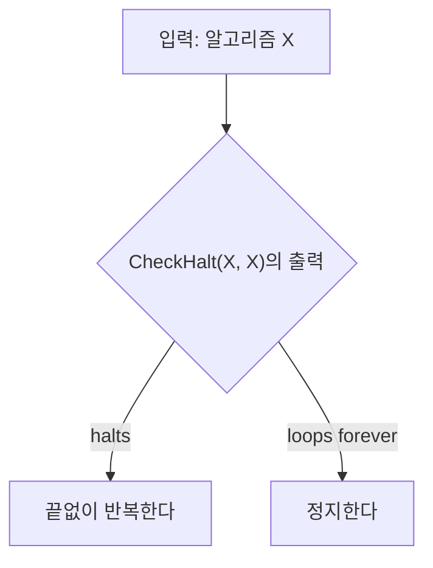

*그림 11. 알고리즘 Test(X)의 동작*

이제 Test에 Test 자신을 입력한다.

| 가정 | CheckHalt(Test, Test)의 출력 | Test의 정의에 따른 Test(Test)의 동작 |
|:-----|:-----|:-----|
| Test(Test)가 유한한 단계 안에 끝난다 | "halts" | 끝없이 반복한다 (가정과 모순) |
| Test(Test)가 끝나지 않는다 | "loops forever" | 정지한다 (가정과 모순) |

*표 19. Test(Test)의 두 경우가 모두 모순에 이르는 과정*

따라서 Test(Test)는 끝없이 반복하면서 동시에 끝나야 하므로 모순이다. 그런데 Test는 CheckHalt가 있다는 가정만으로 정의된 알고리즘이다. 그러므로 CheckHalt가 있다는 가정이 거짓이고, 그런 알고리즘은 존재하지 않는다. ∎

러셀의 역설과 비교하면 구조가 같다. 러셀의 역설은 자기 자신의 원소가 아닌 집합을 모은 $S$가 $S$ 자신을 원소로 가지는지 묻고, 정지 문제의 증명은 자기 자신을 입력으로 받으면 CheckHalt의 예측과 반대로 행동하는 알고리즘 Test에 Test 자신을 넣어 동작을 묻는다. 두 경우 모두 자기 참조가 어느 답도 허용하지 않는 상황을 만든다.

> **주의:** 정리 6.4.2는 모든 알고리즘과 모든 데이터에 대해 정지 여부를 판정하는 단 하나의 알고리즘이 없다는 뜻이다. 특정한 프로그램이 특정한 입력에서 정지하는지를 분석하여 밝히는 일까지 불가능하다는 뜻은 아니다.

> **[계산이론]** 계산이론에서는 알고리즘을 튜링 기계로 정식화하고, 정지 문제가 결정 불가능(undecidable)함을 이 증명과 같은 대각선 논법으로 보인다. 또 정지 문제를 다른 문제로 환원하여 많은 문제가 결정 불가능함을 증명한다.

러셀의 역설을 막는 제한은 컴퓨터 과학이 집합으로 다루고 싶은 대상 가운데 일부, 예를 들어 자기 자신을 가리키도록 재귀적으로 정의된 구조를 배제한다. 그런 자기 참조 대상을 허용하도록 집합론을 확장한 이론이 있으며, 거기서 다루는 대상을 하이퍼집합(hyperset)이라 한다. 한편 이발사 퍼즐이 제기하는 의미와 자기 참조의 문제는 컴퓨터가 자연어를 처리할 때 생기는 문제와도 맞닿아 있다.

---

<br>

## 개념 적용

**T/F 점검:**

| 문장 | 판단과 근거 |
|:-----|:-----|
| $\emptyset \in \lbrace \emptyset \rbrace$이다. | **T.** $\lbrace \emptyset \rbrace$는 공집합을 유일한 원소로 가진 집합이다. |
| $\lbrace \emptyset \rbrace = \emptyset$이다. | **F.** 좌변은 원소가 하나이고 우변은 원소가 없으므로 같지 않다. |
| $\lbrace \lbrace 1 \rbrace \rbrace \subseteq \lbrace 1, \lbrace 1 \rbrace \rbrace$이다. | **T.** 좌변의 유일한 원소 $\lbrace 1 \rbrace$이 우변에 원소로 나열되어 있다. |
| 모든 집합 $A$, $B$에 대해 $A - B = B - A$이다. | **F.** $A = \lbrace 1 \rbrace$, $B = \emptyset$이면 $A - B = \lbrace 1 \rbrace$이고 $B - A = \emptyset$이다. |
| 세 집합의 교집합이 공집합이면 세 집합은 쌍마다 서로소이다. | **F.** $\lbrace 1, 2 \rbrace$, $\lbrace 2, 3 \rbrace$, $\lbrace 3, 1 \rbrace$은 셋의 교집합이 공집합이지만 어느 두 집합에도 공통 원소가 있다. |
| 모든 집합 $A$, $B$, $C$에 대해 $A \cup B = A \cup C$이면 $B = C$이다. | **F.** $A = \lbrace 1 \rbrace$, $B = \lbrace 1 \rbrace$, $C = \emptyset$이면 $A \cup B = A \cup C = \lbrace 1 \rbrace$이지만 $B \ne C$이다. |
| 원소가 3개인 집합의 멱집합은 원소가 8개이다. | **T.** 정리 6.3.1에 의해 $2^3 = 8$이다. |
| 모든 부울 대수에서 $0 \ne 1$이다. | **T.** 항등 법칙(공리 4)이 서로 다른 원소 0과 1의 존재를 요구한다. |
| 정리 6.4.2에 따르면 어떤 프로그램이 정지하는지 알아낼 방법은 전혀 없다. | **F.** 모든 프로그램과 입력에 통하는 단 하나의 판정 알고리즘이 없다는 뜻이며, 개별 프로그램의 정지 여부는 분석으로 밝힐 수 있다. |

---

<br>

## 요약

| 개념 | 핵심 요약 |
|:-----|:-----|
| 조건제시법 | $\lbrace x \in S \mid P(x) \rbrace$는 $S$의 원소 가운데 $P(x)$를 만족하는 것 전체의 집합이다. |
| 부분집합 | $`A \subseteq B \iff \forall x\ (x \in A \rightarrow x \in B)`$이며, 반증하려면 $A$에 속하고 $B$에 속하지 않는 원소 하나를 찾는다. |
| 원소 논증 | $X \subseteq Y$를 보이려면 $X$의 임의의 원소 $x$를 두고 $x \in Y$임을 보인다. |
| 집합의 상등 | $A = B \iff A \subseteq B \land B \subseteq A$이므로 두 방향의 포함 관계를 각각 증명한다. |
| 집합의 연산 | $A \cup B$는 또는, $A \cap B$는 그리고, $B - A$는 $B$에 있고 $A$에 없음, $A^c$는 전체집합 $U$에서 $A$에 없음으로 정의한다. |
| 첨자 붙은 집합족 | $\bigcup A_i$는 적어도 하나의 $A_i$에, $\bigcap A_i$는 모든 $A_i$에 속하는 원소의 집합이다. |
| 공집합 | 원소가 없는 집합 $\emptyset$은 모든 집합의 부분집합이며 단 하나뿐이고, $\emptyset \ne \lbrace \emptyset \rbrace$이다. |
| 분할 | 공집합이 아닌 집합들이 쌍마다 서로소이고 합집합이 $A$이면 $A$의 분할이다. |
| 멱집합 | $\mathcal{P}(A)$는 $A$의 부분집합 전체의 집합이며, $A$의 원소가 $n$개이면 원소가 $2^n$개이다. |
| 부분집합 판정 알고리즘 | $A$의 각 원소를 $B$의 원소와 차례로 비교하며 반례가 나오면 $A \not\subseteq B$로 답하고, 비교 횟수는 많아야 $mn$번이다. |
| 집합 항등식 | 정리 6.2.2는 교환, 결합, 분배, 항등, 여집합, 이중 여집합, 멱등, 전체 한계, 드모르간, 흡수, $U$와 $\emptyset$의 여집합, 차집합 법칙을 담는다. |
| 공집합임을 보이는 방법 | 집합에 원소가 있다고 가정하고 모순을 이끌어 낸다. |
| 반증 | 벤 다이어그램으로 예상한 뒤 부분 영역에 번호를 붙여 구체적인 반례를 만든다. |
| 대수적 증명 | 정리 6.2.2의 항등식을 서술된 형태 그대로 한 단계씩 적용하고 단계마다 근거를 밝힌다. |
| 부울 대수 | 두 연산 $+$, $\cdot$과 교환, 결합, 분배, 항등, 보원 법칙의 다섯 공리를 만족하는 구조로, 전체집합의 부분집합들, 명제 형식들, $\lbrace 0, 1 \rbrace$이 그 예이다. |
| 보원의 유일성 | $a + x = 1$이고 $a \cdot x = 0$이면 $x = \overline{a}$이며, 이로부터 이중 보원 법칙이 나온다. |
| 쌍대성 원리 | $+$와 $\cdot$, 0과 1을 맞바꾼 쌍대 항등식도 항등식이다. |
| 러셀의 역설 | 자기 자신의 원소가 아닌 집합 전체의 모임 $S$는 $S \in S$와 $S \notin S$가 모두 모순이므로 집합이 아니며, 알려진 집합의 부분집합으로만 정의하면 역설이 사라진다. |
| 정지 문제 | 모든 알고리즘과 데이터에 대해 정지 여부를 판정하는 알고리즘은 없으며, Test(Test)의 자기 참조가 모순을 만든다. |

---

<br>

## 점검 문제

1. **원소 논증과 반증:** $`A = \lbrace n \in \mathbf{Z} \mid \exists k \in \mathbf{Z},\ n = 10k + 4 \rbrace`$, $`B = \lbrace n \in \mathbf{Z} \mid \exists j \in \mathbf{Z},\ n = 2j \rbrace`$일 때 $A \subseteq B$를 증명하고 $B \subseteq A$를 반증하라.

   <details>
   <summary>정답</summary>

   $x$를 $A$의 임의의 원소라 하면 $x = 10k + 4$인 정수 $k$가 있다. $10k + 4 = 2(5k + 2)$이므로 $j = 5k + 2$로 두면, 정수의 곱과 합은 정수이므로 $j$는 정수이고 $2j = 10k + 4 = x$이다. 따라서 $x \in B$이고 $A \subseteq B$이다. 반증을 위해 $x = 2 = 2 \cdot 1 \in B$를 택한다. $10k + 4 = 2$이면 $10k = -2$, $k = -\frac{1}{5}$인데 이는 정수가 아니므로 $2 \notin A$이다. 따라서 $B \not\subseteq A$이다.

   </details>

2. **집합의 연산:** 전체집합 $U = \lbrace 1, 2, \ldots, 10 \rbrace$, $A = \lbrace 1, 2, 3, 4, 5 \rbrace$, $B = \lbrace 4, 5, 6, 7 \rbrace$일 때 $A \cup B$, $A \cap B$, $A - B$, $B - A$, $(A \cup B)^c$, $A^c \cap B^c$를 구하고 드모르간의 법칙이 성립함을 확인하라.

   <details>
   <summary>정답</summary>

   $A \cup B = \lbrace 1, 2, 3, 4, 5, 6, 7 \rbrace$, $A \cap B = \lbrace 4, 5 \rbrace$, $A - B = \lbrace 1, 2, 3 \rbrace$, $B - A = \lbrace 6, 7 \rbrace$이다. $(A \cup B)^c$는 $U$에서 1부터 7을 뺀 $\lbrace 8, 9, 10 \rbrace$이다. $A^c = \lbrace 6, 7, 8, 9, 10 \rbrace$, $B^c = \lbrace 1, 2, 3, 8, 9, 10 \rbrace$이므로 $A^c \cap B^c = \lbrace 8, 9, 10 \rbrace$이다. 두 결과가 같으므로 $(A \cup B)^c = A^c \cap B^c$가 이 경우에 성립한다.

   </details>

3. **무한 집합족:** 양의 정수 $i$마다 $F_i = (0, \frac{1}{i}]$라 할 때 $\bigcup_{i=1}^{\infty} F_i$와 $\bigcap_{i=1}^{\infty} F_i$를 구하고 이유를 설명하라.

   <details>
   <summary>정답</summary>

   $F_1 = (0, 1]$이고 $i$가 커질수록 구간이 좁아지므로 모든 $F_i$가 $F_1$에 포함된다. 따라서 $\bigcup_{i=1}^{\infty} F_i = (0, 1]$이다. 교집합은 공집합이다. $x \le 0$이면 $x$는 $F_1$에 속하지 않는다. $x > 0$이면 $i > \frac{1}{x}$인 양의 정수 $i$를 골라 $\frac{1}{i} < x$가 되게 할 수 있고, 그러면 $x \notin F_i$이다. 따라서 모든 $F_i$에 속하는 실수는 없고 $\bigcap_{i=1}^{\infty} F_i = \emptyset$이다. 각 $F_i$는 공집합이 아니지만 무한히 많은 $F_i$의 교집합은 공집합이 된다.

   </details>

4. **분할 판정:** $A = \lbrace 1, 2, 3, 4, 5, 6 \rbrace$에 대해 다음 각 모임이 $A$의 분할인지 판정하라. (a) $\lbrace \lbrace 1, 4 \rbrace, \lbrace 2, 5, 6 \rbrace, \lbrace 3 \rbrace \rbrace$ (b) $\lbrace \lbrace 1, 2 \rbrace, \lbrace 2, 3 \rbrace, \lbrace 4, 5, 6 \rbrace \rbrace$ (c) $\lbrace \lbrace 1, 2, 3 \rbrace, \emptyset, \lbrace 4, 5, 6 \rbrace \rbrace$

   <details>
   <summary>정답</summary>

   (a) 세 집합은 공집합이 아니고, 합집합이 $A$이며, 어느 두 집합에도 공통 원소가 없으므로 분할이다. (b) $\lbrace 1, 2 \rbrace \cap \lbrace 2, 3 \rbrace = \lbrace 2 \rbrace$이므로 쌍마다 서로소가 아니어서 분할이 아니다. (c) 합집합이 $A$이고 공통 원소도 없지만, 분할의 정의는 각 조각이 공집합이 아닐 것을 요구하므로 분할이 아니다.

   </details>

5. **정리 6.2.3(b):** 모든 집합 $A$, $B$에 대해 $A \subseteq B$이면 $A \cup B = B$임을 증명하라.

   <details>
   <summary>정답</summary>

   $A \subseteq B$라 하자. 먼저 $A \cup B \subseteq B$를 보인다. $x \in A \cup B$라 하면 합집합의 정의에 의해 $x \in A$이거나 $x \in B$이다. $x \in A$인 경우 가정 $A \subseteq B$에 의해 $x \in B$이고, $x \in B$인 경우는 그대로 $x \in B$이다. 따라서 어느 경우든 $x \in B$이다. 다음으로 $B \subseteq A \cup B$는 정리 6.2.1의 2(b)에 의해 성립한다. 두 포함 관계가 모두 성립하므로 $A \cup B = B$이다.

   </details>

6. **공집합임을 증명:** 모든 집합 $A$, $B$에 대해 $(A - B) \cap B = \emptyset$임을 원소 방법으로 증명하라.

   <details>
   <summary>정답</summary>

   $(A - B) \cap B$에 원소 $x$가 있다고 가정한다. 교집합의 정의에 의해 $x \in A - B$이고 $x \in B$이다. 차집합의 정의에 의해 $x \in A - B$는 $x \in A$이고 $x \notin B$라는 뜻이다. 따라서 $x \in B$이면서 $x \notin B$가 되어 모순이다. 그러므로 $(A - B) \cap B$에는 원소가 없고, $(A - B) \cap B = \emptyset$이다.

   </details>

7. **반증과 대수적 증명:** (a) "모든 집합 $A$, $B$, $C$에 대해 $A - (B \cup C) = (A - B) \cup (A - C)$"의 반례를 들어라. (b) 모든 집합 $A$, $B$, $C$에 대해 $A - (B \cup C) = (A - B) \cap (A - C)$임을 정리 6.2.2의 성질을 단계마다 밝히며 대수적으로 증명하라.

   <details>
   <summary>정답</summary>

   (a) $A = \lbrace 1 \rbrace$, $B = \lbrace 1 \rbrace$, $C = \emptyset$이면 $A - (B \cup C) = \lbrace 1 \rbrace - \lbrace 1 \rbrace = \emptyset$이지만 $(A - B) \cup (A - C) = \emptyset \cup \lbrace 1 \rbrace = \lbrace 1 \rbrace$이다. 두 결과가 다르므로 성질은 거짓이다.

   (b) 다음과 같다. $A - (B \cup C) = A \cap (B \cup C)^c$ (차집합 법칙) $= A \cap (B^c \cap C^c)$ (드모르간의 법칙 9(a)) $= (A \cap A) \cap (B^c \cap C^c)$ (멱등 법칙 7(b)) $= A \cap (A \cap (B^c \cap C^c))$ (결합 법칙 2(b)) $= A \cap ((A \cap B^c) \cap C^c)$ (결합 법칙 2(b)) $= A \cap ((B^c \cap A) \cap C^c)$ (교환 법칙 1(b)) $= A \cap (B^c \cap (A \cap C^c))$ (결합 법칙 2(b)) $= (A \cap B^c) \cap (A \cap C^c)$ (결합 법칙 2(b)) $= (A - B) \cap (A - C)$ (차집합 법칙).

   </details>

8. **부분집합의 개수:** 원소가 5개인 집합 $X$와 그 원소 $z$가 있다. $X$의 부분집합 가운데 $z$를 포함하는 것은 몇 개인가? 3.3절의 짝짓기를 이용하여 설명하라.

   <details>
   <summary>정답</summary>

   $z$를 포함하지 않는 부분집합은 정확히 $X - \lbrace z \rbrace$의 부분집합이고, $X - \lbrace z \rbrace$의 원소는 4개이므로 정리 6.3.1에 의해 $2^4 = 16$개이다. 짝짓기 $A \mapsto A \cup \lbrace z \rbrace$가 $z$를 포함하지 않는 부분집합과 포함하는 부분집합을 일대일로 대응시키므로 $z$를 포함하는 부분집합도 16개이다. 전체는 $16 + 16 = 32 = 2^5$개로 정리 6.3.1과 일치한다.

   </details>

9. **부울 대수와 쌍대성:** 부울 대수의 공리만으로 모든 $a$, $b$에 대해 $(a + b) \cdot (a + \overline{b}) = a$임을 증명하고, 이 항등식의 쌍대를 쓰라.

   <details>
   <summary>정답</summary>

   분배 법칙 3(a) $a + (b \cdot c) = (a + b) \cdot (a + c)$를 오른쪽에서 왼쪽으로 쓰면 $(a + b) \cdot (a + \overline{b}) = a + (b \cdot \overline{b})$이다. 보원 법칙 5(b)에 의해 $b \cdot \overline{b} = 0$이므로 $a + 0$이 되고, 항등 법칙 4(a)에 의해 $a + 0 = a$이다. 쌍대는 $+$와 $\cdot$을 맞바꾸어 얻은 $(a \cdot b) + (a \cdot \overline{b}) = a$이다(이 식에는 0과 1이 나오지 않는다). 집합으로 읽으면 $(A \cap B) \cup (A \cap B^c) = A$이다.

   </details>

10. **정지 문제:** 정리 6.4.2의 증명에서 Test(Test)가 유한한 단계 안에 끝난다고 가정하면 어떤 모순이 생기는지 설명하고, 이 논증이 러셀의 역설과 어떤 점에서 같은지 쓰라.

    <details>
    <summary>정답</summary>

    Test(Test)가 끝난다면 CheckHalt의 정의에 의해 CheckHalt(Test, Test)는 "halts"를 출력한다. 그러면 Test의 정의에 의해 Test(Test)는 끝없이 반복해야 하므로 가정과 모순이다. 반대로 끝나지 않는다고 가정해도 CheckHalt가 "loops forever"를 출력하여 Test(Test)가 정지하므로 모순이다. 러셀의 역설에서 $S$에 $S$ 자신을 넣으면 $S \in S$와 $S \notin S$가 서로를 부르는 것처럼, Test에 Test 자신을 넣으면 정지와 비정지가 서로를 부른다. 두 논증 모두 자기 참조로 어느 답도 허용하지 않는 대상을 만들어, 그 대상을 가능하게 한 가정(집합 정의의 자유, CheckHalt의 존재)을 부정한다.

    </details>

---

<br>

## 참고 문헌

1. K. Gödel, "Über formal unentscheidbare Sätze der Principia Mathematica und verwandter Systeme I," *Monatshefte für Mathematik und Physik*, vol. 38, pp. 173-198, 1931.
