# Chapter 6 — Set Theory

[Repository Guide](../../README.md) | [English](Concepts_Lecture.md) | [한국어](Concepts_Lecture.ko.md)

> **Last Updated:** 2026-11-10
>
> Discrete Mathematics with Applications, Epp, Ch 6

> **Learning Objectives:**
> 1. Define subset, set equality, union, intersection, difference, complement, partition, and power set, and compute them for given sets
> 2. Prove subset relations and set equalities with element arguments, and prove that a given set is empty
> 3. Disprove a false set property by constructing a counterexample, and write algebraic proofs that cite set identities
> 4. Prove by mathematical induction that the power set of a set with $n$ elements has $2^n$ elements
> 5. Derive the uniqueness of complements, the double complement law, and the idempotent laws from the axioms of a Boolean algebra, and explain the duality principle
> 6. Explain how Russell's paradox and the proof of the halting problem reach a contradiction through the same self-referential structure

---

## Table of Contents

- [1. Set Theory: Definitions and the Element Method of Proof](#1-set-theory-definitions-and-the-element-method-of-proof)
  - [1.1 Sets and Set-Builder Notation](#11-sets-and-set-builder-notation)
  - [1.2 Subsets: Proof and Disproof](#12-subsets-proof-and-disproof)
  - [1.3 Set Equality](#13-set-equality)
  - [1.4 Venn Diagrams](#14-venn-diagrams)
  - [1.5 Operations on Sets](#15-operations-on-sets)
  - [1.6 Interval Notation](#16-interval-notation)
  - [1.7 Unions and Intersections of an Indexed Collection of Sets](#17-unions-and-intersections-of-an-indexed-collection-of-sets)
  - [1.8 The Empty Set](#18-the-empty-set)
  - [1.9 Partitions of Sets](#19-partitions-of-sets)
  - [1.10 Power Sets](#110-power-sets)
  - [1.11 An Algorithm to Check Whether One Set Is a Subset of Another](#111-an-algorithm-to-check-whether-one-set-is-a-subset-of-another)
- [2. Properties of Sets](#2-properties-of-sets)
  - [2.1 Basic Subset Relations](#21-basic-subset-relations)
  - [2.2 Procedural Versions of Set Definitions](#22-procedural-versions-of-set-definitions)
  - [2.3 Proving a Subset Relation](#23-proving-a-subset-relation)
  - [2.4 Set Identities](#24-set-identities)
  - [2.5 Proof of a Distributive Law](#25-proof-of-a-distributive-law)
  - [2.6 Proof of a De Morgan's Law](#26-proof-of-a-de-morgans-law)
  - [2.7 Intersection and Union with a Subset](#27-intersection-and-union-with-a-subset)
  - [2.8 Properties of the Empty Set](#28-properties-of-the-empty-set)
  - [2.9 A Generalized Distributive Law](#29-a-generalized-distributive-law)
- [3. Disproofs and Algebraic Proofs](#3-disproofs-and-algebraic-proofs)
  - [3.1 Disproving an Alleged Set Property](#31-disproving-an-alleged-set-property)
  - [3.2 Problem-Solving Strategy](#32-problem-solving-strategy)
  - [3.3 The Number of Subsets of a Set](#33-the-number-of-subsets-of-a-set)
  - [3.4 Algebraic Proofs of Set Identities](#34-algebraic-proofs-of-set-identities)
  - [3.5 A Generalized Associative Law](#35-a-generalized-associative-law)
- [4. Boolean Algebras, Russell's Paradox, and the Halting Problem](#4-boolean-algebras-russells-paradox-and-the-halting-problem)
  - [4.1 Logical Equivalences and Set Properties Side by Side](#41-logical-equivalences-and-set-properties-side-by-side)
  - [4.2 Definition of a Boolean Algebra](#42-definition-of-a-boolean-algebra)
  - [4.3 Properties of a Boolean Algebra](#43-properties-of-a-boolean-algebra)
  - [4.4 The Duality Principle](#44-the-duality-principle)
  - [4.5 Proofs of the Double Complement Law and an Idempotent Law](#45-proofs-of-the-double-complement-law-and-an-idempotent-law)
  - [4.6 Russell's Paradox](#46-russells-paradox)
  - [4.7 The Halting Problem](#47-the-halting-problem)
- [Concept Applications](#concept-applications)
- [Summary](#summary)
- [Self-Check Questions](#self-check-questions)
- [References](#references)

---

<br>

## 1. Set Theory: Definitions and the Element Method of Proof

Set theory studies the properties of sets themselves rather than the properties of the individual elements that make them up. Almost every mathematical object, including numbers, functions, and relations, can be defined in terms of sets, so the language of sets is the common language shared by all branches of mathematics. This section adds set operations, partitions, and power sets to the basic set notation introduced in Chapter 1, and introduces the element argument, the basic technique for proving relationships between sets.

### 1.1 Sets and Set-Builder Notation

Just as logic starts with statement, true, and false left undefined, set theory takes **set** and **element** as undefined terms. Georg Cantor, the founder of set theory, described a set as a whole formed by collecting definite and distinguishable objects of intuition or thought. Each object that makes up the whole is an element of the set.

For a set $S$ and an object $a$, the following notation is used.

| Notation | Meaning |
|:-----|:-----|
| $a \in S$ | $a$ is an element of $S$ |
| $a \notin S$ | $a$ is not an element of $S$ |
| $\lbrace 1, 2, 3 \rbrace$ | the set whose elements are 1, 2, and 3 (set-roster notation) |
| $\lbrace 1, 2, 3, \ldots \rbrace$ | the set of all positive integers |
| $\mathbf{Z}$, $\mathbf{Q}$, $\mathbf{R}$ | the sets of all integers, all rational numbers, and all real numbers |

*Table 1. Basic set notation*

If $S$ is a set and $P(x)$ is a property (a predicate) that is true or false for each element of $S$, then **set-builder notation** defines a new set $A$ as follows.

```math
A = \lbrace x \in S \mid P(x) \rbrace
```

This is read "the set of all $x$ in $S$ such that $P(x)$." The condition that the elements must satisfy is written after the vertical bar $\mid$. For example, $\lbrace x \in \mathbf{Z} \mid -2 < x < 3 \rbrace$ is the set of all integers greater than $-2$ and less than 3, namely $\lbrace -1, 0, 1, 2 \rbrace$.

> **Caution:** $\lbrace x \in S \mid P(x) \rbrace$ is a set, not a single element. If the words "the set of all" are dropped and it is read as "$`x`$ such that $P(x)$," it sounds as if it denoted one element satisfying the condition.

### 1.2 Subsets: Proof and Disproof

The subset relation defined in Chapter 1 can be restated as a universal conditional statement.

> **Definition:** If every element of a set $A$ is an element of a set $B$, then $A$ is a **subset** of $B$, written $A \subseteq B$.

```math
A \subseteq B \iff \forall x\ (x \in A \rightarrow x \in B)
```

Since the negation of a universal statement is existential (Chapter 3), saying that one set is not a subset of another is the following existential statement.

```math
A \not\subseteq B \iff \exists x\ (x \in A \land x \notin B)
```

Thus proving $A \subseteq B$ requires an argument that handles every element of $A$, whereas disproving $A \subseteq B$ requires only one element that is in $A$ and not in $B$.

> **Definition:** If $A \subseteq B$ and at least one element of $B$ is not in $A$, then $A$ is a **proper subset** of $B$. A set $\lbrace a \rbrace$ with exactly one element is called a **singleton set**.

**Example 6.1.1 (Testing for a Subset and a Proper Subset).** Let $A = \lbrace 1 \rbrace$ and $B = \lbrace 1, \lbrace 1 \rbrace \rbrace$. Decide whether $A \subseteq B$ and, if so, whether $A$ is a proper subset of $B$.

- The only element of $A$ is the number 1, and 1 is listed as an element of $B$. So every element of $A$ is in $B$, and $A \subseteq B$.
- $B$ has two elements: the number 1 and the set $\lbrace 1 \rbrace$. The set $\lbrace 1 \rbrace$ is not equal to the number 1, so $\lbrace 1 \rbrace \notin A$. Because $B$ has an element that is not in $A$, $A$ is a proper subset of $B$.

> **Caution:** Distinguish the membership relation $\in$ from the subset relation $\subseteq$. In the example above, $\lbrace 1 \rbrace \in B$ because $\lbrace 1 \rbrace$ is listed as an element of $B$, and at the same time $\lbrace 1 \rbrace \subseteq B$ because the only element of $\lbrace 1 \rbrace$, namely 1, is in $B$. The two facts hold for different reasons. On the other hand, $1 \in B$ is true, but 1 is not treated as a set, so one does not write $1 \subseteq B$.

Because the definition of subset is a universal conditional statement, a subset relation is proved by the direct proof of Chapter 4, that is, by generalizing from the generic particular. This way of proving a subset relation is called an **element argument**, and it is the most fundamental proof technique of set theory.

> **Key Point:** **Element argument.** To prove that a set $X$ is a subset of a set $Y$, take the following two steps.
> 1. Suppose that $x$ is a particular but arbitrarily chosen element of $X$.
> 2. Show that this $x$ is an element of $Y$.

**Example 6.1.2 (Proving and Disproving Subset Relations).** Define two sets as follows.

```math
A = \lbrace m \in \mathbf{Z} \mid \exists r \in \mathbf{Z},\ m = 6r + 12 \rbrace, \qquad B = \lbrace n \in \mathbf{Z} \mid \exists s \in \mathbf{Z},\ n = 3s \rbrace
```

Listing a few elements helps build intuition. Substituting $r = -2, -1, 0, 1$ shows that $A$ contains $0, 6, 12, 18$, and since $6r + 12 = 6(r + 2)$, $A$ is the set of all multiples of 6. $B$ is the set of all multiples of 3, $\lbrace \ldots, -3, 0, 3, 6, \ldots \rbrace$.

(a) **Outline of a proof that $A \subseteq B$.** The starting point is to take $x$ to be any element of $A$, and the conclusion to be shown is $x \in B$.

(b) **Proof that $A \subseteq B$.** Suppose $x$ is any element of $A$. To show $x \in B$, by the definition of $B$ one must show that $x$ equals 3 times some integer.

1. By the definition of $A$, there is an integer $r$ such that $x = 6r + 12$.
2. Since $6r + 12 = 3(2r + 4)$, let $s = 2r + 4$.
3. Products and sums of integers are integers, so $s$ is an integer.
4. $3s = 3(2r + 4) = 6r + 12 = x$.
5. Hence $x \in B$ by the definition of $B$. Since $x$ was an arbitrary element of $A$, $A \subseteq B$.

(c) **Disproof that $B \subseteq A$.** It suffices to find one element that is in $B$ but not in $A$. Take $x = 3$. Since $3 = 3 \cdot 1$, $3 \in B$. If $3 \in A$, there would be an integer $r$ with $6r + 12 = 3$, and solving this equation gives the following.

```math
6r + 12 = 3 \ \Rightarrow\ 2r + 4 = 1 \ \Rightarrow\ 2r = -3 \ \Rightarrow\ r = -\tfrac{3}{2}
```

The first step divides both sides by 3, the second subtracts 4 from both sides, and the third divides both sides by 2. Since $-\frac{3}{2}$ is not an integer, $3 \notin A$. Therefore $3 \in B$ and $3 \notin A$, so $B \not\subseteq A$.

### 1.3 Set Equality

By the **axiom of extension**, two sets are equal if, and only if, they have exactly the same elements. Written in the language of subsets, this becomes the following definition.

> **Definition:** If every element of $A$ is in $B$ and every element of $B$ is in $A$, then $A$ **equals** $B$, written $A = B$.

```math
A = B \iff A \subseteq B \land B \subseteq A
```

Thus, to prove that two sets are equal, one must prove $A \subseteq B$ and $B \subseteq A$ separately.

**Example 6.1.3 (Set Equality).** Define two sets as follows.

```math
A = \lbrace m \in \mathbf{Z} \mid \exists a \in \mathbf{Z},\ m = 2a \rbrace, \qquad B = \lbrace n \in \mathbf{Z} \mid \exists b \in \mathbf{Z},\ n = 2b - 2 \rbrace
```

$A = B$. The proof is divided into two parts.

**Part 1: $A \subseteq B$.** Suppose $x$ is any element of $A$. By the definition of $A$, there is an integer $a$ with $x = 2a$. To show $x \in B$, one must find an integer $b$ satisfying $2a = 2b - 2$. Solving this equation for $b$ gives $b = (2a + 2)/2 = a + 1$. So let $b = a + 1$. Sums of integers are integers, so $b$ is an integer, and $2b - 2 = 2(a + 1) - 2 = 2a + 2 - 2 = 2a = x$. Hence $x \in B$.

**Part 2: $B \subseteq A$.** Suppose $x$ is any element of $B$. By the definition of $B$, there is an integer $b$ with $x = 2b - 2$. Since $2b - 2 = 2(b - 1)$, let $a = b - 1$. Differences of integers are integers, so $a$ is an integer, and $2a = 2(b - 1) = 2b - 2 = x$. Hence $x \in A$.

Since both subset relations hold, $A = B$ by the definition of set equality. Both sets are the set of all even integers.

> **Note:** The variable names inside set-builder notation only mark places. Replacing $m$ and $a$ in the definition of $A$ by $n$ and $b$, respectively, gives $`A = \lbrace n \in \mathbf{Z} \mid \exists b \in \mathbf{Z},\ n = 2b \rbrace`$, the same set. The replacement must, however, be made consistently everywhere in the expression.

### 1.4 Venn Diagrams

If sets are represented as regions of the plane, relationships between sets can be drawn as **Venn diagrams**, which the British mathematician John Venn introduced in 1881. The relationship $A \subseteq B$ can be drawn in two ways, as in Figure 1.

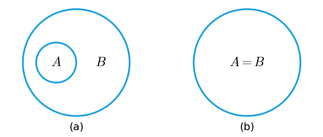

*Figure 1. Two Venn diagrams representing A ⊆ B*

The relationship $A \not\subseteq B$ can be drawn in three ways, as in Figure 2. In every case the essential feature is a point $x$ that is in $A$ but not in $B$.

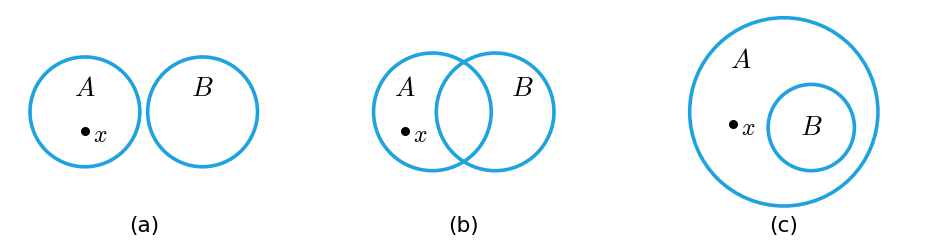

*Figure 2. Three Venn diagrams representing A ⊈ B*

If some subregions of a Venn diagram are allowed to contain no points, the relationships among these pictures simplify. Diagram (b) of Figure 1 is the special case of (a) in which the part of $B$ outside $A$ is empty. In Figure 2, (a) is the case of (b) in which the overlap is empty, and (c) is the case of (b) in which the part of $B$ outside $A$ is empty. In all three diagrams, however, it must be stated separately that there actually is a point in $A$ that is not in $B$.

**Example 6.1.4 (Relations among Sets of Numbers).** Every integer $n$ is rational because $n = \frac{n}{1}$, and every rational number is real. Hence $\mathbf{Z} \subseteq \mathbf{Q}$ and $\mathbf{Q} \subseteq \mathbf{R}$. Moreover, $\frac{1}{2}$ is a rational number that is not an integer and $\sqrt{2}$ is a real number that is not rational, so $\mathbf{Z}$ is a proper subset of $\mathbf{Q}$ and $\mathbf{Q}$ is a proper subset of $\mathbf{R}$. Figure 3 shows these relationships.

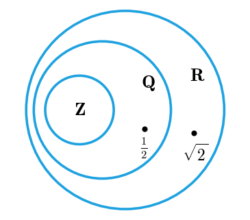

*Figure 3. Inclusions among the sets of integers, rational numbers, and real numbers*

### 1.5 Operations on Sets

Most mathematical discussions take place within some context. For example, if all sets under consideration are sets of real numbers, then $\mathbf{R}$ is called the **universal set** or **universe of discourse** for the discussion. In the definitions below, the complement is taken relative to the universal set $U$.

> **Definition:** **Set operations.** Let $A$ and $B$ be subsets of a universal set $U$.
> 1. The **union** of $A$ and $B$, denoted $A \cup B$, is the set of all elements that are in at least one of $A$ or $B$.
> 2. The **intersection** of $A$ and $B$, denoted $A \cap B$, is the set of all elements that are common to both $A$ and $B$.
> 3. The **difference** of $B$ minus $A$, denoted $B - A$, is the set of all elements that are in $B$ and not in $A$. It is also called the **relative complement** of $A$ in $B$.
> 4. The **complement** of $A$, denoted $A^c$, is the set of all elements of $U$ that are not in $A$.

Symbolically:

```math
\begin{aligned}
A \cup B &= \lbrace x \in U \mid x \in A \lor x \in B \rbrace \\
A \cap B &= \lbrace x \in U \mid x \in A \land x \in B \rbrace \\
B - A &= \lbrace x \in U \mid x \in B \land x \notin A \rbrace \\
A^c &= \lbrace x \in U \mid x \notin A \rbrace
\end{aligned}
```

The Italian mathematician Giuseppe Peano introduced the symbols $\in$, $\cup$, and $\cap$ in 1889. Figure 4 shows the result of each of the four operations as a shaded region. The outer rectangle is the universal set $U$.

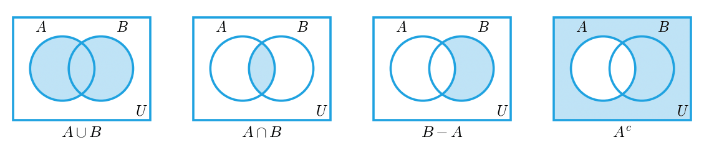

*Figure 4. Venn diagrams of union, intersection, difference, and complement*

**Example 6.1.5 (Operations on Finite Sets).** Compute with the universal set $U = \lbrace a, b, c, d, e, f, g \rbrace$, $A = \lbrace a, c, e, g \rbrace$, and $B = \lbrace d, e, f, g \rbrace$.

- $A \cup B$: collecting the elements of both sets and writing each repeated element once gives $\lbrace a, c, d, e, f, g \rbrace$.
- $A \cap B$: the elements in both sets are $e$ and $g$, so $\lbrace e, g \rbrace$.
- $B - A$: among the elements $d, e, f, g$ of $B$, those not in $A$ are $d$ and $f$, so $\lbrace d, f \rbrace$.
- $A - B$: among the elements $a, c, e, g$ of $A$, those not in $B$ are $a$ and $c$, so $\lbrace a, c \rbrace$.
- $A^c$: the elements of $U$ not in $A$ are $b, d, f$, so $\lbrace b, d, f \rbrace$.

> **Caution:** The result of a difference depends on the order. In the example above, $B - A = \lbrace d, f \rbrace$ but $A - B = \lbrace a, c \rbrace$. Also, the complement depends on the universal set, so in any problem involving complements, first check what $U$ is.

### 1.6 Interval Notation

Subsets of the real numbers that are intervals are written compactly with the following **interval notation**, where $a$ and $b$ are real numbers with $a \le b$.

| Interval | Set-builder notation | Interval | Set-builder notation |
|:-----|:-----|:-----|:-----|
| $(a, b)$ | $\lbrace x \in \mathbf{R} \mid a < x < b \rbrace$ | $[a, b]$ | $\lbrace x \in \mathbf{R} \mid a \le x \le b \rbrace$ |
| $(a, b]$ | $\lbrace x \in \mathbf{R} \mid a < x \le b \rbrace$ | $[a, b)$ | $\lbrace x \in \mathbf{R} \mid a \le x < b \rbrace$ |
| $(a, \infty)$ | $\lbrace x \in \mathbf{R} \mid x > a \rbrace$ | $[a, \infty)$ | $\lbrace x \in \mathbf{R} \mid x \ge a \rbrace$ |
| $(-\infty, b)$ | $\lbrace x \in \mathbf{R} \mid x < b \rbrace$ | $(-\infty, b]$ | $\lbrace x \in \mathbf{R} \mid x \le b \rbrace$ |

*Table 2. Interval notation and the corresponding set-builder notation*

A parenthesis excludes the endpoint and a bracket includes it. The symbols $\infty$ and $-\infty$ are not numbers but indicate that the interval continues without bound to the right or to the left, so they are always used with parentheses. The interval $(a, b)$ is written the same way as the ordered pair $(a, b)$, but the context tells which is meant.

**Example 6.1.6 (Operations on Intervals).** Let the universal set be $\mathbf{R}$, and let $A = (-1, 0]$ and $B = [0, 1)$. Figure 5 shows the two sets and the results of the operations on number lines. A filled dot means the endpoint is included, and an open dot means it is not.

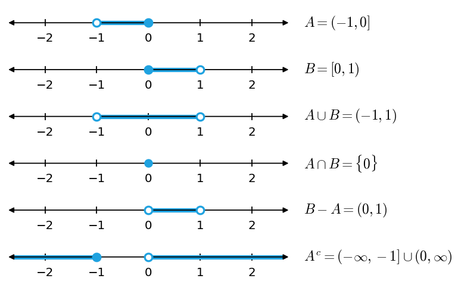

*Figure 5. The intervals A and B and their union, intersection, difference, and complement*

- $A \cup B$: all real numbers with $x \in (-1, 0]$ or $x \in [0, 1)$. The two intervals meet at 0, so $A \cup B = (-1, 1)$.
- $A \cap B$: the only real number satisfying both $-1 < x \le 0$ and $0 \le x < 1$ is $x = 0$, so $A \cap B = \lbrace 0 \rbrace$.
- $B - A$: the real numbers with $0 \le x < 1$ that do not satisfy $-1 < x \le 0$. The only point of $B$ that lies in $A$ is 0, so $B - A = (0, 1)$.
- $A^c$: apply the definition of a double inequality and De Morgan's law as follows.

```math
\begin{aligned}
x \in A^c &\iff \sim(-1 < x \le 0) \\
&\iff \sim(-1 < x \land x \le 0) \\
&\iff x \le -1 \lor x > 0
\end{aligned}
```

Hence $A^c = (-\infty, -1] \cup (0, \infty)$.

### 1.7 Unions and Intersections of an Indexed Collection of Sets

Union and intersection extend naturally to three or more sets.

> **Definition:** **Indexed unions and intersections.** Let $A_0, A_1, A_2, \ldots$ be subsets of a universal set $U$, and let $n$ be a nonnegative integer.
> 1. $\bigcup_{i=0}^{n} A_i$ is the set of all elements that are in $A_i$ for at least one $i = 0, 1, \ldots, n$.
> 2. $\bigcup_{i=0}^{\infty} A_i$ is the set of all elements that are in $A_i$ for at least one nonnegative integer $i$.
> 3. $\bigcap_{i=0}^{n} A_i$ is the set of all elements that are in $A_i$ for every $i = 0, 1, \ldots, n$.
> 4. $\bigcap_{i=0}^{\infty} A_i$ is the set of all elements that are in $A_i$ for every nonnegative integer $i$.

With quantifiers:

```math
\begin{aligned}
\bigcup_{i=0}^{n} A_i &= \lbrace x \in U \mid \exists i \in \lbrace 0, 1, \ldots, n \rbrace,\ x \in A_i \rbrace \\
\bigcup_{i=0}^{\infty} A_i &= \lbrace x \in U \mid \exists i \in \mathbf{Z}^{\text{nonneg}},\ x \in A_i \rbrace \\
\bigcap_{i=0}^{n} A_i &= \lbrace x \in U \mid \forall i \in \lbrace 0, 1, \ldots, n \rbrace,\ x \in A_i \rbrace \\
\bigcap_{i=0}^{\infty} A_i &= \lbrace x \in U \mid \forall i \in \mathbf{Z}^{\text{nonneg}},\ x \in A_i \rbrace
\end{aligned}
```

Here $\mathbf{Z}^{\text{nonneg}}$ is the set of all nonnegative integers. $\bigcup_{i=0}^{n} A_i$ is read "the union of the $A_i$ for $i$ from 0 to $n$" and is also written $A_0 \cup A_1 \cup \cdots \cup A_n$. Likewise, $\bigcap_{i=0}^{n} A_i$ is also written $A_0 \cap A_1 \cap \cdots \cap A_n$. It is worth noting that union corresponds to the existential quantifier and intersection to the universal quantifier.

**Example 6.1.7 (Union and Intersection of Infinitely Many Intervals).** For each positive integer $i$, define the following interval.

```math
A_i = \lbrace x \in \mathbf{R} \mid -\tfrac{1}{i} < x < \tfrac{1}{i} \rbrace = \left(-\tfrac{1}{i}, \tfrac{1}{i}\right)
```

$A_1 = (-1, 1)$, $A_2 = (-\frac{1}{2}, \frac{1}{2})$, $A_3 = (-\frac{1}{3}, \frac{1}{3})$, and the intervals shrink as $i$ grows, so $A_1 \supseteq A_2 \supseteq A_3 \supseteq \cdots$.

(a) $A_1 \cup A_2 \cup A_3$: every element of $A_2$ and $A_3$ is in $A_1 = (-1, 1)$, so the union is the largest interval, $(-1, 1)$. $A_1 \cap A_2 \cap A_3$: since $A_3 \subseteq A_2 \subseteq A_1$, the points in all three intervals are the points of the narrowest one, and the intersection is $(-\frac{1}{3}, \frac{1}{3})$.

(b) $\bigcup_{i=1}^{\infty} A_i$: every $A_i$ is contained in $(-1, 1)$ and $A_1$ itself is $(-1, 1)$, so $\bigcup_{i=1}^{\infty} A_i = (-1, 1)$.

$\bigcap_{i=1}^{\infty} A_i$: 0 belongs to every $A_i$. For a nonzero real number $x$, one can choose a positive integer $i$ with $i > \frac{1}{\lvert x \rvert}$, and then $\frac{1}{i} < \lvert x \rvert$, so $x \notin A_i$. Hence 0 is the only real number in every $A_i$, and $\bigcap_{i=1}^{\infty} A_i = \lbrace 0 \rbrace$.

> **Caution:** Even when every $A_i$ is an interval with infinitely many points, the intersection of infinitely many of them can be a single point. The rule seen for finitely many sets (the intersection is the narrowest interval) must not be applied unchanged to infinitely many sets, because an infinite collection has no narrowest interval.

### 1.8 The Empty Set

A set is determined by its elements, but it is convenient to accept a set with no elements as a set as well. Otherwise, every time the intersection of two sets is taken or a set is defined by a condition, one would first have to check that the result has elements. For example, $\lbrace 1, 3 \rbrace \cap \lbrace 2, 4 \rbrace$ has no elements, and since no real number has a negative square, $\lbrace x \in \mathbf{R} \mid x^2 = -1 \rbrace$ has no elements either.

> **Definition:** The set with no elements is called the **empty set** (or **null set**) and is denoted $\emptyset$.

Section 2.8 proves that there is only one set with no elements, which is why it can be given the single name empty set. The two examples above are written $\lbrace 1, 3 \rbrace \cap \lbrace 2, 4 \rbrace = \emptyset$ and $\lbrace x \in \mathbf{R} \mid x^2 = -1 \rbrace = \emptyset$.

**Example 6.1.8 (Sets with No Elements).** Describe $D = \lbrace x \in \mathbf{R} \mid 3 < x < 2 \rbrace$ and $E = \lbrace x \in \mathbf{Z} \mid 2 < x < 3 \rbrace$.

- $3 < x < 2$ means $3 < x$ and $x < 2$. No real number is both greater than 3 and less than 2, so $D = \emptyset$.
- Many real numbers satisfy $2 < x < 3$, but there is no integer between 2 and 3, so $E = \emptyset$. The same condition can give different results depending on the set from which elements are chosen.

### 1.9 Partitions of Sets

It is often necessary to divide a set into nonoverlapping pieces. Such a division is called a partition.

> **Definition:** Two sets $A$ and $B$ are called **disjoint** if, and only if, they have no elements in common, that is, $A \cap B = \emptyset$.

For example, $A = \lbrace 1, 3, 5 \rbrace$ and $B = \lbrace 2, 4, 6 \rbrace$ have no common elements, so $\lbrace 1, 3, 5 \rbrace \cap \lbrace 2, 4, 6 \rbrace = \emptyset$ and the two sets are disjoint.

> **Definition:** Sets $A_1, A_2, A_3, \ldots$ are **mutually disjoint** (or **pairwise disjoint**) if, and only if, no two sets with distinct subscripts have any elements in common. That is, for all integers $i, j = 1, 2, 3, \ldots$, if $i \ne j$ then $A_i \cap A_j = \emptyset$.

**Example 6.1.10 (Testing for Mutual Disjointness).**

- $A_1 = \lbrace 3, 5 \rbrace$, $A_2 = \lbrace 1, 4, 6 \rbrace$, $A_3 = \lbrace 2 \rbrace$: $A_1 \cap A_2 = \emptyset$, $A_1 \cap A_3 = \emptyset$, and $A_2 \cap A_3 = \emptyset$, so they are mutually disjoint.
- $B_1 = \lbrace 2, 4, 6 \rbrace$, $B_2 = \lbrace 3, 7 \rbrace$, $B_3 = \lbrace 4, 5 \rbrace$: $B_1 \cap B_2 = \emptyset$ and $B_2 \cap B_3 = \emptyset$, but $B_1 \cap B_3 = \lbrace 4 \rbrace$, so they are not mutually disjoint.

> **Caution:** Mutual disjointness is stronger than the condition that the intersection of all the sets is empty. For $\lbrace 1, 2 \rbrace$, $\lbrace 2, 3 \rbrace$, $\lbrace 3, 1 \rbrace$, the intersection of all three is $\emptyset$, but any two of them have a common element, so they are not mutually disjoint.

If a region $A$ is divided by boundary lines into $A_1, A_2, A_3, A_4$ as in Figure 6, and each point on a boundary is assigned to only one piece, then $A = A_1 \cup A_2 \cup A_3 \cup A_4$ and the four pieces are mutually disjoint. In this situation $A$ is called a union of mutually disjoint subsets, and the collection $\lbrace A_1, A_2, A_3, A_4 \rbrace$ is called a partition of $A$.

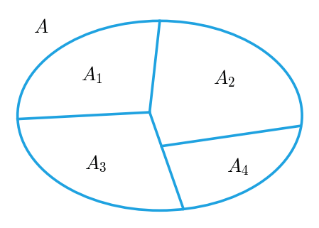

*Figure 6. A partition of a set A into four pieces*

> **Definition:** A finite or infinite collection $\lbrace A_1, A_2, A_3, \ldots \rbrace$ of nonempty sets is a **partition** of a set $A$ if, and only if, the following two conditions hold.
> 1. $A$ is the union of all the $A_i$.
> 2. The sets $A_1, A_2, A_3, \ldots$ are mutually disjoint.

**Example 6.1.11 (Testing for a Partition).**

(a) Let $A = \lbrace 1, 2, 3, 4, 5, 6 \rbrace$, $A_1 = \lbrace 1, 2 \rbrace$, $A_2 = \lbrace 3, 4 \rbrace$, and $A_3 = \lbrace 5, 6 \rbrace$. The three sets are nonempty, $A_1 \cup A_2 \cup A_3 = A$, and no two of them have a common element. Hence $\lbrace A_1, A_2, A_3 \rbrace$ is a partition of $A$.

(b) In the set of integers $\mathbf{Z}$, consider the following three sets.

```math
\begin{aligned}
T_0 &= \lbrace n \in \mathbf{Z} \mid \exists k \in \mathbf{Z},\ n = 3k \rbrace \\
T_1 &= \lbrace n \in \mathbf{Z} \mid \exists k \in \mathbf{Z},\ n = 3k + 1 \rbrace \\
T_2 &= \lbrace n \in \mathbf{Z} \mid \exists k \in \mathbf{Z},\ n = 3k + 2 \rbrace
\end{aligned}
```

By the quotient-remainder theorem of Chapter 4, every integer $n$ can be written in exactly one of the forms $n = 3k$, $n = 3k + 1$, $n = 3k + 2$ for some integer $k$. Since every integer has at least one of the three forms, every integer is in one of $T_0$, $T_1$, $T_2$, and so $\mathbf{Z} = T_0 \cup T_1 \cup T_2$. Since no integer has two of the forms at once, no integer is in two of the sets, and so the three sets are mutually disjoint. Moreover, $0 \in T_0$, $1 \in T_1$, and $2 \in T_2$, so none of the three sets is empty. Therefore $\lbrace T_0, T_1, T_2 \rbrace$ is a partition of $\mathbf{Z}$.

> **Note:** This partition classifies integers by their remainder upon division by 3. Chapter 8 shows that partitions and equivalence relations determine each other, and this partition reappears there as the equivalence classes of congruence modulo 3.

### 1.10 Power Sets

It is often useful to collect all subsets of a given set. The **power set axiom** guarantees that such a collection is a set.

> **Definition:** The set of all subsets of a set $A$ is called the **power set** of $A$ and is denoted $\mathcal{P}(A)$.

**Example 6.1.12 (Power Set of a Two-Element Set).** Find $\mathcal{P}(\lbrace x, y \rbrace)$.

- As Section 2.8 proves, the empty set is a subset of every set, so $\emptyset \in \mathcal{P}(\lbrace x, y \rbrace)$.
- Every set is a subset of itself, so $\lbrace x, y \rbrace \in \mathcal{P}(\lbrace x, y \rbrace)$.
- The remaining subsets are the one-element sets $\lbrace x \rbrace$ and $\lbrace y \rbrace$.

Hence:

```math
\mathcal{P}(\lbrace x, y \rbrace) = \lbrace \emptyset, \lbrace x \rbrace, \lbrace y \rbrace, \lbrace x, y \rbrace \rbrace
```

The power set of a two-element set has $4 = 2^2$ elements. The general fact that the power set of a set with $n$ elements has $2^n$ elements is proved in Section 3.3.

> **Caution:** The elements of a power set are sets. $x \in \lbrace x, y \rbrace$, but $x \notin \mathcal{P}(\lbrace x, y \rbrace)$; instead $\lbrace x \rbrace \in \mathcal{P}(\lbrace x, y \rbrace)$. In general, $X \in \mathcal{P}(A)$ means the same as $X \subseteq A$.

### 1.11 An Algorithm to Check Whether One Set Is a Subset of Another

An algorithm that decides whether one finite set is a subset of another finite set shows the concept of subset from a computational point of view. Place the elements of each set in an array, and compare each element of the first set with the elements of the second set in turn. If some element of the first set equals no element of the second, the first set is not a subset. If every element of the first set equals some element of the second, the first set is a subset.

The following Algorithm 6.1.1 formalizes this idea. The sets $A$ and $B$ are given as one-dimensional arrays $a[1], \ldots, a[m]$ and $b[1], \ldots, b[n]$.

```text
Algorithm 6.1.1  Testing Whether A ⊆ B
Input:  m (a positive integer), a[1], a[2], ..., a[m]   (the set A)
        n (a positive integer), b[1], b[2], ..., b[n]   (the set B)

i := 1, answer := "A ⊆ B"
while (i ≤ m and answer = "A ⊆ B")
    j := 1, found := "no"
    while (j ≤ n and found = "no")
        if a[i] = b[j] then found := "yes"
        j := j + 1
    end while
    if found = "no" then answer := "A ⊈ B"
    i := i + 1
end while

Output: answer (a string)
```

Each line does the following.

1. `i := 1, answer := "A ⊆ B"`: checking starts with the first element of $A$, and the answer stays "A ⊆ B" until a counterexample appears.
2. Outer `while`: repeats while elements of $A$ remain to be checked and no counterexample has appeared.
3. `j := 1, found := "no"`: the current element $a[i]$ is compared starting from the first element of $B$, with a flag recording that no equal element has been found yet.
4. Inner `while`: repeats while elements of $B$ remain to be compared and no equal element has been found.
5. `if a[i] = b[j] then found := "yes"`: when an equal element is found, the flag changes. This flag ends the inner loop.
6. `j := j + 1`: moves to the next element of $B$.
7. If `found` is still "no" when the inner loop ends, $a[i]$ equals no element of $B$, so $a[i] \notin B$. The answer becomes "A ⊈ B", and this value also ends the outer loop.
8. `i := i + 1`: moves to the next element of $A$.

The answer changes only once, from its initial value "A ⊆ B", when a counterexample is met. If every element of $A$ is found in $B$, the answer remains "A ⊆ B" to the end.

**Example 6.1.13 (Tracing Algorithm 6.1.1).** Trace the variables $i$, $j$, `found`, and `answer` for $m = 3$, $n = 4$, $a[1] = u$, $a[2] = v$, $a[3] = w$, $b[1] = w$, $b[2] = x$, $b[3] = y$, $b[4] = u$. Each row of the table is the state after one comparison in the inner loop; in a row where that comparison ends the inner loop, `answer` shows its value after the `if` statement of the outer loop has also been executed.

| Comparison | $i$ | $a[i]$ | $j$ | $b[j]$ | $a[i] = b[j]$? | found | answer |
|:-----|:-----|:-----|:-----|:-----|:-----|:-----|:-----|
| 1 | 1 | $u$ | 1 | $w$ | no | no | A ⊆ B |
| 2 | 1 | $u$ | 2 | $x$ | no | no | A ⊆ B |
| 3 | 1 | $u$ | 3 | $y$ | no | no | A ⊆ B |
| 4 | 1 | $u$ | 4 | $u$ | yes | yes | A ⊆ B |
| 5 | 2 | $v$ | 1 | $w$ | no | no | A ⊆ B |
| 6 | 2 | $v$ | 2 | $x$ | no | no | A ⊆ B |
| 7 | 2 | $v$ | 3 | $y$ | no | no | A ⊆ B |
| 8 | 2 | $v$ | 4 | $u$ | no | no | A ⊈ B |

*Table 3. Trace of Algorithm 6.1.1*

- At comparison 4, $a[1] = b[4] = u$ is found, `found` becomes "yes", $j$ increases to 5, and the inner loop ends. Since `found` is "yes", the answer is unchanged and $i$ becomes 2.
- For $i = 2$, `found` is reset to "no" and $v$ is compared with $w, x, y, u$ in turn, but no element matches. After comparison 8, $j$ becomes 5, the inner loop ends, and since `found` is "no", the answer changes to "A ⊈ B". $i$ becomes 3, but the outer loop ends because the answer has changed.
- The output is "A ⊈ B". This is correct, since $v \in A$ and $v \notin B$. The element $a[3] = w$ is never examined.

The outer loop runs at most $m$ times, and for each of its passes the inner loop runs at most $n$ times, so the algorithm compares some $a[i]$ with some $b[j]$ at most $mn$ times. The problem of deciding whether a single element belongs to a set can be solved in the same way: compare the element with the array entries in turn; it belongs to the set if some entry equals it and does not belong otherwise.

> **[Data Structures]** If a set is stored in an unsorted array, a membership test takes time proportional to the number of elements. A sorted array allows binary search, and a hash table allows lookups in constant average time, which speeds up subset testing accordingly. Whatever representation is chosen, the question decided is the same as in the algorithm above: whether every element of $A$ is in $B$.

---

<br>

## 2. Properties of Sets

Many relationships hold among unions, intersections, complements, and differences of sets; some are true for all sets and others are not. This section shows how to prove true set properties with element arguments and how to show that a set is empty. Disproving false properties and algebraic proofs are treated in Section 3.

### 2.1 Basic Subset Relations

First, three properties of the subset relation are stated. In such formulas, unions, intersections, and differences are evaluated before the inclusion symbol $\subseteq$ is applied. For example, $A \cap B \subseteq C$ means $(A \cap B) \subseteq C$.

> **Key Point:** **Theorem 6.2.1 (Some Subset Relations).**
> 1. **Inclusion of Intersection:** For all sets $A$ and $B$, (a) $A \cap B \subseteq A$ and (b) $A \cap B \subseteq B$.
> 2. **Inclusion in Union:** For all sets $A$ and $B$, (a) $A \subseteq A \cup B$ and (b) $B \subseteq A \cup B$.
> 3. **Transitive Property of Subsets:** For all sets $A$, $B$, and $C$, if $A \subseteq B$ and $B \subseteq C$, then $A \subseteq C$.

Each conclusion states that one set $X$ is a subset of another set $Y$, so it is proved by supposing that $x$ is any element of $X$ and showing that $x \in Y$.

### 2.2 Procedural Versions of Set Definitions

The key to proving set properties is to think of the definition of each operation as a condition on elements, that is, in procedural form. For example, $X \cup Y = \lbrace x \mid x \in X \lor x \in Y \rbrace$, so knowing that an element $x$ is in $X \cup Y$ lets one conclude that $x$ is in $X$ or in $Y$, and conversely, knowing that $x$ is in $X$ or in $Y$ lets one conclude that $x \in X \cup Y$. The other operations can be rewritten in the same way.

Let $X$ and $Y$ be subsets of a universal set $U$, and let $x$ and $y$ be elements of $U$. Then the following hold.

| Set | Procedural version |
|:-----|:-----|
| $X \cup Y$ | $x \in X \cup Y \iff x \in X \lor x \in Y$ |
| $X \cap Y$ | $x \in X \cap Y \iff x \in X \land x \in Y$ |
| $X - Y$ | $x \in X - Y \iff x \in X \land x \notin Y$ |
| $X^c$ | $x \in X^c \iff x \notin X$ |
| $X \times Y$ | $(x, y) \in X \times Y \iff x \in X \land y \in Y$ |

*Table 4. Procedural versions of set definitions*

The last row is the procedural version of the Cartesian product from Chapter 1.

### 2.3 Proving a Subset Relation

Consider proving Theorem 6.2.1(1)(a), $A \cap B \subseteq A$. The statement is universal over all sets $A$ and $B$, so the proof has the following outline.

- **Starting point:** Suppose $A$ and $B$ are particular but arbitrarily chosen sets.
- **To show:** $A \cap B \subseteq A$.

By the definition of subset, $A \cap B \subseteq A$ is the same as $`\forall x\ (x \in A \cap B \rightarrow x \in A)`$, so it suffices to suppose that $x$ is any element of $A \cap B$ and show that $x \in A$. The gap between the two is filled with the procedural version of intersection and the rules of logic. The following two tables give the proofs of Theorem 6.2.1(1)(a) and (2)(a) step by step, with the reason for each step.

| Statement | Reason |
|:-----|:-----|
| Suppose $A$ and $B$ are any sets. | starting point |
| It must be shown that $A \cap B \subseteq A$. | conclusion to be shown |
| Let $x$ be any element of $A \cap B$. | start of an element argument |
| Then $x \in A$ and $x \in B$. | definition of intersection |
| In particular, $x \in A$. | if a conjunction is true, each component is true (specialization) |
| Thus every element of $A \cap B$ is in $A$. | $x$ was an arbitrary element of $A \cap B$ |
| Therefore $A \cap B \subseteq A$. | definition of subset |

*Table 5. Proof of Theorem 6.2.1(1)(a)*

| Statement | Reason |
|:-----|:-----|
| Suppose $A$ and $B$ are any sets. | starting point |
| It must be shown that $A \subseteq A \cup B$. | conclusion to be shown |
| Let $x$ be any element of $A$. | start of an element argument |
| Then $x \in A \lor x \in B$ is true. | a disjunction is true when only one component is true (generalization) |
| Thus $x \in A \cup B$. | definition of union |
| Hence every element of $A$ is in $A \cup B$. | $x$ was an arbitrary element of $A$ |
| Therefore $A \subseteq A \cup B$. | definition of subset |

*Table 6. Proof of Theorem 6.2.1(2)(a)*

Parts (1)(b) and (2)(b) are proved the same way with the roles of $A$ and $B$ exchanged. The transitive property (3) is proved as follows. Take sets $A$, $B$, $C$ with $A \subseteq B$ and $B \subseteq C$, and let $x$ be any element of $A$. Since $A \subseteq B$, $x \in B$ by the definition of subset. Since $B \subseteq C$, in turn $x \in C$. Since $x$ was an arbitrary element of $A$, $A \subseteq C$.

**Worlds of supposition.** In *Gödel, Escher, Bach*, Douglas Hofstadter introduces the fantasy rule for mathematical proof. When a proof introduces an object or supposes a fact, it steps into an imaginary world in which, besides all the facts of the real world, the supposition is also true. Supposing something further inside that world leads into a world one level deeper. Each time a conclusion in the form of a conditional or universal statement is derived, the proof returns one level outward, and the proof ends when it returns to the world in which the first supposition was made. When a problem is stated in the form "Suppose (statement 1). Prove (statement 2).", statement 1 is accepted as an already established fact, and the proof begins at the starting point for statement 2. For instance, the proof for the problem "Suppose $A$ and $B$ are arbitrarily chosen sets. Prove $A \cap B \subseteq A$." begins with "Suppose $x \in A \cap B$," since the arbitrary choice of $A$ and $B$ is already understood.

> **Caution:** Venn diagrams give intuition but are not rigorous proofs by themselves. Justifying in words that a picture represents every case takes an explanation as long as an element argument, and when there are four or more sets it is hard even to draw a picture showing every intersection region. For example, a rotationally symmetric Venn diagram showing every intersection region cannot be drawn when the number of sets is composite, such as 4, 6, 8, or 9. Conversely, Jerrold Griggs, Charles Killian, and Carla Savage proved that such a diagram exists whenever the number of sets is prime, but as the number grows the pictures become extremely complicated.

### 2.4 Set Identities

An **identity** is an equation that holds no matter which elements of a given set are substituted for its variables. For instance, $a + b = b + a$ holds for every choice of real numbers $a$ and $b$, so it is an identity for the real numbers. Every statement in the following theorem is a set identity, that is, an equation that holds for all subsets of a universal set $U$.

> **Key Point:** **Theorem 6.2.2 (Set Identities).** All sets below are subsets of a universal set $U$. Each law holds for all sets $A$, $B$, $C$ that appear in it.

| No. | Law | (a) | (b) |
|:-----|:-----|:-----|:-----|
| 1 | Commutative laws | $A \cup B = B \cup A$ | $A \cap B = B \cap A$ |
| 2 | Associative laws | $(A \cup B) \cup C = A \cup (B \cup C)$ | $(A \cap B) \cap C = A \cap (B \cap C)$ |
| 3 | Distributive laws | $A \cup (B \cap C) = (A \cup B) \cap (A \cup C)$ | $A \cap (B \cup C) = (A \cap B) \cup (A \cap C)$ |
| 4 | Identity laws | $A \cup \emptyset = A$ | $A \cap U = A$ |
| 5 | Complement laws | $A \cup A^c = U$ | $A \cap A^c = \emptyset$ |
| 6 | Double complement law | $(A^c)^c = A$ | |
| 7 | Idempotent laws | $A \cup A = A$ | $A \cap A = A$ |
| 8 | Universal bound laws | $A \cup U = U$ | $A \cap \emptyset = \emptyset$ |
| 9 | De Morgan's laws | $(A \cup B)^c = A^c \cap B^c$ | $(A \cap B)^c = A^c \cup B^c$ |
| 10 | Absorption laws | $A \cup (A \cap B) = A$ | $A \cap (A \cup B) = A$ |
| 11 | Complements of $U$ and $\emptyset$ | $U^c = \emptyset$ | $\emptyset^c = U$ |
| 12 | Set difference law | $A - B = A \cap B^c$ | |

*Table 7. The set identities of Theorem 6.2.2*

Each conclusion of Theorem 6.2.2 states that one set equals another. As seen in Section 1.3, two sets are equal when each is a subset of the other, so the most basic way to prove set equality is the following.

> **Key Point:** **Basic method for proving that sets are equal.** To prove $X = Y$, prove the following two statements.
> 1. $X \subseteq Y$
> 2. $Y \subseteq X$

### 2.5 Proof of a Distributive Law

Consider proving Theorem 6.2.2(3)(a), that for all sets $A$, $B$, and $C$, $A \cup (B \cap C) = (A \cup B) \cap (A \cup C)$. This proof is longer than those in Section 2.3, so its logical structure is analyzed first, the core arguments are found next, and the formal proof is written last.

The statement is universal, so the method of generalizing from the generic particular is used. The starting point is to take $A$, $B$, and $C$ to be arbitrarily chosen sets, and what must be shown is $A \cup (B \cap C) = (A \cup B) \cap (A \cup C)$. For the two sets to be equal, both of the following inclusions must hold.

```math
A \cup (B \cap C) \subseteq (A \cup B) \cap (A \cup C) \qquad \text{and} \qquad (A \cup B) \cap (A \cup C) \subseteq A \cup (B \cap C)
```

The first inclusion is $`\forall x\ (x \in A \cup (B \cap C) \rightarrow x \in (A \cup B) \cap (A \cup C))`$, so suppose $x \in A \cup (B \cap C)$ and show $x \in (A \cup B) \cap (A \cup C)$. For the second inclusion, likewise suppose $x \in (A \cup B) \cap (A \cup C)$ and show $x \in A \cup (B \cap C)$. Figure 7 shows the structure of this proof as nested boxes. What remains is to fill in the gaps (the vertical dots) in the two inner boxes.

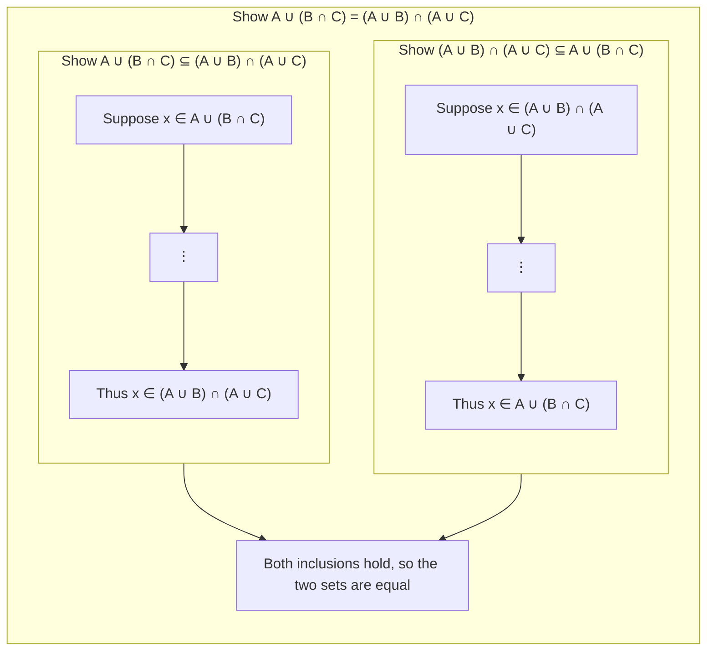

*Figure 7. Structure of the proof of a distributive law*

Filling in the gaps uses the procedural version of union in both directions. Knowing $x \in B$, one can conclude $x \in A \cup B$ because $x \in A \lor x \in B$ is true. Conversely, when one knows only that an element is in a union of two sets but not which set it is in, one must split the argument into the case that it is in the first set and the case that it is in the second set and show that the same conclusion follows in either case (division into cases, Chapter 2).

> **Key Point:** **Theorem 6.2.2(3)(a) (A Distributive Law for Sets).** For all sets $A$, $B$, and $C$, $A \cup (B \cap C) = (A \cup B) \cap (A \cup C)$.

**Proof.** Suppose $A$, $B$, and $C$ are any sets.

**(1) Proof that $A \cup (B \cap C) \subseteq (A \cup B) \cap (A \cup C)$.** Let $x \in A \cup (B \cap C)$. By the definition of union, $x \in A$ or $x \in B \cap C$.

- **Case 1 ($`x \in A`$):** By the definition of union, $x \in A \cup B$ and $x \in A \cup C$. Hence $x \in (A \cup B) \cap (A \cup C)$ by the definition of intersection.
- **Case 2 ($`x \in B \cap C`$):** By the definition of intersection, $x \in B$ and $x \in C$. Since $x \in B$, $x \in A \cup B$ by the definition of union, and since $x \in C$, $x \in A \cup C$. Hence $x \in (A \cup B) \cap (A \cup C)$ by the definition of intersection.

In both cases $x \in (A \cup B) \cap (A \cup C)$. Since $x$ was an arbitrary element of $A \cup (B \cap C)$, $A \cup (B \cap C) \subseteq (A \cup B) \cap (A \cup C)$ by the definition of subset.

**(2) Proof that $(A \cup B) \cap (A \cup C) \subseteq A \cup (B \cap C)$.** Let $x \in (A \cup B) \cap (A \cup C)$. Consider the two cases $x \in A$ and $x \notin A$.

- **Case 1 ($`x \in A`$):** By the definition of union, immediately $x \in A \cup (B \cap C)$.
- **Case 2 ($`x \notin A`$):** By the definition of intersection, $x \in A \cup B$ and $x \in A \cup C$. Since $x \in A \cup B$, $x$ is in at least one of $A$ and $B$, and since $x \notin A$, $x \in B$ (elimination). For the same reason, $x \in A \cup C$ and $x \notin A$ give $x \in C$. Hence $x \in B \cap C$ by the definition of intersection, and $x \in A \cup (B \cap C)$ by the definition of union.

In both cases $x \in A \cup (B \cap C)$, so $(A \cup B) \cap (A \cup C) \subseteq A \cup (B \cap C)$ by the definition of subset.

**(3) Conclusion.** Since both inclusions have been proved, $A \cup (B \cap C) = (A \cup B) \cap (A \cup C)$ by the definition of set equality. ∎

In (2), the cases $x \in A$ and $x \notin A$ are considered for the following reason. The information obtained from $x \in (A \cup B) \cap (A \cup C)$ is $x \in A \lor x \in B$ and $x \in A \lor x \in C$. One way to satisfy both is for $x$ to be in $A$, but that may not be so, and therefore the case in which $x$ is not in $A$ must also be considered. In that case $x \in A$ is eliminated from both disjunctions, giving $x \in B$ and $x \in C$.

**Forward chaining and backward chaining.** In artificial intelligence, the kinds of reasoning used in the proof above are called **backward chaining** and **forward chaining**. First, what must be shown is viewed as a goal, and one analyzes what task, once accomplished, would reach the goal. That task is called subgoal $SG_1$. For the distributive law, showing that each set is a subset of the other is $SG_1$. Then one looks for a task $SG_2$ that would reach $SG_1$, and so on, building a chain backward from the goal. At the point where going backward becomes difficult, one moves forward from the information in the starting point, deducing $I_1$, $I_2$, ... in turn, and the chain is complete when one of the subgoals is reached.

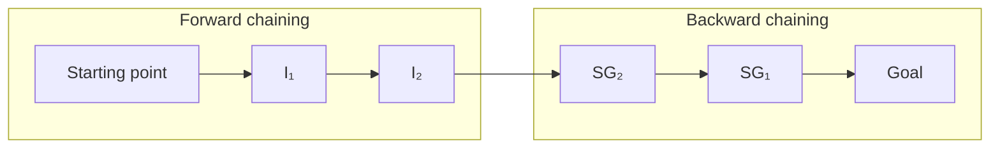

*Figure 8. A chain of proof completed by forward and backward chaining*

### 2.6 Proof of a De Morgan's Law

Since complement is defined by "not" and union and intersection by "or" and "and," it is natural that there are laws for sets corresponding to De Morgan's laws of logic (Chapter 2).

> **Key Point:** **Theorem 6.2.2(9)(a) (A De Morgan's Law for Sets).** For all sets $A$ and $B$, $(A \cup B)^c = A^c \cap B^c$.

The statement is universal, so the starting point is to take $A$ and $B$ to be arbitrarily chosen sets, and what must be shown is $(A \cup B)^c \subseteq A^c \cap B^c$ and $A^c \cap B^c \subseteq (A \cup B)^c$. Each step uses the procedural versions of complement, union, and intersection, and the crucial step uses De Morgan's law of logic.

**Proof.** Suppose $A$ and $B$ are any sets.

**Proof that $(A \cup B)^c \subseteq A^c \cap B^c$.** Suppose $x \in (A \cup B)^c$.

1. By the definition of complement, $x \notin A \cup B$.
2. By the definition of union, this means that $x \in A \lor x \in B$ is false.
3. By De Morgan's law of logic, $x \notin A$ and $x \notin B$.
4. By the definition of complement, $x \in A^c$ and $x \in B^c$.
5. By the definition of intersection, $x \in A^c \cap B^c$.

Hence $(A \cup B)^c \subseteq A^c \cap B^c$ by the definition of subset.

**Proof that $A^c \cap B^c \subseteq (A \cup B)^c$.** Suppose $x \in A^c \cap B^c$.

1. By the definition of intersection, $x \in A^c$ and $x \in B^c$.
2. By the definition of complement, $x \notin A$ and $x \notin B$.
3. By De Morgan's law of logic, $x \in A \lor x \in B$ is false.
4. By the definition of union, $x \notin A \cup B$.
5. By the definition of complement, $x \in (A \cup B)^c$.

Hence $A^c \cap B^c \subseteq (A \cup B)^c$.

**Conclusion.** Since both inclusions have been proved, $(A \cup B)^c = A^c \cap B^c$ by the definition of set equality. ∎

The proofs of the two directions retrace the same steps in reverse, because each step is an equivalence ($`\iff`$). Part (9)(b), $(A \cap B)^c = A^c \cup B^c$, is proved in the same way, using De Morgan's law for the negation of a conjunction.

### 2.7 Intersection and Union with a Subset

If one set is a subset of another, their intersection is the smaller set and their union is the larger set.

> **Key Point:** **Theorem 6.2.3 (Intersection and Union with a Subset).** For all sets $A$ and $B$, if $A \subseteq B$, then (a) $A \cap B = A$ and (b) $A \cup B = B$.

**Proof of (a).** Take sets $A$ and $B$ with $A \subseteq B$. To show $A \cap B = A$, one must show $A \cap B \subseteq A$ and $A \subseteq A \cap B$. The former already holds by the inclusion of intersection property of Theorem 6.2.1. To show the latter, let $x$ be any element of $A$. By the hypothesis $A \subseteq B$ and the definition of subset, $x \in B$. Hence $x \in A$ and $x \in B$, so $x \in A \cap B$ by the definition of intersection. Therefore $A \subseteq A \cap B$, and by the two inclusions $A \cap B = A$. ∎

Part (b) is proved by the same method and is treated in Self-Check Question 5.

### 2.8 Properties of the Empty Set

Section 1.8 introduced a set with no elements but deferred the proof that only one such set exists. That proof rests on a more basic fact, which is proved first: a set without elements is contained in every set. Considering what it would take for this fact to fail shows why it holds. The negation of a universal statement is existential, so if a set $E$ is not a subset of a set $A$, there must be an element that is in $E$ and not in $A$. But if $E$ has no elements, no such element can exist.

> **Key Point:** **Theorem 6.2.4 (A Set with No Elements Is a Subset of Every Set).** If $E$ is a set with no elements and $A$ is any set, then $E \subseteq A$.

**Proof (by contradiction).** Suppose the negation of the theorem is true. That is, suppose there are a set $E$ with no elements and a set $A$ such that $E \not\subseteq A$. Then by the definition of subset, there must be an element of $E$ that is not an element of $A$. But $E$ has no elements, so there can be no such element. This is a contradiction. Hence the supposition that there are a set $E$ with no elements and a set $A$ with $E \not\subseteq A$ is false, and the theorem is true. ∎

The theorem can also be understood through vacuous truth (Chapters 2 and 3). $E \subseteq A$ is the same as $`\forall x\ (x \in E \rightarrow x \in A)`$, and since $E$ has no elements, the hypothesis $x \in E$ is false for every $x$, so this conditional statement is vacuously true.

> **Key Point:** **Corollary 6.2.5 (Uniqueness of the Empty Set).** There is only one set with no elements.

**Proof.** Suppose $E_1$ and $E_2$ are both sets with no elements. By Theorem 6.2.4, $E_1 \subseteq E_2$ because $E_1$ has no elements, and $E_2 \subseteq E_1$ because $E_2$ has no elements. Hence $E_1 = E_2$ by the definition of set equality. ∎

Corollary 6.2.5 has a curious consequence: the set of pink elephants living on earth and the set of real numbers whose square is $-1$ are one and the same set, since both are empty. Because a set without elements is unique, it can be given its own name, the empty set, and its own symbol $\emptyset$.

> **Caution:** $\emptyset$ and $\lbrace \emptyset \rbrace$ are different. $\emptyset$ has no elements, but $\lbrace \emptyset \rbrace$ has one element, namely the empty set. Hence $\emptyset \in \lbrace \emptyset \rbrace$ and $\lbrace \emptyset \rbrace \ne \emptyset$.

> **Note:** The programming languages Lisp and Scheme make the same distinction. `()` is the empty list, and `(())` is the list whose only element is the empty list.

Corollary 6.2.5 also gives a practical test: since $\emptyset$ is the only set without elements, a set equals $\emptyset$ exactly when it has no elements.

> **Key Point:** **Element method for proving a set equals the empty set.** To prove that a set $X$ equals $\emptyset$, prove that $X$ has no elements. To do this, suppose $X$ has an element and derive a contradiction.

**Example 6.2.4 (Proving That a Set Is Empty).** Prove Theorem 6.2.2(8)(b): for every set $A$, $A \cap \emptyset = \emptyset$.

Let $A$ be a particular but arbitrarily chosen set. By the element method above, it suffices to show that $A \cap \emptyset$ has no elements. Suppose $A \cap \emptyset$ has an element $x$. By the definition of intersection, $x \in A$ and $x \in \emptyset$. In particular $x \in \emptyset$, which is impossible because $\emptyset$ has no elements. This contradiction shows that the supposition that $A \cap \emptyset$ has an element $x$ is false. Hence $A \cap \emptyset$ has no elements, and $A \cap \emptyset = \emptyset$. ∎

The next property is a set property in conditional form. Since it is a universal conditional statement, the proof begins as a direct proof: suppose $A$, $B$, $C$ are any sets satisfying $A \subseteq B$ and $B \subseteq C^c$, and show $A \cap C = \emptyset$. Since the conclusion says that a certain set is empty, the element method above is used.

> **Key Point:** **Proposition 6.2.6.** For all sets $A$, $B$, and $C$, if $A \subseteq B$ and $B \subseteq C^c$, then $A \cap C = \emptyset$.

**Proof.** Take sets $A$, $B$, $C$ with $A \subseteq B$ and $B \subseteq C^c$. To show $A \cap C = \emptyset$, suppose $A \cap C$ has an element $x$.

1. By the definition of intersection, $x \in A$ and $x \in C$.
2. Since $x \in A$ and $A \subseteq B$, $x \in B$ by the definition of subset.
3. Since $x \in B$ and $B \subseteq C^c$, $x \in C^c$ by the definition of subset again.
4. By the definition of complement, $x \notin C$.
5. Since $x \in C$ by step 1, $x \in C$ and $x \notin C$, which is a contradiction.

Hence the supposition that $A \cap C$ has an element is false, and $A \cap C = \emptyset$. ∎

### 2.9 A Generalized Distributive Law

The distributive law generalizes to intersections of finitely many sets. The notation becomes more complex, but the basic ideas are the same as in the proof of Section 2.5.

> **Key Point:** **A Generalized Distributive Law.** For every positive integer $n$ and all sets $A$, $B_1, B_2, \ldots, B_n$, the following holds.

```math
A \cup \left( \bigcap_{i=1}^{n} B_i \right) = \bigcap_{i=1}^{n} (A \cup B_i)
```

**Proof.** Suppose $A$ and $B_1, \ldots, B_n$ are any sets and $n$ is a positive integer.

**Part 1: $A \cup \left( \bigcap_{i=1}^{n} B_i \right) \subseteq \bigcap_{i=1}^{n} (A \cup B_i)$.** Let $x$ be any element of $A \cup \left( \bigcap_{i=1}^{n} B_i \right)$. By the definition of union, $x \in A$ or $x \in \bigcap_{i=1}^{n} B_i$.

- **Case 1 ($`x \in A`$):** By the definition of union, $x \in A \cup B_i$ for every integer $i = 1, \ldots, n$. Hence $x \in \bigcap_{i=1}^{n} (A \cup B_i)$ by the definition of general intersection.
- **Case 2 ($`x \in \bigcap_{i=1}^{n} B_i`$):** By the definition of general intersection, $x \in B_i$ for every $i = 1, \ldots, n$. By the definition of union, $x \in A \cup B_i$ for every $i$, so $x \in \bigcap_{i=1}^{n} (A \cup B_i)$.

**Part 2: $\bigcap_{i=1}^{n} (A \cup B_i) \subseteq A \cup \left( \bigcap_{i=1}^{n} B_i \right)$.** Let $x$ be any element of $\bigcap_{i=1}^{n} (A \cup B_i)$. By the definition of intersection, $x \in A \cup B_i$ for every $i = 1, \ldots, n$. Consider the cases $x \in A$ and $x \notin A$.

- **Case 1 ($`x \in A`$):** By the definition of union, $x \in A \cup \left( \bigcap_{i=1}^{n} B_i \right)$.
- **Case 2 ($`x \notin A`$):** Since $x \in A \cup B_i$ for every $i$ and $x \notin A$, $x \in B_i$ for every $i$. Hence $x \in \bigcap_{i=1}^{n} B_i$ by the definition of intersection, and $x \in A \cup \left( \bigcap_{i=1}^{n} B_i \right)$ by the definition of union.

**Conclusion.** Since both inclusions have been proved, the two sets are equal by the definition of set equality. ∎

---

<br>

## 3. Disproofs and Algebraic Proofs

Section 2 dealt only with set properties that are true. This section shows how to disprove a proposed set property that is false by means of a counterexample, proves an important theorem about the number of elements of a power set, and then introduces an algebraic method for deriving new set properties from properties already known to be true.

### 3.1 Disproving an Alleged Set Property

A single instance that makes a universal statement false, called a **counterexample** (Chapter 3), is enough to refute the statement.

**Example 6.3.1 (Finding a Counterexample for a Set Identity).** Is the following property true?

```math
\text{For all sets } A, B, C,\ (A - B) \cup (B - C) = A - C
```

The property is true if, and only if, the equation holds for all sets $A$, $B$, and $C$. So the property is false if, and only if, there are sets $A$, $B$, and $C$ for which the equation does not hold.

**Step 1: Predicting with a Venn diagram.** Draw the three sets as in Figure 9. If any of the eight subregions may be empty, the diagram is quite general. Shade the region corresponding to $(A - B) \cup (B - C)$ and the region corresponding to $A - C$, and compare them.

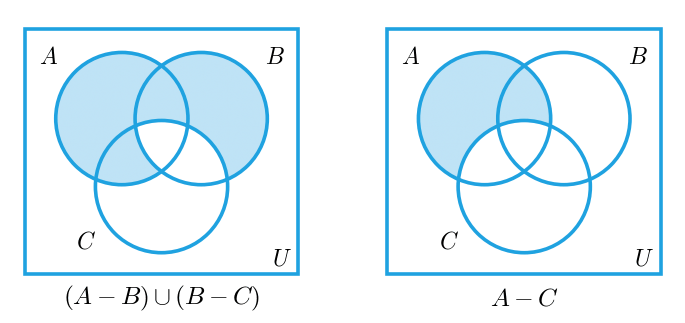

*Figure 9. Comparison of the regions (A − B) ∪ (B − C) and A − C*

The two regions look different, so the property is expected to be false. For instance, an element that is in $B$ but in neither $A$ nor $C$ is in $B - C$ and hence in $(A - B) \cup (B - C)$, but it is not in $A - C$ because it lies outside $A$. Also, an element that is in $A$ and $C$ but not in $B$ is in $A - B$ and hence in the left-hand side, but it is not in $A - C$ because it is in $C$.

**Step 2: Constructing a concrete counterexample.** To confirm that the diagram was neither drawn nor read incorrectly, construct a concrete counterexample. As in Figure 10, label the seven subregions inside the three circles with the integers 1 through 7, one integer per subregion. If the property involved complements, the region outside the circles would also be needed, so put 8 there. Then let $A$, $B$, and $C$ consist of all the numbers inside the respective circles.

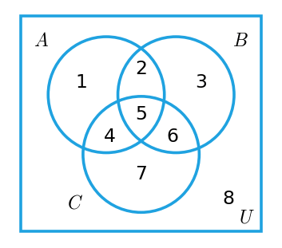

*Figure 10. A Venn diagram of three sets with numbered subregions*

**Counterexample 1.** Let $A = \lbrace 1, 2, 4, 5 \rbrace$, $B = \lbrace 2, 3, 5, 6 \rbrace$, and $C = \lbrace 4, 5, 6, 7 \rbrace$.

- $A - B$: among the elements 1, 2, 4, 5 of $A$, those not in $B$ are 1 and 4, so $\lbrace 1, 4 \rbrace$.
- $B - C$: among the elements 2, 3, 5, 6 of $B$, those not in $C$ are 2 and 3, so $\lbrace 2, 3 \rbrace$.
- $A - C$: among the elements 1, 2, 4, 5 of $A$, those not in $C$ are 1 and 2, so $\lbrace 1, 2 \rbrace$.

Hence $(A - B) \cup (B - C) = \lbrace 1, 4 \rbrace \cup \lbrace 2, 3 \rbrace = \lbrace 1, 2, 3, 4 \rbrace$, whereas $A - C = \lbrace 1, 2 \rbrace$. Since $\lbrace 1, 2, 3, 4 \rbrace \ne \lbrace 1, 2 \rbrace$, $(A - B) \cup (B - C) \ne A - C$.

**Counterexample 2.** A more economical counterexample also exists. As long as $B$ contains one element (for example, 3) that is not in $A$, the equation fails regardless of whether $B$, $A$, or $C$ contain other elements. Let $A = \emptyset$, $B = \lbrace 3 \rbrace$, and $C = \emptyset$. Then $A - B = \emptyset$, $B - C = \lbrace 3 \rbrace$, and $A - C = \emptyset$. Hence $(A - B) \cup (B - C) = \emptyset \cup \lbrace 3 \rbrace = \lbrace 3 \rbrace$, whereas $A - C = \emptyset$, and $\lbrace 3 \rbrace \ne \emptyset$.

**Counterexample 3.** It also works if $A = C$ is a singleton set and $B$ is empty. With $A = C = \lbrace 4 \rbrace$ and $B = \emptyset$, $A - B = \lbrace 4 \rbrace$ and $B - C = \emptyset$, so the left-hand side is $\lbrace 4 \rbrace$, while $A - C = \emptyset$.

Counterexample 2 places one element in region 3 of Figure 10 (in $B$ only), and counterexample 3 places one element in region 4 (in $A$ and $C$ only); each uses one of the two differences found in Step 1.

### 3.2 Problem-Solving Strategy

When it is not known whether a universal statement about sets is true or false, two lines of attack are available. One is to attempt a proof, asking what has to be shown and by what means; the other is to work out what a counterexample would need to satisfy. Neither line is guaranteed to succeed at once, so it pays to keep both in mind and to change course when the current attempt stalls. Hard questions often require moving back and forth between the two several times. The two attempts also inform each other: a case in which a proof gets stuck often suggests how to build a counterexample, and conditions for a counterexample that keep contradicting each other often reveal the key step of a proof.

### 3.3 The Number of Subsets of a Set

The power set of a set with $n$ elements has $2^n$ elements. This theorem is proved by mathematical induction (Chapter 5) and is based on the following observations. Let $X$ be a set and $z$ an element of $X$.

1. The subsets of $X$ split into two groups: those that do not contain $z$ and those that do contain $z$.
2. The subsets of $X$ that do not contain $z$ are exactly the subsets of $X - \lbrace z \rbrace$.
3. Matching each subset $A$ that does not contain $z$ with the subset $A \cup \lbrace z \rbrace$ that contains $z$ pairs up the two groups one for one. Hence the number of subsets that contain $z$ equals the number of subsets that do not contain $z$.

For example, if $X = \lbrace x, y, z \rbrace$, the subsets are paired as follows.

| Subsets of $X$ that do not contain $z$ | Subsets of $X$ that contain $z$ |
|:-----|:-----|
| $\emptyset$ | $\emptyset \cup \lbrace z \rbrace = \lbrace z \rbrace$ |
| $\lbrace x \rbrace$ | $\lbrace x \rbrace \cup \lbrace z \rbrace = \lbrace x, z \rbrace$ |
| $\lbrace y \rbrace$ | $\lbrace y \rbrace \cup \lbrace z \rbrace = \lbrace y, z \rbrace$ |
| $\lbrace x, y \rbrace$ | $\lbrace x, y \rbrace \cup \lbrace z \rbrace = \lbrace x, y, z \rbrace$ |

*Table 8. Pairing of the subsets that do not contain z with those that contain z*

The left column lists the 4 subsets of $X - \lbrace z \rbrace = \lbrace x, y \rbrace$, and the right column also has 4, so $X$ has $4 + 4 = 8 = 2^3$ subsets in all.

> **Key Point:** **Theorem 6.3.1.** For every integer $n \ge 0$, if a set $X$ has $n$ elements, then $\mathcal{P}(X)$ has $2^n$ elements.

**Proof (by mathematical induction).** Let the property $P(n)$ be the sentence "Any set with $n$ elements has $2^n$ subsets."

**Basis step: show that $P(0)$ is true.** A set with zero elements must be $\emptyset$, and $\emptyset$ has exactly one subset, namely $\emptyset$ itself, because $\emptyset \subseteq \emptyset$ by Theorem 6.2.4 and a subset of $\emptyset$ can contain no elements. Hence a set with zero elements has $1 = 2^0$ subsets, and $P(0)$ is true.

**Inductive step: show that for every integer $k \ge 0$, if $P(k)$ is true then $P(k + 1)$ is true.** Let $k$ be any integer with $k \ge 0$, and suppose that every set with $k$ elements has $2^k$ subsets (the inductive hypothesis). It must be shown that every set with $k + 1$ elements has $2^{k+1}$ subsets.

Let $X$ be a set with $k + 1$ elements. Since $k + 1 \ge 1$, an element $z$ of $X$ can be chosen. Every subset of $X$ either contains $z$ or does not. The subsets that do not contain $z$ are exactly the subsets of $X - \lbrace z \rbrace$, and each subset $A$ that does not contain $z$ is matched with the subset $A \cup \lbrace z \rbrace$ that contains $z$. Hence there are as many subsets that contain $z$ as there are that do not, and the number of subsets of $X$ is twice the number of subsets of $X - \lbrace z \rbrace$. Since $X - \lbrace z \rbrace$ has $k$ elements, it has $2^k$ subsets by the inductive hypothesis. Therefore the following holds.

```math
\begin{aligned}
(\text{the number of subsets of } X) &= 2 \cdot (\text{the number of subsets of } X - \lbrace z \rbrace) \\
&= 2 \cdot 2^k \\
&= 2^{k+1}
\end{aligned}
```

The second line substitutes the inductive hypothesis, and the third line uses a law of exponents. Thus $P(k + 1)$ is true. Since both the basis step and the inductive step have been proved, the theorem holds. ∎

That the matching preserves counts can be checked as follows. Adding $\lbrace z \rbrace$ to two different subsets $A_1 \ne A_2$ that do not contain $z$ gives different results, since $A_1 = (A_1 \cup \lbrace z \rbrace) - \lbrace z \rbrace$. Also, every subset $D$ that contains $z$ arises from $D - \lbrace z \rbrace$, which does not contain $z$. In other words, the matching is a one-to-one correspondence between the two groups (Chapter 7).

> **Note:** If the elements are listed as $x_1, x_2, \ldots, x_n$, each subset $S$ can be matched with the bit string of length $n$ whose $`i`$th bit is 1 exactly when $x_i \in S$. For example, in $\lbrace x, y, z \rbrace$, the subset $\lbrace x, z \rbrace$ corresponds to 101 and $\emptyset$ to 000. There are $2^n$ bit strings of length $n$ (the multiplication rule of Chapter 9), so there are $2^n$ subsets. Representing the subsets of a small set as integer bit masks in a program is exactly this correspondence.

### 3.4 Algebraic Proofs of Set Identities

Let $U$ be a universal set. The identities of Theorem 6.2.2 hold for every element of the power set $\mathcal{P}(U)$, that is, for every subset of $U$. With a stock of such identities in hand, further properties can be obtained by algebraic manipulation alone, without returning to element arguments. In fact, every identity involving only unions, intersections, and complements can be proved from identities (1)-(5) of Theorem 6.2.2 alone, and with the addition of (12), the set difference law, every identity involving set differences can be proved as well.

This works because each known property is a universal statement: as with the laws of ordinary algebra, every variable in a set law may be replaced by any set whatsoever. For example, the distributive law

```math
A \cap (B \cup C) = (A \cap B) \cup (A \cap C)
```

is a template into which any three sets can be placed. If $A_1$, $A_2$, and $A_3$ are particular sets, placing $A_1$ in the role of $A$, $A_2$ in the role of $B$, and $A_3$ in the role of $C$ gives the following.

```math
A_1 \cap (A_2 \cup A_3) = (A_1 \cap A_2) \cup (A_1 \cap A_3)
```

Compound sets can also be substituted for the variables. If $W$, $X$, $Y$, $Z$ are any sets, placing $W \cap X$ in the role of $A$, $Y$ in the role of $B$, and $Z$ in the role of $C$ gives the following.

```math
(W \cap X) \cap (Y \cup Z) = ((W \cap X) \cap Y) \cup ((W \cap X) \cap Z)
```

Proving a new identity by applying the identities of Theorem 6.2.2 one step at a time in this way is called an **algebraic proof**.

**Example 6.3.2 (Deriving a Set Difference Property).** Give an algebraic proof that for all sets $A$, $B$, and $C$, $(A \cup B) - C = (A - C) \cup (B - C)$. Let $A$, $B$, and $C$ be any sets.

| Step | Expression | Reason (Theorem 6.2.2) |
|:-----|:-----|:-----|
| 1 | $(A \cup B) - C = (A \cup B) \cap C^c$ | set difference law (12) |
| 2 | $= C^c \cap (A \cup B)$ | commutative law for $\cap$, 1(b) |
| 3 | $= (C^c \cap A) \cup (C^c \cap B)$ | distributive law 3(b) |
| 4 | $= (A \cap C^c) \cup (B \cap C^c)$ | commutative law for $\cap$, 1(b) |
| 5 | $= (A - C) \cup (B - C)$ | set difference law (12) |

*Table 9. Algebraic proof of (A ∪ B) − C = (A − C) ∪ (B − C)*

The commutative law is used in step 2 because distributive law 3(b) is stated in the form $A \cap (B \cup C)$, with the common factor on the left. Step 4, for the same reason, puts the result into the form $X \cap Y^c$ of the set difference law.

**Example 6.3.3 (Deriving a Set Identity Using Properties of $`\emptyset`$).** Give an algebraic proof that for all sets $A$ and $B$, $A - (A \cap B) = A - B$. Let $A$ and $B$ be any sets.

| Step | Expression | Reason (Theorem 6.2.2) |
|:-----|:-----|:-----|
| 1 | $A - (A \cap B) = A \cap (A \cap B)^c$ | set difference law (12) |
| 2 | $= A \cap (A^c \cup B^c)$ | De Morgan's law 9(b) |
| 3 | $= (A \cap A^c) \cup (A \cap B^c)$ | distributive law 3(b) |
| 4 | $= \emptyset \cup (A \cap B^c)$ | complement law 5(b) |
| 5 | $= (A \cap B^c) \cup \emptyset$ | commutative law for $\cup$, 1(a) |
| 6 | $= A \cap B^c$ | identity law for $\cup$, 4(a) |
| 7 | $= A - B$ | set difference law (12) |

*Table 10. Algebraic proof of A − (A ∩ B) = A − B*

An algebraic proof often looks simpler than an element proof, but sometimes an element proof is easier to understand. The equation above is immediate when thought of in terms of elements. For an element to be in $A - (A \cap B)$ means that it is in $A$ and not in both $A$ and $B$, and given that it is in $A$, this is the same as saying that it is not in $B$.

> **Caution:** In an algebraic proof, the properties of Theorem 6.2.2 must be used exactly in the form in which they are stated. For example, identity law 4(a) is stated as $A \cup \emptyset = A$, so to replace $\emptyset \cup X$ by $X$ one must first use the commutative law to obtain $X \cup \emptyset$. Step 5 of the example above is that step. Citing one reason for every step is the essence of an algebraic proof.

### 3.5 A Generalized Associative Law

**Example 6.3.4 (The Associative Law for Four Sets).** Prove, using only properties from Theorem 6.2.2, that for all sets $A_1$, $A_2$, $A_3$, and $A_4$ the following holds.

```math
((A_1 \cup A_2) \cup A_3) \cup A_4 = A_1 \cup ((A_2 \cup A_3) \cup A_4)
```

| Step | Expression | Reason |
|:-----|:-----|:-----|
| 1 | $((A_1 \cup A_2) \cup A_3) \cup A_4 = (A_1 \cup (A_2 \cup A_3)) \cup A_4$ | associative law for $\cup$, 2(a), with $A_1$ in the role of $A$, $A_2$ in the role of $B$, and $A_3$ in the role of $C$ |
| 2 | $= A_1 \cup ((A_2 \cup A_3) \cup A_4)$ | associative law for $\cup$, 2(a), with $A_1$ in the role of $A$, $A_2 \cup A_3$ in the role of $B$, and $A_4$ in the role of $C$ |

*Table 11. Algebraic proof of the associative law for four sets*

Step 1 applies the associative law only to the inner part $(A_1 \cup A_2) \cup A_3$ of the expression and leaves the rest unchanged, which is allowed because equal sets can be substituted for each other. Repeating such steps shows that in an expression consisting of several unions, the result is the same however the parentheses are placed, which is why one writes $A_1 \cup A_2 \cup A_3 \cup A_4$ without parentheses.

---

<br>

## 4. Boolean Algebras, Russell's Paradox, and the Halting Problem

The logical equivalences of Chapter 2 and the set properties of this chapter are strikingly similar. This section abstracts their common structure as a Boolean algebra, and then treats Russell's paradox, which shook the foundations of set theory, and the halting problem, a result of the theory of computation with the same logical structure.

### 4.1 Logical Equivalences and Set Properties Side by Side

The following table places the logical equivalences of Chapter 2 (statement variables $p$, $q$, $`r`$) side by side with the set properties of Theorem 6.2.2 (sets $A$, $B$, $`C`$). $\mathbf{t}$ is a tautology, $\mathbf{c}$ is a contradiction, and $\sim$ is negation.

| Law | Logical equivalence | Set property |
|:-----|:-----|:-----|
| Commutative laws | $p \lor q \equiv q \lor p$, $p \land q \equiv q \land p$ | $A \cup B = B \cup A$, $A \cap B = B \cap A$ |
| Associative laws | $(p \lor q) \lor r \equiv p \lor (q \lor r)$, $(p \land q) \land r \equiv p \land (q \land r)$ | $(A \cup B) \cup C = A \cup (B \cup C)$, $(A \cap B) \cap C = A \cap (B \cap C)$ |
| Distributive laws | $p \lor (q \land r) \equiv (p \lor q) \land (p \lor r)$, $p \land (q \lor r) \equiv (p \land q) \lor (p \land r)$ | $A \cup (B \cap C) = (A \cup B) \cap (A \cup C)$, $A \cap (B \cup C) = (A \cap B) \cup (A \cap C)$ |
| Identity laws | $p \lor \mathbf{c} \equiv p$, $p \land \mathbf{t} \equiv p$ | $A \cup \emptyset = A$, $A \cap U = A$ |
| Negation laws, complement laws | $p \lor {\sim p} \equiv \mathbf{t}$, $p \land {\sim p} \equiv \mathbf{c}$ | $A \cup A^c = U$, $A \cap A^c = \emptyset$ |
| Double negative law, double complement law | ${\sim}({\sim p}) \equiv p$ | $(A^c)^c = A$ |
| Idempotent laws | $p \lor p \equiv p$, $p \land p \equiv p$ | $A \cup A = A$, $A \cap A = A$ |
| Universal bound laws | $p \lor \mathbf{t} \equiv \mathbf{t}$, $p \land \mathbf{c} \equiv \mathbf{c}$ | $A \cup U = U$, $A \cap \emptyset = \emptyset$ |
| De Morgan's laws | ${\sim}(p \lor q) \equiv {\sim p} \land {\sim q}$, ${\sim}(p \land q) \equiv {\sim p} \lor {\sim q}$ | $(A \cup B)^c = A^c \cap B^c$, $(A \cap B)^c = A^c \cup B^c$ |
| Absorption laws | $p \lor (p \land q) \equiv p$, $p \land (p \lor q) \equiv p$ | $A \cup (A \cap B) = A$, $A \cap (A \cup B) = A$ |
| Negations of $\mathbf{t}$ and $\mathbf{c}$, complements of $U$ and $\emptyset$ | ${\sim}\mathbf{t} \equiv \mathbf{c}$, ${\sim}\mathbf{c} \equiv \mathbf{t}$ | $U^c = \emptyset$, $\emptyset^c = U$ |

*Table 12. Correspondence between logical equivalences and set properties*

Reading $\lor$ (or) as $\cup$, $\land$ (and) as $\cap$, $\mathbf{t}$ as the universal set $U$, $\mathbf{c}$ as the empty set $\emptyset$, and $\sim$ (negation) as complementation $^c$ turns each logical equivalence of Table 12 into the set property in the same row. Statement forms combined with $\lor$ and $\land$ and subsets of a universal set combined with $\cup$ and $\cap$ therefore obey the same rules, and both are instances of one abstract structure, the **Boolean algebra**. The English mathematician and logician George Boole proposed the core of this idea in 1847, and over the rest of the nineteenth century Boole and later authors sharpened the concept.

### 4.2 Definition of a Boolean Algebra

> **Definition:** A **Boolean algebra** is a set $B$ together with two operations $+$ and $\cdot$ such that for all $a$ and $b$ in $B$, both $a + b$ and $a \cdot b$ are in $B$, and the following axioms hold.

| No. | Axiom | (a) | (b) |
|:-----|:-----|:-----|:-----|
| 1 | Commutative laws: for all $a$, $b$ in $B$ | $a + b = b + a$ | $a \cdot b = b \cdot a$ |
| 2 | Associative laws: for all $a$, $b$, $c$ in $B$ | $(a + b) + c = a + (b + c)$ | $(a \cdot b) \cdot c = a \cdot (b \cdot c)$ |
| 3 | Distributive laws: for all $a$, $b$, $c$ in $B$ | $a + (b \cdot c) = (a + b) \cdot (a + c)$ | $a \cdot (b + c) = (a \cdot b) + (a \cdot c)$ |
| 4 | Identity laws: there exist distinct elements 0 and 1 in $B$ such that for each $a$ in $B$ | $a + 0 = a$ | $a \cdot 1 = a$ |
| 5 | Complement laws: for each $a$ in $B$ there is an element $\overline{a}$ in $B$ such that | $a + \overline{a} = 1$ | $a \cdot \overline{a} = 0$ |

*Table 13. The axioms of a Boolean algebra*

The element $\overline{a}$ of axiom 5 is called the **complement** or negation of $a$. In axiom 4, 0 is the identity element for $+$ and 1 is the identity element for $\cdot$.

Typical examples of Boolean algebras are the following.

| Part of a Boolean algebra | Boolean algebra of sets | Boolean algebra of statement forms | Two-element Boolean algebra |
|:-----|:-----|:-----|:-----|
| Elements | subsets of a universal set $U$ | statement forms (logically equivalent forms are regarded as the same) | 0 and 1 |
| $+$ | $\cup$ | $\lor$ | OR |
| $\cdot$ | $\cap$ | $\land$ | AND |
| 0 | $\emptyset$ | $\mathbf{c}$ | 0 |
| 1 | $U$ | $\mathbf{t}$ | 1 |
| $\overline{a}$ | $A^c$ | ${\sim p}$ | $\overline{0} = 1$, $\overline{1} = 0$ |

*Table 14. Three examples of Boolean algebras*

In the two-element Boolean algebra $\lbrace 0, 1 \rbrace$, the two operations are as follows. They agree with the input/output tables of the OR gate and the AND gate in Chapter 2.

| $a$ | $b$ | $a + b$ | $a \cdot b$ |
|:-----|:-----|:-----|:-----|
| 0 | 0 | 0 | 0 |
| 0 | 1 | 1 | 0 |
| 1 | 0 | 1 | 0 |
| 1 | 1 | 1 | 1 |

*Table 15. Operations of the two-element Boolean algebra {0, 1}*

For example, checking axiom 5(a) gives $0 + \overline{0} = 0 + 1 = 1$ and $1 + \overline{1} = 1 + 0 = 1$, and checking 5(b) gives $0 \cdot \overline{0} = 0 \cdot 1 = 0$ and $1 \cdot \overline{1} = 1 \cdot 0 = 0$.

> **Caution:** The $+$ and $\cdot$ of a Boolean algebra are not the addition and multiplication of numbers. In the two-element Boolean algebra $1 + 1 = 1$, and distributive law 3(a), $a + (b \cdot c) = (a + b) \cdot (a + c)$, which fails in the algebra of numbers, holds as an axiom.

> **[Digital Logic Design]** In digital logic design, the two-element Boolean algebra is called switching algebra, and the laws of Boolean algebra are used to simplify Boolean expressions so that a circuit with the same input/output table can be built from fewer gates.

### 4.3 Properties of a Boolean Algebra

From the five axioms alone one can show that every element has exactly one complement, that 0 and 1 are the only identity elements for $+$ and $\cdot$, respectively, and that every Boolean algebra satisfies counterparts of the logical equivalences of Chapter 2 and of Theorem 6.2.2.

> **Key Point:** **Theorem 6.4.1 (Properties of a Boolean Algebra).** Let $B$ be any Boolean algebra.
> 1. **Uniqueness of the Complement Law:** For all $a$ and $x$ in $B$, if $a + x = 1$ and $a \cdot x = 0$, then $x = \overline{a}$.
> 2. **Uniqueness of 0 and 1:** If there is $x$ in $B$ such that $a + x = a$ for every $a$ in $B$, then $x = 0$, and if there is $y$ in $B$ such that $a \cdot y = a$ for every $a$ in $B$, then $y = 1$.
> 3. **Double Complement Law:** For every $a$ in $B$, $\overline{(\overline{a})} = a$.
> 4. **Idempotent Laws:** For every $a$ in $B$, (a) $a + a = a$ and (b) $a \cdot a = a$.
> 5. **Universal Bound Laws:** For every $a$ in $B$, (a) $a + 1 = 1$ and (b) $a \cdot 0 = 0$.
> 6. **De Morgan's Laws:** For all $a$ and $b$ in $B$, (a) $\overline{a + b} = \overline{a} \cdot \overline{b}$ and (b) $\overline{a \cdot b} = \overline{a} + \overline{b}$.
> 7. **Absorption Laws:** For all $a$ and $b$ in $B$, (a) $(a + b) \cdot a = a$ and (b) $(a \cdot b) + a = a$.
> 8. **Complements of 0 and 1:** (a) $\overline{0} = 1$ and (b) $\overline{1} = 0$.

**Proof of part 1 (uniqueness of the complement).** Let $a$ and $x$ be any elements of $B$ that satisfy $a + x = 1$ and $a \cdot x = 0$. Each step of the following computation is justified by one axiom or hypothesis.

| Step | Expression | Reason |
|:-----|:-----|:-----|
| 1 | $x = x \cdot 1$ | 1 is an identity for $\cdot$ (axiom 4(b)) |
| 2 | $= x \cdot (a + \overline{a})$ | complement law for $+$ (axiom 5(a)) |
| 3 | $= x \cdot a + x \cdot \overline{a}$ | distributive law for $\cdot$ over $+$ (axiom 3(b)) |
| 4 | $= a \cdot x + x \cdot \overline{a}$ | commutative law for $\cdot$ (axiom 1(b)) |
| 5 | $= 0 + x \cdot \overline{a}$ | hypothesis $a \cdot x = 0$ |
| 6 | $= a \cdot \overline{a} + x \cdot \overline{a}$ | complement law for $\cdot$ (axiom 5(b)) |
| 7 | $= \overline{a} \cdot a + \overline{a} \cdot x$ | commutative law for $\cdot$ (axiom 1(b)) |
| 8 | $= \overline{a} \cdot (a + x)$ | distributive law for $\cdot$ over $+$ (axiom 3(b)) |
| 9 | $= \overline{a} \cdot 1$ | hypothesis $a + x = 1$ |
| 10 | $= \overline{a}$ | 1 is an identity for $\cdot$ (axiom 4(b)) |

*Table 16. Proof of the uniqueness of the complement*

Hence $x = \overline{a}$. ∎ The key is that steps 5 and 6 express 0 in two ways. The value $0 = a \cdot x$ obtained from the hypothesis about $x$ is replaced by the axiom $0 = a \cdot \overline{a}$ about $\overline{a}$, which moves the expression from one about $x$ to one about $\overline{a}$.

The other properties are derived in the same way from the axioms and previously proved properties. Section 4.5 proves parts 3 and 4(a).

### 4.4 The Duality Principle

All the axioms of a Boolean algebra and most parts of Theorem 6.4.1 appear as (a)/(b) pairs. For example, the distributive laws are $a + (b \cdot c) = (a + b) \cdot (a + c)$ and $a \cdot (b + c) = (a \cdot b) + (a \cdot c)$, and the identity laws are $a + 0 = a$ and $a \cdot 1 = a$. In each pair, one statement turns into the other when every $+$ is replaced by $\cdot$, every $\cdot$ by $+$, every 0 by 1, and every 1 by 0.

> **Definition:** Interchanging $+$ with $\cdot$ and 0 with 1 throughout a Boolean identity produces its **dual**. The **duality principle** states that whenever an equation is an identity in every Boolean algebra, so is its dual.

The duality principle holds because the axioms are paired with their duals. Given a proof of an identity, replacing each step by the dual of the axiom used in that step yields a proof of the dual identity. For example, once $a + a = a$ is proved in Section 4.5, the duality principle gives $a \cdot a = a$ as well.

> **Caution:** When forming a dual, the complement bar $\overline{\phantom{a}}$ on elements is left unchanged. For example, the dual of $a + \overline{a} = 1$ is $a \cdot \overline{a} = 0$.

### 4.5 Proofs of the Double Complement Law and an Idempotent Law

**Example 6.4.1 (The Double Complement Law).** Prove that for every element $a$ of a Boolean algebra $B$, $\overline{(\overline{a})} = a$. The basis of the proof is the uniqueness of the complement. Each element of $B$ has exactly one complement satisfying two particular equations, so if $a$ is shown to satisfy those two equations with respect to $\overline{a}$, then $a$ must be the complement of $\overline{a}$.

> **Key Point:** **Theorem 6.4.1(3) (Double Complement Law).** For every element $a$ of a Boolean algebra $B$, $\overline{(\overline{a})} = a$.

**Proof.** Suppose $B$ is a Boolean algebra and $a$ is any element of $B$. Then the following hold.

```math
\overline{a} + a = a + \overline{a} = 1, \qquad \overline{a} \cdot a = a \cdot \overline{a} = 0
```

In each, the first equality is a commutative law (axiom 1(a), 1(b)) and the second is a complement law (axiom 5(a), 5(b)). Thus $a$ satisfies the two equations $\overline{a} + a = 1$ and $\overline{a} \cdot a = 0$ that the complement of $\overline{a}$ must satisfy. Since the complement of $\overline{a}$ is unique by Theorem 6.4.1(1), $\overline{(\overline{a})} = a$. ∎

**Example 6.4.2 (An Idempotent Law).** Prove that for every element $a$ of a Boolean algebra $B$, $a + a = a$. Let $a$ be any element of $B$.

| Step | Expression | Reason |
|:-----|:-----|:-----|
| 1 | $a = a + 0$ | 0 is an identity for $+$ (axiom 4(a)) |
| 2 | $= a + (a \cdot \overline{a})$ | complement law for $\cdot$ (axiom 5(b)) |
| 3 | $= (a + a) \cdot (a + \overline{a})$ | distributive law for $+$ over $\cdot$ (axiom 3(a)) |
| 4 | $= (a + a) \cdot 1$ | complement law for $+$ (axiom 5(a)) |
| 5 | $= a + a$ | 1 is an identity for $\cdot$ (axiom 4(b)) |

*Table 17. Proof of the idempotent law a + a = a*

Hence $a + a = a$. ∎ The proof starts by adding 0 to $a$, replaces 0 by $a \cdot \overline{a}$, pulls out $a + a$ as a factor with distributive law 3(a), and removes the remaining factor $a + \overline{a}$ by turning it into 1. By the duality principle of Section 4.4, $a \cdot a = a$ also holds.

### 4.6 Russell's Paradox

Around 1900, abstract set theory had become so widely accepted that many mathematicians were trying to base the whole of mathematics on it. During this effort the English mathematician and philosopher Bertrand Russell found a paradox, in fact an outright contradiction, that seemed to undermine the foundation itself. It takes for granted Cantor's notion of a set from Section 1.1: any collection of definite, distinguishable objects counts as a set.

**Russell's paradox.** A typical set does not belong to itself: the set of all integers, for instance, is not itself an integer. Self-membership is nevertheless conceivable; the set of all abstract ideas is arguably an abstract idea and would then be one of its own elements. Now suppose that every property is allowed to define a set. Then one can form the set $S$ whose elements are exactly the sets that do not belong to themselves, as follows.

```math
S = \lbrace A \mid A \text{ is a set and } A \notin A \rbrace
```

Does $S$ belong to $S$? Either answer forces the opposite one.

| Supposition | Reasoning | Conclusion |
|:-----|:-----|:-----|
| $S \in S$ | $S$ is an element of $S$, so it satisfies the defining property of $S$, which is not being an element of itself. | $S \notin S$ (contradicts the supposition) |
| $S \notin S$ | $S$ is a set that is not an element of itself, so it satisfies the defining property of $S$. Hence it is an element of $S$. | $S \in S$ (contradicts the supposition) |

*Table 18. How both suppositions in Russell's paradox lead to contradictions*

So $S \in S$ and $S \notin S$ would both be true. A statement cannot be true and false at once, so this is impossible.

**Example 6.4.3 (The Barber Puzzle).** Russell also gave a puzzle with the same logical shape, meant for readers without mathematical training. A town has one barber, a man, and he shaves exactly those men of the town who do not shave themselves: every such man is shaved by him, and no other man is. Does the barber shave himself?

- If the barber shaves himself, he is a man who shaves himself. But the barber does not shave men who shave themselves, so he does not shave himself.
- If the barber does not shave himself, he is a man who does not shave himself. The barber shaves all such men, so he does shave himself.

One might try to escape by changing the circumstances, for instance by supposing that the barber has no beard and never shaves. This does not help: a barber who never shaves is a man who does not shave himself, so by the rule of the puzzle the barber must shave him, and the contradiction returns. Since "The barber shaves himself" comes out both true and false, the only consistent conclusion is that no town can contain a barber as described.

Russell's paradox is resolved in the same way: $S$ is not a set. A genuine set, with the properties assumed for sets so far, either belongs to itself or does not, and both alternatives have been ruled out for $S$.

**Avoiding the paradox.** In the years after Russell's discovery, several axiom systems were proposed that keep set theory free of this contradiction. This chapter adopts a simple rule: apart from power sets, which exist by an axiom, a predicate may define a set only by selecting elements from a set that is already known to exist, as in the set-builder form $\lbrace x \in T \mid P(x) \rbrace$ of Section 1.1. Under this rule the phrase "the set of all sets that are not elements of themselves" no longer defines anything; one may only collect, from within a given set, those members that do not belong to themselves.

Fix a universal set $U$ and assume that every set under discussion is a subset of $U$. Define the following.

```math
S = \lbrace A \mid A \subseteq U \land A \notin A \rbrace
```

In Russell's paradox, both $S \in S \rightarrow S \notin S$ and $S \notin S \rightarrow S \in S$ were proved, giving the contradiction $S \in S \land S \notin S$. With this definition, the following happens.

1. Suppose $S \in S$. By the definition of $S$, $S \subseteq U$ and $S \notin S$. In particular $S \notin S$, so $S \in S \rightarrow S \notin S$ is still proved. Hence $S \in S$ is false, and $S \notin S$.
2. From $S \notin S$, one can deduce only that $S$ fails the defining condition, that is, that $S \subseteq U \land S \notin S$ is false. By De Morgan's law, this is the same as $S \not\subseteq U \lor S \in S$.
3. Since $S \notin S$ by step 1, $S \in S$ is ruled out, and the conclusion $S \not\subseteq U$ remains.

So the only conclusion that can be drawn is that $S$ is not a subset of $U$; in other words, the expression meant to define $S$ fails to define a set within $U$, the domain of discussion. Under this restriction, Russell's paradox is no longer a contradiction.

Russell's discovery shook mathematics deeply. More careful definitions removed this particular contradiction, but whether other contradictions were still hidden remained an open question. In his second incompleteness theorem of 1931, Kurt Gödel proved that a consistent formal system whose axioms can be listed by an algorithm and which contains the arithmetic of the natural numbers cannot prove its own consistency within the system [1]. Consequently, the absence of contradictions in mathematics cannot be established rigorously by the methods of mathematics itself.

### 4.7 The Halting Problem

Before any electronic computer had been built, Alan M. Turing established a deep limit on what such machines can do. His argument has the same structure as Russell's paradox, and it is closely related to Gödel's proof and to Cantor's proof that no infinite list contains every real number (Cantor diagonalization, Chapter 7).

A program caught in an infinite loop can occupy a computer indefinitely, so a tool that inspects a program together with its input and predicts, before execution, whether the run will ever end would be valuable. Formally: is there an algorithm that takes as input an arbitrary algorithm $X$ and an arbitrary data set $D$, and prints "halts" when the run of $X$ on $D$ ends after finitely many steps and "loops forever" when it never ends? This question is the **halting problem**, and in the 1930s Turing showed that no such algorithm exists.

> **Key Point:** **Theorem 6.4.2 (The Halting Problem).** There is no computer algorithm that accepts any algorithm $X$ and data set $D$ as input and outputs "halts" or "loops forever" according to whether $X$ terminates in a finite number of steps when run with data set $D$.

**Proof (by contradiction).** Suppose there is such an algorithm, CheckHalt. That is, for an input algorithm $X$ and data set $D$, it outputs the following.

```text
CheckHalt(X, D) prints  "halts"          if X terminates in a finite number of steps
                                          when run with data set D
                        "loops forever"  if X does not terminate in a finite number
                                          of steps when run with data set D
```

A contradiction will be derived from this supposition. The sequence of characters that makes up an algorithm $X$ can itself be regarded as a data set. So it is also possible to give CheckHalt the input $(X, X)$. Using this, define a new algorithm Test as follows. For any input algorithm $X$:

```text
Test(X)  loops forever  if CheckHalt(X, X) prints "halts"
         stops          if CheckHalt(X, X) prints "loops forever"
```

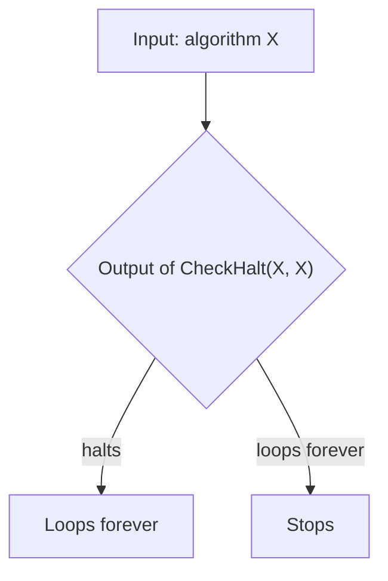

*Figure 11. Behavior of the algorithm Test(X)*

Now run Test with Test itself as input.

| Supposition | Output of CheckHalt(Test, Test) | Behavior of Test(Test) by the definition of Test |
|:-----|:-----|:-----|
| Test(Test) terminates in a finite number of steps | "halts" | loops forever (contradicts the supposition) |
| Test(Test) does not terminate | "loops forever" | stops (contradicts the supposition) |

*Table 19. How both cases of Test(Test) lead to contradictions*

Hence Test(Test) would both loop forever and terminate, which is a contradiction. But Test was defined using nothing except the supposition that CheckHalt exists. Therefore the supposition that CheckHalt exists is false, and there is no such algorithm. ∎

Compared with Russell's paradox, the structure is the same. Russell's paradox asks whether the set $S$ of all sets that are not elements of themselves has $S$ itself as an element, and the proof for the halting problem asks how Test, an algorithm that behaves opposite to CheckHalt's prediction when given itself as input, behaves when given Test itself. In both cases self-reference creates a situation that admits no answer.

> **Caution:** Theorem 6.4.2 says that there is no single algorithm that decides halting for all algorithms and all data. It does not say that it is impossible to analyze whether a particular program halts on a particular input.

> **[Theory of Computation]** In the theory of computation, algorithms are formalized as Turing machines, and the halting problem is shown to be undecidable by the same diagonal argument as this proof. Moreover, many other problems are proved undecidable by reducing the halting problem to them.

The restrictions that keep set theory free of Russell's paradox also exclude some objects that computer science would like to treat as sets, such as recursively defined structures that refer to themselves. Extensions of set theory that admit such self-referential objects have been developed, and the objects they study are called hypersets. The barber puzzle, for its part, raises questions of meaning and self-reference that also arise when computers process natural language.

---

<br>

## Concept Applications

**True/False Check:**

| Statement | Judgment and Reason |
|:-----|:-----|
| $\emptyset \in \lbrace \emptyset \rbrace$. | **T.** $\lbrace \emptyset \rbrace$ is the set whose only element is the empty set. |
| $\lbrace \emptyset \rbrace = \emptyset$. | **F.** The left side has one element and the right side has none, so they are not equal. |
| $\lbrace \lbrace 1 \rbrace \rbrace \subseteq \lbrace 1, \lbrace 1 \rbrace \rbrace$. | **T.** The only element of the left side, $\lbrace 1 \rbrace$, is listed as an element of the right side. |
| For all sets $A$ and $B$, $A - B = B - A$. | **F.** If $A = \lbrace 1 \rbrace$ and $B = \emptyset$, then $A - B = \lbrace 1 \rbrace$ and $B - A = \emptyset$. |
| If the intersection of three sets is empty, the three sets are mutually disjoint. | **F.** The intersection of $\lbrace 1, 2 \rbrace$, $\lbrace 2, 3 \rbrace$, $\lbrace 3, 1 \rbrace$ is empty, but any two of them have a common element. |
| For all sets $A$, $B$, $C$, if $A \cup B = A \cup C$, then $B = C$. | **F.** If $A = \lbrace 1 \rbrace$, $B = \lbrace 1 \rbrace$, and $C = \emptyset$, then $A \cup B = A \cup C = \lbrace 1 \rbrace$ but $B \ne C$. |
| The power set of a set with 3 elements has 8 elements. | **T.** By Theorem 6.3.1, it has $2^3 = 8$ elements. |
| In every Boolean algebra, $0 \ne 1$. | **T.** The identity laws (axiom 4) require the existence of distinct elements 0 and 1. |
| By Theorem 6.4.2, there is no way at all to find out whether a program halts. | **F.** The theorem says there is no single deciding algorithm that works for all programs and inputs; whether an individual program halts can be established by analysis. |

---

<br>

## Summary

| Concept | Key Summary |
|:-----|:-----|
| Set-builder notation | $\lbrace x \in S \mid P(x) \rbrace$ is the set of all elements of $S$ that satisfy $P(x)$. |
| Subset | $`A \subseteq B \iff \forall x\ (x \in A \rightarrow x \in B)`$; to disprove it, find one element in $A$ that is not in $B$. |
| Element argument | To show $X \subseteq Y$, take an arbitrary element $x$ of $X$ and show $x \in Y$. |
| Set equality | $A = B \iff A \subseteq B \land B \subseteq A$, so the inclusions in both directions are proved separately. |
| Set operations | $A \cup B$ is defined by or, $A \cap B$ by and, $B - A$ by being in $B$ and not in $A$, and $A^c$ by being in the universal set $U$ and not in $A$. |
| Indexed collections | $\bigcup A_i$ is the set of elements in at least one $A_i$, and $\bigcap A_i$ is the set of elements in every $A_i$. |
| Empty set | The set $\emptyset$ with no elements is a subset of every set and is unique, and $\emptyset \ne \lbrace \emptyset \rbrace$. |
| Partition | Nonempty sets that are mutually disjoint and whose union is $A$ form a partition of $A$. |
| Power set | $\mathcal{P}(A)$ is the set of all subsets of $A$, and it has $2^n$ elements when $A$ has $n$ elements. |
| Subset-checking algorithm | It compares each element of $A$ with the elements of $B$ in turn and answers $A \not\subseteq B$ when a counterexample appears, using at most $mn$ comparisons. |
| Set identities | Theorem 6.2.2 contains the commutative, associative, distributive, identity, complement, double complement, idempotent, universal bound, De Morgan's, absorption, complements of $U$ and $\emptyset$, and set difference laws. |
| Showing a set is empty | Suppose the set has an element and derive a contradiction. |
| Disproof | Predict with a Venn diagram, then number the subregions to build a concrete counterexample. |
| Algebraic proof | Apply the identities of Theorem 6.2.2 exactly as stated, one step at a time, citing a reason for every step. |
| Boolean algebra | A structure with two operations $+$ and $\cdot$ satisfying the five axioms of commutative, associative, distributive, identity, and complement laws; the subsets of a universal set, statement forms, and $\lbrace 0, 1 \rbrace$ are examples. |
| Uniqueness of the complement | If $a + x = 1$ and $a \cdot x = 0$, then $x = \overline{a}$, and the double complement law follows from this. |
| Duality principle | The dual identity, obtained by interchanging $+$ with $\cdot$ and 0 with 1, is also an identity. |
| Russell's paradox | The collection $S$ of all sets that are not elements of themselves is not a set because both $S \in S$ and $S \notin S$ lead to contradictions, and the paradox disappears when sets are defined only as subsets of a known set. |
| Halting problem | No algorithm decides halting for all algorithms and data, and the self-reference of Test(Test) produces the contradiction. |

---

<br>

## Self-Check Questions

1. **Element argument and disproof:** Let $`A = \lbrace n \in \mathbf{Z} \mid \exists k \in \mathbf{Z},\ n = 10k + 4 \rbrace`$ and $`B = \lbrace n \in \mathbf{Z} \mid \exists j \in \mathbf{Z},\ n = 2j \rbrace`$. Prove $A \subseteq B$ and disprove $B \subseteq A$.

   <details>
   <summary>Answer</summary>

   If $x$ is any element of $A$, there is an integer $k$ with $x = 10k + 4$. Since $10k + 4 = 2(5k + 2)$, let $j = 5k + 2$; $j$ is an integer because products and sums of integers are integers, and $2j = 10k + 4 = x$. Hence $x \in B$ and $A \subseteq B$. For the disproof, take $x = 2 = 2 \cdot 1 \in B$. If $10k + 4 = 2$, then $10k = -2$ and $k = -\frac{1}{5}$, which is not an integer, so $2 \notin A$. Therefore $B \not\subseteq A$.

   </details>

2. **Set operations:** With the universal set $U = \lbrace 1, 2, \ldots, 10 \rbrace$, $A = \lbrace 1, 2, 3, 4, 5 \rbrace$, and $B = \lbrace 4, 5, 6, 7 \rbrace$, find $A \cup B$, $A \cap B$, $A - B$, $B - A$, $(A \cup B)^c$, and $A^c \cap B^c$, and check that De Morgan's law holds.

   <details>
   <summary>Answer</summary>

   $A \cup B = \lbrace 1, 2, 3, 4, 5, 6, 7 \rbrace$, $A \cap B = \lbrace 4, 5 \rbrace$, $A - B = \lbrace 1, 2, 3 \rbrace$, and $B - A = \lbrace 6, 7 \rbrace$. $(A \cup B)^c$ is $U$ with 1 through 7 removed, $\lbrace 8, 9, 10 \rbrace$. Since $A^c = \lbrace 6, 7, 8, 9, 10 \rbrace$ and $B^c = \lbrace 1, 2, 3, 8, 9, 10 \rbrace$, $A^c \cap B^c = \lbrace 8, 9, 10 \rbrace$. The two results agree, so $(A \cup B)^c = A^c \cap B^c$ holds in this case.

   </details>

3. **Infinite indexed collection:** For each positive integer $i$, let $F_i = (0, \frac{1}{i}]$. Find $\bigcup_{i=1}^{\infty} F_i$ and $\bigcap_{i=1}^{\infty} F_i$, and explain why.

   <details>
   <summary>Answer</summary>

   $F_1 = (0, 1]$, and the intervals shrink as $i$ grows, so every $F_i$ is contained in $F_1$. Hence $\bigcup_{i=1}^{\infty} F_i = (0, 1]$. The intersection is empty. If $x \le 0$, $x$ is not in $F_1$. If $x > 0$, a positive integer $i$ with $i > \frac{1}{x}$ can be chosen so that $\frac{1}{i} < x$, and then $x \notin F_i$. Hence no real number is in every $F_i$, and $\bigcap_{i=1}^{\infty} F_i = \emptyset$. Each $F_i$ is nonempty, yet the intersection of infinitely many of them is empty.

   </details>

4. **Testing for a partition:** For $A = \lbrace 1, 2, 3, 4, 5, 6 \rbrace$, decide whether each collection is a partition of $A$. (a) $\lbrace \lbrace 1, 4 \rbrace, \lbrace 2, 5, 6 \rbrace, \lbrace 3 \rbrace \rbrace$ (b) $\lbrace \lbrace 1, 2 \rbrace, \lbrace 2, 3 \rbrace, \lbrace 4, 5, 6 \rbrace \rbrace$ (c) $\lbrace \lbrace 1, 2, 3 \rbrace, \emptyset, \lbrace 4, 5, 6 \rbrace \rbrace$

   <details>
   <summary>Answer</summary>

   (a) The three sets are nonempty, their union is $A$, and no two have a common element, so it is a partition. (b) $\lbrace 1, 2 \rbrace \cap \lbrace 2, 3 \rbrace = \lbrace 2 \rbrace$, so the sets are not mutually disjoint and it is not a partition. (c) The union is $A$ and there are no common elements, but the definition of a partition requires every piece to be nonempty, so it is not a partition.

   </details>

5. **Theorem 6.2.3(b):** Prove that for all sets $A$ and $B$, if $A \subseteq B$ then $A \cup B = B$.

   <details>
   <summary>Answer</summary>

   Suppose $A \subseteq B$. First show $A \cup B \subseteq B$. If $x \in A \cup B$, then by the definition of union $x \in A$ or $x \in B$. In the case $x \in A$, $x \in B$ by the hypothesis $A \subseteq B$, and in the case $x \in B$, $x \in B$ directly. So in either case $x \in B$. Next, $B \subseteq A \cup B$ holds by Theorem 6.2.1(2)(b). Since both inclusions hold, $A \cup B = B$.

   </details>

6. **Proving a set is empty:** Use the element method to prove that for all sets $A$ and $B$, $(A - B) \cap B = \emptyset$.

   <details>
   <summary>Answer</summary>

   Suppose $(A - B) \cap B$ has an element $x$. By the definition of intersection, $x \in A - B$ and $x \in B$. By the definition of difference, $x \in A - B$ means $x \in A$ and $x \notin B$. Then $x \in B$ and $x \notin B$, which is a contradiction. Hence $(A - B) \cap B$ has no elements, and $(A - B) \cap B = \emptyset$.

   </details>

7. **Disproof and algebraic proof:** (a) Give a counterexample to "For all sets $A$, $B$, and $C$, $A - (B \cup C) = (A - B) \cup (A - C)$." (b) Give an algebraic proof, citing a property from Theorem 6.2.2 for every step, that for all sets $A$, $B$, and $C$, $A - (B \cup C) = (A - B) \cap (A - C)$.

   <details>
   <summary>Answer</summary>

   (a) If $A = \lbrace 1 \rbrace$, $B = \lbrace 1 \rbrace$, and $C = \emptyset$, then $A - (B \cup C) = \lbrace 1 \rbrace - \lbrace 1 \rbrace = \emptyset$, but $(A - B) \cup (A - C) = \emptyset \cup \lbrace 1 \rbrace = \lbrace 1 \rbrace$. The results differ, so the property is false.

   (b) As follows. $A - (B \cup C) = A \cap (B \cup C)^c$ (set difference law) $= A \cap (B^c \cap C^c)$ (De Morgan's law 9(a)) $= (A \cap A) \cap (B^c \cap C^c)$ (idempotent law 7(b)) $= A \cap (A \cap (B^c \cap C^c))$ (associative law 2(b)) $= A \cap ((A \cap B^c) \cap C^c)$ (associative law 2(b)) $= A \cap ((B^c \cap A) \cap C^c)$ (commutative law 1(b)) $= A \cap (B^c \cap (A \cap C^c))$ (associative law 2(b)) $= (A \cap B^c) \cap (A \cap C^c)$ (associative law 2(b)) $= (A - B) \cap (A - C)$ (set difference law).

   </details>

8. **Number of subsets:** A set $X$ has 5 elements, and $z$ is one of them. How many subsets of $X$ contain $z$? Explain using the pairing of Section 3.3.

   <details>
   <summary>Answer</summary>

   The subsets that do not contain $z$ are exactly the subsets of $X - \lbrace z \rbrace$, which has 4 elements, so by Theorem 6.3.1 there are $2^4 = 16$ of them. The pairing $A \mapsto A \cup \lbrace z \rbrace$ matches the subsets that do not contain $z$ one-to-one with those that do, so there are also 16 subsets that contain $z$. The total, $16 + 16 = 32 = 2^5$, agrees with Theorem 6.3.1.

   </details>

9. **Boolean algebra and duality:** Using only the axioms of a Boolean algebra, prove that for all $a$ and $b$, $(a + b) \cdot (a + \overline{b}) = a$, and write the dual of this identity.

   <details>
   <summary>Answer</summary>

   Reading distributive law 3(a), $a + (b \cdot c) = (a + b) \cdot (a + c)$, from right to left gives $(a + b) \cdot (a + \overline{b}) = a + (b \cdot \overline{b})$. By complement law 5(b), $b \cdot \overline{b} = 0$, which gives $a + 0$, and by identity law 4(a), $a + 0 = a$. The dual, obtained by interchanging $+$ and $\cdot$, is $(a \cdot b) + (a \cdot \overline{b}) = a$ (0 and 1 do not appear in this identity). Read in terms of sets, it says $(A \cap B) \cup (A \cap B^c) = A$.

   </details>

10. **Halting problem:** In the proof of Theorem 6.4.2, explain what contradiction arises if Test(Test) is supposed to terminate in a finite number of steps, and state in what respect this argument is the same as Russell's paradox.

    <details>
    <summary>Answer</summary>

    If Test(Test) terminates, then by the definition of CheckHalt, CheckHalt(Test, Test) prints "halts". Then by the definition of Test, Test(Test) must loop forever, contradicting the supposition. Supposing instead that it does not terminate also gives a contradiction, since CheckHalt prints "loops forever" and Test(Test) stops. Just as putting $S$ itself into $S$ in Russell's paradox makes $S \in S$ and $S \notin S$ imply each other, giving Test itself to Test makes halting and not halting imply each other. Both arguments use self-reference to build an object that admits no answer and thereby refute the assumption that made the object possible (the freedom to define sets, the existence of CheckHalt).

    </details>

---

<br>

## References

1. K. Gödel, "Über formal unentscheidbare Sätze der Principia Mathematica und verwandter Systeme I," *Monatshefte für Mathematik und Physik*, vol. 38, pp. 173-198, 1931.
