# 7장 — 함수의 성질

[레포지토리 안내](../../README.ko.md) | [English](Concepts_Lecture.md) | [한국어](Concepts_Lecture.ko.md)

> **최종 수정일:** 2026-11-04
>
> Discrete Mathematics with Applications, Epp, Ch 7

> **학습 목표:**
> 1. 일반 집합 위의 함수를 정의하고 상, 역상, 치역을 구하며, 규칙으로 주어진 함수가 잘 정의되었는지 판정할 수 있다
> 2. 유한 집합과 무한 집합에서 함수가 일대일 함수인지, 위로의 함수인지 증명하거나 반례로 반박할 수 있다
> 3. 일대일 대응의 역함수를 구하고, 지수 함수와 로그 함수의 일대일성을 이용하여 로그의 성질을 유도할 수 있다
> 4. 함수의 합성을 계산하고, 항등 함수, 역함수, 일대일 함수, 위로의 함수와 합성 사이의 정리를 증명할 수 있다
> 5. 일대일 대응으로 두 집합의 기수를 비교하고, 정수와 양의 유리수는 가산이며 0과 1 사이의 실수는 비가산임을 증명할 수 있다
> 6. 기수의 차이를 이용하여 어떤 프로그램으로도 계산할 수 없는 함수가 존재함을 설명할 수 있다

---

## 목차

- [1. 일반 집합 위에서 정의된 함수](#1-일반-집합-위에서-정의된-함수)
  - [1.1 함수와 관련 용어](#11-함수와-관련-용어)
  - [1.2 화살표 도표와 함수의 상등](#12-화살표-도표와-함수의-상등)
  - [1.3 여러 가지 함수](#13-여러-가지-함수)
  - [1.4 부울 함수](#14-부울-함수)
  - [1.5 잘 정의된 함수](#15-잘-정의된-함수)
  - [1.6 집합에 작용하는 함수](#16-집합에-작용하는-함수)
- [2. 일대일 함수, 위로의 함수, 역함수](#2-일대일-함수-위로의-함수-역함수)
  - [2.1 일대일 함수](#21-일대일-함수)
  - [2.2 무한 집합 위의 일대일 함수](#22-무한-집합-위의-일대일-함수)
  - [2.3 응용: 해시 함수](#23-응용-해시-함수)
  - [2.4 위로의 함수](#24-위로의-함수)
  - [2.5 무한 집합 위의 위로의 함수](#25-무한-집합-위의-위로의-함수)
  - [2.6 지수 함수와 로그 함수의 관계](#26-지수-함수와-로그-함수의-관계)
  - [2.7 일대일 대응](#27-일대일-대응)
  - [2.8 역함수](#28-역함수)
- [3. 함수의 합성](#3-함수의-합성)
  - [3.1 합성의 정의](#31-합성의-정의)
  - [3.2 항등 함수와의 합성](#32-항등-함수와의-합성)
  - [3.3 함수와 그 역함수의 합성](#33-함수와-그-역함수의-합성)
  - [3.4 일대일 함수의 합성](#34-일대일-함수의-합성)
  - [3.5 위로의 함수의 합성](#35-위로의-함수의-합성)
- [4. 기수와 계산 가능성](#4-기수와-계산-가능성)
  - [4.1 기수가 같은 집합](#41-기수가-같은-집합)
  - [4.2 가산 집합](#42-가산-집합)
  - [4.3 더 큰 무한: 칸토어의 대각선 논법](#43-더-큰-무한-칸토어의-대각선-논법)
  - [4.4 가산 집합의 부분집합과 실수 전체의 기수](#44-가산-집합의-부분집합과-실수-전체의-기수)
  - [4.5 응용: 기수와 계산 가능성](#45-응용-기수와-계산-가능성)
- [개념 적용](#개념-적용)
- [요약](#요약)
- [점검 문제](#점검-문제)

---

<br>

## 1. 일반 집합 위에서 정의된 함수

함수는 수학과 컴퓨터 과학의 거의 모든 영역에 등장한다. 앞의 장들에서 이미 여러 함수를 다루었다. 수열은 정수의 집합 위에서 정의된 함수이고(5장), div와 mod는 정수의 데카르트 곱 위에서 정의된 함수이며, 바닥 함수와 천장 함수는 $\mathbf{R}$에서 $\mathbf{Z}$로의 함수이다(4장). 진리표와 입출력 표도 0과 1로 이루어진 입력을 출력으로 보내는 함수로 볼 수 있다(2장). 이 장은 유한 집합이나 정수의 집합처럼 이산적인 집합 위에서 정의된 함수를 중심으로, 함수가 일대일 함수인지와 위로의 함수인지, 역함수가 존재하는지, 합성이 이 성질들과 어떻게 상호작용하는지를 다룬다. 마지막으로 무한 집합에도 서로 다른 크기가 있다는 사실을 증명하고, 이를 이용하여 컴퓨터로 계산할 수 없는 함수가 존재함을 보인다.

### 1.1 함수와 관련 용어

일상 언어에서 "함수"는 한 양이 다른 양에 따라 정해진다는 뜻으로 쓰인다. 예를 들어 택시 요금이 이동 거리의 함수라는 말은 이동 거리마다 요금을 하나씩 정하는 규칙이 있다는 뜻이다. 1장에서는 함수를 특별한 종류의 관계로 정의하였다. 이 장에서는 같은 정의를 다시 쓰되, 함수가 입력을 출력으로 보내는 동적인 관점과 그에 따른 용어를 덧붙인다.

> **용어 정의:** 집합 $X$에서 집합 $Y$로의 **함수(function)** $f: X \to Y$는 $X$에서 $Y$로의 관계 가운데 다음 두 성질을 만족하는 것이다. (1) $X$의 모든 원소는 $Y$의 어떤 원소와 관계가 있다. (2) $X$의 어떤 원소도 $Y$의 서로 다른 두 원소와 관계를 가지지 않는다. 이때 $X$를 $f$의 **정의역(domain)**, $Y$를 $f$의 **공역(co-domain)** 이라 한다.

두 성질을 합치면 $X$의 각 원소 $x$에 대하여 $x$와 관계가 있는 $Y$의 원소가 정확히 하나 존재한다. 이 원소를 $y$라 하면 "$f$가 $x$를 $y$로 보낸다"고 말하고 $x \xrightarrow{f} y$ 또는 $f: x \mapsto y$로 쓴다. $f$가 $x$를 보내는 유일한 원소는 $f(x)$로 나타내며, 다음과 같이 여러 이름으로 부른다.

- $x$에서 $f$의 **값**(value of $f$ at $x$)
- 입력 $x$에 대한 $f$의 **출력**(output of $f$ for the input $x$)
- $f$에 의한 $x$의 **상(image)**

$f$의 값 전체의 집합을 $f$의 **치역(range)** 또는 $f$에 의한 $X$의 상이라 한다.

$$
f\text{의 치역} = \lbrace\, y \in Y \mid \text{어떤 } x \in X \text{에 대하여 } y = f(x) \,\rbrace
$$

반대 방향으로, $Y$의 원소 $y$가 주어졌을 때 $f(x) = y$인 $x$를 $y$의 **원상(preimage)** 또는 **역상(inverse image)** 이라 한다. $y$의 원상 전체의 집합도 $y$의 역상이라 부른다.

$$
y\text{의 역상} = \lbrace\, x \in X \mid f(x) = y \,\rbrace
$$

공역의 원소 가운데에는 원상이 하나도 없는 원소도 있고, 원상이 여러 개인 원소도 있다. 원상이 하나도 없으면 그 원소의 역상은 공집합이다.

> **주의:** $f(x)$는 $x$에서 함수 $f$가 갖는 **값**이고, $f$는 함수 **자체**이다. 일부 분야에서는 $f(x)$로 함수 자체를 가리키기도 하지만, 이 장에서는 혼동을 피하기 위해 $f(x)$를 항상 값의 뜻으로만 쓴다. 예를 들어 "함수 $f(x) = x^2$"보다 "$f(x) = x^2$으로 정의된 함수 $f$"라고 쓴다.

### 1.2 화살표 도표와 함수의 상등

1장에서 보았듯이 $X$와 $Y$가 유한 집합이면 **화살표 도표(arrow diagram)** 로 함수를 정의할 수 있다. 왼쪽에 $X$의 원소를, 오른쪽에 $Y$의 원소를 나열하고, $X$의 각 원소에서 대응하는 $Y$의 원소로 화살표를 긋는다. 화살표 도표가 함수를 정의할 조건은 함수의 두 성질을 그대로 옮긴 것이다.

1. $X$의 모든 원소에서 $Y$의 원소를 가리키는 화살표가 나간다.
2. $X$의 어떤 원소에서도 $Y$의 서로 다른 두 원소를 가리키는 두 화살표가 나가지 않는다.

**예제 7.1.1 (함수인 것과 함수가 아닌 것).** $X = \lbrace a, b, c\rbrace$, $Y = \lbrace1, 2, 3, 4\rbrace$일 때 다음 세 화살표 도표 가운데 $X$에서 $Y$로의 함수를 정의하는 것을 고른다.

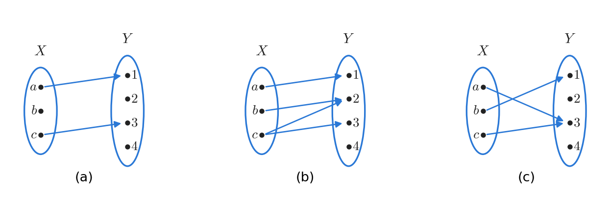

*그림 1. 함수 조건을 판정하는 세 화살표 도표*

함수를 정의하는 것은 (c)뿐이다. (a)에서는 $b$에서 나가는 화살표가 없으므로 $b$가 $Y$의 어떤 원소와도 관계를 갖지 않아 조건 1을 어긴다. (b)에서는 $c$에서 2와 3을 가리키는 두 화살표가 나가므로 $c$에 대응하는 원소가 유일하지 않아 조건 2를 어긴다. (c)에서는 $a$와 $c$가 모두 3을 가리키지만, 이는 조건을 어기지 않는다. 조건은 정의역의 각 원소에서 나가는 화살표에 관한 것이고, 공역의 한 원소로 여러 화살표가 들어오는 것은 허용된다.

**예제 7.1.2 (화살표 도표로 정의된 함수).** $X = \lbrace a, b, c\rbrace$, $Y = \lbrace1, 2, 3, 4\rbrace$이고 함수 $f: X \to Y$가 다음 화살표 도표로 정의되어 있다.

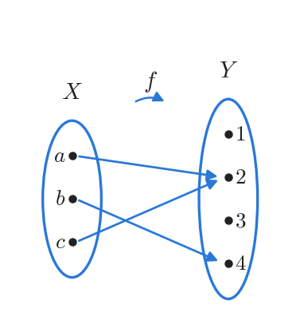

*그림 2. 함수 f의 화살표 도표*

도표에서 각 질문의 답을 차례로 읽는다.

1. 정의역은 $\lbrace a, b, c\rbrace$이고 공역은 $\lbrace1, 2, 3, 4\rbrace$이다.
2. 화살표를 따라가면 $f(a) = 2$, $f(b) = 4$, $f(c) = 2$이다.
3. 실제로 화살표가 도착하는 원소는 2와 4뿐이므로 치역은 $\lbrace2, 4\rbrace$이다. 치역은 공역의 부분집합이며, 이 예처럼 공역과 다를 수 있다.
4. $f(c) = 2$이므로 $c$는 2의 역상이다. $f(b) = 4 \neq 3$이므로 $b$는 3의 역상이 아니다.
5. 2를 가리키는 화살표는 $a$와 $c$에서 나오므로 2의 역상은 $\lbrace a, c\rbrace$이다. 4의 역상은 $\lbrace b\rbrace$이고, 1을 가리키는 화살표는 없으므로 1의 역상은 $\emptyset$이다.
6. 함수를 관계, 곧 순서쌍의 집합으로 나타내면 $f = \lbrace(a, 2), (b, 4), (c, 2)\rbrace$이다.

이 예에서 공역의 원소 1과 3에는 화살표가 하나도 도착하지 않고, 2에는 두 화살표가 도착한다. 정의역의 모든 원소에서는 화살표가 정확히 하나씩 나가야 하지만, 공역의 원소에는 그런 제약이 없다.

두 함수가 언제 같은지를 판정하는 기준은 함수를 관계, 곧 데카르트 곱의 부분집합으로 본 정의에서 나온다.

> **핵심:** **정리 7.1.1 (함수의 상등 판정).** $F: X \to Y$와 $G: X \to Y$가 함수이면, $F = G$일 필요충분조건은 모든 $x \in X$에 대하여 $F(x) = G(x)$인 것이다.

**증명.** $F$와 $G$는 $X$에서 $Y$로의 관계이므로 $X \times Y$의 부분집합이다. $F$가 함수이므로 $(x, y) \in F$는 $y$가 $F$에 의해 $x$와 관계를 갖는 유일한 원소라는 뜻, 곧 $y = F(x)$라는 뜻이다. 마찬가지로 $(x, y) \in G$는 $y = G(x)$와 같다.

먼저 모든 $x \in X$에 대하여 $F(x) = G(x)$라고 가정한다. $X$의 임의의 원소 $x$와 $Y$의 임의의 원소 $y$에 대하여 다음이 성립한다.

$$
(x, y) \in F \iff y = F(x) \iff y = G(x) \iff (x, y) \in G
$$

가운데 동치는 가정 $F(x) = G(x)$에서 나온다. 따라서 $F$와 $G$는 정확히 같은 순서쌍으로 이루어진 집합이고, 집합의 상등에 의해 $F = G$이다.

역으로 $F = G$라고 가정한다. 임의의 $x \in X$에 대하여 $y = F(x)$라 하면 다음이 성립한다.

$$
y = F(x) \iff (x, y) \in F \iff (x, y) \in G \iff y = G(x)
$$

가운데 동치는 $F$와 $G$가 같은 원소를 가진 집합이라는 데서 나온다. 따라서 $F(x)$와 $G(x)$는 모두 $y$와 같으므로 $F(x) = G(x)$이다. $\blacksquare$

정리의 가정에서 두 함수의 정의역과 공역이 같다는 점을 놓치지 않아야 한다. 이 판정법은 정의역의 모든 원소에서 값을 비교하라고 말하며, 두 함수를 정의하는 식이 겉보기에 달라도 값이 모두 같으면 같은 함수이다.

**예제 7.1.3 (함수의 상등).** 다음 두 질문에 답한다.

(a) $J_3 = \lbrace0, 1, 2\rbrace$이고 함수 $f, g: J_3 \to J_3$가 모든 $x \in J_3$에 대하여 $f(x) = (x^2 + x + 1) \bmod 3$, $g(x) = (x + 2)^2 \bmod 3$으로 정의될 때 $f = g$인가? 정의역의 세 원소에서 값을 모두 계산하면 다음과 같다.

| $x$ | $x^2 + x + 1$ | $f(x)$ | $(x + 2)^2$ | $g(x)$ |
|:---:|:---:|:---:|:---:|:---:|
| 0 | 1 | $1 \bmod 3 = 1$ | 4 | $4 \bmod 3 = 1$ |
| 1 | 3 | $3 \bmod 3 = 0$ | 9 | $9 \bmod 3 = 0$ |
| 2 | 7 | $7 \bmod 3 = 1$ | 16 | $16 \bmod 3 = 1$ |

*표 1. $J_3$의 각 원소에서 $f$와 $g$의 값*

모든 $x \in J_3$에서 $f(x) = g(x)$이므로 정리 7.1.1에 의해 $f = g$이다. 두 식 $x^2 + x + 1$과 $(x + 2)^2 = x^2 + 4x + 4$는 정수로서 다른 다항식이지만, 차 $3x + 3$이 항상 3의 배수이므로 3으로 나눈 나머지가 같다.

(b) 함수 $F, G: \mathbf{R} \to \mathbf{R}$에 대하여 새 함수 $F + G$와 $G + F$를 모든 $x \in \mathbf{R}$에 대하여 $(F + G)(x) = F(x) + G(x)$, $(G + F)(x) = G(x) + F(x)$로 정의할 때 $F + G = G + F$인가? 모든 실수 $x$에 대하여 다음이 성립한다.

$$
(F + G)(x) = F(x) + G(x) = G(x) + F(x) = (G + F)(x)
$$

첫 등호는 $F + G$의 정의, 둘째 등호는 실수 덧셈의 교환법칙, 셋째 등호는 $G + F$의 정의에서 나온다. 따라서 정리 7.1.1에 의해 $F + G = G + F$이다.

### 1.3 여러 가지 함수

함수의 정의역과 공역은 수의 집합일 필요가 없다. 다음 예들은 집합, 순서쌍, 문자열 위에서 정의된 다양한 함수를 보여 준다.

**예제 7.1.4 (항등 함수).** 집합 $X$가 주어졌을 때 함수 $I_X: X \to X$를 모든 $x \in X$에 대하여 $I_X(x) = x$로 정의한다. 이 함수를 $X$ 위의 **항등 함수(identity function)** 라 한다. 항등 함수는 입력을 바꾸지 않고 그대로 내보내는 장치로 생각할 수 있다. 따라서 입력의 모양이 아무리 복잡해도 결과는 입력 자체이다. 예를 들어 $a_{ij}^k$와 $\phi(z)$가 $X$의 원소이면 $I_X(a_{ij}^k) = a_{ij}^k$이고 $I_X(\phi(z)) = \phi(z)$이다.

**예제 7.1.5 (수열).** 무한 수열은 어떤 정수 이상인 정수 전체의 집합 위에서 정의된 함수이다(5장). 예를 들어 수열

$$
1, -\frac{1}{2}, \frac{1}{3}, -\frac{1}{4}, \frac{1}{5}, \ldots, \frac{(-1)^n}{n + 1}, \ldots
$$

은 음이 아닌 정수의 집합 $\mathbf{Z}^{\text{nonneg}}$에서 $\mathbf{R}$로의 함수 $f(n) = \frac{(-1)^n}{n + 1}$로 볼 수 있다. 이 함수는 $0 \mapsto 1$, $1 \mapsto -\frac{1}{2}$, $2 \mapsto \frac{1}{3}$, $3 \mapsto -\frac{1}{4}$, $4 \mapsto \frac{1}{5}$로 보낸다. 같은 수열을 다른 함수로 나타낼 수도 있다. 양의 정수의 집합 $\mathbf{Z}^{+}$에서 $\mathbf{R}$로의 함수 $g(n) = \frac{(-1)^{n+1}}{n}$을 정의하면 $g(1) = 1$, $g(2) = -\frac{1}{2}$, $g(3) = \frac{1}{3}$이고, 일반적으로 다음이 성립한다.

$$
g(n + 1) = \frac{(-1)^{n+2}}{n + 1} = \frac{(-1)^n}{n + 1} = f(n)
$$

두 번째 등호는 $(-1)^{n+2} = (-1)^n (-1)^2 = (-1)^n$에서 나온다. 곧 $g$는 첨자를 1부터 매긴 같은 수열이다. $f$와 $g$는 정의역이 다르므로 함수로서는 서로 다르지만, 같은 항들을 같은 순서로 나열한다.

**예제 7.1.6 (멱집합 위에서 정의된 함수).** $\mathcal{P}(A)$는 집합 $A$의 모든 부분집합의 집합, 곧 멱집합이다(6장). 함수 $F: \mathcal{P}(\lbrace a, b, c\rbrace) \to \mathbf{Z}^{\text{nonneg}}$를 각 $X \in \mathcal{P}(\lbrace a, b, c\rbrace)$에 대하여 $F(X) = X$의 원소의 개수로 정의한다. $\lbrace a, b, c\rbrace$의 부분집합은 $2^3 = 8$개이고, 원소의 개수에 따라 $F(\emptyset) = 0$, $F(\lbrace a\rbrace) = F(\lbrace b\rbrace) = F(\lbrace c\rbrace) = 1$, $F(\lbrace a, b\rbrace) = F(\lbrace a, c\rbrace) = F(\lbrace b, c\rbrace) = 2$, $F(\lbrace a, b, c\rbrace) = 3$이다.

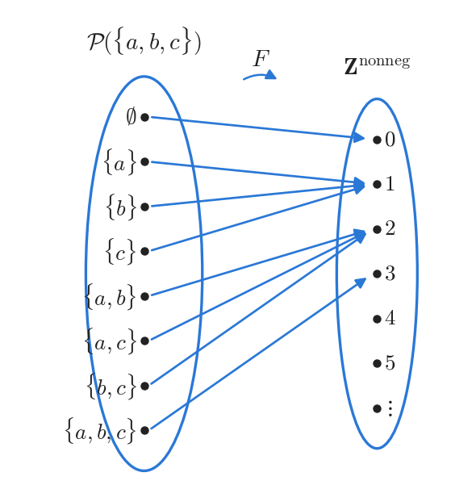

*그림 3. 부분집합을 원소의 개수로 보내는 함수 F의 화살표 도표*

공역 $\mathbf{Z}^{\text{nonneg}}$는 무한 집합이지만 치역은 $\lbrace0, 1, 2, 3\rbrace$뿐이다. 4 이상의 정수에는 화살표가 도착하지 않는다.

**예제 7.1.7 (데카르트 곱 위에서 정의된 함수).** 함수 $M: \mathbf{R} \times \mathbf{R} \to \mathbf{R}$과 $R: \mathbf{R} \times \mathbf{R} \to \mathbf{R} \times \mathbf{R}$을 실수의 모든 순서쌍 $(a, b)$에 대하여 다음과 같이 정의한다.

$$
M(a, b) = ab, \qquad R(a, b) = (-a, b)
$$

$M$은 두 실수를 그 곱으로 보내는 곱셈 함수이고, $R$은 평면의 점을 세로축에 대해 대칭인 점으로 보내는 반사 함수이다. 정의역의 원소가 순서쌍이므로 엄밀하게는 $M((a, b))$로 써야 하지만, 괄호 한 쌍을 생략하여 $M(a, b)$로 쓰는 것이 관례이다. 몇 가지 값을 계산하면 다음과 같다.

- $M(-1, -1) = (-1)(-1) = 1$, $M(\frac{1}{2}, \frac{1}{2}) = \frac{1}{2} \cdot \frac{1}{2} = \frac{1}{4}$, $M(\sqrt{2}, \sqrt{2}) = \sqrt{2} \cdot \sqrt{2} = 2$이다.
- $R(2, 5) = (-2, 5)$, $R(-2, 5) = (-(-2), 5) = (2, 5)$, $R(3, -4) = (-3, -4)$이다.

다음으로 컴퓨터 과학에서 자주 쓰는 로그 함수를 정의한다.

> **용어 정의:** $b$를 $b \neq 1$인 양의 실수라 하자. 양의 실수 $x$에 대하여 **밑이 $b$인 $x$의 로그(logarithm with base $b$ of $x$)** $\log_b x$는 $x$를 얻기 위해 $b$를 거듭제곱해야 하는 지수이다. 곧 $\log_b x = y \iff b^y = x$이다. 각 양의 실수 $x$를 $\log_b x$로 보내는 $\mathbf{R}^{+}$에서 $\mathbf{R}$로의 함수를 **밑이 $b$인 로그 함수(logarithmic function with base $b$)** 라 한다.

이 정의가 의미를 가지려면 모든 양의 실수 $x$에 대하여 $b^y = x$인 실수 $y$가 정확히 하나 존재해야 한다. 이 사실은 자명하지 않지만 성립하며, 대부분의 미적분학 교재에서 증명한다.

**예제 7.1.8 (밑이 b인 로그 함수).** 정의 $\log_b x = y \iff b^y = x$를 그대로 적용한다.

1. $3^2 = 9$이므로 $\log_3 9 = 2$이다.
2. $2^{-1} = \frac{1}{2}$이므로 $\log_2 \frac{1}{2} = -1$이다.
3. $10^0 = 1$이므로 $\log_{10} 1 = 0$이다.
4. 임의의 실수 $m$에 대하여 $2^m$을 얻으려면 2를 $m$제곱해야 하므로 $\log_2 (2^m) = m$이다.
5. $m > 0$이면 $\log_2 m$은 $m$을 얻기 위해 2를 거듭제곱해야 하는 지수이므로 $2^{\log_2 m} = m$이다.

4와 5는 $\log_2$와 $2^x$가 서로의 작용을 되돌린다는 사실을 보여 준다. 이 관계는 2.8절에서 역함수로 정리한다.

$S$가 공집합이 아닌 유한한 문자의 집합일 때 **$S$ 위의 문자열(string over $S$)** 은 $S$의 원소로 이루어진 유한 수열로 볼 수 있다. 문자열의 문자 개수를 그 문자열의 **길이(length)** 라 하고, 문자가 하나도 없는 문자열을 **빈 문자열(null string)** 이라 한다. 빈 문자열은 보통 $\lambda$로 나타내며 길이가 0이다.

**예제 7.1.9 (부호화 함수와 복호화 함수).** 디지털 메시지는 0과 1로 이루어진 유한 수열이다. 전송 선로의 잡음으로 비트가 바뀔 수 있으므로, 메시지를 보내기 전에 특별한 방식으로 부호화하는 경우가 많다. 가장 단순한 방법은 각 비트를 세 번씩 쓰는 것이다. 예를 들어 메시지 00101111은 다음과 같이 부호화된다.

```text
원래 메시지:  0   0   1   0   1   1   1   1
부호화 결과:  000 000 111 000 111 111 111 111
```

수신자는 세 비트가 모두 같은 각 구간을 그 비트 하나로 바꾸어 원래 메시지를 복원한다. $A$를 0과 1로 이루어진 모든 문자열의 집합, $T$를 같은 비트 세 개가 연속으로 이어진 묶음들로만 이루어진 0과 1의 문자열 전체의 집합이라 하자. 부호화와 복호화는 다음 두 함수이다.

- **부호화 함수(encoding function)** $E: A \to T$는 각 문자열 $s \in A$를 $s$의 각 비트를 같은 비트 세 개로 바꾼 문자열로 보낸다.
- **복호화 함수(decoding function)** $D: T \to A$는 각 문자열 $t \in T$를 $t$의 연속된 같은 비트 세 개를 그 비트 하나로 바꾼 문자열로 보낸다.

이 방식의 장점은 오류를 어느 정도 정정할 수 있다는 것이다. 수신한 문자열에서 세 비트가 같아야 할 구간이 같지 않으면 그 구간의 한 비트가 나머지 둘과 다르다. 오류가 드물다면 다른 하나의 비트가 잘못되었을 가능성이 높으므로, 그 비트를 나머지 둘에 맞추어 고친 뒤 복호화 함수를 적용한다. 예를 들어 010이라는 구간을 받으면 000으로 고쳐 0으로 복호화한다. 고치기 전의 문자열은 $T$의 원소가 아니므로 $D$를 바로 적용할 수 없다는 점도 기억할 필요가 있다.

**예제 7.1.10 (해밍 거리 함수).** 해밍 거리 함수는 길이가 같은 두 비트 문자열이 얼마나 다른지를 재는 함수로, 부호 이론에서 중요하다. $S_n$을 길이가 $n$인 0과 1의 문자열 전체의 집합이라 하고, 함수 $H: S_n \times S_n \to \mathbf{Z}^{\text{nonneg}}$를 각 순서쌍 $(s, t) \in S_n \times S_n$에 대하여 $H(s, t) = s$와 $t$의 값이 서로 다른 위치의 개수로 정의한다. 이 함수를 **해밍 거리 함수(Hamming distance function)** 라 한다. $n = 5$이면 11111과 00000은 다섯 위치에서 모두 다르므로 $H(11111, 00000) = 5$이고, 11000과 00000은 처음 두 위치에서만 다르므로 $H(11000, 00000) = 2$이다. 같은 방법으로 $H(00101, 01110)$을 위치별로 비교하면 다음과 같다.

| 위치 | 1 | 2 | 3 | 4 | 5 |
|:-----|:---:|:---:|:---:|:---:|:---:|
| $s = 00101$ | 0 | 0 | 1 | 0 | 1 |
| $t = 01110$ | 0 | 1 | 1 | 1 | 0 |
| 다른가 | 같음 | 다름 | 같음 | 다름 | 다름 |

*표 2. 00101과 01110의 위치별 비교*

다른 위치가 2, 4, 5의 세 곳이므로 $H(00101, 01110) = 3$이다. 같은 방법으로 10001과 01111은 1, 2, 3, 4번째 위치에서 다르고 5번째 위치에서만 같으므로 $H(10001, 01111) = 4$이다.

> **참고:** 예제 7.1.9의 세 번 반복 부호에서 0과 1의 부호어 000과 111 사이의 해밍 거리는 3이다. 한 구간에서 비트 하나가 바뀌면 받은 구간은 원래 부호어와는 거리가 1이고 다른 부호어와는 거리가 2이므로, 받은 구간을 가장 가까운 부호어로 고치는 것이 곧 다수결로 고치는 것이다. 같은 이유로 한 구간에서 두 비트가 바뀌면 이 방법은 잘못 고친다. 부호어 사이의 해밍 거리가 클수록 더 많은 오류를 정정할 수 있다는 것이 부호 이론의 기본 원리이다.

### 1.4 부울 함수

2장에서는 디지털 논리 회로의 입출력 표를 구하는 방법을 보았다. 이러한 입출력 표는 다음과 같이 함수를 정의한다. 입력 열의 각 행은 0과 1의 순서 튜플로 볼 수 있고, 그런 순서 튜플 전체의 집합이 함수의 정의역이다. 출력 열의 값은 모두 0 또는 1이므로 $\lbrace0, 1\rbrace$을 공역으로 삼는다. 함수는 각 입력 행을 같은 행의 출력으로 보낸다. 입력 선이 $n$개인 회로의 입출력 표는 입력 열이 $n$개이고, 0과 1의 모든 순서 $n$-튜플의 집합에서 $\lbrace0, 1\rbrace$로의 함수를 정의한다. 다음은 입력이 세 개인 회로의 입출력 표의 예이다.

| $P$ | $Q$ | $R$ | 출력 $S$ |
|:---:|:---:|:---:|:---:|
| 1 | 1 | 1 | 1 |
| 1 | 1 | 0 | 1 |
| 1 | 0 | 1 | 0 |
| 1 | 0 | 0 | 1 |
| 0 | 1 | 1 | 0 |
| 0 | 1 | 0 | 1 |
| 0 | 0 | 1 | 0 |
| 0 | 0 | 0 | 0 |

*표 3. 세 입력 회로의 입출력 표*

이 표가 정의하는 함수는 $(1, 1, 1)$, $(1, 1, 0)$, $(1, 0, 0)$, $(0, 1, 0)$을 1로, 나머지 네 순서 3-튜플 $(1, 0, 1)$, $(0, 1, 1)$, $(0, 0, 1)$, $(0, 0, 0)$을 0으로 보낸다. 화살표 도표로 그리면 정의역의 여덟 원소에서 공역 $\lbrace0, 1\rbrace$의 두 원소로 화살표가 네 개씩 들어간다.

> **용어 정의:** **($n$변수) 부울 함수(($n$-place) Boolean function)** $f$는 정의역이 0과 1의 순서 $n$-튜플 전체의 집합이고 공역이 $\lbrace0, 1\rbrace$인 함수이다. 정의역은 집합 $\lbrace0, 1\rbrace$을 $n$번 데카르트 곱한 $\lbrace0, 1\rbrace^n$이므로 $f: \lbrace0, 1\rbrace^n \to \lbrace0, 1\rbrace$로 쓴다.

**예제 7.1.11 (부울 함수).** 0과 1의 각 순서 3-튜플 $(x_1, x_2, x_3)$에 대하여 $f(x_1, x_2, x_3) = (x_1 + x_2 + x_3) \bmod 2$로 정의된 3변수 부울 함수를 입출력 표로 나타낸다. 예를 들어 $f(1, 1, 1) = (1 + 1 + 1) \bmod 2 = 3 \bmod 2 = 1$이고, $f(1, 1, 0) = (1 + 1 + 0) \bmod 2 = 2 \bmod 2 = 0$이다. 나머지 값도 같은 방법으로 계산하면 다음 표를 얻는다.

| $x_1$ | $x_2$ | $x_3$ | $x_1 + x_2 + x_3$ | $f(x_1, x_2, x_3)$ |
|:---:|:---:|:---:|:---:|:---:|
| 1 | 1 | 1 | 3 | 1 |
| 1 | 1 | 0 | 2 | 0 |
| 1 | 0 | 1 | 2 | 0 |
| 1 | 0 | 0 | 1 | 1 |
| 0 | 1 | 1 | 2 | 0 |
| 0 | 1 | 0 | 1 | 1 |
| 0 | 0 | 1 | 1 | 1 |
| 0 | 0 | 0 | 0 | 0 |

*표 4. $f(x_1, x_2, x_3) = (x_1 + x_2 + x_3) \bmod 2$의 입출력 표*

출력은 입력에 1이 홀수 개 있을 때 1이고 짝수 개 있을 때 0이다. 이 함수는 세 입력의 배타적 논리합이며, 0과 1의 문자열에 1이 홀수 개인지를 나타내는 패리티 비트를 계산하는 함수이기도 하다.

### 1.5 잘 정의된 함수

규칙으로 함수를 정의한 것처럼 보이지만 실제로는 함수가 아닌 경우가 있다. 예를 들어 "각 실수 $x$에 대하여 $f(x)$는 $x^2 + y^2 = 1$을 만족하는 실수 $y$이다"라는 규칙으로 함수 $f: \mathbf{R} \to \mathbf{R}$을 정의하려 한다고 가정한다. 이 규칙은 두 가지 이유로 함수를 정의하지 못한다.

- **값이 존재하지 않는 입력이 있다.** $x = 2$이면 $2^2 + y^2 = 1$, 곧 $y^2 = -3$을 만족하는 실수 $y$가 없다. 실제로 $\vert x \vert > 1$인 모든 $x$에서 그러하다.
- **값이 둘 이상인 입력이 있다.** $x = 0$이면 $y^2 = 1$이므로 $y = -1$과 $y = 1$이 모두 방정식을 만족한다. $\vert x \vert < 1$인 모든 $x$에서 그러하다.

> **용어 정의:** 함수라고 주장된 규칙이 함수가 되기 위한 두 조건(모든 입력에 값이 존재함, 각 입력의 값이 유일함) 가운데 하나라도 만족하지 못하면 그 규칙은 **잘 정의되지 않았다(not well defined)** 고 한다.

**예제 7.1.12 (잘 정의되지 않은 함수).** $\mathbf{Q}$는 유리수 전체의 집합이다. 함수 $f: \mathbf{Q} \to \mathbf{Z}$를 $n \neq 0$인 모든 정수 $m$, $n$에 대하여 $f\left(\frac{m}{n}\right) = m$으로 정의한다고 가정한다. 곧 유리수 $\frac{m}{n}$에 정수 $m$을 대응시키려는 것이다. 이 $f$는 잘 정의되지 않았다. 유리수는 정수의 몫으로 나타내는 방법이 여러 가지이기 때문이다. 예를 들어 $\frac{1}{2} = \frac{3}{6}$이다. $f$가 함수라면 같은 입력에 같은 값을 주어야 하므로 $f\left(\frac{1}{2}\right) = f\left(\frac{3}{6}\right)$이어야 한다. 그런데 규칙을 적용하면 다음과 같다.

$$
f\left(\frac{1}{2}\right) = 1, \qquad f\left(\frac{3}{6}\right) = 3, \qquad 1 \neq 3
$$

이 모순은 $f$가 잘 정의되지 않았고, 따라서 함수가 아님을 보여 준다.

엄밀히 말하면 "잘 정의된 함수(well-defined function)"라는 표현은 중복이다. 함수라는 말 자체가 잘 정의되었다는 뜻을 포함하기 때문이다. 이 표현은 규칙이 함수의 조건을 실제로 만족함을 확인했다는 점을 강조할 때 쓴다.

> **주의:** 입력을 여러 방법으로 나타낼 수 있는 집합(분수로 쓴 유리수, 8장에서 다룰 동치류 등) 위에서 함수를 정의할 때는, 출력이 입력을 나타낸 방법이 아니라 입력 자체에만 의존하는지를 확인해야 한다. 예를 들어 $g\left(\frac{m}{n}\right) = \frac{2m}{n}$은 $g(r) = 2r$과 같으므로 잘 정의되지만, $f\left(\frac{m}{n}\right) = m$은 위의 예처럼 잘 정의되지 않는다.

### 1.6 집합에 작용하는 함수

$X$에서 $Y$로의 함수가 주어지면 $X$의 부분집합에 속한 모든 원소의 상을 모은 $Y$의 부분집합과, $Y$의 부분집합에 속한 모든 원소의 역상을 모은 $X$의 부분집합을 생각할 수 있다.

> **용어 정의:** $f: X \to Y$가 함수이고 $A \subseteq X$, $C \subseteq Y$일 때 다음과 같이 정의한다. $f(A)$를 **$A$의 상(image of $A$)**, $f^{-1}(C)$를 **$C$의 역상(inverse image of $C$)** 이라 한다.

$$
f(A) = \lbrace\, y \in Y \mid \text{어떤 } x \in A \text{에 대하여 } y = f(x) \,\rbrace, \qquad f^{-1}(C) = \lbrace\, x \in X \mid f(x) \in C \,\rbrace
$$

원소 $y \in Y$의 역상을 나타내는 $f^{-1}(y)$는 집합 $\lbrace y\rbrace$의 역상 $f^{-1}(\lbrace y\rbrace)$를 줄여 쓴 것이다.

**예제 7.1.13 (부분집합에 대한 함수의 작용).** $X = \lbrace1, 2, 3, 4\rbrace$, $Y = \lbrace a, b, c, d, e\rbrace$이고 $F: X \to Y$가 다음 화살표 도표로 주어져 있다. 곧 $F(1) = b$, $F(2) = a$, $F(3) = d$, $F(4) = b$이다. $A = \lbrace1, 4\rbrace$, $C = \lbrace a, b\rbrace$, $D = \lbrace c, e\rbrace$일 때 $F(A)$, $F(X)$, $F^{-1}(C)$, $F^{-1}(D)$를 구한다.

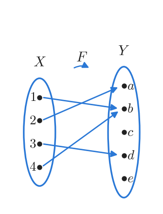

*그림 4. 상과 역상을 구할 함수 F의 화살표 도표*

1. $F(A)$: $A$의 원소 1과 4는 모두 $b$로 가므로 $F(A) = \lbrace b\rbrace$이다.
2. $F(X)$: 1, 2, 3, 4의 상은 $b$, $a$, $d$, $b$이므로 $F(X) = \lbrace a, b, d\rbrace$이며, 이는 $F$의 치역이다.
3. $F^{-1}(C)$: 상이 $a$ 또는 $b$인 원소는 2(상 $a$), 1과 4(상 $b$)이므로 $F^{-1}(C) = \lbrace1, 2, 4\rbrace$이다.
4. $F^{-1}(D)$: $c$나 $e$로 가는 화살표가 없으므로 $F^{-1}(D) = \emptyset$이다.

**예제 7.1.14 (함수와 합집합의 상호작용).** $X$와 $Y$가 집합이고 $F$가 $X$에서 $Y$로의 함수일 때, $X$의 임의의 부분집합 $A$, $B$에 대하여 $F(A \cup B) \subseteq F(A) \cup F(B)$임을 증명한다.

$X$, $Y$, $F$, $A$, $B$는 증명할 명제보다 먼저 도입되었으므로, 이들의 존재와 관계는 이미 주어진 배경 지식이다. 따라서 $F(A \cup B)$의 임의의 원소 $y$가 $F(A) \cup F(B)$에 속함만 보이면 된다(6장의 원소 논증).

**증명.** $y \in F(A \cup B)$라고 가정한다. [$y \in F(A) \cup F(B)$임을 보여야 한다.] 상의 정의에 의해 어떤 $x \in A \cup B$에 대하여 $y = F(x)$이다. 합집합의 정의에 의해 $x \in A$이거나 $x \in B$이다.

- **경우 1, $x \in A$:** $y = F(x)$이고 $x \in A$이므로 $y \in F(A)$이다. 따라서 합집합의 정의에 의해 $y \in F(A) \cup F(B)$이다.
- **경우 2, $x \in B$:** $y = F(x)$이고 $x \in B$이므로 $y \in F(B)$이다. 따라서 합집합의 정의에 의해 $y \in F(A) \cup F(B)$이다.

어느 경우든 $y \in F(A) \cup F(B)$이다. $\blacksquare$

반대 방향의 포함 관계도 성립한다. $A \subseteq A \cup B$이므로 $A$의 원소의 상은 모두 $F(A \cup B)$에 속하여 $F(A) \subseteq F(A \cup B)$이고, 같은 이유로 $F(B) \subseteq F(A \cup B)$이다. 따라서 $F(A) \cup F(B) \subseteq F(A \cup B)$이고, 두 포함 관계를 합치면 $F(A \cup B) = F(A) \cup F(B)$이다.

> **주의:** 교집합에서는 일반적으로 $F(A \cap B) \subseteq F(A) \cap F(B)$만 성립하고 등호는 성립하지 않을 수 있다. 예를 들어 $F: \lbrace1, 2\rbrace \to \lbrace a\rbrace$, $A = \lbrace1\rbrace$, $B = \lbrace2\rbrace$이면 $F(A \cap B) = F(\emptyset) = \emptyset$이지만 $F(A) \cap F(B) = \lbrace a\rbrace$이다. 또 기호 $F^{-1}(C)$는 $F$가 어떤 함수이든 정의되는 집합이다. 2.8절의 역함수 $F^{-1}$은 $F$가 일대일 대응일 때만 존재하는 함수이므로, 두 기호를 구별해야 한다.

---

<br>

## 2. 일대일 함수, 위로의 함수, 역함수

이 절에서는 함수가 가질 수 있는 두 가지 중요한 성질, 곧 일대일 함수가 되는 성질과 위로의 함수가 되는 성질을 다룬다. 두 성질을 모두 가진 함수를 일대일 대응이라 한다. 함수가 일대일 대응이면 정의역과 공역의 원소가 빈틈없이 짝지어지므로, 공역에서 정의역으로 가며 함수의 작용을 되돌리는 역함수를 정의할 수 있다.

### 2.1 일대일 함수

1.2절에서 함수는 정의역의 여러 원소를 공역의 같은 원소로 보낼 수 있음을 보았다. 화살표 도표로 말하면 정의역에서 출발한 두 개 이상의 화살표가 공역의 같은 원소를 가리킬 수 있다. 정의역에서 출발한 어떤 두 화살표도 공역의 같은 원소를 가리키지 않는 함수가 일대일 함수이다. 일대일 함수에서는 공역의 각 원소가 정의역의 원소 많아야 하나의 상이다.

> **용어 정의:** $F$를 집합 $X$에서 집합 $Y$로의 함수라 하자. $X$의 모든 원소 $x_1$, $x_2$에 대하여 "$F(x_1) = F(x_2)$이면 $x_1 = x_2$"가 성립할 때, 그리고 그때에만 $F$를 **일대일 함수(one-to-one function)** 또는 **단사 함수(injective function)** 라 한다. 이는 "$x_1 \neq x_2$이면 $F(x_1) \neq F(x_2)$"와 동치이다.

기호로 쓰면 다음과 같다.

$$
F: X \to Y \text{가 일대일 함수} \iff \forall x_1, x_2 \in X, \ \big(F(x_1) = F(x_2) \Rightarrow x_1 = x_2\big)
$$

두 형태가 동치인 이유는 둘째 조건 명제 "$x_1 \neq x_2$이면 $F(x_1) \neq F(x_2)$"가 첫째 조건 명제의 대우이기 때문이다(2장). 함수가 일대일 함수가 **아니라는** 것의 정확한 의미는 정의의 부정을 구하여 얻는다(3장의 한정 명제의 부정).

$$
F: X \to Y \text{가 일대일 함수가 아님} \iff \exists x_1, x_2 \in X, \ \big(F(x_1) = F(x_2) \text{ 그리고 } x_1 \neq x_2\big)
$$

곧 값이 같지만 서로 다른 두 원소 $x_1$, $x_2$를 찾을 수 있으면 $F$는 일대일 함수가 아니다. 화살표 도표로 보면 일대일 함수는 정의역의 서로 다른 점을 공역의 서로 다른 점으로 보내어 점들을 **분리하는** 함수이고, 일대일 함수가 아닌 함수는 정의역의 적어도 두 점을 공역의 한 점으로 **합치는** 함수이다.

**예제 7.2.1 (유한 집합 위에서 정의된 일대일 함수의 판정).** (a) $X = \lbrace a, b, c, d\rbrace$, $Y = \lbrace u, v, w, x, y\rbrace$이고 두 함수 $F, G: X \to Y$가 다음 화살표 도표로 주어져 있다. 각 함수가 일대일 함수인지 판정한다.

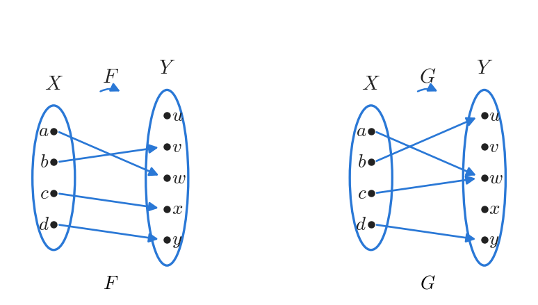

*그림 5. 일대일 함수 F와 일대일 함수가 아닌 G*

$F$는 $a \mapsto w$, $b \mapsto v$, $c \mapsto x$, $d \mapsto y$로 보내며, 네 상이 모두 다르므로 일대일 함수이다. $G$는 $a \mapsto w$, $b \mapsto u$, $c \mapsto w$, $d \mapsto y$로 보낸다. $G(a) = G(c) = w$이지만 $a \neq c$이므로 $G$는 일대일 함수가 아니다.

(b) $X = \lbrace1, 2, 3\rbrace$, $Y = \lbrace a, b, c, d\rbrace$이고 $H: X \to Y$를 $H(1) = c$, $H(2) = a$, $H(3) = d$로, $K: X \to Y$를 $K(1) = d$, $K(2) = b$, $K(3) = d$로 정의한다. $H$는 정의역의 세 원소를 서로 다른 원소로 보내므로($H(1) \neq H(2)$, $H(1) \neq H(3)$, $H(2) \neq H(3)$) 일대일 함수이다. $K$는 $K(1) = K(3) = d$이지만 $1 \neq 3$이므로 일대일 함수가 아니다.

유한 집합 위에서 정의된 함수 $F$가 일대일 함수인지는 다음 방법으로 기계적으로 검사할 수 있다. 정의역의 원소를 배열 $a[1], a[2], \ldots, a[n]$에 담고, 이중 반복문으로 $i < j$인 모든 쌍 $(a[i], a[j])$를 살핀다. $F(a[i]) = F(a[j])$이고 $a[i] \neq a[j]$인 쌍이 하나라도 있으면 $F$는 일대일 함수가 아니고, 모든 쌍을 살피는 동안 그런 쌍이 없으면 $F$는 일대일 함수이다. 살펴야 할 쌍의 수는 최대 $\frac{n(n-1)}{2}$이다.

### 2.2 무한 집합 위의 일대일 함수

정의역 $X$가 무한 집합이면 모든 쌍을 하나씩 확인할 수 없으므로 증명이 필요하다. 정의에 의해 $f$가 일대일 함수라는 것은 다음 전칭 명제가 참이라는 뜻이다.

$$
\forall x_1, x_2 \in X, \ \big(f(x_1) = f(x_2) \Rightarrow x_1 = x_2\big)
$$

따라서 $f$가 일대일 함수임을 증명할 때는 보통 직접 증명을 쓴다.

- **가정한다:** $x_1$과 $x_2$가 $f(x_1) = f(x_2)$를 만족하는 $X$의 원소라고 가정한다.
- **보인다:** $x_1 = x_2$임을 보인다.

반대로 $f$가 일대일 함수가 아님을 보일 때는 $f(x_1) = f(x_2)$이지만 $x_1 \neq x_2$인 $X$의 원소 $x_1$, $x_2$를 **찾는다**.

**예제 7.2.2 (일대일 함수인지 증명하거나 반박하기).** 함수 $f: \mathbf{R} \to \mathbf{R}$과 $g: \mathbf{Z} \to \mathbf{Z}$를 다음과 같이 정의한다.

$$
f(x) = 4x - 1 \ \ (x \in \mathbf{R}), \qquad g(n) = n^2 \ \ (n \in \mathbf{Z})
$$

각 함수가 일대일 함수인지 판정할 때는 먼저 일대일 함수임을 증명하려고 시도하고, 막히는 곳이 있으면 그 지점을 분석하여 반례를 찾는 것이 좋은 전략이다.

(a) $f$가 일대일 함수임을 보이려면 모든 실수 $x_1$, $x_2$에 대하여 $f(x_1) = f(x_2)$이면 $x_1 = x_2$임을 보여야 한다. $f$의 정의를 대입하면 $4x_1 - 1 = 4x_2 - 1$을 가정하고 $x_1 = x_2$를 보이는 문제가 된다. 양변에 1을 더하고 4로 나누면 되므로 증명이 완성된다.

**증명.** 실수 $x_1$, $x_2$가 $f(x_1) = f(x_2)$를 만족한다고 가정한다. [$x_1 = x_2$임을 보여야 한다.] $f$의 정의에 의해 $4x_1 - 1 = 4x_2 - 1$이다. 양변에 1을 더하면 $4x_1 = 4x_2$이고, 양변을 4로 나누면 $x_1 = x_2$이다. 따라서 $f$는 일대일 함수이다. $\blacksquare$

(b) 같은 방법으로 $g$가 일대일 함수임을 보이려면 $n_1^2 = n_2^2$인 정수 $n_1$, $n_2$를 가정하고 $n_1 = n_2$를 보여야 한다. 그런데 이것은 보일 수 없다. 서로 다른 두 수의 제곱이 같을 수 있기 때문이다. 예를 들어 $2^2 = (-2)^2$이지만 $2 \neq -2$이다. 증명이 막힌 지점이 그대로 반례가 된다.

**반례.** $n_1 = 2$, $n_2 = -2$라 하면 $g(n_1) = 2^2 = 4$이고 $g(n_2) = (-2)^2 = 4$이다. 따라서 $g(n_1) = g(n_2)$이지만 $n_1 \neq n_2$이므로 $g$는 일대일 함수가 아니다.

> **주의:** 일대일 함수인지는 규칙만으로 정해지지 않고 정의역에도 의존한다. 같은 규칙 $n \mapsto n^2$이라도 정의역을 $\mathbf{Z}^{\text{nonneg}}$로 제한하면 일대일 함수가 된다. 음이 아닌 정수 $n_1$, $n_2$에서 $n_1^2 = n_2^2$이면 $(n_1 - n_2)(n_1 + n_2) = 0$이고, $n_1 + n_2 = 0$이면 $n_1 = n_2 = 0$이므로 어느 경우든 $n_1 = n_2$이기 때문이다.

### 2.3 응용: 해시 함수

학생이 10,000명이고 학번이 아홉 자리인 대학을 생각한다. 학번 $n$인 학생의 기록을 배열의 $n$번 위치에 두면, 가능한 아홉 자리 학번 10억 개 가운데 극히 일부만 쓰이므로 메모리가 크게 낭비된다.

> **용어 정의:** **해시 함수(hash function)** 는 크고 무한할 수도 있는 데이터의 집합에서 크기가 고정된 더 작은 정수의 집합으로 가는 함수이다.

이 대학이 기록을 효율적으로 저장하려면 (1) 일대일 함수이고 (2) 공역이 10억보다 훨씬 작은 해시 함수가 필요하다. 대부분의 해시 함수는 mod 함수를 변형한 것이며, 값이 한곳에 몰리지 않고 흩어질 가능성을 높이기 위해 소수를 이용하여 정의한다. 또 공역을 정의역보다 50%에서 100% 정도 크게 잡으면 일대일 함수일 가능성이 높아진다. 그래도 서로 다른 두 입력의 값이 같아지는 일, 곧 **충돌(collision)** 이 생길 수 있으므로 충돌을 피하는 여러 방법이 쓰인다.

**예제 7.2.3 (해시 함수의 값 계산).** 학생이 6명뿐이라고 단순화하고, 학번의 집합에서 $\lbrace0, 1, 2, \ldots, 10\rbrace$으로의 함수 $H$를 각 학번 $n$에 대하여 $H(n) = n \bmod 11$로 정의한다. $H$의 값은 4장의 공식 $n \bmod 11 = n - 11 \cdot (n \operatorname{div} 11)$로 계산한다. 곧 $n$을 11로 나눈 몫의 정수 부분에 11을 곱하여 $n$에서 뺀다. 예를 들어 $328343419 / 11 = 29849401.73\ldots$이므로 다음과 같다.

$$
H(328343419) = 328343419 - 11 \cdot 29849401 = 328343419 - 328343411 = 8
$$

같은 방법으로 $356633102 = 11 \cdot 32421191 + 1$, $223799061 = 11 \cdot 20345369 + 2$, $513408716 = 11 \cdot 46673519 + 7$이므로 $H(356633102) = 1$, $H(223799061) = 2$, $H(513408716) = 7$이다. 학번 $n$인 학생의 기록에 대한 링크는 표의 $H(n)$번 위치에 저장한다.

$H$는 일대일 함수가 아닐 수 있으므로 서로 다른 두 학번의 $H$ 값이 같을 수 있다. 표의 각 위치에는 기록 하나만 연결해야 하므로 **충돌 해결(collision resolution)** 방법이 필요하다. 가장 단순한 방법인 **선형 탐사(linear probing)** 는 다음과 같다. 새 학번 $n$을 넣을 때 $H(n)$번 위치가 이미 차 있으면 표를 아래쪽으로 탐색하여 처음 나오는 빈 위치에 넣는다. 아래쪽에 빈 위치가 없으면 표의 맨 위로 돌아가 다시 탐색한다. 위치가 11개이고 학생이 6명이므로 빈 위치는 항상 존재한다.

이제 다른 학생의 학번 607275830을 넣는다. $607275830 = 11 \cdot 55206893 + 7$이므로 $H(607275830) = 7$인데, 7번 위치는 이미 513408716이 차지하고 있다. 아래로 내려가면 8번 위치도 328343419가 차지하고 있고, 9번 위치는 비어 있다. 따라서 607275830의 기록에 대한 링크는 9번 위치에 저장한다.

| 위치 | 0 | 1 | 2 | 3 | 4 | 5 | 6 | 7 | 8 | 9 | 10 |
|:-----|:---:|:---:|:---:|:---:|:---:|:---:|:---:|:---:|:---:|:---:|:---:|
| 저장된 학번 | | 356633102 | 223799061 | | | | | 513408716 | 328343419 | 607275830 | |

*표 5. 선형 탐사로 다섯 학번을 넣은 뒤의 해시 표*

> **[자료구조]** 자료구조에서 해시 테이블은 키를 해시 함수로 배열의 인덱스로 바꾸어 저장하고 찾는 구조이다. 충돌 해결 방법으로는 위의 선형 탐사처럼 다른 빈 칸을 찾는 개방 주소법(open addressing)과, 같은 인덱스에 연결 리스트를 매다는 체이닝(chaining)이 대표적이다. 저장된 키의 수에 비해 테이블이 클수록 충돌이 줄어든다.

해시 함수의 특별한 부류인 **암호학적 해시 함수(cryptographic hash function)** 는 디지털 데이터를 보호하는 데 쓰이며, 다음 조건을 만족하도록 설계된다.

1. 비트 문자열을 고정된 길이의 비트 문자열로 보내는 함수이다.
2. 일대일 함수에 가깝다. 곧 충돌이 일어날 확률이 매우 작다.
3. **일방향 함수(one-way function)** 에 가깝다. 치역에 속한 비트 문자열이 주어졌을 때 그 역상을 찾는 것이 계산적으로 매우 어렵다.
4. 값을 빠르게 계산할 수 있다.
5. 입력 문자열이 조금만 바뀌어도 출력 문자열이 크게 바뀐다.

암호학적 해시 함수의 대표적인 용도는 다음과 같다.

- **비밀번호 보호:** 회사의 사용자 계정 파일에는 비밀번호를 평문으로 저장하지 않는다. 비밀번호에, 또는 비밀번호에 회사가 덧붙인 추가 내용을 합친 것에 암호학적 해시 함수를 적용하고, 그 값인 해시값만 저장한다. 로그인할 때 사용자가 입력한 비밀번호를 곧바로 해시하여 저장된 해시값과 비교하고, 두 값이 같아야 로그인이 완료된다.
- **파일 무결성 검사:** 파일을 복사하기 전에 암호학적 해시 함수를 적용해 두고, 복사본에 같은 함수를 적용하여 두 해시값이 같으면 복사본을 받아들인다. $A$가 안전하지 않을 수 있는 네트워크로 $B$에게 파일을 보낼 때도, $A$는 파일의 해시값을 안전한 경로로 따로 보내고 $B$는 받은 파일에 같은 함수를 적용하여 두 값을 비교한다. 두 값이 같으면 $B$는 전송 중에 파일이 바뀌지 않았다고 확신할 수 있다.
- **블록체인:** 블록체인은 기록이나 프로그램으로 이루어진 블록을 연결한 인터넷 위의 공개 장부이다. 어떤 블록의 데이터도 바꿀 수 없게 하기 위해 각 블록에는 타임스탬프와 함께 앞선 모든 부분에서 계산한 해시값이 들어간다. 블록을 추가하는 속도를 조절하고 추가를 검증하기 위해, 블록을 추가하려면 시간이 많이 드는 **작업 증명(proof of work)** 을 거쳐야 한다. 흔히 쓰는 작업 증명은 블록의 데이터에 덧붙여 함께 해시했을 때 출력이 정해진 개수의 0으로 시작하게 만드는 입력을 무작위 시도를 반복하여 찾게 한다.

> **[정보보호]** 정보보호에서는 비밀번호에 덧붙이는 사용자별 무작위 값을 솔트(salt)라 하며, 같은 비밀번호라도 해시값이 달라지게 하여 미리 계산한 해시값 표를 이용한 공격을 막는다. SHA-256 같은 함수가 대표적인 암호학적 해시 함수이다. 위의 조건 3은 역상 저항성, 조건 2는 충돌 저항성이라는 이름으로 다룬다.

### 2.4 위로의 함수

1.2절에서 공역의 원소 가운데 정의역의 어떤 원소의 상도 아닌 것이 있을 수 있음을 보았다. 반대로 공역의 **모든** 원소가 정의역의 어떤 원소의 상인 함수도 있다. 이런 함수를 위로의 함수라 하며, 위로의 함수의 치역은 공역과 같다.

> **용어 정의:** $F$를 집합 $X$에서 집합 $Y$로의 함수라 하자. $Y$의 임의의 원소 $y$에 대하여 $y = F(x)$를 만족하는 $X$의 원소 $x$를 찾을 수 있을 때, 그리고 그때에만 $F$를 **위로의 함수(onto function)** 또는 **전사 함수(surjective function)** 라 한다.

$$
F: X \to Y \text{가 위로의 함수} \iff \forall y \in Y, \ \exists x \in X, \ F(x) = y
$$

정의의 부정을 구하면 위로의 함수가 아니라는 것의 정확한 의미를 얻는다.

$$
F: X \to Y \text{가 위로의 함수가 아님} \iff \exists y \in Y, \ \forall x \in X, \ F(x) \neq y
$$

곧 정의역의 **어떤** 원소의 상도 아닌 원소가 공역에 있으면 위로의 함수가 아니다. 화살표 도표로 보면 위로의 함수는 공역의 모든 원소에 정의역에서 오는 화살표가 적어도 하나 도착하는 함수이고, 공역에 화살표가 하나도 도착하지 않는 원소가 하나라도 있으면 위로의 함수가 아니다.

**예제 7.2.4 (유한 집합 위에서 정의된 위로의 함수의 판정).** (a) $X = \lbrace1, 2, 3, 4, 5\rbrace$, $Y = \lbrace a, b, c, d\rbrace$이고 두 함수 $F, G: X \to Y$가 다음 화살표 도표로 주어져 있다. 각 함수가 위로의 함수인지 판정한다.

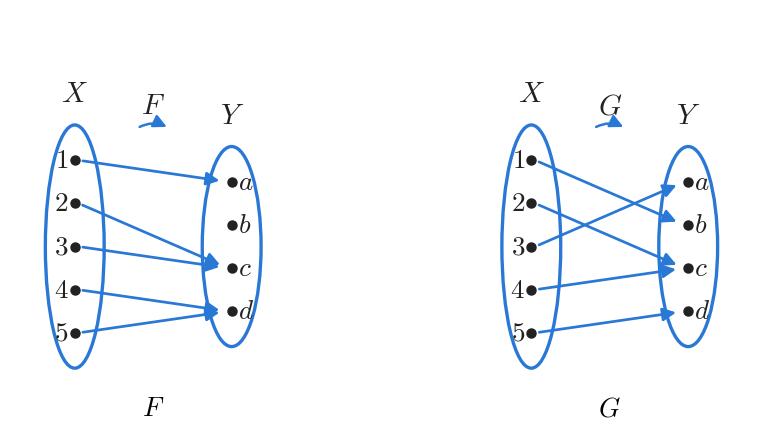

*그림 6. 위로의 함수가 아닌 F와 위로의 함수 G*

$F$는 $1 \mapsto a$, $2 \mapsto c$, $3 \mapsto c$, $4 \mapsto d$, $5 \mapsto d$로 보낸다. $b$로 가는 화살표가 없으므로, 곧 모든 $x \in X$에 대하여 $F(x) \neq b$이므로 $F$는 위로의 함수가 아니다. $G$는 $1 \mapsto b$, $2 \mapsto c$, $3 \mapsto a$, $4 \mapsto c$, $5 \mapsto d$로 보낸다. $a = G(3)$, $b = G(1)$, $c = G(2) = G(4)$, $d = G(5)$이므로 $Y$의 모든 원소가 어떤 원소의 상이고, $G$는 위로의 함수이다.

(b) $X = \lbrace1, 2, 3, 4\rbrace$, $Y = \lbrace a, b, c\rbrace$이고 $H: X \to Y$를 $H(1) = c$, $H(2) = a$, $H(3) = c$, $H(4) = b$로, $K: X \to Y$를 $K(1) = c$, $K(2) = b$, $K(3) = b$, $K(4) = c$로 정의한다. $H$는 $a = H(2)$, $b = H(4)$, $c = H(1) = H(3)$이므로 공역의 세 원소가 모두 상이 되어 위로의 함수이다. $K$는 모든 $x \in \lbrace1, 2, 3, 4\rbrace$에 대하여 $K(x) \neq a$이므로 위로의 함수가 아니다.

유한 집합 $X$에서 유한 집합 $Y$로의 함수가 위로의 함수인지도 기계적으로 검사할 수 있다. $X$와 $Y$의 원소를 배열 $a[1], \ldots, a[n]$과 $b[1], \ldots, b[m]$에 담고, 이중 반복문으로 $Y$의 각 원소 $y$를 차례로 고른 다음 $X$의 원소를 훑으며 $y$를 상으로 갖는 $x$를 찾는다. 한 번이라도 찾지 못하면 $F$는 위로의 함수가 아니고, 모든 탐색이 성공하면 위로의 함수이다.

### 2.5 무한 집합 위의 위로의 함수

$F$가 집합 $X$에서 무한 집합 $Y$로의 함수일 때, 정의에 의해 $F$가 위로의 함수라는 것은 다음 전칭 명제가 참이라는 뜻이다.

$$
\forall y \in Y, \ \exists x \in X, \ F(x) = y
$$

따라서 $F$가 위로의 함수임을 증명할 때는 보통 4장의 일반적 특수 사례로부터의 일반화를 쓴다.

- **가정한다:** $y$가 $Y$의 임의의 원소라고 가정한다.
- **보인다:** $F(x) = y$인 원소 $x$가 $X$에 존재함을 보인다.

반대로 $F$가 위로의 함수가 아님을 보일 때는 **모든** $x \in X$에 대하여 $F(x) \neq y$인 $Y$의 원소 $y$를 **찾는다**.

**예제 7.2.5 (위로의 함수인지 증명하거나 반박하기).** 함수 $f: \mathbf{R} \to \mathbf{R}$과 $h: \mathbf{Z} \to \mathbf{Z}$를 다음과 같이 정의한다.

$$
f(x) = 4x - 1 \ \ (x \in \mathbf{R}), \qquad h(n) = 4n - 1 \ \ (n \in \mathbf{Z})
$$

(a) 먼저 $f$가 위로의 함수임을 증명하려고 시도하면서 어려움이 생기는지 살핀다. 증명할 명제는 $\forall y \in \mathbf{R}, \exists x \in \mathbf{R}, f(x) = y$이다. 실수 $y$를 가정하고 $y = 4x - 1$인 실수 $x$가 존재함을 보여야 한다.

**예비 계산.** 그런 실수 $x$가 존재한다면 다음이 성립해야 한다.

$$
4x - 1 = y \;\Longrightarrow\; 4x = y + 1 \;\Longrightarrow\; x = \frac{y + 1}{4}
$$

첫 화살표는 양변에 1을 더한 것이고, 둘째 화살표는 양변을 4로 나눈 것이다. 곧 $x$가 존재한다면 $\frac{y + 1}{4}$이어야 한다.

> **주의:** 예비 계산은 $x$가 존재한다면 무엇이어야 하는지만 알려 줄 뿐, $x$가 존재함을 증명하지 않는다. 증명에서는 $x = \frac{y + 1}{4}$로 놓은 뒤 (1) $x$가 정의역의 원소인지와 (2) $f$가 실제로 $x$를 $y$로 보내는지를 확인해야 한다.

**증명.** $y \in \mathbf{R}$이라 하자. [$f(x) = y$인 $x \in \mathbf{R}$이 존재함을 보여야 한다.] $x = \frac{y + 1}{4}$로 놓는다. 실수의 합과 0이 아닌 수로 나눈 몫은 실수이므로 $x$는 실수이다. 또 다음이 성립한다.

$$
f(x) = f\left(\frac{y + 1}{4}\right) = 4 \cdot \frac{y + 1}{4} - 1 = (y + 1) - 1 = y
$$

첫 등호는 대입, 둘째 등호는 $f$의 정의, 마지막 두 등호는 기본 대수에서 나온다. 따라서 $f$는 위로의 함수이다. $\blacksquare$

(b) $h$에 대해 같은 방법을 시도하면, 정수 $m$을 가정하고 $4n - 1 = m$인 정수 $n$이 존재함을 보여야 한다. 양변에 1을 더하고 4로 나누면 $n = \frac{m + 1}{4}$이어야 하는데, $n$은 정수여야 한다. 예를 들어 $m = 0$이면 $n = \frac{0 + 1}{4} = \frac{1}{4}$이므로 정수가 아니다. 증명이 막힌 이 지점이 반례를 알려 준다.

**반례.** $h$의 공역은 $\mathbf{Z}$이고 $0 \in \mathbf{Z}$이다. 어떤 정수 $n$에 대하여 $h(n) = 0$이라고 하면 $4n - 1 = 0$이므로 $4n = 1$이고 $n = \frac{1}{4}$이다. 그런데 $\frac{1}{4}$은 정수가 아니므로 $h(n) = 0$인 정수 $n$은 없다. 따라서 $h$는 위로의 함수가 아니다.

같은 규칙 $4x - 1$이 정의역과 공역에 따라 위로의 함수가 되기도 하고 되지 않기도 한다. 일대일 함수와 위로의 함수를 증명하는 방법을 정리하면 다음과 같다.

| 구분 | 일대일 함수 | 위로의 함수 |
|:-----|:-----|:-----|
| 정의 | $\forall x_1, x_2 \in X, \ F(x_1) = F(x_2) \Rightarrow x_1 = x_2$ | $\forall y \in Y, \ \exists x \in X, \ F(x) = y$ |
| 부정 | $\exists x_1, x_2 \in X, \ F(x_1) = F(x_2) \wedge x_1 \neq x_2$ | $\exists y \in Y, \ \forall x \in X, \ F(x) \neq y$ |
| 화살표 도표 | 공역의 각 원소에 화살표가 많아야 하나 도착한다 | 공역의 각 원소에 화살표가 적어도 하나 도착한다 |
| 증명의 시작 | $F(x_1) = F(x_2)$를 가정한다 | 공역의 임의의 원소 $y$를 가정한다 |
| 증명의 목표 | $x_1 = x_2$를 보인다 | $F(x) = y$인 $x \in X$를 찾아 확인한다 |
| 반박 | 값이 같은 서로 다른 두 원소를 찾는다 | 어떤 원소의 상도 아닌 공역의 원소를 찾는다 |

*표 6. 일대일 함수와 위로의 함수의 정의와 증명 방법 비교*

### 2.6 지수 함수와 로그 함수의 관계

> **용어 정의:** $b \neq 1$인 양수 $b$에 대하여 **밑이 $b$인 지수 함수(exponential function with base $b$)** $\exp_b$는 각 실수 $x$를 $\exp_b(x) = b^x$로 보내는 $\mathbf{R}$에서 $\mathbf{R}^{+}$로의 함수이다. 여기서 $b^0 = 1$이고 $b^{-x} = \frac{1}{b^x}$이다.

모든 실수 $x$에 대하여 $b^x$가 실수로 정해진다는 사실은 실수 체계의 최소 상계 성질(least-upper-bound property)에서 나온다. 지수 함수를 다룰 때는 다음 **지수 법칙(laws of exponents)** 을 이용한다. $b$와 $c$가 양의 실수이고 $u$와 $v$가 실수이면 다음이 성립한다.

$$
b^u b^v = b^{u+v} \quad (7.2.1), \qquad (b^u)^v = b^{uv} \quad (7.2.2), \qquad \frac{b^u}{b^v} = b^{u-v} \quad (7.2.3), \qquad (bc)^u = b^u c^u \quad (7.2.4)
$$

1.3절에서 정의한 밑이 $b$인 로그 함수는 $\mathbf{R}^{+}$에서 $\mathbf{R}$로의 함수이며, 양의 실수 $x$와 실수 $y$에 대하여 $\log_b x = y \iff b^y = x$를 만족한다. 미적분학을 이용하면 지수 함수와 로그 함수가 모두 일대일 함수이자 위로의 함수임을 보일 수 있다. 일대일 함수의 정의를 적용하면 다음 두 성질을 얻는다. $b$가 $b \neq 1$인 양의 실수일 때 다음이 성립한다.

$$
\text{모든 실수 } u, v \text{에 대하여, } b^u = b^v \text{이면 } u = v \quad (7.2.5)
$$

$$
\text{모든 양의 실수 } u, v \text{에 대하여, } \log_b u = \log_b v \text{이면 } u = v \quad (7.2.6)
$$

이 성질들로 지수와 로그에 관한 여러 사실을 유도할 수 있으며, 특히 다음 로그의 성질을 얻는다.

> **핵심:** **정리 7.2.1 (로그의 성질).** $b \neq 1$, $c \neq 1$인 양의 실수 $b$, $c$, $x$, $y$와 임의의 실수 $a$에 대하여 다음이 성립한다. (a) $\log_b(xy) = \log_b x + \log_b y$, (b) $\log_b\left(\frac{x}{y}\right) = \log_b x - \log_b y$, (c) $\log_b(x^a) = a \log_b x$, (d) $\log_c x = \frac{\log_b x}{\log_b c}$.

(a)에서 (c)는 각 로그를 지수로 바꾸고 지수 법칙을 적용하여 증명한다. 예를 들어 $u = \log_b x$, $v = \log_b y$로 놓으면 $x = b^u$, $y = b^v$이므로 지수 법칙 7.2.1에 의해 $xy = b^u b^v = b^{u+v}$이고, 로그의 정의에 의해 $\log_b(xy) = u + v = \log_b x + \log_b y$이다. 같은 방법으로 (b)는 $\frac{x}{y} = \frac{b^u}{b^v} = b^{u-v}$(지수 법칙 7.2.3)에서, (c)는 $x^a = (b^u)^a = b^{au}$(지수 법칙 7.2.2)에서 나온다. 다음 예제에서는 지수 함수의 일대일성(성질 7.2.5)을 이용하여 (d)를 증명한다.

**예제 7.2.6 (지수 함수의 일대일성 이용하기).** 로그의 정의, 지수 법칙, 지수 함수의 일대일성(성질 7.2.5)을 이용하여 정리 7.2.1(d)를 증명한다. 곧 $b \neq 1$, $c \neq 1$인 모든 양의 실수 $b$, $c$, $x$에 대하여 $\log_c x = \frac{\log_b x}{\log_b c}$이다.

**증명.** $b \neq 1$, $c \neq 1$인 양의 실수 $b$, $c$, $x$가 주어졌다고 하고 세 수를 다음과 같이 놓는다.

$$
(1)\ u = \log_b c, \qquad (2)\ v = \log_c x, \qquad (3)\ w = \log_b x
$$

로그의 정의에 의해 각 식을 지수의 꼴로 바꾸면 다음과 같다.

$$
(1')\ c = b^u, \qquad (2')\ x = c^v, \qquad (3')\ x = b^w
$$

$(1')$을 $(2')$에 대입하고 지수 법칙 7.2.2를 적용하면 $x = c^v = (b^u)^v = b^{uv}$이다. 한편 $(3')$에 의해 $x = b^w$이므로 $b^{uv} = b^w$이다. 지수 함수의 일대일성(성질 7.2.5)에 의해 $uv = w$이다. (1), (2), (3)을 대입하면 다음을 얻는다.

$$
(\log_b c)(\log_c x) = \log_b x
$$

$c \neq 1$이므로 $\log_b c \neq 0$이다. $\log_b c = 0$이면 $c = b^0 = 1$이 되기 때문이다. 따라서 양변을 $\log_b c$로 나누면 $\log_c x = \frac{\log_b x}{\log_b c}$이다. $\blacksquare$

**예제 7.2.7 (계산기로 밑이 2인 로그 구하기).** 컴퓨터 과학에서는 밑이 2인 로그를 자주 계산해야 한다. 대부분의 계산기에는 밑이 2인 로그 키가 없지만, 밑이 10인 **상용로그(common logarithm)** 와 밑이 $e$인 **자연로그(natural logarithm)** 키는 있다. 상용로그는 흔히 $\log$로, 자연로그는 $\ln$으로 쓴다. 계산기가 $\ln 5 \approx 1.609437912$, $\ln 2 \approx 0.6931471806$을 준다고 하면 정리 7.2.1(d)에서 $b = e$, $c = 2$로 놓아 다음을 얻는다.

$$
\log_2 5 = \frac{\ln 5}{\ln 2} \approx \frac{1.609437912}{0.6931471806} \approx 2.321928095
$$

검산으로 $2^2 = 4 < 5 < 8 = 2^3$이므로 $\log_2 5$는 2와 3 사이에 있어야 하며, 결과가 이와 맞다.

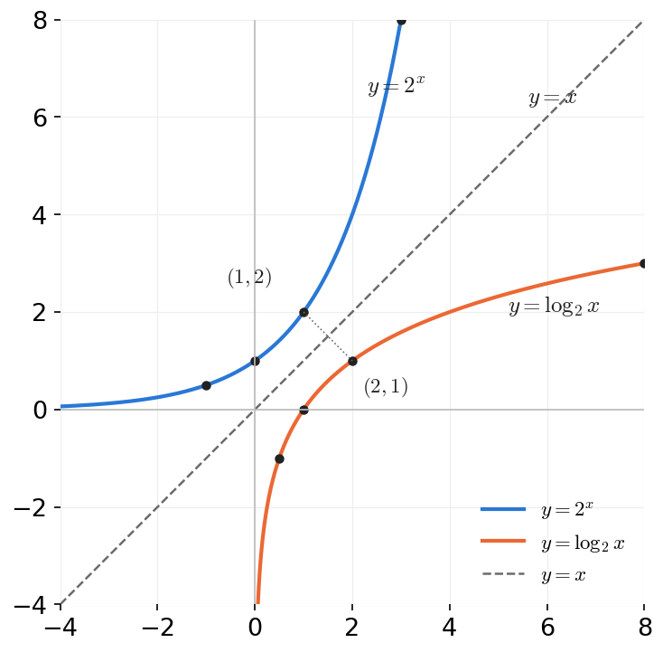

*그림 7. 서로 역함수인 y = 2ˣ와 y = log₂ x의 그래프*

그림 7은 $y = 2^x$와 $y = \log_2 x$의 그래프이다. $2^1 = 2$이므로 점 $(1, 2)$는 첫 그래프 위에 있고, $\log_2 2 = 1$이므로 점 $(2, 1)$은 둘째 그래프 위에 있다. 일반적으로 $(a, b)$가 한 그래프 위에 있으면 $(b, a)$가 다른 그래프 위에 있으므로, 두 그래프는 직선 $y = x$에 대하여 대칭이다. 두 함수가 서로의 역함수이기 때문이며(2.8절), 각 그래프는 수평선과 많아야 한 번 만나고(일대일 함수) 공역의 모든 높이에 도달한다(위로의 함수).

### 2.7 일대일 대응

함수 $F: X \to Y$가 일대일 함수이자 위로의 함수라고 가정한다. $X$의 원소 $x$가 주어지면 $F$가 함수이므로 대응하는 원소 $y = F(x)$가 $Y$에 유일하게 존재한다. 또 $Y$의 원소 $y$가 주어지면 $F$가 위로의 함수이므로 $F(x) = y$인 $x$가 $X$에 존재하고, $F$가 일대일 함수이므로 그런 $x$는 하나뿐이다. 따라서 일대일 함수이자 위로의 함수는 $X$의 각 원소를 $Y$의 원소 정확히 하나와, $Y$의 각 원소를 $X$의 원소 정확히 하나와 짝짓는다. 예를 들어 $\lbrace a, b, c, d, e\rbrace$에서 $\lbrace1, 2, 3, 4, 5\rbrace$로 $a \mapsto 1$, $b \mapsto 2$, $c \mapsto 3$, $d \mapsto 4$, $e \mapsto 5$로 보내는 함수가 그러하다. 이런 짝짓기는 개수를 세는 데에도 쓰인다. 위의 짝짓기는 $\lbrace a, b, c, d, e\rbrace$의 원소가 다섯 개임을 보여 준다.

> **용어 정의:** 집합 $X$에서 집합 $Y$로의 **일대일 대응(one-to-one correspondence)** 또는 **전단사 함수(bijection)** 는 일대일 함수이자 위로의 함수인 함수 $F: X \to Y$이다.

**예제 7.2.8 (멱집합에서 문자열의 집합으로의 함수).** $\mathcal{P}(\lbrace a, b\rbrace) = \lbrace\emptyset, \lbrace a\rbrace, \lbrace b\rbrace, \lbrace a, b\rbrace\rbrace$이고, $S$를 0과 1로 이루어진 길이 2의 문자열 전체의 집합 $\lbrace00, 01, 10, 11\rbrace$이라 하자. 함수 $h: \mathcal{P}(\lbrace a, b\rbrace) \to S$를 다음과 같이 정의한다. $\lbrace a, b\rbrace$의 부분집합 $A$가 주어지면 $a$는 $A$에 속하거나 속하지 않고, $b$도 그러하다. $a \in A$이면 문자열 $h(A)$의 첫째 자리에 1을, 아니면 0을 쓴다. 마찬가지로 $b \in A$이면 둘째 자리에 1을, 아니면 0을 쓴다.

| $\lbrace a, b\rbrace$의 부분집합 $A$ | $a$가 $A$에 속하는가 | $b$가 $A$에 속하는가 | $h(A)$ |
|:---:|:---:|:---:|:---:|
| $\emptyset$ | 아니오 | 아니오 | 00 |
| $\lbrace a\rbrace$ | 예 | 아니오 | 10 |
| $\lbrace b\rbrace$ | 아니오 | 예 | 01 |
| $\lbrace a, b\rbrace$ | 예 | 예 | 11 |

*표 7. 부분집합을 길이 2의 비트 문자열로 보내는 함수 h*

$h$는 일대일 대응이다. $S$의 네 원소가 모두 어떤 부분집합의 상이므로 위로의 함수이고, $S$의 각 원소가 많아야 한 부분집합의 상이므로 일대일 함수이다. 이 대응은 부분집합을 비트 문자열로 나타내는 방법이며, 컴퓨터에서 집합을 비트 벡터로 저장하는 원리와 같다.

**예제 7.2.9 (문자열을 뒤집는 함수).** $T$를 $x$와 $y$로 이루어진 모든 유한 문자열의 집합이라 하고, 함수 $g: T \to T$를 각 문자열 $s \in T$에 대하여 $g(s) = s$의 문자를 역순으로 쓴 문자열로 정의한다. 예를 들어 $g(xxy) = yxx$이다. $g$가 $T$에서 $T$로의 일대일 대응인지 판정한다. 답은 그렇다이며, 일대일 함수임과 위로의 함수임을 각각 보인다.

- **일대일 함수:** $T$의 문자열 $s_1$, $s_2$에 대하여 $g(s_1) = g(s_2)$라고 가정한다. [$s_1 = s_2$임을 보여야 한다.] 이는 $s_1$을 뒤집은 문자열과 $s_2$를 뒤집은 문자열이 같다는 뜻이다. 뒤집은 결과가 같은 두 문자열은 처음부터 같아야 하므로 $s_1 = s_2$이다.
- **위로의 함수:** $t$가 $T$의 임의의 문자열이라고 가정한다. [$g(s) = t$인 $s \in T$를 찾아야 한다.] $s = g(t)$로 놓으면 $s$는 $t$를 뒤집은 문자열로서 $T$의 원소이다. 문자열을 한 번 뒤집고 다시 뒤집으면 원래 문자열이 되므로 $g(s) = g(g(t)) = t$이다.

**예제 7.2.10 (두 변수 함수).** 함수 $F: \mathbf{R} \times \mathbf{R} \to \mathbf{R} \times \mathbf{R}$을 모든 $(x, y) \in \mathbf{R} \times \mathbf{R}$에 대하여 $F(x, y) = (x + y, x - y)$로 정의한다. $F$가 $\mathbf{R} \times \mathbf{R}$에서 자기 자신으로의 일대일 대응임을 보인다.

**일대일 함수임의 증명.** $\mathbf{R} \times \mathbf{R}$의 순서쌍 $(x_1, y_1)$, $(x_2, y_2)$가 $F(x_1, y_1) = F(x_2, y_2)$를 만족한다고 가정한다. [$(x_1, y_1) = (x_2, y_2)$임을 보여야 한다.] $F$의 정의에 의해 $(x_1 + y_1, x_1 - y_1) = (x_2 + y_2, x_2 - y_2)$이다. 두 순서쌍이 같으려면 첫째 성분끼리, 둘째 성분끼리 같아야 하므로 다음 연립방정식을 얻는다.

$$
x_1 + y_1 = x_2 + y_2 \quad (1), \qquad x_1 - y_1 = x_2 - y_2 \quad (2)
$$

(1)과 (2)를 더하면 $2x_1 = 2x_2$이므로 $x_1 = x_2$이다. 이를 (1)에 대입하면 $x_1 + y_1 = x_1 + y_2$이므로 $y_1 = y_2$이다. 순서쌍의 상등에 의해 $(x_1, y_1) = (x_2, y_2)$이다.

**위로의 함수임을 위한 예비 계산.** 공역 $\mathbf{R} \times \mathbf{R}$의 임의의 순서쌍 $(u, v)$가 주어졌을 때 $F(r, s) = (u, v)$인 순서쌍 $(r, s)$가 있다고 잠정적으로 가정한다. 그러면 $F$의 정의에 의해 $(r + s, r - s) = (u, v)$이므로 $r + s = u$이고 $r - s = v$이다. 두 식을 더하면 $2r = u + v$이므로 $r = \frac{u + v}{2}$이고, 첫 식에서 둘째 식을 빼면 $2s = u - v$이므로 $s = \frac{u - v}{2}$이다. 이것은 $(r, s)$가 존재한다면 무엇이어야 하는지를 알려 줄 뿐이므로, 증명에서는 이 순서쌍이 정의역에 속하고 실제로 $(u, v)$로 보내짐을 확인해야 한다.

**위로의 함수임의 증명.** $(u, v)$가 공역의 임의의 순서쌍이라고 가정한다. [$F$에 의해 $(u, v)$로 보내지는 순서쌍이 정의역에 있음을 보여야 한다.] $r = \frac{u + v}{2}$, $s = \frac{u - v}{2}$로 놓는다. 그러면 $(r, s)$는 실수의 순서쌍이므로 $F$의 정의역에 속하며, 다음이 성립한다.

$$
F(r, s) = F\left(\frac{u + v}{2}, \frac{u - v}{2}\right) = \left(\frac{u + v}{2} + \frac{u - v}{2}, \ \frac{u + v}{2} - \frac{u - v}{2}\right) = \left(\frac{2u}{2}, \frac{2v}{2}\right) = (u, v)
$$

첫 등호는 대입, 둘째 등호는 $F$의 정의, 나머지는 대수 계산이다. 따라서 $F$는 위로의 함수이고, 일대일 함수이기도 하므로 일대일 대응이다. $\blacksquare$

### 2.8 역함수

$F$가 집합 $X$에서 집합 $Y$로의 일대일 대응이면 $F$의 작용을 되돌리는 $Y$에서 $X$로의 함수가 존재한다. 이 함수는 $Y$의 각 원소를 그 원소가 나온 $X$의 원소로 돌려보내며, $F$의 역함수라 한다.

> **핵심:** **정리 7.2.2.** $F: X \to Y$가 일대일 대응, 곧 일대일 함수이자 위로의 함수라고 가정한다. 그러면 $Y$의 각 원소 $y$에 대하여 $F^{-1}(y)$를 $F(x) = y$인 $X$의 유일한 원소 $x$로 정의하는 함수 $F^{-1}: Y \to X$가 존재한다. 동치인 표현으로 $F^{-1}(y) = x \iff y = F(x)$이다.

**증명.** $Y$의 임의의 원소 $y$에 대하여 $F$가 위로의 함수이므로 $F(x) = y$인 $x \in X$가 존재하고, $F$가 일대일 함수이므로 그런 $x$는 유일하다. 따라서 $F^{-1}(y)$는 $Y$의 모든 원소에서 값이 존재하고 그 값이 유일하므로, $F^{-1}$은 잘 정의된 함수이다. $\blacksquare$

> **용어 정의:** 정리 7.2.2의 함수 $F^{-1}$을 $F$의 **역함수(inverse function)** 라 한다.

이 정의에 따르면 $b > 0$, $b \neq 1$일 때 밑이 $b$인 로그 함수는 밑이 $b$인 지수 함수의 역함수이다. 예제 7.1.8의 $\log_2(2^m) = m$과 $2^{\log_2 m} = m$이 바로 두 함수가 서로의 작용을 되돌린다는 사실이다. 역함수는 각 원소를 그 원소가 나온 곳으로 돌려보내며, 이를 그림으로 나타내면 다음과 같다.

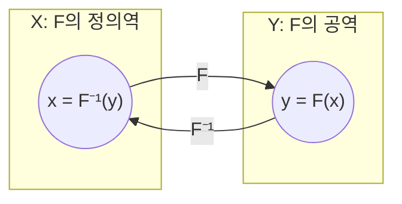

*그림 8. 원소를 원래 자리로 돌려보내는 역함수*

**예제 7.2.11 (화살표 도표로 주어진 함수의 역함수).** 예제 7.2.8의 일대일 대응 $h$의 역함수를 구한다. $h$의 화살표를 $S$에서 $\mathcal{P}(\lbrace a, b\rbrace)$로 거꾸로 따라가면 $h^{-1}$을 얻는다.

$$
h^{-1}(00) = \emptyset, \qquad h^{-1}(10) = \lbrace a\rbrace, \qquad h^{-1}(01) = \lbrace b\rbrace, \qquad h^{-1}(11) = \lbrace a, b\rbrace
$$

**예제 7.2.12 (말로 주어진 함수의 역함수).** 예제 7.2.9의 일대일 대응 $g$의 역함수를 구한다. $g: T \to T$는 각 문자열 $t$를 $t$의 문자를 역순으로 쓴 문자열로 보낸다. 문자를 역순으로 쓰고 다시 역순으로 쓰면 원래 문자열이 되므로, 임의의 문자열 $t \in T$에 대하여 $g^{-1}(t)$는 역순으로 썼을 때 $t$가 되는 유일한 문자열, 곧 $t$를 역순으로 쓴 문자열이다. 따라서 $g^{-1}(t) = g(t)$이고, $g^{-1}$은 $g$ 자신과 같다. 곧 $g^{-1} = g$이다.

**예제 7.2.13 (식으로 주어진 함수의 역함수).** 예제 7.2.2에서 일대일 함수임을, 예제 7.2.5에서 위로의 함수임을 보인 함수 $f: \mathbf{R} \to \mathbf{R}$, $f(x) = 4x - 1$의 역함수를 구한다. 특정하지만 임의로 택한 실수 $y$에 대하여 $f^{-1}(y)$는 $f(x) = y$인 유일한 실수 $x$이다. 그런데 다음이 성립한다.

$$
f(x) = y \iff 4x - 1 = y \iff x = \frac{y + 1}{4}
$$

첫 동치는 $f$의 정의, 둘째 동치는 대수 계산에서 나온다. 따라서 $f^{-1}(y) = \frac{y + 1}{4}$이다. 예를 들어 $f(2) = 7$이고 $f^{-1}(7) = \frac{8}{4} = 2$이다.

**예제 7.2.14 (두 변수 함수의 역함수).** 예제 7.2.10의 일대일 대응 $F$의 역함수 $F^{-1}: \mathbf{R} \times \mathbf{R} \to \mathbf{R} \times \mathbf{R}$을 구한다. 예제 7.2.10의 풀이에서 $F\left(\frac{u + v}{2}, \frac{u - v}{2}\right) = (u, v)$임을 보였다. $F$는 일대일 함수이므로 $\left(\frac{u + v}{2}, \frac{u - v}{2}\right)$는 $F$에 의해 $(u, v)$로 보내지는 정의역의 유일한 순서쌍이다. 따라서 $F^{-1}$은 각 순서쌍 $(u, v) \in \mathbf{R} \times \mathbf{R}$에 대하여 다음과 같이 정의된다.

$$
F^{-1}(u, v) = \left(\frac{u + v}{2}, \frac{u - v}{2}\right)
$$

예를 들어 $F(3, 1) = (4, 2)$이고 $F^{-1}(4, 2) = \left(\frac{6}{2}, \frac{2}{2}\right) = (3, 1)$이다.

다음 정리는 정의에서 바로 따라 나온다.

> **핵심:** **정리 7.2.3.** $X$와 $Y$가 집합이고 $F: X \to Y$가 일대일 함수이자 위로의 함수이면, $F^{-1}: Y \to X$도 일대일 함수이자 위로의 함수이다.

**증명.** 두 성질을 차례로 보인다.

- **$F^{-1}$은 일대일 함수이다.** $Y$의 원소 $y_1$, $y_2$가 $F^{-1}(y_1) = F^{-1}(y_2)$를 만족한다고 가정한다. [$y_1 = y_2$임을 보여야 한다.] $x = F^{-1}(y_1) = F^{-1}(y_2)$라 하면 $x \in X$이고, $F^{-1}$의 정의에 의해 $x = F^{-1}(y_1)$에서 $F(x) = y_1$, $x = F^{-1}(y_2)$에서 $F(x) = y_2$이다. 따라서 $y_1$과 $y_2$는 모두 $F(x)$와 같으므로 $y_1 = y_2$이다.
- **$F^{-1}$은 위로의 함수이다.** $x \in X$라고 가정한다. [$F^{-1}(y) = x$인 $y \in Y$가 존재함을 보여야 한다.] $y = F(x)$로 놓으면 $y \in Y$이고, $F^{-1}$의 정의에 의해 $F^{-1}(y) = x$이다. $\blacksquare$

> **주의:** 역함수 $F^{-1}$은 $F$가 일대일 대응일 때만 존재한다. 1.6절의 역상 $F^{-1}(C)$는 임의의 함수에서 정의되는 **집합**이므로 둘을 혼동하면 안 된다. $F$가 일대일 대응이면 두 기호가 서로 맞물려 $F^{-1}(\lbrace y\rbrace) = \lbrace F^{-1}(y)\rbrace$가 성립한다.

---

<br>

## 3. 함수의 합성

정수에서 정수로의 두 함수, 곧 1을 더하는 후속자 함수와 제곱하는 제곱 함수를 각각 하나의 기계로 생각한다. 후속자 함수의 출력을 제곱 함수의 입력으로 쓰도록 두 기계를 연결하면 하나의 큰 기계처럼 작동한다. 이 큰 기계에서 정수 $n$은 먼저 1이 더해져 $n + 1$이 되고, 이어서 제곱되어 $(n + 1)^2$이 된다.

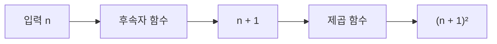

*그림 9. 후속자 함수의 출력을 제곱 함수의 입력으로 쓰는 연결*

### 3.1 합성의 정의

이처럼 함수를 연결하는 것을 함수를 **합성한다(composing)** 고 하고, 그 결과로 얻은 함수를 두 함수의 **합성(composition)** 이라 한다. 합성은 첫째 함수의 출력이 둘째 함수의 입력으로 쓰일 수 있을 때만 가능하다. 곧 첫째 함수의 치역이 둘째 함수의 정의역에 포함되어야 한다.

> **용어 정의:** $f: X \to Y$와 $g: Y' \to Z$가 $f$의 치역이 $g$의 정의역 $Y'$의 부분집합이라는 성질을 가진 함수라 하자. 새 함수 $g \circ f: X \to Z$를 모든 $x \in X$에 대하여 $(g \circ f)(x) = g(f(x))$로 정의하고, 이를 **$f$와 $g$의 합성(composition of $f$ and $g$)** 이라 한다. $g \circ f$는 "$g$ circle $f$", $g(f(x))$는 "$g$ of $f$ of $x$"라 읽는다.

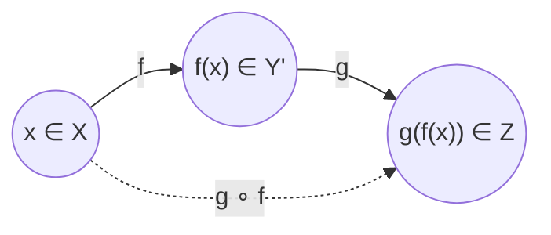

*그림 10. f를 먼저 적용하고 g를 나중에 적용하는 합성 g ∘ f*

> **참고:** 기호는 $g \circ f$로 $g$를 앞에 쓰지만, 원소 $x$에는 $f$가 먼저 작용하고 $g$가 나중에 작용한다. "$f$와 $g$의 합성"이라는 말에서 $f$를 먼저 부르는 것도 이 순서를 따른 것이다.

**예제 7.3.1 (식으로 정의된 함수의 합성).** $f: \mathbf{Z} \to \mathbf{Z}$를 후속자 함수, $g: \mathbf{Z} \to \mathbf{Z}$를 제곱 함수라 하자. 곧 모든 $n \in \mathbf{Z}$에 대하여 $f(n) = n + 1$, $g(n) = n^2$이다.

(a) $g \circ f$와 $f \circ g$를 구한다. $f$는 각 정수를 그 정수에 1을 더한 값으로, $g$는 각 정수를 그 정수의 제곱으로 보낸다. 입력으로 들어오는 정수가 $g(n)$이나 $f(n)$ 같은 식이어도 이 작용은 같다. 따라서 모든 $n \in \mathbf{Z}$에 대하여 다음이 성립한다.

$$
(g \circ f)(n) = g(f(n)) = g(n + 1) = (n + 1)^2, \qquad (f \circ g)(n) = f(g(n)) = f(n^2) = n^2 + 1
$$

(b) $g \circ f = f \circ g$인가? 정리 7.1.1에 의해 두 함수가 같으려면 모든 입력에서 값이 같아야 한다. 그런데 $n = 1$에서 다음과 같으므로 $g \circ f \neq f \circ g$이다.

$$
(g \circ f)(1) = (1 + 1)^2 = 4, \qquad (f \circ g)(1) = 1^2 + 1 = 2
$$

이 예는 함수의 합성이 **교환법칙을 만족하지 않는** 연산임을 보여 준다. 일반적으로 $F \circ G$와 $G \circ F$는 같을 필요가 없다. 물론 두 합성이 우연히 같은 경우도 있다.

> **주의:** $g \circ f$와 $g(f(x))$를 혼동하지 않아야 한다. $g \circ f$는 함수의 이름이고, $g(f(x))$는 그 함수의 $x$에서의 값이다.

**예제 7.3.2 (유한 집합 위에서 정의된 함수의 합성).** $X = \lbrace1, 2, 3\rbrace$, $Y' = \lbrace a, b, c, d\rbrace$, $Y = \lbrace a, b, c, d, e\rbrace$, $Z = \lbrace x, y, z\rbrace$이고 함수 $f: X \to Y'$와 $g: Y \to Z$가 다음 화살표 도표의 왼쪽 부분으로 주어져 있다. 곧 $f(1) = c$, $f(2) = b$, $f(3) = a$이고 $g(a) = y$, $g(b) = y$, $g(c) = z$, $g(d) = z$, $g(e) = z$이다. $f$의 치역 $\lbrace a, b, c\rbrace$는 $Y' \subseteq Y$에 포함되므로 $g$의 정의역 $Y$의 부분집합이고, 합성 $g \circ f$가 정의된다.

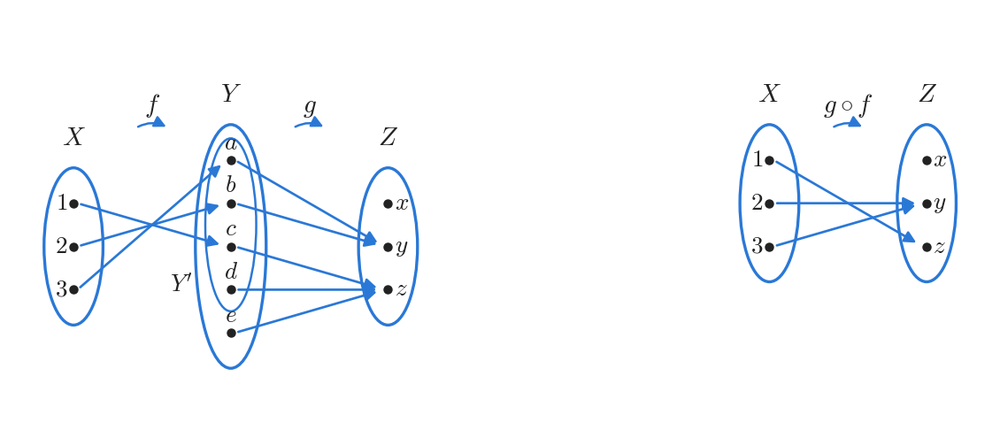

*그림 11. 유한 집합 위의 함수 f, g와 합성 g ∘ f의 화살표 도표*

$g \circ f$의 화살표 도표는 $X$에서 $Y$를 거쳐 $Z$까지 화살표를 끝까지 따라가서 얻는다(그림 11의 오른쪽).

$$
(g \circ f)(1) = g(f(1)) = g(c) = z, \qquad (g \circ f)(2) = g(f(2)) = g(b) = y, \qquad (g \circ f)(3) = g(f(3)) = g(a) = y
$$

따라서 $g \circ f$의 치역은 $\lbrace y, z\rbrace$이다.

### 3.2 항등 함수와의 합성

집합 $X$ 위의 항등 함수 $I_X$는 모든 $x \in X$에 대하여 $I_X(x) = x$로 정의된 $X$에서 $X$로의 함수이다(1.3절). 항등 함수를 다른 함수와 합성하면 어떻게 되는지 살펴본다.

**예제 7.3.3 (항등 함수와의 합성).** $X = \lbrace a, b, c, d\rbrace$, $Y = \lbrace u, v, w\rbrace$이고 $f: X \to Y$가 $f(a) = u$, $f(b) = v$, $f(c) = v$, $f(d) = u$로 주어져 있다. $f \circ I_X$와 $I_Y \circ f$를 구한다. 각 $x$에 대하여 $I_X$를 먼저 적용한 뒤 $f$를 적용한 값과, $f$를 먼저 적용한 뒤 $I_Y$를 적용한 값을 계산하면 다음과 같다.

| $x$ | $I_X(x)$ | $(f \circ I_X)(x) = f(I_X(x))$ | $f(x)$ | $(I_Y \circ f)(x) = I_Y(f(x))$ |
|:---:|:---:|:---:|:---:|:---:|
| $a$ | $a$ | $f(a) = u$ | $u$ | $I_Y(u) = u$ |
| $b$ | $b$ | $f(b) = v$ | $v$ | $I_Y(v) = v$ |
| $c$ | $c$ | $f(c) = v$ | $v$ | $I_Y(v) = v$ |
| $d$ | $d$ | $f(d) = u$ | $u$ | $I_Y(u) = u$ |

*표 8. 항등 함수와 f의 합성의 값*

모든 $x \in X$에서 $(f \circ I_X)(x) = f(x)$이고 $(I_Y \circ f)(x) = f(x)$이므로, 함수의 상등에 의해 $f \circ I_X = f$이고 $I_Y \circ f = f$이다. 일반적으로 어떤 함수든 항등 함수와 합성하면 그 함수 자신이 된다.

> **핵심:** **정리 7.3.1 (항등 함수와의 합성).** $f$가 집합 $X$에서 집합 $Y$로의 함수이고 $I_X$와 $I_Y$가 각각 $X$와 $Y$ 위의 항등 함수이면 (a) $f \circ I_X = f$이고 (b) $I_Y \circ f = f$이다.

**증명.** (a) 각 $x \in X$에 대하여 $(f \circ I_X)(x) = f(I_X(x)) = f(x)$이다. 첫 등호는 합성의 정의, 둘째 등호는 $I_X$의 정의에서 나온다. 두 함수 $f \circ I_X$와 $f$는 정의역 $X$와 공역 $Y$가 같고 모든 원소에서 값이 같으므로, 함수의 상등에 의해 $f \circ I_X = f$이다.

(b) 각 $x \in X$에 대하여 $(I_Y \circ f)(x) = I_Y(f(x)) = f(x)$이다. 첫 등호는 합성의 정의에서, 둘째 등호는 $f(x) \in Y$이고 $I_Y$가 $Y$의 모든 원소를 그 자신으로 보낸다는 데서 나온다. 따라서 함수의 상등에 의해 $I_Y \circ f = f$이다. $\blacksquare$

### 3.3 함수와 그 역함수의 합성

$f$가 집합 $X$에서 집합 $Y$로의 함수이고 역함수 $f^{-1}$을 가진다고 가정한다. $f^{-1}$은 $Y$에서 $X$로의 함수로서 $f^{-1}(y) = x \iff f(x) = y$를 만족한다(2.8절). $f$를 $f^{-1}$과 합성하면 어떻게 되는지 살펴본다.

**예제 7.3.4 (함수와 그 역함수의 합성).** $X = \lbrace a, b, c\rbrace$, $Y = \lbrace x, y, z\rbrace$이고 $f: X \to Y$가 $f(a) = z$, $f(b) = x$, $f(c) = y$로 주어져 있다. 세 원소가 서로 다른 원소로 가고 $Y$의 세 원소가 모두 상이 되므로 $f$는 일대일 함수이자 위로의 함수이다. 따라서 $f^{-1}$이 존재하며, 화살표를 거꾸로 따라가면 $f^{-1}(x) = b$, $f^{-1}(y) = c$, $f^{-1}(z) = a$이다.

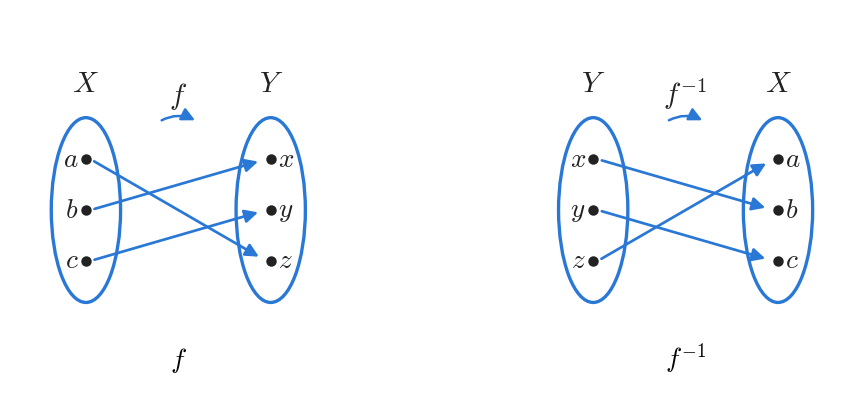

*그림 12. 일대일 대응 f와 그 역함수 f⁻¹의 화살표 도표*

$f^{-1} \circ f$는 $X$에서 $f$를 따라 $Y$로 갔다가 $f^{-1}$을 따라 $X$로 돌아오는 화살표를 따라가서 얻는다.

$$
(f^{-1} \circ f)(a) = f^{-1}(z) = a, \qquad (f^{-1} \circ f)(b) = f^{-1}(x) = b, \qquad (f^{-1} \circ f)(c) = f^{-1}(y) = c
$$

$f$와 $f^{-1}$의 합성은 각 원소를 그 자신으로 보내므로, 항등 함수의 정의에 의해 $f^{-1} \circ f = I_X$이다. 같은 방법으로 $(f \circ f^{-1})(x) = f(b) = x$, $(f \circ f^{-1})(y) = f(c) = y$, $(f \circ f^{-1})(z) = f(a) = z$이므로 $f \circ f^{-1} = I_Y$이다.

일반적으로 역함수를 가진 함수를 그 역함수와 합성하면 항등 함수가 된다. 함수가 정의역의 원소를 공역의 원소로 보내고 역함수가 그것을 다시 돌려보내므로, 둘을 합성하면 각 원소가 그 자신으로 간다.

> **핵심:** **정리 7.3.2 (함수와 그 역함수의 합성).** $f: X \to Y$가 역함수 $f^{-1}: Y \to X$를 가진 일대일 대응이면 (a) $f^{-1} \circ f = I_X$이고 (b) $f \circ f^{-1} = I_Y$이다.

**증명.** (a) [$f^{-1} \circ f = I_X$임을 보이려면 모든 $x \in X$에 대하여 $(f^{-1} \circ f)(x) = x$임을 보여야 한다.] $x$를 $X$의 임의의 원소라 하자. 합성의 정의에 의해 $(f^{-1} \circ f)(x) = f^{-1}(f(x))$이다. $z = f^{-1}(f(x))$라 하면, 역함수의 정의에 의해 $z$는 $f$에 의해 $f(x)$로 보내지는 원소이므로 $f(z) = f(x)$이다. $f$가 일대일 함수이므로 $z = x$이다. 곧 $f^{-1}(f(x)) = x$, 다시 말해 $(f^{-1} \circ f)(x) = x$이다. $x$는 $X$의 임의의 원소이고 $I_X(x) = x$이므로 $f^{-1} \circ f = I_X$이다.

(b) [모든 $y \in Y$에 대하여 $(f \circ f^{-1})(y) = y$임을 보여야 한다.] $y$를 $Y$의 임의의 원소라 하고 $x = f^{-1}(y)$로 놓는다. 역함수의 정의 $f^{-1}(y) = x \iff f(x) = y$에 의해 $f(x) = y$이다. 따라서 $(f \circ f^{-1})(y) = f(f^{-1}(y)) = f(x) = y = I_Y(y)$이고, 함수의 상등에 의해 $f \circ f^{-1} = I_Y$이다. $\blacksquare$

### 3.4 일대일 함수의 합성

합성은 함수가 일대일 함수인지, 위로의 함수인지와 흥미롭게 상호작용한다. 먼저 두 일대일 함수를 합성하면 그 합성도 일대일 함수인지 살펴본다. $X = \lbrace a, b, c\rbrace$, $Y = \lbrace w, x, y, z\rbrace$, $Z = \lbrace1, 2, 3, 4, 5\rbrace$이고 일대일 함수 $f: X \to Y$와 $g: Y \to Z$가 $f(a) = w$, $f(b) = y$, $f(c) = z$와 $g(w) = 1$, $g(x) = 2$, $g(y) = 4$, $g(z) = 5$로 주어져 있다고 가정한다. 화살표를 끝까지 따라가면 $(g \circ f)(a) = 1$, $(g \circ f)(b) = 4$, $(g \circ f)(c) = 5$이다.

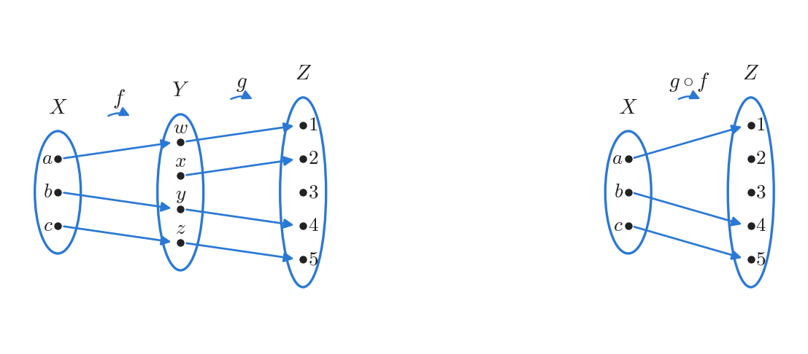

*그림 13. 두 일대일 함수 f, g와 일대일 함수인 합성 g ∘ f*

이 예에서 합성 $g \circ f$는 세 원소를 서로 다른 원소로 보내므로 일대일 함수이다. 이는 우연이 아니다.

> **핵심:** **정리 7.3.3.** $f: X \to Y$와 $g: Y \to Z$가 모두 일대일 함수이면 $g \circ f$는 일대일 함수이다.

직접 증명의 출발점과 결론은 다음과 같다.

- **출발점:** $f$는 $X$에서 $Y$로의 일대일 함수이고 $g$는 $Y$에서 $Z$로의 일대일 함수라고 가정한다.
- **보일 것:** $g \circ f$는 $X$에서 $Z$로의 일대일 함수이다.

핵심은 일대일 함수의 정의에 $g \circ f$를 대입하는 것이다.

$$
g \circ f \text{가 일대일 함수} \iff \forall x_1, x_2 \in X, \ \big((g \circ f)(x_1) = (g \circ f)(x_2) \Rightarrow x_1 = x_2\big)
$$

따라서 $(g \circ f)(x_1) = (g \circ f)(x_2)$인 $X$의 원소 $x_1$, $x_2$를 가정하고 $x_1 = x_2$를 보이면 된다. 합성의 정의에 의해 가정은 $g(f(x_1)) = g(f(x_2))$이다. 이 식은 "$g$(어떤 것) = $g$(다른 것)"의 꼴이다. $g$는 일대일 함수이므로 $g$의 값이 같은 두 입력은 같고, 따라서 $f(x_1) = f(x_2)$이다. 이 식도 "$f$(어떤 것) = $f$(다른 것)"의 꼴이며, $f$도 일대일 함수이므로 $x_1 = x_2$이다. 이 논의를 정리하면 다음 증명이 된다.

**정리 7.3.3의 증명.** $f: X \to Y$와 $g: Y \to Z$가 모두 일대일 함수라고 가정한다. [$g \circ f$가 일대일 함수임을 보여야 한다.] $X$의 원소 $x_1$, $x_2$가 $(g \circ f)(x_1) = (g \circ f)(x_2)$를 만족한다고 가정한다. [$x_1 = x_2$임을 보여야 한다.] 합성의 정의에 의해 $g(f(x_1)) = g(f(x_2))$이다. $g$가 일대일 함수이므로 $f(x_1) = f(x_2)$이고, $f$가 일대일 함수이므로 $x_1 = x_2$이다. 따라서 $g \circ f$는 일대일 함수이다. $\blacksquare$

### 3.5 위로의 함수의 합성

다음으로 두 위로의 함수를 합성한다. $X = \lbrace a, b, c, d, e\rbrace$, $Y = \lbrace w, x, y, z\rbrace$, $Z = \lbrace1, 2, 3\rbrace$이고 위로의 함수 $f: X \to Y$와 $g: Y \to Z$가 $f(a) = x$, $f(b) = y$, $f(c) = w$, $f(d) = z$, $f(e) = y$와 $g(w) = 2$, $g(x) = 1$, $g(y) = 3$, $g(z) = 2$로 주어져 있다고 가정한다. 화살표를 끝까지 따라가면 $(g \circ f)(a) = 1$, $(g \circ f)(b) = 3$, $(g \circ f)(c) = 2$, $(g \circ f)(d) = 2$, $(g \circ f)(e) = 3$이다.

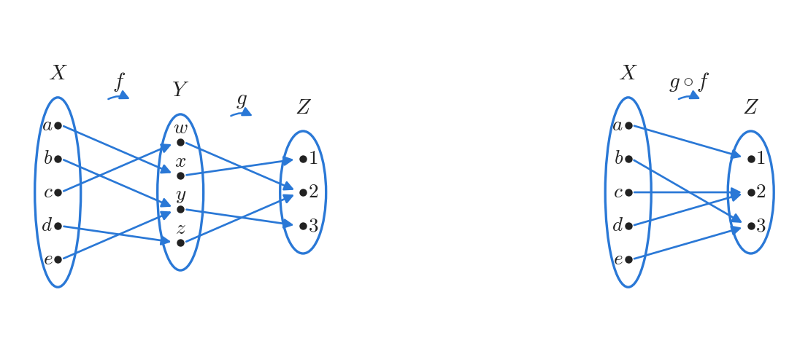

*그림 14. 두 위로의 함수 f, g와 위로의 함수인 합성 g ∘ f*

$Z$의 세 원소가 모두 $g \circ f$의 상이므로 $g \circ f$는 위로의 함수이다. 합성할 수 있는 두 위로의 함수의 합성은 항상 위로의 함수이다.

> **핵심:** **정리 7.3.4.** $f: X \to Y$와 $g: Y \to Z$가 모두 위로의 함수이면 $g \circ f$는 위로의 함수이다.

직접 증명의 출발점은 "$f$는 $X$에서 $Y$로의 위로의 함수이고 $g$는 $Y$에서 $Z$로의 위로의 함수이다"이고, 보일 것은 "$g \circ f$는 $X$에서 $Z$로의 위로의 함수이다"이다. 위로의 함수의 정의에 $g \circ f$를 대입하면 다음과 같다.

$$
g \circ f: X \to Z \text{가 위로의 함수} \iff \forall z \in Z, \ \exists x \in X, \ (g \circ f)(x) = z
$$

이 명제는 전칭 명제이므로, 특정하지만 임의로 택한 원소 $z \in Z$를 가정하고 $(g \circ f)(x) = z$인 $x \in X$가 존재함을 보여야 한다. $x$를 찾기 위해 $z \in Z$라는 가정에서 출발하여 $g$와 $f$가 위로의 함수라는 사실을 거꾸로 이용한다.

1. $g$는 위로의 함수이므로 $z$는 $Y$에서 오는 어떤 화살표의 끝에 있다. 곧 다음을 만족하는 $y \in Y$가 존재한다.

   $$
   g(y) = z \quad (7.3.1)
   $$

2. $f$도 위로의 함수이므로 $Y$의 모든 원소는 $X$에서 오는 어떤 화살표의 끝에 있다. 특히 $y$도 그러하므로 다음을 만족하는 $x \in X$가 존재한다.

   $$
   f(x) = y \quad (7.3.2)
   $$

3. 식 (7.3.2)를 식 (7.3.1)에 대입하면 $g(f(x)) = z$이고, 합성의 정의에 의해 $g(f(x)) = (g \circ f)(x)$이므로 $(g \circ f)(x) = z$이다. 곧 $x$는 $g \circ f$에 의해 $z$로 보내지는 $X$의 원소이며, 찾으려던 원소이다.

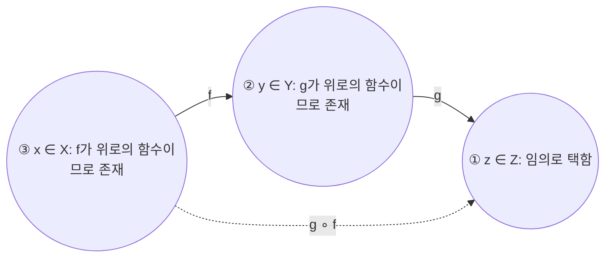

*그림 15. 정리 7.3.4의 증명에서 원소를 찾는 순서*

> **주의:** 함수가 위로의 함수임을 보이려면 **반드시** 공역의 임의의 원소에서 출발하여 그것이 정의역의 어떤 원소의 상임을 이끌어 내야 한다. 정의역의 원소에서 출발하면 공역의 모든 원소에 도달한다는 보장을 얻을 수 없다.

**정리 7.3.4의 증명.** $f: X \to Y$와 $g: Y \to Z$가 모두 위로의 함수라고 가정한다. [$g \circ f$가 위로의 함수임을 보여야 한다.] $z$를 $Z$에서 특정하지만 임의로 택한 원소라 하자. [$(g \circ f)(x) = z$인 $x$가 $X$에 존재함을 보여야 한다.] $g$가 위로의 함수이므로 $g(y) = z$인 원소 $y$가 $Y$에 존재한다. 또 $f$가 위로의 함수이므로 $f(x) = y$인 원소 $x$가 $X$에 존재한다. 따라서 $(g \circ f)(x) = g(f(x)) = g(y) = z$인 $x \in X$가 존재하며, $g \circ f$는 위로의 함수이다. $\blacksquare$

**예제 7.3.5 (위로의 함수임에 대한 잘못된 "증명").** 위로의 함수의 합성이 위로의 함수임을 보이려고 한 학생이 다음과 같이 썼다고 가정한다.

1. $f: X \to Y$와 $g: Y \to Z$가 모두 위로의 함수라고 가정한다. 그러면
2. $\forall y \in Y, \ \exists x \in X, \ f(x) = y$이고,
3. $\forall z \in Z, \ \exists y \in Y, \ g(y) = z$이다.
4. 따라서 $(g \circ f)(x) = g(f(x)) = g(y) = z$이므로 $g \circ f$는 위로의 함수이다.

이 "증명"의 잘못을 설명한다. 첫째, $g \circ f$가 위로의 함수임을 보이려면 다음 도전에 답할 수 있어야 한다. 누군가 $Z$의 원소 $z$를 마음대로 골라 주면, $(g \circ f)(x) = z$인 $x \in X$를 찾는 방법을 설명해야 한다. 따라서 증명은 특정하지만 임의로 택한 $Z$의 원소 $z$가 주어졌다는 가정으로 시작해야 하는데, 이 글은 그렇게 하지 않는다. 둘째, 2행과 3행은 $f$와 $g$가 위로의 함수라는 가정을 다시 쓴 것일 뿐이다. 2행의 $x$, $y$와 3행의 $y$, $z$는 각 한정 명제 안에서만 의미를 가지는 지역 변수이다. 특히 2행의 $y$와 3행의 $y$는 서로 무관한데, 4행은 두 $y$가 같은 대상을 가리킨다고 가정한다. 그 결과 $g \circ f$가 위로의 함수라고 결론 내릴 근거가 사라진다. 올바른 증명은 위와 같이 $z$를 먼저 고정하고, 그 $z$에 대해 $y$를, 그 $y$에 대해 $x$를 차례로 찾는다.

---

<br>

## 4. 기수와 계산 가능성

**기수(cardinal number)** 는 집합의 크기를 가리키고("이 집합은 원소가 **여덟** 개이다"), **서수(ordinal number)** 는 나열된 원소의 순서를 가리킨다("이것은 줄의 **여덟째** 원소이다"). 기수의 수학적 정의는 손가락이나 표시로 수를 세는 일에 바탕을 둔다. 손가락 하나를 대상 하나와 짝짓듯이, 두 유한 집합의 원소를 일대일 대응으로 짝지을 수 있으면 두 집합은 **크기가 같다**고 한다. 예를 들어 $A = \lbrace a, b, c, d\rbrace$와 $B = \lbrace u, v, w, x\rbrace$는 $a \leftrightarrow u$, $b \leftrightarrow v$, $c \leftrightarrow w$, $d \leftrightarrow x$로 짝지을 수 있으므로 크기가 같다.

**유한 집합(finite set)** 은 원소가 하나도 없거나 어떤 양의 정수 $n$에 대하여 $\lbrace1, 2, \ldots, n\rbrace$과 일대일 대응을 이룰 수 있는 집합이다. 이와 달리 **무한 집합(infinite set)** 은 어떤 양의 정수 $n$에 대해서도 $\lbrace1, 2, \ldots, n\rbrace$과 일대일 대응을 이룰 수 없는, 공집합이 아닌 집합이다. 이 절에서는 크기의 개념을 무한 집합으로 넓혀, 한 무한 집합을 다른 무한 집합과 일대일 대응으로 짝지을 수 있을 때 두 집합의 크기가 같다고 정의한다. 그러면 모든 무한 집합의 크기가 같은지, 어떤 무한 집합이 다른 무한 집합보다 큰지가 자연스러운 질문이 된다. 답은 때로 놀랍고, 그 결과로 정수 위에서 정의되었지만 컴퓨터로 값을 계산할 수 없는 함수가 존재함을 알게 된다.

### 4.1 기수가 같은 집합

> **용어 정의:** $A$와 $B$를 임의의 집합이라 하자. $A$에서 $B$로의 일대일 대응이 존재할 때, 그리고 그때에만 **$A$는 $B$와 기수가 같다(A has the same cardinality as B)** 고 한다. 다시 말해 $A$에서 $B$로의 함수 가운데 일대일 함수이자 위로의 함수인 $f$가 존재할 때, 그리고 그때에만 $A$는 $B$와 기수가 같다.

다음 정리는 기수의 기본 성질이며, 대부분 앞에서 증명한 일대일 함수와 위로의 함수에 관한 정리에서 나온다.

> **핵심:** **정리 7.4.1 (기수의 성질).** 모든 집합 $A$, $B$, $C$에 대하여 다음이 성립한다. (a) **반사적 성질:** $A$는 $A$와 기수가 같다. (b) **대칭적 성질:** $A$가 $B$와 기수가 같으면 $B$는 $A$와 기수가 같다. (c) **추이적 성질:** $A$가 $B$와 기수가 같고 $B$가 $C$와 기수가 같으면 $A$는 $C$와 기수가 같다.

**증명.** 세 성질을 차례로 보인다.

- **(a) 반사적 성질.** $A$를 임의의 집합이라 하자. [$A$에서 $A$로의 일대일 대응이 존재함을 보여야 한다.] $A$ 위의 항등 함수 $I_A$를 생각한다. $A$의 원소 $x_1$, $x_2$가 $I_A(x_1) = I_A(x_2)$를 만족하면 $I_A$의 정의에 의해 $x_1 = x_2$이므로 $I_A$는 일대일 함수이다. 또 $y$가 $A$의 임의의 원소이면 $I_A$의 정의에 의해 $y = I_A(y)$이므로 $I_A$는 위로의 함수이다. 따라서 $I_A$는 $A$에서 $A$로의 일대일 대응이다.
- **(b) 대칭적 성질.** $A$와 $B$가 집합이고 $A$가 $B$와 기수가 같다고 가정한다. [$B$가 $A$와 기수가 같음을 보여야 한다.] 가정에 의해 $A$에서 $B$로의 일대일 대응 $f$가 존재한다. 정리 7.2.2와 7.2.3에 의해 $B$에서 $A$로의 함수 $f^{-1}$이 존재하고, $f^{-1}$도 일대일 함수이자 위로의 함수이다. 따라서 $B$는 $A$와 기수가 같다.
- **(c) 추이적 성질.** $A$, $B$, $C$가 집합이고 $A$는 $B$와, $B$는 $C$와 기수가 같다고 가정한다. [$A$가 $C$와 기수가 같음을 보여야 한다.] 가정에 의해 $A$에서 $B$로의 일대일 대응 $f$와 $B$에서 $C$로의 일대일 대응 $g$가 존재한다. 정리 7.3.3과 7.3.4에 의해 $g \circ f$는 $A$에서 $C$로의 일대일 함수이자 위로의 함수이다. 따라서 $A$는 $C$와 기수가 같다. $\blacksquare$

정리 7.4.1(b)에 의해 "한 집합이 다른 집합과 기수가 같다"고 방향을 정해 말할 필요 없이 두 집합의 기수가 같다고 말할 수 있다.

> **용어 정의:** $A$가 $B$와 기수가 같거나 $B$가 $A$와 기수가 같을 때, 그리고 그때에만 **$A$와 $B$는 기수가 같다(A and B have the same cardinality)** 고 한다.

다음 예는 무한 집합의 중요한 성질, 곧 무한 집합은 자기 자신의 진부분집합과 기수가 같을 수 있다는 성질을 보여 준다. 짝수보다 정수가 두 배 많다고 생각하기 쉽지만, 두 집합의 원소를 정확히 짝지을 수 있으므로 정의에 따라 두 집합은 기수가 같다.

**예제 7.4.1 (무한 집합과 그 진부분집합의 기수가 같을 수 있음).** $2\mathbf{Z}$를 모든 짝수의 집합이라 하자. $2\mathbf{Z}$와 $\mathbf{Z}$의 기수가 같음을 보인다. 함수 $H: \mathbf{Z} \to 2\mathbf{Z}$를 모든 $n \in \mathbf{Z}$에 대하여 $H(n) = 2n$으로 정의한다. $H$는 $\ldots, -2 \mapsto -4, -1 \mapsto -2, 0 \mapsto 0, 1 \mapsto 2, 2 \mapsto 4, 3 \mapsto 6, \ldots$으로 보낸다.

- **일대일 함수:** 어떤 정수 $n_1$, $n_2$에 대하여 $H(n_1) = H(n_2)$라고 가정한다. $H$의 정의에 의해 $2n_1 = 2n_2$이고, 양변을 2로 나누면 $n_1 = n_2$이다.
- **위로의 함수:** $m$을 $2\mathbf{Z}$의 임의의 원소라 하자. $m$은 짝수이므로 어떤 정수 $k$에 대하여 $m = 2k$이다. 그러면 $H(k) = 2k = m$이므로 $H(k) = m$인 $k \in \mathbf{Z}$가 존재한다.

따라서 $H$는 일대일 대응이고, 기수의 정의에 의해 $\mathbf{Z}$와 $2\mathbf{Z}$는 기수가 같다. 곧 기수의 뜻에서 짝수는 정수와 같은 개수만큼 있다.

> **참고:** 이처럼 자기 자신의 진부분집합과 기수가 같을 수 있다는 성질을 무한 집합의 정의로 삼기도 한다. 유한 집합은 이런 성질을 가질 수 없다. 원소가 $n$개인 집합의 진부분집합은 원소가 $n$개보다 적기 때문이다.

9장에서는 크기가 같은 두 유한 집합 사이의 함수가 일대일 함수일 필요충분조건이 위로의 함수인 것임을 보인다. 이 결과는 무한 집합에서는 성립하지 않는다. 두 무한 집합의 기수가 같으면 둘 사이에 일대일 대응이 존재하지만, 동시에 다음도 항상 성립한다.

- $A$와 $B$가 기수가 같은 무한 집합이면, $A$에서 $B$로의 함수 가운데 일대일 함수이지만 위로의 함수가 아닌 것과, 위로의 함수이지만 일대일 함수가 아닌 것이 존재한다.

예를 들어 $\mathbf{Z}$와 $2\mathbf{Z}$는 예제 7.4.1의 $H$에 의해 기수가 같다. 그러나 모든 짝수 $n$에 대하여 $I(n) = n$으로 정의된 **포함 함수(inclusion function)** $I: 2\mathbf{Z} \to \mathbf{Z}$는 일대일 함수이지만 홀수를 상으로 갖지 않으므로 위로의 함수가 아니다. 또 모든 정수 $n$에 대하여 $J(n) = 2\lfloor n/2 \rfloor$로 정의된 $J: \mathbf{Z} \to 2\mathbf{Z}$는 위로의 함수이지만($J(2k) = 2k$) $J(0) = J(1) = 0$이므로 일대일 함수가 아니다.

### 4.2 가산 집합

가장 단순한 무한 집합은 셈수(counting number)의 집합인 양의 정수 전체의 집합 $\mathbf{Z}^{+} = \lbrace1, 2, 3, 4, \ldots\rbrace$이다. 이 집합과 기수가 같은 집합 $A$를 가산 무한 집합이라 한다. 이렇게 부르는 이유는 두 집합 사이의 일대일 대응을 이용하여 $A$의 원소를 하나씩 셀 수 있기 때문이다. $F$가 $\mathbf{Z}^{+}$에서 $A$로의 일대일 대응이면 $F(1)$을 $A$의 첫째 원소, $F(2)$를 둘째 원소, $F(3)$을 셋째 원소로 지정하는 식으로 계속 셀 수 있다. $F$가 일대일 함수이므로 어떤 원소도 두 번 세어지지 않고, $F$가 위로의 함수이므로 $A$의 모든 원소가 언젠가는 세어진다.

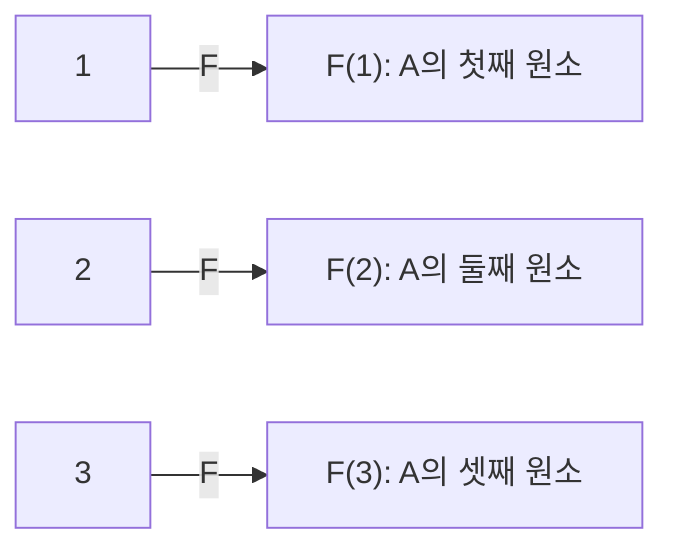

*그림 16. 일대일 대응 F로 가산 무한 집합 A를 세는 방법*

> **용어 정의:** 공집합이거나 어떤 양의 정수 $n$에 대하여 $\lbrace1, 2, \ldots, n\rbrace$과 일대일 대응을 이룰 수 있는 집합을 **유한(finite)** 하다고 한다. 양의 정수 전체의 집합 $\mathbf{Z}^{+}$와 기수가 같은 집합을 **가산 무한(countably infinite)** 하다고 한다. 유한하거나 가산 무한한 집합을 **가산(countable)** 이라 하고, 가산이 아닌 집합을 **비가산(uncountable)** 이라 한다.

**예제 7.4.2 (정수 전체의 집합 Z의 가산성).** 정수 전체의 집합 $\mathbf{Z}$가 가산임을 보인다. $\mathbf{Z}$는 유한하지 않으므로, 가산이라면 가산 무한해야 한다. 따라서 $\mathbf{Z}^{+}$에서 $\mathbf{Z}$로의 일대일 대응을 찾아야 한다. 정수를 수직선에 늘어놓으면 양의 정수 쪽 절반에 0과 음의 정수가 더해져 있으므로, 정수가 양의 정수보다 두 배 넘게 많아 보여 상식에 어긋나는 것처럼 느껴진다.

정수를 세는 한 가지 방법은 가운데에서 시작하여 양쪽으로 번갈아 나아가는 것이다. 첫째 정수를 0, 둘째를 1, 셋째를 $-1$, 넷째를 2, 다섯째를 $-2$로 정하는 식으로, 양의 정수와 음의 정수를 오가며 한 번에 하나씩 새 정수를 센다.

| 세는 순서 $n$ | 1 | 2 | 3 | 4 | 5 | 6 | 7 | 8 | 9 | 10 | 11 |
|:-----|:---:|:---:|:---:|:---:|:---:|:---:|:---:|:---:|:---:|:---:|:---:|
| 정수 $F(n)$ | 0 | 1 | $-1$ | 2 | $-2$ | 3 | $-3$ | 4 | $-4$ | 5 | $-5$ |

*표 9. 0에서 시작하여 양쪽으로 번갈아 정수를 세는 순서*

이 방법에서는 어떤 정수도 두 번 세어지지 않으므로 함수가 일대일 함수이고, 모든 정수가 언젠가 세어지므로 위로의 함수이다. 따라서 이 대응은 $\mathbf{Z}^{+}$에서 $\mathbf{Z}$로의 일대일 대응이고, $\mathbf{Z}^{+}$와 $\mathbf{Z}$는 기수가 같다. 그러므로 $\mathbf{Z}$는 가산 무한하고, 따라서 가산이다. 위의 서술은 다음 식으로도 나타낼 수 있다.

$$
F(n) = \begin{cases} \dfrac{n}{2} & n \text{이 짝수인 양의 정수일 때} \\[2mm] -\dfrac{n - 1}{2} & n \text{이 홀수인 양의 정수일 때} \end{cases}
$$

예를 들어 $F(4) = \frac{4}{2} = 2$이고 $F(5) = -\frac{5 - 1}{2} = -2$이며, 표 9와 맞는다.

**예제 7.4.3 (짝수 전체의 집합 2Z의 가산성).** $2\mathbf{Z}$가 가산임을 보인다. 예제 7.4.2에서 $\mathbf{Z}^{+}$와 $\mathbf{Z}$의 기수가 같음을, 예제 7.4.1에서 $\mathbf{Z}$와 $2\mathbf{Z}$의 기수가 같음을 보였다. 따라서 기수의 추이적 성질에 의해 $\mathbf{Z}^{+}$와 $2\mathbf{Z}$의 기수가 같다. 가산 무한의 정의에 의해 $2\mathbf{Z}$는 가산 무한하고, 따라서 가산이다.

### 4.3 더 큰 무한: 칸토어의 대각선 논법

지금까지 다룬 무한 집합은 모두 가산 무한하였다. 더 큰 무한, 곧 비가산 집합이 존재하는지가 다음 질문이다. 먼저 유리수 전체의 집합을 후보로 생각한다. 정수는 수직선 위에 일정한 간격을 두고 띄엄띄엄 놓여 있다. 반면 유리수는 수직선 위에서 **조밀하다**. 서로 다른 두 유리수 사이에는 항상 또 다른 유리수가 있으므로, 두 유리수가 아무리 가까워도 그 사이에 유리수가 무한히 많다. 예를 들어 유리수 $r < s$ 사이에는 $\frac{r + s}{2}$가 있다. 따라서 유리수가 정수보다 훨씬 많아 보이고, 유리수 집합의 무한이 정수 집합의 무한보다 크다고 추측하기 쉽다.

놀랍게도 이 추측은 틀렸다. 유리수는 수직선 위에 빽빽이 모여 있고 정수는 서로 떨어져 있지만, 유리수 전체의 집합과 정수 전체의 집합 사이에는 일대일 대응이 존재한다. 다음 예는 그 일부로, 양의 유리수 전체의 집합이 양의 정수 전체의 집합과 일대일 대응을 이룰 수 있음을 보인다. 이 결과와 예제 7.4.2의 방법(0에서 시작하여 양수와 음수를 번갈아 세는 방법)을 결합하면 유리수 전체의 집합도 가산임을 보일 수 있다.

**예제 7.4.4 (양의 유리수 전체의 집합은 가산이다).** 양의 유리수 전체의 집합 $\mathbf{Q}^{+}$가 가산임을 보인다. $\mathbf{Q}^{+}$의 원소를 $p$행 $q$열에 $\frac{p}{q}$가 오도록 격자에 늘어놓는다. 그러면 모든 양의 유리수가 격자의 어딘가에 나타난다(실제로는 $\frac{1}{1} = \frac{2}{2} = \frac{3}{3} = \cdots$처럼 같은 수가 무한히 여러 번 나타난다).

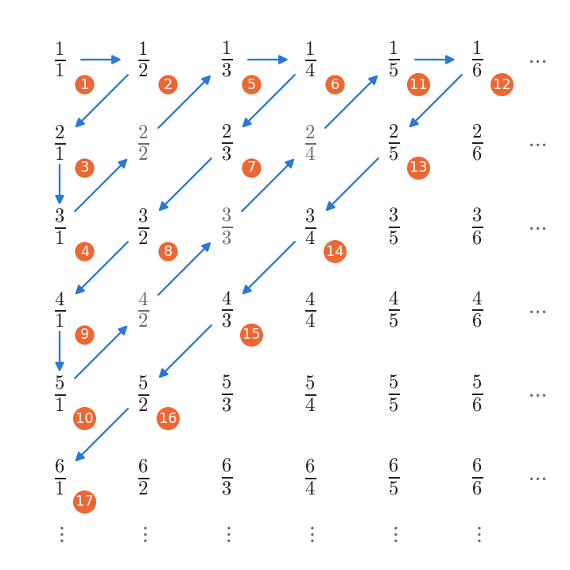

*그림 17. 양의 유리수를 격자에 늘어놓고 대각선을 따라 세는 순서*

$\mathbf{Z}^{+}$에서 $\mathbf{Q}^{+}$로의 함수 $F$를 다음과 같이 정의한다. $\frac{1}{1}$에서 세기 시작하여 화살표를 따라가되, 이미 센 수와 같은 값의 수는 건너뛴다. 구체적으로 $F(1) = \frac{1}{1}$, $F(2) = \frac{1}{2}$, $F(3) = \frac{2}{1}$, $F(4) = \frac{3}{1}$이다. 다음 칸의 $\frac{2}{2}$는 이미 센 $\frac{1}{1}$과 같으므로 건너뛴다. 이어서 $F(5) = \frac{1}{3}$, $F(6) = \frac{1}{4}$, $F(7) = \frac{2}{3}$, $F(8) = \frac{3}{2}$, $F(9) = \frac{4}{1}$, $F(10) = \frac{5}{1}$이다. 다음의 $\frac{4}{2}$, $\frac{3}{3}$, $\frac{2}{4}$는 각각 $\frac{2}{1}$, $\frac{1}{1}$, $\frac{1}{2}$와 같으므로 건너뛰고 $F(11) = \frac{1}{5}$로 정한다. 이런 방법으로 모든 양의 정수 $n$에 대하여 $F(n)$을 정한다. 그림 17의 회색 수는 건너뛴 수이고, 주황색 원 안의 수는 세는 순서 $n$이다.

모든 양의 유리수는 격자 어딘가에 나타나고, 세는 방법은 격자의 모든 점에 언젠가 도달하도록 짜여 있다. 각 대각선에는 칸이 유한 개뿐이므로, 화살표를 따라가면 어떤 칸이든 유한 번의 단계 안에 도달한다. 따라서 $F$는 위로의 함수이다. 또 이미 센 수를 건너뛰므로 어떤 수도 두 번 세어지지 않아 $F$는 일대일 함수이다. 결국 $F$는 $\mathbf{Z}^{+}$에서 $\mathbf{Q}^{+}$로의 일대일 대응이므로 $\mathbf{Q}^{+}$는 가산 무한하고, 따라서 가산이다. 유리수 전체의 집합 $\mathbf{Q}$도 가산이다. 예제 7.4.2처럼 $0, F(1), -F(1), F(2), -F(2), \ldots$의 순서로 세면 모든 유리수가 정확히 한 번씩 세어지기 때문이다.

이제 실수를 생각한다. 칸토어(Georg Cantor)는 1874년에 실수 전체의 집합이 비가산임을 보여 더 큰 무한을 찾는 데 성공하였다. 여기서는 칸토어가 1891년에 도입한 더 간단한 방법으로 0과 1 사이의 실수 전체의 집합이 비가산임을 증명한다. 이 방법을 **칸토어의 대각선 논법(Cantor diagonalization process)** 이라 하며, 이후 논리학과 계산 이론의 여러 중요한 결과를 얻는 데 쓰였다.

먼저 실수를 소수로 나타내는 방법을 정리한다. 모든 실수는 수직선 위의 위치이고, 다음 꼴의 **10진 전개(decimal expansion)** 로 나타낼 수 있다. 여기서 $a_0$은 정수(양수, 음수, 0)이고, $i \geq 1$인 각 $a_i$는 0 이상 9 이하의 정수이다.

$$
a_0.a_1 a_2 a_3 \ldots
$$

예를 들어 그림 18의 점 $P$를 생각한다. (a)에서 $P$는 1과 2 사이에 있다. 1과 2 사이를 길이가 같은 열 개의 구간으로 나누면 (b)에서 $P$는 1.6과 1.7 사이에 있다. 1.6과 1.7 사이를 다시 열 개의 구간으로 나누면 (c)에서 $P$는 1.62와 1.63 사이에 있으며 1.63보다 1.62에 더 가깝다. 따라서 $P$의 10진 전개의 처음 세 자리는 1.62이다.

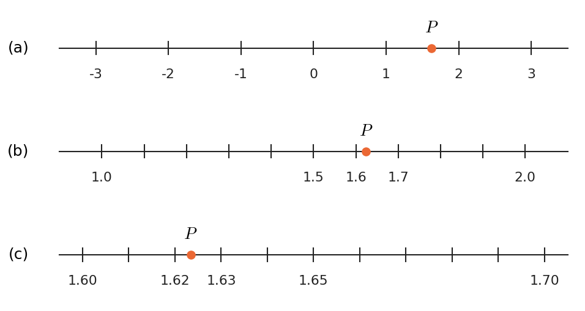

*그림 18. 구간을 열 등분하며 점 P의 10진 전개를 한 자리씩 정하는 과정*

아무리 작은 실수 구간도 열 등분할 수 있다고 가정하면, 이 과정을 원리적으로 끝없이 반복하여 $P$의 10진 전개의 자릿수를 계속 얻을 수 있다. 어느 단계에서 $P$가 분점 위에 있으면 이후의 자릿수는 모두 0으로 둘 수 있고, 그렇지 않으면 무한히 많은 자릿수를 가진 전개를 얻는다. 이렇게 얻은 10진 표현은 9가 끝없이 반복되거나 0이 끝없이 반복되는 경우를 제외하면 유일하다. 예를 들어 다음 등식이 성립한다.

$$
0.199999\ldots = 0.200000\ldots
$$

모든 실수가 유일한 표현을 갖도록, 이런 소수는 0이 끝없이 반복되는 꼴로 나타내기로 약속한다.

> **핵심:** **정리 7.4.2 (칸토어).** 0과 1 사이의 실수 전체의 집합은 비가산이다.

**증명 (귀류법).** 0과 1 사이의 실수 전체의 집합이 가산이라고 가정한다. 이 집합은 서로 다른 원소 $\frac{1}{2}, \frac{1}{3}, \frac{1}{4}, \ldots$을 포함하므로 유한하지 않다. 따라서 가산 무한하고, $\mathbf{Z}^{+}$에서의 일대일 대응을 이용하여 모든 원소의 10진 표현을 다음과 같이 첫째, 둘째, 셋째의 순서로 빠짐없이 나열할 수 있다.

$$
\begin{aligned} &0.a_{11}a_{12}a_{13}\cdots a_{1n}\cdots \\ &0.a_{21}a_{22}a_{23}\cdots a_{2n}\cdots \\ &0.a_{31}a_{32}a_{33}\cdots a_{3n}\cdots \\ &\qquad \vdots \\ &0.a_{n1}a_{n2}a_{n3}\cdots a_{nn}\cdots \\ &\qquad \vdots \end{aligned}
$$

[0과 1 사이의 수 가운데 이 목록에 없는 수가 있음을 보여 모순을 이끌어 낸다.] 각 양의 정수 $i$, $j$에 대하여 $a_{ij}$는 목록의 $i$번째 수의 소수점 아래 $j$번째 자리 숫자이다. 특히 $a_{11}$은 첫째 수의 첫째 자리, $a_{22}$는 둘째 수의 둘째 자리 숫자이다. 예를 들어 목록이 다음과 같이 시작한다고 가정한다. 굵게 표시한 숫자가 대각선 위의 숫자이다.

| 목록의 $i$번째 수 | 1번째 자리 | 2번째 자리 | 3번째 자리 | 4번째 자리 | 5번째 자리 | 이후 |
|:-----|:---:|:---:|:---:|:---:|:---:|:---:|
| 1번째 수 | **2** | 0 | 1 | 4 | 8 | $8\,0\,2\ldots$ |
| 2번째 수 | 1 | **1** | 6 | 6 | 6 | $0\,2\,1\ldots$ |
| 3번째 수 | 0 | 3 | **3** | 5 | 3 | $3\,2\,0\ldots$ |
| 4번째 수 | 9 | 6 | 7 | **7** | 6 | $8\,0\,9\ldots$ |
| 5번째 수 | 0 | 0 | 0 | 3 | **1** | $0\,0\,2\ldots$ |

*표 10. 대각선 논법의 목록 예시와 대각선 숫자*

대각선 숫자는 $a_{11} = 2$, $a_{22} = 1$, $a_{33} = 3$, $a_{44} = 7$, $a_{55} = 1$이다. 이제 새 소수 $d = 0.d_1 d_2 d_3 \cdots d_n \cdots$을 다음 규칙으로 만든다.

$$
d_n = \begin{cases} 1 & a_{nn} \neq 1 \text{일 때} \\ 2 & a_{nn} = 1 \text{일 때} \end{cases}
$$

위의 예에서는 $a_{11} = 2 \neq 1$이므로 $d_1 = 1$, $a_{22} = 1$이므로 $d_2 = 2$, $a_{33} = 3 \neq 1$이므로 $d_3 = 1$, $a_{44} = 7 \neq 1$이므로 $d_4 = 1$, $a_{55} = 1$이므로 $d_5 = 2$이다. 따라서 $d = 0.12112\ldots$이다.

결정적인 관찰은 **모든 양의 정수 $n$에 대하여 $d$는 소수점 아래 $n$번째 자리에서 목록의 $n$번째 수와 다르다**는 것이다. 따라서 $d$는 목록의 어느 수와도 같지 않다. 그런데 $d$는 0과 1 사이의 실수이므로, $d$는 0과 1 사이의 **모든** 실수의 목록에 없는 0과 1 사이의 실수이다. 이 모순은 0과 1 사이의 실수 전체의 집합이 가산이라는 가정이 거짓임을 보여 준다. 따라서 이 집합은 비가산이다. $\blacksquare$

> **참고:** $d$의 자릿수로 1과 2만 쓰는 데에는 이유가 있다. $d$에는 0과 9가 없으므로 $d$의 10진 전개는 0이나 9가 끝없이 반복되는 꼴이 아니고, 따라서 $d$의 표현은 유일하다. 그러므로 $n$번째 자리가 다르다는 사실에서 $d$가 $n$번째 수와 **수로서** 다르다는 결론을 얻는다. 또 $0.111\ldots \leq d \leq 0.222\ldots$이므로 $d$는 0과 1 사이에 있다. 자릿수를 아무렇게나 바꾸면 $0.1999\ldots$와 $0.2000\ldots$처럼 표현은 다르지만 같은 수가 되어 논증이 무너질 수 있다.

### 4.4 가산 집합의 부분집합과 실수 전체의 기수

칸토어는 비가산 집합의 존재를 보인 데 그치지 않고, 크기가 다양한 무한 집합의 산술 이론 전체를 발전시켰다. 그 가운데 가장 기본적인 정리는 가산 집합의 부분집합은 가산이라는 것이다.

> **핵심:** **정리 7.4.3.** 가산 집합의 부분집합은 모두 가산이다.

**증명.** $A$를 특정하지만 임의로 택한 가산 집합이라 하고 $B$를 $A$의 임의의 부분집합이라 하자. [$B$가 가산임을 보여야 한다.] $B$는 유한하거나 무한하다. $B$가 유한하면 가산의 정의에 의해 $B$는 가산이고 증명이 끝난다. 따라서 $B$가 무한하다고 가정한다. 그러면 $B \subseteq A$이므로 $A$도 무한하고, $A$가 가산이므로 $A$는 가산 무한하다. 따라서 $A$의 서로 다른 원소들을 수열 $a_1, a_2, a_3, \ldots$로 나타낼 수 있다. 함수 $g: \mathbf{Z}^{+} \to B$를 다음과 같이 귀납적으로 정의한다.

1. $a_1, a_2, a_3, \ldots$을 차례로 살펴 $B$의 원소가 처음 나올 때까지 찾는다. $B$는 $A$의 부분집합이고 공집합이 아니므로 언젠가 반드시 찾는다. 그 원소를 $g(1)$이라 한다.
2. $k \geq 2$인 각 정수 $k$에 대하여 $g(k - 1)$이 정의되었다고 가정한다. 그러면 어떤 $a_i$에 대하여 $g(k - 1) = a_i$이다. $a_{i+1}$부터 시작하여 $a_{i+1}, a_{i+2}, a_{i+3}, \ldots$을 차례로 살펴 $B$의 원소를 찾는다. 첨자가 $i$ 이하인 $B$의 원소는 유한 개뿐이고 $B$는 무한하므로, 첨자가 $i$보다 큰 $B$의 원소가 존재하여 언젠가 반드시 찾는다. 찾은 원소를 $g(k)$라 한다.

(1)과 (2)에 의해 $g$는 모든 양의 정수에서 정의된다. $a_1, a_2, a_3, \ldots$은 모두 서로 다르고, 각 탐색은 앞 탐색이 끝난 다음 첨자에서 시작하므로 $g(1), g(2), g(3), \ldots$의 첨자는 엄격히 증가한다. 따라서 $g$는 일대일 함수이다. 또 $B$의 임의의 원소는 어떤 $a_j$와 같고, 첨자가 $j$보다 작은 $B$의 원소가 $m$개라면 탐색이 순서대로 진행되므로 $g(m + 1) = a_j$이다. 따라서 $B$의 모든 원소가 어떤 양의 정수의 상이 되어 $g$는 위로의 함수이다. 결국 $g$는 $\mathbf{Z}^{+}$에서 $B$로의 일대일 대응이므로 $B$는 가산 무한하고, 따라서 가산이다. $\blacksquare$

다음 따름정리는 정리 7.4.3에서 바로 나온다.

> **핵심:** **따름정리 7.4.4.** 비가산 부분집합을 가진 집합은 비가산이다.

**증명.** 정리 7.4.3은 다음과 동치로 표현할 수 있다. "모든 집합 $S$와 $S$의 모든 부분집합 $A$에 대하여, $S$가 가산이면 $A$는 가산이다." 이 명제의 대우는 원래 명제와 논리적으로 동치이며 다음과 같다. "모든 집합 $S$와 $S$의 모든 부분집합 $A$에 대하여, $A$가 비가산이면 $S$는 비가산이다." 이것이 따름정리의 내용이므로 따름정리가 증명된다. $\blacksquare$

따름정리 7.4.4에 의해 실수 전체의 집합 $\mathbf{R}$은 비가산이다. 그 부분집합인 0과 1 사이의 실수의 집합이 비가산이기 때문이다. 사실 다음 예가 보여 주듯이 $\mathbf{R}$은 0과 1 사이의 실수의 집합과 기수가 같다.

**예제 7.4.5 (실수 전체의 집합의 기수).** 실수 전체의 집합이 0과 1 사이의 실수 전체의 집합과 기수가 같음을 보인다. $S$를 0과 1 사이의 실수로 이루어진 열린 구간이라 하자.

$$
S = \lbrace\, x \in \mathbf{R} \mid 0 < x < 1 \,\rbrace
$$

$S$를 들어 올려 원 모양으로 구부린다고 상상한다. $S$는 끝점 0과 1을 포함하지 않으므로, 원의 맨 위 점은 빠진다. 이 원을 수직선의 점 0에서 수직선에 접하도록 놓는다. 그러면 $\frac{1}{2}$이 접점에 오고, $\frac{1}{4}$과 $\frac{3}{4}$이 원의 왼쪽과 오른쪽 끝에 온다.

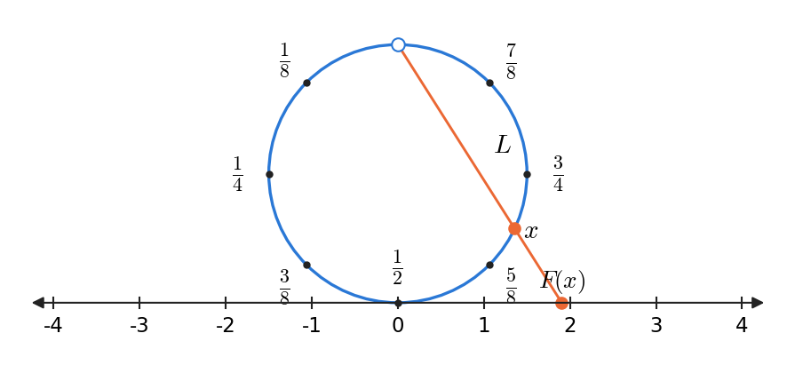

*그림 19. 원으로 구부린 구간 (0, 1)의 점을 수직선에 사영하는 함수 F*

함수 $F: S \to \mathbf{R}$을 다음과 같이 정의한다. $S$를 나타내는 원 위의 각 점 $x$에 대하여, 원의 맨 위 점과 $x$를 지나는 직선 $L$을 긋고 $L$이 수직선과 만나는 점을 $F(x)$라 한다. $F(x)$를 수직선 위로의 $x$의 **사영(projection)** 이라 한다. 원 위의 서로 다른 점은 맨 위 점을 지나는 서로 다른 직선을 정하고, 맨 위 점을 지나는 서로 다른 두 직선은 수직선과 서로 다른 점에서 만나므로 $F$는 일대일 함수이다. 또 수직선 위의 임의의 점 $y$가 주어지면 $y$와 원의 맨 위 점을 지나는 직선은 원과 맨 위 점 말고 정확히 한 점 $x$에서 더 만나므로, 정의에 의해 $y = F(x)$이다. 따라서 $F$는 위로의 함수이다. 결국 $F$는 $S$에서 $\mathbf{R}$로의 일대일 대응이므로 $S$와 $\mathbf{R}$은 기수가 같다.

> **참고:** 이 사영은 식으로도 쓸 수 있다. 원의 지름을 $D$라 하고 접점을 원점으로 잡으면, 계산을 통해 $F(x) = D \tan\left(\pi\left(x - \frac{1}{2}\right)\right)$를 얻는다. $x$가 0에서 1까지 움직이면 $\pi\left(x - \frac{1}{2}\right)$은 $-\frac{\pi}{2}$에서 $\frac{\pi}{2}$까지 움직이고, 탄젠트 함수는 이 열린 구간에서 $\mathbf{R}$로의 일대일 대응이다. 예를 들어 $F\left(\frac{1}{2}\right) = 0$이고 $F\left(\frac{3}{4}\right) = D$이다.

예제 7.4.5와 정리 7.4.2를 합치면 실수 전체의 집합은 비가산이다. 곧 양의 정수 전체의 집합에서 일대일 함수로 옮겨 넣을 수는 있지만 일대일 대응은 이룰 수 없는, 기수가 더 큰 무한 집합이 존재한다. 더 나아가 임의의 집합과 그 멱집합은 기수가 서로 다르다는 사실(칸토어의 정리)을 증명할 수 있다. 또 원소 $a$를 단원소 집합 $\lbrace a\rbrace$로 보내는 함수는 어떤 집합에서 그 멱집합으로의 일대일 함수이므로, 같은 뜻에서 어떤 집합의 기수도 그 멱집합의 기수보다 작다. 따라서 $\mathbf{Z}$에서 시작하여 $\mathbf{Z}, \mathcal{P}(\mathbf{Z}), \mathcal{P}(\mathcal{P}(\mathbf{Z})), \mathcal{P}(\mathcal{P}(\mathcal{P}(\mathbf{Z}))), \ldots$처럼 점점 더 큰 무한의 끝없는 수열을 만들 수 있다.

### 4.5 응용: 기수와 계산 가능성

어떤 집합이 가산인지 비가산인지에 관한 지식으로 계산 가능성에 관한 질문에 답할 수 있다. 먼저 어떤 집합이 가산임을 보인다.

**예제 7.4.6 (프로그래밍 언어로 쓴 프로그램 전체의 집합의 가산성).** 주어진 프로그래밍 언어로 쓸 수 있는 모든 컴퓨터 프로그램의 집합이 가산임을 보인다. 이 결과는 어떤 언어로 쓴 프로그램이든 그 언어의 (유한한) 알파벳 기호로 이루어진 유한 문자열로 볼 수 있다는 사실에서 나온다.

주어진 언어로 쓴 모든 프로그램의 집합을 $P$라 하자. $P$는 유한하거나 무한하다. $P$가 유한하면 가산이므로 증명이 끝난다. $P$가 무한하면 다음과 같이 센다.

1. 언어의 알파벳 기호를 0과 1의 문자열로 바꾸는 2진 부호를 정한다. 예를 들어 7비트 부호인 ASCII(American Standard Code for Information Interchange)나 8비트 부호인 EBCDIC(Extended Binary-Coded Decimal Interchange Code)를 쓸 수 있다.
2. $P$의 각 프로그램에 대하여 프로그램의 모든 기호를 이 부호로 바꾸어 0과 1의 문자열을 얻는다.
3. 이 문자열들을 먼저 길이 순으로 짧은 것부터 늘어놓고, 길이가 같은 문자열끼리는 각 문자열을 2진수로 읽은 값의 오름차순으로 늘어놓는다.
4. 함수 $F: \mathbf{Z}^{+} \to P$를 각 $n \in \mathbf{Z}^{+}$에 대하여 $F(n) = $ 이 목록의 $n$번째 프로그램으로 정의한다.

서로 다른 프로그램은 서로 다른 문자열로 바뀌고, 각 길이의 문자열은 유한 개뿐이므로 모든 프로그램이 목록의 유한한 위치에 놓인다. 따라서 $F$는 일대일 함수이자 위로의 함수이고, $P$는 가산 무한하며 따라서 가산이다.

간단한 예로, 길이가 5 이하인 비트 문자열로 바뀌는 $P$의 프로그램이 10111, 11, 0010, 1011, 01, 00100, 1010, 00010뿐이라고 가정한다. 길이 순으로 묶으면 길이 2는 11, 01이고, 길이 4는 0010, 1011, 1010이며, 길이 5는 10111, 00100, 00010이다. 각 길이 안에서 2진수의 값으로 정렬하면 다음과 같다.

| $n$ | 1 | 2 | 3 | 4 | 5 | 6 | 7 | 8 |
|:-----|:---:|:---:|:---:|:---:|:---:|:---:|:---:|:---:|
| 문자열 $F(n)$ | 01 | 11 | 0010 | 1010 | 1011 | 00010 | 00100 | 10111 |
| 2진수의 값 | 1 | 3 | 2 | 10 | 11 | 2 | 4 | 23 |

*표 11. 길이 순, 같은 길이 안에서는 2진수 값 순으로 정렬한 프로그램 문자열*

앞자리의 0을 무시하고 수로만 보면 0010과 00010은 모두 2와 같다. 따라서 길이로 먼저 정렬하지 않고 2진수의 값만으로 정렬하면 $F$의 값이 유일하게 정해지지 않는다. 이것이 먼저 길이로 정렬해야 하는 이유이다.

마지막 예는 어떤 집합이 비가산임을 보이고, 그 결과로 계산할 수 없는 함수가 존재함을 이끌어 낸다.

**예제 7.4.7 (함수의 집합의 기수와 계산 가능성).** (a) $T$를 양의 정수 전체의 집합에서 $\lbrace0, 1, 2, 3, 4, 5, 6, 7, 8, 9\rbrace$로의 모든 함수의 집합이라 할 때 $T$가 비가산임을 보인다. (b) 그 결과로 계산할 수 없는 함수가 존재함을 이끌어 낸다. 곧 어떤 프로그래밍 언어에 대해서도, 임의의 값을 입력받아 대응하는 함숫값을 출력하는 프로그램을 그 언어로 쓸 수 없는 함수 $F: \mathbf{Z}^{+} \to \lbrace0, 1, \ldots, 9\rbrace$가 존재함을 보인다.

(a) $S$를 0과 1 사이의 실수 전체의 집합이라 하자. 앞에서 보았듯이 $S$의 모든 수는 각 $a_i$가 0 이상 9 이하의 정수인 $0.a_1 a_2 a_3 \ldots a_n \ldots$의 꼴로 나타낼 수 있고, 9가 끝없이 반복되는 소수를 제외하면 이 표현은 유일하다. $S$에서 $T$의 부분집합으로의 함수 $F$를 다음과 같이 정의한다.

$$
F(0.a_1 a_2 a_3 \ldots a_n \ldots) = \text{각 양의 정수 } n \text{을 } a_n \text{으로 보내는 함수}
$$

예를 들어 $G = F(0.2901\ldots)$이면 $G(1) = 2$, $G(2) = 9$, $G(3) = 0$, $G(4) = 1$이다. $F$의 공역은 $F$가 위로의 함수가 되도록 $T$의 부분집합으로 정확히 정한다. 곧 공역을 $F$에 의한 $S$의 상 $F(S)$로 정한다. 이제 $F$는 일대일 함수이다. 함수 $F(x_1)$과 $F(x_2)$가 같으려면 모든 양의 정수에서 같은 값을 가져야 하므로, $x_1$의 각 자리 숫자가 대응하는 $x_2$의 자리 숫자와 같아야 하고, 표현이 유일하므로 $x_1 = x_2$이기 때문이다. 따라서 $F$는 $S$에서 $T$의 부분집합 $F(S)$로의 일대일 대응이다. $F(S)$가 가산이라면, $S$는 $F(S)$와 기수가 같으므로 기수의 추이적 성질에 의해 $S$도 가산이 되어 정리 7.4.2에 어긋난다. 따라서 $F(S)$는 $T$의 비가산 부분집합이고, 따름정리 7.4.4에 의해 $T$는 비가산이다.

(b) 주어진 프로그래밍 언어로 쓴 프로그램 전체의 집합 $P$는 예제 7.4.6에 의해 가산이다. 각 프로그램은 많아야 하나의 함수를 계산한다. 이제 $T$의 모든 함수가 계산 가능하다고 가정한다. 그러면 $T$의 각 함수 $G$마다 $G$를 계산하는 프로그램을 하나씩 골라 $\Phi(G)$라 할 수 있다. 서로 다른 함수는 같은 프로그램으로 계산될 수 없으므로 $\Phi: T \to P$는 일대일 함수이다. 따라서 $\Phi$는 $T$에서 $P$의 부분집합 $\Phi(T)$로의 일대일 대응이고, 정리 7.4.3에 의해 $\Phi(T)$는 가산이다. 그러면 기수의 대칭적 성질과 추이적 성질에 의해 $T$도 가산이 되어 (a)에 어긋난다. 그러므로 어떤 프로그래밍 언어에도 $T$의 모든 함수를 계산할 만큼 충분한 프로그램이 없으며, 계산할 수 없는 함수가 반드시 존재한다.

| 집합 | 가산 여부 | 근거 |
|:-----|:-----|:-----|
| $\mathbf{Z}^{+}$, $\mathbf{Z}$, $2\mathbf{Z}$ | 가산 무한 | 정의, 예제 7.4.2, 예제 7.4.3 |
| $\mathbf{Q}^{+}$ | 가산 무한 | 예제 7.4.4의 대각선 세기 |
| 한 언어로 쓴 프로그램 전체 | 가산 | 예제 7.4.6의 길이 순 나열 |
| 0과 1 사이의 실수 전체 | 비가산 | 정리 7.4.2의 대각선 논법 |
| $\mathbf{R}$ | 비가산 | 따름정리 7.4.4, 예제 7.4.5 |
| $\mathbf{Z}^{+}$에서 $\lbrace0, 1, \ldots, 9\rbrace$로의 함수 전체 $T$ | 비가산 | 예제 7.4.7(a) |

*표 12. 이 장에서 기수를 판정한 집합과 그 근거*

> **[계산이론]** 계산이론에서는 프로그램을 튜링 기계로 형식화하며, 튜링 기계도 유한한 기호열로 부호화할 수 있으므로 가산 개뿐이다. 위의 기수 논증은 계산할 수 없는 함수가 존재함을 보이지만 그런 함수를 구체적으로 지목하지는 않는다. 6장의 정지 문제는 계산할 수 없는 문제의 구체적인 예이며, 그 증명도 대각선 논법과 같은 자기 참조의 아이디어를 쓴다.

---

<br>

## 개념 적용

**T/F 점검:**

| 문장 | 판단과 근거 |
|:-----|:------------|
| 화살표 도표가 함수를 정의하려면 공역의 모든 원소에 화살표가 도착해야 한다. | **F.** 조건은 정의역의 각 원소에서 화살표가 정확히 하나 나가는 것이다. 공역의 원소에는 화살표가 도착하지 않아도 되고 여러 개 도착해도 된다(예제 7.1.2). |
| 함수 $f$가 일대일 대응이 아니어도 공역의 부분집합 $C$의 역상 $f^{-1}(C)$는 정의된다. | **T.** $f^{-1}(C) = \lbrace x \in X \mid f(x) \in C\rbrace$는 임의의 함수에서 정의되는 집합이다. 일대일 대응일 때만 존재하는 것은 역함수이다. |
| $f(m/n) = m$은 유리수에서 정수로의 함수를 정의한다. | **F.** $\frac{1}{2} = \frac{3}{6}$인데 규칙의 값이 1과 3으로 달라 잘 정의되지 않는다(예제 7.1.12). |
| $g: \mathbf{Z} \to \mathbf{Z}$, $g(n) = n^2$은 일대일 함수이다. | **F.** $g(2) = g(-2) = 4$이지만 $2 \neq -2$이다. |
| $h: \mathbf{Z} \to \mathbf{Z}$, $h(n) = 4n - 1$은 위로의 함수이다. | **F.** $h(n) = 0$이면 $n = \frac{1}{4}$이어야 하므로 0은 어떤 정수의 상도 아니다. |
| 함수의 합성은 교환법칙을 만족한다. | **F.** 후속자 함수 $f$와 제곱 함수 $g$에서 $(g \circ f)(1) = 4$이지만 $(f \circ g)(1) = 2$이다. |
| 두 위로의 함수 $f: X \to Y$, $g: Y \to Z$의 합성 $g \circ f$는 위로의 함수이다. | **T.** 정리 7.3.4이다. $z \in Z$에서 출발하여 $g(y) = z$인 $y$와 $f(x) = y$인 $x$를 차례로 찾는다. |
| 무한 집합은 자기 자신의 진부분집합과 기수가 같을 수 없다. | **F.** $H(n) = 2n$은 $\mathbf{Z}$에서 진부분집합 $2\mathbf{Z}$로의 일대일 대응이다(예제 7.4.1). |
| 유리수는 수직선에서 조밀하므로 정수보다 기수가 크다. | **F.** $\mathbf{Q}^{+}$는 대각선 세기로 $\mathbf{Z}^{+}$와 일대일 대응을 이루며, 유리수 전체도 가산이다. |
| 가산 집합의 부분집합은 가산이다. | **T.** 정리 7.4.3이다. 그 대우가 따름정리 7.4.4이다. |

---

<br>

## 요약

| 개념 | 핵심 요약 |
|:-----|:-----|
| 함수 | $X$의 각 원소를 $Y$의 원소 정확히 하나와 관계 짓는 관계 $f: X \to Y$이며, $X$는 정의역, $Y$는 공역이다. |
| 상, 치역, 역상 | $f(x)$는 $x$의 상, 상 전체의 집합은 치역, $f(x) = y$인 $x$ 전체의 집합은 $y$의 역상이다. |
| 함수의 상등 | 정의역과 공역이 같은 두 함수는 모든 $x$에서 $F(x) = G(x)$일 때만 같다(정리 7.1.1). |
| 여러 가지 함수 | 항등 함수, 수열, 멱집합 위의 함수, 데카르트 곱 위의 함수, 로그 함수, 부호화와 복호화 함수, 해밍 거리 함수가 있다. |
| 부울 함수 | $\lbrace0, 1\rbrace^n$에서 $\lbrace0, 1\rbrace$로의 함수이며, 입출력 표가 정의하는 함수이다. |
| 잘 정의된 함수 | 규칙이 모든 입력에서 값을 가지고 그 값이 유일해야 하며, 입력의 표현 방법에 의존하면 잘 정의되지 않는다. |
| 집합의 상과 역상 | $f(A)$는 $A$의 원소의 상 전체, $f^{-1}(C)$는 상이 $C$에 속하는 원소 전체이며, $f(A \cup B) = f(A) \cup f(B)$이다. |
| 일대일 함수 | $F(x_1) = F(x_2)$이면 $x_1 = x_2$인 함수이며, 증명은 $F(x_1) = F(x_2)$를 가정하고 $x_1 = x_2$를 보인다. |
| 위로의 함수 | 공역의 모든 $y$에 대해 $F(x) = y$인 $x$가 있는 함수이며, 증명은 임의의 $y$에서 출발하여 $x$를 찾고 확인한다. |
| 해시 함수 | 큰 데이터 집합을 작은 정수 집합으로 보내는 함수이며, 충돌은 선형 탐사 같은 충돌 해결 방법으로 처리한다. |
| 지수 함수와 로그 함수 | $\exp_b$와 $\log_b$는 서로의 역함수인 일대일 대응이며, 일대일성에서 $\log_c x = \log_b x / \log_b c$ 같은 로그의 성질이 나온다. |
| 일대일 대응과 역함수 | 일대일 함수이자 위로의 함수에는 $F^{-1}(y) = x \iff y = F(x)$인 역함수가 존재하며, 역함수도 일대일 대응이다. |
| 합성 | $(g \circ f)(x) = g(f(x))$이며 $f$가 먼저 작용하고, 교환법칙은 성립하지 않는다. |
| 합성과 항등 함수, 역함수 | $f \circ I_X = f$, $I_Y \circ f = f$, $f^{-1} \circ f = I_X$, $f \circ f^{-1} = I_Y$이다. |
| 합성과 일대일, 위로 | 일대일 함수의 합성은 일대일 함수이고, 위로의 함수의 합성은 위로의 함수이다(정리 7.3.3, 7.3.4). |
| 기수 | 두 집합 사이에 일대일 대응이 있으면 기수가 같으며, 기수의 같음은 반사적, 대칭적, 추이적이다. |
| 가산과 비가산 | $\mathbf{Z}^{+}$와 기수가 같으면 가산 무한, 유한하거나 가산 무한하면 가산, 아니면 비가산이다. $\mathbf{Z}$와 $\mathbf{Q}^{+}$는 가산이다. |
| 칸토어의 대각선 논법 | 목록의 $n$번째 수와 $n$번째 자리가 다른 수를 만들어 0과 1 사이의 실수가 비가산임을 보인다. |
| 부분집합과 기수 | 가산 집합의 부분집합은 가산이고, 비가산 부분집합을 가진 집합은 비가산이므로 $\mathbf{R}$은 비가산이다. |
| 계산 가능성 | 프로그램은 가산 개이지만 $\mathbf{Z}^{+}$에서 $\lbrace0, \ldots, 9\rbrace$로의 함수는 비가산 개이므로 계산할 수 없는 함수가 존재한다. |

---

<br>

## 점검 문제

1. **상과 역상:** $X = \lbrace1, 2, 3\rbrace$, $Y = \lbrace p, q, r, s\rbrace$이고 $f: X \to Y$가 $f(1) = q$, $f(2) = s$, $f(3) = q$로 정의되어 있다. $f$의 치역, $q$와 $p$의 역상, $f(\lbrace1, 2\rbrace)$, $f^{-1}(\lbrace q, r\rbrace)$을 구하고, $f$가 일대일 함수인지와 위로의 함수인지 판정하라.

   <details>
   <summary>정답</summary>

   치역은 실제로 상이 되는 원소의 집합이므로 $\lbrace q, s\rbrace$이다. $f(x) = q$인 $x$는 1과 3이므로 $q$의 역상은 $\lbrace1, 3\rbrace$이고, $p$로 가는 원소는 없으므로 $p$의 역상은 $\emptyset$이다. $f(\lbrace1, 2\rbrace) = \lbrace f(1), f(2)\rbrace = \lbrace q, s\rbrace$이고, 상이 $q$나 $r$인 원소는 1과 3이므로 $f^{-1}(\lbrace q, r\rbrace) = \lbrace1, 3\rbrace$이다. $f(1) = f(3) = q$이지만 $1 \neq 3$이므로 일대일 함수가 아니고, $p$와 $r$은 어떤 원소의 상도 아니므로 위로의 함수도 아니다.

   </details>

2. **잘 정의된 함수:** 다음 두 규칙이 $\mathbf{Q}$에서의 함수를 정의하는지 판정하라. (a) $g\left(\frac{m}{n}\right) = m + n$ ($g: \mathbf{Q} \to \mathbf{Z}$), (b) $k\left(\frac{m}{n}\right) = \frac{3m}{n}$ ($k: \mathbf{Q} \to \mathbf{Q}$). 단 $m$, $n$은 정수이고 $n \neq 0$이다.

   <details>
   <summary>정답</summary>

   (a)는 잘 정의되지 않는다. $\frac{1}{2} = \frac{2}{4}$이지만 규칙을 적용하면 $g\left(\frac{1}{2}\right) = 3$, $g\left(\frac{2}{4}\right) = 6$이 되어 같은 입력에 서로 다른 값이 나온다. (b)는 잘 정의된다. $\frac{m}{n} = \frac{m'}{n'}$이면 $\frac{3m}{n} = 3 \cdot \frac{m}{n} = 3 \cdot \frac{m'}{n'} = \frac{3m'}{n'}$이므로 값이 표현 방법에 의존하지 않는다. 곧 $k(r) = 3r$이다.

   </details>

3. **일대일 함수와 위로의 함수의 증명:** $f: \mathbf{R} \to \mathbf{R}$, $f(x) = 3x + 5$와 $g: \mathbf{Z} \to \mathbf{Z}$, $g(n) = 3n + 5$가 각각 일대일 함수인지, 위로의 함수인지 증명하거나 반례를 들어라.

   <details>
   <summary>정답</summary>

   일대일: $3x_1 + 5 = 3x_2 + 5$이면 양변에서 5를 빼고 3으로 나누어 $x_1 = x_2$이므로 $f$와 $g$ 모두 일대일 함수이다(정수에서도 같은 계산이 성립한다). 위로: 실수 $y$에 대하여 $x = \frac{y - 5}{3}$로 놓으면 $x$는 실수이고 $f(x) = 3 \cdot \frac{y - 5}{3} + 5 = y$이므로 $f$는 위로의 함수이다. 반면 $g(n) = 0$이면 $n = -\frac{5}{3}$이어야 하는데 이는 정수가 아니므로, 0은 $g$의 어떤 원소의 상도 아니고 $g$는 위로의 함수가 아니다.

   </details>

4. **역함수:** $F: \mathbf{R} \times \mathbf{R} \to \mathbf{R} \times \mathbf{R}$, $F(x, y) = (2x + y, x - y)$가 일대일 대응일 때 역함수 $F^{-1}(u, v)$를 구하고, $F(F^{-1}(u, v)) = (u, v)$임을 확인하라.

   <details>
   <summary>정답</summary>

   $F(r, s) = (u, v)$라 하면 $2r + s = u$, $r - s = v$이다. 두 식을 더하면 $3r = u + v$이므로 $r = \frac{u + v}{3}$이고, $s = r - v = \frac{u + v}{3} - v = \frac{u - 2v}{3}$이다. 따라서 $F^{-1}(u, v) = \left(\frac{u + v}{3}, \frac{u - 2v}{3}\right)$이다. 확인하면 $F\left(\frac{u + v}{3}, \frac{u - 2v}{3}\right) = \left(\frac{2u + 2v + u - 2v}{3}, \frac{u + v - u + 2v}{3}\right) = \left(\frac{3u}{3}, \frac{3v}{3}\right) = (u, v)$이다.

   </details>

5. **로그의 성질:** 정리 7.2.1(d)를 이용하여 $\log_8 32$를 구하라. 또 $\ln 10 \approx 2.302585093$, $\ln 2 \approx 0.6931471806$일 때 $\log_2 10$의 근삿값을 구하고, 그 값이 타당한지 2의 거듭제곱으로 확인하라.

   <details>
   <summary>정답</summary>

   $b = 2$로 놓으면 $\log_8 32 = \frac{\log_2 32}{\log_2 8} = \frac{5}{3}$이다. 실제로 $8^{5/3} = (2^3)^{5/3} = 2^5 = 32$이다. 또 $\log_2 10 = \frac{\ln 10}{\ln 2} \approx \frac{2.302585093}{0.6931471806} \approx 3.321928095$이다. $2^3 = 8 < 10 < 16 = 2^4$이므로 값이 3과 4 사이에 있어야 하며, 결과가 이와 맞다.

   </details>

6. **합성의 계산:** $f, g: \mathbf{Z} \to \mathbf{Z}$를 $f(n) = 2n$, $g(n) = n \bmod 3$으로 정의한다. $(g \circ f)(5)$, $(f \circ g)(5)$, $(g \circ f)(4)$, $(f \circ g)(4)$를 구하고 $g \circ f = f \circ g$인지 판정하라.

   <details>
   <summary>정답</summary>

   $(g \circ f)(5) = g(10) = 10 \bmod 3 = 1$, $(f \circ g)(5) = f(5 \bmod 3) = f(2) = 4$이다. $(g \circ f)(4) = g(8) = 2$, $(f \circ g)(4) = f(1) = 2$이다. $n = 4$에서는 값이 같지만 $n = 5$에서 $1 \neq 4$이므로, 정리 7.1.1에 의해 $g \circ f \neq f \circ g$이다. 두 함수가 같다고 하려면 모든 입력에서 값이 같아야 한다.

   </details>

7. **위로의 함수의 합성 증명:** 정리 7.3.4의 증명이 공역 $Z$의 원소에서 출발해야 하는 이유를 설명하고, 예제 7.3.5의 "증명"에서 2행의 $y$와 3행의 $y$를 같은 것으로 보면 안 되는 이유를 말하라.

   <details>
   <summary>정답</summary>

   위로의 함수의 정의는 $\forall z \in Z, \exists x \in X, (g \circ f)(x) = z$라는 전칭 명제이므로, 임의로 택한 $z$를 고정하고 그 $z$에 대해 $x$를 찾아야 모든 $z$에 대해 성립함을 보일 수 있다. 예제 7.3.5의 2행과 3행은 각각 한정기호로 묶인 독립된 명제이고, 그 안의 $y$는 그 명제 안에서만 뜻이 있는 지역 변수이다. 2행의 $y$는 임의의 원소를 가리키고 3행의 $y$는 주어진 $z$에 따라 존재하는 원소를 가리키므로, 둘을 같은 대상으로 놓을 근거가 없다. 올바른 증명은 $z$를 먼저 고정하고, 그 $z$에 대한 $y$를, 다시 그 $y$에 대한 $x$를 찾는다.

   </details>

8. **기수가 같음:** 양의 홀수 전체의 집합 $O = \lbrace1, 3, 5, \ldots\rbrace$가 $\mathbf{Z}^{+}$와 기수가 같음을 함수 $f(n) = 2n - 1$로 증명하라.

   <details>
   <summary>정답</summary>

   $n$이 양의 정수이면 $2n - 1$은 양의 홀수이므로 $f: \mathbf{Z}^{+} \to O$는 함수이다. 일대일: $2n_1 - 1 = 2n_2 - 1$이면 1을 더하고 2로 나누어 $n_1 = n_2$이다. 위로: $m \in O$이면 $m$은 양의 홀수이므로 어떤 정수 $k$에 대하여 $m = 2k + 1$이고, $m \geq 1$이므로 $k \geq 0$이다. $n = k + 1$로 놓으면 $n$은 양의 정수이고 $f(n) = 2(k + 1) - 1 = 2k + 1 = m$이다. 따라서 $f$는 일대일 대응이고 $O$는 가산 무한하다.

   </details>

9. **대각선 논법:** 0과 1 사이의 실수의 목록이 $0.3141\ldots$, $0.1111\ldots$, $0.2718\ldots$, $0.5000\ldots$으로 시작한다고 가정한다. 칸토어의 규칙($a_{nn} \neq 1$이면 $d_n = 1$, $a_{nn} = 1$이면 $d_n = 2$)으로 $d$의 처음 네 자리를 구하고, $d$가 목록의 어느 수와도 다른 이유를 설명하라.

   <details>
   <summary>정답</summary>

   대각선 숫자는 첫째 수의 첫째 자리 $a_{11} = 3$, 둘째 수의 둘째 자리 $a_{22} = 1$, 셋째 수의 셋째 자리 $a_{33} = 1$, 넷째 수의 넷째 자리 $a_{44} = 0$이다. 따라서 $d_1 = 1$, $d_2 = 2$, $d_3 = 2$, $d_4 = 1$이고 $d = 0.1221\ldots$이다. 모든 $n$에 대하여 $d$는 $n$번째 자리에서 $n$번째 수와 다르고, $d$의 자리에는 0과 9가 없어 표현이 유일하므로 $d$는 목록의 어느 수와도 같지 않다.

   </details>

10. **계산 가능성:** 프로그램 전체의 집합이 가산이라는 사실과 $\mathbf{Z}^{+}$에서 $\lbrace0, 1, \ldots, 9\rbrace$로의 함수 전체의 집합 $T$가 비가산이라는 사실로부터 계산할 수 없는 함수가 존재함을 설명하라.

    <details>
    <summary>정답</summary>

    모든 함수가 계산 가능하다면 $T$의 각 함수에 그 함수를 계산하는 프로그램을 하나씩 대응시킬 수 있다. 한 프로그램은 많아야 한 함수를 계산하므로 이 대응은 일대일 함수이고, $T$는 가산 집합의 부분집합과 기수가 같게 된다. 정리 7.4.3에 의해 그 부분집합은 가산이므로 $T$도 가산이 되어 $T$가 비가산이라는 사실에 어긋난다. 따라서 어떤 프로그램으로도 계산할 수 없는 함수가 $T$에 존재한다.

    </details>
