# Chapter 7 — Properties of Functions

[Repository Guide](../../README.md) | [English](Concepts_Lecture.md) | [한국어](Concepts_Lecture.ko.md)

> **Last Updated:** 2026-11-04
>
> Discrete Mathematics with Applications, Epp, Ch 7

> **Learning Objectives:**
> 1. Define functions on general sets, find images, inverse images, and ranges, and decide whether a function given by a rule is well defined
> 2. Prove or disprove with a counterexample that a function on a finite or infinite set is one-to-one or onto
> 3. Find the inverse function of a one-to-one correspondence and derive properties of logarithms from the one-to-oneness of exponential and logarithmic functions
> 4. Compute compositions of functions and prove the theorems that relate composition to identity functions, inverse functions, one-to-one functions, and onto functions
> 5. Compare the cardinalities of sets by one-to-one correspondences, and prove that the integers and the positive rational numbers are countable while the real numbers between 0 and 1 are uncountable
> 6. Use differences in cardinality to explain why some functions cannot be computed by any program

---

## Table of Contents

- [1. Functions Defined on General Sets](#1-functions-defined-on-general-sets)
  - [1.1 Functions and Related Terminology](#11-functions-and-related-terminology)
  - [1.2 Arrow Diagrams and Equality of Functions](#12-arrow-diagrams-and-equality-of-functions)
  - [1.3 Examples of Functions](#13-examples-of-functions)
  - [1.4 Boolean Functions](#14-boolean-functions)
  - [1.5 Well-Defined Functions](#15-well-defined-functions)
  - [1.6 Functions Acting on Sets](#16-functions-acting-on-sets)
- [2. One-to-One, Onto, and Inverse Functions](#2-one-to-one-onto-and-inverse-functions)
  - [2.1 One-to-One Functions](#21-one-to-one-functions)
  - [2.2 One-to-One Functions on Infinite Sets](#22-one-to-one-functions-on-infinite-sets)
  - [2.3 Application: Hash Functions](#23-application-hash-functions)
  - [2.4 Onto Functions](#24-onto-functions)
  - [2.5 Onto Functions on Infinite Sets](#25-onto-functions-on-infinite-sets)
  - [2.6 Relations between Exponential and Logarithmic Functions](#26-relations-between-exponential-and-logarithmic-functions)
  - [2.7 One-to-One Correspondences](#27-one-to-one-correspondences)
  - [2.8 Inverse Functions](#28-inverse-functions)
- [3. Composition of Functions](#3-composition-of-functions)
  - [3.1 Definition of Composition](#31-definition-of-composition)
  - [3.2 Composition with an Identity Function](#32-composition-with-an-identity-function)
  - [3.3 Composing a Function with Its Inverse](#33-composing-a-function-with-its-inverse)
  - [3.4 Composition of One-to-One Functions](#34-composition-of-one-to-one-functions)
  - [3.5 Composition of Onto Functions](#35-composition-of-onto-functions)
- [4. Cardinality with Applications to Computability](#4-cardinality-with-applications-to-computability)
  - [4.1 Sets with the Same Cardinality](#41-sets-with-the-same-cardinality)
  - [4.2 Countable Sets](#42-countable-sets)
  - [4.3 Larger Infinities: The Cantor Diagonalization Process](#43-larger-infinities-the-cantor-diagonalization-process)
  - [4.4 Subsets of Countable Sets and the Cardinality of the Real Numbers](#44-subsets-of-countable-sets-and-the-cardinality-of-the-real-numbers)
  - [4.5 Application: Cardinality and Computability](#45-application-cardinality-and-computability)
- [Concept Applications](#concept-applications)
- [Summary](#summary)
- [Self-Check Questions](#self-check-questions)

---

<br>

## 1. Functions Defined on General Sets

Functions appear in almost every area of mathematics and computer science, and earlier chapters already used many of them. A sequence is a function whose domain is a set of integers (Chapter 5), div and mod are functions whose inputs are ordered pairs of integers, and the floor and ceiling functions send real numbers to integers, that is, they are functions from $\mathbf{R}$ to $\mathbf{Z}$ (Chapter 4). Truth tables and input/output tables can also be viewed as functions that send inputs made of 0's and 1's to outputs (Chapter 2). This chapter focuses on functions whose domains are discrete, such as finite sets or the set of integers, and asks whether a function is one-to-one or onto, whether it has an inverse function, and how composition interacts with these properties. Finally, it proves that infinite sets come in different sizes and uses this fact to show that some functions cannot be computed by a computer.

### 1.1 Functions and Related Terminology

In ordinary language the word "function" indicates that one quantity depends on another. For example, saying that a taxi fare is a function of the distance traveled means that there is a rule assigning one fare to each distance. Chapter 1 defined a function as a special kind of relation. This chapter restates that definition and adds the dynamic view of a function as something that sends inputs to outputs, together with the terminology that goes with this view.

> **Definition:** A **function** $f: X \to Y$ from a set $X$ to a set $Y$ is a relation from $X$ to $Y$ that satisfies two properties. (1) Every element of $X$ is related to some element of $Y$. (2) No element of $X$ is related to two different elements of $Y$. The set $X$ is called the **domain** of $f$, and $Y$ is called the **co-domain** of $f$.

Together, the two properties say that for each element $x$ of $X$ there is exactly one element of $Y$ related to $x$. If this element is called $y$, $f$ is said to send $x$ to $y$, which is written $x \xrightarrow{f} y$ or $f: x \mapsto y$. The unique element to which $f$ sends $x$ is denoted $f(x)$, and it has several names.

- the **value** of $f$ at $x$
- the **output** of $f$ for the input $x$
- the **image** of $x$ under $f$

The set of all values of $f$ is called the **range** of $f$, or the image of $X$ under $f$.

```math
\text{range of } f = \lbrace\, y \in Y \mid y = f(x) \text{ for some } x \in X \,\rbrace
```

In the other direction, given an element $y$ of $Y$, an element $x$ with $f(x) = y$ is called a **preimage** or an **inverse image** of $y$. The set of all preimages of $y$ is also called the inverse image of $y$.

```math
\text{inverse image of } y = \lbrace\, x \in X \mid f(x) = y \,\rbrace
```

Some elements of the co-domain may have no preimage at all, and others may have several. If an element has no preimage, its inverse image is the empty set.

> **Caution:** $f(x)$ is the **value** of the function $f$ at $x$, whereas $f$ is the function **itself**. Some fields use $f(x)$ to denote the function as well, but to avoid confusion this chapter always uses $f(x)$ for the value only. For example, it writes "the function $f$ defined by $f(x) = x^2$" rather than "the function $f(x) = x^2$".

### 1.2 Arrow Diagrams and Equality of Functions

As seen in Chapter 1, if $X$ and $Y$ are finite sets, a function can be defined by an **arrow diagram**. List the elements of $X$ on the left and those of $Y$ on the right, and draw an arrow from each element of $X$ to the corresponding element of $Y$. The conditions under which an arrow diagram defines a function are a direct translation of the two properties of a function.

1. Each element of $X$ is the starting point of an arrow that ends at an element of $Y$.
2. No element of $X$ is the starting point of two arrows that end at different elements of $Y$.

**Example 7.1.1 (Functions and Nonfunctions).** Let $X = \lbrace a, b, c\rbrace$ and $Y = \lbrace1, 2, 3, 4\rbrace$. Decide which of the following three arrow diagrams define functions from $X$ to $Y$.

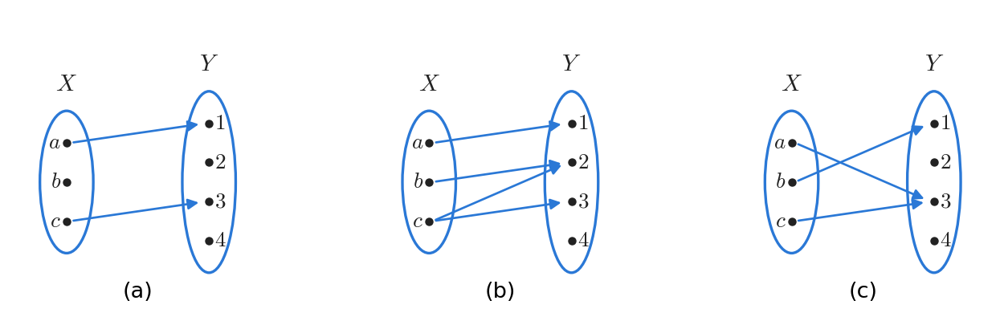

*Figure 1. Three arrow diagrams tested against the conditions for a function*

Only (c) defines a function. In (a) no arrow leaves $b$, so $b$ is not related to any element of $Y$, which violates condition 1. In (b) two arrows leave $c$, pointing to 2 and 3, so the element related to $c$ is not unique, which violates condition 2. In (c) both $a$ and $c$ point to 3, but this violates neither condition. The conditions concern the arrows that leave each element of the domain, and several arrows may arrive at the same element of the co-domain.

**Example 7.1.2 (A Function Defined by an Arrow Diagram).** Let $X = \lbrace a, b, c\rbrace$ and $Y = \lbrace1, 2, 3, 4\rbrace$, and let the function $f: X \to Y$ be defined by the following arrow diagram.

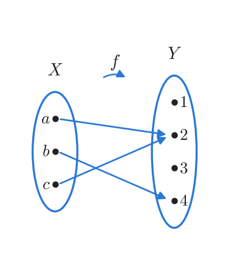

*Figure 2. Arrow diagram of the function f*

The answers to the questions can be read from the diagram one by one.

1. The domain is $\lbrace a, b, c\rbrace$ and the co-domain is $\lbrace1, 2, 3, 4\rbrace$.
2. Following the arrows gives $f(a) = 2$, $f(b) = 4$, and $f(c) = 2$.
3. The only elements at which arrows actually arrive are 2 and 4, so the range is $\lbrace2, 4\rbrace$. The range is a subset of the co-domain and, as here, may differ from it.
4. Since $f(c) = 2$, $c$ is an inverse image of 2. Since $f(b) = 4 \neq 3$, $b$ is not an inverse image of 3.
5. The arrows pointing to 2 come from $a$ and $c$, so the inverse image of 2 is $\lbrace a, c\rbrace$. The inverse image of 4 is $\lbrace b\rbrace$, and since no arrow points to 1, the inverse image of 1 is $\emptyset$.
6. Written as a relation, that is, as a set of ordered pairs, $f = \lbrace(a, 2), (b, 4), (c, 2)\rbrace$.

In this example no arrow arrives at the elements 1 and 3 of the co-domain, and two arrows arrive at 2. Exactly one arrow must leave each element of the domain, but there is no such restriction on the elements of the co-domain.

The criterion for deciding when two functions are equal follows from viewing a function as a relation, that is, as a subset of a Cartesian product.

> **Key Point:** **Theorem 7.1.1 (A Test for Function Equality).** If $F: X \to Y$ and $G: X \to Y$ are functions, then $F = G$ if, and only if, $F(x) = G(x)$ for every $x \in X$.

**Proof.** $F$ and $G$ are relations from $X$ to $Y$, so they are subsets of $X \times Y$. Since $F$ is a function, $(x, y) \in F$ means that $y$ is the unique element related to $x$ by $F$, that is, $y = F(x)$. Similarly, $(x, y) \in G$ means $y = G(x)$.

First suppose that $F(x) = G(x)$ for every $x \in X$. Then for any element $x$ of $X$ and any element $y$ of $Y$,

```math
(x, y) \in F \iff y = F(x) \iff y = G(x) \iff (x, y) \in G
```

The middle equivalence follows from the supposition $F(x) = G(x)$. Hence $F$ and $G$ consist of exactly the same ordered pairs, and by the definition of set equality, $F = G$.

Conversely, suppose that $F = G$. For any $x \in X$, let $y = F(x)$. Then

```math
y = F(x) \iff (x, y) \in F \iff (x, y) \in G \iff y = G(x)
```

The middle equivalence holds because $F$ and $G$ are sets with the same elements. Thus $F(x)$ and $G(x)$ both equal $y$, so $F(x) = G(x)$. $\blacksquare$

Note that the hypothesis of the theorem requires the two functions to have the same domain and the same co-domain. The test says to compare the values at every element of the domain, and two functions whose defining formulas look different are equal if all their values agree.

**Example 7.1.3 (Equality of Functions).** Answer the following two questions.

(a) Let $J_3 = \lbrace0, 1, 2\rbrace$, and define functions $f, g: J_3 \to J_3$ by $f(x) = (x^2 + x + 1) \bmod 3$ and $g(x) = (x + 2)^2 \bmod 3$ for every $x \in J_3$. Is $f = g$? Computing the values at all three elements of the domain gives the following table.

| $x$ | $x^2 + x + 1$ | $f(x)$ | $(x + 2)^2$ | $g(x)$ |
|:---:|:---:|:---:|:---:|:---:|
| 0 | 1 | $1 \bmod 3 = 1$ | 4 | $4 \bmod 3 = 1$ |
| 1 | 3 | $3 \bmod 3 = 0$ | 9 | $9 \bmod 3 = 0$ |
| 2 | 7 | $7 \bmod 3 = 1$ | 16 | $16 \bmod 3 = 1$ |

*Table 1. Values of $`f`$ and $`g`$ on $`J_3`$, element by element*

Since $f(x) = g(x)$ for every $x \in J_3$, Theorem 7.1.1 gives $f = g$. The expressions $x^2 + x + 1$ and $(x + 2)^2 = x^2 + 4x + 4$ are different polynomials over the integers, but their difference $3x + 3$ is always a multiple of 3, so they leave the same remainder when divided by 3.

(b) For functions $F, G: \mathbf{R} \to \mathbf{R}$, define new functions $F + G$ and $G + F$ by $(F + G)(x) = F(x) + G(x)$ and $(G + F)(x) = G(x) + F(x)$ for every $x \in \mathbf{R}$. Is $F + G = G + F$? For every real number $x$,

```math
(F + G)(x) = F(x) + G(x) = G(x) + F(x) = (G + F)(x)
```

The first equality is the definition of $F + G$, the second is the commutative law for addition of real numbers, and the third is the definition of $G + F$. Hence $F + G = G + F$ by Theorem 7.1.1.

### 1.3 Examples of Functions

The domain and co-domain of a function need not be sets of numbers. The following examples show functions of many kinds, defined on sets, ordered pairs, and strings.

**Example 7.1.4 (The Identity Function on a Set).** Given a set $X$, define a function $I_X: X \to X$ by $I_X(x) = x$ for every $x \in X$. This function is called the **identity function** on $X$. One may picture the identity function as a device that returns every input unchanged, so however complicated an input looks, the output is that same input. For example, if $a_{ij}^k$ and $\phi(z)$ are elements of $X$, then $I_X(a_{ij}^k) = a_{ij}^k$ and $I_X(\phi(z)) = \phi(z)$.

**Example 7.1.5 (Sequences).** Formally, an infinite sequence is a function whose domain consists of all integers from some fixed starting integer onward (Chapter 5). For example, the sequence

```math
1, -\frac{1}{2}, \frac{1}{3}, -\frac{1}{4}, \frac{1}{5}, \ldots, \frac{(-1)^n}{n + 1}, \ldots
```

can be viewed as the function $f(n) = \frac{(-1)^n}{n + 1}$ from the set $\mathbf{Z}^{\text{nonneg}}$ of nonnegative integers to $\mathbf{R}$. This function sends $0 \mapsto 1$, $1 \mapsto -\frac{1}{2}$, $2 \mapsto \frac{1}{3}$, $3 \mapsto -\frac{1}{4}$, and $4 \mapsto \frac{1}{5}$. The same sequence can also be described by another function. Define $g$ from the set $\mathbf{Z}^{+}$ of positive integers to $\mathbf{R}$ by $g(n) = \frac{(-1)^{n+1}}{n}$. Then $g(1) = 1$, $g(2) = -\frac{1}{2}$, $g(3) = \frac{1}{3}$, and in general

```math
g(n + 1) = \frac{(-1)^{n+2}}{n + 1} = \frac{(-1)^n}{n + 1} = f(n)
```

The second equality follows from $(-1)^{n+2} = (-1)^n (-1)^2 = (-1)^n$. In other words, $g$ is the same sequence with subscripts starting at 1. As functions, $f$ and $g$ are different because their domains differ, but they list the same terms in the same order.

**Example 7.1.6 (A Function Defined on a Power Set).** $\mathcal{P}(A)$ is the set of all subsets of a set $A$, that is, its power set (Chapter 6). Define a function $F: \mathcal{P}(\lbrace a, b, c\rbrace) \to \mathbf{Z}^{\text{nonneg}}$ by letting $F(X)$ be the number of elements in $X$ for each $X \in \mathcal{P}(\lbrace a, b, c\rbrace)$. The set $\lbrace a, b, c\rbrace$ has $2^3 = 8$ subsets, and counting their elements gives $F(\emptyset) = 0$, $F(\lbrace a\rbrace) = F(\lbrace b\rbrace) = F(\lbrace c\rbrace) = 1$, $F(\lbrace a, b\rbrace) = F(\lbrace a, c\rbrace) = F(\lbrace b, c\rbrace) = 2$, and $F(\lbrace a, b, c\rbrace) = 3$.

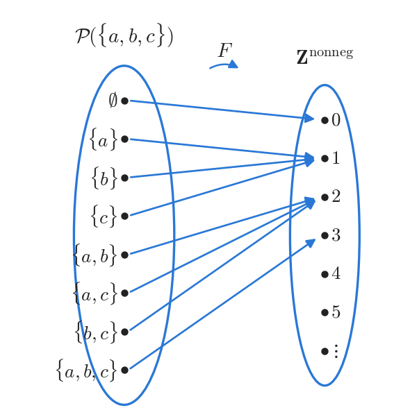

*Figure 3. Arrow diagram of the function F that sends each subset to its number of elements*

The co-domain $\mathbf{Z}^{\text{nonneg}}$ is infinite, but the range is only $\lbrace0, 1, 2, 3\rbrace$. No arrow arrives at any integer greater than or equal to 4.

**Example 7.1.7 (Functions Defined on a Cartesian Product).** Define functions $M: \mathbf{R} \times \mathbf{R} \to \mathbf{R}$ and $R: \mathbf{R} \times \mathbf{R} \to \mathbf{R} \times \mathbf{R}$ as follows for every ordered pair $(a, b)$ of real numbers.

```math
M(a, b) = ab, \qquad R(a, b) = (-a, b)
```

$M$ multiplies the two coordinates of a pair of real numbers, and $R$ reflects each point of the plane across the vertical axis. Strictly speaking, an element of the domain is an ordered pair, so one should write $M((a, b))$; by convention one pair of parentheses is dropped and $M(a, b)$ is written instead. Some values are computed below.

- $M(-1, -1) = (-1)(-1) = 1$, $M(\frac{1}{2}, \frac{1}{2}) = \frac{1}{2} \cdot \frac{1}{2} = \frac{1}{4}$, and $M(\sqrt{2}, \sqrt{2}) = \sqrt{2} \cdot \sqrt{2} = 2$.
- $R(2, 5) = (-2, 5)$, $R(-2, 5) = (-(-2), 5) = (2, 5)$, and $R(3, -4) = (-3, -4)$.

Next comes the logarithmic function, which is used frequently in computer science.

> **Definition:** Let $b$ be a positive real number with $b \neq 1$. For each positive real number $x$, the **logarithm with base $b$ of $x$**, written $\log_b x$, is the exponent that turns $b$ into $x$. That is, $\log_b x = y \iff b^y = x$. The function from $\mathbf{R}^{+}$ to $\mathbf{R}$ that sends each positive real number $x$ to $\log_b x$ is called the **logarithmic function with base $b$**.

The definition relies on the fact that each positive real number $x$ equals $b^y$ for exactly one real number $y$. This fact is true but not self-evident, and it is proved in most calculus books.

**Example 7.1.8 (The Logarithmic Function with Base b).** Apply the definition $\log_b x = y \iff b^y = x$ directly.

1. $\log_3 9 = 2$ because $3^2 = 9$.
2. $\log_2 \frac{1}{2} = -1$ because $2^{-1} = \frac{1}{2}$.
3. $\log_{10} 1 = 0$ because $10^0 = 1$.
4. For any real number $m$, the power of 2 that produces $2^m$ is $m$ itself, so $\log_2 (2^m) = m$.
5. If $m > 0$, then $\log_2 m$ is by definition the power of 2 that produces $m$, so $2^{\log_2 m} = m$.

Items 4 and 5 show that $\log_2$ and $2^x$ undo each other's action. Section 2.8 formalizes this relationship as inverse functions.

For a nonempty finite set $S$ of characters, a **string over $S$** is a finite sequence of elements of $S$. Its **length** is the number of characters it contains, and the string containing no characters at all is the **null string**. The null string is usually denoted $\lambda$ and has length 0.

**Example 7.1.9 (Encoding and Decoding Functions).** Digital messages are finite sequences of 0's and 1's. Because noise on a transmission line may change bits, messages are often encoded in a special way before they are sent. The simplest method writes each bit three times. For example, the message 00101111 is encoded as follows.

```text
Original message:  0   0   1   0   1   1   1   1
Encoded message:   000 000 111 000 111 111 111 111
```

The receiver recovers the original message by collapsing each block of three equal bits into a single bit. Let $A$ be the set of all strings of 0's and 1's, and let $T$ be the set of those strings of 0's and 1's that split into consecutive blocks of three equal bits. Encoding and decoding are then the following two functions.

- The **encoding function** $E: A \to T$ sends each string $s \in A$ to the string in which every bit of $s$ is written three times in a row.
- The **decoding function** $D: T \to A$ sends each string $t \in T$ to the string obtained by collapsing every block of three equal bits of $t$ into one copy of that bit.

This scheme makes a limited amount of error correction possible. If a block of the received string that ought to consist of three equal bits does not, then one of its bits differs from the other two. When errors are rare, that single differing bit is most likely the erroneous one, so it is reset to match the other two before the decoding function is applied. For example, a received block 010 is corrected to 000 and decoded as 0. Note also that before the correction the string is not an element of $T$, so $D$ cannot be applied to it directly.

**Example 7.1.10 (The Hamming Distance Function).** The Hamming distance function measures how different two bit strings of the same length are, and it is important in coding theory. Let $S_n$ denote the set of bit strings of length $n$, and define $H: S_n \times S_n \to \mathbf{Z}^{\text{nonneg}}$ by letting $H(s, t)$ be the number of positions at which $s$ and $t$ have different bits, for each ordered pair $(s, t) \in S_n \times S_n$. This function is called the **Hamming distance function**. For $n = 5$, $H(11111, 00000) = 5$ because 11111 and 00000 disagree in all five positions, and $H(11000, 00000) = 2$ because 11000 and 00000 disagree only in positions 1 and 2. Comparing position by position in the same way for $H(00101, 01110)$ gives the following.

| Position | 1 | 2 | 3 | 4 | 5 |
|:-----|:---:|:---:|:---:|:---:|:---:|
| $s = 00101$ | 0 | 0 | 1 | 0 | 1 |
| $t = 01110$ | 0 | 1 | 1 | 1 | 0 |
| Different? | same | differ | same | differ | differ |

*Table 2. Position-by-position comparison of 00101 and 01110*

The strings differ in three positions, 2, 4, and 5, so $H(00101, 01110) = 3$. In the same way, 10001 and 01111 differ in positions 1, 2, 3, and 4 and agree only in position 5, so $H(10001, 01111) = 4$.

> **Note:** In the triple-repetition code of Example 7.1.9, the codewords 000 and 111 for 0 and 1 are at Hamming distance 3. If one bit of a section changes, the received section is at distance 1 from the original codeword and at distance 2 from the other, so correcting the section to the nearest codeword is the same as correcting it by majority vote. For the same reason, if two bits of a section change, this method corrects it wrongly. A basic principle of coding theory is that the larger the Hamming distance between codewords, the more errors can be corrected.

### 1.4 Boolean Functions

Chapter 2 constructed input/output tables for digital logic circuits, and every such table determines a function in the following way. Each row of the input columns is an ordered tuple of 0's and 1's, and these tuples together form the domain. Every entry of the output column is 0 or 1, so $\lbrace0, 1\rbrace$ serves as the co-domain. The function assigns to each input row the output written in that same row. For a circuit with $n$ input wires the table has $n$ input columns, so it determines a function from the set of all ordered $n$-tuples of 0's and 1's to $\lbrace0, 1\rbrace$. The table below is an example for a circuit with three inputs.

| $P$ | $Q$ | $R$ | Output $S$ |
|:---:|:---:|:---:|:---:|
| 1 | 1 | 1 | 1 |
| 1 | 1 | 0 | 1 |
| 1 | 0 | 1 | 0 |
| 1 | 0 | 0 | 1 |
| 0 | 1 | 1 | 0 |
| 0 | 1 | 0 | 1 |
| 0 | 0 | 1 | 0 |
| 0 | 0 | 0 | 0 |

*Table 3. Input/output table of a circuit with three inputs*

The function defined by this table sends $(1, 1, 1)$, $(1, 1, 0)$, $(1, 0, 0)$, and $(0, 1, 0)$ to 1 and the remaining four ordered 3-tuples $(1, 0, 1)$, $(0, 1, 1)$, $(0, 0, 1)$, and $(0, 0, 0)$ to 0. In an arrow diagram, four arrows go from the eight elements of the domain to each of the two elements of the co-domain $\lbrace0, 1\rbrace$.

> **Definition:** An **($n$-place) Boolean function** $f$ is a function from the set of all ordered $n$-tuples of 0's and 1's to the set $\lbrace0, 1\rbrace$. Since this domain is the Cartesian product $\lbrace0, 1\rbrace^n$ of $n$ copies of $\lbrace0, 1\rbrace$, one writes $f: \lbrace0, 1\rbrace^n \to \lbrace0, 1\rbrace$.

**Example 7.1.11 (A Boolean Function).** Describe by an input/output table the three-place Boolean function defined by $f(x_1, x_2, x_3) = (x_1 + x_2 + x_3) \bmod 2$ for each ordered 3-tuple $(x_1, x_2, x_3)$ of 0's and 1's. For example, $f(1, 1, 1) = (1 + 1 + 1) \bmod 2 = 3 \bmod 2 = 1$ and $f(1, 1, 0) = (1 + 1 + 0) \bmod 2 = 2 \bmod 2 = 0$. Computing the remaining values in the same way gives the following table.

| $x_1$ | $x_2$ | $x_3$ | $x_1 + x_2 + x_3$ | $f(x_1, x_2, x_3)$ |
|:---:|:---:|:---:|:---:|:---:|
| 1 | 1 | 1 | 3 | 1 |
| 1 | 1 | 0 | 2 | 0 |
| 1 | 0 | 1 | 2 | 0 |
| 1 | 0 | 0 | 1 | 1 |
| 0 | 1 | 1 | 2 | 0 |
| 0 | 1 | 0 | 1 | 1 |
| 0 | 0 | 1 | 1 | 1 |
| 0 | 0 | 0 | 0 | 0 |

*Table 4. $`f(x_1, x_2, x_3) = (x_1 + x_2 + x_3) \bmod 2`$: input/output table*

The output is 1 when the input contains an odd number of 1's and 0 when it contains an even number. This function is the exclusive or of the three inputs, and it is also the function that computes the parity bit indicating whether a string of 0's and 1's contains an odd number of 1's.

### 1.5 Well-Defined Functions

Sometimes a rule seems to define a function but does not. For example, suppose one tries to define a function $f: \mathbf{R} \to \mathbf{R}$ by the rule "for each real number $x$, $f(x)$ is the real number $y$ such that $x^2 + y^2 = 1$". This rule fails to define a function for two reasons.

- **Some inputs have no value.** If $x = 2$, no real number $y$ satisfies $2^2 + y^2 = 1$, that is, $y^2 = -3$. In fact this happens for every $x$ with $\vert x \vert > 1$.
- **Some inputs have more than one value.** If $x = 0$, then $y^2 = 1$, so both $y = -1$ and $y = 1$ satisfy the equation. This happens for every $x$ with $\vert x \vert < 1$.

> **Definition:** A rule that is claimed to define a function is **not well defined** if it violates either of the two requirements for a function (every input has a value, and each input has only one value).

**Example 7.1.12 (A Function That Is Not Well Defined).** $\mathbf{Q}$ denotes the set of all rational numbers. Suppose one tries to define a function $f: \mathbf{Q} \to \mathbf{Z}$ by the formula $f\left(\frac{m}{n}\right) = m$ for all integers $m$ and $n$ with $n \neq 0$, that is, to associate the integer $m$ with the rational number $\frac{m}{n}$. This $f$ is not well defined, because a rational number can be written as a quotient of integers in more than one way. For instance, $\frac{1}{2} = \frac{3}{6}$. If $f$ were a function, it would give equal values to equal inputs, so $f\left(\frac{1}{2}\right) = f\left(\frac{3}{6}\right)$. But applying the rule gives the following.

```math
f\left(\frac{1}{2}\right) = 1, \qquad f\left(\frac{3}{6}\right) = 3, \qquad 1 \neq 3
```

Equal inputs with unequal outputs contradict the definition of a function, so $f$ is not well defined and is not a function.

Strictly speaking, the phrase "well-defined function" is redundant, because being a function already includes being well defined. The phrase is used to emphasize that a rule has been checked to satisfy the requirements for a function.

> **Caution:** When defining a function on a set whose elements can be written in several ways (rational numbers written as fractions, equivalence classes in Chapter 8, and so on), check that the output depends only on the input itself and not on the way the input is written. For example, $g\left(\frac{m}{n}\right) = \frac{2m}{n}$ is the same as $g(r) = 2r$ and is well defined, whereas $f\left(\frac{m}{n}\right) = m$ is not well defined, as shown above.

### 1.6 Functions Acting on Sets

Given a function from $X$ to $Y$, one can form the subset of $Y$ consisting of the images of all elements of a subset of $X$, and the subset of $X$ consisting of the inverse images of all elements of a subset of $Y$.

> **Definition:** If $f: X \to Y$ is a function, $A \subseteq X$, and $C \subseteq Y$, define the sets below. $f(A)$ is called the **image of $A$**, and $f^{-1}(C)$ is called the **inverse image of $C$**.

```math
f(A) = \lbrace\, y \in Y \mid y = f(x) \text{ for some } x \in A \,\rbrace, \qquad f^{-1}(C) = \lbrace\, x \in X \mid f(x) \in C \,\rbrace
```

For an element $y \in Y$, the notation $f^{-1}(y)$ for the inverse image of $y$ abbreviates $f^{-1}(\lbrace y\rbrace)$, the inverse image of the set $\lbrace y\rbrace$.

**Example 7.1.13 (The Action of a Function on Subsets of a Set).** Let $X = \lbrace1, 2, 3, 4\rbrace$ and $Y = \lbrace a, b, c, d, e\rbrace$, and let $F: X \to Y$ be given by the following arrow diagram, that is, $F(1) = b$, $F(2) = a$, $F(3) = d$, and $F(4) = b$. With $A = \lbrace1, 4\rbrace$, $C = \lbrace a, b\rbrace$, and $D = \lbrace c, e\rbrace$, find $F(A)$, $F(X)$, $F^{-1}(C)$, and $F^{-1}(D)$.

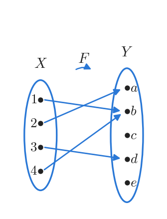

*Figure 4. Arrow diagram of the function F used to find images and inverse images*

1. $F(A)$: the elements 1 and 4 of $A$ both go to $b$, so $F(A) = \lbrace b\rbrace$.
2. $F(X)$: the images of 1, 2, 3, 4 are $b$, $a$, $d$, $b$, so $F(X) = \lbrace a, b, d\rbrace$, which is the range of $F$.
3. $F^{-1}(C)$: the elements whose images are $a$ or $b$ are 2 (image $`a`$) and 1 and 4 (image $`b`$), so $F^{-1}(C) = \lbrace1, 2, 4\rbrace$.
4. $F^{-1}(D)$: no arrow goes to $c$ or $e$, so $F^{-1}(D) = \emptyset$.

**Example 7.1.14 (Interaction of a Function with Union).** For sets $X$ and $Y$, a function $F: X \to Y$, and arbitrary subsets $A$ and $B$ of $X$, prove that $F(A \cup B) \subseteq F(A) \cup F(B)$.

The objects $X$, $Y$, $F$, $A$, and $B$ are fixed before the claim is stated, so they may be taken as given. It therefore suffices to show that any element $y$ of $F(A \cup B)$ belongs to $F(A) \cup F(B)$ (an element argument from Chapter 6).

**Proof.** Suppose $y \in F(A \cup B)$. [It must be shown that $y \in F(A) \cup F(B)$.] By the definition of image, $y = F(x)$ for some $x \in A \cup B$. By the definition of union, $x \in A$ or $x \in B$.

- **Case 1, $x \in A$:** Since $y = F(x)$ and $x \in A$, $y \in F(A)$. Hence $y \in F(A) \cup F(B)$ by the definition of union.
- **Case 2, $x \in B$:** Since $y = F(x)$ and $x \in B$, $y \in F(B)$. Hence $y \in F(A) \cup F(B)$ by the definition of union.

In either case, $y \in F(A) \cup F(B)$. $\blacksquare$

The opposite containment also holds. Since $A \subseteq A \cup B$, every image of an element of $A$ lies in $F(A \cup B)$, so $F(A) \subseteq F(A \cup B)$, and for the same reason $F(B) \subseteq F(A \cup B)$. Hence $F(A) \cup F(B) \subseteq F(A \cup B)$, and combining the two containments gives $F(A \cup B) = F(A) \cup F(B)$.

> **Caution:** For intersections, in general only $F(A \cap B) \subseteq F(A) \cap F(B)$ holds, and equality may fail. For example, if $F: \lbrace1, 2\rbrace \to \lbrace a\rbrace$, $A = \lbrace1\rbrace$, and $B = \lbrace2\rbrace$, then $F(A \cap B) = F(\emptyset) = \emptyset$ but $F(A) \cap F(B) = \lbrace a\rbrace$. Also, the notation $F^{-1}(C)$ denotes a set that is defined for every function $F$. The inverse function $F^{-1}$ of Section 2.8 exists only when $F$ is a one-to-one correspondence, so the two notations must be kept apart.

---

<br>

## 2. One-to-One, Onto, and Inverse Functions

This section studies two important properties that a function may or may not have, namely being one-to-one and being onto. A function with both properties is called a one-to-one correspondence. Such a function pairs every element of its domain with exactly one element of its co-domain and vice versa, so a function in the reverse direction, the inverse function, can be defined to reverse its effect.

### 2.1 One-to-One Functions

As Section 1.2 showed, different elements of the domain of a function may share one image in the co-domain; in an arrow diagram, several arrows that start in the domain then end at one point of the co-domain. A function for which this never happens, so that no point of the co-domain is the endpoint of two arrows, is a one-to-one function. Equivalently, no element of the co-domain of a one-to-one function is the image of more than one element of the domain.

> **Definition:** Let $F$ be a function from a set $X$ to a set $Y$. $F$ is **one-to-one** (or **injective**) if, and only if, for all elements $x_1$ and $x_2$ in $X$, "if $F(x_1) = F(x_2)$, then $x_1 = x_2$". This is equivalent to "if $x_1 \neq x_2$, then $F(x_1) \neq F(x_2)$".

Symbolically:

```math
F: X \to Y \text{ is one-to-one} \iff \forall x_1, x_2 \in X, \ \big(F(x_1) = F(x_2) \Rightarrow x_1 = x_2\big)
```

The two forms are equivalent because the second conditional "if $x_1 \neq x_2$, then $F(x_1) \neq F(x_2)$" is the contrapositive of the first (Chapter 2). The precise meaning of a function **not** being one-to-one is obtained by negating the definition (negation of quantified statements, Chapter 3).

```math
F: X \to Y \text{ is not one-to-one} \iff \exists x_1, x_2 \in X, \ \big(F(x_1) = F(x_2) \text{ and } x_1 \neq x_2\big)
```

That is, if two different elements $x_1$ and $x_2$ with the same function value can be found, then $F$ is not one-to-one. Pictured with arrows, a one-to-one function keeps distinct points of the domain apart in the co-domain, so it **separates** points, while a function that is not one-to-one **collapses** at least two points of the domain into a single point of the co-domain.

**Example 7.2.1 (Identifying One-to-One Functions Defined on Finite Sets).** (a) Let $X = \lbrace a, b, c, d\rbrace$ and $Y = \lbrace u, v, w, x, y\rbrace$, and let two functions $F, G: X \to Y$ be given by the following arrow diagrams. Decide whether each function is one-to-one.

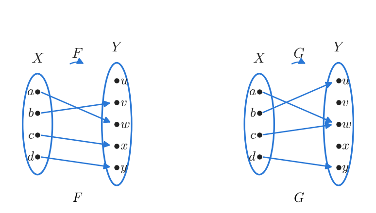

*Figure 5. The one-to-one function F and the function G that is not one-to-one*

$F$ sends $a \mapsto w$, $b \mapsto v$, $c \mapsto x$, and $d \mapsto y$; the four images are all different, so $F$ is one-to-one. $G$ sends $a \mapsto w$, $b \mapsto u$, $c \mapsto w$, and $d \mapsto y$. Since $G(a) = G(c) = w$ but $a \neq c$, $G$ is not one-to-one.

(b) Let $X = \lbrace1, 2, 3\rbrace$ and $Y = \lbrace a, b, c, d\rbrace$. Define $H: X \to Y$ by $H(1) = c$, $H(2) = a$, $H(3) = d$, and $K: X \to Y$ by $K(1) = d$, $K(2) = b$, $K(3) = d$. $H$ is one-to-one because it sends the three elements of its domain to different elements ($H(1) \neq H(2)$, $H(1) \neq H(3)$, $`H(2) \neq H(3)`$). $K$ is not one-to-one because $K(1) = K(3) = d$ but $1 \neq 3$.

Whether a function $F$ defined on a finite set is one-to-one can be checked mechanically as follows. Store the elements of the domain in an array $a[1], a[2], \ldots, a[n]$ and let two nested loops run over all pairs $(a[i], a[j])$ with $i < j$. If some pair has $F(a[i]) = F(a[j])$ and $a[i] \neq a[j]$, then $F$ is not one-to-one; if no such pair turns up after all pairs have been examined, then $F$ is one-to-one. The number of pairs to examine is at most $\frac{n(n-1)}{2}$.

### 2.2 One-to-One Functions on Infinite Sets

If the domain $X$ is infinite, the pairs cannot be checked one by one, so a proof is needed. By definition, saying that $f$ is one-to-one means that the following universal statement is true.

```math
\forall x_1, x_2 \in X, \ \big(f(x_1) = f(x_2) \Rightarrow x_1 = x_2\big)
```

Thus, to prove that $f$ is one-to-one, one generally uses a direct proof.

- **Suppose:** suppose $x_1$ and $x_2$ are elements of $X$ such that $f(x_1) = f(x_2)$.
- **Show:** show that $x_1 = x_2$.

Conversely, to show that $f$ is not one-to-one, **find** elements $x_1$ and $x_2$ of $X$ such that $f(x_1) = f(x_2)$ but $x_1 \neq x_2$.

**Example 7.2.2 (Proving or Disproving That Functions Are One-to-One).** Define functions $f: \mathbf{R} \to \mathbf{R}$ and $g: \mathbf{Z} \to \mathbf{Z}$ as follows.

```math
f(x) = 4x - 1 \ \ (x \in \mathbf{R}), \qquad g(n) = n^2 \ \ (n \in \mathbf{Z})
```

To decide whether each function is one-to-one, a good strategy is to try first to prove that it is one-to-one and, if the attempt runs into difficulty, to analyze the point of difficulty to find a counterexample.

(a) To show that $f$ is one-to-one, one must show that for all real numbers $x_1$ and $x_2$, if $f(x_1) = f(x_2)$, then $x_1 = x_2$. Substituting the definition of $f$, the task becomes to suppose $4x_1 - 1 = 4x_2 - 1$ and to show $x_1 = x_2$. Adding 1 to both sides and dividing by 4 completes the proof.

**Proof.** Suppose $x_1$ and $x_2$ are real numbers such that $f(x_1) = f(x_2)$. [It must be shown that $x_1 = x_2$.] By the definition of $f$, $4x_1 - 1 = 4x_2 - 1$. Adding 1 to both sides gives $4x_1 = 4x_2$, and dividing both sides by 4 gives $x_1 = x_2$. Hence $f$ is one-to-one. $\blacksquare$

(b) In the same way, to show that $g$ is one-to-one one would suppose integers $n_1$ and $n_2$ with $n_1^2 = n_2^2$ and try to show $n_1 = n_2$. This cannot be done, because two different numbers can have the same square. For example, $2^2 = (-2)^2$ but $2 \neq -2$. The point at which the proof gets stuck becomes the counterexample.

**Counterexample.** Let $n_1 = 2$ and $n_2 = -2$. Then $g(n_1) = 2^2 = 4$ and $g(n_2) = (-2)^2 = 4$. Hence $g(n_1) = g(n_2)$ but $n_1 \neq n_2$, so $g$ is not one-to-one.

> **Caution:** Whether a function is one-to-one depends not only on the rule but also on the domain. The same rule $n \mapsto n^2$ becomes one-to-one when the domain is restricted to $\mathbf{Z}^{\text{nonneg}}$. For nonnegative integers $n_1$ and $n_2$, $n_1^2 = n_2^2$ implies $(n_1 - n_2)(n_1 + n_2) = 0$, and if $n_1 + n_2 = 0$, then $n_1 = n_2 = 0$, so in either case $n_1 = n_2$.

### 2.3 Application: Hash Functions

Suppose a university has 10,000 students and gives each of them a nine-digit ID number. Placing the record of the student with ID number $n$ in position $n$ of an array would waste a great deal of memory, because the students use only a tiny fraction of the one billion possible nine-digit numbers.

> **Definition:** A **hash function** maps the elements of a large data set, which may even be infinite, into a smaller set of integers of fixed size.

For efficient storage, the university needs a hash function that (1) is one-to-one and (2) has a co-domain far smaller than one billion. Most hash functions in use are variations of the mod function built with prime numbers, which make the values more likely to spread out than to pile up. Choosing a co-domain 50% to 100% larger than the domain also raises the chance that the function is one-to-one. Even so, two different inputs may receive the same value, that is, they may **collide**, and several techniques exist for handling such a **collision**.

**Example 7.2.3 (Computing Values of a Hash Function).** Suppose, for simplicity, that there are only 6 students, and define a function $H$ from the set of ID numbers to $\lbrace0, 1, 2, \ldots, 10\rbrace$ by $H(n) = n \bmod 11$ for each ID number $n$. Values of $H$ are computed with the formula $n \bmod 11 = n - 11 \cdot (n \operatorname{div} 11)$ from Chapter 4: divide $n$ by 11, multiply the integer part of the quotient by 11, and subtract the result from $n$. For example, since $328343419 / 11 = 29849401.73\ldots$,

```math
H(328343419) = 328343419 - 11 \cdot 29849401 = 328343419 - 328343411 = 8
```

In the same way, $356633102 = 11 \cdot 32421191 + 1$, $223799061 = 11 \cdot 20345369 + 2$, and $513408716 = 11 \cdot 46673519 + 7$, so $H(356633102) = 1$, $H(223799061) = 2$, and $H(513408716) = 7$. The link to the record of the student with ID number $n$ is stored in position $H(n)$ of the table.

Because $H$ need not be one-to-one, two different ID numbers may share an $H$-value. Each position of the table must link to a single record, so a **collision resolution** method is needed. The simplest one, **linear probing**, works as follows. When a new ID number $n$ is inserted and position $H(n)$ is already taken, move down the table and place the link in the first free position. If the bottom of the table is reached without finding one, wrap around to the top and keep searching. Since there are 11 positions and only 6 students, a free position always exists.

Now insert the ID number 607275830 of another student. Since $607275830 = 11 \cdot 55206893 + 7$, $H(607275830) = 7$, but position 7 is already occupied by 513408716. Moving down, position 8 is also occupied, by 328343419, and position 9 is free. Therefore the link to the record of 607275830 is stored in position 9.

| Position | 0 | 1 | 2 | 3 | 4 | 5 | 6 | 7 | 8 | 9 | 10 |
|:-----|:---:|:---:|:---:|:---:|:---:|:---:|:---:|:---:|:---:|:---:|:---:|
| Stored ID | | 356633102 | 223799061 | | | | | 513408716 | 328343419 | 607275830 | |

*Table 5. Hash table after inserting five ID numbers with linear probing*

> **[Data Structures]** In data structures, a hash table stores and retrieves keys by turning each key into an array index with a hash function. Typical collision resolution methods are open addressing, which looks for another empty slot as linear probing does, and chaining, which attaches a linked list to each index. The larger the table relative to the number of stored keys, the fewer the collisions.

**Cryptographic hash functions** form a special class of hash functions used to protect digital data, and they are designed to meet the following conditions.

1. Its inputs are bit strings, and its outputs are bit strings of one fixed length.
2. It is nearly one-to-one; that is, collisions occur with very small probability.
3. It is nearly a **one-way function**: for a bit string in its range, computing an inverse image of that string is computationally very hard.
4. Its values are fast to compute.
5. Even a tiny change in the input string changes the output string drastically.

Typical uses of cryptographic hash functions are the following.

- **Password protection:** a company's user account file does not keep passwords as plain text. Instead, a cryptographic hash function is applied to each password, or to the password combined with extra content supplied by the company, and only the resulting values, called hashes, are stored. When a user logs in, the typed password is hashed at once and compared with the stored hash, and the login succeeds only if the two match.
- **File integrity checking:** a cryptographic hash function is applied to a file before it is copied and then to the copy, and the copy is accepted if the two hashes match. Similarly, when $A$ sends a file to $B$ over a network that may be insecure, $A$ also sends the hash of the file to $B$ separately through a secure channel, and $B$ hashes the received file with the same function and compares the two values. If they match, $B$ can be confident that the file was not altered in transit.
- **Blockchain:** a blockchain is a public ledger on the Internet consisting of a chain of blocks that hold records or programs. So that the data in no block can be altered, each block carries a time stamp and a hash computed from all earlier parts of the chain. To control how fast blocks are added and to validate each addition, adding a block requires a time-consuming **proof of work**. A typical proof of work demands repeated random trials to find a value that, appended to the block's data and hashed together with it, yields an output beginning with a prescribed number of zeros.

> **[Information Security]** In information security, the per-user random value added to a password is called a salt; it makes the hashes of identical passwords differ and defeats attacks that use precomputed tables of hashes. Functions such as SHA-256 are standard cryptographic hash functions. Condition 3 above is studied under the name preimage resistance and condition 2 under the name collision resistance.

### 2.4 Onto Functions

Section 1.2 showed that some element of the co-domain may fail to be the image of any element of the domain. On the other hand, there are functions for which **every** element of the co-domain is the image of some element of the domain. Such a function is called onto, and the range of an onto function equals its co-domain.

> **Definition:** Let $F$ be a function from a set $X$ to a set $Y$. $F$ is **onto** (or **surjective**) if, and only if, for every element $y$ of $Y$ there is an element $x$ of $X$ with $F(x) = y$.

```math
F: X \to Y \text{ is onto} \iff \forall y \in Y, \ \exists x \in X, \ F(x) = y
```

Negating the definition gives the precise meaning of not being onto.

```math
F: X \to Y \text{ is not onto} \iff \exists y \in Y, \ \forall x \in X, \ F(x) \neq y
```

That is, if the co-domain contains an element that is not the image of **any** element of the domain, the function is not onto. In terms of arrow diagrams, an onto function is one in which at least one arrow from the domain arrives at every element of the co-domain, and if even one element of the co-domain receives no arrow, the function is not onto.

**Example 7.2.4 (Identifying Onto Functions Defined on Finite Sets).** (a) Let $X = \lbrace1, 2, 3, 4, 5\rbrace$ and $Y = \lbrace a, b, c, d\rbrace$, and let two functions $F, G: X \to Y$ be given by the following arrow diagrams. Decide whether each function is onto.

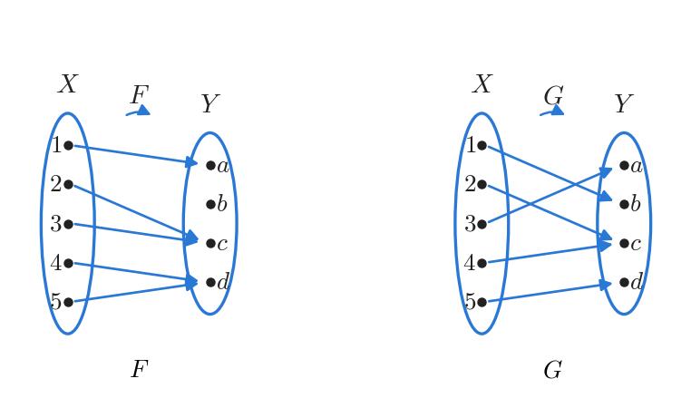

*Figure 6. The function F that is not onto and the onto function G*

$F$ sends $1 \mapsto a$, $2 \mapsto c$, $3 \mapsto c$, $4 \mapsto d$, and $5 \mapsto d$. No arrow goes to $b$, that is, $F(x) \neq b$ for every $x \in X$, so $F$ is not onto. $G$ sends $1 \mapsto b$, $2 \mapsto c$, $3 \mapsto a$, $4 \mapsto c$, and $5 \mapsto d$. Since $a = G(3)$, $b = G(1)$, $c = G(2) = G(4)$, and $d = G(5)$, every element of $Y$ is the image of some element, and $G$ is onto.

(b) Let $X = \lbrace1, 2, 3, 4\rbrace$ and $Y = \lbrace a, b, c\rbrace$. Define $H: X \to Y$ by $H(1) = c$, $H(2) = a$, $H(3) = c$, $H(4) = b$, and $K: X \to Y$ by $K(1) = c$, $K(2) = b$, $K(3) = b$, $K(4) = c$. $H$ is onto, since every one of the three elements of the co-domain is an image: $a = H(2)$, $b = H(4)$, and $c = H(1) = H(3)$. $K$ is not onto because $K(x) \neq a$ for every $x \in \lbrace1, 2, 3, 4\rbrace$.

Whether a function from a finite set $X$ to a finite set $Y$ is onto can also be checked mechanically. Store the elements of $X$ and $Y$ in arrays $a[1], \ldots, a[n]$ and $b[1], \ldots, b[m]$; an outer loop runs through the elements $y$ of $Y$, and for each of them an inner loop scans $X$ for an $x$ with $F(x) = y$. If some scan fails, $F$ is not onto; if every scan succeeds, $F$ is onto.

### 2.5 Onto Functions on Infinite Sets

If $F$ is a function from a set $X$ to an infinite set $Y$, then by definition, saying that $F$ is onto means that the following universal statement is true.

```math
\forall y \in Y, \ \exists x \in X, \ F(x) = y
```

Thus, to prove that $F$ is onto, one ordinarily uses the method of generalizing from the generic particular from Chapter 4.

- **Suppose:** suppose that $y$ is any element of $Y$.
- **Show:** show that there is an element $x$ in $X$ with $F(x) = y$.

Conversely, to show that $F$ is not onto, **find** an element $y$ of $Y$ such that $F(x) \neq y$ for **every** $x \in X$.

**Example 7.2.5 (Proving or Disproving That Functions Are Onto).** Define functions $f: \mathbf{R} \to \mathbf{R}$ and $h: \mathbf{Z} \to \mathbf{Z}$ as follows.

```math
f(x) = 4x - 1 \ \ (x \in \mathbf{R}), \qquad h(n) = 4n - 1 \ \ (n \in \mathbf{Z})
```

(a) Start by trying to prove that $f$ is onto and watch for difficulties. The statement to prove is $\forall y \in \mathbf{R}, \exists x \in \mathbf{R}, f(x) = y$. Suppose $y$ is a real number; one must show that there exists a real number $x$ with $y = 4x - 1$.

**Scratch work.** If such a real number $x$ exists, then

```math
4x - 1 = y \;\Longrightarrow\; 4x = y + 1 \;\Longrightarrow\; x = \frac{y + 1}{4}
```

The first arrow adds 1 to both sides and the second divides both sides by 4. That is, if $x$ exists, it must equal $\frac{y + 1}{4}$.

> **Caution:** Scratch work only shows what $x$ has to be if it exists; it does not prove that $x$ exists. In the proof, one sets $x = \frac{y + 1}{4}$ and then checks (1) that $x$ is an element of the domain and (2) that $f$ actually sends $x$ to $y$.

**Proof.** Let $y \in \mathbf{R}$. [It must be shown that there exists $x \in \mathbf{R}$ with $f(x) = y$.] Let $x = \frac{y + 1}{4}$. Then $x$ is a real number, because a sum of real numbers is real and a quotient of real numbers with a nonzero denominator is real. Moreover,

```math
f(x) = f\left(\frac{y + 1}{4}\right) = 4 \cdot \frac{y + 1}{4} - 1 = (y + 1) - 1 = y
```

The first equality is substitution, the second is the definition of $f$, and the last two are basic algebra. Hence $f$ is onto. $\blacksquare$

(b) Trying the same approach for $h$, suppose $m$ is an integer; one must show that there exists an integer $n$ with $4n - 1 = m$. Adding 1 and dividing by 4 shows that $n$ would have to be $\frac{m + 1}{4}$, but $n$ must be an integer. For example, if $m = 0$, then $n = \frac{0 + 1}{4} = \frac{1}{4}$, which is not an integer. The point where the proof gets stuck reveals a counterexample.

**Counterexample.** The co-domain of $h$ is $\mathbf{Z}$, and $0 \in \mathbf{Z}$. If $h(n) = 0$ for some integer $n$, then $4n - 1 = 0$, so $4n = 1$ and $n = \frac{1}{4}$. But $\frac{1}{4}$ is not an integer, so there is no integer $n$ with $h(n) = 0$. Hence $h$ is not onto.

The same rule $4x - 1$ gives an onto function or not, depending on the domain and co-domain. The methods for proving that a function is one-to-one or onto are summarized below.

| Aspect | One-to-one | Onto |
|:-----|:-----|:-----|
| Definition | $`\forall x_1, x_2 \in X, \ F(x_1) = F(x_2) \Rightarrow x_1 = x_2`$ | $`\forall y \in Y, \ \exists x \in X, \ F(x) = y`$ |
| Negation | $`\exists x_1, x_2 \in X, \ F(x_1) = F(x_2) \wedge x_1 \neq x_2`$ | $`\exists y \in Y, \ \forall x \in X, \ F(x) \neq y`$ |
| Arrow diagram | At most one arrow arrives at each element of the co-domain | At least one arrow arrives at each element of the co-domain |
| Start of a proof | Suppose $F(x_1) = F(x_2)$ | Suppose $y$ is any element of the co-domain |
| Goal of a proof | Show $x_1 = x_2$ | Find $x \in X$ with $F(x) = y$ and verify it |
| Disproof | Find two different elements with the same value | Find an element of the co-domain that is not the image of any element |

*Table 6. Definitions and proof methods for one-to-one and onto functions*

### 2.6 Relations between Exponential and Logarithmic Functions

> **Definition:** For a positive number $b$ with $b \neq 1$, the **exponential function with base $b$**, denoted $\exp_b$, is the function from $\mathbf{R}$ to $\mathbf{R}^{+}$ that sends each real number $x$ to $\exp_b(x) = b^x$. Here $b^0 = 1$ and $b^{-x} = \frac{1}{b^x}$.

That $b^x$ is a real number for every real number $x$ follows from the least-upper-bound property of the real number system. When working with exponential functions, one uses the following **laws of exponents**. If $b$ and $c$ are positive real numbers and $u$ and $v$ are real numbers, then

```math
b^u b^v = b^{u+v} \quad (7.2.1), \qquad (b^u)^v = b^{uv} \quad (7.2.2), \qquad \frac{b^u}{b^v} = b^{u-v} \quad (7.2.3), \qquad (bc)^u = b^u c^u \quad (7.2.4)
```

The logarithmic function with base $b$ defined in Section 1.3 is a function from $\mathbf{R}^{+}$ to $\mathbf{R}$ that satisfies $\log_b x = y \iff b^y = x$ for each positive real number $x$ and real number $y$. Using calculus one can show that both exponential and logarithmic functions are one-to-one and onto. Applying the definition of one-to-one gives the following two properties. For any positive real number $b$ with $b \neq 1$,

```math
\text{for all real numbers } u, v, \text{ if } b^u = b^v \text{ then } u = v \quad (7.2.5)
```

```math
\text{for all positive real numbers } u, v, \text{ if } \log_b u = \log_b v \text{ then } u = v \quad (7.2.6)
```

These properties lead to many facts about exponents and logarithms, in particular to the following properties of logarithms.

> **Key Point:** **Theorem 7.2.1 (Properties of Logarithms).** For any positive real numbers $b$, $c$, $x$, and $y$ with $b \neq 1$ and $c \neq 1$, and for every real number $a$: (a) $\log_b(xy) = \log_b x + \log_b y$, (b) $\log_b\left(\frac{x}{y}\right) = \log_b x - \log_b y$, (c) $\log_b(x^a) = a \log_b x$, (d) $\log_c x = \frac{\log_b x}{\log_b c}$.

Parts (a) through (c) are proved by rewriting each logarithm as an exponent and applying the laws of exponents. For example, let $u = \log_b x$ and $v = \log_b y$. Then $x = b^u$ and $y = b^v$, so $xy = b^u b^v = b^{u+v}$ by law 7.2.1, and by the definition of logarithm, $\log_b(xy) = u + v = \log_b x + \log_b y$. In the same way, (b) follows from $\frac{x}{y} = \frac{b^u}{b^v} = b^{u-v}$ (law 7.2.3) and (c) from $x^a = (b^u)^a = b^{au}$ (law 7.2.2). The next example proves (d) using the one-to-oneness of the exponential function (property 7.2.5).

**Example 7.2.6 (Using the One-to-Oneness of the Exponential Function).** Prove Theorem 7.2.1(d) from the definition of logarithm, the laws of exponents, and the fact that the exponential function is one-to-one (property 7.2.5). That is, for all positive real numbers $b$, $c$, and $x$ with $b \neq 1$ and $c \neq 1$, $\log_c x = \frac{\log_b x}{\log_b c}$.

**Proof.** Suppose positive real numbers $b$, $c$, and $x$ are given with $b \neq 1$ and $c \neq 1$, and let

```math
(1)\ u = \log_b c, \qquad (2)\ v = \log_c x, \qquad (3)\ w = \log_b x
```

By the definition of logarithm, each equation can be rewritten in exponential form.

```math
(1')\ c = b^u, \qquad (2')\ x = c^v, \qquad (3')\ x = b^w
```

Substituting $(1')$ into $(2')$ and applying law of exponents 7.2.2 gives $x = c^v = (b^u)^v = b^{uv}$. On the other hand, $x = b^w$ by $(3')$, so $b^{uv} = b^w$. By the one-to-oneness of the exponential function (property 7.2.5), $uv = w$. Substituting from (1), (2), and (3) gives

```math
(\log_b c)(\log_c x) = \log_b x
```

Since $c \neq 1$, $\log_b c \neq 0$, because $\log_b c = 0$ would mean $c = b^0 = 1$. Hence dividing both sides by $\log_b c$ gives $\log_c x = \frac{\log_b x}{\log_b c}$. $\blacksquare$

**Example 7.2.7 (Computing Logarithms with Base 2 on a Calculator).** Computer science often requires logarithms with base 2. Most calculators have no key for base 2, but they do have keys for **common logarithms** (base 10) and **natural logarithms** (base $`e`$). The common logarithm is often written $\log$ and the natural logarithm $\ln$. If a calculator shows $\ln 5 \approx 1.609437912$ and $\ln 2 \approx 0.6931471806$, then Theorem 7.2.1(d) with $b = e$ and $c = 2$ gives

```math
\log_2 5 = \frac{\ln 5}{\ln 2} \approx \frac{1.609437912}{0.6931471806} \approx 2.321928095
```

As a check, $2^2 = 4 < 5 < 8 = 2^3$, so $\log_2 5$ must lie between 2 and 3, which agrees with the result.

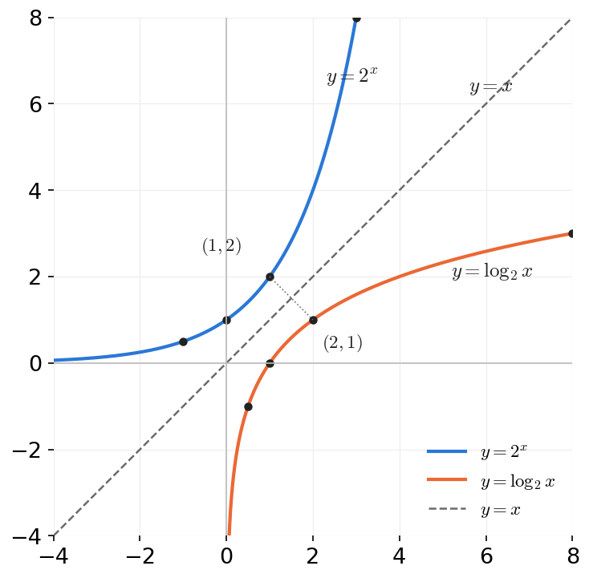

*Figure 7. Graphs of the mutually inverse functions y = 2ˣ and y = log₂ x*

Figure 7 shows the graphs of $y = 2^x$ and $y = \log_2 x$. The point $(1, 2)$ lies on the first graph because $2^1 = 2$, and the point $(2, 1)$ lies on the second because $\log_2 2 = 1$. In general, if $(a, b)$ lies on one graph, then $(b, a)$ lies on the other, so the two graphs are symmetric about the line $y = x$. This is because the two functions are inverses of each other (Section 2.8); each graph meets any horizontal line at most once (one-to-one) and reaches every height in the co-domain (onto).

### 2.7 One-to-One Correspondences

Suppose a function $F: X \to Y$ is both one-to-one and onto. Given an element $x$ of $X$, there is a unique corresponding element $y = F(x)$ in $Y$ because $F$ is a function. Given an element $y$ of $Y$, there is an element $x$ in $X$ with $F(x) = y$ because $F$ is onto, and there is only one such $x$ because $F$ is one-to-one. Hence a function with both properties matches each element of $X$ with exactly one element of $Y$ and each element of $Y$ with exactly one element of $X$. For example, the function from $\lbrace a, b, c, d, e\rbrace$ to $\lbrace1, 2, 3, 4, 5\rbrace$ that sends $a \mapsto 1$, $b \mapsto 2$, $c \mapsto 3$, $d \mapsto 4$, and $e \mapsto 5$ is such a pairing. Such pairings are also used for counting: the pairing above shows that $\lbrace a, b, c, d, e\rbrace$ has five elements.

> **Definition:** A **one-to-one correspondence** (or **bijection**) from a set $X$ to a set $Y$ is a function $F: X \to Y$ that is both one-to-one and onto.

**Example 7.2.8 (A Function from a Power Set to a Set of Strings).** $\mathcal{P}(\lbrace a, b\rbrace) = \lbrace\emptyset, \lbrace a\rbrace, \lbrace b\rbrace, \lbrace a, b\rbrace\rbrace$, and let $S = \lbrace00, 01, 10, 11\rbrace$ be the set of all strings of 0's and 1's of length 2. Define a function $h: \mathcal{P}(\lbrace a, b\rbrace) \to S$ as follows. For a subset $A$ of $\lbrace a, b\rbrace$, each of $a$ and $b$ either belongs to $A$ or does not. The first character of $h(A)$ is 1 if $a \in A$ and 0 otherwise. Likewise, the second character is 1 if $b \in A$ and 0 otherwise.

| Subset $A$ of $\lbrace a, b\rbrace$ | Is $a$ in $A$? | Is $b$ in $A$? | $h(A)$ |
|:---:|:---:|:---:|:---:|
| $\emptyset$ | no | no | 00 |
| $\lbrace a\rbrace$ | yes | no | 10 |
| $\lbrace b\rbrace$ | no | yes | 01 |
| $\lbrace a, b\rbrace$ | yes | yes | 11 |

*Table 7. The function h that sends subsets to bit strings of length 2*

$h$ is a one-to-one correspondence. Every element of $S$ is the image of some subset, so $h$ is onto, and no element of $S$ is the image of two different subsets, so $h$ is one-to-one. This correspondence represents subsets as bit strings, which is the same principle by which computers store sets as bit vectors.

**Example 7.2.9 (A String-Reversing Function).** Let $T$ be the set of all finite strings of $x$'s and $y$'s, and define $g: T \to T$ by letting $g(s)$ be the string formed by the characters of $s$ in reverse order, for each string $s \in T$. For example, $g(xxy) = yxx$. Is $g$ a one-to-one correspondence from $T$ to itself? The answer is yes; one-to-oneness and ontoness are shown separately.

- **One-to-one:** Suppose $g(s_1) = g(s_2)$ for strings $s_1$ and $s_2$ in $T$. [It must be shown that $s_1 = s_2$.] This says that the string obtained by reversing $s_1$ equals the string obtained by reversing $s_2$. Two strings whose reversals are equal must have been equal to begin with, so $s_1 = s_2$.
- **Onto:** Suppose $t$ is any string in $T$. [A string $s$ in $T$ such that $g(s) = t$ must be found.] Let $s = g(t)$; then $s$ is the reversal of $t$ and an element of $T$. Reversing a string once and then reversing it again recovers the original string, so $g(s) = g(g(t)) = t$.

**Example 7.2.10 (A Function of Two Variables).** Define a function $F: \mathbf{R} \times \mathbf{R} \to \mathbf{R} \times \mathbf{R}$ by $F(x, y) = (x + y, x - y)$ for every $(x, y) \in \mathbf{R} \times \mathbf{R}$. Show that $F$ is a one-to-one correspondence from $\mathbf{R} \times \mathbf{R}$ to itself.

**Proof that $F$ is one-to-one.** Suppose $(x_1, y_1)$ and $(x_2, y_2)$ are ordered pairs in $\mathbf{R} \times \mathbf{R}$ such that $F(x_1, y_1) = F(x_2, y_2)$. [It must be shown that $(x_1, y_1) = (x_2, y_2)$.] By the definition of $F$, $(x_1 + y_1, x_1 - y_1) = (x_2 + y_2, x_2 - y_2)$. For two ordered pairs to be equal, their first components must be equal and their second components must be equal, which gives the following system of equations.

```math
x_1 + y_1 = x_2 + y_2 \quad (1), \qquad x_1 - y_1 = x_2 - y_2 \quad (2)
```

Adding (1) and (2) gives $2x_1 = 2x_2$, so $x_1 = x_2$. Substituting this into (1) gives $x_1 + y_1 = x_1 + y_2$, so $y_1 = y_2$. By the definition of equality of ordered pairs, $(x_1, y_1) = (x_2, y_2)$.

**Scratch work for proving that $F$ is onto.** Given any ordered pair $(u, v)$ in the co-domain $\mathbf{R} \times \mathbf{R}$, suppose provisionally that there is an ordered pair $(r, s)$ with $F(r, s) = (u, v)$. Then $(r + s, r - s) = (u, v)$ by the definition of $F$, so $r + s = u$ and $r - s = v$. Adding the two equations gives $2r = u + v$, so $r = \frac{u + v}{2}$, and subtracting the second from the first gives $2s = u - v$, so $s = \frac{u - v}{2}$. This only shows what $(r, s)$ must be if it exists, so the proof must check that this pair is in the domain and is actually sent to $(u, v)$.

**Proof that $F$ is onto.** Suppose $(u, v)$ is any ordered pair in the co-domain. [It must be shown that some ordered pair in the domain is sent to $(u, v)$ by $F$.] Let $r = \frac{u + v}{2}$ and $s = \frac{u - v}{2}$. Then $(r, s)$ is an ordered pair of real numbers, so it is in the domain of $F$, and

```math
F(r, s) = F\left(\frac{u + v}{2}, \frac{u - v}{2}\right) = \left(\frac{u + v}{2} + \frac{u - v}{2}, \ \frac{u + v}{2} - \frac{u - v}{2}\right) = \left(\frac{2u}{2}, \frac{2v}{2}\right) = (u, v)
```

The first equality is substitution, the second is the definition of $F$, and the rest is algebra. Hence $F$ is onto, and since it is also one-to-one, it is a one-to-one correspondence. $\blacksquare$

### 2.8 Inverse Functions

When $F$ is a one-to-one correspondence from a set $X$ to a set $Y$, some function from $Y$ to $X$ reverses the effect of $F$. This function returns each element of $Y$ to the element of $X$ that $F$ sent there, and it is called the inverse function of $F$.

> **Key Point:** **Theorem 7.2.2.** Suppose $F: X \to Y$ is a one-to-one correspondence; that is, $F$ is one-to-one and onto. Then there is a function $F^{-1}: Y \to X$ defined by letting $F^{-1}(y)$ be the unique element $x$ in $X$ such that $F(x) = y$, for each element $y$ in $Y$. Equivalently, $F^{-1}(y) = x \iff y = F(x)$.

**Proof.** For any element $y$ of $Y$, there is an element $x \in X$ with $F(x) = y$ because $F$ is onto, and such an $x$ is unique because $F$ is one-to-one. Hence $F^{-1}(y)$ exists and is unique for every element of $Y$, so $F^{-1}$ is a well-defined function. $\blacksquare$

> **Definition:** The function $F^{-1}$ of Theorem 7.2.2 is called the **inverse function** for $F$.

By this definition, the logarithmic function with base $b$ is the inverse of the exponential function with base $b$ whenever $b > 0$ and $b \neq 1$. The identities $\log_2(2^m) = m$ and $2^{\log_2 m} = m$ of Example 7.1.8 express exactly the fact that the two functions undo each other. The inverse function returns each element to its starting point, as the following diagram shows.

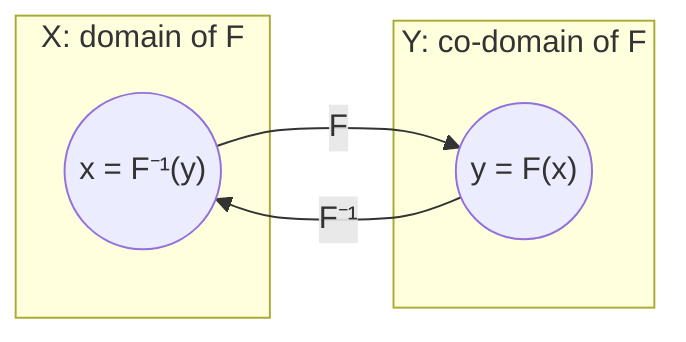

*Figure 8. An inverse function sending an element back to where it came from*

**Example 7.2.11 (Finding an Inverse Function for a Function Given by an Arrow Diagram).** Find the inverse function of the one-to-one correspondence $h$ of Example 7.2.8. Tracing the $h$-arrows backward from $S$ to $\mathcal{P}(\lbrace a, b\rbrace)$ gives $h^{-1}$.

```math
h^{-1}(00) = \emptyset, \qquad h^{-1}(10) = \lbrace a\rbrace, \qquad h^{-1}(01) = \lbrace b\rbrace, \qquad h^{-1}(11) = \lbrace a, b\rbrace
```

**Example 7.2.12 (Finding an Inverse Function for a Function Given in Words).** Find the inverse function of the one-to-one correspondence $g$ of Example 7.2.9. The function $g: T \to T$ sends each string $t$ to the string obtained by writing the characters of $t$ in reverse order. Writing characters in reverse order and then in reverse order again recovers the original string, so for any string $t \in T$, $g^{-1}(t)$ is the unique string that equals $t$ when written in reverse order, that is, the string obtained by writing $t$ in reverse order. Hence $g^{-1}(t) = g(t)$, and $g^{-1}$ is the same as $g$ itself. In other words, $g^{-1} = g$.

**Example 7.2.13 (Finding an Inverse Function for a Function Given by a Formula).** Find the inverse of the function $f: \mathbf{R} \to \mathbf{R}$, $f(x) = 4x - 1$, which Example 7.2.2 showed to be one-to-one and Example 7.2.5 showed to be onto. For any particular but arbitrarily chosen real number $y$, $f^{-1}(y)$ is the unique real number $x$ such that $f(x) = y$. But

```math
f(x) = y \iff 4x - 1 = y \iff x = \frac{y + 1}{4}
```

The first equivalence is the definition of $f$ and the second is algebra. Hence $f^{-1}(y) = \frac{y + 1}{4}$. For example, $f(2) = 7$ and $f^{-1}(7) = \frac{8}{4} = 2$.

**Example 7.2.14 (Finding an Inverse Function for a Function of Two Variables).** Find the inverse function $F^{-1}: \mathbf{R} \times \mathbf{R} \to \mathbf{R} \times \mathbf{R}$ of the one-to-one correspondence $F$ of Example 7.2.10. The solution of Example 7.2.10 showed that $F\left(\frac{u + v}{2}, \frac{u - v}{2}\right) = (u, v)$. Since $F$ is one-to-one, $\left(\frac{u + v}{2}, \frac{u - v}{2}\right)$ is the unique ordered pair in the domain that is sent to $(u, v)$ by $F$. Thus $F^{-1}$ is defined as follows for each ordered pair $(u, v) \in \mathbf{R} \times \mathbf{R}$.

```math
F^{-1}(u, v) = \left(\frac{u + v}{2}, \frac{u - v}{2}\right)
```

For example, $F(3, 1) = (4, 2)$ and $F^{-1}(4, 2) = \left(\frac{6}{2}, \frac{2}{2}\right) = (3, 1)$.

The next theorem is a direct consequence of the definitions.

> **Key Point:** **Theorem 7.2.3.** If $X$ and $Y$ are sets and $F: X \to Y$ is one-to-one and onto, then $F^{-1}: Y \to X$ is also one-to-one and onto.

**Proof.** The two properties are shown in turn.

- **$F^{-1}$ is one-to-one.** Suppose $y_1$ and $y_2$ are elements of $Y$ such that $F^{-1}(y_1) = F^{-1}(y_2)$. [It must be shown that $y_1 = y_2$.] Let $x = F^{-1}(y_1) = F^{-1}(y_2)$. Then $x \in X$, and by the definition of $F^{-1}$, $x = F^{-1}(y_1)$ gives $F(x) = y_1$ and $x = F^{-1}(y_2)$ gives $F(x) = y_2$. Consequently $y_1$ and $y_2$ both equal $F(x)$, so $y_1 = y_2$.
- **$F^{-1}$ is onto.** Suppose $x \in X$. [It must be shown that there exists $y \in Y$ such that $F^{-1}(y) = x$.] Let $y = F(x)$. Then $y \in Y$, and by the definition of $F^{-1}$, $F^{-1}(y) = x$. $\blacksquare$

> **Caution:** The inverse function $F^{-1}$ exists only when $F$ is a one-to-one correspondence. The inverse image $F^{-1}(C)$ of Section 1.6 is a **set** defined for any function, and the two must not be confused. When $F$ is a one-to-one correspondence, the two notations fit together: $F^{-1}(\lbrace y\rbrace) = \lbrace F^{-1}(y)\rbrace$.

---

<br>

## 3. Composition of Functions

Take two functions from the integers to the integers, the successor function, which adds 1, and the squaring function, and picture each as a machine. If the machines are connected so that whatever leaves the successor machine enters the squaring machine, the pair behaves like a single larger machine. In this larger machine an integer $n$ is first turned into $n + 1$, and then $n + 1$ is turned into its square $(n + 1)^2$.

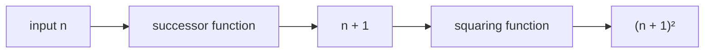

*Figure 9. Hooking the output of the successor function to the input of the squaring function*

### 3.1 Definition of Composition

Connecting functions in this way is called **composing** them, and the resulting function is the **composition** of the two functions. Composition makes sense only when every output of the first function is a legitimate input of the second, in other words, when the range of the first function lies inside the domain of the second.

> **Definition:** Let $f: X \to Y$ and $g: Y' \to Z$ be functions such that the range of $f$ is contained in the domain $Y'$ of $g$. Define a new function $g \circ f: X \to Z$ by $(g \circ f)(x) = g(f(x))$ for every $x \in X$; it is called the **composition of $f$ and $g$**. $g \circ f$ is read "$`g`$ circle $f$", and $g(f(x))$ is read "$`g`$ of $f$ of $x$".

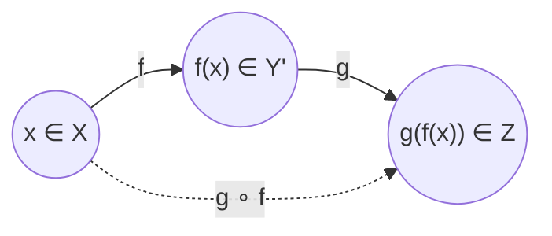

*Figure 10. The composition g ∘ f, which applies f first and g second*

> **Note:** Although the notation $g \circ f$ puts $g$ first, $f$ acts on an element $x$ first and $g$ acts second. Saying "the composition of $f$ and $g$" with $f$ named first follows this order.

**Example 7.3.1 (Composition of Functions Defined by Formulas).** Let $f: \mathbf{Z} \to \mathbf{Z}$ be the successor function and $g: \mathbf{Z} \to \mathbf{Z}$ the squaring function, that is, $f(n) = n + 1$ and $g(n) = n^2$ for every $n \in \mathbf{Z}$.

(a) Find $g \circ f$ and $f \circ g$. $f$ adds 1 to whatever integer it receives, and $g$ squares whatever integer it receives. This remains true when the incoming integer is written as an expression such as $g(n)$ or $f(n)$. Hence for every $n \in \mathbf{Z}$,

```math
(g \circ f)(n) = g(f(n)) = g(n + 1) = (n + 1)^2, \qquad (f \circ g)(n) = f(g(n)) = f(n^2) = n^2 + 1
```

(b) Is $g \circ f = f \circ g$? By Theorem 7.1.1, two functions are equal only if they take the same value at every input. But at $n = 1$ the values below differ, so $g \circ f \neq f \circ g$.

```math
(g \circ f)(1) = (1 + 1)^2 = 4, \qquad (f \circ g)(1) = 1^2 + 1 = 2
```

This example shows that composition of functions is **not a commutative** operation. In general, $F \circ G$ and $G \circ F$ need not be equal, although the two compositions may happen to be equal in particular cases.

> **Caution:** Do not confuse $g \circ f$ with $g(f(x))$. $g \circ f$ is the name of a function, while $g(f(x))$ is the value of that function at $x$.

**Example 7.3.2 (Composition of Functions Defined on Finite Sets).** Let $X = \lbrace1, 2, 3\rbrace$, $Y' = \lbrace a, b, c, d\rbrace$, $Y = \lbrace a, b, c, d, e\rbrace$, and $Z = \lbrace x, y, z\rbrace$, and let the functions $f: X \to Y'$ and $g: Y \to Z$ be given by the left part of the following arrow diagram: $f(1) = c$, $f(2) = b$, $f(3) = a$, and $g(a) = y$, $g(b) = y$, $g(c) = z$, $g(d) = z$, $g(e) = z$. The range $\lbrace a, b, c\rbrace$ of $f$ is contained in $Y' \subseteq Y$, so it is a subset of the domain $Y$ of $g$, and the composition $g \circ f$ is defined.

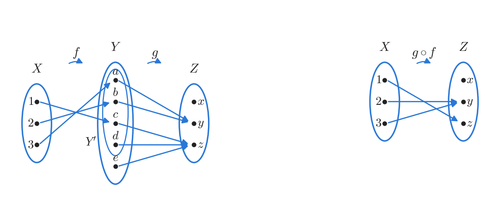

*Figure 11. Arrow diagrams of the functions f and g on finite sets and of their composition g ∘ f*

The arrow diagram for $g \circ f$ is obtained by tracing the arrows all the way across from $X$ to $Z$ through $Y$ (right part of Figure 11).

```math
(g \circ f)(1) = g(f(1)) = g(c) = z, \qquad (g \circ f)(2) = g(f(2)) = g(b) = y, \qquad (g \circ f)(3) = g(f(3)) = g(a) = y
```

Hence the range of $g \circ f$ is $\lbrace y, z\rbrace$.

### 3.2 Composition with an Identity Function

The identity function $I_X$ on a set $X$ is the function from $X$ to $X$ defined by $I_X(x) = x$ for every $x \in X$ (Section 1.3). The next example examines what composing a function with an identity function produces.

**Example 7.3.3 (Composition with the Identity Function).** Let $X = \lbrace a, b, c, d\rbrace$ and $Y = \lbrace u, v, w\rbrace$, and let $f: X \to Y$ be given by $f(a) = u$, $f(b) = v$, $f(c) = v$, and $f(d) = u$. Find $f \circ I_X$ and $I_Y \circ f$. For each $x$, compute the value obtained by applying $I_X$ first and then $f$, and the value obtained by applying $f$ first and then $I_Y$.

| $x$ | $I_X(x)$ | $(f \circ I_X)(x) = f(I_X(x))$ | $f(x)$ | $(I_Y \circ f)(x) = I_Y(f(x))$ |
|:---:|:---:|:---:|:---:|:---:|
| $a$ | $a$ | $f(a) = u$ | $u$ | $I_Y(u) = u$ |
| $b$ | $b$ | $f(b) = v$ | $v$ | $I_Y(v) = v$ |
| $c$ | $c$ | $f(c) = v$ | $v$ | $I_Y(v) = v$ |
| $d$ | $d$ | $f(d) = u$ | $u$ | $I_Y(u) = u$ |

*Table 8. Values of the compositions of f with the identity functions*

Since $(f \circ I_X)(x) = f(x)$ and $(I_Y \circ f)(x) = f(x)$ for every $x \in X$, the definition of function equality gives $f \circ I_X = f$ and $I_Y \circ f = f$. In general, composing any function with an identity function gives the function itself.

> **Key Point:** **Theorem 7.3.1 (Composition with an Identity Function).** If $f$ is a function from a set $X$ to a set $Y$, and $I_X$ and $I_Y$ are the identity functions on $X$ and $Y$, respectively, then (a) $f \circ I_X = f$ and (b) $I_Y \circ f = f$.

**Proof.** (a) For each $x \in X$, $(f \circ I_X)(x) = f(I_X(x)) = f(x)$. The first equality is the definition of composition and the second is the definition of $I_X$. The functions $f \circ I_X$ and $f$ have the same domain $X$ and co-domain $Y$ and agree at every element, so $f \circ I_X = f$ by the definition of function equality.

(b) For each $x \in X$, $(I_Y \circ f)(x) = I_Y(f(x)) = f(x)$. The first equality is the definition of composition, and the second holds because $f(x) \in Y$ and $I_Y$ sends every element of $Y$ to itself. Hence $I_Y \circ f = f$ by the definition of function equality. $\blacksquare$

### 3.3 Composing a Function with Its Inverse

Let $f$ be a function from a set $X$ to a set $Y$ that has an inverse function $f^{-1}$. Then $f^{-1}$ is the function from $Y$ to $X$ with the property $f^{-1}(y) = x \iff f(x) = y$ (Section 2.8). Consider what happens when $f$ is composed with $f^{-1}$.

**Example 7.3.4 (Composing a Function with Its Inverse).** Let $X = \lbrace a, b, c\rbrace$ and $Y = \lbrace x, y, z\rbrace$, and let $f: X \to Y$ be given by $f(a) = z$, $f(b) = x$, and $f(c) = y$. The three elements go to different elements and all three elements of $Y$ are images, so $f$ is one-to-one and onto. Hence $f^{-1}$ exists, and tracing the arrows backward gives $f^{-1}(x) = b$, $f^{-1}(y) = c$, and $f^{-1}(z) = a$.

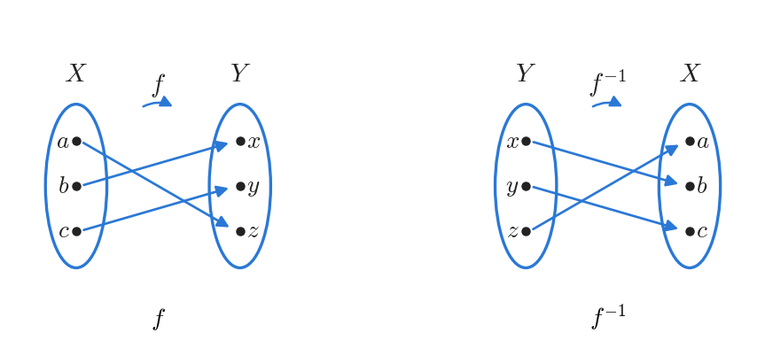

*Figure 12. Arrow diagrams of the one-to-one correspondence f and its inverse function f⁻¹*

$f^{-1} \circ f$ is found by following the arrows from $X$ to $Y$ by $f$ and back to $X$ by $f^{-1}$.

```math
(f^{-1} \circ f)(a) = f^{-1}(z) = a, \qquad (f^{-1} \circ f)(b) = f^{-1}(x) = b, \qquad (f^{-1} \circ f)(c) = f^{-1}(y) = c
```

The composition of $f$ and $f^{-1}$ sends each element to itself, so by the definition of the identity function, $f^{-1} \circ f = I_X$. In the same way, $(f \circ f^{-1})(x) = f(b) = x$, $(f \circ f^{-1})(y) = f(c) = y$, and $(f \circ f^{-1})(z) = f(a) = z$, so $f \circ f^{-1} = I_Y$.

In general, composing a function that has an inverse with its inverse gives an identity function. The function carries an element of its domain to the co-domain and the inverse function brings it back, so the composition leaves every element where it started.

> **Key Point:** **Theorem 7.3.2 (Composition of a Function with Its Inverse).** If $f: X \to Y$ is a one-to-one correspondence with inverse function $f^{-1}: Y \to X$, then (a) $f^{-1} \circ f = I_X$ and (b) $f \circ f^{-1} = I_Y$.

**Proof.** (a) [To show that $f^{-1} \circ f = I_X$, it must be shown that $(f^{-1} \circ f)(x) = x$ for every $x \in X$.] Let $x$ be any element of $X$. By the definition of composition, $(f^{-1} \circ f)(x) = f^{-1}(f(x))$. Let $z = f^{-1}(f(x))$. By the definition of inverse function, $z$ is the element that $f$ sends to $f(x)$, so $f(z) = f(x)$. Since $f$ is one-to-one, $z = x$. That is, $f^{-1}(f(x)) = x$, or equivalently $(f^{-1} \circ f)(x) = x$. Since $x$ is any element of $X$ and $I_X(x) = x$, $f^{-1} \circ f = I_X$.

(b) [It must be shown that $(f \circ f^{-1})(y) = y$ for every $y \in Y$.] Let $y$ be any element of $Y$ and let $x = f^{-1}(y)$. By the defining property $f^{-1}(y) = x \iff f(x) = y$ of the inverse function, $f(x) = y$. Hence $(f \circ f^{-1})(y) = f(f^{-1}(y)) = f(x) = y = I_Y(y)$, and $f \circ f^{-1} = I_Y$ by the definition of function equality. $\blacksquare$

### 3.4 Composition of One-to-One Functions

Composition behaves in notable ways with respect to the one-to-one and onto properties. The first question is whether composing two one-to-one functions always yields a one-to-one function. Let $X = \lbrace a, b, c\rbrace$, $Y = \lbrace w, x, y, z\rbrace$, and $Z = \lbrace1, 2, 3, 4, 5\rbrace$, and let one-to-one functions $f: X \to Y$ and $g: Y \to Z$ be given by $f(a) = w$, $f(b) = y$, $f(c) = z$ and $g(w) = 1$, $g(x) = 2$, $g(y) = 4$, $g(z) = 5$. Tracing the arrows all the way across gives $(g \circ f)(a) = 1$, $(g \circ f)(b) = 4$, and $(g \circ f)(c) = 5$.

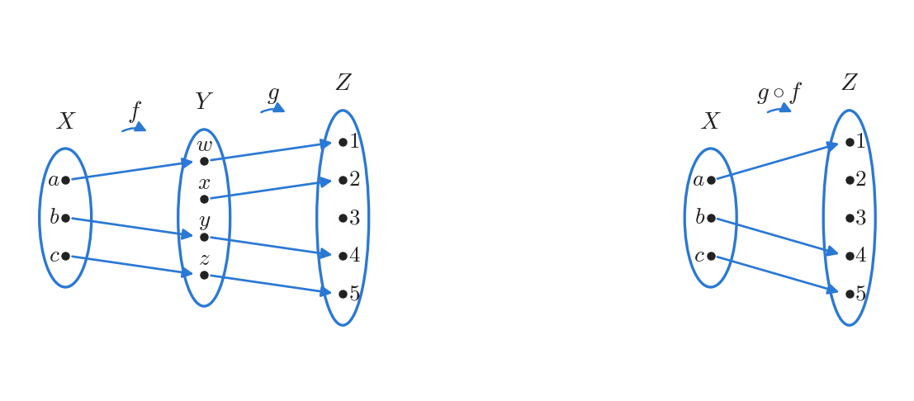

*Figure 13. Two one-to-one functions f and g and their one-to-one composition g ∘ f*

In this example the composition $g \circ f$ sends the three elements to different elements, so it is one-to-one. This is no accident.

> **Key Point:** **Theorem 7.3.3.** If $f: X \to Y$ and $g: Y \to Z$ are both one-to-one functions, then $g \circ f$ is one-to-one.

The starting point and the conclusion of a direct proof are as follows.

- **Starting point:** suppose $f$ is a one-to-one function from $X$ to $Y$ and $g$ is a one-to-one function from $Y$ to $Z$.
- **To show:** $g \circ f$ is a one-to-one function from $X$ to $Z$.

The crucial step is to substitute $g \circ f$ into the definition of one-to-one.

```math
g \circ f \text{ is one-to-one} \iff \forall x_1, x_2 \in X, \ \big((g \circ f)(x_1) = (g \circ f)(x_2) \Rightarrow x_1 = x_2\big)
```

So one supposes elements $x_1$ and $x_2$ of $X$ with $(g \circ f)(x_1) = (g \circ f)(x_2)$ and shows $x_1 = x_2$. By the definition of composition, the supposition says $g(f(x_1)) = g(f(x_2))$. This equation has the form "$`g`$(something) = $g$(something else)". Since $g$ is one-to-one, two inputs with the same $g$-value are equal, so $f(x_1) = f(x_2)$. This equation also has the form "$`f`$(something) = $f$(something else)", and since $f$ is also one-to-one, $x_1 = x_2$. Summarizing this discussion gives the following proof.

**Proof of Theorem 7.3.3.** Suppose $f: X \to Y$ and $g: Y \to Z$ are both one-to-one functions. [It must be shown that $g \circ f$ is one-to-one.] Suppose $x_1$ and $x_2$ are elements of $X$ such that $(g \circ f)(x_1) = (g \circ f)(x_2)$. [It must be shown that $x_1 = x_2$.] By the definition of composition, $g(f(x_1)) = g(f(x_2))$. Since $g$ is one-to-one, $f(x_1) = f(x_2)$, and since $f$ is one-to-one, $x_1 = x_2$. Hence $g \circ f$ is one-to-one. $\blacksquare$

### 3.5 Composition of Onto Functions

Next, compose two onto functions. Let $X = \lbrace a, b, c, d, e\rbrace$, $Y = \lbrace w, x, y, z\rbrace$, and $Z = \lbrace1, 2, 3\rbrace$, and let onto functions $f: X \to Y$ and $g: Y \to Z$ be given by $f(a) = x$, $f(b) = y$, $f(c) = w$, $f(d) = z$, $f(e) = y$ and $g(w) = 2$, $g(x) = 1$, $g(y) = 3$, $g(z) = 2$. Tracing the arrows all the way across gives $(g \circ f)(a) = 1$, $(g \circ f)(b) = 3$, $(g \circ f)(c) = 2$, $(g \circ f)(d) = 2$, and $(g \circ f)(e) = 3$.

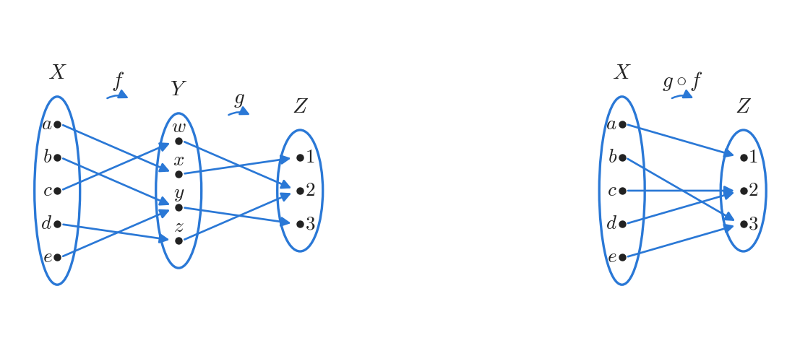

*Figure 14. Two onto functions f and g and their onto composition g ∘ f*

All three elements of $Z$ are images under $g \circ f$, so $g \circ f$ is onto. In fact, whenever two onto functions can be composed, their composition is onto.

> **Key Point:** **Theorem 7.3.4.** If $f: X \to Y$ and $g: Y \to Z$ are both onto functions, then $g \circ f$ is onto.

The starting point of a direct proof is "$`f`$ is an onto function from $X$ to $Y$, and $g$ is an onto function from $Y$ to $Z$", and the conclusion to be shown is "$`g \circ f`$ is an onto function from $X$ to $Z$". Substituting $g \circ f$ into the definition of onto gives the following.

```math
g \circ f: X \to Z \text{ is onto} \iff \forall z \in Z, \ \exists x \in X, \ (g \circ f)(x) = z
```

This statement is universal, so one supposes a particular but arbitrarily chosen element $z \in Z$ and shows that there exists $x \in X$ with $(g \circ f)(x) = z$. To find $x$, start from the supposition $z \in Z$ and use backward the facts that $g$ and $f$ are onto.

1. Since $g$ is onto, some arrow coming from $Y$ ends at $z$. That is, there is an element $y \in Y$ such that

   ```math
   g(y) = z \quad (7.3.1)
   ```

2. Since $f$ is also onto, every element of $Y$ is the endpoint of some arrow coming from $X$. In particular so is $y$, so there is an element $x \in X$ such that

   ```math
   f(x) = y \quad (7.3.2)
   ```

3. Substituting equation (7.3.2) into equation (7.3.1) gives $g(f(x)) = z$, and since $g(f(x)) = (g \circ f)(x)$ by the definition of composition, $(g \circ f)(x) = z$. Thus $x$ is an element of $X$ that $g \circ f$ sends to $z$, which is the element sought.

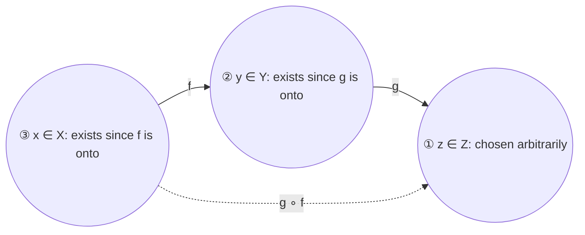

*Figure 15. The order in which elements are found in the proof of Theorem 7.3.4*

> **Caution:** A proof that a function is onto **must** begin with an arbitrary element of the co-domain and then produce an element of the domain whose image it is. Starting from elements of the domain gives no guarantee that every element of the co-domain is reached.

**Proof of Theorem 7.3.4.** Suppose $f: X \to Y$ and $g: Y \to Z$ are both onto functions. [It must be shown that $g \circ f$ is onto.] Let $z$ be a particular but arbitrarily chosen element of $Z$. [It must be shown that there exists an element $x$ in $X$ such that $(g \circ f)(x) = z$.] Since $g$ is onto, there is an element $y$ in $Y$ such that $g(y) = z$. And since $f$ is onto, there is an element $x$ in $X$ such that $f(x) = y$. Hence there is an element $x \in X$ such that $(g \circ f)(x) = g(f(x)) = g(y) = z$, and $g \circ f$ is onto. $\blacksquare$

**Example 7.3.5 (An Incorrect "Proof" That a Function Is Onto).** Suppose a student tries to show that a composition of onto functions is onto by writing the following.

1. Suppose $f: X \to Y$ and $g: Y \to Z$ are both onto. Then
2. $`\forall y \in Y, \ \exists x \in X, \ f(x) = y`$, and
3. $`\forall z \in Z, \ \exists y \in Y, \ g(y) = z`$.
4. So $(g \circ f)(x) = g(f(x)) = g(y) = z$, and thus $g \circ f$ is onto.

Explain the mistakes in this "proof". First, to show that $g \circ f$ is onto, one must be able to answer the following challenge: whenever someone supplies an element $z$ of $Z$ of their own choosing, one must explain how to find an element $x \in X$ with $(g \circ f)(x) = z$. So a proof must start by assuming that a particular but arbitrarily chosen element $z$ of $Z$ is given, and this text does not do so. Second, lines 2 and 3 only restate the hypotheses that $f$ and $g$ are onto. The $x$ and $y$ in line 2 and the $y$ and $z$ in line 3 are local variables whose meaning is confined to the quantified statement in which they occur. In particular, the $y$ in line 2 has nothing to do with the $y$ in line 3, yet line 4 treats the two $y$'s as the same object. As a result, nothing supports the conclusion that $g \circ f$ is onto. A correct proof fixes $z$ first, as above, then finds $y$ for that $z$, and then finds $x$ for that $y$.

---

<br>

## 4. Cardinality with Applications to Computability

A **cardinal number** describes the size of a set ("this set has **eight** elements"), whereas an **ordinal number** describes a position in a sequence ("this is the **eighth** element in the row"). Cardinal numbers are modelled mathematically on counting with fingers or tally marks. Just as one finger is matched with each object counted, two finite sets are said to have **the same size** when a one-to-one correspondence pairs their elements. For example, $A = \lbrace a, b, c, d\rbrace$ and $B = \lbrace u, v, w, x\rbrace$ have the same size because they can be paired as $a \leftrightarrow u$, $b \leftrightarrow v$, $c \leftrightarrow w$, $d \leftrightarrow x$.

A **finite set** is a set that is either empty or in one-to-one correspondence with $\lbrace1, 2, \ldots, n\rbrace$ for some positive integer $n$. An **infinite set**, by contrast, is a nonempty set that admits no one-to-one correspondence with $\lbrace1, 2, \ldots, n\rbrace$ for any positive integer $n$. This section carries the notion of size over to infinite sets: two infinite sets have the same size if, and only if, there is a one-to-one correspondence between them. This at once raises the questions whether all infinite sets are equally large or whether some are larger than others. The answers include some surprises, among them the existence of functions defined on the integers whose values no computer can compute.

### 4.1 Sets with the Same Cardinality

> **Definition:** Let $A$ and $B$ be any sets. **$A$ has the same cardinality as $B$** if, and only if, there is a one-to-one correspondence from $A$ to $B$. In other words, $A$ has the same cardinality as $B$ if, and only if, there is a function $f$ from $A$ to $B$ that is one-to-one and onto.

The following theorem lists basic properties of cardinality; most of them are consequences of the theorems on one-to-one and onto functions proved earlier.

> **Key Point:** **Theorem 7.4.1 (Properties of Cardinality).** For all sets $A$, $B$, and $C$: (a) **Reflexive property:** $A$ has the same cardinality as $A$. (b) **Symmetric property:** if $A$ has the same cardinality as $B$, then $B$ has the same cardinality as $A$. (c) **Transitive property:** if $A$ has the same cardinality as $B$ and $B$ has the same cardinality as $C$, then $A$ has the same cardinality as $C$.

**Proof.** The three properties are shown in turn.

- **(a) Reflexivity.** Let $A$ be any set. [It must be shown that there is a one-to-one correspondence from $A$ to $A$.] Consider the identity function $I_A$ on $A$. If $x_1$ and $x_2$ are elements of $A$ with $I_A(x_1) = I_A(x_2)$, then $x_1 = x_2$ by the definition of $I_A$, so $I_A$ is one-to-one. Also, if $y$ is any element of $A$, then $y = I_A(y)$ by the definition of $I_A$, so $I_A$ is onto. Hence $I_A$ is a one-to-one correspondence from $A$ to $A$.
- **(b) Symmetry.** Suppose $A$ and $B$ are sets and $A$ has the same cardinality as $B$. [It must be shown that $B$ has the same cardinality as $A$.] By supposition, there is a one-to-one correspondence $f$ from $A$ to $B$. By Theorems 7.2.2 and 7.2.3, there is a function $f^{-1}$ from $B$ to $A$, and $f^{-1}$ is also one-to-one and onto. Hence $B$ has the same cardinality as $A$.
- **(c) Transitivity.** Suppose $A$, $B$, and $C$ are sets, $A$ has the same cardinality as $B$, and $B$ has the same cardinality as $C$. [It must be shown that $A$ has the same cardinality as $C$.] By supposition, there are a one-to-one correspondence $f$ from $A$ to $B$ and a one-to-one correspondence $g$ from $B$ to $C$. By Theorems 7.3.3 and 7.3.4, $g \circ f$ is a function from $A$ to $C$ that is one-to-one and onto. Hence $A$ has the same cardinality as $C$. $\blacksquare$

Because of Theorem 7.4.1(b), the direction does not matter, and one can simply say that two sets have the same cardinality without saying which set has the same cardinality as the other.

> **Definition:** **$A$ and $B$ have the same cardinality** if, and only if, $A$ has the same cardinality as $B$ or $B$ has the same cardinality as $A$.

The next example exhibits a key feature of infinite sets: an infinite set can have the same cardinality as one of its proper subsets. Intuition suggests that the integers are twice as numerous as the even integers, yet the elements of the two sets can be paired off perfectly, so by definition their cardinalities are equal.

**Example 7.4.1 (An Infinite Set and a Proper Subset Can Have the Same Cardinality).** Let $2\mathbf{Z}$ be the set of all even integers. Show that $2\mathbf{Z}$ and $\mathbf{Z}$ have the same cardinality. Define a function $H: \mathbf{Z} \to 2\mathbf{Z}$ by $H(n) = 2n$ for every $n \in \mathbf{Z}$. $H$ sends $\ldots, -2 \mapsto -4, -1 \mapsto -2, 0 \mapsto 0, 1 \mapsto 2, 2 \mapsto 4, 3 \mapsto 6, \ldots$.

- **One-to-one:** Suppose $H(n_1) = H(n_2)$ for some integers $n_1$ and $n_2$. Then $2n_1 = 2n_2$ by the definition of $H$, and dividing both sides by 2 gives $n_1 = n_2$.
- **Onto:** Let $m$ be any element of $2\mathbf{Z}$. Since $m$ is even, $m = 2k$ for some integer $k$. Then $H(k) = 2k = m$, so there exists $k \in \mathbf{Z}$ with $H(k) = m$.

Therefore $H$ is a one-to-one correspondence, and by the definition of cardinality $\mathbf{Z}$ and $2\mathbf{Z}$ have the same cardinality. In the sense of cardinality, there are as many even integers as integers.

> **Note:** Some authors take this property, having the same cardinality as a proper subset of itself, as the definition of an infinite set. A finite set cannot have this property, because a proper subset of a set with $n$ elements has fewer than $n$ elements.

Chapter 9 shows that, for two finite sets with the same number of elements, a function from one to the other is one-to-one if, and only if, it is onto. Infinite sets behave differently. If two infinite sets have the same cardinality, then some function between them is a one-to-one correspondence, but at the same time the following is always the case.

- For infinite sets $A$ and $B$ with the same cardinality, some functions from $A$ to $B$ are one-to-one without being onto, and some functions from $A$ to $B$ are onto without being one-to-one.

For instance, $\mathbf{Z}$ and $2\mathbf{Z}$ have the same cardinality because of the function $H$ of Example 7.4.1. But the **inclusion function** $I: 2\mathbf{Z} \to \mathbf{Z}$ defined by $I(n) = n$ for every even integer $n$ is one-to-one but not onto, since no odd integer is an image. And the function $J: \mathbf{Z} \to 2\mathbf{Z}$ defined by $J(n) = 2\lfloor n/2 \rfloor$ for every integer $n$ is onto ($`J(2k) = 2k`$) but not one-to-one, since $J(0) = J(1) = 0$.

### 4.2 Countable Sets

The simplest infinite set is the set of counting numbers, the set $\mathbf{Z}^{+} = \lbrace1, 2, 3, 4, \ldots\rbrace$ of all positive integers. A set $A$ with the same cardinality as $\mathbf{Z}^{+}$ is called countably infinite, because pairing $\mathbf{Z}^{+}$ with $A$ by a one-to-one correspondence amounts to counting the elements of $A$ one by one. If $F$ is a one-to-one correspondence from $\mathbf{Z}^{+}$ to $A$, call $F(1)$ the first element of $A$, $F(2)$ the second, $F(3)$ the third, and so on. Since $F$ is one-to-one, nothing is counted twice, and since $F$ is onto, every element of $A$ eventually receives a number.

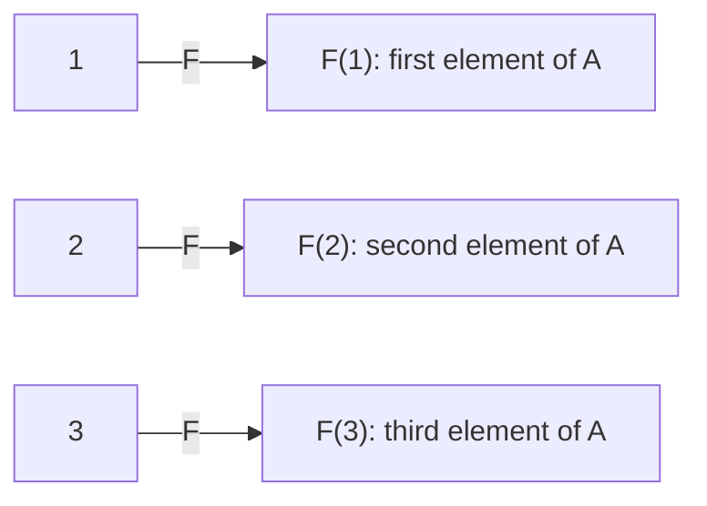

*Figure 16. Counting a countably infinite set A with a one-to-one correspondence F*

> **Definition:** A set is **finite** if, and only if, it is empty or there is a one-to-one correspondence between it and $\lbrace1, 2, \ldots, n\rbrace$ for some positive integer $n$. A set is **countably infinite** if, and only if, it has the same cardinality as the set $\mathbf{Z}^{+}$ of positive integers. A set is **countable** if, and only if, it is finite or countably infinite, and a set that is not countable is called **uncountable**.

**Example 7.4.2 (Countability of Z, the Set of All Integers).** Show that the set $\mathbf{Z}$ of all integers is countable. Since $\mathbf{Z}$ is infinite, it can be countable only by being countably infinite, so one must find a one-to-one correspondence from $\mathbf{Z}^{+}$ to $\mathbf{Z}$. On a number line the integers consist of the positive integers together with 0 and the negative integers, so they look more than twice as plentiful as the positive integers, and the claim seems to defy common sense.

The integers can be counted by starting at 0 and moving outward, alternating between the two sides. Count 0 first, then 1, then $-1$, then 2, then $-2$, and so forth, so that each swing between the positive and negative integers picks up one new integer.

| Counting order $n$ | 1 | 2 | 3 | 4 | 5 | 6 | 7 | 8 | 9 | 10 | 11 |
|:-----|:---:|:---:|:---:|:---:|:---:|:---:|:---:|:---:|:---:|:---:|:---:|
| Integer $F(n)$ | 0 | 1 | $-1$ | 2 | $-2$ | 3 | $-3$ | 4 | $-4$ | 5 | $-5$ |

*Table 9. Counting the integers by starting at 0 and swinging outward*

This counting never reaches the same integer twice, so the function is one-to-one, and it reaches every integer after finitely many steps, so it is onto. Hence this matching is a one-to-one correspondence from $\mathbf{Z}^{+}$ to $\mathbf{Z}$, and $\mathbf{Z}^{+}$ and $\mathbf{Z}$ have the same cardinality. Therefore $\mathbf{Z}$ is countably infinite and hence countable. The description above can also be written as the following formula.

```math
F(n) = \begin{cases} \dfrac{n}{2} & \text{if } n \text{ is an even positive integer} \\[2mm] -\dfrac{n - 1}{2} & \text{if } n \text{ is an odd positive integer} \end{cases}
```

For example, $F(4) = \frac{4}{2} = 2$ and $F(5) = -\frac{5 - 1}{2} = -2$, in agreement with Table 9.

**Example 7.4.3 (Countability of 2Z, the Set of All Even Integers).** Show that $2\mathbf{Z}$ is countable. Example 7.4.2 showed that $\mathbf{Z}^{+}$ has the same cardinality as $\mathbf{Z}$, and Example 7.4.1 showed that $\mathbf{Z}$ has the same cardinality as $2\mathbf{Z}$. Hence, by the transitive property of cardinality, $\mathbf{Z}^{+}$ has the same cardinality as $2\mathbf{Z}$. By the definition of countably infinite, $2\mathbf{Z}$ is countably infinite and hence countable.

### 4.3 Larger Infinities: The Cantor Diagonalization Process

Every infinite set discussed so far has turned out to be countably infinite, which raises the question whether larger infinities, that is, uncountable sets, exist. A natural first candidate is the set of all rational numbers. The integers sit on the number line with gaps between them. The rational numbers, on the other hand, are **dense** on the number line: any two distinct rational numbers have another rational number between them, so infinitely many rational numbers lie between any two of them, however close they are. For example, $\frac{r + s}{2}$ lies between rational numbers $r < s$. It is therefore tempting to believe that there are far more rational numbers than integers, so that the infinity of the rational numbers exceeds that of the integers.

Surprisingly, this belief is wrong. Even though the rational numbers are packed densely on the line while the integers stand apart, the set of all rational numbers and the set of all integers can be put into one-to-one correspondence. The next example proves part of this fact: the positive rational numbers can be matched one-to-one with the positive integers. Combining this result with the method of Example 7.4.2 (starting at 0 and alternating between positive and negative numbers) shows that the set of all rational numbers is also countable.

**Example 7.4.4 (The Set of All Positive Rational Numbers Is Countable).** Show that the set $\mathbf{Q}^{+}$ of all positive rational numbers is countable. Arrange the elements of $\mathbf{Q}^{+}$ in a grid whose entry in row $p$ and column $q$ is $\frac{p}{q}$. Each positive rational number then occurs somewhere in the grid (in fact infinitely often, since $`\frac{1}{1} = \frac{2}{2} = \frac{3}{3} = \cdots`$).

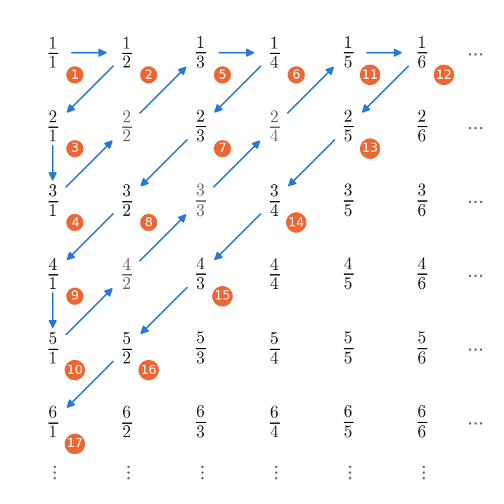

*Figure 17. The positive rational numbers arranged in a grid and counted along the diagonals*

Define a function $F$ from $\mathbf{Z}^{+}$ to $\mathbf{Q}^{+}$ by walking along the arrows from $\frac{1}{1}$ and passing over every entry whose value has already been counted. Specifically, $F(1) = \frac{1}{1}$, $F(2) = \frac{1}{2}$, $F(3) = \frac{2}{1}$, and $F(4) = \frac{3}{1}$. The next cell, $\frac{2}{2}$, equals $\frac{1}{1}$, which was already counted, so it is skipped. Then $F(5) = \frac{1}{3}$, $F(6) = \frac{1}{4}$, $F(7) = \frac{2}{3}$, $F(8) = \frac{3}{2}$, $F(9) = \frac{4}{1}$, and $F(10) = \frac{5}{1}$. The next cells $\frac{4}{2}$, $\frac{3}{3}$, and $\frac{2}{4}$ equal $\frac{2}{1}$, $\frac{1}{1}$, and $\frac{1}{2}$, so they are skipped, and $F(11) = \frac{1}{5}$. Continuing in this way defines $F(n)$ for every positive integer $n$. In Figure 17 the gray numbers are the skipped ones, and the numbers in orange circles give the counting order $n$.

The grid contains every positive rational number, and the path along the arrows visits every cell of the grid. Each diagonal has only finitely many cells, so following the arrows reaches any cell in finitely many steps. Thus $F$ is onto. Also, entries whose values were already counted are passed over, so no number is counted twice, and $F$ is one-to-one. Consequently $F$ is a one-to-one correspondence from $\mathbf{Z}^{+}$ to $\mathbf{Q}^{+}$, so $\mathbf{Q}^{+}$ is countably infinite and hence countable. The set $\mathbf{Q}$ of all rational numbers is countable as well, because listing $0, F(1), -F(1), F(2), -F(2), \ldots$ in the manner of Example 7.4.2 counts every rational number exactly once.

Now consider the real numbers. In 1874 Georg Cantor found a larger infinity by proving that the set of all real numbers is uncountable. Here the set of all real numbers between 0 and 1 is proved to be uncountable by a simpler technique that Cantor introduced in 1891. This technique is called the **Cantor diagonalization process**, and it has since become a standard tool for proving important results in logic and the theory of computation.

First recall how real numbers are written as decimals. Every real number marks a location on the number line and has a **decimal expansion** of the form below, in which $a_0$ is an integer (positive, negative, or zero) and every $a_i$ with $i \geq 1$ is one of the digits 0 through 9.

```math
a_0.a_1 a_2 a_3 \ldots
```

For example, take the point $P$ in Figure 18. In (a), $P$ lies between 1 and 2. When the interval from 1 to 2 is cut into ten pieces of equal length, (b) shows that $P$ lies between 1.6 and 1.7. When the interval from 1.6 to 1.7 is cut into ten equal pieces once more, (c) shows that $P$ lies between 1.62 and 1.63, nearer to 1.62 than to 1.63. So the decimal expansion of $P$ begins with the three digits 1.62.

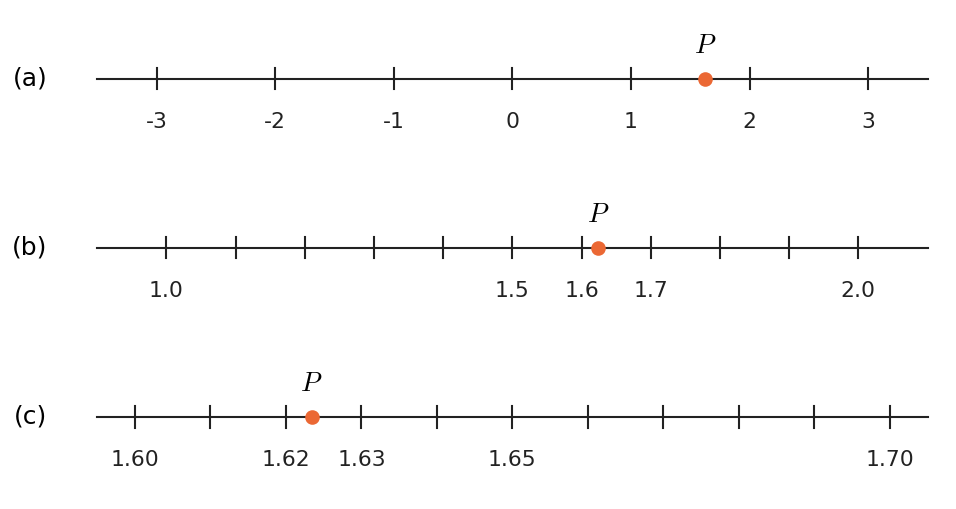

*Figure 18. Determining the decimal expansion of a point P one digit at a time by dividing intervals into ten parts*

If every interval of real numbers, however short, can be cut into ten equal pieces, this procedure can in principle continue forever, producing further digits of the decimal expansion of $P$. If $P$ lands exactly on a cut point at some stage, all remaining digits may be taken to be 0; otherwise the procedure yields infinitely many digits. The decimal representation obtained in this way is unique, except for numbers whose expansions end in an infinite run of 9's or an infinite run of 0's. For example, the following equality holds.

```math
0.199999\ldots = 0.200000\ldots
```

By convention, such a number is always written with the expansion that ends in 0's, so that every real number has exactly one representation.

> **Key Point:** **Theorem 7.4.2 (Cantor).** The set of all real numbers between 0 and 1 is uncountable.

**Proof (by contradiction).** Suppose the set of all real numbers between 0 and 1 is countable. This set contains the distinct elements $\frac{1}{2}, \frac{1}{3}, \frac{1}{4}, \ldots$, so it is not finite. Hence it is countably infinite, and a one-to-one correspondence with $\mathbf{Z}^{+}$ lets the decimal representations of all its elements be listed, without omission, as a first, second, third, and so on.

```math
\begin{aligned} &0.a_{11}a_{12}a_{13}\cdots a_{1n}\cdots \\ &0.a_{21}a_{22}a_{23}\cdots a_{2n}\cdots \\ &0.a_{31}a_{32}a_{33}\cdots a_{3n}\cdots \\ &\qquad \vdots \\ &0.a_{n1}a_{n2}a_{n3}\cdots a_{nn}\cdots \\ &\qquad \vdots \end{aligned}
```

[A contradiction is derived by showing that some number between 0 and 1 does not appear on this list.] For each pair of positive integers $i$ and $j$, $a_{ij}$ is the $`j`$th decimal digit of the $`i`$th number on the list. In particular, $a_{11}$ is the first digit of the first number and $a_{22}$ is the second digit of the second number. For example, suppose the list starts out as follows, where the digits in bold are the diagonal digits.

| $`i`$th number on the list | 1st digit | 2nd digit | 3rd digit | 4th digit | 5th digit | Rest |
|:-----|:---:|:---:|:---:|:---:|:---:|:---:|
| 1st number | **2** | 0 | 1 | 4 | 8 | $`8\,0\,2\ldots`$ |
| 2nd number | 1 | **1** | 6 | 6 | 6 | $`0\,2\,1\ldots`$ |
| 3rd number | 0 | 3 | **3** | 5 | 3 | $`3\,2\,0\ldots`$ |
| 4th number | 9 | 6 | 7 | **7** | 6 | $`8\,0\,9\ldots`$ |
| 5th number | 0 | 0 | 0 | 3 | **1** | $`0\,0\,2\ldots`$ |

*Table 10. A sample list for the diagonalization argument and its diagonal digits*

The diagonal digits are $a_{11} = 2$, $a_{22} = 1$, $a_{33} = 3$, $a_{44} = 7$, and $a_{55} = 1$. Now construct a new decimal $d = 0.d_1 d_2 d_3 \cdots d_n \cdots$ by the following rule.

```math
d_n = \begin{cases} 1 & \text{if } a_{nn} \neq 1 \\ 2 & \text{if } a_{nn} = 1 \end{cases}
```

In the example above, $d_1 = 1$ because $a_{11} = 2 \neq 1$, $d_2 = 2$ because $a_{22} = 1$, $d_3 = 1$ because $a_{33} = 3 \neq 1$, $d_4 = 1$ because $a_{44} = 7 \neq 1$, and $d_5 = 2$ because $a_{55} = 1$. Hence $d = 0.12112\ldots$.

The key observation is that **for every positive integer $n$, the $`n`$th decimal digit of $d$ differs from the $`n`$th decimal digit of the $`n`$th number on the list**. Hence $d$ equals no number on the list. Yet $d$ is a real number between 0 and 1, so it is a real number between 0 and 1 missing from a list that was supposed to contain **all** such numbers. This contradiction shows that the assumption that the set of all real numbers between 0 and 1 is countable is false. Hence this set is uncountable. $\blacksquare$

> **Note:** There is a reason for using only the digits 1 and 2 in $d$. Since $d$ contains no 0's or 9's, its decimal expansion does not end in repeating 0's or 9's, so its representation is unique. Therefore the fact that the $`n`$th digits differ implies that $d$ differs from the $`n`$th number **as a number**. Also, $0.111\ldots \leq d \leq 0.222\ldots$, so $d$ lies between 0 and 1. If the digits were changed carelessly, two different representations of the same number, such as $0.1999\ldots$ and $0.2000\ldots$, could arise and break the argument.

### 4.4 Subsets of Countable Sets and the Cardinality of the Real Numbers

Cantor went beyond proving that uncountable sets exist and built an entire arithmetic of infinite sets of different sizes. One of the most fundamental theorems of that theory says that every subset of a countable set is countable.

> **Key Point:** **Theorem 7.4.3.** Any subset of any countable set is countable.

**Proof.** Let $A$ be a particular but arbitrarily chosen countable set and let $B$ be any subset of $A$. [It must be shown that $B$ is countable.] Either $B$ is finite or it is infinite. If $B$ is finite, then $B$ is countable by the definition of countable, and the proof is done. So suppose $B$ is infinite. Then $A$ is also infinite because $B \subseteq A$, and since $A$ is countable, $A$ is countably infinite. Hence the distinct elements of $A$ can be represented as a sequence $a_1, a_2, a_3, \ldots$. Define a function $g: \mathbf{Z}^{+} \to B$ inductively as follows.

1. Search sequentially through $a_1, a_2, a_3, \ldots$ until an element of $B$ is found. This must happen eventually because $B$ is a subset of $A$ and is nonempty. Call that element $g(1)$.
2. For each integer $k \geq 2$, suppose $g(k - 1)$ has been defined. Then $g(k - 1) = a_i$ for some $a_i$. Starting with $a_{i+1}$, search sequentially through $a_{i+1}, a_{i+2}, a_{i+3}, \ldots$ for an element of $B$. Only finitely many elements of $B$ have subscript at most $i$, and $B$ is infinite, so some element of $B$ has subscript greater than $i$ and the search must succeed eventually. Call the element found $g(k)$.

By (1) and (2), $g$ is defined for every positive integer. The elements $a_1, a_2, a_3, \ldots$ are all distinct, and each search starts at the subscript after the one where the previous search ended, so the subscripts of $g(1), g(2), g(3), \ldots$ strictly increase. Hence $g$ is one-to-one. Moreover, any element of $B$ equals some $a_j$, and if $m$ elements of $B$ have subscripts less than $j$, then $g(m + 1) = a_j$ because the searches proceed in order. Hence every element of $B$ is the image of some positive integer, and $g$ is onto. Thus $g$ is a one-to-one correspondence from $\mathbf{Z}^{+}$ to $B$, so $B$ is countably infinite and hence countable. $\blacksquare$

The following corollary is an immediate consequence of Theorem 7.4.3.

> **Key Point:** **Corollary 7.4.4.** Any set with an uncountable subset is uncountable.

**Proof.** Theorem 7.4.3 can be restated as follows: "for every set $S$ and every subset $A$ of $S$, if $S$ is countable, then $A$ is countable." Its contrapositive, which is logically equivalent to it, reads: "for every set $S$ and every subset $A$ of $S$, if $A$ is uncountable, then $S$ is uncountable." This is exactly the statement of the corollary, so the corollary is proved. $\blacksquare$

By Corollary 7.4.4, the set $\mathbf{R}$ of all real numbers is uncountable, since it contains the uncountable set of real numbers between 0 and 1. The next example shows even more: $\mathbf{R}$ has the same cardinality as the set of real numbers between 0 and 1.

**Example 7.4.5 (The Cardinality of the Set of All Real Numbers).** Show that $\mathbf{R}$ has the same cardinality as the set of real numbers between 0 and 1. Let $S$ be the open interval from 0 to 1, that is, the set of real numbers strictly between 0 and 1.

```math
S = \lbrace\, x \in \mathbf{R} \mid 0 < x < 1 \,\rbrace
```

Imagine lifting $S$ off the line and bending it into a circle. Because $S$ contains neither endpoint 0 nor 1, the point at the top of the circle is missing. Set the circle on the number line so that it touches the line at the point 0. Then $\frac{1}{2}$ lies at the point of contact, and $\frac{1}{4}$ and $\frac{3}{4}$ lie at the leftmost and rightmost points of the circle.

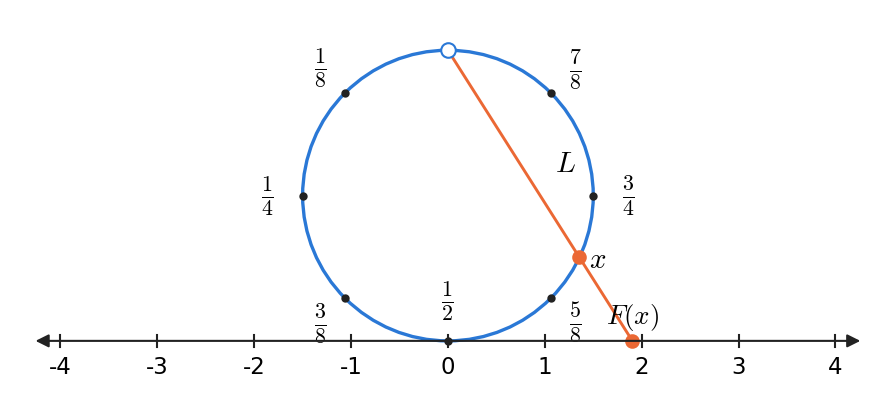

*Figure 19. The function F that projects points of the interval (0, 1), bent into a circle, onto the number line*

Define a function $F: S \to \mathbf{R}$ as follows. For each point $x$ of the circle that represents $S$, let $L$ be the straight line through the top point of the circle and $x$, and let $F(x)$ be the point where $L$ crosses the number line. $F(x)$ is called the **projection** of $x$ onto the number line. Different points of the circle determine different lines through the top point, and two different lines through the top point cross the number line at different points, so $F$ is one-to-one. Also, for any point $y$ on the number line, the line through $y$ and the top point of the circle meets the circle at exactly one other point $x$, and then $y = F(x)$ by definition. Hence $F$ is onto. Thus $F$ is a one-to-one correspondence from $S$ to $\mathbf{R}$, and $S$ and $\mathbf{R}$ have the same cardinality.

> **Note:** This projection can also be written as a formula. If $D$ is the diameter of the circle and the point of tangency is taken as the origin, a computation gives $F(x) = D \tan\left(\pi\left(x - \frac{1}{2}\right)\right)$. As $x$ moves from 0 to 1, $\pi\left(x - \frac{1}{2}\right)$ moves from $-\frac{\pi}{2}$ to $\frac{\pi}{2}$, and the tangent function is a one-to-one correspondence from this open interval to $\mathbf{R}$. For example, $F\left(\frac{1}{2}\right) = 0$ and $F\left(\frac{3}{4}\right) = D$.

Combining Example 7.4.5 with Theorem 7.4.2 shows that the set of all real numbers is uncountable, so there is an infinite set of larger cardinality than the set of positive integers, in the sense that $\mathbf{Z}^{+}$ can be mapped into it by a one-to-one function but not by a one-to-one correspondence. Moreover, one can prove that no set has the same cardinality as its power set (Cantor's theorem). Since sending each element $a$ to the singleton set $\lbrace a\rbrace$ gives a one-to-one function from any set to its power set, every set has, in the same sense, a smaller cardinality than its power set. Hence, starting with $\mathbf{Z}$, one obtains an endless sequence of larger and larger infinities: $\mathbf{Z}, \mathcal{P}(\mathbf{Z}), \mathcal{P}(\mathcal{P}(\mathbf{Z})), \mathcal{P}(\mathcal{P}(\mathcal{P}(\mathbf{Z}))), \ldots$.

### 4.5 Application: Cardinality and Computability

Whether certain sets are countable or uncountable decides a basic question about computability. The first step is to show that a certain set is countable.

**Example 7.4.6 (Countability of the Set of Computer Programs in a Computer Language).** Show that, for a given computer language, the set of all programs written in it is countable. The key fact is that every program, in any language, is a finite string of symbols taken from the alphabet of the language, which is finite.

Let $P$ be the set of all programs in the given language. Either $P$ is finite or it is infinite. If $P$ is finite, it is countable and the proof is done. If $P$ is infinite, count it as follows.

1. Choose a binary code that turns each symbol of the alphabet of the language into a string of 0's and 1's, for example the seven-bit ASCII (American Standard Code for Information Interchange) or the eight-bit EBCDIC (Extended Binary-Coded Decimal Interchange Code).
2. For each program in $P$, translate all the symbols of the program into 0's and 1's with this code.
3. List these strings in order of increasing length, and list strings of equal length in increasing order of the numbers they represent when read as binary numerals.
4. Define a function $F: \mathbf{Z}^{+} \to P$ by letting $F(n)$ be the $`n`$th program in this list, for each $n \in \mathbf{Z}^{+}$.

Different programs translate into different strings, and there are only finitely many strings of each length, so every program occupies a finite position in the list. Hence $F$ is one-to-one and onto, and $P$ is countably infinite and hence countable.

As a simple example, suppose the only programs in $P$ that translate into bit strings of length at most 5 are 10111, 11, 0010, 1011, 01, 00100, 1010, and 00010. Grouping by length gives 11 and 01 for length 2; 0010, 1011, and 1010 for length 4; and 10111, 00100, and 00010 for length 5. Sorting within each length by binary value gives the following.

| $n$ | 1 | 2 | 3 | 4 | 5 | 6 | 7 | 8 |
|:-----|:---:|:---:|:---:|:---:|:---:|:---:|:---:|:---:|
| String $F(n)$ | 01 | 11 | 0010 | 1010 | 1011 | 00010 | 00100 | 10111 |
| Binary value | 1 | 3 | 2 | 10 | 11 | 2 | 4 | 23 |

*Table 11. Program strings ordered by length and, within each length, by binary value*

Viewed purely as numbers, ignoring leading zeros, 0010 and 00010 both equal 2. So if the strings were ordered by binary value alone, without ordering by length first, the values of $F$ would not be uniquely determined. This is why the strings must be ordered by length first.

The last example proves that a certain set is uncountable and deduces from this that some function cannot be computed.

**Example 7.4.7 (The Cardinality of a Set of Functions and Computability).** (a) Show that the set $T$ of all functions from the positive integers to $\lbrace0, 1, 2, 3, 4, 5, 6, 7, 8, 9\rbrace$ is uncountable. (b) Conclude that noncomputable functions exist: for every computer language there is a function $F: \mathbf{Z}^{+} \to \lbrace0, 1, \ldots, 9\rbrace$ for which no program in that language accepts arbitrary inputs and outputs the corresponding values of $F$.

(a) Let $S$ be the set of all real numbers between 0 and 1. As shown earlier, each number in $S$ can be written as $0.a_1 a_2 a_3 \ldots a_n \ldots$ with every $a_i$ a digit from 0 through 9, and this representation is unique once expansions ending in all 9's are excluded. Define a function $F$ from $S$ to a subset of $T$ as follows.

```math
F(0.a_1 a_2 a_3 \ldots a_n \ldots) = \text{the function that sends each positive integer } n \text{ to } a_n
```

For example, if $G = F(0.2901\ldots)$, then $G(1) = 2$, $G(2) = 9$, $G(3) = 0$, and $G(4) = 1$. The co-domain of $F$ is taken to be exactly the subset of $T$ that makes $F$ onto, namely the image $F(S)$ of $S$ under $F$. Then $F$ is one-to-one: if the functions $F(x_1)$ and $F(x_2)$ are equal, they take the same value at every positive integer, so every decimal digit of $x_1$ equals the corresponding digit of $x_2$, and since the representations are unique, $x_1 = x_2$. Thus $F$ is a one-to-one correspondence from $S$ to the subset $F(S)$ of $T$. If $F(S)$ were countable, then $S$, which has the same cardinality as $F(S)$, would also be countable by the transitive property of cardinality, contradicting Theorem 7.4.2. Hence $F(S)$ is an uncountable subset of $T$, and $T$ is uncountable by Corollary 7.4.4.

(b) The set $P$ of all programs in a given computer language is countable by Example 7.4.6. Each program computes at most one function. Now suppose every function in $T$ were computable. Then for each function $G$ in $T$ one could choose one program that computes $G$ and call it $\Phi(G)$. Two different functions cannot be computed by the same program, so $\Phi: T \to P$ is one-to-one. Hence $\Phi$ is a one-to-one correspondence from $T$ to the subset $\Phi(T)$ of $P$, and $\Phi(T)$ is countable by Theorem 7.4.3. Then, by the symmetric and transitive properties of cardinality, $T$ would also be countable, contradicting (a). Therefore no computer language has enough programs to compute every function in $T$, and some functions must be noncomputable.

| Set | Countability | Reason |
|:-----|:-----|:-----|
| $\mathbf{Z}^{+}$, $\mathbf{Z}$, $2\mathbf{Z}$ | Countably infinite | Definition, Example 7.4.2, Example 7.4.3 |
| $\mathbf{Q}^{+}$ | Countably infinite | Diagonal counting of Example 7.4.4 |
| All programs in one language | Countable | Length-first listing of Example 7.4.6 |
| All real numbers between 0 and 1 | Uncountable | Diagonalization of Theorem 7.4.2 |
| $\mathbf{R}$ | Uncountable | Corollary 7.4.4, Example 7.4.5 |
| All functions $T$ from $\mathbf{Z}^{+}$ to $\lbrace0, 1, \ldots, 9\rbrace$ | Uncountable | Example 7.4.7(a) |

*Table 12. Sets whose cardinality was decided in this chapter, with the reasons*

> **[Theory of Computation]** In the theory of computation, programs are formalized as Turing machines, and since a Turing machine can also be encoded as a finite string of symbols, there are only countably many of them. The cardinality argument above shows that noncomputable functions exist, but it does not point to any particular one. The halting problem of Chapter 6 is a concrete example of a problem that cannot be computed, and its proof also uses the self-referential idea behind diagonalization.

---

<br>

## Concept Applications

**True/False Check:**

| Statement | Judgment and Reason |
|:-----|:------------|
| For an arrow diagram to define a function, an arrow must arrive at every element of the co-domain. | **F.** The condition is that exactly one arrow leaves each element of the domain. An element of the co-domain may receive no arrow or several arrows (Example 7.1.2). |
| Even if a function $f$ is not a one-to-one correspondence, the inverse image $f^{-1}(C)$ of a subset $C$ of the co-domain is defined. | **T.** $f^{-1}(C) = \lbrace x \in X \mid f(x) \in C\rbrace$ is a set defined for any function. What exists only for one-to-one correspondences is the inverse function. |
| $f(m/n) = m$ defines a function from the rational numbers to the integers. | **F.** $\frac{1}{2} = \frac{3}{6}$, but the rule gives the different values 1 and 3, so it is not well defined (Example 7.1.12). |
| $g: \mathbf{Z} \to \mathbf{Z}$, $g(n) = n^2$, is one-to-one. | **F.** $g(2) = g(-2) = 4$ but $2 \neq -2$. |
| $h: \mathbf{Z} \to \mathbf{Z}$, $h(n) = 4n - 1$, is onto. | **F.** $h(n) = 0$ would require $n = \frac{1}{4}$, so 0 is not the image of any integer. |
| Composition of functions is commutative. | **F.** For the successor function $f$ and the squaring function $g$, $(g \circ f)(1) = 4$ but $(f \circ g)(1) = 2$. |
| The composition $g \circ f$ of two onto functions $f: X \to Y$ and $g: Y \to Z$ is onto. | **T.** This is Theorem 7.3.4. Starting from $z \in Z$, find $y$ with $g(y) = z$ and then $x$ with $f(x) = y$. |
| An infinite set cannot have the same cardinality as a proper subset of itself. | **F.** $H(n) = 2n$ is a one-to-one correspondence from $\mathbf{Z}$ to its proper subset $2\mathbf{Z}$ (Example 7.4.1). |
| The rational numbers are dense on the number line, so they have a larger cardinality than the integers. | **F.** Diagonal counting puts $\mathbf{Q}^{+}$ into one-to-one correspondence with $\mathbf{Z}^{+}$, and the set of all rational numbers is also countable. |
| Any subset of a countable set is countable. | **T.** This is Theorem 7.4.3, and its contrapositive is Corollary 7.4.4. |

---

<br>

## Summary

| Concept | Key Summary |
|:-----|:-----|
| Function | A relation $f: X \to Y$ that relates each element of $X$ to exactly one element of $Y$; $X$ is the domain and $Y$ the co-domain. |
| Image, range, inverse image | $f(x)$ is the image of $x$, the set of all images is the range, and the set of all $x$ with $f(x) = y$ is the inverse image of $y$. |
| Equality of functions | Two functions with the same domain and co-domain are equal exactly when $F(x) = G(x)$ for every $x$ (Theorem 7.1.1). |
| Examples of functions | They include identity functions, sequences, functions on power sets and Cartesian products, logarithmic functions, encoding and decoding functions, and the Hamming distance function. |
| Boolean function | A function from $\lbrace0, 1\rbrace^n$ to $\lbrace0, 1\rbrace$; it is the function defined by an input/output table. |
| Well-defined function | A rule must give every input a value and that value must be unique; a rule that depends on how an input is written is not well defined. |
| Images and inverse images of sets | $f(A)$ collects the images of elements of $A$, $f^{-1}(C)$ collects the elements whose images lie in $C$, and $f(A \cup B) = f(A) \cup f(B)$. |
| One-to-one function | A function with $F(x_1) = F(x_2) \Rightarrow x_1 = x_2$; a proof supposes $F(x_1) = F(x_2)$ and shows $x_1 = x_2$. |
| Onto function | A function such that every $y$ in the co-domain has an $x$ with $F(x) = y$; a proof starts from an arbitrary $y$, finds $x$, and checks it. |
| Hash function | A function from a large set of data to a small set of integers; collisions are handled by collision resolution methods such as linear probing. |
| Exponential and logarithmic functions | $\exp_b$ and $\log_b$ are one-to-one correspondences inverse to each other, and their one-to-oneness yields properties of logarithms such as $\log_c x = \log_b x / \log_b c$. |
| One-to-one correspondence and inverse function | A function that is one-to-one and onto has an inverse function with $F^{-1}(y) = x \iff y = F(x)$, and the inverse is also a one-to-one correspondence. |
| Composition | $(g \circ f)(x) = g(f(x))$, with $f$ acting first; composition is not commutative. |
| Composition with identity and inverse functions | $f \circ I_X = f$, $I_Y \circ f = f$, $f^{-1} \circ f = I_X$, and $f \circ f^{-1} = I_Y$. |
| Composition and one-to-one, onto | A composition of one-to-one functions is one-to-one, and a composition of onto functions is onto (Theorems 7.3.3, 7.3.4). |
| Cardinality | Two sets have the same cardinality if there is a one-to-one correspondence between them, and having the same cardinality is reflexive, symmetric, and transitive. |
| Countable and uncountable | A set with the same cardinality as $\mathbf{Z}^{+}$ is countably infinite, a finite or countably infinite set is countable, and any other set is uncountable. $\mathbf{Z}$ and $\mathbf{Q}^{+}$ are countable. |
| Cantor diagonalization | Constructing a number that differs from the $`n`$th number on a list in the $`n`$th digit shows that the real numbers between 0 and 1 are uncountable. |
| Subsets and cardinality | Any subset of a countable set is countable, and a set with an uncountable subset is uncountable, so $\mathbf{R}$ is uncountable. |
| Computability | There are countably many programs but uncountably many functions from $\mathbf{Z}^{+}$ to $\lbrace0, \ldots, 9\rbrace$, so noncomputable functions exist. |

---

<br>

## Self-Check Questions

1. **Images and inverse images:** Let $X = \lbrace1, 2, 3\rbrace$ and $Y = \lbrace p, q, r, s\rbrace$, and let $f: X \to Y$ be defined by $f(1) = q$, $f(2) = s$, and $f(3) = q$. Find the range of $f$, the inverse images of $q$ and $p$, $f(\lbrace1, 2\rbrace)$, and $f^{-1}(\lbrace q, r\rbrace)$, and decide whether $f$ is one-to-one and whether it is onto.

   <details>
   <summary>Answer</summary>

   The range is the set of elements that are actually images, so it is $\lbrace q, s\rbrace$. The elements $x$ with $f(x) = q$ are 1 and 3, so the inverse image of $q$ is $\lbrace1, 3\rbrace$, and no element goes to $p$, so the inverse image of $p$ is $\emptyset$. $f(\lbrace1, 2\rbrace) = \lbrace f(1), f(2)\rbrace = \lbrace q, s\rbrace$, and the elements whose images are $q$ or $r$ are 1 and 3, so $f^{-1}(\lbrace q, r\rbrace) = \lbrace1, 3\rbrace$. Since $f(1) = f(3) = q$ but $1 \neq 3$, $f$ is not one-to-one, and since $p$ and $r$ are not images of any element, $f$ is not onto either.

   </details>

2. **Well-defined functions:** Decide whether each of the following rules defines a function on $\mathbf{Q}$, where $m$ and $n$ are integers with $n \neq 0$. (a) $g\left(\frac{m}{n}\right) = m + n$ ($`g: \mathbf{Q} \to \mathbf{Z}`$), (b) $k\left(\frac{m}{n}\right) = \frac{3m}{n}$ ($`k: \mathbf{Q} \to \mathbf{Q}`$).

   <details>
   <summary>Answer</summary>

   (a) is not well defined. $\frac{1}{2} = \frac{2}{4}$, but the rule gives $g\left(\frac{1}{2}\right) = 3$ and $g\left(\frac{2}{4}\right) = 6$, two different values for the same input. (b) is well defined. If $\frac{m}{n} = \frac{m'}{n'}$, then $\frac{3m}{n} = 3 \cdot \frac{m}{n} = 3 \cdot \frac{m'}{n'} = \frac{3m'}{n'}$, so the value does not depend on how the input is written. In fact, $k(r) = 3r$.

   </details>

3. **Proving one-to-one and onto:** For $f: \mathbf{R} \to \mathbf{R}$, $f(x) = 3x + 5$, and $g: \mathbf{Z} \to \mathbf{Z}$, $g(n) = 3n + 5$, prove or give a counterexample to show whether each function is one-to-one and whether it is onto.

   <details>
   <summary>Answer</summary>

   One-to-one: if $3x_1 + 5 = 3x_2 + 5$, then subtracting 5 and dividing by 3 gives $x_1 = x_2$, so both $f$ and $g$ are one-to-one (the same computation works for integers). Onto: for a real number $y$, let $x = \frac{y - 5}{3}$; then $x$ is real and $f(x) = 3 \cdot \frac{y - 5}{3} + 5 = y$, so $f$ is onto. On the other hand, $g(n) = 0$ would require $n = -\frac{5}{3}$, which is not an integer, so 0 is not the image of any element under $g$, and $g$ is not onto.

   </details>

4. **Inverse functions:** $F: \mathbf{R} \times \mathbf{R} \to \mathbf{R} \times \mathbf{R}$, $F(x, y) = (2x + y, x - y)$, is a one-to-one correspondence. Find its inverse function $F^{-1}(u, v)$ and check that $F(F^{-1}(u, v)) = (u, v)$.

   <details>
   <summary>Answer</summary>

   If $F(r, s) = (u, v)$, then $2r + s = u$ and $r - s = v$. Adding the two equations gives $3r = u + v$, so $r = \frac{u + v}{3}$, and $s = r - v = \frac{u + v}{3} - v = \frac{u - 2v}{3}$. Hence $F^{-1}(u, v) = \left(\frac{u + v}{3}, \frac{u - 2v}{3}\right)$. Checking, $F\left(\frac{u + v}{3}, \frac{u - 2v}{3}\right) = \left(\frac{2u + 2v + u - 2v}{3}, \frac{u + v - u + 2v}{3}\right) = \left(\frac{3u}{3}, \frac{3v}{3}\right) = (u, v)$.

   </details>

5. **Properties of logarithms:** Use Theorem 7.2.1(d) to find $\log_8 32$. Also, given $\ln 10 \approx 2.302585093$ and $\ln 2 \approx 0.6931471806$, approximate $\log_2 10$ and check that the value is reasonable using powers of 2.

   <details>
   <summary>Answer</summary>

   Taking $b = 2$ gives $\log_8 32 = \frac{\log_2 32}{\log_2 8} = \frac{5}{3}$. Indeed, $8^{5/3} = (2^3)^{5/3} = 2^5 = 32$. Also, $\log_2 10 = \frac{\ln 10}{\ln 2} \approx \frac{2.302585093}{0.6931471806} \approx 3.321928095$. Since $2^3 = 8 < 10 < 16 = 2^4$, the value must lie between 3 and 4, which agrees with the result.

   </details>

6. **Computing compositions:** Define $f, g: \mathbf{Z} \to \mathbf{Z}$ by $f(n) = 2n$ and $g(n) = n \bmod 3$. Find $(g \circ f)(5)$, $(f \circ g)(5)$, $(g \circ f)(4)$, and $(f \circ g)(4)$, and decide whether $g \circ f = f \circ g$.

   <details>
   <summary>Answer</summary>

   $(g \circ f)(5) = g(10) = 10 \bmod 3 = 1$ and $(f \circ g)(5) = f(5 \bmod 3) = f(2) = 4$. $(g \circ f)(4) = g(8) = 2$ and $(f \circ g)(4) = f(1) = 2$. The values agree at $n = 4$, but at $n = 5$ they are $1 \neq 4$, so $g \circ f \neq f \circ g$ by Theorem 7.1.1. For two functions to be equal, their values must agree at every input.

   </details>

7. **Proving that a composition of onto functions is onto:** Explain why the proof of Theorem 7.3.4 must start from an element of the co-domain $Z$, and why the $y$ in line 2 and the $y$ in line 3 of the "proof" in Example 7.3.5 must not be treated as the same object.

   <details>
   <summary>Answer</summary>

   The definition of onto is the universal statement $\forall z \in Z, \exists x \in X, (g \circ f)(x) = z$, so one must fix an arbitrary $z$ and find an $x$ for that $z$ to show that the statement holds for every $z$. Lines 2 and 3 of Example 7.3.5 are separate statements, each bound by its own quantifiers, and the $y$ inside each is a local variable that has meaning only inside that statement. The $y$ in line 2 stands for an arbitrary element, while the $y$ in line 3 stands for an element that exists depending on a given $z$, so there is no ground for identifying the two. A correct proof fixes $z$ first, then finds $y$ for that $z$, and then finds $x$ for that $y$.

   </details>

8. **Same cardinality:** Prove that the set $O = \lbrace1, 3, 5, \ldots\rbrace$ of all positive odd integers has the same cardinality as $\mathbf{Z}^{+}$, using the function $f(n) = 2n - 1$.

   <details>
   <summary>Answer</summary>

   If $n$ is a positive integer, then $2n - 1$ is a positive odd integer, so $f: \mathbf{Z}^{+} \to O$ is a function. One-to-one: if $2n_1 - 1 = 2n_2 - 1$, adding 1 and dividing by 2 gives $n_1 = n_2$. Onto: if $m \in O$, then $m$ is a positive odd integer, so $m = 2k + 1$ for some integer $k$, and $k \geq 0$ since $m \geq 1$. Let $n = k + 1$; then $n$ is a positive integer and $f(n) = 2(k + 1) - 1 = 2k + 1 = m$. Hence $f$ is a one-to-one correspondence, and $O$ is countably infinite.

   </details>

9. **Diagonalization:** Suppose a list of real numbers between 0 and 1 begins with $0.3141\ldots$, $0.1111\ldots$, $0.2718\ldots$, and $0.5000\ldots$. Use Cantor's rule ($d_n = 1$ if $a_{nn} \neq 1$ and $d_n = 2$ if $`a_{nn} = 1`$) to find the first four digits of $d$, and explain why $d$ differs from every number on the list.

   <details>
   <summary>Answer</summary>

   The diagonal digits are the first digit of the first number, $a_{11} = 3$, the second digit of the second number, $a_{22} = 1$, the third digit of the third number, $a_{33} = 1$, and the fourth digit of the fourth number, $a_{44} = 0$. Hence $d_1 = 1$, $d_2 = 2$, $d_3 = 2$, $d_4 = 1$, and $d = 0.1221\ldots$. For every $n$, $d$ differs from the $`n`$th number in the $`n`$th digit, and since the digits of $d$ contain no 0's or 9's, its representation is unique, so $d$ equals no number on the list.

   </details>

10. **Computability:** Explain how the countability of the set of all programs and the uncountability of the set $T$ of all functions from $\mathbf{Z}^{+}$ to $\lbrace0, 1, \ldots, 9\rbrace$ imply that noncomputable functions exist.

    <details>
    <summary>Answer</summary>

    If every function were computable, one could assign to each function in $T$ one program that computes it. Since a program computes at most one function, this assignment is one-to-one, so $T$ would have the same cardinality as a subset of a countable set. That subset is countable by Theorem 7.4.3, so $T$ would be countable, contradicting the fact that $T$ is uncountable. Hence $T$ contains a function that no program can compute.

    </details>
