# 8장 — 관계의 성질

[레포지토리 안내](../../README.ko.md) | [English](Concepts_Lecture.md) | [한국어](Concepts_Lecture.ko.md)

> **최종 수정일:** 2026-11-10
>
> Discrete Mathematics with Applications, Epp, Ch 8

> **학습 목표:**
> 1. 관계의 역관계와 방향 그래프를 구하고, n항 관계가 관계형 데이터베이스의 수학적 모형임을 설명할 수 있다
> 2. 관계가 반사적, 대칭적, 추이적인지를 정의에 따라 증명하거나 반례로 반증하고, 추이적 폐포를 구할 수 있다
> 3. 동치 관계의 동치류를 구하고, 집합의 분할과 동치 관계가 서로를 결정한다는 정리를 증명할 수 있다
> 4. 법 n에 대한 합동을 판정하고, 정수, 회로, 유리수를 동치류로 설명할 수 있다
> 5. 부분 순서 관계를 판정하고 하세 도표에서 극대, 극소, 최대, 최소 원소와 사슬을 찾을 수 있다
> 6. 위상 정렬과 PERT, CPM 분석으로 작업 순서와 최소 소요 시간을 구할 수 있다

---

## 목차

- [1. 집합 위의 관계 (8.1절)](#1-집합-위의-관계-81절)
  - [1.1 이항 관계](#11-이항-관계)
  - [1.2 역관계](#12-역관계)
  - [1.3 관계의 방향 그래프](#13-관계의-방향-그래프)
  - [1.4 n항 관계와 관계형 데이터베이스](#14-n항-관계와-관계형-데이터베이스)
- [2. 반사성, 대칭성, 추이성 (8.2절)](#2-반사성-대칭성-추이성-82절)
  - [2.1 세 성질의 정의](#21-세-성질의-정의)
  - [2.2 성질의 부정과 반례](#22-성질의-부정과-반례)
  - [2.3 유한 집합 위의 관계](#23-유한-집합-위의-관계)
  - [2.4 무한 집합 위의 관계](#24-무한-집합-위의-관계)
  - [2.5 추이적 폐포](#25-추이적-폐포)
- [3. 동치 관계 (8.3절)](#3-동치-관계-83절)
  - [3.1 분할이 유도하는 관계](#31-분할이-유도하는-관계)
  - [3.2 동치 관계의 정의와 예](#32-동치-관계의-정의와-예)
  - [3.3 동치류](#33-동치류)
  - [3.4 동치류가 이루는 분할](#34-동치류가-이루는-분할)
  - [3.5 법 n에 대한 합동](#35-법-n에-대한-합동)
  - [3.6 동치류로 정의한 유리수](#36-동치류로-정의한-유리수)
- [4. 부분 순서 관계 (8.5절)](#4-부분-순서-관계-85절)
  - [4.1 반대칭성](#41-반대칭성)
  - [4.2 부분 순서 관계의 정의와 예](#42-부분-순서-관계의-정의와-예)
  - [4.3 사전식 순서](#43-사전식-순서)
  - [4.4 하세 도표](#44-하세-도표)
  - [4.5 부분 순서 집합과 전순서 집합](#45-부분-순서-집합과-전순서-집합)
  - [4.6 극대, 극소, 최대, 최소 원소](#46-극대-극소-최대-최소-원소)
  - [4.7 위상 정렬](#47-위상-정렬)
  - [4.8 응용: 선수 과목 구조](#48-응용-선수-과목-구조)
  - [4.9 PERT와 CPM](#49-pert와-cpm)
- [개념 적용](#개념-적용)
- [요약](#요약)
- [점검 문제](#점검-문제)

---

<br>

## 1. 집합 위의 관계 (8.1절)

이 장은 집합 위에 정의된 관계를 다룬다. 관계를 나타내는 여러 방법(순서쌍의 집합, 화살표 도표, 방향 그래프, 행렬)과 관계가 가질 수 있는 성질(반사성, 대칭성, 추이성, 반대칭성)을 살펴본 뒤, 이 성질들의 조합으로 정의되는 두 가지 중요한 관계인 동치 관계와 부분 순서 관계를 공부한다. 동치 관계는 겉모습은 달라도 본질적으로 같은 대상들을 하나로 묶는 도구이고, 부분 순서 관계는 선수 과목이나 작업의 선후처럼 일부 원소 사이에만 순서가 정해진 구조를 다루는 도구이다.

### 1.1 이항 관계

1장에서 집합 $A$에서 집합 $B$로의 관계를 데카르트 곱 $A \times B$의 부분집합으로 정의하였다. 두 집합의 곱의 부분집합이라는 점을 강조할 때는 이를 **이항 관계(binary relation)** 라고 부른다. 뒤의 1.4절에서는 $n$개 집합의 데카르트 곱의 부분집합인 $n$항 관계를 정의하지만, 이 장의 대부분은 이항 관계를 다루므로 앞으로 단순히 관계라고 하면 이항 관계를 뜻한다.

> **용어 정의:** 집합 $A$에서 집합 $B$로의 **관계(relation)** $R$은 $A \times B$의 부분집합이다. $(x, y) \in R$이면 $x$가 $R$에 의해 $y$와 관계된다고 하고 $`x \, R \, y`$로 쓴다. $(x, y) \notin R$이면 $x$는 $R$에 의해 $y$와 관계되지 않는다.

즉, 모든 $x \in A$, $y \in B$에 대해 다음이 성립한다.

```math
x \, R \, y \iff (x, y) \in R
```

**예제 8.1.1 (실수의 작다 관계).** 실수 전체의 집합 $\mathbf{R}$에서 $\mathbf{R}$로의 관계 $L$을 모든 실수 $x$, $y$에 대해 $`x \, L \, y \iff x < y`$로 정의한다.

- $`57 \, L \, 53`$인가? 아니다. $57 > 53$이므로 $57 < 53$은 거짓이다.
- $`(-17) \, L \, (-14)`$인가? 그렇다. $-17 < -14$이다.
- $`143 \, L \, 143`$인가? 아니다. $143 = 143$이므로 $143 < 143$은 거짓이다.
- $`(-35) \, L \, 1`$인가? 그렇다. $-35 < 1$이다.

$L$은 $\mathbf{R} \times \mathbf{R}$의 부분집합이므로 좌표평면 위의 점들의 집합으로 그릴 수 있다. $x$ 값 하나를 고정하면 $y > x$인 모든 점 $(x, y)$가 $L$에 속하므로, $L$의 그래프는 직선 $y = x$보다 위에 있는 모든 점으로 이루어진다. 직선 위의 점은 $x = y$를 만족하여 $x < y$가 거짓이므로 그래프에 포함되지 않으며, 그림 1에서는 이 직선을 점선으로 나타냈다.

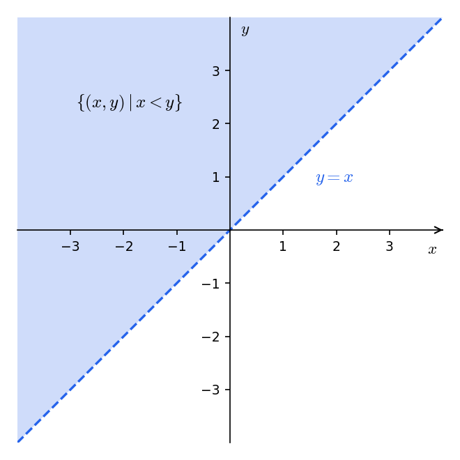

*그림 1. 직선 y = x보다 위쪽의 영역으로 나타낸 작다 관계 L의 그래프*

**예제 8.1.2 (법 2에 대한 합동 관계).** 정수 전체의 집합 $\mathbf{Z}$에서 $\mathbf{Z}$로의 관계 $E$를 모든 $(m, n) \in \mathbf{Z} \times \mathbf{Z}$에 대해 $m - n$이 짝수일 때 $`m \, E \, n`$으로 정의한다. $m - n$이 짝수라는 것은 $2 \mid (m - n)$과 같으므로 다음과 같이 쓸 수 있다.

```math
m \, E \, n \iff 2 \mid (m - n)
```

먼저 몇 개의 쌍이 관계되는지 판정한다.

- $`4 \, E \, 0`$이다. $4 - 0 = 4$이고 4는 짝수이다.
- $`2 \, E \, 6`$이다. $2 - 6 = -4$이고 $-4$는 짝수이다.
- $`3 \, E \, (-3)`$이다. $3 - (-3) = 6$이고 6은 짝수이다.
- $5$는 $2$와 $E$로 관계되지 않는다. $5 - 2 = 3$이고 3은 짝수가 아니다.

다음으로 1과 관계되는 정수를 찾는다. $1 - 1 = 0$, $3 - 1 = 2$, $5 - 1 = 4$, $-1 - 1 = -2$, $-3 - 1 = -4$가 모두 짝수이므로 $1, 3, 5, -1, -3$은 모두 $E$에 의해 1과 관계된다. 이런 정수는 이 밖에도 무수히 많으며, 다음 명제가 그 이유를 설명한다.

**명제.** $n$이 홀수이면 $`n \, E \, 1`$이다.

**증명:** $n$을 임의의 홀수라고 가정한다. 홀수의 정의에 따라 어떤 정수 $k$에 대해 $n = 2k + 1$이다. $E$의 정의에 따라 $`n \, E \, 1`$은 $n - 1$이 짝수라는 뜻이다. 대입하면 $n - 1 = (2k + 1) - 1 = 2k$이고, $k$가 정수이므로 $2k$는 짝수이다. 따라서 $`n \, E \, 1`$이다.

일반적으로 두 정수 $m$, $n$이 $E$로 관계될 필요충분조건은 $m \bmod 2 = n \bmod 2$, 즉 두 수가 모두 짝수이거나 모두 홀수인 것이다. 이때 $m$과 $n$은 **법 2에 대해 합동(congruent modulo 2)** 이라고 한다. 일반적인 법 $d$에 대한 합동은 3.5절에서 정의한다.

**예제 8.1.3 (멱집합 위의 관계).** $X = \lbrace a, b, c \rbrace$이면 멱집합은 다음과 같다.

```math
\mathcal{P}(X) = \lbrace \emptyset, \lbrace a \rbrace, \lbrace b \rbrace, \lbrace c \rbrace, \lbrace a, b \rbrace, \lbrace a, c \rbrace, \lbrace b, c \rbrace, \lbrace a, b, c \rbrace \rbrace
```

집합 $A$의 원소의 개수를 $N(A)$로 쓰고, $\mathcal{P}(X)$에서 $\mathcal{P}(X)$로의 관계 $\mathbf{S}$를 모든 $A, B \in \mathcal{P}(X)$에 대해 $`A \, \mathbf{S} \, B \iff N(A) \ge N(B)`$로 정의한다. 즉, $A$의 원소가 $B$의 원소보다 적지 않을 때 $A$는 $B$와 관계된다.

- $`\lbrace a, b \rbrace \, \mathbf{S} \, \lbrace b, c \rbrace`$이다. 두 집합 모두 원소가 2개이고 $2 \ge 2$이다.
- $`\lbrace a \rbrace \, \mathbf{S} \, \emptyset`$이다. 원소의 개수가 각각 1과 0이고 $1 \ge 0$이다.
- $\lbrace b, c \rbrace$는 $\lbrace a, b, c \rbrace$와 $\mathbf{S}$로 관계되지 않는다. 원소의 개수가 각각 2와 3이고 $2 \ge 3$은 거짓이다.
- $`\lbrace c \rbrace \, \mathbf{S} \, \lbrace a \rbrace`$이다. 두 집합 모두 원소가 1개이다.

> **참고:** 관계는 집합이므로 집합 연산을 그대로 적용할 수 있다. $R$과 $S$가 모두 $A$에서 $B$로의 관계이면, $R$ 또는 $S$에 속하는 순서쌍 전체인 $R \cup S$와 두 관계 모두에 속하는 순서쌍 전체인 $R \cap S$도 $A$에서 $B$로의 관계이다. 예를 들어 $\mathbf{R}$ 위의 작다 관계 $<$와 같다 관계 $=$의 합집합은 작거나 같다 관계 $\le$이고, 두 관계의 교집합은 공집합이다.

### 1.2 역관계

$R$이 $A$에서 $B$로의 관계일 때, $R$에 속한 모든 순서쌍의 두 성분을 맞바꾸면 $B$에서 $A$로의 관계를 얻는다.

> **용어 정의:** $R$을 $A$에서 $B$로의 관계라 한다. $R$의 **역관계(inverse relation)** $R^{-1}$은 $B$에서 $A$로의 관계로서 $R^{-1} = \lbrace (y, x) \in B \times A \mid (x, y) \in R \rbrace$이다.

이를 원소 단위로 쓰면, 모든 $x \in A$, $y \in B$에 대해 $(y, x) \in R^{-1} \iff (x, y) \in R$이다.

**예제 8.1.4 (유한 관계의 역관계).** $A = \lbrace 2, 3, 4 \rbrace$, $B = \lbrace 2, 6, 8 \rbrace$이고, $R$은 $A$에서 $B$로의 나누어떨어짐 관계, 즉 모든 $(x, y) \in A \times B$에 대해 $`x \, R \, y \iff x \mid y`$이다.

$A \times B$의 아홉 순서쌍을 하나씩 검사한다. 2는 2, 6, 8을 모두 나누고, 3은 6만 나누며($3 \nmid 2$, $`3 \nmid 8`$), 4는 8만 나눈다($4 \nmid 2$, $`4 \nmid 6`$). 따라서 다음을 얻는다.

```math
R = \lbrace (2, 2), (2, 6), (2, 8), (3, 6), (4, 8) \rbrace, \qquad R^{-1} = \lbrace (2, 2), (6, 2), (8, 2), (6, 3), (8, 4) \rbrace
```

$R$의 화살표 도표(그림 2)에서 화살표의 방향을 모두 뒤집으면 $R^{-1}$의 화살표 도표를 얻는다. 그림 3은 $B$를 왼쪽에 두고 다시 그린 $R^{-1}$의 화살표 도표이다.

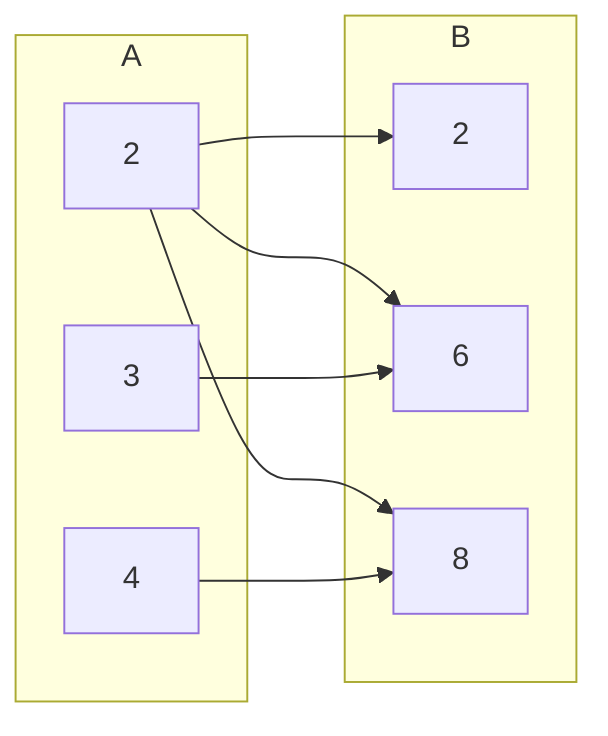

*그림 2. A에서 B로의 나누어떨어짐 관계 R의 화살표 도표*

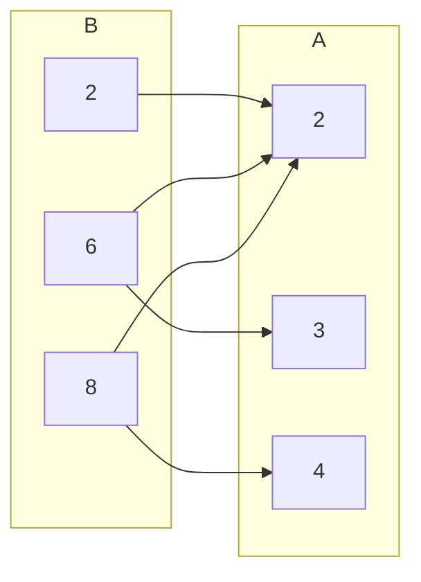

*그림 3. B를 왼쪽에 두고 그린 역관계의 화살표 도표*

$x \mid y$는 $y$가 $x$의 배수라는 것과 같은 뜻이므로, $R^{-1}$을 말로 설명하면 모든 $(y, x) \in B \times A$에 대해 $`y \, R^{-1} \, x`$일 필요충분조건은 $y$가 $x$의 배수인 것이다.

**예제 8.1.5 (무한 관계의 역관계).** $\mathbf{R}$에서 $\mathbf{R}$로의 관계 $R$을 모든 $(x, y) \in \mathbf{R} \times \mathbf{R}$에 대해 $`x \, R \, y \iff y = 2\lvert x \rvert`$로 정의한다. $R$과 $R^{-1}$의 그래프를 그리고, $R^{-1}$이 함수인지 판정한다.

$x \ge 0$이면 $y = 2\lvert x \rvert = 2x$이므로 그래프는 기울기가 2인 반직선이고, $x < 0$이면 $y = 2(-x) = -2x$이므로 기울기가 $-2$인 반직선이다. 점 $(v, u)$가 $R^{-1}$의 그래프에 있을 필요충분조건은 $(u, v)$가 $R$의 그래프에 있는 것이므로, $R^{-1}$의 그래프는 $R$의 그래프를 직선 $y = x$에 대해 대칭 이동한 것이다. 표 1은 몇 개의 값을 계산한 것이다.

| $x$ | $y = 2\lvert x \rvert$ | $R$에 속하는 순서쌍 $(x, y)$ | $R^{-1}$에 속하는 순서쌍 $(y, x)$ |
|:---:|:---:|:---:|:---:|
| $0$ | $0$ | $(0, 0)$ | $(0, 0)$ |
| $1$ | $2$ | $(1, 2)$ | $(2, 1)$ |
| $-1$ | $2$ | $(-1, 2)$ | $(2, -1)$ |
| $2$ | $4$ | $(2, 4)$ | $(4, 2)$ |
| $-2$ | $4$ | $(-2, 4)$ | $(4, -2)$ |

*표 1. 관계 R과 그 역관계에 속하는 몇 가지 순서쌍*

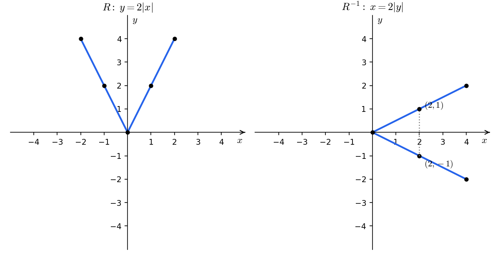

*그림 4. 관계 R의 그래프와 이를 직선 y = x에 대해 대칭 이동한 역관계의 그래프*

$R^{-1}$은 함수가 아니다. 예를 들어 $(2, 1)$과 $(2, -1)$이 모두 $R^{-1}$에 속하므로 입력 2에 대응하는 출력이 두 개이다. 그래프로 보면 직선 $x = 2$가 $R^{-1}$의 그래프와 두 점에서 만난다. 또 $2\lvert x \rvert = -3$을 만족하는 실수 $x$가 없으므로 입력 $-3$에는 대응하는 출력이 하나도 없다. 반면 $R$ 자체는 각 $x$에 $y = 2\lvert x \rvert$ 하나를 대응시키므로 $\mathbf{R}$에서 $\mathbf{R}$로의 함수이다. 7장에서 본 것처럼 함수의 역관계가 다시 함수가 되려면 그 함수가 일대일 대응이어야 하는데, $R$은 1과 $-1$을 모두 2에 대응시키므로 일대일 함수가 아니고 음수를 값으로 갖지 않으므로 위로의 함수도 아니다.

### 1.3 관계의 방향 그래프

이 장의 나머지 부분은 한 집합에서 그 집합 자신으로의 관계를 다룬다.

> **용어 정의:** 집합 $A$에서 $A$ 자신으로의 관계를 **$A$ 위의 관계(relation on $`A`$)** 라고 한다.

> **주의:** 관계와 그 관계가 정의된 집합을 구분해야 한다. 예를 들어 $A = \lbrace 3, 4, 5 \rbrace$ 위의 관계 $R$은 $A \times A$의 부분집합이며, $A$ 자체가 아니다.

$R$이 $A$ 위의 관계이면 화살표 도표를 **방향 그래프(directed graph)** 로 바꿀 수 있다. $A$를 두 번 그리는 대신 $A$의 각 원소를 꼭짓점으로 한 번만 그리고, 관계된 원소 쌍마다 화살표를 긋는다. 즉, 모든 $x, y \in A$에 대해 $x$에서 $y$로 가는 화살표가 있을 필요충분조건은 $`x \, R \, y`$, 곧 $(x, y) \in R$이다. 원소가 자기 자신과 관계되면($`x \, R \, x`$) 그 꼭짓점에서 나갔다가 다시 돌아오는 **루프(loop)** 를 그린다.

**예제 8.1.6 (관계의 방향 그래프).** $A = \lbrace 3, 4, 5, 6, 7, 8 \rbrace$ 위의 관계 $R$을 모든 $x, y \in A$에 대해 $`x \, R \, y \iff 2 \mid (x - y)`$로 정의하고, $R$의 방향 그래프를 그린다.

- $`3 \, R \, 3`$이다. $3 - 3 = 0 = 2 \cdot 0$이므로 $2 \mid 0$이다. 같은 이유로 어떤 정수와 그 자신의 차는 0이므로 모든 꼭짓점에 루프가 있다.
- $`3 \, R \, 5`$이고 $`5 \, R \, 3`$이다. $3 - 5 = -2 = 2 \cdot (-1)$, $5 - 3 = 2 = 2 \cdot 1$이므로 3에서 5로, 5에서 3으로 가는 화살표가 모두 있다.
- 3과 4는 어느 방향으로도 관계되지 않는다. $3 - 4 = -1$과 $4 - 3 = 1$은 모두 2의 배수가 아니다.

일반적으로 $x - y$가 짝수일 필요충분조건은 $x$와 $y$가 모두 홀수이거나 모두 짝수인 것이다. 따라서 홀수 3, 5, 7끼리와 짝수 4, 6, 8끼리는 모두 서로 관계되고, 홀수와 짝수 사이에는 화살표가 없다. $R$은 $3 \times 3 + 3 \times 3 = 18$개의 순서쌍으로 이루어진다. 그림 5에서 양쪽에 화살촉이 있는 선은 두 방향의 화살표를 한 번에 나타낸다.

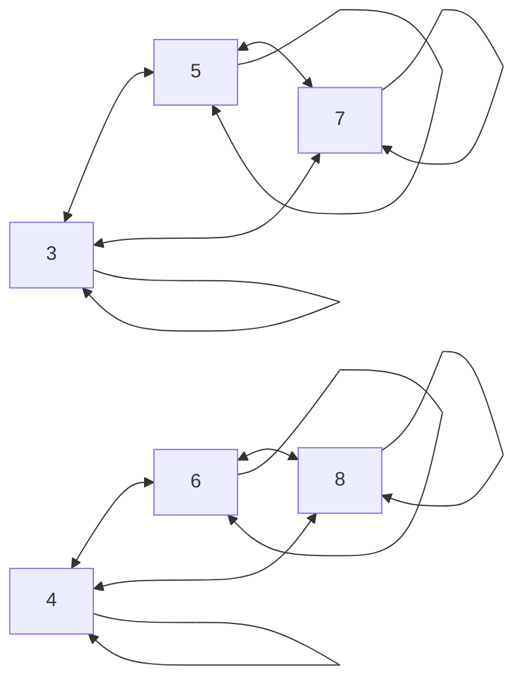

*그림 5. 차가 짝수인 원소끼리 관계되는 관계의 방향 그래프*

### 1.4 n항 관계와 관계형 데이터베이스

이항 관계가 두 집합의 데카르트 곱의 부분집합이듯, $n$항 관계는 $n$개 집합의 데카르트 곱의 부분집합이다. $n$항 관계는 **관계형 데이터베이스(relational database)** 이론의 수학적 기초이다.

> **용어 정의:** 집합 $A_1, A_2, \ldots, A_n$이 주어졌을 때, $A_1 \times A_2 \times \cdots \times A_n$의 부분집합을 $A_1 \times A_2 \times \cdots \times A_n$ 위의 **$n$항 관계(n-ary relation)** 라고 한다. $n = 2, 3, 4$인 경우를 각각 **이항 관계(binary relation)**, **삼항 관계(ternary relation)**, **사항 관계(quaternary relation)** 라고 한다.

**예제 8.1.7 (간단한 데이터베이스).** 병원에서 쓸 수 있는 데이터베이스를 크게 단순화한 예이다. $A_1$은 양의 정수의 집합, $A_2$는 알파벳 문자열의 집합, $A_3$은 숫자 문자열의 집합, $A_4$는 알파벳 문자열의 집합이다. $A_1 \times A_2 \times A_3 \times A_4$ 위의 사항 관계 $R$을 다음과 같이 정의한다. $(a_1, a_2, a_3, a_4) \in R$일 필요충분조건은 환자 번호가 $a_1$이고 이름이 $a_2$인 환자가 날짜 $a_3$에 입원하였고 주 진단명이 $a_4$라는 것이다.

어떤 병원에서 이 관계가 다음 일곱 개의 4-튜플을 포함한다고 가정한다. 날짜는 월, 일, 연도를 두 자리씩 이어 쓴 문자열이다(예: `020719`는 2019년 2월 7일).

| 환자 번호 $a_1$ | 이름 $a_2$ | 입원 날짜 $a_3$ | 주 진단명 $a_4$ |
|:---|:---|:---|:---|
| 011985 | John Schmidt | 020719 | asthma |
| 574329 | Tak Kurosawa | 011419 | pneumonia |
| 466581 | Mary Lazars | 010319 | appendicitis |
| 008352 | Joan Kaplan | 112419 | gastritis |
| 011985 | John Schmidt | 021719 | pneumonia |
| 244388 | Sarah Wu | 010319 | broken leg |
| 778400 | Jamal Baskers | 122719 | appendicitis |

*표 2. 병원 데이터베이스를 이루는 사항 관계의 4-튜플*

관계형 데이터베이스에서는 $n$-튜플을 표로 나타내는 것이 보통이다. 표의 각 행이 하나의 $n$-튜플이고, 각 열의 머리글은 그 열에 있는 원소의 속성(attribute)을 나타낸다. 데이터베이스는 데이터를 여러 방식으로 다룰 수 있게 해 준다. 예를 들어 데이터베이스 언어 SQL에서 이 데이터베이스의 이름을 `S`라 할 때, 다음 질의는 입원 날짜가 010319인 모든 환자의 번호와 이름을 돌려준다.

```sql
SELECT Patient_ID#, Name FROM S WHERE Admission_Date = 010319
```

```text
466581  Mary Lazars
244388  Sarah Wu
```

이 결과는 집합 $A_1 \times A_2 \times \lbrace 010319 \rbrace \times A_4$와 데이터베이스의 교집합을 구한 뒤, 각 4-튜플 $(a_1, a_2, a_3, a_4)$를 처음 두 좌표 $(a_1, a_2)$로 보내는 **사영(projection)** 을 적용한 것이다. 교집합은 입원 날짜가 010319인 4-튜플만 남기고, 사영은 그중 번호와 이름만 남긴다. 같은 방식으로 SELECT를 이용하면 특정 환자의 입원 날짜를 모두 얻을 수 있으며, 예를 들어 John Schmidt의 입원 날짜는 02-07-19와 02-17-19이다.

데이터베이스에서는 항목을 추가, 삭제, 갱신할 수 있고, 항목을 여러 기준으로 정렬할 수 있다. 또 두 데이터베이스를 병합하거나 두 데이터베이스에 공통인 항목을 새 데이터베이스로 옮길 수도 있다. 같은 속성을 가진 두 관계를 집합으로 보면 병합은 합집합, 공통 항목의 추출은 교집합에 해당한다.

> **[데이터베이스]** 관계형 데이터베이스는 데이터를 테이블의 모음으로 저장한다. 테이블 하나가 수학의 $n$항 관계 하나에 해당하고, 행은 순서 $n$-튜플, 열은 속성에 해당한다. SQL의 `WHERE` 절은 조건을 만족하는 행만 고르는 선택 연산이고, `SELECT` 뒤에 열 이름을 나열하는 것은 원하는 열만 남기는 사영 연산이다.

---

<br>

## 2. 반사성, 대칭성, 추이성 (8.2절)

$A = \lbrace 2, 3, 4, 6, 7, 9 \rbrace$ 위의 관계 $R$을 모든 $x, y \in A$에 대해 $`x \, R \, y \iff 3 \mid (x - y)`$로 정의한다. 이 관계의 방향 그래프를 그리기 위해 각 쌍을 검사한다.

- 모든 원소는 자기 자신과 관계된다. 예를 들어 $2 - 2 = 0$이고 $3 \mid 0$이므로 $`2 \, R \, 2`$이며, $`3 \, R \, 3`$, $`4 \, R \, 4`$, $`6 \, R \, 6`$, $`7 \, R \, 7`$, $`9 \, R \, 9`$도 같은 이유로 성립한다.
- $6 - 3 = 3$이고 $3 \mid 3$이므로 $`6 \, R \, 3`$이다. 또 $3 - 6 = -(6 - 3) = -3$이고 $3 \mid (-3)$이므로 $`3 \, R \, 6`$이다. 같은 방식으로 $`3 \, R \, 9`$, $`9 \, R \, 3`$, $`6 \, R \, 9`$, $`9 \, R \, 6`$, $`4 \, R \, 7`$, $`7 \, R \, 4`$이다.
- 그 밖의 서로 다른 두 원소의 차는 3의 배수가 아니므로 관계되지 않는다. 예를 들어 $2 - 4 = -2$, $4 - 6 = -2$이다.

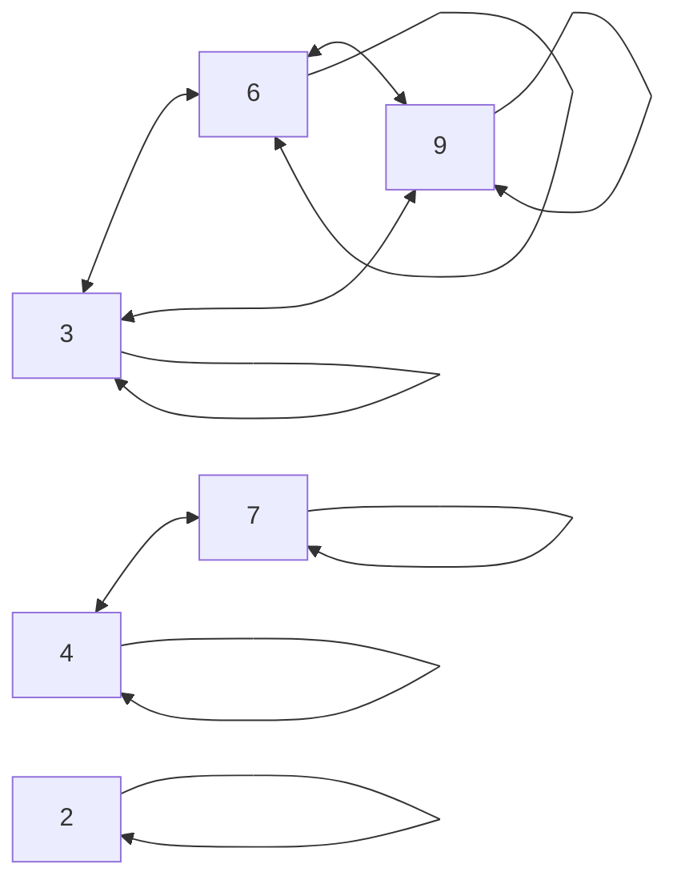

*그림 6. 차가 3의 배수인 원소끼리 관계되는 관계의 방향 그래프*

그림 6의 그래프에는 세 가지 중요한 성질이 있다.

1. 모든 점에 그 점에서 나갔다가 돌아오는 루프가 있다.
2. 한 점에서 다른 점으로 가는 화살표가 있으면, 그 다른 점에서 처음 점으로 돌아오는 화살표도 있다.
3. 한 점에서 두 번째 점으로, 두 번째 점에서 세 번째 점으로 가는 화살표가 있으면, 첫 번째 점에서 세 번째 점으로 가는 화살표도 있다. 즉, 그래프에 완성되지 않은 방향 삼각형이 없다.

이 세 성질이 일반적인 관계의 반사성, 대칭성, 추이성에 해당한다.

### 2.1 세 성질의 정의

> **용어 정의:** **관계의 세 성질(three properties of relations).** $R$을 집합 $A$ 위의 관계라 한다.
> 1. $R$이 **반사적(reflexive)** 이라는 것은 모든 $x \in A$에 대해 $`x \, R \, x`$라는 뜻이다.
> 2. $R$이 **대칭적(symmetric)** 이라는 것은 모든 $x, y \in A$에 대해 $`x \, R \, y`$이면 $`y \, R \, x`$라는 뜻이다.
> 3. $R$이 **추이적(transitive)** 이라는 것은 모든 $x, y, z \in A$에 대해 $`x \, R \, y`$이고 $`y \, R \, z`$이면 $`x \, R \, z`$라는 뜻이다.

$`x \, R \, y`$와 $(x, y) \in R$은 같은 뜻이므로 세 성질을 순서쌍으로 다음과 같이 쓸 수도 있다.

- 반사성: $`\forall x \in A, \ (x, x) \in R`$
- 대칭성: $`\forall x, y \in A, \ (x, y) \in R \Rightarrow (y, x) \in R`$
- 추이성: $`\forall x, y, z \in A, \ \big( (x, y) \in R \wedge (y, z) \in R \big) \Rightarrow (x, z) \in R`$

비형식적으로 말하면, 반사성은 각 원소가 자기 자신과 관계된다는 것이다. 대칭성은 어떤 원소가 다른 원소와 관계되면 그 다른 원소도 처음 원소와 관계된다는 것이다. 추이성은 첫째 원소가 둘째 원소와, 둘째 원소가 셋째 원소와 관계되면 첫째 원소가 셋째 원소와 관계된다는 것이다.

> **주의:** 대칭성의 정의는 $x$가 $y$와 관계된다고 주장하지 않는다. $x$가 $y$와 관계되는 경우가 생기면 $y$도 $x$와 관계되어야 한다는 조건일 뿐이다. 또 비형식적 설명의 첫째, 둘째, 셋째 원소는 서로 다를 필요가 없다. 예를 들어 추이성은 $x = z$인 경우, 즉 $`x \, R \, y`$이고 $`y \, R \, x`$이면 $`x \, R \, x`$라는 조건도 포함한다. 비형식적 설명은 이런 미묘한 점을 가릴 수 있으므로 판정할 때는 형식적 정의를 기준으로 삼는다.

세 정의는 모두 전칭 명제이다. 따라서 관계가 어떤 성질을 가짐을 증명하려면 유한한 경우에는 모든 경우를 하나씩 확인하는 전수 조사법(method of exhaustion)을, 일반적으로는 4장의 일반적 특수 사례로부터의 일반화를 쓴다.

### 2.2 성질의 부정과 반례

3장에서 본 것처럼 전칭 명제의 부정은 존재 명제이다. 따라서 $R$이 집합 $A$ 위의 관계일 때 다음이 성립한다.

1. $R$이 반사적이지 않다 $\iff$ $(x, x) \notin R$인 원소 $x \in A$가 존재한다.
2. $R$이 대칭적이지 않다 $\iff$ $(x, y) \in R$이지만 $(y, x) \notin R$인 원소 $x, y \in A$가 존재한다.
3. $R$이 추이적이지 않다 $\iff$ $(x, y) \in R$이고 $(y, z) \in R$이지만 $(x, z) \notin R$인 원소 $x, y, z \in A$가 존재한다.

그러므로 관계가 어떤 성질을 갖지 않음을 보이려면 그런 원소를 하나 찾아 반례로 제시하면 된다.

> **주의:** 반사적이지 않다는 것은 어떤 원소도 자기 자신과 관계되지 않는다는 뜻이 아니다. 자기 자신과 관계되지 않는 원소가 하나라도 있으면 반사적이지 않다. 마찬가지로 대칭적이지 않다는 것은 서로 반대 방향인 화살표 쌍이 하나도 없다는 뜻이 아니라, 반대 방향 화살표가 빠진 화살표가 적어도 하나 있다는 뜻이다.

### 2.3 유한 집합 위의 관계

**예제 8.2.1 (유한 집합 위의 관계의 성질).** $A = \lbrace 0, 1, 2, 3 \rbrace$ 위의 관계 $R$, $S$, $T$를 다음과 같이 정의한다. 각 관계가 반사적, 대칭적, 추이적인지 판정한다.

```math
\begin{aligned}
R &= \lbrace (0, 0), (0, 1), (0, 3), (1, 0), (1, 1), (2, 2), (3, 0), (3, 3) \rbrace \\
S &= \lbrace (0, 0), (0, 2), (0, 3), (2, 3) \rbrace \\
T &= \lbrace (0, 1), (2, 3) \rbrace
\end{aligned}
```

**관계 R.** $R$의 방향 그래프는 그림 7과 같다.

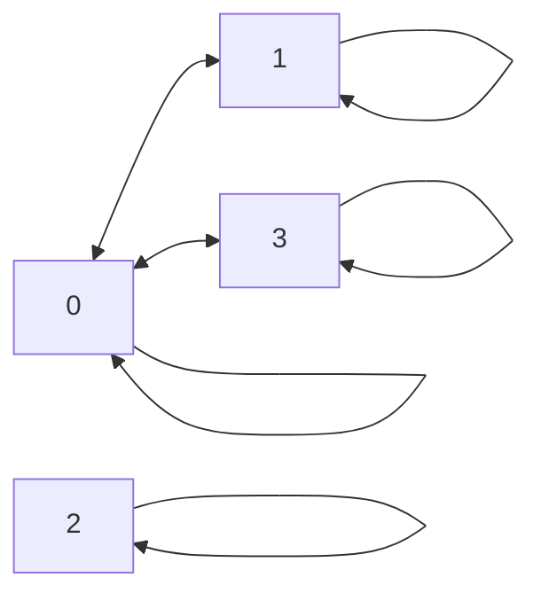

*그림 7. 예제 8.2.1의 관계 R의 방향 그래프*

- $R$은 반사적이다. $(0, 0)$, $(1, 1)$, $(2, 2)$, $(3, 3)$이 모두 $R$에 속하여 모든 꼭짓점에 루프가 있다.
- $R$은 대칭적이다. 루프가 아닌 순서쌍은 $(0, 1)$과 $(1, 0)$, $(0, 3)$과 $(3, 0)$처럼 모두 반대 방향의 짝이 함께 있다. 루프 $(x, x)$는 성분을 맞바꾸어도 자기 자신이므로 대칭성의 조건을 저절로 만족한다.
- $R$은 추이적이지 않다. $`1 \, R \, 0`$이고 $`0 \, R \, 3`$이지만 $(1, 3) \notin R$이다. 그래프에서는 1에서 0으로, 0에서 3으로 가는 화살표가 있지만 1에서 3으로 가는 화살표가 없다.

유한 집합 위의 관계는 행렬로도 나타낼 수 있다. $A$의 원소를 행과 열에 같은 순서로 놓고, $(x, y) \in R$이면 $x$행 $y$열에 1을, 그렇지 않으면 0을 적는다. 이 행렬은 10장에서 다루는 방향 그래프의 인접 행렬과 같다. 표 3은 $R$의 행렬이다.

| $x \backslash y$ | 0 | 1 | 2 | 3 |
|:---:|:---:|:---:|:---:|:---:|
| **0** | 1 | 1 | 0 | 1 |
| **1** | 1 | 1 | 0 | 0 |
| **2** | 0 | 0 | 1 | 0 |
| **3** | 1 | 0 | 0 | 1 |

*표 3. 예제 8.2.1의 관계 R을 나타내는 행렬*

행렬에서 반사성은 주대각선의 성분이 모두 1인 것과 같고, 대칭성은 행렬이 주대각선에 대해 대칭인 것, 즉 모든 $x$, $y$에 대해 $x$행 $y$열의 성분과 $y$행 $x$열의 성분이 같은 것과 같다. 표 3의 행렬은 두 조건을 모두 만족한다. 반면 추이성은 행렬에서 한눈에 드러나지 않으며, 세 원소의 조합을 확인해야 한다. 표 3에서 1행 0열과 0행 3열은 1이지만 1행 3열은 0이라는 사실이 추이성의 반례에 해당한다.

**관계 S.** $S$의 방향 그래프는 그림 8과 같다.

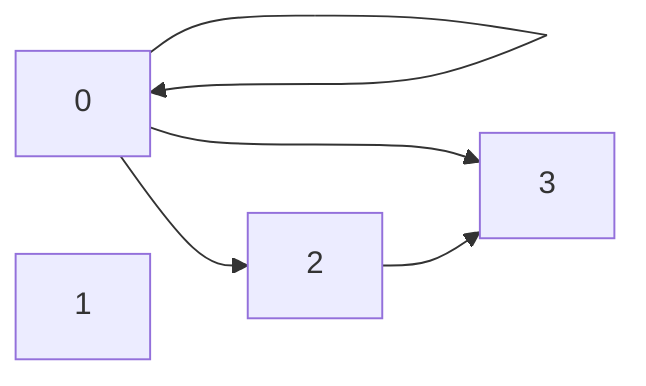

*그림 8. 예제 8.2.1의 관계 S의 방향 그래프*

- $S$는 반사적이지 않다. 예를 들어 $(1, 1) \notin S$이므로 1에 루프가 없다.
- $S$는 대칭적이지 않다. $(0, 2) \in S$이지만 $(2, 0) \notin S$이다.
- $S$는 추이적이다. 추이성의 가정 $(x, y) \in S$, $(y, z) \in S$가 성립하려면 앞 순서쌍의 둘째 성분과 뒤 순서쌍의 첫째 성분이 같아야 한다. 이렇게 이어지는 순서쌍의 조합을 모두 나열하면 표 4와 같고, 각 경우에 필요한 순서쌍 $(x, z)$가 모두 $S$에 있다.

| $(x, y) \in S$ | $(y, z) \in S$ | 필요한 $(x, z)$ | $(x, z) \in S$? |
|:---:|:---:|:---:|:---:|
| $(0, 0)$ | $(0, 0)$ | $(0, 0)$ | 예 |
| $(0, 0)$ | $(0, 2)$ | $(0, 2)$ | 예 |
| $(0, 0)$ | $(0, 3)$ | $(0, 3)$ | 예 |
| $(0, 2)$ | $(2, 3)$ | $(0, 3)$ | 예 |

*표 4. 관계 S에서 이어지는 순서쌍의 모든 조합과 추이성 검사*

$(0, 3)$과 $(2, 3)$ 뒤에는 3으로 시작하는 순서쌍이 없으므로 더 이어지지 않는다. 표의 처음 세 행처럼 첫째, 둘째, 셋째 원소가 서로 같을 수 있다는 점에 주의한다.

**관계 T.** $T$의 방향 그래프는 그림 9와 같다.

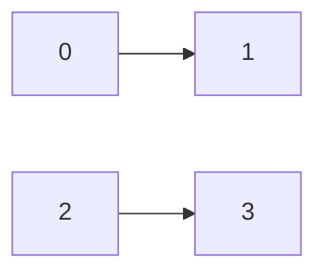

*그림 9. 예제 8.2.1의 관계 T의 방향 그래프*

- $T$는 반사적이지 않다. 예를 들어 $(0, 0) \notin T$이다.
- $T$는 대칭적이지 않다. $(0, 1) \in T$이지만 $(1, 0) \notin T$이다.
- $T$는 추이적이다. 추이성이 거짓이 되려면 $(x, y) \in T$, $(y, z) \in T$, $(x, z) \notin T$인 원소가 있어야 하고, 그러려면 한 순서쌍의 둘째 성분이 다른 순서쌍의 첫째 성분과 같아 두 순서쌍이 이어져야 한다. 그런데 $T$의 두 순서쌍 $(0, 1)$, $(2, 3)$에서 $1 \ne 2$이고 $3 \ne 0$이므로 어떤 두 순서쌍도 이어지지 않는다. 따라서 추이성의 가정이 참이 되는 경우가 없고, 추이성의 조건은 공허하게 참이다.

> **주의:** $T$는 추이적이지 않을 수 없기 때문에 추이적이다. 조건 명제는 가정이 거짓이면 참이므로(2장), 이어지는 순서쌍이 하나도 없는 관계는 항상 추이적이다. 같은 이유로 공집합 관계는 어떤 집합 위에서도 대칭적이고 추이적이다.

유한 집합 $A$ 위의 관계가 세 성질을 가지는지는 컴퓨터 알고리즘으로 검사할 수 있다. $A$의 원소를 배열에 넣고, 반사성은 각 원소 $a$에 대해 $(a, a) \in R$인지를 반복문 하나로, 대칭성은 모든 쌍 $(a, b)$를 이중 반복문으로, 추이성은 모든 세 원소 $(a, b, c)$를 삼중 반복문으로 검사한다. 반례가 하나라도 나오면 그 성질은 성립하지 않는다. 다음은 이 방법을 파이썬으로 옮긴 것이다.

```python
def is_reflexive(A, R):
    for a in A:
        if (a, a) not in R:
            return False
    return True


def is_symmetric(A, R):
    for a in A:
        for b in A:
            if (a, b) in R and (b, a) not in R:
                return False
    return True


def is_transitive(A, R):
    for a in A:
        for b in A:
            for c in A:
                if (a, b) in R and (b, c) in R and (a, c) not in R:
                    return False
    return True


A = [0, 1, 2, 3]
R = {(0, 0), (0, 1), (0, 3), (1, 0), (1, 1), (2, 2), (3, 0), (3, 3)}
S = {(0, 0), (0, 2), (0, 3), (2, 3)}
T = {(0, 1), (2, 3)}
for name, rel in [("R", R), ("S", S), ("T", T)]:
    print(name, is_reflexive(A, rel), is_symmetric(A, rel), is_transitive(A, rel))
```

- `is_reflexive`는 $A$의 원소 `a`를 차례로 보며 순서쌍 `(a, a)`가 `R`에 없으면 즉시 `False`를 돌려준다. 반례를 하나 찾으면 반사적이지 않기 때문이다. 반복이 끝까지 진행되면 반례가 없으므로 `True`를 돌려준다.
- `is_symmetric`은 이중 반복문으로 모든 쌍 `(a, b)`를 검사하여 `(a, b)`는 `R`에 있는데 `(b, a)`가 없는 반례를 찾는다.
- `is_transitive`는 삼중 반복문으로 모든 `(a, b, c)`를 검사하여 `(a, b)`와 `(b, c)`는 `R`에 있는데 `(a, c)`가 없는 반례를 찾는다.
- 관계는 순서쌍(튜플)의 집합(`set`)으로 저장하므로 `in` 연산으로 순서쌍이 관계에 속하는지 검사할 수 있다. 마지막 반복문은 세 관계에 세 함수를 적용하여 이름과 결과를 출력한다.

```text
R True True False
S False False True
T False False True
```

출력은 앞의 판정과 일치한다. $A$의 원소가 $n$개이면 세 함수는 각각 최대 $n$, $n^2$, $n^3$개의 경우를 검사한다.

### 2.4 무한 집합 위의 관계

무한 집합 위의 관계는 모든 경우를 확인할 수 없으므로 다음 순서로 증명한다. 먼저 증명할 명제를 정의대로 쓴다. 예를 들어 대칭성을 증명하려면 $`\forall x, y \in A, \ x \, R \, y \Rightarrow y \, R \, x`$를 증명해야 한다. 다음으로 $A$와 $R$의 정의를 이용하여 이 명제를 구체적인 형태로 바꾸어 쓴다. 바꾸어 쓴 명제가 바로 참임을 알 수 있는 경우도 있고, 일반적 특수 사례로부터의 일반화로 증명해야 하는 경우도 있다.

**예제 8.2.2 (같다 관계의 성질).** $\mathbf{R}$ 위의 관계 $R$을 모든 실수 $x$, $y$에 대해 $`x \, R \, y \iff x = y`$로 정의한다.

- $R$은 반사적이다. 반사성은 $`\forall x \in \mathbf{R}, \ x \, R \, x`$이고, $R$의 정의에 따라 이는 $`\forall x \in \mathbf{R}, \ x = x`$와 같다. 모든 실수는 자기 자신과 같으므로 이 명제는 참이다.
- $R$은 대칭적이다. 대칭성은 $`\forall x, y \in \mathbf{R}, \ x = y \Rightarrow y = x`$와 같고, 한 수가 다른 수와 같으면 그 다른 수도 처음 수와 같으므로 참이다.
- $R$은 추이적이다. 추이성은 $`\forall x, y, z \in \mathbf{R}, \ (x = y \wedge y = z) \Rightarrow x = z`$와 같고, 첫째 수가 둘째 수와 같고 둘째 수가 셋째 수와 같으면 첫째 수가 셋째 수와 같으므로 참이다.

**예제 8.2.3 (작다 관계의 성질).** $\mathbf{R}$ 위의 관계 $R$을 모든 실수 $x$, $y$에 대해 $`x \, R \, y \iff x < y`$로 정의한다.

- $R$은 반사적이지 않다. 반사성은 $`\forall x \in \mathbf{R}, \ x < x`$를 뜻하는데, 이는 거짓이다. 반례로 $x = 0$이면 $0 < 0$이 성립하지 않는다.
- $R$은 대칭적이지 않다. 대칭성은 $`\forall x, y \in \mathbf{R}, \ x < y \Rightarrow y < x`$를 뜻하는데, 반례로 $x = 0$, $y = 1$이면 $0 < 1$이지만 $1 < 0$은 거짓이다.
- $R$은 추이적이다. 추이성은 $`\forall x, y, z \in \mathbf{R}, \ (x < y \wedge y < z) \Rightarrow x < z`$를 뜻하며, 이는 실수의 순서에 관한 추이 법칙(transitive law of order)으로 참이다.

어떤 성질은 정의역의 모든 원소에서 거짓이다. 이런 경우에는 반례 하나를 드는 대신 성질이 모든 원소에서 거짓임을 보이는 편이 자연스러울 수 있다. 예를 들어 실수의 삼분 법칙(trichotomy law), 즉 임의의 실수 $x$, $y$에 대해 $x < y$, $x = y$, $x > y$ 중 정확히 하나가 성립한다는 사실에 따라, 모든 실수 $x$에 대해 $x < x$는 거짓이고 $x < y$인 모든 $x$, $y$에 대해 $y < x$는 거짓이다.

**예제 8.2.4 (법 3에 대한 합동의 성질).** $\mathbf{Z}$ 위의 관계 $T$를 모든 정수 $m$, $n$에 대해 다음과 같이 정의한다. 이 관계를 **법 3에 대한 합동(congruence modulo 3)** 이라고 한다.

```math
m \, T \, n \iff 3 \mid (m - n)
```

**반사성.** 보여야 할 명제는 $`\forall m \in \mathbf{Z}, \ m \, T \, m`$, 즉 $`\forall m \in \mathbf{Z}, \ 3 \mid (m - m)`$이다. $m - m = 0 = 3 \cdot 0$이므로 $3 \mid 0$이고, 이 명제는 참이다.

**반사성의 증명:** $m$을 임의로 택한 특정한 정수라고 가정한다. [$`m \, T \, m`$을 보여야 한다.] $m - m = 0$이고 $0 = 3 \cdot 0$이므로 $3 \mid 0$이다. 따라서 $3 \mid (m - m)$이고, $T$의 정의에 따라 $`m \, T \, m`$이다.

**대칭성.** 보여야 할 명제는 모든 정수 $m$, $n$에 대해 $3 \mid (m - n)$이면 $3 \mid (n - m)$이라는 것이다. 다시 말해 $n - m$을 3과 어떤 정수의 곱으로 나타내야 한다. 나누어떨어짐의 정의에 따라 $3 \mid (m - n)$이면 어떤 정수 $k$에 대해 $m - n = 3k$이다. 핵심은 $n - m = -(m - n)$이라는 관찰이다. 양변에 $-1$을 곱하면 $-(m - n) = -3k$, 즉 $n - m = 3(-k)$를 얻고, $-k$가 정수이므로 $3 \mid (n - m)$이다.

**대칭성의 증명:** $m$, $n$을 $`m \, T \, n`$을 만족하는 임의의 특정한 정수라고 가정한다. [$`n \, T \, m`$을 보여야 한다.] $T$의 정의에 따라 $3 \mid (m - n)$이고, 나누어떨어짐의 정의에 따라 어떤 정수 $k$에 대해 $m - n = 3k$이다. 양변에 $-1$을 곱하면 $n - m = 3(-k)$이다. $-k$는 정수이므로 $3 \mid (n - m)$이고, $T$의 정의에 따라 $`n \, T \, m`$이다.

**추이성.** 보여야 할 명제는 모든 정수 $m$, $n$, $p$에 대해 $3 \mid (m - n)$이고 $3 \mid (n - p)$이면 $3 \mid (m - p)$라는 것이다. 가정에서 어떤 정수 $r$, $s$에 대해 $m - n = 3r$, $n - p = 3s$이다. 핵심은 $(m - n) + (n - p) = m - p$라는 관찰이다. 두 식을 더하면 $(m - n) + (n - p) = 3r + 3s$, 즉 $m - p = 3(r + s)$를 얻는다. $r + s$는 정수이므로 $3 \mid (m - p)$이다.

**추이성의 증명:** $m$, $n$, $p$를 $`m \, T \, n`$이고 $`n \, T \, p`$인 임의의 특정한 정수라고 가정한다. [$`m \, T \, p`$를 보여야 한다.] $T$의 정의에 따라 $3 \mid (m - n)$이고 $3 \mid (n - p)$이며, 나누어떨어짐의 정의에 따라 어떤 정수 $r$, $s$에 대해 $m - n = 3r$, $n - p = 3s$이다. 두 식을 더하면 $(m - n) + (n - p) = 3r + 3s$이고, 정리하면 $m - p = 3(r + s)$이다. $r + s$는 정수이므로 $3 \mid (m - p)$이고, $T$의 정의에 따라 $`m \, T \, p`$이다.

> **핵심:** 무한 집합 위의 관계에서 성질을 증명할 때는 정의를 전칭 조건 명제로 쓰고, 가정을 만족하는 임의의 원소를 택해 관계의 정의를 풀어 쓴 다음, 결론이 요구하는 형태(여기서는 3과 어떤 정수의 곱)를 만들어 낸다. 성질이 성립하지 않음을 보일 때는 구체적인 반례 하나를 제시한다.

### 2.5 추이적 폐포

관계가 추이적이지 않은 것은 대개 필요한 순서쌍이 빠져 있기 때문이다. 예를 들어 $(1, 3)$과 $(3, 4)$가 관계 $R$에 있으면, $R$이 추이적이려면 $(1, 4)$도 $R$에 있어야 한다. 따라서 추이적이지 않은 관계에서 추이적인 관계를 얻으려면 순서쌍을 추가해야 한다. 추이성을 보장하는 데 필요한 최소한의 순서쌍만 추가하여 얻은 관계, 더 정확히는 주어진 관계를 포함하는 가장 작은 추이적 관계를 그 관계의 추이적 폐포라고 한다.

> **용어 정의:** $A$를 집합, $R$을 $A$ 위의 관계라 한다. $R$의 **추이적 폐포(transitive closure)** 는 다음 세 성질을 만족하는 $A$ 위의 관계 $R^t$이다.
> 1. $R^t$는 추이적이다.
> 2. $R \subseteq R^t$이다.
> 3. $S$가 $R$을 포함하는 추이적 관계이면 $R^t \subseteq S$이다.

세 번째 조건 때문에 추이적 폐포는 하나뿐이다. 두 관계 $R_1^t$, $R_2^t$가 모두 세 조건을 만족하면 조건 3에 의해 $R_1^t \subseteq R_2^t$이고 $R_2^t \subseteq R_1^t$이므로 두 관계는 같다. 또 $R$이 이미 추이적이면 $R$ 자신이 세 조건을 만족하므로 $R^t = R$이다.

**예제 8.2.5 (관계의 추이적 폐포).** $A = \lbrace 0, 1, 2, 3 \rbrace$ 위의 관계 $R = \lbrace (0, 1), (1, 2), (2, 3) \rbrace$의 추이적 폐포를 구한다.

$R$의 모든 순서쌍은 $R^t$에 속하므로 $\lbrace (0, 1), (1, 2), (2, 3) \rbrace \subseteq R^t$이다. 따라서 $R^t$의 방향 그래프는 적어도 그림 10의 화살표를 포함한다.

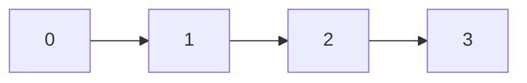

*그림 10. 예제 8.2.5의 관계 R의 방향 그래프*

- $(0, 1) \in R^t$이고 $(1, 2) \in R^t$이며 $R^t$는 추이적이므로 $(0, 2) \in R^t$이다.
- 이제 $(0, 2) \in R^t$이고 $(2, 3) \in R^t$이므로 $(0, 3) \in R^t$이다.
- $(1, 2) \in R^t$이고 $(2, 3) \in R^t$이므로 $(1, 3) \in R^t$이다.

따라서 $R^t$는 적어도 $\lbrace (0, 1), (0, 2), (0, 3), (1, 2), (1, 3), (2, 3) \rbrace$를 포함한다. 그런데 이 관계는 이미 추이적이다. 이어지는 순서쌍의 조합 $(0, 1)$과 $(1, 2)$, $(0, 1)$과 $(1, 3)$, $(0, 2)$와 $(2, 3)$, $(1, 2)$와 $(2, 3)$에서 필요한 $(0, 2)$, $(0, 3)$, $(0, 3)$, $(1, 3)$이 모두 들어 있다. 이 여섯 순서쌍은 $R$을 포함하는 모든 추이적 관계에 반드시 들어가야 하므로 이 관계가 가장 작으며, 따라서 이 관계가 $R^t$이다.

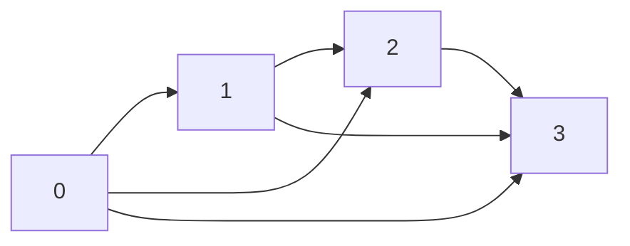

*그림 11. 예제 8.2.5의 관계 R의 추이적 폐포의 방향 그래프*

같은 과정을 컴퓨터로 수행할 수 있다. 다음 함수는 관계에 이어지는 두 순서쌍 $(a, b)$, $(b, d)$가 있는데 $(a, d)$가 없으면 $(a, d)$를 추가하는 일을 더 이상 추가할 순서쌍이 없을 때까지 반복한다.

```python
def transitive_closure(R):
    closure = set(R)
    while True:
        new_pairs = {(a, d) for (a, b) in closure for (c, d) in closure
                     if b == c and (a, d) not in closure}
        if not new_pairs:
            return closure
        closure |= new_pairs


print(sorted(transitive_closure({(0, 1), (1, 2), (2, 3)})))
```

- `closure = set(R)`은 $R$을 복사하여 시작한다. 따라서 결과는 $R$을 포함한다.
- 집합 조건제시식은 `closure`에서 이어지는 두 순서쌍 `(a, b)`, `(c, d)`(단 `b == c`)를 모두 찾아, 아직 없는 `(a, d)`를 `new_pairs`에 모은다.
- 새 순서쌍이 없으면 `closure`는 추이적이므로 돌려주고, 있으면 `closure |= new_pairs`로 합집합을 취한 뒤 반복한다. $A \times A$는 유한 집합이고 `closure`는 반복할 때마다 커지므로 반복은 반드시 끝난다.
- 마지막 줄은 예제 8.2.5의 $R$에 함수를 적용하고 결과를 정렬하여 출력한다.

```text
[(0, 1), (0, 2), (0, 3), (1, 2), (1, 3), (2, 3)]
```

이 함수가 $R^t$를 정확히 구한다는 사실은 정의의 세 조건으로 확인할 수 있다. 결과는 $R$을 포함하고(조건 2), 새 순서쌍이 생기지 않을 때 멈추므로 추이적이다(조건 1). 또 $S$가 $R$을 포함하는 추이적 관계이면, 추가되는 순서쌍 $(a, d)$는 이미 $S$에 있는 $(a, b)$와 $(b, d)$로부터 $S$의 추이성에 의해 $S$에 속해야 하므로, 반복할 때마다 `closure`는 $S$의 부분집합으로 남는다(조건 3).

> **참고:** 추이적 폐포는 방향 그래프에서 화살표를 따라 도달할 수 있는지를 나타낸다. $(x, z) \in R^t$일 필요충분조건은 $R$의 방향 그래프에서 $x$에서 출발하여 화살표 방향을 따라 하나 이상의 화살표를 거쳐 $z$에 도착하는 길이 있는 것이다. 예제 8.2.5에서 0에서 3으로는 $0 \to 1 \to 2 \to 3$으로 갈 수 있으므로 $(0, 3) \in R^t$이고, 3에서는 나가는 화살표가 없으므로 3으로 시작하는 순서쌍은 $R^t$에 없다.

---

<br>

## 3. 동치 관계 (8.3절)

분수는 같은 수를 여러 형태로 나타낼 수 있다. 예를 들어 다음 분수들은 모두 같은 수를 나타낸다.

```math
\frac{1}{2}, \quad \frac{2}{4}, \quad \frac{3}{6}, \quad \frac{-1}{-2}, \quad \frac{-3}{-6}, \quad \frac{15}{30}, \quad \ldots
```

이 표현들은 모양도 다르고 부르는 이름도 다르지만 모두 같은 수이다. 이처럼 겉모습은 달라도 본질적으로 같은 대상들을 하나로 묶는 것이 동치 관계의 핵심 아이디어이다.

### 3.1 분할이 유도하는 관계

6장에서 정의한 것처럼 집합 $A$의 **분할(partition)** 은 공집합이 아니고 쌍마다 서로소인 $A$의 부분집합들의 유한 또는 무한 모음으로서, 그 합집합이 $A$인 것이다. 그림 12는 집합 $A$를 부분집합 $A_1, A_2, \ldots, A_6$으로 분할한 모습이다. $i \ne j$이면 $A_i \cap A_j = \emptyset$이고, $A_1 \cup A_2 \cup \cdots \cup A_6 = A$이다.

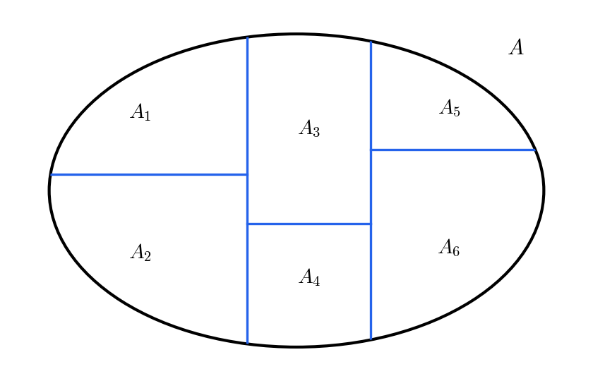

*그림 12. 집합 A를 여섯 부분집합으로 나눈 분할*

> **용어 정의:** 집합 $A$의 분할이 주어졌을 때, 그 **분할이 유도하는 관계(relation induced by the partition)** $R$은 모든 $x, y \in A$에 대해 다음과 같이 정의한 $A$ 위의 관계이다. $`x \, R \, y`$일 필요충분조건은 $x$와 $y$를 모두 원소로 갖는 분할의 부분집합 $A_i$가 존재하는 것이다.

**예제 8.3.1 (분할이 유도하는 관계).** $A = \lbrace 0, 1, 2, 3, 4 \rbrace$의 분할 $\lbrace 0, 3, 4 \rbrace$, $\lbrace 1 \rbrace$, $\lbrace 2 \rbrace$가 유도하는 관계 $R$을 구한다.

$\lbrace 0, 3, 4 \rbrace$가 분할의 부분집합이므로 이 집합에서 고른 두 원소는 순서와 상관없이 모두 관계된다. 예를 들어 0과 3이 모두 $\lbrace 0, 3, 4 \rbrace$에 있으므로 $`0 \, R \, 3`$이고 $`3 \, R \, 0`$이다. 같은 방식으로 $`0 \, R \, 4`$, $`4 \, R \, 0`$, $`3 \, R \, 4`$, $`4 \, R \, 3`$이다. 또 0과 0이 모두 $\lbrace 0, 3, 4 \rbrace$에 있으므로 $`0 \, R \, 0`$이고, 같은 이유로 $`3 \, R \, 3`$, $`4 \, R \, 4`$이다. 이렇게 $\lbrace 0, 3, 4 \rbrace$에서 $3 \times 3 = 9$개의 순서쌍이 나온다. $\lbrace 1 \rbrace$에서는 $`1 \, R \, 1`$, $\lbrace 2 \rbrace$에서는 $`2 \, R \, 2`$가 나온다. 따라서 $R$은 다음 11개의 순서쌍으로 이루어진다.

```math
R = \lbrace (0, 0), (0, 3), (0, 4), (1, 1), (2, 2), (3, 0), (3, 3), (3, 4), (4, 0), (4, 3), (4, 4) \rbrace
```

> **주의:** "0과 0이 모두 $\lbrace 0, 3, 4 \rbrace$에 있다"는 문장은 어색해 보이지만 거짓이 아니다. 정의의 $x$와 $y$는 같은 원소여도 되므로, 분할의 부분집합에 속하는 모든 원소는 자기 자신과 관계된다.

분할이 유도하는 관계는 2절에서 공부한 세 성질을 모두 가진다.

> **핵심:** **정리 8.3.1.** $A$를 분할이 주어진 집합이라 하고, $R$을 그 분할이 유도하는 관계라 한다. 그러면 $R$은 반사적, 대칭적, 추이적이다.

**증명:** 표기를 간단히 하기 위해 분할이 유한 개의 부분집합 $A_1, A_2, \ldots, A_n$으로 이루어진다고 가정한다. 무한 분할의 경우도 표기만 다를 뿐 증명은 같다. 분할의 정의에 따라 $i \ne j$이면 $A_i \cap A_j = \emptyset$이고 $A_1 \cup A_2 \cup \cdots \cup A_n = A$이다. 또 모든 $x, y \in A$에 대해 $`x \, R \, y`$일 필요충분조건은 $x \in A_i$이고 $y \in A_i$인 분할의 부분집합 $A_i$가 존재하는 것이다.

**반사성의 아이디어.** $`x \, R \, x`$는 $x$가 자기 자신과 같은 부분집합에 있다는 뜻이다. $x$가 분할의 어떤 부분집합에 들어 있기만 하면 이는 당연히 성립하며, 분할의 부분집합들의 합집합이 $A$ 전체이므로 $x$는 반드시 어떤 부분집합에 들어 있다.

**반사성의 증명:** $x \in A$라고 가정한다. $A_1, A_2, \ldots, A_n$이 $A$의 분할이므로 어떤 $i$에 대해 $x \in A_i$이다. 따라서 "$`x \in A_i`$이고 $x \in A_i$인 분할의 부분집합 $A_i$가 존재한다"는 명제가 참이고($p$와 $p \wedge p$는 논리적 동치이다), $R$의 정의에 따라 $`x \, R \, x`$이다.

**대칭성의 아이디어.** $x$가 $y$와 관계된다는 것은 $x$와 $y$가 같은 부분집합에 있다는 뜻이다. 그러면 $y$도 $x$와 같은 부분집합에 있으므로 $y$는 $x$와 관계된다.

**대칭성의 증명:** $x, y \in A$이고 $`x \, R \, y`$라고 가정한다. $R$의 정의에 따라 $x \in A_i$이고 $y \in A_i$인 분할의 부분집합 $A_i$가 존재한다. $p \wedge q$와 $q \wedge p$는 논리적 동치이므로 "$`y \in A_i`$이고 $x \in A_i$인 분할의 부분집합 $A_i$가 존재한다"도 참이다. 따라서 $R$의 정의에 따라 $`y \, R \, x`$이다.

**추이성의 아이디어.** $x$와 $y$가 한 부분집합에, $y$와 $z$가 한 부분집합에 있다고 하면, 두 부분집합은 공통 원소 $y$를 가진다. 분할의 서로 다른 부분집합은 서로소이므로 두 부분집합은 같아야 하고, 따라서 $x$, $y$, $z$가 모두 같은 부분집합에 있다.

**추이성의 증명:** $x, y, z \in A$이고 $`x \, R \, y`$, $`y \, R \, z`$라고 가정한다. $R$의 정의에 따라 $x, y \in A_i$이고 $y, z \in A_j$인 분할의 부분집합 $A_i$, $A_j$가 존재한다. $A_i \ne A_j$라고 가정하여 모순을 이끌어 낸다. $\lbrace A_1, A_2, \ldots, A_n \rbrace$이 분할이므로 $A_i \cap A_j = \emptyset$이어야 한다. 그런데 $y \in A_i$이고 $y \in A_j$이므로 $y \in A_i \cap A_j$, 즉 $A_i \cap A_j \ne \emptyset$이다. 이는 모순이므로 $A_i = A_j$이다. 따라서 $x$, $y$, $z$는 모두 $A_i$에 있고, 특히 $x$와 $z$가 모두 $A_i$에 있으므로 $R$의 정의에 따라 $`x \, R \, z`$이다.

### 3.2 동치 관계의 정의와 예

반사성, 대칭성, 추이성을 모두 가진 관계에 특별한 이름을 붙인다.

> **용어 정의:** $A$를 집합, $R$을 $A$ 위의 관계라 한다. $R$이 반사적이고 대칭적이며 추이적일 때, 그리고 그때에만 $R$을 **동치 관계(equivalence relation)** 라고 한다.

정리 8.3.1에 따르면 분할이 유도하는 관계는 동치 관계이다. 2절의 예 가운데 같다 관계(예제 8.2.2)와 법 3에 대한 합동(예제 8.2.4)도 동치 관계이다.

**예제 8.3.2 (부분집합들의 집합 위의 동치 관계).** $X$를 $\lbrace 1, 2, 3 \rbrace$의 공집합이 아닌 부분집합 전체의 집합이라 한다.

```math
X = \lbrace \lbrace 1 \rbrace, \lbrace 2 \rbrace, \lbrace 3 \rbrace, \lbrace 1, 2 \rbrace, \lbrace 1, 3 \rbrace, \lbrace 2, 3 \rbrace, \lbrace 1, 2, 3 \rbrace \rbrace
```

$X$ 위의 관계 $\mathbf{R}$을 모든 $A, B \in X$에 대해 $A$의 최소 원소와 $B$의 최소 원소가 같을 때 $`A \, \mathbf{R} \, B`$로 정의한다. $\mathbf{R}$이 동치 관계임을 증명한다.

- **반사성:** $A$를 $\lbrace 1, 2, 3 \rbrace$의 공집합이 아닌 부분집합이라 한다. [$`A \, \mathbf{R} \, A`$를 보여야 한다.] $A$의 최소 원소는 $A$의 최소 원소와 같으므로 $\mathbf{R}$의 정의에 따라 $`A \, \mathbf{R} \, A`$이다.
- **대칭성:** $A$, $B$가 $X$의 원소이고 $`A \, \mathbf{R} \, B`$라고 가정한다. [$`B \, \mathbf{R} \, A`$를 보여야 한다.] $A$의 최소 원소가 $B$의 최소 원소와 같으므로 $B$의 최소 원소도 $A$의 최소 원소와 같고, 따라서 $`B \, \mathbf{R} \, A`$이다.
- **추이성:** $A$, $B$, $C$가 $X$의 원소이고 $`A \, \mathbf{R} \, B`$, $`B \, \mathbf{R} \, C`$라고 가정한다. [$`A \, \mathbf{R} \, C`$를 보여야 한다.] $A$의 최소 원소는 $B$의 최소 원소와 같고, $B$의 최소 원소는 $C$의 최소 원소와 같으므로 $A$의 최소 원소는 $C$의 최소 원소와 같다. 따라서 $`A \, \mathbf{R} \, C`$이다.

이 증명에서 최소 원소가 존재한다는 사실은 $X$의 원소가 모두 공집합이 아닌 유한 집합이기 때문에 보장된다.

**예제 8.3.3 (디지털 논리 회로의 동치).** $S$를 입력의 개수가 $n$으로 고정된 모든 디지털 논리 회로의 집합이라 한다(2장). $S$ 위의 관계 $\mathbf{E}$를 모든 회로 $C_1, C_2 \in S$에 대해 $C_1$과 $C_2$의 입출력 표가 같을 때 $`C_1 \, \mathbf{E} \, C_2`$로 정의하고, 이때 회로 $C_1$은 회로 $C_2$와 **동치(equivalent)** 라고 한다. $\mathbf{E}$가 동치 관계임을 증명한다.

- **반사성:** $C$를 $S$의 회로라 한다. $C$의 입출력 표는 자기 자신의 입출력 표와 같으므로 $`C \, \mathbf{E} \, C`$이다.
- **대칭성:** $`C_1 \, \mathbf{E} \, C_2`$라고 가정한다. $C_1$의 입출력 표가 $C_2$의 입출력 표와 같으므로 $C_2$의 입출력 표도 $C_1$의 입출력 표와 같고, 따라서 $`C_2 \, \mathbf{E} \, C_1`$이다.
- **추이성:** $`C_1 \, \mathbf{E} \, C_2`$이고 $`C_2 \, \mathbf{E} \, C_3`$이라고 가정한다. $C_1$은 $C_2$와, $C_2$는 $C_3$과 입출력 표가 같으므로 $C_1$은 $C_3$과 입출력 표가 같다. 따라서 $`C_1 \, \mathbf{E} \, C_3`$이다.

$\mathbf{E}$는 반사적, 대칭적, 추이적이므로 $S$ 위의 동치 관계이다.

컴퓨터 언어의 구현 가운데에는 식별자(identifier)의 길이에 제한을 두지 않는 것이 있다. 프로그래머는 길이 제한을 걱정하지 않고 변수 이름을 필요한 만큼 자세히 지을 수 있다. 그러나 이런 언어의 컴파일러가 식별자의 앞부분 몇 글자만 보고 나머지를 무시하는 경우가 있다. 예를 들어 앞의 여덟 글자만 보는 컴파일러에게 `NumberOfScrews`와 `NumberOfBolts`는 앞의 여덟 글자가 `NumberOf`로 같으므로 같은 식별자이다. 이런 언어를 쓰는 프로그래머는 서로 다른 두 식별자에 앞의 여덟 글자가 같은 이름을 붙이지 않도록 주의해야 한다. 컴파일러가 식별자를 이렇게 묶으면 가능한 모든 식별자의 집합 위에 동치 관계가 생긴다.

**예제 8.3.4 (식별자 집합 위의 관계).** $L$을 어떤 컴퓨터 언어에서 허용되는 모든 식별자의 집합이라 하고, $L$ 위의 관계 $R$을 모든 문자열 $s, t \in L$에 대해 $s$의 처음 여덟 글자와 $t$의 처음 여덟 글자가 같을 때 $`s \, R \, t`$로 정의한다. $R$이 동치 관계임을 증명한다.

- **반사성:** $s \in L$이라 한다. $s$의 처음 여덟 글자는 자기 자신의 처음 여덟 글자와 같으므로 $`s \, R \, s`$이다.
- **대칭성:** $s, t \in L$이고 $`s \, R \, t`$라고 가정한다. $s$의 처음 여덟 글자가 $t$의 처음 여덟 글자와 같으므로 $t$의 처음 여덟 글자도 $s$의 처음 여덟 글자와 같고, 따라서 $`t \, R \, s`$이다.
- **추이성:** $s, t, u \in L$이고 $`s \, R \, t`$, $`t \, R \, u`$라고 가정한다. $s$와 $t$의 처음 여덟 글자가 같고 $t$와 $u$의 처음 여덟 글자가 같으므로 $s$와 $u$의 처음 여덟 글자가 같다. 따라서 $`s \, R \, u`$이다.

> **참고:** 세 예제의 증명은 모두 같은 구조를 가진다. 관계가 어떤 값(최소 원소, 입출력 표, 처음 여덟 글자)이 같다는 것으로 정의되어 있으면, 같다 관계가 반사적, 대칭적, 추이적이라는 사실이 그대로 옮겨져 그 관계도 동치 관계가 된다.

### 3.3 동치류

집합 위에 동치 관계가 주어져 있을 때, 그 집합의 원소 $a$ 하나를 골라 $a$와 관계되는 원소들을 모두 모은 부분집합을 생각할 수 있다. 이 부분집합을 $a$의 동치류라고 한다.

> **용어 정의:** $A$를 집합, $R$을 $A$ 위의 동치 관계라 한다. $A$의 각 원소 $a$에 대해, $R$에 의해 $a$와 관계되는 $A$의 모든 원소 $x$의 집합을 $a$의 **동치류(equivalence class)** 라 하고 $[a]$로 나타낸다. 줄여서 $a$의 류(class of $`a`$)라고도 한다.

기호로 쓰면 다음과 같다.

```math
[a] = \lbrace x \in A \mid x \, R \, a \rbrace
```

원소 단위로 쓰면 모든 $x \in A$에 대해 $`x \in [a] \iff x \, R \, a`$이다. 한 집합 위의 동치 관계를 여러 개 다룰 때는 관계 $R$에 대한 $a$의 동치류를 $`[a]_R`$로 쓴다.

> **주의:** 집합 위의 관계(순서쌍의 집합), 관계가 정의된 바탕 집합, 바탕 집합의 한 원소의 동치류(바탕 집합의 부분집합)는 서로 다른 대상이다. 예를 들어 아래 예제 8.3.5에서 관계 $R$은 9개의 순서쌍으로 이루어진 집합이고, 바탕 집합 $A$는 원소가 5개인 집합이며, $[0]$은 $A$의 부분집합 $\lbrace 0, 4 \rbrace$이다.

**예제 8.3.5 (순서쌍으로 주어진 관계의 동치류).** $A = \lbrace 0, 1, 2, 3, 4 \rbrace$ 위의 관계 $R$을 다음과 같이 정의한다.

```math
R = \lbrace (0, 0), (0, 4), (1, 1), (1, 3), (2, 2), (3, 1), (3, 3), (4, 0), (4, 4) \rbrace
```

$R$의 방향 그래프는 그림 13과 같으며, 그래프를 살펴보면 $R$이 $A$ 위의 동치 관계임을 알 수 있다. 모든 꼭짓점에 루프가 있고, 화살표는 모두 양방향이며, 서로 연결된 원소들은 모두 서로 관계되어 완성되지 않은 방향 삼각형이 없다.

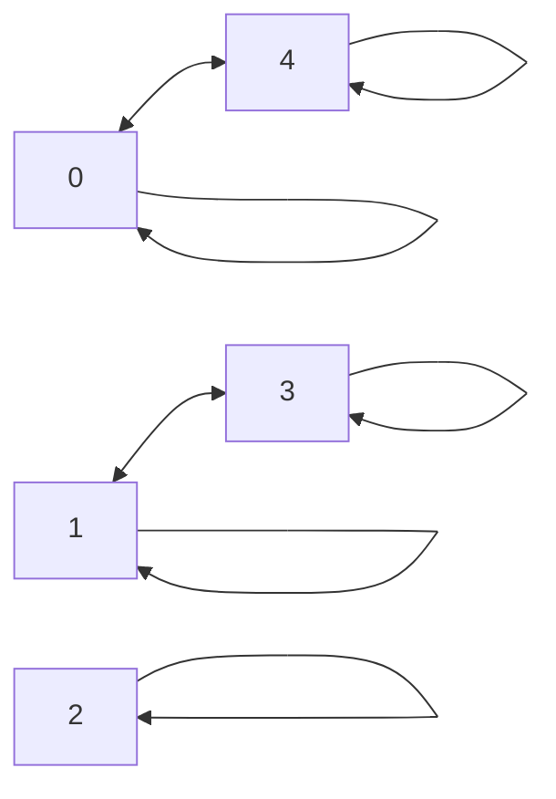

*그림 13. 예제 8.3.5의 동치 관계 R의 방향 그래프*

$R$의 서로 다른 동치류를 구하기 위해 먼저 $A$의 각 원소의 동치류를 구한다. $[a]$는 순서쌍 $(x, a)$가 $R$에 속하는 $x$들의 집합이다.

```math
\begin{aligned}
[0] &= \lbrace x \in A \mid x \, R \, 0 \rbrace = \lbrace 0, 4 \rbrace \\
[1] &= \lbrace x \in A \mid x \, R \, 1 \rbrace = \lbrace 1, 3 \rbrace \\
[2] &= \lbrace x \in A \mid x \, R \, 2 \rbrace = \lbrace 2 \rbrace \\
[3] &= \lbrace x \in A \mid x \, R \, 3 \rbrace = \lbrace 1, 3 \rbrace \\
[4] &= \lbrace x \in A \mid x \, R \, 4 \rbrace = \lbrace 0, 4 \rbrace
\end{aligned}
```

$[0] = [4]$이고 $[1] = [3]$이므로 서로 다른 동치류는 $\lbrace 0, 4 \rbrace$, $\lbrace 1, 3 \rbrace$, $\lbrace 2 \rbrace$의 세 개이다.

동치 관계의 서로 다른 동치류를 구하는 문제는 대개 두 단계로 푼다. 첫째 단계에서는 관계의 정의역 $A$의 각 원소의 동치류를 구한다. 이때 동치류의 원소를 직접 나열하거나, $A$가 무한 집합이면 동치류를 일반적인 형태로 기술한다. 둘째 단계에서는 여러 원소가 같은 동치류를 공유하는 경우가 많으므로, 구한 동치류들을 비교하여 어떤 것들이 같은지 판단하고 서로 다른 동치류를 한 번씩만 나열한다.

**예제 8.3.6 (부분집합들의 집합 위의 동치류).** 예제 8.3.2의 동치 관계 $\mathbf{R}$(최소 원소가 같다)의 서로 다른 동치류를 구한다.

- $\lbrace 1 \rbrace$의 동치류는 최소 원소가 1인 $\lbrace 1, 2, 3 \rbrace$의 공집합이 아닌 부분집합 전체이다. 따라서 $[\lbrace 1 \rbrace] = \lbrace \lbrace 1 \rbrace, \lbrace 1, 2 \rbrace, \lbrace 1, 3 \rbrace, \lbrace 1, 2, 3 \rbrace \rbrace$이다.
- $\lbrace 2 \rbrace$의 동치류는 최소 원소가 2인 부분집합 전체이므로 $[\lbrace 2 \rbrace] = \lbrace \lbrace 2 \rbrace, \lbrace 2, 3 \rbrace \rbrace$이다.
- 최소 원소가 3인 부분집합은 $\lbrace 3 \rbrace$ 하나뿐이므로 $[\lbrace 3 \rbrace] = \lbrace \lbrace 3 \rbrace \rbrace$이다.

$X$의 일곱 원소가 모두 이 세 동치류 가운데 하나에 들어가므로($`4 + 2 + 1 = 7`$) 빠진 동치류는 없고, 세 동치류는 서로 다르다.

**예제 8.3.7 (식별자의 동치류).** 예제 8.3.4의 관계 $R$(처음 여덟 글자가 같다)의 서로 다른 동치류를 설명한다. $L$의 임의의 문자열 $s$에 대해 동치류는 다음과 같다.

```math
[s] = \lbrace t \in L \mid t \, R \, s \rbrace
```

즉, $[s]$는 처음 여덟 글자가 $s$의 처음 여덟 글자와 같은 $L$의 문자열 전체의 집합이다. 따라서 $R$의 서로 다른 동치류는 다음 두 조건을 만족하는 문자열의 집합들이다. 첫째, 한 동치류에 속하는 문자열은 처음 여덟 글자가 모두 같다. 둘째, 서로 다른 두 동치류에서 하나씩 고른 두 문자열은 처음 여덟 글자 가운데 어딘가가 다르다.

**예제 8.3.8 (항등 관계의 동치류).** $A$를 임의의 집합이라 하고, $A$ 위의 관계 $R$을 모든 $x, y \in A$에 대해 $`x \, R \, y \iff x = y`$로 정의한다. 예제 8.2.2의 논증을 일반화하면 $R$은 동치 관계이다. 임의의 $a \in A$에 대해 다음이 성립한다.

```math
[a] = \lbrace x \in A \mid x \, R \, a \rbrace = \lbrace x \in A \mid x = a \rbrace = \lbrace a \rbrace
```

$A$에서 $a$와 같은 원소는 $a$ 하나뿐이기 때문이다. 또 $x \ne a$이면 $\lbrace x \rbrace \ne \lbrace a \rbrace$이므로, 모든 원소의 동치류가 서로 다르다. 따라서 $R$의 서로 다른 동치류는 $A$의 원소가 하나인 부분집합 전체이다.

### 3.4 동치류가 이루는 분할

예제 8.3.5부터 예제 8.3.8까지 모든 경우에서 서로 다른 동치류들은 쌍마다 서로소이고 그 합집합이 관계의 정의역 $A$ 전체였다. 즉, 동치류들의 집합이 $A$의 분할을 이루었다. 이는 우연이 아니며, 동치 관계의 동치류는 항상 정의역을 분할한다. 이 사실을 두 보조정리(lemma)를 거쳐 증명한다. 첫째 보조정리는 동치 관계로 관계된 두 원소의 동치류가 같다는 것이다.

> **핵심:** **보조정리 8.3.2.** $A$를 집합, $R$을 $A$ 위의 동치 관계, $a$와 $b$를 $A$의 원소라 한다. $`a \, R \, b`$이면 $[a] = [b]$이다.

$[a]$와 $[b]$는 집합이고, 두 집합이 같을 필요충분조건은 각각이 다른 것의 부분집합인 것이다. 따라서 증명은 $[a] \subseteq [b]$의 증명과 $[b] \subseteq [a]$의 증명 두 부분으로 이루어지며, 각 포함 관계를 보이려면 왼쪽 집합의 모든 원소가 오른쪽 집합의 원소임을 보여야 한다.

**증명:** $A$를 집합, $R$을 $A$ 위의 동치 관계라 하고, $a$, $b$가 $`a \, R \, b`$를 만족하는 $A$의 원소라고 가정한다. [$`[a] = [b]`$를 보여야 한다.]

**$[a] \subseteq [b]$의 증명:** $x \in [a]$라고 가정한다. [$`x \in [b]`$를 보여야 한다.] $x \in [a]$이므로 동치류의 정의에 따라 $`x \, R \, a`$이다. 가정에 의해 $`a \, R \, b`$이다. $R$은 추이적이므로 $`x \, R \, a`$와 $`a \, R \, b`$에서 $`x \, R \, b`$를 얻는다. 따라서 동치류의 정의에 따라 $x \in [b]$이다.

**$[b] \subseteq [a]$의 증명:** $x \in [b]$라고 가정한다. [$`x \in [a]`$를 보여야 한다.] 동치류의 정의에 따라 $`x \, R \, b`$이다. 가정에 의해 $`a \, R \, b`$이고, $R$은 대칭적이므로 $`b \, R \, a`$이다. $R$은 추이적이므로 $`x \, R \, b`$와 $`b \, R \, a`$에서 $`x \, R \, a`$를 얻는다. 따라서 동치류의 정의에 따라 $x \in [a]$이다.

$[a] \subseteq [b]$이고 $[b] \subseteq [a]$이므로 집합의 상등의 정의에 따라 $[a] = [b]$이다.

둘째 보조정리는 동치 관계의 두 동치류가 서로소이거나 같다는 것이다.

> **핵심:** **보조정리 8.3.3.** $A$가 집합이고 $R$이 $A$ 위의 동치 관계이며 $a$와 $b$가 $A$의 원소이면, $[a] \cap [b] = \emptyset$이거나 $[a] = [b]$이다.

보조정리 8.3.3의 명제는 "$`p`$이면 ($q$ 또는 $`r`$)" 꼴이다. 여기서 $p$는 "$`A`$는 집합이고 $R$은 $A$ 위의 동치 관계이며 $a$와 $b$는 $A$의 원소이다", $q$는 "$`[a] \cap [b] = \emptyset`$", $r$은 "$`[a] = [b]`$"이다. 이 명제는 "($p$이고 $q$가 아니면) $r$"과 논리적 동치이므로, 다음을 증명하면 된다. $A$가 집합이고 $R$이 $A$ 위의 동치 관계이며 $a$와 $b$가 $A$의 원소이고 $[a] \cap [b] \ne \emptyset$이면 $[a] = [b]$이다.

> **참고:** "$`p`$이면 ($q$ 또는 $`r`$)"는 $\sim p \vee q \vee r$과 논리적 동치이고, "($p$이고 $q$가 아니면) $r$"은 $\sim(p \wedge \sim q) \vee r$, 즉 드모르간의 법칙에 의해 $\sim p \vee q \vee r$과 논리적 동치이다. 따라서 두 명제는 논리적 동치이며, 같은 이유로 "($p$이고 $r$이 아니면) $q$"를 증명해도 된다.

**증명:** $A$가 집합이고 $R$이 $A$ 위의 동치 관계이며 $a$, $b$가 $A$의 원소이고 $[a] \cap [b] \ne \emptyset$이라고 가정한다. [$`[a] = [b]`$를 보여야 한다.] $[a] \cap [b] \ne \emptyset$이므로 $x \in [a] \cap [b]$인 원소 $x \in A$가 존재한다. 교집합의 정의에 따라 $x \in [a]$이고 $x \in [b]$이며, 동치류의 정의에 따라 $`x \, R \, a`$이고 $`x \, R \, b`$이다. $R$은 동치 관계이므로 대칭적이고, $`x \, R \, a`$에서 $`a \, R \, x`$를 얻는다. 또 $R$은 추이적이므로 $`a \, R \, x`$와 $`x \, R \, b`$에서 $`a \, R \, b`$를 얻는다. 이제 $a$와 $b$가 보조정리 8.3.2의 가정을 만족하므로 그 보조정리에 의해 $[a] = [b]$이다.

> **핵심:** **정리 8.3.4 (동치 관계가 유도하는 분할).** $A$가 집합이고 $R$이 $A$ 위의 동치 관계이면, $R$의 서로 다른 동치류들은 $A$의 분할을 이룬다. 즉, 동치류들의 합집합은 $A$ 전체이고, 서로 다른 두 동치류의 교집합은 공집합이다.

증명은 두 부분으로 나뉜다. $A$가 $R$의 동치류들의 합집합이라는 첫째 부분은 $R$의 반사성에서, 서로 다른 두 동치류가 서로소라는 둘째 부분은 보조정리 8.3.3에서 나온다.

**증명:** $A$를 집합, $R$을 $A$ 위의 동치 관계라 한다. 표기를 간단히 하기 위해 $R$의 서로 다른 동치류가 유한 개라고 가정하고, 이를 $A_1, A_2, \ldots, A_n$($n$은 양의 정수)으로 나타낸다. 동치류가 무한히 많은 경우도 표기만 다를 뿐 증명은 같다.

**$A = A_1 \cup A_2 \cup \cdots \cup A_n$의 증명:** 두 포함 관계를 보인다. 먼저 $A \subseteq A_1 \cup \cdots \cup A_n$을 보이기 위해 $x$를 $A$의 임의의 원소라 한다. $R$이 반사적이므로 $`x \, R \, x`$이고, 동치류의 정의에 따라 $x \in [x]$이다. $x$는 어떤 동치류에 속하므로 서로 다른 동치류 $A_1, A_2, \ldots, A_n$ 가운데 하나에 속한다. 즉, 어떤 $i$에 대해 $x \in A_i$이고, 합집합의 정의에 따라 $x \in A_1 \cup \cdots \cup A_n$이다. 다음으로 $A_1 \cup \cdots \cup A_n \subseteq A$를 보이기 위해 $x \in A_1 \cup \cdots \cup A_n$이라 한다. 합집합의 정의에 따라 어떤 $i$에 대해 $x \in A_i$이다. 각 $A_i$는 $R$의 동치류이고 동치류는 $A$의 부분집합이므로 $A_i \subseteq A$이며, 따라서 $x \in A$이다. 두 포함 관계에서 집합의 상등의 정의에 따라 $A = A_1 \cup A_2 \cup \cdots \cup A_n$이다.

**서로 다른 동치류가 서로소임의 증명:** $A_i$와 $A_j$를 $R$의 서로 다른 두 동치류라 한다. [$`A_i \cap A_j = \emptyset`$을 보여야 한다.] 두 동치류가 서로 다르므로 $A_i \ne A_j$이다. 또 $A_i$와 $A_j$는 $R$의 동치류이므로 $A_i = [a]$, $A_j = [b]$인 원소 $a, b \in A$가 존재한다. 보조정리 8.3.3에 의해 $[a] \cap [b] = \emptyset$이거나 $[a] = [b]$이다. 그런데 $A_i \ne A_j$이므로 $[a] \ne [b]$이고, 따라서 $[a] \cap [b] = \emptyset$, 즉 $A_i \cap A_j = \emptyset$이다.

> **핵심:** 정리 8.3.1과 정리 8.3.4를 함께 보면, 집합 $A$의 분할은 $A$ 위의 동치 관계를 유도하고 $A$ 위의 동치 관계는 $A$의 분할(동치류들)을 유도한다. 게다가 동치 관계 $R$의 동치류들이 이루는 분할이 유도하는 관계는 $R$ 자신이다. $x$와 $y$가 같은 동치류 $[a]$에 있으면 $`x \, R \, a`$, $`a \, R \, y`$이므로 $`x \, R \, y`$이고, 거꾸로 $`x \, R \, y`$이면 $x \in [y]$이고 $y \in [y]$이기 때문이다. 따라서 분할과 동치 관계는 같은 정보를 두 가지 방식으로 표현한 것이다.

**예제 8.3.9 (디지털 논리 회로의 동치류).** 예제 8.3.3에서 회로 사이의 동치가 동치 관계임을 보였다. 이제 $S$를 입력이 정확히 두 개이고 출력이 하나인 모든 디지털 논리 회로의 집합이라 하고, $S$ 위의 관계 $\mathbf{E}$를 입출력 표가 같은 두 회로 $C_1$, $C_2$에 대해 $`C_1 \, \mathbf{E} \, C_2`$가 되도록 정의한다. 이 관계의 동치류를 설명하고, 서로 다른 동치류의 개수를 구하며, 한 동치류에 속하는 서로 다른 두 회로를 찾는다.

회로 $C$의 동치류는 입력 신호가 두 개이고 출력 신호가 하나이며 $C$와 입출력 표가 같은 모든 회로의 집합이다. 입출력 표는 두 입력의 네 가지 조합 11, 10, 01, 00에 해당하는 네 행을 가진다. 표 5는 그런 입출력 표의 한 예이다.

| $P$ | $Q$ | 출력 $R$ |
|:---:|:---:|:---:|
| 1 | 1 | 0 |
| 1 | 0 | 0 |
| 0 | 1 | 0 |
| 0 | 0 | 1 |

*표 5. 두 입력이 모두 0일 때만 1을 출력하는 회로의 입출력 표*

서로 다른 입출력 표는 출력 열에 놓이는 네 개의 0과 1의 패턴을 바꾸어 만들어지므로, 그 개수는 길이가 4인 0과 1의 문자열의 개수 $2^4 = 16$과 같다. 따라서 동치류는 입출력 표 하나에 하나씩 정확히 16개이다. 그러나 각 입출력 표를 만드는 회로는 무수히 많다. 예를 들어 표 5의 입출력 표를 만드는 회로로 그림 14의 두 회로가 있다. 회로 1의 부울 식은 $(\sim P) \wedge (\sim Q)$이고 회로 2의 부울 식은 $\sim (P \vee Q)$이며, 드모르간의 법칙에 의해 두 식은 논리적 동치이므로 두 회로는 같은 동치류에 속한다.

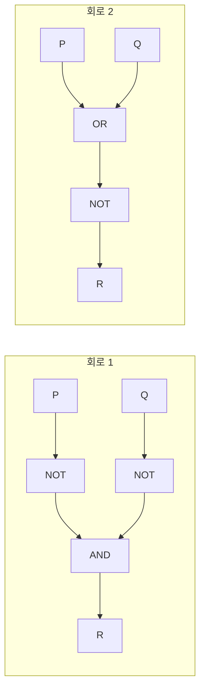

*그림 14. 같은 입출력 표를 갖는 서로 다른 두 회로*

### 3.5 법 n에 대한 합동

예제 8.2.4에서 법 3에 대한 합동이 반사적, 대칭적, 추이적임을 보였으므로 이 관계는 동치 관계이다.

**예제 8.3.10 (법 3에 대한 합동의 동치류).** $R$을 정수 전체의 집합 $\mathbf{Z}$ 위의 법 3에 대한 합동, 즉 모든 정수 $m$, $n$에 대해 $`m \, R \, n \iff 3 \mid (m - n)`$인 관계라 한다. $R$의 서로 다른 동치류를 구한다.

각 정수 $a$에 대해 동치류의 정의와 나누어떨어짐의 정의를 차례로 적용하면 다음을 얻는다.

```math
\begin{aligned}
[a] &= \lbrace x \in \mathbf{Z} \mid x \, R \, a \rbrace = \lbrace x \in \mathbf{Z} \mid 3 \mid (x - a) \rbrace \\
&= \lbrace x \in \mathbf{Z} \mid \exists k \in \mathbf{Z}, \ x - a = 3k \rbrace = \lbrace x \in \mathbf{Z} \mid \exists k \in \mathbf{Z}, \ x = 3k + a \rbrace
\end{aligned}
```

특히 $a = 0, 1, 2$이면 각 동치류는 표 6과 같다.

| 동치류 | 조건 | 원소 |
|:---|:---|:---|
| $[0]$ | 어떤 정수 $k$에 대해 $x = 3k$ | $\ldots, -9, -6, -3, 0, 3, 6, 9, \ldots$ |
| $[1]$ | 어떤 정수 $k$에 대해 $x = 3k + 1$ | $\ldots, -8, -5, -2, 1, 4, 7, 10, \ldots$ |
| $[2]$ | 어떤 정수 $k$에 대해 $x = 3k + 2$ | $\ldots, -7, -4, -1, 2, 5, 8, 11, \ldots$ |

*표 6. 법 3에 대한 합동의 세 동치류*

$`3 \, R \, 0`$이므로 보조정리 8.3.2에 의해 $[3] = [0]$이다. 같은 논리로 다음이 성립한다.

```math
[0] = [3] = [-3] = [6] = [-6] = \cdots, \quad [1] = [4] = [-2] = [7] = [-5] = \cdots, \quad [2] = [5] = [-1] = [8] = [-4] = \cdots
```

몫-나머지 정리(4장)에 의해 모든 정수는 $3k$, $3k + 1$, $3k + 2$ 가운데 정확히 한 꼴로 쓸 수 있으므로 모든 정수는 $[0]$, $[1]$, $[2]$ 가운데 하나에 속한다. 따라서 서로 다른 동치류는 3으로 나누어떨어지는 정수 전체, 3으로 나눈 나머지가 1인 정수 전체, 3으로 나눈 나머지가 2인 정수 전체의 세 개이다.

예제 8.3.10은 동치류의 중요한 성질을 보여 준다. 한 동치류는 여러 이름을 가질 수 있다. 0의 동치류 $[0]$은 3의 동치류 $[3]$이라고도, $-6$의 동치류 $[-6]$이라고도 부를 수 있지만, 그 동치류 자체는 3으로 나누어떨어지는 모든 정수의 집합 하나이다. 이처럼 대상을 부르는 이름과 대상 자체를 구분하는 것이 중요하다.

> **용어 정의:** $R$을 집합 $A$ 위의 동치 관계, $S$를 $R$의 한 동치류라 한다. $[a] = S$인 원소 $a$를 동치류 $S$의 **대표원(representative)** 이라고 한다.

동치류 $S$의 원소는 모두 $S$의 대표원이다. $S = [b]$이고 $a \in S$이면 $`a \, R \, b`$이므로 보조정리 8.3.2에 의해 $[a] = [b] = S$이기 때문이다. 예를 들어 $-6$, 0, 9는 모두 법 3에 대한 동치류 $[0]$의 대표원이다.

합동 관계에는 가우스(Gauss)가 저서 *Disquisitiones Arithmeticae*에서 도입한 다음 표기법을 널리 쓴다.

> **용어 정의:** $m$, $n$을 정수, $d$를 양의 정수라 한다. $d \mid (m - n)$일 때, 그리고 그때에만 $m$은 **법 $d$에 대해 $n$과 합동(congruent to $n$ modulo $`d`$)** 이라 하고 $m \equiv n \pmod{d}$로 쓴다. 기호로는 $m \equiv n \pmod{d} \iff d \mid (m - n)$이다.

정수 $m$, $n$과 양의 정수 $d$에 대해 $m \equiv n \pmod{d}$일 필요충분조건은 $m \bmod d = n \bmod d$, 즉 $m$과 $n$을 $d$로 나눈 나머지가 같은 것이다. 몫-나머지 정리에 의해 $m = dq_1 + r_1$, $n = dq_2 + r_2$($`0 \le r_1, r_2 < d`$)로 쓰면 $m - n = d(q_1 - q_2) + (r_1 - r_2)$이고 $-d < r_1 - r_2 < d$이다. 따라서 $d \mid (m - n)$일 필요충분조건은 $d \mid (r_1 - r_2)$이고, $-d$와 $d$ 사이에 있는 $d$의 배수는 0뿐이므로 이는 $r_1 = r_2$와 같다.

**예제 8.3.11 (합동식의 판정).** 다음 합동식의 참과 거짓을 판정한다.

- $12 \equiv 7 \pmod{5}$는 참이다. $12 - 7 = 5 = 5 \cdot 1$이므로 $5 \mid (12 - 7)$이다.
- $6 \equiv -8 \pmod{4}$는 거짓이다. $6 - (-8) = 14$이고, 어떤 정수 $k$에 대해서도 $14 \ne 4k$이므로 $4 \nmid 14$이다. 따라서 $6 \not\equiv -8 \pmod{4}$이다.
- $3 \equiv 3 \pmod{7}$은 참이다. $3 - 3 = 0 = 7 \cdot 0$이므로 $7 \mid (3 - 3)$이다.

합동은 컴퓨터의 정수 산술을 설명한다. 2장에서는 8비트 2의 보수로 $-128$부터 $127$까지의 256개 정수를 표현하고 계산하는 단순화한 컴퓨터 모형을 다루었다. 이 모형에서 $78 + (-46)$을 계산하면 그림 15와 같다.

```text
      0 1 0 0 1 1 1 0      78
    + 1 1 0 1 0 0 1 0      2^8 - 46 = 210
    -------------------
    1 0 0 1 0 0 0 0 0      288
```

*그림 15. 8비트 2의 보수를 이용한 78 + (−46)의 계산*

결과 $100100000_2$는 288이며, 8비트 표현으로는 너무 크다. 그러나 2의 보수 계산 규칙은 오른쪽에서 아홉 번째 자리, 즉 $2^8$의 자리에 생긴 1을 버리라고 한다. 이 1을 버리면 결과는 $00100000_2 = 32$이고, 이것이 올바른 답이다. 이 방법이 맞는 이유는 다음과 같다. 78과 $-46$의 2의 보수를 10진수로 읽으면 각각 78과 $2^8 - 46$이고, 다음이 성립한다.

```math
78 + (2^8 - 46) = 2^8 + (78 - 46) \equiv 78 - 46 \pmod{2^8}
```

따라서 $78 + (2^8 - 46)$을 법 $2^8$로 줄이면 올바른 결과 $78 - 46 = 32$를 얻는다. 2진 표기에서 $2^8$의 자리에 있는 비트는 $2^8$을 나타내므로, 그 비트를 버리는 것은 법 $2^8$로 줄이는 것과 같다.

### 3.6 동치류로 정의한 유리수

분수 계산의 규칙을 잠시 제쳐 두고 $\frac{1}{3}$과 $\frac{2}{6}$를 기호의 나열로만 보면 두 표현은 서로 달라 보이며, 순서쌍 $(1, 3)$과 $(2, 6)$으로 쓰면 실제로 다른 순서쌍이다. 그런데도 둘을 같은 수로 보는 것은, 두 분수 $\frac{a}{b}$와 $\frac{c}{d}$를 엇갈려 곱한 값이 같을 때, 즉 $ad = bc$일 때 두 분수를 같은 수로 본다는 일반적인 약속 때문이다. 이 약속은 동치 관계를 이용하여 엄밀하게 나타낼 수 있다.

**예제 8.3.12 (유리수는 동치류이다).** $A$를 둘째 성분이 0이 아닌 정수 순서쌍 전체의 집합, 즉 $A = \mathbf{Z} \times (\mathbf{Z} - \lbrace 0 \rbrace)$라 한다. $A$ 위의 관계 $R$을 모든 $(a, b), (c, d) \in A$에 대해 다음과 같이 정의한다.

```math
(a, b) \, R \, (c, d) \iff ad = bc
```

**반사성과 대칭성.** 모든 $(a, b) \in A$에 대해 곱셈의 교환 법칙에 의해 $ab = ba$이므로 $`(a, b) \, R \, (a, b)`$이다. 또 $`(a, b) \, R \, (c, d)`$이면 $ad = bc$이고, 양변을 맞바꾸고 교환 법칙을 쓰면 $cb = da$이므로 $`(c, d) \, R \, (a, b)`$이다.

**추이성.** [모든 $(a, b), (c, d), (e, f) \in A$에 대해 $`(a, b) \, R \, (c, d)`$이고 $`(c, d) \, R \, (e, f)`$이면 $`(a, b) \, R \, (e, f)`$임을 보여야 한다.] $(a, b)$, $(c, d)$, $(e, f)$를 $`(a, b) \, R \, (c, d)`$이고 $`(c, d) \, R \, (e, f)`$인 $A$의 임의의 특정한 원소라고 가정한다. $R$의 정의에 따라 다음 두 식이 성립한다.

```math
(1) \ ad = bc, \qquad (2) \ cf = de
```

$A$의 모든 순서쌍은 둘째 성분이 0이 아니므로 $b \ne 0$, $d \ne 0$, $f \ne 0$이다. 식 (1)의 양변에 $f$를, 식 (2)의 양변에 $b$를 곱하면 $adf = bcf$와 $bcf = bde$를 얻는다. 두 식이 모두 $bcf$와 같으므로 $adf = bde$이다. $d \ne 0$이므로 곱셈의 소거 법칙에 의해 양변에서 $d$를 소거하면 $af = be$이다. 따라서 $R$의 정의에 따라 $`(a, b) \, R \, (e, f)`$이다.

> **주의:** 추이성의 증명은 $d \ne 0$을 이용하여 $d$를 소거한다. 둘째 성분이 0인 순서쌍을 허용하면 추이성이 깨진다. 예를 들어 $1 \cdot 0 = 2 \cdot 0$이므로 $(1, 2)$는 $(0, 0)$과 관계되고 $0 \cdot 5 = 0 \cdot 3$이므로 $(0, 0)$은 $(3, 5)$와 관계되지만, $1 \cdot 5 = 5 \ne 6 = 2 \cdot 3$이므로 $(1, 2)$는 $(3, 5)$와 관계되지 않는다.

**동치류.** 서로 다른 유리수마다 동치류가 하나씩 있다. 각 동치류는 분수 $\frac{a}{b}$로 썼을 때 서로 같은 값이 되는 순서쌍 $(a, b)$ 전체로 이루어진다. 두 유리수가 같을 조건과 두 순서쌍이 관계될 조건이 같기 때문이다. 예를 들어 $(1, 2)$의 동치류는 다음과 같다.

```math
[(1, 2)] = \lbrace (1, 2), (-1, -2), (2, 4), (-2, -4), (3, 6), (-3, -6), \ldots \rbrace
```

실제로 $\frac{1}{2} = \frac{-1}{-2} = \frac{2}{4} = \frac{-2}{-4} = \frac{3}{6} = \frac{-3}{-6}$이다.

이 결과를 확장하면 $R$의 동치류들 위에 덧셈과 곱셈을 정의하여 유리수의 덧셈, 곱셈과 같은 성질을 모두 갖게 할 수 있다. 따라서 유리수를 정수 순서쌍의 동치류로 정의할 수 있다. 같은 방식으로 음수와 0을 포함한 모든 정수를 양의 정수 순서쌍의 동치류로 정의할 수 있다. 19세기 후반 프레게(Frege)와 페아노(Peano)는 양의 정수를 집합만으로 정의할 수 있음을 보였고, 그보다 조금 앞서 데데킨트(Dedekind)는 모든 실수를 유리수의 집합으로 정의할 수 있음을 보였다. 이 결과들을 합하면 실수 전체의 집합을 논리와 집합론만으로 정의할 수 있다.

---

<br>

## 4. 부분 순서 관계 (8.5절)

어떤 대학에서 컴퓨터과학 학위를 받으려면 정해진 필수 과목들을 이수해야 하고, 그중 일부는 다른 과목을 먼저 마쳐야 수강할 수 있다. 이런 선수 과목 구조가 주어지면 학위 요건을 채우는 데 필요한 최소 학기 수, 한 학기에 함께 들을 수 있는 최대 과목 수, 시간제 학생이 한 학기에 한 과목씩 들을 수 있는 순서가 있는지 등을 물을 수 있다. 선수 과목 구조를 부분 순서 관계로 나타내면 이런 질문에 비교적 쉽게 답할 수 있으며, 4.8절에서 이를 다룬다.

### 4.1 반대칭성

2절에서 반사성, 대칭성, 추이성을 정의하였다. 관계의 네 번째 성질은 반대칭성이다. 화살표 도표로 말하면, 관계가 반대칭적이라는 것은 한 원소에서 그와 다른 원소로 가는 화살표가 있을 때마다 그 두 번째 원소에서 처음 원소로 돌아오는 화살표가 없다는 뜻이다.

> **용어 정의:** $R$을 집합 $A$ 위의 관계라 한다. 모든 $a, b \in A$에 대해 $`a \, R \, b`$이고 $`b \, R \, a`$이면 $a = b$일 때, 그리고 그때에만 $R$을 **반대칭적(antisymmetric)** 이라고 한다.

정의를 부정하면, $R$이 반대칭적이지 않을 필요충분조건은 $`a \, R \, b`$이고 $`b \, R \, a`$이지만 $a \ne b$인 원소 $a, b \in A$가 존재하는 것이다.

> **주의:** 반대칭적이라는 것은 대칭적이지 않다는 것과 다르다. 집합 $\lbrace 0, 1 \rbrace$ 위의 관계 $\lbrace (0, 0), (1, 1) \rbrace$는 대칭적이면서 반대칭적이고, 집합 $\lbrace 0, 1, 2 \rbrace$ 위의 관계 $\lbrace (0, 1), (1, 0), (0, 2) \rbrace$는 대칭적이지도 반대칭적이지도 않다. 반대칭성은 서로 다른 두 원소 사이에 양방향 화살표가 없다는 조건이며, 루프는 이 조건과 무관하다.

**예제 8.5.1 (유한 관계의 반대칭성 판정).** $\lbrace 0, 1, 2 \rbrace$ 위의 관계 $R_1 = \lbrace (0, 2), (1, 2), (2, 0) \rbrace$, $R_2 = \lbrace (0, 0), (0, 1), (0, 2), (1, 1), (1, 2) \rbrace$의 방향 그래프를 그리고 반대칭성을 판정한다.

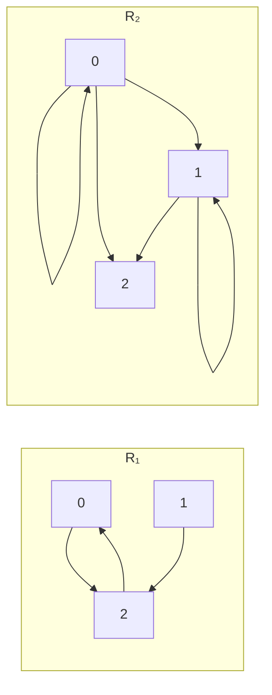

*그림 16. 예제 8.5.1의 두 관계의 방향 그래프*

- $R_1$은 반대칭적이지 않다. $`0 \, R_1 \, 2`$이고 $`2 \, R_1 \, 0`$이지만 $0 \ne 2$이다.
- $R_2$는 반대칭적이다. $R_2$가 반대칭적이지 않으려면 서로 다른 두 원소가 서로 관계되는 쌍이 있어야 하는데, 그래프를 살펴보면 그런 쌍이 없다. 루프가 아닌 화살표 $0 \to 1$, $0 \to 2$, $1 \to 2$ 가운데 어느 것도 반대 방향 화살표를 갖지 않는다.

**예제 8.5.2 (나누어떨어짐 관계의 반대칭성).** $R_1$을 양의 정수 전체의 집합 $\mathbf{Z}^{+}$ 위의 나누어떨어짐 관계, $R_2$를 정수 전체의 집합 $\mathbf{Z}$ 위의 나누어떨어짐 관계라 한다. 즉, 모든 $a, b \in \mathbf{Z}^{+}$에 대해 $`a \, R_1 \, b \iff a \mid b`$이고, 모든 $a, b \in \mathbf{Z}$에 대해 $`a \, R_2 \, b \iff a \mid b`$이다.

**$R_1$은 반대칭적이다.**

**증명:** $a$, $b$가 $`a \, R_1 \, b`$이고 $`b \, R_1 \, a`$인 양의 정수라고 가정한다. [$`a = b`$를 보여야 한다.] $R_1$의 정의에 따라 $a \mid b$이고 $b \mid a$이다. 나누어떨어짐의 정의에 따라 $b = k_1 a$, $a = k_2 b$인 정수 $k_1$, $k_2$가 존재한다. 대입하면 $b = k_1 a = k_1 (k_2 b) = (k_1 k_2) b$이고, $b$는 양수이므로 0이 아니어서 양변을 $b$로 나누면 $k_1 k_2 = 1$이다. 또 $a$와 $b$가 양의 정수이므로 $k_1 = b / a$와 $k_2 = a / b$도 양수, 곧 양의 정수이다. 곱이 1인 두 양의 정수는 $1 \cdot 1$뿐이므로 $k_1 = k_2 = 1$이고, 따라서 $a = k_2 b = 1 \cdot b = b$이다.

**$R_2$는 반대칭적이지 않다.**

**반례:** $a = 2$, $b = -2$로 두면 $-2 = (-1) \cdot 2$이므로 $a \mid b$이고, $2 = (-1) \cdot (-2)$이므로 $b \mid a$이다. 따라서 $`a \, R_2 \, b`$이고 $`b \, R_2 \, a`$이지만 $a \ne b$이다.

예제 8.5.2는 같은 규칙으로 정의한 관계라도 어떤 집합의 부분집합 위에서는 반대칭적이고 그 집합 전체 위에서는 반대칭적이지 않을 수 있음을 보여 준다. $R_1$의 증명에서 $k_1$, $k_2$가 양수라는 사실이 핵심이었는데, 음수를 허용하면 $k_1 = k_2 = -1$도 가능해지기 때문이다.

### 4.2 부분 순서 관계의 정의와 예

> **용어 정의:** $R$을 집합 $A$ 위에 정의된 관계라 한다. $R$이 반사적이고 반대칭적이며 추이적일 때, 그리고 그때에만 $R$을 **부분 순서 관계(partial order relation)** 또는 간단히 **부분 순서(partial order)** 라고 한다.

가장 기본적인 두 부분 순서 관계는 실수 집합 위의 작거나 같다 관계와 집합들의 집합 위의 부분집합 관계이다. 이 둘은 일반적인 부분 순서 관계의 모형 또는 전형으로 볼 수 있다.

**예제 8.5.3 (부분집합 관계).** $\mathcal{A}$를 집합들의 임의의 모음이라 하고, $\mathcal{A}$ 위의 부분집합 관계 $\subseteq$를 모든 $U, V \in \mathcal{A}$에 대해 다음과 같이 정의한다.

```math
U \subseteq V \iff \forall x, \ x \in U \Rightarrow x \in V
```

$\subseteq$는 반사적이고(모든 집합의 원소는 그 집합 자신의 원소이다) 추이적이다($U \subseteq V$, $V \subseteq W$이면 $U$의 원소는 $V$에, 따라서 $W$에 속한다). $\subseteq$가 반대칭적이라는 것은 모든 $U, V \in \mathcal{A}$에 대해 $U \subseteq V$이고 $V \subseteq U$이면 $U = V$라는 뜻인데, 이는 집합의 상등의 정의 그 자체이다. 따라서 $\subseteq$는 부분 순서 관계이다.

**예제 8.5.4 (양의 정수 집합 위의 나누어떨어짐 관계).** $A$를 양의 정수들의 집합이라 하고, $\mid$를 $A$ 위의 나누어떨어짐 관계, 즉 모든 $a, b \in A$에 대해 $a \mid b \iff$ 어떤 정수 $k$에 대해 $b = ka$인 관계라 한다. $\mid$가 부분 순서 관계임을 증명한다.

- **반사성:** $a \in A$라고 가정한다. $a = 1 \cdot a$이므로 나누어떨어짐의 정의에 따라 $a \mid a$이다.
- **반대칭성:** 모든 $a, b \in A$에 대해 $a \mid b$이고 $b \mid a$이면 $a = b$임을 보여야 하며, 증명은 예제 8.5.2의 $R_1$에 대한 증명과 같다.
- **추이성:** 모든 $a, b, c \in A$에 대해 $a \mid b$이고 $b \mid c$이면 $a \mid c$임을 보여야 한다. 이는 4장에서 증명한 나누어떨어짐의 추이성이다. $b = ka$, $c = lb$이면 $c = l(ka) = (lk)a$이고 $lk$는 정수이기 때문이다.

$\mid$는 반사적, 반대칭적, 추이적이므로 $A$ 위의 부분 순서 관계이다.

**예제 8.5.5 (작거나 같다 관계).** $S$를 실수들의 집합이라 하고, $S$ 위의 작거나 같다 관계 $\le$를 모든 $x, y \in S$에 대해 $x \le y \iff x < y$ 또는 $x = y$로 정의한다. $\le$가 부분 순서 관계임을 보인다.

- **반사성:** $x \le x$는 $x < x$ 또는 $x = x$라는 뜻이고, $x = x$는 항상 참이다.
- **반대칭성:** $x \le y$이고 $y \le x$이면 $x = y$임을 보여야 한다. $x \ne y$라면 두 가정에서 $x < y$와 $y < x$가 함께 성립해야 하는데, 이는 임의의 실수 $x$, $y$에 대해 $x < y$, $x = y$, $x > y$ 중 정확히 하나만 성립한다는 삼분 법칙에 어긋난다. 따라서 $x = y$이다.
- **추이성:** $x \le y$이고 $y \le z$이면 $x \le z$임을 보여야 한다. $x = y$이면 $y \le z$에 대입하여 $x \le z$이고, $y = z$이면 $x \le y$에 대입하여 $x \le z$이다. 나머지 경우는 $x < y$이고 $y < z$이므로 순서의 추이 법칙에 의해 $x < z$이다.

$\le$는 반사적, 반대칭적, 추이적이므로 부분 순서 관계이다.

> **참고:** **표기.** $\le$가 부분 순서 관계의 전형이므로 일반적인 부분 순서 관계를 기호 $\preceq$로 나타내는 경우가 많다. $x \preceq y$는 "$`x`$는 $y$보다 작거나 같다" 또는 "$`y`$는 $x$보다 크거나 같다"로 읽는다. 이때 작다, 크다는 수의 크기가 아니라 주어진 부분 순서에서의 위치를 뜻한다.

### 4.3 사전식 순서

영어 사전에서 두 단어 중 어느 것이 먼저 나오는지 알아내려면 두 단어의 글자를 왼쪽부터 하나씩 비교한다. 어느 지점까지 모든 글자가 같고 한 단어의 글자가 먼저 끝나면, 그 단어가 먼저 나온다. 예를 들어 play는 playhouse보다 먼저 나온다. 어느 지점까지 모든 글자가 같고 그다음 글자가 다르면, 그 글자가 알파벳에서 먼저 오는 단어가 먼저 나온다. 예를 들어 playhouse와 playmate는 다섯 번째 글자 h와 m에서 처음 달라지고 h가 m보다 먼저 오므로 playhouse가 먼저 나온다.

더 일반적으로, 부분 순서 관계가 주어진 임의의 집합 $A$에 대해 $A$ 위의 문자열들의 집합에 사전식 순서를 다음 정리처럼 정의할 수 있다.

> **핵심:** **정리 8.5.1 (사전식 순서).** $A$를 부분 순서 관계 $R$이 주어진 집합, $S$를 $A$ 위의 문자열들의 집합이라 하고, $S$ 위의 관계 $\preceq$를 다음과 같이 정의한다. $s$와 $t$를 길이가 각각 양의 정수 $m$, $n$인 $S$의 임의의 문자열이라 하고, $s_k$, $t_k$를 각각 $s$, $t$의 $k$번째 문자라 한다.
> 1. $m \le n$이고 $s$와 $t$의 처음 $m$개 문자가 같으면, 즉 $s$가 $t$의 앞부분이면 $s \preceq t$이다.
> 2. 어떤 양의 정수 $k \le \min(m, n)$에 대해 $s$와 $t$의 처음 $k - 1$개 문자가 같고, $`s_k \, R \, t_k`$이며 $s_k \ne t_k$이면 $s \preceq t$이다.
> 3. $\lambda$가 빈 문자열(null string)이면 모든 $s \in S$에 대해 $\lambda \preceq s$이다.
>
> 이 세 조건으로 정해지는 경우 외에는 어떤 문자열도 $\preceq$로 관계되지 않는다고 하면, $\preceq$는 $S$ 위의 부분 순서 관계이다.

> **용어 정의:** 정리 8.5.1의 부분 순서 관계 $\preceq$를 $A$ 위의 부분 순서 $R$에 대응하는 $S$의 **사전식 순서(lexicographic order)** 라고 한다.

정리 8.5.1의 증명은 기술적이지만 어렵지 않다. 예를 들어 반사성은 조건 1에서 $t = s$($`m = n`$)로 두면 바로 얻는다. 조건 1은 사전에서 play가 playhouse보다 먼저 나오는 규칙에, 조건 2는 playhouse가 playmate보다 먼저 나오는 규칙에 해당한다.

> **참고:** 교재의 정리 8.5.1은 조건 2에서도 문자 $m$을 쓰지만, 이 $m$은 $s$의 길이가 아니라 두 문자열이 처음으로 달라지는 위치로 읽어야 한다. 예를 들어 아래 예제 8.5.6의 $xxxyyy \preceq xy$는 두 번째 문자에서 처음 달라지므로 $k = 2$인 조건 2로 성립하며, 이 위치를 $s$의 길이 6으로 읽으면 조건 2를 적용할 수 없다. 위의 서술은 위치를 $k$로 따로 써서 이 점을 분명히 한 것이다.

**예제 8.5.6 (문자열의 사전식 순서 판정).** $A = \lbrace x, y \rbrace$ 위의 부분 순서 관계 $R = \lbrace (x, x), (x, y), (y, y) \rbrace$가 주어져 있다. 즉, $`x \, R \, y`$이지만 $y$는 $x$와 관계되지 않는다. $S$를 $A$ 위의 모든 문자열의 집합이라 하고, $\preceq$를 $R$에 대응하는 $S$의 사전식 순서라 한다. 표 7은 여러 쌍의 판정 결과이다.

| 질문 | 답 | 근거 |
|:---|:---:|:---|
| $x \preceq x$? | 예 | 조건 1: $m = n = 1$이고 처음 1개 문자가 같다 |
| $x \preceq xx$? | 예 | 조건 1: $x$가 $xx$의 앞부분이다 |
| $yx \preceq yxy$? | 예 | 조건 1: $yx$가 $yxy$의 앞부분이다 |
| $xxxyyy \preceq xy$? | 예 | 조건 2: 첫 문자가 같고, 두 번째 문자에서 $`x \, R \, y`$, $x \ne y$이다 |
| $x \preceq y$? | 예 | 조건 2: $k = 1$이고, 처음 0개 문자가 같다는 조건은 공허하게 참이다 |
| $\lambda \preceq xy$? | 예 | 조건 3 |
| $xyy \preceq xyx$? | 아니오 | 처음 달라지는 세 번째 문자에서 $y$는 $x$와 $R$로 관계되지 않는다 |

*표 7. 예제 8.5.6의 사전식 순서 판정*

마지막 경우에서 $xyy$는 $xyx$의 앞부분도 아니므로 조건 1도 적용되지 않는다. 오히려 세 번째 문자에서 $`x \, R \, y`$이므로 $xyx \preceq xyy$이다. 실수의 작거나 같다 관계와 사전에 실린 단어들의 사전식 순서는 모든 두 원소를 비교할 수 있는 순서이며, 이런 순서를 4.5절에서 전순서라고 부른다.

### 4.4 하세 도표

$A = \lbrace 1, 2, 3, 9, 18 \rbrace$ 위의 나누어떨어짐 관계, 즉 모든 $a, b \in A$에 대해 $a \mid b \iff$ 어떤 정수 $k$에 대해 $b = ka$인 관계를 생각한다. 1은 모든 원소를 나누고, 2는 2와 18을, 3은 3, 9, 18을, 9는 9와 18을, 18은 18만 나눈다. 이 관계의 방향 그래프는 그림 17과 같다.

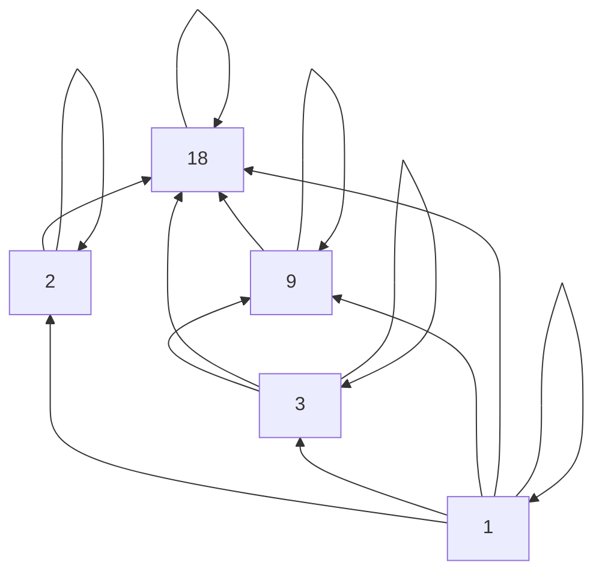

*그림 17. 집합 {1, 2, 3, 9, 18} 위의 나누어떨어짐 관계의 방향 그래프*

모든 꼭짓점에 루프가 있고, 루프가 아닌 화살표는 모두 같은 방향(위쪽)을 향하며, 한 점에서 두 번째 점으로, 두 번째 점에서 세 번째 점으로 화살표가 있으면 첫 번째 점에서 세 번째 점으로도 화살표가 있다. 유한 집합 위의 부분 순서 관계는 항상 이 성질들을 만족하도록 방향 그래프를 그릴 수 있다. 반사성 때문에 루프가 모든 꼭짓점에 있고, 반대칭성 때문에 서로 다른 두 점 사이의 화살표는 많아야 한 방향이며, 추이성 때문에 이어지는 화살표의 지름길 화살표가 항상 있다. 또 반대칭성과 추이성 때문에 서로 다른 점들을 거쳐 출발점으로 돌아오는 화살표의 순환이 없으므로, 모든 화살표가 위를 향하도록 꼭짓점을 배치할 수 있다. 그래프가 이처럼 규칙적이므로 그 가운데 많은 부분을 정보의 손실 없이 생략할 수 있으며, 이렇게 하여 유한 집합 위의 부분 순서 관계에 더 간단한 그림인 **하세 도표(Hasse diagram)** 를 대응시킨다. 하세 도표는 20세기 독일의 정수론 학자 하세(Helmut Hasse)의 이름을 딴 것이며, 다음 절차로 얻는다.

먼저 모든 화살표가 위를 향하도록 꼭짓점을 배치하여 관계의 방향 그래프를 그린다. 그다음 다음 세 가지를 지운다.

1. 모든 꼭짓점의 루프
2. 추이성에 의해 존재가 함의되는 모든 화살표
3. 화살표의 방향 표시(화살촉)

나누어떨어짐 관계에서 $1 \to 9$는 $1 \to 3 \to 9$에서, $1 \to 18$은 $1 \to 2 \to 18$에서, $3 \to 18$은 $3 \to 9 \to 18$에서 함의되므로 지운다. 남는 선은 1과 2, 1과 3, 2와 18, 3과 9, 9와 18을 잇는 다섯 개이며, 하세 도표는 그림 18과 같다.

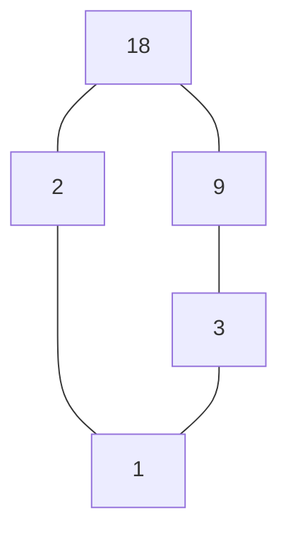

*그림 18. 집합 {1, 2, 3, 9, 18} 위의 나누어떨어짐 관계의 하세 도표*

**예제 8.5.7 (하세 도표 그리기).** $\mathcal{P}(\lbrace a, b, c \rbrace)$ 위의 부분집합 관계 $\subseteq$, 즉 모든 $U, V \in \mathcal{P}(\lbrace a, b, c \rbrace)$에 대해 $`U \subseteq V \iff \forall x, \ x \in U \Rightarrow x \in V`$인 관계의 하세 도표를 그린다.

루프를 제외한 모든 화살표가 위를 향하도록 방향 그래프를 그리면, 아래에서부터 원소가 0개, 1개, 2개, 3개인 집합이 층을 이루고 각 집합에서 그것을 포함하는 모든 집합으로 화살표가 있다. 여기서 루프, 추이성으로 함의되는 화살표(예를 들어 $\emptyset \to \lbrace a, b \rbrace$는 $\emptyset \to \lbrace a \rbrace \to \lbrace a, b \rbrace$에서 함의된다), 화살촉을 모두 지우면, 작은 집합에 원소 하나를 더하여 큰 집합이 되는 두 집합 사이에만 선이 남는다. 결과는 그림 19와 같다.

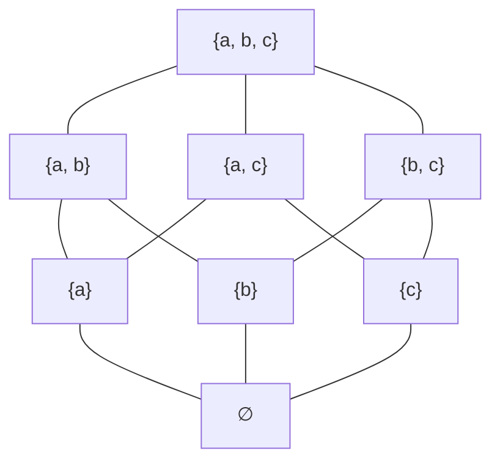

*그림 19. 멱집합 P({a, b, c}) 위의 부분집합 관계의 하세 도표*

하세 도표에서 관계의 방향 그래프를 되살리려면, 원래 방향 그래프의 모든 화살표가 위를 향하도록 그렸다는 사실을 이용하여 앞의 절차를 거꾸로 수행한다.

1. 모든 선에 위를 향하는 화살촉을 다시 붙인다.
2. 모든 꼭짓점에 루프를 추가한다.
3. 한 점에서 두 번째 점으로, 두 번째 점에서 세 번째 점으로 가는 화살표가 있을 때마다 첫 번째 점에서 세 번째 점으로 가는 화살표를 추가한다. 새 화살표가 생기지 않을 때까지 반복한다.

**예제 8.5.8 (하세 도표에서 방향 그래프 구하기).** 부분 순서 관계 $R$의 하세 도표가 그림 20과 같을 때, $R$의 방향 그래프를 구한다.

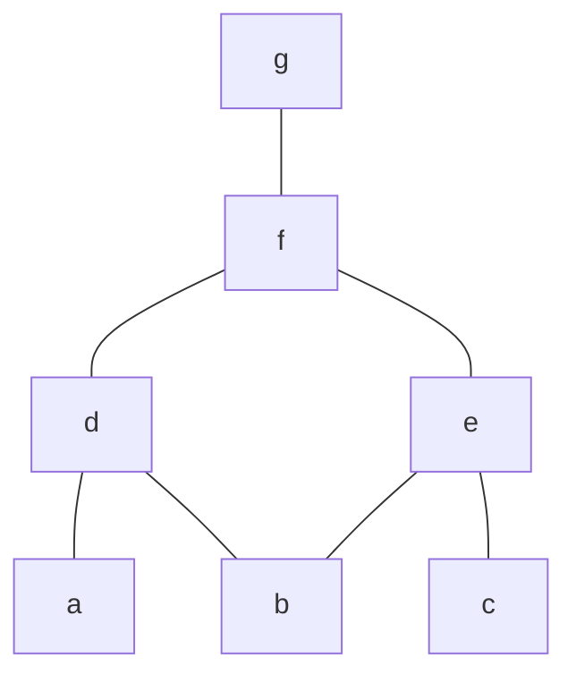

*그림 20. 예제 8.5.8의 부분 순서 관계의 하세 도표*

선에 위를 향하는 화살촉을 붙이고, 일곱 꼭짓점에 루프를 더한 뒤, 이어지는 화살표의 지름길을 모두 추가한다. 예를 들어 $a \to d \to f$에서 $a \to f$를, $a \to f \to g$에서 $a \to g$를 얻는다. 같은 방식으로 각 꼭짓점에서 그보다 위에 있는 모든 꼭짓점으로 화살표가 생긴다. $a$에서는 $d, f, g$로, $b$에서는 $d, e, f, g$로, $c$에서는 $e, f, g$로, $d$와 $e$에서는 각각 $f, g$로, $f$에서는 $g$로 가는 화살표가 있으므로 루프가 아닌 화살표는 $3 + 4 + 3 + 2 + 2 + 1 = 15$개이고, 루프 7개를 더하면 $R$은 22개의 순서쌍으로 이루어진다. 방향 그래프는 그림 21과 같다.

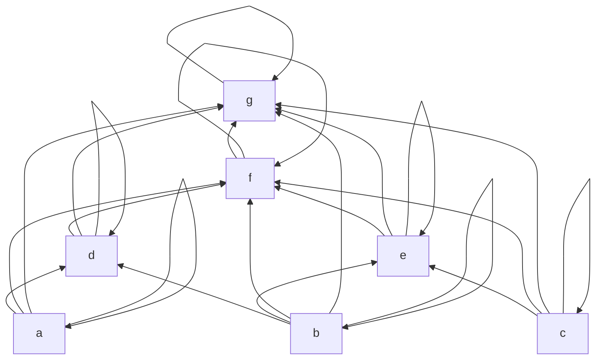

*그림 21. 하세 도표에서 되살린 예제 8.5.8의 부분 순서 관계의 방향 그래프*

### 4.5 부분 순서 집합과 전순서 집합

임의의 두 실수 $x$, $y$에 대해 $x \le y$이거나 $y \le x$이다. 이런 경우 두 원소 $x$와 $y$를 비교 가능하다고 한다. 반면 $\lbrace a, b, c \rbrace$의 두 부분집합 $A$, $B$에 대해서는 $A \subseteq B$도 $B \subseteq A$도 성립하지 않을 수 있다. 예를 들어 $A = \lbrace a, b \rbrace$, $B = \lbrace b, c \rbrace$이면 $A \not\subseteq B$이고 $B \not\subseteq A$이다. 이런 경우 $A$와 $B$를 비교 불가능하다고 한다.

> **용어 정의:** $\preceq$를 집합 $A$ 위의 부분 순서 관계라 한다. $A$의 원소 $a$, $b$에 대해 $a \preceq b$이거나 $b \preceq a$일 때, 그리고 그때에만 $a$와 $b$를 **비교 가능(comparable)** 하다고 한다. 그렇지 않으면 $a$와 $b$를 **비교 불가능(noncomparable)** 하다고 한다.

부분 순서 관계에서 모든 두 원소가 비교 가능하면 그 관계를 전순서라고 한다.

> **용어 정의:** $R$이 집합 $A$ 위의 부분 순서 관계이고 $A$의 임의의 두 원소 $a$, $b$에 대해 $`a \, R \, b`$이거나 $`b \, R \, a`$이면, $R$을 $A$ 위의 **전순서 관계(total order relation)** 또는 **전순서(total order)** 라고 한다.

실수 집합 위의 작거나 같다 관계와 사전에 실린 단어들의 사전식 순서는 모두 전순서 관계이다. 전순서 관계의 하세 도표는 하나의 수직 사슬 모양으로 그릴 수 있다. 반면 중요한 부분 순서 관계 가운데 상당수는 비교 불가능한 원소를 가지므로 전순서가 아니다. 예를 들어 $\mathcal{P}(\lbrace a, b, c \rbrace)$ 위의 부분집합 관계는 $\lbrace a, b \rbrace$와 $\lbrace a, c \rbrace$가 비교 불가능하므로 전순서가 아니다. 나누어떨어짐 관계도 전순서가 아닌 경우가 많으며, 예를 들어 그림 18에서 2와 3은 어느 쪽도 다른 쪽을 나누지 않는다. 양의 정수의 집합 위에서 나누어떨어짐 관계가 전순서가 되는 것은 $\lbrace 1, 2, 4, 8 \rbrace$이나 $\lbrace 2, 6, 12 \rbrace$처럼 원소들을 작은 것부터 늘어놓았을 때 각 원소가 바로 다음 원소를 나누는 경우뿐이다.

> **용어 정의:** $\preceq$가 집합 $A$ 위의 부분 순서 관계일 때, 그리고 그때에만 $A$를 $\preceq$에 대한 **부분 순서 집합(partially ordered set, poset)** 이라고 한다. $A$가 $\preceq$에 대한 부분 순서 집합이고 $\preceq$가 전순서일 때, 그리고 그때에만 $A$를 $\preceq$에 대한 **전순서 집합(totally ordered set)** 이라고 한다.

예를 들어 실수 집합은 작거나 같다 관계 $\le$에 대한 부분 순서 집합이고, 집합들의 집합은 부분집합 관계 $\subseteq$에 대한 부분 순서 집합이다. 부분 순서 집합의 임의의 부분집합은 같은 관계(그 부분집합으로 제한한 관계)에 대해 다시 부분 순서 집합이다. 반사성, 반대칭성, 추이성은 모두 전칭 명제이므로, 원래 집합의 모든 원소에서 성립하면 부분집합의 원소에서도 성립하기 때문이다.

부분 순서 집합이지만 전순서 집합이 아닌 집합도 전순서인 부분집합을 가질 수 있다. 이런 부분집합을 사슬이라고 한다.

> **용어 정의:** $A$를 관계 $\preceq$에 대한 부분 순서 집합이라 한다. $A$의 부분집합 $B$의 모든 두 원소가 비교 가능할 때, 즉 $B$의 모든 $a$, $b$에 대해 $a \preceq b$이거나 $b \preceq a$일 때, 그리고 그때에만 $B$를 **사슬(chain)** 이라고 한다. **사슬의 길이(length of a chain)** 는 사슬의 원소 개수보다 1 작은 수이다.

$B$가 $A$의 사슬이면, $B$는 $\preceq$를 $B$로 제한한 관계에 대해 전순서 집합이다. 또 부분 순서 집합이 전순서 집합일 필요충분조건은 그 집합 전체가 사슬인 것이다.

**예제 8.5.9 (부분집합의 사슬).** 부분집합 관계에 대한 부분 순서 집합 $\mathcal{P}(\lbrace a, b, c \rbrace)$에서 길이가 3인 사슬을 찾는다. $\emptyset \subseteq \lbrace a \rbrace \subseteq \lbrace a, b \rbrace \subseteq \lbrace a, b, c \rbrace$이므로 집합 $S = \lbrace \emptyset, \lbrace a \rbrace, \lbrace a, b \rbrace, \lbrace a, b, c \rbrace \rbrace$의 모든 두 원소는 비교 가능하다. $S$는 원소가 4개이므로 길이가 3인 사슬이다. 하세 도표(그림 19)에서 사슬의 원소들은 아래에서 위로 올라가는 하나의 경로 위에 놓이며, 이 사슬은 $\emptyset$에서 $\lbrace a, b, c \rbrace$까지 올라가는 경로 하나의 꼭짓점 전체이다.

### 4.6 극대, 극소, 최대, 최소 원소

부분 순서 집합의 **극대 원소(maximal element)** 는 자신과 비교 가능한 모든 원소보다 크거나 같은 원소이다. 비교 불가능한 원소는 많이 있을 수 있다. 반면 **최대 원소(greatest element)** 는 집합의 모든 원소보다 크거나 같은 원소이므로 모든 원소와 비교 가능하다. **극소 원소(minimal element)** 와 **최소 원소(least element)** 도 순서의 방향을 바꾸어 같은 방식으로 정의한다.

> **용어 정의:** **부분 순서의 특별한 원소(special elements of a partial order).** 집합 $A$를 관계 $\preceq$에 대한 부분 순서 집합이라 한다.
> 1. $A$의 원소 $a$가 **$A$의 극대 원소** 라는 것은 $A$의 모든 원소 $b$에 대해 $b \preceq a$이거나 $b$와 $a$가 비교 불가능하다는 뜻이다.
> 2. $A$의 원소 $a$가 **$A$의 최대 원소** 라는 것은 $A$의 모든 원소 $b$에 대해 $b \preceq a$라는 뜻이다.
> 3. $A$의 원소 $a$가 **$A$의 극소 원소** 라는 것은 $A$의 모든 원소 $b$에 대해 $a \preceq b$이거나 $b$와 $a$가 비교 불가능하다는 뜻이다.
> 4. $A$의 원소 $a$가 **$A$의 최소 원소** 라는 것은 $A$의 모든 원소 $b$에 대해 $a \preceq b$라는 뜻이다.

극대 원소의 정의는 다음과 같이 바꾸어 말할 수 있다. $a$가 극대 원소일 필요충분조건은 $a \preceq b$이고 $b \ne a$인 원소 $b$, 즉 $a$보다 엄격히 큰 원소가 없는 것이다. $a \preceq b$이고 $b \ne a$인 $b$가 있으면 $b$는 $a$와 비교 가능하므로 정의에 따라 $b \preceq a$여야 하고, 반대칭성에 의해 $a = b$가 되어 모순이기 때문이다. 극소 원소도 $a$보다 엄격히 작은 원소가 없는 원소로 바꾸어 말할 수 있다. 하세 도표에서 극대 원소는 위로 이어진 선이 없는 꼭짓점이고, 극소 원소는 아래로 이어진 선이 없는 꼭짓점이다.

이 네 개념 사이에는 다음 관계가 성립한다.

- 최대 원소는 극대 원소이지만, 극대 원소가 최대 원소일 필요는 없다. 최소 원소와 극소 원소도 마찬가지이다.
- 전순서 집합의 공집합이 아닌 유한 부분집합은 최소 원소와 최대 원소를 모두 가진다.
- 부분 순서 집합은 최대 원소와 최소 원소를 많아야 하나씩 가진다. $g$와 $g'$가 모두 최대 원소이면 $g' \preceq g$이고 $g \preceq g'$이므로 반대칭성에 의해 $g = g'$이다.
- 반면 극대 원소와 극소 원소는 여러 개일 수 있다.

> **주의:** 극대 원소와 최대 원소를 혼동하지 않아야 한다. 극대 원소는 자기보다 큰 원소가 없다는 뜻일 뿐, 모든 원소가 자기보다 작거나 같다는 뜻이 아니다. 예를 들어 4.7절의 예제 8.5.11에서 18과 24는 모두 극대 원소이지만, 서로 비교 불가능하므로 어느 것도 최대 원소가 아니다.

**예제 8.5.10 (극대, 극소, 최대, 최소 원소).** $A = \lbrace a, b, c, d, e, f, g, h, i \rbrace$에 그림 22의 하세 도표로 정의된 부분 순서 $\preceq$가 주어져 있다. $A$의 극대, 극소, 최대, 최소 원소를 모두 구한다.

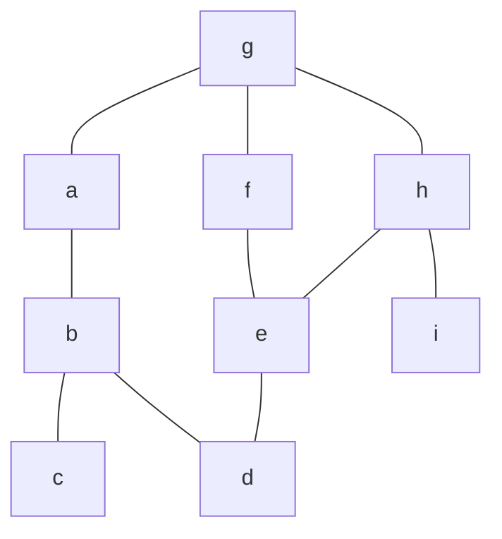

*그림 22. 예제 8.5.10의 부분 순서의 하세 도표*

- 위로 이어진 선이 없는 꼭짓점은 $g$ 하나이므로 극대 원소는 $g$뿐이다.
- $g$는 최대 원소이기도 하다. 모든 원소에서 위로 올라가는 경로가 $g$에 닿는다. $c \to b \to a \to g$, $d \to b \to a \to g$, $e \to f \to g$, $e \to h \to g$, $i \to h \to g$이므로 모든 원소 $x$에 대해 $x \preceq g$이다.
- 아래로 이어진 선이 없는 꼭짓점은 $c$, $d$, $i$이므로 극소 원소는 $c$, $d$, $i$이다.
- 최소 원소는 없다. 최소 원소는 모든 원소보다 작거나 같아야 하는데, 세 극소 원소 $c$, $d$, $i$는 서로 비교 불가능하므로 어느 것도 나머지보다 작거나 같지 않다.

### 4.7 위상 정렬

$\mathcal{P}(\lbrace a, b, c \rbrace)$의 집합들은 부분집합 관계 $\subseteq$와 어긋나지 않는 순서로, 즉 $U \subseteq V$이면 $U$가 $V$보다 먼저 오도록 컴퓨터에 입력할 수 있다. 예를 들어 다음 입력 순서는 이 조건을 만족한다.

```math
\emptyset, \ \lbrace a \rbrace, \ \lbrace b \rbrace, \ \lbrace c \rbrace, \ \lbrace a, b \rbrace, \ \lbrace a, c \rbrace, \ \lbrace b, c \rbrace, \ \lbrace a, b, c \rbrace
```

조건을 만족하는 다른 입력 순서도 있다.

```math
\emptyset, \ \lbrace a \rbrace, \ \lbrace b \rbrace, \ \lbrace a, b \rbrace, \ \lbrace c \rbrace, \ \lbrace b, c \rbrace, \ \lbrace a, c \rbrace, \ \lbrace a, b, c \rbrace
```

> **용어 정의:** 집합 $A$ 위의 부분 순서 관계 $\preceq$와 $\preceq'$이 주어졌을 때, $A$의 모든 $a$, $b$에 대해 $a \preceq b$이면 $a \preceq' b$일 때, 그리고 그때에만 $\preceq'$이 $\preceq$와 **호환(compatible)** 관계에 있다고 한다.

집합 $A$가 유한하면, $A$ 위의 임의의 부분 순서 관계 $\preceq$에 대해 $\preceq$와 호환되는 $A$ 위의 전순서 $\preceq'$이 항상 존재한다. 주어진 순서와 호환되는 전순서를 위상 정렬이라고 한다.

> **용어 정의:** 집합 $A$ 위의 부분 순서 관계 $\preceq$와 $\preceq'$이 주어졌을 때, $\preceq'$이 $\preceq$와 호환되는 전순서일 때, 그리고 그때에만 $\preceq'$을 $\preceq$의 **위상 정렬(topological sorting)** 이라고 한다.

일반적인 유한 부분 순서 집합의 위상 정렬을 만드는 방법은 다음 사실에 기초한다. 공집합이 아닌 유한 부분 순서 집합은 극소 원소를 가진다. 그 이유는 다음과 같다. 아무 원소 $x_1$에서 시작하여, $x_1$이 극소 원소가 아니면 $x_1$보다 엄격히 작은 원소 $x_2$를 고르고, $x_2$가 극소 원소가 아니면 그보다 엄격히 작은 $x_3$을 고르는 일을 반복한다. 추이성에 의해 $x_j$는 앞서 고른 모든 $x_i$보다 엄격히 작으므로, 반대칭성에 의해 같은 원소가 두 번 나올 수 없다. 원소가 유한 개이므로 이 과정은 언젠가 멈추고, 멈춘 곳의 원소가 극소 원소이다.

이 사실을 이용하면 위상 정렬을 다음과 같이 만든다. 극소 원소 하나를 골라 1번으로 정한다. 그 원소를 제거한 집합을 생각하면, 이 집합은 부분 순서 집합의 부분집합이므로 다시 부분 순서 집합이다. 이 집합이 공집합이면 멈추고, 아니면 극소 원소 하나를 골라 2번으로 정한다. 이 원소도 제거하고, 같은 일을 모든 원소를 다 쓸 때까지 반복한다. 이를 조금 더 형식적으로 쓰면 다음과 같다.

**위상 정렬 구성 알고리즘.** $\preceq$를 공집합이 아닌 유한 집합 $A$ 위의 부분 순서 관계라 한다.

1. $A$의 극소 원소 $x$ 하나를 고른다. [$`A`$가 공집합이 아니므로 그런 원소가 존재한다.]
2. $A' := A - \lbrace x \rbrace$로 둔다.
3. $A' \ne \emptyset$인 동안 다음 세 단계를 반복한다.
   1. $A'$의 극소 원소 $y$ 하나를 고른다.
   2. $x \preceq' y$로 정한다.
   3. $A' := A' - \lbrace y \rbrace$, $x := y$로 둔다.

1단계에서 3단계까지 마치면 전순서 $\preceq'$의 하세 도표(하나의 사슬)를 그리기에 충분한 정보가 생기며, 4.4절의 방법으로 하세 도표에서 관계 전체의 방향 그래프를 얻을 수 있다. 각 단계에서 고른 원소는 남은 원소 가운데 극소이므로, 남은 원소 중 어느 것도 그 원소보다 엄격히 작지 않다. 따라서 $a \preceq b$이면 $a$가 $b$보다 먼저 선택되어 $a \preceq' b$가 되고, $\preceq'$은 $\preceq$와 호환된다.

**예제 8.5.11 (위상 정렬).** 나누어떨어짐 관계 $\mid$로 순서가 주어진 집합 $A = \lbrace 2, 3, 4, 6, 18, 24 \rbrace$를 생각한다. 이 관계의 하세 도표는 그림 23과 같다.

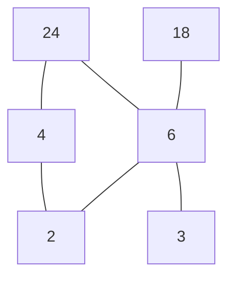

*그림 23. 집합 {2, 3, 4, 6, 18, 24} 위의 나누어떨어짐 관계의 하세 도표*

양의 정수 $a$, $b$에 대해 $a \mid b$이면 $a \le b$이므로 보통의 작거나 같다 관계 $\le$는 이 집합의 위상 정렬이다. 이와 다른 위상 정렬을 하나 찾는다. 표 8은 알고리즘의 진행 과정이다.

| 단계 | 남은 집합 $A'$ | $A'$의 극소 원소 | 고른 원소 | 지금까지의 전순서 |
|:---:|:---|:---|:---:|:---|
| 1 | $\lbrace 2, 3, 4, 6, 18, 24 \rbrace$ | 2, 3 | 3 | $3$ |
| 2 | $\lbrace 2, 4, 6, 18, 24 \rbrace$ | 2 | 2 | $3 \preceq' 2$ |
| 3 | $\lbrace 4, 6, 18, 24 \rbrace$ | 4, 6 | 6 | $3 \preceq' 2 \preceq' 6$ |
| 4 | $\lbrace 4, 18, 24 \rbrace$ | 4, 18 | 18 | $3 \preceq' 2 \preceq' 6 \preceq' 18$ |
| 5 | $\lbrace 4, 24 \rbrace$ | 4 | 4 | $3 \preceq' 2 \preceq' 6 \preceq' 18 \preceq' 4$ |
| 6 | $\lbrace 24 \rbrace$ | 24 | 24 | $3 \preceq' 2 \preceq' 6 \preceq' 18 \preceq' 4 \preceq' 24$ |

*표 8. 예제 8.5.11의 위상 정렬 과정*

1단계에서는 극소 원소가 2와 3의 두 개이므로 어느 것을 골라도 되며, 여기서는 3을 골랐다. 2단계에서 6은 아직 남은 2보다 크므로 극소가 아니고, 극소 원소는 2뿐이다. 3단계에서는 4와 6 중 6을 골랐다. 4단계에서 24는 남은 4보다 크므로 극소가 아니다. 결과 $3 \preceq' 2 \preceq' 6 \preceq' 18 \preceq' 4 \preceq' 24$가 나누어떨어짐 관계와 호환된다는 것은 $a \mid b$인 모든 쌍에 대해 $a \preceq' b$임을 확인하여 보일 수 있다. 하세 도표의 여섯 선 $2 \mid 4$, $2 \mid 6$, $3 \mid 6$, $4 \mid 24$, $6 \mid 18$, $6 \mid 24$가 모두 이 순서를 지키므로, 추이성에 의해 나머지 쌍도 지킨다. 이 집합의 위상 정렬은 모두 12개이다.

> **주의:** 위상 정렬 $\preceq'$은 $\preceq$와 호환될 뿐이며, $a \preceq' b$라고 해서 $a \preceq b$인 것은 아니다. 위의 결과에서 $3 \preceq' 2$이지만 3은 2를 나누지 않는다.

> **[알고리즘]** 그래프 알고리즘에서 위상 정렬은 방향 비순환 그래프(directed acyclic graph)의 꼭짓점을 모든 화살표가 앞에서 뒤로 향하도록 일렬로 늘어놓는 문제이다. 들어오는 화살표가 없는 꼭짓점(극소 원소)을 반복해서 제거하는 방법이나 깊이 우선 탐색을 이용하면 꼭짓점과 화살표의 개수에 비례하는 시간에 구할 수 있으며, 빌드 시스템의 컴파일 순서나 작업 스케줄링에 쓰인다.

### 4.8 응용: 선수 과목 구조

4절의 처음에 소개한 예로 돌아가면, 학위에 필요한 과목들의 집합 위에 다음과 같이 부분 순서 관계를 정의할 수 있다. 모든 필수 과목 $x$, $y$에 대해 $x \preceq y$일 필요충분조건은 $x = y$이거나 $x$가 $y$의 선수 과목인 것이다. 이 관계의 하세 도표를 그리면 처음에 제기한 질문들에 쉽게 답할 수 있다. 예를 들어 어떤 대학의 필수 과목 요건이 그림 24의 하세 도표와 같다고 한다.

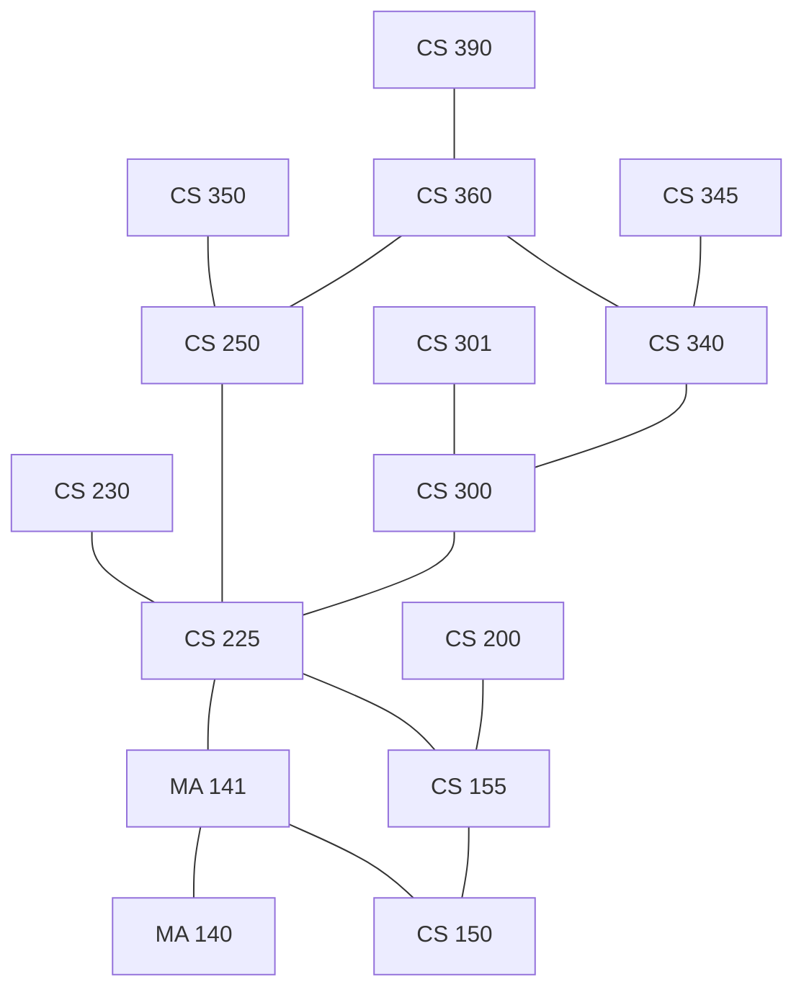

*그림 24. 어떤 대학의 필수 과목 선수 관계의 하세 도표*

- **최소 학기 수.** 요건을 채우는 데 필요한 최소 학기 수는 가장 긴 사슬의 원소 수이며, 7이다. 예를 들어 150, 155, 225, 300, 340, 360, 390은 원소가 7개인 사슬이다. 사슬의 각 과목은 바로 앞 과목을 마친 뒤에야 들을 수 있으므로 적어도 7개 학기가 필요하다. 거꾸로 각 과목을 그 과목에서 끝나는 가장 긴 사슬의 원소 수에 해당하는 학기에 들으면, 선수 과목은 항상 더 이른 학기에 오므로 7개 학기로 충분하다(한 학기에 들을 수 있는 과목 수에 제한이 없다고 가정한다).
- **한 학기의 최대 과목 수.** 대학이 허용한다면 한 학기에 함께 들을 수 있는 최대 과목 수는 서로 비교 불가능한 과목들의 최대 개수이며, 6이다. 예를 들어 350, 360, 345, 301, 230, 200은 어느 두 과목도 선후 관계가 없다.
- **한 학기에 한 과목씩 듣는 순서.** 시간제 학생이 한 학기에 한 과목씩 들을 순서는 이 집합의 위상 정렬로 정할 수 있다. 그런 순서의 하나는 140, 150, 141, 155, 200, 225, 230, 300, 250, 301, 340, 345, 350, 360, 390이며, 이 밖에도 많다.

> **주의:** 사슬의 길이는 원소 수보다 1 작다. 위의 가장 긴 사슬은 원소가 7개이므로 길이는 6이며, 최소 학기 수는 길이가 아니라 원소 수 7이다.

### 4.9 PERT와 CPM

부분 순서 관계의 중요하고 널리 쓰이는 두 응용이 **PERT(Program Evaluation and Review Technique)** 와 **CPM(Critical Path Method)** 이다. 두 기법은 1950년대에 대규모 사업을 완수하는 데 필요한 개별 작업들의 일정을 짜는 복잡한 문제를 다루기 위해 개발되었다. 둘은 매우 비슷하지만 독립적으로 개발되었는데, PERT는 미 해군이 폴라리스 잠수함 건조를 관리하기 위해, CPM은 듀폰(Du Pont)사가 화학 공장의 정비 일정을 짜기 위해 개발하였다. 다음은 두 기법이 작동하는 방식을 단순화한 예이다.

**예제 8.5.12 (작업 일정 문제).** 자동차 조립 공장에서 자동차 한 대를 조립하는 일을 다음 아홉 작업으로 나눌 수 있다.

1. 차대를 만든다.
2. 엔진, 동력 전달 장치 부품, 연료 탱크를 설치한다.
3. 브레이크, 바퀴, 타이어를 설치한다.
4. 계기판, 바닥, 좌석을 설치한다.
5. 전기 배선을 설치한다.
6. 연료 배관을 설치한다.
7. 브레이크 배관을 설치한다.
8. 차체 패널을 차대에 부착한다.
9. 차체를 도장한다.

이 작업들 가운데 일부는 동시에 수행할 수 있지만, 일부는 다른 작업이 끝나야 시작할 수 있다. 표 9는 각 작업의 직전 선행 작업과 소요 시간이다.

| 작업 | 직전 선행 작업 | 소요 시간 |
|:---:|:---:|:---:|
| 1 | 없음 | 7시간 |
| 2 | 1 | 6시간 |
| 3 | 1 | 3시간 |
| 4 | 2 | 6시간 |
| 5 | 2, 3 | 3시간 |
| 6 | 4 | 1시간 |
| 7 | 2, 3 | 1시간 |
| 8 | 4, 5 | 2시간 |
| 9 | 6, 7, 8 | 5시간 |

*표 9. 자동차 조립 작업의 직전 선행 작업과 소요 시간*

$T$를 모든 작업의 집합이라 하고, $T$ 위의 부분 순서 관계 $\preceq$를 모든 작업 $x$, $y$에 대해 $x = y$이거나 $x$가 $y$보다 먼저 수행되어야 할 때 $x \preceq y$로 정의한다. PERT와 CPM 분석에서는 관례에 따라 이 관계의 하세 도표를 옆으로 눕혀 왼쪽에서 오른쪽으로 진행하도록 그린다. 그림 25는 그렇게 그린 도표에 방향을 화살표로 표시하고, 각 작업의 최소 완료 시각(작업 시작 시점부터 그 작업을 끝낼 때까지 걸리는 최소 시간)을 함께 적은 것이다.

```mermaid
graph LR
    T1["작업 1<br>7시간<br>완료 시각 7"] --> T2["작업 2<br>6시간<br>완료 시각 13"]
    T1 --> T3["작업 3<br>3시간<br>완료 시각 10"]
    T2 --> T4["작업 4<br>6시간<br>완료 시각 19"]
    T2 --> T5["작업 5<br>3시간<br>완료 시각 16"]
    T3 --> T5
    T2 --> T7["작업 7<br>1시간<br>완료 시각 14"]
    T3 --> T7
    T4 --> T6["작업 6<br>1시간<br>완료 시각 20"]
    T4 --> T8["작업 8<br>2시간<br>완료 시각 21"]
    T5 --> T8
    T6 --> T9["작업 9<br>5시간<br>완료 시각 26"]
    T7 --> T9
    T8 --> T9
    classDef critical stroke-width:3px
    class T1,T2,T4,T8,T9 critical
```

*그림 25. 최소 완료 시각을 표시한 자동차 조립 작업의 PERT 도표(굵은 테두리는 임계 경로)*

자동차를 조립하는 데 필요한 최소 시간은 도표를 왼쪽에서 오른쪽으로 따라가며 각 작업의 최소 완료 시각을 적어 나가면 구할 수 있다. 작업 1은 7시간이 걸리므로 최소 완료 시각이 7이다. 작업 2는 작업 1을 마친 뒤(7시간) 6시간이 더 걸리므로 $7 + 6 = 13$이고, 작업 3은 $7 + 3 = 10$이다. 작업 5는 작업 2와 작업 3이 모두 끝나야 시작할 수 있으므로, 두 작업의 최소 완료 시각 13과 10 가운데 큰 값에 작업 5의 시간 3을 더한 $3 + 13 = 16$이 최소 완료 시각이다. 일반적으로 작업 $k$의 최소 완료 시각 $F(k)$는 다음과 같다.

```math
F(k) = t(k) + \max \lbrace F(p) \mid p \in P(k) \rbrace
```

여기서 $t(k)$는 작업 $k$의 소요 시간, $P(k)$는 작업 $k$의 직전 선행 작업들의 집합이며, $P(k)$가 공집합이면 최댓값 부분을 0으로 둔다. 표 10은 이 식으로 모든 작업의 최소 완료 시각을 계산한 것이다.

| 작업 | 직전 선행 작업의 최소 완료 시각 | 최댓값 | 소요 시간 | 최소 완료 시각 |
|:---:|:---|:---:|:---:|:---:|
| 1 | 없음 | 0 | 7 | 7 |
| 2 | $F(1) = 7$ | 7 | 6 | 13 |
| 3 | $F(1) = 7$ | 7 | 3 | 10 |
| 4 | $F(2) = 13$ | 13 | 6 | 19 |
| 5 | $F(2) = 13$, $F(3) = 10$ | 13 | 3 | 16 |
| 6 | $F(4) = 19$ | 19 | 1 | 20 |
| 7 | $F(2) = 13$, $F(3) = 10$ | 13 | 1 | 14 |
| 8 | $F(4) = 19$, $F(5) = 16$ | 19 | 2 | 21 |
| 9 | $F(6) = 20$, $F(7) = 14$, $F(8) = 21$ | 21 | 5 | 26 |

*표 10. 각 작업의 최소 완료 시각 계산*

이 분석에 따르면 조립 과정의 시작부터 작업 9를 마칠 때까지 적어도 26시간이 필요하다. 작업 9가 끝나면 조립이 완료되므로 26시간이 전체 과정의 최소 소요 시간이다. 작업 1, 2, 4, 8, 9를 차례로 수행하는 데 걸리는 시간은 $7 + 6 + 6 + 2 + 5 = 26$시간으로, 정확히 전체 최소 소요 시간과 같다. 따라서 이 다섯 작업 가운데 어느 하나라도 늦어지면 자동차 조립 전체가 늦어진다. 이런 이유로 작업 1, 2, 4, 8, 9를 지나는 경로를 **임계 경로(critical path)** 라고 한다. 각 작업에서 최댓값을 준 직전 선행 작업을 거꾸로 따라가면 임계 경로를 찾을 수 있다(9에서 $F(8) = 21$, 8에서 $F(4) = 19$, 4에서 $F(2) = 13$, 2에서 $`F(1) = 7`$).

> **핵심:** PERT와 CPM은 작업들 사이의 선행 관계를 부분 순서로 보고, 하세 도표를 따라 최소 완료 시각을 계산한다. 전체 소요 시간은 가장 오래 걸리는 사슬(임계 경로)이 결정하며, 임계 경로 밖의 작업은 어느 정도 늦어져도 전체 일정에 영향을 주지 않는다. 예를 들어 작업 7은 14시간에 끝날 수 있지만 작업 9는 21시간이 되어야 시작하므로, 작업 7은 7시간까지 늦어져도 된다.

---

<br>

## 개념 적용

**관계의 성질 판정:** 표 11은 이 장에 나온 여러 관계가 네 성질을 가지는지와 그에 따른 분류를 정리한 것이다.

| 관계 | 반사적 | 대칭적 | 추이적 | 반대칭적 | 분류 |
|:---|:---:|:---:|:---:|:---:|:---|
| $\mathbf{R}$ 위의 $=$ | 예 | 예 | 예 | 예 | 동치 관계이자 부분 순서 |
| $\mathbf{R}$ 위의 $<$ | 아니오 | 아니오 | 예 | 예 | 동치 관계도 부분 순서도 아님 |
| $\mathbf{R}$ 위의 $\le$ | 예 | 아니오 | 예 | 예 | 전순서 |
| $\mathbf{Z}$ 위의 법 3에 대한 합동 | 예 | 예 | 예 | 아니오 | 동치 관계 |
| $\mathbf{Z}^{+}$ 위의 나누어떨어짐 | 예 | 아니오 | 예 | 예 | 부분 순서(전순서 아님) |
| 0이 아닌 정수 위의 나누어떨어짐 | 예 | 아니오 | 예 | 아니오 | 동치 관계도 부분 순서도 아님 |
| 공집합이 아닌 $X$에 대해 $\mathcal{P}(X)$ 위의 $\subseteq$ | 예 | 아니오 | 예 | 예 | 부분 순서 |
| 예제 8.2.1의 $R$ | 예 | 예 | 아니오 | 아니오 | 동치 관계도 부분 순서도 아님 |

*표 11. 이 장에 나온 관계들의 성질과 분류*

**T/F 점검:**

| 문장 | 판단과 근거 |
|:-----|:------------|
| 대칭적이지 않은 관계는 반대칭적이다. | **F.** $\lbrace 0, 1, 2 \rbrace$ 위의 $\lbrace (0, 1), (1, 0), (0, 2) \rbrace$는 대칭적이지도 반대칭적이지도 않다. |
| 공집합이 아닌 집합 위의 공집합 관계는 대칭적이고 추이적이지만 반사적이지 않다. | **T.** 대칭성과 추이성은 가정이 성립하는 경우가 없어 공허하게 참이고, 원소 $x$에 대해 $(x, x)$가 없으므로 반사적이지 않다. |
| 동치 관계의 서로 다른 두 동치류는 공통 원소를 가질 수 있다. | **F.** 보조정리 8.3.3에 의해 두 동치류는 같거나 서로소이다. |
| $12 \equiv -3 \pmod{5}$이다. | **T.** $12 - (-3) = 15 = 5 \cdot 3$이다. |
| 관계 $R$이 이미 추이적이면 $R^t = R$이다. | **T.** $R$ 자신이 추이적 폐포의 세 조건을 만족한다. |
| 부분 순서 집합의 극대 원소는 항상 최대 원소이다. | **F.** 예제 8.5.11에서 18과 24는 극대 원소이지만 최대 원소는 없다. |
| 공집합이 아닌 유한 부분 순서 집합의 위상 정렬은 하나뿐이다. | **F.** 극소 원소를 고르는 방법이 여러 가지일 수 있으며, 예제 8.5.11의 집합에는 위상 정렬이 12개 있다. |

---

<br>

## 요약

| 개념 | 핵심 요약 |
|:-----|:-----|
| 관계 | $A$에서 $B$로의 관계는 $A \times B$의 부분집합이며, $`x \, R \, y`$는 $(x, y) \in R$을 뜻한다. |
| 역관계 | $R^{-1}$은 $R$의 모든 순서쌍의 두 성분을 맞바꾼 $B$에서 $A$로의 관계이다. |
| 방향 그래프 | 집합 위의 관계는 원소를 꼭짓점으로, 관계된 쌍을 화살표로, $`x \, R \, x`$를 루프로 나타낸다. |
| $n$항 관계 | $A_1 \times \cdots \times A_n$의 부분집합이며, 관계형 데이터베이스의 테이블에 해당한다. |
| 반사성 | 모든 $x$에 대해 $`x \, R \, x`$이며, 방향 그래프의 모든 꼭짓점에 루프가 있다는 뜻이다. |
| 대칭성 | $`x \, R \, y`$이면 $`y \, R \, x`$이며, 모든 화살표에 반대 방향 화살표가 있다는 뜻이다. |
| 추이성 | $`x \, R \, y`$이고 $`y \, R \, z`$이면 $`x \, R \, z`$이며, 이어지는 순서쌍이 없으면 공허하게 참이다. |
| 반례 | 세 성질은 전칭 명제이므로 성질이 없음을 보일 때는 반례 하나로 충분하다. |
| 추이적 폐포 | $R$을 포함하는 가장 작은 추이적 관계 $R^t$이며, 강제되는 순서쌍을 더 생기지 않을 때까지 추가하여 구한다. |
| 분할이 유도하는 관계 | 같은 부분집합에 속하는 두 원소를 관계시키며, 반사적, 대칭적, 추이적이다(정리 8.3.1). |
| 동치 관계 | 반사적, 대칭적, 추이적인 관계이다. |
| 동치류 | $`[a] = \lbrace x \in A \mid x \, R \, a \rbrace`$이며, 동치류의 모든 원소가 그 동치류의 대표원이다. |
| 보조정리 8.3.2, 8.3.3 | $`a \, R \, b`$이면 $[a] = [b]$이고, 두 동치류는 같거나 서로소이다. |
| 정리 8.3.4 | 동치 관계의 서로 다른 동치류들은 정의역의 분할을 이루며, 분할과 동치 관계는 서로를 결정한다. |
| 법 $d$에 대한 합동 | $m \equiv n \pmod{d} \iff d \mid (m - n) \iff m \bmod d = n \bmod d$이다. |
| 유리수 | $`(a, b) \, R \, (c, d) \iff ad = bc`$로 정의한 동치 관계의 동치류 하나가 유리수 하나에 대응한다. |
| 반대칭성 | $`a \, R \, b`$이고 $`b \, R \, a`$이면 $a = b$라는 성질이며, 대칭적이지 않다는 것과 다르다. |
| 부분 순서 | 반사적, 반대칭적, 추이적인 관계이며, $\le$와 $\subseteq$가 대표적인 예이다. |
| 사전식 순서 | 앞부분 관계와 처음 달라지는 문자의 순서로 문자열을 비교하는 부분 순서이다. |
| 하세 도표 | 화살표가 위를 향하게 그린 방향 그래프에서 루프, 추이성으로 함의되는 화살표, 화살촉을 지운 그림이다. |
| 전순서와 사슬 | 모든 두 원소가 비교 가능한 부분 순서가 전순서이고, 모든 두 원소가 비교 가능한 부분집합이 사슬이며, 사슬의 길이는 원소 수보다 1 작다. |
| 극대, 극소, 최대, 최소 원소 | 극대 원소는 자신보다 엄격히 큰 원소가 없는 원소이고, 최대 원소는 모든 원소보다 크거나 같은 원소이며, 최대 원소는 많아야 하나이다. |
| 위상 정렬 | 주어진 부분 순서와 호환되는 전순서이며, 극소 원소를 반복해서 골라 제거하여 만든다. |
| PERT와 CPM | 작업의 최소 완료 시각은 소요 시간에 직전 선행 작업들의 최소 완료 시각 중 최댓값을 더한 값이고, 전체 시간을 결정하는 작업들이 임계 경로를 이룬다. |

---

<br>

## 점검 문제

1. **역관계:** $A = \lbrace 2, 3, 5 \rbrace$, $B = \lbrace 4, 6, 9, 10 \rbrace$이고 $R$이 $A$에서 $B$로의 나누어떨어짐 관계($`x \, R \, y \iff x \mid y`$)일 때, $R$과 $R^{-1}$을 순서쌍으로 쓰고 $R^{-1}$이 $B$에서 $A$로의 함수인지 판정하라.

   <details>
   <summary>정답</summary>

   12개의 순서쌍을 검사하면 2는 4, 6, 10을, 3은 6, 9를, 5는 10을 나눈다. 따라서 $R = \lbrace (2, 4), (2, 6), (2, 10), (3, 6), (3, 9), (5, 10) \rbrace$이고 $R^{-1} = \lbrace (4, 2), (6, 2), (10, 2), (6, 3), (9, 3), (10, 5) \rbrace$이다. $R^{-1}$에서 6은 2와 3 두 원소에, 10도 2와 5 두 원소에 대응하므로 $R^{-1}$은 함수가 아니다.

   </details>

2. **유한 관계의 성질과 추이적 폐포:** $A = \lbrace 0, 1, 2, 3 \rbrace$ 위의 관계 $R = \lbrace (0, 0), (0, 1), (1, 0), (1, 1), (2, 3), (3, 2) \rbrace$가 반사적, 대칭적, 추이적인지 판정하고, 추이적 폐포 $R^t$를 구하라.

   <details>
   <summary>정답</summary>

   $(2, 2) \notin R$이므로 반사적이지 않다. 루프가 아닌 순서쌍 $(0, 1)$, $(1, 0)$, $(2, 3)$, $(3, 2)$가 모두 반대 방향의 짝을 가지므로 대칭적이다. $(2, 3) \in R$, $(3, 2) \in R$이지만 $(2, 2) \notin R$이므로 추이적이지 않다. 추이적 폐포를 구하려면 $(2, 3)$과 $(3, 2)$에서 $(2, 2)$를, $(3, 2)$와 $(2, 3)$에서 $(3, 3)$을 추가해야 한다. 그러면 $R^t = \lbrace (0, 0), (0, 1), (1, 0), (1, 1), (2, 2), (2, 3), (3, 2), (3, 3) \rbrace$이고, 이 관계는 더 추가할 순서쌍이 없으므로 추이적이다. $R^t$는 분할 $\lbrace 0, 1 \rbrace$, $\lbrace 2, 3 \rbrace$이 유도하는 동치 관계이기도 하다.

   </details>

3. **동치 관계의 증명:** $\mathbf{Z}$ 위의 관계 $R$을 $`m \, R \, n \iff m + n`$이 짝수로 정의한다. $R$이 동치 관계임을 증명하고 서로 다른 동치류를 구하라.

   <details>
   <summary>정답</summary>

   반사성: 모든 정수 $m$에 대해 $m + m = 2m$은 짝수이므로 $`m \, R \, m`$이다. 대칭성: $m + n$이 짝수이면 $n + m = m + n$도 짝수이므로 $`n \, R \, m`$이다. 추이성: $m + n = 2r$, $n + p = 2s$($r$, $s$는 정수)이면 $m + p = (m + n) + (n + p) - 2n = 2(r + s - n)$이고 $r + s - n$은 정수이므로 $m + p$는 짝수, 즉 $`m \, R \, p`$이다. 두 정수의 합이 짝수일 필요충분조건은 두 수의 홀짝이 같은 것이므로 서로 다른 동치류는 $[0]$(짝수 전체)과 $[1]$(홀수 전체)의 두 개이며, $R$은 법 2에 대한 합동과 같은 관계이다.

   </details>

4. **분할이 유도하는 관계:** 집합 $\lbrace a, b, c, d, e \rbrace$의 분할 $\lbrace a, c \rbrace$, $\lbrace b \rbrace$, $\lbrace d, e \rbrace$가 유도하는 관계의 순서쌍을 모두 쓰고, 그 개수를 설명하라.

   <details>
   <summary>정답</summary>

   각 부분집합 안의 모든 순서쌍(같은 원소의 쌍 포함)을 모은다. $\lbrace a, c \rbrace$에서 $(a, a), (a, c), (c, a), (c, c)$, $\lbrace b \rbrace$에서 $(b, b)$, $\lbrace d, e \rbrace$에서 $(d, d), (d, e), (e, d), (e, e)$가 나온다. 원소가 $k$개인 부분집합은 $k^2$개의 순서쌍을 주므로 모두 $2^2 + 1^2 + 2^2 = 9$개이다.

   </details>

5. **합동:** $47 \equiv -13 \pmod{6}$인지 정의로 판정하고, 두 수를 6으로 나눈 나머지로 다시 확인하라.

   <details>
   <summary>정답</summary>

   $47 - (-13) = 60 = 6 \cdot 10$이므로 $6 \mid 60$이고 합동식은 참이다. 몫-나머지 정리로 $47 = 6 \cdot 7 + 5$, $-13 = 6 \cdot (-3) + 5$이므로 두 수를 6으로 나눈 나머지는 모두 5이며, $47 \bmod 6 = -13 \bmod 6 = 5$로 같은 결론을 얻는다.

   </details>

6. **하세 도표와 특별한 원소:** 12의 양의 약수의 집합 $D = \lbrace 1, 2, 3, 4, 6, 12 \rbrace$ 위의 나누어떨어짐 관계에 대해 하세 도표의 선을 모두 쓰고, 극대, 극소, 최대, 최소 원소와 길이가 가장 긴 사슬 하나를 구하라.

   <details>
   <summary>정답</summary>

   하세 도표의 선은 1과 2, 1과 3, 2와 4, 2와 6, 3과 6, 4와 12, 6과 12를 잇는 7개이다. 예를 들어 1과 4는 $1 \mid 2 \mid 4$에서 함의되므로 선을 긋지 않는다. 12는 모든 원소의 배수이므로 최대 원소이자 유일한 극대 원소이고, 1은 모든 원소를 나누므로 최소 원소이자 유일한 극소 원소이다. 가장 긴 사슬은 예를 들어 $\lbrace 1, 2, 4, 12 \rbrace$이며, 원소가 4개이므로 길이는 3이다.

   </details>

7. **사전식 순서:** $A = \lbrace a, b \rbrace$ 위의 부분 순서 $R = \lbrace (a, a), (a, b), (b, b) \rbrace$에 대응하는 사전식 순서로 문자열 $ab$, $a$, $ba$, $aab$, $\lambda$, $b$를 작은 것부터 늘어놓아라.

   <details>
   <summary>정답</summary>

   $\lambda$, $a$, $aab$, $ab$, $b$, $ba$이다. 빈 문자열 $\lambda$가 가장 앞에 온다(조건 3). $a$는 $aab$와 $ab$의 앞부분이다(조건 1). $aab$와 $ab$는 두 번째 문자에서 처음 달라지고 $`a \, R \, b`$이므로 $aab \preceq ab$이다(조건 2). $ab$와 $b$는 첫 문자에서 달라지고 $`a \, R \, b`$이므로 $ab \preceq b$이며, $b$는 $ba$의 앞부분이다. $R$이 전순서이므로 이 사전식 순서도 전순서이다.

   </details>

8. **위상 정렬:** 문제 6의 집합 $D$에 대해 보통의 순서 $1, 2, 3, 4, 6, 12$와 다른 위상 정렬을 하나 구하고, 그것이 나누어떨어짐 관계와 호환됨을 확인하라.

   <details>
   <summary>정답</summary>

   예를 들어 $1, 3, 2, 6, 4, 12$이다. 첫 단계의 극소 원소는 1뿐이다. 1을 제거하면 극소 원소가 2와 3이고 3을 고른다. 다음에는 2만 극소이다. 그다음 극소 원소는 4와 6이고 6을 고른 뒤 4, 마지막으로 12를 고른다. 하세 도표의 일곱 선 $1 \mid 2$, $1 \mid 3$, $2 \mid 4$, $2 \mid 6$, $3 \mid 6$, $4 \mid 12$, $6 \mid 12$가 모두 이 순서에서 앞에서 뒤로 향하므로, 추이성에 의해 $a \mid b$인 모든 쌍에서 $a$가 $b$보다 앞에 온다.

   </details>

9. **PERT:** 작업 A(3시간, 선행 작업 없음), B(2시간, A 이후), C(4시간, A 이후), D(1시간, B와 C 이후)로 이루어진 일에서 각 작업의 최소 완료 시각, 전체 최소 소요 시간, 임계 경로를 구하라.

   <details>
   <summary>정답</summary>

   $F(A) = 3$, $F(B) = 3 + 2 = 5$, $F(C) = 3 + 4 = 7$, $F(D) = \max \lbrace 5, 7 \rbrace + 1 = 8$이다. 전체 최소 소요 시간은 8시간이고, D에서 최댓값을 준 C, C의 선행 작업 A를 거꾸로 따라가면 임계 경로는 A, C, D이다. B는 5시간에 끝나지만 D가 7시간에 시작하므로 2시간까지 늦어져도 전체 일정에 영향이 없다.

   </details>

10. **최대 원소의 유일성:** 부분 순서 집합이 최대 원소를 많아야 하나 가진다는 것을 증명하고, 극대 원소에 대해서는 같은 주장이 성립하지 않는 예를 들어라.

    <details>
    <summary>정답</summary>

    $g$와 $g'$가 모두 최대 원소라고 가정한다. $g$가 최대 원소이므로 $g' \preceq g$이고, $g'$가 최대 원소이므로 $g \preceq g'$이다. 부분 순서는 반대칭적이므로 $g = g'$이다. 반면 예제 8.5.11의 집합 $\lbrace 2, 3, 4, 6, 18, 24 \rbrace$에서 18과 24는 모두 극대 원소이고 서로 다르다. 두 원소가 비교 불가능하기 때문에 반대칭성을 적용할 수 없다.

    </details>
