# Chapter 8 — Properties of Relations

[Repository Guide](../../README.md) | [English](Concepts_Lecture.md) | [한국어](Concepts_Lecture.ko.md)

> **Last Updated:** 2026-11-04
>
> Discrete Mathematics with Applications, Epp, Ch 8

> **Learning Objectives:**
> 1. Find the inverse and the directed graph of a relation, and explain that n-ary relations are the mathematical model of relational databases
> 2. Prove from the definitions that a relation is reflexive, symmetric, or transitive, disprove these properties by counterexample, and find a transitive closure
> 3. Find the equivalence classes of an equivalence relation, and prove the theorems showing that partitions of a set and equivalence relations determine each other
> 4. Decide congruences modulo n, and describe integers, circuits, and rational numbers in terms of equivalence classes
> 5. Decide whether a relation is a partial order, and find maximal, minimal, greatest, and least elements and chains in a Hasse diagram
> 6. Find a task order and the minimum completion time by topological sorting and PERT and CPM analysis

---

## Table of Contents

- [1. Relations on Sets (Section 8.1)](#1-relations-on-sets-section-81)
  - [1.1 Binary Relations](#11-binary-relations)
  - [1.2 The Inverse of a Relation](#12-the-inverse-of-a-relation)
  - [1.3 Directed Graph of a Relation](#13-directed-graph-of-a-relation)
  - [1.4 n-ary Relations and Relational Databases](#14-n-ary-relations-and-relational-databases)
- [2. Reflexivity, Symmetry, and Transitivity (Section 8.2)](#2-reflexivity-symmetry-and-transitivity-section-82)
  - [2.1 Definitions of the Three Properties](#21-definitions-of-the-three-properties)
  - [2.2 Negations and Counterexamples](#22-negations-and-counterexamples)
  - [2.3 Relations on Finite Sets](#23-relations-on-finite-sets)
  - [2.4 Relations on Infinite Sets](#24-relations-on-infinite-sets)
  - [2.5 The Transitive Closure of a Relation](#25-the-transitive-closure-of-a-relation)
- [3. Equivalence Relations (Section 8.3)](#3-equivalence-relations-section-83)
  - [3.1 The Relation Induced by a Partition](#31-the-relation-induced-by-a-partition)
  - [3.2 Definition and Examples of Equivalence Relations](#32-definition-and-examples-of-equivalence-relations)
  - [3.3 Equivalence Classes](#33-equivalence-classes)
  - [3.4 The Partition Induced by an Equivalence Relation](#34-the-partition-induced-by-an-equivalence-relation)
  - [3.5 Congruence Modulo n](#35-congruence-modulo-n)
  - [3.6 Rational Numbers as Equivalence Classes](#36-rational-numbers-as-equivalence-classes)
- [4. Partial Order Relations (Section 8.5)](#4-partial-order-relations-section-85)
  - [4.1 Antisymmetry](#41-antisymmetry)
  - [4.2 Definition and Examples of Partial Orders](#42-definition-and-examples-of-partial-orders)
  - [4.3 Lexicographic Order](#43-lexicographic-order)
  - [4.4 Hasse Diagrams](#44-hasse-diagrams)
  - [4.5 Partially and Totally Ordered Sets](#45-partially-and-totally-ordered-sets)
  - [4.6 Maximal, Minimal, Greatest, and Least Elements](#46-maximal-minimal-greatest-and-least-elements)
  - [4.7 Topological Sorting](#47-topological-sorting)
  - [4.8 An Application: Course Prerequisites](#48-an-application-course-prerequisites)
  - [4.9 PERT and CPM](#49-pert-and-cpm)
- [Concept Applications](#concept-applications)
- [Summary](#summary)
- [Self-Check Questions](#self-check-questions)

---

<br>

## 1. Relations on Sets (Section 8.1)

This chapter studies relations defined on sets. It examines several ways of representing a relation (a set of ordered pairs, an arrow diagram, a directed graph, a matrix) and the properties a relation may have (reflexivity, symmetry, transitivity, antisymmetry), and then studies the two important kinds of relations defined by combinations of these properties: equivalence relations and partial order relations. An equivalence relation is a tool for grouping together objects that look different but are essentially the same, and a partial order relation is a tool for structures in which only some pairs of elements are ordered, such as course prerequisites or the precedence of tasks.

### 1.1 Binary Relations

Chapter 1 defined a relation from a set $A$ to a set $B$ as a subset of the Cartesian product $A \times B$. When the emphasis is on its being a subset of a product of two sets, it is called a **binary relation**. Section 1.4 below defines an $n$-ary relation as a subset of a Cartesian product of $n$ sets, but most of this chapter deals with binary relations, so from now on the word relation by itself means a binary relation.

> **Definition:** A **relation** $R$ from a set $A$ to a set $B$ is a subset of $A \times B$. If $(x, y) \in R$, then $x$ is said to be related to $y$ by $R$, written $x \, R \, y$. If $(x, y) \notin R$, then $x$ is not related to $y$ by $R$.

That is, for all $x \in A$ and $y \in B$, the following holds.

$$
x \, R \, y \iff (x, y) \in R
$$

**Example 8.1.1 (The Less-Than Relation for Real Numbers).** Define a relation $L$ from the set $\mathbf{R}$ of all real numbers to $\mathbf{R}$ by $x \, L \, y \iff x < y$ for all real numbers $x$ and $y$.

- Is $57 \, L \, 53$? No. Since $57 > 53$, the statement $57 < 53$ is false.
- Is $(-17) \, L \, (-14)$? Yes. $-17 < -14$.
- Is $143 \, L \, 143$? No. Since $143 = 143$, the statement $143 < 143$ is false.
- Is $(-35) \, L \, 1$? Yes. $-35 < 1$.

Since $L$ is a subset of $\mathbf{R} \times \mathbf{R}$, it can be drawn as a set of points in the coordinate plane. For each fixed value of $x$, every point $(x, y)$ with $y > x$ belongs to $L$, so the graph of $L$ consists of all points above the line $y = x$. A point on the line satisfies $x = y$, so $x < y$ is false and the point is not on the graph; Figure 1 draws this line dashed.

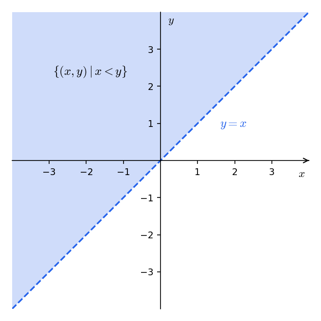

*Figure 1. Graph of the less-than relation L as the region above the line y = x*

**Example 8.1.2 (The Congruence Modulo 2 Relation).** Define a relation $E$ from the set $\mathbf{Z}$ of all integers to $\mathbf{Z}$ by $m \, E \, n$ when $m - n$ is even, for every $(m, n) \in \mathbf{Z} \times \mathbf{Z}$. Saying that $m - n$ is even is the same as saying $2 \mid (m - n)$, so the relation can be written as follows.

$$
m \, E \, n \iff 2 \mid (m - n)
$$

First, decide whether some pairs are related.

- $4 \, E \, 0$, because $4 - 0 = 4$ and 4 is even.
- $2 \, E \, 6$, because $2 - 6 = -4$ and $-4$ is even.
- $3 \, E \, (-3)$, because $3 - (-3) = 6$ and 6 is even.
- $5$ is not related to $2$ by $E$, because $5 - 2 = 3$ and 3 is not even.

Next, find integers related to 1. Since $1 - 1 = 0$, $3 - 1 = 2$, $5 - 1 = 4$, $-1 - 1 = -2$, and $-3 - 1 = -4$ are all even, each of $1, 3, 5, -1, -3$ is related to 1 by $E$. There are infinitely many other such integers, and the following proposition explains why.

**Proposition.** If $n$ is an odd integer, then $n \, E \, 1$.

**Proof:** Suppose $n$ is any odd integer. By definition of odd, $n = 2k + 1$ for some integer $k$. By definition of $E$, $n \, E \, 1$ means that $n - 1$ is even. By substitution, $n - 1 = (2k + 1) - 1 = 2k$, and since $k$ is an integer, $2k$ is even. Hence $n \, E \, 1$.

In general, two integers $m$ and $n$ are related by $E$ if, and only if, $m \bmod 2 = n \bmod 2$, that is, both are even or both are odd. In this case $m$ and $n$ are said to be **congruent modulo 2**. Congruence modulo a general $d$ is defined in Section 3.5.

**Example 8.1.3 (A Relation on a Power Set).** If $X = \lbrace a, b, c \rbrace$, its power set is as follows.

$$
\mathcal{P}(X) = \lbrace \emptyset, \lbrace a \rbrace, \lbrace b \rbrace, \lbrace c \rbrace, \lbrace a, b \rbrace, \lbrace a, c \rbrace, \lbrace b, c \rbrace, \lbrace a, b, c \rbrace \rbrace
$$

Write $N(A)$ for the number of elements of a set $A$, and define a relation $\mathbf{S}$ from $\mathcal{P}(X)$ to $\mathcal{P}(X)$ by $A \, \mathbf{S} \, B \iff N(A) \ge N(B)$ for all $A, B \in \mathcal{P}(X)$. That is, $A$ is related to $B$ when $A$ has at least as many elements as $B$.

- $\lbrace a, b \rbrace \, \mathbf{S} \, \lbrace b, c \rbrace$. Both sets have two elements, and $2 \ge 2$.
- $\lbrace a \rbrace \, \mathbf{S} \, \emptyset$. The sets have 1 and 0 elements, and $1 \ge 0$.
- $\lbrace b, c \rbrace$ is not related to $\lbrace a, b, c \rbrace$ by $\mathbf{S}$. The sets have 2 and 3 elements, and $2 \ge 3$ is false.
- $\lbrace c \rbrace \, \mathbf{S} \, \lbrace a \rbrace$. Both sets have one element.

> **Note:** Since relations are sets, set operations apply to them directly. If $R$ and $S$ are both relations from $A$ to $B$, then $R \cup S$, the set of all ordered pairs in $R$ or in $S$, and $R \cap S$, the set of all ordered pairs in both relations, are also relations from $A$ to $B$. For example, the union of the less-than relation $<$ and the equality relation $=$ on $\mathbf{R}$ is the less-than-or-equal-to relation $\le$, and the intersection of the two relations is the empty set.

### 1.2 The Inverse of a Relation

When $R$ is a relation from $A$ to $B$, interchanging the two components of every ordered pair of $R$ produces a relation from $B$ to $A$.

> **Definition:** Let $R$ be a relation from $A$ to $B$. The **inverse relation** $R^{-1}$ of $R$ is the relation from $B$ to $A$ given by $R^{-1} = \lbrace (y, x) \in B \times A \mid (x, y) \in R \rbrace$.

Written element by element, for all $x \in A$ and $y \in B$, $(y, x) \in R^{-1} \iff (x, y) \in R$.

**Example 8.1.4 (The Inverse of a Finite Relation).** Let $A = \lbrace 2, 3, 4 \rbrace$ and $B = \lbrace 2, 6, 8 \rbrace$, and let $R$ be the divides relation from $A$ to $B$, that is, $x \, R \, y \iff x \mid y$ for every $(x, y) \in A \times B$.

Check the nine ordered pairs of $A \times B$ one by one. 2 divides all of 2, 6, and 8; 3 divides only 6 ($3 \nmid 2$, $3 \nmid 8$); and 4 divides only 8 ($4 \nmid 2$, $4 \nmid 6$). Hence the following holds.

$$
R = \lbrace (2, 2), (2, 6), (2, 8), (3, 6), (4, 8) \rbrace, \qquad R^{-1} = \lbrace (2, 2), (6, 2), (8, 2), (6, 3), (8, 4) \rbrace
$$

Reversing the direction of every arrow in the arrow diagram of $R$ (Figure 2) gives the arrow diagram of $R^{-1}$. Figure 3 redraws the arrow diagram of $R^{-1}$ with $B$ on the left.

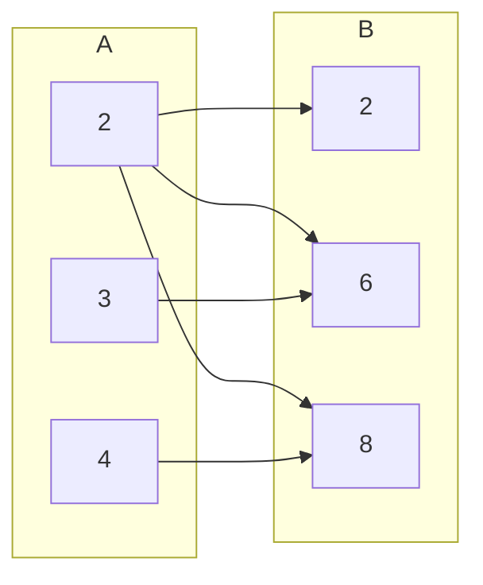

*Figure 2. Arrow diagram of the divides relation R from A to B*

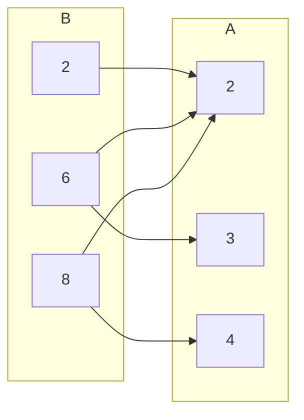

*Figure 3. Arrow diagram of the inverse relation drawn with B on the left*

Since $x \mid y$ means the same as $y$ being a multiple of $x$, $R^{-1}$ can be described in words as follows: for every $(y, x) \in B \times A$, $y \, R^{-1} \, x$ if, and only if, $y$ is a multiple of $x$.

**Example 8.1.5 (The Inverse of an Infinite Relation).** Define a relation $R$ from $\mathbf{R}$ to $\mathbf{R}$ by $x \, R \, y \iff y = 2\lvert x \rvert$ for every $(x, y) \in \mathbf{R} \times \mathbf{R}$. Draw the graphs of $R$ and $R^{-1}$, and decide whether $R^{-1}$ is a function.

If $x \ge 0$, then $y = 2\lvert x \rvert = 2x$, so the graph is a ray with slope 2; if $x < 0$, then $y = 2(-x) = -2x$, so the graph is a ray with slope $-2$. A point $(v, u)$ is on the graph of $R^{-1}$ if, and only if, $(u, v)$ is on the graph of $R$, so the graph of $R^{-1}$ is the reflection of the graph of $R$ in the line $y = x$. Table 1 lists some computed values.

| $x$ | $y = 2\lvert x \rvert$ | Ordered pair $(x, y)$ in $R$ | Ordered pair $(y, x)$ in $R^{-1}$ |
|:---:|:---:|:---:|:---:|
| $0$ | $0$ | $(0, 0)$ | $(0, 0)$ |
| $1$ | $2$ | $(1, 2)$ | $(2, 1)$ |
| $-1$ | $2$ | $(-1, 2)$ | $(2, -1)$ |
| $2$ | $4$ | $(2, 4)$ | $(4, 2)$ |
| $-2$ | $4$ | $(-2, 4)$ | $(4, -2)$ |

*Table 1. Some ordered pairs in the relation R and in its inverse*

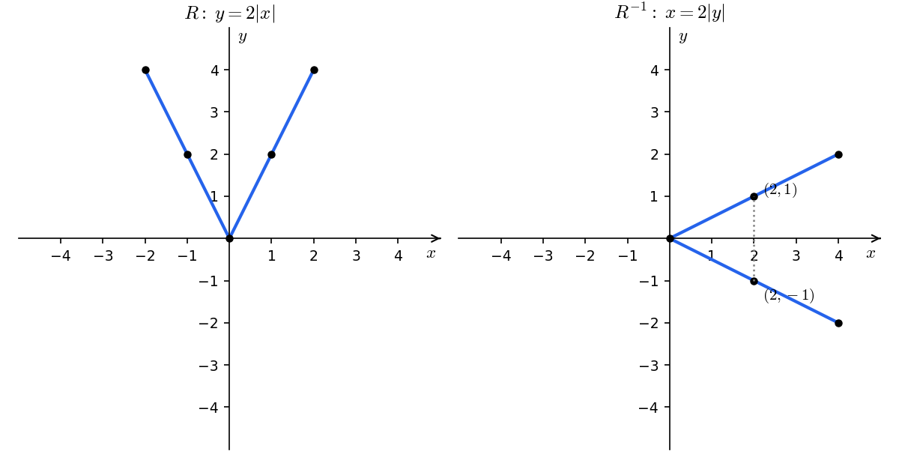

*Figure 4. Graph of the relation R and the graph of its inverse obtained by reflection in the line y = x*

$R^{-1}$ is not a function. For instance, both $(2, 1)$ and $(2, -1)$ are in $R^{-1}$, so the input 2 has two outputs. In the graph, the line $x = 2$ meets the graph of $R^{-1}$ at two points. Moreover, no real number $x$ satisfies $2\lvert x \rvert = -3$, so the input $-3$ has no output at all. By contrast, $R$ itself assigns exactly one value $y = 2\lvert x \rvert$ to each $x$, so it is a function from $\mathbf{R}$ to $\mathbf{R}$. As seen in Chapter 7, the inverse relation of a function is again a function only when the function is a one-to-one correspondence, and $R$ is not one-to-one because it sends both 1 and $-1$ to 2, and it is not onto because it takes no negative values.

### 1.3 Directed Graph of a Relation

The rest of this chapter deals with relations from a set to itself.

> **Definition:** A relation from a set $A$ to $A$ itself is called a **relation on $A$**.

> **Caution:** Distinguish a relation from the set on which it is defined. For example, a relation $R$ on $A = \lbrace 3, 4, 5 \rbrace$ is a subset of $A \times A$, not $A$ itself.

When $R$ is a relation on $A$, the arrow diagram can be turned into a **directed graph**. Instead of drawing $A$ twice, draw each element of $A$ once as a vertex and draw an arrow for each related pair of elements. That is, for all $x, y \in A$, there is an arrow from $x$ to $y$ if, and only if, $x \, R \, y$, that is, $(x, y) \in R$. If an element is related to itself ($x \, R \, x$), draw a **loop** that leaves the vertex and comes back to it.

**Example 8.1.6 (Directed Graph of a Relation).** Define a relation $R$ on $A = \lbrace 3, 4, 5, 6, 7, 8 \rbrace$ by $x \, R \, y \iff 2 \mid (x - y)$ for all $x, y \in A$, and draw the directed graph of $R$.

- $3 \, R \, 3$, because $3 - 3 = 0 = 2 \cdot 0$ and so $2 \mid 0$. For the same reason, the difference of any integer and itself is 0, so every vertex has a loop.
- $3 \, R \, 5$ and $5 \, R \, 3$, because $3 - 5 = -2 = 2 \cdot (-1)$ and $5 - 3 = 2 = 2 \cdot 1$, so there are arrows both from 3 to 5 and from 5 to 3.
- 3 and 4 are not related in either direction, because neither $3 - 4 = -1$ nor $4 - 3 = 1$ is a multiple of 2.

In general, $x - y$ is even if, and only if, $x$ and $y$ are both odd or both even. Hence the odd numbers 3, 5, 7 are all related to one another, the even numbers 4, 6, 8 are all related to one another, and there is no arrow between an odd and an even number. $R$ consists of $3 \times 3 + 3 \times 3 = 18$ ordered pairs. In Figure 5, a line with arrowheads at both ends represents the arrows in both directions at once.

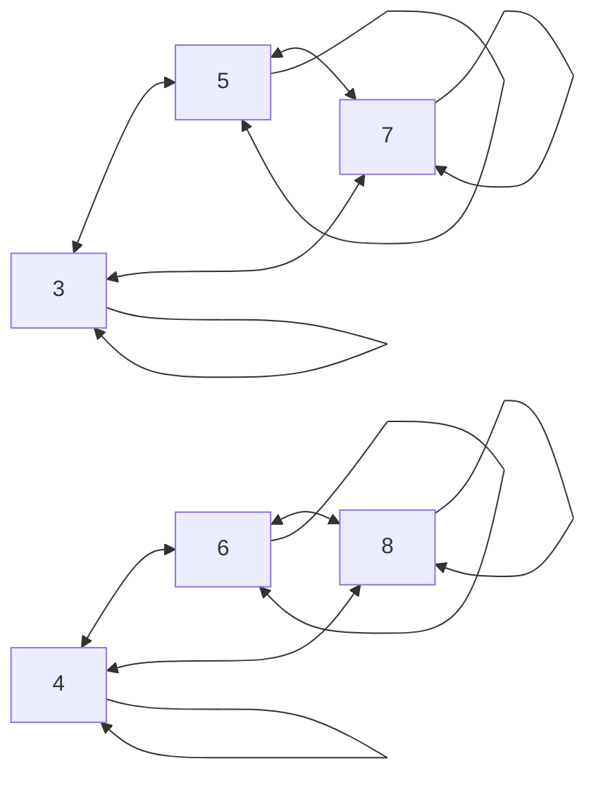

*Figure 5. Directed graph of the relation under which elements with an even difference are related*

### 1.4 n-ary Relations and Relational Databases

A binary relation is a subset of the Cartesian product of two sets, and an $n$-ary relation is, in the same way, a subset of the Cartesian product of $n$ sets. $n$-ary relations supply the mathematical basis for the theory of **relational databases**.

> **Definition:** Given sets $A_1, A_2, \ldots, A_n$, a subset of $A_1 \times A_2 \times \cdots \times A_n$ is called an **$n$-ary relation** on $A_1 \times A_2 \times \cdots \times A_n$. The cases $n = 2, 3, 4$ are called **binary**, **ternary**, and **quaternary relations**, respectively.

**Example 8.1.7 (A Simple Database).** The following is a heavily simplified model of the admission records a hospital might keep. Let $A_1$ be a set of positive integers, $A_2$ a set of strings of letters, $A_3$ a set of strings of digits, and $A_4$ a set of strings of letters. A quaternary relation $R$ on $A_1 \times A_2 \times A_3 \times A_4$ is defined as follows: $(a_1, a_2, a_3, a_4) \in R$ if, and only if, the patient with ID number $a_1$ and name $a_2$ was admitted on date $a_3$ with primary diagnosis $a_4$.

Suppose that at a particular hospital this relation contains the following seven 4-tuples. A date is a string of two digits each for the month, the day, and the year (for example, `020719` is February 7, 2019).

| Patient ID $a_1$ | Name $a_2$ | Admission date $a_3$ | Primary diagnosis $a_4$ |
|:---|:---|:---|:---|
| 011985 | John Schmidt | 020719 | asthma |
| 574329 | Tak Kurosawa | 011419 | pneumonia |
| 466581 | Mary Lazars | 010319 | appendicitis |
| 008352 | Joan Kaplan | 112419 | gastritis |
| 011985 | John Schmidt | 021719 | pneumonia |
| 244388 | Sarah Wu | 010319 | broken leg |
| 778400 | Jamal Baskers | 122719 | appendicitis |

*Table 2. The 4-tuples of the quaternary relation forming a hospital database*

A relational database usually displays its $n$-tuples as a table: each row holds one $n$-tuple, and the header of each column names the attribute recorded in that column. The data can then be queried and rearranged in many ways. In the query language SQL, for instance, if this database is called `S`, the query below lists the ID number and name of every patient whose admission date is 010319.

```sql
SELECT Patient_ID#, Name FROM S WHERE Admission_Date = 010319
```

```text
466581  Mary Lazars
244388  Sarah Wu
```

This result is obtained by intersecting the set $A_1 \times A_2 \times \lbrace 010319 \rbrace \times A_4$ with the database and then applying the **projection** that sends each 4-tuple $(a_1, a_2, a_3, a_4)$ to its first two coordinates $(a_1, a_2)$. The intersection keeps only the 4-tuples with admission date 010319, and the projection keeps only their ID numbers and names. A similar SELECT query lists every date on which one patient was admitted; for John Schmidt the dates are 02-07-19 and 02-17-19.

Individual records can be inserted, removed, or modified, and the records can be sorted by different criteria. Two whole databases can also be combined into one, or the records they share can be copied into a new database. If two relations with the same attributes are regarded as sets, combining them gives their union and collecting the shared records gives their intersection.

> **[Databases]** A relational database stores data as a collection of tables. One table corresponds to one $n$-ary relation in mathematics, a row to an ordered $n$-tuple, and a column to an attribute. The `WHERE` clause of SQL is a selection operation that keeps only the rows satisfying a condition, and listing column names after `SELECT` is a projection operation that keeps only the desired columns.

---

<br>

## 2. Reflexivity, Symmetry, and Transitivity (Section 8.2)

Define a relation $R$ on $A = \lbrace 2, 3, 4, 6, 7, 9 \rbrace$ by $x \, R \, y \iff 3 \mid (x - y)$ for all $x, y \in A$. To draw the directed graph of this relation, check each pair.

- Every element is related to itself. For example, $2 - 2 = 0$ and $3 \mid 0$, so $2 \, R \, 2$, and for the same reason $3 \, R \, 3$, $4 \, R \, 4$, $6 \, R \, 6$, $7 \, R \, 7$, and $9 \, R \, 9$.
- $6 - 3 = 3$ and $3 \mid 3$, so $6 \, R \, 3$. Also $3 - 6 = -(6 - 3) = -3$ and $3 \mid (-3)$, so $3 \, R \, 6$. In the same way, $3 \, R \, 9$, $9 \, R \, 3$, $6 \, R \, 9$, $9 \, R \, 6$, $4 \, R \, 7$, and $7 \, R \, 4$.
- The difference of any other two distinct elements is not a multiple of 3, so they are not related. For example, $2 - 4 = -2$ and $4 - 6 = -2$.

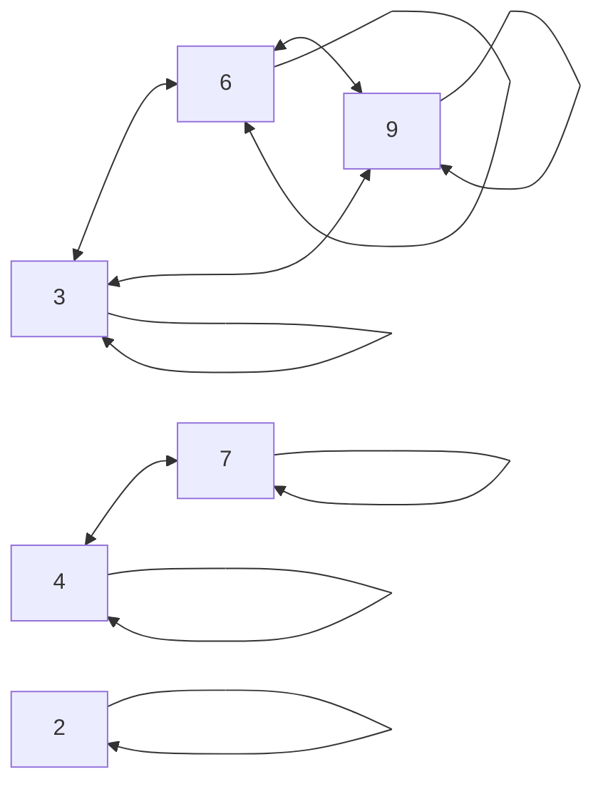

*Figure 6. Directed graph of the relation under which elements whose difference is a multiple of 3 are related*

The graph in Figure 6 has three important properties.

1. Each point has a loop that leaves the point and comes back to it.
2. Every arrow from one point to another is matched by an arrow going back in the opposite direction.
3. Whenever two arrows can be followed in succession, from a first point to a second and then from the second to a third, a direct arrow also goes from the first point to the third. In other words, no directed triangle in the graph is left incomplete.

These three properties correspond to the properties of general relations called reflexivity, symmetry, and transitivity.

### 2.1 Definitions of the Three Properties

> **Definition:** Let $R$ be a relation on a set $A$.
> 1. $R$ is **reflexive** if, and only if, $x \, R \, x$ for every $x \in A$.
> 2. $R$ is **symmetric** if, and only if, for every $x, y \in A$, if $x \, R \, y$ then $y \, R \, x$.
> 3. $R$ is **transitive** if, and only if, for every $x, y, z \in A$, if $x \, R \, y$ and $y \, R \, z$ then $x \, R \, z$.

Since $x \, R \, y$ and $(x, y) \in R$ mean the same thing, the three properties can also be written in terms of ordered pairs as follows.

- Reflexivity: $\forall x \in A, \ (x, x) \in R$
- Symmetry: $\forall x, y \in A, \ (x, y) \in R \Rightarrow (y, x) \in R$
- Transitivity: $\forall x, y, z \in A, \ \big( (x, y) \in R \wedge (y, z) \in R \big) \Rightarrow (x, z) \in R$

Informally, reflexivity means that every element is related to itself. Symmetry means that whenever one element is related to another, the relation also holds in the reverse direction. Transitivity means that if a first element is related to a second and the second to a third, then the first is related to the third.

> **Caution:** The definition of symmetry does not assert that $x$ is related to $y$. It only states that if $x$ happens to be related to $y$, then $y$ must be related to $x$. Also, the first, second, and third elements in the informal versions need not be distinct. For example, transitivity includes the case $x = z$, namely the condition that if $x \, R \, y$ and $y \, R \, x$ then $x \, R \, x$. Since the informal versions can hide such nuances, decisions should be based on the formal definitions.

All three definitions are universal statements. Hence, to prove that a relation has one of these properties, use the method of exhaustion in finite cases and, in general, the method of generalizing from the generic particular from Chapter 4.

### 2.2 Negations and Counterexamples

As seen in Chapter 3, the negation of a universal statement is an existential statement. Hence, if $R$ is a relation on a set $A$, the following hold.

1. $R$ is not reflexive $\iff$ there is an element $x \in A$ with $(x, x) \notin R$.
2. $R$ is not symmetric $\iff$ there are elements $x, y \in A$ with $(x, y) \in R$ but $(y, x) \notin R$.
3. $R$ is not transitive $\iff$ there are elements $x, y, z \in A$ with $(x, y) \in R$ and $(y, z) \in R$ but $(x, z) \notin R$.

Therefore, a single choice of such elements, presented as a counterexample, is enough to show that a relation lacks the property in question.

> **Caution:** Not being reflexive does not mean that no element is related to itself. A relation fails to be reflexive as soon as one element is not related to itself. Likewise, not being symmetric does not mean that there is no pair of arrows in opposite directions; it means that at least one arrow is missing its reverse arrow.

### 2.3 Relations on Finite Sets

**Example 8.2.1 (Properties of Relations on Finite Sets).** Define relations $R$, $S$, and $T$ on $A = \lbrace 0, 1, 2, 3 \rbrace$ as follows. Decide whether each relation is reflexive, symmetric, and transitive.

$$
\begin{aligned}
R &= \lbrace (0, 0), (0, 1), (0, 3), (1, 0), (1, 1), (2, 2), (3, 0), (3, 3) \rbrace \\
S &= \lbrace (0, 0), (0, 2), (0, 3), (2, 3) \rbrace \\
T &= \lbrace (0, 1), (2, 3) \rbrace
\end{aligned}
$$

**The relation R.** The directed graph of $R$ is shown in Figure 7.

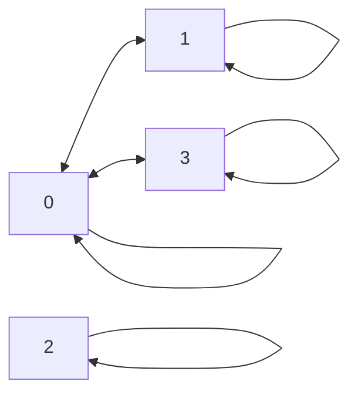

*Figure 7. Directed graph of the relation R of Example 8.2.1*

- $R$ is reflexive. All of $(0, 0)$, $(1, 1)$, $(2, 2)$, and $(3, 3)$ are in $R$, so every vertex has a loop.
- $R$ is symmetric. Every ordered pair that is not a loop comes with its reverse partner, as $(0, 1)$ with $(1, 0)$ and $(0, 3)$ with $(3, 0)$. A loop $(x, x)$ is unchanged when its components are interchanged, so it satisfies the symmetry condition automatically.
- $R$ is not transitive. $1 \, R \, 0$ and $0 \, R \, 3$, but $(1, 3) \notin R$. In the graph, there are arrows from 1 to 0 and from 0 to 3 but no arrow from 1 to 3.

A relation on a finite set can also be represented by a matrix. List the elements of $A$ in the same order along the rows and columns, and write 1 in row $x$, column $y$ if $(x, y) \in R$ and 0 otherwise. This matrix is the adjacency matrix of the directed graph, treated in Chapter 10. Table 3 is the matrix of $R$.

| $x \backslash y$ | 0 | 1 | 2 | 3 |
|:---:|:---:|:---:|:---:|:---:|
| **0** | 1 | 1 | 0 | 1 |
| **1** | 1 | 1 | 0 | 0 |
| **2** | 0 | 0 | 1 | 0 |
| **3** | 1 | 0 | 0 | 1 |

*Table 3. Matrix representing the relation R of Example 8.2.1*

In the matrix, reflexivity means that all entries on the main diagonal are 1, and symmetry means that the matrix is symmetric about the main diagonal, that is, the entry in row $x$, column $y$ equals the entry in row $y$, column $x$ for all $x$ and $y$. The matrix in Table 3 satisfies both conditions. Transitivity, by contrast, is not visible at a glance in the matrix; combinations of three elements must be checked. In Table 3, the entries in row 1, column 0 and in row 0, column 3 are 1 while the entry in row 1, column 3 is 0, which is the counterexample to transitivity.

**The relation S.** The directed graph of $S$ is shown in Figure 8.

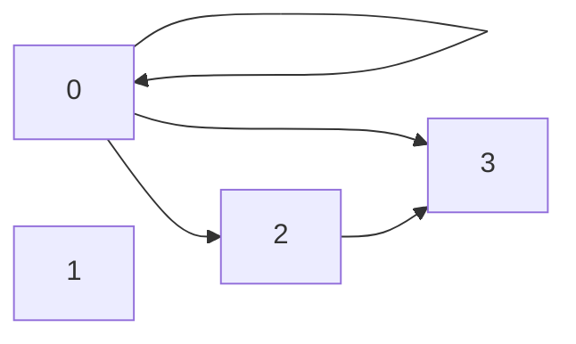

*Figure 8. Directed graph of the relation S of Example 8.2.1*

- $S$ is not reflexive. For example, $(1, 1) \notin S$, so there is no loop at 1.
- $S$ is not symmetric. $(0, 2) \in S$ but $(2, 0) \notin S$.
- $S$ is transitive. For the hypothesis $(x, y) \in S$, $(y, z) \in S$ of transitivity to hold, the second component of the first pair must equal the first component of the second pair. Table 4 lists all such linked combinations of ordered pairs, and in each case the required pair $(x, z)$ is in $S$.

| $(x, y) \in S$ | $(y, z) \in S$ | Required $(x, z)$ | $(x, z) \in S$? |
|:---:|:---:|:---:|:---:|
| $(0, 0)$ | $(0, 0)$ | $(0, 0)$ | Yes |
| $(0, 0)$ | $(0, 2)$ | $(0, 2)$ | Yes |
| $(0, 0)$ | $(0, 3)$ | $(0, 3)$ | Yes |
| $(0, 2)$ | $(2, 3)$ | $(0, 3)$ | Yes |

*Table 4. All linked combinations of ordered pairs in the relation S and the transitivity check*

No ordered pair starts with 3, so nothing follows $(0, 3)$ or $(2, 3)$. Note that, as in the first three rows of the table, the first, second, and third elements may coincide.

**The relation T.** The directed graph of $T$ is shown in Figure 9.

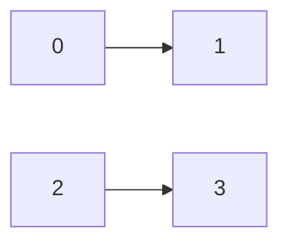

*Figure 9. Directed graph of the relation T of Example 8.2.1*

- $T$ is not reflexive. For example, $(0, 0) \notin T$.
- $T$ is not symmetric. $(0, 1) \in T$ but $(1, 0) \notin T$.
- $T$ is transitive. For transitivity to be false, there would have to be elements with $(x, y) \in T$, $(y, z) \in T$, and $(x, z) \notin T$, which requires two ordered pairs that link up, the second component of one being the first component of the other. But for the two pairs $(0, 1)$ and $(2, 3)$ of $T$, $1 \ne 2$ and $3 \ne 0$, so no two pairs link up. Hence the hypothesis of transitivity is never true, and the transitivity condition is vacuously true.

> **Caution:** $T$ is transitive because it cannot fail to be transitive. A conditional statement is true when its hypothesis is false (Chapter 2), so a relation with no linked ordered pairs is always transitive. For the same reason, the empty relation on any set is symmetric and transitive.

Computer algorithms can check whether a relation on a finite set $A$ has the three properties. Put the elements of $A$ in an array, and check reflexivity with a single loop over the elements $a$ testing $(a, a) \in R$, symmetry with a nested loop over all pairs $(a, b)$, and transitivity with a triply nested loop over all triples $(a, b, c)$. As soon as a counterexample appears, the property fails. The following is a Python version of this method.

```python
def is_reflexive(A, R):
    for a in A:
        if (a, a) not in R:
            return False
    return True


def is_symmetric(A, R):
    for a in A:
        for b in A:
            if (a, b) in R and (b, a) not in R:
                return False
    return True


def is_transitive(A, R):
    for a in A:
        for b in A:
            for c in A:
                if (a, b) in R and (b, c) in R and (a, c) not in R:
                    return False
    return True


A = [0, 1, 2, 3]
R = {(0, 0), (0, 1), (0, 3), (1, 0), (1, 1), (2, 2), (3, 0), (3, 3)}
S = {(0, 0), (0, 2), (0, 3), (2, 3)}
T = {(0, 1), (2, 3)}
for name, rel in [("R", R), ("S", S), ("T", T)]:
    print(name, is_reflexive(A, rel), is_symmetric(A, rel), is_transitive(A, rel))
```

- `is_reflexive` visits the elements `a` of $A$ in turn and returns `False` immediately if the pair `(a, a)` is not in `R`, because one counterexample shows that the relation is not reflexive. If the loop runs to the end, there is no counterexample, so it returns `True`.
- `is_symmetric` checks every pair `(a, b)` with a nested loop, looking for a counterexample in which `(a, b)` is in `R` but `(b, a)` is not.
- `is_transitive` checks every `(a, b, c)` with a triply nested loop, looking for a counterexample in which `(a, b)` and `(b, c)` are in `R` but `(a, c)` is not.
- A relation is stored as a `set` of ordered pairs (tuples), so the `in` operator tests whether an ordered pair belongs to the relation. The last loop applies the three functions to the three relations and prints the name and the results.

```text
R True True False
S False False True
T False False True
```

The output agrees with the decisions above. If $A$ has $n$ elements, the three functions check at most $n$, $n^2$, and $n^3$ cases, respectively.

### 2.4 Relations on Infinite Sets

Since not every case can be checked for a relation on an infinite set, the proof proceeds as follows. First, write down the statement to be proved according to the definition. For instance, to prove symmetry, one must prove $\forall x, y \in A, \ x \, R \, y \Rightarrow y \, R \, x$. Next, use the definitions of $A$ and $R$ to rewrite the statement in concrete form. Sometimes the rewritten statement is immediately seen to be true, and sometimes it must be proved by generalizing from the generic particular.

**Example 8.2.2 (Properties of Equality).** Define a relation $R$ on $\mathbf{R}$ by $x \, R \, y \iff x = y$ for all real numbers $x$ and $y$.

- $R$ is reflexive. Reflexivity is $\forall x \in \mathbf{R}, \ x \, R \, x$, which by definition of $R$ is the same as $\forall x \in \mathbf{R}, \ x = x$. Every real number equals itself, so this statement is true.
- $R$ is symmetric. Symmetry is the same as $\forall x, y \in \mathbf{R}, \ x = y \Rightarrow y = x$, which is true because if one number equals a second, the second equals the first.
- $R$ is transitive. Transitivity is the same as $\forall x, y, z \in \mathbf{R}, \ (x = y \wedge y = z) \Rightarrow x = z$, which is true because if a first number equals a second and the second equals a third, the first equals the third.

**Example 8.2.3 (Properties of Less Than).** Define a relation $R$ on $\mathbf{R}$ by $x \, R \, y \iff x < y$ for all real numbers $x$ and $y$.

- $R$ is not reflexive. Reflexivity would mean $\forall x \in \mathbf{R}, \ x < x$, which is false. As a counterexample, for $x = 0$ the statement $0 < 0$ does not hold.
- $R$ is not symmetric. Symmetry would mean $\forall x, y \in \mathbf{R}, \ x < y \Rightarrow y < x$; as a counterexample, for $x = 0$ and $y = 1$, $0 < 1$ but $1 < 0$ is false.
- $R$ is transitive. Transitivity means $\forall x, y, z \in \mathbf{R}, \ (x < y \wedge y < z) \Rightarrow x < z$, which is true by the transitive law of order for real numbers.

Some properties are false for every element of the domain. In such a case it may be more natural to show that the property fails for every element rather than to give a single counterexample. For example, by the trichotomy law for real numbers, which says that for any real numbers $x$ and $y$ exactly one of $x < y$, $x = y$, $x > y$ holds, $x < x$ is false for every real number $x$, and $y < x$ is false for all $x$ and $y$ with $x < y$.

**Example 8.2.4 (Properties of Congruence Modulo 3).** Define a relation $T$ on $\mathbf{Z}$ as follows for all integers $m$ and $n$. This relation is called **congruence modulo 3**.

$$
m \, T \, n \iff 3 \mid (m - n)
$$

**Reflexivity.** The statement to be shown is $\forall m \in \mathbf{Z}, \ m \, T \, m$, that is, $\forall m \in \mathbf{Z}, \ 3 \mid (m - m)$. Since $m - m = 0 = 3 \cdot 0$, $3 \mid 0$, and the statement is true.

**Proof of reflexivity:** Suppose $m$ is a particular but arbitrarily chosen integer. [It must be shown that $m \, T \, m$.] Now $m - m = 0$, and $0 = 3 \cdot 0$, so $3 \mid 0$. Hence $3 \mid (m - m)$, and by definition of $T$, $m \, T \, m$.

**Symmetry.** The statement to be shown is that for all integers $m$ and $n$, if $3 \mid (m - n)$ then $3 \mid (n - m)$. In other words, $n - m$ must be written as 3 times some integer. By definition of divides, $3 \mid (m - n)$ means $m - n = 3k$ for some integer $k$. The crucial observation is that $n - m = -(m - n)$. Multiplying both sides by $-1$ gives $-(m - n) = -3k$, that is, $n - m = 3(-k)$, and since $-k$ is an integer, $3 \mid (n - m)$.

**Proof of symmetry:** Suppose $m$ and $n$ are particular but arbitrarily chosen integers with $m \, T \, n$. [It must be shown that $n \, T \, m$.] By definition of $T$, $3 \mid (m - n)$, and by definition of divides, $m - n = 3k$ for some integer $k$. Multiplying both sides by $-1$ gives $n - m = 3(-k)$. Since $-k$ is an integer, $3 \mid (n - m)$, and by definition of $T$, $n \, T \, m$.

**Transitivity.** The statement to be shown is that for all integers $m$, $n$, and $p$, if $3 \mid (m - n)$ and $3 \mid (n - p)$ then $3 \mid (m - p)$. By hypothesis, $m - n = 3r$ and $n - p = 3s$ for some integers $r$ and $s$. The crucial observation is that $(m - n) + (n - p) = m - p$. Adding the two equations gives $(m - n) + (n - p) = 3r + 3s$, that is, $m - p = 3(r + s)$. Since $r + s$ is an integer, $3 \mid (m - p)$.

**Proof of transitivity:** Suppose $m$, $n$, and $p$ are particular but arbitrarily chosen integers with $m \, T \, n$ and $n \, T \, p$. [It must be shown that $m \, T \, p$.] By definition of $T$, $3 \mid (m - n)$ and $3 \mid (n - p)$, and by definition of divides, $m - n = 3r$ and $n - p = 3s$ for some integers $r$ and $s$. Adding the two equations gives $(m - n) + (n - p) = 3r + 3s$, which simplifies to $m - p = 3(r + s)$. Since $r + s$ is an integer, $3 \mid (m - p)$, and by definition of $T$, $m \, T \, p$.

> **Key Point:** To prove a property of a relation on an infinite set, write the definition as a universal conditional statement, take an arbitrary element satisfying the hypothesis, unfold the definition of the relation, and produce the form the conclusion requires (here, 3 times some integer). To show that a property fails, present one concrete counterexample.

### 2.5 The Transitive Closure of a Relation

When a relation is not transitive, the usual cause is that some ordered pairs are missing. For example, if $(1, 3)$ and $(3, 4)$ belong to a relation $R$, then $R$ can be transitive only if $(1, 4)$ also belongs to $R$. A relation that is not transitive can therefore be made transitive only by adding ordered pairs. The relation obtained by adding just the pairs that transitivity forces, or more precisely the smallest transitive relation that contains the given relation, is called its transitive closure.

> **Definition:** Let $A$ be a set and $R$ a relation on $A$. The **transitive closure** of $R$ is the relation $R^t$ on $A$ that satisfies the following three properties.
> 1. $R^t$ is transitive.
> 2. $R \subseteq R^t$.
> 3. If $S$ is any transitive relation that contains $R$, then $R^t \subseteq S$.

Because of the third condition, the transitive closure is unique. If two relations $R_1^t$ and $R_2^t$ both satisfy the three conditions, condition 3 gives $R_1^t \subseteq R_2^t$ and $R_2^t \subseteq R_1^t$, so the two relations are equal. Also, if $R$ is already transitive, $R$ itself satisfies the three conditions, so $R^t = R$.

**Example 8.2.5 (Transitive Closure of a Relation).** Find the transitive closure of the relation $R = \lbrace (0, 1), (1, 2), (2, 3) \rbrace$ on $A = \lbrace 0, 1, 2, 3 \rbrace$.

Every ordered pair of $R$ is in $R^t$, so $\lbrace (0, 1), (1, 2), (2, 3) \rbrace \subseteq R^t$. Hence the directed graph of $R^t$ contains at least the arrows in Figure 10.

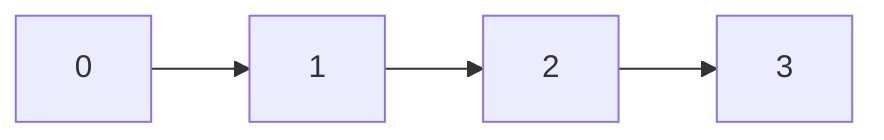

*Figure 10. Directed graph of the relation R of Example 8.2.5*

- $(0, 1) \in R^t$ and $(1, 2) \in R^t$, and $R^t$ is transitive, so $(0, 2) \in R^t$.
- Now $(0, 2) \in R^t$ and $(2, 3) \in R^t$, so $(0, 3) \in R^t$.
- $(1, 2) \in R^t$ and $(2, 3) \in R^t$, so $(1, 3) \in R^t$.

Hence $R^t$ contains at least $\lbrace (0, 1), (0, 2), (0, 3), (1, 2), (1, 3), (2, 3) \rbrace$. But this relation is already transitive: for the linked combinations $(0, 1)$ and $(1, 2)$, $(0, 1)$ and $(1, 3)$, $(0, 2)$ and $(2, 3)$, and $(1, 2)$ and $(2, 3)$, the required pairs $(0, 2)$, $(0, 3)$, $(0, 3)$, and $(1, 3)$ are all present. These six ordered pairs must belong to every transitive relation containing $R$, so this relation is the smallest one, and therefore it is $R^t$.

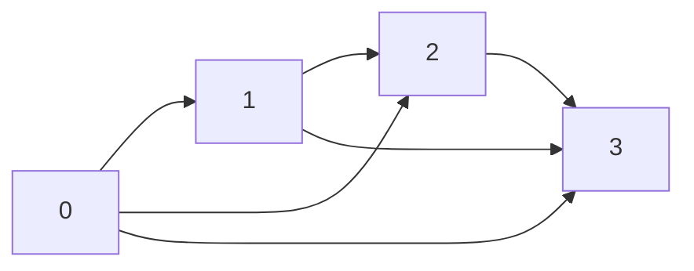

*Figure 11. Directed graph of the transitive closure of the relation R of Example 8.2.5*

A computer can carry out the same process. The following function repeatedly adds $(a, d)$ whenever the relation contains two linked pairs $(a, b)$ and $(b, d)$ but not $(a, d)$, until there is no pair left to add.

```python
def transitive_closure(R):
    closure = set(R)
    while True:
        new_pairs = {(a, d) for (a, b) in closure for (c, d) in closure
                     if b == c and (a, d) not in closure}
        if not new_pairs:
            return closure
        closure |= new_pairs


print(sorted(transitive_closure({(0, 1), (1, 2), (2, 3)})))
```

- `closure = set(R)` starts with a copy of $R$, so the result contains $R$.
- The set comprehension finds every pair of linked ordered pairs `(a, b)` and `(c, d)` (with `b == c`) in `closure` and collects in `new_pairs` each `(a, d)` not yet present.
- If there are no new pairs, `closure` is transitive and is returned; otherwise `closure |= new_pairs` takes the union and the loop repeats. Since $A \times A$ is finite and `closure` grows at every repetition, the loop must end.
- The last line applies the function to the $R$ of Example 8.2.5 and prints the sorted result.

```text
[(0, 1), (0, 2), (0, 3), (1, 2), (1, 3), (2, 3)]
```

The three conditions of the definition show that this function computes exactly $R^t$. The result contains $R$ (condition 2), and it is transitive because the function stops only when no new pair arises (condition 1). Moreover, if $S$ is a transitive relation containing $R$, each added pair $(a, d)$ comes from pairs $(a, b)$ and $(b, d)$ already in $S$ and must be in $S$ by transitivity of $S$, so `closure` remains a subset of $S$ at every repetition (condition 3).

> **Note:** The transitive closure records reachability along arrows in the directed graph. $(x, z) \in R^t$ if, and only if, in the directed graph of $R$ there is a route that starts at $x$, follows one or more arrows in their directions, and arrives at $z$. In Example 8.2.5, 3 can be reached from 0 along $0 \to 1 \to 2 \to 3$, so $(0, 3) \in R^t$, and no arrow leaves 3, so no ordered pair starting with 3 is in $R^t$.

---

<br>

## 3. Equivalence Relations (Section 8.3)

A fraction can represent the same number in many forms. For example, the following fractions all represent the same number.

$$
\frac{1}{2}, \quad \frac{2}{4}, \quad \frac{3}{6}, \quad \frac{-1}{-2}, \quad \frac{-3}{-6}, \quad \frac{15}{30}, \quad \ldots
$$

The expressions differ in form and in name, yet all of them denote one number. Collecting objects that differ in form but agree in substance into a single group is the basic idea behind equivalence relations.

### 3.1 The Relation Induced by a Partition

As defined in Chapter 6, a **partition** of a set $A$ is a finite or infinite collection of nonempty, mutually disjoint subsets of $A$ whose union is $A$. Figure 12 shows a partition of a set $A$ into subsets $A_1, A_2, \ldots, A_6$. Here $A_i \cap A_j = \emptyset$ whenever $i \ne j$, and $A_1 \cup A_2 \cup \cdots \cup A_6 = A$.

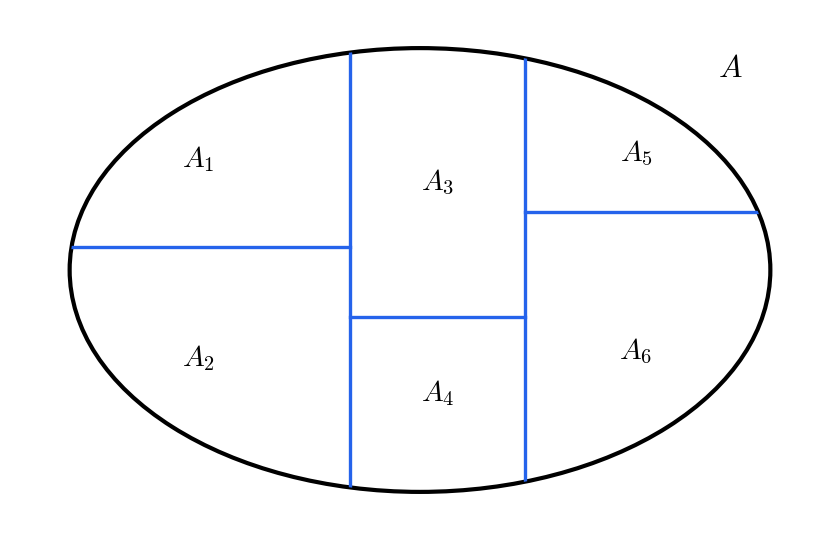

*Figure 12. Partition of a set A into six subsets*

> **Definition:** Given a partition of a set $A$, the **relation induced by the partition**, $R$, is the relation on $A$ defined as follows for all $x, y \in A$: $x \, R \, y$ if, and only if, there is a subset $A_i$ of the partition that contains both $x$ and $y$.

**Example 8.3.1 (Relation Induced by a Partition).** Find the relation $R$ induced by the partition $\lbrace 0, 3, 4 \rbrace$, $\lbrace 1 \rbrace$, $\lbrace 2 \rbrace$ of $A = \lbrace 0, 1, 2, 3, 4 \rbrace$.

Since $\lbrace 0, 3, 4 \rbrace$ is a subset of the partition, any two elements chosen from this set, in either order, are related. For example, both 0 and 3 are in $\lbrace 0, 3, 4 \rbrace$, so $0 \, R \, 3$ and $3 \, R \, 0$. In the same way, $0 \, R \, 4$, $4 \, R \, 0$, $3 \, R \, 4$, and $4 \, R \, 3$. Also, both 0 and 0 are in $\lbrace 0, 3, 4 \rbrace$, so $0 \, R \, 0$, and for the same reason $3 \, R \, 3$ and $4 \, R \, 4$. Thus $\lbrace 0, 3, 4 \rbrace$ yields $3 \times 3 = 9$ ordered pairs. The set $\lbrace 1 \rbrace$ yields $1 \, R \, 1$, and $\lbrace 2 \rbrace$ yields $2 \, R \, 2$. Hence $R$ consists of the following 11 ordered pairs.

$$
R = \lbrace (0, 0), (0, 3), (0, 4), (1, 1), (2, 2), (3, 0), (3, 3), (3, 4), (4, 0), (4, 3), (4, 4) \rbrace
$$

> **Caution:** The sentence "both 0 and 0 are in $\lbrace 0, 3, 4 \rbrace$" may seem strange, but it is not false. The $x$ and $y$ of the definition may be the same element, so every element of a subset of the partition is related to itself.

A relation induced by a partition has all three properties studied in Section 2.

> **Key Point:** **Theorem 8.3.1.** Let $A$ be a set with a partition, and let $R$ be the relation induced by the partition. Then $R$ is reflexive, symmetric, and transitive.

**Proof:** For simpler notation, suppose the partition consists of finitely many subsets $A_1, A_2, \ldots, A_n$; an infinite partition is handled by the same argument with different indexing. By definition of a partition, $A_i \cap A_j = \emptyset$ whenever $i \ne j$, and $A_1 \cup A_2 \cup \cdots \cup A_n = A$. Also, for all $x, y \in A$, $x \, R \, y$ if, and only if, there is a subset $A_i$ of the partition with $x \in A_i$ and $y \in A_i$.

**Idea for reflexivity.** $x \, R \, x$ means that $x$ lies in the same subset as itself, which is automatic once $x$ lies in some subset of the partition. And $x$ does lie in some subset, since together the subsets of the partition cover all of $A$.

**Proof of reflexivity:** Suppose $x \in A$. Since $A_1, A_2, \ldots, A_n$ is a partition of $A$, $x \in A_i$ for some $i$. Hence the statement "there is a subset $A_i$ of the partition such that $x \in A_i$ and $x \in A_i$" is true ($p$ and $p \wedge p$ are logically equivalent), and by definition of $R$, $x \, R \, x$.

**Idea for symmetry.** For $x$ to be related to $y$ means that $x$ and $y$ are in the same subset. Then $y$ is in the same subset as $x$, so $y$ is related to $x$.

**Proof of symmetry:** Suppose $x, y \in A$ and $x \, R \, y$. By definition of $R$, there is a subset $A_i$ of the partition with $x \in A_i$ and $y \in A_i$. Since $p \wedge q$ and $q \wedge p$ are logically equivalent, the statement "there is a subset $A_i$ of the partition such that $y \in A_i$ and $x \in A_i$" is also true. Hence, by definition of $R$, $y \, R \, x$.

**Idea for transitivity.** If $x$ and $y$ are in one subset and $y$ and $z$ are in one subset, the two subsets have the element $y$ in common. Distinct subsets of a partition are disjoint, so the two subsets must be equal, and hence $x$, $y$, and $z$ are all in the same subset.

**Proof of transitivity:** Suppose $x, y, z \in A$, $x \, R \, y$, and $y \, R \, z$. By definition of $R$, there are subsets $A_i$ and $A_j$ of the partition with $x, y \in A_i$ and $y, z \in A_j$. Suppose $A_i \ne A_j$ in order to derive a contradiction. Since $\lbrace A_1, A_2, \ldots, A_n \rbrace$ is a partition, $A_i \cap A_j = \emptyset$. But $y \in A_i$ and $y \in A_j$, so $y \in A_i \cap A_j$, that is, $A_i \cap A_j \ne \emptyset$. This is a contradiction, so $A_i = A_j$. Hence $x$, $y$, and $z$ are all in $A_i$; in particular, $x$ and $z$ are both in $A_i$, so $x \, R \, z$ by definition of $R$.

### 3.2 Definition and Examples of Equivalence Relations

A relation with all three properties of reflexivity, symmetry, and transitivity is given a special name.

> **Definition:** Let $A$ be a set and $R$ a relation on $A$. $R$ is an **equivalence relation** if, and only if, $R$ is reflexive, symmetric, and transitive.

By Theorem 8.3.1, the relation induced by a partition is an equivalence relation. Among the examples of Section 2, the equality relation (Example 8.2.2) and congruence modulo 3 (Example 8.2.4) are also equivalence relations.

**Example 8.3.2 (An Equivalence Relation on a Set of Subsets).** Let $X$ be the set of all nonempty subsets of $\lbrace 1, 2, 3 \rbrace$.

$$
X = \lbrace \lbrace 1 \rbrace, \lbrace 2 \rbrace, \lbrace 3 \rbrace, \lbrace 1, 2 \rbrace, \lbrace 1, 3 \rbrace, \lbrace 2, 3 \rbrace, \lbrace 1, 2, 3 \rbrace \rbrace
$$

Define a relation $\mathbf{R}$ on $X$ by $A \, \mathbf{R} \, B$ when the least element of $A$ equals the least element of $B$, for all $A, B \in X$. Prove that $\mathbf{R}$ is an equivalence relation.

- **Reflexivity:** Let $A$ be a nonempty subset of $\lbrace 1, 2, 3 \rbrace$. [It must be shown that $A \, \mathbf{R} \, A$.] The least element of $A$ equals the least element of $A$, so by definition of $\mathbf{R}$, $A \, \mathbf{R} \, A$.
- **Symmetry:** Suppose $A$ and $B$ are elements of $X$ with $A \, \mathbf{R} \, B$. [It must be shown that $B \, \mathbf{R} \, A$.] The least element of $A$ equals the least element of $B$, so the least element of $B$ equals the least element of $A$, and hence $B \, \mathbf{R} \, A$.
- **Transitivity:** Suppose $A$, $B$, and $C$ are elements of $X$ with $A \, \mathbf{R} \, B$ and $B \, \mathbf{R} \, C$. [It must be shown that $A \, \mathbf{R} \, C$.] The least element of $A$ equals that of $B$, and the least element of $B$ equals that of $C$, so the least element of $A$ equals the least element of $C$. Hence $A \, \mathbf{R} \, C$.

In this proof, the existence of least elements is guaranteed because every element of $X$ is a nonempty finite set.

**Example 8.3.3 (Equivalence of Digital Logic Circuits).** Fix a number $n$ of inputs, and let $S$ be the set of all digital logic circuits with $n$ inputs (Chapter 2). Define a relation $\mathbf{E}$ on $S$ by $C_1 \, \mathbf{E} \, C_2$ when $C_1$ and $C_2$ have the same input/output table, for all circuits $C_1, C_2 \in S$; in this case circuit $C_1$ is said to be **equivalent** to circuit $C_2$. Prove that $\mathbf{E}$ is an equivalence relation.

- **Reflexivity:** Let $C$ be a circuit in $S$. $C$ has the same input/output table as itself, so $C \, \mathbf{E} \, C$.
- **Symmetry:** Suppose $C_1 \, \mathbf{E} \, C_2$. $C_1$ has the same input/output table as $C_2$, so $C_2$ has the same input/output table as $C_1$, and hence $C_2 \, \mathbf{E} \, C_1$.
- **Transitivity:** Suppose $C_1 \, \mathbf{E} \, C_2$ and $C_2 \, \mathbf{E} \, C_3$. $C_1$ has the same input/output table as $C_2$, and $C_2$ as $C_3$, so $C_1$ has the same input/output table as $C_3$. Hence $C_1 \, \mathbf{E} \, C_3$.

Since $\mathbf{E}$ is reflexive, symmetric, and transitive, it is an equivalence relation on $S$.

Some implementations of programming languages allow identifiers of any length, so programmers can make variable names as descriptive as they need. A compiler for such a language may nevertheless read only a fixed number of leading characters and disregard the rest. For example, a compiler that reads only the first eight characters treats `NumberOfScrews` and `NumberOfBolts` as one identifier, since both begin with `NumberOf`. A programmer using such a language must therefore make sure that distinct identifiers differ somewhere in their first eight characters. Grouping identifiers in this manner defines an equivalence relation on the set of all possible identifiers.

**Example 8.3.4 (A Relation on a Set of Identifiers).** Let $L$ be the set of identifiers permitted in some programming language, and define a relation $R$ on $L$ by $s \, R \, t$ when the first eight characters of $s$ equal the first eight characters of $t$, for all strings $s, t \in L$. Prove that $R$ is an equivalence relation.

- **Reflexivity:** Let $s \in L$. The first eight characters of $s$ equal its own first eight characters, so $s \, R \, s$.
- **Symmetry:** Suppose $s, t \in L$ and $s \, R \, t$. The first eight characters of $s$ equal those of $t$, so the first eight characters of $t$ equal those of $s$, and hence $t \, R \, s$.
- **Transitivity:** Suppose $s, t, u \in L$, $s \, R \, t$, and $t \, R \, u$. The first eight characters of $s$ and $t$ are equal, and those of $t$ and $u$ are equal, so those of $s$ and $u$ are equal. Hence $s \, R \, u$.

> **Note:** The proofs in the three examples share one structure. When a relation is defined by the equality of some value (the least element, the input/output table, the first eight characters), the reflexivity, symmetry, and transitivity of equality carry over, and the relation is an equivalence relation.

### 3.3 Equivalence Classes

Given an equivalence relation on a set, one can pick an element $a$ of the set and collect all the elements related to $a$ into a subset. This subset is called the equivalence class of $a$.

> **Definition:** Let $A$ be a set and $R$ an equivalence relation on $A$. For each element $a$ of $A$, the set of all elements $x$ of $A$ that are related to $a$ by $R$ is called the **equivalence class** of $a$ and is denoted $[a]$. It is also called the class of $a$ for short.

In symbols, it is the following.

$$
[a] = \lbrace x \in A \mid x \, R \, a \rbrace
$$

Element by element, for every $x \in A$, $x \in [a] \iff x \, R \, a$. When several equivalence relations on one set are under discussion, the equivalence class of $a$ for the relation $R$ is written $[a]_R$.

> **Caution:** A relation on a set (a set of ordered pairs), the underlying set on which it is defined, and the equivalence class of an element of the underlying set (a subset of the underlying set) are different objects. For example, in Example 8.3.5 below, the relation $R$ is a set of 9 ordered pairs, the underlying set $A$ is a set of 5 elements, and $[0]$ is the subset $\lbrace 0, 4 \rbrace$ of $A$.

**Example 8.3.5 (Equivalence Classes of a Relation Given as a Set of Ordered Pairs).** Define a relation $R$ on $A = \lbrace 0, 1, 2, 3, 4 \rbrace$ as follows.

$$
R = \lbrace (0, 0), (0, 4), (1, 1), (1, 3), (2, 2), (3, 1), (3, 3), (4, 0), (4, 4) \rbrace
$$

The directed graph of $R$ is shown in Figure 13, and inspecting it shows that $R$ is an equivalence relation on $A$: every vertex has a loop, every arrow goes both ways, and elements connected to one another are all related to one another, so there is no incomplete directed triangle.

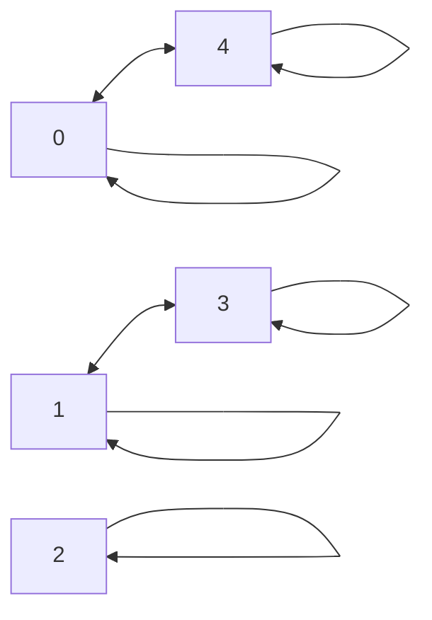

*Figure 13. Directed graph of the equivalence relation R of Example 8.3.5*

To find the distinct equivalence classes of $R$, first find the equivalence class of every element of $A$. $[a]$ is the set of those $x$ for which the ordered pair $(x, a)$ is in $R$.

$$
\begin{aligned}
[0] &= \lbrace x \in A \mid x \, R \, 0 \rbrace = \lbrace 0, 4 \rbrace \\
[1] &= \lbrace x \in A \mid x \, R \, 1 \rbrace = \lbrace 1, 3 \rbrace \\
[2] &= \lbrace x \in A \mid x \, R \, 2 \rbrace = \lbrace 2 \rbrace \\
[3] &= \lbrace x \in A \mid x \, R \, 3 \rbrace = \lbrace 1, 3 \rbrace \\
[4] &= \lbrace x \in A \mid x \, R \, 4 \rbrace = \lbrace 0, 4 \rbrace
\end{aligned}
$$

Since $[0] = [4]$ and $[1] = [3]$, the distinct equivalence classes are the three sets $\lbrace 0, 4 \rbrace$, $\lbrace 1, 3 \rbrace$, and $\lbrace 2 \rbrace$.

Finding the distinct equivalence classes of an equivalence relation usually takes two steps. First, determine the class of each element of the domain $A$ of the relation, either by listing the elements of the class or, when $A$ is infinite, by describing the class in general terms. Second, since many elements usually share one class, compare the classes found, decide which of them coincide, and list each different class exactly once.

**Example 8.3.6 (Equivalence Classes of a Relation on a Set of Subsets).** Find the distinct equivalence classes of the equivalence relation $\mathbf{R}$ (having the same least element) of Example 8.3.2.

- The class of $\lbrace 1 \rbrace$ is the set of all nonempty subsets of $\lbrace 1, 2, 3 \rbrace$ whose least element is 1. Hence $[\lbrace 1 \rbrace] = \lbrace \lbrace 1 \rbrace, \lbrace 1, 2 \rbrace, \lbrace 1, 3 \rbrace, \lbrace 1, 2, 3 \rbrace \rbrace$.
- The class of $\lbrace 2 \rbrace$ is the set of all subsets whose least element is 2, so $[\lbrace 2 \rbrace] = \lbrace \lbrace 2 \rbrace, \lbrace 2, 3 \rbrace \rbrace$.
- The only subset whose least element is 3 is $\lbrace 3 \rbrace$ itself, so $[\lbrace 3 \rbrace] = \lbrace \lbrace 3 \rbrace \rbrace$.

All seven elements of $X$ fall into one of these three classes ($4 + 2 + 1 = 7$), so no class is missing, and the three classes are distinct.

**Example 8.3.7 (Equivalence Classes of Identifiers).** Describe the distinct equivalence classes of the relation $R$ (having the same first eight characters) of Example 8.3.4. For any string $s$ in $L$, its class is as follows.

$$
[s] = \lbrace t \in L \mid t \, R \, s \rbrace
$$

That is, $[s]$ is the set of all strings in $L$ whose first eight characters equal the first eight characters of $s$. Hence the distinct equivalence classes of $R$ are sets of strings satisfying the following two conditions. First, all strings in one class have the same first eight characters. Second, two strings taken from two distinct classes differ somewhere in their first eight characters.

**Example 8.3.8 (Equivalence Classes of the Identity Relation).** Let $A$ be any set, and define a relation $R$ on $A$ by $x \, R \, y \iff x = y$ for all $x, y \in A$. Generalizing the argument of Example 8.2.2 shows that $R$ is an equivalence relation. For any $a \in A$, the following holds.

$$
[a] = \lbrace x \in A \mid x \, R \, a \rbrace = \lbrace x \in A \mid x = a \rbrace = \lbrace a \rbrace
$$

This is because the only element of $A$ that equals $a$ is $a$. Moreover, if $x \ne a$ then $\lbrace x \rbrace \ne \lbrace a \rbrace$, so the classes of all elements are distinct. Hence the distinct equivalence classes of $R$ are all the single-element subsets of $A$.

### 3.4 The Partition Induced by an Equivalence Relation

In every case from Example 8.3.5 through Example 8.3.8, the distinct equivalence classes were mutually disjoint and their union was the entire domain $A$ of the relation. That is, the set of equivalence classes formed a partition of $A$. This is no accident: the equivalence classes of an equivalence relation always partition the domain. This fact is proved in stages through two lemmas. The first lemma says that two elements related by an equivalence relation have the same equivalence class.

> **Key Point:** **Lemma 8.3.2.** Suppose $A$ is a set, $R$ is an equivalence relation on $A$, and $a$ and $b$ are elements of $A$. If $a \, R \, b$, then $[a] = [b]$.

Since $[a]$ and $[b]$ are sets and two sets are equal if, and only if, each is a subset of the other, the proof consists of a proof of $[a] \subseteq [b]$ and a proof of $[b] \subseteq [a]$. Each inclusion is proved by taking an arbitrary element of the set on the left and showing that it belongs to the set on the right.

**Proof:** Let $A$ be a set and $R$ an equivalence relation on $A$, and suppose $a$ and $b$ are elements of $A$ with $a \, R \, b$. [It must be shown that $[a] = [b]$.]

**Proof that $[a] \subseteq [b]$:** Suppose $x \in [a]$. [It must be shown that $x \in [b]$.] Since $x \in [a]$, $x \, R \, a$ by definition of class. By hypothesis, $a \, R \, b$. Since $R$ is transitive, $x \, R \, a$ and $a \, R \, b$ give $x \, R \, b$. Hence $x \in [b]$ by definition of class.

**Proof that $[b] \subseteq [a]$:** Suppose $x \in [b]$. [It must be shown that $x \in [a]$.] By definition of class, $x \, R \, b$. By hypothesis, $a \, R \, b$, and since $R$ is symmetric, $b \, R \, a$. Since $R$ is transitive, $x \, R \, b$ and $b \, R \, a$ give $x \, R \, a$. Hence $x \in [a]$ by definition of class.

Since $[a] \subseteq [b]$ and $[b] \subseteq [a]$, $[a] = [b]$ by definition of set equality.

The second lemma states that two equivalence classes of the same equivalence relation can only be disjoint or equal.

> **Key Point:** **Lemma 8.3.3.** If $A$ is a set, $R$ is an equivalence relation on $A$, and $a$ and $b$ are elements of $A$, then either $[a] \cap [b] = \emptyset$ or $[a] = [b]$.

The statement of Lemma 8.3.3 has the form "if $p$ then ($q$ or $r$)", where $p$ is "$A$ is a set, $R$ is an equivalence relation on $A$, and $a$ and $b$ are elements of $A$", $q$ is "$[a] \cap [b] = \emptyset$", and $r$ is "$[a] = [b]$". This statement is logically equivalent to "if ($p$ and not $q$) then $r$", so it suffices to prove the following: if $A$ is a set, $R$ is an equivalence relation on $A$, $a$ and $b$ are elements of $A$, and $[a] \cap [b] \ne \emptyset$, then $[a] = [b]$.

> **Note:** "If $p$ then ($q$ or $r$)" is logically equivalent to $\sim p \vee q \vee r$, and "if ($p$ and not $q$) then $r$" is $\sim(p \wedge \sim q) \vee r$, which by De Morgan's laws is logically equivalent to $\sim p \vee q \vee r$. Hence the two statements are logically equivalent, and for the same reason one may instead prove "if ($p$ and not $r$) then $q$".

**Proof:** Suppose $A$ is a set, $R$ is an equivalence relation on $A$, $a$ and $b$ are elements of $A$, and $[a] \cap [b] \ne \emptyset$. [It must be shown that $[a] = [b]$.] Since $[a] \cap [b] \ne \emptyset$, there is an element $x \in A$ with $x \in [a] \cap [b]$. By definition of intersection, $x \in [a]$ and $x \in [b]$, and by definition of class, $x \, R \, a$ and $x \, R \, b$. Since $R$ is an equivalence relation, it is symmetric, and $x \, R \, a$ gives $a \, R \, x$. Also $R$ is transitive, so $a \, R \, x$ and $x \, R \, b$ give $a \, R \, b$. Now $a$ and $b$ satisfy the hypothesis of Lemma 8.3.2, so by that lemma, $[a] = [b]$.

> **Key Point:** **Theorem 8.3.4 (The Partition Induced by an Equivalence Relation).** If $A$ is a set and $R$ is an equivalence relation on $A$, then the distinct equivalence classes of $R$ form a partition of $A$; that is, the union of the equivalence classes is all of $A$, and the intersection of any two distinct classes is empty.

The proof is divided into two parts. The first part, that $A$ is the union of the equivalence classes of $R$, follows from the reflexivity of $R$, and the second part, that any two distinct classes are disjoint, follows from Lemma 8.3.3.

**Proof:** Let $A$ be a set and $R$ an equivalence relation on $A$. To keep the notation simple, assume that $R$ has finitely many distinct equivalence classes, denoted $A_1, A_2, \ldots, A_n$, where $n$ is a positive integer; with infinitely many classes the same argument works with different indexing.

**Proof that $A = A_1 \cup A_2 \cup \cdots \cup A_n$:** The two inclusions are shown in turn. First, to show $A \subseteq A_1 \cup \cdots \cup A_n$, let $x$ be any element of $A$. Since $R$ is reflexive, $x \, R \, x$, and by definition of class, $x \in [x]$. Since $x$ is in some equivalence class, it is in one of the distinct classes $A_1, A_2, \ldots, A_n$. That is, $x \in A_i$ for some $i$, and by definition of union, $x \in A_1 \cup \cdots \cup A_n$. Next, to show $A_1 \cup \cdots \cup A_n \subseteq A$, let $x \in A_1 \cup \cdots \cup A_n$. By definition of union, $x \in A_i$ for some $i$. Each $A_i$ is an equivalence class of $R$, and equivalence classes are subsets of $A$, so $A_i \subseteq A$ and hence $x \in A$. From the two inclusions, $A = A_1 \cup A_2 \cup \cdots \cup A_n$ by definition of set equality.

**Proof that the distinct classes are mutually disjoint:** Let $A_i$ and $A_j$ be any two distinct equivalence classes of $R$. [It must be shown that $A_i \cap A_j = \emptyset$.] Since the two classes are distinct, $A_i \ne A_j$. Also, since $A_i$ and $A_j$ are equivalence classes of $R$, there are elements $a, b \in A$ with $A_i = [a]$ and $A_j = [b]$. By Lemma 8.3.3, either $[a] \cap [b] = \emptyset$ or $[a] = [b]$. But $A_i \ne A_j$, so $[a] \ne [b]$, and hence $[a] \cap [b] = \emptyset$, that is, $A_i \cap A_j = \emptyset$.

> **Key Point:** Taken together, Theorems 8.3.1 and 8.3.4 say that a partition of a set $A$ induces an equivalence relation on $A$, and an equivalence relation on $A$ induces a partition of $A$ (its equivalence classes). Moreover, the relation induced by the partition into the classes of an equivalence relation $R$ is $R$ itself. If $x$ and $y$ are in the same class $[a]$, then $x \, R \, a$ and $a \, R \, y$, so $x \, R \, y$; conversely, if $x \, R \, y$, then $x \in [y]$ and $y \in [y]$. Hence a partition and an equivalence relation express the same information in two ways.

**Example 8.3.9 (Equivalence Classes of Digital Logic Circuits).** Example 8.3.3 showed that equivalence of circuits is an equivalence relation. Now restrict attention to the set $S$ of digital logic circuits that have exactly two inputs and one output, and define a relation $\mathbf{E}$ on $S$ so that $C_1 \, \mathbf{E} \, C_2$ for any two circuits $C_1$ and $C_2$ with the same input/output table. Describe the classes of this relation, count the distinct classes, and find two different circuits that belong to the same class.

The class of a circuit $C$ consists of every circuit with two input signals and one output signal whose input/output table coincides with that of $C$. Each such table has four rows, one for each of the input combinations 11, 10, 01, and 00. Table 5 is one example of such an input/output table.

| $P$ | $Q$ | Output $R$ |
|:---:|:---:|:---:|
| 1 | 1 | 0 |
| 1 | 0 | 0 |
| 0 | 1 | 0 |
| 0 | 0 | 1 |

*Table 5. Input/output table of a circuit that outputs 1 only when both inputs are 0*

Two input/output tables of this kind can differ only in their output columns, and an output column is a string of four 0's and 1's, so there are $2^4 = 16$ possible tables. Hence there are exactly 16 equivalence classes, one per table. Each class, however, contains infinitely many circuits. For example, the two circuits in Figure 14 both produce the input/output table of Table 5. The Boolean expression of circuit 1 is $(\sim P) \wedge (\sim Q)$ and that of circuit 2 is $\sim (P \vee Q)$, and by De Morgan's laws the two expressions are logically equivalent, so the two circuits are in the same class.

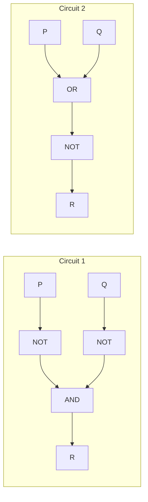

*Figure 14. Two different circuits with the same input/output table*

### 3.5 Congruence Modulo n

Example 8.2.4 showed that congruence modulo 3 is reflexive, symmetric, and transitive, so it is an equivalence relation.

**Example 8.3.10 (Equivalence Classes of Congruence Modulo 3).** Let $R$ be congruence modulo 3 on the set $\mathbf{Z}$ of all integers, that is, the relation with $m \, R \, n \iff 3 \mid (m - n)$ for all integers $m$ and $n$. Describe the distinct equivalence classes of $R$.

For each integer $a$, applying the definition of class and then the definition of divides gives the following.

$$
\begin{aligned}
[a] &= \lbrace x \in \mathbf{Z} \mid x \, R \, a \rbrace = \lbrace x \in \mathbf{Z} \mid 3 \mid (x - a) \rbrace \\
&= \lbrace x \in \mathbf{Z} \mid \exists k \in \mathbf{Z}, \ x - a = 3k \rbrace = \lbrace x \in \mathbf{Z} \mid \exists k \in \mathbf{Z}, \ x = 3k + a \rbrace
\end{aligned}
$$

In particular, for $a = 0, 1, 2$ the classes are as in Table 6.

| Class | Condition | Elements |
|:---|:---|:---|
| $[0]$ | $x = 3k$ for some integer $k$ | $\ldots, -9, -6, -3, 0, 3, 6, 9, \ldots$ |
| $[1]$ | $x = 3k + 1$ for some integer $k$ | $\ldots, -8, -5, -2, 1, 4, 7, 10, \ldots$ |
| $[2]$ | $x = 3k + 2$ for some integer $k$ | $\ldots, -7, -4, -1, 2, 5, 8, 11, \ldots$ |

*Table 6. The three equivalence classes of congruence modulo 3*

Since $3 \, R \, 0$, Lemma 8.3.2 gives $[3] = [0]$. By the same reasoning, the following hold.

$$
[0] = [3] = [-3] = [6] = [-6] = \cdots, \quad [1] = [4] = [-2] = [7] = [-5] = \cdots, \quad [2] = [5] = [-1] = [8] = [-4] = \cdots
$$

By the quotient-remainder theorem (Chapter 4), every integer can be written in exactly one of the forms $3k$, $3k + 1$, $3k + 2$, so every integer is in one of $[0]$, $[1]$, $[2]$. Hence there are exactly three distinct classes: the multiples of 3, the integers whose remainder on division by 3 is 1, and the integers whose remainder on division by 3 is 2.

Example 8.3.10 also illustrates an important point about equivalence classes: one class can go by many names. The class $[0]$ of 0 can equally be called the class $[3]$ of 3 or the class $[-6]$ of $-6$, yet all these names refer to one and the same set, the set of all multiples of 3. The name of an object must be kept distinct from the object itself.

> **Definition:** Let $R$ be an equivalence relation on a set $A$ and $S$ an equivalence class of $R$. An element $a$ with $[a] = S$ is called a **representative** of the class $S$.

Every element of an equivalence class $S$ is a representative of $S$. If $S = [b]$ and $a \in S$, then $a \, R \, b$, so Lemma 8.3.2 gives $[a] = [b] = S$. For example, $-6$, 0, and 9 are all representatives of the class $[0]$ of congruence modulo 3.

For congruence relations, the following notation, introduced by Gauss in his book *Disquisitiones Arithmeticae*, is widely used.

> **Definition:** Let $m$ and $n$ be integers and $d$ a positive integer. $m$ is **congruent to $n$ modulo $d$**, written $m \equiv n \pmod{d}$, if, and only if, $d \mid (m - n)$. In symbols, $m \equiv n \pmod{d} \iff d \mid (m - n)$.

For integers $m$ and $n$ and a positive integer $d$, $m \equiv n \pmod{d}$ if, and only if, $m \bmod d = n \bmod d$, that is, $m$ and $n$ leave the same remainder when divided by $d$. By the quotient-remainder theorem, writing $m = dq_1 + r_1$ and $n = dq_2 + r_2$ ($0 \le r_1, r_2 < d$) gives $m - n = d(q_1 - q_2) + (r_1 - r_2)$ with $-d < r_1 - r_2 < d$. Hence $d \mid (m - n)$ if, and only if, $d \mid (r_1 - r_2)$, and since the only multiple of $d$ strictly between $-d$ and $d$ is 0, this is the same as $r_1 = r_2$.

**Example 8.3.11 (Evaluating Congruences).** Decide which of the following congruences are true and which are false.

- $12 \equiv 7 \pmod{5}$ is true. $12 - 7 = 5 = 5 \cdot 1$, so $5 \mid (12 - 7)$.
- $6 \equiv -8 \pmod{4}$ is false. $6 - (-8) = 14$, and $14 \ne 4k$ for any integer $k$, so $4 \nmid 14$. Hence $6 \not\equiv -8 \pmod{4}$.
- $3 \equiv 3 \pmod{7}$ is true. $3 - 3 = 0 = 7 \cdot 0$, so $7 \mid (3 - 3)$.

Congruence explains integer arithmetic in computers. Chapter 2 used a simplified computer model that represents and computes with the 256 integers from $-128$ to $127$ using 8-bit two's complements. In this model, $78 + (-46)$ is computed as in Figure 15.

```text
      0 1 0 0 1 1 1 0      78
    + 1 1 0 1 0 0 1 0      2^8 - 46 = 210
    -------------------
    1 0 0 1 0 0 0 0 0      288
```

*Figure 15. Computation of 78 + (−46) with 8-bit two's complements*

The result $100100000_2$ is 288, which is too large for an 8-bit representation. But the rule for two's complement computation says to discard the 1 in the ninth position from the right, the $2^8$ place. When this 1 is discarded, the result is $00100000_2 = 32$, the correct answer. The reason the method works is as follows. Read in decimal, the two's complements of 78 and $-46$ are 78 and $2^8 - 46$, and the following holds.

$$
78 + (2^8 - 46) = 2^8 + (78 - 46) \equiv 78 - 46 \pmod{2^8}
$$

Hence reducing $78 + (2^8 - 46)$ modulo $2^8$ gives the correct result $78 - 46 = 32$. In binary notation, the bit in the $2^8$ place stands for $2^8$, so discarding that bit is the same as reducing modulo $2^8$.

### 3.6 Rational Numbers as Equivalence Classes

Set aside the rules of fraction arithmetic for a moment and regard $\frac{1}{3}$ and $\frac{2}{6}$ purely as strings of symbols; then the two expressions look different, and as ordered pairs $(1, 3)$ and $(2, 6)$ they are in fact different. They are nevertheless treated as the same number because of the general convention that two fractions $\frac{a}{b}$ and $\frac{c}{d}$ are equal when their cross products agree, that is, when $ad = bc$. Equivalence relations give this convention a precise form.

**Example 8.3.12 (Rational Numbers Are Equivalence Classes).** Let $A$ be the set of all ordered pairs of integers whose second component is nonzero, that is, $A = \mathbf{Z} \times (\mathbf{Z} - \lbrace 0 \rbrace)$. Define a relation $R$ on $A$ as follows for all $(a, b), (c, d) \in A$.

$$
(a, b) \, R \, (c, d) \iff ad = bc
$$

**Reflexivity and symmetry.** For every $(a, b) \in A$, $ab = ba$ by the commutative law of multiplication, so $(a, b) \, R \, (a, b)$. Also, if $(a, b) \, R \, (c, d)$, then $ad = bc$, and interchanging the two sides and using commutativity gives $cb = da$, so $(c, d) \, R \, (a, b)$.

**Transitivity.** [It must be shown that for all $(a, b), (c, d), (e, f) \in A$, if $(a, b) \, R \, (c, d)$ and $(c, d) \, R \, (e, f)$, then $(a, b) \, R \, (e, f)$.] Suppose $(a, b)$, $(c, d)$, and $(e, f)$ are particular but arbitrarily chosen elements of $A$ with $(a, b) \, R \, (c, d)$ and $(c, d) \, R \, (e, f)$. By definition of $R$, the following two equations hold.

$$
(1) \ ad = bc, \qquad (2) \ cf = de
$$

Every ordered pair in $A$ has a nonzero second component, so $b \ne 0$, $d \ne 0$, and $f \ne 0$. Multiplying both sides of equation (1) by $f$ and both sides of equation (2) by $b$ gives $adf = bcf$ and $bcf = bde$. Since both equal $bcf$, $adf = bde$. Since $d \ne 0$, the cancellation law for multiplication allows $d$ to be canceled from both sides, giving $af = be$. Hence, by definition of $R$, $(a, b) \, R \, (e, f)$.

> **Caution:** The proof of transitivity cancels $d$ using $d \ne 0$. If ordered pairs with second component 0 were allowed, transitivity would fail. For example, $(1, 2)$ would be related to $(0, 0)$ because $1 \cdot 0 = 2 \cdot 0$, and $(0, 0)$ would be related to $(3, 5)$ because $0 \cdot 5 = 0 \cdot 3$, but $(1, 2)$ would not be related to $(3, 5)$ because $1 \cdot 5 = 5 \ne 6 = 2 \cdot 3$.

**Equivalence classes.** Two pairs are related exactly when the fractions they represent are equal, so each class consists of all pairs $(a, b)$ whose fractions $\frac{a}{b}$ share one common value, and there is exactly one class for each rational number. The class of $(1, 2)$, for example, is the following.

$$
[(1, 2)] = \lbrace (1, 2), (-1, -2), (2, 4), (-2, -4), (3, 6), (-3, -6), \ldots \rbrace
$$

Indeed, $\frac{1}{2} = \frac{-1}{-2} = \frac{2}{4} = \frac{-2}{-4} = \frac{3}{6} = \frac{-3}{-6}$.

Going further, addition and multiplication can be defined on the classes of $R$ so that they obey every law that holds for addition and multiplication of rational numbers, and the rational numbers may thus be defined as the equivalence classes of pairs of integers. A similar construction obtains every integer, including zero and the negative integers, as an equivalence class of pairs of positive integers. Frege and Peano showed in the late nineteenth century that the positive integers themselves can be built from sets alone, and somewhat earlier Dedekind had constructed every real number as a set of rational numbers. Combining these constructions, the set of real numbers can be built from logic and set theory alone.

---

<br>

## 4. Partial Order Relations (Section 8.5)

Suppose a computer science degree at some university requires a fixed list of courses, some of which may be taken only after certain others have been completed. Questions then arise about this prerequisite structure: the minimum number of terms needed to finish the degree, the maximum number of courses that can be taken together in one term, and whether a part-time student can take the courses one per term in some admissible order. Treating the prerequisite structure as a partial order relation makes these questions fairly easy to answer, as Section 4.8 shows.

### 4.1 Antisymmetry

Section 2 defined reflexivity, symmetry, and transitivity; a fourth property of relations is antisymmetry. In an arrow diagram, antisymmetry means that an arrow from one element to a different element is never accompanied by an arrow going back in the reverse direction.

> **Definition:** Let $R$ be a relation on a set $A$. $R$ is **antisymmetric** if, and only if, for all $a, b \in A$, if $a \, R \, b$ and $b \, R \, a$ then $a = b$.

Negating the definition, $R$ is not antisymmetric if, and only if, there are elements $a, b \in A$ with $a \, R \, b$ and $b \, R \, a$ but $a \ne b$.

> **Caution:** Being antisymmetric is not the same as not being symmetric. The relation $\lbrace (0, 0), (1, 1) \rbrace$ on the set $\lbrace 0, 1 \rbrace$ is both symmetric and antisymmetric, and the relation $\lbrace (0, 1), (1, 0), (0, 2) \rbrace$ on the set $\lbrace 0, 1, 2 \rbrace$ is neither symmetric nor antisymmetric. Antisymmetry is the condition that no two distinct elements have arrows in both directions between them, and loops have nothing to do with this condition.

**Example 8.5.1 (Testing for Antisymmetry of Finite Relations).** Draw the directed graphs of the relations $R_1 = \lbrace (0, 2), (1, 2), (2, 0) \rbrace$ and $R_2 = \lbrace (0, 0), (0, 1), (0, 2), (1, 1), (1, 2) \rbrace$ on $\lbrace 0, 1, 2 \rbrace$, and decide which are antisymmetric.

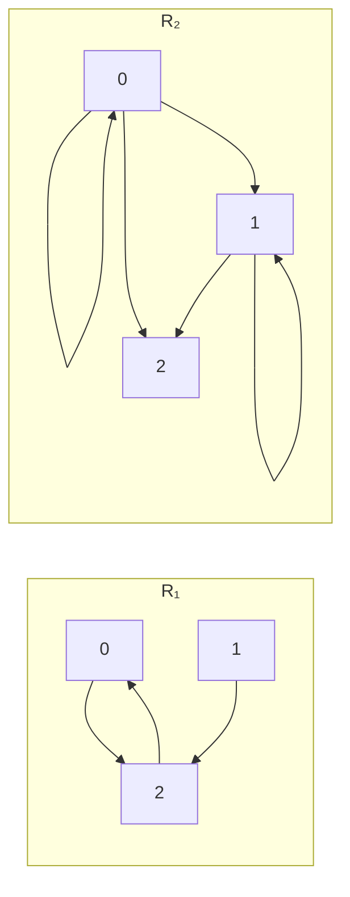

*Figure 16. Directed graphs of the two relations of Example 8.5.1*

- $R_1$ is not antisymmetric. $0 \, R_1 \, 2$ and $2 \, R_1 \, 0$, but $0 \ne 2$.
- $R_2$ is antisymmetric. For $R_2$ not to be antisymmetric, there would have to be a pair of distinct elements each related to the other, and inspection of the graph shows that no such pair exists. None of the non-loop arrows $0 \to 1$, $0 \to 2$, $1 \to 2$ has a reverse arrow.

**Example 8.5.2 (Testing for Antisymmetry of Divides Relations).** Let $R_1$ be the divides relation on the set $\mathbf{Z}^{+}$ of all positive integers, and let $R_2$ be the divides relation on the set $\mathbf{Z}$ of all integers. That is, $a \, R_1 \, b \iff a \mid b$ for all $a, b \in \mathbf{Z}^{+}$, and $a \, R_2 \, b \iff a \mid b$ for all $a, b \in \mathbf{Z}$.

**$R_1$ is antisymmetric.**

**Proof:** Suppose $a$ and $b$ are positive integers with $a \, R_1 \, b$ and $b \, R_1 \, a$. [It must be shown that $a = b$.] By definition of $R_1$, $a \mid b$ and $b \mid a$. By definition of divides, there are integers $k_1$ and $k_2$ with $b = k_1 a$ and $a = k_2 b$. By substitution, $b = k_1 a = k_1 (k_2 b) = (k_1 k_2) b$, and since $b$ is positive and hence nonzero, dividing both sides by $b$ gives $k_1 k_2 = 1$. Also, since $a$ and $b$ are positive integers, $k_1 = b / a$ and $k_2 = a / b$ are positive, hence positive integers. The only product of two positive integers that equals 1 is $1 \cdot 1$, so $k_1 = k_2 = 1$, and therefore $a = k_2 b = 1 \cdot b = b$.

**$R_2$ is not antisymmetric.**

**Counterexample:** Let $a = 2$ and $b = -2$. Then $a \mid b$ because $-2 = (-1) \cdot 2$, and $b \mid a$ because $2 = (-1) \cdot (-2)$. Hence $a \, R_2 \, b$ and $b \, R_2 \, a$, but $a \ne b$.

Example 8.5.2 shows that one defining rule can give an antisymmetric relation on a subset of a set and a relation that is not antisymmetric on the whole set. The key to the proof for $R_1$ was that $k_1$ and $k_2$ are positive; once negative numbers are allowed, $k_1 = k_2 = -1$ also becomes possible.

### 4.2 Definition and Examples of Partial Orders

> **Definition:** Let $R$ be a relation defined on a set $A$. $R$ is a **partial order relation**, or simply a **partial order**, if, and only if, $R$ is reflexive, antisymmetric, and transitive.

The less-than-or-equal-to relation on a set of real numbers and the subset relation on a set of sets are the two most basic partial order relations, and they serve as the models on which the general notion is patterned.

**Example 8.5.3 (The Subset Relation).** Let $\mathcal{A}$ be any collection of sets, and define the subset relation $\subseteq$ on $\mathcal{A}$ as follows for all $U, V \in \mathcal{A}$.

$$
U \subseteq V \iff \forall x, \ x \in U \Rightarrow x \in V
$$

$\subseteq$ is reflexive (every element of a set is an element of that set) and transitive (if $U \subseteq V$ and $V \subseteq W$, an element of $U$ is in $V$ and hence in $W$). For $\subseteq$ to be antisymmetric means that for all $U, V \in \mathcal{A}$, if $U \subseteq V$ and $V \subseteq U$ then $U = V$, which is exactly the definition of set equality. Hence $\subseteq$ is a partial order relation.

**Example 8.5.4 (A Divides Relation on a Set of Positive Integers).** Let $A$ be a set of positive integers, and let $\mid$ be the divides relation on $A$, that is, $a \mid b \iff b = ka$ for some integer $k$, for all $a, b \in A$. Prove that $\mid$ is a partial order relation.

- **Reflexivity:** Suppose $a \in A$. Then $a = 1 \cdot a$, so $a \mid a$ by definition of divisibility.
- **Antisymmetry:** It must be shown that for all $a, b \in A$, if $a \mid b$ and $b \mid a$ then $a = b$, and the proof is the same as the proof for $R_1$ in Example 8.5.2.
- **Transitivity:** It must be shown that for all $a, b, c \in A$, if $a \mid b$ and $b \mid c$ then $a \mid c$. This is the transitivity of divisibility proved in Chapter 4: if $b = ka$ and $c = lb$, then $c = l(ka) = (lk)a$, and $lk$ is an integer.

Since $\mid$ is reflexive, antisymmetric, and transitive, it is a partial order relation on $A$.

**Example 8.5.5 (The Less-Than-or-Equal-To Relation).** Let $S$ be a set of real numbers, and define the less-than-or-equal-to relation $\le$ on $S$ by $x \le y \iff x < y$ or $x = y$, for all $x, y \in S$. Show that $\le$ is a partial order relation.

- **Reflexivity:** $x \le x$ means $x < x$ or $x = x$, and $x = x$ is always true.
- **Antisymmetry:** It must be shown that if $x \le y$ and $y \le x$ then $x = y$. If $x \ne y$, the two hypotheses would require both $x < y$ and $y < x$, contradicting the trichotomy law, which says that for any real numbers $x$ and $y$ exactly one of $x < y$, $x = y$, $x > y$ holds. Hence $x = y$.
- **Transitivity:** It must be shown that if $x \le y$ and $y \le z$ then $x \le z$. If $x = y$, substituting into $y \le z$ gives $x \le z$, and if $y = z$, substituting into $x \le y$ gives $x \le z$. In the remaining case, $x < y$ and $y < z$, so $x < z$ by the transitive law of order.

Since $\le$ is reflexive, antisymmetric, and transitive, it is a partial order relation.

> **Note:** **Notation.** Because $\le$ is the paradigm of partial order relations, a general partial order relation is often denoted by the symbol $\preceq$. The notation $x \preceq y$ is read "$x$ is less than or equal to $y$" or "$y$ is greater than or equal to $x$". Here less and greater refer not to the size of numbers but to positions in the given partial order.

### 4.3 Lexicographic Order

A dictionary orders two words by scanning them from the left, one letter at a time. If the letters agree until one of the words ends, the shorter word is listed first; thus play precedes playhouse. If the letters agree up to some position and then differ, the word whose letter at that position is earlier in the alphabet is listed first; thus playhouse precedes playmate, because the two words first differ at the fifth letter and h comes before m.

The same idea defines a lexicographic order on a set of strings over any set $A$ that has a partial order relation, as the following theorem states.

> **Key Point:** **Theorem 8.5.1 (Lexicographic Order).** Let $A$ be a set with a partial order relation $R$, let $S$ be a set of strings over $A$, and define a relation $\preceq$ on $S$ as follows. Let $s$ and $t$ be any strings in $S$ of positive lengths $m$ and $n$, respectively, and let $s_k$ and $t_k$ be the $k$th characters of $s$ and $t$, respectively.
> 1. If $m \le n$ and the first $m$ characters of $s$ and $t$ are the same, that is, $s$ is an initial part of $t$, then $s \preceq t$.
> 2. If, for some positive integer $k \le \min(m, n)$, the first $k - 1$ characters of $s$ and $t$ are the same, $s_k \, R \, t_k$, and $s_k \ne t_k$, then $s \preceq t$.
> 3. If $\lambda$ is the null string, then $\lambda \preceq s$ for every $s \in S$.
>
> If no strings are related by $\preceq$ other than by these three conditions, then $\preceq$ is a partial order relation on $S$.

> **Definition:** The partial order relation $\preceq$ of Theorem 8.5.1 is called the **lexicographic order** for $S$ that corresponds to the partial order $R$ on $A$.

Proving Theorem 8.5.1 takes some careful bookkeeping but no new idea. For example, reflexivity follows at once from condition 1 with $t = s$ ($m = n$). Condition 1 corresponds to the dictionary rule that puts play before playhouse, and condition 2 to the rule that puts playhouse before playmate.

> **Note:** Theorem 8.5.1 in the textbook uses the letter $m$ in condition 2 as well, but there $m$ must be read not as the length of $s$ but as the position at which the two strings first differ. For example, $xxxyyy \preceq xy$ in Example 8.5.6 below holds by condition 2 with $k = 2$, because the strings first differ at the second character; reading that position as the length 6 of $s$ would make condition 2 inapplicable. The statement above makes this clear by writing the position separately as $k$.

**Example 8.5.6 (Testing Strings for Lexicographic Order).** Let $R = \lbrace (x, x), (x, y), (y, y) \rbrace$ be a partial order relation on $A = \lbrace x, y \rbrace$; that is, $x \, R \, y$ but $y$ is not related to $x$. Let $S$ be the set of all strings over $A$, and let $\preceq$ be the lexicographic order for $S$ that corresponds to $R$. Table 7 gives the answers for several pairs.

| Question | Answer | Reason |
|:---|:---:|:---|
| $x \preceq x$? | Yes | Condition 1: $m = n = 1$ and the first character is the same |
| $x \preceq xx$? | Yes | Condition 1: $x$ is an initial part of $xx$ |
| $yx \preceq yxy$? | Yes | Condition 1: $yx$ is an initial part of $yxy$ |
| $xxxyyy \preceq xy$? | Yes | Condition 2: the first characters agree, and at the second character $x \, R \, y$ with $x \ne y$ |
| $x \preceq y$? | Yes | Condition 2: $k = 1$, and the condition that the first zero characters agree is vacuously true |
| $\lambda \preceq xy$? | Yes | Condition 3 |
| $xyy \preceq xyx$? | No | At the third character, where they first differ, $y$ is not related to $x$ by $R$ |

*Table 7. Lexicographic order decisions of Example 8.5.6*

In the last case, $xyy$ is not an initial part of $xyx$ either, so condition 1 does not apply. Rather, $x \, R \, y$ at the third character, so $xyx \preceq xyy$. Under the less-than-or-equal-to relation on real numbers, as under the dictionary order of words, every two elements can be compared; Section 4.5 calls such orders total orders.

### 4.4 Hasse Diagrams

Consider the divides relation on $A = \lbrace 1, 2, 3, 9, 18 \rbrace$, that is, $a \mid b \iff b = ka$ for some integer $k$, for all $a, b \in A$. The number 1 divides every element, 2 divides 2 and 18, 3 divides 3, 9, and 18, 9 divides 9 and 18, and 18 divides only 18. The directed graph of this relation is shown in Figure 17.

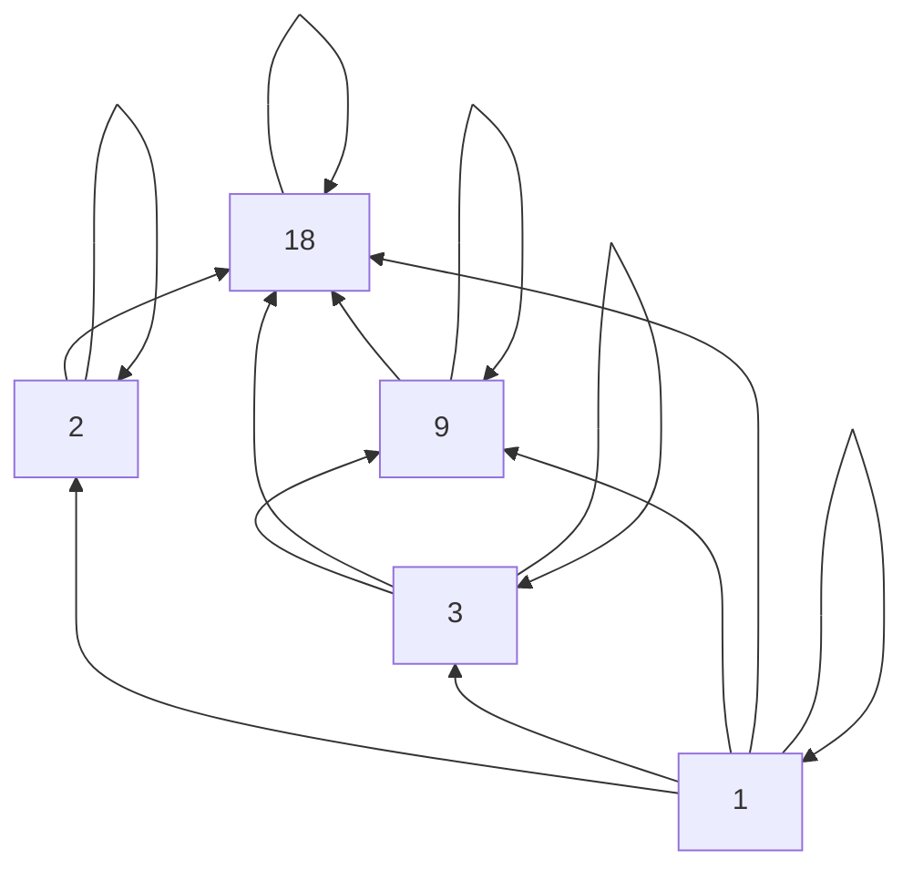

*Figure 17. Directed graph of the divides relation on the set {1, 2, 3, 9, 18}*

There is a loop at every vertex, every other arrow points upward, and any two arrows that can be followed in succession are accompanied by a direct arrow from the start of the first to the end of the second. The directed graph of a partial order relation on a finite set can always be drawn with these features. Reflexivity puts a loop at every vertex, antisymmetry allows at most one direction of arrow between two distinct points, and transitivity supplies the direct arrow for every two linked arrows. Moreover, antisymmetry and transitivity together rule out any cycle of arrows that passes through distinct points and returns to its start, so the vertices can be placed so that every arrow points upward. Because the graph is this regular, much of it can be omitted without losing information, and in this way a simpler picture called a **Hasse diagram** is associated with a partial order relation on a finite set. The Hasse diagram is named after the twentieth-century German number theorist Helmut Hasse and is obtained by the following procedure.

First draw the directed graph of the relation with its vertices placed so that every arrow points upward. Then delete the following three kinds of marks.

1. The loops at all the vertices
2. Every arrow whose existence transitivity already implies
3. The direction indicators (arrowheads) on the arrows

For the divides relation, $1 \to 9$ is implied by $1 \to 3 \to 9$, $1 \to 18$ by $1 \to 2 \to 18$, and $3 \to 18$ by $3 \to 9 \to 18$, so they are eliminated. The remaining five lines join 1 and 2, 1 and 3, 2 and 18, 3 and 9, and 9 and 18, and the Hasse diagram is shown in Figure 18.

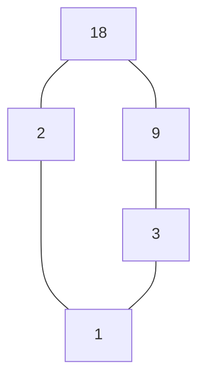

*Figure 18. Hasse diagram of the divides relation on the set {1, 2, 3, 9, 18}*

**Example 8.5.7 (Constructing a Hasse Diagram).** Construct the Hasse diagram of the subset relation $\subseteq$ on $\mathcal{P}(\lbrace a, b, c \rbrace)$, that is, $U \subseteq V \iff \forall x, \ x \in U \Rightarrow x \in V$ for all $U, V \in \mathcal{P}(\lbrace a, b, c \rbrace)$.

When the directed graph is drawn so that all arrows except loops point upward, the sets with 0, 1, 2, and 3 elements form layers from the bottom, and there is an arrow from each set to every set containing it. Removing the loops, the arrows implied by transitivity (for example, $\emptyset \to \lbrace a, b \rbrace$ is implied by $\emptyset \to \lbrace a \rbrace \to \lbrace a, b \rbrace$), and the arrowheads leaves a line between two sets only when the larger set is obtained from the smaller one by adding exactly one element. The result is shown in Figure 19.

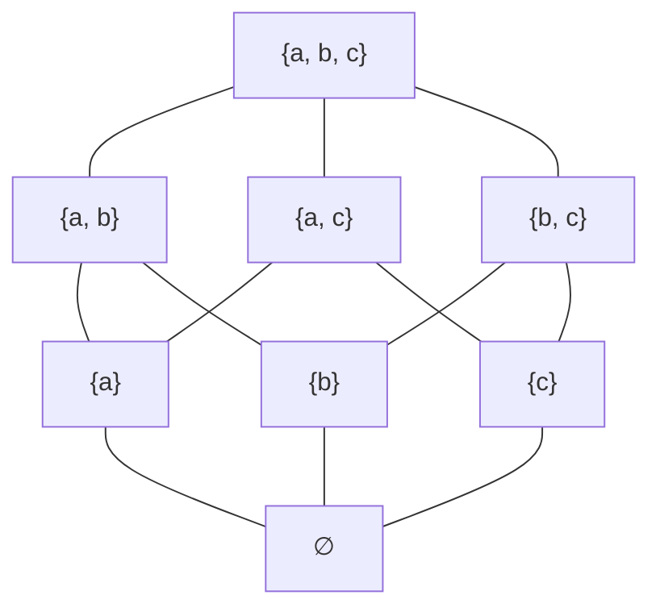

*Figure 19. Hasse diagram of the subset relation on the power set P({a, b, c})*

The directed graph of a relation can be recovered from its Hasse diagram by undoing the procedure above, keeping in mind that every arrow of the original directed graph pointed upward.

1. Reinsert upward-pointing arrowheads on all the lines.
2. Add a loop at each vertex.
3. Whenever two arrows can be followed in succession, from a first point to a second and from the second to a third, add a direct arrow from the first point to the third. Repeat until no new arrow arises.

**Example 8.5.8 (Obtaining the Directed Graph of a Partial Order Relation from Its Hasse Diagram).** A partial order relation $R$ has the Hasse diagram in Figure 20. Find the directed graph of $R$.

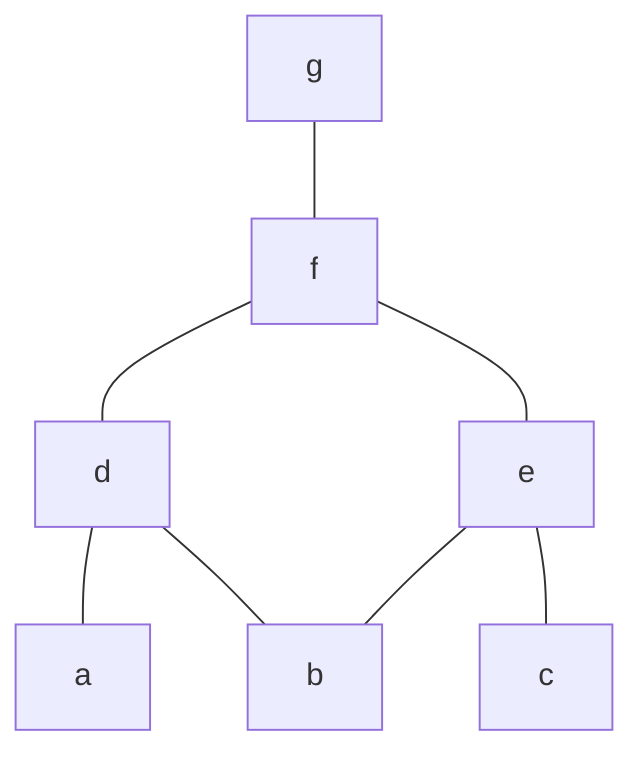

*Figure 20. Hasse diagram of the partial order relation of Example 8.5.8*

Put upward arrowheads on the lines, add loops at the seven vertices, and then add every shortcut for linked arrows. For example, $a \to d \to f$ gives $a \to f$, and $a \to f \to g$ gives $a \to g$. In the same way, each vertex gets an arrow to every vertex above it. There are arrows from $a$ to $d, f, g$; from $b$ to $d, e, f, g$; from $c$ to $e, f, g$; from each of $d$ and $e$ to $f, g$; and from $f$ to $g$, so there are $3 + 4 + 3 + 2 + 2 + 1 = 15$ non-loop arrows, and with the 7 loops $R$ consists of 22 ordered pairs. The directed graph is shown in Figure 21.

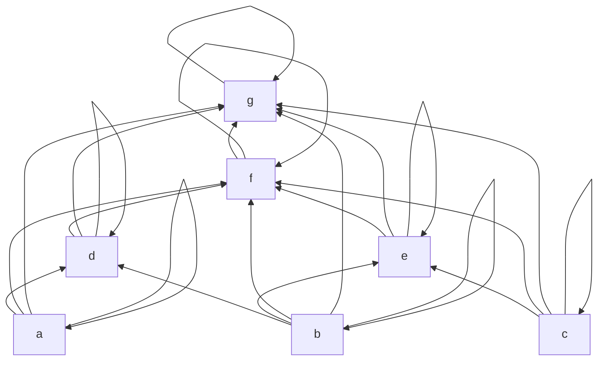

*Figure 21. Directed graph of the partial order relation of Example 8.5.8 recovered from its Hasse diagram*

### 4.5 Partially and Totally Ordered Sets

For any two real numbers $x$ and $y$, at least one of $x \le y$ and $y \le x$ holds; two elements related in one direction or the other like this are said to be comparable. By contrast, two subsets $A$ and $B$ of $\lbrace a, b, c \rbrace$ may satisfy neither $A \subseteq B$ nor $B \subseteq A$. For instance, if $A = \lbrace a, b \rbrace$ and $B = \lbrace b, c \rbrace$, then $A \not\subseteq B$ and $B \not\subseteq A$. In such a case, $A$ and $B$ are said to be noncomparable.

> **Definition:** Let $\preceq$ be a partial order relation on a set $A$. Elements $a$ and $b$ of $A$ are said to be **comparable** if, and only if, either $a \preceq b$ or $b \preceq a$. Otherwise, $a$ and $b$ are called **noncomparable**.

A partial order relation under which every two elements are comparable is called a total order.

> **Definition:** If $R$ is a partial order relation on a set $A$, and for any two elements $a$ and $b$ of $A$ either $a \, R \, b$ or $b \, R \, a$, then $R$ is called a **total order relation**, or a **total order**, on $A$.

The less-than-or-equal-to relation on any set of real numbers and the dictionary order of words are both total order relations, and the Hasse diagram of a total order relation is one vertical chain. Many partial orders of practical importance, however, contain noncomparable elements and therefore are not total orders. For instance, the subset relation on $\mathcal{P}(\lbrace a, b, c \rbrace)$ is not a total order because $\lbrace a, b \rbrace$ and $\lbrace a, c \rbrace$ are noncomparable. Divides relations are often not total orders either; in Figure 18, for example, neither of 2 and 3 divides the other. On a set of positive integers, the divides relation is a total order exactly when each element divides the next one once the elements are listed in increasing order, as in $\lbrace 1, 2, 4, 8 \rbrace$ or $\lbrace 2, 6, 12 \rbrace$.

> **Definition:** A set $A$ is called a **partially ordered set (poset)** with respect to a relation $\preceq$ if, and only if, $\preceq$ is a partial order relation on $A$. A set $A$ is called a **totally ordered set** with respect to $\preceq$ if, and only if, $A$ is partially ordered with respect to $\preceq$ and $\preceq$ is a total order.

For instance, the real numbers form a partially ordered set under the less-than-or-equal-to relation $\le$, and any set of sets forms a partially ordered set under the subset relation $\subseteq$. Any subset of a partially ordered set is again a partially ordered set with respect to the same relation (restricted to the subset). This is because reflexivity, antisymmetry, and transitivity are all universal statements: what holds for all elements of the original set holds in particular for the elements of the subset.

Even a partially ordered set that is not totally ordered may contain subsets that are totally ordered; such subsets are called chains.

> **Definition:** Let $A$ be a partially ordered set with respect to a relation $\preceq$. A subset $B$ of $A$ is called a **chain** if, and only if, every two elements of $B$ are comparable, that is, $a \preceq b$ or $b \preceq a$ for all $a$ and $b$ in $B$. The **length of a chain** is one less than the number of elements in the chain.

If $B$ is a chain in $A$, then $B$ is a totally ordered set with respect to the restriction of $\preceq$ to $B$. Also, a partially ordered set is totally ordered if, and only if, the whole set is a chain.

**Example 8.5.9 (A Chain of Subsets).** Find a chain of length 3 in the partially ordered set $\mathcal{P}(\lbrace a, b, c \rbrace)$ with respect to the subset relation. Since $\emptyset \subseteq \lbrace a \rbrace \subseteq \lbrace a, b \rbrace \subseteq \lbrace a, b, c \rbrace$, every two elements of the set $S = \lbrace \emptyset, \lbrace a \rbrace, \lbrace a, b \rbrace, \lbrace a, b, c \rbrace \rbrace$ are comparable. $S$ has 4 elements, so it is a chain of length 3. In the Hasse diagram (Figure 19), the elements of any chain lie on a single upward path, and this chain consists of all the vertices of one path from $\emptyset$ up to $\lbrace a, b, c \rbrace$.

### 4.6 Maximal, Minimal, Greatest, and Least Elements

In a partially ordered set, a **maximal element** is greater than or equal to each element comparable with it, although there may be many elements that are not comparable with it. A **greatest element**, by contrast, is greater than or equal to every element of the set, so it is comparable with all of them. **Minimal elements** and **least elements** are defined in the same way with the direction of the order reversed.

> **Definition:** Let a set $A$ be partially ordered with respect to a relation $\preceq$.
> 1. An element $a$ of $A$ is a **maximal element of $A$** if, and only if, for each $b$ in $A$, either $b \preceq a$ or $b$ and $a$ are not comparable.
> 2. An element $a$ of $A$ is a **greatest element of $A$** if, and only if, $b \preceq a$ for each $b$ in $A$.
> 3. An element $a$ of $A$ is a **minimal element of $A$** if, and only if, for each $b$ in $A$, either $a \preceq b$ or $b$ and $a$ are not comparable.
> 4. An element $a$ of $A$ is a **least element of $A$** if, and only if, $a \preceq b$ for each $b$ in $A$.

The definition of a maximal element can be restated as follows: $a$ is maximal if, and only if, there is no element $b$ with $a \preceq b$ and $b \ne a$, that is, no element strictly greater than $a$. If there were such a $b$, then $b$ would be comparable to $a$, so the definition would require $b \preceq a$, and antisymmetry would give $a = b$, a contradiction. A minimal element can likewise be restated as an element with no element strictly smaller than it. In a Hasse diagram, a maximal element is a vertex with no line going up from it, and a minimal element is a vertex with no line going down from it.

The four concepts are related as follows.

- Every greatest element is maximal, whereas a maximal element need not be greatest. The same holds for least and minimal elements.
- Every nonempty finite subset of a totally ordered set has both a least element and a greatest element.
- A partially ordered set has at most one greatest element and at most one least element. If $g$ and $g'$ are both greatest elements, then $g' \preceq g$ and $g \preceq g'$, so $g = g'$ by antisymmetry.
- On the other hand, there may be several maximal or minimal elements.

> **Caution:** Do not confuse maximal elements with greatest elements. A maximal element only has no element above it; it need not be above every element. For example, in Example 8.5.11 of Section 4.7, 18 and 24 are both maximal elements, but they are noncomparable, so neither is a greatest element.

**Example 8.5.10 (Maximal, Minimal, Greatest, and Least Elements).** Let $A = \lbrace a, b, c, d, e, f, g, h, i \rbrace$ have the partial order $\preceq$ defined by the Hasse diagram in Figure 22. Find all maximal, minimal, greatest, and least elements of $A$.

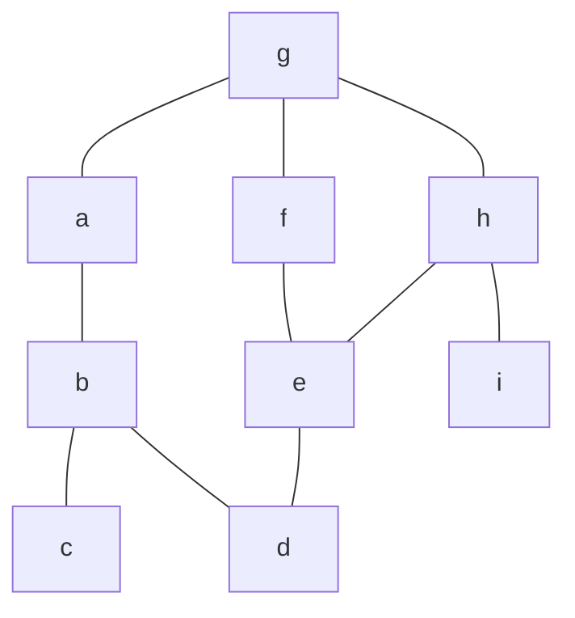

*Figure 22. Hasse diagram of the partial order of Example 8.5.10*

- The only vertex with no line going up is $g$, so $g$ is the only maximal element.
- $g$ is also the greatest element. An upward path from every element reaches $g$: $c \to b \to a \to g$, $d \to b \to a \to g$, $e \to f \to g$, $e \to h \to g$, and $i \to h \to g$, so $x \preceq g$ for every element $x$.
- The vertices with no line going down are $c$, $d$, and $i$, so the minimal elements are $c$, $d$, and $i$.
- There is no least element. A least element would have to be less than or equal to every element, but the three minimal elements $c$, $d$, and $i$ are mutually noncomparable, so none of them is less than or equal to the others.

### 4.7 Topological Sorting

The sets of $\mathcal{P}(\lbrace a, b, c \rbrace)$ can be entered into a computer in an order consistent with the subset relation $\subseteq$, that is, so that $U$ comes before $V$ whenever $U \subseteq V$. For instance, the following input order satisfies this condition.

$$
\emptyset, \ \lbrace a \rbrace, \ \lbrace b \rbrace, \ \lbrace c \rbrace, \ \lbrace a, b \rbrace, \ \lbrace a, c \rbrace, \ \lbrace b, c \rbrace, \ \lbrace a, b, c \rbrace
$$

Another input order with the same property is the following.

$$
\emptyset, \ \lbrace a \rbrace, \ \lbrace b \rbrace, \ \lbrace a, b \rbrace, \ \lbrace c \rbrace, \ \lbrace b, c \rbrace, \ \lbrace a, c \rbrace, \ \lbrace a, b, c \rbrace
$$

> **Definition:** Given partial order relations $\preceq$ and $\preceq'$ on a set $A$, $\preceq'$ is **compatible** with $\preceq$ if, and only if, for all $a$ and $b$ in $A$, if $a \preceq b$ then $a \preceq' b$.

If $A$ is finite, then for every partial order relation $\preceq$ on $A$ there is a total order $\preceq'$ on $A$ that is compatible with $\preceq$. A total order compatible with a given order is called a topological sorting.

> **Definition:** Given partial order relations $\preceq$ and $\preceq'$ on a set $A$, $\preceq'$ is a **topological sorting** for $\preceq$ if, and only if, $\preceq'$ is a total order that is compatible with $\preceq$.

Topological sortings of finite partially ordered sets are built on one fact: every nonempty finite partially ordered set has a minimal element. To see why, start from any element $x_1$; if $x_1$ is not minimal, choose an element $x_2$ strictly smaller than $x_1$; if $x_2$ is not minimal, choose an element $x_3$ strictly smaller than $x_2$; and so on. By transitivity, each $x_j$ is strictly smaller than every earlier $x_i$, so by antisymmetry no element can appear twice. Since there are finitely many elements, the process must stop, and the element where it stops is minimal.

This fact yields a topological sorting as follows. Choose a minimal element and number it one. Delete it; what remains is a subset of a partially ordered set and is therefore partially ordered. If nothing remains, stop; otherwise choose a minimal element of the remainder and number it two. Keep deleting and choosing in this way until every element has been numbered. A somewhat more formal version is the following.

**Algorithm for constructing a topological sorting.** Let $\preceq$ be a partial order relation on a nonempty finite set $A$.

1. Pick any minimal element $x$ of $A$. [Such an element exists since $A$ is nonempty.]
2. Set $A' := A - \lbrace x \rbrace$.
3. While $A' \ne \emptyset$, repeat the following three steps.
   1. Pick any minimal element $y$ of $A'$.
   2. Define $x \preceq' y$.
   3. Set $A' := A' - \lbrace y \rbrace$ and $x := y$.

Completing steps 1 through 3 gives enough information to draw the Hasse diagram (a single chain) of the total order $\preceq'$, and the method of Section 4.4 then gives the directed graph of the whole relation from the Hasse diagram. The element chosen at each step is minimal among the remaining elements, so no remaining element is strictly smaller than it. Hence, if $a \preceq b$, then $a$ is chosen before $b$, so $a \preceq' b$, and $\preceq'$ is compatible with $\preceq$.

**Example 8.5.11 (A Topological Sorting).** Consider the set $A = \lbrace 2, 3, 4, 6, 18, 24 \rbrace$ ordered by the divides relation $\mid$. The Hasse diagram of this relation is shown in Figure 23.

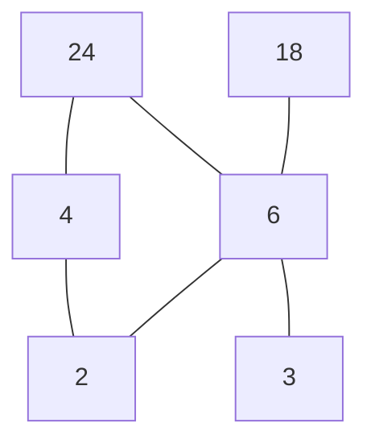

*Figure 23. Hasse diagram of the divides relation on the set {2, 3, 4, 6, 18, 24}*

For positive integers $a$ and $b$, if $a \mid b$ then $a \le b$, so the ordinary less-than-or-equal-to relation $\le$ is a topological sorting for this set. Find another topological sorting. Table 8 traces the algorithm.

| Step | Remaining set $A'$ | Minimal elements of $A'$ | Chosen | Total order so far |
|:---:|:---|:---|:---:|:---|
| 1 | $\lbrace 2, 3, 4, 6, 18, 24 \rbrace$ | 2, 3 | 3 | $3$ |
| 2 | $\lbrace 2, 4, 6, 18, 24 \rbrace$ | 2 | 2 | $3 \preceq' 2$ |
| 3 | $\lbrace 4, 6, 18, 24 \rbrace$ | 4, 6 | 6 | $3 \preceq' 2 \preceq' 6$ |
| 4 | $\lbrace 4, 18, 24 \rbrace$ | 4, 18 | 18 | $3 \preceq' 2 \preceq' 6 \preceq' 18$ |
| 5 | $\lbrace 4, 24 \rbrace$ | 4 | 4 | $3 \preceq' 2 \preceq' 6 \preceq' 18 \preceq' 4$ |
| 6 | $\lbrace 24 \rbrace$ | 24 | 24 | $3 \preceq' 2 \preceq' 6 \preceq' 18 \preceq' 4 \preceq' 24$ |

*Table 8. Construction of a topological sorting in Example 8.5.11*

At step 1 there are two minimal elements, 2 and 3, and either may be chosen; here 3 is chosen. At step 2, 6 is not minimal because it is above 2, which still remains, so 2 is the only minimal element. At step 3, 6 is chosen from 4 and 6. At step 4, 24 is not minimal because it is above 4, which still remains. That the result $3 \preceq' 2 \preceq' 6 \preceq' 18 \preceq' 4 \preceq' 24$ is compatible with the divides relation can be verified by checking that $a \preceq' b$ for every pair with $a \mid b$. The six lines of the Hasse diagram, $2 \mid 4$, $2 \mid 6$, $3 \mid 6$, $4 \mid 24$, $6 \mid 18$, and $6 \mid 24$, all respect this order, so by transitivity the remaining pairs do too. This set has 12 topological sortings in all.

> **Caution:** A topological sorting $\preceq'$ is only compatible with $\preceq$; $a \preceq' b$ does not imply $a \preceq b$. In the result above, $3 \preceq' 2$, but 3 does not divide 2.

> **[Algorithms]** In graph algorithms, topological sorting is the problem of lining up the vertices of a directed acyclic graph so that every arrow points from front to back. Repeatedly removing a vertex with no incoming arrow (a minimal element), or using depth-first search, computes it in time proportional to the numbers of vertices and arrows, and it is used for compilation order in build systems and for task scheduling.

### 4.8 An Application: Course Prerequisites

Returning to the example that opened Section 4, a partial order relation can be defined on the set of courses required for a degree as follows: for all required courses $x$ and $y$, $x \preceq y$ if, and only if, $x = y$ or $x$ is a prerequisite for $y$. Once the Hasse diagram of this relation is drawn, the questions posed at the beginning become easy to answer. For instance, suppose the requirements of a particular university have the Hasse diagram in Figure 24.

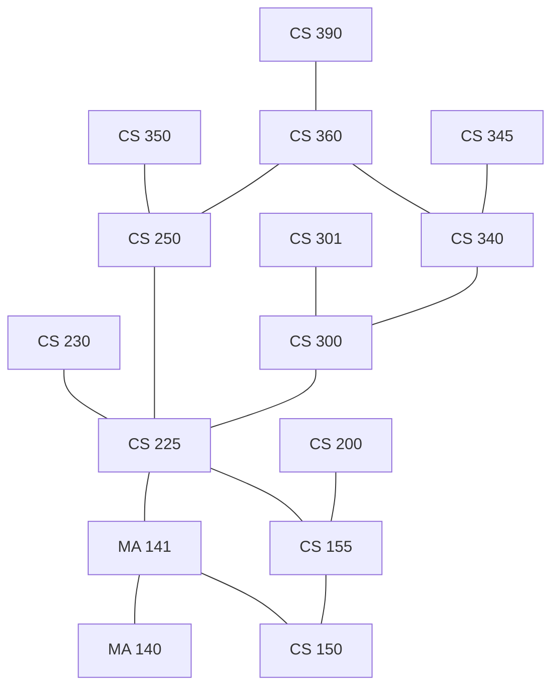

*Figure 24. Hasse diagram of the prerequisite relation among the required courses of a university*

- **Minimum number of terms.** The fewest terms in which all the requirements can be completed equals the number of elements of a longest chain, which is 7. For example, 150, 155, 225, 300, 340, 360, 390 is a chain of 7 elements. Each course in a chain can be taken only after the preceding course is finished, so at least 7 terms are needed. Conversely, if each course is taken in the term whose number equals the number of elements of a longest chain ending at that course, every prerequisite falls in an earlier term, so 7 terms suffice (assuming no limit on the number of courses per term).
- **Maximum number of courses in one term.** If the university allows it, the most courses one can take together in a single term equals the largest number of mutually noncomparable courses, which is 6. For example, no two of 350, 360, 345, 301, 230, 200 are related by precedence.
- **One course per term.** A topological sorting of the set gives a sequence that lets a part-time student take one course per term. One such sorting is 140, 150, 141, 155, 200, 225, 230, 300, 250, 301, 340, 345, 350, 360, 390, and there are many others.

> **Caution:** The length of a chain is one less than its number of elements. The longest chain above has 7 elements and hence length 6, and the minimum number of terms is its number of elements, 7, not its length.

### 4.9 PERT and CPM

Partial order relations underlie two important and widely used scheduling methods, **PERT (Program Evaluation and Review Technique)** and **CPM (Critical Path Method)**. Both were created in the 1950s for planning very large projects, in which a great many individual tasks must be scheduled. The two methods are closely alike but arose independently: the U.S. Navy introduced PERT to manage the building of the Polaris submarine, and the Du Pont company introduced CPM to schedule maintenance of chemical plants. The following simplified example shows how they work.

**Example 8.5.12 (A Job Scheduling Problem).** At an automobile plant, the assembly of one car can be divided into the following nine tasks.

1. Build the frame.
2. Install the engine, power train components, and gas tank.
3. Install the brakes, wheels, and tires.
4. Install the dashboard, floor, and seats.
5. Install the electrical lines.
6. Install the gas lines.
7. Install the brake lines.
8. Attach the body panels to the frame.
9. Paint the body.

Several of these tasks can proceed at the same time, but some cannot begin until certain other tasks are done. Table 9 gives the immediately preceding tasks and the time needed for each task.

| Task | Immediately preceding tasks | Time needed |
|:---:|:---:|:---:|
| 1 | None | 7 hours |
| 2 | 1 | 6 hours |
| 3 | 1 | 3 hours |
| 4 | 2 | 6 hours |
| 5 | 2, 3 | 3 hours |
| 6 | 4 | 1 hour |
| 7 | 2, 3 | 1 hour |
| 8 | 4, 5 | 2 hours |
| 9 | 6, 7, 8 | 5 hours |

*Table 9. Immediately preceding tasks and times of the car assembly tasks*

Let $T$ be the set of all tasks, and define a partial order relation $\preceq$ on $T$ by $x \preceq y$ when $x = y$ or $x$ must be performed before $y$, for all tasks $x$ and $y$. In PERT and CPM analysis it is customary to turn the Hasse diagram of this relation sideways so that it runs from left to right. Figure 25 shows such a diagram with the direction marked by arrows and with the minimum completion time of each task (the minimum time from the start of the job until the task is finished).

```mermaid
graph LR
    T1["Task 1<br>7 hours<br>finish time 7"] --> T2["Task 2<br>6 hours<br>finish time 13"]
    T1 --> T3["Task 3<br>3 hours<br>finish time 10"]
    T2 --> T4["Task 4<br>6 hours<br>finish time 19"]
    T2 --> T5["Task 5<br>3 hours<br>finish time 16"]
    T3 --> T5
    T2 --> T7["Task 7<br>1 hour<br>finish time 14"]
    T3 --> T7
    T4 --> T6["Task 6<br>1 hour<br>finish time 20"]
    T4 --> T8["Task 8<br>2 hours<br>finish time 21"]
    T5 --> T8
    T6 --> T9["Task 9<br>5 hours<br>finish time 26"]
    T7 --> T9
    T8 --> T9
    classDef critical stroke-width:3px
    class T1,T2,T4,T8,T9 critical
```

*Figure 25. PERT diagram of the car assembly tasks with minimum completion times (thick borders mark the critical path)*

The minimum time needed to assemble a car is found by moving through the diagram from left to right and recording the minimum completion time of each task. Task 1 takes 7 hours, so its minimum completion time is 7. Task 2 can start only when task 1 ends (at 7 hours) and then takes 6 more hours, so its time is $7 + 6 = 13$; similarly, task 3 gives $7 + 3 = 10$. Task 5 must wait until both tasks 2 and 3 are finished, so its minimum completion time is its own 3 hours added to the larger of their minimum completion times, 13 and 10: $3 + 13 = 16$. In general, the minimum completion time $F(k)$ of task $k$ is the following.

$$
F(k) = t(k) + \max \lbrace F(p) \mid p \in P(k) \rbrace
$$

Here $t(k)$ is the time needed for task $k$ and $P(k)$ is the set of immediately preceding tasks of task $k$; if $P(k)$ is empty, the maximum part is taken to be 0. Table 10 computes the minimum completion times of all tasks with this formula.

| Task | Minimum completion times of immediately preceding tasks | Maximum | Time needed | Minimum completion time |
|:---:|:---|:---:|:---:|:---:|
| 1 | None | 0 | 7 | 7 |
| 2 | $F(1) = 7$ | 7 | 6 | 13 |
| 3 | $F(1) = 7$ | 7 | 3 | 10 |
| 4 | $F(2) = 13$ | 13 | 6 | 19 |
| 5 | $F(2) = 13$, $F(3) = 10$ | 13 | 3 | 16 |
| 6 | $F(4) = 19$ | 19 | 1 | 20 |
| 7 | $F(2) = 13$, $F(3) = 10$ | 13 | 1 | 14 |
| 8 | $F(4) = 19$, $F(5) = 16$ | 19 | 2 | 21 |
| 9 | $F(6) = 20$, $F(7) = 14$, $F(8) = 21$ | 21 | 5 | 26 |

*Table 10. Computation of the minimum completion time of each task*

This analysis shows that task 9 cannot be finished earlier than 26 hours after the start of assembly. Since the car is complete once task 9 is done, 26 hours is the minimum time for the whole process. Carrying out tasks 1, 2, 4, 8, and 9 one after another takes $7 + 6 + 6 + 2 + 5 = 26$ hours, which is exactly this minimum. Consequently, a delay in any of these five tasks delays the completion of the whole car, and the path through tasks 1, 2, 4, 8, and 9 is therefore called a **critical path**. The critical path can be found by tracing back, from each task, the immediately preceding task that gave the maximum (from 9, $F(8) = 21$; from 8, $F(4) = 19$; from 4, $F(2) = 13$; from 2, $F(1) = 7$).

> **Key Point:** PERT and CPM treat the precedence among tasks as a partial order and compute minimum completion times along the Hasse diagram. The total time is determined by the longest-running chain (the critical path), and tasks off the critical path can be delayed somewhat without affecting the overall schedule. For example, task 7 can be finished at 14 hours, but task 9 cannot start until 21 hours, so task 7 can be delayed by up to 7 hours.

---

<br>

## Concept Applications

**Deciding properties of relations:** Table 11 summarizes whether several relations from this chapter have the four properties and how they are classified.

| Relation | Reflexive | Symmetric | Transitive | Antisymmetric | Classification |
|:---|:---:|:---:|:---:|:---:|:---|
| $=$ on $\mathbf{R}$ | Yes | Yes | Yes | Yes | Both an equivalence relation and a partial order |
| $<$ on $\mathbf{R}$ | No | No | Yes | Yes | Neither an equivalence relation nor a partial order |
| $\le$ on $\mathbf{R}$ | Yes | No | Yes | Yes | Total order |
| Congruence modulo 3 on $\mathbf{Z}$ | Yes | Yes | Yes | No | Equivalence relation |
| Divides on $\mathbf{Z}^{+}$ | Yes | No | Yes | Yes | Partial order (not total) |
| Divides on the nonzero integers | Yes | No | Yes | No | Neither an equivalence relation nor a partial order |
| $\subseteq$ on $\mathcal{P}(X)$ for nonempty $X$ | Yes | No | Yes | Yes | Partial order |
| $R$ of Example 8.2.1 | Yes | Yes | No | No | Neither an equivalence relation nor a partial order |

*Table 11. Properties and classification of the relations in this chapter*

**True/False Check:**

| Statement | Verdict and Reason |
|:-----|:------------|
| A relation that is not symmetric is antisymmetric. | **F.** The relation $\lbrace (0, 1), (1, 0), (0, 2) \rbrace$ on $\lbrace 0, 1, 2 \rbrace$ is neither symmetric nor antisymmetric. |
| The empty relation on a nonempty set is symmetric and transitive but not reflexive. | **T.** Symmetry and transitivity are vacuously true because their hypotheses never hold, and it is not reflexive because $(x, x)$ is missing for an element $x$. |
| Two distinct equivalence classes of an equivalence relation can have a common element. | **F.** By Lemma 8.3.3, two classes are either equal or disjoint. |
| $12 \equiv -3 \pmod{5}$. | **T.** $12 - (-3) = 15 = 5 \cdot 3$. |
| If a relation $R$ is already transitive, then $R^t = R$. | **T.** $R$ itself satisfies the three conditions of the transitive closure. |
| A maximal element of a partially ordered set is always a greatest element. | **F.** In Example 8.5.11, 18 and 24 are maximal elements, but there is no greatest element. |
| A nonempty finite partially ordered set has only one topological sorting. | **F.** There may be several ways to choose minimal elements, and the set of Example 8.5.11 has 12 topological sortings. |

---

<br>

## Summary

| Concept | Key Summary |
|:-----|:-----|
| Relation | A relation from $A$ to $B$ is a subset of $A \times B$, and $x \, R \, y$ means $(x, y) \in R$. |
| Inverse relation | $R^{-1}$ is the relation from $B$ to $A$ obtained by interchanging the two components of every ordered pair of $R$. |
| Directed graph | A relation on a set is drawn with elements as vertices, related pairs as arrows, and $x \, R \, x$ as loops. |
| $n$-ary relation | A subset of $A_1 \times \cdots \times A_n$, corresponding to a table of a relational database. |
| Reflexivity | $x \, R \, x$ for every $x$, meaning that every vertex of the directed graph has a loop. |
| Symmetry | If $x \, R \, y$ then $y \, R \, x$, meaning that every arrow has a reverse arrow. |
| Transitivity | If $x \, R \, y$ and $y \, R \, z$ then $x \, R \, z$; it is vacuously true when no ordered pairs link up. |
| Counterexample | The three properties are universal statements, so one counterexample suffices to show that a property fails. |
| Transitive closure | The smallest transitive relation $R^t$ containing $R$, found by adding forced ordered pairs until no more arise. |
| Relation induced by a partition | Relates two elements in the same subset and is reflexive, symmetric, and transitive (Theorem 8.3.1). |
| Equivalence relation | A relation that is reflexive, symmetric, and transitive. |
| Equivalence class | $[a] = \lbrace x \in A \mid x \, R \, a \rbrace$, and every element of a class is a representative of that class. |
| Lemmas 8.3.2 and 8.3.3 | If $a \, R \, b$ then $[a] = [b]$, and two classes are either equal or disjoint. |
| Theorem 8.3.4 | The distinct classes of an equivalence relation partition the domain, and partitions and equivalence relations determine each other. |
| Congruence modulo $d$ | $m \equiv n \pmod{d} \iff d \mid (m - n) \iff m \bmod d = n \bmod d$. |
| Rational numbers | Each class of the equivalence relation $(a, b) \, R \, (c, d) \iff ad = bc$ corresponds to one rational number. |
| Antisymmetry | If $a \, R \, b$ and $b \, R \, a$ then $a = b$; this differs from not being symmetric. |
| Partial order | A relation that is reflexive, antisymmetric, and transitive, with $\le$ and $\subseteq$ as typical examples. |
| Lexicographic order | A partial order that compares strings by initial parts and by the order of the first differing characters. |
| Hasse diagram | The directed graph drawn with arrows pointing upward, with loops, arrows implied by transitivity, and arrowheads removed. |
| Total order and chain | A partial order in which every two elements are comparable is a total order, a subset in which every two elements are comparable is a chain, and the length of a chain is one less than its number of elements. |
| Maximal, minimal, greatest, least elements | A maximal element has no element strictly greater than it, a greatest element is greater than or equal to every element, and there is at most one greatest element. |
| Topological sorting | A total order compatible with a given partial order, constructed by repeatedly choosing and removing a minimal element. |
| PERT and CPM | The minimum completion time of a task is its time plus the maximum of the minimum completion times of its immediately preceding tasks, and the tasks that determine the total time form the critical path. |

---

<br>

## Self-Check Questions

1. **Inverse relation:** Let $A = \lbrace 2, 3, 5 \rbrace$ and $B = \lbrace 4, 6, 9, 10 \rbrace$, and let $R$ be the divides relation from $A$ to $B$ ($x \, R \, y \iff x \mid y$). Write $R$ and $R^{-1}$ as sets of ordered pairs, and decide whether $R^{-1}$ is a function from $B$ to $A$.

   <details>
   <summary>Answer</summary>

   Checking the 12 ordered pairs, 2 divides 4, 6, and 10, 3 divides 6 and 9, and 5 divides 10. Hence $R = \lbrace (2, 4), (2, 6), (2, 10), (3, 6), (3, 9), (5, 10) \rbrace$ and $R^{-1} = \lbrace (4, 2), (6, 2), (10, 2), (6, 3), (9, 3), (10, 5) \rbrace$. In $R^{-1}$, 6 corresponds to the two elements 2 and 3, and 10 to the two elements 2 and 5, so $R^{-1}$ is not a function.

   </details>

2. **Properties and transitive closure of a finite relation:** Decide whether the relation $R = \lbrace (0, 0), (0, 1), (1, 0), (1, 1), (2, 3), (3, 2) \rbrace$ on $A = \lbrace 0, 1, 2, 3 \rbrace$ is reflexive, symmetric, and transitive, and find its transitive closure $R^t$.

   <details>
   <summary>Answer</summary>

   It is not reflexive because $(2, 2) \notin R$. It is symmetric because the non-loop pairs $(0, 1)$, $(1, 0)$, $(2, 3)$, $(3, 2)$ all have their reverse partners. It is not transitive because $(2, 3) \in R$ and $(3, 2) \in R$ but $(2, 2) \notin R$. For the transitive closure, $(2, 3)$ and $(3, 2)$ force $(2, 2)$, and $(3, 2)$ and $(2, 3)$ force $(3, 3)$. Then $R^t = \lbrace (0, 0), (0, 1), (1, 0), (1, 1), (2, 2), (2, 3), (3, 2), (3, 3) \rbrace$, which is transitive because no more pairs need to be added. $R^t$ is also the equivalence relation induced by the partition $\lbrace 0, 1 \rbrace$, $\lbrace 2, 3 \rbrace$.

   </details>

3. **Proving an equivalence relation:** Define a relation $R$ on $\mathbf{Z}$ by $m \, R \, n \iff m + n$ is even. Prove that $R$ is an equivalence relation, and find its distinct equivalence classes.

   <details>
   <summary>Answer</summary>

   Reflexivity: for every integer $m$, $m + m = 2m$ is even, so $m \, R \, m$. Symmetry: if $m + n$ is even, so is $n + m = m + n$, so $n \, R \, m$. Transitivity: if $m + n = 2r$ and $n + p = 2s$ for integers $r$ and $s$, then $m + p = (m + n) + (n + p) - 2n = 2(r + s - n)$, and $r + s - n$ is an integer, so $m + p$ is even, that is, $m \, R \, p$. The sum of two integers is even if, and only if, they have the same parity, so the distinct classes are the two sets $[0]$ (all even integers) and $[1]$ (all odd integers), and $R$ is the same relation as congruence modulo 2.

   </details>

4. **Relation induced by a partition:** Write all ordered pairs of the relation induced by the partition $\lbrace a, c \rbrace$, $\lbrace b \rbrace$, $\lbrace d, e \rbrace$ of the set $\lbrace a, b, c, d, e \rbrace$, and explain their number.

   <details>
   <summary>Answer</summary>

   Collect all ordered pairs within each subset, including pairs of an element with itself. $\lbrace a, c \rbrace$ gives $(a, a), (a, c), (c, a), (c, c)$, $\lbrace b \rbrace$ gives $(b, b)$, and $\lbrace d, e \rbrace$ gives $(d, d), (d, e), (e, d), (e, e)$. A subset with $k$ elements gives $k^2$ ordered pairs, so there are $2^2 + 1^2 + 2^2 = 9$ in all.

   </details>

5. **Congruence:** Decide from the definition whether $47 \equiv -13 \pmod{6}$, and check again using the remainders on division by 6.

   <details>
   <summary>Answer</summary>

   $47 - (-13) = 60 = 6 \cdot 10$, so $6 \mid 60$ and the congruence is true. By the quotient-remainder theorem, $47 = 6 \cdot 7 + 5$ and $-13 = 6 \cdot (-3) + 5$, so both numbers leave remainder 5 on division by 6, and $47 \bmod 6 = -13 \bmod 6 = 5$ gives the same conclusion.

   </details>

6. **Hasse diagram and special elements:** For the divides relation on the set $D = \lbrace 1, 2, 3, 4, 6, 12 \rbrace$ of positive divisors of 12, list all lines of the Hasse diagram, and find the maximal, minimal, greatest, and least elements and one chain of greatest length.

   <details>
   <summary>Answer</summary>

   The Hasse diagram has 7 lines, joining 1 and 2, 1 and 3, 2 and 4, 2 and 6, 3 and 6, 4 and 12, and 6 and 12. For example, no line joins 1 and 4 because it is implied by $1 \mid 2 \mid 4$. 12 is a multiple of every element, so it is the greatest element and the only maximal element, and 1 divides every element, so it is the least element and the only minimal element. A longest chain is, for example, $\lbrace 1, 2, 4, 12 \rbrace$, which has 4 elements and hence length 3.

   </details>

7. **Lexicographic order:** Using the lexicographic order corresponding to the partial order $R = \lbrace (a, a), (a, b), (b, b) \rbrace$ on $A = \lbrace a, b \rbrace$, list the strings $ab$, $a$, $ba$, $aab$, $\lambda$, $b$ from smallest to largest.

   <details>
   <summary>Answer</summary>

   The order is $\lambda$, $a$, $aab$, $ab$, $b$, $ba$. The null string $\lambda$ comes first (condition 3). $a$ is an initial part of $aab$ and of $ab$ (condition 1). $aab$ and $ab$ first differ at the second character, and $a \, R \, b$, so $aab \preceq ab$ (condition 2). $ab$ and $b$ differ at the first character, and $a \, R \, b$, so $ab \preceq b$, and $b$ is an initial part of $ba$. Since $R$ is a total order, this lexicographic order is also a total order.

   </details>

8. **Topological sorting:** For the set $D$ of question 6, find a topological sorting different from the ordinary order $1, 2, 3, 4, 6, 12$, and check that it is compatible with the divides relation.

   <details>
   <summary>Answer</summary>

   One example is $1, 3, 2, 6, 4, 12$. At the first step, 1 is the only minimal element. After removing 1, the minimal elements are 2 and 3, and 3 is chosen. Next, only 2 is minimal. Then the minimal elements are 4 and 6; 6 is chosen, then 4, and finally 12. The seven lines of the Hasse diagram, $1 \mid 2$, $1 \mid 3$, $2 \mid 4$, $2 \mid 6$, $3 \mid 6$, $4 \mid 12$, $6 \mid 12$, all point from front to back in this order, so by transitivity $a$ comes before $b$ for every pair with $a \mid b$.

   </details>

9. **PERT:** A job consists of tasks A (3 hours, no preceding task), B (2 hours, after A), C (4 hours, after A), and D (1 hour, after B and C). Find the minimum completion time of each task, the minimum total time, and the critical path.

   <details>
   <summary>Answer</summary>

   $F(A) = 3$, $F(B) = 3 + 2 = 5$, $F(C) = 3 + 4 = 7$, and $F(D) = \max \lbrace 5, 7 \rbrace + 1 = 8$. The minimum total time is 8 hours, and tracing back from D through C, which gave the maximum, and then to C's preceding task A gives the critical path A, C, D. B finishes at 5 hours, but D starts at 7 hours, so B can be delayed by up to 2 hours without affecting the overall schedule.

   </details>

10. **Uniqueness of the greatest element:** Prove that a partially ordered set has at most one greatest element, and give an example showing that the same claim fails for maximal elements.

    <details>
    <summary>Answer</summary>

    Suppose $g$ and $g'$ are both greatest elements. Since $g$ is a greatest element, $g' \preceq g$, and since $g'$ is a greatest element, $g \preceq g'$. A partial order is antisymmetric, so $g = g'$. On the other hand, in the set $\lbrace 2, 3, 4, 6, 18, 24 \rbrace$ of Example 8.5.11, 18 and 24 are both maximal elements and are different. Antisymmetry cannot be applied because the two elements are noncomparable.

    </details>
