# 9장 — 경우의 수와 확률

[레포지토리 안내](../../README.ko.md) | [English](Concepts_Lecture.md) | [한국어](Concepts_Lecture.ko.md)

> **최종 수정일:** 2026-11-10
>
> Discrete Mathematics with Applications, Epp, Ch 9

> **학습 목표:**
> 1. 표본 공간과 사건을 정의하고, 동일 가능성 확률 공식과 목록의 원소 개수 공식으로 확률을 계산할 수 있다
> 2. 곱의 법칙, 합의 법칙, 차의 법칙, 포함 배제 원리를 적용 조건에 맞게 골라 경우의 수를 셀 수 있다
> 3. 비둘기집 원리와 일반화된 비둘기집 원리를 함수의 언어로 서술하고 증명하며 존재 증명에 적용할 수 있다
> 4. 순열, r-순열, r-조합, 중복을 허용하는 r-조합의 공식을 유도하고 상황에 맞게 구분하여 쓸 수 있다
> 5. 파스칼의 공식과 이항정리를 대수적 증명과 조합적 증명으로 보이고 전개와 항등식 유도에 쓸 수 있다
> 6. 확률의 공리로부터 여사건과 합사건의 확률을 유도하고, 기댓값과 조건부 확률을 계산하며, 베이즈 정리와 독립 사건의 성질을 적용할 수 있다

---

## 목차

- [1. 확률 입문](#1-확률-입문)
  - [1.1 무작위 과정, 표본 공간, 사건](#11-무작위-과정-표본-공간-사건)
  - [1.2 동일 가능성 확률 공식](#12-동일-가능성-확률-공식)
  - [1.3 몬티 홀 문제](#13-몬티-홀-문제)
  - [1.4 목록의 원소 세기](#14-목록의-원소-세기)
- [2. 가능성 트리와 곱의 법칙](#2-가능성-트리와-곱의-법칙)
  - [2.1 가능성 트리](#21-가능성-트리)
  - [2.2 곱의 법칙](#22-곱의-법칙)
  - [2.3 곱의 법칙을 적용하기 어려운 경우](#23-곱의-법칙을-적용하기-어려운-경우)
  - [2.4 순열](#24-순열)
  - [2.5 선택한 원소의 순열: r-순열](#25-선택한-원소의-순열-r-순열)
- [3. 서로소인 집합의 원소 세기: 합의 법칙](#3-서로소인-집합의-원소-세기-합의-법칙)
  - [3.1 합의 법칙](#31-합의-법칙)
  - [3.2 차의 법칙과 여사건의 확률](#32-차의-법칙과-여사건의-확률)
  - [3.3 포함 배제 원리](#33-포함-배제-원리)
- [4. 비둘기집 원리](#4-비둘기집-원리)
  - [4.1 비둘기집 원리와 응용](#41-비둘기집-원리와-응용)
  - [4.2 분수의 소수 전개](#42-분수의-소수-전개)
  - [4.3 일반화된 비둘기집 원리](#43-일반화된-비둘기집-원리)
  - [4.4 비둘기집 원리의 증명](#44-비둘기집-원리의-증명)
- [5. 집합의 부분집합 세기: 조합](#5-집합의-부분집합-세기-조합)
  - [5.1 r-조합](#51-r-조합)
  - [5.2 순열과 조합의 관계](#52-순열과-조합의-관계)
  - [5.3 팀 구성 문제](#53-팀-구성-문제)
  - [5.4 그래프와 포커 패에 대한 응용](#54-그래프와-포커-패에-대한-응용)
  - [5.5 같은 것이 있는 순열](#55-같은-것이-있는-순열)
  - [5.6 경우의 수를 셀 때의 요령과 중복 계산](#56-경우의-수를-셀-때의-요령과-중복-계산)
- [6. 중복을 허용하는 r-조합](#6-중복을-허용하는-r-조합)
  - [6.1 정의와 완전 열거](#61-정의와-완전-열거)
  - [6.2 막대와 가위표 문자열로 세기](#62-막대와-가위표-문자열로-세기)
  - [6.3 응용](#63-응용)
  - [6.4 공식 선택의 기준](#64-공식-선택의-기준)
- [7. 파스칼의 공식과 이항정리](#7-파스칼의-공식과-이항정리)
  - [7.1 몇 가지 이항계수의 값](#71-몇-가지-이항계수의-값)
  - [7.2 파스칼의 공식](#72-파스칼의-공식)
  - [7.3 이항정리](#73-이항정리)
  - [7.4 이항정리의 활용](#74-이항정리의-활용)
- [8. 확률의 공리와 기댓값](#8-확률의-공리와-기댓값)
  - [8.1 확률의 공리](#81-확률의-공리)
  - [8.2 두 사건의 합사건의 확률](#82-두-사건의-합사건의-확률)
  - [8.3 기댓값](#83-기댓값)
- [9. 조건부 확률, 베이즈 공식, 독립 사건](#9-조건부-확률-베이즈-공식-독립-사건)
  - [9.1 조건부 확률](#91-조건부-확률)
  - [9.2 베이즈 정리](#92-베이즈-정리)
  - [9.3 독립 사건](#93-독립-사건)
  - [9.4 세 개 이상의 사건의 독립](#94-세-개-이상의-사건의-독립)
- [개념 적용](#개념-적용)
- [요약](#요약)
- [점검 문제](#점검-문제)
- [참고 문헌](#참고-문헌)

---

<br>

## 1. 확률 입문

경우의 수를 세는 일은 쉬워 보이지만, 무엇을 세는지가 분명하지 않으면 같은 상황에서도 서로 다른 답이 나온다. 예를 들어 유럽 대륙의 관습에서는 첫날과 마지막 날을 모두 세므로 일요일부터 다음 일요일까지를 "8일"이라 하고, 영어권의 관습에서는 지나간 24시간의 횟수를 세므로 같은 기간을 "7일"이라 한다. 이 장의 셈 문제에서도 핵심은 셈 자체보다 **무엇을 셀 것인가**를 정확히 정하는 데 있다. 이 절에서는 확률의 기본 개념을 소개하고, 가장 단순한 셈인 목록의 원소 세기를 다룬다.

### 1.1 무작위 과정, 표본 공간, 사건

동전 두 개를 던져 앞면이 0개, 1개, 2개 나오는 경우를 관찰한다고 하면, 세 경우가 각각 약 3분의 1씩 일어날 것이라고 추측하기 쉽다. 그러나 실제 실험 결과는 그렇지 않다. 다음 표는 동전 두 개를 50번 던져 얻은 자료이다.

| 사건 | 도수 (일어난 횟수) | 상대도수 (일어난 비율) |
|:-----|-----:|-----:|
| 앞면 2개 | 11 | 22% |
| 앞면 1개 | 27 | 54% |
| 앞면 0개 | 12 | 24% |

*표 1. 동전 두 개를 50번 던진 실험에서 앞면 개수별 도수와 상대도수*

앞면이 정확히 1개 나온 비율이 다른 두 경우의 약 두 배이다. 그 이유는 두 동전을 A와 B로 구별하여 보면 드러난다. 두 동전이 모두 균형 잡혀 있으면 각 동전은 앞면(H)과 뒷면(T)이 나올 가능성이 같고, 두 동전을 함께 던질 때 다음 네 결과는 모두 똑같이 일어날 법하다.

| 동전 A | 동전 B | 앞면의 개수 |
|:-----:|:-----:|:-----:|
| H | H | 2 |
| H | T | 1 |
| T | H | 1 |
| T | T | 0 |

*표 2. 균형 잡힌 동전 두 개를 던질 때 똑같이 일어날 법한 네 결과*

앞면 2개는 네 결과 중 1개, 앞면 0개도 1개이지만, 앞면 1개는 "A가 앞면이고 B가 뒷면"과 "B가 앞면이고 A가 뒷면"의 2개이다. 따라서 앞면 1개의 가능성은 4분의 2이고, 실험의 상대도수 54%는 이 값과 가깝다.

이 분석을 일반화하기 위해 몇 가지 용어를 정의한다. 어떤 과정이 **무작위(random)** 라는 것은, 그 과정이 일어나면 정해진 결과들의 집합 가운데 하나가 반드시 일어나지만 그중 어느 것이 일어날지는 확실히 예측할 수 없다는 뜻이다. 보통 사람이 보통 동전을 던져 바닥에 떨어뜨리면 앞면 또는 뒷면이 나온다는 것은 확실하지만(결과의 집합은 {앞면, 뒷면}), 둘 중 어느 것이 나올지는 알 수 없다. 숙련된 마술사는 무작위처럼 보이지만 실제로는 결과를 조절하며 동전을 던질 수 있고, 동전에 작용하는 힘을 모두 측정할 수 있는 물리학자는 결과를 예측할 수도 있으므로, 무작위성은 과정을 수행하는 조건까지 포함한 개념이다. 복권 당첨 번호 추첨, 여론 조사 응답자 선정, 의학 실험에서 치료군과 대조군의 배정도 무작위 과정의 예이다.

> **용어 정의:** **표본 공간(sample space)** 은 무작위 과정이나 실험에서 일어날 수 있는 모든 **결과(outcome)** 의 집합이다. **사건(event)** 은 표본 공간의 부분집합이다.

### 1.2 동일 가능성 확률 공식

실험의 결과가 유한 개이고 모든 결과가 똑같이 일어날 법하면, 사건의 확률은 사건에 속한 결과의 수를 전체 결과의 수로 나눈 비율이다. 이 사실은 8절에서 소개하는 확률의 공리로부터 유도할 수 있으며, 여기서는 원리로 받아들인다.

> **핵심:** **동일 가능성 확률 공식(equally likely probability formula).** $S$가 모든 결과가 똑같이 일어날 법한 유한 표본 공간이고 $E$가 $S$의 사건이면, $E$의 확률 $P(E)$는 ($E$에 속한 결과의 수) / ($S$의 전체 결과의 수)이다.

유한 집합 $A$의 원소 개수를 $N(A)$로 나타내면 이 공식은 다음과 같이 쓸 수 있다.

```math
P(E) = \frac{N(E)}{N(S)}
```

> **주의:** 이 공식은 표본 공간의 결과가 모두 똑같이 일어날 법할 때만 쓸 수 있다. 동전 두 개의 실험에서 표본 공간을 {앞면 0개, 앞면 1개, 앞면 2개}로 잡으면 세 결과의 가능성이 같지 않으므로, 각 확률을 3분의 1로 계산하는 것은 틀리다. 결과가 똑같이 일어날 법하도록 표본 공간을 잡아야 한다(표 2).

**예제 9.1.1 (카드 한 벌의 확률).** 보통의 카드 한 벌은 52장이며 네 가지 **무늬(suit)** 로 나뉜다. 다이아몬드(♦)와 하트(♥)는 빨간 무늬, 클로버(♣)와 스페이드(♠)는 검은 무늬이다. 각 무늬에는 2, 3, 4, 5, 6, 7, 8, 9, 10, J(잭), Q(퀸), K(킹), A(에이스)의 13가지 **숫자(denomination)** 가 한 장씩 있고, J, Q, K를 **그림 카드(face card)** 라 한다. 카드가 충분히 섞여 있어서 엎어 놓은 카드 중 하나를 무작위로 뽑을 때 어느 카드든 같은 가능성으로 뽑힌다고 가정한다.

1. 표본 공간 $S$는 52장의 카드 전체이다.
2. 검은 그림 카드를 뽑는 사건 $E$는 $E$ = {J♣, Q♣, K♣, J♠, Q♠, K♠}이다.
3. $N(E) = 6$이고 52개의 결과가 모두 똑같이 일어날 법하므로 $P(E) = 6/52 \approx 0.115$, 즉 약 11.5%이다.

**예제 9.1.2 (주사위 두 개 던지기).** 주사위는 면이 여섯 개인 정육면체이고, 각 면에는 1개부터 6개까지의 눈이 있다. 파란 주사위와 회색 주사위를 함께 던져 위를 향한 눈을 기록한다. 파란 주사위의 눈이 2이고 회색 주사위의 눈이 4인 결과를 간단히 24로 쓰면, 표본 공간은 다음과 같이 36개의 결과로 이루어진다.

$S$ = {11, 12, 13, 14, 15, 16, 21, 22, ..., 65, 66}

다음 표는 각 결과에서 두 눈의 합을 보여 준다. 행은 파란 주사위, 열은 회색 주사위의 눈이다.

| 파랑 \ 회색 | 1 | 2 | 3 | 4 | 5 | 6 |
|:-----:|:-----:|:-----:|:-----:|:-----:|:-----:|:-----:|
| **1** | 2 | 3 | 4 | 5 | 6 | 7 |
| **2** | 3 | 4 | 5 | 6 | 7 | 8 |
| **3** | 4 | 5 | 6 | 7 | 8 | 9 |
| **4** | 5 | 6 | 7 | 8 | 9 | 10 |
| **5** | 6 | 7 | 8 | 9 | 10 | 11 |
| **6** | 7 | 8 | 9 | 10 | 11 | 12 |

*표 3. 파란 주사위와 회색 주사위를 던질 때 36개 결과의 두 눈의 합*

두 눈의 합이 6인 사건은 표에서 6이 적힌 칸을 모은 $E$ = {15, 24, 33, 42, 51}이다. 결과 36개가 모두 똑같이 일어날 법하므로 $P(E) = N(E)/N(S) = 5/36$이다.

### 1.3 몬티 홀 문제

다음 문제는 미국의 텔레비전 게임 쇼 진행자 몬티 홀(Monty Hall)의 이름을 딴 것으로, 신문 칼럼에 소개되었을 때 고등 교육을 받은 사람들 사이에서도 큰 논쟁을 일으켰다.

**예제 9.1.3 (몬티 홀 문제).** 무대에 문 A, B, C가 있고, 그중 하나의 뒤에만 상품이 있다. 참가자가 문 A를 고르면, 진행자는 나머지 두 문 중에서 상품이 없는 문 하나를 열어 보인다. 그런 다음 참가자에게 처음 고른 문 A를 유지할지, 아직 닫혀 있는 다른 문으로 바꿀지를 묻는다. 상품을 받을 확률을 높이려면 어떻게 해야 하는가?

진행자가 문을 열기 직전에는 상품의 위치에 관한 정보가 없으므로, 상품이 A, B, C 뒤에 있을 세 경우는 똑같이 일어날 법하다. 진행자는 항상 상품이 없는 문을 연다는 점을 이용하여 경우를 나누면 다음과 같다.

| 경우 | 상품의 위치 | 진행자가 여는 문 | 유지할 때 | 바꿀 때 |
|:-----:|:-----:|:-----:|:-----:|:-----:|
| 1 | A | B 또는 C | 이긴다 | 진다 |
| 2 | B | C | 진다 | 이긴다 (B로 바꿈) |
| 3 | C | B | 진다 | 이긴다 (C로 바꿈) |

*표 4. 몬티 홀 문제에서 상품의 위치별로 유지와 교체의 결과*

똑같이 일어날 법한 세 경우 중 바꾸면 이기는 경우가 2개, 유지하면 이기는 경우가 1개이다. 따라서 바꾸면 이길 확률이 3분의 2이고, 유지하면 3분의 1이므로 문을 바꾸어야 한다.

> **주의:** 이 분석은 진행자가 **항상** 상품이 없는 문 하나를 열고 **항상** 교체 기회를 준다는 가정 아래에서만 성립한다. 실제 방송의 진행자는 이 제안을 가끔만 했으며, 주로 참가자가 이미 맞는 문을 골랐다는 것을 알 때 제안하였다. 진행자의 행동 규칙이 바뀌면 진행자의 행동이 주는 정보도 바뀌므로 답이 달라진다.

> **참고:** 직관적으로 "닫힌 문이 두 개 남았으니 확률은 반반"이라고 생각하기 쉽다. 그러나 경우 1에서는 진행자가 B와 C 중 하나를 고를 수 있는 반면, 경우 2와 3에서는 열 문이 하나로 정해져 있다. 진행자가 문을 여는 행동은 상품의 위치에 따라 달라지므로 정보를 담고 있으며, 남은 두 문의 확률은 같지 않다.

### 1.4 목록의 원소 세기

가장 단순한 셈은 목록의 원소를 세는 것이다. 5부터 12까지의 정수는 5, 6, 7, 8, 9, 10, 11, 12이며, 하나씩 세면 8개이다.

일반적으로 $m \le n$인 정수 $m$, $n$에 대해 $m$부터 $n$까지의 정수가 몇 개인지 알아본다. $n = m + (n - m)$이고 $n - m \ge 0$이다. 목록의 첫째 원소는 $m + 0$, 둘째 원소는 $m + 1$, 셋째 원소는 $m + 2$이며, 일반적으로 $m + i$는 $(i+1)$번째 원소이다. 마지막 원소 $n = m + (n - m)$은 $(n - m + 1)$번째 원소이므로 목록의 원소는 $n - m + 1$개이다.

> **핵심:** **정리 9.1.1 (목록의 원소 개수).** $m$과 $n$이 정수이고 $m \le n$이면, $m$부터 $n$까지(양 끝 포함)의 정수는 $n - m + 1$개이다.

**증명 (수학적 귀납법).** 정수 $m$을 고정하고, $n \ge m$인 정수 $n$에 대한 명제 $Q(n)$을 "$`m`$부터 $n$까지의 정수는 $n - m + 1$개이다"로 둔다.

1. **기저 단계:** $n = m$이면 목록은 $m$ 하나뿐이므로 원소는 1개이고, $n - m + 1 = 1$이다. 따라서 $Q(m)$은 참이다.
2. **귀납 단계:** $k \ge m$인 정수 $k$에 대해 $Q(k)$가 참이라고 가정한다(귀납 가정). 목록 $m, m+1, \ldots, k+1$은 목록 $m, m+1, \ldots, k$에 원소 $k+1$ 하나를 더한 것이다. 귀납 가정에 따라 앞의 목록은 $k - m + 1$개이므로, 새 목록은 $(k - m + 1) + 1 = (k+1) - m + 1$개이다. 이것은 $Q(k+1)$이다.

따라서 수학적 귀납법에 따라 $n \ge m$인 모든 정수 $n$에 대해 $Q(n)$이 참이다. ∎

> **주의:** $m$부터 $n$까지의 정수를 $n - m$개로 세는 실수가 흔하다. 이 실수는 울타리 기둥 사이의 간격 수와 기둥 수를 혼동하는 것과 같아서 울타리 기둥 오류(fencepost error)라고도 부르며, 프로그램에서 배열의 범위나 반복 횟수를 하나씩 틀리게 계산하는 오류의 주된 원인이다. 간격은 $n - m$개이고 원소는 $n - m + 1$개이다.

**예제 9.1.4 (부분 목록의 원소 세기).** 세 자리 정수(100부터 999까지의 정수) 중 5로 나누어떨어지는 것은 몇 개이며, 세 자리 정수 하나를 무작위로 고를 때 그것이 5로 나누어떨어질 확률은 얼마인가?

세 자리 정수 중 5의 배수는 $100 = 5 \cdot 20$부터 $995 = 5 \cdot 199$까지이고, 각각을 $5 \cdot k$로 쓰면 $k$는 20부터 199까지의 정수와 일대일로 대응한다. 정리 9.1.1에 따라 그 개수는 $199 - 20 + 1 = 180$이다. 세 자리 정수 전체는 $999 - 100 + 1 = 900$개이므로, 구하는 확률은 $180/900 = 1/5$이다.

**예제 9.1.5 (1차원 배열의 원소 세기).** 많은 알고리즘의 분석에는 배열의 원소 개수를 정확히 세는 일이 필요하다. 양의 정수 $n$에 대해 1차원 배열 $A[1], A[2], \ldots, A[n]$이 있다고 한다.

1. 배열을 가운데 원소 $A[m]$에서 잘라 두 부분 배열 $A[1], \ldots, A[m]$과 $A[m+1], \ldots, A[n]$을 만들면, 앞의 부분 배열은 1부터 $m$까지의 첨자를 가지므로 $m - 1 + 1 = m$개의 원소를, 뒤의 부분 배열은 $m+1$부터 $n$까지의 첨자를 가지므로 $n - (m+1) + 1 = n - m$개의 원소를 가진다.
2. 무작위로 고른 원소의 첨자가 짝수일 확률을 구한다. $n$이 짝수이면 짝수 첨자 $2, 4, \ldots, n$은 $2 \cdot 1, 2 \cdot 2, \ldots, 2 \cdot (n/2)$이므로 1부터 $n/2$까지의 정수와 일대일로 대응하여 $n/2$개이고, 확률은 $(n/2)/n = 1/2$이다.
3. $n$이 홀수이면 가장 큰 짝수 첨자는 $n - 1$이므로 짝수 첨자는 $(n-1)/2$개이고, 확률은 $\frac{(n-1)/2}{n} = \frac{n-1}{2n}$이다. $n$이 커질수록 이 값은 $1/2$에 가까워진다.

4장의 바닥 함수를 쓰면 두 경우를 하나로 합칠 수 있다. 짝수 첨자의 개수는 $\lfloor n/2 \rfloor$이므로 확률은 $\lfloor n/2 \rfloor / n$이다.

---

<br>

## 2. 가능성 트리와 곱의 법칙

### 2.1 가능성 트리

사건이 차례로 일어나는 상황에서는 **가능성 트리(possibility tree)** 를 그리면 모든 가능성을 체계적으로 추적할 수 있다. 시작점(루트)에서 출발하여 각 단계의 가능한 결과마다 가지를 그리면, 루트에서 끝점(리프)까지의 경로 하나가 전체 과정의 결과 하나에 대응한다.

**예제 9.2.1 (토너먼트의 진행 방식).** 팀 A와 팀 B가 경기를 반복하여, 한 팀이 두 경기를 연속으로 이기거나 모두 세 경기를 이기면 토너먼트가 끝난다. A가 첫 경기, B가 둘째 경기, A가 셋째와 넷째 경기를 이기는 진행을 A-B-A-A로 쓴다.

각 경기의 승자를 가지로 하는 가능성 트리는 다음과 같다. 왼쪽에서 오른쪽으로 첫째 경기부터 다섯째 경기까지의 승자를 나타내며, 괄호 안은 토너먼트의 우승 팀이다.

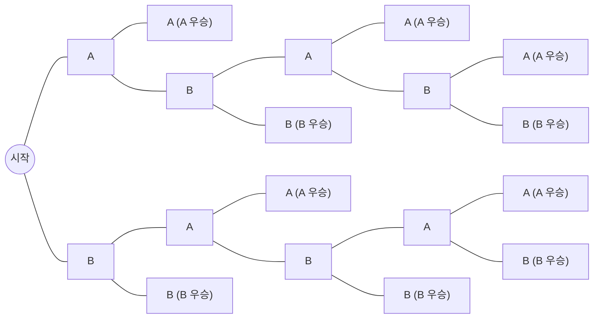

*그림 1. 두 경기 연승 또는 세 경기 승리로 끝나는 토너먼트의 가능성 트리*

1. 루트에서 리프까지의 경로는 10개이므로 토너먼트가 진행되는 방식은 10가지이다. 위에서부터 A-A, A-B-A-A, A-B-A-B-A, A-B-A-B-B, A-B-B, B-A-A, B-A-B-A-A, B-A-B-A-B, B-A-B-B, B-B이며, 그중 5가지는 A가, 5가지는 B가 우승한다. 우승 팀이 정해지기까지 필요한 경기 수는 최소 2, 최대 5이다.
2. 10가지 진행 방식이 모두 똑같이 일어날 법하다고 가정하면, 다섯 경기가 필요한 경우는 A-B-A-B-A, A-B-A-B-B, B-A-B-A-A, B-A-B-A-B의 4가지이므로 그 확률은 $`4/10 = 2/5 = 40\%`$이다.

### 2.2 곱의 법칙

어떤 컴퓨터 시설에 입출력 장치 A, B, C, D 네 대와 중앙 처리 장치 X, Y, Z 세 대가 있고, 어떤 입출력 장치든 어떤 중앙 처리 장치와도 짝지을 수 있다고 한다. 입출력 장치 하나와 중앙 처리 장치 하나를 짝짓는 방법의 수를 구하기 위해, 짝짓기를 "1단계: 입출력 장치를 고른다", "2단계: 중앙 처리 장치를 고른다"의 두 단계로 생각한다.

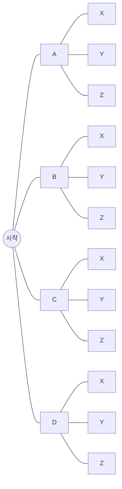

*그림 2. 입출력 장치 네 대와 중앙 처리 장치 세 대를 짝짓는 가능성 트리*

맨 위의 경로는 입출력 장치 A와 중앙 처리 장치 X의 짝을, 그다음 경로는 A와 Y의 짝을 나타낸다. 짝짓는 방법의 수는 리프의 수와 같으며, 1단계의 네 가지 선택마다 2단계의 선택이 세 가지씩 있으므로 $3 + 3 + 3 + 3 = 4 \cdot 3 = 12$이다. 이 관찰을 일반화한 것이 곱의 법칙이다.

> **핵심:** **정리 9.2.1 (곱의 법칙, multiplication rule).** 어떤 작업이 $k$개의 단계로 이루어지고, 첫째 단계를 수행하는 방법이 $n_1$가지, 둘째 단계를 수행하는 방법이 (첫째 단계를 어떻게 수행했는지와 관계없이) $n_2$가지, ..., $k$번째 단계를 수행하는 방법이 (앞 단계들을 어떻게 수행했는지와 관계없이) $n_k$가지이면, 전체 작업을 수행하는 방법은 $n_1 n_2 \cdots n_k$가지이다.

가능성 트리로 보면 이 법칙은 명백하다. 첫째 단계의 가지가 $n_1$개이고, 그 각각에서 둘째 단계의 가지가 $n_2$개씩 나오므로 둘째 단계까지의 경로는 $n_1 n_2$개이며, 같은 논리를 반복하면 리프는 $n_1 n_2 \cdots n_k$개이다. 형식적인 증명은 단계 수 $k$에 대한 수학적 귀납법으로 한다. $k+1$단계 작업은 "앞의 $k$단계 전체"와 "마지막 단계"의 두 단계 작업으로 볼 수 있고, 앞의 $k$단계를 수행하는 방법이 귀납 가정에 따라 $n_1 \cdots n_k$가지이므로, 각 방법마다 마지막 단계가 $n_{k+1}$가지씩 이어진다.

곱의 법칙을 쓰려면, 세려는 대상을 여러 단계로 이루어진 작업의 산출물로 생각한다. 각 단계에서 **무엇을** 선택할 수 있는지는 앞 단계의 결과에 따라 달라져도 되지만, 선택할 수 있는 **방법의 수**는 앞 단계에서 무엇을 했든 항상 같아야 한다.

**예제 9.2.2 (개인 식별 번호(PIN)의 개수).** 어떤 PIN은 로마자 대문자 26개와 숫자 10개, 모두 36개의 기호 중에서 고른 기호 네 개를 나열한 것이다.

1. **기호의 반복을 허용할 때:** RCAE, 3387, B92B 같은 PIN을 만드는 일은 네 자리에 차례로 기호를 넣는 4단계 작업이며, 각 단계의 방법은 앞 단계와 관계없이 36가지이다. 곱의 법칙에 따라 PIN은 $36 \cdot 36 \cdot 36 \cdot 36 = 36^4 = 1{,}679{,}616$개이다.
2. **기호의 반복을 허용하지 않을 때:** 첫째 기호는 36가지, 둘째 기호는 첫째 기호를 뺀 35가지, 셋째 기호는 34가지, 넷째 기호는 33가지 방법으로 고를 수 있다. 어떤 기호를 골랐는지에 따라 남은 기호의 종류는 달라지지만 그 **개수**는 항상 같으므로 곱의 법칙을 쓸 수 있고, 반복된 기호가 없는 PIN은 $36 \cdot 35 \cdot 34 \cdot 33 = 1{,}413{,}720$개이다.
3. 모든 PIN이 똑같이 일어날 법하다면, 무작위로 고른 PIN에 반복된 기호가 없을 확률은 $1{,}413{,}720 / 1{,}679{,}616 \approx 0.8417$, 즉 약 84%이다.

PIN M2ZM은 순서 4-튜플 (M, 2, Z, M)으로 볼 수도 있다. 이 관점에서 곱의 법칙의 중요한 결과 하나는 유한 집합들의 데카르트 곱의 원소 수를 구하는 공식이다.

**예제 9.2.3 (데카르트 곱의 원소 수).** 집합 $A_1, A_2, A_3, A_4$의 원소가 각각 $n_1, n_2, n_3, n_4$개이면, $A_1 \times A_2 \times A_3 \times A_4$의 원소는 순서 4-튜플 $(a_1, a_2, a_3, a_4)$ ($`a_i \in A_i`$)이다. 이 튜플을 만드는 일은 첫째, 둘째, 셋째, 넷째 성분을 차례로 고르는 4단계 작업이고, 각 단계의 방법은 $n_1, n_2, n_3, n_4$가지이므로 곱의 법칙에 따라 원소는 $n_1 n_2 n_3 n_4$개이다. 같은 논리로 일반적으로 $N(A_1 \times A_2 \times \cdots \times A_k) = N(A_1) N(A_2) \cdots N(A_k)$이다.

1장에서 다룬 문자열의 관점으로 보면, 길이 4인 PIN의 집합은 36개의 기호로 이루어진 집합 $\Sigma$ 위의 길이 4인 문자열 전체의 집합이다. 일반적으로 기호 $m$개 위의 길이 $n$인 문자열은 $m^n$개이다. 예를 들어 길이 3인 비트 문자열은 000, 001, 010, 100, 011, 101, 110, 111의 $2^3 = 8$개이다.

**예제 9.2.4 (입력 신호가 두 개인 회로의 입출력 표).** 2장에서 보았듯이 입력 신호 $P$, $Q$가 있는 회로는 입력값의 네 가지 배정 11, 10, 01, 00에 대응하는 네 행의 입출력 표를 가지며, 서로 다른 회로가 같은 입출력 표를 가질 수도 있다. 입력값의 순서를 고정하면 두 입출력 표는 출력값이 적어도 한 행에서 다를 때 서로 다르다. 예를 들어 다음 두 표는 첫째 행의 출력이 다르므로 서로 다르다.

| $P$ | $Q$ | 회로 1의 출력 | 회로 2의 출력 |
|:-----:|:-----:|:-----:|:-----:|
| 1 | 1 | 1 | 0 |
| 1 | 0 | 0 | 0 |
| 0 | 1 | 1 | 1 |
| 0 | 0 | 0 | 0 |

*표 5. 첫째 행의 출력만 다른 두 입출력 표*

입출력 표를 완성하는 일은 네 행의 출력 칸을 차례로 채우는 4단계 작업이고, 각 칸은 1 또는 0의 두 가지 방법으로 채운다. 따라서 서로 다른 입출력 표는 $2 \cdot 2 \cdot 2 \cdot 2 = 2^4 = 16$개이며, 입력 신호가 두 개인 회로가 동작할 수 있는 방식은 16가지뿐이다. 이는 출력 열에 세로로 적는 길이 4인 비트 문자열의 개수와 같다. 같은 논리로 입력 신호가 $n$개이면 입출력 표의 행이 $2^n$개이므로 서로 다른 입출력 표는 $2^{2^n}$개이다.

**예제 9.2.5 (중첩 반복문의 반복 횟수).** 다음 중첩 반복문에서 안쪽 반복문의 본문에는 반복문 밖으로 빠져나가는 분기문이 없다고 한다.

```text
for i := 1 to 4
    for j := 1 to 3
        [안쪽 반복문의 본문]
    next j
next i
```

바깥 반복문은 4번 반복되고, 바깥 반복문이 한 번 반복될 때마다 안쪽 반복문이 3번 반복되므로 곱의 법칙에 따라 안쪽 반복문은 모두 $4 \cdot 3 = 12$번 반복된다. 다음 표는 본문이 실행될 때의 $i$와 $j$의 값을 차례로 나열한 것이다.

| $i$ | 1 | 1 | 1 | 2 | 2 | 2 | 3 | 3 | 3 | 4 | 4 | 4 |
|:-----:|:-----:|:-----:|:-----:|:-----:|:-----:|:-----:|:-----:|:-----:|:-----:|:-----:|:-----:|:-----:|
| $j$ | 1 | 2 | 3 | 1 | 2 | 3 | 1 | 2 | 3 | 1 | 2 | 3 |

*표 6. 중첩 반복문의 본문이 실행될 때의 i와 j의 값*

### 2.3 곱의 법칙을 적용하기 어려운 경우

다음 문제를 생각한다. Ann, Bob, Cyd, Dan 네 사람 중에서 회장, 회계, 서기를 한 명씩 뽑는데, Ann은 회장이 될 수 없고 서기는 Cyd나 Dan이어야 한다. 임원을 뽑는 방법은 몇 가지인가?

곱의 법칙을 그대로 적용하여 "회장은 Ann을 뺀 3가지, 회계는 회장을 뺀 3가지, 서기는 Cyd 또는 Dan의 2가지이므로 $3 \cdot 3 \cdot 2 = 18$가지"라고 답하기 쉽다. 그러나 이 답은 틀렸다. 서기를 고르는 방법의 수가 앞에서 누구를 회장과 회계로 뽑았는지에 따라 달라지기 때문이다. Bob이 회장, Ann이 회계이면 서기는 Cyd와 Dan의 2가지이지만, Bob이 회장, Cyd가 회계이면 서기는 Dan 한 가지뿐이다. 가능성 트리를 그리면 모든 경우를 정확히 볼 수 있다. 왼쪽부터 회장, 회계, 서기의 선택이다.

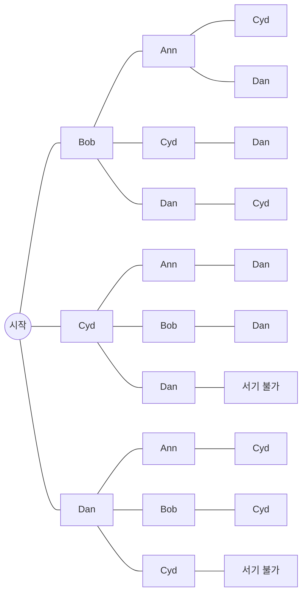

*그림 3. 회장, 회계, 서기의 순서로 임원을 고르는 가능성 트리*

Cyd가 회장이고 Dan이 회계이면 서기가 될 수 있는 사람이 남지 않으며, Dan이 회장이고 Cyd가 회계일 때도 마찬가지이다. 서기까지 도달하는 경로를 세면 Bob이 회장일 때 4가지, Cyd가 회장일 때 2가지, Dan이 회장일 때 2가지로 모두 8가지이다.

단계의 순서를 바꾸면 각 단계의 방법 수가 일정해져서 곱의 법칙을 쓸 수 있는 경우가 있다.

**예제 9.2.6 (단계의 순서를 바꾼 곱의 법칙).** 서기, 회장, 회계의 순서로 고르면 다음과 같다.

1. 1단계(서기): Cyd 또는 Dan의 2가지이다.
2. 2단계(회장): Ann과 1단계에서 뽑힌 사람을 뺀 나머지 2명 중 하나이므로 2가지이다.
3. 3단계(회계): 서기와 회장으로 뽑히지 않은 나머지 2명 중 하나이므로 2가지이다.

어느 단계든 앞에서 누구를 골랐는지와 관계없이 방법의 수가 2로 일정하므로, 곱의 법칙에 따라 임원을 뽑는 방법은 $2 \cdot 2 \cdot 2 = 8$가지이다. 다음 트리는 그림 3보다 훨씬 균형이 잡혀 있다.

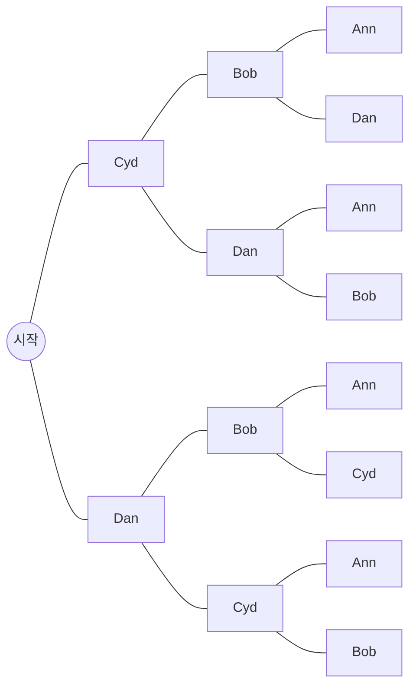

*그림 4. 서기, 회장, 회계의 순서로 임원을 고르는 가능성 트리*

> **주의:** 곱의 법칙의 조건은 "각 단계의 선택지가 같다"가 아니라 "각 단계의 **선택지 개수**가 앞 단계의 결과와 관계없이 같다"이다. 선택지 개수가 앞 단계에 따라 달라지면 곱의 법칙을 그대로 쓸 수 없으며, 가능성 트리를 그리거나 단계의 순서를 바꾸거나 경우를 나누어 세어야 한다.

### 2.4 순열

> **용어 정의:** 대상들의 집합의 **순열(permutation)** 은 그 대상들을 한 줄로 늘어놓은 순서이다.

예를 들어 원소 a, b, c의 순열은 abc, acb, cba, bac, bca, cab의 6개이다. 원소가 $n$개인 집합의 순열을 만드는 일은 "첫째로 쓸 원소를 고른다", "둘째로 쓸 원소를 고른다", ..., "$`n`$번째로 쓸 원소를 고른다"의 $n$단계 작업이다. 1단계에서는 어느 원소든 고를 수 있으므로 $n$가지, 2단계에서는 1단계에서 고른 원소를 뺀 $n - 1$가지이며, 각 단계의 방법 수는 앞 단계보다 하나씩 줄어 마지막 단계에서는 남은 원소 하나만 고를 수 있다. 곱의 법칙에 따라 순열의 개수는 $n(n-1)(n-2) \cdots 2 \cdot 1 = n!$이다.

> **핵심:** **정리 9.2.2.** $n \ge 1$인 정수 $n$에 대해, 원소가 $n$개인 집합의 순열은 $n!$개이다.

**예제 9.2.7 (단어의 문자 배열).** 단어 COMPUTER의 여덟 문자는 모두 다르다.

1. 여덟 문자를 한 줄로 배열하는 방법은 원소 8개인 집합의 순열의 수와 같으므로 $8! = 40{,}320$가지이다.
2. 문자 CO가 이 순서로 붙어 하나의 단위를 이루어야 한다면, CO를 한 개의 대상으로 보아 CO, M, P, U, T, E, R의 일곱 대상을 배열하는 것과 같으므로 $7! = 5{,}040$가지이다.
3. 문자들을 무작위로 배열할 때 CO가 이 순서로 붙어 있을 확률은 $`5{,}040 / 40{,}320 = 1/8 = 12.5\%`$이다.

**예제 9.2.8 (원형으로 앉히기).** 외교관 6명을 원탁에 앉힌다. 원탁에는 상석이 없으므로 누가 어느 의자에 앉는지는 중요하지 않고, 서로에 대한 상대적인 위치만 중요하다. 즉 한 배치를 회전하여 얻는 배치는 같은 배치로 본다. 외교관을 A, B, C, D, E, F라 하면, 상대 위치만 중요하므로 A를 아무 자리(예를 들어 맨 위 자리)에 먼저 앉히고 나머지 다섯 명을 A를 기준으로 배열하면 된다. 다섯 명 B부터 F까지를 남은 다섯 자리에 앉히는 방법은 $5! = 120$가지이다.

같은 결과를 다른 방법으로도 얻을 수 있다. 의자에 번호가 있다고 보면 배치는 $6! = 720$가지이고, 회전으로 서로 같아지는 배치는 6개씩 묶이므로 원형 배치는 $720 / 6 = 120$가지이다. 일반적으로 $n$개의 대상을 원형으로 배열하는 방법(원순열)은 $(n-1)!$가지이다.

### 2.5 선택한 원소의 순열: r-순열

집합 {a, b, c}에서 두 문자를 골라 순서대로 쓰는 방법은 ab, ac, ba, bc, ca, cb의 6가지이며, 이처럼 {a, b, c}의 원소 두 개를 순서 있게 고른 것을 {a, b, c}의 2-순열이라 한다.

> **용어 정의:** 원소가 $n$개인 집합의 **r-순열(r-permutation)** 은 그 $n$개의 원소 중에서 $r$개를 순서 있게 고른 것이다. 원소가 $n$개인 집합의 r-순열의 개수를 $P(n, r)$로 나타낸다.

> **핵심:** **정리 9.2.3.** $n$과 $r$이 정수이고 $1 \le r \le n$이면, 원소가 $n$개인 집합의 r-순열의 개수는 다음과 같다.
>
> ```math
> P(n, r) = n(n-1)(n-2)\cdots(n-r+1) = \frac{n!}{(n-r)!}
> ```

**증명.** r-순열을 만드는 일은 $r$단계 작업이다. 1단계는 첫째 원소를 고르는 것으로 $n$가지이고, 2단계는 첫째 원소를 뺀 나머지에서 고르므로 $n - 1$가지이며, 3단계는 $n - 2$가지이다. 이처럼 각 단계의 방법 수는 앞 단계보다 하나 적다. $r$단계 직전에는 이미 $r - 1$개의 원소를 골랐으므로 남은 원소는 $n - (r - 1) = n - r + 1$개이다. 곱의 법칙에 따라 $P(n, r) = n(n-1)(n-2)\cdots(n-r+1)$이다. 또한

```math
\frac{n!}{(n-r)!} = \frac{n(n-1)\cdots(n-r+1)\,(n-r)(n-r-1)\cdots 2 \cdot 1}{(n-r)(n-r-1)\cdots 2 \cdot 1} = n(n-1)\cdots(n-r+1)
```

이므로 두 식은 같다. ∎

둘째 식이 기억하기 쉽지만, 계산할 때 $n!$과 $(n-r)!$을 각각 먼저 계산한 뒤 나누는 것은 좋지 않다. 계승은 매우 빠르게 커지므로 $n$과 $r$이 작아도 계산기의 정확한 계산 범위를 넘을 수 있다. 예를 들어 $n = 15$, $r = 2$이면 $15! = 1{,}307{,}674{,}368{,}000$, $13! = 6{,}227{,}020{,}800$이지만, 먼저 약분하면 다음과 같이 간단해진다.

```math
\frac{15!}{13!} = \frac{15 \cdot 14 \cdot 13!}{13!} = 15 \cdot 14 = 210
```

$P(n, r)$은 $`{}_nP_r`$, $P_{n,r}$, ${}^nP_r$ 등으로도 쓴다.

**예제 9.2.9 (r-순열의 계산).**

1. $P(5, 2) = \dfrac{5!}{3!} = \dfrac{5 \cdot 4 \cdot 3!}{3!} = 20$이다.
2. 대상 7개의 집합의 4-순열은 $P(7, 4) = \dfrac{7!}{3!} = 7 \cdot 6 \cdot 5 \cdot 4 = 840$개이다.
3. 대상 5개의 집합의 5-순열은 $P(5, 5) = \dfrac{5!}{0!} = \dfrac{5!}{1} = 120$개이다. 5장에서 $0! = 1$로 정의했기 때문에 이 값이 집합의 순열의 개수 $5!$과 일치한다.

**예제 9.2.10 (단어에서 고른 문자의 배열).** 단어 BYTES의 다섯 문자는 모두 다르다.

1. 문자 세 개를 골라 한 줄로 쓰는 방법은 원소 5개인 집합의 3-순열의 수이므로 $P(5, 3) = \dfrac{5!}{2!} = 5 \cdot 4 \cdot 3 = 60$가지이다.
2. 첫 문자가 B이어야 한다면, B를 첫 자리에 두고 남은 네 문자 Y, T, E, S에서 두 개를 골라 둘째와 셋째 자리에 배열하면 되므로 $P(4, 2) = 4 \cdot 3 = 12$가지이다.

**예제 9.2.11 ($P(n, r)$의 성질 증명).** $n \ge 2$인 모든 정수 $n$에 대해 $P(n, 2) + P(n, 1) = n^2$임을 보인다. $n \ge 2$인 정수 $n$을 임의로 택하면 정리 9.2.3에 따라

```math
P(n, 2) = \frac{n!}{(n-2)!} = \frac{n(n-1)(n-2)!}{(n-2)!} = n(n-1), \qquad P(n, 1) = \frac{n!}{(n-1)!} = \frac{n \cdot (n-1)!}{(n-1)!} = n
```

이므로 $P(n, 2) + P(n, 1) = n(n-1) + n = n^2 - n + n = n^2$이다.

---

<br>

## 3. 서로소인 집합의 원소 세기: 합의 법칙

이 절에서는 두 집합의 합집합, 차집합, 교집합의 원소 수를 세어 해결하는 문제를 다룬다. 그 바탕은 쌍마다 서로소인 유한 집합들의 합집합의 원소 수가 각 집합의 원소 수의 합과 같다는 합의 법칙이다.

### 3.1 합의 법칙

> **핵심:** **정리 9.3.1 (합의 법칙, addition rule).** 유한 집합 $A$가 서로 다른 $k$개의 쌍마다 서로소인 부분집합 $A_1, A_2, \ldots, A_k$의 합집합이면 다음이 성립한다.
>
> ```math
> N(A) = N(A_1) + N(A_2) + \cdots + N(A_k)
> ```

$A$의 각 원소는 부분집합 중 정확히 하나에만 속하므로, 부분집합별로 센 수를 더하면 각 원소를 정확히 한 번씩 센다. 형식적인 증명은 두 집합의 경우에서 출발하는 수학적 귀납법으로 한다.

**예제 9.3.1 (5로 나누어떨어지는 세 자리 정수).** 1.4절의 문제를 합의 법칙으로 다시 푼다. 5로 나누어떨어지는 정수는 끝자리가 0이거나 5이므로, 5로 나누어떨어지는 세 자리 정수의 집합은 끝자리가 0인 것의 집합 $A_1$과 끝자리가 5인 것의 집합 $A_2$로 나뉘고 $A_1 \cap A_2 = \emptyset$이다. 끝자리가 0인 세 자리 정수는 맨 앞자리(1부터 9까지의 9가지)와 가운데 자리(0부터 9까지의 10가지)를 고르는 방법의 수만큼 있으므로 $N(A_1) = 9 \cdot 10 = 90$이고, 같은 이유로 $N(A_2) = 90$이다. 따라서 구하는 개수는 $N(A_1) + N(A_2) = 90 + 90 = 180$이다.

### 3.2 차의 법칙과 여사건의 확률

합의 법칙의 중요한 결과로, 집합 $A$의 원소 수와 그 부분집합 $B$의 원소 수를 알면 $A$에는 속하지만 $B$에는 속하지 않는 원소의 수를 구할 수 있다.

> **핵심:** **정리 9.3.2 (차의 법칙, difference rule).** $A$가 유한 집합이고 $B$가 $A$의 부분집합이면 $N(A - B) = N(A) - N(B)$이다.

**증명.** $B \subseteq A$이면 두 집합 $B$와 $A - B$는 공통 원소가 없고 $B \cup (A - B) = A$이다. 따라서 합의 법칙에 따라 $N(B) + N(A - B) = N(A)$이고, 양변에서 $N(B)$를 빼면 $N(A - B) = N(A) - N(B)$이다. ∎

**예제 9.3.2 (반복된 기호가 있는 PIN).** 2.2절의 PIN에서 기호의 반복을 허용한 PIN의 집합을 $S$, 반복된 기호가 없는 PIN의 집합을 $A$라 하면 $N(S) = 1{,}679{,}616$, $N(A) = 1{,}413{,}720$이다.

1. 적어도 하나의 기호가 반복된 PIN의 집합은 $S - A$이므로, 차의 법칙에 따라 $N(S - A) = 1{,}679{,}616 - 1{,}413{,}720 = 265{,}896$개이다.
2. 모든 PIN이 똑같이 일어날 법하면, 무작위로 고른 PIN에 반복된 기호가 있을 확률은 $265{,}896 / 1{,}679{,}616 \approx 0.158$, 즉 약 15.8%이다.

둘째 질문은 다음과 같이 풀 수도 있다.

```math
P(S - A) = \frac{N(S - A)}{N(S)} = \frac{N(S) - N(A)}{N(S)} = \frac{N(S)}{N(S)} - \frac{N(A)}{N(S)} = 1 - P(A) \approx 1 - 0.842 = 0.158
```

첫째 등호는 동일 가능성 확률 공식, 둘째 등호는 차의 법칙, 셋째 등호는 분수의 성질, 넷째 등호는 다시 동일 가능성 확률 공식에 따른 것이다. 이 계산은 확률의 일반적인 성질 하나를 보여 준다. 사건 $A$의 **여사건(complement)** $A^c = S - A$는 $A$가 일어나지 않는 사건이며, 그 확률은 1에서 $A$의 확률을 뺀 값이다. 8절에서는 이 공식을 확률의 공리로부터 유도한다.

> **핵심:** **여사건의 확률 공식.** $S$가 유한 표본 공간이고 $A$가 $S$의 사건이면 $P(A^c) = 1 - P(A)$이다. 여기서 $A^c = S - A$는 $S$에서 $A$의 여사건이다.

**예제 9.3.3 (길이가 3에서 5까지인 비밀번호).** 어떤 비밀번호는 로마자 대문자 26개 중에서 고른 문자 3개부터 5개까지로 이루어지며 문자의 반복을 허용한다.

1. **가능한 비밀번호의 수:** 비밀번호의 집합은 길이 3, 4, 5인 비밀번호의 세 부분집합으로 분할되므로, 합의 법칙에 따라 전체 수는 각 길이별 수의 합이다. 길이가 $\ell$인 비밀번호를 만드는 일은 각 단계가 26가지인 $\ell$단계 작업이므로 곱의 법칙에 따라 $26^\ell$개이다. 따라서 전체 수는 $26^3 + 26^4 + 26^5 = 17{,}576 + 456{,}976 + 11{,}881{,}376 = 12{,}355{,}928$이다.
2. **반복된 문자가 없는 비밀번호의 수:** 길이 3이면 $26 \cdot 25 \cdot 24 = 15{,}600$개, 길이 4이면 $26 \cdot 25 \cdot 24 \cdot 23 = 358{,}800$개, 길이 5이면 $26 \cdot 25 \cdot 24 \cdot 23 \cdot 22 = 7{,}893{,}600$개이므로 모두 $8{,}268{,}000$개이다.
3. **반복된 문자가 있는 비밀번호의 수:** 차의 법칙에 따라 $12{,}355{,}928 - 8{,}268{,}000 = 4{,}087{,}928$개이다.
4. **반복된 문자가 있을 확률:** 모든 비밀번호가 똑같이 일어날 법하면 $4{,}087{,}928 / 12{,}355{,}928 \approx 0.331$, 즉 약 33.1%이다.

**예제 9.3.4 (여덟 자 이하의 Python 식별자).** 프로그래밍 언어 Python의 식별자를 ASCII 문자로 제한하면, 식별자는 53개의 기호(대소문자 로마자 52개와 밑줄 `_`) 중 하나로 시작해야 한다. 첫 문자는 혼자 쓰일 수도 있고, 그 뒤에 63개의 기호(첫 문자로 허용되는 53개와 숫자 10개) 중에서 고른 문자가 몇 개든 올 수 있다. 다만 `and`, `if` 같은 예약어는 식별자로 쓸 수 없으며, 여기서는 교재가 가정한 대로 여덟 자 이하의 예약어가 31개인 구현을 생각한다. 여덟 자 이하의 식별자는 몇 개인가?

식별자 후보의 집합은 길이 1부터 8까지의 여덟 부분집합으로 분할된다. 길이가 $\ell$인 후보는 첫 문자 53가지와 나머지 $\ell - 1$개의 문자 각각 63가지를 고르는 것이므로 곱의 법칙에 따라 $53 \cdot 63^{\ell - 1}$개이다. 합의 법칙과 5장의 등비수열의 합 공식에 따라 후보의 수는 다음과 같다.

```math
53 + 53 \cdot 63 + 53 \cdot 63^2 + \cdots + 53 \cdot 63^7 = 53 \cdot \frac{63^8 - 1}{63 - 1} = 212{,}133{,}167{,}002{,}880
```

예약어 31개는 길이가 다양하지만 모두 이 후보들 가운데 있으므로, 차의 법칙에 따라 실제 식별자는 $212{,}133{,}167{,}002{,}880 - 31 = 212{,}133{,}167{,}002{,}849$개이다.

**예제 9.3.5 (인터넷 주소).** 네트워크의 각 컴퓨터에는 서로를 구별하는 이름인 주소가 필요하다. 인터넷에서 쓰는 IP(Internet Protocol) 주소는 32비트 수이며(128비트 주소로 옮겨 가는 중이다), 특정 지역 네트워크를 가리키는 **네트워크 ID** 부분과 그 네트워크 안의 특정 컴퓨터를 가리키는 **호스트 ID** 부분으로 나뉜다. 32비트 IP 주소는 읽기 쉽도록 8비트씩 네 묶음으로 나누어 각 묶음을 0부터 255까지의 10진수로 바꾸고 점으로 이어 쓰는데, 이를 점으로 구분한 10진 표기(dotted decimal)라 한다. 예를 들어 10001100 11000000 00100000 10001000은 140.192.32.136이다. 크기가 다양한 지역 네트워크를 수용하기 위해 네트워크 ID는 여러 클래스로 나뉘며, 주요 클래스는 다음과 같다. 어느 클래스에서든 호스트 ID는 모두 0이거나 모두 1일 수 없다.

| 클래스 | 맨 앞 비트 | 네트워크 ID | 호스트 ID | 용도 |
|:-----:|:-----:|:-----:|:-----:|:-----|
| A | 0 | 왼쪽 8비트 | 나머지 24비트 | 매우 큰 지역 네트워크 (00000000과 01111111은 네트워크 ID로 쓸 수 없다) |
| B | 10 | 왼쪽 16비트 | 나머지 16비트 | 중간 규모에서 큰 규모의 지역 네트워크 |
| C | 110 | 왼쪽 24비트 | 나머지 8비트 | 작은 지역 네트워크 |

*표 7. IP 주소의 클래스 A, B, C에서 네트워크 ID와 호스트 ID의 구성*

1. **10진 표기 확인:** $10001100_2 = 2^7 + 2^3 + 2^2 = 128 + 8 + 4 = 140$, $11000000_2 = 2^7 + 2^6 = 128 + 64 = 192$, $00100000_2 = 2^5 = 32$, $10001000_2 = 2^7 + 2^3 = 128 + 8 = 136$이다.
2. **클래스 B 네트워크의 수:** 클래스 B의 네트워크 ID는 10으로 시작하는 16비트이고, 나머지 14자리에 각각 0 또는 1의 두 가지를 넣을 수 있으므로 $2^{14} = 16{,}384$개이다.
3. **클래스 B 주소의 10진 표기:** 네트워크 ID 부분은 10000000 00000000부터 10111111 11111111까지이고, $10000000_2 = 128$, $10111111_2 = 191$, $11111111_2 = 255$이므로 10진 표기로는 128.0부터 191.255까지이다. 따라서 클래스 B 네트워크의 컴퓨터 주소는 $128 \le w \le 191$, $0 \le x \le 255$, $0 \le y \le 255$, $0 \le z \le 255$인 $w.x.y.z$ 꼴이며, 호스트 ID가 모두 0이거나 모두 1일 수 없으므로 $y$와 $z$가 둘 다 0이거나 둘 다 255일 수는 없다.
4. **클래스 B 네트워크의 호스트 수:** 호스트 ID 16비트에 각각 두 가지를 넣으면 $2^{16} = 65{,}536$가지이고, 모두 0인 것과 모두 1인 것을 빼면 $65{,}536 - 2 = 65{,}534$개이다.

> **[컴퓨터네트워크]** 이 클래스 구분 방식은 1990년대에 클래스 없는 도메인 간 라우팅(CIDR)으로 대체되었다. CIDR에서는 네트워크 ID의 길이를 8, 16, 24비트로 고정하지 않고 `140.192.32.0/20`처럼 접두사 길이를 함께 표기하여 임의의 길이로 정한다 [1]. 그래도 비트 자리마다 두 가지 선택이 있다는 곱의 법칙과 금지된 값을 빼는 차의 법칙으로 주소 수를 세는 방법은 같다.

### 3.3 포함 배제 원리

합의 법칙은 집합들이 쌍마다 서로소일 때 합집합의 원소 수를 알려 준다. 집합들이 겹칠 때 합집합의 원소 수를 구하기 위해 먼저 두 집합 $A$, $B$를 생각한다. 두 집합에 공통 원소가 없으면 $N(A \cup B) = N(A) + N(B)$이고, 두 집합이 같으면 $N(A \cup B) = N(A)$이다. 따라서 일반적인 공식에는 $N(A)$, $N(B)$와 함께 공통 원소의 수 $N(A \cap B)$가 들어가야 한다.

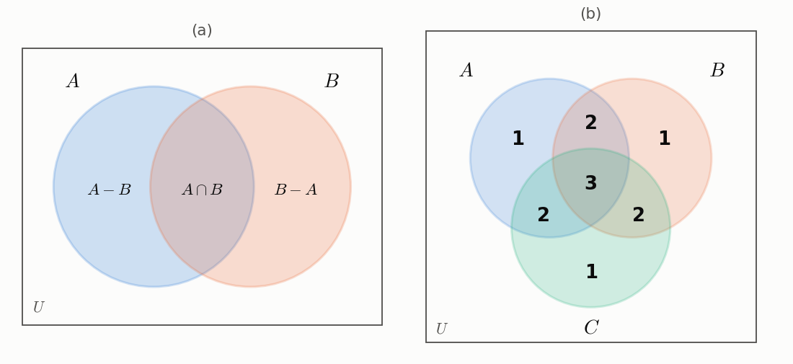

*그림 5. 두 집합의 세 영역과 세 집합의 각 영역이 N(A) + N(B) + N(C)에서 세어지는 횟수*

그림 5(a)에서 $N(A)$는 $A$에만 속하는 원소와 $A$, $B$ 모두에 속하는 원소를 세고, $N(B)$는 $B$에만 속하는 원소와 $A$, $B$ 모두에 속하는 원소를 센다. 따라서 $N(A) + N(B)$에서는 $A \cap B$의 원소가 두 번 세어지며, 정확한 수를 얻으려면 $N(A \cap B)$를 한 번 빼야 한다. 세 집합도 같은 방식으로 분석할 수 있다.

> **핵심:** **정리 9.3.3 (두 집합과 세 집합의 포함 배제 원리, inclusion/exclusion rule).** $A$, $B$, $C$가 유한 집합이면 다음이 성립한다.
>
> ```math
> N(A \cup B) = N(A) + N(B) - N(A \cap B)
> ```
>
> ```math
> N(A \cup B \cup C) = N(A) + N(B) + N(C) - N(A \cap B) - N(A \cap C) - N(B \cap C) + N(A \cap B \cap C)
> ```

세 집합의 공식이 각 원소를 정확히 한 번씩 센다는 것은 다음 표로 확인할 수 있다. 그림 5(b)의 숫자는 각 영역의 원소가 $N(A) + N(B) + N(C)$에서 세어지는 횟수이다.

| 원소가 속한 집합의 수 | $N(A) + N(B) + N(C)$ | 두 집합의 교집합 항 | 세 집합의 교집합 항 | 순 횟수 |
|:-----:|:-----:|:-----:|:-----:|:-----:|
| 1개 | $+1$ | $0$ | $0$ | 1 |
| 2개 | $+2$ | $-1$ | $0$ | 1 |
| 3개 | $+3$ | $-3$ | $+1$ | 1 |

*표 8. 세 집합의 포함 배제 공식에서 각 원소가 세어지는 횟수*

예를 들어 $A$, $B$, $C$ 모두에 속하는 원소는 처음 세 항에서 3번 더해지고, 두 집합의 교집합 세 개 모두에 속하므로 3번 빼지며, 마지막 항에서 1번 더해져 결국 $3 - 3 + 1 = 1$번 세어진다.

> **참고:** 수학적 귀납법으로 집합이 몇 개이든 같은 꼴의 공식이 성립함을 보일 수 있다. 유한 집합 $A_1, \ldots, A_n$에 대해, 한 집합씩의 원소 수를 모두 더하고, 두 집합씩의 교집합의 원소 수를 모두 빼고, 세 집합씩의 교집합의 원소 수를 모두 더하는 일을 번갈아 반복하여 마지막에 $(-1)^{n+1} N(A_1 \cap \cdots \cap A_n)$을 더하면 $N(A_1 \cup \cdots \cup A_n)$이 된다.

**예제 9.3.6 (일반적인 합집합의 원소 세기).** 1부터 1,000까지의 정수 중에서 3의 배수이거나 5의 배수인 정수는 몇 개이며, 둘 다 아닌 정수는 몇 개인가?

$A$를 1부터 1,000까지의 정수 중 3의 배수의 집합, $B$를 5의 배수의 집합이라 하면, 구하는 첫째 수는 $N(A \cup B)$이다. $A \cap B$는 3과 5의 배수, 즉 15의 배수의 집합이다.

1. 3의 배수는 $3 \cdot 1$부터 $3 \cdot 333 = 999$까지이므로 $N(A) = 333$이다.
2. 5의 배수는 $5 \cdot 1$부터 $5 \cdot 200 = 1{,}000$까지이므로 $N(B) = 200$이다.
3. 15의 배수는 $15 \cdot 1$부터 $15 \cdot 66 = 990$까지이므로 $N(A \cap B) = 66$이다.
4. 포함 배제 원리에 따라 $N(A \cup B) = 333 + 200 - 66 = 467$이다.
5. 둘 다 아닌 정수는 차의 법칙에 따라 $1{,}000 - 467 = 533$개이다.

마지막 단계에는 6장의 드모르간의 법칙이 숨어 있다. 3의 배수도 5의 배수도 아닌 정수의 집합은 $A^c \cap B^c$이고, 드모르간의 법칙에 따라 $A^c \cap B^c = (A \cup B)^c$이다. 따라서 전체집합 $U$ = {1, 2, ..., 1,000}에 대해 $N((A \cup B)^c) = N(U) - N(A \cup B)$로 계산한 것이다. 일반적으로 1부터 $n$까지의 정수 중 양의 정수 $d$의 배수는 4장의 바닥 함수로 $\lfloor n/d \rfloor$개이다.

**예제 9.3.7 (교집합의 원소 세기).** 학생 50명이 있는 반에서 최근에 수강한 수학과 컴퓨터 과학 과목을 조사하였더니 다음과 같았다.

1. 미적분 예비 과정(precalculus)을 수강한 학생은 30명, 미적분을 수강한 학생은 18명, Python을 수강한 학생은 26명이다.
2. 미적분 예비 과정과 미적분을 모두 수강한 학생은 9명, 미적분 예비 과정과 Python을 모두 수강한 학생은 16명, 미적분과 Python을 모두 수강한 학생은 8명이다.
3. 세 과목 중 적어도 하나를 수강한 학생은 47명이다.

"30명이 미적분 예비 과정을 수강했다"는 다른 과목을 함께 수강한 학생을 포함한 전체 인원을 뜻한다. 미적분 예비 과정, 미적분, Python을 수강한 학생의 집합을 각각 $P$, $C$, $Y$라 한다.

1. **아무 과목도 수강하지 않은 학생:** 차의 법칙에 따라 $50 - 47 = 3$명이다.
2. **세 과목을 모두 수강한 학생:** 포함 배제 원리에 따라 $47 = 30 + 18 + 26 - 9 - 16 - 8 + N(P \cap C \cap Y)$이다. 오른쪽의 알려진 항을 계산하면 $74 - 33 = 41$이므로 $N(P \cap C \cap Y) = 47 - 41 = 6$명이다. 일반적으로 세 집합의 포함 배제 공식에 나오는 여덟 개의 항 중 일곱 개를 알면 나머지 하나를 구할 수 있다.
3. **영역별 인원:** 세 과목을 모두 수강한 6명을 가장 안쪽 영역에 적고 바깥쪽으로 채워 나간다. 미적분 예비 과정과 미적분을 수강했지만 Python은 수강하지 않은 학생은 $9 - 6 = 3$명, 미적분 예비 과정과 Python만 수강한 학생은 $16 - 6 = 10$명, 미적분과 Python만 수강한 학생은 $8 - 6 = 2$명이다. 미적분 예비 과정만 수강한 학생은 $30 - 3 - 10 - 6 = 11$명, 미적분만 수강한 학생은 $18 - 3 - 6 - 2 = 7$명, Python만 수강한 학생은 $26 - 10 - 6 - 2 = 8$명이다.

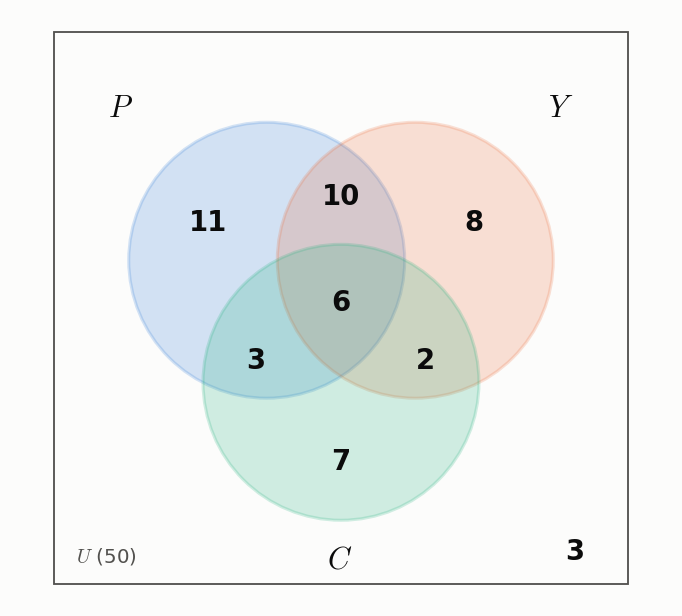

*그림 6. 세 과목의 수강 인원을 영역별로 나타낸 벤 다이어그램*

일곱 영역의 합 $11 + 10 + 8 + 6 + 3 + 2 + 7 = 47$은 적어도 한 과목을 수강한 학생 수와 같다.

---

<br>

## 4. 비둘기집 원리

### 4.1 비둘기집 원리와 응용

**비둘기집 원리(pigeonhole principle)** 는 비둘기 $n$마리가 비둘기집 $m$개로 날아 들어가고 $n > m$이면, 적어도 한 비둘기집에는 비둘기가 두 마리 이상 들어간다는 원리이다. 이 원리를 처음 형식적으로 서술한 디리클레(Dirichlet)의 이름을 따서 디리클레 상자 원리라고도 한다. 다음 그림은 $n = 5$, $m = 4$인 경우를 비둘기에서 비둘기집으로 가는 대응으로 나타낸 것이다.

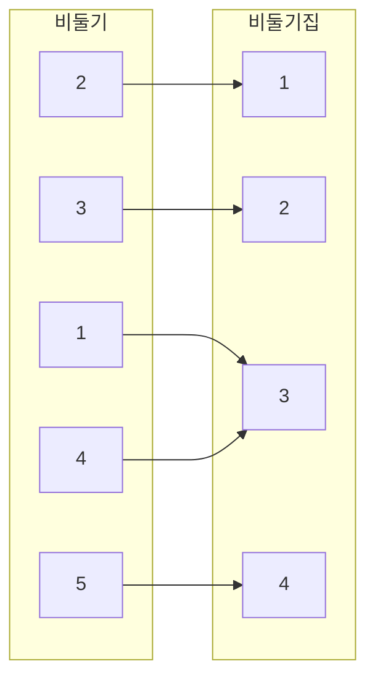

*그림 7. 비둘기 다섯 마리를 비둘기집 네 개에 넣는 대응*

비둘기 1과 4에서 나온 화살표가 모두 비둘기집 3을 가리킨다. 이 그림처럼 비둘기집 원리는 7장의 함수의 언어로 다음과 같이 서술할 수 있다.

> **핵심:** **비둘기집 원리.** 유한 집합에서 그보다 원소가 적은 유한 집합으로 가는 함수는 일대일 함수일 수 없다. 즉 정의역에 공역의 같은 원소를 상으로 가지는 서로 다른 두 원소가 반드시 있다.

따라서 유한 집합에서 그보다 작은 유한 집합으로 가는 함수의 화살표 도표에는 공역의 같은 원소를 가리키는 화살표가 적어도 두 개 있다. 이 원리는 직관적으로 쉽게 받아들일 수 있으므로 먼저 응용을 살펴보고, 형식적인 증명은 4.4절에서 한다.

**예제 9.4.1 (비둘기집 원리의 적용).**

1. 여섯 명 중에 같은 달에 태어난 두 사람이 반드시 있는 것은 아니다. 여섯 명의 생일이 각각 1월부터 6월까지의 서로 다른 달일 수 있기 때문이다. 그러나 열세 명 중에는 같은 달에 태어난 두 사람이 반드시 있다. 열세 명 $x_1, x_2, \ldots, x_{13}$을 비둘기, 열두 달을 비둘기집으로 보고 각 사람에게 태어난 달을 대응시키는 함수 $B$를 정의하면, $13 > 12$이므로 비둘기집 원리에 따라 $B$는 일대일 함수가 아니다. 즉 같은 달을 가리키는 화살표가 적어도 두 개 있다.
2. 뉴욕시 주민 중에는 머리카락 수가 같은 두 사람이 반드시 있다. 뉴욕시의 인구는 적어도 8,000,000명이고, 한 사람의 머리카락 수는 300,000보다 적다고 알려져 있다. 각 주민에게 머리카락 수를 대응시키는 함수 $H$의 공역을 {0, 1, 2, ..., 300,000}으로 잡으면 공역의 원소는 300,001개이고, 주민 수가 이보다 많으므로 $H$는 일대일 함수가 아니다.

**예제 9.4.2 (결과를 보장하기 위해 골라야 하는 개수).** 서랍에 검은 양말 10짝과 흰 양말 10짝이 있다. 보지 않고 양말을 꺼낼 때, 같은 색 한 켤레를 반드시 얻으려면 적어도 몇 짝을 꺼내야 하는가?

두 짝만 꺼내면 색이 다를 수 있지만, 세 번째 짝은 이미 꺼낸 두 짝 중 하나와 색이 같아야 하므로 답은 3이다. 형식적으로는 꺼낸 양말 $s_1, s_2, \ldots, s_n$의 집합에서 색의 집합 {흰색, 검은색}으로 가는 함수 $C$를 생각한다. $n = 2$이면 $C$는 일대일 대응일 수 있지만, $n > 2$이면 정의역의 원소 수가 공역의 원소 수보다 많으므로 $C$는 일대일 함수가 아니다. 즉 $s_i \ne s_j$이면서 $C(s_i) = C(s_j)$인 두 양말이 있다.

**예제 9.4.3 (합이 정해진 정수 쌍 고르기).** $A$ = {1, 2, 3, 4, 5, 6, 7, 8}이라 한다.

1. $A$에서 정수 다섯 개를 고르면 합이 9인 쌍이 반드시 있다. $A$를 네 개의 서로소인 부분집합 {1, 8}, {2, 7}, {3, 6}, {4, 5}로 분할하면, $A$의 각 원소는 정확히 한 부분집합에 속하고 각 부분집합의 두 원소의 합은 9이다. 고른 다섯 정수 $a_1, \ldots, a_5$를 비둘기, 네 부분집합을 비둘기집으로 보고 $P(a_i)$를 $a_i$를 포함하는 부분집합으로 정의한다. 부분집합들의 합집합이 $A$이므로 모든 $a_i$는 어떤 부분집합에 속하고, 부분집합들이 서로소이므로 둘 이상의 부분집합에 속하지 않는다. 따라서 $P$는 잘 정의된 함수이다. 비둘기가 비둘기집보다 많으므로 $P$는 일대일 함수가 아니고, $a_i \ne a_j$이면서 $P(a_i) = P(a_j)$인 두 정수가 있다. 두 정수는 같은 부분집합의 서로 다른 두 원소이므로 $a_i + a_j = 9$이다.
2. 정수 네 개를 고르면 합이 9인 쌍이 반드시 있는 것은 아니다. 이 경우에는 비둘기의 수가 비둘기집의 수보다 많지 않으므로 비둘기집 원리를 적용할 수 없다. 예를 들어 1, 2, 3, 4를 고르면 두 수의 합은 최대 7이다.

> **주의:** 비둘기집 원리는 어떤 비둘기집에 비둘기가 둘 이상 있다는 **존재**만 보장하며, 그것이 어느 비둘기집인지는 알려 주지 않는다. 또한 비둘기의 수가 비둘기집의 수 이하이면 이 원리로부터 아무 결론도 얻을 수 없다. 문제를 풀 때는 무엇이 비둘기이고 무엇이 비둘기집인지, 그리고 비둘기를 비둘기집으로 보내는 함수가 잘 정의되는지를 먼저 확인해야 한다.

### 4.2 분수의 소수 전개

비둘기집 원리의 중요한 결과 하나는 **모든 유리수의 소수 전개는 유한 소수이거나 순환 소수**라는 사실이다. 유한 소수(terminating decimal)는 3.625처럼 끝나는 소수이고, 순환 소수(repeating decimal)는 $2.38\overline{246}$처럼 어떤 자리부터 같은 숫자 묶음이 끝없이 반복되는 소수이다. 여기서 246 위의 막대는 이 숫자들이 영원히 반복된다는 뜻이다. 엄밀히 말하면 유한 소수도 끝에 0을 붙여 $3.625\overline{0}$으로 볼 수 있으며, $3.624\overline{9}$로 쓸 수도 있다.

유리수는 정수의 비, 즉 분수로 쓸 수 있는 수이고, 분수의 소수 전개는 분자를 분모로 나누는 긴 나눗셈으로 얻는다. 예를 들어 $4/33$의 나눗셈은 다음과 같다.

```text
          0. 1 2 1 2 ...
        ┌──────────────
     33 │ 4. 0 0 0 0
          3  3            40 = 33 × 1 + 7   → 몫의 숫자 1, 나머지 7
          ─────
             7 0          70 = 33 × 2 + 4   → 몫의 숫자 2, 나머지 4
             6 6
             ───
               4 0        나머지 4가 처음 값 4와 같으므로 이후 과정이 반복된다
```

*그림 8. 4/33의 긴 나눗셈에서 나머지 4가 다시 나타나는 과정*

나눗셈 과정에서 나머지 4가 다시 나타나므로, 이후의 몫과 나머지의 수열이 영원히 반복되고 소수 전개도 $4/33 = 0.\overline{12}$로 반복된다. 일반적으로 정수를 정수로 나눌 때 이러한 반복이 반드시 일어남을 보장하는 것이 4장의 몫-나머지 정리와 비둘기집 원리이다. 다음 분석에는 비둘기집 원리를 자연스럽게 확장한 사실, 즉 무한 집합에서 유한 집합으로 가는 함수는 일대일 함수일 수 없다는 사실을 쓴다.

**예제 9.4.4 (분수의 소수 전개).** 양의 정수 $a$, $b$에 대해 분수 $a/b$의 소수 전개를 생각한다. $r_0 = a$로 두고, 긴 나눗셈에서 차례로 얻는 나머지를 $r_1, r_2, r_3, \ldots$라 한다. 각 단계에서는 나머지 $r_i$에 10을 곱한 수를 $b$로 나누어 몫의 숫자 하나와 다음 나머지 $r_{i+1}$을 얻는다($a \ge b$이면 첫 단계에서는 $a$ 자체를 $b$로 나누어 정수 부분과 $r_1$을 얻는다).

1. 몫-나머지 정리에 따라 각 나머지는 0 이상 $b - 1$ 이하이다.
2. 어떤 나머지 $r_i$가 0이면 나눗셈이 끝나므로 $a/b$는 유한 소수이다.
3. 어떤 나머지도 0이 아니면 나눗셈과 나머지의 수열은 끝없이 계속된다. 무한히 많은 나머지가 유한 개의 값 1, 2, ..., $b - 1$만 가질 수 있으므로, 비둘기집 원리에 따라 어떤 값이 반복된다. 즉 $j < k$이면서 $r_j = r_k$인 첨자 $j$, $k$가 있다.
4. 각 단계의 몫의 숫자와 다음 나머지는 현재 나머지만으로 정해지므로, $r_j$부터 $r_{k-1}$까지의 나눗셈에서 얻는 숫자들이 이후 영원히 반복된다.

$a = 3$, $b = 14$이면 나머지는 0부터 13까지의 값을 가지며, 나눗셈은 다음과 같이 진행된다.

| $i$ | $r_i$ | $10 r_i = 14 \times (\text{몫}) + r_{i+1}$ | 몫의 숫자 | $r_{i+1}$ |
|:-----:|:-----:|:-----|:-----:|:-----:|
| 0 | 3 | $30 = 14 \times 2 + 2$ | 2 | 2 |
| 1 | 2 | $20 = 14 \times 1 + 6$ | 1 | 6 |
| 2 | 6 | $60 = 14 \times 4 + 4$ | 4 | 4 |
| 3 | 4 | $40 = 14 \times 2 + 12$ | 2 | 12 |
| 4 | 12 | $120 = 14 \times 8 + 8$ | 8 | 8 |
| 5 | 8 | $80 = 14 \times 5 + 10$ | 5 | 10 |
| 6 | 10 | $100 = 14 \times 7 + 2$ | 7 | 2 |

*표 9. 3/14의 긴 나눗셈에서 차례로 얻는 나머지와 몫의 숫자*

$r_7 = 2 = r_1$이므로 $r_1$부터 $r_6$까지의 나눗셈에서 얻는 숫자 1, 4, 2, 8, 5, 7이 영원히 반복되고, $3/14 = 0.2\overline{142857}$이다.

모든 유리수의 소수 전개가 유한 소수이거나 순환 소수이므로, 소수 전개가 끝나지도 않고 순환하지도 않는 수는 유리수일 수 없다. 예를 들어 1의 묶음이 하나씩 길어지는 $0.01011011101111011111\ldots$은 무리수이다.

### 4.3 일반화된 비둘기집 원리

비둘기집 원리를 일반화하면, 비둘기 $n$마리가 비둘기집 $m$개로 날아 들어가고 어떤 양의 정수 $k$에 대해 $km < n$이면, 적어도 한 비둘기집에 비둘기가 $k + 1$마리 이상 들어간다. 예를 들어 $m = 4$, $n = 9$, $k = 2$이면 $2 \cdot 4 = 8 < 9$이므로 어떤 비둘기집에는 비둘기가 $2 + 1 = 3$마리 이상 있다. 다음 그림의 대응에서는 비둘기집 3에 비둘기 세 마리가 있다.

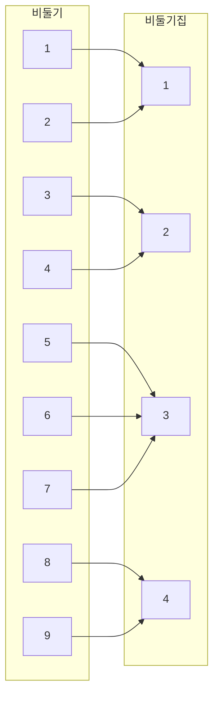

*그림 9. 비둘기 아홉 마리를 비둘기집 네 개에 넣어 한 비둘기집에 세 마리가 들어가는 대응*

> **핵심:** **일반화된 비둘기집 원리(generalized pigeonhole principle).** 원소가 $n$개인 유한 집합 $X$에서 원소가 $m$개인 유한 집합 $Y$로 가는 임의의 함수 $f$와 임의의 양의 정수 $k$에 대해, $km < n$이면 $X$의 서로 다른 원소 $k + 1$개 이상의 상이 되는 $y \in Y$가 있다.

> **참고:** 이 원리는 흔히 "$`n > m`$이면 어떤 비둘기집에는 비둘기가 $\lceil n/m \rceil$마리 이상 있다"로도 쓴다. $n > m$이면 $\lceil n/m \rceil \ge 2$이므로 $k = \lceil n/m \rceil - 1$은 양의 정수이고, 천장 함수의 성질 $\lceil x \rceil < x + 1$에 따라 $k < n/m$, 즉 $km < n$이다. 따라서 위의 원리에 따라 어떤 비둘기집에는 $k + 1 = \lceil n/m \rceil$마리 이상이 있다.

**예제 9.4.5 (일반화된 비둘기집 원리의 적용).** 85명의 사람 중에는 성의 첫 글자가 같은 사람이 적어도 4명 있다. 85명을 비둘기, 로마자 26개를 비둘기집으로 보고 각 사람에게 성의 첫 글자를 대응시키는 함수 $L$을 생각한다. $3 \cdot 26 = 78 < 85$이므로 일반화된 비둘기집 원리에 따라 어떤 글자는 적어도 $3 + 1 = 4$명의 상이다. 위의 참고에 따라 $\lceil 85/26 \rceil = 4$로 계산해도 같다.

일반화된 비둘기집 원리의 대우를 쓰는 편이 자연스러운 경우도 있다. 7장에서 정의한 역상 $f^{-1}(y) = \lbrace x \in X \mid f(x) = y \rbrace$를 쓰면 대우는 다음과 같다.

> **핵심:** **일반화된 비둘기집 원리 (대우 형태).** 원소가 $n$개인 유한 집합 $X$에서 원소가 $m$개인 유한 집합 $Y$로 가는 임의의 함수 $f$와 임의의 양의 정수 $k$에 대해, 모든 $y \in Y$에서 $f^{-1}(y)$의 원소가 많아야 $k$개이면 $X$의 원소는 많아야 $km$개이다. 즉 $n \le km$이다.

앞의 예제를 대우 형태로 설명하면 다음과 같다. 85명 중 성의 첫 글자가 같은 사람이 4명 이상인 글자가 없다고 가정하면, 각 글자를 공유하는 사람은 많아야 3명이다. 대우 형태에 따라 전체 인원은 많아야 $3 \cdot 26 = 78$명이어야 하는데, 이는 85명이라는 사실과 모순이다. 따라서 성의 첫 글자가 같은 사람이 적어도 4명 있다.

**예제 9.4.6 (대우 형태의 활용).** 학생 42명이 컴퓨터 12대를 나누어 쓴다. 각 학생은 정확히 한 대의 컴퓨터를 쓰고, 어떤 컴퓨터도 6명보다 많은 학생이 쓰지 않는다. 학생 3명 이상이 쓰는 컴퓨터가 적어도 5대 있음을 보인다.

**방법 1 (귀류법).** 결론이 거짓이라고 가정하여 모순을 이끈다. 학생 3명 이상이 쓰는 컴퓨터가 4대 이하라고 가정하면, 학생 2명 이하가 쓰는 컴퓨터는 $12 - 4 = 8$대 이상이다. 컴퓨터를 두 집합으로 나누어, $C_1$에는 학생 2명 이하가 쓰는 컴퓨터 8대를 넣고, $C_2$에는 학생 3명 이상이 쓰는 컴퓨터와 남은 컴퓨터를 넣어 4대가 되게 한다.

1. $C_2$의 컴퓨터는 각각 많아야 6명이 쓰므로, 대우 형태에 따라 $C_2$가 받아들이는 학생은 많아야 $6 \cdot 4 = 24$명이다.
2. $C_1$의 컴퓨터는 각각 많아야 2명이 쓰므로, 대우 형태에 따라 $C_1$이 받아들이는 학생은 많아야 $2 \cdot 8 = 16$명이다.
3. 따라서 컴퓨터가 받아들이는 학생은 많아야 $24 + 16 = 40$명인데, 이는 학생 42명이 모두 컴퓨터를 쓴다는 사실과 모순이다.

그러므로 가정은 거짓이고, 학생 3명 이상이 쓰는 컴퓨터는 적어도 5대이다.

**방법 2 (직접 증명).** 학생 3명 이상이 쓰는 컴퓨터의 수를 $k$라 하고 $k \ge 5$임을 보인다. 이 $k$대는 각각 많아야 6명이 쓰므로 대우 형태에 따라 많아야 $6k$명이 쓴다. 나머지 $12 - k$대는 각각 많아야 2명이 쓰므로 많아야 $2(12 - k) = 24 - 2k$명이 쓴다. 따라서 컴퓨터를 쓰는 학생은 많아야 $6k + (24 - 2k) = 4k + 24$명이다. 학생 42명이 모두 컴퓨터를 쓰므로 $4k + 24 \ge 42$이고, 이를 풀면 $k \ge 4.5$이다. $k$는 정수이므로 $k \ge 5$이다.

### 4.4 비둘기집 원리의 증명

비둘기집 원리가 성립하는 데에는 집합이 유한하다는 사실이 본질적이다. 7장에서 정의했듯이 집합이 **유한(finite)** 하다는 것은 그 집합이 공집합이거나, 어떤 양의 정수 $n$에 대해 {1, 2, ..., $n$}에서 그 집합으로 가는 일대일 대응이 있다는 뜻이다. 앞의 경우 원소의 수는 0이고, 뒤의 경우 원소의 수는 $n$이다. 유한하지 않은 집합은 **무한(infinite)** 하다고 한다. 따라서 유한 집합은 공집합이거나 양의 정수 $n$에 대해 $\lbrace x_1, x_2, \ldots, x_n \rbrace$ 꼴로 쓸 수 있다.

> **핵심:** **정리 9.4.1 (비둘기집 원리).** 원소가 $n$개인 유한 집합 $X$에서 원소가 $m$개인 유한 집합 $Y$로 가는 임의의 함수 $f$에 대해, $n > m$이면 $f$는 일대일 함수가 아니다.

**증명.** $n > m$이고 $f$가 원소 $n$개인 유한 집합 $X$에서 원소 $m$개인 유한 집합 $Y$로 가는 함수라 한다. $Y$의 원소를 $y_1, y_2, \ldots, y_m$이라 하고, 각 $y_i$의 역상 $f^{-1}(y_i) = \lbrace x \in X \mid f(x) = y_i \rbrace$들의 모임 $f^{-1}(y_1), f^{-1}(y_2), \ldots, f^{-1}(y_m)$을 생각한다.

1. 함수의 정의에 따라 $X$의 각 원소는 $Y$의 어떤 원소로 보내진다. 따라서 $X$의 각 원소는 역상 중 하나에 속하고, 역상들의 합집합은 $X$이다.
2. 함수의 정의에 따라 $X$의 어떤 원소도 $Y$의 두 원소 이상으로 보내지지 않는다. 따라서 $X$의 각 원소는 역상 중 하나에만 속하고, 역상들은 쌍마다 서로소이다.
3. 합의 법칙에 따라 다음이 성립한다.

```math
N(X) = N(f^{-1}(y_1)) + N(f^{-1}(y_2)) + \cdots + N(f^{-1}(y_m)) \qquad (9.4.1)
```

이제 결론과 반대로 $f$가 일대일 함수라고 가정한다. 그러면 각 $f^{-1}(y_i)$의 원소는 많아야 1개이므로 다음이 성립한다.

```math
N(f^{-1}(y_1)) + N(f^{-1}(y_2)) + \cdots + N(f^{-1}(y_m)) \le \underbrace{1 + 1 + \cdots + 1}_{m\text{개}} = m \qquad (9.4.2)
```

식 (9.4.1)과 (9.4.2)를 합치면 $n = N(X) \le m = N(Y)$인데, 이는 $n > m$이라는 사실과 모순이다. 따라서 $f$가 일대일 함수라는 가정은 거짓이고, $f$는 일대일 함수가 아니다. ∎

비둘기집 원리로부터 중요한 정리 하나를 얻는다. 크기가 같은 두 유한 집합 사이의 함수는 일대일 함수인 것과 위로의 함수인 것이 동치이다.

> **핵심:** **정리 9.4.2 (유한 집합에서의 일대일 함수와 위로의 함수).** $X$와 $Y$가 원소의 수가 같은 유한 집합이고 $f$가 $X$에서 $Y$로 가는 함수이면, $f$가 일대일 함수일 필요충분조건은 $f$가 위로의 함수인 것이다.

**증명.** $X$와 $Y$의 원소가 각각 $m$개라 하고 $X = \lbrace x_1, \ldots, x_m \rbrace$, $Y = \lbrace y_1, \ldots, y_m \rbrace$로 쓴다.

**일대일 함수이면 위로의 함수이다.** $f$가 일대일 함수라 하면 $f(x_1), f(x_2), \ldots, f(x_m)$은 모두 다르다. $Y$의 원소 중 $X$의 어떤 원소의 상도 아닌 것들의 집합을 $S$라 하면, 집합 $\lbrace f(x_1) \rbrace, \lbrace f(x_2) \rbrace, \ldots, \lbrace f(x_m) \rbrace$과 $S$는 쌍마다 서로소이고 그 합집합은 $Y$이다. 합의 법칙에 따라

```math
N(Y) = N(\lbrace f(x_1) \rbrace) + \cdots + N(\lbrace f(x_m) \rbrace) + N(S) = \underbrace{1 + \cdots + 1}_{m\text{개}} + N(S) = m + N(S)
```

이다. 각 $\lbrace f(x_i) \rbrace$는 원소가 하나인 집합이기 때문이다. $N(Y) = m$이므로 $m = m + N(S)$이고, 양변에서 $m$을 빼면 $N(S) = 0$이다. 따라서 $S$는 공집합이고, $Y$의 모든 원소는 $X$의 어떤 원소의 상이므로 $f$는 위로의 함수이다.

**위로의 함수이면 일대일 함수이다.** $f$가 위로의 함수라 하면 모든 $i = 1, 2, \ldots, m$에 대해 $f^{-1}(y_i) \ne \emptyset$이므로 $N(f^{-1}(y_i)) \ge 1$이다. 정리 9.4.1의 증명에서처럼 $X$는 쌍마다 서로소인 집합 $f^{-1}(y_1), \ldots, f^{-1}(y_m)$의 합집합이므로, 합의 법칙에 따라 다음이 성립한다.

```math
N(X) = N(f^{-1}(y_1)) + N(f^{-1}(y_2)) + \cdots + N(f^{-1}(y_m)) \ge m \qquad (9.4.3)
```

만약 어떤 $f^{-1}(y_i)$의 원소가 2개 이상이면 식 (9.4.3)의 합은 $m$보다 크다. 그러나 $N(X) = m$이므로 그럴 수 없다. 따라서 각 $f^{-1}(y_i)$의 원소는 정확히 1개이고, $f$는 일대일 함수이다. ∎

> **주의:** 정리 9.4.2는 무한 집합에서는 성립하지 않는다. 예를 들어 정수 전체의 집합에서 자기 자신으로 가는 함수 $f(n) = 2n$은 일대일 함수이지만, 홀수는 어떤 정수의 상도 아니므로 위로의 함수가 아니다.

정리 9.4.2는 특히 $X = Y$인 경우에 적용된다. 유한 집합에서 자기 자신으로 가는 일대일 함수는 위로의 함수이고, 위로의 함수는 일대일 함수이다. 이러한 함수는 그 집합의 순열과 같다. 예를 들어 다음 표의 함수는 $a$, $b$, $c$, $d$의 상을 차례로 나열한 순열 cdba를 나타낸다.

| $x$ | $a$ | $b$ | $c$ | $d$ |
|:-----:|:-----:|:-----:|:-----:|:-----:|
| $f(x)$ | $c$ | $d$ | $b$ | $a$ |

*표 10. 집합 {a, b, c, d}에서 자기 자신으로 가는 일대일 대응으로 나타낸 순열 cdba*

---

<br>

## 5. 집합의 부분집합 세기: 조합

### 5.1 r-조합

12명으로 이루어진 모임에서 5명을 골라 특별 과제를 맡을 팀을 만든다고 하면, 서로 다른 5인 팀은 몇 가지인가? 이 질문은 다음의 일반적인 질문의 특수한 경우이다. 원소가 $n$개인 집합 $S$에서 크기가 $r$인 부분집합을 몇 가지 고를 수 있는가? 그 수는 $S$의 크기 $r$인 부분집합의 개수와 같다.

> **용어 정의:** $n$과 $r$이 $r \le n$인 음이 아닌 정수일 때, 원소가 $n$개인 집합의 **r-조합(r-combination)** 은 그 $n$개의 원소 중 $r$개로 이루어진 부분집합이다. 기호 $\binom{n}{r}$은 **n 선택 r(n choose r)** 로 읽으며, 원소가 $n$개인 집합에서 만들 수 있는 크기 $r$인 부분집합(r-조합)의 개수를 나타낸다.

계산기와 다른 문헌에서는 $\binom{n}{r}$ 대신 $C(n, r)$, $`{}_nC_r`$, $C_{n,r}$, ${}^nC_r$ 같은 기호를 쓰기도 한다. 뒤에서 $\binom{n}{r}$을 계산하는 공식을 유도하지만, 이 기호는 무엇보다 원소 $n$개인 집합의 크기 $r$인 부분집합의 개수를 세는 수로 이해하는 것이 좋다.

**예제 9.5.1 (3-조합).** 네 사람 Ann, Bob, Cyd, Dan으로 이루어진 집합을 생각한다.

1. 크기 3인 부분집합은 한 사람씩을 빼서 얻으므로 {Bob, Cyd, Dan}(Ann 제외), {Ann, Cyd, Dan}(Bob 제외), {Ann, Bob, Dan}(Cyd 제외), {Ann, Bob, Cyd}(Dan 제외)의 네 가지이다.
2. 따라서 $\binom{4}{3} = 4$이다.
3. 이 네 사람이 3인 위원회를 만드는 방법의 수는 서로 다른 위원회의 수, 즉 크기 3인 부분집합의 수와 같으므로 4가지이다.

원소 $n$개인 집합에서 $r$개를 고르는 방법에는 두 종류가 있다. **순서 있는 선택(ordered selection)** 에서는 어떤 원소를 골랐는지뿐 아니라 어떤 순서로 골랐는지도 중요하며, 두 순서 있는 선택은 고른 원소가 같고 고른 순서도 같을 때 같다. 원소 $n$개인 집합에서 $r$개를 순서 있게 고른 것은 r-순열이다. **순서 없는 선택(unordered selection)** 에서는 어떤 원소를 골랐는지만 중요하며, 두 순서 없는 선택은 고른 순서와 관계없이 같은 원소로 이루어질 때 같다. 원소 $n$개인 집합에서 $r$개를 순서 없이 고른 것은 크기 $r$인 부분집합, 즉 r-조합과 같다.

**예제 9.5.2 (순서 없는 선택).** 집합 {0, 1, 2, 3}에서 원소 두 개를 순서 없이 고르는 방법은 크기 2인 부분집합을 고르는 방법과 같으며, 체계적으로 나열하면 다음과 같다.

1. 0을 포함하는 부분집합: {0, 1}, {0, 2}, {0, 3}
2. 0은 포함하지 않고 1을 포함하는 부분집합: {1, 2}, {1, 3}
3. 0과 1은 포함하지 않고 2를 포함하는 부분집합: {2, 3}

이 목록이 모든 경우를 다루므로 $\binom{4}{2} = 6$이다.

$n$과 $r$이 작을 때는 이처럼 모든 가능성을 나열하는 **완전 열거(complete enumeration)** 로 $\binom{n}{r}$을 구할 수 있지만, $n$과 $r$이 크면 나열하여 세는 것은 현실적이지 않다. 일반적인 값은 $\binom{n}{r}$을 인수로 포함하는 등식을 세운 뒤 그 등식을 $\binom{n}{r}$에 대해 푸는 간접적인 방법으로 구한다.

### 5.2 순열과 조합의 관계

**예제 9.5.3 (순열과 조합 사이의 등식).** 정리 9.2.3에 따라 집합 {0, 1, 2, 3}의 2-순열은 $P(4, 2) = \frac{4!}{2!} = 12$개이다. 2-순열을 만드는 일을 다음 두 단계로 생각한다.

1. 1단계: {0, 1, 2, 3}에서 원소 두 개로 이루어진 부분집합을 고른다.
2. 2단계: 고른 부분집합의 두 원소의 순서를 정한다.

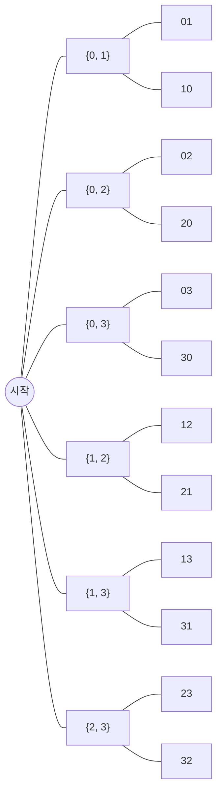

*그림 10. 2-조합을 고른 뒤 순서를 정하여 2-순열을 얻는 가능성 트리*

1단계의 방법 수는 $\binom{4}{2}$이고, 2단계의 방법 수는 원소 두 개를 배열하는 방법의 수 $2!$이다. 전체 과정의 방법 수는 2-순열의 수 $P(4, 2)$와 같으므로 곱의 법칙에 따라 다음 등식을 얻는다.

```math
P(4, 2) = \binom{4}{2} \cdot 2! \quad\Longrightarrow\quad \binom{4}{2} = \frac{P(4, 2)}{2!} = \frac{4!}{2!\,(4-2)!} = \frac{12}{2} = 6
```

같은 논리는 일반적인 경우에도 성립한다. 원소 $n$개인 집합의 r-순열을 만들려면, 먼저 $n$개 중 $r$개로 이루어진 부분집합을 고르고($\binom{n}{r}$가지), 그다음 그 $r$개의 순서를 정한다($r!$가지). 따라서 $P(n, r) = \binom{n}{r} \cdot r!$이고, 이를 $\binom{n}{r}$에 대해 풀고 $P(n, r) = \frac{n!}{(n-r)!}$을 대입하면 다음을 얻는다.

```math
\binom{n}{r} = \frac{P(n, r)}{r!} = \frac{n!/(n-r)!}{r!} = \frac{n!}{r!\,(n-r)!}
```

> **핵심:** **정리 9.5.1 ($\binom{n}{r}$의 계산 공식).** $n$과 $r$이 $r \le n$인 음이 아닌 정수이면, 원소 $n$개인 집합에서 고를 수 있는 크기 $r$인 부분집합(r-조합)의 개수는 다음과 같다.
>
> ```math
> \binom{n}{r} = \frac{P(n, r)}{r!} = \frac{n!}{r!\,(n-r)!}
> ```

위의 논증은 $n$과 $r$이 양의 정수인 모든 경우를 증명한다. $r = 0$이고 $n$이 음이 아닌 정수이면 $\binom{n}{0}$은 원소 $n$개인 집합의 크기 0인 부분집합의 수이다. 6장에서 보았듯이 원소가 없는 집합은 공집합 하나뿐이므로 $\binom{n}{0} = 1$이다. 한편 공식은 $0! = 1$이므로 $`\frac{n!}{0!\,(n-0)!} = \frac{n!}{1 \cdot n!} = 1`$을 주므로, 정리는 $r \le n$인 모든 음이 아닌 정수 $n$, $r$에 대해 성립한다. $0! = 1$이라는 정의가 여기서도 공식을 일관되게 만든다.

### 5.3 팀 구성 문제

**예제 9.5.4 (팀의 수 계산).** 12명 중 5명으로 팀을 만드는 처음 문제로 돌아간다. 서로 다른 5인 팀의 수는 12명의 집합에서 고를 수 있는 크기 5인 부분집합의 수이므로, 정리 9.5.1에 따라 다음과 같다.

```math
\binom{12}{5} = \frac{12!}{5!\,(12-5)!} = \frac{12 \cdot 11 \cdot 10 \cdot 9 \cdot 8 \cdot 7!}{(5 \cdot 4 \cdot 3 \cdot 2 \cdot 1) \cdot 7!} = 11 \cdot 9 \cdot 8 = 792
```

여기서 분자의 $12 \cdot 10 = 120$과 분모의 $5 \cdot 4 \cdot 3 \cdot 2 \cdot 1 = 120$을 약분하였다.

**예제 9.5.5 (둘 다 포함하거나 둘 다 포함하지 않는 팀).** 12명 중 두 사람 A와 B가 반드시 함께 일하겠다고 한다. 즉 어떤 팀이든 A와 B를 모두 포함하거나 둘 다 포함하지 않아야 한다. 이때 5인 팀은 몇 가지인가?

가능한 팀의 집합은 "A와 B를 모두 포함하는 팀"과 "A와 B를 모두 포함하지 않는 팀"의 두 서로소인 부분집합으로 분할된다.

1. A와 B를 모두 포함하는 팀은 나머지 10명 중 3명을 더 고르는 방법의 수만큼 있으므로 $\binom{10}{3} = \frac{10 \cdot 9 \cdot 8}{3 \cdot 2 \cdot 1} = 120$가지이다.
2. A와 B를 모두 포함하지 않는 팀은 나머지 10명 중 5명을 고르는 방법의 수만큼 있으므로 $\binom{10}{5} = \frac{10 \cdot 9 \cdot 8 \cdot 7 \cdot 6}{5 \cdot 4 \cdot 3 \cdot 2 \cdot 1} = 252$가지이다.
3. 합의 법칙에 따라 팀의 수는 $120 + 252 = 372$이다.

**예제 9.5.6 (두 사람을 함께 포함하지 않는 팀).** 12명 중 두 사람 C와 D가 서로 사이가 나빠 같은 팀에서 일하지 않겠다고 한다. 5인 팀은 몇 가지인가? 이 문제는 합의 법칙으로도, 차의 법칙으로도 풀 수 있다.

1. **합의 법칙:** C와 D를 함께 포함하지 않는 팀의 집합을 "C는 포함하고 D는 포함하지 않는 팀", "D는 포함하고 C는 포함하지 않는 팀", "C와 D 모두 포함하지 않는 팀"의 세 부분집합으로 분할한다. 첫째 부분집합의 팀은 나머지 10명 중 4명을 더 고르므로 $\binom{10}{4} = \frac{10 \cdot 9 \cdot 8 \cdot 7}{4 \cdot 3 \cdot 2 \cdot 1} = 210$가지이고, 둘째도 같은 이유로 210가지이며, 셋째는 앞의 예제처럼 252가지이다. 따라서 $210 + 210 + 252 = 672$가지이다.
2. **차의 법칙:** C와 D를 함께 포함하지 않는 팀의 집합은 5인 팀 전체의 집합에서 C와 D를 모두 포함하는 팀의 집합을 뺀 차집합이다. 5인 팀은 모두 $\binom{12}{5} = 792$가지이고 C와 D를 모두 포함하는 팀은 $\binom{10}{3} = 120$가지이므로 $792 - 120 = 672$가지이다.

다음 예제에 앞서 "적어도"와 "많아야"의 뜻을 정확히 해 둔다. **적어도 $n$** 은 "$`n`$ 이상"을, **많아야 $n$** 은 "$`n`$ 이하"를 뜻한다. 예를 들어 원소 3개인 집합에서 적어도 2개를 고르면 2개나 3개를 고르고, 많아야 2개를 고르면 0개, 1개, 2개 중 하나를 고른다.

**예제 9.5.7 (두 종류의 구성원이 있는 팀).** 12명이 남성 5명과 여성 7명으로 이루어져 있다고 한다.

1. **남성 3명과 여성 2명으로 이루어진 5인 팀:** 팀을 만드는 일을 "1단계: 남성을 고른다", "2단계: 여성을 고른다"의 두 단계로 생각하면, 남성 5명 중 3명을 고르는 방법은 $\binom{5}{3}$가지, 여성 7명 중 2명을 고르는 방법은 $\binom{7}{2}$가지이다. 곱의 법칙에 따라 $`\binom{5}{3}\binom{7}{2} = \frac{5!}{3!\,2!} \cdot \frac{7!}{2!\,5!} = 10 \cdot 21 = 210`$가지이다.
2. **남성을 적어도 1명 포함하는 5인 팀 (차의 법칙):** 이 집합은 5인 팀 전체의 집합에서 남성을 포함하지 않는 팀의 집합을 뺀 것이다. 남성이 없는 팀은 여성 7명 중 5명으로 이루어지므로 $\binom{7}{5} = \frac{7 \cdot 6}{2 \cdot 1} = 21$가지이고, 따라서 $792 - 21 = 771$가지이다.
3. **남성을 적어도 1명 포함하는 5인 팀 (합의 법칙):** 이 집합을 남성의 수에 따라 분할하고 각 부분집합의 수를 1번처럼 구하면 다음 표와 같다.

| 남성의 수 | 여성의 수 | 팀의 수 |
|:-----:|:-----:|:-----|
| 1 | 4 | $\binom{5}{1}\binom{7}{4} = 5 \cdot 35 = 175$ |
| 2 | 3 | $\binom{5}{2}\binom{7}{3} = 10 \cdot 35 = 350$ |
| 3 | 2 | $\binom{5}{3}\binom{7}{2} = 10 \cdot 21 = 210$ |
| 4 | 1 | $\binom{5}{4}\binom{7}{1} = 5 \cdot 7 = 35$ |
| 5 | 0 | $\binom{5}{5}\binom{7}{0} = 1 \cdot 1 = 1$ |

*표 11. 남성을 적어도 1명 포함하는 5인 팀을 남성의 수로 분할한 각 부분집합의 크기*

합의 법칙에 따라 $175 + 350 + 210 + 35 + 1 = 771$가지이며, 차의 법칙으로 구한 값과 같다.

4. **남성을 많아야 1명 포함하는 5인 팀:** 이 집합은 남성이 없는 팀과 남성이 정확히 1명인 팀으로 분할되므로, 합의 법칙에 따라 $\binom{5}{0}\binom{7}{5} + \binom{5}{1}\binom{7}{4} = 21 + 175 = 196$가지이다.

### 5.4 그래프와 포커 패에 대한 응용

**예제 9.5.8 (그래프에 대한 응용).** 루프와 평행 변이 없는 그래프를 **단순 그래프(simple graph)** 라 한다.

1. **완전 이분 그래프(complete bipartite graph)** $K_{m,n}$은 꼭짓점을 겹치지 않는 두 집합, 즉 꼭짓점 $m$개의 집합 $V$와 꼭짓점 $n$개의 집합 $W$로 나눌 수 있고, $V$의 각 꼭짓점과 $W$의 각 꼭짓점 사이에 변이 정확히 하나씩 있으며, $V$의 두 꼭짓점 사이와 $W$의 두 꼭짓점 사이에는 변이 없는 단순 그래프이다. $V$의 꼭짓점을 $v_1, \ldots, v_m$이라 하고, 각 $k = 1, \ldots, m$에 대해 "$`v_k`$에서 $W$의 $n$개 꼭짓점 각각으로 변을 하나씩 긋는다"를 $k$번째 단계로 하는 $m$단계 작업을 생각한다. 각 단계에서 변이 $n$개 생기므로 곱의 법칙에 따라 $K_{m,n}$의 변은 $mn$개이다.
2. **완전 그래프(complete graph)** $K_n$은 꼭짓점이 $n$개이고 서로 다른 두 꼭짓점 사이마다 변이 정확히 하나씩 있는 단순 그래프이다. $n = 1$이면 변이 없으며 $\frac{1 \cdot (1-1)}{2} = 0$이다. $n \ge 2$이면 서로 다른 두 꼭짓점의 쌍마다 변이 정확히 하나 있으므로, 변의 수는 꼭짓점 $n$개의 집합에서 고를 수 있는 크기 2인 부분집합의 수와 같다. 따라서 $K_n$의 변은 $`\binom{n}{2} = \frac{n!}{2!\,(n-2)!} = \frac{n(n-1)}{2}`$개이다.

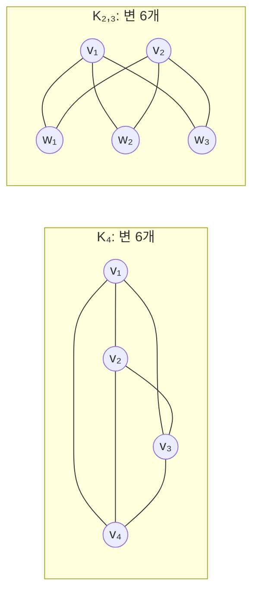

*그림 11. 변이 4 × 3 / 2 = 6개인 완전 그래프 K₄와 변이 2 × 3 = 6개인 완전 이분 그래프 K₂,₃*

**예제 9.5.9 (포커 패의 문제).** 포커는 52장의 보통 카드 한 벌로 하며, 다섯 장의 패 중 특별한 이름이 붙은 것은 다음과 같다. 위에 있는 패일수록 높다.

| 패의 이름 | 구성 |
|:-----|:-----|
| 로열 플러시(royal flush) | 같은 무늬의 10, J, Q, K, A |
| 스트레이트 플러시(straight flush) | 같은 무늬의 연속된 다섯 숫자이지만 로열 플러시가 아닌 것 (A는 높게도 낮게도 쓸 수 있어 같은 무늬의 A, 2, 3, 4, 5도 해당한다) |
| 포 카드(four of a kind) | 한 숫자의 카드 네 장과 나머지 아무 카드 한 장 |
| 풀 하우스(full house) | 한 숫자의 카드 세 장과 다른 숫자의 카드 두 장 |
| 플러시(flush) | 같은 무늬의 카드 다섯 장이지만 스트레이트 플러시나 로열 플러시가 아닌 것 |
| 스트레이트(straight) | 연속된 다섯 숫자이지만 모두 같은 무늬는 아닌 것 (A는 높게도 낮게도 쓸 수 있다) |
| 스리 카드(three of a kind) | 한 숫자의 카드 세 장과 서로 다른 두 숫자의 카드 두 장 |
| 투 페어(two pairs) | 한 숫자의 카드 두 장, 둘째 숫자의 카드 두 장, 셋째 숫자의 카드 한 장 |
| 원 페어(one pair) | 한 숫자의 카드 두 장과 서로 다른 세 숫자의 카드 세 장 |
| 노 페어(no pairs) | 다섯 장의 숫자가 모두 다르지만 스트레이트, 스트레이트 플러시, 플러시, 로열 플러시가 아닌 것 |

*표 12. 포커에서 이름이 붙은 다섯 장 패의 종류와 구성*

1. **투 페어인 패의 수:** 투 페어 패를 만드는 일을 다음 네 단계로 생각한다. 1단계에서 두 쌍의 숫자 두 개를 고르고, 2단계에서 작은 숫자의 카드 두 장을, 3단계에서 큰 숫자의 카드 두 장을 고르며, 4단계에서 남은 카드 중 한 장을 고른다. 숫자는 13가지이므로 1단계는 $\binom{13}{2}$가지이다. 각 숫자의 카드는 무늬별로 한 장씩 네 장이므로 2단계와 3단계는 각각 $\binom{4}{2}$가지이다. 다섯째 카드는 두 쌍에 쓰인 숫자를 제외한 11개 숫자의 카드 $11 \cdot 4 = 44$장 중에서 고르므로 4단계는 $\binom{44}{1}$가지이다. 따라서 투 페어인 패의 수는 다음과 같다.

```math
\binom{13}{2}\binom{4}{2}\binom{4}{2}\binom{44}{1} = \frac{13 \cdot 12}{2} \cdot \frac{4 \cdot 3}{2} \cdot \frac{4 \cdot 3}{2} \cdot 44 = 78 \cdot 6 \cdot 6 \cdot 44 = 123{,}552
```

2. **투 페어일 확률:** 다섯 장 패는 모두 $\binom{52}{5} = 2{,}598{,}960$가지이므로, 모든 패가 똑같이 일어날 법하면 투 페어일 확률은 $123{,}552 / 2{,}598{,}960 \approx 0.0475$, 즉 약 4.75%이다.

> **주의:** 1단계에서 "첫째 쌍의 숫자 13가지, 둘째 쌍의 숫자 12가지"로 $13 \cdot 12$를 쓰면, 예를 들어 (5의 쌍, 9의 쌍)과 (9의 쌍, 5의 쌍)을 서로 다른 패로 두 번 세게 된다. 두 쌍은 순서가 없으므로 $\binom{13}{2} = 78$을 써야 한다. 또한 다섯째 카드를 52 - 4 = 48장 중에서 고르면 두 쌍 중 한 숫자의 카드가 다시 뽑힐 수 있고, 그 패는 투 페어가 아니라 풀 하우스가 된다.

### 5.5 같은 것이 있는 순열

**예제 9.5.10 (1의 개수가 정해진 비트 문자열).** 1이 정확히 세 개인 8비트 문자열은 몇 개인가? 빈자리 8개를 놓고, 1단계에서 1을 넣을 세 자리를 고르고 2단계에서 나머지 자리에 0을 넣는다. 1을 넣을 세 자리를 고르면 나머지 다섯 자리는 반드시 0이므로, 그러한 문자열의 수는 8개의 자리에서 3개의 자리를 고르는 방법의 수와 같다. 따라서 $\binom{8}{3} = \frac{8 \cdot 7 \cdot 6}{3 \cdot 2 \cdot 1} = 56$개이다.

**예제 9.5.11 (같은 원소가 반복되는 집합의 순열).** 단어 MISSISSIPPI의 문자를 IIMSSPISSIP, ISSSPMIIPIS, PIMISSSSIIP처럼 배열하는 방법 중 서로 구별되는 것은 몇 가지인가? 11개의 문자를 11개의 자리에 하나씩 넣는다고 생각한다. 같은 문자의 사본끼리는 구별되지 않으므로, 어떤 문자가 들어갈 자리들이 정해지면 그 문자의 사본들을 그 자리에 넣는 방법은 한 가지뿐이다. 따라서 배열을 만드는 일은 다음 네 단계 작업이다.

1. 1단계: S 네 개가 들어갈 자리 4개를 11개 중에서 고른다. $\binom{11}{4}$가지이다.
2. 2단계: I 네 개가 들어갈 자리 4개를 남은 7개 중에서 고른다. $\binom{7}{4}$가지이다.
3. 3단계: P 두 개가 들어갈 자리 2개를 남은 3개 중에서 고른다. $\binom{3}{2}$가지이다.
4. 4단계: M이 들어갈 자리 1개를 남은 1개 중에서 고른다. $1 = \binom{1}{1}$가지이다.

곱의 법칙에 따라 다음과 같다.

```math
\binom{11}{4}\binom{7}{4}\binom{3}{2}\binom{1}{1} = \frac{11!}{4!\,7!} \cdot \frac{7!}{4!\,3!} \cdot \frac{3!}{2!\,1!} \cdot \frac{1!}{1!\,0!} = \frac{11!}{4!\,4!\,2!\,1!} = 330 \cdot 35 \cdot 3 \cdot 1 = 34{,}650
```

문자를 넣는 순서를 바꾸어도 답은 같다. 같은 논리로 다음 정리를 얻는다.

> **핵심:** **정리 9.5.2 (같은 것이 있는 순열).** $n$개의 대상으로 이루어진 모임이 있고, 그중 $n_1$개는 1번 종류로 서로 구별되지 않고, $n_2$개는 2번 종류로 서로 구별되지 않으며, ..., $n_k$개는 $k$번 종류로 서로 구별되지 않고, $n_1 + n_2 + \cdots + n_k = n$이라 한다. 그러면 $n$개의 대상의 구별되는 순열의 수는 다음과 같다.
>
> ```math
> \binom{n}{n_1}\binom{n - n_1}{n_2}\binom{n - n_1 - n_2}{n_3}\cdots\binom{n - n_1 - n_2 - \cdots - n_{k-1}}{n_k} = \frac{n!}{n_1!\,n_2!\,n_3!\cdots n_k!}
> ```

마지막 등호는 이웃한 인수끼리 약분된다는 사실에서 나온다. 예를 들어 $`\binom{n}{n_1}\binom{n-n_1}{n_2} = \frac{n!}{n_1!\,(n-n_1)!} \cdot \frac{(n-n_1)!}{n_2!\,(n-n_1-n_2)!}`$에서 $(n - n_1)!$이 약분되며, 마지막 인수의 분모에는 $(n - n_1 - \cdots - n_k)! = 0! = 1$이 남는다.

> **참고:** 같은 결과를 다음과 같이 볼 수도 있다. 같은 문자의 사본에 $S_1, S_2, \ldots$처럼 번호를 붙여 모두 구별하면 배열은 $n!$가지이다. 번호를 지웠을 때 같아지는 배열은 각 종류의 사본들을 서로 바꾸는 방법의 수 $`n_1!\,n_2!\cdots n_k!`$개씩 묶이므로, 구별되는 배열의 수는 $`n! / (n_1!\,n_2!\cdots n_k!)`$이다. MISSISSIPPI의 경우 $`11! / (4!\,4!\,2!\,1!) = 39{,}916{,}800 / 1{,}152 = 34{,}650`$이다.

### 5.6 경우의 수를 셀 때의 요령과 중복 계산

셈을 처음 배우는 사람은 언제 곱하고 언제 더해야 하는지, 즉 언제 곱의 법칙을 쓰고 언제 합의 법칙을 쓰는지 자주 묻는다. 이 질문에 쉬운 답은 없다. 세려는 대상을 가능한 한 생생하게 떠올리고, 대상의 일부를 직접 나열하여 체계적으로 만들어 내는 방법을 찾은 뒤, 시간만 충분하면 대상을 하나씩 계속 셀 수 있는 모형을 세우는 것이 좋다. 대상을 여러 단계로 이루어진 과정(각 단계의 방법 수가 앞 단계와 관계없이 일정한 과정)의 산출물로 볼 수 있으면 곱의 법칙을 쓰고, 전체를 서로소인 부분집합들로 나눌 수 있으면 합의 법칙을 쓴다.

가장 흔한 실수는 어떤 가능성을 두 번 이상 세는 것이다.

**예제 9.5.12 (중복 계산).** 5.3절처럼 남성 5명과 여성 7명 중에서 남성을 적어도 1명 포함하는 5인 팀의 수를 다음과 같이 구하는 것은 틀렸다.

1. 1단계: 남성 5명 중 1명을 고른다. $\binom{5}{1}$가지이다.
2. 2단계: 남은 11명 중 4명을 고른다. $\binom{11}{4}$가지이다.
3. 곱의 법칙에 따라 $\binom{5}{1}\binom{11}{4} = 5 \cdot 330 = 1{,}650$가지라고 결론짓는다.

이 답은 올바른 답 771보다 훨씬 크다. 남성을 $M_1, \ldots, M_5$, 여성을 $W_1, \ldots, W_7$이라 하면, 1단계에서 $M_1$을 고르고 2단계에서 $M_2, W_2, W_4, W_5$를 고른 결과와, 1단계에서 $M_2$를 고르고 2단계에서 $M_1, W_2, W_4, W_5$를 고른 결과는 모두 같은 팀 $\lbrace M_1, M_2, W_2, W_4, W_5 \rbrace$을 만든다. 즉 한 팀이 가능성 트리의 서로 다른 두 가지에서 나타나 두 번 세어진다. 남성을 여러 명 포함하는 팀일수록 더 여러 번 세어진다.

> **주의:** 이런 실수를 피하려면 곱의 법칙을 쓸 때는 대응하는 가능성 트리를, 합의 법칙을 쓸 때는 대응하는 집합의 분할을 떠올리고, 단계를 나눈 방식을 가능한 한 일반적인 실제 자료에 적용하여 확인한다. 두 가지 질문, 즉 "빠짐없이 세는가?"와 "두 번 세는 것은 없는가?"를 스스로 묻는다. 곱의 법칙에서는 "모든 결과가 트리의 어떤 가지에 나타나는가?"와 "어떤 결과가 두 개 이상의 가지에 나타나지 않는가?"를, 합의 법칙에서는 "모든 결과가 어떤 부분집합에 들어 있는가?"와 "두 부분집합이 공통 원소를 가지지 않는가?"를 확인한다.

---

<br>

## 6. 중복을 허용하는 r-조합

### 6.1 정의와 완전 열거

5절에서 보았듯이 원소 $n$개인 집합에서 서로 다른 원소 $r$개를 순서와 관계없이 고르는 방법은 $\binom{n}{r}$가지이다. 예를 들어 원소 네 개의 집합에서 세 개를 고르는 방법은 {1, 2, 3}, {1, 2, 4}, {1, 3, 4}, {2, 3, 4}의 $\binom{4}{3} = 4$가지이다. 이 절에서는 반복을 허용할 때 원소 $n$개인 집합에서 $r$개를 순서와 관계없이 고르는 방법의 수를 구한다. $n$개의 원소를 여러 개씩 고를 수 있는 물건의 **범주(category)** 로 생각하면 이해하기 쉽다. 범주가 1, 2, 3, 4이고 세 개를 고른다면, 3번 범주에서 두 개와 1번 범주에서 한 개를 고르거나, 2번 범주에서 세 개를 모두 고르거나, 1, 2, 4번 범주에서 하나씩 고를 수 있다. 이 선택을 각각 $[3, 3, 1]$, $[2, 2, 2]$, $[1, 2, 4]$로 나타낸다. 순서는 중요하지 않으므로 예를 들어 $[3, 3, 1] = [3, 1, 3] = [1, 3, 3]$이다.

> **용어 정의:** 원소 $n$개인 집합 $X$에서 고른 **중복을 허용하는 r-조합(r-combination with repetition allowed)**, 또는 크기 $r$인 **다중집합(multiset)** 은 $X$의 원소 $r$개를 반복을 허용하여 순서 없이 고른 것이다. $X = \lbrace x_1, x_2, \ldots, x_n \rbrace$이면 이를 $[x_{i_1}, x_{i_2}, \ldots, x_{i_r}]$로 쓰며, 각 $x_{i_j}$는 $X$의 원소이고 그중 일부는 서로 같을 수 있다.

**예제 9.6.1 (중복을 허용하는 3-조합의 완전 열거).** {1, 2, 3, 4}에서 고를 수 있는 중복을 허용하는 3-조합(크기 3인 다중집합)을 모두 나열한다. 고르는 순서는 중요하지 않으므로 각 선택의 원소를 오름차순으로 쓸 수 있고, 오름차순으로 쓰면 빠뜨리는 조합이 없게 된다.

| 앞의 두 원소 | 중복을 허용하는 3-조합 | 개수 |
|:-----|:-----|:-----:|
| 1, 1 | $[1, 1, 1]$, $[1, 1, 2]$, $[1, 1, 3]$, $[1, 1, 4]$ | 4 |
| 1, 2 | $[1, 2, 2]$, $[1, 2, 3]$, $[1, 2, 4]$ | 3 |
| 1, 3 또는 1, 4 | $[1, 3, 3]$, $[1, 3, 4]$, $[1, 4, 4]$ | 3 |
| 2, 2 | $[2, 2, 2]$, $[2, 2, 3]$, $[2, 2, 4]$ | 3 |
| 2, 3 또는 2, 4 | $[2, 3, 3]$, $[2, 3, 4]$, $[2, 4, 4]$ | 3 |
| 3, 3 또는 3, 4 | $[3, 3, 3]$, $[3, 3, 4]$, $[3, 4, 4]$ | 3 |
| 4, 4 | $[4, 4, 4]$ | 1 |

*표 13. {1, 2, 3, 4}에서 고른 중복을 허용하는 3-조합 20개의 완전 열거*

따라서 중복을 허용하는 3-조합은 $4 + 3 + 3 + 3 + 3 + 3 + 1 = 20$개이다.

### 6.2 막대와 가위표 문자열로 세기

20이라는 수를 목록을 만들지 않고 예측하는 방법이 있다. 1, 2, 3, 4를 범주로 보고, 범주마다 여러 번 고를 수 있게 하여 모두 세 개를 고른다고 생각한다. 네 범주를 구분하는 **세로 막대(vertical bar)** `|` 3개와 고른 물건 하나하나를 나타내는 **가위표(cross)** `×` 3개로 선택을 나타내면 다음과 같다.

```text
 범주 1 | 범주 2 | 범주 3 | 범주 4        문자열     선택 결과
        |   ×    |        |  × ×          |×||××     범주 2에서 하나, 범주 4에서 둘: [2, 4, 4]
   ×    |        |   ×    |   ×           ×||×|×     범주 1, 3, 4에서 하나씩: [1, 3, 4]
 × × ×  |        |        |               ×××|||     범주 1에서 셋: [1, 1, 1]
  × ×   |        |   ×    |               ××||×|     범주 1에서 둘, 범주 3에서 하나: [1, 1, 3]
```

*그림 12. 세로 막대 3개와 가위표 3개로 이루어진 문자열이 나타내는 중복을 허용하는 3-조합*

막대는 범주의 경계이고, 두 막대 사이(또는 맨 앞이나 맨 뒤)에 있는 가위표의 개수가 그 범주에서 고른 개수이다. 막대 3개와 가위표 3개로 이루어진 서로 다른 문자열은 서로 다른 선택을 나타내고, 모든 선택은 이런 문자열 하나로 나타난다. 따라서 선택의 수는 길이 6인 문자열에서 가위표가 들어갈 자리 3개를 고르는 방법의 수와 같다. 가위표의 자리를 정하면 나머지 세 자리는 막대가 차지하기 때문이다.

```math
\binom{6}{3} = \frac{6!}{3!\,(6-3)!} = \frac{6 \cdot 5 \cdot 4}{3 \cdot 2 \cdot 1} = 20
```

이 값은 완전 열거의 결과와 같다. 일반적으로 원소 $n$개인 집합에서 고르는 중복을 허용하는 r-조합은, $n$개의 범주를 나누는 세로 막대 $n - 1$개와 고른 $r$개의 원소를 나타내는 가위표 $r$개로 이루어진 문자열로 나타난다. 각 범주의 가위표 수는 그 범주에 해당하는 원소가 반복되는 횟수이다. 이러한 문자열의 수는 전체 $r + (n - 1)$개의 자리 중 가위표가 들어갈 $r$개의 자리를 고르는 방법의 수이므로 정리 9.5.1에 따라 $\binom{r + n - 1}{r}$이다.

> **핵심:** **정리 9.6.1.** 원소 $n$개인 집합에서 고를 수 있는 중복을 허용하는 r-조합(크기 $r$인 다중집합)의 수는 $\binom{r + n - 1}{r}$이다. 이는 $n$개의 범주에서 반복을 허용하여 물건 $r$개를 고르는 방법의 수와 같다.

> **참고:** $\binom{r + n - 1}{r} = \binom{r + n - 1}{n - 1}$이므로(7.1절), 가위표 대신 막대가 들어갈 $n - 1$개의 자리를 고른다고 생각해도 같은 값을 얻는다.

### 6.3 응용

**예제 9.6.2 (다섯 종류의 음료수 15캔 고르기).** 파티를 여는 사람이 손님을 위해 음료수 15캔을 섞어서 준비하려 한다. 가게에는 다섯 종류의 음료수가 있다.

1. **가능한 선택의 수:** 다섯 종류의 음료수를 $n = 5$개의 범주로, 고를 15캔을 $r = 15$개의 물건으로 본다. 각 선택은 범주를 나누는 막대 $5 - 1 = 4$개와 고른 캔을 나타내는 가위표 15개의 문자열로 나타난다. 예를 들어 `×××|×××××××||×××|××`는 1번 종류 3캔, 2번 종류 7캔, 3번 종류 0캔, 4번 종류 3캔, 5번 종류 2캔을 고른 것이다. 따라서 선택의 수는 길이 19인 문자열의 수이다.

```math
\binom{15 + 5 - 1}{15} = \binom{19}{15} = \frac{19!}{15!\,4!} = \frac{19 \cdot 18 \cdot 17 \cdot 16}{4 \cdot 3 \cdot 2 \cdot 1} = 3{,}876
```

2. **루트비어를 적어도 6캔 포함하는 선택의 수:** 루트비어가 다섯 종류 중 하나라면, 먼저 루트비어 6캔을 고른 뒤 나머지 9캔을 자유롭게 고른다고 생각한다. 나머지 9캔의 선택은 가위표 9개와 막대 4개의 문자열로 나타난다. 예를 들어 루트비어가 1번 종류이면 `×××||××|××××|`는 처음 6캔에 더해 루트비어 3캔, 2번 종류 0캔, 3번 종류 2캔, 4번 종류 4캔, 5번 종류 0캔을 고른 것이다. 따라서 선택의 수는 길이 13인 문자열의 수이다.

```math
\binom{9 + 5 - 1}{9} = \binom{13}{9} = \frac{13!}{9!\,4!} = \frac{13 \cdot 12 \cdot 11 \cdot 10}{4 \cdot 3 \cdot 2 \cdot 1} = 715
```

3. **루트비어가 5캔뿐일 때의 선택의 수:** 가게에 루트비어는 5캔뿐이고 다른 음료수는 종류마다 15캔 이상 있다면, 가능한 선택은 루트비어를 5캔 이하로 포함하는 선택이다. 각 종류가 15캔 이상 있다고 가정할 때의 모든 선택의 집합을 $T$, 그중 루트비어를 5캔 이하로 포함하는 선택의 집합을 $R_{\le 5}$, 6캔 이상 포함하는 선택의 집합을 $R_{\ge 6}$이라 하면 $T = R_{\le 5} \cup R_{\ge 6}$이고 $R_{\le 5} \cap R_{\ge 6} = \emptyset$이다. 1번과 2번의 결과와 차의 법칙에 따라 $N(R_{\le 5}) = N(T) - N(R_{\ge 6}) = 3{,}876 - 715 = 3{,}161$이다.

**예제 9.6.3 ($1 \le i \le j \le k \le n$인 세 쌍 $(i, j, k)$의 개수).** $n$이 양의 정수일 때, 1부터 $n$까지의 정수로 이루어지고 원소가 증가하는 순서(같아도 된다)로 쓰인 세 쌍 $(i, j, k)$, 즉 $1 \le i \le j \le k \le n$인 세 쌍은 몇 개인가?

이러한 세 쌍은 막대 $n - 1$개와 가위표 3개의 문자열로 나타나며, 가위표의 위치가 세 쌍에 들어가는 1부터 $n$까지의 정수를 가리킨다. $n = 5$이면 다음과 같다.

```text
 1 | 2 | 3 | 4 | 5        문자열        세 쌍
   |   |×× |   | ×        ||××||×       (3, 3, 5)
 × | × |   | × |          ×|×||×|       (1, 2, 4)
```

*그림 13. n = 5일 때 세 쌍을 막대 4개와 가위표 3개의 문자열로 나타낸 예*

따라서 세 쌍의 수는 막대 $n - 1$개와 가위표 3개의 문자열의 수이다.

```math
\binom{3 + (n-1)}{3} = \binom{n+2}{3} = \frac{(n+2)!}{3!\,(n-1)!} = \frac{(n+2)(n+1)n\,(n-1)!}{3!\,(n-1)!} = \frac{n(n+1)(n+2)}{6}
```

이 결과는 정리 9.6.1을 직접 적용해서도 얻을 수 있다. 1부터 $n$까지의 정수에서 고른 중복을 허용하는 3-조합의 원소는 증가하는 순서로 쓰는 방법이 한 가지뿐이므로, 이러한 세 쌍과 중복을 허용하는 3-조합은 일대일로 대응한다.

**예제 9.6.4 (반복문의 반복 횟수).** $n$이 양의 정수일 때 다음 알고리즘에서 가장 안쪽 반복문은 몇 번 반복되는가? 본문에는 반복문 밖으로 빠져나가는 분기문이 없다고 한다.

```text
for k := 1 to n
    for j := 1 to k
        for i := 1 to j
            [가장 안쪽 반복문의 본문]
        next i
    next j
next k
```

$i$는 1부터 $j$까지 변하므로 항상 $i \le j$이고, $j$는 1부터 $k$까지 변하므로 항상 $j \le k$이다. 예를 들어 $k = 3$이면 $j$는 1, 2, 3을 차례로 가지고, $j = 1$일 때 $i$는 1만, $j = 2$일 때 $i$는 1과 2를, $j = 3$일 때 $i$는 1, 2, 3을 가진다. 가장 안쪽 본문은 $1 \le i \le j \le k \le n$인 세 쌍 $(i, j, k)$ 하나마다 정확히 한 번 실행되므로, 앞의 예제에 따라 반복 횟수는 $\frac{n(n+1)(n+2)}{6}$이다. 예를 들어 $n = 3$이면 $k = 1, 2, 3$일 때 각각 $1$, $1 + 2 = 3$, $1 + 2 + 3 = 6$번이므로 모두 10번이고, $\frac{3 \cdot 4 \cdot 5}{6} = 10$과 일치한다.

**예제 9.6.5 (방정식의 정수해의 개수).** $x_1, x_2, x_3, x_4$가 음이 아닌 정수일 때, 방정식 $x_1 + x_2 + x_3 + x_4 = 10$의 해는 몇 개인가?

10을 10개의 단위로 나누고, 변수 $x_1, x_2, x_3, x_4$를 단위가 들어갈 네 범주로 생각한다. 각 범주 $x_i$에 들어간 단위의 수가 해에서 $x_i$의 값이다. 따라서 각 해는 범주를 나누는 막대 3개와 단위를 나타내는 가위표 10개의 문자열로 나타난다. 예를 들어 `××|×××××||×××`는 $x_1 = 2$, $x_2 = 5$, $x_3 = 0$, $x_4 = 3$인 해를, `××××|××××××||`는 $x_1 = 4$, $x_2 = 6$, $x_3 = 0$, $x_4 = 0$인 해를 나타낸다. 해의 수는 다음과 같다.

```math
\binom{10 + 3}{10} = \binom{13}{10} = \frac{13!}{10!\,3!} = \frac{13 \cdot 12 \cdot 11}{3 \cdot 2 \cdot 1} = 286
```

**예제 9.6.6 (추가 조건이 있는 해의 개수).** 각 $x_i \ge 1$일 때 $x_1 + x_2 + x_3 + x_4 = 10$의 정수해는 몇 개인가?

먼저 네 범주에 가위표를 하나씩 넣고, 나머지 6개의 가위표를 범주들에 나누어 넣는다고 생각한다. 이 분배는 막대 3개와 가위표 6개의 문자열로 나타난다. 예를 들어 `×××||××|×`는 이미 있는 하나에 더해 $x_1$에 3개($`x_1 = 4`$), $x_2$에 0개($`x_2 = 1`$), $x_3$에 2개($`x_3 = 3`$), $x_4$에 1개($`x_4 = 2`$)를 넣은 것이다. 따라서 해의 수는 다음과 같다.

```math
\binom{6 + 3}{6} = \binom{9}{6} = \frac{9!}{6!\,3!} = \frac{9 \cdot 8 \cdot 7}{3 \cdot 2 \cdot 1} = 84
```

다른 풀이로, 각 $x_i \ge 1$이므로 새 변수 $y_i = x_i - 1$ ($`i = 1, 2, 3, 4`$)을 도입하면 각 $y_i \ge 0$이고 $y_1 + y_2 + y_3 + y_4 = 6$이다. 따라서 $x_i$가 양의 정수인 원래 방정식의 해의 수는 $y_i$가 음이 아닌 정수인 이 방정식의 해의 수 $\binom{6 + 3}{6} = 84$와 같다.

### 6.4 공식 선택의 기준

2절, 5절, 6절에서 $n$개 중에서 $k$개를 고르는 네 가지 방법을 다루었다. 고르는 순서가 중요할 수도 있고 중요하지 않을 수도 있으며, 반복이 허용될 수도 있고 허용되지 않을 수도 있다. 어느 경우에 어느 공식을 쓰는지는 다음 표와 같다.

| | 순서가 중요하다 | 순서가 중요하지 않다 |
|:-----|:-----:|:-----:|
| **반복을 허용한다** | $n^k$ | $\binom{k + n - 1}{k}$ |
| **반복을 허용하지 않는다** | $P(n, k)$ | $\binom{n}{k}$ |

*표 14. 순서와 반복의 여부에 따라 n개 중 k개를 고르는 방법의 수*

이 장의 예제로 각 칸을 확인할 수 있다. 기호의 반복을 허용하는 PIN은 $36^4$개(순서 있음, 반복 허용), 반복된 기호가 없는 PIN은 $P(36, 4)$개(순서 있음, 반복 불허), 12명 중 5인 팀은 $\binom{12}{5}$개(순서 없음, 반복 불허), 다섯 종류에서 음료수 15캔을 고르는 방법은 $\binom{19}{15}$가지(순서 없음, 반복 허용)이다.

---

<br>

## 7. 파스칼의 공식과 이항정리

이 절에서는 $\binom{n}{r}$의 값에 관한 여러 공식을 유도한다. 가장 중요한 것은 파스칼의 삼각형의 바탕이자 이항정리의 증명 하나의 핵심 요소인 파스칼의 공식이다. 파스칼의 공식과 이항정리는 각각 두 가지 방법으로 증명한다. 하나는 주로 식의 변형에 의존하는 **대수적 증명(algebraic proof)** 이고, 다른 하나는 이 장에서 다룬 셈 논증에 바탕을 둔 **조합적 증명(combinatorial proof)** 이다.

### 7.1 몇 가지 이항계수의 값

정리 9.5.1은 일반적인 틀로 볼 수 있다. 아래 칸의 음이 아닌 정수가 위 칸의 음이 아닌 정수보다 크지 않으면, 두 칸에 어떤 수를 넣든 $`\binom{\square}{\lozenge} = \frac{\square!}{\lozenge!\,(\square - \lozenge)!}`$이다.

**예제 9.7.1 ($\binom{n}{n}$, $\binom{n}{n-1}$, $\binom{n}{n-2}$의 값).** 정리 9.5.1을 써서 모든 정수 $n \ge 0$에 대해 다음을 보인다.

```math
\binom{n}{n} = 1 \quad (9.7.1), \qquad \binom{n}{n-1} = n \;\; (n \ge 1) \quad (9.7.2), \qquad \binom{n}{n-2} = \frac{n(n-1)}{2} \;\; (n \ge 2) \quad (9.7.3)
```

각각 정의에 대입하여 약분한다.

```math
\begin{aligned}
\binom{n}{n} &= \frac{n!}{n!\,(n-n)!} = \frac{1}{0!} = 1 \\
\binom{n}{n-1} &= \frac{n!}{(n-1)!\,(n-(n-1))!} = \frac{n \cdot (n-1)!}{(n-1)!\,1!} = n \\
\binom{n}{n-2} &= \frac{n!}{(n-2)!\,(n-(n-2))!} = \frac{n(n-1)\,(n-2)!}{(n-2)!\,2!} = \frac{n(n-1)}{2}
\end{aligned}
```

첫째 식에서는 $0! = 1$을 썼다. $\binom{n}{n} = 1$은 원소 $n$개인 집합의 크기 $n$인 부분집합이 그 집합 자신 하나뿐이라는 사실과 일치한다. 같은 방법으로 $\binom{n}{0} = 1$($`n \ge 0`$)과 $\binom{n}{1} = n$($`n \ge 1`$)도 보일 수 있으며, 이는 크기 0인 부분집합이 공집합 하나뿐이고 크기 1인 부분집합이 원소 하나씩으로 이루어진 $n$개라는 사실과 일치한다.

**예제 9.7.2 ($`\binom{n}{r} = \binom{n}{n-r}`$).** $r \le n$인 모든 음이 아닌 정수 $n$, $r$에 대해 이 등식은 정리 9.5.1에 대입하면 바로 확인된다. $`\frac{n!}{r!\,(n-r)!}`$과 $`\frac{n!}{(n-r)!\,(n-(n-r))!}`$은 같은 식이기 때문이다. 이 등식을 원소 $n$개인 집합 $A$의 크기 $r$인 부분집합과 크기 $n - r$인 부분집합의 개수가 같다는 뜻으로 해석하여 셈 논증으로 유도할 수도 있다.

크기 $r$인 부분집합은 어떤 $r$개의 원소가 그 안에 있는지로 정할 수도 있고, 어떤 $n - r$개의 원소가 그 밖에 있는지로 정할 수도 있다. $A$의 크기 $r$인 부분집합이 $B_1, B_2, \ldots, B_k$의 $k$개라 하면, 각 $B_i$를 그 여집합 $A - B_i$와 짝지을 수 있고 $A - B_i$의 크기는 $n - r$이다. 서로 다른 부분집합의 여집합은 서로 다르고, 크기 $n - r$인 부분집합 $C$는 크기 $r$인 부분집합 $A - C$의 여집합이므로, 이 짝짓기는 크기 $r$인 부분집합 전체와 크기 $n - r$인 부분집합 전체 사이의 일대일 대응이다. 따라서 두 개수는 같고 $\binom{n}{r} = \binom{n}{n-r}$이다. 이처럼 대상을 서로 다른 방식으로 짝짓거나 세어 등식을 얻는 논증을 조합적 논증이라 한다.

### 7.2 파스칼의 공식

17세기 프랑스의 수학자이자 철학자인 파스칼(Blaise Pascal)의 이름을 딴 **파스칼의 공식(Pascal's formula)** 은 셈과 나열 문제를 연구하는 분야인 **조합론(combinatorics)** 에서 가장 유명하고 유용한 공식 중 하나이다. 이 공식은 $\binom{n+1}{r}$을 $\binom{n}{r-1}$과 $\binom{n}{r}$로 나타낸다.

```math
\binom{n+1}{r} = \binom{n}{r-1} + \binom{n}{r} \qquad (n, r\text{은 } r \le n\text{인 양의 정수})
```

이 공식을 쓰면 낮은 행의 값으로 높은 행의 값을 쉽게 계산할 수 있다. 모든 $\binom{n}{r}$의 값을 알면 $0 < r \le n$인 모든 $r$에 대해 $\binom{n+1}{r}$을 계산할 수 있다. 이를 표로 나타낸 것이 **파스칼의 삼각형(Pascal's triangle)** 이다. 파스칼보다 수 세기 앞서 중국과 페르시아의 수학자들도 이 표를 썼기 때문에 산술 삼각형이라고도 부르지만, 파스칼이 이를 독립적으로 발견하고 1654년에 그 여러 성질을 탐구한 논문을 펴낸 뒤로 흔히 파스칼의 삼각형이라 부른다.

| $n$ \ $r$ | 0 | 1 | 2 | 3 | 4 | 5 | 6 |
|:-----:|:-----:|:-----:|:-----:|:-----:|:-----:|:-----:|:-----:|
| **0** | 1 | | | | | | |
| **1** | 1 | 1 | | | | | |
| **2** | 1 | 2 | 1 | | | | |
| **3** | 1 | 3 | 3 | 1 | | | |
| **4** | 1 | 4 | 6 | 4 | 1 | | |
| **5** | 1 | 5 | 10 | 10 | 5 | 1 | |
| **6** | 1 | 6 | 15 | 20 | 15 | 6 | 1 |

*표 15. n = 0부터 6까지의 이항계수를 n행 r열에 배열한 파스칼의 삼각형*

삼각형의 각 칸은 $\binom{n}{r}$의 값이다. 파스칼의 공식은 $n + 1$행 $r$열의 값이 $n$행 $r - 1$열의 값과 $n$행 $r$열의 값의 합이라는 뜻이다. 즉 내부의 각 칸은 바로 위 칸과 그 왼쪽 위 칸의 합이다. 예를 들어 4행 2열의 6과 4행 3열의 4를 더하면 5행 3열의 10이 된다. 각 행의 맨 왼쪽과 맨 오른쪽 값은 $\binom{n}{0} = 1$, $\binom{n}{n} = 1$이므로 1이다.

**예제 9.7.3 (파스칼의 삼각형으로 $\binom{n}{r}$ 계산하기).** 파스칼의 공식에 따라 $\binom{6}{2}$와 $\binom{6}{3}$은 5행의 값에서 구한다.

```math
\binom{6}{2} = \binom{5}{1} + \binom{5}{2} = 5 + 10 = 15, \qquad \binom{6}{3} = \binom{5}{2} + \binom{5}{3} = 10 + 10 = 20
```

> **핵심:** **정리 9.7.1 (파스칼의 공식).** $n$과 $r$이 $r \le n$인 양의 정수이면 $\binom{n+1}{r} = \binom{n}{r-1} + \binom{n}{r}$이다.

**증명 (대수적 증명).** $n$과 $r$이 $r \le n$인 양의 정수라 하고, 우변이 좌변과 같음을 보인다. 정리 9.5.1에 따라

```math
\binom{n}{r-1} + \binom{n}{r} = \frac{n!}{(r-1)!\,(n-r+1)!} + \frac{n!}{r!\,(n-r)!}
```

이다. 두 분수를 더하려면 공통 분모가 필요하므로, 왼쪽 분수의 분자와 분모에 $r$을, 오른쪽 분수의 분자와 분모에 $n - r + 1$을 곱한다. $r \cdot (r-1)! = r!$이고 $(n - r + 1) \cdot (n-r)! = (n - r + 1)!$이므로 두 분모는 모두 $`r!\,(n-r+1)!`$이 된다.

```math
\begin{aligned}
\binom{n}{r-1} + \binom{n}{r} &= \frac{n! \cdot r}{r!\,(n-r+1)!} + \frac{n! \cdot (n-r+1)}{r!\,(n-r+1)!} = \frac{n!\,(r + n - r + 1)}{r!\,(n-r+1)!} \\
&= \frac{n!\,(n+1)}{r!\,((n+1)-r)!} = \frac{(n+1)!}{r!\,((n+1)-r)!} = \binom{n+1}{r}
\end{aligned}
```

이것이 보이려던 것이다. ∎

**증명 (조합적 증명).** $n$과 $r$이 $r \le n$인 양의 정수라 하고, $S$를 원소 $n + 1$개인 집합 $\lbrace x_1, x_2, \ldots, x_n, x_{n+1} \rbrace$이라 한다. $S$의 크기 $r$인 부분집합은 $x_{n+1}$을 포함하거나 포함하지 않는다.

1. $x_{n+1}$을 포함하는 부분집합은 나머지 $r - 1$개의 원소를 $\lbrace x_1, \ldots, x_n \rbrace$에서 고른 것이므로 $\binom{n}{r-1}$개이다.
2. $x_{n+1}$을 포함하지 않는 부분집합은 $r$개의 원소를 모두 $\lbrace x_1, \ldots, x_n \rbrace$에서 고른 것이므로 $\binom{n}{r}$개이다.
3. 두 종류는 서로소이고 함께 $S$의 크기 $r$인 부분집합 전체를 이루므로, 합의 법칙에 따라 그 개수 $\binom{n+1}{r}$은 $\binom{n}{r-1} + \binom{n}{r}$과 같다. ∎

**예제 9.7.4 (파스칼의 공식으로 새 공식 유도하기).** $n$과 $r$이 $2 \le r \le n$인 음이 아닌 정수일 때, $\binom{n+2}{r}$을 $\binom{n}{r}$, $\binom{n}{r-1}$, $\binom{n}{r-2}$로 나타낸다. 파스칼의 공식에 따라 $\binom{n+2}{r} = \binom{n+1}{r-1} + \binom{n+1}{r}$이고, 오른쪽의 두 항에 파스칼의 공식을 다시 적용하여 대입하면 다음을 얻는다.

```math
\binom{n+2}{r} = \left[\binom{n}{r-2} + \binom{n}{r-1}\right] + \left[\binom{n}{r-1} + \binom{n}{r}\right] = \binom{n}{r-2} + 2\binom{n}{r-1} + \binom{n}{r}
```

예를 들어 $n = 5$, $r = 3$이면 좌변은 $\binom{7}{3} = 35$이고 우변은 $5 + 2 \cdot 10 + 10 = 35$이다.

### 7.3 이항정리

대수학에서 $a + b$처럼 두 항의 합을 **이항식(binomial)** 이라 한다. **이항정리(binomial theorem)** 는 모든 음이 아닌 정수 $n$과 모든 실수 $a$, $b$에 대해 이항식의 거듭제곱 $(a + b)^n$을 전개한 식을 준다.

처음 몇 거듭제곱을 계산해 본다. 분배 법칙에 따르면 각 인수에서 항을 하나씩 골라 곱한 모든 곱을 더한다.

```math
\begin{aligned}
(a+b)^2 &= (a+b)(a+b) = aa + ab + ba + bb \\
(a+b)^3 &= (a+b)(a+b)(a+b) = aaa + aab + aba + abb + baa + bab + bba + bbb
\end{aligned}
```

이제 $(a + b)^4 = (a+b)(a+b)(a+b)(a+b)$를 자세히 본다. 전개식의 각 항은 첫째 인수의 두 항 중 하나, 둘째 인수의 두 항 중 하나, 셋째 인수의 두 항 중 하나, 넷째 인수의 두 항 중 하나를 곱한 것이다. 예를 들어 $abab$는 첫째와 셋째 인수에서 $a$를, 둘째와 넷째 인수에서 $b$를 고른 항이다. 각 인수에서 $a$와 $b$의 두 가지를 고를 수 있으므로 곱의 법칙에 따라 전개식의 항은 $2^4 = 16$개이다.

이 중 일부는 동류항으로 합칠 수 있다. 예를 들어 $a$ 세 개와 $b$ 한 개의 배열은 5절의 방법에 따라 $\binom{4}{1} = 4$가지, 즉 $aaab$, $aaba$, $abaa$, $baaa$이고, 교환 법칙과 결합 법칙에 따라 모두 $a^3b$와 같다. 따라서 동류항을 합치면 $a^3b$의 계수는 $\binom{4}{1}$이다. 마찬가지로 $a$ 두 개와 $b$ 두 개의 배열 $aabb$, $abab$, $abba$, $baab$, $baba$, $bbaa$는 $\binom{4}{2} = 6$가지이고 모두 $a^2b^2$이므로 그 계수는 $\binom{4}{2}$이며, $ab^3$의 계수는 $\binom{4}{3}$이다. $a$ 네 개를 배열하는 방법과 $b$ 네 개를 배열하는 방법은 각각 하나뿐이므로 $a^4$와 $b^4$의 계수는 $1 = \binom{4}{0}$과 $1 = \binom{4}{4}$이다. 따라서 다음을 얻는다.

```math
(a+b)^4 = \binom{4}{0}a^4 + \binom{4}{1}a^3b + \binom{4}{2}a^2b^2 + \binom{4}{3}ab^3 + \binom{4}{4}b^4 = a^4 + 4a^3b + 6a^2b^2 + 4ab^3 + b^4
```

이항정리는 이 공식을 임의의 음이 아닌 정수 $n$으로 일반화한다.

> **핵심:** **정리 9.7.2 (이항정리).** 임의의 실수 $a$, $b$와 임의의 음이 아닌 정수 $n$에 대해 다음이 성립한다.
>
> ```math
> (a+b)^n = \sum_{k=0}^{n}\binom{n}{k}a^{n-k}b^k = a^n + \binom{n}{1}a^{n-1}b + \binom{n}{2}a^{n-2}b^2 + \cdots + \binom{n}{n-1}ab^{n-1} + b^n
> ```

둘째 식이 첫째 식과 같은 것은 모든 음이 아닌 정수 $n$에 대해 $\binom{n}{0} = \binom{n}{n} = 1$이고 $b^0 = 1$, $a^{n-n} = 1$이기 때문이다. 이항정리의 두 증명에는 거듭제곱의 정확한 정의가 필요하다.

> **용어 정의:** **음이 아닌 정수 거듭제곱(nonnegative integer powers).** 임의의 실수 $a$와 음이 아닌 정수 $n$에 대해 $a$의 음이 아닌 정수 거듭제곱은 $a^0 = 1$, $n > 0$이면 $a^n = a \cdot a^{n-1}$로 재귀적으로 정의한다.

> **참고:** 수학의 어떤 분야에서는 $0^0$을 정의하지 않고 두지만, 이 정의는 $0^0 = 1$로 정한다. 이렇게 정하면 변수의 값이 0인 경우를 따로 빼지 않고 일반 공식을 쓸 수 있다. 예를 들어 이항정리에 $a = 0$을 대입하면 $k = n$인 항이 $\binom{n}{n}0^0 b^n = b^n$이 되어 $(0 + b)^n = b^n$과 일치한다.

**증명 (대수적 증명).** 실수 $a$, $b$를 고정하고, 음이 아닌 정수 $n$에 대한 명제 $Q(n)$을 등식 $(a+b)^n = \sum_{k=0}^{n}\binom{n}{k}a^{n-k}b^k$로 둔다. 수학적 귀납법을 쓰며, 핵심 단계에서 파스칼의 공식을 쓴다.

1. **기저 단계:** $n = 0$이면 좌변은 거듭제곱의 정의에 따라 $(a+b)^0 = 1$이다. 우변은 $`\binom{0}{0}a^0b^0 = \frac{0!}{0!\,0!} \cdot 1 \cdot 1 = 1`$이다($0! = 1$, $a^0 = 1$, $`b^0 = 1`$). 따라서 $Q(0)$은 참이다.
2. **귀납 단계:** $m \ge 0$인 정수 $m$에 대해 $Q(m)$, 즉 $(a+b)^m = \sum_{k=0}^{m}\binom{m}{k}a^{m-k}b^k$가 참이라고 가정하고(귀납 가정), $Q(m+1)$을 보인다.

거듭제곱의 정의와 귀납 가정, 일반화된 분배 법칙, 그리고 거듭제곱의 정의에서 나오는 등식 $a \cdot a^{m-k} = a^{m+1-k}$, $b \cdot b^k = b^{k+1}$에 따라 다음이 성립한다.

```math
\begin{aligned}
(a+b)^{m+1} &= (a+b) \cdot (a+b)^m = (a+b)\sum_{k=0}^{m}\binom{m}{k}a^{m-k}b^k \\
&= \sum_{k=0}^{m}\binom{m}{k}a^{m+1-k}b^k + \sum_{k=0}^{m}\binom{m}{k}a^{m-k}b^{k+1}
\end{aligned}
```

둘째 합에서 $j = k + 1$로 변수를 바꾼다. $k = 0$이면 $j = 1$, $k = m$이면 $j = m + 1$이고, $k = j - 1$이므로 일반항은 $\binom{m}{j-1}a^{m-(j-1)}b^j = \binom{m}{j-1}a^{m+1-j}b^j$이다. $j$는 더미 변수이므로 다시 $k$로 바꾸어 쓸 수 있다.

```math
\sum_{k=0}^{m}\binom{m}{k}a^{m-k}b^{k+1} = \sum_{j=1}^{m+1}\binom{m}{j-1}a^{m+1-j}b^{j} = \sum_{k=1}^{m+1}\binom{m}{k-1}a^{m+1-k}b^{k}
```

이렇게 바꾼 목적은 두 합에서 $a$와 $b$의 지수를 맞추어 항끼리 더할 수 있게 하는 것이다. 첫째 합의 $k = 0$인 항과 둘째 합의 $k = m + 1$인 항을 따로 쓰면 다음과 같다.

```math
\begin{aligned}
(a+b)^{m+1} &= \binom{m}{0}a^{m+1} + \sum_{k=1}^{m}\left[\binom{m}{k} + \binom{m}{k-1}\right]a^{m+1-k}b^k + \binom{m}{m}b^{m+1} \\
&= a^{m+1} + \sum_{k=1}^{m}\binom{m+1}{k}a^{m+1-k}b^k + b^{m+1} \\
&= \sum_{k=0}^{m+1}\binom{m+1}{k}a^{(m+1)-k}b^k
\end{aligned}
```

첫째 줄에서 둘째 줄로 갈 때는 $\binom{m}{0} = \binom{m}{m} = 1$과 파스칼의 공식 $\binom{m}{k} + \binom{m}{k-1} = \binom{m+1}{k}$($`1 \le k \le m`$)를 썼다. $m = 0$이면 가운데 합은 항이 없는 빈 합이다. 마지막 줄은 $\binom{m+1}{0} = \binom{m+1}{m+1} = 1$이므로 처음과 끝 항을 합 안에 다시 넣은 것이다. 이것이 $Q(m+1)$이다. 따라서 수학적 귀납법에 따라 모든 음이 아닌 정수 $n$에 대해 이항정리가 성립한다. ∎

> **참고:** 이 증명의 핵심은 합 기호 없이 쓰면 더 잘 보인다. $(a+b)^{m+1} = (a+b)(a+b)^m$에서 $a^{m+1-k}b^k$를 포함하는 항은 $(a+b)^m$의 항 $\binom{m}{k}a^{m-k}b^k$에 $a$를 곱한 것과, 항 $\binom{m}{k-1}a^{m-(k-1)}b^{k-1}$에 $b$를 곱한 것의 두 가지에서만 나온다($m + 1 - k = m - (k-1)$이므로). 따라서 그 계수는 $\binom{m}{k} + \binom{m}{k-1}$이고, 파스칼의 공식에 따라 $\binom{m+1}{k}$이다.

> **용어 정의:** $n$과 $r$이 $r \le n$인 음이 아닌 정수일 때 $\binom{n}{r}$은 이항식 $(a + b)^n$의 전개식에 나타나는 계수 중 하나이므로 **이항계수(binomial coefficient)** 라 한다.

**증명 (조합적 증명).** 이 조합적 논증은 $n \ge 1$일 때만 성립하며, $n = 0$인 경우는 앞의 대수적 증명에서 이미 확인하였다. 실수 $a$, $b$와 정수 $n \ge 1$에 대해 $(a + b)^n$을 전개하면, 각 항은 $n$개의 인수에서 $a$나 $b$를 하나씩 골라 곱한 $n$글자의 곱이다. 각 $k = 0, 1, 2, \ldots, n$에 대해 곱 $`a^{n-k}b^k = \underbrace{a \cdots a}_{n-k\text{개}}\underbrace{b \cdots b}_{k\text{개}}`$는 $a$ $n - k$개와 $b$ $k$개를 배열하는 방법의 수만큼 전개식에 나타난다. 이 수는 $n$개의 자리 중 $b$를 넣을 $k$개의 자리를 고르는 방법의 수 $\binom{n}{k}$이다(나머지 $n - k$개의 자리에는 $a$가 들어간다). 따라서 동류항을 합치면 $a^{n-k}b^k$의 계수는 $\binom{n}{k}$이고, $(a+b)^n = \sum_{k=0}^{n}\binom{n}{k}a^{n-k}b^k$이다. ∎

### 7.4 이항정리의 활용

**예제 9.7.5 (이항정리에 대입하기).**

1. $(a + b)^5$를 전개하면 다음과 같다.

```math
(a+b)^5 = \sum_{k=0}^{5}\binom{5}{k}a^{5-k}b^k = a^5 + \binom{5}{1}a^4b + \binom{5}{2}a^3b^2 + \binom{5}{3}a^2b^3 + \binom{5}{4}ab^4 + b^5 = a^5 + 5a^4b + 10a^3b^2 + 10a^2b^3 + 5ab^4 + b^5
```

2. $(x - 4y)^4 = (x + (-4y))^4$이므로 이항정리에 $a = x$, $b = -4y$를 대입한다. 음의 부호를 $b$에 포함시키는 것이 핵심이다.

```math
\begin{aligned}
(x - 4y)^4 &= \sum_{k=0}^{4}\binom{4}{k}x^{4-k}(-4y)^k = x^4 + \binom{4}{1}x^3(-4y) + \binom{4}{2}x^2(-4y)^2 + \binom{4}{3}x(-4y)^3 + (-4y)^4 \\
&= x^4 + 4x^3(-4y) + 6x^2(16y^2) + 4x(-64y^3) + 256y^4 \\
&= x^4 - 16x^3y + 96x^2y^2 - 256xy^3 + 256y^4
\end{aligned}
```

**예제 9.7.6 (이항정리로 조합 항등식 유도하기).** 모든 정수 $n \ge 0$에 대해 다음을 보인다.

```math
2^n = \sum_{k=0}^{n}\binom{n}{k} = \binom{n}{0} + \binom{n}{1} + \binom{n}{2} + \cdots + \binom{n}{n}
```

$2 = 1 + 1$이므로 $2^n = (1 + 1)^n$이다. 이항정리에 $a = 1$, $b = 1$을 대입하면 $1^{n-k} = 1$이고 $1^k = 1$이므로 $2^n = \sum_{k=0}^{n}\binom{n}{k} \cdot 1 \cdot 1 = \sum_{k=0}^{n}\binom{n}{k}$이다.

**예제 9.7.7 (같은 항등식의 조합적 유도).** 6장에서 보았듯이 원소 $n$개인 집합의 부분집합은 $2^n$개이다. 이 사실로 같은 항등식을 조합적으로 정당화한다. 원소 $n$개인 집합 $S$의 각 부분집합의 원소 수 $k$는 0부터 $n$까지의 정수 중 하나이므로, $S$의 부분집합 전체를 크기별로 분할하면 합의 법칙에 따라 $N(\mathcal{P}(S))$는 크기 0인 부분집합의 수, 크기 1인 부분집합의 수, ..., 크기 $n$인 부분집합의 수의 합이다. 0부터 $n$까지의 각 정수 $k$에 대해 크기 $k$인 부분집합은 $\binom{n}{k}$개이므로 $N(\mathcal{P}(S)) = \binom{n}{0} + \binom{n}{1} + \cdots + \binom{n}{n}$이고, 이 값은 $2^n$이다.

**예제 9.7.8 (이항정리로 합 간단히 하기).** 합 $\sum_{k=0}^{n}\binom{n}{k}9^k$를 합 기호와 생략 부호 없이 닫힌 형태로 나타낸다. 1은 몇 제곱해도 1이므로 각 항에 $1^{n-k}$를 곱해도 값이 변하지 않는다. 따라서 이항정리에 $a = 1$, $b = 9$를 적용하면 다음과 같다.

```math
\sum_{k=0}^{n}\binom{n}{k}9^k = \sum_{k=0}^{n}\binom{n}{k}1^{n-k}9^k = (1 + 9)^n = 10^n
```

예를 들어 $n = 2$이면 $1 + 2 \cdot 9 + 81 = 100 = 10^2$이다.

> **참고:** 이항정리에 $a = 1$, $b = -1$을 대입하면 $n \ge 1$일 때 $0 = (1 - 1)^n = \sum_{k=0}^{n}(-1)^k\binom{n}{k}$를 얻는다. 즉 $\binom{n}{0} + \binom{n}{2} + \cdots = \binom{n}{1} + \binom{n}{3} + \cdots$이므로, 원소 $n \ge 1$개인 집합의 원소 수가 짝수인 부분집합과 홀수인 부분집합의 개수는 같고 각각 $2^{n-1}$개이다.

---

<br>

## 8. 확률의 공리와 기댓값

지금까지는 균형 잡힌 동전이나 주사위처럼 표본 공간의 결과가 모두 똑같이 일어날 법한 상황의 확률만 계산하였다. 그러나 동전이 항상 공정한 것은 아니고 주사위가 항상 균형 잡힌 것도 아니다. 이런 일반적인 상황의 확률을 다루기 위해, 러시아의 수학자 콜모고로프(A. N. Kolmogorov)는 1933년에 폭넓은 확률 이론의 이론적 토대가 되는 공리를 제시하였다. 이 절에서는 그 공리를 소개하고, 몇 가지 결과를 유도하며, 기댓값의 개념을 도입한다.

### 8.1 확률의 공리

표본 공간은 무작위 과정이나 실험의 모든 결과의 집합이고, 사건은 표본 공간의 부분집합이다.

> **핵심:** **확률의 공리(probability axioms).** $S$를 표본 공간이라 한다. $S$의 모든 사건의 집합에서 실수의 집합으로 가는 **확률 함수(probability function)** $P$는 $S$의 모든 사건 $A$, $B$에 대해 다음 세 공리를 만족한다.
> 1. $0 \le P(A) \le 1$이다.
> 2. $P(\emptyset) = 0$이고 $P(S) = 1$이다.
> 3. $A$와 $B$가 서로소이면(즉 $A \cap B = \emptyset$이면) $A$와 $B$의 합사건의 확률은 $P(A \cup B) = P(A) + P(B)$이다.

공리 3을 되풀이하여 적용하면 쌍마다 서로소인 사건이 몇 개이든 $P(A_1 \cup A_2 \cup \cdots \cup A_n) = P(A_1) + P(A_2) + \cdots + P(A_n)$이 성립한다. 사건의 개수에 대한 수학적 귀납법으로 보일 수 있으며, $A_1 \cup \cdots \cup A_{n-1}$과 $A_n$이 서로소라는 사실을 쓰면 된다. 결과가 똑같이 일어날 법하지 않은 경우의 예로, 앞면이 나올 확률이 0.6인 조작된 동전의 표본 공간 {H, T}에서 $P(\emptyset) = 0$, $P(\lbrace H \rbrace) = 0.6$, $P(\lbrace T \rbrace) = 0.4$, $P(\lbrace H, T \rbrace) = 1$로 정한 함수는 세 공리를 모두 만족한다.

**예제 9.8.1 (확률의 공리 적용하기).** $A$와 $B$가 표본 공간 $S$의 서로소인 사건일 때 $P(A) = 0.6$이고 $P(B) = 0.8$일 수 있는가? 그럴 수 없다. 공리 3에 따라 $P(A \cup B) = P(A) + P(B) = 0.6 + 0.8 = 1.4$이어야 하는데, $1.4 > 1$이므로 공리 1에 어긋난다.

**예제 9.8.2 (여사건의 확률).** $A$가 표본 공간 $S$의 사건이면 $P(A^c) = 1 - P(A)$임을 보인다. 6장의 집합 항등식에 따라, $S$를 전체집합으로 보면 $A \cap A^c = \emptyset$이고 $A \cup A^c = S$이다. 따라서 $S$는 $A$와 $A^c$의 서로소인 합집합이고, 공리 3과 공리 2에 따라 $P(A \cup A^c) = P(A) + P(A^c) = P(S) = 1$이다. 양변에서 $P(A)$를 빼면 $P(A^c) = 1 - P(A)$이다.

> **핵심:** **여사건의 확률.** $A$가 표본 공간 $S$의 임의의 사건이면 다음이 성립한다.
>
> ```math
> P(A^c) = 1 - P(A) \qquad (9.8.1)
> ```

콜모고로프의 공리가 동일 가능성 확률 공식의 결과와 일치하는지 확인한다. $S$를 결과 $a_1, a_2, a_3, \ldots, a_n$으로 이루어진 유한 표본 공간이라 하면, 원소가 하나인 집합 $\lbrace a_1 \rbrace, \lbrace a_2 \rbrace, \ldots, \lbrace a_n \rbrace$은 쌍마다 서로소이고 그 합집합은 $S$이다. $P(S) = 1$이므로 공리 3을 되풀이하여 적용하면 다음을 얻는다.

```math
P(\lbrace a_1 \rbrace \cup \lbrace a_2 \rbrace \cup \cdots \cup \lbrace a_n \rbrace) = \sum_{k=1}^{n}P(\lbrace a_k \rbrace) = 1
```

모든 결과가 똑같이 일어날 법하면 $P(\lbrace a_1 \rbrace) = P(\lbrace a_2 \rbrace) = \cdots = P(\lbrace a_n \rbrace) = c$인 양의 실수 $c$가 있으므로 $1 = \sum_{k=1}^{n}c = nc$이고 $c = 1/n$이다. 따라서 결과 $a_{i_1}, a_{i_2}, \ldots, a_{i_m}$으로 이루어진 임의의 사건 $A$에 대해 다음이 성립하며, 이는 동일 가능성 확률 공식과 같다.

```math
P(A) = \sum_{k=1}^{m}P(\lbrace a_{i_k} \rbrace) = \sum_{k=1}^{m}\frac{1}{n} = \frac{m}{n} = \frac{N(A)}{N(S)}
```

### 8.2 두 사건의 합사건의 확률

> **핵심:** **두 사건의 합사건의 확률.** $S$가 임의의 표본 공간이고 $A$와 $B$가 $S$의 임의의 사건이면 다음이 성립한다.
>
> ```math
> P(A \cup B) = P(A) + P(B) - P(A \cap B) \qquad (9.8.2)
> ```

이 공식은 3.3절의 포함 배제 원리에 대응하는 확률의 공식이며, 결과가 똑같이 일어날 법하지 않아도 성립한다. 증명에는 다음 보조 사실을 쓴다.

> **핵심:** **차사건의 확률.** $U$와 $V$가 표본 공간 $S$의 사건이고 $U \subseteq V$이면 $P(V - U) = P(V) - P(U)$이다.

$U \subseteq V$이면 $V$는 서로소인 두 사건 $U$와 $V - U$의 합집합이므로, 공리 3에 따라 $P(V) = P(U) + P(V - U)$이다. 양변에서 $P(U)$를 빼면 위의 등식을 얻는다. 특히 확률은 음이 아니므로(공리 1) $U \subseteq V$이면 $P(U) \le P(V)$이다.

**식 (9.8.2)의 증명.** $A$와 $B$를 표본 공간 $S$의 임의의 사건이라 한다.

**1단계: $A \cup B$는 세 사건 $A - (A \cap B)$, $B - (A \cap B)$, $A \cap B$의 서로소인 합집합이다.** 그림 5(a)에서 이 세 집합은 각각 $A - B$, $B - A$, $A \cap B$의 영역이다. 집합의 상등을 보이기 위해 두 방향의 포함을 원소 논증으로 보인다.

1. **$A \cup B \subseteq (A - (A \cap B)) \cup (B - (A \cap B)) \cup (A \cap B)$:** $x \in A \cup B$이면 $x$는 (가) $x \in A$이고 $x \in B$, (나) $x \in A$이고 $x \notin B$, (다) $x \in B$이고 $x \notin A$의 세 조건 중 정확히 하나를 만족한다. (가)이면 $x \in A \cap B$이다. (나)이면 $x \notin B$이므로 $x \notin A \cap B$이고, 따라서 $x \in A - (A \cap B)$이다. (다)이면 $x \notin A$이므로 $x \notin A \cap B$이고, 따라서 $x \in B - (A \cap B)$이다. 어느 경우든 $x$는 오른쪽 합집합의 원소이다. 또한 세 조건이 서로 배타적이므로 세 집합은 쌍마다 서로소이다.
2. **$(A - (A \cap B)) \cup (B - (A \cap B)) \cup (A \cap B) \subseteq A \cup B$:** $x$가 왼쪽 합집합의 원소이면 $x \in A - (A \cap B)$, $x \in B - (A \cap B)$, $x \in A \cap B$ 중 하나이다. 첫째 경우에는 차집합의 정의에 따라 $x \in A$, 둘째 경우에는 $x \in B$, 셋째 경우에는 특히 $x \in A$이므로, 어느 경우든 $x \in A \cup B$이다.

**2단계: 확률 계산.** 1단계와 공리 3의 확장, 그리고 $A \cap B \subseteq A$, $A \cap B \subseteq B$에 적용한 차사건의 확률에 따라 다음이 성립한다.

```math
\begin{aligned}
P(A \cup B) &= P(A - (A \cap B)) + P(B - (A \cap B)) + P(A \cap B) \\
&= [P(A) - P(A \cap B)] + [P(B) - P(A \cap B)] + P(A \cap B) \\
&= P(A) + P(B) - P(A \cap B)
\end{aligned}
```

∎

**예제 9.8.4 (두 사건의 합사건의 확률 계산).** 보통의 카드 52장 한 벌에서 한 장을 무작위로 뽑을 때, 그림 카드(J, Q, K)이거나 빨간 무늬(하트, 다이아몬드)일 확률은 얼마인가? 그림 카드를 뽑는 사건을 $A$, 빨간 무늬를 뽑는 사건을 $B$라 하면 구하는 사건은 $A \cup B$이다. 무늬마다 그림 카드가 3장이므로 $N(A) = 4 \cdot 3 = 12$, 카드의 절반이 빨간색이므로 $N(B) = 26$, 하트와 다이아몬드에 그림 카드가 3장씩 있으므로 $N(A \cap B) = 6$이다. 식 (9.8.2)에 따라 다음과 같다.

```math
P(A \cup B) = P(A) + P(B) - P(A \cap B) = \frac{12}{52} + \frac{26}{52} - \frac{6}{52} = \frac{32}{52} \approx 0.615
```

따라서 구하는 확률은 약 61.5%이다.

### 8.3 기댓값

복권을 꾸준히 사는 사람들은 평균적으로는 돈을 잃는다는 것을 알면서도 한 번의 큰 당첨을 바라며, 당첨되면 그만두겠다고 말하곤 한다. 평균적으로 돈을 잃는다는 사실을 정확히 말하면, 복권 한 장의 기댓값이 음수라는 것이다.

> **용어 정의:** 실험이나 무작위 과정의 가능한 결과가 실수 $a_1, a_2, a_3, \ldots, a_n$이고 각 결과가 확률 $p_1, p_2, p_3, \ldots, p_n$으로 일어날 때, 그 과정의 **기댓값(expected value)** 은 $\sum_{k=1}^{n}a_k p_k = a_1p_1 + a_2p_2 + a_3p_3 + \cdots + a_np_n$이다.

기댓값은 각 결과의 값에 그 확률을 가중치로 곱해 더한 가중 평균이며, 과정을 매우 여러 번 되풀이할 때 결과의 평균이 가까워지는 값으로 해석할 수 있다.

**예제 9.8.5 (복권의 기댓값).** 500,000명이 각각 5달러를 내고 복권을 산다. 상금은 1등 1,000,000달러 1명, 2등 1,000달러 10명, 3등 500달러 1,000명, 4등 10달러 10,000명이다. 복권 한 장의 기댓값은 얼마인가?

500,000장의 복권은 모두 같은 가능성으로 당첨 번호를 가지므로 각 복권의 확률은 $p_k = \frac{1}{500{,}000}$이다. 복권 한 장의 순이익을 $a_k$라 하면 다음과 같다.

1. 1등 복권 1장의 순이익은 상금에서 복권값 5달러를 뺀 $1{,}000{,}000 - 5 = 999{,}995$달러이다.
2. 2등 복권 10장은 각각 $1{,}000 - 5 = 995$달러, 3등 복권 1,000장은 각각 $500 - 5 = 495$달러, 4등 복권 10,000장은 각각 $10 - 5 = 5$달러이다.
3. 나머지 $500{,}000 - 1 - 10 - 1{,}000 - 10{,}000 = 488{,}989$장은 5달러를 잃으므로 순이익이 $-5$달러이다.

모든 $p_k$가 $\frac{1}{500{,}000}$이므로 5장의 합 기호의 성질에 따라 공통 인수를 합 밖으로 꺼내면 기댓값은 다음과 같다.

```math
\begin{aligned}
\sum_{k=1}^{500{,}000}a_k p_k &= \frac{1}{500{,}000}\sum_{k=1}^{500{,}000}a_k = \frac{999{,}995 + 10 \cdot 995 + 1{,}000 \cdot 495 + 10{,}000 \cdot 5 + (-5) \cdot 488{,}989}{500{,}000} \\
&= \frac{999{,}995 + 9{,}950 + 495{,}000 + 50{,}000 - 2{,}444{,}945}{500{,}000} = \frac{1{,}554{,}945 - 2{,}444{,}945}{500{,}000} = \frac{-890{,}000}{500{,}000} = -1.78
\end{aligned}
```

즉 이 복권을 오래 사는 사람은 가끔 돈을 따더라도 평균적으로 한 장에 1.78달러를 잃는다. 같은 계산을 서로 다른 순이익 값 다섯 가지와 그 확률 $\frac{1}{500{,}000}$, $\frac{10}{500{,}000}$, $\frac{1{,}000}{500{,}000}$, $\frac{10{,}000}{500{,}000}$, $\frac{488{,}989}{500{,}000}$으로 해도 같은 값을 얻는다.

**예제 9.8.6 (도박꾼의 파산).** 한 도박꾼이 동전을 던져 앞면이 나오는 데 1달러씩 반복하여 건다. 앞면이 나오면 1달러를 따고 뒷면이 나오면 1달러를 잃는다. 도박꾼은 돈을 모두 잃거나(파산), 미리 정한 양의 정수 $M$달러를 모으면 그만둔다. $n$달러로 시작한 도박꾼이 파산할 확률을 $P_n$이라 한다. 동전이 공정하면(앞면과 뒷면의 가능성이 같으면) 다음이 성립한다.

```math
P_{k-1} = \frac{1}{2}P_k + \frac{1}{2}P_{k-2} \qquad (2 \le k \le M\text{인 정수 } k)
```

$k - 1$달러를 가진 도박꾼은 1달러를 딸 가능성과 잃을 가능성이 같고, 1달러를 따면 파산할 확률이 $P_k$, 1달러를 잃으면 $P_{k-2}$가 되기 때문이다. 또한 0달러이면 이미 파산했으므로 $P_0 = 1$이고, $M$달러이면 그만두므로 파산할 가능성이 없어 $P_M = 0$이다. $P_n$의 명시적 공식을 구하고, 파산 확률을 줄이려면 $M$을 어떻게 정해야 하는지 알아본다.

점화식의 양변에 2를 곱하면 $2P_{k-1} = P_k + P_{k-2}$이고, 이를 정리하면 다음과 같다.

```math
P_k - P_{k-1} = P_{k-1} - P_{k-2} \qquad (2 \le k \le M)
```

즉 이웃한 항의 차이가 $k$와 관계없이 일정하다. 그 공통의 차를 $d$라 하면 $P_1 - P_0 = P_2 - P_1 = \cdots = P_M - P_{M-1} = d$이고, 차이들을 차례로 더하면 $0 \le n \le M$인 모든 정수 $n$에 대해 $P_n = P_0 + nd = 1 + nd$이다. $P_M = 0$에서 $1 + Md = 0$이므로 $d = -\frac{1}{M}$이고, 따라서 다음을 얻는다.

```math
P_n = 1 - \frac{n}{M} = \frac{M - n}{M} \qquad (0 \le n \le M\text{인 정수 } n)
```

같은 결과는 상수 계수 선형 점화식의 일반적인 해법(특성 방정식 $t^2 - 2t + 1 = 0$의 중근 $t = 1$에서 $P_n = C + Dn$ 꼴을 얻는 방법)으로도 얻는다. 예를 들어 20달러로 시작하여 100달러가 되거나 돈을 모두 잃으면 그만두는 도박꾼이 파산할 확률은 $`P_{20} = \frac{100 - 20}{100} = 80\%`$이다. $M$이 $n$에 비해 클수록 $P_n$은 1에 가까워진다. 즉 목표 금액을 크게 잡을수록 파산할 가능성이 커지고, 목표를 소박하게 잡을수록 그 목표를 이룰 가능성이 커진다.

---

<br>

## 9. 조건부 확률, 베이즈 공식, 독립 사건

이 절에서는 조건부 확률의 개념을 도입하고, 베이즈 정리와 그로부터 얻는 흥미로운 결과를 살펴본 뒤, 독립 사건의 개념을 정의하고 응용한다.

### 9.1 조건부 확률

자녀가 둘인 부부가 있고, 각 자녀는 남자아이일 가능성과 여자아이일 가능성이 같다고 한다. 자녀 중 한 명이 남자아이라는 정보가 주어질 때, 다른 자녀도 남자아이일 확률은 얼마인가? 첫째 글자가 손위 자녀, 둘째 글자가 손아래 자녀의 성별을 나타내도록 쓰면(B는 남자아이, G는 여자아이), 똑같이 일어날 법한 네 가지 조합 BB, BG, GB, GG가 있다.

적어도 한 명이 남자아이인 조합은 BB, BG, GB의 세 가지이고, 그중 다른 자녀도 남자아이인 조합은 BB 하나이다. 적어도 한 명이 남자아이라는 것을 알면 이 세 조합만 가능하므로, 그 집합을 원소가 세 개이고 모두 똑같이 일어날 법한 새 표본 공간으로 볼 수 있다. 따라서 적어도 한 명이 남자아이일 때 다른 자녀도 남자아이일 가능성은 $1/3$이라 하는 것이 합리적이다. 원래의 네 결과의 표본 공간에서 다음과 같이 계산해도 같은 결과를 얻는다.

```math
\frac{P(\text{적어도 한 명이 남자아이이고 다른 자녀도 남자아이})}{P(\text{적어도 한 명이 남자아이})} = \frac{1/4}{3/4} = \frac{1}{3}
```

> **주의:** 주어진 정보가 "적어도 한 명이 남자아이"인지 "손위 자녀가 남자아이"인지에 따라 답이 달라진다. 손위 자녀가 남자아이라는 정보가 주어지면 가능한 조합은 BB와 BG이므로, 다른 자녀가 남자아이일 확률은 $1/2$이다. 조건부 확률을 계산할 때는 주어진 정보가 정확히 어떤 사건인지를 먼저 정해야 한다.

이 관찰을 일반화하여 다음과 같이 정의한다.

> **용어 정의:** $A$와 $B$가 표본 공간 $S$의 사건이고 $P(A) \ne 0$이면, $A$가 주어졌을 때 $B$의 **조건부 확률(conditional probability)** $P(B \mid A)$는 다음과 같다.
>
> ```math
> P(B \mid A) = \frac{P(A \cap B)}{P(A)} \qquad (9.9.1)
> ```

**예제 9.9.1 (조건부 확률의 계산).** 공정한 주사위 두 개(파란 주사위와 회색 주사위)를 던질 때, 두 눈이 모두 짝수라는 조건 아래에서 두 눈의 합이 8일 확률은 얼마인가? 표본 공간은 1.2절과 같은 36개의 결과이고, 파란 주사위의 눈이 $a$, 회색 주사위의 눈이 $b$인 결과를 $ab$로 쓴다. 두 눈이 모두 짝수인 사건을 $A$, 합이 8인 사건을 $B$라 하면 다음과 같다.

1. $A$ = {22, 24, 26, 42, 44, 46, 62, 64, 66}, $B$ = {26, 35, 44, 53, 62}, $A \cap B$ = {26, 44, 62}이다.
2. 주사위가 공정하므로 $P(A) = 9/36$, $P(B) = 5/36$, $P(A \cap B) = 3/36$이다.
3. 조건부 확률의 정의에 따라 $P(B \mid A) = \frac{3/36}{9/36} = \frac{3}{9} = \frac{1}{3}$이다.

조건이 없으면 합이 8일 확률은 $5/36 \approx 0.14$이지만, 두 눈이 모두 짝수라는 정보가 주어지면 $1/3$로 커진다.

식 (9.9.1)의 양변에 $P(A)$를 곱하면 교집합의 확률에 관한 공식을 얻고, 이 식의 양변을 $P(B \mid A)$로 나누면($P(B \mid A) \ne 0$일 때) $P(A)$에 관한 공식을 얻는다.

```math
P(A \cap B) = P(B \mid A) \cdot P(A) \quad (9.9.2), \qquad P(A) = \frac{P(A \cap B)}{P(B \mid A)} \quad (9.9.3)
```

**예제 9.9.2 (트리 도표로 나타낸 조건부 확률).** 항아리에 파란 공 5개와 회색 공 7개가 있다. 공을 무작위로 하나씩 두 번, 꺼낸 공을 되돌려 놓지 않고 꺼낸다. 첫째 공이 파란색인 사건을 $B_1$, 둘째 공이 파란색인 사건을 $B_2$라 하면, $B_1^c$는 첫째 공이 파란색이 아닌 사건, $B_2^c$는 둘째 공이 파란색이 아닌 사건이다.

1. **각 경로의 확률:** 공 12개 중 5개가 파란색이므로 $P(B_1) = \frac{5}{12}$, $P(B_1^c) = \frac{7}{12}$이다. 첫째 공이 파란색이면 항아리에는 파란 공 4개와 회색 공 7개가 남으므로 $P(B_2 \mid B_1) = \frac{4}{11}$, $P(B_2^c \mid B_1) = \frac{7}{11}$이다. 첫째 공이 파란색이 아니면 파란 공 5개와 회색 공 6개가 남으므로 $P(B_2 \mid B_1^c) = \frac{5}{11}$, $P(B_2^c \mid B_1^c) = \frac{6}{11}$이다. 식 (9.9.2)에 따라 네 경로의 확률은 다음과 같다.

```math
\begin{aligned}
P(B_1 \cap B_2) &= P(B_2 \mid B_1) \cdot P(B_1) = \frac{4}{11} \cdot \frac{5}{12} = \frac{20}{132}, & P(B_1 \cap B_2^c) &= \frac{7}{11} \cdot \frac{5}{12} = \frac{35}{132} \\
P(B_1^c \cap B_2) &= P(B_2 \mid B_1^c) \cdot P(B_1^c) = \frac{5}{11} \cdot \frac{7}{12} = \frac{35}{132}, & P(B_1^c \cap B_2^c) &= \frac{6}{11} \cdot \frac{7}{12} = \frac{42}{132}
\end{aligned}
```

다음 트리 도표를 쓰면 이 계산을 편리하게 할 수 있다. 각 가지에는 조건부 확률을 적고, 경로의 확률은 경로를 따라 가지의 확률을 곱한 것이다. 네 경로의 확률의 합은 $\frac{20 + 35 + 35 + 42}{132} = 1$이다.

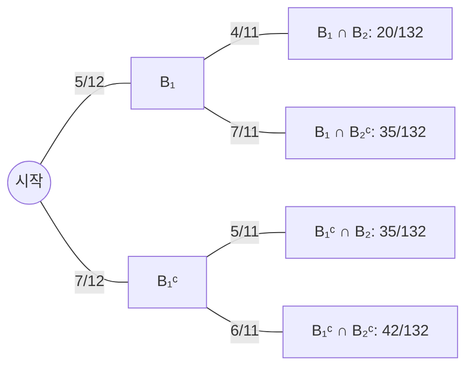

*그림 14. 항아리에서 공 두 개를 비복원으로 꺼낼 때의 조건부 확률 트리 도표*

2. **둘째 공이 파란색일 확률:** 둘째 공이 파란색인 경우는 "첫째와 둘째 모두 파란색"과 "첫째는 회색, 둘째는 파란색"의 서로 배타적인 두 가지이다. 즉 $B_2$는 $B_2 \cap B_1$과 $B_2 \cap B_1^c$의 서로소인 합집합이므로, 공리 3과 1번의 결과에 따라 $P(B_2) = \frac{20}{132} + \frac{35}{132} = \frac{55}{132} = \frac{5}{12}$이다. 이 값은 첫째 공이 파란색일 확률과 같다. 첫째 공에 관한 정보가 없으면 둘째 공도 12개의 공 중 어느 것이든 같은 가능성으로 뽑히기 때문이다.
3. **적어도 하나가 파란색일 확률:** 식 (9.8.2)에 따라 $P(B_1 \cup B_2) = P(B_1) + P(B_2) - P(B_1 \cap B_2) = \frac{55}{132} + \frac{55}{132} - \frac{20}{132} = \frac{90}{132} = \frac{15}{22} \approx 0.682$이다.
4. **파란 공의 개수의 기댓값:** 이 실험을 여러 번 되풀이할 때 꺼낸 파란 공 개수의 기댓값을 구한다. 파란 공이 0개인 사건은 적어도 하나가 파란색인 사건의 여사건이므로 식 (9.8.1)에 따라 $P(\text{0개}) = 1 - \frac{15}{22} = \frac{7}{22}$이다. 파란 공이 1개인 경우는 서로 배타적인 두 경로의 합이므로 $P(\text{1개}) = \frac{35}{132} + \frac{35}{132} = \frac{70}{132}$이고, $P(\text{2개}) = \frac{20}{132}$이다. 따라서 기댓값은 $0 \cdot \frac{7}{22} + 1 \cdot \frac{70}{132} + 2 \cdot \frac{20}{132} = \frac{110}{132} = \frac{5}{6} \approx 0.83$이다.

### 9.2 베이즈 정리

한 항아리에는 파란 공 3개와 회색 공 4개가, 다른 항아리에는 파란 공 5개와 회색 공 3개가 있다. 항아리 하나를 무작위로 고른 뒤 그 항아리에서 공 하나를 무작위로 꺼낸다. 꺼낸 공이 파란색이면, 그 공이 첫째 항아리에서 나왔을 확률은 얼마인가?

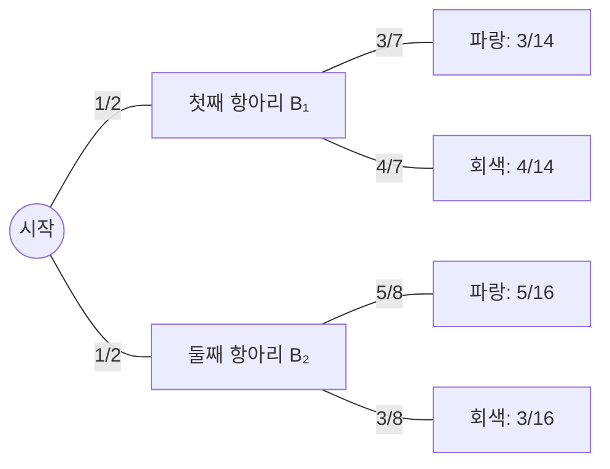

*그림 15. 항아리를 고른 뒤 공을 꺼내는 과정의 트리 도표*

공이 파란색인 사건을 $A$, 공이 첫째 항아리에서 나온 사건을 $B_1$, 둘째 항아리에서 나온 사건을 $B_2$라 한다.

1. 첫째 항아리의 공 7개 중 3개, 둘째 항아리의 공 8개 중 5개가 파란색이므로 $P(A \mid B_1) = \frac{3}{7}$, $P(A \mid B_2) = \frac{5}{8}$이다. 항아리를 고를 가능성은 같으므로 $P(B_1) = P(B_2) = \frac{1}{2}$이다.
2. 식 (9.9.2)에 따라 $P(A \cap B_1) = P(A \mid B_1)P(B_1) = \frac{3}{7} \cdot \frac{1}{2} = \frac{3}{14}$이고 $P(A \cap B_2) = P(A \mid B_2)P(B_2) = \frac{5}{8} \cdot \frac{1}{2} = \frac{5}{16}$이다.
3. $A$는 $A \cap B_1$과 $A \cap B_2$의 서로소인 합집합이므로, 공리 3에 따라 $P(A) = \frac{3}{14} + \frac{5}{16} = \frac{24}{112} + \frac{35}{112} = \frac{59}{112}$이다.
4. 조건부 확률의 정의에 따라 $P(B_1 \mid A) = \frac{P(B_1 \cap A)}{P(A)} = \frac{3/14}{59/112} = \frac{3}{14} \cdot \frac{112}{59} = \frac{336}{826} = \frac{24}{59} \approx 0.407$이다.

따라서 꺼낸 공이 파란색이면 그 공이 첫째 항아리에서 나왔을 확률은 약 40.7%이다. 이 계산 과정을 일반화한 것이 베이즈 정리이다. 영국의 장로교 목사이자 수학에 많은 노력을 기울인 베이즈(Thomas Bayes)의 이름을 딴 이 정리는 그가 죽은 뒤인 1763년에 발표되었다.

> **핵심:** **정리 9.9.1 (베이즈 정리, Bayes' theorem).** 표본 공간 $S$가 쌍마다 서로소인 사건 $B_1, B_2, B_3, \ldots, B_n$의 합집합이고, $A$가 $S$의 사건이며, $A$와 모든 $B_k$($`1 \le k \le n`$)의 확률이 0이 아니라 한다. 그러면 다음이 성립한다.
>
> ```math
> P(B_k \mid A) = \frac{P(A \mid B_k)P(B_k)}{P(A \mid B_1)P(B_1) + P(A \mid B_2)P(B_2) + \cdots + P(A \mid B_n)P(B_n)}
> ```

**증명.** 위의 항아리 문제의 단계를 그대로 일반화한다.

1. $S = B_1 \cup \cdots \cup B_n$이므로 $A = A \cap S = (A \cap B_1) \cup (A \cap B_2) \cup \cdots \cup (A \cap B_n)$이다. $B_i$들이 쌍마다 서로소이므로 $A \cap B_i$들도 쌍마다 서로소이다.
2. 공리 3의 확장에 따라 $P(A) = P(A \cap B_1) + \cdots + P(A \cap B_n)$이고, 각 $P(B_i) \ne 0$이므로 식 (9.9.2)에 따라 $P(A \cap B_i) = P(A \mid B_i)P(B_i)$이다. 따라서 $P(A) = P(A \mid B_1)P(B_1) + \cdots + P(A \mid B_n)P(B_n)$이다. 이 식을 **전확률 공식(law of total probability)** 이라 한다.
3. $P(A) \ne 0$이므로 조건부 확률의 정의와 식 (9.9.2)에 따라 $P(B_k \mid A) = \frac{P(B_k \cap A)}{P(A)} = \frac{P(A \mid B_k)P(B_k)}{P(A)}$이다.
4. 3번의 분모에 2번의 식을 대입하면 정리의 식을 얻는다. ∎

베이즈 정리는 "원인 $B_k$가 주어졌을 때 결과 $A$의 확률" $P(A \mid B_k)$로부터 "결과 $A$를 관찰했을 때 원인이 $B_k$일 확률" $P(B_k \mid A)$를 계산하는 방법이다.

**예제 9.9.3 (베이즈 정리의 적용).** 대부분의 의학 검사는 가끔 잘못된 결과를 낸다. 어떤 질병의 유무를 판정하는 검사에서, 실제로는 병이 없는데 병이 있다고 판정하는 결과를 **위양성(false positive)**, 실제로는 병이 있는데 병이 없다고 판정하는 결과를 **위음성(false negative)** 이라 한다. 발생률이 낮은 질병에 대해 대규모 선별 검사를 설계할 때는 1인당 검사 비용, 위양성자에 대한 추가 검사 비용, 실제 환자가 음성 결과를 받고 자신의 건강을 잘못 믿게 될 가능성을 함께 고려해야 한다.

1,000명 중 5명에게서 발견되는 질병의 선별 검사가 있고, 위양성률이 3%, 위음성률이 1%라 한다. 즉 병이 있는 사람은 99%의 경우 양성 판정을 받고, 병이 없는 사람은 97%의 경우 음성 판정을 받는다. 검사 대상자 중 한 사람을 무작위로 고르고, 그 사람이 양성 판정을 받는 사건을 $A$, 실제로 병이 있는 사건을 $B_1$, 병이 없는 사건을 $B_2$라 하면 다음과 같다.

```math
P(A \mid B_1) = 0.99, \quad P(A^c \mid B_1) = 0.01, \quad P(A^c \mid B_2) = 0.97, \quad P(A \mid B_2) = 0.03, \quad P(B_1) = 0.005, \quad P(B_2) = 0.995
```

1. **양성 판정을 받은 사람이 실제로 병이 있을 확률:** 베이즈 정리에 따라 다음과 같다.

```math
P(B_1 \mid A) = \frac{P(A \mid B_1)P(B_1)}{P(A \mid B_1)P(B_1) + P(A \mid B_2)P(B_2)} = \frac{(0.99)(0.005)}{(0.99)(0.005) + (0.03)(0.995)} = \frac{0.00495}{0.00495 + 0.02985} = \frac{0.00495}{0.0348} \approx 0.1422
```

즉 양성 판정을 받은 사람이 실제로 병이 있을 확률은 약 14.2%에 불과하다.

2. **음성 판정을 받은 사람이 실제로 병이 없을 확률:** 베이즈 정리에 따라 다음과 같다.

```math
P(B_2 \mid A^c) = \frac{P(A^c \mid B_2)P(B_2)}{P(A^c \mid B_1)P(B_1) + P(A^c \mid B_2)P(B_2)} = \frac{(0.97)(0.995)}{(0.01)(0.005) + (0.97)(0.995)} = \frac{0.96515}{0.9652} \approx 0.999948
```

즉 음성 판정을 받은 사람이 실제로 병이 없을 확률은 약 99.995%이다.

이 결과는 확률 대신 사람 수로 생각하면 이해하기 쉽다. 검사 대상자가 100,000명이라 하면 각 집단의 기대 인원은 다음과 같다.

| 집단 | 인원 | 양성 판정 | 음성 판정 |
|:-----|-----:|-----:|-----:|
| 병이 있는 사람 | 500 | $500 \times 0.99 = 495$ | $500 \times 0.01 = 5$ |
| 병이 없는 사람 | 99,500 | $99{,}500 \times 0.03 = 2{,}985$ | $99{,}500 \times 0.97 = 96{,}515$ |
| 합계 | 100,000 | 3,480 | 96,520 |

*표 16. 검사 대상자 100,000명을 질병 유무와 판정 결과로 나눈 기대 인원*

양성 판정을 받은 3,480명 중 실제 환자는 495명뿐이므로 $`495 / 3{,}480 \approx 14.2\%`$이고, 음성 판정을 받은 96,520명 중 병이 없는 사람은 96,515명이므로 $`96{,}515 / 96{,}520 \approx 99.995\%`$이다. 질병이 드물면 병이 없는 사람이 압도적으로 많아서, 3%라는 작은 위양성률로도 위양성자의 수가 실제 환자의 수보다 훨씬 많아진다. 이런 수치는 선별 검사가 정확한 검사보다 훨씬 저렴하면서 실제 환자의 거의 모두에게 양성 결과를 주는 상황에서 전형적이다. 선별 검사를 먼저 쓰면 비싼 정확한 검사를 받아야 하는 사람을 전체의 작은 비율로 줄이면서, 병이 있는 사람에게 병이 없다고 판정하는 일은 드물게만 일어난다.

> **주의:** $P(B \mid A)$와 $P(A \mid B)$는 일반적으로 다르다. 이 예제에서 병이 있는 사람이 양성 판정을 받을 확률 $P(A \mid B_1)$은 0.99이지만, 양성 판정을 받은 사람이 병이 있을 확률 $P(B_1 \mid A)$는 약 0.14이다. 두 값을 혼동하는 것은 매우 흔한 오류이며, 그 차이는 사전 확률 $P(B_1)$이 작을수록 커진다.

### 9.3 독립 사건

공정한 동전을 두 번 던지면 첫째 결과가 둘째 결과에 아무 영향도 주지 않고, 둘째 결과도 첫째 결과에 영향을 주지 않는다는 것이 직관적으로 분명하다. 첫째에 앞면이 나오는 사건을 $A$, 둘째에 앞면이 나오는 사건을 $B$라 하면, 두 사건은 $P(A \mid B) = P(A)$이고 $P(B \mid A) = P(B)$라는 뜻에서 독립이어야 한다. 실제로 동전이 공정하면 네 결과 HH, HT, TH, TT는 똑같이 일어날 법하고, $A$ = {HH, HT}, $B$ = {TH, HH}, $A \cap B$ = {HH}이므로 다음이 성립한다.

```math
P(A) = P(B) = \frac{2}{4} = \frac{1}{2}, \qquad P(A \mid B) = \frac{P(A \cap B)}{P(B)} = \frac{1/4}{1/2} = \frac{1}{2} = P(A), \qquad P(B \mid A) = \frac{P(A \cap B)}{P(A)} = \frac{1/4}{1/2} = \frac{1}{2} = P(B)
```

독립성을 더 편리한 형태로 정의하기 위해 다음을 관찰한다.

1. $P(B) \ne 0$이고 $P(A \mid B) = P(A)$이면 $P(A \cap B) = P(A \mid B) \cdot P(B) = P(A) \cdot P(B)$이다.
2. 같은 논리로 $P(A) \ne 0$이고 $P(B \mid A) = P(B)$이면 $P(A \cap B) = P(A) \cdot P(B)$이다.
3. 역으로 $P(A \cap B) = P(A) \cdot P(B)$이고 $P(A) \ne 0$이면 $P(B \mid A) = \frac{P(A) \cdot P(B)}{P(A)} = P(B)$이며, $P(B) \ne 0$이면 같은 방법으로 $P(A \mid B) = P(A)$이다.

따라서 다음의 곱 공식으로 독립을 정의하면, 확률이 0이 아니어야 한다는 조건을 없앨 수 있다.

> **용어 정의:** $A$와 $B$가 표본 공간 $S$의 사건일 때, $A$와 $B$가 **독립(independent)** 이라는 것은 $P(A \cap B) = P(A) \cdot P(B)$인 것이다. 독립이 아닌 두 사건은 **종속(dependent)** 이라 한다.

**예제 9.9.4 (서로소인 사건과 독립).** $A$와 $B$가 표본 공간 $S$의 사건이고 $A \cap B = \emptyset$, $P(A) \ne 0$, $P(B) \ne 0$이면 $P(A \cap B) \ne P(A) \cdot P(B)$임을 보인다. $A \cap B = \emptyset$이므로 공리 2에 따라 $P(A \cap B) = 0$이다. 그런데 $P(A)$와 $P(B)$ 모두 0이 아니므로 $P(A) \cdot P(B) \ne 0$이다. 따라서 $P(A \cap B) \ne P(A) \cdot P(B)$이다.

> **주의:** 서로소인 사건은 독립일 것 같지만 사실은 거의 반대이다. 확률이 0이 아닌 두 사건이 서로소이면 두 사건은 종속이다. 한 사건이 일어났다는 정보는 다른 사건이 일어나지 않았다는 확실한 정보를 주기 때문이다. "서로소"는 두 사건이 함께 일어날 수 없다는 집합의 성질이고, "독립"은 한 사건에 관한 정보가 다른 사건의 확률을 바꾸지 않는다는 확률의 성질이다.

**예제 9.9.5 (독립 사건의 여사건).** $A$와 $B$가 표본 공간 $S$의 독립 사건이면 $A$와 $B^c$도 독립임을 보인다. 6장의 집합 항등식에 따라 모든 집합 $A$, $B$에 대해 $(A \cap B) \cup (A \cap B^c) = A$이고 $(A \cap B) \cap (A \cap B^c) = \emptyset$이다. 따라서 공리 3에 따라 $P(A \cap B) + P(A \cap B^c) = P(A)$이고, 이를 $P(A \cap B^c)$에 대해 풀면 다음과 같다.

```math
\begin{aligned}
P(A \cap B^c) &= P(A) - P(A \cap B) \\
&= P(A) - P(A) \cdot P(B) && (A\text{와 } B\text{가 독립이므로}) \\
&= P(A)\,(1 - P(B)) && (P(A)\text{를 묶어 냄}) \\
&= P(A) \cdot P(B^c) && (\text{식 } 9.8.1)
\end{aligned}
```

따라서 $A$와 $B^c$는 독립이다. 이 결과를 다시 적용하면, $A$와 $B$가 독립일 때 $A^c$와 $B$, 그리고 $A^c$와 $B^c$도 독립이다.

**예제 9.9.6 (두 독립 사건의 교집합의 확률).** 앞면이 나올 확률이 0.6이 되도록 조작된 동전을 두 번 던진다. 앞면이 뒷면보다 잘 나오기는 하지만, 한 번 던진 결과가 다른 번의 결과에 영향을 줄 이유는 없으므로 두 번의 결과는 독립이라고 가정하는 것이 합리적이다. 표본 공간 {HH, HT, TH, TT}의 네 결과는 똑같이 일어날 법하지 않다. 첫째에 앞면이 나오는 사건을 $E$, 둘째에 앞면이 나오는 사건을 $F$라 하면 $P(E) = P(F) = 0.6$이고 $E$와 $F$는 독립이며, 여사건의 확률 공식에 따라 $P(E^c) = P(F^c) = 1 - 0.6 = 0.4$이다.

1. **앞면 두 번:** 이 사건은 $E \cap F$이고 $E$와 $F$가 독립이므로 $P(E \cap F) = P(E) \cdot P(F) = (0.6)(0.6) = 0.36$이다.
2. **앞면 한 번:** 이 사건은 "첫째 앞면, 둘째 뒷면"과 "첫째 뒷면, 둘째 앞면"의 서로 배타적인 두 경우, 즉 $(E \cap F^c) \cup (E^c \cap F)$이고 $(E \cap F^c) \cap (E^c \cap F) = \emptyset$이다. 앞의 예제에 따라 $E$와 $F^c$, $E^c$와 $F$도 독립이므로 $P(E) \cdot P(F^c) + P(E^c) \cdot P(F) = (0.6)(0.4) + (0.4)(0.6) = 0.48$이다.
3. **앞면 0번:** 이 사건은 $E^c \cap F^c$이므로 $P(E^c) \cdot P(F^c) = (0.4)(0.4) = 0.16$이다.
4. **앞면 적어도 한 번:** 앞면 한 번과 앞면 두 번은 서로소이므로 $0.48 + 0.36 = 0.84$이다. 또는 앞면 0번의 여사건이므로 $1 - 0.16 = 0.84$로 구해도 된다.

**예제 9.9.7 (조작된 동전을 두 번 던질 때 앞면 개수의 기댓값).** 앞의 예제에서 앞면이 0, 1, 2번 나올 확률은 각각 0.16, 0.48, 0.36이므로, 실험을 여러 번 되풀이할 때 앞면 개수의 기댓값은 $0 \cdot (0.16) + 1 \cdot (0.48) + 2 \cdot (0.36) = 1.2$이다.

### 9.4 세 개 이상의 사건의 독립

조작된 동전을 열 번이나 백 번 던지면 앞면의 개수별 확률은 어떻게 되는가? 앞의 예제들은 두 사건이 독립이면 교집합의 확률이 각 확률의 곱이라는 사실을 보여 주었다. 세 개 이상의 사건에 대해서도 교집합의 확률을 확률의 곱으로 구할 수 있도록 독립의 개념을 일반화한다. 먼저 세 사건 $A$, $B$, $C$가 $P(A \cap B) = P(A) \cdot P(B)$, $P(A \cap C) = P(A) \cdot P(C)$, $P(B \cap C) = P(B) \cdot P(C)$를 만족할 때 **쌍마다 독립(pairwise independent)** 이라 한다. 그러나 다음 예제처럼 세 사건이 쌍마다 독립이어도 세 사건의 교집합의 확률이 확률의 곱과 다를 수 있다.

**예제 9.9.8 (세 사건의 독립 살펴보기).** 공정한 동전을 두 번 던진다. 첫째에 앞면이 나오는 사건을 $A$, 둘째에 앞면이 나오는 사건을 $B$, 두 번 모두 앞면이거나 두 번 모두 뒷면인 사건을 $C$라 한다.

1. 똑같이 일어날 법한 네 결과 HH, HT, TH, TT 중 $A$ = {HH, HT}, $B$ = {HH, TH}, $C$ = {HH, TT}이므로 $P(A) = P(B) = P(C) = \frac{1}{2}$이다.
2. $A \cap B = A \cap C = B \cap C$ = {HH}이므로 각 교집합의 확률은 $\frac{1}{4} = \frac{1}{2} \cdot \frac{1}{2}$이고, $A$, $B$, $C$는 쌍마다 독립이다.
3. 그러나 $A \cap B \cap C$ = {HH}이므로 $P(A \cap B \cap C) = \frac{1}{4} \ne \left(\frac{1}{2}\right)^3 = \frac{1}{8} = P(A) \cdot P(B) \cdot P(C)$이다.

반대로 $P(A \cap B \cap C) = P(A) \cdot P(B) \cdot P(C)$를 만족하지만 쌍마다 독립이 아닌 세 사건도 있다. 예를 들어 똑같이 일어날 법한 여덟 결과의 표본 공간 {1, 2, ..., 8}에서 $A$ = {1, 2, 3, 4}, $B$ = {1, 2, 3, 5}, $C$ = {1, 6, 7, 8}이라 하면, 각 확률은 $\frac{1}{2}$이고 $A \cap B \cap C$ = {1}이므로 $P(A \cap B \cap C) = \frac{1}{8} = \left(\frac{1}{2}\right)^3$이지만, $A \cap B$ = {1, 2, 3}이므로 $P(A \cap B) = \frac{3}{8} \ne \frac{1}{4}$이다. 이런 상황 때문에 세 사건의 독립의 정의에는 네 조건이 모두 들어가야 한다.

> **용어 정의:** $A$, $B$, $C$가 표본 공간 $S$의 사건일 때, 아래의 조건 1\~3을 만족하면 $A$, $B$, $C$는 **쌍마다 독립(pairwise independent)** 이고, 네 조건을 모두 만족하면 **상호 독립(mutually independent)** 이다.
> 1. $P(A \cap B) = P(A) \cdot P(B)$
> 2. $P(A \cap C) = P(A) \cdot P(C)$
> 3. $P(B \cap C) = P(B) \cdot P(C)$
> 4. $P(A \cap B \cap C) = P(A) \cdot P(B) \cdot P(C)$

$n \ge 2$개의 사건에 대한 상호 독립의 정의는 앞의 두 정의를 일반화한다.

> **용어 정의:** 표본 공간 $S$의 사건 $A_1, A_2, A_3, \ldots, A_n$이 **상호 독립(mutually independent)** 이라는 것은, 이 사건들 중 임의로 고른 사건들의 교집합의 확률이 그 사건들의 확률의 곱과 같은 것이다.

**예제 9.9.9 (조작된 동전을 열 번 던지기).** 앞면이 나올 확률이 0.6(따라서 뒷면이 나올 확률이 0.4)인 조작된 동전을 열 번 던진다. 앞의 예제처럼 열 번의 결과는 상호 독립이라고 가정하는 것이 합리적이다.

1. **앞면이 정확히 여덟 번 나올 확률:** $i = 1, 2, \ldots, 10$에 대해 $i$번째에 앞면이 나오는 사건을 $H_i$, 뒷면이 나오는 사건을 $T_i$라 한다. 처음 여덟 번은 앞면이고 나머지 두 번은 뒷면인 사건 $H_1 \cap H_2 \cap \cdots \cap H_8 \cap T_9 \cap T_{10}$을 간단히 HHHHHHHHTT로 쓰면, 상호 독립의 정의에 따라 $P(\text{HHHHHHHHTT}) = (0.6)^8(0.4)^2$이다. 곱셈의 교환 법칙에 따라 앞면 여덟 번이 다른 자리에서 나와도 확률은 같다. 예를 들어 $P(\text{HHTHHHHHTH}) = (0.6)^2(0.4)(0.6)^5(0.4)(0.6) = (0.6)^8(0.4)^2$이다. 열 번 중 앞면이 여덟 번 나오는 방법은 앞면이 나온 회차 여덟 개로 이루어진 부분집합을 열 개의 회차에서 고르는 방법의 수 $\binom{10}{8}$과 같고, 서로 다른 방법들은 서로 배타적이므로 다음과 같다.

```math
P(\text{앞면 8번}) = \binom{10}{8}(0.6)^8(0.4)^2 = 45 \times 0.01679616 \times 0.16 \approx 0.1209
```

2. **앞면이 적어도 여덟 번 나올 확률:** 같은 논리로 $P(\text{앞면 9번}) = \binom{10}{9}(0.6)^9(0.4) \approx 0.0403$, $P(\text{앞면 10번}) = \binom{10}{10}(0.6)^{10} \approx 0.0060$이다. 앞면 8번, 9번, 10번은 서로소인 사건이므로 다음과 같다.

```math
P(\text{앞면 8번 이상}) = \binom{10}{8}(0.6)^8(0.4)^2 + \binom{10}{9}(0.6)^9(0.4) + \binom{10}{10}(0.6)^{10} \approx 0.1209 + 0.0403 + 0.0060 \approx 0.167
```

즉 약 16.7%이다.

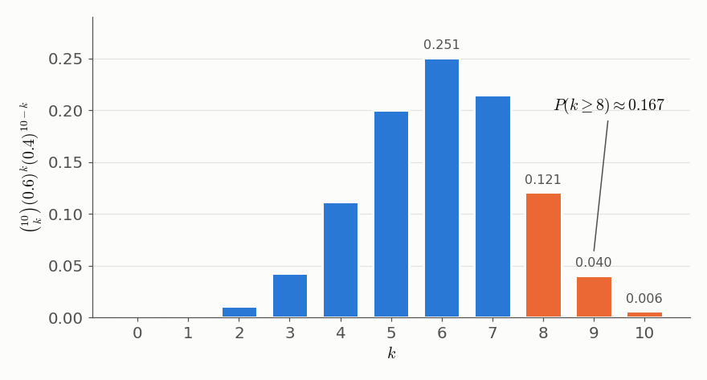

*그림 16. 앞면 확률이 0.6인 동전을 열 번 던질 때 앞면 개수 k의 이항 확률*

이 예제의 풀이에 이항계수가 나타난다는 데 주목할 필요가 있다. 상호 독립인 반복 시행에서 각 시행의 결과가 두 가지(예를 들어 성공과 실패)이고 매번 같은 확률을 가질 때, $n$번의 시행에서 확률 $p$인 결과가 정확히 $k$번 나올 확률은 $\binom{n}{k}p^k(1 - p)^{n-k}$이며($`0 \le p \le 1`$), 이런 꼴의 확률을 **이항 확률(binomial probability)** 이라 한다.

> **[확률및통계]** 성공 확률이 $p$인 독립 시행을 $n$번 할 때 성공 횟수의 확률 분포를 이항 분포 $B(n, p)$라 하며, 그 기댓값은 $np$이다. 9.3절에서 조작된 동전을 두 번 던질 때 앞면 개수의 기댓값 1.2는 $2 \times 0.6$과 같고, 그림 16의 분포에서는 $10 \times 0.6 = 6$이 기댓값이다.

---

<br>

## 개념 적용

다음 표는 이 장의 셈 원리를 새로운 상황에 적용한 예이다.

| 상황 | 적용할 원리 | 결과 |
|:-----|:-----|:-----|
| 길이 5인 비트 문자열의 개수 | 곱의 법칙 (각 자리 2가지) | $2^5 = 32$ |
| 7명 중에서 회장과 부회장을 한 명씩 뽑는 방법 | r-순열 (순서 있음, 반복 없음) | $P(7, 2) = 42$ |
| 7명 중에서 3인 위원회를 만드는 방법 | r-조합 (순서 없음, 반복 없음) | $\binom{7}{3} = 35$ |
| 세 종류의 사탕에서 5개를 고르는 방법 | 중복을 허용하는 r-조합 | $\binom{5 + 3 - 1}{5} = \binom{7}{5} = 21$ |
| 1부터 100까지 중 2의 배수이거나 3의 배수인 수의 개수 | 포함 배제 원리 | $50 + 33 - 16 = 67$ |
| 단어 BANANA의 문자를 배열하는 방법 | 같은 것이 있는 순열 | $`\frac{6!}{3!\,2!\,1!} = 60`$ |
| 367명 중에 생일(2월 29일 포함 366가지)이 같은 두 사람이 있는가 | 비둘기집 원리 | $367 > 366$이므로 반드시 있다 |

*표 17. 새로운 상황에 적용한 셈 원리와 결과*

**T/F 점검:**

| 문장 | 판단과 근거 |
|:-----|:-----|
| 확률이 0이 아닌 두 사건이 서로소이면 두 사건은 독립이다. | **F.** $P(A \cap B) = 0 \ne P(A) \cdot P(B)$이므로 두 사건은 종속이다. |
| 곱의 법칙을 쓰려면 각 단계의 선택지가 앞 단계와 관계없이 같아야 한다. | **F.** 선택지 자체는 달라도 되고, 선택지의 **개수**만 일정하면 된다(반복 없는 PIN). |
| $r \le n$인 음이 아닌 정수 $n$, $r$에 대해 $\binom{n}{r} = \binom{n}{n-r}$이다. | **T.** 크기 $r$인 부분집합과 그 여집합(크기 $`n - r`$)이 일대일로 대응한다. |
| 13명 중에는 반드시 같은 달에 태어난 두 사람이 있다. | **T.** 13명을 12개의 달로 보내는 함수는 비둘기집 원리에 따라 일대일 함수일 수 없다. |
| 언제나 $P(B \mid A) = P(A \mid B)$이다. | **F.** 의학 검사 예제에서 $P(A \mid B_1) = 0.99$이지만 $P(B_1 \mid A) \approx 0.14$이다. |
| $n$가지 중에서 반복을 허용하여 $r$개를 순서 없이 고르는 방법은 $n^r$가지이다. | **F.** $n^r$은 순서가 있는 선택의 수이고, 순서가 없으면 $\binom{r + n - 1}{r}$가지이다. |
| 세 사건이 쌍마다 독립이면 상호 독립이다. | **F.** 동전 두 번 던지기에서 $A$, $B$, $C$는 쌍마다 독립이지만 $P(A \cap B \cap C) = \frac{1}{4} \ne \frac{1}{8}$이다. |

---

<br>

## 요약

| 개념 | 핵심 요약 |
|:-----|:----------|
| 표본 공간과 사건 | 표본 공간은 무작위 과정의 모든 결과의 집합이고, 사건은 표본 공간의 부분집합이다. |
| 동일 가능성 확률 공식 | 결과가 모두 똑같이 일어날 법한 유한 표본 공간에서 $P(E) = N(E)/N(S)$이다. |
| 목록의 원소 개수 | $m \le n$인 정수 $m$부터 $n$까지의 정수는 $n - m + 1$개이다. |
| 곱의 법칙 | 각 단계의 방법 수가 앞 단계와 관계없이 $n_1, \ldots, n_k$로 일정하면 전체 방법은 $n_1 n_2 \cdots n_k$가지이다. |
| 순열과 r-순열 | 원소 $n$개인 집합의 순열은 $n!$개이고, r-순열은 $P(n, r) = n!/(n-r)!$개이다. 원순열은 $(n-1)!$개이다. |
| 합의 법칙과 차의 법칙 | 쌍마다 서로소인 집합들의 합집합의 원소 수는 각 원소 수의 합이고, $B \subseteq A$이면 $N(A - B) = N(A) - N(B)$이다. |
| 여사건의 확률 | $P(A^c) = 1 - P(A)$이며, "적어도 하나"의 확률은 여사건으로 구하면 간단한 경우가 많다. |
| 포함 배제 원리 | $N(A \cup B) = N(A) + N(B) - N(A \cap B)$이고, 세 집합에서는 교집합 항을 번갈아 빼고 더한다. |
| 비둘기집 원리 | 유한 집합에서 더 작은 유한 집합으로 가는 함수는 일대일 함수가 아니다. 유리수의 소수 전개가 유한하거나 순환한다는 사실의 근거이다. |
| 일반화된 비둘기집 원리 | $km < n$이면 어떤 비둘기집에 $k + 1$마리 이상이 있다. 대우 형태는 각 역상이 $k$개 이하이면 $n \le km$이라는 것이다. |
| 유한 집합의 일대일과 위로 | 크기가 같은 유한 집합 사이의 함수는 일대일 함수인 것과 위로의 함수인 것이 동치이다. 무한 집합에서는 성립하지 않는다. |
| r-조합 | 크기 $r$인 부분집합의 수는 $`\binom{n}{r} = P(n, r)/r! = n!/(r!\,(n-r)!)`$이다. |
| 같은 것이 있는 순열 | 종류별 개수가 $n_1, \ldots, n_k$인 $n$개 대상의 구별되는 순열은 $n!/(n_1!\cdots n_k!)$개이다. |
| 중복 계산 | 곱의 법칙을 쓸 때 같은 결과가 트리의 여러 가지에 나타나지 않는지 확인해야 한다. |
| 중복을 허용하는 r-조합 | 막대 $n - 1$개와 가위표 $r$개의 문자열로 나타내어 $\binom{r + n - 1}{r}$개이다. |
| 파스칼의 공식 | $1 \le r \le n$이면 $\binom{n+1}{r} = \binom{n}{r-1} + \binom{n}{r}$이며, 대수적 증명과 조합적 증명이 있다. |
| 이항정리 | $(a+b)^n = \sum_{k=0}^{n}\binom{n}{k}a^{n-k}b^k$이며, 귀납법과 파스칼의 공식, 또는 $b$의 자리 고르기로 증명한다. |
| 확률의 공리 | $0 \le P(A) \le 1$, $P(\emptyset) = 0$, $P(S) = 1$, 서로소인 사건의 합사건의 확률은 각 확률의 합이다. |
| 합사건의 확률 | $P(A \cup B) = P(A) + P(B) - P(A \cap B)$는 결과가 똑같이 일어날 법하지 않아도 성립한다. |
| 기댓값 | 결과 $a_k$와 확률 $p_k$의 가중 평균 $\sum a_k p_k$이며, 복권의 예에서는 한 장에 $-1.78$달러이다. |
| 조건부 확률 | $P(A) \ne 0$이면 $P(B \mid A) = P(A \cap B)/P(A)$이고, $P(A \cap B) = P(B \mid A)P(A)$이다. |
| 베이즈 정리 | 전확률 공식으로 $P(A)$를 구해 $P(B_k \mid A) = P(A \mid B_k)P(B_k)/\sum_i P(A \mid B_i)P(B_i)$를 계산한다. |
| 독립 사건 | $P(A \cap B) = P(A)P(B)$이면 독립이다. 서로소인 사건은 확률이 0이 아니면 종속이고, 독립 사건의 여사건도 독립이다. |
| 상호 독립과 이항 확률 | 세 사건 이상의 독립은 모든 부분 모임의 교집합에서 곱 공식이 성립해야 하며, 독립 시행에서 $k$번 성공할 확률은 $\binom{n}{k}p^k(1-p)^{n-k}$이다. |

---

<br>

## 점검 문제

1. **목록 세기와 확률:** 네 자리 정수(1000부터 9999까지) 중 9의 배수는 몇 개이며, 네 자리 정수 하나를 무작위로 고를 때 그것이 9의 배수일 확률은 얼마인가?

   <details>
   <summary>정답</summary>

   네 자리 9의 배수는 $1008 = 9 \cdot 112$부터 $9999 = 9 \cdot 1111$까지이므로 정리 9.1.1에 따라 $1111 - 112 + 1 = 1000$개이다. 네 자리 정수는 $9999 - 1000 + 1 = 9000$개이므로 확률은 $1000/9000 = 1/9$이다.

   </details>

2. **곱의 법칙과 차의 법칙:** 숫자 0\~9로 이루어진 네 자리 비밀번호(0으로 시작해도 된다) 중 적어도 한 숫자가 반복되는 것은 몇 개이며, 무작위로 고른 비밀번호가 그럴 확률은 얼마인가?

   <details>
   <summary>정답</summary>

   전체는 곱의 법칙에 따라 $10^4 = 10{,}000$개이고, 반복이 없는 것은 $10 \cdot 9 \cdot 8 \cdot 7 = 5{,}040$개이다. 차의 법칙에 따라 반복이 있는 것은 $10{,}000 - 5{,}040 = 4{,}960$개이고, 확률은 $4{,}960/10{,}000 = 0.496$이다.

   </details>

3. **포함 배제 원리:** 1부터 500까지의 정수 중 4로도 6으로도 나누어떨어지지 않는 수는 몇 개인가?

   <details>
   <summary>정답</summary>

   4의 배수는 $\lfloor 500/4 \rfloor = 125$개, 6의 배수는 $\lfloor 500/6 \rfloor = 83$개이다. 4와 6의 공배수는 최소공배수 12의 배수이므로 $\lfloor 500/12 \rfloor = 41$개이다(24의 배수로 계산하면 틀린다). 포함 배제 원리에 따라 4의 배수이거나 6의 배수인 수는 $125 + 83 - 41 = 167$개이고, 차의 법칙에 따라 구하는 수는 $500 - 167 = 333$개이다.

   </details>

4. **비둘기집 원리:** (가) 1부터 20까지의 정수 중 11개를 고르면 합이 21인 두 수가 반드시 있음을 보여라. (나) 100명 중 같은 달에 태어난 사람은 적어도 몇 명 있다고 보장할 수 있는가?

   <details>
   <summary>정답</summary>

   (가) 1부터 20까지를 합이 21인 10개의 쌍 {1, 20}, {2, 19}, ..., {10, 11}로 분할한다. 고른 11개의 수를 비둘기, 10개의 쌍을 비둘기집으로 보고 각 수를 그 수가 속한 쌍으로 보내면, $11 > 10$이므로 서로 다른 두 수가 같은 쌍에 속하고 그 합은 21이다. (나) $8 \cdot 12 = 96 < 100$이므로 일반화된 비둘기집 원리에 따라 어떤 달에는 $8 + 1 = 9$명 이상이 태어났다. $\lceil 100/12 \rceil = 9$와 같다.

   </details>

5. **r-순열과 r-조합:** 10명 중에서 회장, 총무, 서기를 한 명씩 뽑는 방법과 3인 위원회를 만드는 방법은 각각 몇 가지이며, 두 수의 비는 무엇을 뜻하는가?

   <details>
   <summary>정답</summary>

   직책이 다르므로 순서가 있어 $P(10, 3) = 10 \cdot 9 \cdot 8 = 720$가지이고, 위원회는 순서가 없어 $\binom{10}{3} = 120$가지이다. 비 $720/120 = 6 = 3!$은 같은 세 사람에게 세 직책을 배정하는 방법의 수이며, $P(n, r) = \binom{n}{r} \cdot r!$을 보여 준다.

   </details>

6. **같은 것이 있는 순열:** 단어 LETTER의 문자를 배열하는 서로 구별되는 방법은 몇 가지인가?

   <details>
   <summary>정답</summary>

   문자는 L 1개, E 2개, T 2개, R 1개로 모두 6개이다. 정리 9.5.2에 따라 $`\frac{6!}{1!\,2!\,2!\,1!} = \frac{720}{4} = 180`$가지이다.

   </details>

7. **중복을 허용하는 r-조합:** 각 $x_i \ge 2$인 정수일 때 방정식 $x_1 + x_2 + x_3 = 12$의 해는 몇 개인가?

   <details>
   <summary>정답</summary>

   $y_i = x_i - 2$로 두면 각 $y_i \ge 0$이고 $y_1 + y_2 + y_3 = 12 - 6 = 6$이다. 이는 범주 3개에서 반복을 허용하여 6개를 고르는 방법의 수와 같으므로 정리 9.6.1에 따라 $\binom{6 + 3 - 1}{6} = \binom{8}{6} = 28$개이다.

   </details>

8. **이항정리:** $(2x - y)^5$의 전개식에서 $x^3y^2$의 계수를 구하라.

   <details>
   <summary>정답</summary>

   $a = 2x$, $b = -y$로 두면 $a^{5-k}b^k$에서 $k = 2$인 항이 $\binom{5}{2}(2x)^3(-y)^2 = 10 \cdot 8x^3 \cdot y^2 = 80x^3y^2$이다. 따라서 계수는 80이다.

   </details>

9. **베이즈 정리:** 어떤 공장에서 기계 $M_1$이 제품의 60%, 기계 $M_2$가 40%를 만들고, 불량률은 각각 2%와 5%이다. 무작위로 고른 제품이 불량일 때 그 제품을 $M_2$가 만들었을 확률을 구하라.

   <details>
   <summary>정답</summary>

   불량인 사건을 $D$라 하면 전확률 공식에 따라 $P(D) = (0.02)(0.6) + (0.05)(0.4) = 0.012 + 0.02 = 0.032$이다. 베이즈 정리에 따라 $P(M_2 \mid D) = \frac{(0.05)(0.4)}{0.032} = \frac{0.02}{0.032} = 0.625$이다. $M_2$는 제품의 40%만 만들지만 불량품의 62.5%를 만든다.

   </details>

10. **독립과 기댓값:** 공정한 주사위를 한 번 던질 때 짝수가 나오는 사건 $A = \lbrace 2, 4, 6 \rbrace$과 4 이하가 나오는 사건 $B = \lbrace 1, 2, 3, 4 \rbrace$는 독립인가? 또한 6이 나오면 6달러를 받고 그 밖에는 1달러를 내는 게임의 기댓값을 구하라.

    <details>
    <summary>정답</summary>

    $P(A) = \frac{1}{2}$, $P(B) = \frac{4}{6} = \frac{2}{3}$, $A \cap B$ = {2, 4}이므로 $P(A \cap B) = \frac{2}{6} = \frac{1}{3} = \frac{1}{2} \cdot \frac{2}{3}$이다. 따라서 $A$와 $B$는 독립이다. 게임의 기댓값은 $6 \cdot \frac{1}{6} + (-1) \cdot \frac{5}{6} = \frac{1}{6} \approx 0.17$달러이다.

    </details>

---

<br>

## 참고 문헌

1. V. Fuller and T. Li, "Classless Inter-domain Routing (CIDR): The Internet Address Assignment and Aggregation Plan," *IETF RFC 4632*, Aug. 2006. https://www.rfc-editor.org/rfc/rfc4632
