# Chapter 9 — Counting and Probability

[Repository Guide](../../README.md) | [English](Concepts_Lecture.md) | [한국어](Concepts_Lecture.ko.md)

> **Last Updated:** 2026-11-04
>
> Discrete Mathematics with Applications, Epp, Ch 9

> **Learning Objectives:**
> 1. Define sample spaces and events, and compute probabilities with the equally likely probability formula and the formula for the number of elements in a list
> 2. Count by choosing among the multiplication rule, the addition rule, the difference rule, and the inclusion/exclusion rule according to their conditions
> 3. State and prove the pigeonhole principle and the generalized pigeonhole principle in the language of functions, and apply them in existence proofs
> 4. Derive the formulas for permutations, r-permutations, r-combinations, and r-combinations with repetition allowed, and decide which one a situation calls for
> 5. Prove Pascal's formula and the binomial theorem both algebraically and combinatorially, and use them to expand powers and derive identities
> 6. Derive the probabilities of complements and unions from the probability axioms, compute expected values and conditional probabilities, and apply Bayes' theorem and the properties of independent events

---

## Table of Contents

- [1. Introduction to Probability](#1-introduction-to-probability)
  - [1.1 Random Processes, Sample Spaces, and Events](#11-random-processes-sample-spaces-and-events)
  - [1.2 The Equally Likely Probability Formula](#12-the-equally-likely-probability-formula)
  - [1.3 The Monty Hall Problem](#13-the-monty-hall-problem)
  - [1.4 Counting the Elements of a List](#14-counting-the-elements-of-a-list)
- [2. Possibility Trees and the Multiplication Rule](#2-possibility-trees-and-the-multiplication-rule)
  - [2.1 Possibility Trees](#21-possibility-trees)
  - [2.2 The Multiplication Rule](#22-the-multiplication-rule)
  - [2.3 When the Multiplication Rule Is Difficult to Apply](#23-when-the-multiplication-rule-is-difficult-to-apply)
  - [2.4 Permutations](#24-permutations)
  - [2.5 Permutations of Selected Elements: r-Permutations](#25-permutations-of-selected-elements-r-permutations)
- [3. Counting Elements of Disjoint Sets: The Addition Rule](#3-counting-elements-of-disjoint-sets-the-addition-rule)
  - [3.1 The Addition Rule](#31-the-addition-rule)
  - [3.2 The Difference Rule and the Probability of a Complement](#32-the-difference-rule-and-the-probability-of-a-complement)
  - [3.3 The Inclusion/Exclusion Rule](#33-the-inclusionexclusion-rule)
- [4. The Pigeonhole Principle](#4-the-pigeonhole-principle)
  - [4.1 The Pigeonhole Principle and Its Applications](#41-the-pigeonhole-principle-and-its-applications)
  - [4.2 Decimal Expansions of Fractions](#42-decimal-expansions-of-fractions)
  - [4.3 The Generalized Pigeonhole Principle](#43-the-generalized-pigeonhole-principle)
  - [4.4 Proof of the Pigeonhole Principle](#44-proof-of-the-pigeonhole-principle)
- [5. Counting Subsets of a Set: Combinations](#5-counting-subsets-of-a-set-combinations)
  - [5.1 r-Combinations](#51-r-combinations)
  - [5.2 The Relation Between Permutations and Combinations](#52-the-relation-between-permutations-and-combinations)
  - [5.3 Team Selection Problems](#53-team-selection-problems)
  - [5.4 Applications to Graphs and Poker Hands](#54-applications-to-graphs-and-poker-hands)
  - [5.5 Permutations with Indistinguishable Objects](#55-permutations-with-indistinguishable-objects)
  - [5.6 Advice on Counting and Double Counting](#56-advice-on-counting-and-double-counting)
- [6. r-Combinations with Repetition Allowed](#6-r-combinations-with-repetition-allowed)
  - [6.1 Definition and Complete Enumeration](#61-definition-and-complete-enumeration)
  - [6.2 Counting with Strings of Bars and Crosses](#62-counting-with-strings-of-bars-and-crosses)
  - [6.3 Applications](#63-applications)
  - [6.4 Deciding Which Formula to Use](#64-deciding-which-formula-to-use)
- [7. Pascal's Formula and the Binomial Theorem](#7-pascals-formula-and-the-binomial-theorem)
  - [7.1 Some Values of Binomial Coefficients](#71-some-values-of-binomial-coefficients)
  - [7.2 Pascal's Formula](#72-pascals-formula)
  - [7.3 The Binomial Theorem](#73-the-binomial-theorem)
  - [7.4 Applications of the Binomial Theorem](#74-applications-of-the-binomial-theorem)
- [8. Probability Axioms and Expected Value](#8-probability-axioms-and-expected-value)
  - [8.1 The Probability Axioms](#81-the-probability-axioms)
  - [8.2 The Probability of a General Union of Two Events](#82-the-probability-of-a-general-union-of-two-events)
  - [8.3 Expected Value](#83-expected-value)
- [9. Conditional Probability, Bayes' Formula, and Independent Events](#9-conditional-probability-bayes-formula-and-independent-events)
  - [9.1 Conditional Probability](#91-conditional-probability)
  - [9.2 Bayes' Theorem](#92-bayes-theorem)
  - [9.3 Independent Events](#93-independent-events)
  - [9.4 Independence of Three or More Events](#94-independence-of-three-or-more-events)
- [Concept Applications](#concept-applications)
- [Summary](#summary)
- [Self-Check Questions](#self-check-questions)
- [References](#references)

---

<br>

## 1. Introduction to Probability

Counting looks easy, but if it is not clear what is being counted, the same situation can produce different answers. For example, the custom on the European continent counts both the first and the last day, so the period from a Sunday to the next Sunday is "eight days," whereas the custom in English-speaking countries counts the number of 24-hour periods that pass, so the same period is "seven days." In the counting problems of this chapter as well, the central issue is less the counting itself than deciding precisely **what to count**. This section introduces the basic notions of probability and treats the simplest kind of counting, counting the elements of a list.

### 1.1 Random Processes, Sample Spaces, and Events

If two coins are tossed and the number of heads (0, 1, or 2) is observed, it is tempting to guess that each of the three cases happens about one-third of the time. Actual experiments, however, do not behave this way. The following table shows data from tossing two coins 50 times.

| Event | Frequency (number of times) | Relative frequency (fraction of times) |
|:-----|-----:|-----:|
| 2 heads | 11 | 22% |
| 1 head | 27 | 54% |
| 0 heads | 12 | 24% |

*Table 1. Frequencies and relative frequencies of the number of heads in 50 tosses of two coins*

The fraction of tosses with exactly 1 head is about twice that of each of the other two cases. The reason becomes clear when the two coins are distinguished as A and B. If both coins are balanced, each coin is as likely to come up heads (H) as tails (T), and when the two are tossed together the following four outcomes are all equally likely.

| Coin A | Coin B | Number of heads |
|:-----:|:-----:|:-----:|
| H | H | 2 |
| H | T | 1 |
| T | H | 1 |
| T | T | 0 |

*Table 2. Four equally likely outcomes of tossing two balanced coins*

Two heads occur in 1 of the four outcomes and no heads also in 1, but one head occurs in 2 of them: "A heads and B tails" and "B heads and A tails." So the chance of one head is 2 in 4, and the experimental relative frequency of 54% is close to this value.

To generalize this analysis, some terms are defined. A process is called **random** if, whenever it is carried out, it is certain to produce one outcome from a known set of possible outcomes, yet which outcome will appear cannot be predicted with certainty. When an ordinary person tosses an ordinary coin and lets it fall to the ground, it is certain that the coin lands heads or tails (the set of outcomes is {heads, tails}), but it is not known which of the two will occur. A skilled magician can toss a coin so that it looks random while actually controlling the result, and a physicist able to measure all the forces on the coin may predict the result, so randomness is a notion that includes the conditions under which the process is carried out. Drawing winning lottery numbers, selecting respondents for opinion polls, and assigning subjects to treatment and control groups in medical experiments are further examples of random processes.

> **Definition:** A **sample space** is the set of all possible **outcomes** of a random process or experiment. An **event** is a subset of a sample space.

### 1.2 The Equally Likely Probability Formula

When an experiment has finitely many outcomes, all equally likely, the probability of an event is the number of outcomes it contains divided by the total number of outcomes. This fact can be derived from the probability axioms introduced in Section 8; here it is accepted as a principle.

> **Key Point:** **Equally likely probability formula.** If $S$ is a finite sample space in which all outcomes are equally likely and $E$ is an event in $S$, then the probability of $E$, denoted $P(E)$, is (the number of outcomes in $E$) / (the total number of outcomes in $S$).

Writing $N(A)$ for the number of elements of a finite set $A$, the formula becomes the following.

$$
P(E) = \frac{N(E)}{N(S)}
$$

> **Caution:** This formula applies only when all outcomes of the sample space are equally likely. If the sample space of the two-coin experiment is taken to be {0 heads, 1 head, 2 heads}, the three outcomes are not equally likely, so assigning each a probability of one-third is wrong. The sample space must be chosen so that its outcomes are equally likely (Table 2).

**Example 9.1.1 (Probabilities for a Deck of Cards).** An ordinary deck has 52 cards divided into four **suits**. Diamonds (♦) and hearts (♥) are the red suits, and clubs (♣) and spades (♠) are the black suits. Each suit contains one card of each of the 13 **denominations** 2, 3, 4, 5, 6, 7, 8, 9, 10, J (jack), Q (queen), K (king), and A (ace), and J, Q, and K are called **face cards**. Assume the cards are so thoroughly mixed that when one card is picked at random from the face-down deck, every card is equally likely to be chosen.

1. The sample space $S$ is the set of all 52 cards.
2. The event $E$ that a black face card is chosen is $E$ = {J♣, Q♣, K♣, J♠, Q♠, K♠}.
3. Since $N(E) = 6$ and all 52 outcomes are equally likely, $P(E) = 6/52 \approx 0.115$, that is, about 11.5%.

**Example 9.1.2 (Rolling a Pair of Dice).** A die is a cube with six faces carrying from one to six dots. A blue die and a gray die are rolled together and the numbers facing up are recorded. Writing 24 for the outcome in which the blue die shows 2 and the gray die shows 4, the sample space consists of the following 36 outcomes.

$S$ = {11, 12, 13, 14, 15, 16, 21, 22, ..., 65, 66}

The following table gives the sum of the two numbers for each outcome. Rows are the blue die and columns the gray die.

| Blue \ Gray | 1 | 2 | 3 | 4 | 5 | 6 |
|:-----:|:-----:|:-----:|:-----:|:-----:|:-----:|:-----:|
| **1** | 2 | 3 | 4 | 5 | 6 | 7 |
| **2** | 3 | 4 | 5 | 6 | 7 | 8 |
| **3** | 4 | 5 | 6 | 7 | 8 | 9 |
| **4** | 5 | 6 | 7 | 8 | 9 | 10 |
| **5** | 6 | 7 | 8 | 9 | 10 | 11 |
| **6** | 7 | 8 | 9 | 10 | 11 | 12 |

*Table 3. Sum of the two numbers for the 36 outcomes of rolling a blue die and a gray die*

The event that the sum is 6 collects the cells containing 6, $E$ = {15, 24, 33, 42, 51}. Since all 36 outcomes are equally likely, $P(E) = N(E)/N(S) = 5/36$.

### 1.3 The Monty Hall Problem

The following problem is named after Monty Hall, the host of an American television game show, and when it was presented in a newspaper column it caused great controversy even among highly educated people.

**Example 9.1.3 (The Monty Hall Problem).** A stage has three doors A, B, and C, and a prize is behind exactly one of them. The contestant picks door A, and the host then opens one of the other two doors that has no prize behind it. The host then asks whether the contestant wants to stay with door A or switch to the other door that is still closed. What should the contestant do to maximize the chance of winning the prize?

Just before the host opens a door, there is no information about the location of the prize, so the three cases of the prize being behind A, B, or C are equally likely. Using the fact that the host always opens a door with no prize, the cases are as follows.

| Case | Location of the prize | Door the host opens | If staying | If switching |
|:-----:|:-----:|:-----:|:-----:|:-----:|
| 1 | A | B or C | wins | loses |
| 2 | B | C | loses | wins (switch to B) |
| 3 | C | B | loses | wins (switch to C) |

*Table 4. Results of staying and switching in the Monty Hall problem for each location of the prize*

Of the three equally likely cases, switching wins in 2 and staying wins in 1. So the probability of winning is two-thirds when switching and one-third when staying, and the contestant should switch.

> **Caution:** This analysis holds only under the assumption that the host **always** opens a door with no prize and **always** offers the switch. On the actual show, the host made this offer only now and then, usually when he knew that the contestant had already picked the door hiding the prize. If the host's rule of behavior changes, the information carried by the host's action changes as well, and so does the answer.

> **Note:** It is tempting to reason that "two closed doors remain, so the chances are even." In Case 1, however, the host can choose between B and C, whereas in Cases 2 and 3 the door to open is forced. Because the host's choice of door depends on where the prize is, it carries information, and the two remaining doors do not have equal probabilities.

### 1.4 Counting the Elements of a List

The simplest kind of counting is counting the elements of a list. The integers from 5 through 12 are 5, 6, 7, 8, 9, 10, 11, 12, and counting them one by one gives 8.

In general, consider how many integers there are from $m$ through $n$ for integers $m \le n$. Here $n = m + (n - m)$ with $n - m \ge 0$. The first element of the list is $m + 0$, the second is $m + 1$, the third is $m + 2$, and in general $m + i$ is the $(i+1)$st element. The last element $n = m + (n - m)$ is the $(n - m + 1)$st element, so the list has $n - m + 1$ elements.

> **Key Point:** **Theorem 9.1.1 (The Number of Elements in a List).** If $m$ and $n$ are integers and $m \le n$, then there are $n - m + 1$ integers from $m$ to $n$ inclusive.

**Proof (mathematical induction).** Fix an integer $m$, and for each integer $n \ge m$ let $Q(n)$ be the statement "there are $n - m + 1$ integers from $m$ through $n$."

1. **Basis step:** If $n = m$, the list consists of $m$ alone, so it has 1 element, and $n - m + 1 = 1$. Hence $Q(m)$ is true.
2. **Inductive step:** Suppose $Q(k)$ is true for an integer $k \ge m$ (inductive hypothesis). The list $m, m+1, \ldots, k+1$ is the list $m, m+1, \ldots, k$ with the one element $k+1$ added. By the inductive hypothesis the former list has $k - m + 1$ elements, so the new list has $(k - m + 1) + 1 = (k+1) - m + 1$ elements. This is $Q(k+1)$.

Therefore, by mathematical induction, $Q(n)$ is true for every integer $n \ge m$. ∎

> **Caution:** A common mistake is to count $n - m$ integers from $m$ through $n$. It is the same as confusing the number of gaps between fence posts with the number of posts, so it is also called a fencepost error, and it is a major cause of off-by-one errors in array ranges and loop counts in programs. There are $n - m$ gaps but $n - m + 1$ elements.

**Example 9.1.4 (Counting the Elements of a Sublist).** How many three-digit integers (integers from 100 through 999) are divisible by 5, and what is the probability that a randomly chosen three-digit integer is divisible by 5?

The three-digit multiples of 5 run from $100 = 5 \cdot 20$ to $995 = 5 \cdot 199$, and writing each as $5 \cdot k$ matches them one-to-one with the integers $k$ from 20 through 199. By Theorem 9.1.1 there are $199 - 20 + 1 = 180$ of them. Since there are $999 - 100 + 1 = 900$ three-digit integers in all, the probability is $180/900 = 1/5$.

**Example 9.1.5 (Counting the Elements of a One-Dimensional Array).** The analysis of many algorithms requires counting the elements of an array exactly. Let $A[1], A[2], \ldots, A[n]$ be a one-dimensional array, where $n$ is a positive integer.

1. If the array is cut at a middle element $A[m]$ into the two subarrays $A[1], \ldots, A[m]$ and $A[m+1], \ldots, A[n]$, the first subarray has the subscripts 1 through $m$ and so has $m - 1 + 1 = m$ elements, and the second has the subscripts $m+1$ through $n$ and so has $n - (m+1) + 1 = n - m$ elements.
2. Consider the probability that a randomly chosen element has an even subscript. If $n$ is even, the even subscripts $2, 4, \ldots, n$ are $2 \cdot 1, 2 \cdot 2, \ldots, 2 \cdot (n/2)$, so they match one-to-one with the integers 1 through $n/2$; there are $n/2$ of them and the probability is $(n/2)/n = 1/2$.
3. If $n$ is odd, the greatest even subscript is $n - 1$, so there are $(n-1)/2$ even subscripts and the probability is $\frac{(n-1)/2}{n} = \frac{n-1}{2n}$. As $n$ grows, this value approaches $1/2$.

With the floor function of Chapter 4 the two cases combine into one. The number of even subscripts is $\lfloor n/2 \rfloor$, so the probability is $\lfloor n/2 \rfloor / n$.

---

<br>

## 2. Possibility Trees and the Multiplication Rule

### 2.1 Possibility Trees

In situations where events happen in order, drawing a **possibility tree** keeps systematic track of all possibilities. Starting from a starting point (the root) and drawing a branch for each possible result of each step, every path from the root to an end point (a leaf) corresponds to one outcome of the whole process.

**Example 9.2.1 (Possibilities for Tournament Play).** Teams A and B keep playing games against each other, and the tournament ends as soon as one team has won two consecutive games or three games in all. A course of play is written by listing the winners in order; for instance, A-B-A-A means that A won the first game, B the second, and A the third and fourth.

The possibility tree whose branches are the winners of the games is shown below. From left to right it shows the winners of the first through fifth games, and the notation in parentheses gives the winner of the tournament.

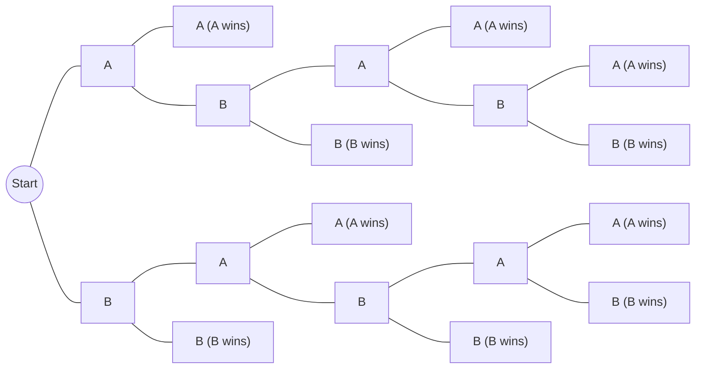

*Figure 1. Possibility tree of a tournament that ends after two wins in a row or three wins in total*

1. There are 10 paths from the root to the leaves, so the tournament can be played in 10 ways. From the top they are A-A, A-B-A-A, A-B-A-B-A, A-B-A-B-B, A-B-B, B-A-A, B-A-B-A-A, B-A-B-A-B, B-A-B-B, and B-B; A wins in 5 of them and B in the other 5. At least 2 and at most 5 games are needed to determine the winner.
2. Assuming the 10 ways of playing are equally likely, five games are needed in the 4 cases A-B-A-B-A, A-B-A-B-B, B-A-B-A-A, and B-A-B-A-B, so the probability is $4/10 = 2/5 = 40\%$.

### 2.2 The Multiplication Rule

Consider a computer facility with four input/output units, A, B, C, D, and three central processing units, X, Y, Z, in which every input/output unit can be matched with every central processing unit. To count the ways to pair one input/output unit with one central processing unit, think of the pairing as two steps: "Step 1: choose the input/output unit" and "Step 2: choose the central processing unit."

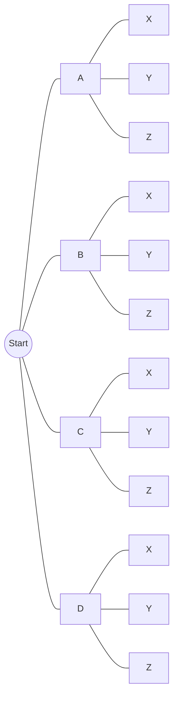

*Figure 2. Possibility tree for pairing four input/output units with three central processing units*

The topmost path represents pairing input/output unit A with central processing unit X, and the next path pairing A with Y. The number of pairings equals the number of leaves, and for each of the four choices in step 1 there are three choices in step 2, so the count is $3 + 3 + 3 + 3 = 4 \cdot 3 = 12$. The multiplication rule generalizes this observation.

> **Key Point:** **Theorem 9.2.1 (The Multiplication Rule).** If an operation consists of $k$ steps and the first step can be performed in $n_1$ ways, the second step in $n_2$ ways (regardless of how the first step was performed), ..., and the $k$th step in $n_k$ ways (regardless of how the preceding steps were performed), then the entire operation can be performed in $n_1 n_2 \cdots n_k$ ways.

Seen through a possibility tree, the rule is evident. The first step has $n_1$ branches, each of which is followed by $n_2$ branches for the second step, so there are $n_1 n_2$ paths through the second step, and repeating the argument gives $n_1 n_2 \cdots n_k$ leaves. A formal proof uses mathematical induction on the number of steps $k$. An operation with $k+1$ steps can be viewed as a two-step operation, "all of the first $k$ steps" followed by "the last step"; by the inductive hypothesis the first $k$ steps can be performed in $n_1 \cdots n_k$ ways, and each of these is followed by $n_{k+1}$ ways for the last step.

To apply the multiplication rule, think of the objects to be counted as the output of a multistep operation. **What** can be chosen at a step may depend on the results of earlier steps, but the **number of ways** to perform each step must be the same no matter what was done in the earlier steps.

**Example 9.2.2 (Counting Personal Identification Numbers (PINs)).** A certain PIN is a sequence of four symbols chosen from the 36 symbols consisting of the 26 uppercase letters of the Roman alphabet and the 10 digits.

1. **Repetition of symbols allowed:** Forming a PIN such as RCAE, 3387, or B92B is a four-step operation that puts a symbol into each of the four positions in turn, and each step can be performed in 36 ways regardless of the earlier steps. By the multiplication rule there are $36 \cdot 36 \cdot 36 \cdot 36 = 36^4 = 1{,}679{,}616$ PINs.
2. **Repetition of symbols not allowed:** The first symbol can be chosen in 36 ways, the second in 35 ways (all but the first), the third in 34 ways, and the fourth in 33 ways. Which symbols remain depends on the symbols chosen, but their **number** is always the same, so the multiplication rule applies, and there are $36 \cdot 35 \cdot 34 \cdot 33 = 1{,}413{,}720$ PINs with no repeated symbol.
3. Assuming all PINs are equally likely, a PIN chosen at random has no repeated symbol with probability $1{,}413{,}720 / 1{,}679{,}616 \approx 0.8417$, that is, about 84%.

The PIN M2ZM can also be viewed as the ordered 4-tuple (M, 2, Z, M). From this viewpoint, one important consequence of the multiplication rule is a formula for the number of elements in a Cartesian product of finite sets.

**Example 9.2.3 (The Number of Elements in a Cartesian Product).** If the sets $A_1, A_2, A_3, A_4$ have $n_1, n_2, n_3, n_4$ elements, respectively, the elements of $A_1 \times A_2 \times A_3 \times A_4$ are the ordered 4-tuples $(a_1, a_2, a_3, a_4)$ with $a_i \in A_i$. Forming such a tuple is a four-step operation that chooses the first, second, third, and fourth components in turn, with $n_1, n_2, n_3, n_4$ ways for the steps, so by the multiplication rule there are $n_1 n_2 n_3 n_4$ elements. The same argument gives $N(A_1 \times A_2 \times \cdots \times A_k) = N(A_1) N(A_2) \cdots N(A_k)$ in general.

In terms of the strings of Chapter 1, the set of PINs of length 4 is the set of all strings of length 4 over the set $\Sigma$ of 36 symbols. In general, there are $m^n$ strings of length $n$ over $m$ symbols. For example, the bit strings of length 3 are the $2^3 = 8$ strings 000, 001, 010, 100, 011, 101, 110, 111.

**Example 9.2.4 (Input/Output Tables for a Circuit with Two Input Signals).** As seen in Chapter 2, a circuit with input signals $P$ and $Q$ has an input/output table with four rows corresponding to the four assignments of input values 11, 10, 01, 00, and different circuits may have the same input/output table. Once the order of the input rows is fixed, two input/output tables count as different exactly when their outputs disagree in at least one row. For example, the following two tables are different because their outputs disagree in the first row.

| $P$ | $Q$ | Output of circuit 1 | Output of circuit 2 |
|:-----:|:-----:|:-----:|:-----:|
| 1 | 1 | 1 | 0 |
| 1 | 0 | 0 | 0 |
| 0 | 1 | 1 | 1 |
| 0 | 0 | 0 | 0 |

*Table 5. Two input/output tables that differ only in the output of the first row*

Completing an input/output table is a four-step operation that fills the output entries of the four rows in turn, and each entry can be filled in two ways, with 1 or 0. So there are $2 \cdot 2 \cdot 2 \cdot 2 = 2^4 = 16$ distinct input/output tables, and a circuit with two input signals can function in only 16 distinct ways. This equals the number of bit strings of length 4 written vertically in the output column. By the same argument, with $n$ input signals the table has $2^n$ rows, so there are $2^{2^n}$ distinct input/output tables.

**Example 9.2.5 (Counting the Iterations of a Nested Loop).** In the following nested loop, the body of the inner loop contains no branching statements that lead out of the loop.

```text
for i := 1 to 4
    for j := 1 to 3
        [body of the inner loop]
    next j
next i
```

The outer loop is iterated 4 times, and during each iteration of the outer loop the inner loop is iterated 3 times, so by the multiplication rule the inner loop is iterated $4 \cdot 3 = 12$ times in all. The following table lists the values of $i$ and $j$ each time the body is executed.

| $i$ | 1 | 1 | 1 | 2 | 2 | 2 | 3 | 3 | 3 | 4 | 4 | 4 |
|:-----:|:-----:|:-----:|:-----:|:-----:|:-----:|:-----:|:-----:|:-----:|:-----:|:-----:|:-----:|:-----:|
| $j$ | 1 | 2 | 3 | 1 | 2 | 3 | 1 | 2 | 3 | 1 | 2 | 3 |

*Table 6. Values of i and j each time the body of the nested loop is executed*

### 2.3 When the Multiplication Rule Is Difficult to Apply

Consider the following problem. A president, a treasurer, and a secretary are to be chosen from the four people Ann, Bob, Cyd, and Dan, but Ann cannot be president and the secretary must be Cyd or Dan. In how many ways can the officers be chosen?

It is tempting to apply the multiplication rule directly and answer "3 choices for president (all but Ann), 3 for treasurer (all but the president), and 2 for secretary (Cyd or Dan), so $3 \cdot 3 \cdot 2 = 18$ ways." This answer is wrong, because the number of ways to choose the secretary depends on who was chosen as president and treasurer. If Bob is president and Ann treasurer, there are 2 choices for secretary, Cyd and Dan, but if Bob is president and Cyd treasurer, Dan is the only choice. A possibility tree shows all cases precisely. From left to right the choices are president, treasurer, and secretary.

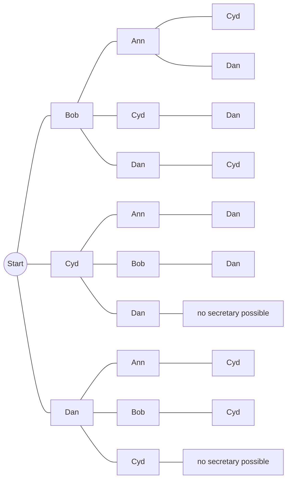

*Figure 3. Possibility tree for choosing the officers in the order president, treasurer, secretary*

If Cyd is president and Dan treasurer, nobody is left who can be secretary, and the same happens when Dan is president and Cyd treasurer. Counting the paths that reach a secretary gives 4 ways with Bob as president, 2 with Cyd, and 2 with Dan, 8 ways in all.

Sometimes reordering the steps makes the number of ways at each step constant, so that the multiplication rule applies.

**Example 9.2.6 (A More Subtle Use of the Multiplication Rule).** Choose in the order secretary, president, treasurer.

1. Step 1 (secretary): Cyd or Dan, 2 ways.
2. Step 2 (president): one of the 2 people other than Ann and the person chosen in step 1, 2 ways.
3. Step 3 (treasurer): one of the 2 people not chosen as secretary or president, 2 ways.

At every step the number of ways is 2 regardless of who was chosen before, so by the multiplication rule the officers can be chosen in $2 \cdot 2 \cdot 2 = 8$ ways. The following tree is much more balanced than Figure 3.

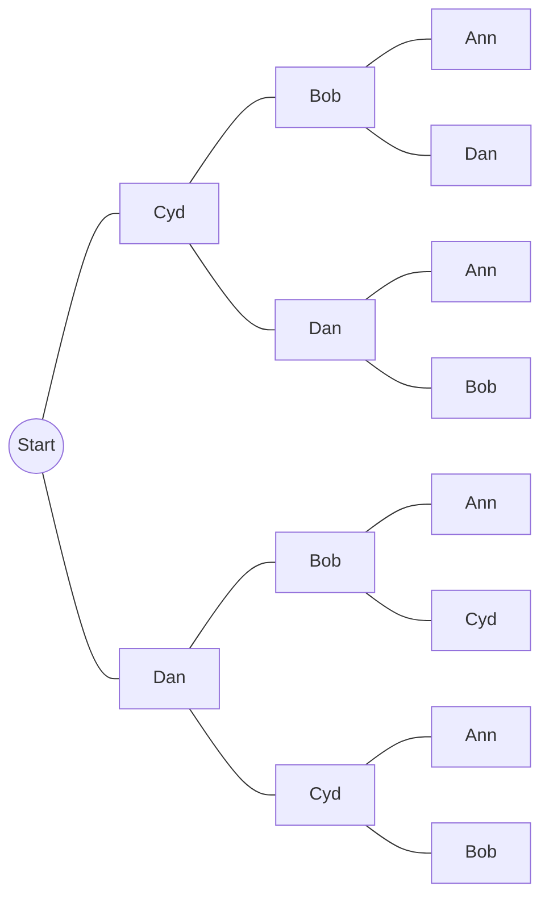

*Figure 4. Possibility tree for choosing the officers in the order secretary, president, treasurer*

> **Caution:** The condition of the multiplication rule is not that "the choices at each step are the same," but that "the **number of choices** at each step is the same regardless of the results of earlier steps." If the number of choices depends on earlier steps, the multiplication rule cannot be applied directly; draw a possibility tree, reorder the steps, or count by cases.

### 2.4 Permutations

> **Definition:** A **permutation** of a set of objects is an ordering of the objects in a row.

For example, the permutations of the elements a, b, c are the 6 orderings abc, acb, cba, bac, bca, cab. Forming a permutation of a set with $n$ elements is an $n$-step operation: "choose an element to write first," "choose an element to write second," ..., "choose an element to write $n$th." Step 1 can choose any element, so there are $n$ ways; step 2 can choose any element except the one chosen in step 1, so there are $n - 1$ ways; each step has one fewer way than the preceding one, and at the last step only one element is left. By the multiplication rule the number of permutations is $n(n-1)(n-2) \cdots 2 \cdot 1 = n!$.

> **Key Point:** **Theorem 9.2.2.** For any integer $n$ with $n \ge 1$, the number of permutations of a set with $n$ elements is $n!$.

**Example 9.2.7 (Permutations of the Letters in a Word).** All eight letters of the word COMPUTER are distinct.

1. The number of ways to arrange the eight letters in a row equals the number of permutations of a set of eight elements, $8! = 40{,}320$.
2. If the letters CO must remain next to each other in this order as a unit, treat CO as a single object and arrange the seven objects CO, M, P, U, T, E, R, which gives $7! = 5{,}040$ ways.
3. When the letters are arranged at random, the probability that CO remains together in this order is $5{,}040 / 40{,}320 = 1/8 = 12.5\%$.

**Example 9.2.8 (Seating Around a Circle).** Six diplomats are to be seated around a circular table. The table has no head, so it does not matter who sits in which chair; only the positions relative to each other matter. That is, two seatings are considered the same if one is a rotation of the other. Calling the diplomats A, B, C, D, E, and F, since only relative positions matter, seat A anywhere (say, the top seat) and arrange the other five relative to A. The five diplomats B through F can be seated in the remaining five seats in $5! = 120$ ways.

The same result can be obtained in another way. If the chairs are numbered, there are $6! = 720$ seatings, and seatings that coincide under rotation come in groups of 6, so there are $720 / 6 = 120$ circular seatings. In general, $n$ objects can be arranged around a circle (circular permutations) in $(n-1)!$ ways.

### 2.5 Permutations of Selected Elements: r-Permutations

There are six ways to select two letters from {a, b, c} and write them in order: ab, ac, ba, bc, ca, cb. Each such ordered selection of two elements of {a, b, c} is called a 2-permutation of {a, b, c}.

> **Definition:** An **r-permutation** of a set of $n$ elements is an ordered selection of $r$ elements taken from the $n$ elements. The number of r-permutations of a set of $n$ elements is denoted $P(n, r)$.

> **Key Point:** **Theorem 9.2.3.** If $n$ and $r$ are integers and $1 \le r \le n$, then the number of r-permutations of a set of $n$ elements is given by the following formula.
>
> $$P(n, r) = n(n-1)(n-2)\cdots(n-r+1) = \frac{n!}{(n-r)!}$$

**Proof.** Forming an r-permutation is an $r$-step operation. Step 1 chooses the first element in $n$ ways, step 2 chooses from the elements other than the first in $n - 1$ ways, and step 3 has $n - 2$ ways. In this way each step has one fewer way than the preceding step. Just before step $r$, $r - 1$ elements have already been chosen, so $n - (r - 1) = n - r + 1$ elements remain. By the multiplication rule, $P(n, r) = n(n-1)(n-2)\cdots(n-r+1)$. Moreover,

$$
\frac{n!}{(n-r)!} = \frac{n(n-1)\cdots(n-r+1)\,(n-r)(n-r-1)\cdots 2 \cdot 1}{(n-r)(n-r-1)\cdots 2 \cdot 1} = n(n-1)\cdots(n-r+1)
$$

so the two expressions are equal. ∎

The second version is easier to remember, but in a computation it is unwise to evaluate $n!$ and $(n-r)!$ first and then divide. Factorials grow so fast that even for small $n$ and $r$ they can exceed a calculator's capacity for exact arithmetic. For example, with $n = 15$ and $r = 2$, $15! = 1{,}307{,}674{,}368{,}000$ and $13! = 6{,}227{,}020{,}800$, but cancelling first simplifies the computation as follows.

$$
\frac{15!}{13!} = \frac{15 \cdot 14 \cdot 13!}{13!} = 15 \cdot 14 = 210
$$

$P(n, r)$ is also written ${}_nP_r$, $P_{n,r}$, ${}^nP_r$, and so on.

**Example 9.2.9 (Evaluating r-Permutations).**

1. $P(5, 2) = \dfrac{5!}{3!} = \dfrac{5 \cdot 4 \cdot 3!}{3!} = 20$.
2. A set of seven objects has $P(7, 4) = \dfrac{7!}{3!} = 7 \cdot 6 \cdot 5 \cdot 4 = 840$ 4-permutations.
3. A set of five objects has $P(5, 5) = \dfrac{5!}{0!} = \dfrac{5!}{1} = 120$ 5-permutations. Because $0! = 1$ was defined in Chapter 5, this value agrees with $5!$, the number of permutations of the set.

**Example 9.2.10 (Permutations of Selected Letters of a Word).** The five letters of the word BYTES are all distinct.

1. The number of ways to choose three letters and write them in a row is the number of 3-permutations of a set of five elements, $P(5, 3) = \dfrac{5!}{2!} = 5 \cdot 4 \cdot 3 = 60$.
2. If the first letter must be B, place B first and choose two of the remaining four letters Y, T, E, S for the second and third positions, which gives $P(4, 2) = 4 \cdot 3 = 12$ ways.

**Example 9.2.11 (Proving a Property of $P(n, r)$).** Show that $P(n, 2) + P(n, 1) = n^2$ for every integer $n \ge 2$. Let $n$ be any integer with $n \ge 2$. By Theorem 9.2.3,

$$
P(n, 2) = \frac{n!}{(n-2)!} = \frac{n(n-1)(n-2)!}{(n-2)!} = n(n-1), \qquad P(n, 1) = \frac{n!}{(n-1)!} = \frac{n \cdot (n-1)!}{(n-1)!} = n
$$

so $P(n, 2) + P(n, 1) = n(n-1) + n = n^2 - n + n = n^2$.

---

<br>

## 3. Counting Elements of Disjoint Sets: The Addition Rule

This section treats problems solved by counting the elements of the union, difference, or intersection of two sets. Underlying all of them is the addition rule: when finite sets are mutually disjoint, the size of their union is the sum of their sizes.

### 3.1 The Addition Rule

> **Key Point:** **Theorem 9.3.1 (The Addition Rule).** If a finite set $A$ equals the union of $k$ distinct mutually disjoint subsets $A_1, A_2, \ldots, A_k$, then the following holds.
>
> $$N(A) = N(A_1) + N(A_2) + \cdots + N(A_k)$$

Each element of $A$ lies in exactly one of the subsets, so adding the counts of the subsets counts each element exactly once. A formal proof uses mathematical induction starting from the case of two sets.

**Example 9.3.1 (Three-Digit Integers Divisible by 5).** The problem of Section 1.4 is solved again with the addition rule. An integer divisible by 5 ends in 0 or in 5, so the set of three-digit integers divisible by 5 splits into the set $A_1$ of those ending in 0 and the set $A_2$ of those ending in 5, with $A_1 \cap A_2 = \emptyset$. There are as many three-digit integers ending in 0 as there are ways to choose the left-most digit (9 ways, 1 through 9) and the middle digit (10 ways, 0 through 9), so $N(A_1) = 9 \cdot 10 = 90$, and for the same reason $N(A_2) = 90$. Hence the count is $N(A_1) + N(A_2) = 90 + 90 = 180$.

### 3.2 The Difference Rule and the Probability of a Complement

One important consequence of the addition rule is that knowing the size of a set $A$ and the size of a subset $B$ of $A$ is enough to find how many elements lie in $A$ but outside $B$.

> **Key Point:** **Theorem 9.3.2 (The Difference Rule).** If $A$ is a finite set and $B$ is a subset of $A$, then $N(A - B) = N(A) - N(B)$.

**Proof.** If $B \subseteq A$, the two sets $B$ and $A - B$ have no elements in common and $B \cup (A - B) = A$. So by the addition rule $N(B) + N(A - B) = N(A)$, and subtracting $N(B)$ from both sides gives $N(A - B) = N(A) - N(B)$. ∎

**Example 9.3.2 (PINs with Repeated Symbols).** For the PINs of Section 2.2, let $S$ be the set of PINs with repetition allowed and $A$ the set of PINs with no repeated symbol, so $N(S) = 1{,}679{,}616$ and $N(A) = 1{,}413{,}720$.

1. The set of PINs with at least one repeated symbol is $S - A$, so by the difference rule $N(S - A) = 1{,}679{,}616 - 1{,}413{,}720 = 265{,}896$.
2. If all PINs are equally likely, the probability that a randomly chosen PIN has a repeated symbol is $265{,}896 / 1{,}679{,}616 \approx 0.158$, that is, about 15.8%.

The second question can also be solved as follows.

$$
P(S - A) = \frac{N(S - A)}{N(S)} = \frac{N(S) - N(A)}{N(S)} = \frac{N(S)}{N(S)} - \frac{N(A)}{N(S)} = 1 - P(A) \approx 1 - 0.842 = 0.158
$$

The first equality is the equally likely probability formula, the second the difference rule, the third the laws of fractions, and the fourth the equally likely probability formula again. This computation illustrates a general property of probability. The **complement** $A^c = S - A$ of an event $A$ is the event that $A$ does not occur, and its probability is 1 minus the probability of $A$. Section 8 derives this formula from the probability axioms.

> **Key Point:** **Formula for the probability of the complement of an event.** If $S$ is a finite sample space and $A$ is an event in $S$, then $P(A^c) = 1 - P(A)$, where $A^c = S - A$ is the complement of $A$ in $S$.

**Example 9.3.3 (Passwords with 3 to 5 Letters).** A certain password consists of 3 through 5 letters chosen from the 26 uppercase letters of the Roman alphabet, with repetition allowed.

1. **Number of possible passwords:** The set of passwords is partitioned into the three subsets of passwords of lengths 3, 4, and 5, so by the addition rule the total is the sum of the counts for each length. Forming a password of length $\ell$ is an $\ell$-step operation with 26 ways for each step, so by the multiplication rule there are $26^\ell$ of them. The total is therefore $26^3 + 26^4 + 26^5 = 17{,}576 + 456{,}976 + 11{,}881{,}376 = 12{,}355{,}928$.
2. **Number of passwords with no repeated letter:** There are $26 \cdot 25 \cdot 24 = 15{,}600$ of length 3, $26 \cdot 25 \cdot 24 \cdot 23 = 358{,}800$ of length 4, and $26 \cdot 25 \cdot 24 \cdot 23 \cdot 22 = 7{,}893{,}600$ of length 5, so $8{,}268{,}000$ in all.
3. **Number of passwords with a repeated letter:** By the difference rule, $12{,}355{,}928 - 8{,}268{,}000 = 4{,}087{,}928$.
4. **Probability of a repeated letter:** If all passwords are equally likely, it is $4{,}087{,}928 / 12{,}355{,}928 \approx 0.331$, that is, about 33.1%.

**Example 9.3.4 (Python Identifiers of Eight or Fewer Characters).** If identifiers in the programming language Python are restricted to ASCII characters, an identifier must begin with one of 53 symbols (the 52 uppercase and lowercase Roman letters and the underscore `_`). The first character may form the whole identifier, or any number of further characters may follow it, each taken from 63 symbols (the 53 permitted first characters together with the 10 digits). Reserved keywords such as `and` and `if`, however, cannot be used as identifiers; following the textbook, consider an implementation with 31 reserved keywords, none longer than eight characters. How many identifiers have at most eight characters?

The set of candidate identifiers is partitioned into the eight subsets of lengths 1 through 8. A candidate of length $\ell$ chooses the first character in 53 ways and each of the remaining $\ell - 1$ characters in 63 ways, so by the multiplication rule there are $53 \cdot 63^{\ell - 1}$ of them. By the addition rule and the formula for the sum of a geometric sequence from Chapter 5, the number of candidates is as follows.

$$
53 + 53 \cdot 63 + 53 \cdot 63^2 + \cdots + 53 \cdot 63^7 = 53 \cdot \frac{63^8 - 1}{63 - 1} = 212{,}133{,}167{,}002{,}880
$$

The 31 reserved keywords have various lengths but all lie among these candidates, so by the difference rule there are $212{,}133{,}167{,}002{,}880 - 31 = 212{,}133{,}167{,}002{,}849$ actual identifiers.

**Example 9.3.5 (Internet Addresses).** Each computer in a network needs a distinguishing name called an address. An IP (Internet Protocol) address on the Internet is a 32-bit number (128-bit addresses are being phased in), divided into a **network ID** part, which specifies a local network, and a **host ID** part, which specifies a particular computer in that network. For easier reading, a 32-bit IP address is split into four groups of 8 bits, each group is converted to a decimal number from 0 to 255, and the numbers are joined by dots; this is called dotted decimal notation. For example, 10001100 11000000 00100000 10001000 is 140.192.32.136. To accommodate local networks of various sizes, network IDs are divided into several classes, the main ones of which are listed below. In every class, a host ID may not consist of all 0's or all 1's.

| Class | Leading bits | Network ID | Host ID | Use |
|:-----:|:-----:|:-----:|:-----:|:-----|
| A | 0 | left-most 8 bits | remaining 24 bits | very large local networks (00000000 and 01111111 are not allowed as network IDs) |
| B | 10 | left-most 16 bits | remaining 16 bits | medium to large local networks |
| C | 110 | left-most 24 bits | remaining 8 bits | small local networks |

*Table 7. Composition of network IDs and host IDs in IP address classes A, B, and C*

1. **Checking the dotted decimal form:** $10001100_2 = 2^7 + 2^3 + 2^2 = 128 + 8 + 4 = 140$, $11000000_2 = 2^7 + 2^6 = 128 + 64 = 192$, $00100000_2 = 2^5 = 32$, and $10001000_2 = 2^7 + 2^3 = 128 + 8 = 136$.
2. **Number of Class B networks:** A Class B network ID is 16 bits beginning with 10, and each of the remaining 14 positions can hold 0 or 1, so there are $2^{14} = 16{,}384$ of them.
3. **Dotted decimal form of a Class B address:** The network ID part runs from 10000000 00000000 to 10111111 11111111, and since $10000000_2 = 128$, $10111111_2 = 191$, and $11111111_2 = 255$, it runs from 128.0 to 191.255 in dotted decimals. So the address of a computer in a Class B network has the form $w.x.y.z$ with $128 \le w \le 191$, $0 \le x \le 255$, $0 \le y \le 255$, and $0 \le z \le 255$, and because a host ID may not be all 0's or all 1's, $y$ and $z$ cannot both be 0 or both be 255.
4. **Number of hosts in a Class B network:** Two choices for each of the 16 host ID bits give $2^{16} = 65{,}536$ possibilities, and removing all 0's and all 1's leaves $65{,}536 - 2 = 65{,}534$.

> **[Computer Networks]** This class-based scheme was replaced in the 1990s by Classless Inter-Domain Routing (CIDR). CIDR does not fix the length of the network ID at 8, 16, or 24 bits but allows any length, written together with the prefix length as in `140.192.32.0/20` [1]. Counting addresses still works the same way: the multiplication rule gives two choices per bit position, and the difference rule removes the forbidden values.

### 3.3 The Inclusion/Exclusion Rule

The addition rule gives the number of elements in a union when the sets are mutually disjoint. To find the number of elements in a union of overlapping sets, first consider two sets $A$ and $B$. If the two sets have no elements in common, $N(A \cup B) = N(A) + N(B)$, and if they coincide, $N(A \cup B) = N(A)$. So a general formula must involve the number of common elements $N(A \cap B)$ along with $N(A)$ and $N(B)$.

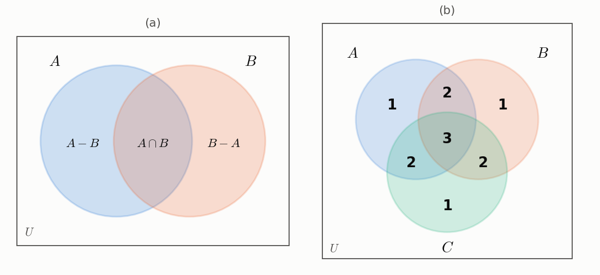

*Figure 5. The three regions of two sets, and how many times each region of three sets is counted by N(A) + N(B) + N(C)*

In Figure 5(a), $N(A)$ counts the elements only in $A$ and the elements in both $A$ and $B$, and $N(B)$ counts the elements only in $B$ and the elements in both. So in $N(A) + N(B)$ the elements of $A \cap B$ are counted twice, and $N(A \cap B)$ must be subtracted once to obtain the correct count. Three sets can be analyzed in the same way.

> **Key Point:** **Theorem 9.3.3 (The Inclusion/Exclusion Rule for Two or Three Sets).** If $A$, $B$, and $C$ are any finite sets, then the following hold.
>
> $$N(A \cup B) = N(A) + N(B) - N(A \cap B)$$
>
> $$N(A \cup B \cup C) = N(A) + N(B) + N(C) - N(A \cap B) - N(A \cap C) - N(B \cap C) + N(A \cap B \cap C)$$

The following table confirms that the formula for three sets counts each element exactly once. The numbers in Figure 5(b) are how many times the elements of each region are counted by $N(A) + N(B) + N(C)$.

| Number of sets containing the element | $N(A) + N(B) + N(C)$ | Two-set intersection terms | Three-set intersection term | Net count |
|:-----:|:-----:|:-----:|:-----:|:-----:|
| 1 | $+1$ | $0$ | $0$ | 1 |
| 2 | $+2$ | $-1$ | $0$ | 1 |
| 3 | $+3$ | $-3$ | $+1$ | 1 |

*Table 8. How many times each element is counted by the inclusion/exclusion formula for three sets*

For example, an element in all of $A$, $B$, and $C$ is added 3 times by the first three terms, subtracted 3 times because it lies in all three two-set intersections, and added once by the last term, so it is counted $3 - 3 + 1 = 1$ time in the end.

> **Note:** Mathematical induction shows that a formula of the same form holds for any number of sets. For finite sets $A_1, \ldots, A_n$, add the numbers of elements of the sets taken one at a time, subtract those of all intersections taken two at a time, add those of all intersections taken three at a time, and so on alternately, ending with $(-1)^{n+1} N(A_1 \cap \cdots \cap A_n)$; the result is $N(A_1 \cup \cdots \cup A_n)$.

**Example 9.3.6 (Counting the Elements of a General Union).** How many integers from 1 through 1,000 are multiples of 3 or multiples of 5, and how many are neither?

Let $A$ be the set of multiples of 3 and $B$ the set of multiples of 5 among the integers from 1 through 1,000; the first number asked for is $N(A \cup B)$. $A \cap B$ is the set of integers that are multiples of both 3 and 5, that is, of 15.

1. The multiples of 3 run from $3 \cdot 1$ to $3 \cdot 333 = 999$, so $N(A) = 333$.
2. The multiples of 5 run from $5 \cdot 1$ to $5 \cdot 200 = 1{,}000$, so $N(B) = 200$.
3. The multiples of 15 run from $15 \cdot 1$ to $15 \cdot 66 = 990$, so $N(A \cap B) = 66$.
4. By the inclusion/exclusion rule, $N(A \cup B) = 333 + 200 - 66 = 467$.
5. By the difference rule, $1{,}000 - 467 = 533$ integers are neither.

The last step hides a use of De Morgan's law from Chapter 6. The set of integers that are neither multiples of 3 nor of 5 is $A^c \cap B^c$, and by De Morgan's law $A^c \cap B^c = (A \cup B)^c$. So the computation was $N((A \cup B)^c) = N(U) - N(A \cup B)$ for the universal set $U$ = {1, 2, ..., 1,000}. In general, the number of multiples of a positive integer $d$ among the integers 1 through $n$ is $\lfloor n/d \rfloor$, using the floor function of Chapter 4.

**Example 9.3.7 (Counting the Elements of an Intersection).** A survey in a class of 50 students on the mathematics and computer science courses they had recently taken gave the following results.

1. 30 students took precalculus, 18 took calculus, and 26 took Python.
2. 9 took both precalculus and calculus, 16 took both precalculus and Python, and 8 took both calculus and Python.
3. 47 took at least one of the three courses.

"30 students took precalculus" means the total number of such students, including those who also took other courses. Let $P$, $C$, and $Y$ be the sets of students who took precalculus, calculus, and Python, respectively.

1. **Students who took none of the courses:** By the difference rule, $50 - 47 = 3$.
2. **Students who took all three courses:** By the inclusion/exclusion rule, $47 = 30 + 18 + 26 - 9 - 16 - 8 + N(P \cap C \cap Y)$. The known terms on the right give $74 - 33 = 41$, so $N(P \cap C \cap Y) = 47 - 41 = 6$. In general, if any seven of the eight terms of the inclusion/exclusion formula for three sets are known, the eighth can be found.
3. **Students in each region:** Put the 6 students who took all three courses in the innermost region and work outward. Those who took precalculus and calculus but not Python number $9 - 6 = 3$, those who took only precalculus and Python number $16 - 6 = 10$, and those who took only calculus and Python number $8 - 6 = 2$. Those who took only precalculus number $30 - 3 - 10 - 6 = 11$, only calculus $18 - 3 - 6 - 2 = 7$, and only Python $26 - 10 - 6 - 2 = 8$.

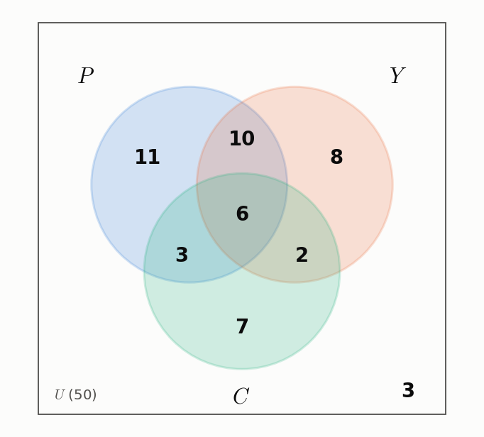

*Figure 6. Venn diagram of the numbers of students in each region for the three courses*

The sum of the seven regions, $11 + 10 + 8 + 6 + 3 + 2 + 7 = 47$, equals the number of students who took at least one course.

---

<br>

## 4. The Pigeonhole Principle

### 4.1 The Pigeonhole Principle and Its Applications

The **pigeonhole principle** states that if $n$ pigeons fly into $m$ pigeonholes and $n > m$, then at least one pigeonhole contains two or more pigeons. It is also called the Dirichlet box principle after Dirichlet, who first stated it formally. The following figure shows the case $n = 5$, $m = 4$ as a correspondence from pigeons to pigeonholes.

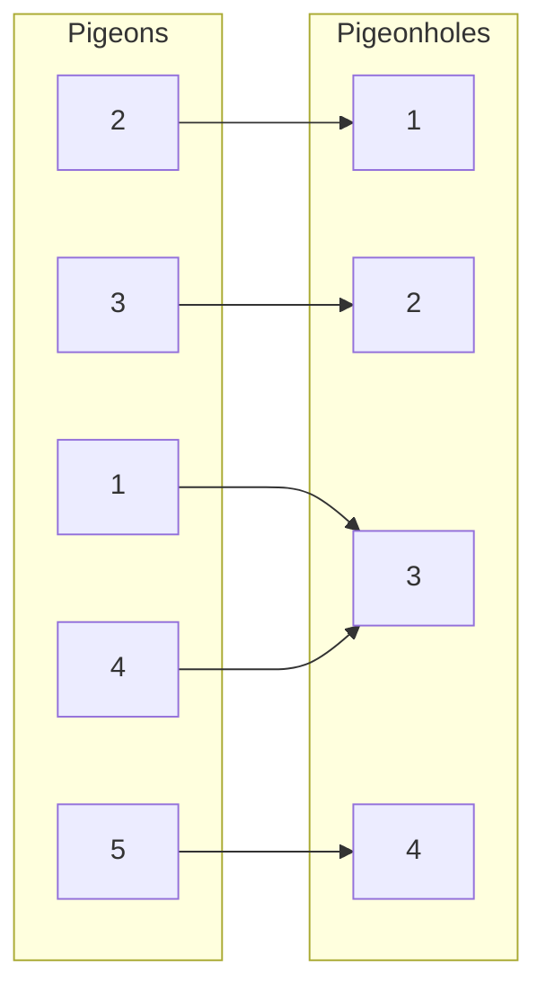

*Figure 7. A correspondence placing five pigeons into four pigeonholes*

The arrows from pigeons 1 and 4 both point to pigeonhole 3. As this figure suggests, the pigeonhole principle can be phrased in the language of functions from Chapter 7 as follows.

> **Key Point:** **Pigeonhole principle.** No function from a finite set to a finite set with fewer elements is one-to-one; that is, some two distinct elements of the domain must have the same image in the co-domain.

Consequently, the arrow diagram of a function from a finite set to a smaller finite set always has some element of the co-domain at which at least two arrows arrive. Since the principle is easy to accept intuitively, its applications are examined first, and a formal proof is given in Section 4.4.

**Example 9.4.1 (Applying the Pigeonhole Principle).**

1. Six people do not necessarily include two with the same birth month, since their birthdays might lie in six different months, say January through June. Among thirteen people, however, two must share a birth month. Treat the thirteen people $x_1, x_2, \ldots, x_{13}$ as pigeons and the twelve months as pigeonholes, and define a function $B$ sending each person to his or her birth month; since $13 > 12$, the pigeonhole principle says $B$ is not one-to-one. That is, at least two arrows point to the same month.
2. Some two residents of New York City must have exactly the same number of hairs on their heads. The city has at least 8,000,000 inhabitants, and no human head is known to carry as many as 300,000 hairs. If the function $H$ sending each resident to the number of hairs on his or her head is given the co-domain {0, 1, 2, ..., 300,000}, the co-domain has 300,001 elements, and since there are more residents than that, $H$ is not one-to-one.

**Example 9.4.2 (Finding the Number to Pick to Ensure a Result).** A drawer contains 10 black socks and 10 white socks. Taking socks out without looking, what is the least number that must be pulled out to be sure of getting a matching pair?

If only two socks are pulled out, they may have different colors, but a third sock must have the same color as one of the two already chosen, so the answer is 3. Formally, consider the function $C$ from the set of socks pulled out, $s_1, s_2, \ldots, s_n$, to the set of colors {white, black}. If $n = 2$, $C$ could be a one-to-one correspondence, but if $n > 2$, the domain has more elements than the co-domain, so $C$ is not one-to-one. That is, there are two socks with $s_i \ne s_j$ and $C(s_i) = C(s_j)$.

**Example 9.4.3 (Selecting a Pair of Integers with a Certain Sum).** Let $A$ = {1, 2, 3, 4, 5, 6, 7, 8}.

1. If five integers are selected from $A$, some pair of them must have a sum of 9. Partition $A$ into the four disjoint subsets {1, 8}, {2, 7}, {3, 6}, {4, 5}; each element of $A$ lies in exactly one subset, and the two elements of each subset add up to 9. Treat the five selected integers $a_1, \ldots, a_5$ as pigeons and the four subsets as pigeonholes, and define $P(a_i)$ to be the subset that contains $a_i$. Because the union of the subsets is $A$, every $a_i$ lies in some subset, and because the subsets are disjoint, no $a_i$ lies in more than one. So $P$ is a well-defined function. There are more pigeons than pigeonholes, so $P$ is not one-to-one, and there are two integers with $a_i \ne a_j$ and $P(a_i) = P(a_j)$. The two integers are the two distinct elements of the same subset, so $a_i + a_j = 9$.
2. If four integers are selected, there need not be a pair with sum 9. In this case the number of pigeons is not larger than the number of pigeonholes, so the pigeonhole principle does not apply. For example, if 1, 2, 3, 4 are selected, the largest sum of two of them is 7.

> **Caution:** The pigeonhole principle guarantees only the **existence** of a pigeonhole with two or more pigeons; it does not say which pigeonhole it is. Moreover, if the number of pigeons is at most the number of pigeonholes, nothing follows from the principle. When solving a problem, first identify what the pigeons and the pigeonholes are, and check that the function sending pigeons to pigeonholes is well defined.

### 4.2 Decimal Expansions of Fractions

An important consequence of the pigeonhole principle is the fact that **the decimal expansion of every rational number either terminates or repeats**. A terminating decimal ends, like 3.625, and a repeating decimal is one in which a block of digits repeats forever from some position on, like $2.38\overline{246}$. The bar over 246 means that these digits repeat forever. Strictly speaking, a terminating decimal can also be regarded as repeating by adding trailing zeros, $3.625\overline{0}$, and it can also be written as $3.624\overline{9}$.

A rational number is a number that can be written as a ratio of integers, that is, as a fraction, and the decimal expansion of a fraction is obtained by dividing the numerator by the denominator with long division. For example, the division for $4/33$ goes as follows.

```text
          0. 1 2 1 2 ...
        ┌──────────────
     33 │ 4. 0 0 0 0
          3  3            40 = 33 × 1 + 7   → quotient digit 1, remainder 7
          ─────
             7 0          70 = 33 × 2 + 4   → quotient digit 2, remainder 4
             6 6
             ───
               4 0        remainder 4 equals the initial value 4, so the process repeats
```

*Figure 8. Long division of 4/33 in which the remainder 4 reappears*

Because the remainder 4 reappears in the division, the subsequent sequence of quotients and remainders repeats forever, and so does the decimal expansion: $4/33 = 0.\overline{12}$. In general, what guarantees that such a repetition always occurs when one integer is divided by another is the quotient-remainder theorem of Chapter 4 together with the pigeonhole principle. The following analysis uses a natural extension of the pigeonhole principle: a function from an infinite set to a finite set cannot be one-to-one.

**Example 9.4.4 (The Decimal Expansion of a Fraction).** Consider the decimal expansion of a fraction $a/b$ for positive integers $a$ and $b$. Let $r_0 = a$, and let $r_1, r_2, r_3, \ldots$ be the successive remainders obtained in the long division. At each step, 10 times the remainder $r_i$ is divided by $b$, giving one quotient digit and the next remainder $r_{i+1}$ (if $a \ge b$, the first step instead divides $a$ itself by $b$, giving the integer part and $r_1$).

1. By the quotient-remainder theorem, each remainder is between 0 and $b - 1$ inclusive.
2. If some remainder $r_i$ is 0, the division terminates, so $a/b$ has a terminating decimal expansion.
3. If no remainder is 0, the division and the sequence of remainders continue forever. Infinitely many remainders can take only the finitely many values $1, 2, \ldots, b - 1$, so by the pigeonhole principle some value repeats: there are indices $j < k$ with $r_j = r_k$.
4. Each quotient digit and the next remainder are determined by the current remainder alone, so the digits obtained from the divisions from $r_j$ through $r_{k-1}$ repeat forever afterward.

For $a = 3$ and $b = 14$, the remainders take values from 0 to 13, and the division proceeds as follows.

| $i$ | $r_i$ | $10 r_i = 14 \times (\text{quotient}) + r_{i+1}$ | Quotient digit | $r_{i+1}$ |
|:-----:|:-----:|:-----|:-----:|:-----:|
| 0 | 3 | $30 = 14 \times 2 + 2$ | 2 | 2 |
| 1 | 2 | $20 = 14 \times 1 + 6$ | 1 | 6 |
| 2 | 6 | $60 = 14 \times 4 + 4$ | 4 | 4 |
| 3 | 4 | $40 = 14 \times 2 + 12$ | 2 | 12 |
| 4 | 12 | $120 = 14 \times 8 + 8$ | 8 | 8 |
| 5 | 8 | $80 = 14 \times 5 + 10$ | 5 | 10 |
| 6 | 10 | $100 = 14 \times 7 + 2$ | 7 | 2 |

*Table 9. Successive remainders and quotient digits in the long division of 3/14*

Since $r_7 = 2 = r_1$, the digits 1, 4, 2, 8, 5, 7 obtained from the divisions from $r_1$ through $r_6$ repeat forever, and $3/14 = 0.2\overline{142857}$.

Since the decimal expansion of every rational number terminates or repeats, a number whose decimal expansion neither terminates nor repeats cannot be rational. For example, $0.01011011101111011111\ldots$, in which each string of 1's is one longer than the previous one, is irrational.

### 4.3 The Generalized Pigeonhole Principle

Generalizing the pigeonhole principle, if $n$ pigeons fly into $m$ pigeonholes and $km < n$ for some positive integer $k$, then at least one pigeonhole contains $k + 1$ or more pigeons. For example, with $m = 4$, $n = 9$, and $k = 2$, since $2 \cdot 4 = 8 < 9$, some pigeonhole contains $2 + 1 = 3$ or more pigeons. In the correspondence of the following figure, pigeonhole 3 contains three pigeons.

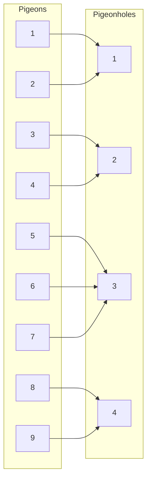

*Figure 9. A correspondence placing nine pigeons into four pigeonholes with three pigeons in one pigeonhole*

> **Key Point:** **Generalized pigeonhole principle.** For any function $f$ from a finite set $X$ with $n$ elements to a finite set $Y$ with $m$ elements and for any positive integer $k$, if $km < n$, then there is some $y \in Y$ such that $y$ is the image of at least $k + 1$ distinct elements of $X$.

> **Note:** The principle is often stated as "if $n > m$, some pigeonhole contains at least $\lceil n/m \rceil$ pigeons." If $n > m$, then $\lceil n/m \rceil \ge 2$, so $k = \lceil n/m \rceil - 1$ is a positive integer, and by the property $\lceil x \rceil < x + 1$ of the ceiling function, $k < n/m$, that is, $km < n$. So by the principle above, some pigeonhole contains at least $k + 1 = \lceil n/m \rceil$ pigeons.

**Example 9.4.5 (Applying the Generalized Pigeonhole Principle).** Any 85 people include at least 4 whose last names begin with the same letter. Treat the 85 people as pigeons and the 26 letters of the Roman alphabet as pigeonholes, and consider the function $L$ sending each person to the initial of his or her last name. Since $3 \cdot 26 = 78 < 85$, the generalized pigeonhole principle says some initial is the image of at least $3 + 1 = 4$ people. By the note above, computing $\lceil 85/26 \rceil = 4$ gives the same result.

In some situations it is more natural to use the contrapositive of the generalized pigeonhole principle. With the inverse image $f^{-1}(y) = \lbrace x \in X \mid f(x) = y \rbrace$ defined in Chapter 7, the contrapositive reads as follows.

> **Key Point:** **Generalized pigeonhole principle (contrapositive form).** For any function $f$ from a finite set $X$ with $n$ elements to a finite set $Y$ with $m$ elements and for any positive integer $k$, if $f^{-1}(y)$ has at most $k$ elements for each $y \in Y$, then $X$ has at most $km$ elements; in other words, $n \le km$.

The previous example can be explained with the contrapositive form as follows. Suppose no letter is the last initial of 4 or more of the 85 people. Then each letter is the last initial of at most 3 people, and the contrapositive form bounds the number of people by $3 \cdot 26 = 78$, contradicting the fact that there are 85. So some letter is the last initial of at least 4 people.

**Example 9.4.6 (Using the Contrapositive Form).** Twelve computers are shared by 42 students; every student works on exactly 1 computer, and no computer serves more than 6 students. Prove that 5 or more of the computers are each used by at least 3 students.

**Method 1 (proof by contradiction).** Assume the conclusion fails and derive a contradiction. If at most 4 computers have 3 or more users each, then at least $12 - 4 = 8$ computers have at most 2 users each. Split the computers into two groups: let $C_1$ consist of 8 computers with at most 2 users each, and let $C_2$ consist of the other 4 computers, which include every computer with 3 or more users.

1. Each computer in $C_2$ is used by at most 6 students, so by the contrapositive form the computers in $C_2$ serve at most $6 \cdot 4 = 24$ students.
2. Each computer in $C_1$ is used by at most 2 students, so by the contrapositive form the computers in $C_1$ serve at most $2 \cdot 8 = 16$ students.
3. So the computers serve at most $24 + 16 = 40$ students, which contradicts the fact that all 42 students use a computer.

Therefore the supposition is false, and at least 5 computers are used by 3 or more students.

**Method 2 (direct proof).** Let $k$ be the number of computers used by 3 or more students; the goal is to show $k \ge 5$. Each of these $k$ computers is used by at most 6 students, so by the contrapositive form they are used by at most $6k$ students. Each of the remaining $12 - k$ computers is used by at most 2 students, so they are used by at most $2(12 - k) = 24 - 2k$ students. So at most $6k + (24 - 2k) = 4k + 24$ students use the computers. Because all 42 students use a computer, $4k + 24 \ge 42$, which gives $k \ge 4.5$. Since $k$ is an integer, $k \ge 5$.

### 4.4 Proof of the Pigeonhole Principle

The truth of the pigeonhole principle depends essentially on the sets being finite. As defined in Chapter 7, a set is **finite** if, and only if, it is the empty set or there is a one-to-one correspondence from {1, 2, ..., $n$} to it for some positive integer $n$. In the first case the number of elements is 0, and in the second it is $n$. A set that is not finite is called **infinite**. Thus a finite set is either empty or can be written in the form $\lbrace x_1, x_2, \ldots, x_n \rbrace$ for a positive integer $n$.

> **Key Point:** **Theorem 9.4.1 (The Pigeonhole Principle).** For any function $f$ from a finite set $X$ with $n$ elements to a finite set $Y$ with $m$ elements, if $n > m$, then $f$ is not one-to-one.

**Proof.** Suppose $n > m$ and $f$ is a function from a finite set $X$ with $n$ elements to a finite set $Y$ with $m$ elements. Denote the elements of $Y$ by $y_1, y_2, \ldots, y_m$, and consider the collection of the inverse image sets $f^{-1}(y_i) = \lbrace x \in X \mid f(x) = y_i \rbrace$, namely $f^{-1}(y_1), f^{-1}(y_2), \ldots, f^{-1}(y_m)$.

1. By the definition of function, each element of $X$ is sent to some element of $Y$. So each element of $X$ is in one of the inverse image sets, and the union of these sets is $X$.
2. By the definition of function, no element of $X$ is sent to more than one element of $Y$. So each element of $X$ is in only one of the inverse image sets, and the inverse image sets are mutually disjoint.
3. By the addition rule, the following holds.

$$
N(X) = N(f^{-1}(y_1)) + N(f^{-1}(y_2)) + \cdots + N(f^{-1}(y_m)) \qquad (9.4.1)
$$

Now suppose, contrary to what is to be shown, that $f$ is one-to-one. Then each set $f^{-1}(y_i)$ has at most one element, so the following holds.

$$
N(f^{-1}(y_1)) + N(f^{-1}(y_2)) + \cdots + N(f^{-1}(y_m)) \le \underbrace{1 + 1 + \cdots + 1}_{m\text{ terms}} = m \qquad (9.4.2)
$$

Putting (9.4.1) and (9.4.2) together gives $n = N(X) \le m = N(Y)$, which contradicts the fact that $n > m$. So the supposition that $f$ is one-to-one is false, and $f$ is not one-to-one. ∎

An important theorem follows from the pigeonhole principle: a function between two finite sets of the same size is one-to-one if, and only if, it is onto.

> **Key Point:** **Theorem 9.4.2 (One-to-One and Onto for Finite Sets).** Let $X$ and $Y$ be finite sets with the same number of elements, and suppose $f$ is a function from $X$ to $Y$. Then $f$ is one-to-one if, and only if, $f$ is onto.

**Proof.** Let $X$ and $Y$ each have $m$ elements, and write $X = \lbrace x_1, \ldots, x_m \rbrace$ and $Y = \lbrace y_1, \ldots, y_m \rbrace$.

**If $f$ is one-to-one, then $f$ is onto.** Suppose $f$ is one-to-one. Then $f(x_1), f(x_2), \ldots, f(x_m)$ are all distinct. Let $S$ be the set of elements of $Y$ that are not the image of any element of $X$; then the sets $\lbrace f(x_1) \rbrace, \lbrace f(x_2) \rbrace, \ldots, \lbrace f(x_m) \rbrace$ and $S$ are mutually disjoint, and their union is $Y$. By the addition rule,

$$
N(Y) = N(\lbrace f(x_1) \rbrace) + \cdots + N(\lbrace f(x_m) \rbrace) + N(S) = \underbrace{1 + \cdots + 1}_{m\text{ terms}} + N(S) = m + N(S)
$$

because each $\lbrace f(x_i) \rbrace$ is a singleton set. Since $N(Y) = m$, this gives $m = m + N(S)$, and subtracting $m$ from both sides gives $N(S) = 0$. So $S$ is empty, every element of $Y$ is the image of some element of $X$, and $f$ is onto.

**If $f$ is onto, then $f$ is one-to-one.** Suppose $f$ is onto. Then $f^{-1}(y_i) \ne \emptyset$ for each $i = 1, 2, \ldots, m$, so $N(f^{-1}(y_i)) \ge 1$. As in the proof of Theorem 9.4.1, $X$ is the union of the mutually disjoint sets $f^{-1}(y_1), \ldots, f^{-1}(y_m)$, so by the addition rule the following holds.

$$
N(X) = N(f^{-1}(y_1)) + N(f^{-1}(y_2)) + \cdots + N(f^{-1}(y_m)) \ge m \qquad (9.4.3)
$$

If any one of the sets $f^{-1}(y_i)$ had two or more elements, the sum in (9.4.3) would be greater than $m$. But this cannot happen, because $N(X) = m$. Hence each set $f^{-1}(y_i)$ has exactly one element, and $f$ is one-to-one. ∎

> **Caution:** Theorem 9.4.2 does not hold for infinite sets. For example, the function $f(n) = 2n$ from the set of all integers to itself is one-to-one, but it is not onto, because no odd number is the image of any integer.

Theorem 9.4.2 applies in particular when $X = Y$. A function from a finite set to itself that is one-to-one is automatically onto, and one that is onto is automatically one-to-one. Such functions amount to permutations of the set. For example, the function in the following table represents the permutation cdba, obtained by listing the images of $a$, $b$, $c$, $d$ in order.

| $x$ | $a$ | $b$ | $c$ | $d$ |
|:-----:|:-----:|:-----:|:-----:|:-----:|
| $f(x)$ | $c$ | $d$ | $b$ | $a$ |

*Table 10. The permutation cdba represented as a one-to-one correspondence from {a, b, c, d} to itself*

---

<br>

## 5. Counting Subsets of a Set: Combinations

### 5.1 r-Combinations

Suppose 5 members of a group of 12 are to be chosen to work as a team on a special project. How many distinct 5-person teams can be selected? This question is a special case of the following general question: given a set $S$ with $n$ elements, how many subsets of size $r$ can be chosen from $S$? That number equals the number of subsets of size $r$ that $S$ has.

> **Definition:** Let $n$ and $r$ be nonnegative integers with $r \le n$. An **r-combination** of a set of $n$ elements is a subset of $r$ of the $n$ elements. The symbol $\binom{n}{r}$, read **n choose r**, denotes the number of subsets of size $r$ (r-combinations) that can be formed from a set of $n$ elements.

Calculators and other references sometimes use symbols such as $C(n, r)$, ${}_nC_r$, $C_{n,r}$, or ${}^nC_r$ instead of $\binom{n}{r}$. A formula for computing $\binom{n}{r}$ is derived below, but it is best to think of the symbol first of all as a way to count the subsets of size $r$ of a set of $n$ elements.

**Example 9.5.1 (3-Combinations).** Consider the set consisting of the four people Ann, Bob, Cyd, and Dan.

1. Each subset of size 3 is obtained by leaving out one person, so the subsets are {Bob, Cyd, Dan} (leave out Ann), {Ann, Cyd, Dan} (leave out Bob), {Ann, Bob, Dan} (leave out Cyd), and {Ann, Bob, Cyd} (leave out Dan).
2. Hence $\binom{4}{3} = 4$.
3. The number of ways these four people can form a committee of size 3 is the number of distinct committees, that is, the number of subsets of size 3, so it is 4.

There are two kinds of methods for selecting $r$ objects from a set of $n$ elements. In an **ordered selection**, not only which elements are chosen but also the order in which they are chosen matters; two ordered selections are the same if the elements chosen are the same and are chosen in the same order. An ordered selection of $r$ elements from a set of $n$ elements is an r-permutation. In an **unordered selection**, only the identity of the chosen elements matters; two unordered selections are the same if they consist of the same elements, regardless of the order in which they are chosen. An unordered selection of $r$ elements from a set of $n$ elements is the same as a subset of size $r$, that is, an r-combination.

**Example 9.5.2 (Unordered Selections).** Selecting two elements without regard to order from the set {0, 1, 2, 3} is the same as selecting a subset of size 2, and a systematic listing gives the following.

1. Subsets containing 0: {0, 1}, {0, 2}, {0, 3}
2. Subsets containing 1 but not 0: {1, 2}, {1, 3}
3. Subsets containing 2 but neither 0 nor 1: {2, 3}

This list exhausts all possibilities, so $\binom{4}{2} = 6$.

When $n$ and $r$ are small, $\binom{n}{r}$ can be found by **complete enumeration**, listing all possibilities as above, but when $n$ and $r$ are large, listing and counting is not feasible. The general values are found by an indirect method: set up an equation that contains $\binom{n}{r}$ as a factor and then solve it for $\binom{n}{r}$.

### 5.2 The Relation Between Permutations and Combinations

**Example 9.5.3 (An Equation Relating Permutations and Combinations).** By Theorem 9.2.3, the set {0, 1, 2, 3} has $P(4, 2) = \frac{4!}{2!} = 12$ 2-permutations. Think of constructing a 2-permutation as the following two-step process.

1. Step 1: choose a subset of two elements from {0, 1, 2, 3}.
2. Step 2: choose an ordering of the two elements of that subset.

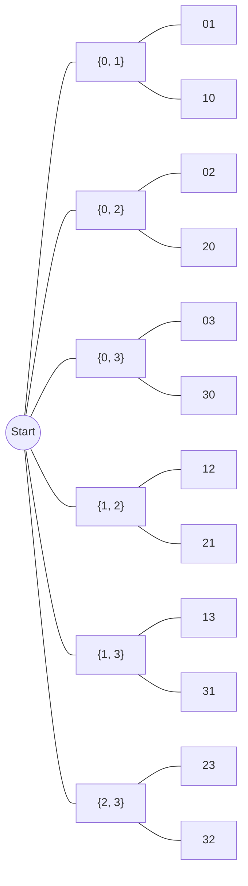

*Figure 10. Possibility tree that obtains 2-permutations by choosing a 2-combination and then ordering it*

Step 1 can be performed in $\binom{4}{2}$ ways, and step 2 in $2!$ ways, the number of ways to arrange two elements. The number of ways to perform the whole process equals the number of 2-permutations, $P(4, 2)$, so the multiplication rule gives the following equation.

$$
P(4, 2) = \binom{4}{2} \cdot 2! \quad\Longrightarrow\quad \binom{4}{2} = \frac{P(4, 2)}{2!} = \frac{4!}{2!\,(4-2)!} = \frac{12}{2} = 6
$$

The same reasoning applies in general. To form an r-permutation of a set of $n$ elements, first choose a subset of $r$ of the $n$ elements ($\binom{n}{r}$ ways), and then choose an ordering of the $r$ elements ($r!$ ways). So $P(n, r) = \binom{n}{r} \cdot r!$, and solving for $\binom{n}{r}$ and substituting $P(n, r) = \frac{n!}{(n-r)!}$ gives the following.

$$
\binom{n}{r} = \frac{P(n, r)}{r!} = \frac{n!/(n-r)!}{r!} = \frac{n!}{r!\,(n-r)!}
$$

> **Key Point:** **Theorem 9.5.1 (Computational Formula for $\binom{n}{r}$).** If $n$ and $r$ are nonnegative integers with $r \le n$, then the number of subsets of size $r$ (r-combinations) that can be chosen from a set of $n$ elements is given by the following formula.
>
> $$\binom{n}{r} = \frac{P(n, r)}{r!} = \frac{n!}{r!\,(n-r)!}$$

The argument above proves the theorem in all cases where $n$ and $r$ are positive. If $r = 0$ and $n$ is any nonnegative integer, $\binom{n}{0}$ is the number of subsets of size 0 of a set with $n$ elements. As seen in Chapter 6, there is only one set with no elements, the empty set, so $\binom{n}{0} = 1$. The formula also gives $\frac{n!}{0!\,(n-0)!} = \frac{n!}{1 \cdot n!} = 1$ because $0! = 1$, so the theorem holds for all nonnegative integers $n$ and $r$ with $r \le n$. The definition $0! = 1$ once again makes the formula consistent.

### 5.3 Team Selection Problems

**Example 9.5.4 (Calculating the Number of Teams).** Return to the original problem of choosing a team of 5 from 12 people. Each five-person team is a subset of size 5 of the 12 people, so by Theorem 9.5.1 the number of distinct teams is the following.

$$
\binom{12}{5} = \frac{12!}{5!\,(12-5)!} = \frac{12 \cdot 11 \cdot 10 \cdot 9 \cdot 8 \cdot 7!}{(5 \cdot 4 \cdot 3 \cdot 2 \cdot 1) \cdot 7!} = 11 \cdot 9 \cdot 8 = 792
$$

Here $12 \cdot 10 = 120$ in the numerator was cancelled against $5 \cdot 4 \cdot 3 \cdot 2 \cdot 1 = 120$ in the denominator.

**Example 9.5.5 (Teams That Contain Both or Neither).** Two of the 12 people, A and B, will only work together, so every team must include both of them or neither of them. How many five-person teams are possible?

The set of possible teams is partitioned into two disjoint subsets, "teams containing both A and B" and "teams containing neither A nor B."

1. A team containing both A and B needs 3 more people from the remaining 10, so there are $\binom{10}{3} = \frac{10 \cdot 9 \cdot 8}{3 \cdot 2 \cdot 1} = 120$ such teams.
2. A team containing neither A nor B consists of 5 people from the remaining 10, so there are $\binom{10}{5} = \frac{10 \cdot 9 \cdot 8 \cdot 7 \cdot 6}{5 \cdot 4 \cdot 3 \cdot 2 \cdot 1} = 252$ such teams.
3. By the addition rule there are $120 + 252 = 372$ teams.

**Example 9.5.6 (Teams That Do Not Contain Both).** Two of the 12 people, C and D, are on bad terms and will not serve on the same team. How many five-person teams are possible? This problem can be solved with the addition rule or with the difference rule.

1. **Addition rule:** Split the teams that do not include both C and D into three subsets: "teams containing C but not D," "teams containing D but not C," and "teams containing neither C nor D." A team in the first subset needs 4 more people from the remaining 10, so there are $\binom{10}{4} = \frac{10 \cdot 9 \cdot 8 \cdot 7}{4 \cdot 3 \cdot 2 \cdot 1} = 210$; the second subset also has 210 for the same reason; and the third has 252 as in the previous example. So there are $210 + 210 + 252 = 672$ teams.
2. **Difference rule:** The set of teams that do not contain both C and D is the difference between the set of all five-person teams and the set of teams containing both C and D. There are $\binom{12}{5} = 792$ five-person teams in all and $\binom{10}{3} = 120$ teams containing both C and D, so there are $792 - 120 = 672$ teams.

Before the next example, the meanings of "at least" and "at most" are made precise. **At least $n$** means "$n$ or more," and **at most $n$** means "$n$ or fewer." For instance, choosing at least 2 elements from a set of 3 means choosing 2 or 3, and choosing at most 2 means choosing 0, 1, or 2.

**Example 9.5.7 (Teams with Members of Two Types).** Suppose the group of 12 consists of 5 men and 7 women.

1. **Five-person teams of 3 men and 2 women:** Think of forming a team as two steps, "Step 1: choose the men" and "Step 2: choose the women." There are $\binom{5}{3}$ ways to choose 3 of the 5 men and $\binom{7}{2}$ ways to choose 2 of the 7 women. By the multiplication rule there are $\binom{5}{3}\binom{7}{2} = \frac{5!}{3!\,2!} \cdot \frac{7!}{2!\,5!} = 10 \cdot 21 = 210$ such teams.
2. **Five-person teams with at least 1 man (difference rule):** This set is the set of all five-person teams minus the set of teams with no men. A team with no men consists of 5 of the 7 women, so there are $\binom{7}{5} = \frac{7 \cdot 6}{2 \cdot 1} = 21$ of them, and hence $792 - 21 = 771$ teams.
3. **Five-person teams with at least 1 man (addition rule):** Partition this set by the number of men, and compute the size of each subset as in part 1; the results are shown in the following table.

| Number of men | Number of women | Number of teams |
|:-----:|:-----:|:-----|
| 1 | 4 | $\binom{5}{1}\binom{7}{4} = 5 \cdot 35 = 175$ |
| 2 | 3 | $\binom{5}{2}\binom{7}{3} = 10 \cdot 35 = 350$ |
| 3 | 2 | $\binom{5}{3}\binom{7}{2} = 10 \cdot 21 = 210$ |
| 4 | 1 | $\binom{5}{4}\binom{7}{1} = 5 \cdot 7 = 35$ |
| 5 | 0 | $\binom{5}{5}\binom{7}{0} = 1 \cdot 1 = 1$ |

*Table 11. Sizes of the subsets obtained by partitioning the five-person teams with at least 1 man by the number of men*

By the addition rule there are $175 + 350 + 210 + 35 + 1 = 771$ teams, the same value as with the difference rule.

4. **Five-person teams with at most 1 man:** This set is partitioned into the teams with no men and the teams with exactly 1 man, so by the addition rule there are $\binom{5}{0}\binom{7}{5} + \binom{5}{1}\binom{7}{4} = 21 + 175 = 196$ teams.

### 5.4 Applications to Graphs and Poker Hands

**Example 9.5.8 (An Application to Graphs).** A graph with no loops and no parallel edges is called a **simple graph**.

1. A **complete bipartite graph** $K_{m,n}$ is a simple graph whose vertices can be divided into two nonoverlapping sets, a set $V$ of $m$ vertices and a set $W$ of $n$ vertices, such that there is exactly one edge between each vertex of $V$ and each vertex of $W$, and there is no edge between two vertices of $V$ or between two vertices of $W$. Label the vertices of $V$ as $v_1, \ldots, v_m$, and consider the $m$-step operation whose $k$th step, for each $k = 1, \ldots, m$, is "draw one edge from $v_k$ to each of the $n$ vertices of $W$." Each step creates $n$ edges, so by the multiplication rule $K_{m,n}$ has $mn$ edges.
2. A **complete graph** $K_n$ is a simple graph with $n$ vertices and exactly one edge between each pair of distinct vertices. If $n = 1$ there are no edges, and $\frac{1 \cdot (1-1)}{2} = 0$. If $n \ge 2$, there is exactly one edge for each pair of distinct vertices, so the number of edges equals the number of subsets of size 2 of the set of $n$ vertices. Hence $K_n$ has $\binom{n}{2} = \frac{n!}{2!\,(n-2)!} = \frac{n(n-1)}{2}$ edges.

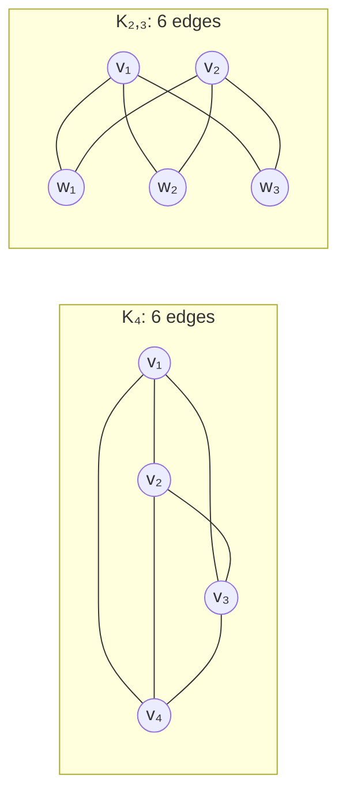

*Figure 11. The complete graph K₄ with 4 × 3 / 2 = 6 edges and the complete bipartite graph K₂,₃ with 2 × 3 = 6 edges*

**Example 9.5.9 (Poker Hand Problems).** Poker is played with an ordinary deck of 52 cards, and the five-card holdings with special names are listed below. Holdings higher in the list beat those lower in the list.

| Name of the hand | Composition |
|:-----|:-----|
| Royal flush | 10, J, Q, K, A of the same suit |
| Straight flush | five adjacent denominations of the same suit but not a royal flush (aces can be high or low, so A, 2, 3, 4, 5 of the same suit also counts) |
| Four of a kind | four cards of one denomination and any fifth card |
| Full house | three cards of one denomination and two cards of another denomination |
| Flush | five cards of the same suit but not a straight flush or a royal flush |
| Straight | five adjacent denominations but not all of the same suit (aces can be high or low) |
| Three of a kind | three cards of one denomination and two cards of two other different denominations |
| Two pairs | two cards of one denomination, two cards of a second denomination, and one card of a third denomination |
| One pair | two cards of one denomination and three cards of three other different denominations |
| No pairs | all five cards of different denominations but not a straight, straight flush, flush, or royal flush |

*Table 12. Kinds and compositions of the named five-card hands in poker*

1. **Number of hands with two pairs:** Think of forming a hand with two pairs as four steps. Step 1 chooses the two denominations of the pairs, step 2 chooses two cards of the smaller denomination, step 3 chooses two cards of the larger denomination, and step 4 chooses one card from those remaining. There are 13 denominations, so step 1 can be performed in $\binom{13}{2}$ ways. Each denomination has four cards, one in each suit, so steps 2 and 3 can each be performed in $\binom{4}{2}$ ways. The fifth card is chosen from the $11 \cdot 4 = 44$ cards of the 11 denominations not used in the pairs, so step 4 can be performed in $\binom{44}{1}$ ways. The number of hands with two pairs is therefore the following.

$$
\binom{13}{2}\binom{4}{2}\binom{4}{2}\binom{44}{1} = \frac{13 \cdot 12}{2} \cdot \frac{4 \cdot 3}{2} \cdot \frac{4 \cdot 3}{2} \cdot 44 = 78 \cdot 6 \cdot 6 \cdot 44 = 123{,}552
$$

2. **Probability of two pairs:** There are $\binom{52}{5} = 2{,}598{,}960$ five-card hands in all, so if all hands are equally likely, the probability of two pairs is $123{,}552 / 2{,}598{,}960 \approx 0.0475$, that is, about 4.75%.

> **Caution:** If step 1 is counted as "13 denominations for the first pair and 12 for the second," giving $13 \cdot 12$, then, for example, (pair of 5's, pair of 9's) and (pair of 9's, pair of 5's) are counted as two different hands. The two pairs are unordered, so $\binom{13}{2} = 78$ must be used. Also, if the fifth card is chosen from 52 - 4 = 48 cards, a card of one of the pair denominations may be drawn again, and that hand is a full house rather than two pairs.

### 5.5 Permutations with Indistinguishable Objects

**Example 9.5.10 (The Number of Bit Strings with a Fixed Number of 1's).** How many eight-bit strings have exactly three 1's? Imagine eight empty positions; in step 1 choose the three positions for the 1's, and in step 2 fill the remaining positions with 0's. Once the three positions for the 1's are chosen, the other five positions must hold 0's, so the number of such strings equals the number of ways to choose 3 positions from 8. Hence there are $\binom{8}{3} = \frac{8 \cdot 7 \cdot 6}{3 \cdot 2 \cdot 1} = 56$ of them.

**Example 9.5.11 (Permutations of a Set with Repeated Elements).** In how many distinguishable ways can the letters of the word MISSISSIPPI be arranged, as in IIMSSPISSIP, ISSSPMIIPIS, PIMISSSSIIP? Imagine placing the 11 letters one by one into 11 positions. Copies of the same letter cannot be distinguished, so once the positions for a letter are known, there is only one way to put its copies into them. Constructing an ordering is therefore the following four-step operation.

1. Step 1: choose 4 of the 11 positions for the four S's, in $\binom{11}{4}$ ways.
2. Step 2: choose 4 of the remaining 7 positions for the four I's, in $\binom{7}{4}$ ways.
3. Step 3: choose 2 of the remaining 3 positions for the two P's, in $\binom{3}{2}$ ways.
4. Step 4: choose the 1 remaining position for the M, in $1 = \binom{1}{1}$ way.

By the multiplication rule the count is the following.

$$
\binom{11}{4}\binom{7}{4}\binom{3}{2}\binom{1}{1} = \frac{11!}{4!\,7!} \cdot \frac{7!}{4!\,3!} \cdot \frac{3!}{2!\,1!} \cdot \frac{1!}{1!\,0!} = \frac{11!}{4!\,4!\,2!\,1!} = 330 \cdot 35 \cdot 3 \cdot 1 = 34{,}650
$$

Changing the order in which the letters are placed does not change the answer. The same reasoning gives the following theorem.

> **Key Point:** **Theorem 9.5.2 (Permutations with Sets of Indistinguishable Objects).** Suppose a collection consists of $n$ objects of which $n_1$ are of type 1 and indistinguishable from each other, $n_2$ are of type 2 and indistinguishable from each other, ..., and $n_k$ are of type $k$ and indistinguishable from each other, and suppose $n_1 + n_2 + \cdots + n_k = n$. Then the number of distinguishable permutations of the $n$ objects is the following.
>
> $$\binom{n}{n_1}\binom{n - n_1}{n_2}\binom{n - n_1 - n_2}{n_3}\cdots\binom{n - n_1 - n_2 - \cdots - n_{k-1}}{n_k} = \frac{n!}{n_1!\,n_2!\,n_3!\cdots n_k!}$$

The last equality comes from cancellation between adjacent factors. For example, in $\binom{n}{n_1}\binom{n-n_1}{n_2} = \frac{n!}{n_1!\,(n-n_1)!} \cdot \frac{(n-n_1)!}{n_2!\,(n-n_1-n_2)!}$ the factor $(n - n_1)!$ cancels, and the denominator of the last factor leaves $(n - n_1 - \cdots - n_k)! = 0! = 1$.

> **Note:** The same result can be seen as follows. If the copies of each letter are numbered, as in $S_1, S_2, \ldots$, so that all are distinguishable, there are $n!$ arrangements. When the numbers are erased, the arrangements that become identical come in groups of $n_1!\,n_2!\cdots n_k!$, the number of ways to permute the copies within each type, so the number of distinguishable arrangements is $n! / (n_1!\,n_2!\cdots n_k!)$. For MISSISSIPPI this is $11! / (4!\,4!\,2!\,1!) = 39{,}916{,}800 / 1{,}152 = 34{,}650$.

### 5.6 Advice on Counting and Double Counting

Students learning to count often ask when to multiply and when to add, that is, when to use the multiplication rule and when to use the addition rule. There is no easy answer. It helps to imagine the objects to be counted as vividly as possible, to list some of them in order to find a systematic way of producing them, and then to build a model that would allow the objects to be counted one by one if there were enough time. If the objects can be viewed as the output of a multistep process (in which each step can be performed in a fixed number of ways regardless of earlier steps), use the multiplication rule; if the whole can be broken into disjoint subsets, use the addition rule.

The most common mistake is to count some possibilities more than once.

**Example 9.5.12 (Double Counting).** As in Section 5.3, consider the five-person teams with at least 1 man chosen from 5 men and 7 women. The following solution is incorrect.

1. Step 1: choose 1 of the 5 men, in $\binom{5}{1}$ ways.
2. Step 2: choose 4 of the remaining 11 people, in $\binom{11}{4}$ ways.
3. Conclude by the multiplication rule that there are $\binom{5}{1}\binom{11}{4} = 5 \cdot 330 = 1{,}650$ teams.

This answer is much larger than the correct answer 771. Call the men $M_1, \ldots, M_5$ and the women $W_1, \ldots, W_7$. Choosing $M_1$ in step 1 and $M_2, W_2, W_4, W_5$ in step 2, and choosing $M_2$ in step 1 and $M_1, W_2, W_4, W_5$ in step 2, both produce the same team $\lbrace M_1, M_2, W_2, W_4, W_5 \rbrace$. That is, one team appears on two different branches of the possibility tree and is counted twice. The more men a team contains, the more times it is counted.

> **Caution:** To avoid such mistakes, visualize the possibility tree that corresponds to any use of the multiplication rule and the set partition that corresponds to a use of the addition rule, and check the division into steps by applying it to actual data that are as typical as possible. Ask two questions: "Am I counting everything?" and "Am I counting anything twice?" For the multiplication rule, check "Does every outcome appear on some branch of the tree?" and "Does any outcome appear on more than one branch?"; for the addition rule, check "Does every outcome lie in some subset?" and "Do any two subsets share an element?"

---

<br>

## 6. r-Combinations with Repetition Allowed

### 6.1 Definition and Complete Enumeration

As shown in Section 5, there are $\binom{n}{r}$ ways to choose $r$ distinct elements without regard to order from a set of $n$ elements. For example, there are $\binom{4}{3} = 4$ ways to choose three elements from a set of four: {1, 2, 3}, {1, 2, 4}, {1, 3, 4}, {2, 3, 4}. This section asks how many ways there are to choose $r$ elements without regard to order from a set of $n$ elements when repetition is allowed. It helps to think of the $n$ elements as **categories** of objects from which several selections may be made. If the categories are 1, 2, 3, 4 and three are chosen, one can choose two from category 3 and one from category 1, all three from category 2, or one each from categories 1, 2, and 4. These choices are denoted $[3, 3, 1]$, $[2, 2, 2]$, and $[1, 2, 4]$, respectively. Because order does not matter, for example, $[3, 3, 1] = [3, 1, 3] = [1, 3, 3]$.

> **Definition:** An **r-combination with repetition allowed**, or **multiset** of size $r$, chosen from a set $X$ of $n$ elements is an unordered selection of $r$ elements taken from $X$ with repetition allowed. If $X = \lbrace x_1, x_2, \ldots, x_n \rbrace$, it is written $[x_{i_1}, x_{i_2}, \ldots, x_{i_r}]$, where each $x_{i_j}$ is in $X$ and some of them may equal each other.

**Example 9.6.1 (Complete Enumeration of 3-Combinations with Repetition Allowed).** List all 3-combinations with repetition allowed (multisets of size 3) that can be selected from {1, 2, 3, 4}. Because the order of selection does not matter, the elements of each selection may be written in increasing order, and writing them in increasing order ensures that no combination is overlooked.

| First two elements | 3-combinations with repetition allowed | Count |
|:-----|:-----|:-----:|
| 1, 1 | $[1, 1, 1]$, $[1, 1, 2]$, $[1, 1, 3]$, $[1, 1, 4]$ | 4 |
| 1, 2 | $[1, 2, 2]$, $[1, 2, 3]$, $[1, 2, 4]$ | 3 |
| 1, 3 or 1, 4 | $[1, 3, 3]$, $[1, 3, 4]$, $[1, 4, 4]$ | 3 |
| 2, 2 | $[2, 2, 2]$, $[2, 2, 3]$, $[2, 2, 4]$ | 3 |
| 2, 3 or 2, 4 | $[2, 3, 3]$, $[2, 3, 4]$, $[2, 4, 4]$ | 3 |
| 3, 3 or 3, 4 | $[3, 3, 3]$, $[3, 3, 4]$, $[3, 4, 4]$ | 3 |
| 4, 4 | $[4, 4, 4]$ | 1 |

*Table 13. Complete enumeration of the 20 3-combinations with repetition allowed chosen from {1, 2, 3, 4}*

So there are $4 + 3 + 3 + 3 + 3 + 3 + 1 = 20$ 3-combinations with repetition allowed.

### 6.2 Counting with Strings of Bars and Crosses

The number 20 can be predicted without making a list. Regard 1, 2, 3, 4 as categories and imagine choosing three numbers in all, with multiple selections from any category allowed. Represent a selection with three **vertical bars** `|` that separate the four categories and three **crosses** `×`, one for each chosen object, as follows.

```text
 Cat. 1 | Cat. 2 | Cat. 3 | Cat. 4        String     Result of the selection
        |   ×    |        |  × ×          |×||××     one from category 2, two from category 4: [2, 4, 4]
   ×    |        |   ×    |   ×           ×||×|×     one each from categories 1, 3, 4: [1, 3, 4]
 × × ×  |        |        |               ×××|||     three from category 1: [1, 1, 1]
  × ×   |        |   ×    |               ××||×|     two from category 1, one from category 3: [1, 1, 3]
```

*Figure 12. 3-combinations with repetition allowed represented by strings of three vertical bars and three crosses*

The bars are the boundaries between categories, and the number of crosses between two bars (or before the first or after the last bar) is the number chosen from that category. Distinct strings of three bars and three crosses represent distinct selections, and every selection is represented by one such string. So the number of selections equals the number of ways to choose 3 positions for the crosses in a string of length 6, because once the positions of the crosses are fixed, the bars occupy the other three positions.

$$
\binom{6}{3} = \frac{6!}{3!\,(6-3)!} = \frac{6 \cdot 5 \cdot 4}{3 \cdot 2 \cdot 1} = 20
$$

This agrees with the complete enumeration. In general, an r-combination with repetition allowed chosen from a set of $n$ elements is represented by a string of $n - 1$ vertical bars, which separate the $n$ categories, and $r$ crosses, which represent the $r$ chosen elements. The number of crosses in each category is the number of times the corresponding element is repeated. The number of such strings is the number of ways to choose the $r$ positions for the crosses among $r + (n - 1)$ positions, so by Theorem 9.5.1 it is $\binom{r + n - 1}{r}$.

> **Key Point:** **Theorem 9.6.1.** The number of r-combinations with repetition allowed (multisets of size $r$) that can be selected from a set of $n$ elements is $\binom{r + n - 1}{r}$. This equals the number of ways $r$ objects can be selected from $n$ categories of objects with repetition allowed.

> **Note:** Since $\binom{r + n - 1}{r} = \binom{r + n - 1}{n - 1}$ (Section 7.1), choosing the $n - 1$ positions for the bars instead of the crosses gives the same value.

### 6.3 Applications

**Example 9.6.2 (Selecting 15 Cans of Soft Drinks of Five Types).** A person giving a party wants to set out 15 assorted cans of soft drinks for the guests. The store sells five types of soft drinks.

1. **Number of possible selections:** Regard the five types of soft drinks as $n = 5$ categories and the 15 cans as $r = 15$ objects. Each selection is represented by a string of $5 - 1 = 4$ bars separating the categories and 15 crosses representing the cans. For example, `×××|×××××××||×××|××` selects 3 cans of type 1, 7 of type 2, 0 of type 3, 3 of type 4, and 2 of type 5. So the number of selections is the number of strings of length 19.

$$
\binom{15 + 5 - 1}{15} = \binom{19}{15} = \frac{19!}{15!\,4!} = \frac{19 \cdot 18 \cdot 17 \cdot 16}{4 \cdot 3 \cdot 2 \cdot 1} = 3{,}876
$$

2. **Selections with at least 6 cans of root beer:** If root beer is one of the five types, imagine choosing 6 cans of root beer first and then choosing the other 9 cans freely. The choice of the other 9 cans is represented by a string of 9 crosses and 4 bars. For example, if root beer is type 1, `×××||××|××××|` selects, in addition to the first 6, 3 more cans of root beer, 0 of type 2, 2 of type 3, 4 of type 4, and 0 of type 5. So the number of selections is the number of strings of length 13.

$$
\binom{9 + 5 - 1}{9} = \binom{13}{9} = \frac{13!}{9!\,4!} = \frac{13 \cdot 12 \cdot 11 \cdot 10}{4 \cdot 3 \cdot 2 \cdot 1} = 715
$$

3. **Selections when only 5 cans of root beer are available:** If the store has only 5 cans of root beer but at least 15 cans of each other type, the possible selections are those with 5 or fewer cans of root beer. Let $T$ be the set of all selections assuming at least 15 cans of each type, $R_{\le 5}$ the set of those with 5 or fewer cans of root beer, and $R_{\ge 6}$ the set of those with 6 or more; then $T = R_{\le 5} \cup R_{\ge 6}$ and $R_{\le 5} \cap R_{\ge 6} = \emptyset$. By parts 1 and 2 and the difference rule, $N(R_{\le 5}) = N(T) - N(R_{\ge 6}) = 3{,}876 - 715 = 3{,}161$.

**Example 9.6.3 (Counting Triples $(i, j, k)$ with $1 \le i \le j \le k \le n$).** If $n$ is a positive integer, how many triples of integers from 1 through $n$ are there whose elements are written in increasing order but are not necessarily distinct, that is, triples $(i, j, k)$ with $1 \le i \le j \le k \le n$?

Such a triple is represented by a string of $n - 1$ bars and 3 crosses, with the positions of the crosses indicating which integers from 1 through $n$ are in the triple. For $n = 5$ it looks as follows.

```text
 1 | 2 | 3 | 4 | 5        String        Triple
   |   |×× |   | ×        ||××||×       (3, 3, 5)
 × | × |   | × |          ×|×||×|       (1, 2, 4)
```

*Figure 13. Examples of triples represented by strings of four bars and three crosses for n = 5*

So the number of triples is the number of strings of $n - 1$ bars and 3 crosses.

$$
\binom{3 + (n-1)}{3} = \binom{n+2}{3} = \frac{(n+2)!}{3!\,(n-1)!} = \frac{(n+2)(n+1)n\,(n-1)!}{3!\,(n-1)!} = \frac{n(n+1)(n+2)}{6}
$$

This result can also be obtained by applying Theorem 9.6.1 directly. The elements of a 3-combination with repetition allowed chosen from the integers 1 through $n$ can be written in increasing order in only one way, so such triples correspond one-to-one with the 3-combinations with repetition allowed.

**Example 9.6.4 (Counting the Iterations of a Loop).** If $n$ is a positive integer, how many times is the innermost loop iterated when the following algorithm is run? Assume the body contains no branching statements that lead out of the loops.

```text
for k := 1 to n
    for j := 1 to k
        for i := 1 to j
            [body of the innermost loop]
        next i
    next j
next k
```

Because $i$ runs from 1 to $j$, always $i \le j$, and because $j$ runs from 1 to $k$, always $j \le k$. For example, when $k = 3$, $j$ takes the values 1, 2, 3 in turn; when $j = 1$, $i$ takes only 1, when $j = 2$, $i$ takes 1 and 2, and when $j = 3$, $i$ takes 1, 2, 3. The innermost body is executed exactly once for each triple $(i, j, k)$ with $1 \le i \le j \le k \le n$, so by the previous example the number of iterations is $\frac{n(n+1)(n+2)}{6}$. For example, with $n = 3$ the counts for $k = 1, 2, 3$ are $1$, $1 + 2 = 3$, and $1 + 2 + 3 = 6$, for 10 in all, which agrees with $\frac{3 \cdot 4 \cdot 5}{6} = 10$.

**Example 9.6.5 (The Number of Integer Solutions of an Equation).** How many solutions does the equation $x_1 + x_2 + x_3 + x_4 = 10$ have if $x_1, x_2, x_3, x_4$ are nonnegative integers?

Think of the number 10 as divided into 10 individual units and the variables $x_1, x_2, x_3, x_4$ as four categories into which the units are placed. The number of units in category $x_i$ is the value of $x_i$ in a solution. So each solution is represented by a string of 3 bars separating the categories and 10 crosses representing the units. For example, `××|×××××||×××` represents the solution $x_1 = 2$, $x_2 = 5$, $x_3 = 0$, $x_4 = 3$, and `××××|××××××||` represents $x_1 = 4$, $x_2 = 6$, $x_3 = 0$, $x_4 = 0$. The number of solutions is the following.

$$
\binom{10 + 3}{10} = \binom{13}{10} = \frac{13!}{10!\,3!} = \frac{13 \cdot 12 \cdot 11}{3 \cdot 2 \cdot 1} = 286
$$

**Example 9.6.6 (Additional Constraints on the Number of Solutions).** How many integer solutions does $x_1 + x_2 + x_3 + x_4 = 10$ have if each $x_i \ge 1$?

Imagine first putting one cross into each of the four categories, and then distributing the remaining 6 crosses among the categories. Such a distribution is represented by a string of 3 bars and 6 crosses. For example, `×××||××|×` adds, to the one already present, 3 crosses to $x_1$ ($x_1 = 4$), 0 to $x_2$ ($x_2 = 1$), 2 to $x_3$ ($x_3 = 3$), and 1 to $x_4$ ($x_4 = 2$). So the number of solutions is the following.

$$
\binom{6 + 3}{6} = \binom{9}{6} = \frac{9!}{6!\,3!} = \frac{9 \cdot 8 \cdot 7}{3 \cdot 2 \cdot 1} = 84
$$

Alternatively, since each $x_i \ge 1$, introduce new variables $y_i = x_i - 1$ for $i = 1, 2, 3, 4$; then each $y_i \ge 0$ and $y_1 + y_2 + y_3 + y_4 = 6$. So the number of solutions of the original equation in positive integers equals the number of solutions of this equation in nonnegative integers, $\binom{6 + 3}{6} = 84$.

### 6.4 Deciding Which Formula to Use

Sections 2, 5, and 6 discussed four different ways of choosing $k$ elements from $n$. The order of the choices may or may not matter, and repetition may or may not be allowed. The following table summarizes which formula to use in which situation.

| | Order matters | Order does not matter |
|:-----|:-----:|:-----:|
| **Repetition is allowed** | $n^k$ | $\binom{k + n - 1}{k}$ |
| **Repetition is not allowed** | $P(n, k)$ | $\binom{n}{k}$ |

*Table 14. Number of ways to choose k of n elements depending on whether order matters and repetition is allowed*

Each cell can be checked against the examples of this chapter. There are $36^4$ PINs with repetition allowed (ordered, repetition allowed), $P(36, 4)$ PINs with no repeated symbol (ordered, no repetition), $\binom{12}{5}$ five-person teams from 12 people (unordered, no repetition), and $\binom{19}{15}$ ways to choose 15 cans of soft drinks from five types (unordered, repetition allowed).

---

<br>

## 7. Pascal's Formula and the Binomial Theorem

This section derives several formulas for values of $\binom{n}{r}$. The most important is Pascal's formula, which is the basis of Pascal's triangle and a key ingredient of one proof of the binomial theorem. Both Pascal's formula and the binomial theorem are proved in two ways. One is an **algebraic proof**, which relies mainly on manipulating expressions, and the other is a **combinatorial proof**, which is based on the counting arguments of this chapter.

### 7.1 Some Values of Binomial Coefficients

Theorem 9.5.1 can be viewed as a general template. Whatever nonnegative integers are placed in the boxes, if the integer in the lower box is no greater than the integer in the upper box, then $\binom{\square}{\lozenge} = \frac{\square!}{\lozenge!\,(\square - \lozenge)!}$.

**Example 9.7.1 (Values of $\binom{n}{n}$, $\binom{n}{n-1}$, $\binom{n}{n-2}$).** Use Theorem 9.5.1 to show the following for every integer $n \ge 0$.

$$
\binom{n}{n} = 1 \quad (9.7.1), \qquad \binom{n}{n-1} = n \;\; (n \ge 1) \quad (9.7.2), \qquad \binom{n}{n-2} = \frac{n(n-1)}{2} \;\; (n \ge 2) \quad (9.7.3)
$$

Substitute into the definition in each case and cancel.

$$
\begin{aligned}
\binom{n}{n} &= \frac{n!}{n!\,(n-n)!} = \frac{1}{0!} = 1 \\
\binom{n}{n-1} &= \frac{n!}{(n-1)!\,(n-(n-1))!} = \frac{n \cdot (n-1)!}{(n-1)!\,1!} = n \\
\binom{n}{n-2} &= \frac{n!}{(n-2)!\,(n-(n-2))!} = \frac{n(n-1)\,(n-2)!}{(n-2)!\,2!} = \frac{n(n-1)}{2}
\end{aligned}
$$

The first line uses $0! = 1$. The fact $\binom{n}{n} = 1$ agrees with the fact that a set with $n$ elements has just one subset of size $n$, namely itself. In the same way one can show $\binom{n}{0} = 1$ ($n \ge 0$) and $\binom{n}{1} = n$ ($n \ge 1$), which agree with the facts that the only subset of size 0 is the empty set and that the subsets of size 1 are the $n$ subsets consisting of one element each.

**Example 9.7.2 ($\binom{n}{r} = \binom{n}{n-r}$).** For all nonnegative integers $n$ and $r$ with $r \le n$, this identity follows immediately by substitution into Theorem 9.5.1, because $\frac{n!}{r!\,(n-r)!}$ and $\frac{n!}{(n-r)!\,(n-(n-r))!}$ are the same expression. It can also be derived by a counting argument, interpreting it as saying that a set $A$ with $n$ elements has exactly as many subsets of size $r$ as it has subsets of size $n - r$.

A subset of size $r$ can be specified either by saying which $r$ elements lie in it or by saying which $n - r$ elements lie outside it. If $A$ has $k$ subsets of size $r$, $B_1, B_2, \ldots, B_k$, each $B_i$ can be paired with its complement $A - B_i$, which has size $n - r$. Distinct subsets have distinct complements, and each subset $C$ of size $n - r$ is the complement of the subset $A - C$ of size $r$, so this pairing is a one-to-one correspondence between all subsets of size $r$ and all subsets of size $n - r$. Hence the two counts are equal and $\binom{n}{r} = \binom{n}{n-r}$. An argument like this, which obtains an identity by pairing or counting objects in different ways, is called a combinatorial argument.

### 7.2 Pascal's Formula

**Pascal's formula**, named after the seventeenth-century French mathematician and philosopher Blaise Pascal, is one of the most famous and useful formulas in **combinatorics**, the field that studies counting and listing problems. It expresses $\binom{n+1}{r}$ in terms of $\binom{n}{r-1}$ and $\binom{n}{r}$.

$$
\binom{n+1}{r} = \binom{n}{r-1} + \binom{n}{r} \qquad (n, r\text{ positive integers with } r \le n)
$$

This formula makes it easy to compute higher rows from lower ones: if all the values $\binom{n}{r}$ are known, then $\binom{n+1}{r}$ can be computed for every $r$ with $0 < r \le n$. The table that displays this is **Pascal's triangle**. It is also called the arithmetic triangle because Chinese and Persian mathematicians used it centuries before Pascal, but since Pascal discovered it independently and published a treatise exploring many of its properties in 1654, it has generally been called Pascal's triangle.

| $n$ \ $r$ | 0 | 1 | 2 | 3 | 4 | 5 | 6 |
|:-----:|:-----:|:-----:|:-----:|:-----:|:-----:|:-----:|:-----:|
| **0** | 1 | | | | | | |
| **1** | 1 | 1 | | | | | |
| **2** | 1 | 2 | 1 | | | | |
| **3** | 1 | 3 | 3 | 1 | | | |
| **4** | 1 | 4 | 6 | 4 | 1 | | |
| **5** | 1 | 5 | 10 | 10 | 5 | 1 | |
| **6** | 1 | 6 | 15 | 20 | 15 | 6 | 1 |

*Table 15. Pascal's triangle with the binomial coefficients for n = 0 through 6 arranged in row n and column r*

Each entry of the triangle is a value of $\binom{n}{r}$. Pascal's formula says that the entry in row $n + 1$, column $r$ is the sum of the entry in row $n$, column $r - 1$ and the entry in row $n$, column $r$. That is, each interior entry is the sum of the entry directly above it and the entry above and to the left. For example, 6 in row 4, column 2 plus 4 in row 4, column 3 gives 10 in row 5, column 3. The left-most and right-most entries of each row are 1 because $\binom{n}{0} = 1$ and $\binom{n}{n} = 1$.

**Example 9.7.3 (Calculating $\binom{n}{r}$ with Pascal's Triangle).** By Pascal's formula, $\binom{6}{2}$ and $\binom{6}{3}$ are obtained from the values in row 5.

$$
\binom{6}{2} = \binom{5}{1} + \binom{5}{2} = 5 + 10 = 15, \qquad \binom{6}{3} = \binom{5}{2} + \binom{5}{3} = 10 + 10 = 20
$$

> **Key Point:** **Theorem 9.7.1 (Pascal's Formula).** Let $n$ and $r$ be positive integers with $r \le n$. Then $\binom{n+1}{r} = \binom{n}{r-1} + \binom{n}{r}$.

**Proof (algebraic version).** Let $n$ and $r$ be positive integers with $r \le n$; the right-hand side is shown to equal the left-hand side. By Theorem 9.5.1,

$$
\binom{n}{r-1} + \binom{n}{r} = \frac{n!}{(r-1)!\,(n-r+1)!} + \frac{n!}{r!\,(n-r)!}
$$

To add the fractions a common denominator is needed, so multiply the numerator and denominator of the left fraction by $r$ and those of the right fraction by $n - r + 1$. Since $r \cdot (r-1)! = r!$ and $(n - r + 1) \cdot (n-r)! = (n - r + 1)!$, both denominators become $r!\,(n-r+1)!$.

$$
\begin{aligned}
\binom{n}{r-1} + \binom{n}{r} &= \frac{n! \cdot r}{r!\,(n-r+1)!} + \frac{n! \cdot (n-r+1)}{r!\,(n-r+1)!} = \frac{n!\,(r + n - r + 1)}{r!\,(n-r+1)!} \\
&= \frac{n!\,(n+1)}{r!\,((n+1)-r)!} = \frac{(n+1)!}{r!\,((n+1)-r)!} = \binom{n+1}{r}
\end{aligned}
$$

This is what was to be shown. ∎

**Proof (combinatorial version).** Let $n$ and $r$ be positive integers with $r \le n$, and let $S$ be the set $\lbrace x_1, x_2, \ldots, x_n, x_{n+1} \rbrace$ with $n + 1$ elements. A subset of $S$ of size $r$ either contains $x_{n+1}$ or does not.

1. A subset containing $x_{n+1}$ has its other $r - 1$ elements chosen from $\lbrace x_1, \ldots, x_n \rbrace$, so there are $\binom{n}{r-1}$ of them.
2. A subset not containing $x_{n+1}$ has all $r$ elements chosen from $\lbrace x_1, \ldots, x_n \rbrace$, so there are $\binom{n}{r}$ of them.
3. The two kinds are disjoint and together make up all subsets of $S$ of size $r$, so by the addition rule their number $\binom{n+1}{r}$ equals $\binom{n}{r-1} + \binom{n}{r}$. ∎

**Example 9.7.4 (Deriving New Formulas from Pascal's Formula).** For nonnegative integers $n$ and $r$ with $2 \le r \le n$, express $\binom{n+2}{r}$ in terms of $\binom{n}{r}$, $\binom{n}{r-1}$, and $\binom{n}{r-2}$. By Pascal's formula, $\binom{n+2}{r} = \binom{n+1}{r-1} + \binom{n+1}{r}$, and applying Pascal's formula again to the two terms on the right and substituting gives the following.

$$
\binom{n+2}{r} = \left[\binom{n}{r-2} + \binom{n}{r-1}\right] + \left[\binom{n}{r-1} + \binom{n}{r}\right] = \binom{n}{r-2} + 2\binom{n}{r-1} + \binom{n}{r}
$$

For example, with $n = 5$ and $r = 3$ the left side is $\binom{7}{3} = 35$ and the right side is $5 + 2 \cdot 10 + 10 = 35$.

### 7.3 The Binomial Theorem

An algebraic expression that is the sum of two terms, like $a + b$, is called a **binomial**. The **binomial theorem** expands the power $(a + b)^n$ of a binomial for every nonnegative integer $n$ and all real numbers $a$ and $b$.

Consider the first few powers. By the distributive law, take the sum of all products formed by choosing one term from each factor.

$$
\begin{aligned}
(a+b)^2 &= (a+b)(a+b) = aa + ab + ba + bb \\
(a+b)^3 &= (a+b)(a+b)(a+b) = aaa + aab + aba + abb + baa + bab + bba + bbb
\end{aligned}
$$

Now look closely at $(a + b)^4 = (a+b)(a+b)(a+b)(a+b)$. Each term of the expansion is the product of one of the two terms of the first factor, one of the two terms of the second, one of the two terms of the third, and one of the two terms of the fourth. For example, $abab$ is the term that takes $a$ from the first and third factors and $b$ from the second and fourth. Each factor offers two choices, $a$ or $b$, so by the multiplication rule the expansion has $2^4 = 16$ terms.

Some of these are like terms that can be combined. For example, by the methods of Section 5 there are $\binom{4}{1} = 4$ orderings of three $a$'s and one $b$, namely $aaab$, $aaba$, $abaa$, $baaa$, and by the commutative and associative laws all of them equal $a^3b$. So when like terms are combined, the coefficient of $a^3b$ is $\binom{4}{1}$. Similarly, the orderings $aabb$, $abab$, $abba$, $baab$, $baba$, $bbaa$ of two $a$'s and two $b$'s number $\binom{4}{2} = 6$ and all equal $a^2b^2$, so its coefficient is $\binom{4}{2}$, and the coefficient of $ab^3$ is $\binom{4}{3}$. There is only one way to order four $a$'s and only one way to order four $b$'s, so the coefficients of $a^4$ and $b^4$ are $1 = \binom{4}{0}$ and $1 = \binom{4}{4}$. This gives the following.

$$
(a+b)^4 = \binom{4}{0}a^4 + \binom{4}{1}a^3b + \binom{4}{2}a^2b^2 + \binom{4}{3}ab^3 + \binom{4}{4}b^4 = a^4 + 4a^3b + 6a^2b^2 + 4ab^3 + b^4
$$

The binomial theorem generalizes this formula to an arbitrary nonnegative integer $n$.

> **Key Point:** **Theorem 9.7.2 (Binomial Theorem).** Given any real numbers $a$ and $b$ and any nonnegative integer $n$, the following holds.
>
> $$(a+b)^n = \sum_{k=0}^{n}\binom{n}{k}a^{n-k}b^k = a^n + \binom{n}{1}a^{n-1}b + \binom{n}{2}a^{n-2}b^2 + \cdots + \binom{n}{n-1}ab^{n-1} + b^n$$

The second expression equals the first because $\binom{n}{0} = \binom{n}{n} = 1$ for every nonnegative integer $n$ and $b^0 = 1$, $a^{n-n} = 1$. Both proofs of the binomial theorem require a precise definition of integer power.

> **Definition:** For any real number $a$ and any nonnegative integer $n$, the nonnegative integer powers of $a$ are defined recursively by $a^0 = 1$ and $a^n = a \cdot a^{n-1}$ if $n > 0$.

> **Note:** In some mathematical contexts $0^0$ is left undefined, but this definition sets $0^0 = 1$. This makes it possible to write general formulas without excluding values of the variables that are 0. For example, substituting $a = 0$ into the binomial theorem makes the term with $k = n$ equal to $\binom{n}{n}0^0 b^n = b^n$, which agrees with $(0 + b)^n = b^n$.

**Proof (algebraic version).** Fix real numbers $a$ and $b$, and for each nonnegative integer $n$ let $Q(n)$ be the equation $(a+b)^n = \sum_{k=0}^{n}\binom{n}{k}a^{n-k}b^k$. The proof uses mathematical induction and calls on Pascal's formula at a crucial point.

1. **Basis step:** If $n = 0$, the left-hand side is $(a+b)^0 = 1$ by the definition of power. The right-hand side is $\binom{0}{0}a^0b^0 = \frac{0!}{0!\,0!} \cdot 1 \cdot 1 = 1$ (since $0! = 1$, $a^0 = 1$, and $b^0 = 1$). Hence $Q(0)$ is true.
2. **Inductive step:** Suppose $Q(m)$ is true for an integer $m \ge 0$, that is, $(a+b)^m = \sum_{k=0}^{m}\binom{m}{k}a^{m-k}b^k$ (inductive hypothesis); it remains to show $Q(m+1)$.

By the definition of power, the inductive hypothesis, the generalized distributive law, and the equalities $a \cdot a^{m-k} = a^{m+1-k}$ and $b \cdot b^k = b^{k+1}$, which also follow from the definition of power, the following holds.

$$
\begin{aligned}
(a+b)^{m+1} &= (a+b) \cdot (a+b)^m = (a+b)\sum_{k=0}^{m}\binom{m}{k}a^{m-k}b^k \\
&= \sum_{k=0}^{m}\binom{m}{k}a^{m+1-k}b^k + \sum_{k=0}^{m}\binom{m}{k}a^{m-k}b^{k+1}
\end{aligned}
$$

In the second sum, change variables to $j = k + 1$. When $k = 0$, $j = 1$; when $k = m$, $j = m + 1$; and since $k = j - 1$, the general term is $\binom{m}{j-1}a^{m-(j-1)}b^j = \binom{m}{j-1}a^{m+1-j}b^j$. Since $j$ is a dummy variable, it can be renamed $k$.

$$
\sum_{k=0}^{m}\binom{m}{k}a^{m-k}b^{k+1} = \sum_{j=1}^{m+1}\binom{m}{j-1}a^{m+1-j}b^{j} = \sum_{k=1}^{m+1}\binom{m}{k-1}a^{m+1-k}b^{k}
$$

The purpose of this change is to make the exponents of $a$ and $b$ agree in the two sums so that they can be added term by term. Writing separately the $k = 0$ term of the first sum and the $k = m + 1$ term of the second sum gives the following.

$$
\begin{aligned}
(a+b)^{m+1} &= \binom{m}{0}a^{m+1} + \sum_{k=1}^{m}\left[\binom{m}{k} + \binom{m}{k-1}\right]a^{m+1-k}b^k + \binom{m}{m}b^{m+1} \\
&= a^{m+1} + \sum_{k=1}^{m}\binom{m+1}{k}a^{m+1-k}b^k + b^{m+1} \\
&= \sum_{k=0}^{m+1}\binom{m+1}{k}a^{(m+1)-k}b^k
\end{aligned}
$$

Going from the first line to the second uses $\binom{m}{0} = \binom{m}{m} = 1$ and Pascal's formula $\binom{m}{k} + \binom{m}{k-1} = \binom{m+1}{k}$ for $1 \le k \le m$. If $m = 0$, the middle sum is an empty sum with no terms. The last line puts the first and last terms back into the sum, since $\binom{m+1}{0} = \binom{m+1}{m+1} = 1$. This is $Q(m+1)$. Hence, by mathematical induction, the binomial theorem holds for every nonnegative integer $n$. ∎

> **Note:** The crux of this proof is easier to see without summation notation. In $(a+b)^{m+1} = (a+b)(a+b)^m$, the terms containing $a^{m+1-k}b^k$ arise only in two ways: from multiplying the term $\binom{m}{k}a^{m-k}b^k$ of $(a+b)^m$ by $a$, and from multiplying the term $\binom{m}{k-1}a^{m-(k-1)}b^{k-1}$ by $b$ (because $m + 1 - k = m - (k-1)$). So the coefficient is $\binom{m}{k} + \binom{m}{k-1}$, which equals $\binom{m+1}{k}$ by Pascal's formula.

> **Definition:** If $n$ and $r$ are nonnegative integers with $r \le n$, then $\binom{n}{r}$ is called a **binomial coefficient**, since it appears as one of the coefficients when the binomial $(a + b)^n$ is expanded.

**Proof (combinatorial version).** This combinatorial argument works only for $n \ge 1$; the case $n = 0$ was already verified in the algebraic proof. For real numbers $a$, $b$ and an integer $n \ge 1$, expanding $(a + b)^n$ gives terms that are products of $n$ letters, each obtained by choosing $a$ or $b$ from one of the $n$ factors. For each $k = 0, 1, 2, \ldots, n$, the product $a^{n-k}b^k = \underbrace{a \cdots a}_{n-k}\underbrace{b \cdots b}_{k}$ occurs in the expansion as many times as there are orderings of $n - k$ $a$'s and $k$ $b$'s. This number is $\binom{n}{k}$, the number of ways to choose the $k$ positions for the $b$'s among the $n$ positions (the other $n - k$ positions are filled with $a$'s). So when like terms are combined, the coefficient of $a^{n-k}b^k$ is $\binom{n}{k}$, and $(a+b)^n = \sum_{k=0}^{n}\binom{n}{k}a^{n-k}b^k$. ∎

### 7.4 Applications of the Binomial Theorem

**Example 9.7.5 (Substituting into the Binomial Theorem).**

1. Expanding $(a + b)^5$ gives the following.

$$
(a+b)^5 = \sum_{k=0}^{5}\binom{5}{k}a^{5-k}b^k = a^5 + \binom{5}{1}a^4b + \binom{5}{2}a^3b^2 + \binom{5}{3}a^2b^3 + \binom{5}{4}ab^4 + b^5 = a^5 + 5a^4b + 10a^3b^2 + 10a^2b^3 + 5ab^4 + b^5
$$

2. Since $(x - 4y)^4 = (x + (-4y))^4$, substitute $a = x$ and $b = -4y$ into the binomial theorem. The key is to include the negative sign in $b$.

$$
\begin{aligned}
(x - 4y)^4 &= \sum_{k=0}^{4}\binom{4}{k}x^{4-k}(-4y)^k = x^4 + \binom{4}{1}x^3(-4y) + \binom{4}{2}x^2(-4y)^2 + \binom{4}{3}x(-4y)^3 + (-4y)^4 \\
&= x^4 + 4x^3(-4y) + 6x^2(16y^2) + 4x(-64y^3) + 256y^4 \\
&= x^4 - 16x^3y + 96x^2y^2 - 256xy^3 + 256y^4
\end{aligned}
$$

**Example 9.7.6 (Deriving a Combinatorial Identity from the Binomial Theorem).** Show the following for each integer $n \ge 0$.

$$
2^n = \sum_{k=0}^{n}\binom{n}{k} = \binom{n}{0} + \binom{n}{1} + \binom{n}{2} + \cdots + \binom{n}{n}
$$

Since $2 = 1 + 1$, $2^n = (1 + 1)^n$. Substituting $a = 1$ and $b = 1$ into the binomial theorem gives $1^{n-k} = 1$ and $1^k = 1$, so $2^n = \sum_{k=0}^{n}\binom{n}{k} \cdot 1 \cdot 1 = \sum_{k=0}^{n}\binom{n}{k}$.

**Example 9.7.7 (A Combinatorial Derivation of the Same Identity).** As seen in Chapter 6, a set with $n$ elements has $2^n$ subsets. This fact justifies the same identity combinatorially. The number of elements $k$ of each subset of a set $S$ with $n$ elements is one of the integers from 0 through $n$, so partitioning all subsets of $S$ by size, the addition rule shows that $N(\mathcal{P}(S))$ is the number of subsets of size 0 plus the number of size 1 plus ... plus the number of size $n$. For each integer $k$ from 0 through $n$ there are $\binom{n}{k}$ subsets of size $k$, so $N(\mathcal{P}(S)) = \binom{n}{0} + \binom{n}{1} + \cdots + \binom{n}{n}$, and this value is $2^n$.

**Example 9.7.8 (Using the Binomial Theorem to Simplify a Sum).** Express the sum $\sum_{k=0}^{n}\binom{n}{k}9^k$ in closed form, without a summation symbol or an ellipsis. Since 1 raised to any power is still 1, multiplying each term by $1^{n-k}$ does not change its value. So applying the binomial theorem with $a = 1$ and $b = 9$ gives the following.

$$
\sum_{k=0}^{n}\binom{n}{k}9^k = \sum_{k=0}^{n}\binom{n}{k}1^{n-k}9^k = (1 + 9)^n = 10^n
$$

For example, with $n = 2$, $1 + 2 \cdot 9 + 81 = 100 = 10^2$.

> **Note:** Substituting $a = 1$ and $b = -1$ into the binomial theorem gives $0 = (1 - 1)^n = \sum_{k=0}^{n}(-1)^k\binom{n}{k}$ for $n \ge 1$. That is, $\binom{n}{0} + \binom{n}{2} + \cdots = \binom{n}{1} + \binom{n}{3} + \cdots$, so a set with $n \ge 1$ elements has as many subsets with an even number of elements as with an odd number, $2^{n-1}$ of each.

---

<br>

## 8. Probability Axioms and Expected Value

So far probabilities have been computed only in situations where all outcomes of the sample space are equally likely, such as tossing a balanced coin or rolling a balanced die. But coins are not always fair and dice are not always balanced. To handle probabilities in such general situations, the Russian mathematician A. N. Kolmogorov formulated in 1933 a set of axioms that provides a theoretical foundation for a far-ranging theory of probability. This section states the axioms, derives some consequences, and introduces the notion of expected value.

### 8.1 The Probability Axioms

A sample space is the set of all outcomes of a random process or experiment, and an event is a subset of a sample space.

> **Key Point:** **Probability axioms.** Let $S$ be a sample space. A **probability function** $P$ from the set of all events in $S$ to the set of real numbers satisfies the following three axioms for all events $A$ and $B$ in $S$.
> 1. $0 \le P(A) \le 1$.
> 2. $P(\emptyset) = 0$ and $P(S) = 1$.
> 3. If $A$ and $B$ are disjoint (that is, if $A \cap B = \emptyset$), then the probability of the union of $A$ and $B$ is $P(A \cup B) = P(A) + P(B)$.

Applying axiom 3 repeatedly gives $P(A_1 \cup A_2 \cup \cdots \cup A_n) = P(A_1) + P(A_2) + \cdots + P(A_n)$ for any number of mutually disjoint events. This can be shown by mathematical induction on the number of events, using the fact that $A_1 \cup \cdots \cup A_{n-1}$ and $A_n$ are disjoint. As an example in which the outcomes are not equally likely, for a loaded coin with probability 0.6 of heads, the function on the sample space {H, T} given by $P(\emptyset) = 0$, $P(\lbrace H \rbrace) = 0.6$, $P(\lbrace T \rbrace) = 0.4$, and $P(\lbrace H, T \rbrace) = 1$ satisfies all three axioms.

**Example 9.8.1 (Applying the Probability Axioms).** If $A$ and $B$ are disjoint events in a sample space $S$, could $P(A) = 0.6$ and $P(B) = 0.8$? No. By axiom 3, $P(A \cup B) = P(A) + P(B) = 0.6 + 0.8 = 1.4$, and since $1.4 > 1$ this violates axiom 1.

**Example 9.8.2 (The Probability of the Complement of an Event).** Show that $P(A^c) = 1 - P(A)$ for an event $A$ in a sample space $S$. By the set identities of Chapter 6, with $S$ as the universal set, $A \cap A^c = \emptyset$ and $A \cup A^c = S$. So $S$ is the disjoint union of $A$ and $A^c$, and by axioms 3 and 2, $P(A \cup A^c) = P(A) + P(A^c) = P(S) = 1$. Subtracting $P(A)$ from both sides gives $P(A^c) = 1 - P(A)$.

> **Key Point:** **Probability of the complement of an event.** If $A$ is any event in a sample space $S$, then the following holds.
>
> $$P(A^c) = 1 - P(A) \qquad (9.8.1)$$

It is important to check that Kolmogorov's axioms agree with the results of the equally likely probability formula. Let $S$ be a finite sample space with outcomes $a_1, a_2, a_3, \ldots, a_n$; the sets $\lbrace a_1 \rbrace, \lbrace a_2 \rbrace, \ldots, \lbrace a_n \rbrace$, each with one element, are mutually disjoint and their union is $S$. Since $P(S) = 1$, applying axiom 3 repeatedly gives the following.

$$
P(\lbrace a_1 \rbrace \cup \lbrace a_2 \rbrace \cup \cdots \cup \lbrace a_n \rbrace) = \sum_{k=1}^{n}P(\lbrace a_k \rbrace) = 1
$$

If all outcomes are equally likely, there is a positive real number $c$ with $P(\lbrace a_1 \rbrace) = P(\lbrace a_2 \rbrace) = \cdots = P(\lbrace a_n \rbrace) = c$, so $1 = \sum_{k=1}^{n}c = nc$ and $c = 1/n$. Hence for any event $A$ with outcomes $a_{i_1}, a_{i_2}, \ldots, a_{i_m}$ the following holds, which is the equally likely probability formula.

$$
P(A) = \sum_{k=1}^{m}P(\lbrace a_{i_k} \rbrace) = \sum_{k=1}^{m}\frac{1}{n} = \frac{m}{n} = \frac{N(A)}{N(S)}
$$

### 8.2 The Probability of a General Union of Two Events

> **Key Point:** **Probability of a general union of two events.** If $S$ is any sample space and $A$ and $B$ are any events in $S$, then the following holds.
>
> $$P(A \cup B) = P(A) + P(B) - P(A \cap B) \qquad (9.8.2)$$

This formula is the probabilistic counterpart of the inclusion/exclusion rule of Section 3.3, and it holds even when the outcomes are not equally likely. The proof uses the following auxiliary fact.

> **Key Point:** **Probability of a difference.** If $U$ and $V$ are events in a sample space $S$ and $U \subseteq V$, then $P(V - U) = P(V) - P(U)$.

If $U \subseteq V$, then $V$ is the union of the two disjoint events $U$ and $V - U$, so by axiom 3, $P(V) = P(U) + P(V - U)$. Subtracting $P(U)$ from both sides gives the equation above. In particular, since probabilities are nonnegative (axiom 1), $U \subseteq V$ implies $P(U) \le P(V)$.

**Proof of formula (9.8.2).** Let $A$ and $B$ be any events in a sample space $S$.

**Step 1: $A \cup B$ is the disjoint union of the three events $A - (A \cap B)$, $B - (A \cap B)$, and $A \cap B$.** In Figure 5(a) these three sets are the regions $A - B$, $B - A$, and $A \cap B$, respectively. To show equality of sets, show both inclusions by element arguments.

1. **$A \cup B \subseteq (A - (A \cap B)) \cup (B - (A \cap B)) \cup (A \cap B)$:** If $x \in A \cup B$, then $x$ satisfies exactly one of the three conditions (i) $x \in A$ and $x \in B$, (ii) $x \in A$ and $x \notin B$, (iii) $x \in B$ and $x \notin A$. In case (i), $x \in A \cap B$. In case (ii), $x \notin B$, so $x \notin A \cap B$, and hence $x \in A - (A \cap B)$. In case (iii), $x \notin A$, so $x \notin A \cap B$, and hence $x \in B - (A \cap B)$. In every case $x$ is in the union on the right. Moreover, since the three conditions are mutually exclusive, the three sets are mutually disjoint.
2. **$(A - (A \cap B)) \cup (B - (A \cap B)) \cup (A \cap B) \subseteq A \cup B$:** If $x$ is in the union on the left, then $x \in A - (A \cap B)$, $x \in B - (A \cap B)$, or $x \in A \cap B$. In the first case $x \in A$ by the definition of set difference, in the second $x \in B$, and in the third, in particular, $x \in A$; in every case $x \in A \cup B$.

**Step 2: computing the probability.** By step 1, the extension of axiom 3, and the probability of a difference applied to $A \cap B \subseteq A$ and $A \cap B \subseteq B$, the following holds.

$$
\begin{aligned}
P(A \cup B) &= P(A - (A \cap B)) + P(B - (A \cap B)) + P(A \cap B) \\
&= [P(A) - P(A \cap B)] + [P(B) - P(A \cap B)] + P(A \cap B) \\
&= P(A) + P(B) - P(A \cap B)
\end{aligned}
$$

∎

**Example 9.8.4 (Computing the Probability of a General Union of Two Events).** One card is drawn at random from an ordinary deck of 52. What is the probability that the drawn card is a face card (jack, queen, or king) or a red card (heart or diamond)? Let $A$ be the event that a face card is chosen and $B$ the event that a red card is chosen; the event in question is $A \cup B$. Each suit has three face cards, so $N(A) = 4 \cdot 3 = 12$; half the cards are red, so $N(B) = 26$; and hearts and diamonds each have three face cards, so $N(A \cap B) = 6$. By formula (9.8.2), the probability is the following.

$$
P(A \cup B) = P(A) + P(B) - P(A \cap B) = \frac{12}{52} + \frac{26}{52} - \frac{6}{52} = \frac{32}{52} \approx 0.615
$$

So the probability is approximately 61.5%.

### 8.3 Expected Value

People who buy lottery tickets regularly often say that, although they know they will lose money on average, they are hoping for one big win, after which they will quit. The precise way to say that a person loses money on average is to say that the expected value of a lottery ticket is negative.

> **Definition:** Suppose the possible outcomes of an experiment or random process are real numbers $a_1, a_2, a_3, \ldots, a_n$, which occur with probabilities $p_1, p_2, p_3, \ldots, p_n$. The **expected value** of the process is $\sum_{k=1}^{n}a_k p_k = a_1p_1 + a_2p_2 + a_3p_3 + \cdots + a_np_n$.

The expected value is a weighted average of the outcome values with their probabilities as weights, and it can be interpreted as the value that the average of the outcomes approaches when the process is repeated very many times.

**Example 9.8.5 (The Expected Value of a Lottery).** Suppose 500,000 people each pay 5 dollars for a lottery ticket. The prizes are one grand prize of 1,000,000 dollars, 10 second prizes of 1,000 dollars, 1,000 third prizes of 500 dollars, and 10,000 fourth prizes of 10 dollars. What is the expected value of a ticket?

Each of the 500,000 tickets has the same chance of carrying a winning number, so each ticket has probability $p_k = \frac{1}{500{,}000}$. Let $a_k$ be the net gain of ticket $k$.

1. The net gain of the grand-prize ticket is the prize minus the 5-dollar cost, $1{,}000{,}000 - 5 = 999{,}995$ dollars.
2. Each of the 10 second-prize tickets gains $1{,}000 - 5 = 995$ dollars, each of the 1,000 third-prize tickets $500 - 5 = 495$ dollars, and each of the 10,000 fourth-prize tickets $10 - 5 = 5$ dollars.
3. The remaining $500{,}000 - 1 - 10 - 1{,}000 - 10{,}000 = 488{,}989$ tickets lose 5 dollars, so their net gain is $-5$ dollars.

Since every $p_k$ is $\frac{1}{500{,}000}$, the common factor can be taken out of the sum by the properties of summation from Chapter 5, and the expected value is the following.

$$
\begin{aligned}
\sum_{k=1}^{500{,}000}a_k p_k &= \frac{1}{500{,}000}\sum_{k=1}^{500{,}000}a_k = \frac{999{,}995 + 10 \cdot 995 + 1{,}000 \cdot 495 + 10{,}000 \cdot 5 + (-5) \cdot 488{,}989}{500{,}000} \\
&= \frac{999{,}995 + 9{,}950 + 495{,}000 + 50{,}000 - 2{,}444{,}945}{500{,}000} = \frac{1{,}554{,}945 - 2{,}444{,}945}{500{,}000} = \frac{-890{,}000}{500{,}000} = -1.78
\end{aligned}
$$

In other words, a person who plays this lottery for a very long time will win some money occasionally but on average loses 1.78 dollars per ticket. The same value results from computing with the five distinct net gains and their probabilities $\frac{1}{500{,}000}$, $\frac{10}{500{,}000}$, $\frac{1{,}000}{500{,}000}$, $\frac{10{,}000}{500{,}000}$, and $\frac{488{,}989}{500{,}000}$.

**Example 9.8.6 (Gambler's Ruin).** A gambler repeatedly bets 1 dollar that a coin will come up heads. Each time the coin comes up heads the gambler wins 1 dollar, and each time it comes up tails the gambler loses 1 dollar. The gambler quits either when ruined (having lost all the money) or upon reaching $M$ dollars, where $M$ is a positive integer decided in advance. Let $P_n$ be the probability that the gambler is ruined when starting with $n$ dollars. If the coin is fair (equally likely to come up heads or tails), the following holds.

$$
P_{k-1} = \frac{1}{2}P_k + \frac{1}{2}P_{k-2} \qquad (\text{integers } k \text{ with } 2 \le k \le M)
$$

This is because a gambler with $k - 1$ dollars is equally likely to win or lose 1 dollar, and the probability of ruin becomes $P_k$ after a win and $P_{k-2}$ after a loss. Also $P_0 = 1$, because a gambler with 0 dollars is already ruined, and $P_M = 0$, because a gambler with $M$ dollars quits and so has no chance of being ruined. The next step is to find an explicit formula for $P_n$ and to see how the gambler should choose $M$ to reduce the chance of ruin.

Multiplying both sides of the recurrence by 2 gives $2P_{k-1} = P_k + P_{k-2}$, which rearranges to the following.

$$
P_k - P_{k-1} = P_{k-1} - P_{k-2} \qquad (2 \le k \le M)
$$

That is, the difference between neighboring terms is the same for every $k$. Calling the common difference $d$, $P_1 - P_0 = P_2 - P_1 = \cdots = P_M - P_{M-1} = d$, and adding the differences in turn gives $P_n = P_0 + nd = 1 + nd$ for every integer $n$ with $0 \le n \le M$. From $P_M = 0$, $1 + Md = 0$, so $d = -\frac{1}{M}$, which gives the following.

$$
P_n = 1 - \frac{n}{M} = \frac{M - n}{M} \qquad (\text{integers } n \text{ with } 0 \le n \le M)
$$

The same result also follows from the general method for linear recurrences with constant coefficients (the double root $t = 1$ of the characteristic equation $t^2 - 2t + 1 = 0$ gives the form $P_n = C + Dn$). For example, a gambler who starts with 20 dollars and quits upon reaching 100 dollars or going broke is ruined with probability $P_{20} = \frac{100 - 20}{100} = 80\%$. The larger $M$ is relative to $n$, the closer $P_n$ is to 1. In other words, the larger the target the gambler sets, the more likely the gambler is to go broke, and the more modest the target, the more likely it is to be reached.

---

<br>

## 9. Conditional Probability, Bayes' Formula, and Independent Events

This section introduces the notion of conditional probability, discusses Bayes' theorem and the interesting results to which it leads, and then defines independent events and gives some applications.

### 9.1 Conditional Probability

Consider a couple with two children, where each child is a boy or a girl with equal likelihood. If it is known that one of the two is a boy, how likely is it that the other is a boy as well? Writing the first letter for the older child and the second for the younger (B for boy, G for girl), there are four equally likely combinations BB, BG, GB, GG.

Three combinations, BB, BG, and GB, have at least one boy, and in one of them, BB, the other child is also a boy. Once it is known that there is at least one boy, only these three combinations remain possible, and they can be treated as a new sample space of three equally likely outcomes. It is therefore reasonable to assign probability $1/3$ to the other child also being a boy under this information. The following computation in the original sample space of four outcomes gives the same result.

$$
\frac{P(\text{at least one child is a boy and the other child is also a boy})}{P(\text{at least one child is a boy})} = \frac{1/4}{3/4} = \frac{1}{3}
$$

> **Caution:** The answer depends on whether the information given is "at least one child is a boy" or "the older child is a boy." If the older child is known to be a boy, the possible combinations are BB and BG, so the probability that the other child is a boy is $1/2$. When computing a conditional probability, first determine exactly which event the given information describes.

Generalizing this observation leads to the following definition.

> **Definition:** Let $A$ and $B$ be events in a sample space $S$. If $P(A) \ne 0$, then the **conditional probability** of $B$ given $A$, denoted $P(B \mid A)$, is the following.
>
> $$P(B \mid A) = \frac{P(A \cap B)}{P(A)} \qquad (9.9.1)$$

**Example 9.9.1 (Computing a Conditional Probability).** A pair of fair dice, one blue and one gray, is rolled. What is the probability that the sum of the numbers is 8, given that both numbers are even? The sample space is the set of 36 outcomes as in Section 1.2, and $ab$ denotes the outcome in which the blue die shows $a$ and the gray die shows $b$. Let $A$ be the event that both numbers are even and $B$ the event that the sum is 8.

1. $A$ = {22, 24, 26, 42, 44, 46, 62, 64, 66}, $B$ = {26, 35, 44, 53, 62}, and $A \cap B$ = {26, 44, 62}.
2. Because the dice are fair, $P(A) = 9/36$, $P(B) = 5/36$, and $P(A \cap B) = 3/36$.
3. By the definition of conditional probability, $P(B \mid A) = \frac{3/36}{9/36} = \frac{3}{9} = \frac{1}{3}$.

Without the condition the probability of a sum of 8 is $5/36 \approx 0.14$, but given that both numbers are even it rises to $1/3$.

Multiplying both sides of formula (9.9.1) by $P(A)$ gives a formula for the probability of an intersection, and dividing both sides of that formula by $P(B \mid A)$ (when $P(B \mid A) \ne 0$) gives a formula for $P(A)$.

$$
P(A \cap B) = P(B \mid A) \cdot P(A) \quad (9.9.2), \qquad P(A) = \frac{P(A \cap B)}{P(B \mid A)} \quad (9.9.3)
$$

**Example 9.9.2 (Representing Conditional Probabilities with a Tree Diagram).** An urn holds 5 blue and 7 gray balls. Two balls are taken out at random one at a time, and the first is not put back before the second is drawn. Write $B_1$ for the event that the first ball drawn is blue and $B_2$ for the event that the second is blue; their complements $B_1^c$ and $B_2^c$ are the events that the first ball and the second ball, respectively, are not blue.

1. **Probabilities of the paths:** Since 5 of the 12 balls are blue, $P(B_1) = \frac{5}{12}$ and $P(B_1^c) = \frac{7}{12}$. If the first ball is blue, the urn has 4 blue and 7 gray balls left, so $P(B_2 \mid B_1) = \frac{4}{11}$ and $P(B_2^c \mid B_1) = \frac{7}{11}$. If the first ball is not blue, 5 blue and 6 gray balls remain, so $P(B_2 \mid B_1^c) = \frac{5}{11}$ and $P(B_2^c \mid B_1^c) = \frac{6}{11}$. By formula (9.9.2), the probabilities of the four paths are the following.

$$
\begin{aligned}
P(B_1 \cap B_2) &= P(B_2 \mid B_1) \cdot P(B_1) = \frac{4}{11} \cdot \frac{5}{12} = \frac{20}{132}, & P(B_1 \cap B_2^c) &= \frac{7}{11} \cdot \frac{5}{12} = \frac{35}{132} \\
P(B_1^c \cap B_2) &= P(B_2 \mid B_1^c) \cdot P(B_1^c) = \frac{5}{11} \cdot \frac{7}{12} = \frac{35}{132}, & P(B_1^c \cap B_2^c) &= \frac{6}{11} \cdot \frac{7}{12} = \frac{42}{132}
\end{aligned}
$$

The following tree diagram makes these computations convenient. Each branch carries a conditional probability, and the probability of a path is the product of the branch probabilities along it. The four path probabilities add up to $\frac{20 + 35 + 35 + 42}{132} = 1$.

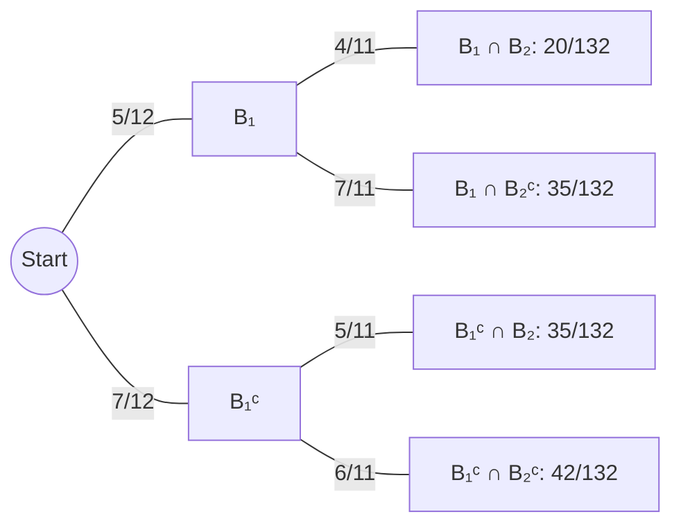

*Figure 14. Tree diagram of conditional probabilities for drawing two balls from an urn without replacement*

2. **Probability that the second ball is blue:** The second ball can be blue in two mutually exclusive ways: "both the first and the second are blue" and "the first is gray and the second is blue." That is, $B_2$ is the disjoint union of $B_2 \cap B_1$ and $B_2 \cap B_1^c$, so by axiom 3 and part 1, $P(B_2) = \frac{20}{132} + \frac{35}{132} = \frac{55}{132} = \frac{5}{12}$. This equals the probability that the first ball is blue, because without information about the first ball, the second ball is equally likely to be any of the 12 balls.
3. **Probability that at least one ball is blue:** By formula (9.8.2), $P(B_1 \cup B_2) = P(B_1) + P(B_2) - P(B_1 \cap B_2) = \frac{55}{132} + \frac{55}{132} - \frac{20}{132} = \frac{90}{132} = \frac{15}{22} \approx 0.682$.
4. **Expected number of blue balls:** Find the expected value of the number of blue balls drawn when the experiment is repeated many times. The event of 0 blue balls is the complement of the event that at least one ball is blue, so by formula (9.8.1), $P(\text{0 blue}) = 1 - \frac{15}{22} = \frac{7}{22}$. One blue ball arises along two mutually exclusive paths, so $P(\text{1 blue}) = \frac{35}{132} + \frac{35}{132} = \frac{70}{132}$, and $P(\text{2 blue}) = \frac{20}{132}$. So the expected value is $0 \cdot \frac{7}{22} + 1 \cdot \frac{70}{132} + 2 \cdot \frac{20}{132} = \frac{110}{132} = \frac{5}{6} \approx 0.83$.

### 9.2 Bayes' Theorem

The first urn holds 3 blue and 4 gray balls, and the second urn holds 5 blue and 3 gray balls. An urn is selected at random, and a ball is then drawn at random from it. Given that the ball drawn is blue, how likely is it that it was taken from the first urn?

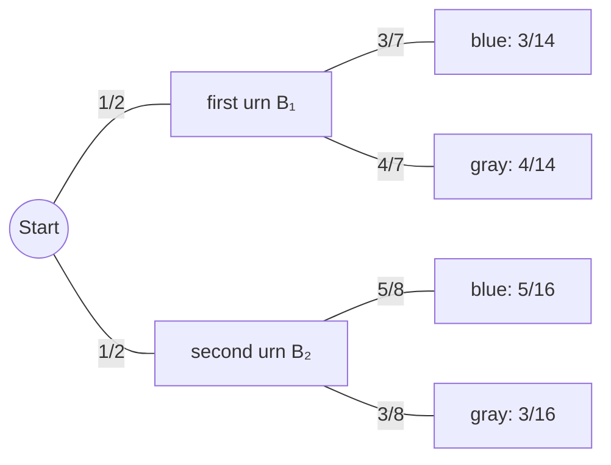

*Figure 15. Tree diagram of choosing an urn and then drawing a ball*

Let $A$ be the event that the ball is blue, $B_1$ the event that it came from the first urn, and $B_2$ the event that it came from the second urn.

1. Since 3 of the 7 balls in the first urn and 5 of the 8 balls in the second urn are blue, $P(A \mid B_1) = \frac{3}{7}$ and $P(A \mid B_2) = \frac{5}{8}$. The urns are equally likely to be chosen, so $P(B_1) = P(B_2) = \frac{1}{2}$.
2. By formula (9.9.2), $P(A \cap B_1) = P(A \mid B_1)P(B_1) = \frac{3}{7} \cdot \frac{1}{2} = \frac{3}{14}$ and $P(A \cap B_2) = P(A \mid B_2)P(B_2) = \frac{5}{8} \cdot \frac{1}{2} = \frac{5}{16}$.
3. $A$ is the disjoint union of $A \cap B_1$ and $A \cap B_2$, so by axiom 3, $P(A) = \frac{3}{14} + \frac{5}{16} = \frac{24}{112} + \frac{35}{112} = \frac{59}{112}$.
4. By the definition of conditional probability, $P(B_1 \mid A) = \frac{P(B_1 \cap A)}{P(A)} = \frac{3/14}{59/112} = \frac{3}{14} \cdot \frac{112}{59} = \frac{336}{826} = \frac{24}{59} \approx 0.407$.

Thus a blue ball came from the first urn with probability about 40.7%. Generalizing the steps of this computation gives Bayes' theorem. The theorem bears the name of Thomas Bayes, an English Presbyterian minister who put considerable effort into mathematics; it appeared in print in 1763, after his death.

> **Key Point:** **Theorem 9.9.1 (Bayes' Theorem).** Suppose a sample space $S$ is a union of mutually disjoint events $B_1, B_2, B_3, \ldots, B_n$, suppose $A$ is an event in $S$, and suppose $A$ and every $B_k$ ($1 \le k \le n$) have nonzero probabilities. Then the following holds.
>
> $$P(B_k \mid A) = \frac{P(A \mid B_k)P(B_k)}{P(A \mid B_1)P(B_1) + P(A \mid B_2)P(B_2) + \cdots + P(A \mid B_n)P(B_n)}$$

**Proof.** Generalize the steps of the urn problem above.

1. Since $S = B_1 \cup \cdots \cup B_n$, $A = A \cap S = (A \cap B_1) \cup (A \cap B_2) \cup \cdots \cup (A \cap B_n)$. Since the $B_i$ are mutually disjoint, so are the sets $A \cap B_i$.
2. By the extension of axiom 3, $P(A) = P(A \cap B_1) + \cdots + P(A \cap B_n)$, and since each $P(B_i) \ne 0$, formula (9.9.2) gives $P(A \cap B_i) = P(A \mid B_i)P(B_i)$. Hence $P(A) = P(A \mid B_1)P(B_1) + \cdots + P(A \mid B_n)P(B_n)$. This equation is called the **law of total probability**.
3. Since $P(A) \ne 0$, the definition of conditional probability and formula (9.9.2) give $P(B_k \mid A) = \frac{P(B_k \cap A)}{P(A)} = \frac{P(A \mid B_k)P(B_k)}{P(A)}$.
4. Substituting the expression of step 2 into the denominator of step 3 gives the formula of the theorem. ∎

Bayes' theorem is a way to compute "the probability that the cause is $B_k$ when the effect $A$ is observed," $P(B_k \mid A)$, from "the probability of the effect $A$ given the cause $B_k$," $P(A \mid B_k)$.

**Example 9.9.3 (Applying Bayes' Theorem).** Most medical tests sometimes give wrong results. When a test checks for a particular disease, a **false positive** is a result that reports the disease in someone who does not have it, and a **false negative** is a result that reports no disease in someone who actually has it. When large-scale screenings are designed for diseases with low incidence, one must balance the per-person cost of the screening, the cost of follow-up testing for false positives, and the possibility that people who have the disease receive a negative result and become falsely confident about their health.

Consider a screening test for a disease found in 5 people in 1,000, with a false positive rate of 3% and a false negative rate of 1%. That is, a person who has the disease tests positive 99% of the time, and a person who does not have it tests negative 97% of the time. Choose a person at random from those screened, and let $A$ be the event that the person tests positive, $B_1$ the event that the person has the disease, and $B_2$ the event that the person does not. Then the following hold.

$$
P(A \mid B_1) = 0.99, \quad P(A^c \mid B_1) = 0.01, \quad P(A^c \mid B_2) = 0.97, \quad P(A \mid B_2) = 0.03, \quad P(B_1) = 0.005, \quad P(B_2) = 0.995
$$

1. **Probability that a person who tests positive actually has the disease:** By Bayes' theorem, it is the following.

$$
P(B_1 \mid A) = \frac{P(A \mid B_1)P(B_1)}{P(A \mid B_1)P(B_1) + P(A \mid B_2)P(B_2)} = \frac{(0.99)(0.005)}{(0.99)(0.005) + (0.03)(0.995)} = \frac{0.00495}{0.00495 + 0.02985} = \frac{0.00495}{0.0348} \approx 0.1422
$$

That is, a person with a positive test result actually has the disease with probability of only about 14.2%.

2. **Probability that a person who tests negative does not have the disease:** By Bayes' theorem, it is the following.

$$
P(B_2 \mid A^c) = \frac{P(A^c \mid B_2)P(B_2)}{P(A^c \mid B_1)P(B_1) + P(A^c \mid B_2)P(B_2)} = \frac{(0.97)(0.995)}{(0.01)(0.005) + (0.97)(0.995)} = \frac{0.96515}{0.9652} \approx 0.999948
$$

That is, a person with a negative test result does not have the disease with probability of about 99.995%.

These results are easier to understand in terms of numbers of people rather than probabilities. If 100,000 people are screened, the expected numbers in each group are as follows.

| Group | Number of people | Positive result | Negative result |
|:-----|-----:|-----:|-----:|
| People with the disease | 500 | $500 \times 0.99 = 495$ | $500 \times 0.01 = 5$ |
| People without the disease | 99,500 | $99{,}500 \times 0.03 = 2{,}985$ | $99{,}500 \times 0.97 = 96{,}515$ |
| Total | 100,000 | 3,480 | 96,520 |

*Table 16. Expected numbers of 100,000 screened people by disease status and test result*

Of the 3,480 people who test positive, only 495 have the disease, giving $495 / 3{,}480 \approx 14.2\%$, and of the 96,520 who test negative, 96,515 do not have the disease, giving $96{,}515 / 96{,}520 \approx 99.995\%$. When a disease is rare, people without it are overwhelmingly numerous, so even a small false positive rate of 3% produces far more false positives than actual patients. Numbers like these are common when a screening test costs far less than an accurate test and still comes out positive for almost everyone who has the disease. Screening first means that only a small fraction of the population needs the expensive accurate test, while a person who has the disease is only rarely told that he or she does not have it.

> **Caution:** In general, $P(B \mid A)$ and $P(A \mid B)$ are different. In this example, the probability $P(A \mid B_1)$ that a person with the disease tests positive is 0.99, but the probability $P(B_1 \mid A)$ that a person who tests positive has the disease is about 0.14. Confusing the two is a very common error, and the difference grows as the prior probability $P(B_1)$ becomes smaller.

### 9.3 Independent Events

If a fair coin is tossed twice, it is intuitively clear that the result of the first toss does not affect the result of the second, and vice versa. If $A$ is the event of heads on the first toss and $B$ the event of heads on the second, the two events should be independent in the sense that $P(A \mid B) = P(A)$ and $P(B \mid A) = P(B)$. Indeed, if the coin is fair, the four outcomes HH, HT, TH, TT are equally likely, and $A$ = {HH, HT}, $B$ = {TH, HH}, $A \cap B$ = {HH}, so the following hold.

$$
P(A) = P(B) = \frac{2}{4} = \frac{1}{2}, \qquad P(A \mid B) = \frac{P(A \cap B)}{P(B)} = \frac{1/4}{1/2} = \frac{1}{2} = P(A), \qquad P(B \mid A) = \frac{P(A \cap B)}{P(A)} = \frac{1/4}{1/2} = \frac{1}{2} = P(B)
$$

To obtain a more convenient form for the definition of independence, observe the following.

1. If $P(B) \ne 0$ and $P(A \mid B) = P(A)$, then $P(A \cap B) = P(A \mid B) \cdot P(B) = P(A) \cdot P(B)$.
2. By the same argument, if $P(A) \ne 0$ and $P(B \mid A) = P(B)$, then $P(A \cap B) = P(A) \cdot P(B)$.
3. Conversely, if $P(A \cap B) = P(A) \cdot P(B)$ and $P(A) \ne 0$, then $P(B \mid A) = \frac{P(A) \cdot P(B)}{P(A)} = P(B)$, and if $P(B) \ne 0$, then likewise $P(A \mid B) = P(A)$.

So defining independence by the following product formula eliminates the requirement that the probabilities be nonzero.

> **Definition:** If $A$ and $B$ are events in a sample space $S$, then $A$ and $B$ are **independent** if, and only if, $P(A \cap B) = P(A) \cdot P(B)$. Two events that are not independent are called **dependent**.

**Example 9.9.4 (Disjoint Events and Independence).** Let $A$ and $B$ be events in a sample space $S$ with $A \cap B = \emptyset$, $P(A) \ne 0$, and $P(B) \ne 0$. Show that $P(A \cap B) \ne P(A) \cdot P(B)$. Because $A \cap B = \emptyset$, $P(A \cap B) = 0$ by axiom 2. But $P(A) \cdot P(B) \ne 0$ because neither $P(A)$ nor $P(B)$ is zero. Hence $P(A \cap B) \ne P(A) \cdot P(B)$.

> **Caution:** It would be natural to think that disjoint events are independent, but in fact almost the opposite is true: two disjoint events with nonzero probabilities are dependent. Knowing that one of them occurred gives certain information that the other did not. "Disjoint" is a set property saying that the two events cannot occur together, whereas "independent" is a probabilistic property saying that information about one event does not change the probability of the other.

**Example 9.9.5 (Complements of Independent Events).** Suppose $A$ and $B$ are independent events in a sample space $S$. Show that $A$ and $B^c$ are also independent. By the set identities of Chapter 6, for all sets $A$ and $B$, $(A \cap B) \cup (A \cap B^c) = A$ and $(A \cap B) \cap (A \cap B^c) = \emptyset$. So by axiom 3, $P(A \cap B) + P(A \cap B^c) = P(A)$, and solving for $P(A \cap B^c)$ gives the following.

$$
\begin{aligned}
P(A \cap B^c) &= P(A) - P(A \cap B) \\
&= P(A) - P(A) \cdot P(B) && (\text{because } A \text{ and } B \text{ are independent}) \\
&= P(A)\,(1 - P(B)) && (\text{factoring out } P(A)) \\
&= P(A) \cdot P(B^c) && (\text{formula } 9.8.1)
\end{aligned}
$$

So $A$ and $B^c$ are independent. Applying this result again shows that if $A$ and $B$ are independent, then so are $A^c$ and $B$, and $A^c$ and $B^c$.

**Example 9.9.6 (Computing Probabilities of Intersections of Two Independent Events).** A loaded coin lands heads with probability 0.6 and is tossed twice. Heads is more likely than tails, but nothing suggests that one toss influences the other, so it is reasonable to assume that the results of the two tosses are independent. The four outcomes of the sample space {HH, HT, TH, TT} are not equally likely. Let $E$ be the event of heads on the first toss and $F$ the event of heads on the second; then $P(E) = P(F) = 0.6$, $E$ and $F$ are independent, and by the formula for the probability of a complement, $P(E^c) = P(F^c) = 1 - 0.6 = 0.4$.

1. **Two heads:** This event is $E \cap F$, and since $E$ and $F$ are independent, $P(E \cap F) = P(E) \cdot P(F) = (0.6)(0.6) = 0.36$.
2. **One head:** This event consists of the two mutually exclusive cases "heads first, tails second" and "tails first, heads second," that is, $(E \cap F^c) \cup (E^c \cap F)$, with $(E \cap F^c) \cap (E^c \cap F) = \emptyset$. By the previous example, $E$ and $F^c$, and $E^c$ and $F$, are also independent, so the probability is $P(E) \cdot P(F^c) + P(E^c) \cdot P(F) = (0.6)(0.4) + (0.4)(0.6) = 0.48$.
3. **No heads:** This event is $E^c \cap F^c$, so its probability is $P(E^c) \cdot P(F^c) = (0.4)(0.4) = 0.16$.
4. **At least one head:** One head and two heads are disjoint events, so the probability is $0.48 + 0.36 = 0.84$. Alternatively, it is the complement of no heads, so $1 - 0.16 = 0.84$.

**Example 9.9.7 (The Expected Number of Heads When a Loaded Coin Is Tossed Twice).** In the previous example the probabilities of 0, 1, and 2 heads are 0.16, 0.48, and 0.36, so when the experiment is repeated many times the expected number of heads is $0 \cdot (0.16) + 1 \cdot (0.48) + 2 \cdot (0.36) = 1.2$.

### 9.4 Independence of Three or More Events

What are the probabilities of the various numbers of heads when a loaded coin is tossed ten or a hundred times? The previous examples showed that the probability of the intersection of two independent events is the product of their probabilities. The notion of independence is generalized so that the probability of the intersection of three or more events can also be found by multiplying their probabilities. First, three events $A$, $B$, $C$ are called **pairwise independent** if they satisfy $P(A \cap B) = P(A) \cdot P(B)$, $P(A \cap C) = P(A) \cdot P(C)$, and $P(B \cap C) = P(B) \cdot P(C)$. As the next example shows, however, three events can be pairwise independent while the probability of their intersection differs from the product of their probabilities.

**Example 9.9.8 (Exploring Independence for Three Events).** A fair coin is tossed twice. Let $A$ be the event of heads on the first toss, $B$ the event of heads on the second toss, and $C$ the event that either two heads or two tails are obtained.

1. Among the four equally likely outcomes HH, HT, TH, TT, $A$ = {HH, HT}, $B$ = {HH, TH}, and $C$ = {HH, TT}, so $P(A) = P(B) = P(C) = \frac{1}{2}$.
2. $A \cap B = A \cap C = B \cap C$ = {HH}, so each intersection has probability $\frac{1}{4} = \frac{1}{2} \cdot \frac{1}{2}$, and $A$, $B$, $C$ are pairwise independent.
3. But $A \cap B \cap C$ = {HH}, so $P(A \cap B \cap C) = \frac{1}{4} \ne \left(\frac{1}{2}\right)^3 = \frac{1}{8} = P(A) \cdot P(B) \cdot P(C)$.

Conversely, there are three events that satisfy $P(A \cap B \cap C) = P(A) \cdot P(B) \cdot P(C)$ without being pairwise independent. For example, in the sample space {1, 2, ..., 8} of eight equally likely outcomes, let $A$ = {1, 2, 3, 4}, $B$ = {1, 2, 3, 5}, and $C$ = {1, 6, 7, 8}; each has probability $\frac{1}{2}$ and $A \cap B \cap C$ = {1}, so $P(A \cap B \cap C) = \frac{1}{8} = \left(\frac{1}{2}\right)^3$, but $A \cap B$ = {1, 2, 3}, so $P(A \cap B) = \frac{3}{8} \ne \frac{1}{4}$. Because of such situations, all four conditions must be included in the definition of independence for three events.

> **Definition:** Let $A$, $B$, and $C$ be events in a sample space $S$. $A$, $B$, and $C$ are **pairwise independent** if, and only if, they satisfy conditions 1-3 below, and they are **mutually independent** if, and only if, they satisfy all four conditions.
> 1. $P(A \cap B) = P(A) \cdot P(B)$
> 2. $P(A \cap C) = P(A) \cdot P(C)$
> 3. $P(B \cap C) = P(B) \cdot P(C)$
> 4. $P(A \cap B \cap C) = P(A) \cdot P(B) \cdot P(C)$

The definition of mutual independence for any collection of $n \ge 2$ events generalizes the two previous definitions.

> **Definition:** Events $A_1, A_2, A_3, \ldots, A_n$ in a sample space $S$ are **mutually independent** if, and only if, for every subcollection of these events, the probability that all events of the subcollection occur equals the product of their individual probabilities.

**Example 9.9.9 (Tossing a Loaded Coin Ten Times).** A loaded coin that lands heads with probability 0.6 (and so tails with probability 0.4) is tossed ten times. As in the previous example, it is reasonable to assume that the results of the ten tosses are mutually independent.

1. **Probability of exactly eight heads:** For $i = 1, 2, \ldots, 10$, let $H_i$ be the event of heads on the $i$th toss and $T_i$ the event of tails on the $i$th toss. Writing HHHHHHHHTT for the event $H_1 \cap H_2 \cap \cdots \cap H_8 \cap T_9 \cap T_{10}$ in which the first eight tosses are heads and the last two are tails, the definition of mutual independence gives $P(\text{HHHHHHHHTT}) = (0.6)^8(0.4)^2$. By the commutative law of multiplication the same probability results if the eight heads occur on any other tosses; for example, $P(\text{HHTHHHHHTH}) = (0.6)^2(0.4)(0.6)^5(0.4)(0.6) = (0.6)^8(0.4)^2$. There are as many ways to obtain eight heads in ten tosses as there are subsets of eight toss numbers chosen from the ten, $\binom{10}{8}$, and the different ways are mutually exclusive, so the probability is the following.

$$
P(\text{8 heads}) = \binom{10}{8}(0.6)^8(0.4)^2 = 45 \times 0.01679616 \times 0.16 \approx 0.1209
$$

2. **Probability of at least eight heads:** By similar reasoning, $P(\text{9 heads}) = \binom{10}{9}(0.6)^9(0.4) \approx 0.0403$ and $P(\text{10 heads}) = \binom{10}{10}(0.6)^{10} \approx 0.0060$. Eight, nine, and ten heads are disjoint events, so the probability is the following.

$$
P(\text{at least 8 heads}) = \binom{10}{8}(0.6)^8(0.4)^2 + \binom{10}{9}(0.6)^9(0.4) + \binom{10}{10}(0.6)^{10} \approx 0.1209 + 0.0403 + 0.0060 \approx 0.167
$$

That is, about 16.7%.

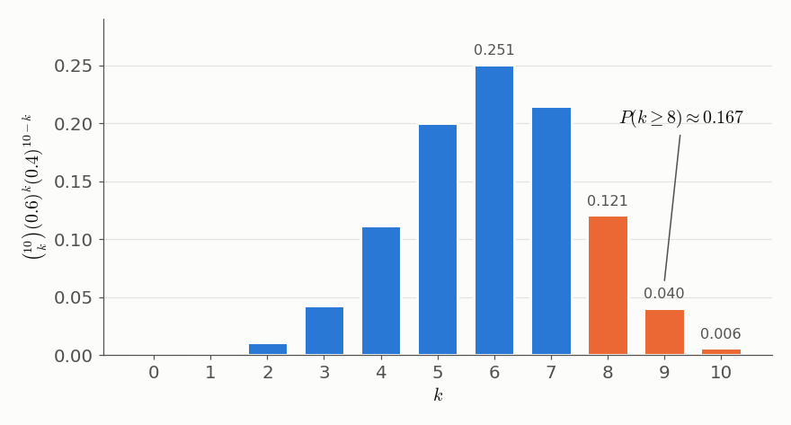

*Figure 16. Binomial probabilities of k heads when a coin with probability 0.6 of heads is tossed ten times*

Note the occurrence of binomial coefficients in the solution of this example. When a random process is repeated with mutually independent repetitions, each having the same two possible outcomes (for example, success and failure) with the same probabilities each time, the probability that an outcome of probability $p$ occurs exactly $k$ times in $n$ repetitions is $\binom{n}{k}p^k(1 - p)^{n-k}$ (with $0 \le p \le 1$), and probabilities of this form are called **binomial probabilities**.

> **[Probability and Statistics]** The probability distribution of the number of successes in $n$ independent trials with success probability $p$ is called the binomial distribution $B(n, p)$, and its expected value is $np$. The expected number of heads 1.2 for two tosses of the loaded coin in Section 9.3 equals $2 \times 0.6$, and the distribution in Figure 16 has expected value $10 \times 0.6 = 6$.

---

<br>

## Concept Applications

The following table applies the counting principles of this chapter to new situations.

| Situation | Principle to apply | Result |
|:-----|:-----|:-----|
| Number of bit strings of length 5 | multiplication rule (2 ways per position) | $2^5 = 32$ |
| Ways to choose a president and a vice president from 7 people | r-permutation (ordered, no repetition) | $P(7, 2) = 42$ |
| Ways to form a 3-person committee from 7 people | r-combination (unordered, no repetition) | $\binom{7}{3} = 35$ |
| Ways to choose 5 candies from 3 kinds | r-combination with repetition allowed | $\binom{5 + 3 - 1}{5} = \binom{7}{5} = 21$ |
| Number of integers from 1 through 100 that are multiples of 2 or of 3 | inclusion/exclusion rule | $50 + 33 - 16 = 67$ |
| Ways to arrange the letters of the word BANANA | permutations with indistinguishable objects | $\frac{6!}{3!\,2!\,1!} = 60$ |
| Must two of 367 people share a birthday (366 possible, including February 29)? | pigeonhole principle | yes, since $367 > 366$ |

*Table 17. Counting principles applied to new situations and their results*

**True/False Check:**

| Statement | Judgment and Reason |
|:-----|:-----|
| Two disjoint events with nonzero probabilities are independent. | **F.** $P(A \cap B) = 0 \ne P(A) \cdot P(B)$, so the two events are dependent. |
| To use the multiplication rule, the choices at each step must be the same regardless of earlier steps. | **F.** The choices themselves may differ; only the **number** of choices must be constant (PINs without repetition). |
| For nonnegative integers $n$ and $r$ with $r \le n$, $\binom{n}{r} = \binom{n}{n-r}$. | **T.** Subsets of size $r$ correspond one-to-one with their complements (of size $n - r$). |
| Among any 13 people, two must have been born in the same month. | **T.** By the pigeonhole principle, a function from 13 people to 12 months cannot be one-to-one. |
| $P(B \mid A) = P(A \mid B)$ always holds. | **F.** In the medical test example, $P(A \mid B_1) = 0.99$ but $P(B_1 \mid A) \approx 0.14$. |
| There are $n^r$ ways to choose $r$ items from $n$ kinds without regard to order with repetition allowed. | **F.** $n^r$ counts ordered selections; without order there are $\binom{r + n - 1}{r}$ ways. |
| Three pairwise independent events are mutually independent. | **F.** In tossing a coin twice, $A$, $B$, $C$ are pairwise independent but $P(A \cap B \cap C) = \frac{1}{4} \ne \frac{1}{8}$. |

---

<br>

## Summary

| Concept | Key Summary |
|:-----|:----------|
| Sample space and event | A sample space is the set of all outcomes of a random process, and an event is a subset of a sample space. |
| Equally likely probability formula | In a finite sample space whose outcomes are all equally likely, $P(E) = N(E)/N(S)$. |
| Number of elements in a list | For integers $m \le n$, there are $n - m + 1$ integers from $m$ through $n$. |
| Multiplication rule | If the steps can be performed in $n_1, \ldots, n_k$ ways regardless of earlier steps, the whole operation can be performed in $n_1 n_2 \cdots n_k$ ways. |
| Permutations and r-permutations | A set of $n$ elements has $n!$ permutations and $P(n, r) = n!/(n-r)!$ r-permutations. Circular permutations number $(n-1)!$. |
| Addition and difference rules | The number of elements in a union of mutually disjoint sets is the sum of their numbers of elements, and $N(A - B) = N(A) - N(B)$ if $B \subseteq A$. |
| Probability of a complement | $P(A^c) = 1 - P(A)$, and the probability of "at least one" is often simplest to find through the complement. |
| Inclusion/exclusion rule | $N(A \cup B) = N(A) + N(B) - N(A \cap B)$, and for three sets the intersection terms are alternately subtracted and added. |
| Pigeonhole principle | A function from a finite set to a smaller finite set is not one-to-one. It underlies the fact that decimal expansions of rational numbers terminate or repeat. |
| Generalized pigeonhole principle | If $km < n$, some pigeonhole holds $k + 1$ or more pigeons. The contrapositive form says that if each inverse image has at most $k$ elements, then $n \le km$. |
| One-to-one and onto for finite sets | A function between finite sets of the same size is one-to-one if, and only if, it is onto. This fails for infinite sets. |
| r-combinations | The number of subsets of size $r$ is $\binom{n}{r} = P(n, r)/r! = n!/(r!\,(n-r)!)$. |
| Permutations with indistinguishable objects | $n$ objects with $n_1, \ldots, n_k$ of each type have $n!/(n_1!\cdots n_k!)$ distinguishable permutations. |
| Double counting | When using the multiplication rule, check that no outcome appears on more than one branch of the tree. |
| r-combinations with repetition allowed | Represented by strings of $n - 1$ bars and $r$ crosses, they number $\binom{r + n - 1}{r}$. |
| Pascal's formula | If $1 \le r \le n$, then $\binom{n+1}{r} = \binom{n}{r-1} + \binom{n}{r}$, with an algebraic proof and a combinatorial proof. |
| Binomial theorem | $(a+b)^n = \sum_{k=0}^{n}\binom{n}{k}a^{n-k}b^k$, proved by induction with Pascal's formula or by choosing the positions of the $b$'s. |
| Probability axioms | $0 \le P(A) \le 1$, $P(\emptyset) = 0$, $P(S) = 1$, and the probability of a union of disjoint events is the sum of their probabilities. |
| Probability of a union | $P(A \cup B) = P(A) + P(B) - P(A \cap B)$ holds even when the outcomes are not equally likely. |
| Expected value | It is the weighted average $\sum a_k p_k$ of the outcomes $a_k$ with probabilities $p_k$; in the lottery example it is $-1.78$ dollars per ticket. |
| Conditional probability | If $P(A) \ne 0$, then $P(B \mid A) = P(A \cap B)/P(A)$, and $P(A \cap B) = P(B \mid A)P(A)$. |
| Bayes' theorem | Find $P(A)$ by the law of total probability and compute $P(B_k \mid A) = P(A \mid B_k)P(B_k)/\sum_i P(A \mid B_i)P(B_i)$. |
| Independent events | $A$ and $B$ are independent if $P(A \cap B) = P(A)P(B)$. Disjoint events with nonzero probabilities are dependent, and complements of independent events are independent. |
| Mutual independence and binomial probabilities | Independence of three or more events requires the product formula for the intersection of every subcollection, and the probability of $k$ successes in independent trials is $\binom{n}{k}p^k(1-p)^{n-k}$. |

---

<br>

## Self-Check Questions

1. **Counting a list and probability:** How many four-digit integers (1000 through 9999) are multiples of 9, and what is the probability that a randomly chosen four-digit integer is a multiple of 9?

   <details>
   <summary>Answer</summary>

   The four-digit multiples of 9 run from $1008 = 9 \cdot 112$ to $9999 = 9 \cdot 1111$, so by Theorem 9.1.1 there are $1111 - 112 + 1 = 1000$ of them. There are $9999 - 1000 + 1 = 9000$ four-digit integers, so the probability is $1000/9000 = 1/9$.

   </details>

2. **Multiplication and difference rules:** How many four-digit passwords made of the digits 0-9 (a leading 0 allowed) have at least one repeated digit, and what is the probability that a randomly chosen password does?

   <details>
   <summary>Answer</summary>

   By the multiplication rule there are $10^4 = 10{,}000$ passwords in all, and $10 \cdot 9 \cdot 8 \cdot 7 = 5{,}040$ with no repetition. By the difference rule, $10{,}000 - 5{,}040 = 4{,}960$ have a repeated digit, and the probability is $4{,}960/10{,}000 = 0.496$.

   </details>

3. **Inclusion/exclusion rule:** How many integers from 1 through 500 are divisible by neither 4 nor 6?

   <details>
   <summary>Answer</summary>

   There are $\lfloor 500/4 \rfloor = 125$ multiples of 4 and $\lfloor 500/6 \rfloor = 83$ multiples of 6. The common multiples of 4 and 6 are the multiples of their least common multiple 12, so there are $\lfloor 500/12 \rfloor = 41$ of them (counting multiples of 24 would be wrong). By the inclusion/exclusion rule, $125 + 83 - 41 = 167$ integers are multiples of 4 or of 6, and by the difference rule the answer is $500 - 167 = 333$.

   </details>

4. **Pigeonhole principle:** (a) Show that if 11 integers are chosen from 1 through 20, two of them must add up to 21. (b) Among 100 people, at least how many can be guaranteed to have been born in the same month?

   <details>
   <summary>Answer</summary>

   (a) Partition 1 through 20 into the 10 pairs {1, 20}, {2, 19}, ..., {10, 11}, each with sum 21. Treat the 11 chosen integers as pigeons and the 10 pairs as pigeonholes, and send each integer to the pair containing it; since $11 > 10$, two distinct integers lie in the same pair, and their sum is 21. (b) Since $8 \cdot 12 = 96 < 100$, the generalized pigeonhole principle says that $8 + 1 = 9$ or more people were born in some month. This equals $\lceil 100/12 \rceil = 9$.

   </details>

5. **r-permutations and r-combinations:** In how many ways can a president, a treasurer, and a secretary be chosen from 10 people, and in how many ways can a 3-person committee be formed? What does the ratio of the two numbers mean?

   <details>
   <summary>Answer</summary>

   The positions are different, so order matters, giving $P(10, 3) = 10 \cdot 9 \cdot 8 = 720$ ways; a committee is unordered, giving $\binom{10}{3} = 120$ ways. The ratio $720/120 = 6 = 3!$ is the number of ways to assign the three positions to the same three people, illustrating $P(n, r) = \binom{n}{r} \cdot r!$.

   </details>

6. **Permutations with indistinguishable objects:** In how many distinguishable ways can the letters of the word LETTER be arranged?

   <details>
   <summary>Answer</summary>

   The six letters are one L, two E's, two T's, and one R. By Theorem 9.5.2 there are $\frac{6!}{1!\,2!\,2!\,1!} = \frac{720}{4} = 180$ ways.

   </details>

7. **r-combinations with repetition allowed:** How many solutions does the equation $x_1 + x_2 + x_3 = 12$ have if each $x_i$ is an integer with $x_i \ge 2$?

   <details>
   <summary>Answer</summary>

   Let $y_i = x_i - 2$; then each $y_i \ge 0$ and $y_1 + y_2 + y_3 = 12 - 6 = 6$. This equals the number of ways to choose 6 items from 3 categories with repetition allowed, so by Theorem 9.6.1 there are $\binom{6 + 3 - 1}{6} = \binom{8}{6} = 28$ solutions.

   </details>

8. **Binomial theorem:** Find the coefficient of $x^3y^2$ in the expansion of $(2x - y)^5$.

   <details>
   <summary>Answer</summary>

   With $a = 2x$ and $b = -y$, the term of $a^{5-k}b^k$ with $k = 2$ is $\binom{5}{2}(2x)^3(-y)^2 = 10 \cdot 8x^3 \cdot y^2 = 80x^3y^2$. So the coefficient is 80.

   </details>

9. **Bayes' theorem:** In a factory, machine $M_1$ makes 60% of the products and machine $M_2$ makes 40%, with defect rates of 2% and 5%, respectively. If a randomly chosen product is defective, what is the probability that it was made by $M_2$?

   <details>
   <summary>Answer</summary>

   Let $D$ be the event that the product is defective. By the law of total probability, $P(D) = (0.02)(0.6) + (0.05)(0.4) = 0.012 + 0.02 = 0.032$. By Bayes' theorem, $P(M_2 \mid D) = \frac{(0.05)(0.4)}{0.032} = \frac{0.02}{0.032} = 0.625$. Although $M_2$ makes only 40% of the products, it makes 62.5% of the defective ones.

   </details>

10. **Independence and expected value:** When a fair die is rolled once, are the event $A = \lbrace 2, 4, 6 \rbrace$ of an even number and the event $B = \lbrace 1, 2, 3, 4 \rbrace$ of a number at most 4 independent? Also find the expected value of a game in which a player receives 6 dollars if a 6 comes up and pays 1 dollar otherwise.

    <details>
    <summary>Answer</summary>

    $P(A) = \frac{1}{2}$, $P(B) = \frac{4}{6} = \frac{2}{3}$, and $A \cap B$ = {2, 4}, so $P(A \cap B) = \frac{2}{6} = \frac{1}{3} = \frac{1}{2} \cdot \frac{2}{3}$. Hence $A$ and $B$ are independent. The expected value of the game is $6 \cdot \frac{1}{6} + (-1) \cdot \frac{5}{6} = \frac{1}{6} \approx 0.17$ dollars.

    </details>

---

<br>

## References

1. V. Fuller and T. Li, "Classless Inter-domain Routing (CIDR): The Internet Address Assignment and Aggregation Plan," *IETF RFC 4632*, Aug. 2006. https://www.rfc-editor.org/rfc/rfc4632
