# 10장 — 그래프와 트리 이론

[레포지토리 안내](../../README.ko.md) | [English](Concepts_Lecture.md) | [한국어](Concepts_Lecture.ko.md)

> **최종 수정일:** 2026-11-10
>
> Discrete Mathematics with Applications, Epp, Ch 10

> **학습 목표:**
> 1. 보행, 트레일, 경로, 회로, 단순 회로를 구분하고 그래프의 연결성과 연결 성분을 판정할 수 있다
> 2. 오일러 회로와 오일러 트레일이 존재할 조건을 증명하고 적용하며, 부분 그래프의 조건으로 해밀턴 회로가 없음을 보일 수 있다
> 3. 그래프를 인접 행렬로 나타내고 행렬의 거듭제곱으로 길이가 n인 보행의 개수를 셀 수 있다
> 4. 두 그래프 사이의 동형 사상을 구성하거나 동형 불변량으로 두 그래프가 동형이 아님을 보일 수 있다
> 5. 트리의 꼭짓점 수와 변 수의 관계, 루트 트리와 이진 트리의 성질을 증명하고 이진 탐색 트리를 만들 수 있다
> 6. 크루스칼 알고리즘과 프림 알고리즘으로 최소 신장 트리를, 다익스트라 알고리즘으로 최단 경로를 구하고 각 알고리즘이 옳은 이유를 설명할 수 있다

---

## 목차

- [1. 트레일, 경로, 회로](#1-트레일-경로-회로)
  - [1.1 쾨니히스베르크의 다리 문제](#11-쾨니히스베르크의-다리-문제)
  - [1.2 그래프의 기본 용어](#12-그래프의-기본-용어)
  - [1.3 보행, 트레일, 경로, 회로](#13-보행-트레일-경로-회로)
  - [1.4 부분 그래프](#14-부분-그래프)
  - [1.5 연결성과 연결 성분](#15-연결성과-연결-성분)
  - [1.6 오일러 회로](#16-오일러-회로)
  - [1.7 오일러 트레일](#17-오일러-트레일)
  - [1.8 해밀턴 회로](#18-해밀턴-회로)
  - [1.9 외판원 문제](#19-외판원-문제)
- [2. 그래프의 행렬 표현](#2-그래프의-행렬-표현)
  - [2.1 행렬](#21-행렬)
  - [2.2 방향 그래프의 인접 행렬](#22-방향-그래프의-인접-행렬)
  - [2.3 무방향 그래프의 인접 행렬과 대칭 행렬](#23-무방향-그래프의-인접-행렬과-대칭-행렬)
  - [2.4 인접 행렬과 연결 성분](#24-인접-행렬과-연결-성분)
  - [2.5 행렬의 곱](#25-행렬의-곱)
  - [2.6 단위 행렬과 행렬의 거듭제곱](#26-단위-행렬과-행렬의-거듭제곱)
  - [2.7 길이가 n인 보행의 개수](#27-길이가-n인-보행의-개수)
- [3. 그래프의 동형](#3-그래프의-동형)
  - [3.1 동형의 정의](#31-동형의-정의)
  - [3.2 두 그래프가 동형임을 보이기](#32-두-그래프가-동형임을-보이기)
  - [3.3 동치 관계로서의 그래프 동형](#33-동치-관계로서의-그래프-동형)
  - [3.4 동형 불변량](#34-동형-불변량)
  - [3.5 단순 그래프의 동형](#35-단순-그래프의-동형)
- [4. 트리의 예와 기본 성질](#4-트리의-예와-기본-성질)
  - [4.1 트리와 숲](#41-트리와-숲)
  - [4.2 트리의 예](#42-트리의-예)
  - [4.3 차수가 1인 꼭짓점과 리프](#43-차수가-1인-꼭짓점과-리프)
  - [4.4 트리의 꼭짓점 수와 변 수](#44-트리의-꼭짓점-수와-변-수)
  - [4.5 회로의 변 하나를 지운 그래프](#45-회로의-변-하나를-지운-그래프)
  - [4.6 연결 그래프가 트리가 되는 조건](#46-연결-그래프가-트리가-되는-조건)
- [5. 루트 트리](#5-루트-트리)
  - [5.1 루트 트리의 용어](#51-루트-트리의-용어)
  - [5.2 이진 트리](#52-이진-트리)
  - [5.3 정 이진 트리의 꼭짓점 수](#53-정-이진-트리의-꼭짓점-수)
  - [5.4 이진 트리의 높이와 리프 수](#54-이진-트리의-높이와-리프-수)
  - [5.5 이진 탐색 트리](#55-이진-탐색-트리)
- [6. 신장 트리와 최단 경로 알고리즘](#6-신장-트리와-최단-경로-알고리즘)
  - [6.1 신장 트리](#61-신장-트리)
  - [6.2 최소 신장 트리](#62-최소-신장-트리)
  - [6.3 크루스칼 알고리즘](#63-크루스칼-알고리즘)
  - [6.4 프림 알고리즘](#64-프림-알고리즘)
  - [6.5 다익스트라 최단 경로 알고리즘](#65-다익스트라-최단-경로-알고리즘)
- [개념 적용](#개념-적용)
- [요약](#요약)
- [점검 문제](#점검-문제)

---

<br>

## 1. 트레일, 경로, 회로

그래프는 전력선과 광케이블의 배치, 교통망, 지식 베이스, 근거리 통신망부터 월드 와이드 웹에 이르는 컴퓨터의 연결처럼 대상과 대상 사이의 연결로 이루어진 구조를 모형화한다. 앞 장들에서는 가능성 트리, 관계의 방향 그래프, 하세 도표처럼 그래프와 트리를 시각화 도구로 썼다. 이 장은 그래프와 트리 자체를 수학의 대상으로 삼아 연결성, 오일러 회로와 해밀턴 회로, 행렬 표현, 동형, 트리의 꼭짓점 수와 변 수의 관계, 루트 트리, 신장 트리, 최단 경로를 다룬다. 이 절은 그래프 위에서 꼭짓점과 변을 따라 이동하는 방법을 정의하는 데서 시작한다.

### 1.1 쾨니히스베르크의 다리 문제

그래프 이론은 1736년 오일러(Leonhard Euler)가 다음 퍼즐의 풀이를 발표하면서 시작되었다. 프로이센의 도시 쾨니히스베르크(지금의 러시아 칼리닌그라드)는 프레겔강의 두 지류가 만나는 곳에 세워졌으며, 섬 하나와 강변의 땅들이 일곱 개의 다리로 이어져 있었다. 질문은 다음과 같다. 한 지점에서 출발하여 일곱 다리를 모두 정확히 한 번씩 건너고 출발한 지점으로 돌아오는 산책 길이 존재하는가?

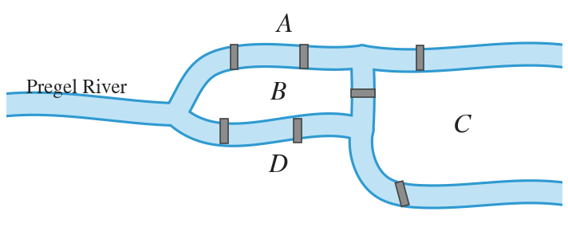

*그림 1. 쾨니히스베르크의 일곱 다리와 네 땅덩이 A, B, C, D*

> **참고:** 오일러의 원래 논문은 출발점과 도착점이 같을 것을 요구하지 않았다. 출발점과 도착점이 같다는 조건을 붙이면 분석이 단순해지며, 출발점과 도착점이 다른 경우는 1.7절의 오일러 트레일에서 다룬다.

오일러는 같은 땅덩이 안에서는 다리를 건너지 않고도 어느 지점으로든 갈 수 있으므로, 한 땅덩이의 모든 지점을 하나로 보아도 된다는 점에 주목했다. 그래서 땅덩이 A, B, C, D를 꼭짓점으로, 일곱 다리를 변으로 바꾸면 퍼즐은 다음 그래프에 관한 문제가 된다. A와 B 사이, B와 D 사이에는 다리가 각각 두 개 있고, A와 C, B와 C, D와 C 사이에는 다리가 하나씩 있다.

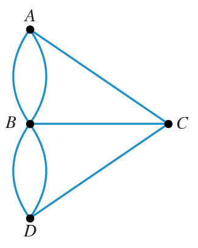

*그림 2. 쾨니히스베르크 다리 문제를 나타낸 그래프*

이 그래프에서 질문은 "어떤 꼭짓점에서 출발하여 모든 변을 정확히 한 번씩 지나고 같은 꼭짓점으로 돌아오는 길이 있는가?"가 된다. 같은 말로, 연필을 종이에서 떼지 않고 어떤 변도 두 번 긋지 않으면서 그림 전체를 그리고 출발점으로 돌아올 수 있는가를 묻는 것이다.

직접 길을 찾아보면, 아직 지나지 않은 변이 다른 곳에 남아 있는데 지금 있는 꼭짓점에서 나갈 변이 없는 상황에 거듭 부딪힌다. 그 이유는 다음과 같다. A에서 출발하여 A로 돌아오는 길이 있다고 하자. 그 길이 B, C, D 중 하나를 지날 때마다 한 변으로 들어와서 다른 변으로 나가므로 변 두 개를 쓴다. 따라서 모든 변을 쓰는 길이라면 B, C, D 각각에 붙은 변의 수가 2의 배수, 즉 B, C, D의 차수가 짝수여야 한다. 그러나 $\deg(B) = 5$, $\deg(C) = 3$, $\deg(D) = 3$이다. 따라서 A에서 출발하는 길은 없다. 같은 논리로 B, C, D에서 출발하는 길도 없다. 예를 들어 B에서 출발하면 A, C, D의 차수가 짝수여야 하는데 $\deg(A) = 3$이다. 결론적으로 모든 다리를 정확히 한 번씩 건너 출발점으로 돌아오는 산책은 불가능하다.

> **핵심:** 이동이 중간에 지나는 꼭짓점에서는 들어오는 변과 나가는 변이 짝을 이루므로, 그런 꼭짓점의 차수는 짝수여야 한다. 이 관찰을 일반화한 것이 1.6절의 정리 10.1.2이다.

### 1.2 그래프의 기본 용어

이 장에서 쓰는 그래프의 기본 용어를 1장에서 가져와 정리한다.

> **용어 정의:** **그래프(graph)** $G$는 공집합이 아닌 유한 집합 $V(G)$와 유한 집합 $E(G)$로 이루어진다. $V(G)$의 원소를 **꼭짓점(vertex)**, $E(G)$의 원소를 **변(edge)** 이라 하며, 각 변에는 **끝점(endpoint)** 이라 부르는 꼭짓점 한 개 또는 두 개로 이루어진 집합이 대응한다. 변을 끝점의 집합으로 보내는 이 대응을 **변-끝점 함수(edge-endpoint function)** 라 한다.

- 끝점이 하나뿐인 변을 **루프(loop)** 라 하고, 끝점의 집합이 같은 서로 다른 변들을 **평행 변(parallel edges)** 이라 한다.
- 변으로 이어진 두 꼭짓점은 서로 **인접한다(adjacent)**. 변은 각 끝점에 **접한다(incident on)** 고 하며, 같은 끝점에 접하는 두 변도 서로 인접한다고 한다. 어떤 변도 접하지 않는 꼭짓점은 **고립 꼭짓점(isolated vertex)** 이다.
- 꼭짓점 $v$의 **차수(degree)** $\deg(v)$는 $v$에 접하는 변의 수이며, 루프는 두 번 센다.
- 각 변에 끝점의 순서쌍이 대응하는 그래프, 즉 변이 화살표인 그래프를 **방향 그래프(directed graph)** 라 한다. 그렇지 않은 그래프를 강조할 때는 무방향 그래프라 부른다.

이 장에서는 다음 두 종류의 그래프도 자주 쓴다.

> **용어 정의:** 루프도 평행 변도 없는 그래프를 **단순 그래프(simple graph)** 라 한다. 단순 그래프에서는 끝점이 $u$와 $v$인 변이 많아야 하나이므로 그 변을 $\lbrace u, v\rbrace$로 나타낸다. 꼭짓점이 $n$개이고 서로 다른 두 꼭짓점마다 변이 정확히 하나씩 있는 단순 그래프를 **완전 그래프(complete graph)** $K_n$이라 한다.

$K_n$의 변은 서로 다른 두 꼭짓점을 고르는 방법의 수만큼 있으므로 $\binom{n}{2} = \frac{n(n-1)}{2}$개이다. 기호 $\binom{n}{2}$는 n 선택 2(n choose 2)로 읽으며, 원소가 $n$개인 집합에서 고를 수 있는 크기 2인 부분집합의 개수이다(9장 5절). 또 그래프의 모든 꼭짓점의 차수를 더한 값을 **총차수(total degree)** 라 하면, 변 집합의 원소 수를 $\lvert E(G)\rvert$로 쓸 때 다음이 성립한다.

```math
\sum_{v \in V(G)} \deg(v) = 2 \lvert E(G)\rvert
```

각 변은 두 끝점의 차수에 1씩, 루프는 그 끝점의 차수에 2를 더하므로 어느 경우든 총차수에 정확히 2를 기여하기 때문이다. 이 사실을 **악수 정리(handshake theorem)** 라 한다. 따라서 총차수는 항상 짝수이고, 차수가 홀수인 꼭짓점의 개수도 짝수이다.

### 1.3 보행, 트레일, 경로, 회로

그래프 위에서의 이동은 한 꼭짓점에서 변을 따라 인접한 꼭짓점으로 옮겨 가는 일을 반복하는 것이다. 이동할 때 같은 변을 다시 쓰는지, 같은 꼭짓점을 다시 지나는지, 출발한 꼭짓점으로 돌아오는지에 따라 이동에 다른 이름을 붙인다.

> **용어 정의:** **보행, 트레일, 경로, 회로(walks, trails, paths, and circuits).** $G$를 그래프, $v$와 $w$를 $G$의 꼭짓점이라 하자.
> - $v$에서 $w$로 가는 **보행(walk)** 은 $G$의 꼭짓점과 변을 번갈아 나열한 유한한 열 $v_0 e_1 v_1 e_2 \cdots v_{n-1} e_n v_n$이다. 여기서 $v_0 = v$, $v_n = w$이고, 각 $i = 1, 2, \ldots, n$에 대해 $v_{i-1}$과 $v_i$는 $e_i$의 끝점이다. 꼭짓점 $v$ 하나로만 이루어진 열을 $v$에서 $v$로 가는 **자명한 보행(trivial walk)** 이라 한다.
> - $v$에서 $w$로 가는 **트레일(trail)** 은 같은 변이 두 번 나타나지 않는 보행이다.
> - $v$에서 $w$로 가는 **경로(path)** 는 같은 꼭짓점이 두 번 나타나지 않는 트레일이다.
> - **닫힌 보행(closed walk)** 은 출발한 꼭짓점과 같은 꼭짓점에서 끝나는 보행이다.
> - **회로(circuit)** 는 변을 적어도 하나 포함하고 같은 변이 두 번 나타나지 않는 닫힌 보행이다.
> - **단순 회로(simple circuit)** 는 처음과 마지막 꼭짓점을 빼면 같은 꼭짓점이 두 번 나타나지 않는 회로이다.

보행에 들어 있는 변의 개수를 같은 변이 반복되면 반복된 횟수만큼 세어 **보행의 길이(length)** 라 한다. 예를 들어 $v_0 e_1 v_1 e_2 v_2$의 길이는 2이고 자명한 보행의 길이는 0이다. 여섯 가지 이동의 차이는 다음 표로 정리된다.

| 이름 | 반복된 변 | 반복된 꼭짓점 | 출발점과 도착점이 같은가 | 변이 적어도 하나 필요한가 |
|:-----|:-----|:-----|:-----|:-----|
| 보행 | 허용 | 허용 | 허용 | 아니다 |
| 트레일 | 불허 | 허용 | 허용 | 아니다 |
| 경로 | 불허 | 불허 | 아니다 | 아니다 |
| 닫힌 보행 | 허용 | 허용 | 같다 | 아니다 |
| 회로 | 불허 | 허용 | 같다 | 필요하다 |
| 단순 회로 | 불허 | 처음과 마지막만 | 같다 | 필요하다 |

*표 1. 보행, 트레일, 경로, 닫힌 보행, 회로, 단순 회로의 비교*

정의에서 바로 따라 나오는 포함 관계가 있다. 모든 경로는 트레일이고 모든 트레일은 보행이다. 모든 단순 회로는 회로이고 모든 회로는 닫힌 보행이다.

보행은 꼭짓점과 변을 모두 적는 대신 변의 열이나 꼭짓점의 열만으로 적을 때가 많다. 다만 그렇게 줄여 쓴 표기가 하나의 보행만 가리키는지 확인해야 한다.

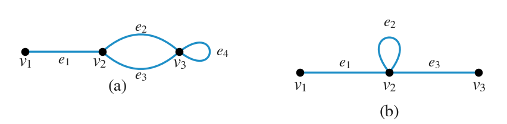

*그림 3. 보행 표기의 모호성을 보이는 두 그래프*

**예제 10.1.1 (보행의 표기).** 그림 3 (a)의 그래프에서 변의 열 $e_1 e_2 e_4 e_3$은 보행 $v_1 e_1 v_2 e_2 v_3 e_4 v_3 e_3 v_2$ 하나만 가리킨다. $e_1$의 끝점이 $v_1, v_2$이고 $e_2$가 $v_2$와 $v_3$을 잇는다는 사실에서 $v_1$부터 시작해야 함이 정해지기 때문이다. 반면 변 하나만 적은 $e_1$은 $v_1 e_1 v_2$인지 $v_2 e_1 v_1$인지 알 수 없으므로 모호하다. 또 꼭짓점의 열 $v_2 v_3$은 $v_2$와 $v_3$ 사이에 평행 변 $e_2, e_3$이 있어 $v_2 e_2 v_3$과 $v_2 e_3 v_3$ 중 어느 것인지 알 수 없다. 그림 3 (b)의 그래프에서는 꼭짓점의 열 $v_1 v_2 v_2 v_3$이 보행 $v_1 e_1 v_2 e_2 v_2 e_3 v_3$ 하나만 가리킨다. 각 꼭짓점 쌍을 잇는 변이 하나뿐이고 $v_2$의 루프도 하나뿐이기 때문이다.

> **핵심:** 평행 변이 없는 그래프에서는 모든 보행이 꼭짓점의 열만으로 하나로 결정된다.

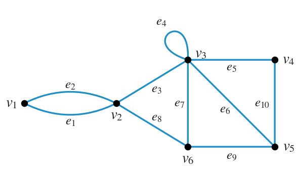

*그림 4. 보행의 종류를 판정할 그래프*

**예제 10.1.2 (보행, 트레일, 경로, 회로의 판정).** 그림 4의 그래프에서 여섯 보행의 종류를 판정한다. 그래프에서 $e_1, e_2$는 $v_1$과 $v_2$를 잇는 평행 변이고, $e_4$는 $v_3$의 루프이다.

| 보행 | 반복된 변 | 반복된 꼭짓점 | 판정 |
|:-----|:-----|:-----|:-----|
| (a) $v_1 e_1 v_2 e_3 v_3 e_4 v_3 e_5 v_4$ | 없음 | $v_3$ | $v_1$에서 $v_4$로 가는 트레일이며 경로는 아니다 |
| (b) $e_1 e_3 e_5 e_5 e_6$ | $e_5$ | $v_3$ | $v_1$에서 $v_5$로 가는 보행일 뿐이다 |
| (c) $v_2 v_3 v_4 v_5 v_3 v_6 v_2$ | 없음 | 중간의 $v_3$ | 회로이며 단순 회로는 아니다 |
| (d) $v_2 v_3 v_4 v_5 v_6 v_2$ | 없음 | 처음과 마지막뿐 | 단순 회로이다 |
| (e) $v_1 e_1 v_2 e_1 v_1$ | $e_1$ | 처음과 마지막뿐 | 닫힌 보행이며 회로는 아니다 |
| (f) $v_1$ | 없음 | 없음 | 변이 없으므로 회로가 아닌 닫힌 보행이다 |

*표 2. 그림 4의 그래프에서 여섯 보행을 판정한 결과*

(b)는 변의 열로 주어졌으므로 꼭짓점을 채우면 $v_1 e_1 v_2 e_3 v_3 e_5 v_4 e_5 v_3 e_6 v_5$이다. $e_5$를 두 번 지나므로 트레일이 아니다. (c)와 (d)는 평행 변이 없는 부분만 지나므로 꼭짓점의 열로 보행이 하나로 정해진다. (c)는 $v_2$에서 출발하여 $v_2$로 돌아오고, 변이 적어도 하나 있으며 반복된 변이 없으므로 회로이지만 중간에 $v_3$을 두 번 지나므로 단순 회로가 아니다. (f)는 자명한 보행으로, 처음과 마지막 꼭짓점이 같으므로 닫힌 보행이고 반복된 변이 없으므로 $v_1$에서 $v_1$로 가는 트레일이기도 하다.

> **주의:** 그래프 이론의 용어는 책마다 다르다. 교재의 그래프를 다른 책은 다중 그래프(multigraph)라 하고, 교재의 단순 그래프를 단순히 그래프라 부르기도 한다. 꼭짓점을 노드(node), 변을 아크(arc)라 부르는 책도 있다. 특히 교재의 트레일을 경로(path)라 하고, 교재의 경로를 단순 경로(simple path), 단순 회로를 사이클(cycle)이라 부르는 책이 많으므로 다른 자료를 읽을 때는 정의를 먼저 확인해야 한다.

### 1.4 부분 그래프

> **용어 정의:** 그래프 $H$의 모든 꼭짓점이 그래프 $G$의 꼭짓점이고, $H$의 모든 변이 $G$의 변이며, $H$의 각 변의 끝점이 $G$에서의 끝점과 같으면 $H$를 $G$의 **부분 그래프(subgraph)** 라 한다.

부분 그래프도 그래프이므로 꼭짓점이 적어도 하나 있어야 하고, 부분 그래프에 넣은 변의 끝점은 모두 부분 그래프의 꼭짓점이어야 한다.

**예제 10.1.3 (부분 그래프 나열).** 꼭짓점 집합이 $\lbrace v_1, v_2\rbrace$이고 변 집합이 $\lbrace e_1, e_2, e_3\rbrace$인 그래프 $G$를 생각한다. $e_1$과 $e_2$는 모두 $v_1$과 $v_2$를 잇고, $e_3$은 $v_1$의 루프이다. $G$의 부분 그래프를 변의 개수에 따라 나누어 센다.

- 변이 없는 부분 그래프는 공집합이 아닌 꼭짓점 집합 $\lbrace v_1\rbrace$, $\lbrace v_2\rbrace$, $\lbrace v_1, v_2\rbrace$마다 하나씩 3개이다.
- 변이 하나인 부분 그래프는 4개이다. $e_1$이나 $e_2$를 넣으면 두 끝점 $v_1, v_2$가 모두 있어야 하므로 각각 하나씩이고, $e_3$을 넣으면 꼭짓점 집합이 $\lbrace v_1\rbrace$일 수도 $\lbrace v_1, v_2\rbrace$일 수도 있다.
- 변이 둘인 부분 그래프는 $\lbrace e_1, e_2\rbrace$, $\lbrace e_1, e_3\rbrace$, $\lbrace e_2, e_3\rbrace$의 3개이며, 모두 $e_1$이나 $e_2$를 포함하므로 두 꼭짓점이 모두 있어야 한다.
- 변이 셋인 부분 그래프는 $G$ 자신 하나이다.

따라서 $G$의 부분 그래프는 $3 + 4 + 3 + 1 = 11$개이며, 그림 5에 모두 그려져 있다.

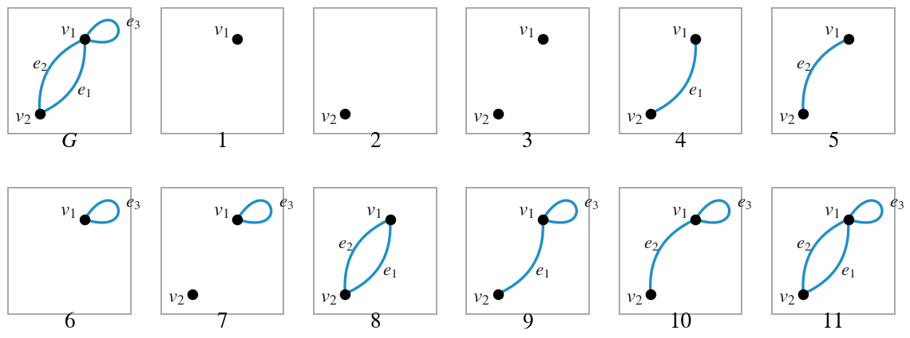

*그림 5. 그래프 G와 그 부분 그래프 11개*

### 1.5 연결성과 연결 성분

직관적으로 그래프가 연결되어 있다는 것은 어느 꼭짓점에서든 변을 따라 다른 어느 꼭짓점으로든 갈 수 있다는 뜻이다. 이를 보행으로 정확히 정의한다.

> **용어 정의:** $G$를 그래프라 하자. $G$의 두 꼭짓점 $v$와 $w$ 사이에 $v$에서 $w$로 가는 보행이 있으면 $v$와 $w$는 **연결되어 있다(connected)** 고 한다. $G$의 임의의 두 꼭짓점 $v, w$에 대해 $v$에서 $w$로 가는 보행이 있으면 $G$를 **연결 그래프(connected graph)** 라 한다. 즉 $G$가 연결 그래프인 것은 모든 꼭짓점 $v, w \in V(G)$에 대해 $v$에서 $w$로 가는 보행이 존재하는 것과 같다.

이 정의를 부정하면, $G$가 연결 그래프가 아닌 것은 어떤 보행으로도 연결되지 않는 두 꼭짓점이 존재하는 것과 같다.

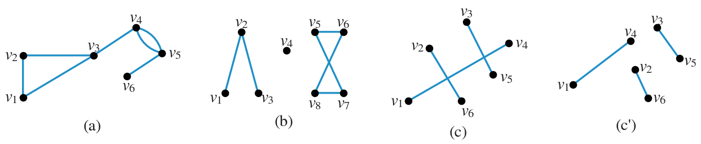

*그림 6. 연결 그래프와 연결되지 않은 그래프*

**예제 10.1.4 (연결 판정).** 그림 6의 (a)는 연결 그래프이고 (b)와 (c)는 연결 그래프가 아니다. (b)에서는 예를 들어 $v_1$에서 $v_4$로 가는 보행이 없다. (c)에서 두 변이 교차하는 점은 꼭짓점이 아니므로 그 점에서 다른 변으로 갈아탈 수 없다. 그래프를 그릴 때 변은 꼭짓점이 아닌 점에서 교차할 수 있으며, (c)를 교차 없이 다시 그리면 (c')처럼 서로 떨어진 변 세 개가 된다.

연결성과 회로에 관해 다음 사실들이 성립한다.

**보조정리 10.1.1.** $G$를 그래프라 하자.

- (a) $G$가 연결 그래프이면 $G$의 서로 다른 두 꼭짓점은 경로로 이을 수 있다.
- (b) 꼭짓점 $v$와 $w$가 $G$의 어떤 회로 위에 있고 그 회로에서 변 하나를 지우더라도 $G$에는 여전히 $v$에서 $w$로 가는 트레일이 있다.
- (c) $G$가 연결 그래프이고 회로를 포함하면, 그 회로의 변 하나를 지워도 $G$는 연결 그래프로 남는다.

(a)는 다음처럼 이해할 수 있다. $G$가 연결되어 있으므로 $v$에서 $w$로 가는 보행이 있고, 그런 보행 가운데 길이가 가장 짧은 것을 고른다. 이 보행에 같은 꼭짓점 $u$가 두 번 나타나면 두 $u$ 사이의 부분을 잘라 내어 더 짧은 보행을 얻으므로 모순이다. 따라서 가장 짧은 보행에는 반복된 꼭짓점이 없고, 반복된 꼭짓점이 없으면 반복된 변도 없으므로 그 보행은 경로이다. (b)는 회로를 $v$에서 출발하여 한 바퀴 돌면 $w$를 지나므로 회로가 $v$와 $w$ 사이에서 두 부분으로 나뉘고, 지운 변이 들어 있지 않은 부분이 $v$에서 $w$로 가는 트레일이 된다는 데서 나온다. 회로에는 반복된 변이 없으므로 그 부분도 반복된 변이 없다. (c)는 4.5절에서 보조정리 10.4.3으로 증명한다.

그림 6의 (b)와 (c)는 각각 연결된 세 조각으로 이루어져 있다. 이런 조각을 연결 성분이라 한다. 연결 성분은 연결된 부분 그래프 가운데 가능한 한 큰 것이다.

> **용어 정의:** 다음 세 조건을 만족하는 그래프 $H$를 그래프 $G$의 **연결 성분(connected component)** 이라 한다. (1) $H$는 $G$의 부분 그래프이다. (2) $H$는 연결 그래프이다. (3) $G$의 연결된 부분 그래프 가운데 $H$를 부분 그래프로 가지면서 $H$에 없는 꼭짓점이나 변을 포함하는 것은 없다.

모든 그래프는 연결 성분들을 합친 것이며, 서로 다른 연결 성분은 꼭짓점도 변도 공유하지 않는다.

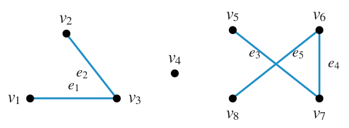

*그림 7. 연결 성분이 세 개인 그래프*

**예제 10.1.5 (연결 성분 찾기).** 그림 7의 그래프 $G$는 연결 성분 $H_1, H_2, H_3$을 가진다. 각 성분의 꼭짓점 집합과 변 집합은 다음과 같다.

```math
V_1 = \lbrace v_1, v_2, v_3\rbrace,\ E_1 = \lbrace e_1, e_2\rbrace; \quad V_2 = \lbrace v_4\rbrace,\ E_2 = \emptyset; \quad V_3 = \lbrace v_5, v_6, v_7, v_8\rbrace,\ E_3 = \lbrace e_3, e_4, e_5\rbrace
```

고립 꼭짓점 $v_4$는 그 자체로 하나의 연결 성분이다.

### 1.6 오일러 회로

쾨니히스베르크 다리 문제와 같은 종류의 문제를 일반적으로 다룬다.

> **용어 정의:** $G$를 그래프라 하자. $G$의 모든 꼭짓점과 모든 변을 포함하는 회로를 $G$의 **오일러 회로(Euler circuit)** 라 한다. 다시 말해 오일러 회로는 변을 적어도 하나 포함하고, 같은 꼭짓점에서 시작하여 끝나며, $G$의 모든 꼭짓점을 적어도 한 번, $G$의 모든 변을 정확히 한 번 지나는 꼭짓점과 변의 열이다.

쾨니히스베르크 문제를 푼 논리를 일반화하면 다음 정리를 얻는다.

**정리 10.1.2.** 그래프에 오일러 회로가 있으면 그 그래프의 모든 꼭짓점의 차수는 양의 짝수이다.

**증명.** $G$가 오일러 회로를 가진다고 하고, $v$를 $G$의 임의의 꼭짓점이라 하자. 오일러 회로는 $G$의 모든 변을 포함하므로 $v$에 접하는 모든 변을 포함한다. 이제 오일러 회로의 출발 꼭짓점에 붙은 변 하나의 한가운데에서 출발하여 회로를 따라 한 바퀴 돌고 같은 변의 한가운데에서 멈추는 여행을 생각한다. 오일러 회로에는 변이 적어도 하나 있으므로 이런 출발 변이 존재한다. 여행은 변의 한가운데에서 끝나므로, 여행 도중 한 변을 따라 $v$에 들어올 때마다 곧바로 다른 변을 따라 $v$에서 나간다. 오일러 회로는 모든 변을 정확히 한 번 쓰므로 $v$에 접하는 변은 이 여행에서 정확히 한 번씩 지나간다. 따라서 $v$에 접하는 변들은 들어오는 변과 나가는 변의 쌍으로 나뉘고, $v$의 차수는 2의 배수이다. 또 오일러 회로는 모든 꼭짓점을 지나므로 $v$에는 적어도 한 쌍의 변이 접하여 차수가 양수이다. 그러므로 $v$의 차수는 양의 짝수이다. ∎

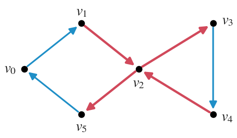

*그림 8. 오일러 회로에서 v2에 들어오고 나가는 변의 쌍*

그림 8은 오일러 회로 $v_0 v_1 v_2 v_3 v_4 v_2 v_5 v_0$에서 $v = v_2$인 경우이다. 회로는 $v_2$를 두 번 지나며, 한 번은 $v_1$에서 들어와 $v_3$으로 나가고 한 번은 $v_4$에서 들어와 $v_5$로 나간다. 붉은 네 변이 두 쌍을 이루므로 $\deg(v_2) = 4$이다. 루프는 같은 꼭짓점으로 들어오고 나가는 한 쌍이며 차수에 2를 더하므로 이 논리에 그대로 맞는다.

명제와 그 대우는 논리적 동치이므로 정리 10.1.2의 대우도 성립한다.

> **핵심:** **정리 10.1.2의 대우.** 그래프의 어떤 꼭짓점의 차수가 홀수이면 그 그래프에는 오일러 회로가 없다.

이 형태는 그래프에 오일러 회로가 없음을 보일 때 유용하다.

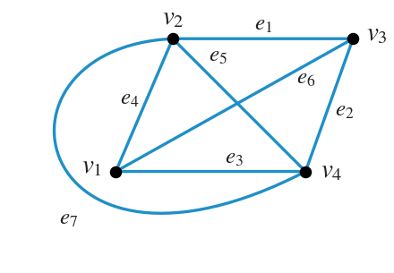

*그림 9. 차수가 홀수인 꼭짓점이 있는 그래프*

**예제 10.1.6 (오일러 회로가 없음을 보이기).** 그림 9의 그래프에서 $v_1$에는 $e_3, e_4, e_6$이 접하고 $v_3$에는 $e_1, e_2, e_6$이 접하므로 $\deg(v_1) = \deg(v_3) = 3$으로 홀수이다. 따라서 정리 10.1.2의 대우에 의해 이 그래프에는 오일러 회로가 없다.

정리 10.1.2의 역, 즉 "모든 꼭짓점의 차수가 짝수이면 오일러 회로가 있다"는 거짓이다. 그림 10의 그래프는 모든 꼭짓점의 차수가 2이지만 두 조각으로 나뉘어 있어서 한 조각의 변을 지난 뒤 다른 조각으로 넘어갈 수 없다.

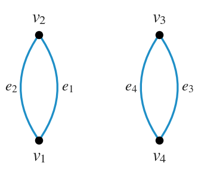

*그림 10. 모든 차수가 짝수이지만 연결되지 않은 그래프*

그러나 연결 그래프라는 조건을 더하면 역이 성립한다. 이 정리의 증명은 오일러 회로를 실제로 찾는 알고리즘을 담고 있는 구성적 증명이다.

**정리 10.1.3.** 그래프 $G$가 연결 그래프이고 $G$의 모든 꼭짓점의 차수가 양의 짝수이면 $G$에는 오일러 회로가 있다.

**증명.** $G$가 연결 그래프이고 모든 꼭짓점의 차수가 양의 짝수라고 하자. 다음 알고리즘으로 회로 $C$를 만든다.

```text
1단계: 출발할 꼭짓점 v를 G에서 아무것이나 고른다.
2단계: v에서 출발하여 같은 변을 다시 쓰지 않고 인접한 꼭짓점과 변을 따라가
       v로 돌아오는 열을 하나 고르고, 이 회로를 C라 한다.
3단계: C가 G의 모든 변과 꼭짓점을 포함하면 C가 오일러 회로이므로 끝낸다.
       그렇지 않으면 다음을 수행한다.
  3a: G에서 C의 변을 모두 지우고, 그 결과 고립된 꼭짓점도 지운다.
      이렇게 얻은 부분 그래프를 G'이라 한다.
  3b: C와 G'에 공통인 꼭짓점 w를 하나 고른다.
  3c: G'에서 w로부터 출발하여 같은 변을 다시 쓰지 않고 w로 돌아오는
      회로 C'을 하나 고른다.
  3d: C와 C'을 이어 새 회로 C''을 만든다. v에서 C를 따라 w까지 간 다음,
      C'을 따라 한 바퀴 돌아 w로 돌아오고, C의 남은 부분을 따라 v로 돌아온다.
  3e: C := C''으로 두고 3단계로 돌아간다.
```

각 단계를 수행할 수 있는 이유는 다음과 같다.

- 1단계: 그래프의 꼭짓점 집합은 공집합이 아니므로 $v$를 고를 수 있다.
- 2단계: 모든 꼭짓점의 차수가 양의 짝수이므로, 변을 따라 어떤 꼭짓점에 들어왔을 때 그 꼭짓점이 $v$가 아니면 아직 쓰지 않은 다른 변으로 나갈 수 있다. 그 꼭짓점에 들어오고 나간 변의 수는 지금까지 짝수였고 이번에 하나를 더 썼으므로 홀수인데, 차수가 짝수이므로 쓰지 않은 변이 적어도 하나 남아 있기 때문이다. 변의 수는 유한하므로 이 과정은 영원히 계속될 수 없고, 나갈 변이 없어지는 곳은 $v$뿐이므로 결국 $v$로 돌아온다. 처음에 $v$에서 변을 하나 쓰고 나갔으므로 회로에는 변이 적어도 하나 있다.
- 3a단계: $G'$은 연결되어 있지 않을 수도 있지만, $G'$의 모든 꼭짓점의 차수는 양의 짝수이다. $C$는 각 꼭짓점에서 짝수 개의 변을 지우고, 짝수에서 짝수를 빼면 짝수이며, 차수가 0이 된 꼭짓점은 지웠기 때문이다.
- 3b단계: $C$와 $G'$에 공통인 꼭짓점이 적어도 하나 있다. $C$의 꼭짓점 $x$와 $G'$의 꼭짓점 $y$를 잡으면, $G$가 연결 그래프이므로 $x$에서 $y$로 가는 보행이 있다. 이 보행의 변이 모두 $C$의 변이면 $y$가 $C$의 꼭짓점이므로 $y$가 공통 꼭짓점이다. 그렇지 않으면 보행이 $C$에 없는 변을 처음 지나는 곳을 본다. 그 변은 $G'$의 변이고, 그 변의 출발 쪽 끝점은 그때까지 $C$의 변만 따라 도착한 점이므로 $C$의 꼭짓점이면서 $G'$의 변의 끝점, 즉 $G'$의 꼭짓점이다.
- 3c단계: $G'$의 모든 꼭짓점의 차수가 양의 짝수이고 $G'$은 유한하므로 2단계와 같은 이유로 회로를 찾을 수 있다.
- 3d단계: $C$와 $C'$은 공통인 변이 없으므로 이어 붙인 $C''$도 같은 변을 두 번 쓰지 않는 회로이다.

3단계를 반복할 때마다 $C$의 변의 수가 늘어나고 $G$의 변의 수는 유한하므로 알고리즘은 반드시 끝나며, 끝났을 때의 $C$는 $G$의 오일러 회로이다. 1, 2, 3b, 3c단계에서 선택의 여지가 있으므로 이 알고리즘은 여러 가지 오일러 회로를 만들어 낼 수 있다. ∎

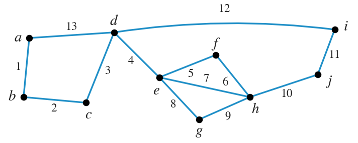

*그림 11. 오일러 회로를 구성한 결과와 변을 지나는 순서*

**예제 10.1.7 (오일러 회로 찾기).** 그림 11의 그래프는 13개의 변 $ab, bc, cd, da, de, di, ef, eg, eh, fh, gh, hj, ji$를 가진다(여기서 $xy$는 $x$와 $y$를 잇는 변이다). 먼저 정리 10.1.3의 조건을 확인한다.

```math
\deg(a) = \deg(b) = \deg(c) = \deg(f) = \deg(g) = \deg(i) = \deg(j) = 2, \qquad \deg(d) = \deg(e) = \deg(h) = 4
```

모든 꼭짓점의 차수가 양의 짝수이고 그래프가 연결되어 있으므로 정리 10.1.3에 의해 오일러 회로가 있다. 이제 증명의 알고리즘을 따라간다.

1. $v = a$로 두고 회로 $C: abcda$를 고른다. $C$는 $e, f, g, h, i, j$와 그 주변의 변을 지나지 않으므로 오일러 회로가 아니다.
2. $C$에서 지운 나머지 그래프와 $C$의 공통 꼭짓점은 $d$이다. $d$에서 출발하는 회로 $C': deghjid$를 고르고, $C$를 따라 $d$까지 간 뒤 $C'$을 돌고 $C$의 남은 부분으로 돌아오도록 이어 $C'': abcdeghjida$를 얻는다.
3. 새 $C = abcdeghjida$는 변 $ef, fh, eh$를 지나지 않는다. 남은 그래프와 $C$의 공통 꼭짓점은 $e$와 $h$이며, $e$에서 출발하는 회로 $C': efhe$를 골라 이어 붙이면 $C'': abcdefheghjida$가 된다.
4. 이 회로는 13개의 변을 모두 정확히 한 번씩 지나므로 오일러 회로이다. 그림 11의 숫자는 이 회로가 각 변을 지나는 순서이다.

오일러 회로를 가지는 그래프는 연결 그래프이다. 오일러 회로는 모든 꼭짓점을 지나므로, 임의의 두 꼭짓점 $u, x$에 대해 회로에서 $u$가 나타나는 곳부터 $x$가 나타나는 곳까지의 부분이 $u$에서 $x$로 가는 보행이기 때문이다. 이 사실과 정리 10.1.2, 10.1.3을 합치면 오일러 회로를 가지는 그래프를 완전히 특징지을 수 있다.

**정리 10.1.4.** 그래프 $G$가 오일러 회로를 가질 필요충분조건은 $G$가 연결 그래프이고 $G$의 모든 꼭짓점의 차수가 양의 짝수인 것이다.

> **주의:** 정리 10.1.4의 조건에서 "양의"를 빠뜨리면 안 된다. 꼭짓점 하나만 있고 변이 없는 그래프는 연결 그래프이고 유일한 꼭짓점의 차수 0은 짝수이지만, 회로는 변을 적어도 하나 포함해야 하므로 오일러 회로가 없다. 또 "연결 그래프"를 빠뜨리면 그림 10이 반례가 된다.

### 1.7 오일러 트레일

정리 10.1.4의 따름정리로, 그래프의 한 꼭짓점에서 다른 꼭짓점까지 모든 꼭짓점을 적어도 한 번, 모든 변을 정확히 한 번 지나는 보행이 언제 있는지 판정할 수 있다.

> **용어 정의:** $G$를 그래프, $v$와 $w$를 $G$의 서로 다른 두 꼭짓점이라 하자. $v$에서 출발하여 $w$에서 끝나고, $G$의 모든 꼭짓점을 적어도 한 번 지나며, $G$의 모든 변을 정확히 한 번 지나는 인접한 변과 꼭짓점의 열을 $v$에서 $w$로 가는 **오일러 트레일(Euler trail)** 이라 한다.

**따름정리 10.1.5.** $G$를 그래프, $v$와 $w$를 $G$의 서로 다른 두 꼭짓점이라 하자. $v$에서 $w$로 가는 오일러 트레일이 있을 필요충분조건은 $G$가 연결 그래프이고, $v$와 $w$의 차수가 홀수이며, 나머지 모든 꼭짓점의 차수가 양의 짝수인 것이다.

증명의 핵심은 $v$와 $w$를 잇는 새 변 $e$를 하나 더해 오일러 회로의 문제로 바꾸는 것이다. $G$에 $v$에서 $w$로 가는 오일러 트레일이 있으면, 그 트레일 끝에 $e$를 붙여 $w$에서 $v$로 돌아오면 $G$에 $e$를 더한 그래프의 오일러 회로가 된다. 정리 10.1.4에 의해 이 그래프의 모든 차수는 양의 짝수이며, $e$를 빼면 $v$와 $w$의 차수만 1씩 줄어 홀수가 되고 나머지 차수는 그대로 양의 짝수이다. 또 오일러 트레일은 $G$의 모든 꼭짓점을 지나므로 $G$는 연결 그래프이다. 반대로 $G$가 조건을 만족하면 $G$에 $e$를 더한 그래프는 연결되어 있고 모든 차수가 양의 짝수이므로 오일러 회로를 가진다. 이 회로를 $e$가 마지막 변이 되도록 $v$에서 시작해 적으면 $`v \cdots w\ e\ v`$의 꼴이고, 마지막의 $`e\ v`$를 떼어 내면 $G$의 $v$에서 $w$로 가는 오일러 트레일이 남는다.

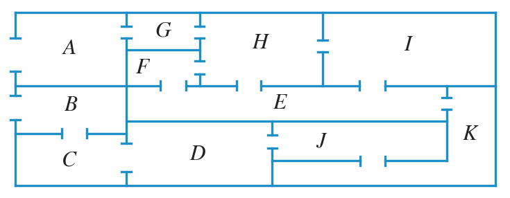

*그림 12. 방 A부터 K까지로 이루어진 집의 평면도*

**예제 10.1.8 (오일러 트레일 찾기).** 그림 12는 일반에 공개된 집의 평면도이다. 방 A에서 출발하여 방 B에서 끝나면서 집 안의 모든 출입구를 정확히 한 번씩 지나는 동선이 있는가? 방을 꼭짓점으로, 두 방 사이의 출입구를 변으로 나타내면 그림 13의 그래프를 얻는다.

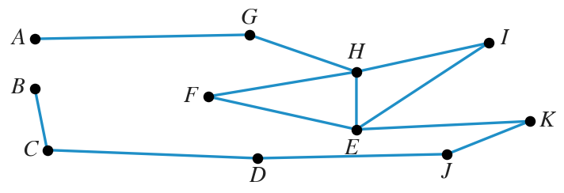

*그림 13. 평면도의 방을 꼭짓점, 출입구를 변으로 나타낸 그래프*

그래프는 연결되어 있고, A와 B의 차수는 1로 홀수이며, E와 H의 차수는 4, 나머지 꼭짓점의 차수는 2로 모두 양의 짝수이다. 따라서 따름정리 10.1.5에 의해 A에서 B로 가는 오일러 트레일이 있다. 그런 트레일의 하나는 $`A\ G\ H\ F\ E\ I\ H\ E\ K\ J\ D\ C\ B`$이며, 12개의 변을 모두 한 번씩 지난다.

쾨니히스베르크의 그래프는 네 꼭짓점의 차수가 모두 홀수이므로 오일러 회로는 물론 오일러 트레일도 없다. 출발점과 도착점이 달라도 되는 오일러의 원래 질문의 답도 "불가능하다"이다.

### 1.8 해밀턴 회로

정리 10.1.4는 "모든 변을 정확히 한 번씩 지나는 회로가 있는가?"라는 질문에 완전히 답한다. 이와 비슷한 질문으로 "처음과 마지막을 빼고 모든 꼭짓점을 정확히 한 번씩 지나는 회로가 있는가?"를 생각할 수 있다.

1859년 아일랜드의 수학자 해밀턴(William Rowan Hamilton)은 정십이면체 모양의 퍼즐을 내놓았다. 정십이면체는 합동인 정오각형 면 12개로 이루어진 입체이며 꼭짓점이 20개이다. 각 꼭짓점에는 런던, 파리, 홍콩, 뉴욕 같은 도시의 이름이 붙어 있었고, 퍼즐은 한 도시에서 출발하여 다른 모든 도시를 정확히 한 번씩 방문하고 출발한 도시로 돌아오는 세계 일주 여정을 찾는 것이었다. 정십이면체의 겉면을 평면에 펼쳐 그리면 그림 14의 그래프가 되며, 붉은 변을 따라가는 $ABCD \cdots STA$가 하나의 답이다. 모든 도시를 방문하지만 회색 점선의 변은 쓰지 않는다.

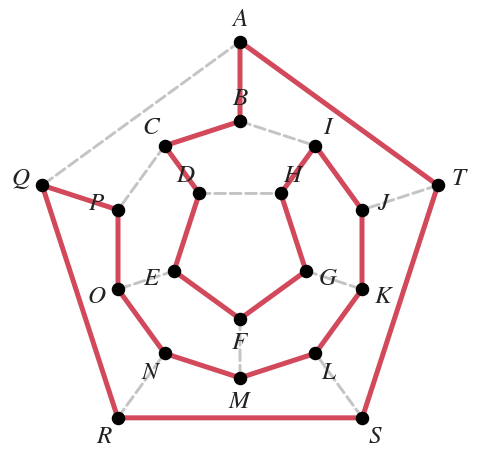

*그림 14. 정십이면체의 그래프와 해밀턴 회로*

> **용어 정의:** 그래프 $G$의 모든 꼭짓점을 포함하는 단순 회로를 $G$의 **해밀턴 회로(Hamiltonian circuit)** 라 한다. 다시 말해 해밀턴 회로는 인접한 꼭짓점과 서로 다른 변의 열로서, 처음과 마지막 꼭짓점이 같고 그것을 빼면 $G$의 모든 꼭짓점이 정확히 한 번씩 나타난다.

오일러 회로는 모든 꼭짓점을 포함하지만 어떤 꼭짓점을 여러 번 지날 수 있으므로 해밀턴 회로가 아닐 수 있다. 반대로 해밀턴 회로는 모든 변을 포함할 필요가 없으므로 오일러 회로가 아닐 수 있다. 두 정의는 비슷해 보이지만 수학적 성격은 크게 다르다. 오일러 회로는 정리 10.1.4라는 간단한 판정 기준이 있지만, 해밀턴 회로가 있는지 판정하는 그런 간단한 기준은 알려져 있지 않고, 해밀턴 회로를 효율적으로 찾는 알고리즘도 알려져 있지 않다.

다만 해밀턴 회로가 없음을 보이는 간단한 방법은 있다. 꼭짓점이 두 개 이상인 그래프 $G$에 해밀턴 회로 $`C: v_0 e_1 v_1 e_2 \cdots v_{n-1} e_n v_n\ (v_n = v_0)`$가 있다고 하자. $C$는 단순 회로이므로 $e_i$는 모두 서로 다르고, $v_j$도 $v_0 = v_n$을 빼면 모두 서로 다르다. $C$의 꼭짓점과 변으로 이루어진 부분 그래프를 $H$라 하면 다음이 성립한다.

- $H$의 변의 수와 꼭짓점의 수는 같다. 변 $e_1, \ldots, e_n$과 꼭짓점 $v_0, \ldots, v_{n-1}$이 모두 서로 다르기 때문이다.
- 해밀턴 회로의 정의에 의해 $G$의 모든 꼭짓점이 $H$의 꼭짓점이다.
- $H$는 연결되어 있다. $H$의 어느 두 꼭짓점도 회로 $C$ 위에 있기 때문이다.
- $H$의 모든 꼭짓점의 차수는 2이다. $v_0$이 아닌 꼭짓점 $v_j$에는 $e_j$와 $e_{j+1}$이, $v_0$에는 $e_1$과 $e_n$이 정확히 접하기 때문이다.

**명제 10.1.6.** 그래프 $G$가 해밀턴 회로를 가지면 $G$는 다음 성질을 모두 가지는 부분 그래프 $H$를 가진다.

1. $H$는 $G$의 모든 꼭짓점을 포함한다.
2. $H$는 연결 그래프이다.
3. $H$의 변의 수와 꼭짓점의 수가 같다.
4. $H$의 모든 꼭짓점의 차수는 2이다.

꼭짓점이 하나뿐인 $G$가 해밀턴 회로를 가지면 그 회로는 꼭짓점 $v$와 $v$의 루프 $e$로 된 $`v\ e\ v`$의 꼴이고, $v$와 $e$로 이루어진 부분 그래프가 조건 1\~4를 만족한다. 따라서 명제는 모든 경우에 성립한다. 이 명제의 대우는 "$`G`$가 성질 1\~4를 모두 가지는 부분 그래프를 가지지 않으면 $G$에는 해밀턴 회로가 없다"이며, 해밀턴 회로가 없음을 보일 때 쓴다.

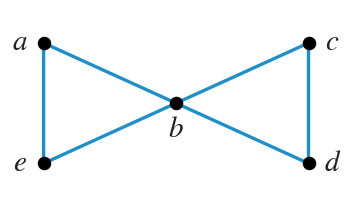

*그림 15. 해밀턴 회로가 없는 그래프*

**예제 10.1.9 (해밀턴 회로가 없음을 보이기).** 그림 15의 그래프 $G$는 꼭짓점 $a, b, c, d, e$와 변 $\lbrace a, b\rbrace, \lbrace b, c\rbrace, \lbrace b, d\rbrace, \lbrace b, e\rbrace, \lbrace a, e\rbrace, \lbrace c, d\rbrace$를 가진다. $G$에 해밀턴 회로가 있다고 가정하면, 명제 10.1.6에 의해 꼭짓점 다섯 개와 변 다섯 개를 가지고 모든 꼭짓점의 차수가 2인 연결된 부분 그래프 $H$가 있다. $G$에서 $b$의 차수는 4이므로 $H$를 만들려면 $b$에 접하는 변 두 개를 지워야 한다. 그런데 $\lbrace a, b\rbrace$를 지우면 $a$에 남는 변이 $\lbrace a, e\rbrace$ 하나뿐이어서 $H$에서 $a$의 차수가 2보다 작아지므로 이 변은 지울 수 없다. 같은 이유로 $\lbrace e, b\rbrace$, $\lbrace c, b\rbrace$, $\lbrace d, b\rbrace$도 지울 수 없다. 그러면 $H$에서 $b$의 차수는 4가 되어 모든 꼭짓점의 차수가 2라는 조건에 모순이다. 따라서 그런 $H$는 없고 $G$에는 해밀턴 회로가 없다.

### 1.9 외판원 문제

해밀턴 회로 문제의 변형으로 **외판원 문제(traveling salesman problem)** 가 있다.

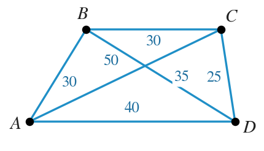

*그림 16. 네 도시와 도시 사이의 거리*

**예제 10.1.10 (외판원 문제).** 그림 16은 네 도시와 도시 사이의 거리(단위: km)를 나타낸 지도이다. 외판원이 도시 A에서 출발하여 각 도시를 정확히 한 번씩 방문하고 A로 돌아와야 할 때, 이동 거리의 합이 가장 작은 방문 순서는 무엇인가? A에서 출발하여 A에서 끝나는 해밀턴 회로를 모두 쓰고 각각의 총거리를 계산하면 된다. 나머지 세 도시를 방문하는 순서는 $3! = 6$가지이다.

| 해밀턴 회로 | 총거리 (km) |
|:-----|:-----|
| $ABCDA$ | $30 + 30 + 25 + 40 = 125$ |
| $ABDCA$ | $30 + 35 + 25 + 50 = 140$ |
| $ACBDA$ | $50 + 30 + 35 + 40 = 155$ |
| $ACDBA$ | $140$ ($ABDCA$를 거꾸로 돈 것) |
| $ADBCA$ | $155$ ($ACBDA$를 거꾸로 돈 것) |
| $ADCBA$ | $125$ ($ABCDA$를 거꾸로 돈 것) |

*표 3. A에서 출발하는 여섯 해밀턴 회로와 총거리*

따라서 $ABCDA$ 또는 그 역방향인 $ADCBA$가 최소 총거리 125 km를 준다.

일반적인 외판원 문제는 꼭짓점이 $n$개이고 각 변에 거리가 적힌 임의의 그래프에서 총거리가 최소인 해밀턴 회로를 찾는 문제이다. 위 예제처럼 모든 해밀턴 회로를 나열하는 방법은 $n$이 조금만 커져도 쓸 수 없다. 꼭짓점이 $n$개인 완전 그래프에서 출발 꼭짓점을 고정하면 나머지 $n - 1$개 꼭짓점을 방문하는 순서가 $(n-1)!$가지이고, 같은 회로를 거꾸로 도는 순서가 두 번씩 세어지므로 서로 다른 해밀턴 회로는 $(n-1)!/2$개이다. 꼭짓점이 30개이면 $29!/2 \approx 4.42 \times 10^{30}$개의 회로를 확인해야 하며, 회로 하나를 1나노초에 처리해도 약 $1.4 \times 10^{14}$년이 걸린다. 현재 일반적인 외판원 문제를 이보다 훨씬 효율적으로 푸는 알고리즘은 알려져 있지 않다. 다만 최소라는 보장은 없어도 대부분의 다른 해밀턴 회로보다 총거리가 작은 상당히 좋은 회로를 효율적으로 찾는 알고리즘들은 있다.

---

<br>

## 2. 그래프의 행렬 표현

그래프를 컴퓨터 안에 어떻게 나타낼 수 있는가? 그래프를 정하는 데 필요한 모든 정보는 행렬이라는 구조로 표현할 수 있고, 행렬은 컴퓨터에 쉽게 저장된다. 이 절은 행렬과 행렬 연산의 기본 정의, 그래프와 행렬의 관계, 그 응용으로 보행의 개수를 세는 방법을 다룬다.

### 2.1 행렬

행렬은 수열을 2차원으로 확장한 것이며 2차원 배열이라고도 부른다.

> **용어 정의:** 집합 $S$ 위의 $m \times n$ **행렬(matrix)** $\mathbf{A}$는 $S$의 원소를 $m$개의 **행(row)** 과 $n$개의 **열(column)** 로 배열한 직사각형 모양의 배열이며 $\mathbf{A} = (a_{ij})$로 쓴다. $i$행 $j$열에 있는 원소 $a_{ij}$를 $\mathbf{A}$의 $(i, j)$ **성분(entry)** 이라 하고, 행이 $m$개, 열이 $n$개인 행렬의 **크기(size)** 를 $m \times n$이라 한다.

```math
\mathbf{A} = \begin{bmatrix} a_{11} & a_{12} & \cdots & a_{1j} & \cdots & a_{1n} \\ a_{21} & a_{22} & \cdots & a_{2j} & \cdots & a_{2n} \\ \vdots & \vdots & & \vdots & & \vdots \\ a_{i1} & a_{i2} & \cdots & a_{ij} & \cdots & a_{in} \\ \vdots & \vdots & & \vdots & & \vdots \\ a_{m1} & a_{m2} & \cdots & a_{mj} & \cdots & a_{mn} \end{bmatrix}
```

$\mathbf{A}$의 $i$번째 행은 $`\begin{bmatrix} a_{i1} & a_{i2} & \cdots & a_{in} \end{bmatrix}`$이고, $j$번째 열은 $a_{1j}, a_{2j}, \ldots, a_{mj}$를 위에서 아래로 세운 것이다. 두 행렬 $\mathbf{A}$와 $\mathbf{B}$가 같다는 것은 크기가 같고 대응하는 성분이 모두 같다는 뜻, 즉 모든 $i = 1, \ldots, m$과 $j = 1, \ldots, n$에 대해 $a_{ij} = b_{ij}$라는 뜻이다. 행의 수와 열의 수가 같은 행렬을 **정사각 행렬(square matrix)** 이라 하고, $n \times n$ 정사각 행렬의 성분 $a_{11}, a_{22}, \ldots, a_{nn}$을 **주대각선(main diagonal)** 이라 한다.

**예제 10.2.1 (행렬의 용어).** 정수 위의 $3 \times 3$ 행렬

```math
\mathbf{A} = \begin{bmatrix} 1 & 0 & -3 \\ 4 & -1 & 5 \\ -2 & 2 & 0 \end{bmatrix}
```

에서 2행 3열의 성분은 $a_{23} = 5$이고, 두 번째 열은 위에서부터 $0, -1, 2$이며, 주대각선의 성분은 $1, -1, 0$이다.

### 2.2 방향 그래프의 인접 행렬

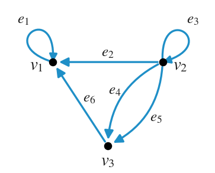

*그림 17. 인접 행렬을 구할 방향 그래프*

그림 17의 방향 그래프는 $v_i$에서 $v_j$로 가는 화살표의 개수를 $a_{ij}$로 두는 행렬 $\mathbf{A} = (a_{ij})$로 나타낼 수 있다. $v_1$에서 $v_1$로 가는 화살표(루프 $`e_1`$)가 하나이므로 $a_{11} = 1$이고, $v_1$에서 $v_2$로 가는 화살표는 없으므로 $a_{12} = 0$이며, $v_2$에서 $v_3$으로 가는 화살표가 $e_4, e_5$ 두 개이므로 $a_{23} = 2$이다. 이렇게 모든 성분을 채우면 다음 행렬을 얻는다. 행과 열에 꼭짓점 이름을 붙여 두면 읽기 편하다.

```math
\mathbf{A} = \begin{array}{c|ccc} & v_1 & v_2 & v_3 \\ \hline v_1 & 1 & 0 & 0 \\ v_2 & 1 & 1 & 2 \\ v_3 & 1 & 0 & 0 \end{array}
```

> **용어 정의:** 꼭짓점에 순서 $v_1, v_2, \ldots, v_n$이 매겨진 방향 그래프 $G$의 **인접 행렬(adjacency matrix)** 은 음이 아닌 정수 위의 $n \times n$ 행렬 $\mathbf{A} = (a_{ij})$로서, 모든 $i, j = 1, 2, \ldots, n$에 대해 $a_{ij}$가 $v_i$에서 $v_j$로 가는 화살표의 개수인 것이다.

주대각선에 0이 아닌 성분이 있으면 루프가 있다는 뜻이고, 주대각선 밖의 성분이 1보다 크면 평행한 화살표가 있다는 뜻이다. 꼭짓점의 순서를 바꾸면 인접 행렬의 행과 열도 그에 따라 자리가 바뀐다.

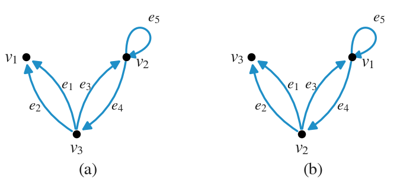

*그림 18. 꼭짓점의 순서만 다른 두 방향 그래프*

**예제 10.2.2 (꼭짓점의 순서와 인접 행렬).** 그림 18의 두 방향 그래프는 같은 모양이고 꼭짓점의 이름만 다르다. (a)에서는 $v_1$에서 나가는 화살표가 없으므로 1행이 모두 0이다. (b)에서는 $v_1$에서 $v_1$로 가는 루프와 $v_1$에서 $v_2$로 가는 화살표가 하나씩 있고 $v_3$으로 가는 화살표는 없으므로 1행이 $1, 1, 0$이다. 이런 식으로 채우면 두 인접 행렬은 다음과 같다.

```math
\text{(a)}\quad \mathbf{A} = \begin{array}{c|ccc} & v_1 & v_2 & v_3 \\ \hline v_1 & 0 & 0 & 0 \\ v_2 & 0 & 1 & 1 \\ v_3 & 2 & 1 & 0 \end{array} \qquad \text{(b)}\quad \mathbf{A} = \begin{array}{c|ccc} & v_1 & v_2 & v_3 \\ \hline v_1 & 1 & 1 & 0 \\ v_2 & 1 & 0 & 2 \\ v_3 & 0 & 0 & 0 \end{array}
```

반대로 음이 아닌 정수를 성분으로 가지는 정사각 행렬이 주어지면, 그 행렬을 인접 행렬로 가지는 방향 그래프를 그릴 수 있다. 다만 행렬은 변의 이름을 알려 주지 않으므로 방향 그래프가 하나로 정해지지는 않는다.

**예제 10.2.3 (행렬에서 방향 그래프 얻기).** 다음 행렬을 인접 행렬로 가지는 방향 그래프를 그린다.

```math
\mathbf{A} = \begin{array}{c|cccc} & v_1 & v_2 & v_3 & v_4 \\ \hline v_1 & 0 & 1 & 1 & 0 \\ v_2 & 1 & 1 & 0 & 2 \\ v_3 & 0 & 0 & 1 & 1 \\ v_4 & 2 & 1 & 0 & 0 \end{array}
```

꼭짓점을 $v_1, v_2, v_3, v_4$로 두고 성분을 하나씩 읽는다. 예를 들어 4행 1열의 2는 $v_4$에서 $v_1$로 가는 화살표가 두 개라는 뜻이고, 1행 4열의 0은 $v_1$에서 $v_4$로 가는 화살표가 없다는 뜻이다. 2행 2열과 3행 3열의 1은 $v_2$와 $v_3$에 루프가 하나씩 있다는 뜻이다. 이렇게 그린 그래프가 그림 19이며, 행렬이 정하지 않는 변의 이름은 붙이지 않았다.

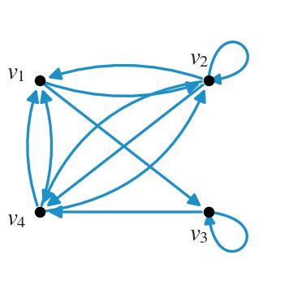

*그림 19. 주어진 인접 행렬을 가지는 방향 그래프*

### 2.3 무방향 그래프의 인접 행렬과 대칭 행렬

무방향 그래프의 인접 행렬도 같은 방식으로 정의한다. 꼭짓점에 순서를 매기고, $(i, j)$ 성분에 $i$번째 꼭짓점과 $j$번째 꼭짓점을 잇는 변의 개수를 적는다.

> **용어 정의:** 꼭짓점에 순서 $v_1, v_2, \ldots, v_n$이 매겨진 무방향 그래프 $G$의 **인접 행렬(adjacency matrix)** 은 음이 아닌 정수 위의 $n \times n$ 행렬 $\mathbf{A} = (a_{ij})$로서, 모든 $i, j = 1, 2, \ldots, n$에 대해 $a_{ij}$가 $v_i$와 $v_j$를 잇는 변의 개수인 것이다.

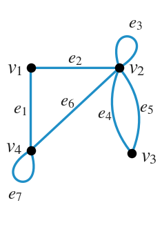

*그림 20. 인접 행렬을 구할 무방향 그래프*

**예제 10.2.4 (무방향 그래프의 인접 행렬).** 그림 20의 그래프에서 $v_1$은 $v_2$, $v_4$와 변 하나씩으로 이어져 있다. $v_2$에는 루프 $e_3$이 있고, $v_3$과 평행 변 $e_4, e_5$로, $v_4$와 변 $e_6$으로 이어져 있다. $v_4$에는 루프 $e_7$이 있다. 따라서 인접 행렬은 다음과 같다.

```math
\mathbf{A} = \begin{array}{c|cccc} & v_1 & v_2 & v_3 & v_4 \\ \hline v_1 & 0 & 1 & 0 & 1 \\ v_2 & 1 & 1 & 2 & 1 \\ v_3 & 0 & 2 & 0 & 0 \\ v_4 & 1 & 1 & 0 & 1 \end{array}
```

이 행렬의 성분은 모든 $i, j$에 대해 $a_{ij} = a_{ji}$를 만족한다. 즉 주대각선을 축으로 뒤집어도 모양이 같다.

> **용어 정의:** $n \times n$ 정사각 행렬 $\mathbf{A} = (a_{ij})$가 모든 $i, j = 1, 2, \ldots, n$에 대해 $a_{ij} = a_{ji}$를 만족하면 $\mathbf{A}$를 **대칭 행렬(symmetric matrix)** 이라 한다.

**예제 10.2.5 (대칭 행렬 판정).** 다음 세 행렬 가운데 대칭인 것은 (b)뿐이다.

```math
\text{(a)}\ \begin{bmatrix} 1 & 0 \\ 1 & 2 \end{bmatrix} \qquad \text{(b)}\ \begin{bmatrix} 0 & 1 & 2 \\ 1 & 1 & 0 \\ 2 & 0 & 3 \end{bmatrix} \qquad \text{(c)}\ \begin{bmatrix} 2 & 0 & 0 \\ 0 & 1 & 0 \end{bmatrix}
```

(a)는 $a_{12} = 0$이지만 $a_{21} = 1$이므로 대칭이 아니다. (c)는 정사각 행렬이 아니므로 대칭 행렬의 정의에 해당하지 않는다.

$v_i$와 $v_j$를 잇는 변의 개수는 $v_j$와 $v_i$를 잇는 변의 개수와 같으므로, 무방향 그래프의 인접 행렬은 언제나 대칭 행렬이다.

> **주의:** 교재의 정의에서 루프는 인접 행렬의 주대각선에 1로 들어간다. 반면 차수에서는 루프를 두 번 세므로, 루프가 있는 꼭짓점의 차수는 그 행의 성분의 합과 다르다. 예를 들어 그림 20에서 $v_2$의 행의 합은 $1 + 1 + 2 + 1 = 5$이지만 $\deg(v_2) = 6$이다. 차수는 행의 합에 그 꼭짓점의 루프 수를 더한 값이다.

> **[자료구조]** 인접 행렬은 2차원 배열에 그대로 저장되므로 두 꼭짓점 사이의 변의 수를 성분 하나를 읽어 바로 알 수 있다. 다만 꼭짓점이 $n$개이면 변이 적더라도 $n^2$개의 칸이 필요하므로, 변이 적은 그래프는 꼭짓점마다 인접한 꼭짓점의 목록을 두는 인접 리스트로 저장하는 경우가 많다.

### 2.4 인접 행렬과 연결 성분

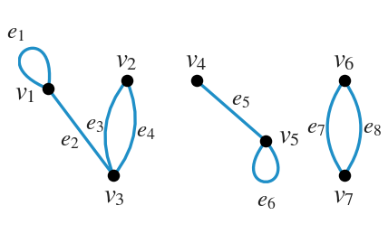

*그림 21. 연결 성분이 세 개이고 루프와 평행 변이 있는 그래프*

그림 21의 그래프는 연결 성분 세 개로 이루어져 있다. 꼭짓점을 $v_1, \ldots, v_7$의 순서로 두면 인접 행렬은 다음과 같다.

```math
\mathbf{A} = \begin{bmatrix} 1 & 0 & 1 & 0 & 0 & 0 & 0 \\ 0 & 0 & 2 & 0 & 0 & 0 & 0 \\ 1 & 2 & 0 & 0 & 0 & 0 & 0 \\ 0 & 0 & 0 & 0 & 1 & 0 & 0 \\ 0 & 0 & 0 & 1 & 1 & 0 & 0 \\ 0 & 0 & 0 & 0 & 0 & 0 & 2 \\ 0 & 0 & 0 & 0 & 0 & 2 & 0 \end{bmatrix}
```

이 행렬은 주대각선을 따라 크기가 다른 정사각 블록($3 \times 3$, $2 \times 2$, $`2 \times 2`$)이 놓이고 나머지 자리는 모두 0이다. 한 연결 성분의 꼭짓점은 다른 연결 성분의 꼭짓점과 변을 공유하지 않기 때문이다. 예를 들어 $v_1, v_2, v_3$은 $v_4, \ldots, v_7$과 변을 공유하지 않으므로 처음 세 행의 네 번째 열부터와 처음 세 열의 네 번째 행부터는 모두 0이다. 모든 성분이 0인 행렬을 $\mathbf{O}$로 쓰면 이 행렬은 다음 꼴의 블록 대각 행렬이다.

```math
\mathbf{A} = \begin{bmatrix} \mathbf{A}_1 & \mathbf{O} & \mathbf{O} \\ \mathbf{O} & \mathbf{A}_2 & \mathbf{O} \\ \mathbf{O} & \mathbf{O} & \mathbf{A}_3 \end{bmatrix}
```

**정리 10.2.1.** 그래프 $G$의 연결 성분이 $G_1, G_2, \ldots, G_k$이고 $G_i$의 꼭짓점이 $n_i$개라 하자. 각 연결 성분의 꼭짓점에 연속된 번호를 매기면 $G$의 인접 행렬은 다음 꼴이다. 여기서 $`\mathbf{A}_i`$는 $G_i$의 $n_i \times n_i$ 인접 행렬이고 $\mathbf{O}$는 모든 성분이 0인 행렬이다.

```math
\begin{bmatrix} \mathbf{A}_1 & \mathbf{O} & \mathbf{O} & \cdots & \mathbf{O} \\ \mathbf{O} & \mathbf{A}_2 & \mathbf{O} & \cdots & \mathbf{O} \\ \mathbf{O} & \mathbf{O} & \mathbf{A}_3 & \cdots & \mathbf{O} \\ \vdots & \vdots & \vdots & \ddots & \vdots \\ \mathbf{O} & \mathbf{O} & \mathbf{O} & \cdots & \mathbf{A}_k \end{bmatrix}
```

### 2.5 행렬의 곱

행렬의 곱은 여러 분야에 쓰이는 연산이며, 그래프의 보행을 세는 데에도 쓰인다. 여기서는 성분이 실수인 행렬만 다룬다. 두 행렬의 곱은 행과 열의 스칼라곱으로 만들어진다.

> **용어 정의:** 행렬 $\mathbf{A}$와 $\mathbf{B}$의 성분이 실수이고 $\mathbf{A}$의 $i$번째 행의 원소 수 $n$이 $\mathbf{B}$의 $j$번째 열의 원소 수와 같을 때, $\mathbf{A}$의 $i$번째 행과 $\mathbf{B}$의 $j$번째 열의 **스칼라곱(scalar product)** 또는 **내적(dot product)** 은 다음 실수이다.

```math
\begin{bmatrix} a_{i1} & a_{i2} & \cdots & a_{in} \end{bmatrix} \begin{bmatrix} b_{1j} \\ b_{2j} \\ \vdots \\ b_{nj} \end{bmatrix} = a_{i1} b_{1j} + a_{i2} b_{2j} + \cdots + a_{in} b_{nj}
```

**예제 10.2.6 (행과 열의 곱).** 대응하는 성분끼리 곱해서 더한다.

```math
\begin{bmatrix} 3 & 0 & -1 & 2 \end{bmatrix} \begin{bmatrix} -1 \\ 2 \\ 3 \\ 0 \end{bmatrix} = 3 \cdot (-1) + 0 \cdot 2 + (-1) \cdot 3 + 2 \cdot 0 = -3 + 0 - 3 + 0 = -6
```

더 일반적으로 $\mathbf{A}$의 열의 수가 $\mathbf{B}$의 행의 수와 같으면 곱 $\mathbf{A}\mathbf{B}$가 정의된다. $\mathbf{A}\mathbf{B}$의 $(i, j)$ 성분은 $\mathbf{A}$의 $i$번째 행과 $\mathbf{B}$의 $j$번째 열의 스칼라곱이다.

> **용어 정의:** $\mathbf{A} = (a_{ij})$를 실수 성분의 $m \times k$ 행렬, $\mathbf{B} = (b_{ij})$를 실수 성분의 $k \times n$ 행렬이라 하자. $\mathbf{A}$와 $\mathbf{B}$의 (행렬) **곱(product)** $\mathbf{A}\mathbf{B}$는 각 $i = 1, \ldots, m$과 $j = 1, \ldots, n$에 대해 $(i, j)$ 성분이 다음과 같은 $m \times n$ 행렬 $(c_{ij})$이다.

```math
c_{ij} = a_{i1} b_{1j} + a_{i2} b_{2j} + \cdots + a_{ik} b_{kj} = \sum_{r=1}^{k} a_{ir} b_{rj}
```

**예제 10.2.7 (행렬의 곱 계산).** 다음 두 행렬의 곱을 구한다.

```math
\mathbf{A} = \begin{bmatrix} 2 & 0 & 3 \\ -1 & 1 & 0 \end{bmatrix}, \qquad \mathbf{B} = \begin{bmatrix} 4 & 3 \\ 2 & 2 \\ -2 & -1 \end{bmatrix}
```

$\mathbf{A}$의 크기는 $2 \times 3$, $\mathbf{B}$의 크기는 $3 \times 2$이므로 $\mathbf{A}$의 열의 수와 $\mathbf{B}$의 행의 수가 3으로 같아 곱을 구할 수 있고, 결과는 $2 \times 2$ 행렬이다. 각 성분은 다음과 같다.

```math
\begin{aligned} c_{11} &= 2 \cdot 4 + 0 \cdot 2 + 3 \cdot (-2) = 8 + 0 - 6 = 2 \\ c_{12} &= 2 \cdot 3 + 0 \cdot 2 + 3 \cdot (-1) = 6 + 0 - 3 = 3 \\ c_{21} &= (-1) \cdot 4 + 1 \cdot 2 + 0 \cdot (-2) = -4 + 2 + 0 = -2 \\ c_{22} &= (-1) \cdot 3 + 1 \cdot 2 + 0 \cdot (-1) = -3 + 2 + 0 = -1 \end{aligned}
```

따라서 곱은 다음과 같다.

```math
\mathbf{A}\mathbf{B} = \begin{bmatrix} 2 & 3 \\ -2 & -1 \end{bmatrix}
```

행렬의 곱은 실수의 곱과 닮은 점도 있고 다른 점도 있다. 첫째, 실수는 아무 두 수나 곱할 수 있지만 행렬은 크기가 맞아야 곱할 수 있다. $\mathbf{A}$가 $3 \times 2$, $\mathbf{B}$가 $2 \times 4$이면 $\mathbf{A}\mathbf{B}$는 정의되지만, $\mathbf{B}$의 열의 수 4와 $\mathbf{A}$의 행의 수 3이 다르므로 $\mathbf{B}\mathbf{A}$는 정의되지 않는다. 둘째, 실수의 곱은 교환 법칙을 만족하지만 행렬의 곱은 그렇지 않다.

```math
\begin{bmatrix} 1 & 1 \\ 0 & 1 \end{bmatrix} \begin{bmatrix} 0 & 1 \\ 0 & 1 \end{bmatrix} = \begin{bmatrix} 0 & 2 \\ 0 & 1 \end{bmatrix} \qquad \text{그러나} \qquad \begin{bmatrix} 0 & 1 \\ 0 & 1 \end{bmatrix} \begin{bmatrix} 1 & 1 \\ 0 & 1 \end{bmatrix} = \begin{bmatrix} 0 & 1 \\ 0 & 1 \end{bmatrix}
```

반면 결합 법칙은 둘 다 만족한다. 즉 곱이 정의되는 한 $(\mathbf{A}\mathbf{B})\mathbf{C} = \mathbf{A}(\mathbf{B}\mathbf{C})$이다. $2 \times 2$ 행렬에 대해 이를 증명한다.

**예제 10.2.8 ($2 \times 2$ 행렬의 곱의 결합 법칙).** $\mathbf{A} = (a_{ij})$, $\mathbf{B} = (b_{ij})$, $\mathbf{C} = (c_{ij})$를 실수 성분의 임의의 $2 \times 2$ 행렬이라 하자. 행과 열의 수가 모두 2이므로 $\mathbf{A}\mathbf{B}$, $\mathbf{B}\mathbf{C}$, $(\mathbf{A}\mathbf{B})\mathbf{C}$, $\mathbf{A}(\mathbf{B}\mathbf{C})$가 모두 정의된다. $\mathbf{A}\mathbf{B} = (d_{ij})$, $\mathbf{B}\mathbf{C} = (e_{ij})$로 두면 각 $i, j = 1, 2$에 대해 다음이 성립한다.

```math
\begin{aligned} ((\mathbf{A}\mathbf{B})\mathbf{C})_{ij} &= \sum_{r=1}^{2} d_{ir} c_{rj} = d_{i1} c_{1j} + d_{i2} c_{2j} && \text{행렬 곱과 합 기호의 정의} \\ &= \Big(\sum_{r=1}^{2} a_{ir} b_{r1}\Big) c_{1j} + \Big(\sum_{r=1}^{2} a_{ir} b_{r2}\Big) c_{2j} && \mathbf{A}\mathbf{B} \text{의 정의} \\ &= (a_{i1} b_{11} + a_{i2} b_{21}) c_{1j} + (a_{i1} b_{12} + a_{i2} b_{22}) c_{2j} && \text{합 기호의 정의} \\ &= a_{i1} b_{11} c_{1j} + a_{i2} b_{21} c_{1j} + a_{i1} b_{12} c_{2j} + a_{i2} b_{22} c_{2j} && \text{분배 법칙} \end{aligned}
```

같은 방법으로 $\mathbf{A}(\mathbf{B}\mathbf{C})$의 $(i, j)$ 성분을 전개한다.

```math
\begin{aligned} (\mathbf{A}(\mathbf{B}\mathbf{C}))_{ij} &= \sum_{r=1}^{2} a_{ir} e_{rj} = a_{i1} e_{1j} + a_{i2} e_{2j} \\ &= a_{i1} \Big(\sum_{r=1}^{2} b_{1r} c_{rj}\Big) + a_{i2} \Big(\sum_{r=1}^{2} b_{2r} c_{rj}\Big) \\ &= a_{i1} (b_{11} c_{1j} + b_{12} c_{2j}) + a_{i2} (b_{21} c_{1j} + b_{22} c_{2j}) \\ &= a_{i1} b_{11} c_{1j} + a_{i2} b_{21} c_{1j} + a_{i1} b_{12} c_{2j} + a_{i2} b_{22} c_{2j} \end{aligned}
```

마지막 줄은 덧셈의 교환 법칙으로 항의 순서를 바꾼 것이다. 두 결과가 모든 $i, j$에서 같으므로 대응하는 성분이 모두 같고, $(\mathbf{A}\mathbf{B})\mathbf{C} = \mathbf{A}(\mathbf{B}\mathbf{C})$이다.

### 2.6 단위 행렬과 행렬의 거듭제곱

실수에서 1은 곱셈의 항등원이다. 행렬에도 특정한 곱에서 항등원 역할을 하는 행렬이 있다. 임의의 실수 $a, \ldots, i$에 대해 다음이 성립함을 직접 곱하여 확인할 수 있다.

```math
\begin{bmatrix} 1 & 0 \\ 0 & 1 \end{bmatrix} \begin{bmatrix} a & b & c \\ d & e & f \end{bmatrix} = \begin{bmatrix} a & b & c \\ d & e & f \end{bmatrix}, \qquad \begin{bmatrix} a & b & c \\ d & e & f \\ g & h & i \end{bmatrix} \begin{bmatrix} 1 & 0 & 0 \\ 0 & 1 & 0 \\ 0 & 0 & 1 \end{bmatrix} = \begin{bmatrix} a & b & c \\ d & e & f \\ g & h & i \end{bmatrix}
```

즉 $2 \times 2$의 이 행렬은 $2 \times 3$ 행렬의 왼쪽에 곱할 때 항등원 역할을 한다. 그러나 크기가 맞지 않으므로 $2 \times 3$ 행렬의 오른쪽에는 곱할 수 없다.

> **용어 정의:** 양의 정수 $n$에 대해 $n \times n$ **단위 행렬(identity matrix)** $`\mathbf{I}_n = (\delta_{ij})`$는 주대각선의 성분이 모두 1이고 나머지 성분이 모두 0인 $n \times n$ 행렬이다. 크기가 문맥에서 분명하면 $\mathbf{I}$로 쓴다. 즉 모든 $i, j = 1, 2, \ldots, n$에 대해 $\delta_{ij} = 1$ ($i = j$일 때), $\delta_{ij} = 0$ ($i \neq j$일 때)이다.

기호 $\delta_{ij}$는 행렬 계산을 편리하게 하려고 독일의 수학자 크로네커(Leopold Kronecker)가 도입했으며 **크로네커 델타(Kronecker delta)** 라 부른다.

**예제 10.2.9 (단위 행렬은 항등원 역할을 한다).** $\mathbf{A}$가 임의의 $m \times n$ 행렬이고 $\mathbf{I}$가 $n \times n$ 단위 행렬이면 $\mathbf{A}\mathbf{I} = \mathbf{A}$임을 보인다. $a_{ij}$를 $\mathbf{A}$의 $(i, j)$ 성분이라 하면 각 $i = 1, \ldots, m$, $j = 1, \ldots, n$에 대해 다음이 성립한다.

```math
\begin{aligned} (\mathbf{A}\mathbf{I})_{ij} &= \sum_{r=1}^{n} a_{ir} \delta_{rj} && \text{행렬 곱의 정의} \\ &= a_{i1} \delta_{1j} + \cdots + a_{ij} \delta_{jj} + \cdots + a_{in} \delta_{nj} && \text{합 기호의 정의} \\ &= a_{ij} \delta_{jj} && r \neq j \text{이면 } \delta_{rj} = 0 \\ &= a_{ij} && \delta_{jj} = 1 \end{aligned}
```

따라서 $\mathbf{A}\mathbf{I}$와 $\mathbf{A}$의 대응하는 성분이 모두 같으므로 $\mathbf{A}\mathbf{I} = \mathbf{A}$이다. 같은 방법으로 $\mathbf{I}$가 $m \times m$ 단위 행렬이면 $\mathbf{I}\mathbf{A} = \mathbf{A}$임을 보일 수 있다.

거듭제곱에서도 닮은 점과 다른 점이 있다. 실수는 아무 음이 아닌 정수 지수로 거듭제곱할 수 있지만, 행렬은 행과 열의 수가 같을 때만 자기 자신과 곱할 수 있다. 실수의 0제곱을 1로 정의하듯 정사각 행렬의 0제곱은 단위 행렬로 정의하고, 거듭제곱은 재귀적으로 정의한다.

> **용어 정의:** $n \times n$ 행렬 $\mathbf{A}$의 **거듭제곱(power)** 은 다음과 같이 정의한다. $\mathbf{A}^0 = \mathbf{I}$ ($\mathbf{I}$는 $n \times n$ 단위 행렬)이고, 모든 정수 $n \geq 1$에 대해 $\mathbf{A}^n = \mathbf{A}\mathbf{A}^{n-1}$이다.

**예제 10.2.10 (행렬의 거듭제곱).** 다음 행렬 $\mathbf{A}$의 $\mathbf{A}^0, \mathbf{A}^1, \mathbf{A}^2, \mathbf{A}^3$을 정의에 따라 차례로 구한다.

```math
\begin{aligned} \mathbf{A} &= \begin{bmatrix} 1 & 2 \\ 2 & 0 \end{bmatrix} \\ \mathbf{A}^0 &= \mathbf{I} = \begin{bmatrix} 1 & 0 \\ 0 & 1 \end{bmatrix}, \qquad \mathbf{A}^1 = \mathbf{A}\mathbf{A}^0 = \mathbf{A}\mathbf{I} = \mathbf{A} \\ \mathbf{A}^2 &= \mathbf{A}\mathbf{A}^1 = \begin{bmatrix} 1 & 2 \\ 2 & 0 \end{bmatrix} \begin{bmatrix} 1 & 2 \\ 2 & 0 \end{bmatrix} = \begin{bmatrix} 1 + 4 & 2 + 0 \\ 2 + 0 & 4 + 0 \end{bmatrix} = \begin{bmatrix} 5 & 2 \\ 2 & 4 \end{bmatrix} \\ \mathbf{A}^3 &= \mathbf{A}\mathbf{A}^2 = \begin{bmatrix} 1 & 2 \\ 2 & 0 \end{bmatrix} \begin{bmatrix} 5 & 2 \\ 2 & 4 \end{bmatrix} = \begin{bmatrix} 5 + 4 & 2 + 8 \\ 10 + 0 & 4 + 0 \end{bmatrix} = \begin{bmatrix} 9 & 10 \\ 10 & 4 \end{bmatrix} \end{aligned}
```

### 2.7 길이가 n인 보행의 개수

1.3절에서 정의했듯이 보행의 길이는 반복된 변을 반복 횟수만큼 센 변의 개수이다. 예를 들어 그림 22의 그래프에서 보행 $v_2 e_3 v_3 e_4 v_2 e_2 v_2 e_3 v_3$의 길이는 $e_3$을 두 번 세어 4이다.

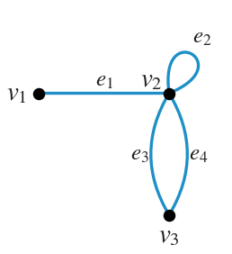

*그림 22. 길이가 2인 보행을 셀 그래프*

**예제 (길이가 2인 보행 세기).** 그림 22의 그래프에서 $v_2$에서 $v_2$로 가는 길이가 2인 보행은 몇 개인가? 첫 번째 변이 $v_2$에서 어느 꼭짓점으로 가는지에 따라 나누어 센다.

- $v_1$으로 갔다 오는 보행: $v_2 e_1 v_1 e_1 v_2$ 하나이다.
- $v_2$에 머무는 보행: $v_2 e_2 v_2 e_2 v_2$ 하나이다.
- $v_3$으로 갔다 오는 보행: $v_2 e_3 v_3 e_4 v_2$, $v_2 e_4 v_3 e_3 v_2$, $v_2 e_3 v_3 e_3 v_2$, $v_2 e_4 v_3 e_4 v_2$의 네 개이다. 가는 변 2가지와 오는 변 2가지를 곱의 법칙으로 조합한 것이다.

따라서 답은 $1 + 1 + 4 = 6$이다. 이 개수는 인접 행렬의 곱으로 바로 얻을 수 있다. 그래프의 인접 행렬 $\mathbf{A}$와 $\mathbf{A}^2$는 다음과 같다.

```math
\mathbf{A} = \begin{array}{c|ccc} & v_1 & v_2 & v_3 \\ \hline v_1 & 0 & 1 & 0 \\ v_2 & 1 & 1 & 2 \\ v_3 & 0 & 2 & 0 \end{array}, \qquad \mathbf{A}^2 = \begin{bmatrix} 0 & 1 & 0 \\ 1 & 1 & 2 \\ 0 & 2 & 0 \end{bmatrix} \begin{bmatrix} 0 & 1 & 0 \\ 1 & 1 & 2 \\ 0 & 2 & 0 \end{bmatrix} = \begin{bmatrix} 1 & 1 & 2 \\ 1 & 6 & 2 \\ 2 & 2 & 4 \end{bmatrix}
```

$\mathbf{A}^2$의 2행 2열 성분은 6으로, $v_2$에서 $v_2$로 가는 길이가 2인 보행의 개수와 같다. 이것은 우연이 아니다. 이 성분은 $\mathbf{A}$의 2행과 2열의 스칼라곱 $1 \cdot 1 + 1 \cdot 1 + 2 \cdot 2$이다. 첫째 항 $1 \cdot 1$은 ($v_2$에서 $v_1$로 가는 변의 수) $\times$ ($v_1$에서 $v_2$로 가는 변의 수)이므로, 곱의 법칙에 의해 $v_2$에서 $v_1$을 거쳐 $v_2$로 돌아오는 변의 쌍의 수, 즉 둘째 꼭짓점이 $v_1$인 길이 2의 보행의 수이다. 같은 이유로 $i$번째 항은 둘째 꼭짓점이 $v_i$인 보행의 수이고, 합 $1 + 1 + 4 = 6$은 전체 보행의 수이다. 이 논리를 일반화하면 다음 정리를 얻는다.

**정리 10.2.2.** $G$가 꼭짓점 $v_1, v_2, \ldots, v_m$을 가지는 그래프이고 $\mathbf{A}$가 $G$의 인접 행렬이면, 모든 양의 정수 $n$과 모든 정수 $i, j = 1, 2, \ldots, m$에 대해 $\mathbf{A}^n$의 $(i, j)$ 성분은 $v_i$에서 $v_j$로 가는 길이가 $n$인 보행의 개수와 같다.

**증명 (수학적 귀납법).** $P(n)$을 "모든 $i, j = 1, \ldots, m$에 대해 $\mathbf{A}^n$의 $(i, j)$ 성분은 $v_i$에서 $v_j$로 가는 길이가 $n$인 보행의 개수이다"라는 문장이라 하고, 모든 정수 $n \geq 1$에 대해 $P(n)$이 참임을 보인다.

기저 단계: $\mathbf{A}^1 = \mathbf{A}$이므로 $\mathbf{A}^1$의 $(i, j)$ 성분은 인접 행렬의 정의에 의해 $v_i$와 $v_j$를 잇는 변의 수이다. 길이가 1인 보행은 변 하나로 이루어지므로 이 수는 $v_i$에서 $v_j$로 가는 길이가 1인 보행의 수와 같다. 따라서 $P(1)$은 참이다.

귀납 단계: $k \geq 1$인 정수 $k$에 대해 $P(k)$가 참이라고 가정한다(귀납 가정). $\mathbf{A} = (a_{ij})$, $\mathbf{A}^k = (b_{ij})$로 두면 $\mathbf{A}^{k+1} = \mathbf{A}\mathbf{A}^k$이므로 $\mathbf{A}^{k+1}$의 $(i, j)$ 성분은 $\mathbf{A}$의 $i$행과 $\mathbf{A}^k$의 $j$열의 스칼라곱이다.

```math
(\mathbf{A}^{k+1})_{ij} = a_{i1} b_{1j} + a_{i2} b_{2j} + \cdots + a_{im} b_{mj}
```

각 항 $a_{ir} b_{rj}$를 본다. $a_{ir}$는 $v_i$에서 $v_r$로 가는 변의 수이고, 귀납 가정에 의해 $b_{rj}$는 $v_r$에서 $v_j$로 가는 길이가 $k$인 보행의 수이다. $v_i$에서 $v_r$로 가는 변 하나와 $v_r$에서 $v_j$로 가는 길이 $k$인 보행 하나를 이으면 둘째 꼭짓점이 $v_r$인 길이 $k+1$의 보행이 되고, 그런 보행은 모두 이렇게 유일하게 분해된다. 따라서 곱의 법칙에 의해 $a_{ir} b_{rj}$는 $v_i$에서 $v_j$로 가는 길이 $k+1$의 보행 가운데 둘째 꼭짓점이 $v_r$인 것의 개수이다. 길이 $k+1$의 보행은 둘째 꼭짓점이 $v_1, \ldots, v_m$ 중 정확히 하나이므로, 합의 법칙에 의해 위 합은 $v_i$에서 $v_j$로 가는 길이 $k+1$의 보행 전체의 개수이다. 따라서 $P(k+1)$이 참이다.

기저 단계와 귀납 단계가 모두 증명되었으므로 모든 정수 $n \geq 1$에 대해 $P(n)$이 참이다. ∎

> **핵심:** 인접 행렬을 $n$제곱하면 길이가 $n$인 보행의 개수를 꼭짓점의 모든 쌍에 대해 한꺼번에 얻는다. 예를 들어 같은 그래프에서 $\mathbf{A}^3 = \mathbf{A}\mathbf{A}^2$의 2행 3열 성분은 $1 \cdot 2 + 1 \cdot 2 + 2 \cdot 4 = 12$이므로 $v_2$에서 $v_3$으로 가는 길이가 3인 보행은 12개이다.

---

<br>

## 3. 그래프의 동형

그림 23의 왼쪽 두 그림은 같은 그래프 $G$를 다르게 그린 것이다. 두 그림의 꼭짓점 집합과 변 집합이 같고 변-끝점 함수도 같다. 즉 그래프는 그림의 모양이 아니라 어떤 변이 어떤 꼭짓점을 잇는지에 의해 정해진다.

### 3.1 동형의 정의

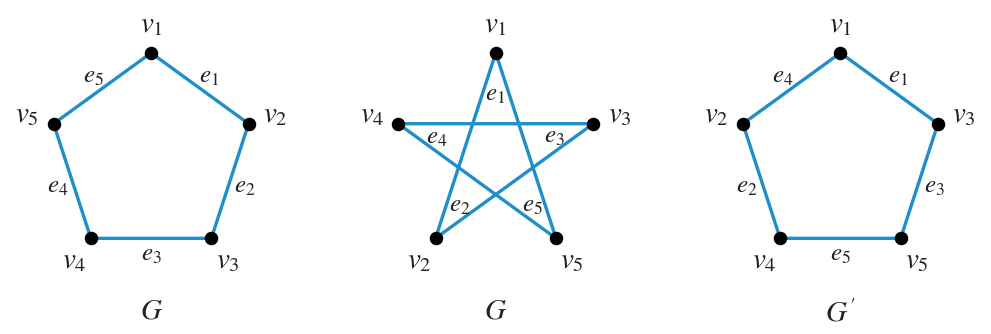

*그림 23. 같은 그래프 G의 두 그림과 이름만 다른 그래프 G'*

그림 23의 오른쪽 그래프 $G'$은 $G$와 다른 그래프이다. 예를 들어 $G$에서 $e_1$의 끝점은 $v_1$과 $v_2$이지만 $G'$에서 $e_1$의 끝점은 $v_1$과 $v_3$이다. 그러나 $G'$은 $G$와 모양이 같다. 다음 표의 함수로 꼭짓점과 변의 이름을 바꾸면 $G$의 각 변의 끝점이 $G'$의 대응하는 변의 끝점이 된다.

| $G$의 꼭짓점 | $v_1$ | $v_2$ | $v_3$ | $v_4$ | $v_5$ |
|:-----|:-----|:-----|:-----|:-----|:-----|
| 대응하는 $G'$의 꼭짓점 | $v_1$ | $v_3$ | $v_5$ | $v_4$ | $v_2$ |
| **$G$의 변** | $e_1$ | $e_2$ | $e_3$ | $e_4$ | $e_5$ |
| 대응하는 $G'$의 변 | $e_1$ | $e_3$ | $e_5$ | $e_2$ | $e_4$ |

*표 4. G의 꼭짓점과 변을 G'의 꼭짓점과 변으로 보내는 대응*

예를 들어 $G$에서 $e_2$의 끝점은 $v_2, v_3$이고, 이 꼭짓점들은 $v_3, v_5$로 대응하며, $e_2$에 대응하는 $G'$의 변 $e_3$의 끝점이 바로 $v_3, v_5$이다. 두 대응은 모두 일대일이고 위로의 함수, 즉 일대일 대응이다. 이처럼 꼭짓점과 변의 이름만 다르고 나머지가 같은 두 그래프를 동형이라 한다. 동형(isomorphism)이라는 말은 "같은 형태"를 뜻하는 그리스어에서 왔다.

> **용어 정의:** $G$와 $G'$을 꼭짓점 집합이 각각 $V(G), V(G')$이고 변 집합이 각각 $E(G), E(G')$인 그래프라 하자. 일대일 대응 $g: V(G) \to V(G')$과 $h: E(G) \to E(G')$이 존재하여 모든 $v \in V(G)$와 $e \in E(G)$에 대해 다음이 성립하면 $G$는 $G'$과 **동형(isomorphic)** 이라 한다. 이때 $g$와 $h$가 두 그래프의 변-끝점 함수를 보존한다고 하고, 이 대응의 쌍을 **동형 사상(isomorphism)** 이라 부른다.

```math
v \text{가 } e \text{의 끝점이다} \iff g(v) \text{가 } h(e) \text{의 끝점이다} \qquad (10.3.1)
```

식 (10.3.1)은 "$`v`$가 $e$의 끝점이다"와 "$`g(v)`$가 $h(e)$의 끝점이다"가 동치라는 뜻이다. 말로 하면, $G$와 $G'$의 꼭짓점과 변을 일대일 대응으로 짝지었을 때 대응하는 꼭짓점 사이의 변들이 서로 대응하면 두 그래프는 동형이다. 수학에서는 동형인 대상을 같은 것으로 보는 일이 흔하다. 예를 들어 꼭짓점이 다섯 개이고 모든 꼭짓점 쌍이 변으로 이어진 그래프 $G$가 있으면 "$`G`$는 $K_5$와 동형이다" 대신 "$`G`$는 $K_5$이다"라고 말한다.

### 3.2 두 그래프가 동형임을 보이기

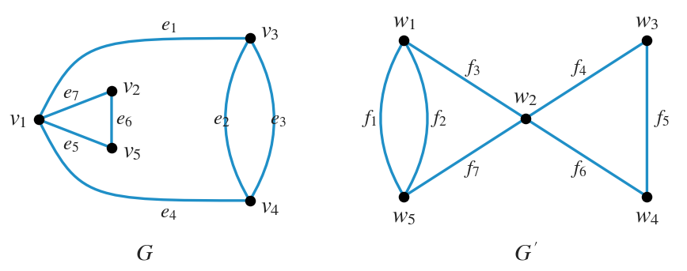

*그림 24. 동형인 두 그래프 G와 G'*

**예제 10.3.1 (동형임을 보이기).** 그림 24의 두 그래프가 동형임을 보인다. 모든 $v \in V(G)$, $e \in E(G)$에 대해 "$`v`$가 $e$의 끝점이다 $\iff$ $g(v)$가 $h(e)$의 끝점이다"를 만족하는 일대일 대응 $g: V(G) \to V(G')$과 $h: E(G) \to E(G')$을 찾아야 한다. 이런 함수를 찾는 일은 일부는 시행착오이고 일부는 추론이다.

- $e_2$와 $e_3$은 끝점이 같은 평행 변이므로 $h(e_2)$와 $h(e_3)$도 평행 변이어야 한다. $G'$의 평행 변은 $f_1, f_2$뿐이므로 $\lbrace h(e_2), h(e_3)\rbrace = \lbrace f_1, f_2\rbrace$이다. 또 $e_2, e_3$의 끝점 $v_3, v_4$는 $f_1, f_2$의 끝점 $w_1, w_5$로 가야 한다.
- $v_1$에는 서로 다른 변 네 개($`e_1, e_4, e_5, e_7`$)가 접하므로 $g(v_1)$에도 서로 다른 변 네 개가 접해야 한다. $g(v_1)$에 접하는 모든 변은 $v_1$에 접하는 변의 $h$에 의한 상이고 $h$가 일대일 대응이기 때문이다. $G'$에서 변 네 개가 접하는 꼭짓점은 $w_2$뿐이므로 $g(v_1) = w_2$이다.
- $g(v_3) = w_1$로 정하면, $v_1$과 $v_3$이 $e_1$의 끝점이므로 $g(v_1) = w_2$와 $g(v_3) = w_1$이 $h(e_1)$의 끝점이어야 하고, 따라서 $h(e_1) = f_3$이다.

이런 식으로 필요하면 임의의 선택을 하면서 계속하면 동형 사상을 하나 얻는다. 그런 쌍의 하나는 $g(v_1) = w_2$, $g(v_2) = w_3$, $g(v_3) = w_1$, $g(v_4) = w_5$, $g(v_5) = w_4$와 다음 표의 $h$이다. 표는 $G$의 각 변에 대해 식 (10.3.1)이 성립함을 함께 보여 준다.

| $G$의 변 $e$ | $G$에서의 끝점 | 끝점의 $g$에 의한 상 | $h(e)$ | $G'$에서 $h(e)$의 끝점 |
|:-----|:-----|:-----|:-----|:-----|
| $e_1$ | $v_1, v_3$ | $w_2, w_1$ | $f_3$ | $w_1, w_2$ |
| $e_2$ | $v_3, v_4$ | $w_1, w_5$ | $f_1$ | $w_1, w_5$ |
| $e_3$ | $v_3, v_4$ | $w_1, w_5$ | $f_2$ | $w_1, w_5$ |
| $e_4$ | $v_1, v_4$ | $w_2, w_5$ | $f_7$ | $w_5, w_2$ |
| $e_5$ | $v_1, v_5$ | $w_2, w_4$ | $f_6$ | $w_2, w_4$ |
| $e_6$ | $v_2, v_5$ | $w_3, w_4$ | $f_5$ | $w_3, w_4$ |
| $e_7$ | $v_1, v_2$ | $w_2, w_3$ | $f_4$ | $w_2, w_3$ |

*표 5. G에서 G'으로의 동형 사상과 끝점 보존의 확인*

모든 행에서 셋째 열과 다섯째 열의 꼭짓점 집합이 같으므로 $g$와 $h$는 변-끝점 함수를 보존한다. $h$의 선택은 이것 하나만이 아니다. 예를 들어 $h(e_2) = f_2$, $h(e_3) = f_1$로 바꾸어도 된다.

### 3.3 동치 관계로서의 그래프 동형

그래프 동형은 그래프의 집합 위에서 반사적, 대칭적, 추이적인 관계, 즉 동치 관계이다.

**정리 10.3.1 (그래프 동형은 동치 관계이다).** $S$를 그래프의 집합이라 하고 $R$을 $S$ 위의 그래프 동형 관계라 하면 $R$은 $S$ 위의 동치 관계이다.

**증명.** 세 성질을 차례로 보인다.

- 반사적: $S$의 임의의 그래프 $G$에 대해 꼭짓점 집합과 변 집합 위의 항등 함수를 쓰면 $G$에서 $G$로의 동형 사상이 된다.
- 대칭적: $G$가 $G'$과 동형이고 $g, h$가 변-끝점 함수를 보존하는 $G$에서 $G'$으로의 꼭짓점 대응과 변 대응이라 하자. $g$와 $h$는 일대일 대응이므로 역함수 $g^{-1}, h^{-1}$이 있고, 이들은 $G'$에서 $G$로의 꼭짓점 대응과 변 대응으로서 변-끝점 함수를 보존한다. 식 (10.3.1)의 동치를 거꾸로 읽으면 되기 때문이다. 따라서 $G'$은 $G$와 동형이다.
- 추이적: $G$가 $G'$과 동형이고 $G'$이 $G''$과 동형이라 하자. $g_1, h_1$을 $G$에서 $G'$으로, $g_2, h_2$를 $G'$에서 $G''$으로의 끝점을 보존하는 대응이라 하면, 합성 $g_2 \circ g_1$과 $h_2 \circ h_1$은 일대일 대응이고 $G$에서 $G''$으로 끝점을 보존한다. $v$가 $e$의 끝점이면 $g_1(v)$가 $h_1(e)$의 끝점이고, 따라서 $g_2(g_1(v))$가 $h_2(h_1(e))$의 끝점이며, 역방향도 같은 논리로 성립하기 때문이다. 따라서 $G$는 $G''$과 동형이다. ∎

대칭성 덕분에 "$`G`$는 $G'$과 동형이다"나 "$`G'`$은 $G$와 동형이다" 대신 "$`G`$와 $G'$은 동형이다"라고 말해도 된다. 동치 관계는 집합을 동치류로 분할하므로, 그래프의 모임은 서로 동형인 그래프끼리 묶인 **동형류(isomorphism class)** 로 나뉜다.

**예제 10.3.2 (동형류의 대표 찾기).** 꼭짓점이 두 개이고 변이 두 개인 그래프 가운데 서로 동형이 아닌 것을 모두 구한다. 즉 꼭짓점이 두 개이고 변이 두 개인 모든 그래프가 그 가운데 하나와 동형이 되는 대표의 모임을 구한다. 답은 그림 25의 네 그래프이다. 어떤 이름을 붙여도 동형인 그래프가 되므로 이름 없이 그렸다.

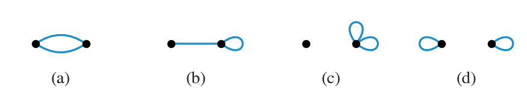

*그림 25. 꼭짓점 두 개와 변 두 개를 가지는 그래프의 네 동형류*

이 네 개가 전부임은 변 하나가 두 꼭짓점을 잇는지로 경우를 나누어 확인한다. 어떤 변이 두 꼭짓점을 이으면, 다른 변도 두 꼭짓점을 이어 (a)가 되거나 한 꼭짓점의 루프가 되어 (b)가 된다. (b)에서 루프를 어느 꼭짓점에 두든 두 꼭짓점의 이름을 바꾸면 같으므로 동형이다. 두 꼭짓점을 잇는 변이 없으면 두 변이 모두 루프이고, 두 루프가 같은 꼭짓점에 있는 (c)와 서로 다른 꼭짓점에 하나씩 있는 (d) 두 경우뿐이다. 변을 놓는 다른 방법은 없으므로 목록은 완전하다.

### 3.4 동형 불변량

두 그래프가 동형인지 판정하는 일반적인 알고리즘은 존재한다. $G$의 꼭짓점 집합에서 $G'$의 꼭짓점 집합으로의 모든 일대일 대응과 변 집합 사이의 모든 일대일 대응을 만들어, 각 쌍이 변-끝점 함수를 보존하는지 확인하면 된다. 그러나 이 알고리즘은 빠른 컴퓨터로도 지나치게 오래 걸린다. $G$와 $G'$이 각각 꼭짓점 $n$개와 변 $m$개를 가지면 꼭짓점의 일대일 대응은 $n!$개, 변의 일대일 대응은 $m!$개이므로 확인할 쌍은 $n! \cdot m!$개이다. $m = n = 20$이면 $20! \cdot 20! \approx 5.9 \times 10^{36}$개이고, 한 쌍을 1나노초에 확인해도 약 $1.9 \times 10^{20}$년이 걸린다.

이보다 효율적인 일반적인 판정 방법은 알려져 있지 않다. 하지만 두 그래프가 동형이 아님을 보이는 간단한 검사는 있다. 예를 들어 동형인 두 그래프는 꼭짓점 집합 사이에 일대일 대응이 있으므로 꼭짓점 수가 같다. 따라서 꼭짓점이 16개인 그래프와 17개인 그래프는 바로 동형이 아니라고 결론지을 수 있다. 일반적으로 그래프 동형으로 보존되는 성질을 동형 불변량이라 한다.

> **용어 정의:** 임의의 그래프 $G$와 $G'$에 대해 "$`G`$가 성질 $P$를 가지고 $G'$이 $G$와 동형이면 $G'$도 성질 $P$를 가진다"가 성립하면 성질 $P$를 그래프 동형의 **동형 불변량(isomorphic invariant)** 이라 한다.

**정리 10.3.2.** $n, m, k$가 음이 아닌 정수일 때 다음 성질은 모두 그래프 동형의 동형 불변량이다.

1. 꼭짓점이 $n$개이다.
2. 변이 $m$개이다.
3. 차수가 $k$인 꼭짓점이 있다.
4. 차수가 $k$인 꼭짓점이 $m$개이다.
5. 길이가 $k$인 회로가 있다.
6. 길이가 $k$인 단순 회로가 있다.
7. 길이가 $k$인 단순 회로가 $m$개이다.
8. 연결 그래프이다.
9. 오일러 회로가 있다.
10. 해밀턴 회로가 있다.

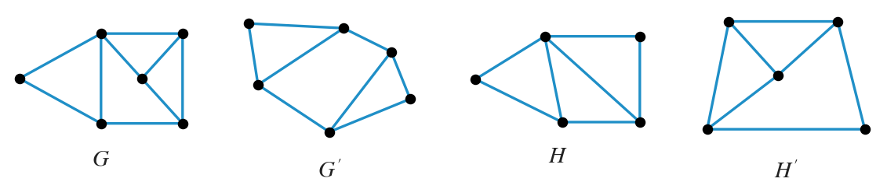

*그림 26. 동형이 아닌 두 쌍의 그래프*

**예제 10.3.3 (동형이 아님을 보이기).** 그림 26의 두 쌍이 동형이 아님을 공유하지 않는 동형 불변량으로 보인다. (1) $G$는 변이 9개이고 $G'$은 변이 8개이므로 정리 10.3.2의 2번 불변량에 의해 동형이 아니다. (2) $H$와 $H'$은 꼭짓점 5개와 변 7개로 같지만, $H$에는 차수가 4인 꼭짓점(위쪽 두 꼭짓점 가운데 왼쪽 것)이 있고 $H'$의 차수는 $3, 3, 3, 3, 2$뿐이므로 3번 불변량에 의해 동형이 아니다.

정리 10.3.2의 3번을 증명한다. 나머지도 비슷한 논리로 증명할 수 있다.

**예제 10.3.4 (정리 10.3.2의 3번의 증명).** $G$와 $G'$이 동형이고 $G$에 차수가 $k$인 꼭짓점 $v$가 있다고 하자. $G'$에 차수가 $k$인 꼭짓점이 있음을 보인다. 동형이므로 변-끝점 함수를 보존하는 일대일 대응 $g: V(G) \to V(G')$, $h: E(G) \to E(G')$이 있다. 즉 $G$의 모든 변 $e$와 꼭짓점 $u$에 대해 $u$가 $e$의 끝점인 것과 $g(u)$가 $h(e)$의 끝점인 것은 동치이다.

1. $e_1, e_2, \ldots, e_s$를 $G$에서 $v$에 접하는 서로 다른 변이라 하자($`s \geq 0`$). 그러면 $h(e_1), \ldots, h(e_s)$는 $G'$에서 $g(v)$에 접하는 서로 다른 $s$개의 변이다. $h$가 일대일이므로 서로 다르고, 끝점이 보존되므로 $g(v)$에 접한다.
2. $g(v)$에 접하는 다른 변은 없다. $g(v)$에 접하는 변 $f$가 있으면 $h$가 위로의 함수이므로 $f = h(e)$인 $e$가 있고, 끝점이 보존되므로 $v$가 $e$의 끝점이어서 $e$는 $e_1, \ldots, e_s$ 중 하나이다. 따라서 $v$에 접하는 변의 수와 $g(v)$에 접하는 변의 수는 같다.
3. $e$가 $v$의 루프일 필요충분조건은 $h(e)$가 $g(v)$의 루프인 것이다. 꼭짓점 $w$가 $e$의 끝점인 것과 $g(w)$가 $h(e)$의 끝점인 것이 동치이고 $g$가 일대일 대응이므로, $v$가 $e$의 유일한 끝점인 것과 $g(v)$가 $h(e)$의 유일한 끝점인 것이 동치이기 때문이다. 따라서 $v$의 루프 수와 $g(v)$의 루프 수가 같다.
4. $v$의 차수는 $v$에 접하는 루프가 아닌 변의 수에 루프 수의 두 배를 더한 값이다. 2와 3에 의해 이 두 수가 $v$와 $g(v)$에서 같으므로 $\deg(g(v)) = \deg(v) = k$이다. ∎

예를 들어 $v$에 루프가 아닌 변 3개와 루프 2개가 접하면 $\deg(v) = 3 + 2 \cdot 2 = 7$이고, $g(v)$에도 루프가 아닌 변 3개와 루프 2개가 접하므로 $\deg(g(v)) = 7$이다.

> **주의:** 동형 불변량은 두 그래프가 동형이 아님을 보이는 데만 쓸 수 있다. 정리 10.3.2의 불변량을 모두 공유하더라도 동형이라는 보장은 없으며, 동형임을 보이려면 실제로 동형 사상을 찾아야 한다.

### 3.5 단순 그래프의 동형

$G$와 $G'$이 모두 단순 그래프이면 변은 끝점의 쌍으로 정해지므로, 동형의 정의를 변의 대응 없이 쓸 수 있다.

> **용어 정의:** $G$와 $G'$이 단순 그래프일 때, 꼭짓점 집합 사이의 일대일 대응 $g: V(G) \to V(G')$이 존재하여 $G$의 모든 꼭짓점 $u, v$에 대해 다음이 성립하면 $G$는 $G'$과 **동형(isomorphic)** 이라 한다.

```math
\lbrace u, v\rbrace \text{가 } G \text{의 변이다} \iff \lbrace g(u), g(v)\rbrace \text{가 } G' \text{의 변이다} \qquad (10.3.2)
```

즉 $G$의 두 꼭짓점이 변으로 이어져 있는 것과 대응하는 $G'$의 두 꼭짓점이 변으로 이어져 있는 것이 동치이다.

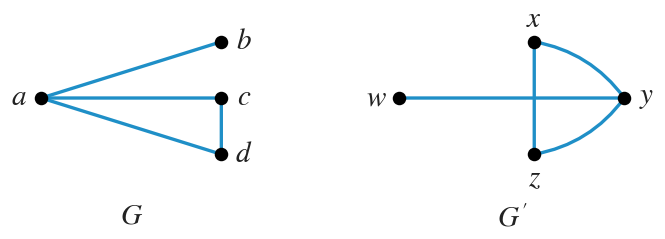

*그림 27. 동형인지 판정할 두 단순 그래프*

**예제 10.3.5 (단순 그래프의 동형).** 그림 27의 두 그래프는 동형인가? 동형이다. $G$에서 차수가 3인 꼭짓점은 $a$뿐이고 $G'$에서는 $y$뿐이므로 $g(a) = y$로 둔다. 차수가 1인 $b$와 $w$를 짝짓고, 나머지 $c, d$를 $x, z$에 대응시켜 $g(a) = y$, $g(b) = w$, $g(c) = x$, $g(d) = z$로 정의한다. $g$는 일대일 대응이며, 다음 표는 $g$가 변을 변으로 보냄을 보여 준다. 두 그래프의 변이 모두 4개이므로 $G$의 변이 $G'$의 변 전부로 대응되고, 따라서 식 (10.3.2)의 양방향이 모두 성립한다.

| $G$의 변 | $G'$의 변 |
|:-----|:-----|
| $\lbrace a, b\rbrace$ | $\lbrace y, w\rbrace = \lbrace g(a), g(b)\rbrace$ |
| $\lbrace a, c\rbrace$ | $\lbrace y, x\rbrace = \lbrace g(a), g(c)\rbrace$ |
| $\lbrace a, d\rbrace$ | $\lbrace y, z\rbrace = \lbrace g(a), g(d)\rbrace$ |
| $\lbrace c, d\rbrace$ | $\lbrace x, z\rbrace = \lbrace g(c), g(d)\rbrace$ |

*표 6. 꼭짓점 대응 g가 G의 변을 G'의 변으로 보내는 모습*

---

<br>

## 4. 트리의 예와 기본 성질

수학에서 트리는 회로가 없는 연결 그래프이다. 식물의 나무처럼 가지를 뻗지만 가지가 다시 만나 고리를 이루지 않는 모양이며, 이 절은 트리의 예와 트리의 꼭짓점 수와 변 수 사이의 관계를 다룬다.

### 4.1 트리와 숲

> **용어 정의:** 회로가 없는 그래프를 **회로가 없는(circuit-free)** 그래프라 한다. 회로가 없고 연결된 그래프를 **트리(tree)** 라 하고, 꼭짓점 하나로만 이루어진 그래프를 **자명한 트리(trivial tree)** 라 한다. 회로가 없고 연결되지 않은 그래프를 **숲(forest)** 이라 한다.

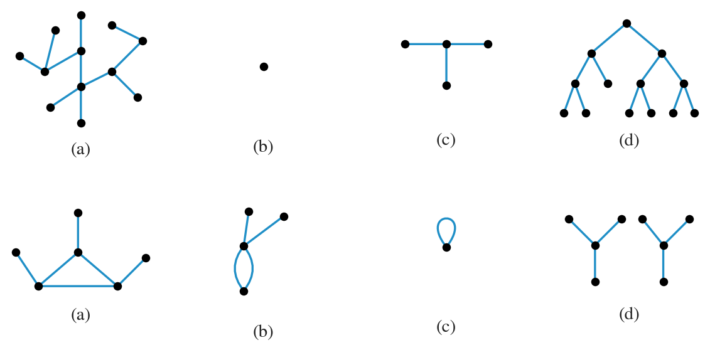

*그림 28. 트리인 그래프(윗줄)와 트리가 아닌 그래프(아랫줄)*

**예제 10.4.1 (트리와 트리가 아닌 것).** 그림 28의 윗줄 (a)~(d)는 모두 연결되어 있고 회로가 없으므로 트리이다. (b)는 자명한 트리이다. 아랫줄은 트리가 아니다. (a)는 세 꼭짓점이 이루는 회로를 가지고, (b)는 평행 변 두 개가 길이 2의 회로를 이루며, (c)는 루프 하나가 길이 1의 회로이다. (d)는 회로는 없지만 연결되어 있지 않으므로 트리가 아니라 숲이다.

> **주의:** 교재는 숲을 "회로가 없고 연결되지 않은" 그래프로 정의하므로 트리는 숲이 아니다. 숲을 회로가 없는 그래프로 정의하여 트리도 숲에 포함하는 책이 많으므로 다른 자료와 비교할 때 주의해야 한다. 어느 정의에서든 숲의 연결 성분은 각각 트리이다.

### 4.2 트리의 예

트리는 여러 분야에서 자연스럽게 나타난다.

**예제 10.4.2 (결정 트리).** 어느 대학은 신입생에게 두 부분으로 된 수학 배치 평가를 치르게 하고, 그림 29의 트리에 따라 수강할 과목을 추천한다. 트리를 왼쪽에서 오른쪽으로 읽으면 된다. 예를 들어 1부에서 9점, 2부에서 7점을 받은 학생은 1부 점수가 8, 9, 10점 중 하나이므로 2부 점수를 확인하고, 2부 점수가 6점보다 크므로 Math 110을 추천받는다. 이처럼 질문에 따라 갈래가 나뉘는 트리를 **결정 트리(decision tree)** 라 한다.

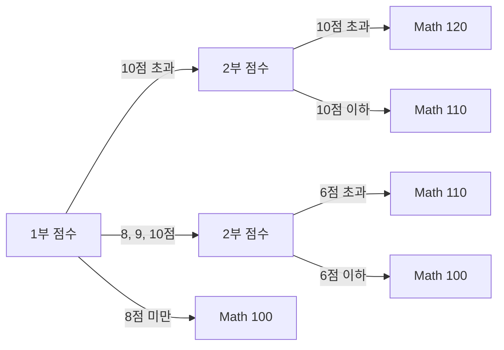

*그림 29. 배치 평가 점수에 따라 과목을 추천하는 결정 트리*

**예제 10.4.3 (구문 트리).** 촘스키(Noam Chomsky) 등은 영어 같은 자연 언어의 구문(syntax), 즉 문법 구조를 기술하는 방법을 발전시켰고, 이 연구는 고급 프로그래밍 언어의 컴파일러를 만드는 데에도 쓰였다. 문법을 연구할 때는 기본 규칙에서 문법적으로 올바른 문장이 유도되는 과정을 트리로 나타내며, 이를 **구문 유도 트리(syntactic derivation tree)** 또는 **구문 트리(parse tree)** 라 한다. 영어 문법의 매우 작은 부분집합을 다음 규칙으로 정한다.

1. 문장은 명사구 다음에 동사구를 써서 만든다.
2. 명사구는 관사 다음에 명사를 써서 만든다.
3. 명사구는 관사, 형용사, 명사를 차례로 써서 만들 수도 있다.
4. 동사구는 동사 다음에 명사구를 써서 만든다.
5. 관사의 하나는 "the"이다.
6. 형용사의 하나는 "young"이다.
7. 동사의 하나는 "caught"이다.
8. 명사의 하나는 "man"이다.
9. 또 다른 명사는 "ball"이다.

문법의 규칙을 **생성 규칙(production)** 이라 하며, 보통 다음과 같은 줄임 표기로 쓴다. 이 표기는 1959년 배커스(John Backus)가 도입하고 1960년 나우르(Peter Naur)가 고친 것으로, 프로그래밍 언어 Algol을 기술하는 데 쓰였으며 **배커스-나우르 표기법(Backus-Naur notation)** 이라 부른다. 기호 `|`는 "또는"을 뜻하고, 꺾쇠괄호 `< >`는 정의할 용어(문장, 명사구 등)를 감싼다.

```text
1.     <sentence>    → <noun phrase> <verb phrase>
2, 3.  <noun phrase> → <article> <noun> | <article> <adjective> <noun>
4.     <verb phrase> → <verb> <noun phrase>
5.     <article>     → the
6.     <adjective>   → young
7.     <verb>        → caught
8, 9.  <noun>        → man | ball
```

`<sentence>`, `<noun phrase>`, `<verb phrase>`, `<article>`, `<adjective>`, `<noun>`, `<verb>`는 각각 문장, 명사구, 동사구, 관사, 형용사, 명사, 동사를 뜻한다. 첫 줄은 규칙 1을, 둘째 줄은 규칙 2와 3을 `|`로 합친 것이다. 문장 "The young man caught the ball"이 이 규칙에서 유도되는 과정은 그림 30의 트리로 나타난다. 루트의 "문장"에서 규칙 1을 적용해 명사구와 동사구로 나누고, 왼쪽 명사구에는 규칙 3을, 동사구에는 규칙 4를 적용하는 식으로 내려가 리프에 실제 단어가 놓인다.

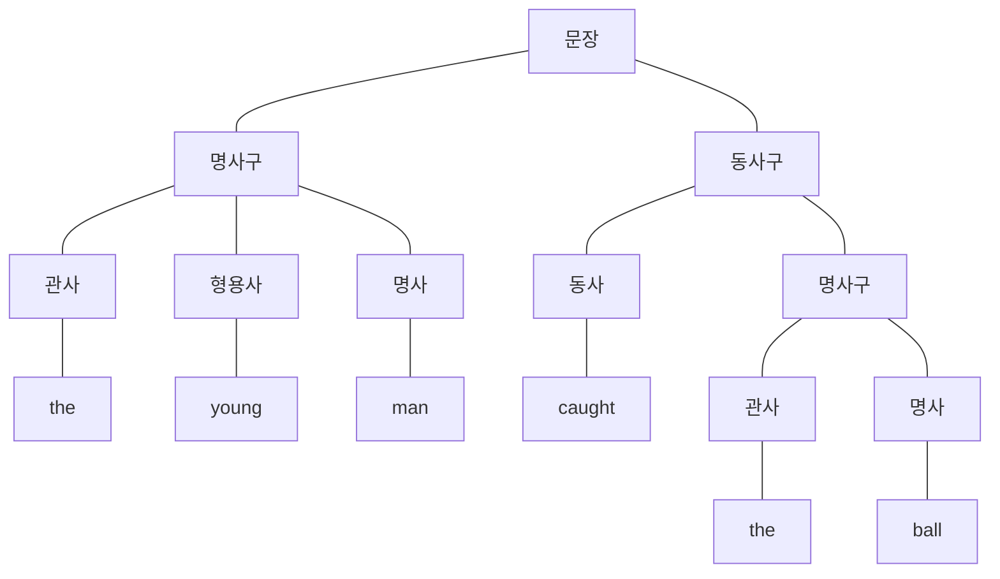

*그림 30. 문장 The young man caught the ball의 구문 트리*

언어학에서 **구문(syntax)** 은 문장의 문법 구조를, **의미(semantics)** 는 낱말의 뜻과 그 관계를 가리킨다. 문장은 구문상 옳지만 의미상 틀릴 수 있다. 예를 들어 "The young ball caught the man"은 위 규칙으로 유도되지만 뜻이 통하지 않는다. 반대로 두 살 아이의 "Me hungry!"처럼 구문 오류가 있어도 뜻은 통하는 문장도 있다.

> **[컴파일러]** 컴파일러의 구문 분석 단계는 프로그래밍 언어의 문법 규칙에 따라 소스 코드의 구문 트리를 만든다. 문법을 배커스-나우르 표기법으로 적고, 프로그램이 문법에 맞는지와 각 부분이 어떤 구조인지를 트리로 확인하는 것은 위 예제와 같은 원리이다.

**예제 10.4.4 (탄화수소 분자의 구조).** 독일의 물리학자 키르히호프(Gustav Kirchhoff)가 전기 회로를 연구하며 처음으로 수학적 트리를 분석했고, 곧이어 영국의 수학자 케일리(Arthur Cayley)는 트리를 이용해 특정한 탄화수소의 이성질체를 모두 세었다. 탄화수소 분자는 탄소(C)와 수소(H)로 이루어지며, 탄소 원자는 다른 원자와 최대 네 개, 수소 원자는 한 개의 결합을 만든다. 따라서 원자를 꼭짓점, 결합을 변으로 두면 탄화수소 분자를 그래프로 나타낼 수 있다.

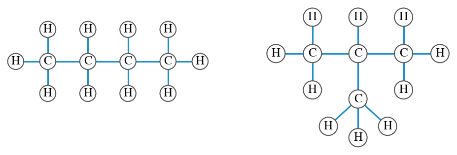

*그림 31. 뷰테인(왼쪽)과 아이소뷰테인(오른쪽)의 그래프*

그림 31의 두 그래프는 모두 탄소 원자 4개와 수소 원자 10개를 가지지만 원자의 배치가 다르다. 이처럼 화학식이 같고(여기서는 $`\mathrm{C_4H_{10}}`$) 결합 구조가 다른 분자를 **이성질체(isomer)** 라 한다. 탄소 원자 수에 대해 수소 원자를 가능한 한 많이 가지는 분자를 포화 탄화수소라 하며, 케일리는 탄소 원자가 $k$개인 포화 탄화수소의 수소 원자가 $2k + 2$개임을 보였다. 그 첫 단계는 포화 탄화수소 분자의 그래프가 트리임을 보이는 것이며, 이를 귀류법으로 증명한다.

**증명.** 탄소 원자 수에 대해 수소 원자를 최대로 가지면서 그래프 $G$가 트리가 아닌 탄화수소 분자가 있다고 가정한다. $G$는 트리가 아니므로 연결되어 있지 않거나 회로를 가진다. 분자의 모든 원자는 서로 연결되어 있으므로 $G$는 연결 그래프이고, 따라서 $G$는 회로를 가진다. 회로의 모든 꼭짓점은 차수가 적어도 2인데 수소 원자의 꼭짓점은 차수가 1이므로, 회로의 변은 탄소 원자끼리만 잇는다. 이제 회로의 변 하나를 지우고, 그 변의 양 끝에 있던 두 탄소 원자에 각각 새 수소 원자를 하나씩 붙인다(그림 32). 지운 결합 대신 새 결합이 생기므로 두 탄소 원자의 결합 수는 그대로이다. 그 결과 분자는 탄소 원자 수는 같고 수소 원자는 두 개 더 많다. 이것은 처음 분자가 탄소 원자 수에 대해 수소 원자를 최대로 가진다는 가정에 모순이다. 따라서 가정은 거짓이고 $G$는 트리이다. ∎

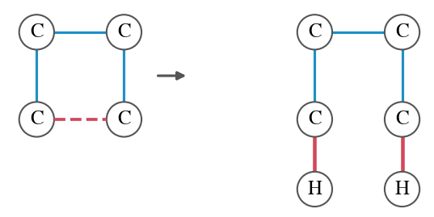

*그림 32. 회로의 변 하나를 지우고 수소 원자 두 개를 붙이는 과정*

### 4.3 차수가 1인 꼭짓점과 리프

트리의 꼭짓점 수와 변 수 사이에는 놀라운 관계가 있다. 양의 정수 $n$에 대해 꼭짓점이 $n$개인 트리는 모양과 관계없이 변이 $n - 1$개이다. 이 사실의 부분적인 역도 성립하여, 꼭짓점이 $n$개이고 변이 $n - 1$개인 연결 그래프는 트리이다. 이 두 정리를 증명하는 데 필요한 작은 사실이 자명하지 않은 트리에는 차수가 1인 꼭짓점이 있다는 것이다.

**보조정리 10.4.1.** 꼭짓점이 두 개 이상인 트리에는 차수가 1인 꼭짓점이 적어도 하나 있다.

구성적으로 이해하면 다음과 같다. 꼭짓점이 두 개 이상인 트리 $T$에서 꼭짓점 $v$를 아무것이나 골라 경로를 따라 바깥쪽으로 찾아 나간다. 새 꼭짓점에 도착할 때마다 차수가 1인지 확인하고, 1이면 멈추며, 아니면 들어온 변과 다른 변으로 나간다. $T$에는 회로가 없으므로 지나온 꼭짓점이 다시 나타나지 않고, $T$의 꼭짓점 수는 유한하므로 이 과정은 반드시 멈춘다. 멈춘 꼭짓점의 차수는 1이다.

**증명.** 꼭짓점이 두 개 이상인 임의의 트리 $T$에 대해 다음 알고리즘을 생각한다.

```text
1단계: T의 꼭짓점 v를 하나 고르고, v에 접하는 변 e를 하나 고른다.
2단계: deg(v) > 1인 동안 다음을 반복한다.
  2a: v에 접하는 변 가운데 e와 다른 변 e'을 고른다.
  2b: e'에서 v의 반대쪽 끝점을 v'이라 한다.
  2c: e := e', v := v'으로 둔다.
```

각 단계가 가능한 이유는 다음과 같다. 1단계에서 $v$에 접하는 변이 없다면 $v$는 고립 꼭짓점인데, $T$는 연결되어 있고 꼭짓점이 두 개 이상이므로 그럴 수 없다. 2a단계에서는 $\deg(v) > 1$이므로 $v$에 접하는 변이 적어도 두 개 있어 $e$와 다른 변을 고를 수 있다. 2b단계에서는 $T$가 트리이므로 $e'$은 루프일 수 없어 서로 다른 두 끝점을 가진다. 2c단계는 2단계를 반복하기 위해 이름을 바꾸는 것뿐이다. $T$에는 회로가 없으므로 이 과정에서 같은 꼭짓점을 다시 방문하지 않으며, 꼭짓점이 유한 개이므로 알고리즘은 반드시 끝난다. 끝났을 때 $\deg(v) > 1$이 거짓이고 $v$에는 변 $e$가 접하므로 $\deg(v) = 1$이다. ∎

사실 꼭짓점이 두 개 이상인 트리에는 차수가 1인 꼭짓점이 적어도 두 개 있다. 위 알고리즘으로 찾은 차수 1인 꼭짓점을 $u$라 하고, $u$에 접하는 유일한 변을 따라 이웃 꼭짓점으로 옮겨 간 뒤 들어온 변과 다른 변으로 나가는 탐색을 이어 가면, 트리에는 회로가 없으므로 탐색은 $u$로 돌아오지 않고 $u$와 다른 차수 1인 꼭짓점에서 멈추기 때문이다.

> **용어 정의:** $T$를 트리라 하자. $T$의 꼭짓점이 두 개 이상일 때, 차수가 1인 꼭짓점을 **리프(leaf)** 또는 **말단 꼭짓점(terminal vertex)** 이라 하고, 차수가 1보다 큰 꼭짓점을 **내부 꼭짓점(internal vertex)** 또는 **가지 꼭짓점(branch vertex)** 이라 한다. 자명한 트리의 유일한 꼭짓점도 리프라 한다.

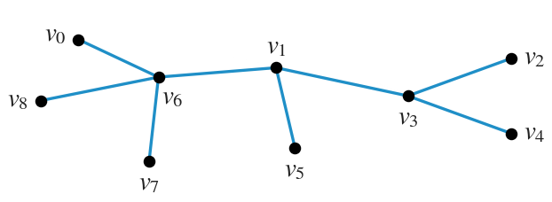

*그림 33. 리프와 내부 꼭짓점을 찾을 트리*

**예제 10.4.5 (리프와 내부 꼭짓점).** 그림 33의 트리에서 차수가 1인 꼭짓점 $v_0, v_2, v_4, v_5, v_7, v_8$이 리프이고, 차수가 1보다 큰 $v_6$(차수 4), $v_1$(차수 3), $v_3$(차수 3)이 내부 꼭짓점이다.

### 4.4 트리의 꼭짓점 수와 변 수

**정리 10.4.2.** 모든 양의 정수 $n$에 대해 꼭짓점이 $n$개인 트리는 변이 $n - 1$개이다.

증명은 수학적 귀납법이다. 귀납 단계에서는 꼭짓점이 $k$개인 모든 트리가 변 $k - 1$개를 가진다고 가정하고, 꼭짓점이 $k + 1$개인 임의의 트리 $T$가 변 $k$개를 가짐을 보인다. 이를 위해 $T$에서 꼭짓점 하나와 변 하나를 지워 꼭짓점이 $k$개인 트리 $T'$을 만든다. 보조정리 10.4.1에 의해 $T$에는 차수가 1인 꼭짓점 $v$가 있고, $v$는 변 $e$ 하나로만 나머지 부분과 이어져 있다. $v$와 $e$를 지운 $T'$은 꼭짓점이 $k$개인 트리이므로 귀납 가정에 의해 변이 $k - 1$개이고, $T$는 $T'$보다 꼭짓점과 변이 하나씩 많으므로 변이 $(k - 1) + 1 = k$개이다.

**증명 (수학적 귀납법).** $P(n)$을 "꼭짓점이 $n$개인 모든 트리는 변이 $n - 1$개이다"라는 문장이라 하고, 모든 정수 $n \geq 1$에 대해 $P(n)$이 참임을 보인다.

기저 단계: 꼭짓점이 하나인 트리 $T$를 생각한다. 트리에는 루프가 없으므로 $T$의 변은 0개이고, $0 = 1 - 1$이므로 $P(1)$은 참이다.

귀납 단계: $k \geq 1$인 정수 $k$에 대해 $P(k)$가 참, 즉 꼭짓점이 $k$개인 모든 트리는 변이 $k - 1$개라고 가정한다(귀납 가정). 꼭짓점이 $k + 1$개인 모든 트리가 변 $k$개를 가짐을 보여야 한다. $T$를 꼭짓점이 $k + 1$개인 임의의 트리라 하자. $T$에 대해서는 꼭짓점이 $k + 1$개라는 것 외에 아무것도 가정할 수 없다. $k \geq 1$이므로 $k + 1 \geq 2$이고, 보조정리 10.4.1에 의해 $T$에는 차수가 1인 꼭짓점 $v$가 있다. $T$에는 $v$ 말고도 꼭짓점이 있으므로 $v$를 나머지와 잇는 변 $e$가 있다. $T$의 부분 그래프 $T'$을 $V(T') = V(T) - \lbrace v\rbrace$, $E(T') = E(T) - \lbrace e\rbrace$로 정의하면 다음이 성립한다.

1. $T'$의 꼭짓점 수는 $(k + 1) - 1 = k$이다.
2. $T'$에는 회로가 없다. $T$에 회로가 없고, 변과 꼭짓점을 지워서는 회로가 새로 생길 수 없기 때문이다.
3. $T'$은 연결되어 있다. $T'$의 두 꼭짓점을 $T$에서 잇는 경로는 중간에 $v$를 지날 수 없다. 경로가 중간에 지나는 꼭짓점의 차수는 적어도 2인데 $\deg(v) = 1$이기 때문이다. 따라서 그 경로는 $v$와 $e$를 쓰지 않으므로 $T'$의 경로이다.

따라서 $T'$은 트리이고, 귀납 가정에 의해 변이 $k - 1$개이다. 그러므로 다음이 성립한다.

```math
(T \text{의 변의 수}) = (T' \text{의 변의 수}) + 1 = (k - 1) + 1 = k
```

이것이 보여야 할 것이었다. ∎

**예제 10.4.6 (트리인지 판정하기).** 꼭짓점이 10개이고 변이 12개인 그래프는 트리인가? 아니다. 정리 10.4.2에 의해 꼭짓점이 10개인 트리는 변이 9개여야 한다.

**예제 10.4.7 (조건을 만족하는 트리 찾기).** 꼭짓점이 4개인 트리 가운데 서로 동형이 아닌 것을 모두 구한다. 정리 10.4.2에 의해 꼭짓점이 4개인 트리는 변이 3개이므로, 악수 정리에 의해 총차수는 $2 \times 3 = 6$이다. 또 4.3절에서 보았듯이 꼭짓점이 두 개 이상인 트리는 차수가 1인 꼭짓점을 적어도 두 개 가지고, 연결되어 있으므로 차수가 0인 꼭짓점은 없다. 합이 6이고 1이 적어도 두 개인 네 양의 정수의 조합은 $1, 1, 1, 3$과 $1, 1, 2, 2$뿐이다. 각 조합에 해당하는 트리는 하나씩이며, 그림 34의 별 모양 트리와 일직선 모양 트리이다.

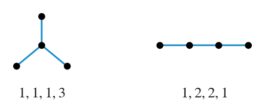

*그림 34. 꼭짓점이 4개인 서로 동형이 아닌 두 트리*

차수 조합이 $1, 1, 1, 3$이면 차수 3인 꼭짓점이 나머지 세 꼭짓점과 모두 이어져야 하므로 트리가 하나로 정해진다. $1, 1, 2, 2$이면 차수 2인 두 꼭짓점이 서로 이어지고 각각 리프 하나씩과 이어져야 하므로 역시 하나로 정해진다.

### 4.5 회로의 변 하나를 지운 그래프

두 번째 주요 정리를 증명하려면 다음 보조정리가 필요하다. 이것은 1.5절의 보조정리 10.1.1 (c)와 같은 내용이다.

**보조정리 10.4.3.** $G$가 연결 그래프이고 $C$가 $G$의 회로일 때, $C$의 변 하나를 $G$에서 지운 그래프는 여전히 연결 그래프이다.

이 보조정리가 성립하는 핵심 이유는 회로 위의 두 꼭짓점이 서로 다른 두 길로 이어져 있다는 것이다. 회로를 평면에 그리면 한 길은 시계 방향, 다른 길은 반시계 방향으로 돈다. 예를 들어 그림 35의 회로에서 $v_2$에서 $v_3$으로 가는 시계 방향 경로는 $v_2 e_3 v_3$이고, 반시계 방향 경로는 $v_2 e_2 v_1 e_1 v_0 e_6 v_5 e_5 v_4 e_4 v_3$이다($`v_6 = v_0`$).

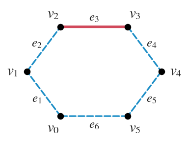

*그림 35. 회로 위의 두 꼭짓점을 잇는 시계 방향 경로와 반시계 방향 경로*

**증명.** $G$가 연결 그래프이고 $C$가 $G$의 회로이며 $e$가 $C$의 변이라 하자. $G$에서 $e$를 지운 부분 그래프 $G'$을 $V(G') = V(G)$, $E(G') = E(G) - \lbrace e\rbrace$로 정의한다. $G'$이 연결되어 있음을 보이려면 $G'$의 임의의 두 꼭짓점 $u, w$에 대해 $G'$에서 $u$에서 $w$로 가는 보행을 찾아야 한다. $u$와 $w$는 $G$의 꼭짓점이고 $G$는 연결되어 있으므로, $G$에 $u$에서 $w$로 가는 보행 $W$가 있다.

- 경우 1 ($e$가 $W$의 변이 아닐 때): $G$에 있고 $G'$에 없는 변은 $e$뿐이므로 $W$는 $G'$의 보행이기도 하다.
- 경우 2 ($e$가 $W$의 변일 때): 회로를 $C: v_0 e_1 v_1 e_2 v_2 \cdots e_n v_n$ ($`v_n = v_0`$)로 적고 $e = e_k$라 하자. 그러면 $W$는 $v_{k-1} e_k v_k$ 또는 $v_k e_k v_{k-1}$이라는 부분을 포함한다. $W$가 $v_{k-1} e_k v_k$를 포함하면, 그 부분을 회로를 반대로 도는 보행 $W': v_{k-1} e_{k-1} v_{k-2} \cdots v_0 e_n v_{n-1} \cdots e_{k+1} v_k$로 바꾼다. $W$가 $v_k e_k v_{k-1}$을 포함하면 회로를 정방향으로 도는 보행 $W'': v_k e_{k+1} v_{k+1} \cdots v_n e_1 v_1 e_2 \cdots e_{k-1} v_{k-1}$로 바꾼다. 예를 들어 $W'$을 끼워 넣으려면 $W$의 $u$부터 $v_{k-1}$까지 부분, $W'$, $W$의 $v_k$부터 $w$까지 부분을 차례로 이으면 된다. $W'$과 $W''$은 $C$의 변 가운데 $e_k$를 뺀 것만 쓴다. 새 보행에 $e$가 아직 남아 있으면 같은 과정을 반복한다. $W$에서 $e$가 나타나는 횟수는 유한하므로 결국 $e$를 포함하지 않는 $u$에서 $w$로 가는 보행, 즉 $G'$의 보행을 얻는다.

두 경우 모두 $G'$에 $u$에서 $w$로 가는 보행이 있고, $u$와 $w$는 임의로 골랐으므로 $G'$은 연결 그래프이다. ∎

### 4.6 연결 그래프가 트리가 되는 조건

두 번째 주요 정리는 정리 10.4.2의 부분적인 역이다.

**정리 10.4.4.** 모든 양의 정수 $n$에 대해, $G$가 꼭짓점 $n$개와 변 $n - 1$개를 가지는 연결 그래프이면 $G$는 트리이다.

**증명.** $n$을 양의 정수라 하고 $G$를 꼭짓점 $n$개와 변 $n - 1$개를 가지는 임의의 연결 그래프라 하자. 트리는 연결되어 있고 회로가 없는 그래프인데 $G$가 연결되어 있음은 이미 알고 있으므로, $G$에 회로가 없음을 보이면 된다. $G$에 회로 $C$가 있다고 가정하고 모순을 이끌어 낸다. 보조정리 10.4.3에 의해 $C$의 변 하나를 지워도 연결된 그래프 $G'$을 얻는다. $G'$에 회로가 있으면 같은 과정을 반복하여 회로의 변을 지우고 연결된 그래프를 얻는다. 변의 수는 유한하므로 이 과정을 반복하면 결국 연결되어 있고 회로가 없는 그래프 $G''$, 즉 트리를 얻는다. 꼭짓점은 하나도 지우지 않았으므로 $G''$은 $G$처럼 꼭짓점이 $n$개이고, 정리 10.4.2에 의해 변이 $n - 1$개이다. 그런데 $G$에 회로가 있다는 가정 때문에 $G''$을 만들 때 변을 적어도 하나 지웠으므로 $G''$의 변은 많아야 $(n - 1) - 1 = n - 2$개이다. 이것은 $G''$의 변이 $n - 1$개라는 사실에 모순이다. 따라서 가정은 거짓이고 $G$에는 회로가 없으므로 $G$는 트리이다. ∎

정리 10.4.4는 정리 10.4.2의 완전한 역이 아니다. 꼭짓점 $n$개와 변 $n - 1$개를 가지는 연결 그래프는 트리이지만, 꼭짓점 $n$개와 변 $n - 1$개를 가지는 그래프가 모두 트리인 것은 아니다.

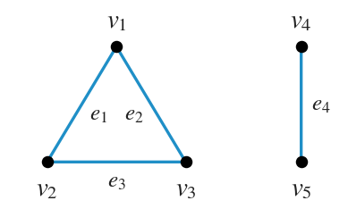

*그림 36. 꼭짓점 5개와 변 4개를 가지지만 트리가 아닌 그래프*

**예제 10.4.8 (꼭짓점 $n$개와 변 $n - 1$개를 가지지만 트리가 아닌 그래프).** 꼭짓점이 5개이고 변이 4개이면서 트리가 아닌 그래프를 찾는다. 정리 10.4.4에 의해 그런 그래프는 연결되어 있을 수 없다. 그림 36이 그 예이며, 세 꼭짓점 $v_1, v_2, v_3$이 회로를 이루고 변 $e_4$로 이어진 $v_4, v_5$는 이 회로와 떨어져 있다.

**따름정리 10.4.5.** $G$가 꼭짓점 $n$개와 변 $m$개를 가지는 그래프이고 $m$과 $n$이 $m \geq n$인 양의 정수이면 $G$에는 회로가 있다.

**증명 (귀류법).** 꼭짓점 $n$개와 변 $m$개($`m \geq n`$)를 가지면서 회로가 없는 그래프 $G$가 있다고 가정한다. $G_1, G_2, \ldots, G_k$를 $G$의 연결 성분이라 하고 각 성분의 꼭짓점 수를 $n_1, n_2, \ldots, n_k$라 하자. 연결 성분은 꼭짓점을 나누어 가지므로 $\sum_{i=1}^{k} n_i = n$이다. $G$에 회로가 없으므로 어느 성분에도 회로가 없고, 각 성분은 연결되어 있으므로 트리이다. 따라서 정리 10.4.2에 의해 $G_i$의 변은 $n_i - 1$개이고, $G$의 변은 성분들의 변을 모은 것이므로 다음이 성립한다.

```math
(G \text{의 변의 수}) = \sum_{i=1}^{k} (n_i - 1) = (n_1 + n_2 + \cdots + n_k) - \underbrace{(1 + 1 + \cdots + 1)}_{k \text{개}} = n - k < n
```

마지막 부등식은 $k \geq 1$이기 때문이다. 이것은 $G$의 변의 수 $m$이 $n$ 이상이라는 가정에 모순이므로 $G$에는 회로가 있다. ∎

> **핵심:** 꼭짓점이 $n$개인 그래프 $G$에 대해 다음이 성립한다.
> - $G$가 트리이면 변은 $n - 1$개이다(정리 10.4.2).
> - $G$가 연결되어 있고 변이 $n - 1$개이면 $G$는 트리이다(정리 10.4.4).
> - 변이 $n$개 이상이면 $G$에는 회로가 있다(따름정리 10.4.5). 따라서 트리에 꼭짓점을 더하지 않고 변을 하나 더하면 회로가 생긴다.
> - 연결 그래프에서 회로의 변을 지워 나가면 결국 트리인 부분 그래프를 얻으므로(보조정리 10.4.3), 연결 그래프는 변이 적어도 $n - 1$개이다. 따라서 변이 $n - 1$개보다 적은 그래프는 연결되어 있지 않다.

---

<br>

## 5. 루트 트리

바깥의 나무에는 뿌리가 있고, 한 사람의 모든 자손을 보여 주는 가계도에도 뿌리가 되는 사람이 있다. 루트 트리의 용어는 식물의 나무와 가계도의 말을 함께 빌려 쓴다. 수학에서 루트 트리는 한 꼭짓점을 골라 루트로 정한 트리이다. 루트가 아닌 꼭짓점 $v$에 대해 루트에서 $v$로 가는 경로는 유일하다. 서로 다른 두 경로가 있으면 회로를 만들 수 있기 때문이다. 루트 트리는 가계도처럼 루트를 맨 위에 두고 가지가 아래로 뻗도록 그리는 것이 관례이다.

### 5.1 루트 트리의 용어

> **용어 정의:** 한 꼭짓점을 다른 꼭짓점과 구별하여 **루트(root)** 로 정한 트리를 **루트 트리(rooted tree)** 라 한다.
> - 꼭짓점의 **레벨(level)** 은 그 꼭짓점과 루트를 잇는 유일한 경로에 있는 변의 수이다.
> - 루트 트리의 **높이(height)** 는 꼭짓점의 레벨 가운데 가장 큰 값이다.
> - 루트나 내부 꼭짓점 $v$의 **자식(child)** 은 $v$와 인접하고 루트에서 $v$보다 한 레벨 더 먼 꼭짓점들이다. $w$가 $v$의 자식이면 $v$를 $w$의 **부모(parent)** 라 하고, 부모가 같은 서로 다른 두 꼭짓점을 **형제(sibling)** 라 한다.
> - 서로 다른 두 꼭짓점 $v, w$에 대해 $v$가 $w$와 루트를 잇는 유일한 경로 위에 있으면 $v$를 $w$의 **조상(ancestor)**, $w$를 $v$의 **자손(descendant)** 이라 한다.

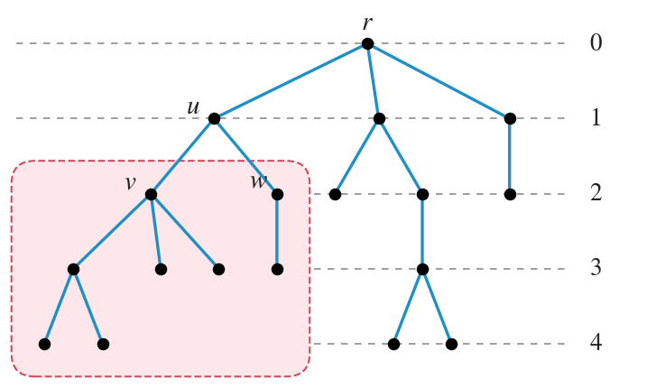

*그림 37. 레벨을 점선으로 표시한 루트 트리*

그림 37에서 루트 $r$의 레벨은 0이고, 오른쪽 숫자는 각 점선의 레벨이다. $v$는 $u$의 자식이고 $u$는 $v$의 부모이며, $v$와 $w$는 부모가 같은 형제이다. 분홍색 영역의 꼭짓점은 모두 $u$의 자손이고 $u$는 그 각각의 조상이다. 가장 깊은 꼭짓점의 레벨이 4이므로 이 트리의 높이는 4이다.

**예제 10.5.1 (루트 트리).** 그림 38은 루트가 $v_0$인 트리이다. 다음 질문에 답한다.

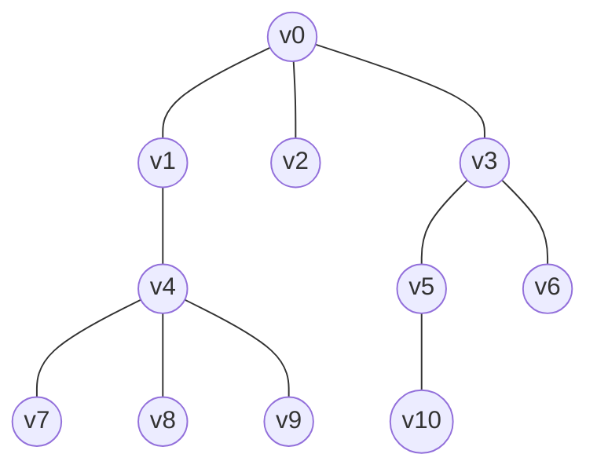

*그림 38. 루트가 v0인 트리*

| 질문 | 답 | 이유 |
|:-----|:-----|:-----|
| $v_5$의 레벨 | 2 | 경로 $v_0 v_3 v_5$의 변이 2개이다 |
| $v_0$의 레벨 | 0 | 루트에서 루트로 가는 경로에는 변이 없다 |
| 트리의 높이 | 3 | 레벨이 가장 큰 $v_7, v_8, v_9, v_{10}$의 레벨이 3이다 |
| $v_3$의 자식 | $v_5, v_6$ | $v_3$과 인접하고 한 레벨 아래이다 |
| $v_2$의 부모 | $v_0$ | $v_2$는 $v_0$의 자식이다 |
| $v_8$의 형제 | $v_7, v_9$ | 부모 $v_4$가 같다 |
| $v_3$의 자손 | $v_5, v_6, v_{10}$ | 루트로 가는 경로에 $v_3$이 있다 |
| 리프의 수 | 6 | $v_2, v_6, v_7, v_8, v_9, v_{10}$의 차수가 1이다 |

*표 7. 루트가 v0인 트리에 관한 질문과 답*

> **주의:** 교재에서 리프는 트리에서 차수가 1인 꼭짓점이므로, 루트 트리에서도 루트의 차수가 1이면 루트가 리프이다. 예를 들어 꼭짓점 $v_0, v_1$과 둘을 잇는 변 하나로 된 트리의 루트를 $v_0$으로 정하면, $v_1$은 레벨 1이고 $v_0$의 자식이며, $v_0$과 $v_1$은 모두 리프이다. 자료구조를 다루는 많은 책은 루트 트리의 리프를 "자식이 없는 꼭짓점"으로 정의하므로 이 경우 루트를 리프로 보지 않는다.

### 5.2 이진 트리

루트 트리의 모든 꼭짓점이 자식을 많아야 두 개 가지고 각 자식을 왼쪽 자식이나 오른쪽 자식으로 지정하면 이진 트리가 된다.

> **용어 정의:** 모든 부모가 자식을 많아야 두 개 가지는 루트 트리로서, 각 자식이 **왼쪽 자식(left child)** 이나 **오른쪽 자식(right child)** 중 하나로(둘 다는 아니게) 지정되고, 모든 부모가 왼쪽 자식과 오른쪽 자식을 각각 많아야 하나씩 가지는 것을 **이진 트리(binary tree)** 라 한다. 모든 부모가 자식을 정확히 두 개 가지는 이진 트리를 **정 이진 트리(full binary tree)** 라 한다.

> **용어 정의:** 이진 트리 $T$의 부모 $v$가 왼쪽 자식을 가지면, $v$의 **왼쪽 서브트리(left subtree)** 는 $v$의 왼쪽 자식을 루트로 하고, $v$의 왼쪽 자식과 그 모든 자손을 꼭짓점으로 가지며, 이 꼭짓점들을 잇는 $T$의 모든 변을 변으로 가지는 이진 트리이다. **오른쪽 서브트리(right subtree)** 도 같은 방식으로 정의한다.

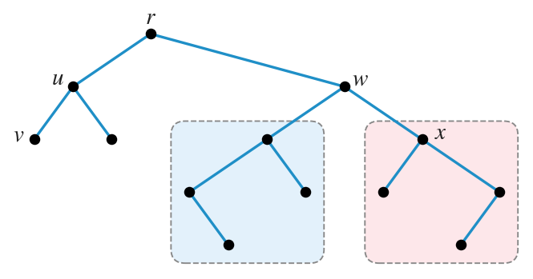

*그림 39. 왼쪽 자식, 오른쪽 자식, 서브트리를 보여 주는 이진 트리*

그림 39에서 $r$은 루트이고, $v$는 $u$의 왼쪽 자식, $x$는 $w$의 오른쪽 자식이다. 파란 영역은 $w$의 왼쪽 서브트리, 분홍색 영역은 $w$의 오른쪽 서브트리이다. 이진 트리에서는 자식이 하나뿐이어도 그것이 왼쪽인지 오른쪽인지가 구별되므로, 그림에서도 왼쪽 아래와 오른쪽 아래로 구별하여 그린다.

**예제 10.5.2 (산술식의 표현).** 이진 트리는 컴퓨터 과학에서 여러 방식으로 쓰이며, 그 하나가 괄호가 임의로 중첩된 산술식을 나타내는 것이다. 예를 들어 그림 40의 첫 번째 트리는 $a/b$를 나타낸다. 연산자가 루트에 있고, 루트의 왼쪽 자식과 오른쪽 자식에 왼쪽에서 오른쪽 순서로 작용한다. 두 번째 트리는 $a/(c + d)$를 나타낸다. 이런 표현에서 내부 꼭짓점은 산술 연산자이고 리프는 변수이며, 각 꼭짓점의 연산자는 왼쪽 서브트리와 오른쪽 서브트리가 나타내는 식에 왼쪽에서 오른쪽 순서로 작용한다. 식 $((a - b) \cdot c) + (d/e)$를 나타내는 이진 트리는 세 번째 트리이다. 가장 바깥의 연산 $+$가 루트에 오고, 왼쪽 서브트리가 $(a - b) \cdot c$, 오른쪽 서브트리가 $d/e$를 나타낸다. 왼쪽 서브트리의 루트 $\cdot$은 다시 왼쪽 서브트리 $a - b$와 오른쪽 자식 $c$에 작용한다.

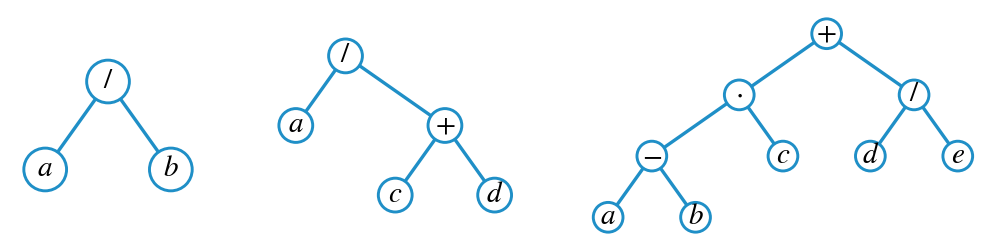

*그림 40. 세 산술식을 나타내는 이진 트리*

### 5.3 정 이진 트리의 꼭짓점 수

정 이진 트리의 내부 꼭짓점 수를 알면 전체 꼭짓점 수와 리프 수를 계산할 수 있고, 그 역도 된다. 내부 꼭짓점이 $k$개인 정 이진 트리는 꼭짓점이 모두 $2k + 1$개이고 그 가운데 $k + 1$개가 리프이다.

**정리 10.5.1.** $k$가 양의 정수이고 $T$가 내부 꼭짓점 $k$개를 가지는 정 이진 트리이면, (1) $T$의 꼭짓점은 모두 $2k + 1$개이고, (2) $T$의 리프는 $k + 1$개이다.

**증명.** $k$를 양의 정수, $T$를 내부 꼭짓점이 $k$개인 정 이진 트리라 하자.

(1) $T$의 꼭짓점 집합은 부모가 있는 꼭짓점의 집합과 부모가 없는 꼭짓점의 집합으로 분할된다. 부모가 없는 꼭짓점은 루트 하나뿐이다. 정 이진 트리의 부모는 모두 자식을 정확히 두 개 가지고, 부모는 바로 내부 꼭짓점이므로 부모가 있는 꼭짓점의 수는 부모 수의 두 배인 $2k$이다. 따라서 다음이 성립한다.

```math
(T \text{의 꼭짓점 수}) = (\text{부모가 있는 꼭짓점 수}) + (\text{부모가 없는 꼭짓점 수}) = 2k + 1
```

(2) $T$의 꼭짓점 수는 내부 꼭짓점 수와 리프 수의 합이기도 하므로 $(T \text{의 꼭짓점 수}) = k + (\text{리프 수})$이다. 두 식을 같게 놓으면 $2k + 1 = k + (\text{리프 수})$이고, 이를 풀면 리프 수는 $(2k + 1) - k = k + 1$이다. ∎

**예제 10.5.3 (주어진 정 이진 트리가 존재하는지 판정하기).** 내부 꼭짓점이 10개이고 말단 꼭짓점이 13개인 정 이진 트리가 있는가? 없다. 정리 10.5.1에 의해 내부 꼭짓점이 10개인 정 이진 트리의 리프는 $10 + 1 = 11$개여야 한다.

### 5.4 이진 트리의 높이와 리프 수

이진 트리에 대한 또 하나의 정리는 높이가 정해진 이진 트리가 가질 수 있는 리프의 최대 개수를 알려 준다. 높이가 $h$인 이진 트리의 리프는 많아야 $2^h$개이다. 다르게 말하면 리프가 $t$개인 이진 트리의 높이는 적어도 $\log_2 t$이다.

**정리 10.5.2.** 모든 정수 $h \geq 0$에 대해 $T$가 높이 $h$와 리프 $t$개를 가지는 이진 트리이면 $t \leq 2^h$이다. 이와 동치로 $\log_2 t \leq h$이다.

**증명 (강한 수학적 귀납법).** $P(h)$를 "높이가 $h$인 모든 이진 트리는 리프가 많아야 $2^h$개이다"라는 문장이라 하자.

기저 단계: 높이가 0인 이진 트리 $T$는 꼭짓점이 루트 하나뿐이고, 정의에 의해 이 꼭짓점은 리프이다. 따라서 $t = 1 = 2^0$이므로 $t \leq 2^h$이고 $P(0)$은 참이다.

귀납 단계: $k \geq 0$인 정수 $k$에 대해 $0$부터 $k$까지의 모든 정수 $i$에서 $P(i)$가 참, 즉 높이가 $i$인 모든 이진 트리는 리프가 많아야 $2^i$개라고 가정한다(귀납 가정). 높이가 $k + 1$인 모든 이진 트리의 리프가 많아야 $2^{k+1}$개임을 보여야 한다. $T$를 루트가 $v$이고 높이가 $k + 1$이며 리프가 $t$개인 이진 트리라 하자. $k \geq 0$이므로 $k + 1 \geq 1$이고, 따라서 $v$는 자식을 적어도 하나 가진다.

- 경우 1 ($v$의 자식이 하나일 때): 일반성을 잃지 않고 그 자식이 왼쪽 자식 $v_L$이며 $v_L$이 왼쪽 서브트리 $T_L$의 루트라고 하자(그림 41 (a)). $T_L$의 리프 수를 $t_L$이라 하면, $T_L$의 높이는 $T$의 높이보다 1 작은 $k$이므로 귀납 가정에 의해 $t_L \leq 2^k$이다. $v$는 자식이 하나뿐이어서 차수가 1이므로 리프이고, $T$의 나머지 리프는 $T_L$의 리프 가운데에서 나온다. 따라서 $t \leq t_L + 1$이다. 또 $k \geq 0$이므로 $2^k \geq 2^0 = 1$이다. 그러므로 $t \leq t_L + 1 \leq 2^k + 1 \leq 2^k + 2^k = 2 \cdot 2^k = 2^{k+1}$이다.
- 경우 2 ($v$의 자식이 둘일 때): $v$는 왼쪽 자식 $v_L$과 오른쪽 자식 $v_R$을 가지고, 이들은 각각 왼쪽 서브트리 $T_L$과 오른쪽 서브트리 $T_R$의 루트이다(그림 41 (b)). $T$가 이진 트리이므로 $T_L$과 $T_R$도 이진 트리이다. 리프 수를 $t_L, t_R$, 높이를 $h_L, h_R$이라 하면, $T$의 높이가 $k + 1$이므로 $h_L \leq k$, $h_R \leq k$이고 귀납 가정에 의해 $t_L \leq 2^{h_L}$, $t_R \leq 2^{h_R}$이다. $v$는 차수가 2이므로 리프가 아니고, $T$의 리프는 $T_L$이나 $T_R$의 리프이므로 $t \leq t_L + t_R$이다. 따라서 다음이 성립한다.

```math
t \leq t_L + t_R \leq 2^{h_L} + 2^{h_R} \leq 2^k + 2^k = 2 \cdot 2^k = 2^{k+1}
```

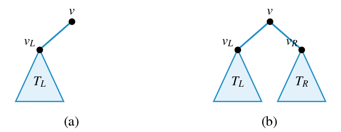

*그림 41. 루트의 자식이 하나인 이진 트리 (a)와 둘인 이진 트리 (b)*

두 경우 모두 리프가 많아야 $2^{k+1}$개이므로 $P(k+1)$이 참이다. 기저 단계와 귀납 단계가 증명되었으므로 모든 정수 $h \geq 0$에 대해 $P(h)$가 참이다.

동치인 부등식 $\log_2 t \leq h$는 밑이 2인 로그 함수가 증가 함수라는 사실, 즉 모든 양의 실수 $x, y$에 대해 $x < y$이면 $\log_2 x < \log_2 y$라는 사실에서 나온다. $t \leq 2^h$의 양변에 $\log_2$를 취하면 $\log_2 t \leq \log_2(2^h)$이고, 로그의 정의에 의해 $\log_2(2^h)$는 $2^h$를 얻기 위해 2를 거듭제곱해야 하는 지수이므로 $h$이다. 따라서 $\log_2 t \leq h$이다. ∎

> **참고:** 교재는 경우 1에서 "$`T`$의 리프 수는 $T_L$의 리프 수보다 하나 많다", 경우 2에서 "$`T`$의 리프는 $T_L$의 리프와 $T_R$의 리프를 합친 것이다"라고 등식으로 쓴다. 그러나 리프를 차수가 1인 꼭짓점으로 정의하면 이 등식은 항상 성립하지는 않는다. $T_L$이 자명하지 않고 $v_L$의 자식이 하나이면, $v_L$은 $T_L$ 안에서 차수가 1인 리프이지만 $T$에서는 부모 $v$와도 이어져 차수가 2이므로 리프가 아니다. 예를 들어 루트, 그 자식, 손자가 일렬로 이어진 높이 2의 트리에서 $T_L$의 리프는 2개이고 $T$의 리프(루트와 손자)도 2개이다. 위 증명처럼 $t \leq t_L + 1$, $t \leq t_L + t_R$이라는 부등식으로 쓰면 이런 경우도 포함되며, 결론 $t \leq 2^{k+1}$은 그대로 성립한다.

**예제 10.5.4 (주어진 이진 트리가 존재하는지 판정하기).** 높이가 5이고 리프가 38개인 이진 트리가 있는가? 없다. 정리 10.5.2에 의해 높이가 5인 이진 트리의 리프는 많아야 $2^5 = 32$개이므로 38개일 수 없다.

교재는 정리 10.5.2의 따름정리로 "높이가 $h$인 정 이진 트리는 리프가 $2^h$개이다"(따름정리 10.5.3)를 들고, 증명 방법으로 정리 10.5.2의 증명에서 "이진 트리"를 "정 이진 트리"로, "많아야"를 "정확히"로, $\leq$를 $=$로 바꾸고 경우 1을 지우라고 안내한다. 높이가 1 이상인 정 이진 트리의 루트는 자식을 반드시 둘 가지기 때문이다.

> **참고:** 따름정리 10.5.3은 정 이진 트리의 정의(모든 부모가 자식을 정확히 두 개 가진다)만으로는 성립하지 않는다. 예를 들어 루트의 두 자식 가운데 하나만 다시 자식 둘을 가지는 정 이진 트리는 높이가 2이지만 리프가 $3 \neq 2^2$개이다. 위의 증명 수정에서 경우 2의 $t_L + t_R = 2^{h_L} + 2^{h_R}$이 $2^{k+1}$과 같으려면 $h_L = h_R = k$가 필요한데, 이것이 보장되지 않기 때문이다. 따름정리는 모든 리프의 레벨이 $h$인 정 이진 트리, 즉 **포화 이진 트리(perfect binary tree)** 에 대해서는 옳다. 일반적인 정 이진 트리에서는 높이가 $h$일 때 리프 수 $t$가 $h + 1 \leq t \leq 2^h$를 만족한다. 아래쪽 한계는 $h \geq 1$이면 루트에서 가장 깊은 리프까지의 경로 위에 내부 꼭짓점이 $h$개 있으므로 정리 10.5.1에 의해 리프가 적어도 $h + 1$개라는 데서 나오고, $h = 0$이면 $t = 1$이다.

### 5.5 이진 탐색 트리

**이진 탐색 트리(binary search tree)** 는 고객 정보 같은 데이터 레코드를 저장하고 탐색하고 처리하는 데 효율적인 이진 트리이다. 레코드를 이진 탐색 트리에 넣으려면 레코드들을 전순서로 늘어놓을 수 있어야 한다. 레코드에 자연스러운 전순서가 없으면 수나 낱말처럼 전순서 집합의 원소를 **키(key)** 로 각 레코드에 붙인다. 키는 트리의 꼭짓점에 저장되고, 키를 통해 연결된 레코드에 접근한다.

완성된 이진 탐색 트리는 다음 성질을 가진다. 모든 꼭짓점 $v$에 대해 $v$의 왼쪽 서브트리의 모든 키는 $v$의 키보다 작고, $v$의 오른쪽 서브트리의 모든 키는 $v$의 키보다 크다. 예를 들어 키 15, 10, 19, 25, 12, 4에 대해 그림 42 (6)의 트리가 이진 탐색 트리이다. 루트 15의 왼쪽 서브트리에는 15보다 작은 10, 4, 12가, 오른쪽 서브트리에는 15보다 큰 19, 25가 있고, 10과 19에서도 같은 성질이 성립한다.

이진 탐색 트리를 만들려면 루트를 만들어 키를 하나 넣는다. 새 키를 넣을 때는 루트의 키와 비교하여, 새 키가 작으면 왼쪽으로, 크면 오른쪽으로 내려간다. 내려갈 자식이 이미 있으면 그 자식의 키와 다시 비교하고, 내려갈 자리에 자식이 없으면 그 자리에 새 꼭짓점을 만들어 새 키를 넣는다. 이 과정을 정확히 쓰면 다음 알고리즘이 된다.

```text
알고리즘 10.5.1 (이진 탐색 트리 만들기)
입력: 공집합이 아니고 전순서가 주어진 키의 집합 K

T를 꼭짓점이 루트 하나뿐이고 변이 없는 트리로 두고, K에서 키 하나를 골라 루트에 넣는다.
while (아직 넣지 않은 키가 있다)
    K에서 넣을 키 newkey를 하나 고른다. v := 루트, success := 0으로 둔다.
    while (success = 0)
        if (newkey < key(v))
            then if (v에 왼쪽 자식이 있다) then v := v의 왼쪽 자식
                 else 왼쪽 자식 vL을 T에 추가하고 변 {v, vL}을 추가한 뒤,
                      vL에 newkey를 넣고 success := 1
        if (newkey > key(v))
            then if (v에 오른쪽 자식이 있다) then v := v의 오른쪽 자식
                 else 오른쪽 자식 vR을 T에 추가하고 변 {v, vR}을 추가한 뒤,
                      vR에 newkey를 넣고 success := 1
    end while
end while
출력: K의 키로 이루어진 이진 탐색 트리 T
```

알고리즘의 각 부분은 다음 일을 한다. 첫 줄은 키 하나를 가진 루트만으로 트리를 시작한다. 바깥 `while`은 넣지 않은 키가 남아 있는 동안 키를 하나씩 넣는다. 각 키를 넣을 때 `v`는 현재 비교하는 꼭짓점이고, `success`는 키를 넣었는지 기록하는 표시이다. 안쪽 `while`에서는 `newkey`가 `key(v)`보다 작으면 왼쪽으로, 크면 오른쪽으로 내려가며, 내려갈 자식이 없으면 그 자리에 새 꼭짓점을 만들고 `success`를 1로 바꾸어 안쪽 반복을 끝낸다. 키들은 서로 다르다고 가정하므로 `newkey`와 `key(v)`가 같은 경우는 없다.

**예제 10.5.5 (이진 탐색 트리를 만드는 단계).** 키 15, 10, 19, 25, 12, 4를 이 순서대로 넣어 이진 탐색 트리를 만든다. 꼭짓점의 이름은 그 키와 같게 쓴다.

1. 15를 넣는다: 15를 루트로 한다.
2. 10을 넣는다: $10 < 15$이고 15에 왼쪽 자식이 없으므로 10을 15의 왼쪽 자식으로 하고 변으로 잇는다.
3. 19를 넣는다: $19 > 15$이고 15에 오른쪽 자식이 없으므로 19를 15의 오른쪽 자식으로 한다.
4. 25를 넣는다: $25 > 15$이고 15에 오른쪽 자식 19가 있으므로 19와 비교한다. $25 > 19$이고 19에 오른쪽 자식이 없으므로 25를 19의 오른쪽 자식으로 한다.
5. 12를 넣는다: $12 < 15$이므로 15의 왼쪽 자식 10과 비교한다. $12 > 10$이고 10에 오른쪽 자식이 없으므로 12를 10의 오른쪽 자식으로 한다.
6. 4를 넣는다: $4 < 15$이므로 10과 비교한다. $4 < 10$이고 10에 왼쪽 자식이 없으므로 4를 10의 왼쪽 자식으로 한다.

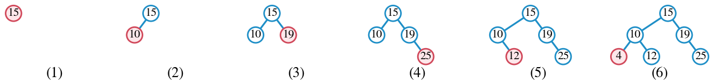

*그림 42. 키 15, 10, 19, 25, 12, 4를 차례로 넣으며 만든 이진 탐색 트리*

그림 42의 각 단계에서 분홍색 꼭짓점이 새로 넣은 키이다.

알고리즘은 키를 넣는 순서를 정하지 않으며, 순서가 달라지면 대개 다른 이진 탐색 트리가 만들어진다. 예를 들어 같은 키를 19, 10, 25, 4, 15, 12의 순서로 넣으면 루트는 19이고, 19의 왼쪽 자식은 10, 오른쪽 자식은 25이며, 10의 왼쪽 자식은 4, 오른쪽 자식은 15이고, 12는 15의 왼쪽 자식이 된다. 이 트리의 높이는 3으로, 그림 42 (6)의 트리의 높이 2보다 크다.

> **[자료구조]** 이진 탐색 트리에서 키를 찾을 때는 새 키를 넣을 때처럼 루트에서 출발하여 비교 결과에 따라 왼쪽이나 오른쪽으로 내려가므로, 비교 횟수는 많아야 트리의 높이에 1을 더한 값이다. 같은 키 집합이라도 넣는 순서에 따라 트리의 모양과 높이가 달라지며, 키를 정렬된 순서로 넣으면 일직선 모양이 되어 높이가 가장 커진다.

---

<br>

## 6. 신장 트리와 최단 경로 알고리즘

이 절은 연결 그래프의 모든 꼭짓점을 잇는 가장 경제적인 트리를 찾는 문제와, 두 꼭짓점 사이의 최단 경로를 찾는 문제를 다룬다.

### 6.1 신장 트리

한 항공사가 미국 중서부로 노선을 넓히려 하고, 연방 항공청으로부터 그림 43의 노선을 운항해도 된다는 허가를 받았다. 도시는 미니애폴리스(Minneapolis), 밀워키(Milwaukee), 시카고(Chicago), 디트로이트(Detroit), 신시내티(Cincinnati), 루이빌(Louisville), 세인트루이스(St. Louis), 내슈빌(Nashville)의 여덟 곳이다. 변에 적힌 수는 도시 사이의 거리(km)이며 6.2절부터 쓴다.

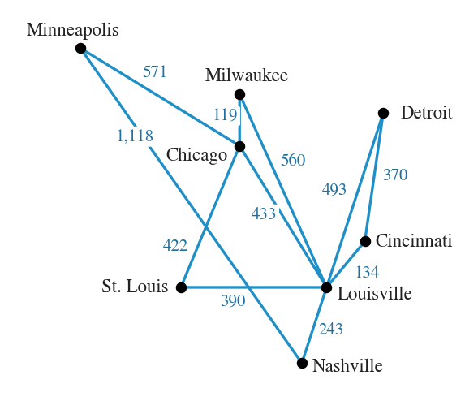

*그림 43. 운항이 허가된 노선과 도시 사이의 거리*

항공사는 여덟 도시 모두에 취항한다고 광고하면서도 비용을 줄이려고 노선의 수를 가능한 한 적게 하려 한다. 여기서 취항한다는 것은 갈아타더라도 어느 도시에서든 다른 어느 도시로 갈 수 있다는 뜻이다. 놀랍게도 이런 노선 체계의 노선 수는 하나로 정해진다. 조건을 만족하는 노선 체계의 그래프는 트리여야 하기 때문이다. 그래프에 회로가 있다면 보조정리 10.4.3에 의해 회로의 노선 하나를 없애도 그래프는 연결된 채로 남으므로 노선 수를 더 줄일 수 있다. 그런데 꼭짓점이 8개인 트리는 변이 7개이므로, 여덟 도시를 모두 잇는 최소 노선 체계는 노선이 정확히 7개이다.

> **용어 정의:** 그래프 $G$의 모든 꼭짓점을 포함하는 트리인 부분 그래프를 $G$의 **신장 트리(spanning tree)** 라 한다.

위 논의를 정리하면 다음 명제가 된다.

**명제 10.6.1.** (1) 모든 연결 그래프에는 신장 트리가 있다. (2) 한 그래프의 신장 트리들은 모두 변의 수가 같다.

**(1)의 증명.** $G$를 연결 그래프라 하자. $G$에 회로가 없으면 $G$ 자신이 신장 트리이다. 회로가 있으면 회로 $C_1$의 변 하나를 지운다. 보조정리 10.4.3에 의해 남은 부분 그래프는 연결되어 있다. 이 부분 그래프에 회로가 없으면 신장 트리를 얻은 것이고, 회로 $C_2$가 있으면 다시 그 변 하나를 지운다. 이렇게 회로의 변을 차례로 지워 나가면 결국 연결되어 있고 회로가 없는 부분 그래프 $T$를 얻는다. $G$의 변은 유한 개이고 어느 단계에서도 변을 지워 연결이 끊어지지 않기 때문이다. 꼭짓점은 하나도 지우지 않았으므로 $T$는 $G$의 모든 꼭짓점을 포함하고, 따라서 $G$의 신장 트리이다. ∎

(2)는 정리 10.4.2에서 바로 나온다. $G$의 꼭짓점이 $n$개이면 모든 신장 트리는 꼭짓점이 $n$개인 트리이므로 변이 $n - 1$개이다.

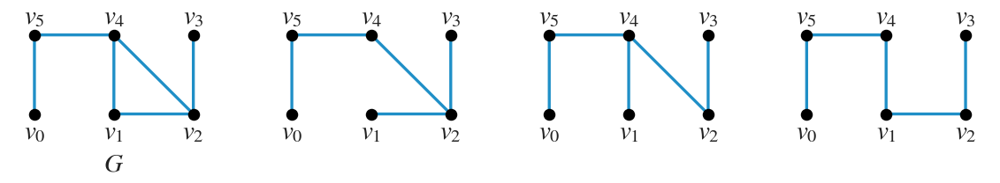

*그림 44. 그래프 G와 그 신장 트리 세 개*

**예제 10.6.1 (신장 트리 모두 찾기).** 그림 44의 왼쪽 그래프 $G$의 신장 트리를 모두 구한다. $G$의 회로는 $v_2 v_1 v_4 v_2$ 하나뿐이고, 이 회로의 변 세 개 가운데 하나를 지우면 트리가 된다. 회로 밖의 변 $\lbrace v_0, v_5\rbrace$, $\lbrace v_5, v_4\rbrace$, $\lbrace v_2, v_3\rbrace$를 지우면 꼭짓점이 끊어지므로 지울 수 없다. 따라서 $G$의 신장 트리는 그림 44의 오른쪽 세 개이다.

### 6.2 최소 신장 트리

그림 43처럼 노선마다 거리를 적어 두고, 항공사가 모든 도시에 취항하되 노선 체계 전체의 총거리를 가장 작게 하려 한다고 하자. 이 체계도 트리이다. 체계에 회로가 있으면 회로의 노선 하나를 없애도 모든 도시 사이를 오갈 수 있고(보조정리 10.4.3) 총거리는 줄어들기 때문이다.

> **용어 정의:** 각 변에 양의 실수인 **가중치(weight)** 가 붙은 그래프를 **가중 그래프(weighted graph)** 라 하고, 모든 변의 가중치의 합을 그래프의 **총 가중치(total weight)** 라 한다. 연결된 가중 그래프의 신장 트리 가운데 총 가중치가 가장 작은 것을 **최소 신장 트리(minimum spanning tree)** 라 한다. $G$가 가중 그래프이고 $e$가 $G$의 변일 때 $w(e)$는 $e$의 가중치, $w(G)$는 $G$의 총 가중치를 나타낸다.

최소 신장 트리를 찾는 문제는 분명히 풀 수 있다. 모든 신장 트리를 나열하고 각각의 총 가중치를 계산하여 가장 작은 것을 고르면 된다. 신장 트리는 유한 개이므로 가장 작은 총 가중치가 존재한다. 그러나 신장 트리의 수가 매우 많아서 이 방법은 비효율적이다. 예를 들어 꼭짓점이 $n$개인 완전 그래프에는 신장 트리가 $n^{n-2}$개 있다. $K_4$만 해도 $4^2 = 16$개이고, 꼭짓점이 100개 정도인 그래프에서 모든 신장 트리를 조사하는 데는 가장 빠른 컴퓨터로도 우주의 남은 수명으로 추정되는 시간보다 오래 걸린다. 1956년과 1957년에 크루스칼(Joseph B. Kruskal)과 프림(Robert C. Prim)은 최소 신장 트리를 훨씬 효율적으로 만드는 알고리즘을 각각 발표했으며, 두 알고리즘은 큰 그래프에서도 비교적 짧은 시간에 실행되도록 구현할 수 있다.

### 6.3 크루스칼 알고리즘

크루스칼 알고리즘은 연결된 가중 그래프의 변을 가중치가 작은 것부터 하나씩 살펴본다. 각 단계에서 살펴보는 변을 더해도 회로가 생기지 않으면 그 변을 최소 신장 트리가 될 그래프에 더한다. 꼭짓점의 수를 $n$이라 할 때 변을 $n - 1$개 더하고 나면, 그 변들과 그래프의 모든 꼭짓점이 최소 신장 트리를 이룬다.

```text
알고리즘 10.6.1 (크루스칼)
입력: 꼭짓점이 n개(n은 양의 정수)인 연결된 가중 그래프 G

1. T를 G의 모든 꼭짓점을 가지고 변은 없는 그래프로 둔다.
2. E를 G의 모든 변의 집합으로 두고, m := 0으로 둔다.
3. while (m < n - 1)
   3a. E에서 가중치가 가장 작은 변 e를 찾는다.
   3b. E에서 e를 지운다.
   3c. if (e를 T의 변 집합에 더해도 회로가 생기지 않는다)
           then e를 T의 변 집합에 더하고 m := m + 1
   end while
출력: T (G의 최소 신장 트리)
```

1단계에서 $T$는 꼭짓점만 있고 변이 없는 그래프로 시작한다. 2단계의 $E$는 아직 살펴보지 않은 변의 집합이고, $m$은 $T$에 들어간 변의 수이다. 3단계의 반복은 $T$의 변이 $n - 1$개가 될 때까지 계속된다. 3a와 3b단계는 남은 변 가운데 가장 가벼운 변을 꺼내고, 3c단계는 그 변이 $T$에 회로를 만들지 않을 때만 $T$에 더한다.

**예제 10.6.2 (크루스칼 알고리즘의 동작).** 그림 43의 그래프($`n = 8`$)에 크루스칼 알고리즘을 적용한다. 변을 가중치 순서로 살펴보면 다음과 같다.

| 반복 | 살펴본 변 | 가중치 | 처리 | 이유 |
|:-----|:-----|:-----|:-----|:-----|
| 1 | 시카고-밀워키 | 119 | 추가 | 회로가 생기지 않는다 |
| 2 | 루이빌-신시내티 | 134 | 추가 | 회로가 생기지 않는다 |
| 3 | 루이빌-내슈빌 | 243 | 추가 | 회로가 생기지 않는다 |
| 4 | 신시내티-디트로이트 | 370 | 추가 | 회로가 생기지 않는다 |
| 5 | 세인트루이스-루이빌 | 390 | 추가 | 회로가 생기지 않는다 |
| 6 | 세인트루이스-시카고 | 422 | 추가 | 회로가 생기지 않는다 |
| 7 | 시카고-루이빌 | 433 | 추가하지 않음 | 시카고, 세인트루이스, 루이빌이 회로를 이룬다 |
| 8 | 루이빌-디트로이트 | 493 | 추가하지 않음 | 루이빌, 신시내티, 디트로이트가 회로를 이룬다 |
| 9 | 루이빌-밀워키 | 560 | 추가하지 않음 | 루이빌, 세인트루이스, 시카고, 밀워키가 회로를 이룬다 |
| 10 | 미니애폴리스-시카고 | 571 | 추가 | 일곱 번째 변이므로 여기서 끝난다 |

*표 8. 항공 노선 그래프에 대한 크루스칼 알고리즘의 동작*

결과로 얻은 최소 신장 트리는 그림 45의 붉은 변이며, 총 가중치는 $119 + 134 + 243 + 370 + 390 + 422 + 571 = 2{,}249$ km이다.

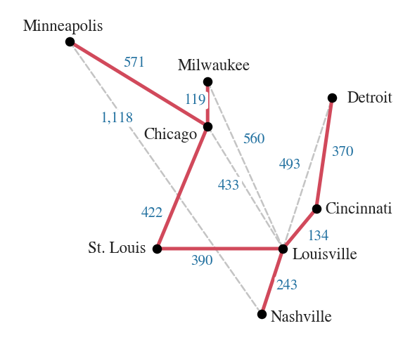

*그림 45. 항공 노선 그래프의 최소 신장 트리*

가중치가 같은 변이 있는 그래프에 크루스칼 알고리즘을 쓰면 최소 신장 트리가 여러 개 나올 수 있다. 출력을 하나로 정하려면 변을 배열에 넣어 두고 가중치가 같은 변은 배열에 나오는 순서대로 살펴보면 된다.

크루스칼 알고리즘의 설명만으로는 이 알고리즘이 원하는 일을 한다는 것이 분명하지 않다. 회로를 만들지 않으면서 가장 가벼운 변을 매 단계 찾을 수 있다는 보장이 있는가? 찾을 수 있다면 그 변들이 결국 모두 이어지는가? 이어진다면 결과가 최소의 총 가중치를 가지는가? 다음 정리가 이 질문들에 답한다.

**정리 10.6.2 (크루스칼 알고리즘의 정확성).** 연결된 가중 그래프를 크루스칼 알고리즘에 입력하면 출력은 최소 신장 트리이다.

**증명.** $G$를 꼭짓점이 $n$개인 연결된 가중 그래프라 하고, $T$를 크루스칼 알고리즘이 만든 부분 그래프라 하자.

먼저 $T$가 신장 트리임을 보인다. 회로를 완성하는 변은 $T$에 더해지지 않으므로 $T$에는 회로가 없다. $m < n - 1$인 동안 $T$는 꼭짓점 $n$개와 변 $m$개를 가지는 회로 없는 그래프이다. 그런 그래프의 연결 성분은 각각 트리이므로, 성분이 $k$개이면 변은 $n - k$개이고 따라서 성분은 $n - m \geq 2$개이다. $G$가 연결되어 있으므로 서로 다른 성분의 꼭짓점을 잇는 $G$의 경로가 있고, 그 경로를 따라가면 두 끝점이 $T$의 서로 다른 성분에 있는 변 $e$를 만난다. 이런 변은 $T$에 더해도 회로를 만들지 않는다. 회로가 생긴다면 그 회로에서 $e$를 뺀 나머지가 $T$ 안에서 $e$의 두 끝점을 이어 두 끝점이 같은 성분에 있어야 하기 때문이다. 또 $e$는 아직 $E$에 남아 있다. 알고리즘이 진행되는 동안 성분은 합쳐지기만 하므로, $e$를 이전에 살펴보았다면 그때도 두 끝점이 서로 다른 성분에 있어 $e$가 추가되었을 것이기 때문이다. 따라서 반복은 $m = n - 1$이 될 때까지 계속되고, 끝났을 때 $T$는 꼭짓점 $n$개와 변 $n - 1$개를 가지는 회로 없는 그래프이므로 연결 성분이 $n - (n - 1) = 1$개, 즉 연결 그래프이다. $T$는 $G$의 모든 꼭짓점을 포함하므로 $G$의 신장 트리이다.

다음으로 $T$의 총 가중치가 최소임을 보인다. $G$의 최소 신장 트리 가운데 $T$와 공통인 변이 가장 많은 것을 $T_1$이라 하고, $T \neq T_1$이라 가정한다. 두 트리는 꼭짓점 집합이 같고 변의 수도 $n - 1$로 같으므로, $T$에 있고 $T_1$에 없는 변이 있다. 그런 변 가운데 크루스칼 알고리즘이 가장 먼저 $T$에 더한 변을 $e$라 하자. 그러면 $e$보다 먼저 $T$에 더해진 변은 모두 $T_1$에 있다.

1. $T_1$에 $e$를 더한 그래프는 꼭짓점 $n$개와 변 $n$개를 가지므로 따름정리 10.4.5에 의해 회로를 가진다. $T_1$에는 회로가 없으므로 이 회로는 $e$를 포함한다. $T$에는 회로가 없으므로 이 회로의 변이 모두 $T$에 있을 수는 없고, 따라서 회로에는 $T$에 없는 변 $e'$이 있다. $e$는 $T$에 있으므로 $e' \neq e$이다.
2. $T_1$에서 $e'$을 지우고 $e$를 더한 그래프를 $T_2$라 하자. $T_1$에 $e$를 더한 연결 그래프에서 회로의 변 $e'$을 지웠으므로 보조정리 10.4.3에 의해 $T_2$는 연결되어 있다. $T_2$는 꼭짓점 $n$개와 변 $n - 1$개를 가지므로 정리 10.4.4에 의해 트리이고, $G$의 신장 트리이다. 그 총 가중치는 $w(T_2) = w(T_1) - w(e') + w(e)$이다.
3. $w(e) \leq w(e')$이다. $w(e') < w(e)$라면 알고리즘은 $e$보다 먼저 $e'$을 살펴보았고, $e'$이 $T$에 없으므로 그때 $e'$은 이미 $T$에 있던 변들과 회로를 이루어 거부되었다. 그 변들은 $e$보다 먼저 $T$에 더해졌으므로 모두 $T_1$에 있고, $e'$도 $T_1$에 있으므로 $T_1$에 회로가 있게 되어 모순이다.
4. 따라서 다음이 성립한다.

```math
w(T_2) = w(T_1) - \underbrace{\big(w(e') - w(e)\big)}_{\geq 0} \leq w(T_1)
```

$T_1$이 최소 신장 트리이므로 $w(T_2) \leq w(T_1)$인 신장 트리 $T_2$도 최소 신장 트리이다. 그런데 $T_2$는 $T_1$에서 $T$에 없는 변 $e'$을 빼고 $T$의 변 $e$를 더한 것이므로 $T$와 공통인 변이 $T_1$보다 하나 많다. 이것은 $T_1$을 $T$와 공통인 변이 가장 많은 최소 신장 트리로 고른 것에 모순이다. 따라서 $T = T_1$이고, $T$는 최소 신장 트리이다. ∎

> **참고:** 교재의 증명은 $T$에 있고 $T_1$에 없는 변 $e$를 임의로 고른 뒤, $e'$을 더해도 회로가 생길 수 없었다는 이유로 "크루스칼 알고리즘에서 $e$를 $T$에 더하던 단계에 $e'$도 더할 수 있었다"고 보고 $w(e) \leq w(e')$을 끌어낸다. 그러나 $e$를 임의로 고르면 그 단계의 $T$에 $T_1$에 없는 변이 들어 있을 수 있어서, $e'$을 더하면 회로가 생길 수도 있다. 위 증명은 그런 변 가운데 가장 먼저 추가된 변을 $e$로 골라, $e$ 이전에 추가된 변이 모두 $T_1$에 있다는 사실로 이 단계를 보완한 것이다.

### 6.4 프림 알고리즘

프림 알고리즘은 크루스칼 알고리즘과 다르게 동작한다. 한 꼭짓점에서 시작하여 연결된 상태를 유지하면서 바깥으로 넓혀 가며 최소 신장 트리 $T$를 만든다. 매 단계 변 하나와 꼭짓점 하나를 더하는데, 더하는 변은 이미 $T$에 있는 꼭짓점과 $T$에 없는 꼭짓점을 잇는 변 가운데 가중치가 가장 작은 것이고, 더하는 꼭짓점은 그 변의 끝점 가운데 $T$에 없던 것이다.

```text
알고리즘 10.6.2 (프림)
입력: 꼭짓점이 n개(n은 양의 정수)인 연결된 가중 그래프 G

1. G의 꼭짓점 v를 하나 고르고, T를 꼭짓점 v 하나만 있고 변이 없는 그래프로 둔다.
2. V를 v를 뺀 G의 모든 꼭짓점의 집합으로 둔다.
3. for i := 1 to n - 1
   3a. T의 꼭짓점과 V의 꼭짓점을 잇는 G의 변 가운데 가중치가 가장 작은 변 e를
       찾고, e의 끝점 가운데 V에 있는 것을 w라 한다.
   3b. e와 w를 각각 T의 변 집합과 꼭짓점 집합에 더하고, V에서 w를 지운다.
   next i
출력: T (G의 최소 신장 트리)
```

1단계는 출발 꼭짓점 하나로 $T$를 시작하고, 2단계의 $V$는 아직 $T$에 들어가지 않은 꼭짓점의 집합이다. 3단계는 $n - 1$번 반복하며, 매번 $T$와 $V$ 사이를 잇는 가장 가벼운 변 $e$와 그 변의 $V$ 쪽 끝점 $w$를 $T$로 옮긴다.

**예제 10.6.3 (프림 알고리즘의 동작).** 그림 43의 그래프에 미니애폴리스에서 시작하는 프림 알고리즘을 적용한다.

| 반복 | 추가된 꼭짓점 | 추가된 변 | 가중치 |
|:-----|:-----|:-----|:-----|
| 0 | 미니애폴리스 | 없음 | 없음 |
| 1 | 시카고 | 미니애폴리스-시카고 | 571 |
| 2 | 밀워키 | 시카고-밀워키 | 119 |
| 3 | 세인트루이스 | 시카고-세인트루이스 | 422 |
| 4 | 루이빌 | 세인트루이스-루이빌 | 390 |
| 5 | 신시내티 | 루이빌-신시내티 | 134 |
| 6 | 내슈빌 | 루이빌-내슈빌 | 243 |
| 7 | 디트로이트 | 신시내티-디트로이트 | 370 |

*표 9. 미니애폴리스에서 시작한 프림 알고리즘의 동작*

예를 들어 3번째 반복에서 $T$의 꼭짓점은 미니애폴리스, 시카고, 밀워키이고, 이들과 $T$ 밖을 잇는 변은 미니애폴리스-내슈빌(1,118), 시카고-세인트루이스(422), 시카고-루이빌(433), 밀워키-루이빌(560)이다. 그 가운데 가장 가벼운 시카고-세인트루이스가 선택된다. 얻은 트리는 크루스칼 알고리즘의 결과(그림 45)와 같지만 변이 더해지는 순서는 다르다. 크루스칼 알고리즘과 마찬가지로 가중치가 같은 변을 배열에 나오는 순서대로 고르면 출력이 하나로 정해진다.

연결 그래프를 넣으면 프림 알고리즘의 결과가 신장 트리라는 것은 비교적 쉽게 알 수 있지만, 그 신장 트리가 최소라는 것은 분명하지 않다. 다음 정리가 이를 보장한다.

**정리 10.6.3 (프림 알고리즘의 정확성).** 연결된 가중 그래프 $G$를 프림 알고리즘에 입력하면 출력은 $G$의 최소 신장 트리이다.

**증명.** $G$를 연결된 가중 그래프라 하고, $G$를 프림 알고리즘에 입력한다.

먼저 출력 $T$가 신장 트리임을 보인다. 각 단계에서 $T$의 꼭짓점과 $T$ 밖의 꼭짓점을 잇는 변을 찾아야 하는데, $T$ 밖에 꼭짓점이 남아 있는 한 그런 변이 있다. $T$ 안의 꼭짓점 하나와 밖의 꼭짓점 하나를 고르면 $G$가 연결되어 있으므로 둘을 잇는 보행이 있고, 그 보행을 따라가면 어느 순간 $T$ 안의 꼭짓점에서 밖의 꼭짓점으로 가는 변을 지나기 때문이다. 매 단계 더하는 변은 $T$의 꼭짓점과 새 꼭짓점을 이으므로 $T$는 계속 연결되어 있다. 또 새 꼭짓점에 접하는 $T$의 변은 새 변 하나뿐이어서 새 꼭짓점은 회로 위에 있을 수 없으므로 회로도 생기지 않는다. 회로 위의 꼭짓점은 회로에서 차수가 적어도 2이기 때문이다. 따라서 $T$는 트리이고, 변이 $n - 1$개이므로 꼭짓점이 $n$개, 즉 $G$의 모든 꼭짓점을 포함하는 신장 트리이다.

다음으로 $T$가 최소임을 보인다. 알고리즘이 $T$에 변을 더한 순서를 $e_1, e_2, \ldots, e_{n-1}$이라 하자. $G$의 최소 신장 트리 가운데 처음 $j$개의 변 $e_1, \ldots, e_j$를 모두 포함하는 $j$가 가장 큰 것을 $T_1$이라 하고, $T \neq T_1$이라 가정한다. 그러면 $j < n - 1$이고 $e = e_{j+1}$은 $T_1$에 없다.

1. $S$를 $e$를 더하기 직전 $T$의 꼭짓점 집합이라 하면, $e$의 한 끝점 $v$는 $S$에 있고 다른 끝점 $w$는 $S$에 없다. $T_1$은 신장 트리이므로 $T_1$에 $v$에서 $w$로 가는 경로가 있고, $v \in S$, $w \notin S$이므로 이 경로를 따라가면 $S$의 꼭짓점과 $S$ 밖의 꼭짓점을 잇는 변 $e'$을 만난다.
2. $e$를 더하던 단계에서 $e'$도 $S$와 $S$ 밖을 잇는 후보였고 알고리즘은 그 가운데 가장 가벼운 $e$를 골랐으므로 $w(e) \leq w(e')$이다.
3. $T_1$에서 $e'$을 지우고 $e$를 더한 그래프를 $T_2$라 하자. $T_1$에 $e$를 더하면 $e$와 $T_1$의 $v$에서 $w$로 가는 경로가 회로를 이루고 $e'$은 그 회로의 변이므로, 보조정리 10.4.3에 의해 $T_2$는 연결되어 있다. $T_2$는 꼭짓점 $n$개와 변 $n - 1$개를 가지므로 정리 10.4.4에 의해 신장 트리이다.
4. $w(T_2) = w(T_1) - w(e') + w(e) \leq w(T_1)$이므로 $T_2$도 최소 신장 트리이다.
5. $e_1, \ldots, e_j$는 두 끝점이 모두 $S$에 있으므로 $S$와 $S$ 밖을 잇는 $e'$과 다르고, 따라서 $T_2$에 그대로 남는다. 그러면 $T_2$는 $e_1, \ldots, e_{j+1}$을 모두 포함하는 최소 신장 트리이므로 $j$의 최대성에 모순이다.

따라서 $T = T_1$이고 $T$는 최소 신장 트리이다. ∎

> **참고:** 교재의 증명은 $T$와 공통인 변의 수가 가장 많은 $T_1$을 고르고, $T$에 있으나 $T_1$에 없는 변 가운데 마지막으로 추가된 변을 $e$로 잡는다. 이 경우 $T_1$에서 지운 $e'$이 나중에 $T$에 추가되는 변일 수 있어서, $T_2$가 $T_1$보다 $T$와 공통인 변을 하나 더 가진다는 결론이 성립하지 않을 수 있다. 위 증명은 $T_1$에 없는 변 가운데 처음 추가된 변을 $e$로 잡고, 공통인 변의 개수 대신 $T$의 처음 몇 변을 포함하는지를 비교하여 이 단계를 보완한 것이다. 교재가 연습 문제로 남긴 $w(T_2) \leq w(T_1)$의 확인은 4번이다.

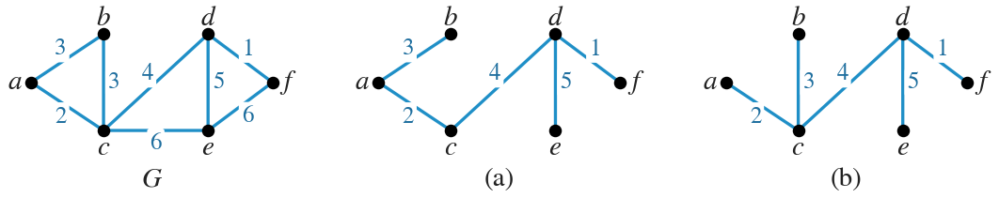

*그림 46. 그래프 G와 그 최소 신장 트리 두 개*

**예제 10.6.4 (최소 신장 트리 모두 찾기).** 그림 46의 왼쪽 그래프 $G$의 최소 신장 트리를 모두 구한다. 크루스칼 알고리즘과 $a$에서 시작하는 프림 알고리즘을 쓰고, 변이 더해지는 순서를 적는다.

- 크루스칼 알고리즘: $\lbrace d, f\rbrace$(1), $\lbrace a, c\rbrace$(2)를 더한 뒤 가중치가 3인 변 $\lbrace a, b\rbrace$와 $\lbrace b, c\rbrace$를 만난다. 어느 쪽을 먼저 더하든 다른 쪽은 $a, b, c$의 회로를 만들어 거부된다. 이어서 $\lbrace c, d\rbrace$(4)와 $\lbrace d, e\rbrace$(5)를 더하면 변이 5개가 되어 끝난다. 따라서 더하는 순서는 $\lbrace d, f\rbrace, \lbrace a, c\rbrace, \lbrace a, b\rbrace, \lbrace c, d\rbrace, \lbrace d, e\rbrace$ 또는 $\lbrace d, f\rbrace, \lbrace a, c\rbrace, \lbrace b, c\rbrace, \lbrace c, d\rbrace, \lbrace d, e\rbrace$이다.
- 프림 알고리즘($a$에서 시작): $a$에 접하는 변 가운데 가장 가벼운 $\lbrace a, c\rbrace$(2)를 더한다. 다음 후보 가운데 가중치 3인 $\lbrace a, b\rbrace$와 $\lbrace b, c\rbrace$가 가장 가벼우므로 하나를 더한다. 이후 $\lbrace c, d\rbrace$(4), $\lbrace d, f\rbrace$(1), $\lbrace d, e\rbrace$(5)를 차례로 더한다. 따라서 순서는 $\lbrace a, c\rbrace, \lbrace a, b\rbrace, \lbrace c, d\rbrace, \lbrace d, f\rbrace, \lbrace d, e\rbrace$ 또는 $\lbrace a, c\rbrace, \lbrace b, c\rbrace, \lbrace c, d\rbrace, \lbrace d, f\rbrace, \lbrace d, e\rbrace$이다.

따라서 최소 신장 트리는 그림 46의 (a)와 (b) 두 개이고, 총 가중치는 모두 $1 + 2 + 3 + 4 + 5 = 15$이다.

### 6.5 다익스트라 최단 경로 알고리즘

크루스칼 알고리즘과 프림 알고리즘이 만드는 트리는 다른 모든 신장 트리보다 총 가중치가 작지만, 두 꼭짓점 사이의 최단 거리를 항상 보여 주지는 않는다. 예를 들어 그림 43의 노선 전체를 쓰면 내슈빌에서 미니애폴리스까지 1,118 km를 직항으로 갈 수 있다. 그러나 그림 45의 최소 신장 트리만 쓰면 루이빌, 세인트루이스, 시카고를 거쳐야 하므로 $243 + 390 + 422 + 571 = 1{,}626$ km를 비행하고 비행기를 세 번 갈아타야 한다.

1959년 컴퓨터 과학의 개척자 다익스트라(Edsger Dijkstra)는 모든 가중치가 양수인 가중 그래프에서 출발 꼭짓점과 도착 꼭짓점 사이의 최단 경로를 찾는 알고리즘을 개발했다. 이 알고리즘은 출발 꼭짓점 $a$에서 바깥으로 넓혀 가며 꼭짓점과 변을 하나씩 더해 트리 $T$를 만든다는 점에서 프림 알고리즘과 비슷하다. 그러나 다음에 더할 꼭짓점을 고르는 방법이 달라서, 꼭짓점 $v$를 더할 때마다 $a$에서 $v$까지의 최단 경로의 길이가 확정된다.

알고리즘을 시작할 때 $G$의 각 꼭짓점 $u$에는 $a$에서 $u$까지의 최단 경로의 길이에 대한 현재의 최선 추정값인 **레이블(label)** $L(u)$가 붙는다. $a$에서 $a$까지의 최단 경로의 길이는 0이므로 $L(a) = 0$으로 둔다. 다른 꼭짓점까지의 최단 경로에 대해서는 아직 아무 정보가 없으므로, $a$가 아닌 꼭짓점 $u$의 레이블은 $G$의 모든 변의 가중치의 합보다 큰 수 $\infty$로 둔다. 알고리즘이 진행되면서 $L(u)$의 값이 바뀌어 결국 $a$에서 $u$까지의 최단 경로의 실제 길이가 된다.

$T$는 $a$에서 바깥으로 자라므로, 각 단계에서 $T$에 들어갈 후보는 $T$의 꼭짓점과 인접한 꼭짓점뿐이다. 따라서 각 단계에서 $G$는 세 부분으로 나뉜다. 만들고 있는 트리 $T$, $T$의 꼭짓점과 인접하지만 $T$에 없는 꼭짓점들의 집합인 **경계 집합(fringe)**, 그리고 나머지 꼭짓점들이다. 경계 집합의 꼭짓점이 다음에 $T$에 들어갈 후보이며, 그 가운데 $T$를 거쳐 $a$에서 오는 경로의 길이가 가장 작은 꼭짓점이 선택된다.

알고리즘의 핵심 관찰은 꼭짓점 $v$를 $T$에 더한 뒤 $a$에서 더 짧은 경로가 생길 수 있는 경계 집합의 꼭짓점은 $v$와 인접한 것뿐이라는 점이다. 그래서 $v$를 더한 뒤에는 $v$와 인접한 경계 집합의 각 꼭짓점 $u$에 대해 현재의 $L(u)$와 $L(v) + w(v, u)$를 비교한다. 여기서 $L(v)$는 $a$에서 $v$까지의 최단 경로의 길이이고 $w(v, u)$는 $v$와 $u$를 잇는 변의 가중치이다. $L(v) + w(v, u) < L(u)$이면 $L(u)$를 $L(v) + w(v, u)$로 바꾼다. 처음에 트리는 꼭짓점 $a$뿐이고 $L(a) = 0$이며, 알고리즘이 끝나면 $L(z)$는 $a$에서 $z$까지의 최단 경로의 길이이다.

크루스칼 알고리즘과 프림 알고리즘처럼, 최단 경로에도 단순하지만 지나치게 비효율적인 방법이 있다. $a$에서 $z$까지의 모든 경로의 길이를 계산하여 가장 짧은 것을 고르는 것이다. 그러나 비교적 작은 그래프에서도 이 방법은 수십억 년이 걸릴 수 있는 반면 다익스트라 알고리즘은 몇 초면 된다.

```text
알고리즘 10.6.3 (다익스트라)
입력: G (모든 변에 양의 가중치가 있는 연결된 단순 그래프), ∞ (G의 모든 변의
      가중치의 합보다 큰 수), w(u, v) (변 {u, v}의 가중치),
      a (출발 꼭짓점), z (도착 꼭짓점)

1. T를 꼭짓점 a 하나만 있고 변이 없는 그래프로 둔다.
   V(T)는 T의 꼭짓점 집합, E(T)는 T의 변 집합이다.
2. L(a) := 0으로 두고, a가 아닌 G의 모든 꼭짓점 u에 대해 L(u) := ∞로 둔다.
3. v := a, F := {a}로 둔다.
4. while (z ∉ V(T))
   4a. F := (F - {v}) ∪ {v와 인접하고 V(T)에 없는 꼭짓점}
   4b. v와 인접하고 V(T)에 없는 각 꼭짓점 u에 대해
           if L(v) + w(v, u) < L(u) then
               L(u) := L(v) + w(v, u)
               D(u) := v
   4c. F에서 레이블이 가장 작은 꼭짓점 x를 찾는다.
       x를 V(T)에 더하고, 변 {D(x), x}를 E(T)에 더한다.
       v := x
   end while
출력: L(z) (a에서 z로 가는 최단 경로의 길이)
```

각 줄의 역할은 다음과 같다. 1단계와 2단계는 트리 $T$와 레이블을 초기화한다. 3단계의 $v$는 가장 최근에 $T$에 더한 꼭짓점을 가리키고, $F$는 경계 집합이다. 4단계의 반복은 $z$가 $T$에 들어갈 때까지 계속된다. 4a단계는 방금 $T$에 들어간 $v$를 경계 집합에서 빼고, $v$와 인접하면서 $T$에 없는 꼭짓점을 경계 집합에 더한다(이미 경계 집합에 있으면 그대로 둔다). 4b단계는 $v$를 더한 일이 레이블에 영향을 줄 수 있는 꼭짓점, 즉 $v$와 인접한 꼭짓점의 레이블만 갱신한다. 레이블이 작아질 때마다 $D(u)$에 그 값을 준 $T$의 꼭짓점을 기록해 둔다. 4c단계는 경계 집합에서 레이블이 가장 작은 꼭짓점 $x$를 $T$에 더하고, $x$를 $T$에 잇는 변으로 $\lbrace D(x), x\rbrace$를 더한다. 끝났을 때 $T$에서 $a$와 $z$를 잇는 유일한 경로가 $G$에서 $a$에서 $z$로 가는 최단 경로이다.

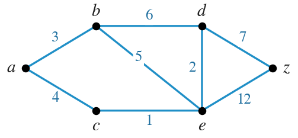

*그림 47. 다익스트라 알고리즘을 적용할 가중 그래프*

**예제 10.6.5 (다익스트라 알고리즘의 동작).** 그림 47의 그래프에서 출발 꼭짓점 $a$와 도착 꼭짓점 $z$로 다익스트라 알고리즘을 실행한다.

1. 반복에 들어갈 때 $V(T) = \lbrace a\rbrace$, $E(T) = \emptyset$, $F = \lbrace a\rbrace$이다. 반복 중에 $F = \lbrace b, c\rbrace$가 되고 $L(b) = 0 + 3 = 3$, $L(c) = 0 + 4 = 4$이다. $L(b) < L(c)$이므로 $b$를 $V(T)$에 더하고 $D(b) = a$이므로 $\lbrace a, b\rbrace$를 $E(T)$에 더한다.
2. $V(T) = \lbrace a, b\rbrace$이다. $b$의 이웃 $d, e$가 경계 집합에 들어와 $F = \lbrace c, d, e\rbrace$가 되고, $L(d) = 3 + 6 = 9$, $L(e) = 3 + 5 = 8$이다. $L(c) = 4$가 가장 작으므로 $c$를 더하고 $D(c) = a$이므로 $\lbrace a, c\rbrace$를 더한다.
3. $V(T) = \lbrace a, b, c\rbrace$이다. $F = \lbrace d, e\rbrace$이고, $c$를 거치는 $ace$의 길이 $4 + 1 = 5$가 $abe$의 길이 8보다 짧으므로 $L(e)$가 5로 바뀌고 $D(e) = c$가 된다. $L(e) = 5 < L(d) = 9$이므로 $e$를 더하고 $\lbrace c, e\rbrace$를 더한다.
4. $V(T) = \lbrace a, b, c, e\rbrace$이다. $e$의 이웃 $z$가 들어와 $F = \lbrace d, z\rbrace$가 된다. $aced$의 길이 $5 + 2 = 7$이 $abd$의 길이 9보다 짧으므로 $L(d) = 7$, $D(d) = e$가 되고, $L(z) = 5 + 12 = 17$, $D(z) = e$이다. $L(d) < L(z)$이므로 $d$를 더하고 $\lbrace e, d\rbrace$를 더한다.
5. $V(T) = \lbrace a, b, c, e, d\rbrace$이다. $F = \lbrace z\rbrace$이고, $acedz$의 길이 $7 + 7 = 14$가 $acez$의 길이 17보다 짧으므로 $L(z) = 14$, $D(z) = d$가 된다. 경계 집합에 $z$뿐이므로 $z$를 더하고 $\lbrace d, z\rbrace$를 더한다.

이제 $z \in V(T)$이므로 알고리즘이 끝나고, $a$에서 $z$까지의 최단 경로의 길이는 $L(z) = 14$이다. 그림 48은 각 단계에서 $T$가 자라는 모습이며, $(k)$는 꼭짓점이 $k$개 더해진 뒤의 상태이다.

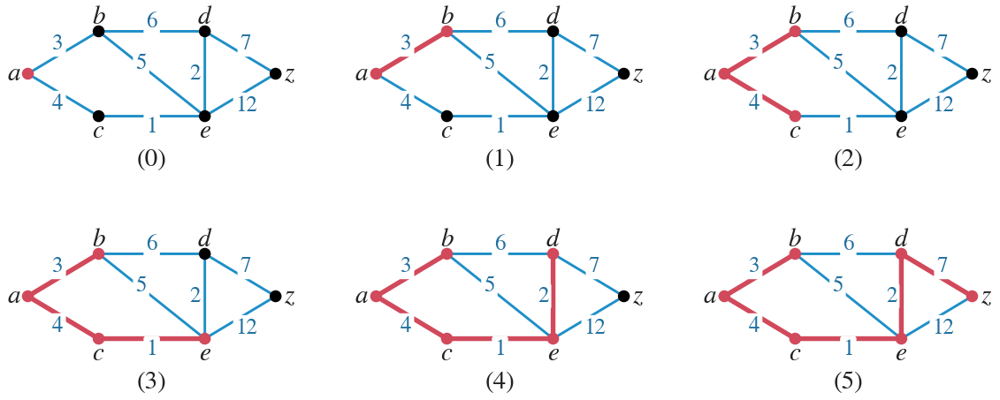

*그림 48. 다익스트라 알고리즘에서 트리 T가 자라는 과정*

알고리즘의 진행은 표로 정리하면 편리하다. 표의 각 행은 그 단계의 반복에 들어갈 때의 $V(T)$, $E(T)$와 반복 중에 갱신된 $F$와 레이블이다. 표에서 꼭짓점의 집합은 원소만 나열하고, 변 $\lbrace x, y\rbrace$는 $xy$로 줄여 쓴다.

| 단계 | $V(T)$ | $E(T)$ | $F$ | $L(a)$ | $L(b)$ | $L(c)$ | $L(d)$ | $L(e)$ | $L(z)$ |
|:-----|:-----|:-----|:-----|:-----|:-----|:-----|:-----|:-----|:-----|
| 0 | $a$ | 없음 | $a$ | 0 | $\infty$ | $\infty$ | $\infty$ | $\infty$ | $\infty$ |
| 1 | $a$ | 없음 | $b, c$ | 0 | 3 | 4 | $\infty$ | $\infty$ | $\infty$ |
| 2 | $a, b$ | $ab$ | $c, d, e$ | 0 | 3 | 4 | 9 | 8 | $\infty$ |
| 3 | $a, b, c$ | $ab, ac$ | $d, e$ | 0 | 3 | 4 | 9 | 5 | $\infty$ |
| 4 | $a, b, c, e$ | $ab, ac, ce$ | $d, z$ | 0 | 3 | 4 | 7 | 5 | 17 |
| 5 | $a, b, c, e, d$ | $ab, ac, ce, ed$ | $z$ | 0 | 3 | 4 | 7 | 5 | 14 |
| 6 | $a, b, c, e, d, z$ | $ab, ac, ce, ed, dz$ | 없음 | 0 | 3 | 4 | 7 | 5 | 14 |

*표 10. 그림 47의 그래프에 대한 다익스트라 알고리즘의 진행*

최단 경로 자체는 $D$를 거꾸로 따라가 얻는다. 꼭짓점이 더해질 때의 값은 $D(b) = a$, $D(c) = a$, $D(e) = c$, $D(d) = e$, $D(z) = d$이다. $D(z) = d$, $D(d) = e$, $D(e) = c$, $D(c) = a$이므로 최단 경로는 $acedz$이고, 길이는 $4 + 1 + 2 + 7 = 14$이다.

다익스트라 알고리즘은 $z$를 더할 때까지 꼭짓점을 계속 더한다. 다음 정리는 알고리즘이 끝났을 때 $z$의 레이블 $L(z)$가 $a$에서 $z$까지의 최단 경로의 길이임을 보인다.

**정리 10.6.4 (다익스트라 알고리즘의 정확성).** 모든 변에 양의 가중치가 있는 연결된 단순 그래프를 출발 꼭짓점 $a$, 도착 꼭짓점 $z$와 함께 다익스트라 알고리즘에 입력하면 출력은 $a$에서 $z$까지의 최단 경로의 길이이다.

**증명 (수학적 귀납법).** $G$를 루프와 평행 변이 없고 모든 변에 양의 가중치가 있는 연결된 가중 그래프라 하자. $T$를 알고리즘이 만드는 그래프, $L(u)$를 알고리즘이 꼭짓점 $u$에 준 레이블이라 하고, 각 정수 $n \geq 0$에 대해 $P(n)$을 다음 문장이라 하자.

$P(n)$: while 반복을 $n$번 실행한 뒤 (1) $T$는 트리이고, (2) $T$의 모든 꼭짓점 $v$에 대해 $L(v)$는 $G$에서 $a$에서 $v$까지의 최단 경로의 길이이다.

$n = 0$부터 알고리즘이 끝날 때까지 $P(n)$이 참임을 수학적 귀납법으로 보인다.

기저 단계: $n = 0$이면 $T$는 꼭짓점 $a$ 하나뿐이고 변이 없으므로 트리이다. 또 $L(a)$의 초깃값 0은 $a$에서 $a$까지의 최단 경로의 길이이다. 따라서 $P(0)$은 참이다.

귀납 단계: $k \geq 0$인 정수 $k$에 대해 $P(k)$가 참이라고 가정한다(귀납 가정). $(k+1)$번째 반복에서 꼭짓점 $v$와 변 $\lbrace x, v\rbrace$가 $T$에 더해졌다고 하자. 여기서 $x = D(v)$는 이미 $T$에 있던 꼭짓점이다. 트리에 새 꼭짓점과 그것을 잇는 변을 더하면 회로도 생기지 않고 연결도 끊어지지 않으므로 새 $T$는 트리이다. 레이블은 $T$ 밖의 꼭짓점에서만 바뀌므로, 귀납 가정에 의해 $v$를 더하기 전부터 $T$에 있던 꼭짓점 $y$의 $L(y)$는 여전히 최단 경로의 길이이다. 따라서 $L(v)$가 $a$에서 $v$까지의 최단 경로의 길이임을 보이면 된다.

알고리즘에 의해 $L(v) = L(x) + w(x, v)$이다. $a$에서 $v$까지의 최단 경로의 길이를 $\mathrm{LSP}(a, v)$로 쓴다. $a$에서 $v$로 가는 최단 경로를 하나 잡으면, 이 경로는 $T$ 안의 $a$에서 출발하여 $v$를 더하기 전의 $T$ 밖에 있는 $v$에서 끝나므로 $T$를 처음 벗어나는 변 $\lbrace s, t\rbrace$($s \in V(T)$, $`t \notin V(T)`$)가 있다. 그러면 다음이 성립한다.

```math
\begin{aligned} \mathrm{LSP}(a, v) &\geq \mathrm{LSP}(a, s) + w(s, t) && t \text{에서 } v \text{까지 부분의 길이는 0 이상이다} \\ &= L(s) + w(s, t) && s \in V(T) \text{이므로 귀납 가정} \\ &\geq L(t) && s \text{를 더한 뒤 4b단계가 } L(t) \text{를 이 값 이하로 만들었다} \\ &\geq L(x) + w(x, v) && t \text{는 경계 집합에 있고 } v \text{는 레이블이 가장 작다} \end{aligned}
```

첫 줄은 최단 경로 가운데 $a$에서 $s$까지 부분의 길이가 $\mathrm{LSP}(a, s)$ 이상이고, 가중치가 모두 양수여서 $t$에서 $v$까지 부분의 길이가 0 이상이기 때문이다. 셋째 줄에서 레이블은 작아지기만 하므로 $s$를 더한 뒤에도 $L(t) \leq L(s) + w(s, t)$가 유지된다. 넷째 줄에서 $t$는 $T$의 꼭짓점 $s$와 인접하므로 경계 집합에 있고, 4c단계는 경계 집합에서 레이블이 가장 작은 $v$를 골랐으므로 $L(v) = L(x) + w(x, v) \leq L(t)$이다. 반대로 $L(x) + w(x, v)$는 $a$에서 $x$까지의 최단 경로 뒤에 변 $\lbrace x, v\rbrace$를 붙인 $a$에서 $v$로 가는 보행의 길이이므로 $\mathrm{LSP}(a, v) \leq L(x) + w(x, v)$이다. 두 부등식에서 $\mathrm{LSP}(a, v) = L(x) + w(x, v) = L(v)$를 얻는다. 따라서 $P(k+1)$이 참이다.

알고리즘은 $z$가 $T$에 들어가는 순간 끝나고, $T$의 모든 꼭짓점의 레이블이 $a$로부터의 최단 경로의 길이임을 보였으므로 특히 $L(z)$는 $a$에서 $z$까지의 최단 경로의 길이이다. ∎

> **주의:** 다익스트라 알고리즘의 정확성은 가중치가 양수라는 조건에 기대고 있다. 증명의 첫 부등식은 최단 경로에서 $t$ 이후 부분의 길이가 0 이상이라는 사실을 쓴다. 또 최소 신장 트리와 최단 경로 트리는 일반적으로 다르다. 최소 신장 트리는 모든 꼭짓점을 잇는 변의 총 가중치를 최소로 하고, 다익스트라 알고리즘의 트리는 출발 꼭짓점에서 각 꼭짓점까지의 거리를 최소로 한다.

---

<br>

## 개념 적용

**T/F 점검:**

| 문장 | 판단과 근거 |
|:-----|:-----|
| 모든 경로는 트레일이다. | **T.** 경로는 반복된 꼭짓점이 없는 트레일로 정의된다. |
| 모든 꼭짓점의 차수가 짝수인 그래프에는 오일러 회로가 있다. | **F.** 그래프가 연결되어 있고 차수가 양수여야 한다. 그림 10이 반례이다. |
| 오일러 회로는 해밀턴 회로이기도 하다. | **F.** 오일러 회로는 같은 꼭짓점을 여러 번 지날 수 있다. 그림 8의 회로는 $v_2$를 두 번 지난다. |
| 무방향 그래프의 인접 행렬은 항상 대칭 행렬이다. | **T.** $v_i$와 $v_j$를 잇는 변의 수와 $v_j$와 $v_i$를 잇는 변의 수는 같다. |
| 꼭짓점 수, 변 수, 각 꼭짓점의 차수가 모두 같은 두 그래프는 동형이다. | **F.** 꼭짓점 6개가 하나의 회로를 이루는 그래프와 삼각형 두 개로 된 그래프는 이 값들이 모두 같지만, 앞의 것만 연결되어 있다. |
| 꼭짓점이 $n$개이고 변이 $n - 1$개인 그래프는 트리이다. | **F.** 연결되어 있어야 한다. 그림 36이 반례이다. |
| 높이가 5인 이진 트리의 리프는 많아야 32개이다. | **T.** 정리 10.5.2에 의해 $t \leq 2^5 = 32$이다. |
| 최소 신장 트리 위의 경로는 두 꼭짓점 사이의 최단 경로이다. | **F.** 그림 45의 트리에서 내슈빌과 미니애폴리스 사이의 경로는 1,626 km이지만 직항로는 1,118 km이다. |
| 다익스트라 알고리즘이 끝났을 때 $T$의 모든 꼭짓점의 레이블은 $a$로부터의 최단 거리이다. | **T.** 정리 10.6.4의 증명에서 귀납법으로 보인 성질이다. |

---

<br>

## 요약

| 개념 | 핵심 요약 |
|:-----|:-----|
| 보행, 트레일, 경로 | 보행은 꼭짓점과 변을 번갈아 나열한 열이고, 트레일은 반복된 변이 없는 보행, 경로는 반복된 꼭짓점도 없는 트레일이다. |
| 회로와 단순 회로 | 회로는 변을 적어도 하나 포함하고 반복된 변이 없는 닫힌 보행이며, 단순 회로는 처음과 마지막 외에 반복된 꼭짓점이 없는 회로이다. |
| 부분 그래프 | 꼭짓점과 변이 모두 원래 그래프의 것이고 각 변의 끝점이 원래와 같은 그래프이다. |
| 연결 그래프와 연결 성분 | 모든 두 꼭짓점 사이에 보행이 있으면 연결 그래프이고, 연결 성분은 더 크게 넓힐 수 없는 연결된 부분 그래프이다. |
| 악수 정리 | 총차수는 변의 수의 두 배이므로 차수가 홀수인 꼭짓점의 수는 짝수이다. |
| 오일러 회로 | 그래프가 연결되어 있고 모든 꼭짓점의 차수가 양의 짝수일 때, 그리고 그때에만 존재한다(정리 10.1.4). |
| 오일러 트레일 | $v$에서 $w$로 가는 오일러 트레일은 그래프가 연결되어 있고 $v, w$의 차수만 홀수이며 나머지 차수가 양의 짝수일 때, 그리고 그때에만 존재한다. |
| 해밀턴 회로 | 모든 꼭짓점을 포함하는 단순 회로이며, 간단한 판정 기준은 알려져 있지 않지만 명제 10.1.6의 부분 그래프가 없으면 존재하지 않는다. |
| 외판원 문제 | 총거리가 최소인 해밀턴 회로를 찾는 문제이며, $K_n$의 해밀턴 회로는 $(n-1)!/2$개여서 모두 확인하는 방법은 비현실적이다. |
| 인접 행렬 | $a_{ij}$는 $v_i$에서 $v_j$로 가는 화살표의 수(방향 그래프) 또는 $v_i$와 $v_j$를 잇는 변의 수(무방향 그래프)이며, 무방향 그래프의 인접 행렬은 대칭이다. |
| 인접 행렬과 연결 성분 | 연결 성분마다 꼭짓점에 연속된 번호를 매기면 인접 행렬은 각 성분의 인접 행렬을 대각에 놓은 블록 대각 행렬이다. |
| 행렬의 곱 | $`(\mathbf{A}\mathbf{B})_{ij} = \sum_{r} a_{ir} b_{rj}`$이며, 결합 법칙은 성립하지만 교환 법칙은 성립하지 않는다. |
| 보행의 개수 | $\mathbf{A}^n$의 $(i, j)$ 성분은 $v_i$에서 $v_j$로 가는 길이가 $n$인 보행의 개수이다(정리 10.2.2). |
| 그래프 동형 | 변-끝점 함수를 보존하는 꼭짓점과 변의 일대일 대응 쌍이 있으면 동형이며, 그래프 동형은 동치 관계이다. |
| 동형 불변량 | 꼭짓점 수, 변 수, 차수, 회로, 연결성, 오일러 회로, 해밀턴 회로 등이며, 두 그래프가 동형이 아님을 보이는 데 쓴다. |
| 트리와 숲 | 트리는 회로가 없는 연결 그래프이고, 숲은 회로가 없고 연결되지 않은 그래프이다. |
| 리프와 내부 꼭짓점 | 꼭짓점이 두 개 이상인 트리에서 차수가 1인 꼭짓점이 리프, 1보다 큰 꼭짓점이 내부 꼭짓점이며, 리프는 적어도 두 개 있다. |
| 트리의 변의 수 | 꼭짓점이 $n$개인 트리의 변은 $n - 1$개이고, 꼭짓점 $n$개와 변 $n - 1$개를 가지는 연결 그래프는 트리이다. |
| 회로의 존재 | 꼭짓점 $n$개와 변 $m \geq n$개를 가지는 그래프에는 회로가 있다(따름정리 10.4.5). |
| 루트 트리 | 루트를 정한 트리이며, 레벨은 루트까지의 경로의 변 수, 높이는 가장 큰 레벨이고, 부모, 자식, 형제, 조상, 자손은 루트로 가는 유일한 경로로 정한다. |
| 이진 트리 | 모든 부모가 왼쪽 자식과 오른쪽 자식을 많아야 하나씩 가지는 루트 트리이며, 정 이진 트리는 모든 부모가 자식을 정확히 둘 가진다. |
| 정 이진 트리의 꼭짓점 수 | 내부 꼭짓점이 $k$개이면 꼭짓점은 $2k + 1$개, 리프는 $k + 1$개이다(정리 10.5.1). |
| 이진 트리의 높이 | 높이가 $h$이고 리프가 $t$개인 이진 트리는 $t \leq 2^h$, 즉 $\log_2 t \leq h$를 만족한다(정리 10.5.2). |
| 이진 탐색 트리 | 각 꼭짓점의 왼쪽 서브트리의 키는 모두 그 꼭짓점의 키보다 작고 오른쪽 서브트리의 키는 모두 크며, 루트부터 비교하며 내려가 새 키를 넣는다. |
| 신장 트리 | 모든 꼭짓점을 포함하는 트리인 부분 그래프이며, 연결 그래프에는 항상 있고 한 그래프의 신장 트리는 변의 수가 모두 같다. |
| 최소 신장 트리 | 연결된 가중 그래프의 신장 트리 가운데 총 가중치가 가장 작은 것이다. |
| 크루스칼 알고리즘 | 가중치가 작은 변부터 회로를 만들지 않는 변만 차례로 더하여 변 $n - 1$개를 고른다. |
| 프림 알고리즘 | 한 꼭짓점에서 시작하여 트리와 트리 밖을 잇는 변 가운데 가장 가벼운 변과 그 끝점을 하나씩 더한다. |
| 다익스트라 알고리즘 | 경계 집합에서 레이블이 가장 작은 꼭짓점을 트리에 더하고 이웃의 레이블을 $L(v) + w(v, u)$로 갱신하여, 가중치가 양수인 그래프의 최단 경로의 길이를 구한다. |

---

<br>

## 점검 문제

1. **보행의 판정:** 그림 4의 그래프에서 (a) $v_1 e_1 v_2 e_2 v_1$, (b) $v_3 e_4 v_3$, (c) $v_2 e_3 v_3 e_7 v_6 e_8 v_2 e_3 v_3$은 각각 트레일, 경로, 회로, 단순 회로 가운데 어디에 해당하는가?

   <details>
   <summary>정답</summary>

   (a) $e_1$과 $e_2$는 서로 다른 평행 변이므로 반복된 변이 없고, 처음과 마지막의 $v_1$ 말고는 반복된 꼭짓점이 없으므로 길이 2의 단순 회로이다. 따라서 회로이자 닫힌 보행이며 트레일이기도 하지만, 출발점과 도착점이 같으므로 경로는 아니다. (b) 루프 하나로 된 길이 1의 닫힌 보행으로, 변이 있고 반복된 변이 없으며 처음과 마지막 외에 반복된 꼭짓점이 없으므로 단순 회로이다. 따라서 회로이자 트레일이지만, 처음과 마지막 꼭짓점이 같으므로 경로는 아니다. (c) $e_3$을 두 번 지나므로 트레일이 아니고, $v_2$에서 $v_3$으로 가는 보행일 뿐이다.

   </details>

2. **오일러 회로와 오일러 트레일:** 완전 그래프 $K_4$와 $K_5$에 오일러 회로가 있는지, 없다면 오일러 트레일은 있는지 판정하라.

   <details>
   <summary>정답</summary>

   $K_n$의 각 꼭짓점은 나머지 $n - 1$개 꼭짓점과 이어지므로 차수가 $n - 1$이다. $K_5$는 연결되어 있고 모든 차수가 4로 양의 짝수이므로 정리 10.1.4에 의해 오일러 회로가 있다. $K_4$는 모든 차수가 3으로 홀수이므로 오일러 회로가 없다. 오일러 트레일은 차수가 홀수인 꼭짓점이 정확히 두 개여야 하는데(따름정리 10.1.5) $K_4$에는 네 개이므로 오일러 트레일도 없다.

   </details>

3. **쾨니히스베르크의 변형:** 쾨니히스베르크 그래프(그림 2)에 다리를 하나 더 놓아 모든 다리를 정확히 한 번씩 건너는 산책(출발점과 도착점이 달라도 됨)이 가능하게 하려면 어느 두 땅덩이 사이에 놓아야 하는가? 그때 산책은 어디에서 시작하고 어디에서 끝나는가?

   <details>
   <summary>정답</summary>

   현재 차수는 $A$가 3, $B$가 5, $C$가 3, $D$가 3으로 모두 홀수이다. 새 다리는 두 끝점의 차수를 1씩 늘리므로, 홀수 차수인 꼭짓점 두 개를 짝수로 바꾸면 홀수 차수인 꼭짓점이 정확히 두 개 남는다. 예를 들어 $C$와 $D$ 사이에 다리를 놓으면 차수가 $A$ 3, $B$ 5, $C$ 4, $D$ 4가 되고, 그래프는 연결되어 있으므로 따름정리 10.1.5에 의해 $A$와 $B$ 사이의 오일러 트레일이 있다. 산책은 $A$와 $B$ 중 한 곳에서 시작하여 다른 곳에서 끝난다. 일반적으로 네 땅덩이 가운데 어느 두 곳을 이어도 되며, 산책의 두 끝은 새 다리와 닿지 않는 나머지 두 땅덩이이다.

   </details>

4. **인접 행렬과 보행:** 그림 22의 그래프에서 $\mathbf{A}^2$를 이용하여 $v_1$에서 $v_3$으로 가는 길이가 2인 보행의 개수를 구하고, 그 보행을 모두 적어라.

   <details>
   <summary>정답</summary>

   $\mathbf{A}^2$의 1행 3열 성분은 $\mathbf{A}$의 1행 $(0, 1, 0)$과 3열 $(0, 2, 0)$의 스칼라곱 $0 \cdot 0 + 1 \cdot 2 + 0 \cdot 0 = 2$이다. 둘째 꼭짓점은 $v_2$여야 하고, $v_1$에서 $v_2$로 가는 변 $e_1$ 하나와 $v_2$에서 $v_3$으로 가는 변 $e_3, e_4$ 두 개를 조합하여 $v_1 e_1 v_2 e_3 v_3$과 $v_1 e_1 v_2 e_4 v_3$의 두 보행을 얻는다.

   </details>

5. **동형 불변량:** 꼭짓점 6개가 하나의 단순 회로를 이루는 그래프 $G$와, 서로 떨어진 삼각형 두 개로 이루어진 그래프 $G'$은 꼭짓점 수, 변 수, 모든 꼭짓점의 차수가 같다. 두 그래프가 동형이 아님을 동형 불변량 두 가지로 보여라.

   <details>
   <summary>정답</summary>

   두 그래프 모두 꼭짓점 6개, 변 6개이고 모든 꼭짓점의 차수가 2이다. 그러나 $G$는 연결되어 있고 $G'$은 연결되어 있지 않으므로, 정리 10.3.2의 8번 불변량(연결 그래프이다)에 의해 동형이 아니다. 또 $G'$에는 길이가 3인 단순 회로가 있지만 $G$의 단순 회로는 길이 6인 것 하나뿐이므로 6번 불변량으로도 구별된다.

   </details>

6. **트리의 꼭짓점과 변:** (a) 꼭짓점이 6개이고 총차수가 14인 트리가 있는가? (b) 꼭짓점이 9개이고 변이 12개인 연결 그래프에는 회로가 있는가? (c) 꼭짓점이 8개이고 변이 6개인 그래프는 연결될 수 있는가?

   <details>
   <summary>정답</summary>

   (a) 없다. 꼭짓점이 6개인 트리는 변이 5개이므로 악수 정리에 의해 총차수가 $2 \times 5 = 10$이어야 한다. (b) 있다. 변의 수 12가 꼭짓점의 수 9 이상이므로 따름정리 10.4.5에 의해 회로가 있다. (c) 연결될 수 없다. 연결 그래프에는 신장 트리가 있고 신장 트리는 변이 $8 - 1 = 7$개이므로, 연결 그래프는 변이 적어도 7개여야 한다.

   </details>

7. **이진 트리의 개수 관계:** (a) 꼭짓점이 9개인 정 이진 트리의 내부 꼭짓점과 리프는 각각 몇 개인가? (b) 리프가 40개인 이진 트리의 높이는 적어도 얼마인가?

   <details>
   <summary>정답</summary>

   (a) 내부 꼭짓점이 $k$개이면 꼭짓점은 $2k + 1$개이므로 $2k + 1 = 9$에서 $k = 4$이고, 리프는 $k + 1 = 5$개이다. (b) 정리 10.5.2에 의해 $h \geq \log_2 40 \approx 5.32$이고 높이는 정수이므로 적어도 6이다. 실제로 높이가 5이면 리프가 많아야 $2^5 = 32$개이므로 40개일 수 없다.

   </details>

8. **이진 탐색 트리:** 키 50, 30, 70, 20, 40, 60, 80, 35를 이 순서로 넣어 이진 탐색 트리를 만들어라. 트리의 높이는 얼마이며, 키 35를 찾을 때 어떤 키들과 비교하는가?

   <details>
   <summary>정답</summary>

   50이 루트이고, 30은 50의 왼쪽 자식, 70은 50의 오른쪽 자식이다. 20은 30의 왼쪽 자식, 40은 30의 오른쪽 자식, 60은 70의 왼쪽 자식, 80은 70의 오른쪽 자식이다. 35는 $35 < 50$, $35 > 30$, $35 < 40$이므로 40의 왼쪽 자식이 된다. 가장 깊은 꼭짓점 35의 레벨이 3이므로 높이는 3이다. 35를 찾을 때는 50, 30, 40, 35와 차례로 비교한다.

   </details>

9. **크루스칼 알고리즘:** 그림 47의 그래프에 크루스칼 알고리즘을 적용하여 최소 신장 트리와 그 총 가중치를 구하라.

   <details>
   <summary>정답</summary>

   변을 가중치 순으로 보면 $\lbrace c, e\rbrace$(1), $\lbrace d, e\rbrace$(2), $\lbrace a, b\rbrace$(3), $\lbrace a, c\rbrace$(4)는 회로를 만들지 않으므로 더한다. $\lbrace b, e\rbrace$(5)는 $b, a, c, e$의 회로를, $\lbrace b, d\rbrace$(6)는 $b, a, c, e, d$의 회로를 만들므로 거부한다. $\lbrace d, z\rbrace$(7)를 더하면 꼭짓점 6개에 변 5개가 되어 끝난다. 총 가중치는 $1 + 2 + 3 + 4 + 7 = 17$이다. 이 그래프에서는 이 트리가 $a$에서 출발한 다익스트라 알고리즘의 트리와 같은 변을 가진다.

   </details>

10. **다익스트라 알고리즘:** 그림 46의 그래프 $G$에서 $a$에서 $f$까지의 최단 경로와 그 길이를 다익스트라 알고리즘으로 구하라.

    <details>
    <summary>정답</summary>

    처음에 $L(a) = 0$이다. $a$의 이웃의 레이블은 $L(b) = 3$, $L(c) = 2$이므로 $c$를 더한다($`D(c) = a`$). $c$의 이웃을 갱신하면 $L(b)$는 $\min(3, 2 + 3) = 3$으로 그대로이고 $L(d) = 6$, $L(e) = 8$이다. 가장 작은 $b$(3)를 더하지만 $b$의 이웃 $a, c$는 이미 $T$에 있다. 다음으로 $d$(6)를 더하면 $L(f) = 6 + 1 = 7$이 되고 $L(e)$는 $\min(8, 6 + 5) = 8$로 그대로이다. 경계 집합 $\lbrace e, f\rbrace$에서 $L(f) = 7$이 가장 작으므로 $f$를 더하고 끝난다. 최단 경로는 $D$를 거꾸로 따라간 $acdf$이고 길이는 $2 + 4 + 1 = 7$이다.

    </details>
