# Chapter 10 — Theory of Graphs and Trees

[Repository Guide](../../README.md) | [English](Concepts_Lecture.md) | [한국어](Concepts_Lecture.ko.md)

> **Last Updated:** 2026-11-04
>
> Discrete Mathematics with Applications, Epp, Ch 10

> **Learning Objectives:**
> 1. Distinguish walks, trails, paths, circuits, and simple circuits, and decide whether a graph is connected and what its connected components are
> 2. Prove and apply the conditions for the existence of Euler circuits and Euler trails, and show that a graph has no Hamiltonian circuit by means of the subgraph conditions
> 3. Represent a graph by an adjacency matrix and count walks of length n with powers of the matrix
> 4. Construct an isomorphism between two graphs or use an isomorphic invariant to show that two graphs are not isomorphic
> 5. Prove the relation between the numbers of vertices and edges of a tree and the properties of rooted and binary trees, and build binary search trees
> 6. Find minimum spanning trees with Kruskal's and Prim's algorithms and shortest paths with Dijkstra's algorithm, and explain why each algorithm is correct

---

## Table of Contents

- [1. Trails, Paths, and Circuits](#1-trails-paths-and-circuits)
  - [1.1 The Königsberg Bridges Problem](#11-the-königsberg-bridges-problem)
  - [1.2 Basic Terminology of Graphs](#12-basic-terminology-of-graphs)
  - [1.3 Walks, Trails, Paths, and Circuits](#13-walks-trails-paths-and-circuits)
  - [1.4 Subgraphs](#14-subgraphs)
  - [1.5 Connectedness and Connected Components](#15-connectedness-and-connected-components)
  - [1.6 Euler Circuits](#16-euler-circuits)
  - [1.7 Euler Trails](#17-euler-trails)
  - [1.8 Hamiltonian Circuits](#18-hamiltonian-circuits)
  - [1.9 The Traveling Salesman Problem](#19-the-traveling-salesman-problem)
- [2. Matrix Representations of Graphs](#2-matrix-representations-of-graphs)
  - [2.1 Matrices](#21-matrices)
  - [2.2 Adjacency Matrices of Directed Graphs](#22-adjacency-matrices-of-directed-graphs)
  - [2.3 Adjacency Matrices of Undirected Graphs and Symmetric Matrices](#23-adjacency-matrices-of-undirected-graphs-and-symmetric-matrices)
  - [2.4 Adjacency Matrices and Connected Components](#24-adjacency-matrices-and-connected-components)
  - [2.5 Matrix Multiplication](#25-matrix-multiplication)
  - [2.6 Identity Matrices and Powers of a Matrix](#26-identity-matrices-and-powers-of-a-matrix)
  - [2.7 Counting Walks of Length n](#27-counting-walks-of-length-n)
- [3. Isomorphisms of Graphs](#3-isomorphisms-of-graphs)
  - [3.1 Definition of Isomorphism](#31-definition-of-isomorphism)
  - [3.2 Showing That Two Graphs Are Isomorphic](#32-showing-that-two-graphs-are-isomorphic)
  - [3.3 Graph Isomorphism as an Equivalence Relation](#33-graph-isomorphism-as-an-equivalence-relation)
  - [3.4 Isomorphic Invariants](#34-isomorphic-invariants)
  - [3.5 Isomorphism of Simple Graphs](#35-isomorphism-of-simple-graphs)
- [4. Trees: Examples and Basic Properties](#4-trees-examples-and-basic-properties)
  - [4.1 Trees and Forests](#41-trees-and-forests)
  - [4.2 Examples of Trees](#42-examples-of-trees)
  - [4.3 Vertices of Degree 1 and Leaves](#43-vertices-of-degree-1-and-leaves)
  - [4.4 Numbers of Vertices and Edges of a Tree](#44-numbers-of-vertices-and-edges-of-a-tree)
  - [4.5 Removing an Edge of a Circuit](#45-removing-an-edge-of-a-circuit)
  - [4.6 When a Connected Graph Is a Tree](#46-when-a-connected-graph-is-a-tree)
- [5. Rooted Trees](#5-rooted-trees)
  - [5.1 Terminology of Rooted Trees](#51-terminology-of-rooted-trees)
  - [5.2 Binary Trees](#52-binary-trees)
  - [5.3 Numbers of Vertices of a Full Binary Tree](#53-numbers-of-vertices-of-a-full-binary-tree)
  - [5.4 Height and Number of Leaves of a Binary Tree](#54-height-and-number-of-leaves-of-a-binary-tree)
  - [5.5 Binary Search Trees](#55-binary-search-trees)
- [6. Spanning Trees and a Shortest Path Algorithm](#6-spanning-trees-and-a-shortest-path-algorithm)
  - [6.1 Spanning Trees](#61-spanning-trees)
  - [6.2 Minimum Spanning Trees](#62-minimum-spanning-trees)
  - [6.3 Kruskal's Algorithm](#63-kruskals-algorithm)
  - [6.4 Prim's Algorithm](#64-prims-algorithm)
  - [6.5 Dijkstra's Shortest Path Algorithm](#65-dijkstras-shortest-path-algorithm)
- [Concept Applications](#concept-applications)
- [Summary](#summary)
- [Self-Check Questions](#self-check-questions)

---

<br>

## 1. Trails, Paths, and Circuits

Graphs model structures made of objects and the connections between them, such as the layout of power lines and fiber optic cables, transportation systems, knowledge bases, and collections of computers ranging from a local area network to the World Wide Web. Earlier chapters used graphs and trees as visualization tools, for instance possibility trees, directed graphs of relations, and Hasse diagrams. This chapter studies graphs and trees as mathematical objects in their own right: connectedness, Euler and Hamiltonian circuits, matrix representations, isomorphisms, the relation between the numbers of vertices and edges of a tree, rooted trees, spanning trees, and shortest paths. This section begins by defining ways of moving through a graph along its vertices and edges.

### 1.1 The Königsberg Bridges Problem

Graph theory began in 1736, when Leonhard Euler published the solution of the following puzzle. The Prussian town of Königsberg (now Kaliningrad in Russia) was built where two branches of the Pregel River meet, and an island and the land along the river banks were connected by seven bridges. The question is this: is there a walk around town that starts at some location, crosses each of the seven bridges exactly once, and returns to the starting location?

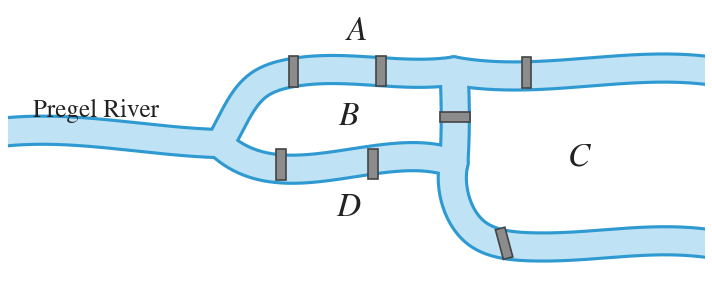

*Figure 1. The seven bridges of Königsberg and the four land masses A, B, C, D*

> **Note:** In Euler's original formulation the walk was not required to return to its starting point. Requiring a return makes the analysis simpler, and the case of different starting and ending points is handled by Euler trails in Section 1.7.

Euler observed that within a single land mass one can travel from any point to any other point without crossing a bridge, so all points of a land mass can be identified with each other. Turning the land masses A, B, C, D into vertices and the seven bridges into edges makes the puzzle a question about the following graph. There are two bridges between A and B and two between B and D, and one bridge each between A and C, B and C, and D and C.

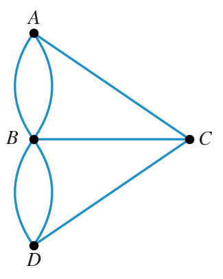

*Figure 2. The graph of the Königsberg bridges problem*

In terms of this graph the question becomes: "Is there a route that starts at some vertex, traverses every edge exactly once, and returns to the same vertex?" Equivalently, it asks whether the whole figure can be traced, ending at the starting point, without lifting the pencil from the paper and without tracing any edge twice.

Searching for such a route by hand, one keeps getting stuck at a vertex with no unused edge to leave on while unused edges remain elsewhere. The reason is as follows. Suppose there is a route that starts and ends at A. Each time the route passes through B, C, or D, it arrives on one edge and departs on a different one, so it uses two edges. Hence, if the route uses all the edges, the number of edges at each of B, C, and D must be a multiple of 2; that is, the degrees of B, C, and D must be even. But $\deg(B) = 5$, $\deg(C) = 3$, and $\deg(D) = 3$. So there is no route starting at A. The same reasoning shows that there is no route starting at B, C, or D; for example, a route starting at B requires the degrees of A, C, and D to be even, but $\deg(A) = 3$. Consequently, a walk that crosses every bridge exactly once and returns to its starting point is impossible.

> **Key Point:** At a vertex that a route passes through, arriving edges and departing edges come in pairs, so the degree of such a vertex must be even. Theorem 10.1.2 in Section 1.6 generalizes this observation.

### 1.2 Basic Terminology of Graphs

The basic graph terminology used in this chapter is collected here from Chapter 1.

> **Definition:** A **graph** $G$ consists of a nonempty finite set $V(G)$ and a finite set $E(G)$. The elements of $V(G)$ are called **vertices** and the elements of $E(G)$ are called **edges**; each edge is associated with a set of one or two vertices called its **endpoints**. The correspondence that sends each edge to its set of endpoints is called the **edge-endpoint function**.

- An edge with just one endpoint is called a **loop**, and two or more distinct edges with the same set of endpoints are called **parallel edges**.
- Two vertices connected by an edge are **adjacent**. An edge is **incident on** each of its endpoints, and two edges incident on the same endpoint are also called adjacent. A vertex on which no edge is incident is an **isolated vertex**.
- The **degree** $\deg(v)$ of a vertex $v$ is the number of edges incident on $v$, with a loop counted twice.
- A graph in which each edge is associated with an ordered pair of endpoints, that is, a graph whose edges are arrows, is a **directed graph**. A graph that is not directed is called undirected when the distinction needs emphasis.

This chapter also uses the following two kinds of graphs frequently.

> **Definition:** A graph with no loops and no parallel edges is a **simple graph**. In a simple graph there is at most one edge with endpoints $u$ and $v$, so that edge is denoted $\lbrace u, v\rbrace$. The **complete graph** $K_n$ is the simple graph with $n$ vertices in which each pair of distinct vertices is joined by exactly one edge.

The edges of $K_n$ correspond to the ways of choosing two distinct vertices, so $K_n$ has $\binom{n}{2} = \frac{n(n-1)}{2}$ edges. The symbol $\binom{n}{2}$, read n choose 2, is the number of subsets of size 2 of a set with $n$ elements (Chapter 9, Section 5). If the sum of the degrees of all the vertices of a graph is called its **total degree** and $\lvert E(G)\rvert$ denotes the number of edges, then the following holds.

$$
\sum_{v \in V(G)} \deg(v) = 2 \lvert E(G)\rvert
$$

The reason is that each edge adds 1 to the degree of each of its two endpoints, and a loop adds 2 to the degree of its single endpoint, so in either case every edge contributes exactly 2 to the total degree. This fact is called the **handshake theorem**. Consequently the total degree is always even, and the number of vertices of odd degree is also even.

### 1.3 Walks, Trails, Paths, and Circuits

Travel in a graph consists of repeatedly moving from a vertex to an adjacent vertex along an edge. Different names are given to a journey according to whether it reuses an edge, whether it revisits a vertex, and whether it returns to the starting vertex.

> **Definition:** Let $G$ be a graph, and let $v$ and $w$ be vertices of $G$.
> - A **walk** from $v$ to $w$ is a finite alternating sequence of vertices and edges of $G$, $v_0 e_1 v_1 e_2 \cdots v_{n-1} e_n v_n$, where $v_0 = v$, $v_n = w$, and for each $i = 1, 2, \ldots, n$, $v_{i-1}$ and $v_i$ are the endpoints of $e_i$. The sequence consisting of the single vertex $v$ is the **trivial walk** from $v$ to $v$.
> - A **trail** from $v$ to $w$ is a walk from $v$ to $w$ that does not contain a repeated edge.
> - A **path** from $v$ to $w$ is a trail that does not contain a repeated vertex.
> - A **closed walk** is a walk that starts and ends at the same vertex.
> - A **circuit** is a closed walk that contains at least one edge and does not contain a repeated edge.
> - A **simple circuit** is a circuit that does not have any repeated vertex except the first and last.

The number of edges in a walk, with a repeated edge counted each time it occurs, is called the **length** of the walk. For example, $v_0 e_1 v_1 e_2 v_2$ has length 2 and the trivial walk has length 0. The differences among the six kinds of travel are summarized in the following table.

| Name | Repeated edge | Repeated vertex | Starts and ends at the same point? | Must contain at least one edge? |
|:-----|:-----|:-----|:-----|:-----|
| Walk | allowed | allowed | allowed | no |
| Trail | no | allowed | allowed | no |
| Path | no | no | no | no |
| Closed walk | allowed | allowed | yes | no |
| Circuit | no | allowed | yes | yes |
| Simple circuit | no | first and last only | yes | yes |

*Table 1. Comparison of walks, trails, paths, closed walks, circuits, and simple circuits*

Some inclusions follow directly from the definitions. Every path is a trail, and every trail is a walk. Every simple circuit is a circuit, and every circuit is a closed walk.

A walk is often written as a sequence of edges only or a sequence of vertices only instead of listing both. One must then check that the shortened notation refers to a single walk.

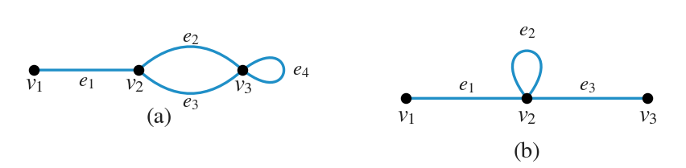

*Figure 3. Two graphs showing the ambiguity of walk notation*

**Example 10.1.1 (Notation for Walks).** In the graph of Figure 3 (a), the edge sequence $e_1 e_2 e_4 e_3$ refers to exactly one walk, $v_1 e_1 v_2 e_2 v_3 e_4 v_3 e_3 v_2$. Because the endpoints of $e_1$ are $v_1, v_2$ and $e_2$ joins $v_2$ and $v_3$, the walk must start at $v_1$. In contrast, the notation $e_1$ alone is ambiguous, since it could mean $v_1 e_1 v_2$ or $v_2 e_1 v_1$. Likewise, the vertex sequence $v_2 v_3$ is ambiguous because of the parallel edges $e_2, e_3$ between $v_2$ and $v_3$: it could mean $v_2 e_2 v_3$ or $v_2 e_3 v_3$. In the graph of Figure 3 (b), the vertex sequence $v_1 v_2 v_2 v_3$ refers to exactly one walk, $v_1 e_1 v_2 e_2 v_2 e_3 v_3$, because each pair of vertices is joined by a single edge and $v_2$ has a single loop.

> **Key Point:** In a graph without parallel edges, every walk is uniquely determined by its sequence of vertices.

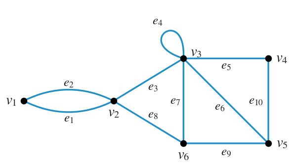

*Figure 4. A graph for classifying walks*

**Example 10.1.2 (Walks, Trails, Paths, and Circuits).** Six walks in the graph of Figure 4 are classified. In this graph, $e_1, e_2$ are parallel edges joining $v_1$ and $v_2$, and $e_4$ is a loop at $v_3$.

| Walk | Repeated edge | Repeated vertex | Classification |
|:-----|:-----|:-----|:-----|
| (a) $v_1 e_1 v_2 e_3 v_3 e_4 v_3 e_5 v_4$ | none | $v_3$ | a trail from $v_1$ to $v_4$ but not a path |
| (b) $e_1 e_3 e_5 e_5 e_6$ | $e_5$ | $v_3$ | just a walk from $v_1$ to $v_5$ |
| (c) $v_2 v_3 v_4 v_5 v_3 v_6 v_2$ | none | $v_3$ in the middle | a circuit but not a simple circuit |
| (d) $v_2 v_3 v_4 v_5 v_6 v_2$ | none | first and last only | a simple circuit |
| (e) $v_1 e_1 v_2 e_1 v_1$ | $e_1$ | first and last only | a closed walk but not a circuit |
| (f) $v_1$ | none | none | a closed walk that is not a circuit, since it has no edge |

*Table 2. Classification of six walks in the graph of Figure 4*

Walk (b) is given by its edges; filling in the vertices gives $v_1 e_1 v_2 e_3 v_3 e_5 v_4 e_5 v_3 e_6 v_5$. It traverses $e_5$ twice, so it is not a trail. Walks (c) and (d) use only parts of the graph without parallel edges, so their vertex sequences determine them uniquely. Walk (c) starts and ends at $v_2$, contains at least one edge, and has no repeated edge, so it is a circuit; it passes through $v_3$ twice in the middle, so it is not a simple circuit. Walk (f) is the trivial walk; its first and last vertices are the same, so it is a closed walk, and it has no repeated edge, so it is also a trail from $v_1$ to $v_1$.

> **Caution:** Graph theory terminology is not uniform across books. Other texts may call the textbook's graphs multigraphs and keep the word graph for the textbook's simple graphs. Vertices are also called nodes, and edges arcs. In particular, many books say path for the textbook's trail, simple path for the textbook's path, and cycle for the textbook's simple circuit, so check the definitions first when reading other sources.

### 1.4 Subgraphs

> **Definition:** A graph $H$ is a **subgraph** of a graph $G$ if, and only if, every vertex of $H$ is a vertex of $G$, every edge of $H$ is an edge of $G$, and every edge of $H$ has the same endpoints as it has in $G$.

Since a subgraph is itself a graph, it has at least one vertex, and every endpoint of an edge placed in a subgraph must be a vertex of the subgraph.

**Example 10.1.3 (Listing Subgraphs).** Consider the graph $G$ with vertex set $\lbrace v_1, v_2\rbrace$ and edge set $\lbrace e_1, e_2, e_3\rbrace$, where $e_1$ and $e_2$ both join $v_1$ and $v_2$ and $e_3$ is a loop at $v_1$. The subgraphs of $G$ are counted by their number of edges.

- Subgraphs with no edges: one for each nonempty vertex set $\lbrace v_1\rbrace$, $\lbrace v_2\rbrace$, $\lbrace v_1, v_2\rbrace$, so 3.
- Subgraphs with one edge: 4. Including $e_1$ or $e_2$ requires both endpoints $v_1, v_2$, giving one subgraph each; including $e_3$ allows the vertex set to be either $\lbrace v_1\rbrace$ or $\lbrace v_1, v_2\rbrace$.
- Subgraphs with two edges: the 3 subgraphs with edge sets $\lbrace e_1, e_2\rbrace$, $\lbrace e_1, e_3\rbrace$, $\lbrace e_2, e_3\rbrace$; each contains $e_1$ or $e_2$, so both vertices must be present.
- Subgraphs with three edges: $G$ itself.

Hence $G$ has $3 + 4 + 3 + 1 = 11$ subgraphs, all drawn in Figure 5.

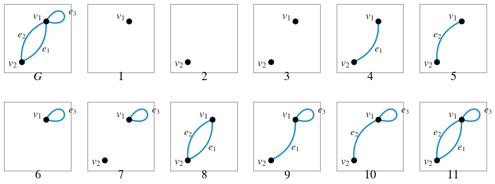

*Figure 5. The graph G and its 11 subgraphs*

### 1.5 Connectedness and Connected Components

Intuitively, a graph is connected if one can travel along edges from any vertex to any other vertex. The formal definition is stated in terms of walks.

> **Definition:** Let $G$ be a graph. Two vertices $v$ and $w$ of $G$ are **connected** if, and only if, there is a walk from $v$ to $w$. The graph $G$ is a **connected graph** if, and only if, for any two vertices $v, w$ of $G$ there is a walk from $v$ to $w$. That is, $G$ is connected exactly when, for all vertices $v, w \in V(G)$, there exists a walk from $v$ to $w$.

Negating this definition, $G$ is not connected if, and only if, there exist two vertices of $G$ that are not connected by any walk.

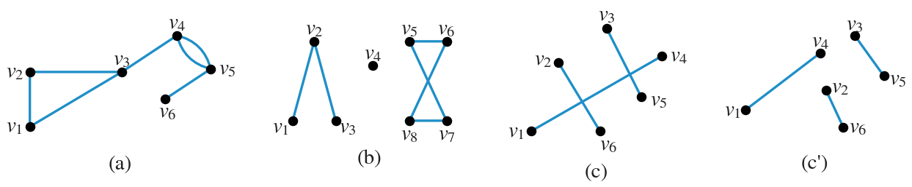

*Figure 6. Connected and disconnected graphs*

**Example 10.1.4 (Connected and Disconnected Graphs).** In Figure 6, graph (a) is connected and graphs (b) and (c) are not. In (b), for instance, there is no walk from $v_1$ to $v_4$. In (c), the points where two edges cross are not vertices, so one cannot switch to another edge there. In a drawing of a graph, edges may cross at points that are not vertices; redrawing (c) without crossings, as in (c'), shows three separate edges.

The following facts relate circuits and connectedness.

**Lemma 10.1.1.** Let $G$ be a graph.

- (a) If $G$ is connected, then any two distinct vertices of $G$ can be connected by a path.
- (b) If vertices $v$ and $w$ are part of a circuit in $G$ and one edge is removed from the circuit, then there still exists a trail from $v$ to $w$ in $G$.
- (c) If $G$ is connected and $G$ contains a circuit, then an edge of the circuit can be removed without disconnecting $G$.

Part (a) can be understood as follows. Since $G$ is connected, there is a walk from $v$ to $w$; choose one of minimum length. If some vertex $u$ appeared twice in it, cutting out the portion between the two occurrences of $u$ would give a shorter walk, a contradiction. So a shortest walk has no repeated vertex, and a walk without repeated vertices has no repeated edge either, so it is a path. Part (b) follows because going once around the circuit starting at $v$ passes through $w$, so the circuit splits into two portions between $v$ and $w$, and the portion that does not contain the removed edge is a trail from $v$ to $w$; it has no repeated edge because the circuit has none. Part (c) is proved in Section 4.5 as Lemma 10.4.3.

Graphs (b) and (c) of Figure 6 each consist of three pieces, each of which is connected. Such pieces are called connected components. A connected component is a connected subgraph of the largest possible size.

> **Definition:** A graph $H$ is a **connected component** of a graph $G$ if, and only if, the following three conditions hold. (1) $H$ is a subgraph of $G$. (2) $H$ is connected. (3) No connected subgraph of $G$ has $H$ as a subgraph and contains vertices or edges that are not in $H$.

Every graph is the union of its connected components, and distinct connected components share no vertices and no edges.

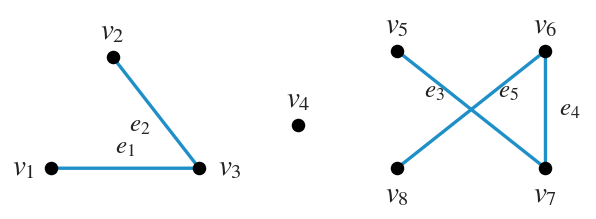

*Figure 7. A graph with three connected components*

**Example 10.1.5 (Connected Components).** The graph $G$ of Figure 7 has connected components $H_1, H_2, H_3$, whose vertex sets and edge sets are as follows.

$$
V_1 = \lbrace v_1, v_2, v_3\rbrace,\ E_1 = \lbrace e_1, e_2\rbrace; \quad V_2 = \lbrace v_4\rbrace,\ E_2 = \emptyset; \quad V_3 = \lbrace v_5, v_6, v_7, v_8\rbrace,\ E_3 = \lbrace e_3, e_4, e_5\rbrace
$$

The isolated vertex $v_4$ forms a connected component by itself.

### 1.6 Euler Circuits

Problems like the Königsberg bridges puzzle are now treated in general.

> **Definition:** Let $G$ be a graph. An **Euler circuit** for $G$ is a circuit that contains every vertex and every edge of $G$. That is, an Euler circuit is a sequence of adjacent vertices and edges that has at least one edge, starts and ends at the same vertex, uses every vertex of $G$ at least once, and uses every edge of $G$ exactly once.

Generalizing the reasoning used for the Königsberg puzzle gives the following theorem.

**Theorem 10.1.2.** If a graph has an Euler circuit, then every vertex of the graph has positive even degree.

**Proof.** Suppose $G$ has an Euler circuit, and let $v$ be any vertex of $G$. Since the Euler circuit contains every edge of $G$, it contains all edges incident on $v$. Now imagine a journey that begins in the middle of an edge at the starting vertex of the Euler circuit, goes once around the circuit, and ends in the middle of the same edge. Such a starting edge exists because an Euler circuit has at least one edge. Because the journey ends in the middle of an edge, each time it enters $v$ along one edge it immediately leaves $v$ along another edge. Because the Euler circuit uses every edge exactly once, each edge incident on $v$ is traversed exactly once during the journey. Hence the edges incident on $v$ split into entry/exit pairs, and the degree of $v$ is a multiple of 2. Moreover, the Euler circuit passes through every vertex, so at least one pair of edges is incident on $v$ and its degree is positive. Therefore the degree of $v$ is a positive even integer. ∎

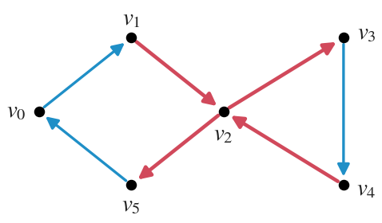

*Figure 8. Pairs of entering and leaving edges at v2 in an Euler circuit*

Figure 8 shows the case $v = v_2$ for the Euler circuit $v_0 v_1 v_2 v_3 v_4 v_2 v_5 v_0$. The circuit passes through $v_2$ twice, once entering from $v_1$ and leaving to $v_3$, and once entering from $v_4$ and leaving to $v_5$. The four red edges form two pairs, so $\deg(v_2) = 4$. A loop is a pair that enters and leaves the same vertex and adds 2 to the degree, so it fits this argument as well.

A statement and its contrapositive are logically equivalent, so the contrapositive of Theorem 10.1.2 also holds.

> **Key Point:** **Contrapositive of Theorem 10.1.2.** If some vertex of a graph has odd degree, then the graph does not have an Euler circuit.

This form is useful for showing that a graph does not have an Euler circuit.

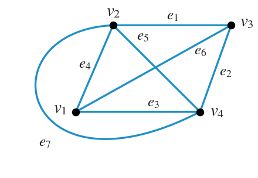

*Figure 9. A graph with vertices of odd degree*

**Example 10.1.6 (A Graph Without an Euler Circuit).** In the graph of Figure 9, $e_3, e_4, e_6$ are incident on $v_1$ and $e_1, e_2, e_6$ are incident on $v_3$, so $\deg(v_1) = \deg(v_3) = 3$, which is odd. Hence, by the contrapositive of Theorem 10.1.2, this graph does not have an Euler circuit.

The converse of Theorem 10.1.2, "if every vertex has even degree, then the graph has an Euler circuit," is false. In the graph of Figure 10 every vertex has degree 2, but the graph is split into two pieces, so after traversing the edges of one piece there is no way to move to the other.

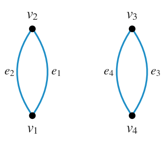

*Figure 10. A disconnected graph in which every degree is even*

With the additional condition of connectedness, however, the converse holds. The proof of this theorem is constructive: it contains an algorithm that actually finds an Euler circuit.

**Theorem 10.1.3.** If a graph $G$ is connected and the degree of every vertex of $G$ is a positive even integer, then $G$ has an Euler circuit.

**Proof.** Suppose $G$ is connected and every vertex of $G$ has positive even degree. Construct a circuit $C$ by the following algorithm.

```text
Step 1: Pick any vertex v of G at which to start.
Step 2: Pick any sequence of adjacent vertices and edges that starts at v,
        never repeats an edge, and returns to v. Call this circuit C.
Step 3: If C contains every edge and vertex of G, then C is an Euler circuit; stop.
        Otherwise perform the following steps.
  3a: Remove all edges of C from G, and also any vertices that become isolated.
      Call the resulting subgraph G'.
  3b: Pick any vertex w common to both C and G'.
  3c: Pick any sequence of adjacent vertices and edges of G' that starts at w,
      never repeats an edge, and returns to w. Call this circuit C'.
  3d: Patch C and C' together into a new circuit C'': follow C from v to w,
      go once around C' back to w, then follow the rest of C back to v.
  3e: Let C := C'' and go back to Step 3.
```

Each step can be carried out for the following reasons.

- Step 1: The vertex set of a graph is nonempty, so $v$ can be chosen.
- Step 2: Because every vertex has positive even degree, whenever the sequence enters a vertex other than $v$ along an edge, it can leave along another unused edge. The number of edges at that vertex used so far was even, and entering uses one more, making it odd; since the degree is even, at least one unused edge remains. The number of edges is finite, so the process cannot go on forever, and the only vertex where it can get stuck is $v$, so it eventually returns to $v$. The circuit has at least one edge because the first move left $v$ along an edge.
- Step 3a: $G'$ may not be connected, but every vertex of $G'$ has positive even degree. Removing the edges of $C$ removes an even number of edges at each vertex, the difference of two even integers is even, and the vertices whose degree became 0 were removed.
- Step 3b: There is at least one vertex common to $C$ and $G'$. Take a vertex $x$ of $C$ and a vertex $y$ of $G'$; since $G$ is connected, there is a walk from $x$ to $y$. If every edge of this walk is an edge of $C$, then $y$ is a vertex of $C$ and hence a common vertex. Otherwise, look at the first place where the walk traverses an edge not in $C$. That edge is an edge of $G'$, and its starting endpoint was reached using only edges of $C$, so it is a vertex of $C$ and, as an endpoint of an edge of $G'$, also a vertex of $G'$.
- Step 3c: Every vertex of $G'$ has positive even degree and $G'$ is finite, so a circuit can be found for the same reason as in Step 2.
- Step 3d: $C$ and $C'$ have no edge in common, so the patched sequence $C''$ is also a circuit that never repeats an edge.

Each pass through Step 3 increases the number of edges of $C$, and $G$ has finitely many edges, so the algorithm must terminate; when it does, $C$ is an Euler circuit for $G$. Because of the choices in Steps 1, 2, 3b, and 3c, the algorithm can produce a variety of different Euler circuits. ∎

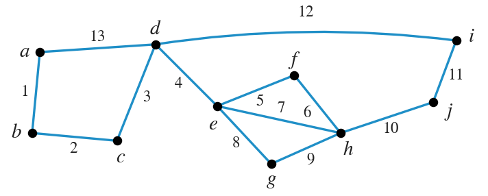

*Figure 11. A constructed Euler circuit and the order in which it traverses the edges*

**Example 10.1.7 (Finding an Euler Circuit).** The graph of Figure 11 has the 13 edges $ab, bc, cd, da, de, di, ef, eg, eh, fh, gh, hj, ji$ (here $xy$ denotes the edge joining $x$ and $y$). First check the conditions of Theorem 10.1.3.

$$
\deg(a) = \deg(b) = \deg(c) = \deg(f) = \deg(g) = \deg(i) = \deg(j) = 2, \qquad \deg(d) = \deg(e) = \deg(h) = 4
$$

Every vertex has positive even degree and the graph is connected, so by Theorem 10.1.3 the graph has an Euler circuit. Now follow the algorithm from the proof.

1. Let $v = a$ and choose the circuit $C: abcda$. It does not pass through $e, f, g, h, i, j$ and their edges, so it is not an Euler circuit.
2. The vertex common to $C$ and the remaining graph is $d$. Choose the circuit $C': deghjid$ starting at $d$, and patch it in by following $C$ to $d$, going around $C'$, and returning along the rest of $C$; this gives $C'': abcdeghjida$.
3. The new $C = abcdeghjida$ does not use the edges $ef, fh, eh$. The vertices common to $C$ and the remaining graph are $e$ and $h$; choosing the circuit $C': efhe$ starting at $e$ and patching it in gives $C'': abcdefheghjida$.
4. This circuit traverses all 13 edges exactly once, so it is an Euler circuit. The numbers in Figure 11 give the order in which it traverses the edges.

A graph with an Euler circuit is connected. The Euler circuit passes through every vertex, so for any two vertices $u, x$, the portion of the circuit from an occurrence of $u$ to an occurrence of $x$ is a walk from $u$ to $x$. Combining this fact with Theorems 10.1.2 and 10.1.3 characterizes the graphs that have Euler circuits completely.

**Theorem 10.1.4.** A graph $G$ has an Euler circuit if, and only if, $G$ is connected and every vertex of $G$ has positive even degree.

> **Caution:** The word "positive" in Theorem 10.1.4 cannot be dropped. A graph with a single vertex and no edges is connected and the degree 0 of its only vertex is even, but it has no Euler circuit because a circuit must contain at least one edge. If "connected" is dropped, Figure 10 is a counterexample.

### 1.7 Euler Trails

A corollary of Theorem 10.1.4 decides when there is a walk from one vertex of a graph to another that passes through every vertex at least once and every edge exactly once.

> **Definition:** Let $G$ be a graph, and let $v$ and $w$ be two distinct vertices of $G$. An **Euler trail** from $v$ to $w$ is a sequence of adjacent edges and vertices that starts at $v$, ends at $w$, passes through every vertex of $G$ at least once, and traverses every edge of $G$ exactly once.

**Corollary 10.1.5.** Let $G$ be a graph, and let $v$ and $w$ be two distinct vertices of $G$. There is an Euler trail from $v$ to $w$ if, and only if, $G$ is connected, $v$ and $w$ have odd degree, and all other vertices of $G$ have positive even degree.

The key to the proof is to add one new edge $e$ joining $v$ and $w$, which turns the question into one about Euler circuits. If $G$ has an Euler trail from $v$ to $w$, appending $e$ to return from $w$ to $v$ gives an Euler circuit of the graph obtained by adding $e$ to $G$. By Theorem 10.1.4 all degrees of that graph are positive and even; removing $e$ lowers only the degrees of $v$ and $w$ by 1, making them odd, while the other degrees stay positive and even. Moreover, the Euler trail passes through every vertex of $G$, so $G$ is connected. Conversely, if $G$ satisfies the conditions, the graph obtained by adding $e$ to $G$ is connected and all its degrees are positive and even, so it has an Euler circuit. Writing this circuit so that it starts at $v$ and $e$ is its last edge gives the form $v \cdots w\ e\ v$, and removing the final $e\ v$ leaves an Euler trail of $G$ from $v$ to $w$.

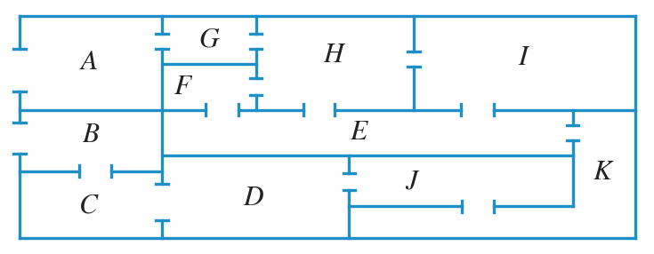

*Figure 12. The floor plan of a house with rooms A to K*

**Example 10.1.8 (Finding an Euler Trail).** Figure 12 shows the floor plan of a house that is open to visitors. Can a visitor begin in room A, finish in room B, and go through each doorway inside the house exactly once? Taking the rooms as vertices and each doorway between two rooms as an edge gives the graph of Figure 13.

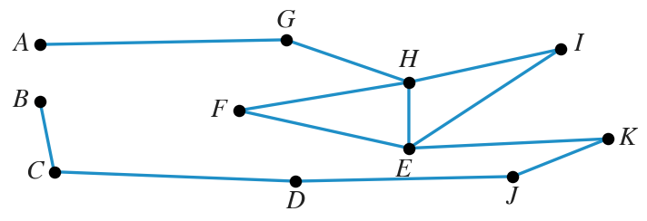

*Figure 13. The graph of the floor plan with rooms as vertices and doorways as edges*

The graph is connected, A and B have degree 1, which is odd, E and H have degree 4, and every other vertex has degree 2, all positive and even. Corollary 10.1.5 therefore guarantees an Euler trail from A to B; one example is $A\ G\ H\ F\ E\ I\ H\ E\ K\ J\ D\ C\ B$, which traverses each of the 12 edges once.

In the Königsberg graph all four vertices have odd degree, so it has neither an Euler circuit nor an Euler trail. The answer to Euler's original question, in which the starting and ending points may differ, is also "impossible."

### 1.8 Hamiltonian Circuits

Theorem 10.1.4 completely answers the question "Is there a circuit that traverses every edge exactly once?" A related question is "Is there a circuit in which every vertex appears exactly once, except for the first and the last?"

In 1859 the Irish mathematician William Rowan Hamilton devised a puzzle built on a dodecahedron, a solid with 12 congruent regular pentagonal faces and 20 vertices. The vertices carried the names of cities such as London, Paris, Hong Kong, and New York, and the task was to plan a trip around the world that leaves one city, visits each of the other cities exactly once, and comes back to the first city. Flattening the surface of the dodecahedron onto the plane gives the graph of Figure 14, and $ABCD \cdots STA$ along the red edges is one solution. It visits every city but does not use the gray dashed edges.

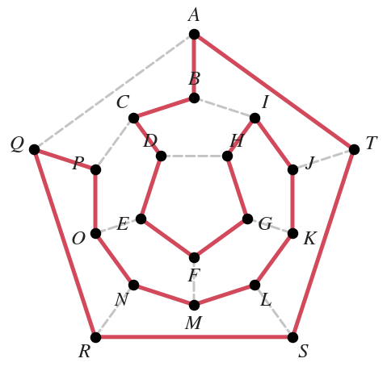

*Figure 14. The graph of a dodecahedron and a Hamiltonian circuit*

> **Definition:** Given a graph $G$, a **Hamiltonian circuit** for $G$ is a simple circuit that includes every vertex of $G$. That is, a Hamiltonian circuit is a sequence of adjacent vertices and distinct edges in which every vertex of $G$ appears exactly once, except for the first and the last, which are the same.

An Euler circuit includes every vertex but may visit some vertices more than once, so it may not be a Hamiltonian circuit. Conversely, a Hamiltonian circuit need not include every edge, so it may not be an Euler circuit. Although the two definitions sound similar, their mathematics is very different. Theorem 10.1.4 gives a simple criterion for Euler circuits, but no comparably simple criterion is known for deciding whether a graph has a Hamiltonian circuit, nor is any efficient algorithm known for finding one.

A simple test can, however, show that certain graphs have no Hamiltonian circuit. Suppose that a graph $G$ with two or more vertices has a Hamiltonian circuit $C: v_0 e_1 v_1 e_2 \cdots v_{n-1} e_n v_n\ (v_n = v_0)$. Since $C$ is a simple circuit, all the $e_i$ are distinct, and all the $v_j$ are distinct except that $v_0 = v_n$. Let $H$ be the subgraph formed by the vertices and edges of $C$. Then the following hold.

- $H$ has the same number of edges as vertices, because the edges $e_1, \ldots, e_n$ and the vertices $v_0, \ldots, v_{n-1}$ are all distinct.
- By the definition of a Hamiltonian circuit, every vertex of $G$ is a vertex of $H$.
- $H$ is connected, because any two of its vertices lie on the circuit $C$.
- Every vertex of $H$ has degree 2, because exactly the edges $e_j$ and $e_{j+1}$ are incident on a vertex $v_j$ other than $v_0$, and exactly $e_1$ and $e_n$ are incident on $v_0$.

**Proposition 10.1.6.** If a graph $G$ has a Hamiltonian circuit, then $G$ has a subgraph $H$ with all of the following properties.

1. $H$ contains every vertex of $G$.
2. $H$ is connected.
3. $H$ has the same number of edges as vertices.
4. Every vertex of $H$ has degree 2.

If $G$ has only one vertex and has a Hamiltonian circuit, the circuit has the form $v\ e\ v$, where $v$ is the vertex and $e$ is a loop at $v$, and the subgraph consisting of $v$ and $e$ satisfies conditions 1-4. Hence the proposition holds in all cases. Its contrapositive, "if $G$ does not have a subgraph with properties 1-4, then $G$ does not have a Hamiltonian circuit," is used to show that a graph has no Hamiltonian circuit.

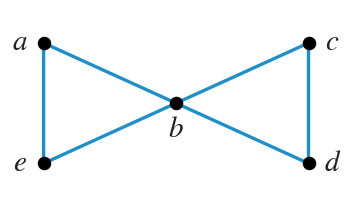

*Figure 15. A graph without a Hamiltonian circuit*

**Example 10.1.9 (A Graph Without a Hamiltonian Circuit).** The graph $G$ of Figure 15 has vertices $a, b, c, d, e$ and edges $\lbrace a, b\rbrace, \lbrace b, c\rbrace, \lbrace b, d\rbrace, \lbrace b, e\rbrace, \lbrace a, e\rbrace, \lbrace c, d\rbrace$. If $G$ had a Hamiltonian circuit, then by Proposition 10.1.6 it would have a connected subgraph $H$ with five vertices and five edges in which every vertex has degree 2. Since $b$ has degree 4 in $G$, two edges incident on $b$ would have to be removed to form $H$. But removing $\lbrace a, b\rbrace$ would leave $\lbrace a, e\rbrace$ as the only edge at $a$, giving $a$ degree less than 2 in $H$, so this edge cannot be removed. For the same reason, $\lbrace e, b\rbrace$, $\lbrace c, b\rbrace$, and $\lbrace d, b\rbrace$ cannot be removed either. Then $b$ would have degree 4 in $H$, contradicting the condition that every vertex of $H$ has degree 2. Hence no such $H$ exists, and $G$ does not have a Hamiltonian circuit.

### 1.9 The Traveling Salesman Problem

A variation of the Hamiltonian circuit problem is the **traveling salesman problem**.

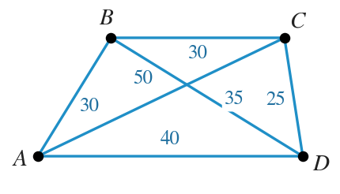

*Figure 16. Four cities and the distances between them*

**Example 10.1.10 (A Traveling Salesman Problem).** Figure 16 is a map of four cities and the distances between them in kilometers. A salesman must start in city A, visit each city exactly once, and return to A. Which order of visits minimizes the total distance traveled? Write down every Hamiltonian circuit starting and ending at A and compute its total distance. There are $3! = 6$ orders in which to visit the other three cities.

| Hamiltonian circuit | Total distance (km) |
|:-----|:-----|
| $ABCDA$ | $30 + 30 + 25 + 40 = 125$ |
| $ABDCA$ | $30 + 35 + 25 + 50 = 140$ |
| $ACBDA$ | $50 + 30 + 35 + 40 = 155$ |
| $ACDBA$ | $140$ ($ABDCA$ traversed backward) |
| $ADBCA$ | $155$ ($ACBDA$ traversed backward) |
| $ADCBA$ | $125$ ($ABCDA$ traversed backward) |

*Table 3. The six Hamiltonian circuits starting at A and their total distances*

Hence $ABCDA$ or its reverse $ADCBA$ gives the minimum total distance of 125 km.

The general traveling salesman problem asks for a Hamiltonian circuit of minimum total distance in an arbitrary graph with $n$ vertices whose edges are labeled with distances. Listing all Hamiltonian circuits as in the example becomes unusable even for moderate $n$. In a complete graph with $n$ vertices, fixing the starting vertex leaves $(n-1)!$ orders for visiting the other $n - 1$ vertices, and each circuit is counted twice because it can be traversed in either direction, so there are $(n-1)!/2$ distinct Hamiltonian circuits. With 30 vertices one would have to check $29!/2 \approx 4.42 \times 10^{30}$ circuits, which would take about $1.4 \times 10^{14}$ years even at one nanosecond per circuit. At present no algorithm is known that solves the general traveling salesman problem much more efficiently. There are, however, efficient algorithms that find fairly good circuits, whose total distances are not necessarily minimal but are smaller than those of most other Hamiltonian circuits.

---

<br>

## 2. Matrix Representations of Graphs

How can a graph be represented inside a computer? Everything that determines a graph can be recorded in a rectangular array of numbers called a matrix, and a computer stores such arrays easily. This section covers basic definitions about matrices and matrix operations, the relation between graphs and matrices, and, as an application, a method for counting walks.

### 2.1 Matrices

Matrices are two-dimensional analogues of sequences and are also called two-dimensional arrays.

> **Definition:** An $m \times n$ **matrix** $\mathbf{A}$ over a set $S$ is a rectangular array of elements of $S$ arranged into $m$ **rows** and $n$ **columns**, written $\mathbf{A} = (a_{ij})$. The element $a_{ij}$ in row $i$ and column $j$ is called the $(i, j)$ **entry** of $\mathbf{A}$, and a matrix with $m$ rows and $n$ columns is said to have **size** $m \times n$.

$$
\mathbf{A} = \begin{bmatrix} a_{11} & a_{12} & \cdots & a_{1j} & \cdots & a_{1n} \\ a_{21} & a_{22} & \cdots & a_{2j} & \cdots & a_{2n} \\ \vdots & \vdots & & \vdots & & \vdots \\ a_{i1} & a_{i2} & \cdots & a_{ij} & \cdots & a_{in} \\ \vdots & \vdots & & \vdots & & \vdots \\ a_{m1} & a_{m2} & \cdots & a_{mj} & \cdots & a_{mn} \end{bmatrix}
$$

The $i$th row of $\mathbf{A}$ is $\begin{bmatrix} a_{i1} & a_{i2} & \cdots & a_{in} \end{bmatrix}$, and the $j$th column consists of $a_{1j}, a_{2j}, \ldots, a_{mj}$ stacked from top to bottom. Two matrices $\mathbf{A}$ and $\mathbf{B}$ are equal if, and only if, they have the same size and all corresponding entries are equal, that is, $a_{ij} = b_{ij}$ for every $i = 1, \ldots, m$ and $j = 1, \ldots, n$. A matrix with equal numbers of rows and columns is a **square matrix**, and the entries $a_{11}, a_{22}, \ldots, a_{nn}$ of an $n \times n$ square matrix form its **main diagonal**.

**Example 10.2.1 (Matrix Terminology).** Consider the $3 \times 3$ matrix over the integers

$$
\mathbf{A} = \begin{bmatrix} 1 & 0 & -3 \\ 4 & -1 & 5 \\ -2 & 2 & 0 \end{bmatrix}
$$

Its entry in row 2, column 3 is $a_{23} = 5$, its second column is $0, -1, 2$ from top to bottom, and the entries of its main diagonal are $1, -1, 0$.

### 2.2 Adjacency Matrices of Directed Graphs

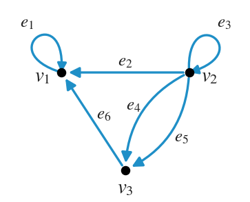

*Figure 17. A directed graph whose adjacency matrix is to be found*

The directed graph of Figure 17 can be represented by the matrix $\mathbf{A} = (a_{ij})$ in which $a_{ij}$ is the number of arrows from $v_i$ to $v_j$. There is one arrow from $v_1$ to $v_1$ (the loop $e_1$), so $a_{11} = 1$; there is no arrow from $v_1$ to $v_2$, so $a_{12} = 0$; and there are two arrows $e_4, e_5$ from $v_2$ to $v_3$, so $a_{23} = 2$. Filling in every entry this way gives the following matrix. Labeling the rows and columns with the vertices makes it easy to read.

$$
\mathbf{A} = \begin{array}{c|ccc} & v_1 & v_2 & v_3 \\ \hline v_1 & 1 & 0 & 0 \\ v_2 & 1 & 1 & 2 \\ v_3 & 1 & 0 & 0 \end{array}
$$

> **Definition:** Let $G$ be a directed graph with ordered vertices $v_1, v_2, \ldots, v_n$. The **adjacency matrix** of $G$ is the $n \times n$ matrix $\mathbf{A} = (a_{ij})$ over the set of nonnegative integers such that $a_{ij}$ is the number of arrows from $v_i$ to $v_j$ for all $i, j = 1, 2, \ldots, n$.

Nonzero entries on the main diagonal indicate loops, and off-diagonal entries larger than 1 indicate parallel arrows. If the vertices are reordered, the rows and columns of the adjacency matrix are rearranged accordingly.

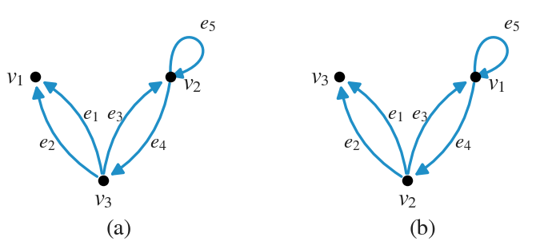

*Figure 18. Two directed graphs that differ only in the ordering of their vertices*

**Example 10.2.2 (Vertex Order and the Adjacency Matrix).** The two directed graphs of Figure 18 have the same shape and differ only in the names of their vertices. In (a) there is no arrow out of $v_1$, so the first row is all 0. In (b) there is one loop at $v_1$ and one arrow from $v_1$ to $v_2$ and none to $v_3$, so the first row is $1, 1, 0$. Continuing in this way gives the two adjacency matrices.

$$
\text{(a)}\quad \mathbf{A} = \begin{array}{c|ccc} & v_1 & v_2 & v_3 \\ \hline v_1 & 0 & 0 & 0 \\ v_2 & 0 & 1 & 1 \\ v_3 & 2 & 1 & 0 \end{array} \qquad \text{(b)}\quad \mathbf{A} = \begin{array}{c|ccc} & v_1 & v_2 & v_3 \\ \hline v_1 & 1 & 1 & 0 \\ v_2 & 1 & 0 & 2 \\ v_3 & 0 & 0 & 0 \end{array}
$$

Conversely, every square matrix whose entries are nonnegative integers is the adjacency matrix of some directed graph, which one can draw. Since the matrix says nothing about the names of the edges, however, that directed graph is not unique.

**Example 10.2.3 (Obtaining a Directed Graph from a Matrix).** The task is to draw a directed graph whose adjacency matrix is the following.

$$
\mathbf{A} = \begin{array}{c|cccc} & v_1 & v_2 & v_3 & v_4 \\ \hline v_1 & 0 & 1 & 1 & 0 \\ v_2 & 1 & 1 & 0 & 2 \\ v_3 & 0 & 0 & 1 & 1 \\ v_4 & 2 & 1 & 0 & 0 \end{array}
$$

Name the vertices $v_1, v_2, v_3, v_4$ and read the entries one by one. For instance, the entry 2 in row 4, column 1 calls for two arrows from $v_4$ to $v_1$, and the entry 0 in row 1, column 4 says that no arrow goes from $v_1$ to $v_4$. The 1s in row 2, column 2 and row 3, column 3 mean that $v_2$ and $v_3$ each have one loop. The resulting graph is Figure 19; its edges are left unnamed because the matrix does not fix their names.

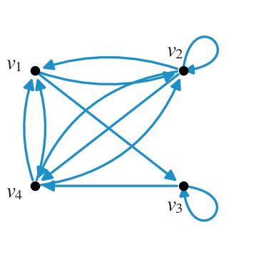

*Figure 19. A directed graph with the given adjacency matrix*

### 2.3 Adjacency Matrices of Undirected Graphs and Symmetric Matrices

The adjacency matrix of an undirected graph is defined in the same way: order the vertices and set the $(i, j)$ entry to the number of edges connecting the $i$th and $j$th vertices.

> **Definition:** Let $G$ be an undirected graph with ordered vertices $v_1, v_2, \ldots, v_n$. The **adjacency matrix** of $G$ is the $n \times n$ matrix $\mathbf{A} = (a_{ij})$ over the set of nonnegative integers such that $a_{ij}$ is the number of edges connecting $v_i$ and $v_j$ for all $i, j = 1, 2, \ldots, n$.

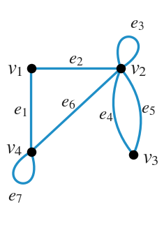

*Figure 20. An undirected graph whose adjacency matrix is to be found*

**Example 10.2.4 (The Adjacency Matrix of an Undirected Graph).** In the graph of Figure 20, $v_1$ is joined to $v_2$ and to $v_4$ by one edge each. $v_2$ has the loop $e_3$, is joined to $v_3$ by the parallel edges $e_4, e_5$, and to $v_4$ by the edge $e_6$. $v_4$ has the loop $e_7$. Hence the adjacency matrix is as follows.

$$
\mathbf{A} = \begin{array}{c|cccc} & v_1 & v_2 & v_3 & v_4 \\ \hline v_1 & 0 & 1 & 0 & 1 \\ v_2 & 1 & 1 & 2 & 1 \\ v_3 & 0 & 2 & 0 & 0 \\ v_4 & 1 & 1 & 0 & 1 \end{array}
$$

The entries of this matrix satisfy $a_{ij} = a_{ji}$ for all $i, j$; that is, the matrix looks the same when flipped across its main diagonal.

> **Definition:** An $n \times n$ square matrix $\mathbf{A} = (a_{ij})$ is called **symmetric** if, and only if, $a_{ij} = a_{ji}$ for all $i, j = 1, 2, \ldots, n$.

**Example 10.2.5 (Symmetric Matrices).** Of the following three matrices, only (b) is symmetric.

$$
\text{(a)}\ \begin{bmatrix} 1 & 0 \\ 1 & 2 \end{bmatrix} \qquad \text{(b)}\ \begin{bmatrix} 0 & 1 & 2 \\ 1 & 1 & 0 \\ 2 & 0 & 3 \end{bmatrix} \qquad \text{(c)}\ \begin{bmatrix} 2 & 0 & 0 \\ 0 & 1 & 0 \end{bmatrix}
$$

In (a), $a_{12} = 0$ but $a_{21} = 1$, so (a) is not symmetric. Matrix (c) is not even square, so the definition of a symmetric matrix does not apply to it.

The number of edges joining $v_i$ and $v_j$ equals the number of edges joining $v_j$ and $v_i$, so the adjacency matrix of any undirected graph is symmetric.

> **Caution:** Under the textbook's definition a loop contributes 1 to a main diagonal entry of the adjacency matrix, whereas the degree counts a loop twice, so the degree of a vertex with a loop differs from the sum of its row. For example, in Figure 20 the row of $v_2$ sums to $1 + 1 + 2 + 1 = 5$, but $\deg(v_2) = 6$. The degree equals the row sum plus the number of loops at the vertex.

> **[Data Structures]** An adjacency matrix is stored directly as a two-dimensional array, so the number of edges between two vertices can be read from a single entry. With $n$ vertices, however, it needs $n^2$ cells even when there are few edges, so graphs with few edges are often stored as adjacency lists, which keep a list of adjacent vertices for each vertex.

### 2.4 Adjacency Matrices and Connected Components

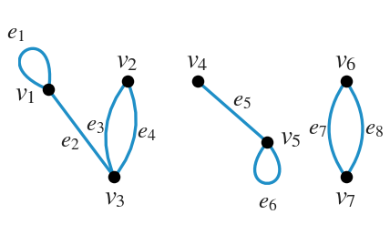

*Figure 21. A graph with three connected components, loops, and parallel edges*

The graph of Figure 21 consists of three connected components. With the vertices in the order $v_1, \ldots, v_7$, its adjacency matrix is as follows.

$$
\mathbf{A} = \begin{bmatrix} 1 & 0 & 1 & 0 & 0 & 0 & 0 \\ 0 & 0 & 2 & 0 & 0 & 0 & 0 \\ 1 & 2 & 0 & 0 & 0 & 0 & 0 \\ 0 & 0 & 0 & 0 & 1 & 0 & 0 \\ 0 & 0 & 0 & 1 & 1 & 0 & 0 \\ 0 & 0 & 0 & 0 & 0 & 0 & 2 \\ 0 & 0 & 0 & 0 & 0 & 2 & 0 \end{bmatrix}
$$

This matrix consists of square blocks of different sizes ($3 \times 3$, $2 \times 2$, $2 \times 2$) down its diagonal and 0s everywhere else. This happens because no edge joins a vertex of one connected component to a vertex of another. For instance, $v_1, v_2, v_3$ share no edges with $v_4, \ldots, v_7$, so all entries of the first three rows from the fourth column on, and of the first three columns from the fourth row on, are 0. Writing $\mathbf{O}$ for a matrix whose entries are all 0, the matrix is a block diagonal matrix of the following form.

$$
\mathbf{A} = \begin{bmatrix} \mathbf{A}_1 & \mathbf{O} & \mathbf{O} \\ \mathbf{O} & \mathbf{A}_2 & \mathbf{O} \\ \mathbf{O} & \mathbf{O} & \mathbf{A}_3 \end{bmatrix}
$$

**Theorem 10.2.1.** Let $G$ be a graph with connected components $G_1, G_2, \ldots, G_k$, where $G_i$ has $n_i$ vertices. If the vertices of each connected component are numbered consecutively, then the adjacency matrix of $G$ has the following form, where each $\mathbf{A}_i$ is the $n_i \times n_i$ adjacency matrix of $G_i$ and each $\mathbf{O}$ is a matrix whose entries are all 0.

$$
\begin{bmatrix} \mathbf{A}_1 & \mathbf{O} & \mathbf{O} & \cdots & \mathbf{O} \\ \mathbf{O} & \mathbf{A}_2 & \mathbf{O} & \cdots & \mathbf{O} \\ \mathbf{O} & \mathbf{O} & \mathbf{A}_3 & \cdots & \mathbf{O} \\ \vdots & \vdots & \vdots & \ddots & \vdots \\ \mathbf{O} & \mathbf{O} & \mathbf{O} & \cdots & \mathbf{A}_k \end{bmatrix}
$$

### 2.5 Matrix Multiplication

Matrix multiplication is an operation used in many contexts, including counting walks in graphs. Here only matrices with real entries are considered. The product of two matrices is built from scalar products of rows and columns.

> **Definition:** Suppose the entries of matrices $\mathbf{A}$ and $\mathbf{B}$ are real numbers and the number $n$ of elements in the $i$th row of $\mathbf{A}$ equals the number of elements in the $j$th column of $\mathbf{B}$. The **scalar product** or **dot product** of the $i$th row of $\mathbf{A}$ and the $j$th column of $\mathbf{B}$ is the following real number.

$$
\begin{bmatrix} a_{i1} & a_{i2} & \cdots & a_{in} \end{bmatrix} \begin{bmatrix} b_{1j} \\ b_{2j} \\ \vdots \\ b_{nj} \end{bmatrix} = a_{i1} b_{1j} + a_{i2} b_{2j} + \cdots + a_{in} b_{nj}
$$

**Example 10.2.6 (Multiplying a Row and a Column).** Multiply corresponding entries and add.

$$
\begin{bmatrix} 3 & 0 & -1 & 2 \end{bmatrix} \begin{bmatrix} -1 \\ 2 \\ 3 \\ 0 \end{bmatrix} = 3 \cdot (-1) + 0 \cdot 2 + (-1) \cdot 3 + 2 \cdot 0 = -3 + 0 - 3 + 0 = -6
$$

More generally, if the number of columns of $\mathbf{A}$ equals the number of rows of $\mathbf{B}$, the product $\mathbf{A}\mathbf{B}$ is defined. Its $(i, j)$ entry is the scalar product of the $i$th row of $\mathbf{A}$ and the $j$th column of $\mathbf{B}$.

> **Definition:** Let $\mathbf{A} = (a_{ij})$ be an $m \times k$ matrix and $\mathbf{B} = (b_{ij})$ a $k \times n$ matrix with real entries. The (matrix) **product** of $\mathbf{A}$ times $\mathbf{B}$, denoted $\mathbf{A}\mathbf{B}$, is the $m \times n$ matrix $(c_{ij})$ whose $(i, j)$ entry is as follows for each $i = 1, \ldots, m$ and $j = 1, \ldots, n$.

$$
c_{ij} = a_{i1} b_{1j} + a_{i2} b_{2j} + \cdots + a_{ik} b_{kj} = \sum_{r=1}^{k} a_{ir} b_{rj}
$$

**Example 10.2.7 (Computing a Matrix Product).** The task is to compute the product of the following two matrices.

$$
\mathbf{A} = \begin{bmatrix} 2 & 0 & 3 \\ -1 & 1 & 0 \end{bmatrix}, \qquad \mathbf{B} = \begin{bmatrix} 4 & 3 \\ 2 & 2 \\ -2 & -1 \end{bmatrix}
$$

$\mathbf{A}$ has size $2 \times 3$ and $\mathbf{B}$ has size $3 \times 2$, so the number of columns of $\mathbf{A}$ and the number of rows of $\mathbf{B}$ are both 3; the product can be computed, and it is a $2 \times 2$ matrix. Its entries are as follows.

$$
\begin{aligned} c_{11} &= 2 \cdot 4 + 0 \cdot 2 + 3 \cdot (-2) = 8 + 0 - 6 = 2 \\ c_{12} &= 2 \cdot 3 + 0 \cdot 2 + 3 \cdot (-1) = 6 + 0 - 3 = 3 \\ c_{21} &= (-1) \cdot 4 + 1 \cdot 2 + 0 \cdot (-2) = -4 + 2 + 0 = -2 \\ c_{22} &= (-1) \cdot 3 + 1 \cdot 2 + 0 \cdot (-1) = -3 + 2 + 0 = -1 \end{aligned}
$$

Hence the product is as follows.

$$
\mathbf{A}\mathbf{B} = \begin{bmatrix} 2 & 3 \\ -2 & -1 \end{bmatrix}
$$

Matrix multiplication resembles multiplication of real numbers in some ways and differs from it in others. First, any two real numbers can be multiplied, but matrices can be multiplied only when their sizes are compatible. If $\mathbf{A}$ is $3 \times 2$ and $\mathbf{B}$ is $2 \times 4$, then $\mathbf{A}\mathbf{B}$ is defined, but $\mathbf{B}\mathbf{A}$ is not, because $\mathbf{B}$ has 4 columns and $\mathbf{A}$ has 3 rows. Second, multiplication of real numbers is commutative, whereas matrix multiplication is not.

$$
\begin{bmatrix} 1 & 1 \\ 0 & 1 \end{bmatrix} \begin{bmatrix} 0 & 1 \\ 0 & 1 \end{bmatrix} = \begin{bmatrix} 0 & 2 \\ 0 & 1 \end{bmatrix} \qquad \text{but} \qquad \begin{bmatrix} 0 & 1 \\ 0 & 1 \end{bmatrix} \begin{bmatrix} 1 & 1 \\ 0 & 1 \end{bmatrix} = \begin{bmatrix} 0 & 1 \\ 0 & 1 \end{bmatrix}
$$

On the other hand, both are associative: $(\mathbf{A}\mathbf{B})\mathbf{C} = \mathbf{A}(\mathbf{B}\mathbf{C})$ whenever the products are defined. The proof below covers $2 \times 2$ matrices.

**Example 10.2.8 (Associativity of Multiplication of $2 \times 2$ Matrices).** Let $\mathbf{A} = (a_{ij})$, $\mathbf{B} = (b_{ij})$, and $\mathbf{C} = (c_{ij})$ be arbitrary $2 \times 2$ matrices with real entries. All numbers of rows and columns are 2, so $\mathbf{A}\mathbf{B}$, $\mathbf{B}\mathbf{C}$, $(\mathbf{A}\mathbf{B})\mathbf{C}$, and $\mathbf{A}(\mathbf{B}\mathbf{C})$ are all defined. Let $\mathbf{A}\mathbf{B} = (d_{ij})$ and $\mathbf{B}\mathbf{C} = (e_{ij})$. Then for each $i, j = 1, 2$:

$$
\begin{aligned} ((\mathbf{A}\mathbf{B})\mathbf{C})_{ij} &= \sum_{r=1}^{2} d_{ir} c_{rj} = d_{i1} c_{1j} + d_{i2} c_{2j} && \text{definitions of product and } \Sigma \\ &= \Big(\sum_{r=1}^{2} a_{ir} b_{r1}\Big) c_{1j} + \Big(\sum_{r=1}^{2} a_{ir} b_{r2}\Big) c_{2j} && \text{definition of } \mathbf{A}\mathbf{B} \\ &= (a_{i1} b_{11} + a_{i2} b_{21}) c_{1j} + (a_{i1} b_{12} + a_{i2} b_{22}) c_{2j} && \text{definition of } \Sigma \\ &= a_{i1} b_{11} c_{1j} + a_{i2} b_{21} c_{1j} + a_{i1} b_{12} c_{2j} + a_{i2} b_{22} c_{2j} && \text{distributive law} \end{aligned}
$$

The $(i, j)$ entry of $\mathbf{A}(\mathbf{B}\mathbf{C})$ is expanded in the same way.

$$
\begin{aligned} (\mathbf{A}(\mathbf{B}\mathbf{C}))_{ij} &= \sum_{r=1}^{2} a_{ir} e_{rj} = a_{i1} e_{1j} + a_{i2} e_{2j} \\ &= a_{i1} \Big(\sum_{r=1}^{2} b_{1r} c_{rj}\Big) + a_{i2} \Big(\sum_{r=1}^{2} b_{2r} c_{rj}\Big) \\ &= a_{i1} (b_{11} c_{1j} + b_{12} c_{2j}) + a_{i2} (b_{21} c_{1j} + b_{22} c_{2j}) \\ &= a_{i1} b_{11} c_{1j} + a_{i2} b_{21} c_{1j} + a_{i1} b_{12} c_{2j} + a_{i2} b_{22} c_{2j} \end{aligned}
$$

The last line rearranges the terms using the commutativity of addition. The two results agree for all $i, j$, so all corresponding entries are equal and $(\mathbf{A}\mathbf{B})\mathbf{C} = \mathbf{A}(\mathbf{B}\mathbf{C})$.

### 2.6 Identity Matrices and Powers of a Matrix

For real numbers, 1 is the identity element of multiplication. Some matrices play the same role for suitable matrix products. Multiplying out shows that the following hold for any real numbers $a, \ldots, i$.

$$
\begin{bmatrix} 1 & 0 \\ 0 & 1 \end{bmatrix} \begin{bmatrix} a & b & c \\ d & e & f \end{bmatrix} = \begin{bmatrix} a & b & c \\ d & e & f \end{bmatrix}, \qquad \begin{bmatrix} a & b & c \\ d & e & f \\ g & h & i \end{bmatrix} \begin{bmatrix} 1 & 0 & 0 \\ 0 & 1 & 0 \\ 0 & 0 & 1 \end{bmatrix} = \begin{bmatrix} a & b & c \\ d & e & f \\ g & h & i \end{bmatrix}
$$

Thus this $2 \times 2$ matrix behaves as an identity when it multiplies a $2 \times 3$ matrix from the left. It cannot be placed to the right of a $2 \times 3$ matrix at all, however, because the sizes do not match.

> **Definition:** For each positive integer $n$, the $n \times n$ **identity matrix** $\mathbf{I}_n = (\delta_{ij})$ is the $n \times n$ matrix whose main diagonal entries are all 1 and whose other entries are all 0; it is written $\mathbf{I}$ when the size is clear from context. That is, for all $i, j = 1, 2, \ldots, n$, $\delta_{ij} = 1$ if $i = j$ and $\delta_{ij} = 0$ if $i \neq j$.

The symbol $\delta_{ij}$ was introduced by the German mathematician Leopold Kronecker to make matrix computations more convenient and is called the **Kronecker delta**.

**Example 10.2.9 (An Identity Matrix Acts as an Identity).** This example shows that if $\mathbf{A}$ is any $m \times n$ matrix and $\mathbf{I}$ is the $n \times n$ identity matrix, then $\mathbf{A}\mathbf{I} = \mathbf{A}$. Let $a_{ij}$ be the $(i, j)$ entry of $\mathbf{A}$. Then for each $i = 1, \ldots, m$ and $j = 1, \ldots, n$:

$$
\begin{aligned} (\mathbf{A}\mathbf{I})_{ij} &= \sum_{r=1}^{n} a_{ir} \delta_{rj} && \text{definition of matrix product} \\ &= a_{i1} \delta_{1j} + \cdots + a_{ij} \delta_{jj} + \cdots + a_{in} \delta_{nj} && \text{definition of } \Sigma \\ &= a_{ij} \delta_{jj} && \delta_{rj} = 0 \text{ whenever } r \neq j \\ &= a_{ij} && \delta_{jj} = 1 \end{aligned}
$$

Hence all corresponding entries of $\mathbf{A}\mathbf{I}$ and $\mathbf{A}$ are equal, and $\mathbf{A}\mathbf{I} = \mathbf{A}$. In the same way one can show that $\mathbf{I}\mathbf{A} = \mathbf{A}$ when $\mathbf{I}$ is the $m \times m$ identity matrix.

Powers show the same mix of similarities and differences. Every real number has nonnegative integer powers, whereas a matrix can be multiplied by itself only when its numbers of rows and columns are equal. The zeroth power of a real number is defined as 1, and in the same spirit the zeroth power of a square matrix is defined as the identity matrix; the other powers are then defined recursively.

> **Definition:** For any $n \times n$ matrix $\mathbf{A}$, the **powers** of $\mathbf{A}$ are defined as follows: $\mathbf{A}^0 = \mathbf{I}$, where $\mathbf{I}$ is the $n \times n$ identity matrix, and $\mathbf{A}^n = \mathbf{A}\mathbf{A}^{n-1}$ for every integer $n \geq 1$.

**Example 10.2.10 (Powers of a Matrix).** The powers $\mathbf{A}^0, \mathbf{A}^1, \mathbf{A}^2, \mathbf{A}^3$ of the following matrix $\mathbf{A}$ are computed in turn from the definition.

$$
\begin{aligned} \mathbf{A} &= \begin{bmatrix} 1 & 2 \\ 2 & 0 \end{bmatrix} \\ \mathbf{A}^0 &= \mathbf{I} = \begin{bmatrix} 1 & 0 \\ 0 & 1 \end{bmatrix}, \qquad \mathbf{A}^1 = \mathbf{A}\mathbf{A}^0 = \mathbf{A}\mathbf{I} = \mathbf{A} \\ \mathbf{A}^2 &= \mathbf{A}\mathbf{A}^1 = \begin{bmatrix} 1 & 2 \\ 2 & 0 \end{bmatrix} \begin{bmatrix} 1 & 2 \\ 2 & 0 \end{bmatrix} = \begin{bmatrix} 1 + 4 & 2 + 0 \\ 2 + 0 & 4 + 0 \end{bmatrix} = \begin{bmatrix} 5 & 2 \\ 2 & 4 \end{bmatrix} \\ \mathbf{A}^3 &= \mathbf{A}\mathbf{A}^2 = \begin{bmatrix} 1 & 2 \\ 2 & 0 \end{bmatrix} \begin{bmatrix} 5 & 2 \\ 2 & 4 \end{bmatrix} = \begin{bmatrix} 5 + 4 & 2 + 8 \\ 10 + 0 & 4 + 0 \end{bmatrix} = \begin{bmatrix} 9 & 10 \\ 10 & 4 \end{bmatrix} \end{aligned}
$$

### 2.7 Counting Walks of Length n

As defined in Section 1.3, the length of a walk is its number of edges, with a repeated edge counted each time it occurs. For example, in the graph of Figure 22 the walk $v_2 e_3 v_3 e_4 v_2 e_2 v_2 e_3 v_3$ has length 4, counting $e_3$ twice.

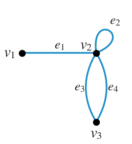

*Figure 22. A graph for counting walks of length 2*

**Example (Counting Walks of Length 2).** How many walks of length 2 from $v_2$ to $v_2$ are there in the graph of Figure 22? Count them according to the vertex that the first edge leads to.

- Going to $v_1$ and back: one walk, $v_2 e_1 v_1 e_1 v_2$.
- Staying at $v_2$: one walk, $v_2 e_2 v_2 e_2 v_2$.
- Going to $v_3$ and back: four walks, $v_2 e_3 v_3 e_4 v_2$, $v_2 e_4 v_3 e_3 v_2$, $v_2 e_3 v_3 e_3 v_2$, $v_2 e_4 v_3 e_4 v_2$, obtained by the multiplication rule from 2 choices of the outgoing edge and 2 choices of the returning edge.

Hence the answer is $1 + 1 + 4 = 6$. This number can be obtained directly from a product of adjacency matrices. The adjacency matrix $\mathbf{A}$ of the graph and $\mathbf{A}^2$ are as follows.

$$
\mathbf{A} = \begin{array}{c|ccc} & v_1 & v_2 & v_3 \\ \hline v_1 & 0 & 1 & 0 \\ v_2 & 1 & 1 & 2 \\ v_3 & 0 & 2 & 0 \end{array}, \qquad \mathbf{A}^2 = \begin{bmatrix} 0 & 1 & 0 \\ 1 & 1 & 2 \\ 0 & 2 & 0 \end{bmatrix} \begin{bmatrix} 0 & 1 & 0 \\ 1 & 1 & 2 \\ 0 & 2 & 0 \end{bmatrix} = \begin{bmatrix} 1 & 1 & 2 \\ 1 & 6 & 2 \\ 2 & 2 & 4 \end{bmatrix}
$$

The entry of $\mathbf{A}^2$ in row 2, column 2 is 6, which equals the number of walks of length 2 from $v_2$ to $v_2$. This is no accident. The entry is the scalar product of row 2 and column 2 of $\mathbf{A}$, $1 \cdot 1 + 1 \cdot 1 + 2 \cdot 2$. The first term $1 \cdot 1$ is (the number of edges from $v_2$ to $v_1$) $\times$ (the number of edges from $v_1$ to $v_2$), so by the multiplication rule it is the number of pairs of edges going from $v_2$ to $v_1$ and back to $v_2$, that is, the number of walks of length 2 whose second vertex is $v_1$. For the same reason the $i$th term is the number of such walks whose second vertex is $v_i$, and the sum $1 + 1 + 4 = 6$ is the total number of walks. Generalizing this reasoning gives the following theorem.

**Theorem 10.2.2.** If $G$ is a graph with vertices $v_1, v_2, \ldots, v_m$ and $\mathbf{A}$ is the adjacency matrix of $G$, then for each positive integer $n$ and all integers $i, j = 1, 2, \ldots, m$, the $(i, j)$ entry of $\mathbf{A}^n$ equals the number of walks of length $n$ from $v_i$ to $v_j$.

**Proof (by mathematical induction).** Let $P(n)$ be the sentence "for all $i, j = 1, \ldots, m$, the $(i, j)$ entry of $\mathbf{A}^n$ is the number of walks of length $n$ from $v_i$ to $v_j$." The proof shows that $P(n)$ is true for every integer $n \geq 1$.

Basis step: Since $\mathbf{A}^1 = \mathbf{A}$, the $(i, j)$ entry of $\mathbf{A}^1$ is, by the definition of the adjacency matrix, the number of edges connecting $v_i$ and $v_j$. A walk of length 1 consists of a single edge, so this number equals the number of walks of length 1 from $v_i$ to $v_j$. Hence $P(1)$ is true.

Inductive step: Suppose $P(k)$ is true for some integer $k \geq 1$ (the inductive hypothesis). Let $\mathbf{A} = (a_{ij})$ and $\mathbf{A}^k = (b_{ij})$. Since $\mathbf{A}^{k+1} = \mathbf{A}\mathbf{A}^k$, the $(i, j)$ entry of $\mathbf{A}^{k+1}$ is the scalar product of row $i$ of $\mathbf{A}$ and column $j$ of $\mathbf{A}^k$.

$$
(\mathbf{A}^{k+1})_{ij} = a_{i1} b_{1j} + a_{i2} b_{2j} + \cdots + a_{im} b_{mj}
$$

Consider each term $a_{ir} b_{rj}$. Here $a_{ir}$ is the number of edges from $v_i$ to $v_r$, and by the inductive hypothesis $b_{rj}$ is the number of walks of length $k$ from $v_r$ to $v_j$. Joining an edge from $v_i$ to $v_r$ with a walk of length $k$ from $v_r$ to $v_j$ gives a walk of length $k+1$ whose second vertex is $v_r$, and every such walk decomposes uniquely in this way. So, by the multiplication rule, $a_{ir} b_{rj}$ is the number of walks of length $k+1$ from $v_i$ to $v_j$ whose second vertex is $v_r$. Every walk of length $k+1$ has exactly one of $v_1, \ldots, v_m$ as its second vertex, so, by the addition rule, the sum above is the total number of walks of length $k+1$ from $v_i$ to $v_j$. Hence $P(k+1)$ is true.

Since both the basis step and the inductive step have been proved, $P(n)$ is true for every integer $n \geq 1$. ∎

> **Key Point:** Raising the adjacency matrix to the $n$th power gives the numbers of walks of length $n$ for all pairs of vertices at once. For example, in the same graph the entry of $\mathbf{A}^3 = \mathbf{A}\mathbf{A}^2$ in row 2, column 3 is $1 \cdot 2 + 1 \cdot 2 + 2 \cdot 4 = 12$, so there are 12 walks of length 3 from $v_2$ to $v_3$.

---

<br>

## 3. Isomorphisms of Graphs

The two drawings on the left of Figure 23 show one and the same graph $G$: they have the same vertex set, the same edge set, and the same edge-endpoint function. In other words, a graph is determined not by the shape of a drawing but by which edges join which vertices.

### 3.1 Definition of Isomorphism

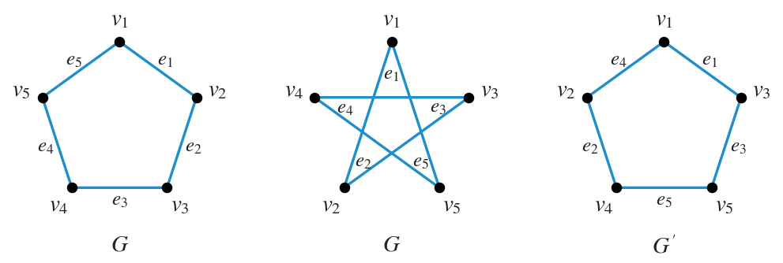

*Figure 23. Two drawings of the same graph G and a graph G' that differs only in labels*

The graph $G'$ on the right of Figure 23 is a different graph from $G$. For instance, in $G$ the endpoints of $e_1$ are $v_1$ and $v_2$, whereas in $G'$ the endpoints of $e_1$ are $v_1$ and $v_3$. Yet $G'$ has the same shape as $G$. If the vertices and edges are relabeled by the functions in the following table, the endpoints of each edge of $G$ become the endpoints of the corresponding edge of $G'$.

| Vertex of $G$ | $v_1$ | $v_2$ | $v_3$ | $v_4$ | $v_5$ |
|:-----|:-----|:-----|:-----|:-----|:-----|
| Corresponding vertex of $G'$ | $v_1$ | $v_3$ | $v_5$ | $v_4$ | $v_2$ |
| **Edge of $G$** | $e_1$ | $e_2$ | $e_3$ | $e_4$ | $e_5$ |
| Corresponding edge of $G'$ | $e_1$ | $e_3$ | $e_5$ | $e_2$ | $e_4$ |

*Table 4. Correspondences sending the vertices and edges of G to those of G'*

For example, in $G$ the endpoints of $e_2$ are $v_2, v_3$, which correspond to $v_3, v_5$, and the edge $e_3$ of $G'$ corresponding to $e_2$ has exactly the endpoints $v_3, v_5$. Both correspondences are one-to-one and onto, that is, one-to-one correspondences. Graphs that differ only in the names of their vertices and edges are said to be isomorphic. The word isomorphism is built from Greek roots meaning "same form."

> **Definition:** Let $G$ and $G'$ be graphs with vertex sets $V(G), V(G')$ and edge sets $E(G), E(G')$, respectively. $G$ is **isomorphic** to $G'$ if, and only if, there exist one-to-one correspondences $g: V(G) \to V(G')$ and $h: E(G) \to E(G')$ such that the following holds for every $v \in V(G)$ and $e \in E(G)$. In this case $g$ and $h$ are said to preserve the edge-endpoint functions, and the pair of correspondences is called an **isomorphism**.

$$
v \text{ is an endpoint of } e \iff g(v) \text{ is an endpoint of } h(e) \qquad (10.3.1)
$$

Formula (10.3.1) says that "$v$ is an endpoint of $e$" and "$g(v)$ is an endpoint of $h(e)$" are equivalent. In words, $G$ and $G'$ are isomorphic when their vertices and their edges can be paired off by one-to-one correspondences so that paired edges always join paired vertices. Mathematicians often treat isomorphic objects as the same. For instance, if $G$ is a graph with five vertices in which every pair of vertices is joined by an edge, one often says "$G$ is $K_5$" rather than "$G$ is isomorphic to $K_5$."

### 3.2 Showing That Two Graphs Are Isomorphic

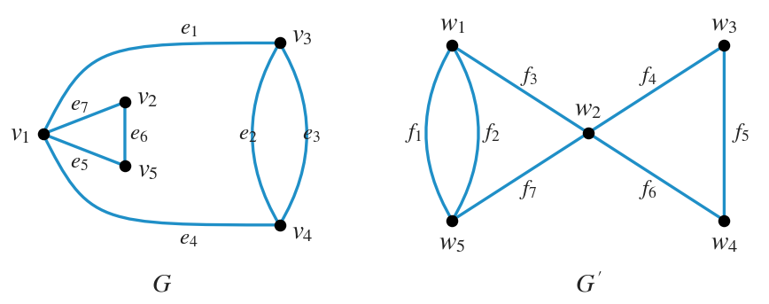

*Figure 24. Two isomorphic graphs G and G'*

**Example 10.3.1 (Showing That Two Graphs Are Isomorphic).** The task is to show that the two graphs of Figure 24 are isomorphic. This requires one-to-one correspondences $g: V(G) \to V(G')$ and $h: E(G) \to E(G')$ such that for all $v \in V(G)$ and $e \in E(G)$, "$v$ is an endpoint of $e$ $\iff$ $g(v)$ is an endpoint of $h(e)$." Finding such functions is partly trial and error and partly deduction.

- $e_2$ and $e_3$ are parallel edges with the same endpoints, so $h(e_2)$ and $h(e_3)$ must also be parallel. The only parallel edges of $G'$ are $f_1, f_2$, so $\lbrace h(e_2), h(e_3)\rbrace = \lbrace f_1, f_2\rbrace$. Moreover, the endpoints $v_3, v_4$ of $e_2, e_3$ must go to the endpoints $w_1, w_5$ of $f_1, f_2$.
- Four distinct edges ($e_1, e_4, e_5, e_7$) are incident on $v_1$, so four distinct edges must be incident on $g(v_1)$, because every edge incident on $g(v_1)$ is the image under $h$ of an edge incident on $v_1$ and $h$ is a one-to-one correspondence. The only vertex of $G'$ with four incident edges is $w_2$, so $g(v_1) = w_2$.
- If $g(v_3) = w_1$ is chosen, then since $v_1$ and $v_3$ are the endpoints of $e_1$, $g(v_1) = w_2$ and $g(v_3) = w_1$ must be the endpoints of $h(e_1)$, so $h(e_1) = f_3$.

Continuing in this way, making arbitrary choices where necessary, one obtains an isomorphism. One such pair is $g(v_1) = w_2$, $g(v_2) = w_3$, $g(v_3) = w_1$, $g(v_4) = w_5$, $g(v_5) = w_4$ together with the $h$ in the following table. The table also verifies (10.3.1) for each edge of $G$.

| Edge $e$ of $G$ | Endpoints in $G$ | Images of the endpoints under $g$ | $h(e)$ | Endpoints of $h(e)$ in $G'$ |
|:-----|:-----|:-----|:-----|:-----|
| $e_1$ | $v_1, v_3$ | $w_2, w_1$ | $f_3$ | $w_1, w_2$ |
| $e_2$ | $v_3, v_4$ | $w_1, w_5$ | $f_1$ | $w_1, w_5$ |
| $e_3$ | $v_3, v_4$ | $w_1, w_5$ | $f_2$ | $w_1, w_5$ |
| $e_4$ | $v_1, v_4$ | $w_2, w_5$ | $f_7$ | $w_5, w_2$ |
| $e_5$ | $v_1, v_5$ | $w_2, w_4$ | $f_6$ | $w_2, w_4$ |
| $e_6$ | $v_2, v_5$ | $w_3, w_4$ | $f_5$ | $w_3, w_4$ |
| $e_7$ | $v_1, v_2$ | $w_2, w_3$ | $f_4$ | $w_2, w_3$ |

*Table 5. An isomorphism from G to G' and a check that endpoints are preserved*

In every row the vertex sets in the third and fifth columns agree, so $g$ and $h$ preserve the edge-endpoint functions. This choice of $h$ is not the only one; for example, $h(e_2) = f_2$ and $h(e_3) = f_1$ also work.

### 3.3 Graph Isomorphism as an Equivalence Relation

Graph isomorphism is a reflexive, symmetric, and transitive relation on a set of graphs, that is, an equivalence relation.

**Theorem 10.3.1 (Graph Isomorphism Is an Equivalence Relation).** Let $S$ be a set of graphs and let $R$ be the relation of graph isomorphism on $S$. Then $R$ is an equivalence relation on $S$.

**Proof.** The three properties are shown in turn.

- Reflexive: For any graph $G$ in $S$, the identity functions on the vertex set and on the edge set form an isomorphism from $G$ to $G$.
- Symmetric: Suppose $G$ is isomorphic to $G'$, and let $g, h$ be vertex and edge correspondences from $G$ to $G'$ that preserve the edge-endpoint functions. Since $g$ and $h$ are one-to-one correspondences, they have inverse functions $g^{-1}, h^{-1}$, which are vertex and edge correspondences from $G'$ to $G$ that preserve the edge-endpoint functions, because the equivalence (10.3.1) can be read backward. Hence $G'$ is isomorphic to $G$.
- Transitive: Suppose $G$ is isomorphic to $G'$ and $G'$ is isomorphic to $G''$. If $g_1, h_1$ are endpoint-preserving correspondences from $G$ to $G'$ and $g_2, h_2$ are endpoint-preserving correspondences from $G'$ to $G''$, then the composites $g_2 \circ g_1$ and $h_2 \circ h_1$ are one-to-one correspondences that preserve endpoints from $G$ to $G''$. Indeed, if $v$ is an endpoint of $e$, then $g_1(v)$ is an endpoint of $h_1(e)$, hence $g_2(g_1(v))$ is an endpoint of $h_2(h_1(e))$, and the converse direction follows by the same reasoning. Hence $G$ is isomorphic to $G''$. ∎

Because of the symmetry property, one can simply say "$G$ and $G'$ are isomorphic" instead of "$G$ is isomorphic to $G'$" or "$G'$ is isomorphic to $G$." An equivalence relation partitions a set into equivalence classes, so a collection of graphs splits into **isomorphism classes**, each consisting of mutually isomorphic graphs.

**Example 10.3.2 (Representatives of Isomorphism Classes).** The task is to list the graphs with two vertices and two edges up to isomorphism, that is, a set of representatives such that any graph with two vertices and two edges is isomorphic to one of them. The four representatives are shown in Figure 25. Labels are omitted because every way of labeling them yields isomorphic graphs.

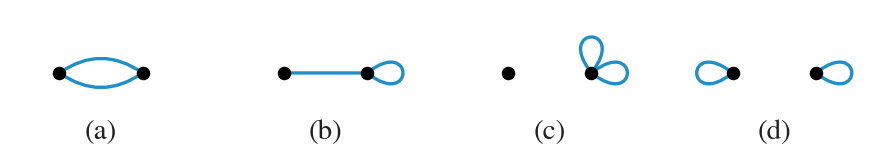

*Figure 25. The four isomorphism classes of graphs with two vertices and two edges*

To see that these four are all, split into cases according to whether an edge joins the two vertices. If one edge joins the two vertices, the other edge either also joins them, giving (a), or is a loop at one vertex, giving (b); in (b) the position of the loop does not matter, because swapping the names of the two vertices turns one choice into the other, so the two choices give isomorphic graphs. If no edge joins the two vertices, both edges are loops, and there are only two cases: both loops at the same vertex, as in (c), or one loop at each vertex, as in (d). There is no other way to place the edges, so the list is complete.

### 3.4 Isomorphic Invariants

There is a general algorithm for deciding whether two graphs are isomorphic: generate every one-to-one correspondence from the vertex set of $G$ to that of $G'$ and every one-to-one correspondence between the edge sets, and check whether each pair preserves the edge-endpoint functions. This algorithm, however, takes an unreasonably long time even on a fast computer. If $G$ and $G'$ each have $n$ vertices and $m$ edges, there are $n!$ vertex correspondences and $m!$ edge correspondences, so $n! \cdot m!$ pairs must be checked. For $m = n = 20$ that is $20! \cdot 20! \approx 5.9 \times 10^{36}$ pairs, which would take about $1.9 \times 10^{20}$ years even at one nanosecond per pair.

No general method faster than this is known. Some simple checks, however, can rule out isomorphism. For example, isomorphic graphs have equally many vertices, since their vertex sets are in one-to-one correspondence. A graph with 16 vertices and a graph with 17 vertices can therefore be declared nonisomorphic at once. In general, a property that graph isomorphism always carries from one graph to the other is called an isomorphic invariant.

> **Definition:** A property $P$ is called an **isomorphic invariant** for graph isomorphism if, and only if, for any graphs $G$ and $G'$, "if $G$ has property $P$ and $G'$ is isomorphic to $G$, then $G'$ has property $P$."

**Theorem 10.3.2.** Each of the following properties is an invariant for graph isomorphism, where $n$, $m$, and $k$ are nonnegative integers.

1. has $n$ vertices
2. has $m$ edges
3. has a vertex of degree $k$
4. has $m$ vertices of degree $k$
5. has a circuit of length $k$
6. has a simple circuit of length $k$
7. has $m$ simple circuits of length $k$
8. is connected
9. has an Euler circuit
10. has a Hamiltonian circuit

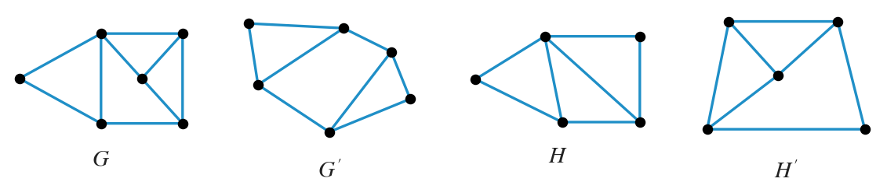

*Figure 26. Two pairs of nonisomorphic graphs*

**Example 10.3.3 (Showing That Two Graphs Are Not Isomorphic).** The two pairs in Figure 26 are shown to be nonisomorphic by finding isomorphic invariants they do not share. (1) $G$ has nine edges and $G'$ has only eight, so they are not isomorphic by invariant 2 of Theorem 10.3.2. (2) $H$ and $H'$ both have five vertices and seven edges, but $H$ has a vertex of degree 4 (the left one of its two top vertices), while the degrees of $H'$ are only $3, 3, 3, 3, 2$, so they are not isomorphic by invariant 3.

Part 3 of Theorem 10.3.2 is proved here; the other parts can be proved by similar reasoning.

**Example 10.3.4 (Proof of Part 3 of Theorem 10.3.2).** Suppose $G$ and $G'$ are isomorphic and $G$ has a vertex $v$ of degree $k$. It must be shown that $G'$ has a vertex of degree $k$. Because the graphs are isomorphic, there are one-to-one correspondences $g: V(G) \to V(G')$ and $h: E(G) \to E(G')$ that preserve the edge-endpoint functions; that is, for every edge $e$ and vertex $u$ of $G$, $u$ is an endpoint of $e$ if, and only if, $g(u)$ is an endpoint of $h(e)$.

1. Let $e_1, e_2, \ldots, e_s$ be the distinct edges incident on $v$ in $G$ ($s \geq 0$). Then $h(e_1), \ldots, h(e_s)$ are $s$ distinct edges incident on $g(v)$ in $G'$: they are distinct because $h$ is one-to-one, and they are incident on $g(v)$ because endpoints are preserved.
2. No other edges are incident on $g(v)$. If an edge $f$ is incident on $g(v)$, then since $h$ is onto, $f = h(e)$ for some $e$, and since endpoints are preserved, $v$ is an endpoint of $e$, so $e$ is one of $e_1, \ldots, e_s$. Hence the number of edges incident on $v$ equals the number of edges incident on $g(v)$.
3. An edge $e$ is a loop at $v$ if, and only if, $h(e)$ is a loop at $g(v)$. A vertex $w$ is an endpoint of $e$ exactly when $g(w)$ is an endpoint of $h(e)$, and $g$ is a one-to-one correspondence, so $v$ is the only endpoint of $e$ exactly when $g(v)$ is the only endpoint of $h(e)$. Hence $v$ and $g(v)$ have the same number of loops.
4. The degree of $v$ equals the number of non-loop edges incident on $v$ plus twice the number of loops at $v$. By 2 and 3 these two numbers are the same for $v$ and $g(v)$, so $\deg(g(v)) = \deg(v) = k$. ∎

For example, if three non-loop edges and two loops are incident on $v$, then $\deg(v) = 3 + 2 \cdot 2 = 7$, and three non-loop edges and two loops are incident on $g(v)$ as well, so $\deg(g(v)) = 7$.

> **Caution:** Isomorphic invariants can only show that two graphs are not isomorphic. Two graphs that share all the invariants of Theorem 10.3.2 are not guaranteed to be isomorphic; to show that graphs are isomorphic, one must actually find an isomorphism.

### 3.5 Isomorphism of Simple Graphs

When $G$ and $G'$ are both simple, each edge is determined by its pair of endpoints, so the definition of isomorphism can be written without a correspondence between edges.

> **Definition:** If $G$ and $G'$ are simple graphs, then $G$ is **isomorphic** to $G'$ if, and only if, there exists a one-to-one correspondence $g: V(G) \to V(G')$ between their vertex sets such that the following holds for all vertices $u, v$ of $G$.

$$
\lbrace u, v\rbrace \text{ is an edge in } G \iff \lbrace g(u), g(v)\rbrace \text{ is an edge in } G' \qquad (10.3.2)
$$

That is, two vertices of $G$ are joined by an edge exactly when the corresponding two vertices of $G'$ are joined by an edge.

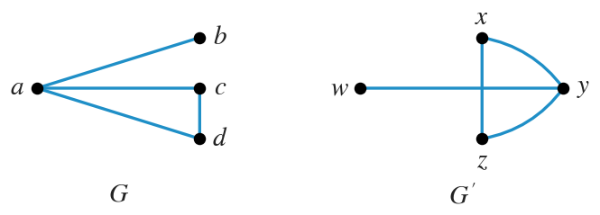

*Figure 27. Two simple graphs to be tested for isomorphism*

**Example 10.3.5 (Isomorphism of Simple Graphs).** Are the two graphs of Figure 27 isomorphic? Yes. The only vertex of degree 3 in $G$ is $a$ and the only one in $G'$ is $y$, so set $g(a) = y$. Match $b$ and $w$, which have degree 1, and send the remaining $c, d$ to $x, z$, defining $g(a) = y$, $g(b) = w$, $g(c) = x$, $g(d) = z$. Then $g$ is a one-to-one correspondence, and the following table shows that $g$ sends edges to edges. Both graphs have four edges, so the edges of $G$ are sent onto all the edges of $G'$, and hence both directions of (10.3.2) hold.

| Edge of $G$ | Edge of $G'$ |
|:-----|:-----|
| $\lbrace a, b\rbrace$ | $\lbrace y, w\rbrace = \lbrace g(a), g(b)\rbrace$ |
| $\lbrace a, c\rbrace$ | $\lbrace y, x\rbrace = \lbrace g(a), g(c)\rbrace$ |
| $\lbrace a, d\rbrace$ | $\lbrace y, z\rbrace = \lbrace g(a), g(d)\rbrace$ |
| $\lbrace c, d\rbrace$ | $\lbrace x, z\rbrace = \lbrace g(c), g(d)\rbrace$ |

*Table 6. The vertex correspondence g sending the edges of G to the edges of G'*

---

<br>

## 4. Trees: Examples and Basic Properties

In mathematics a tree is a connected graph that contains no circuits. Like a botanical tree it branches out, but its branches never meet again to form a loop. This section presents examples of trees and the relation between the numbers of vertices and edges of a tree.

### 4.1 Trees and Forests

> **Definition:** A graph is **circuit-free** if, and only if, it has no circuits. A graph is a **tree** if, and only if, it is circuit-free and connected, and a graph that consists of a single vertex is a **trivial tree**. A graph is a **forest** if, and only if, it is circuit-free and not connected.

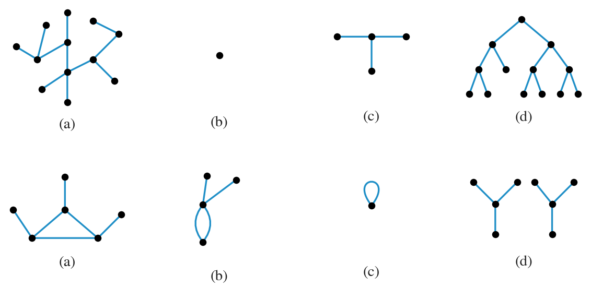

*Figure 28. Graphs that are trees (top row) and graphs that are not (bottom row)*

**Example 10.4.1 (Trees and Non-Trees).** The graphs (a)-(d) in the top row of Figure 28 are all connected and circuit-free, so they are trees; (b) is the trivial tree. The graphs in the bottom row are not trees. Graph (a) has a circuit through three vertices, in (b) two parallel edges form a circuit of length 2, and in (c) a single loop is a circuit of length 1. Graph (d) has no circuit but is not connected, so it is a forest rather than a tree.

> **Caution:** The textbook defines a forest as a graph that is "circuit-free and not connected," so a tree is not a forest. Many books define a forest simply as a circuit-free graph, which includes trees, so take care when comparing sources. Under either definition, each connected component of a forest is a tree.

### 4.2 Examples of Trees

Trees arise naturally in many fields.

**Example 10.4.2 (A Decision Tree).** A college gives entering students a two-part mathematics placement test and recommends a course according to the tree in Figure 29, which is read from left to right. For example, a student with 9 points on part I falls into the 8, 9, or 10 branch, so part II is consulted next; a part II score of 7 exceeds 6, so the recommendation is Math 110. A tree whose branches split according to the answers to questions like this is called a **decision tree**.

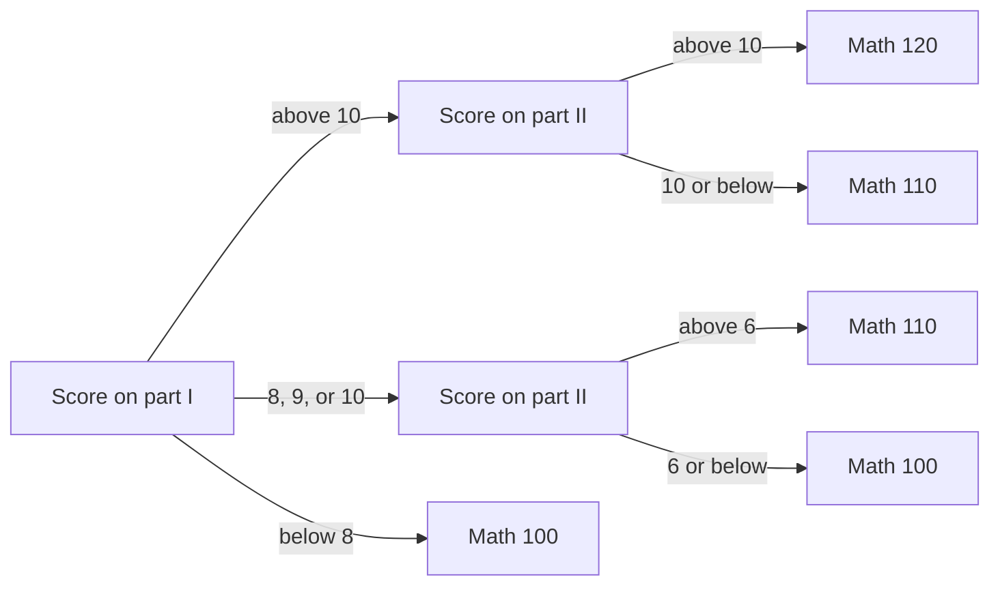

*Figure 29. A decision tree that recommends a course from placement test scores*

**Example 10.4.3 (A Parse Tree).** Noam Chomsky and other linguists developed methods for describing the syntax, that is, the grammatical structure, of natural languages such as English, and these methods were later applied to building compilers for high-level programming languages. When grammatically correct sentences are derived from basic rules, each derivation can be drawn as a tree, called a **syntactic derivation tree** or **parse tree**. The following rules define a tiny fragment of English grammar.

1. A sentence consists of a noun phrase followed by a verb phrase.
2. A noun phrase consists of an article followed by a noun.
3. A noun phrase may also consist of an article, an adjective, and a noun, in that order.
4. A verb phrase consists of a verb followed by a noun phrase.
5. "the" is an article.
6. "young" is an adjective.
7. "caught" is a verb.
8. "man" is a noun.
9. "ball" is another noun.

Grammar rules of this kind are called **productions** and are usually abbreviated as follows. The notation, which John Backus introduced in 1959 and Peter Naur revised in 1960 for describing the programming language Algol, is known as **Backus-Naur notation**. The symbol `|` stands for "or," and angle brackets `< >` surround the terms being defined, such as sentence or noun phrase.

```text
1.     <sentence>    → <noun phrase> <verb phrase>
2, 3.  <noun phrase> → <article> <noun> | <article> <adjective> <noun>
4.     <verb phrase> → <verb> <noun phrase>
5.     <article>     → the
6.     <adjective>   → young
7.     <verb>        → caught
8, 9.  <noun>        → man | ball
```

The terms `<sentence>`, `<noun phrase>`, `<verb phrase>`, `<article>`, `<adjective>`, `<noun>`, and `<verb>` stand for the corresponding grammatical categories. The first line is rule 1, and the second line combines rules 2 and 3 with `|`. The derivation of the sentence "The young man caught the ball" from these rules is shown by the tree in Figure 30. Starting from "sentence" at the root, rule 1 splits it into a noun phrase and a verb phrase, rule 3 is applied to the left noun phrase and rule 4 to the verb phrase, and so on downward until the actual words sit at the leaves.

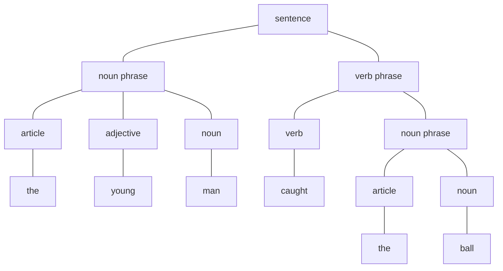

*Figure 30. The parse tree of the sentence The young man caught the ball*

In linguistics, **syntax** concerns the grammatical structure of a sentence, while **semantics** concerns what its words mean and how those meanings relate. Correct syntax does not guarantee meaning: "The young ball caught the man" follows from the rules above yet makes no sense. In the other direction, a two-year-old's "Me hungry!" breaks the grammar but its meaning is clear.

> **[Compilers]** The syntax analysis phase of a compiler builds a parse tree of the source code according to the grammar rules of the programming language. Writing the grammar in Backus-Naur notation and using a tree to check whether a program conforms to the grammar and how its parts are structured follows the same principle as the example above.

**Example 10.4.4 (The Structure of Hydrocarbon Molecules).** Mathematical trees were first studied by the German physicist Gustav Kirchhoff in his work on electrical circuits, and shortly afterward the English mathematician Arthur Cayley used them to count all isomers of certain hydrocarbons. A hydrocarbon molecule contains only carbon (C) and hydrogen (H) atoms; a carbon atom bonds with at most four other atoms, and a hydrogen atom forms a single bond. Taking atoms as vertices and bonds as edges therefore turns a hydrocarbon molecule into a graph.

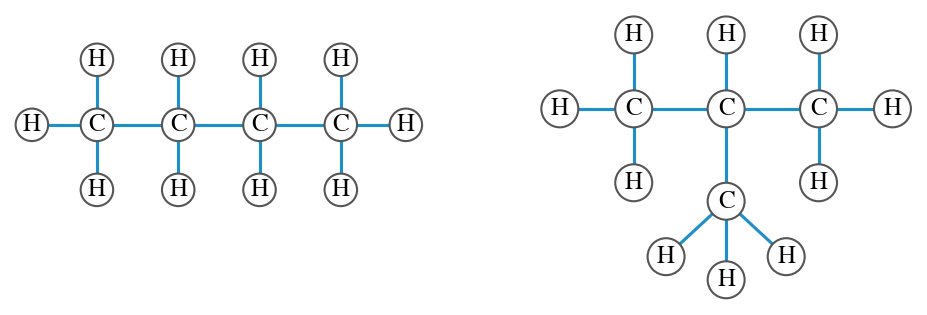

*Figure 31. The graphs of butane (left) and isobutane (right)*

Both graphs in Figure 31 have four carbon atoms and ten hydrogen atoms, but the atoms are arranged differently. Molecules with the same chemical formula (here $\mathrm{C_4H_{10}}$) but different bonds are called **isomers**. A molecule that has as many hydrogen atoms as possible for its number of carbon atoms is called a saturated hydrocarbon, and Cayley showed that a saturated hydrocarbon with $k$ carbon atoms has $2k + 2$ hydrogen atoms. The first step is to prove that the graph of a saturated hydrocarbon molecule is a tree, which is done by contradiction.

**Proof.** Suppose some hydrocarbon molecule has as many hydrogen atoms as possible for its number of carbon atoms, yet its graph $G$ is not a tree. Since $G$ is not a tree, it is not connected or it has a circuit. All the atoms of a molecule are connected to each other, so $G$ is connected, and therefore $G$ has a circuit. Each vertex on a circuit has degree at least 2, while a hydrogen vertex has degree 1, so the edges of the circuit join only carbon atoms. Now delete one edge of the circuit and attach a new hydrogen atom to each of the two carbon atoms at its ends (Figure 32). The new bonds replace the deleted one, so the number of bonds of each of the two carbon atoms is unchanged. The resulting molecule has the same number of carbon atoms and two more hydrogen atoms. This contradicts the assumption that the original molecule already had the largest possible number of hydrogen atoms for its carbon count. So the assumption is false, and $G$ is a tree. ∎

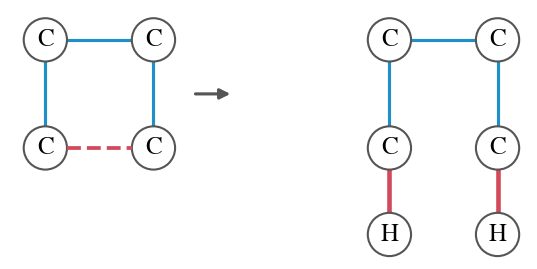

*Figure 32. Deleting an edge of a circuit and attaching two hydrogen atoms*

### 4.3 Vertices of Degree 1 and Leaves

There is a surprising relation between the numbers of vertices and edges of a tree: for any positive integer $n$, any tree with $n$ vertices, whatever its shape, has $n - 1$ edges. A partial converse also holds: any connected graph with $n$ vertices and $n - 1$ edges is a tree. A small fact needed to prove these two theorems is that a nontrivial tree has a vertex of degree 1.

**Lemma 10.4.1.** Any tree that has more than one vertex has at least one vertex of degree 1.

A constructive way to understand this lemma is as follows. Given a tree $T$ with more than one vertex, pick any vertex $v$ and search outward along a path. At each new vertex, check whether its degree is 1; if it is, stop, and if not, leave along an edge different from the one used to enter. Because $T$ is circuit-free, the vertices visited never repeat, and because $T$ has finitely many vertices, the process must stop. The vertex where it stops has degree 1.

**Proof.** For an arbitrary tree $T$ with more than one vertex, consider the following algorithm.

```text
Step 1: Pick a vertex v of T and let e be an edge incident on v.
Step 2: While deg(v) > 1, repeat the following.
  2a: Choose an edge e' incident on v such that e' is different from e.
  2b: Let v' be the vertex at the other end of e' from v.
  2c: Let e := e' and v := v'.
```

Each step is possible for the following reasons. In Step 1, if no edge were incident on $v$, then $v$ would be an isolated vertex, which is impossible because $T$ is connected and has at least two vertices. In Step 2a, $\deg(v) > 1$, so at least two edges are incident on $v$ and one different from $e$ can be chosen. In Step 2b, $T$ is a tree, so $e'$ cannot be a loop and has two distinct endpoints. Step 2c is just a renaming in preparation for repeating Step 2. Because $T$ is circuit-free, no vertex is visited twice in this process, and because there are finitely many vertices, the algorithm must terminate. When it does, $\deg(v) > 1$ is false and the edge $e$ is incident on $v$, so $\deg(v) = 1$. ∎

In fact, any tree with more than one vertex has at least two vertices of degree 1. Let $u$ be the vertex of degree 1 found by the algorithm, move along the only edge incident on $u$ to its neighbor, and continue searching, always leaving along an edge different from the one used to enter; since the tree has no circuit, the search never returns to $u$ and stops at a vertex of degree 1 different from $u$.

> **Definition:** Let $T$ be a tree. If $T$ has at least two vertices, then a vertex of degree 1 in $T$ is called a **leaf** (or a **terminal vertex**), and a vertex of degree greater than 1 is called an **internal vertex** (or a **branch vertex**). The unique vertex in a trivial tree is also called a leaf.

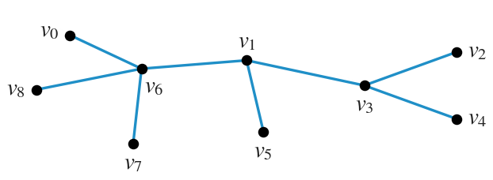

*Figure 33. A tree whose leaves and internal vertices are to be found*

**Example 10.4.5 (Leaves and Internal Vertices).** In the tree of Figure 33, the vertices of degree 1, $v_0, v_2, v_4, v_5, v_7, v_8$, are leaves, and the vertices of degree greater than 1, $v_6$ (degree 4), $v_1$ (degree 3), and $v_3$ (degree 3), are internal vertices.

### 4.4 Numbers of Vertices and Edges of a Tree

**Theorem 10.4.2.** For any positive integer $n$, any tree with $n$ vertices has $n - 1$ edges.

The argument uses mathematical induction. Its inductive step supposes that every tree with $k$ vertices has $k - 1$ edges and deduces that an arbitrary tree $T$ with $k + 1$ vertices has $k$ edges. The idea is to delete one vertex and one edge of $T$ so that a tree $T'$ with $k$ vertices remains. By Lemma 10.4.1, $T$ has a vertex $v$ of degree 1, attached to the rest of $T$ by a single edge $e$. Removing $v$ and $e$ leaves a tree $T'$ with $k$ vertices, which by the inductive hypothesis has $k - 1$ edges; $T$ exceeds $T'$ by exactly one vertex and one edge, so it has $(k - 1) + 1 = k$ edges.

**Proof (by mathematical induction).** Let $P(n)$ be the sentence "any tree with $n$ vertices has $n - 1$ edges." The proof shows that $P(n)$ is true for every integer $n \geq 1$.

Basis step: Let $T$ be a tree with one vertex. A tree has no loops, so $T$ has zero edges, and since $0 = 1 - 1$, $P(1)$ is true.

Inductive step: Suppose that $P(k)$ is true for some integer $k \geq 1$, that is, any tree with $k$ vertices has $k - 1$ edges (the inductive hypothesis). It must be shown that any tree with $k + 1$ vertices has $k$ edges. Let $T$ be an arbitrary tree with $k + 1$ vertices; nothing may be assumed about $T$ except that it has $k + 1$ vertices. Since $k \geq 1$, $k + 1 \geq 2$, so by Lemma 10.4.1 $T$ has a vertex $v$ of degree 1. Since $T$ has a vertex other than $v$, there is an edge $e$ connecting $v$ to the rest of $T$. Define the subgraph $T'$ of $T$ by $V(T') = V(T) - \lbrace v\rbrace$ and $E(T') = E(T) - \lbrace e\rbrace$. Then the following hold.

1. $T'$ has $(k + 1) - 1 = k$ vertices.
2. $T'$ is circuit-free, because $T$ is circuit-free and removing an edge and a vertex cannot create a circuit.
3. $T'$ is connected. A path in $T$ joining two vertices of $T'$ cannot pass through $v$ in the middle, because a vertex that a path passes through has degree at least 2 while $\deg(v) = 1$. So that path uses neither $v$ nor $e$ and is a path in $T'$.

Hence $T'$ is a tree, and by the inductive hypothesis it has $k - 1$ edges. Therefore:

$$
(\text{number of edges of } T) = (\text{number of edges of } T') + 1 = (k - 1) + 1 = k
$$

This is what was to be shown. ∎

**Example 10.4.6 (Determining Whether a Graph Is a Tree).** Can a graph with ten vertices and twelve edges be a tree? No. Theorem 10.4.2 requires a tree with ten vertices to have exactly nine edges.

**Example 10.4.7 (Finding Trees Satisfying Given Conditions).** The task is to find all nonisomorphic trees with four vertices. By Theorem 10.4.2, a tree with four vertices has three edges, so by the handshake theorem its total degree is $2 \times 3 = 6$. Also, as seen in Section 4.3, a tree with more than one vertex has at least two vertices of degree 1, and since it is connected it has no vertex of degree 0. The only combinations of four positive integers that sum to 6 and include at least two 1s are $1, 1, 1, 3$ and $1, 1, 2, 2$. Each combination corresponds to exactly one tree: the star-shaped tree and the straight-line tree of Figure 34.

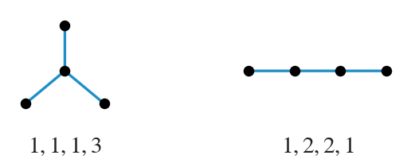

*Figure 34. The two nonisomorphic trees with four vertices*

For the degrees $1, 1, 1, 3$, the vertex of degree 3 must be adjacent to all three other vertices, which determines the tree. For $1, 1, 2, 2$, the two vertices of degree 2 must be adjacent to each other and each adjacent to one leaf, which again determines the tree.

### 4.5 Removing an Edge of a Circuit

The second main theorem requires the following lemma, which is the same as Lemma 10.1.1 (c) in Section 1.5.

**Lemma 10.4.3.** If $G$ is any connected graph, $C$ is any circuit in $G$, and any one of the edges of $C$ is removed from $G$, then the graph that remains is connected.

The essential reason is that any two vertices of a circuit are connected by two different routes. If the circuit is drawn in the plane, one route goes clockwise and the other counterclockwise. For example, in the circuit of Figure 35 the clockwise path from $v_2$ to $v_3$ is $v_2 e_3 v_3$ and the counterclockwise path is $v_2 e_2 v_1 e_1 v_0 e_6 v_5 e_5 v_4 e_4 v_3$ (where $v_6 = v_0$).

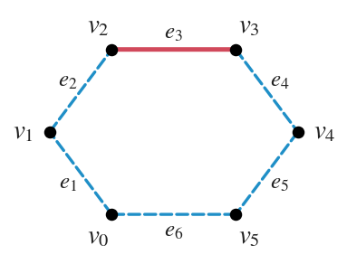

*Figure 35. The clockwise and counterclockwise paths joining two vertices of a circuit*

**Proof.** Suppose $G$ is a connected graph, $C$ is a circuit in $G$, and $e$ is an edge of $C$. Form the subgraph $G'$ of $G$ by removing $e$: $V(G') = V(G)$ and $E(G') = E(G) - \lbrace e\rbrace$. To show that $G'$ is connected, it is necessary to find, for any two vertices $u, w$ of $G'$, a walk in $G'$ from $u$ to $w$. Since $u$ and $w$ are vertices of $G$ and $G$ is connected, there is a walk $W$ in $G$ from $u$ to $w$.

- Case 1 ($e$ is not an edge of $W$): The only edge of $G$ not in $G'$ is $e$, so $W$ is also a walk in $G'$.
- Case 2 ($e$ is an edge of $W$): Write the circuit as $C: v_0 e_1 v_1 e_2 v_2 \cdots e_n v_n$ ($v_n = v_0$) and let $e = e_k$. Then $W$ contains the segment $v_{k-1} e_k v_k$ or $v_k e_k v_{k-1}$. If $W$ contains $v_{k-1} e_k v_k$, replace that segment by the walk around the circuit in the opposite direction, $W': v_{k-1} e_{k-1} v_{k-2} \cdots v_0 e_n v_{n-1} \cdots e_{k+1} v_k$. If $W$ contains $v_k e_k v_{k-1}$, replace it by the walk around the circuit in the forward direction, $W'': v_k e_{k+1} v_{k+1} \cdots v_n e_1 v_1 e_2 \cdots e_{k-1} v_{k-1}$. For instance, to patch in $W'$, take the section of $W$ from $u$ to $v_{k-1}$, then $W'$, then the section of $W$ from $v_k$ to $w$. The walks $W'$ and $W''$ use only edges of $C$ other than $e_k$. If the new walk still contains $e$, repeat the process. The number of occurrences of $e$ in $W$ is finite, so eventually one obtains a walk from $u$ to $w$ that does not contain $e$, that is, a walk in $G'$.

In both cases there is a walk in $G'$ from $u$ to $w$, and since $u$ and $w$ were arbitrary, $G'$ is connected. ∎

### 4.6 When a Connected Graph Is a Tree

The second main theorem is a partial converse of Theorem 10.4.2.

**Theorem 10.4.4.** For any positive integer $n$, if $G$ is a connected graph with $n$ vertices and $n - 1$ edges, then $G$ is a tree.

**Proof.** Let $n$ be a positive integer and let $G$ be an arbitrary connected graph with $n$ vertices and $n - 1$ edges. A tree is a connected, circuit-free graph, and $G$ is already known to be connected, so it suffices to show that $G$ is circuit-free. Suppose $G$ has a circuit $C$ in order to derive a contradiction. By Lemma 10.4.3, removing an edge of $C$ leaves a connected graph $G'$. If $G'$ has a circuit, repeat the process, removing an edge of the circuit to obtain a connected graph. Since there are finitely many edges, repeating this eventually yields a connected, circuit-free graph $G''$, that is, a tree. No vertices were removed, so $G''$ has $n$ vertices just as $G$ does, and by Theorem 10.4.2 it has $n - 1$ edges. But the supposition that $G$ has a circuit means that at least one edge was removed in forming $G''$, so $G''$ has at most $(n - 1) - 1 = n - 2$ edges. This contradicts the fact that $G''$ has $n - 1$ edges. Hence the supposition is false, $G$ is circuit-free, and $G$ is a tree. ∎

Theorem 10.4.4 is not a full converse of Theorem 10.4.2. Every connected graph with $n$ vertices and $n - 1$ edges is a tree, but not every graph with $n$ vertices and $n - 1$ edges is a tree.

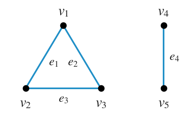

*Figure 36. A graph with five vertices and four edges that is not a tree*

**Example 10.4.8 (A Graph with $n$ Vertices and $n - 1$ Edges That Is Not a Tree).** The goal is a graph that has five vertices and four edges but is not a tree. By Theorem 10.4.4 such a graph must be disconnected. Figure 36 is an example: the three vertices $v_1, v_2, v_3$ form a circuit, and $v_4, v_5$, joined by the edge $e_4$, are separate from that circuit.

**Corollary 10.4.5.** If $G$ is any graph with $n$ vertices and $m$ edges, where $m$ and $n$ are positive integers and $m \geq n$, then $G$ has a circuit.

**Proof (by contradiction).** Suppose there is a circuit-free graph $G$ with $n$ vertices and $m$ edges, where $m \geq n$. Let $G_1, G_2, \ldots, G_k$ be the connected components of $G$, with $n_1, n_2, \ldots, n_k$ vertices, respectively. The connected components divide up the vertices, so $\sum_{i=1}^{k} n_i = n$. Since $G$ has no circuit, none of the components has a circuit, and since each is connected, each is a tree. So by Theorem 10.4.2, $G_i$ has $n_i - 1$ edges, and since the edges of $G$ are those of its components, the following holds.

$$
(\text{number of edges of } G) = \sum_{i=1}^{k} (n_i - 1) = (n_1 + n_2 + \cdots + n_k) - \underbrace{(1 + 1 + \cdots + 1)}_{k \text{ ones}} = n - k < n
$$

The last inequality holds because $k \geq 1$. This contradicts the hypothesis that the number of edges $m$ is at least $n$, so $G$ has a circuit. ∎

> **Key Point:** For a graph $G$ with $n$ vertices, the following hold.
> - If $G$ is a tree, it has $n - 1$ edges (Theorem 10.4.2).
> - If $G$ is connected and has $n - 1$ edges, then $G$ is a tree (Theorem 10.4.4).
> - If $G$ has $n$ or more edges, then $G$ has a circuit (Corollary 10.4.5). Hence adding one new edge, but no new vertex, to a tree creates a circuit.
> - Removing edges of circuits from a connected graph eventually yields a subgraph that is a tree (Lemma 10.4.3), so a connected graph has at least $n - 1$ edges. Hence a graph with fewer than $n - 1$ edges is not connected.

---

<br>

## 5. Rooted Trees

A tree growing outdoors has a root, and a family tree listing all the descendants of one person also starts from a single person at its root. The vocabulary of rooted trees mixes words from both sources. Mathematically, a rooted tree is a tree with one vertex singled out as the root. Every vertex $v$ other than the root is reached from the root by exactly one path, since two different paths would yield a circuit. Like family trees, rooted trees are conventionally drawn with the root at the top and the branches growing downward.

### 5.1 Terminology of Rooted Trees

> **Definition:** A **rooted tree** is a tree in which one vertex is distinguished from the others and is called the **root**.
> - The **level** of a vertex is the number of edges along the unique path between it and the root.
> - The **height** of a rooted tree is the maximum level of any vertex of the tree.
> - Given the root or any internal vertex $v$, the **children** of $v$ are all those vertices that are adjacent to $v$ and are one level farther away from the root than $v$. If $w$ is a child of $v$, then $v$ is the **parent** of $w$, and two distinct vertices that are both children of the same parent are **siblings**.
> - Given two distinct vertices $v$ and $w$, if $v$ lies on the unique path between $w$ and the root, then $v$ is an **ancestor** of $w$ and $w$ is a **descendant** of $v$.

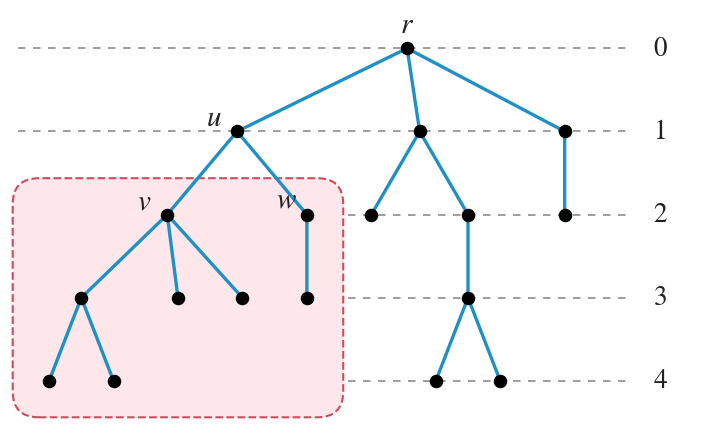

*Figure 37. A rooted tree with its levels marked by dashed lines*

In Figure 37 the root $r$ has level 0, and the numbers on the right give the level of each dashed line. $v$ is a child of $u$ and $u$ is the parent of $v$, and $v$ and $w$ are siblings with the same parent. The vertices in the pink region are all descendants of $u$, and $u$ is an ancestor of each of them. The deepest vertices have level 4, so the height of this tree is 4.

**Example 10.5.1 (Rooted Trees).** Figure 38 shows a tree with root $v_0$. The following questions are answered for this tree.

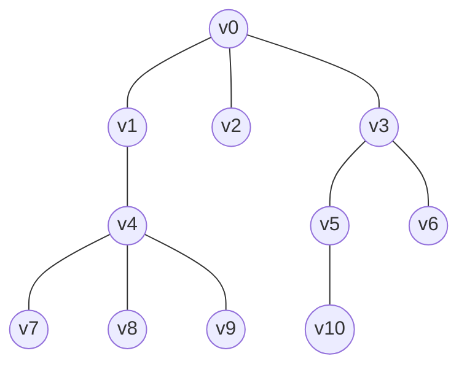

*Figure 38. A tree with root v0*

| Question | Answer | Reason |
|:-----|:-----|:-----|
| Level of $v_5$ | 2 | the path $v_0 v_3 v_5$ has 2 edges |
| Level of $v_0$ | 0 | the path from the root to itself has no edges |
| Height of the tree | 3 | the vertices of greatest level, $v_7, v_8, v_9, v_{10}$, have level 3 |
| Children of $v_3$ | $v_5, v_6$ | they are adjacent to $v_3$ and one level below it |
| Parent of $v_2$ | $v_0$ | $v_2$ is a child of $v_0$ |
| Siblings of $v_8$ | $v_7, v_9$ | they have the same parent $v_4$ |
| Descendants of $v_3$ | $v_5, v_6, v_{10}$ | $v_3$ lies on their paths to the root |
| Number of leaves | 6 | $v_2, v_6, v_7, v_8, v_9, v_{10}$ have degree 1 |

*Table 7. Questions and answers about the tree with root v0*

> **Caution:** In the textbook a leaf is a vertex of degree 1 in a tree, so in a rooted tree the root is a leaf if its degree is 1. For example, if the tree consisting of vertices $v_0, v_1$ and one edge between them is given root $v_0$, then $v_1$ has level 1 and is the child of $v_0$, and both $v_0$ and $v_1$ are leaves. Many data structures books define a leaf of a rooted tree as "a vertex with no children," and under that definition the root is not a leaf in this case.

### 5.2 Binary Trees

A rooted tree in which no vertex has more than two children, and in which each child is marked as either a left or a right child, is a binary tree.

> **Definition:** A **binary tree** is a rooted tree in which every parent has at most two children, each child is designated either a **left child** or a **right child** (but not both), and every parent has at most one left child and at most one right child. A **full binary tree** is a binary tree in which each parent has exactly two children.

> **Definition:** Given any parent $v$ in a binary tree $T$, if $v$ has a left child, then the **left subtree** of $v$ is the binary tree whose root is the left child of $v$, whose vertices are the left child of $v$ and all its descendants, and whose edges are all those edges of $T$ that connect these vertices. The **right subtree** is defined analogously.

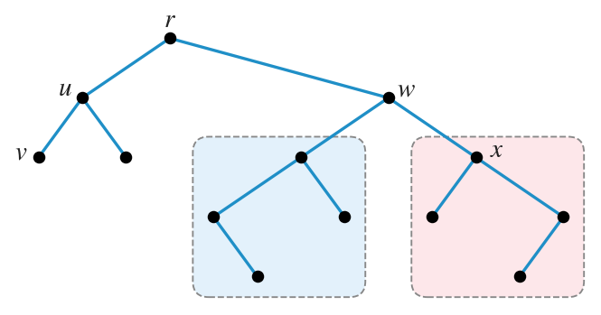

*Figure 39. A binary tree showing left children, right children, and subtrees*

In Figure 39, $r$ is the root, $v$ is the left child of $u$, and $x$ is the right child of $w$. The blue region is the left subtree of $w$ and the pink region is the right subtree of $w$. In a binary tree, even an only child is designated left or right, so drawings distinguish it by placing it to the lower left or lower right.

**Example 10.5.2 (Representation of Algebraic Expressions).** Among the many uses of binary trees in computer science is the representation of arithmetic expressions with any nesting of parentheses. The first tree of Figure 40, for example, stands for $a/b$: the operator sits at the root and is applied to the root's left and right children, taken in that order. The second tree stands for $a/(c + d)$. In trees of this kind, operators occupy the internal vertices and variables occupy the leaves, and each operator is applied, left operand first, to the expressions given by its left and right subtrees. The expression $((a - b) \cdot c) + (d/e)$ corresponds to the third tree. The outermost operation, $+$, sits at the root; its left subtree stands for $(a - b) \cdot c$ and its right subtree for $d/e$. The root $\cdot$ of the left subtree in turn combines its left subtree $a - b$ with its right child $c$.

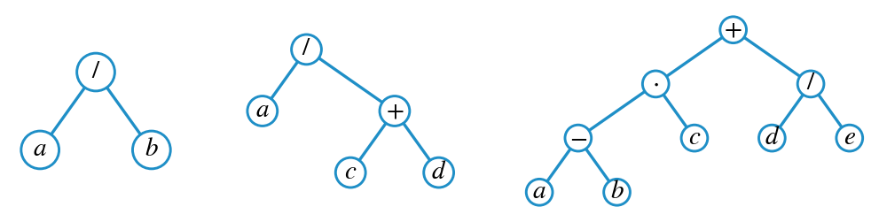

*Figure 40. Binary trees representing three arithmetic expressions*

### 5.3 Numbers of Vertices of a Full Binary Tree

For a full binary tree, the count of internal vertices determines both the total count of vertices and the count of leaves, and conversely: with $k$ internal vertices there are $2k + 1$ vertices in all, and $k + 1$ of them are leaves.

**Theorem 10.5.1.** If $k$ is a positive integer and $T$ is a full binary tree with $k$ internal vertices, then (1) $T$ has a total of $2k + 1$ vertices, and (2) $T$ has $k + 1$ leaves.

**Proof.** Let $k$ be a positive integer and $T$ a full binary tree with $k$ internal vertices.

(1) Split the vertices of $T$ into two disjoint groups: those with a parent and those without. The root is the only vertex without a parent. In a full binary tree each parent has exactly two children, and the parents are precisely the internal vertices, so the vertices having a parent are twice as many as the parents, namely $2k$. Hence:

$$
(\text{number of vertices of } T) = (\text{vertices with a parent}) + (\text{vertices without a parent}) = 2k + 1
$$

(2) The number of vertices of $T$ is also the number of internal vertices plus the number of leaves, so $(\text{number of vertices of } T) = k + (\text{number of leaves})$. Equating the two expressions gives $2k + 1 = k + (\text{number of leaves})$, and solving gives $(2k + 1) - k = k + 1$ leaves. ∎

**Example 10.5.3 (Determining Whether a Certain Full Binary Tree Exists).** Can a full binary tree have 10 internal vertices and 13 terminal vertices? No. Theorem 10.5.1 forces a full binary tree with 10 internal vertices to have exactly $10 + 1 = 11$ leaves.

### 5.4 Height and Number of Leaves of a Binary Tree

A second theorem bounds the number of leaves that a binary tree of given height can have: a binary tree of height $h$ has at most $2^h$ leaves. Equivalently, a binary tree with $t$ leaves has height at least $\log_2 t$.

**Theorem 10.5.2.** For every integer $h \geq 0$, if $T$ is any binary tree with height $h$ and $t$ leaves, then $t \leq 2^h$. Equivalently, $\log_2 t \leq h$.

**Proof (by strong mathematical induction).** Let $P(h)$ be the sentence "any binary tree of height $h$ has at most $2^h$ leaves."

Basis step: A binary tree $T$ of height 0 consists of the root alone, and by definition this vertex is a leaf. So $t = 1 = 2^0$, hence $t \leq 2^h$, and $P(0)$ is true.

Inductive step: Suppose that for some integer $k \geq 0$, $P(i)$ is true for every integer $i$ from $0$ through $k$, that is, any binary tree of height $i$ has at most $2^i$ leaves (the inductive hypothesis). It must be shown that any binary tree of height $k + 1$ has at most $2^{k+1}$ leaves. Let $T$ be a binary tree with root $v$, height $k + 1$, and $t$ leaves. Since $k \geq 0$, $k + 1 \geq 1$, so $v$ has at least one child.

- Case 1 ($v$ has only one child): Without loss of generality, assume the child is a left child $v_L$, the root of the left subtree $T_L$ (Figure 41 (a)). Let $t_L$ be the number of leaves of $T_L$. The height of $T_L$ is $k$, one less than the height of $T$, so by the inductive hypothesis $t_L \leq 2^k$. Since $v$ has only one child, it has degree 1 and is a leaf, and the other leaves of $T$ are among the leaves of $T_L$. Hence $t \leq t_L + 1$. Also $2^k \geq 2^0 = 1$ because $k \geq 0$. Therefore $t \leq t_L + 1 \leq 2^k + 1 \leq 2^k + 2^k = 2 \cdot 2^k = 2^{k+1}$.
- Case 2 ($v$ has two children): $v$ has a left child $v_L$ and a right child $v_R$, the roots of a left subtree $T_L$ and a right subtree $T_R$ (Figure 41 (b)). Since $T$ is a binary tree, so are $T_L$ and $T_R$. Let $t_L, t_R$ be their numbers of leaves and $h_L, h_R$ their heights. Since $T$ has height $k + 1$, $h_L \leq k$ and $h_R \leq k$, so by the inductive hypothesis $t_L \leq 2^{h_L}$ and $t_R \leq 2^{h_R}$. The vertex $v$ has degree 2 and is not a leaf, and every leaf of $T$ is a leaf of $T_L$ or of $T_R$, so $t \leq t_L + t_R$. Therefore:

$$
t \leq t_L + t_R \leq 2^{h_L} + 2^{h_R} \leq 2^k + 2^k = 2 \cdot 2^k = 2^{k+1}
$$

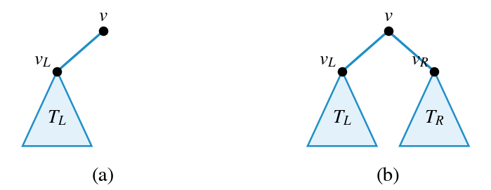

*Figure 41. Binary trees whose root has one child (a) and two children (b)*

In both cases the number of leaves is at most $2^{k+1}$, so $P(k+1)$ is true. Since both the basis step and the inductive step have been proved, $P(h)$ is true for every integer $h \geq 0$.

The equivalent form $\log_2 t \leq h$ comes from the fact that the base-2 logarithm is an increasing function: for all positive real numbers $x, y$, if $x < y$ then $\log_2 x < \log_2 y$. Taking $\log_2$ of both sides of $t \leq 2^h$ gives $\log_2 t \leq \log_2(2^h)$, and since $\log_2(2^h)$ is by definition the power to which 2 is raised to get $2^h$, it equals $h$. Hence $\log_2 t \leq h$. ∎

> **Note:** In Case 1 the textbook states as an equality that "the total number of leaves in $T$ is one more than the number of leaves in $T_L$," and in Case 2 that "the leaves of $T$ consist exactly of the leaves of $T_L$ together with the leaves of $T_R$." With leaves defined as vertices of degree 1, however, these equalities do not always hold. If $T_L$ is nontrivial and $v_L$ has exactly one child, then $v_L$ is a leaf of degree 1 within $T_L$, but in $T$ it is also joined to its parent $v$ and has degree 2, so it is not a leaf. For example, in the tree of height 2 formed by a root, its child, and its grandchild in a line, $T_L$ has 2 leaves and $T$ also has 2 leaves (the root and the grandchild). Writing the inequalities $t \leq t_L + 1$ and $t \leq t_L + t_R$, as in the proof above, covers such cases, and the conclusion $t \leq 2^{k+1}$ still holds.

**Example 10.5.4 (Determining Whether a Certain Binary Tree Exists).** Can a binary tree of height 5 have 38 leaves? No. By Theorem 10.5.2 a binary tree of height 5 has no more than $2^5 = 32$ leaves, so 38 is impossible.

As a corollary of Theorem 10.5.2, the textbook states that "a full binary tree of height $h$ has $2^h$ leaves" (Corollary 10.5.3), and suggests proving it by taking the proof of Theorem 10.5.2, changing "binary tree" to "full binary tree," "at most" to "exactly," and $\leq$ to $=$, and deleting Case 1, because the root of a full binary tree of height at least 1 must have two children.

> **Note:** Corollary 10.5.3 does not follow from the definition of a full binary tree (every parent has exactly two children) alone. For example, a full binary tree in which only one of the root's two children has two children of its own has height 2 but $3 \neq 2^2$ leaves. In the modified proof, $t_L + t_R = 2^{h_L} + 2^{h_R}$ equals $2^{k+1}$ only if $h_L = h_R = k$, which is not guaranteed. The corollary is correct for full binary trees in which every leaf has level $h$, that is, **perfect binary trees**. For a general full binary tree of height $h$, the number of leaves $t$ satisfies $h + 1 \leq t \leq 2^h$. The lower bound holds because, if $h \geq 1$, the path from the root to a deepest leaf contains $h$ internal vertices, so by Theorem 10.5.1 there are at least $h + 1$ leaves; if $h = 0$, then $t = 1$.

### 5.5 Binary Search Trees

A **binary search tree** is a binary tree designed so that data records, for example customer information, can be stored, looked up, and processed efficiently. Placing records in such a tree requires that they can be arranged in a total order. When the records lack a natural total order, each one is tagged with a **key**, an element of a totally ordered set such as a number or a word. The keys are stored at the vertices of the tree, and each key gives access to the record tagged with it.

A finished binary search tree satisfies the following ordering condition: for every vertex $v$, each key in the left subtree of $v$ is smaller than the key of $v$, and each key in the right subtree of $v$ is larger than the key of $v$. For example, for the keys 15, 10, 19, 25, 12, 4, the tree of Figure 42 (6) is a binary search tree. The left subtree of the root 15 contains 10, 4, 12, which are less than 15, the right subtree contains 19, 25, which are greater than 15, and the same property holds at 10 and at 19.

Construction starts with a root holding one key. Each new key is compared with the key at the root, and the process moves left if the new key is smaller and right if it is larger. If a child already exists in that direction, the comparison is repeated with that child's key; if not, a new vertex is created in that position to hold the new key. Stated precisely, this is the following algorithm.

```text
Algorithm 10.5.1 (Building a Binary Search Tree)
Input: a totally ordered, nonempty set K of keys

Initialize T to have one vertex, the root, and no edges; choose a key from K for the root.
while (there are still keys to be added)
    Choose a key newkey from K to add. Let v := the root and success := 0.
    while (success = 0)
        if (newkey < key(v))
            then if (v has a left child) then v := the left child of v
                 else add a left child vL to T and an edge {v, vL},
                      insert newkey as the key of vL, and let success := 1
        if (newkey > key(v))
            then if (v has a right child) then v := the right child of v
                 else add a right child vR to T and an edge {v, vR},
                      insert newkey as the key of vR, and let success := 1
    end while
end while
Output: a binary search tree T for the set K of keys
```

The parts of the algorithm do the following. The first line starts the tree with a root holding one key. The outer `while` inserts the keys one at a time as long as any remain. While a key is being inserted, `v` is the vertex currently being compared and `success` records whether the key has been inserted. In the inner `while`, the search moves left if `newkey` is less than `key(v)` and right if it is greater; when there is no child in that direction, a new vertex is created there and `success` is set to 1, ending the inner loop. The keys are assumed to be distinct, so `newkey` never equals `key(v)`.

**Example 10.5.5 (Steps for Building a Binary Search Tree).** A binary search tree is built by inserting the keys 15, 10, 19, 25, 12, 4 in that order, naming each vertex by the key it holds.

1. Insert 15: make 15 the root.
2. Insert 10: $10 < 15$ and 15 has no left child, so make 10 the left child of 15 and join them by an edge.
3. Insert 19: $19 > 15$ and 15 has no right child, so make 19 the right child of 15.
4. Insert 25: $25 > 15$ and 15 has the right child 19, so compare with 19. $25 > 19$ and 19 has no right child, so make 25 the right child of 19.
5. Insert 12: $12 < 15$, so compare with the left child 10 of 15. $12 > 10$ and 10 has no right child, so make 12 the right child of 10.
6. Insert 4: $4 < 15$, so compare with 10. $4 < 10$ and 10 has no left child, so make 4 the left child of 10.

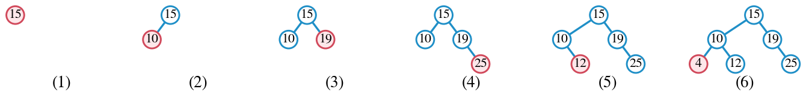

*Figure 42. A binary search tree built by inserting the keys 15, 10, 19, 25, 12, 4 in turn*

At each step of Figure 42 the pink vertex is the newly inserted key.

The algorithm does not fix the order in which the keys are inserted, and a different order usually produces a different binary search tree. For example, inserting the same keys in the order 19, 10, 25, 4, 15, 12 makes 19 the root with left child 10 and right child 25; 10 receives the left child 4 and the right child 15; and 12 becomes the left child of 15. This tree has height 3, greater than the height 2 of the tree in Figure 42 (6).

> **[Data Structures]** Searching a binary search tree for a key starts at the root and moves left or right according to each comparison, just as inserting a key does, so the number of comparisons is at most the height of the tree plus 1. The same set of keys can produce trees of different shapes and heights depending on the insertion order; inserting the keys in sorted order produces a straight line, which has the greatest height.

---

<br>

## 6. Spanning Trees and a Shortest Path Algorithm

This section studies the problem of finding the most economical tree that connects all the vertices of a connected graph, and the problem of finding a shortest path between two vertices.

### 6.1 Spanning Trees

An airline plans to extend its service into the Midwest of the United States, and the Federal Aviation Authority has approved the routes shown in Figure 43. The eight cities are Minneapolis, Milwaukee, Chicago, Detroit, Cincinnati, Louisville, St. Louis, and Nashville. The numbers on the edges are distances between cities in kilometers and are used from Section 6.2 on.

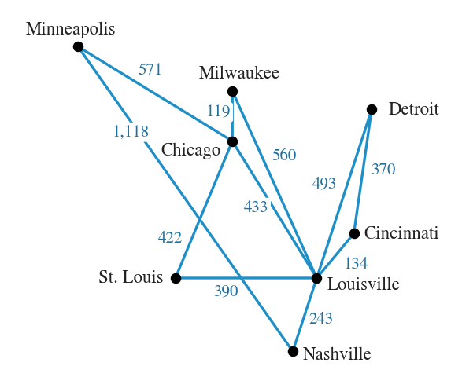

*Figure 43. The permitted routes and the distances between cities*

The airline wants to advertise that it serves all eight cities while operating as few routes as possible to keep costs down. Serving all the cities means that one can travel from any city to any other, possibly changing planes. Surprisingly, the number of routes in such a system is determined: the graph of any route system satisfying the company's wishes must be a tree. If the graph had a circuit, Lemma 10.4.3 would allow one route on the circuit to be dropped while the graph stays connected, so the number of routes could be reduced further. Since a tree with eight vertices always has seven edges, a minimal route system connecting all eight cities has exactly seven routes.

> **Definition:** A **spanning tree** for a graph $G$ is a subgraph of $G$ that contains every vertex of $G$ and is a tree.

The argument above is summarized in the following proposition.

**Proposition 10.6.1.** (1) Every connected graph has a spanning tree. (2) Any two spanning trees for a graph have the same number of edges.

**Proof of (1).** Let $G$ be a connected graph. If $G$ is circuit-free, then $G$ is its own spanning tree. Otherwise, remove an edge of a circuit $C_1$; by Lemma 10.4.3 the remaining subgraph is connected. If this subgraph is circuit-free, it is a spanning tree; if it has a circuit $C_2$, remove an edge of $C_2$ in turn. Continuing to remove edges of circuits in this way eventually yields a connected, circuit-free subgraph $T$, because $G$ has finitely many edges and no removal at any stage disconnects the subgraph. No vertices were removed, so $T$ contains every vertex of $G$ and is therefore a spanning tree for $G$. ∎

Part (2) follows immediately from Theorem 10.4.2: if $G$ has $n$ vertices, every spanning tree is a tree with $n$ vertices and therefore has $n - 1$ edges.

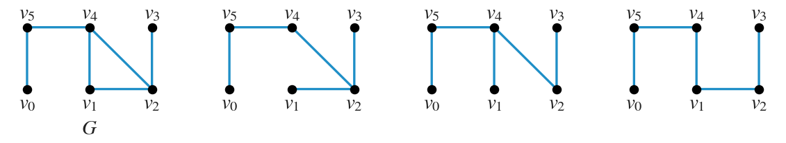

*Figure 44. A graph G and its three spanning trees*

**Example 10.6.1 (Finding All Spanning Trees).** The task is to find all spanning trees for the graph $G$ on the left of Figure 44. The only circuit of $G$ is $v_2 v_1 v_4 v_2$, and removing any one of its three edges gives a tree. The edges $\lbrace v_0, v_5\rbrace$, $\lbrace v_5, v_4\rbrace$, $\lbrace v_2, v_3\rbrace$ outside the circuit cannot be removed, because removing one of them would disconnect a vertex. Hence $G$ has the three spanning trees shown on the right of Figure 44.

### 6.2 Minimum Spanning Trees

Suppose the distance of each route is written on it, as in Figure 43, and the airline wants to serve all the cities with a route system of minimum total distance. Such a system is again a tree: if it contained a circuit, removing one route of the circuit would still allow travel between all the cities (Lemma 10.4.3) and would reduce the total distance.

> **Definition:** A **weighted graph** is a graph in which each edge has an associated positive real number **weight**. The sum of the weights of all the edges is the **total weight** of the graph. A **minimum spanning tree** for a connected, weighted graph is a spanning tree that has the least possible total weight compared with all other spanning trees for the graph. If $G$ is a weighted graph and $e$ is an edge of $G$, then $w(e)$ denotes the weight of $e$ and $w(G)$ denotes the total weight of $G$.

A minimum spanning tree can always be found in principle: enumerate every spanning tree, add up the weights of each, and keep one of least total. There are finitely many spanning trees, so a smallest total weight exists. This method is inefficient, however, because the number of spanning trees is very large. For instance, a complete graph with $n$ vertices has $n^{n-2}$ spanning trees. Even $K_4$ has $4^2 = 16$, and for a graph with about 100 vertices, checking every spanning tree would take even the fastest computers longer than the universe is estimated to have left. In 1956 and 1957, respectively, Joseph B. Kruskal and Robert C. Prim published far more efficient methods for building minimum spanning trees, and both can be implemented so that they finish in relatively short times even on large graphs.

### 6.3 Kruskal's Algorithm

Kruskal's algorithm goes through the edges of a connected, weighted graph from lightest to heaviest. Each edge it looks at is put into the growing minimum spanning tree unless doing so would close a circuit. Once $n - 1$ edges have been accepted, where $n$ is the number of vertices, those edges and all the vertices of the graph make up a minimum spanning tree.

```text
Algorithm 10.6.1 (Kruskal)
Input: G, a connected, weighted graph with n vertices (n a positive integer)

1. Initialize T to have all the vertices of G and no edges.
2. Let E be the set of all edges of G, and let m := 0.
3. while (m < n - 1)
   3a. Find an edge e in E of least weight.
   3b. Delete e from E.
   3c. if (adding e to the edge set of T does not produce a circuit)
           then add e to the edge set of T and let m := m + 1
   end while
Output: T (a minimum spanning tree for G)
```

In Step 1, $T$ starts as a graph with all the vertices and no edges. In Step 2, $E$ is the set of edges not yet examined and $m$ is the number of edges in $T$. The loop of Step 3 continues until $T$ has $n - 1$ edges. Steps 3a and 3b take out the lightest remaining edge, and Step 3c adds it to $T$ only if it does not create a circuit in $T$.

**Example 10.6.2 (Action of Kruskal's Algorithm).** Kruskal's algorithm is applied to the graph of Figure 43 ($n = 8$). Examining the edges in order of weight gives the following.

| Iteration | Edge considered | Weight | Action | Reason |
|:-----|:-----|:-----|:-----|:-----|
| 1 | Chicago-Milwaukee | 119 | added | no circuit is created |
| 2 | Louisville-Cincinnati | 134 | added | no circuit is created |
| 3 | Louisville-Nashville | 243 | added | no circuit is created |
| 4 | Cincinnati-Detroit | 370 | added | no circuit is created |
| 5 | St. Louis-Louisville | 390 | added | no circuit is created |
| 6 | St. Louis-Chicago | 422 | added | no circuit is created |
| 7 | Chicago-Louisville | 433 | not added | Chicago, St. Louis, Louisville form a circuit |
| 8 | Louisville-Detroit | 493 | not added | Louisville, Cincinnati, Detroit form a circuit |
| 9 | Louisville-Milwaukee | 560 | not added | Louisville, St. Louis, Chicago, Milwaukee form a circuit |
| 10 | Minneapolis-Chicago | 571 | added | it is the seventh edge, so the algorithm stops |

*Table 8. Action of Kruskal's algorithm on the airline route graph*

The resulting minimum spanning tree consists of the red edges in Figure 45, and its total weight is $119 + 134 + 243 + 370 + 390 + 422 + 571 = 2{,}249$ km.

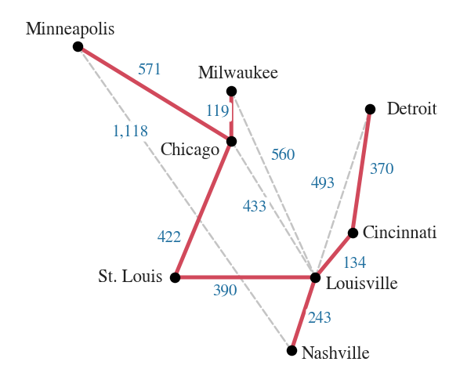

*Figure 45. A minimum spanning tree of the airline route graph*

If several edges share a weight, Kruskal's algorithm can produce different minimum spanning trees depending on how ties are broken. Storing the edges in an array and examining equal-weight edges in array order makes the output unique.

It is not evident from the description alone that Kruskal's algorithm works. Can a lightest edge that closes no circuit always be found? If so, do the chosen edges end up connecting all the vertices? And if they do, is the total weight of the result the smallest possible? The following theorem answers these questions.

**Theorem 10.6.2 (Correctness of Kruskal's Algorithm).** When a connected, weighted graph is input to Kruskal's algorithm, the output is a minimum spanning tree.

**Proof.** Let $G$ be a connected, weighted graph with $n$ vertices, and let $T$ be the subgraph produced by Kruskal's algorithm.

First, $T$ is shown to be a spanning tree. The algorithm never adds an edge that would complete a circuit, so $T$ is circuit-free. While $m < n - 1$, $T$ is a circuit-free graph with $n$ vertices and $m$ edges. Each connected component of such a graph is a tree, so if there are $k$ components there are $n - k$ edges, and hence there are $n - m \geq 2$ components. Since $G$ is connected, there is a path in $G$ joining vertices of two different components, and following this path one meets an edge $e$ whose endpoints lie in different components of $T$. Adding such an edge to $T$ does not create a circuit, for if it did, the rest of that circuit would join the endpoints of $e$ inside $T$, putting them in the same component. Moreover, $e$ is still in $E$: components only merge as the algorithm proceeds, so if $e$ had been examined earlier, its endpoints would have been in different components then as well, and $e$ would have been added. Hence the loop continues until $m = n - 1$, and at the end $T$ is a circuit-free graph with $n$ vertices and $n - 1$ edges, so it has $n - (n - 1) = 1$ component, that is, it is connected. Since $T$ contains every vertex of $G$, it is a spanning tree for $G$.

Next, $T$ is shown to have minimum total weight. Among the minimum spanning trees for $G$, let $T_1$ be one that has the maximum number of edges in common with $T$, and suppose $T \neq T_1$. The two trees have the same vertex set and the same number of edges, $n - 1$, so there is an edge in $T$ that is not in $T_1$. Among such edges, let $e$ be the one that Kruskal's algorithm added to $T$ first. Then every edge added to $T$ before $e$ is in $T_1$.

1. The graph obtained by adding $e$ to $T_1$ has $n$ vertices and $n$ edges, so by Corollary 10.4.5 it has a circuit. Since $T_1$ is circuit-free, this circuit contains $e$. Since $T$ is circuit-free, not all edges of this circuit can be in $T$, so the circuit has an edge $e'$ not in $T$. Since $e$ is in $T$, $e' \neq e$.
2. Let $T_2$ be the graph obtained from $T_1$ by removing $e'$ and adding $e$. It is obtained from the connected graph $T_1$ plus $e$ by removing an edge $e'$ of a circuit, so by Lemma 10.4.3 $T_2$ is connected. $T_2$ has $n$ vertices and $n - 1$ edges, so by Theorem 10.4.4 it is a tree and hence a spanning tree for $G$. Its total weight is $w(T_2) = w(T_1) - w(e') + w(e)$.
3. $w(e) \leq w(e')$. If $w(e') < w(e)$, the algorithm would have examined $e'$ before $e$, and since $e'$ is not in $T$, it was rejected then because it formed a circuit with edges already in $T$. Those edges were added before $e$, so they are all in $T_1$; since $e'$ is also in $T_1$, $T_1$ would contain a circuit, a contradiction.
4. Hence the following holds.

$$
w(T_2) = w(T_1) - \underbrace{\big(w(e') - w(e)\big)}_{\geq 0} \leq w(T_1)
$$

Since $T_1$ is a minimum spanning tree, the spanning tree $T_2$ with $w(T_2) \leq w(T_1)$ is also a minimum spanning tree. But $T_2$ is obtained from $T_1$ by removing the edge $e'$, which is not in $T$, and adding the edge $e$ of $T$, so it has one more edge in common with $T$ than $T_1$ does. This contradicts the choice of $T_1$ as a minimum spanning tree with the maximum number of edges in common with $T$. Hence $T = T_1$, and $T$ is a minimum spanning tree. ∎

> **Note:** The textbook's proof chooses an arbitrary edge $e$ in $T$ but not in $T_1$, and derives $w(e) \leq w(e')$ from the claim that "at the stage in Kruskal's algorithm when $e$ was added to $T$, $e'$ was available to be added," on the grounds that adding $e'$ could not have produced a circuit. If $e$ is chosen arbitrarily, however, $T$ at that stage may contain edges not in $T_1$, and adding $e'$ might then create a circuit. The proof above fills this gap by choosing $e$ to be the first such edge added, so that every edge added before $e$ is in $T_1$.

### 6.4 Prim's Algorithm

Prim's algorithm takes a different approach. Starting from one vertex, it grows a minimum spanning tree $T$ outward and keeps $T$ connected throughout. Each stage adds one edge and one vertex: the edge is a lightest edge joining a vertex of $T$ to a vertex outside $T$, and the vertex is the end of that edge that lies outside $T$.

```text
Algorithm 10.6.2 (Prim)
Input: G, a connected, weighted graph with n vertices (n a positive integer)

1. Pick a vertex v of G and let T be the graph with one vertex, v, and no edges.
2. Let V be the set of all vertices of G except v.
3. for i := 1 to n - 1
   3a. Find an edge e of G of least weight among the edges connecting a vertex of T
       to a vertex in V, and let w be the endpoint of e that is in V.
   3b. Add e and w to the edge and vertex sets of T, and delete w from V.
   next i
Output: T (a minimum spanning tree for G)
```

Step 1 starts $T$ with one starting vertex, and in Step 2 $V$ is the set of vertices not yet in $T$. Step 3 is repeated $n - 1$ times, each time moving the lightest edge $e$ between $T$ and $V$ and its endpoint $w$ in $V$ into $T$.

**Example 10.6.3 (Action of Prim's Algorithm).** Prim's algorithm is applied to the graph of Figure 43, starting at Minneapolis.

| Iteration | Vertex added | Edge added | Weight |
|:-----|:-----|:-----|:-----|
| 0 | Minneapolis | none | none |
| 1 | Chicago | Minneapolis-Chicago | 571 |
| 2 | Milwaukee | Chicago-Milwaukee | 119 |
| 3 | St. Louis | Chicago-St. Louis | 422 |
| 4 | Louisville | St. Louis-Louisville | 390 |
| 5 | Cincinnati | Louisville-Cincinnati | 134 |
| 6 | Nashville | Louisville-Nashville | 243 |
| 7 | Detroit | Cincinnati-Detroit | 370 |

*Table 9. Action of Prim's algorithm starting at Minneapolis*

For example, at iteration 3 the vertices of $T$ are Minneapolis, Chicago, and Milwaukee, and the edges joining them to vertices outside $T$ are Minneapolis-Nashville (1,118), Chicago-St. Louis (422), Chicago-Louisville (433), and Milwaukee-Louisville (560). The lightest of these, Chicago-St. Louis, is chosen. The resulting tree is the same as the one produced by Kruskal's algorithm (Figure 45), but the edges are added in a different order. As with Kruskal's algorithm, choosing edges of equal weight in the order in which they appear in an array makes the output unique.

For a connected input graph it is fairly easy to see that Prim's algorithm outputs a spanning tree, but it is less obvious that this spanning tree has minimum total weight. The following theorem settles the question.

**Theorem 10.6.3 (Correctness of Prim's Algorithm).** When a connected, weighted graph $G$ is input to Prim's algorithm, the output is a minimum spanning tree for $G$.

**Proof.** Let $G$ be a connected, weighted graph, and suppose $G$ is input to Prim's algorithm.

First, the output $T$ is shown to be a spanning tree. Each stage needs an edge joining a vertex of $T$ to a vertex outside $T$, and such an edge exists as long as some vertex lies outside $T$: pick one vertex inside $T$ and one outside; since $G$ is connected, some walk joins them, and at some point this walk crosses an edge from a vertex inside $T$ to a vertex outside $T$. The edge added at each stage joins a vertex of $T$ to the new vertex, so $T$ stays connected. Moreover, the only edge of $T$ incident on the new vertex is the new edge, so the new vertex cannot lie on a circuit, and no circuit is created, because every vertex on a circuit has degree at least 2 in the circuit. Hence $T$ is a tree, and since it has $n - 1$ edges it has $n$ vertices, so it is a spanning tree containing every vertex of $G$.

Next, $T$ is shown to be minimum. Let $e_1, e_2, \ldots, e_{n-1}$ be the edges in the order in which the algorithm added them to $T$. Among the minimum spanning trees for $G$, let $T_1$ be one that contains all of the first $j$ edges $e_1, \ldots, e_j$ for the largest possible $j$, and suppose $T \neq T_1$. Then $j < n - 1$, and $e = e_{j+1}$ is not in $T_1$.

1. Let $S$ be the vertex set of $T$ just before $e$ was added. One endpoint $v$ of $e$ is in $S$ and the other endpoint $w$ is not. Since $T_1$ is a spanning tree, it contains a path from $v$ to $w$, and since $v \in S$ and $w \notin S$, following this path one meets an edge $e'$ joining a vertex in $S$ to a vertex not in $S$.
2. At the stage when $e$ was added, $e'$ was also a candidate joining $S$ to the outside, and the algorithm chose the lightest one, $e$, so $w(e) \leq w(e')$.
3. Let $T_2$ be the graph obtained from $T_1$ by removing $e'$ and adding $e$. Adding $e$ to $T_1$ creates a circuit consisting of $e$ and the path in $T_1$ from $v$ to $w$, and $e'$ is an edge of that circuit, so by Lemma 10.4.3 $T_2$ is connected. $T_2$ has $n$ vertices and $n - 1$ edges, so by Theorem 10.4.4 it is a spanning tree.
4. $w(T_2) = w(T_1) - w(e') + w(e) \leq w(T_1)$, so $T_2$ is also a minimum spanning tree.
5. Both endpoints of each of $e_1, \ldots, e_j$ are in $S$, so none of them equals $e'$, which joins $S$ to the outside, and they all remain in $T_2$. Then $T_2$ is a minimum spanning tree containing all of $e_1, \ldots, e_{j+1}$, contradicting the maximality of $j$.

Hence $T = T_1$, and $T$ is a minimum spanning tree. ∎

> **Note:** The textbook's proof chooses $T_1$ with the maximum number of edges in common with $T$, and takes $e$ to be the last edge added among those in $T$ but not in $T_1$. In that case the edge $e'$ removed from $T_1$ may be an edge that is added to $T$ later, so the conclusion that $T_2$ has one more edge in common with $T$ than $T_1$ may fail. The proof above fills this gap by taking $e$ to be the first edge added that is not in $T_1$ and comparing how long an initial run of the edges of $T$ each tree contains, instead of the number of common edges. Step 4 is the check $w(T_2) \leq w(T_1)$ that the textbook leaves as an exercise.

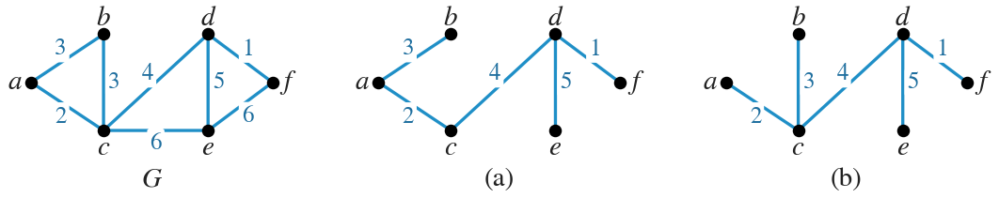

*Figure 46. A graph G and its two minimum spanning trees*

**Example 10.6.4 (Finding All Minimum Spanning Trees).** The task is to find all minimum spanning trees for the graph $G$ on the left of Figure 46, using Kruskal's algorithm and Prim's algorithm starting at vertex $a$, and to record the order in which edges are added.

- Kruskal's algorithm: after adding $\lbrace d, f\rbrace$ (1) and $\lbrace a, c\rbrace$ (2), it meets the edges $\lbrace a, b\rbrace$ and $\lbrace b, c\rbrace$ of weight 3. Whichever is added first, the other would form a circuit through $a, b, c$ and is rejected. Then $\lbrace c, d\rbrace$ (4) and $\lbrace d, e\rbrace$ (5) are added, giving five edges, and the algorithm stops. So the edges are added in the order $\lbrace d, f\rbrace, \lbrace a, c\rbrace, \lbrace a, b\rbrace, \lbrace c, d\rbrace, \lbrace d, e\rbrace$ or $\lbrace d, f\rbrace, \lbrace a, c\rbrace, \lbrace b, c\rbrace, \lbrace c, d\rbrace, \lbrace d, e\rbrace$.
- Prim's algorithm (starting at $a$): the lightest edge at $a$, $\lbrace a, c\rbrace$ (2), is added. Among the next candidates, $\lbrace a, b\rbrace$ and $\lbrace b, c\rbrace$ of weight 3 are lightest, so one of them is added. Then $\lbrace c, d\rbrace$ (4), $\lbrace d, f\rbrace$ (1), and $\lbrace d, e\rbrace$ (5) are added in turn. So the order is $\lbrace a, c\rbrace, \lbrace a, b\rbrace, \lbrace c, d\rbrace, \lbrace d, f\rbrace, \lbrace d, e\rbrace$ or $\lbrace a, c\rbrace, \lbrace b, c\rbrace, \lbrace c, d\rbrace, \lbrace d, f\rbrace, \lbrace d, e\rbrace$.

Hence there are two minimum spanning trees, (a) and (b) in Figure 46, each with total weight $1 + 2 + 3 + 4 + 5 = 15$.

### 6.5 Dijkstra's Shortest Path Algorithm

Kruskal's and Prim's algorithms produce spanning trees of least total weight, but such a tree need not contain the shortest connection between two given vertices. With all the routes of Figure 43 available, for example, there is a direct flight of 1,118 km from Nashville to Minneapolis. With only the minimum spanning tree of Figure 45, however, the trip must go through Louisville, St. Louis, and Chicago, flying $243 + 390 + 422 + 571 = 1{,}626$ km and changing planes three times.

In 1959 the computer science pioneer Edsger Dijkstra devised an algorithm that finds a shortest path from a starting vertex to an ending vertex in a weighted graph whose weights are all positive. Like Prim's algorithm, it grows a tree $T$ outward from the starting vertex $a$, one vertex and one edge at a time. Its rule for choosing the next vertex is different, however, and guarantees that when a vertex $v$ joins $T$, the length of a shortest path from $a$ to $v$ is already known.

At the start every vertex $u$ of $G$ receives a **label** $L(u)$, which holds the best value found so far for the length of a shortest path from $a$ to $u$. The shortest path from $a$ to $a$ has length 0, so $L(a) = 0$. Since nothing is yet known about shortest paths to other vertices, every vertex $u$ other than $a$ gets the label $\infty$, a number larger than the total weight of all the edges of $G$. The labels are revised as the algorithm runs and in the end equal the true lengths of shortest paths from $a$.

Because $T$ grows outward from $a$, at each stage the only candidates to join $T$ are vertices adjacent to some vertex of $T$. So at each stage $G$ is divided into three parts: the tree $T$ being built, the **fringe**, which is the set of vertices that are adjacent to a vertex of $T$ but not in $T$, and the remaining vertices. The vertices in the fringe are the candidates to be added next, and the algorithm picks the one whose path from $a$ through $T$ is shortest.

The key observation is that after a vertex $v$ is added to $T$, the only fringe vertices to which a shorter path from $a$ may appear are those adjacent to $v$. So after $v$ is added, for each fringe vertex $u$ adjacent to $v$, the current $L(u)$ is compared with $L(v) + w(v, u)$, where $L(v)$ is the length of a shortest path from $a$ to $v$ and $w(v, u)$ is the weight of the edge joining $v$ and $u$. If $L(v) + w(v, u) < L(u)$, then $L(u)$ is changed to $L(v) + w(v, u)$. At the beginning the tree consists of the vertex $a$ alone with $L(a) = 0$, and when the algorithm terminates, $L(z)$ is the length of a shortest path from $a$ to $z$.

As for minimum spanning trees, there is a simple but hopelessly slow way to find a shortest path: compute the length of every path from $a$ to $z$ and keep a shortest one. Even for fairly small graphs this can take billions of years, while Dijkstra's algorithm finishes in a few seconds.

```text
Algorithm 10.6.3 (Dijkstra)
Input: G (a connected simple graph with a positive weight for every edge), ∞ (a number
       greater than the sum of the weights of all edges), w(u, v) (the weight of
       the edge {u, v}), a (the starting vertex), z (the ending vertex)

1. Initialize T to be the graph with vertex a and no edges.
   V(T) is the vertex set of T and E(T) is the edge set of T.
2. Let L(a) := 0, and let L(u) := ∞ for every vertex u of G other than a.
3. Let v := a and F := {a}.
4. while (z ∉ V(T))
   4a. F := (F - {v}) ∪ {vertices that are adjacent to v and not in V(T)}
   4b. For each vertex u that is adjacent to v and not in V(T),
           if L(v) + w(v, u) < L(u) then
               L(u) := L(v) + w(v, u)
               D(u) := v
   4c. Find a vertex x in F with the smallest label.
       Add x to V(T), and add the edge {D(x), x} to E(T).
       v := x
   end while
Output: L(z) (the length of a shortest path from a to z)
```

The lines play the following roles. Steps 1 and 2 initialize the tree $T$ and the labels. In Step 3, $v$ denotes the vertex most recently added to $T$, and $F$ is the fringe. The loop of Step 4 continues until $z$ is in $T$. Step 4a removes the newly added $v$ from the fringe and adds to the fringe the vertices adjacent to $v$ that are not in $T$ (leaving those already in the fringe as they are). Step 4b updates only the labels that adding $v$ can affect, namely those of vertices adjacent to $v$. Whenever a label decreases, $D(u)$ records the vertex of $T$ that gave rise to the smaller value. Step 4c adds the fringe vertex $x$ with the smallest label to $T$, together with the edge $\lbrace D(x), x\rbrace$ that joins it to $T$. When the algorithm ends, the unique path in $T$ from $a$ to $z$ is a shortest path in $G$ from $a$ to $z$.

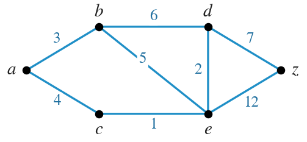

*Figure 47. A weighted graph for Dijkstra's algorithm*

**Example 10.6.5 (Action of Dijkstra's Algorithm).** Dijkstra's algorithm is run on the graph of Figure 47 with starting vertex $a$ and ending vertex $z$.

1. Going into the loop: $V(T) = \lbrace a\rbrace$, $E(T) = \emptyset$, $F = \lbrace a\rbrace$. During the iteration, $F = \lbrace b, c\rbrace$, $L(b) = 0 + 3 = 3$, and $L(c) = 0 + 4 = 4$. Since $L(b) < L(c)$, $b$ is added to $V(T)$, and since $D(b) = a$, $\lbrace a, b\rbrace$ is added to $E(T)$.
2. $V(T) = \lbrace a, b\rbrace$. The neighbors $d, e$ of $b$ enter the fringe, so $F = \lbrace c, d, e\rbrace$, with $L(d) = 3 + 6 = 9$ and $L(e) = 3 + 5 = 8$. $L(c) = 4$ is the smallest, so $c$ is added, and since $D(c) = a$, $\lbrace a, c\rbrace$ is added.
3. $V(T) = \lbrace a, b, c\rbrace$. $F = \lbrace d, e\rbrace$, and $L(e)$ becomes 5 with $D(e) = c$, because $ace$, of length $4 + 1 = 5$, is shorter than $abe$, of length 8. Since $L(e) = 5 < L(d) = 9$, $e$ is added, together with $\lbrace c, e\rbrace$.
4. $V(T) = \lbrace a, b, c, e\rbrace$. The neighbor $z$ of $e$ enters, so $F = \lbrace d, z\rbrace$. $L(d)$ becomes 7 with $D(d) = e$, because $aced$, of length $5 + 2 = 7$, is shorter than $abd$, of length 9; also $L(z) = 5 + 12 = 17$ with $D(z) = e$. Since $L(d) < L(z)$, $d$ is added, together with $\lbrace e, d\rbrace$.
5. $V(T) = \lbrace a, b, c, e, d\rbrace$. $F = \lbrace z\rbrace$, and $L(z)$ becomes 14 with $D(z) = d$, because $acedz$, of length $7 + 7 = 14$, is shorter than $acez$, of length 17. Since $z$ is the only vertex in the fringe, $z$ is added, together with $\lbrace d, z\rbrace$.

Now $z \in V(T)$, so the algorithm terminates, and the shortest path from $a$ to $z$ has length $L(z) = 14$. Figure 48 shows how $T$ grows at each step; panel $(k)$ shows the state after $k$ vertices have been added.

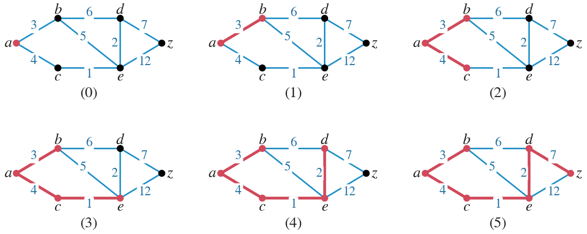

*Figure 48. The growth of the tree T in Dijkstra's algorithm*

A table is a convenient way to record the progress of the algorithm. Each row of the table shows $V(T)$ and $E(T)$ going into that iteration of the loop, together with $F$ and the labels as updated during the iteration. In the table, sets of vertices are written by listing their elements, and an edge $\lbrace x, y\rbrace$ is abbreviated $xy$.

| Step | $V(T)$ | $E(T)$ | $F$ | $L(a)$ | $L(b)$ | $L(c)$ | $L(d)$ | $L(e)$ | $L(z)$ |
|:-----|:-----|:-----|:-----|:-----|:-----|:-----|:-----|:-----|:-----|
| 0 | $a$ | none | $a$ | 0 | $\infty$ | $\infty$ | $\infty$ | $\infty$ | $\infty$ |
| 1 | $a$ | none | $b, c$ | 0 | 3 | 4 | $\infty$ | $\infty$ | $\infty$ |
| 2 | $a, b$ | $ab$ | $c, d, e$ | 0 | 3 | 4 | 9 | 8 | $\infty$ |
| 3 | $a, b, c$ | $ab, ac$ | $d, e$ | 0 | 3 | 4 | 9 | 5 | $\infty$ |
| 4 | $a, b, c, e$ | $ab, ac, ce$ | $d, z$ | 0 | 3 | 4 | 7 | 5 | 17 |
| 5 | $a, b, c, e, d$ | $ab, ac, ce, ed$ | $z$ | 0 | 3 | 4 | 7 | 5 | 14 |
| 6 | $a, b, c, e, d, z$ | $ab, ac, ce, ed, dz$ | none | 0 | 3 | 4 | 7 | 5 | 14 |

*Table 10. Progress of Dijkstra's algorithm on the graph of Figure 47*

The shortest path itself is obtained by following $D$ backward. The values at the times the vertices are added are $D(b) = a$, $D(c) = a$, $D(e) = c$, $D(d) = e$, and $D(z) = d$. Since $D(z) = d$, $D(d) = e$, $D(e) = c$, and $D(c) = a$, the shortest path is $acedz$, of length $4 + 1 + 2 + 7 = 14$.

Dijkstra's algorithm adds vertices one after another until $z$ has been added. The next theorem proves that at that point the label $L(z)$ equals the length of a shortest path from $a$ to $z$.

**Theorem 10.6.4 (Correctness of Dijkstra's Algorithm).** When a connected, simple graph with a positive weight for every edge is input to Dijkstra's algorithm with starting vertex $a$ and ending vertex $z$, the output is the length of a shortest path from $a$ to $z$.

**Proof (by mathematical induction).** Let $G$ be a connected weighted graph without loops or parallel edges in which every edge has positive weight. Let $T$ be the graph built by the algorithm and $L(u)$ the label given by the algorithm to vertex $u$, and for each integer $n \geq 0$ let $P(n)$ be the following sentence.

$P(n)$: After the $n$th iteration of the while loop, (1) $T$ is a tree, and (2) for every vertex $v$ in $T$, $L(v)$ is the length of a shortest path in $G$ from $a$ to $v$.

Mathematical induction shows that $P(n)$ is true from $n = 0$ through the termination of the algorithm.

Basis step: For $n = 0$, $T$ consists of the vertex $a$ alone with no edges, so it is a tree. Moreover, the initial value 0 of $L(a)$ is the length of the shortest path from $a$ to $a$. Hence $P(0)$ is true.

Inductive step: Suppose $P(k)$ is true for some integer $k \geq 0$ (the inductive hypothesis). Suppose that in the $(k+1)$st iteration the vertex $v$ and the edge $\lbrace x, v\rbrace$ are added to $T$, where $x = D(v)$ is a vertex already in $T$. Attaching a new vertex to a tree by a single edge creates no circuit and keeps the graph connected, so the new $T$ is a tree. Labels change only for vertices outside $T$, so by the inductive hypothesis, for each vertex $y$ that was in $T$ before $v$ was added, $L(y)$ is still the length of a shortest path. So it remains to show that $L(v)$ is the length of a shortest path from $a$ to $v$.

By the algorithm, $L(v) = L(x) + w(x, v)$. Write $\mathrm{LSP}(a, v)$ for the length of a shortest path from $a$ to $v$. Take any shortest path from $a$ to $v$. It starts at $a$, which is in $T$, and ends at $v$, which was outside $T$ before being added, so it has a first edge $\lbrace s, t\rbrace$ leaving $T$, with $s \in V(T)$ and $t \notin V(T)$. Then the following holds.

$$
\begin{aligned} \mathrm{LSP}(a, v) &\geq \mathrm{LSP}(a, s) + w(s, t) && \text{the part from } t \text{ to } v \text{ has length} \geq 0 \\ &= L(s) + w(s, t) && \text{inductive hypothesis, since } s \in V(T) \\ &\geq L(t) && \text{after } s \text{ was added, step 4b made } L(t) \text{ at most this} \\ &\geq L(x) + w(x, v) && t \text{ is in the fringe and } v \text{ has the smallest label} \end{aligned}
$$

The first line holds because the part of the shortest path from $a$ to $s$ has length at least $\mathrm{LSP}(a, s)$, and the part from $t$ to $v$ has length at least 0 because all weights are positive. In the third line, labels only decrease, so $L(t) \leq L(s) + w(s, t)$ continues to hold after $s$ is added. In the fourth line, $t$ is adjacent to the vertex $s$ of $T$, so it is in the fringe, and Step 4c chose $v$ with the smallest label in the fringe, so $L(v) = L(x) + w(x, v) \leq L(t)$. On the other hand, $L(x) + w(x, v)$ is the length of the walk from $a$ to $v$ formed by a shortest path from $a$ to $x$ followed by the edge $\lbrace x, v\rbrace$, so $\mathrm{LSP}(a, v) \leq L(x) + w(x, v)$. The two inequalities give $\mathrm{LSP}(a, v) = L(x) + w(x, v) = L(v)$. Hence $P(k+1)$ is true.

The algorithm terminates as soon as $z$ is in $T$, and it has been shown that the label of every vertex in $T$ is the length of a shortest path to it from $a$; in particular, $L(z)$ is the length of a shortest path from $a$ to $z$. ∎

> **Caution:** The correctness of Dijkstra's algorithm depends on the weights being positive: the first inequality of the proof uses the fact that the part of the shortest path after $t$ has length at least 0. Also, a minimum spanning tree and a shortest path tree are in general different. A minimum spanning tree minimizes the total weight of the edges connecting all the vertices, whereas the tree of Dijkstra's algorithm minimizes the distance from the starting vertex to each vertex.

---

<br>

## Concept Applications

**True/False Check:**

| Statement | Judgment and Reason |
|:-----|:-----|
| Every path is a trail. | **T.** A path is defined as a trail with no repeated vertex. |
| A graph in which every vertex has even degree has an Euler circuit. | **F.** The graph must also be connected and the degrees positive. Figure 10 is a counterexample. |
| An Euler circuit is also a Hamiltonian circuit. | **F.** An Euler circuit may pass through a vertex more than once. The circuit in Figure 8 passes through $v_2$ twice. |
| The adjacency matrix of an undirected graph is always symmetric. | **T.** The number of edges joining $v_i$ and $v_j$ equals the number joining $v_j$ and $v_i$. |
| Two graphs with the same numbers of vertices and edges and the same vertex degrees are isomorphic. | **F.** A graph whose six vertices form one circuit and a graph consisting of two triangles share all these values, but only the first is connected. |
| A graph with $n$ vertices and $n - 1$ edges is a tree. | **F.** It must also be connected. Figure 36 is a counterexample. |
| A binary tree of height 5 has at most 32 leaves. | **T.** By Theorem 10.5.2, $t \leq 2^5 = 32$. |
| The path between two vertices in a minimum spanning tree is a shortest path between them. | **F.** In the tree of Figure 45, the path between Nashville and Minneapolis is 1,626 km, but the direct route is 1,118 km. |
| When Dijkstra's algorithm ends, the label of every vertex of $T$ is its shortest distance from $a$. | **T.** This is the property proved by induction in the proof of Theorem 10.6.4. |

---

<br>

## Summary

| Concept | Key Summary |
|:-----|:-----|
| Walks, trails, paths | A walk is an alternating sequence of vertices and edges, a trail is a walk without a repeated edge, and a path is a trail without a repeated vertex. |
| Circuits and simple circuits | A circuit is a closed walk with at least one edge and no repeated edge, and a simple circuit is a circuit with no repeated vertex other than the first and last. |
| Subgraph | A graph whose vertices and edges all belong to the original graph, with each edge having the same endpoints as in the original. |
| Connected graphs and components | A graph is connected if there is a walk between every two vertices, and a connected component is a connected subgraph that cannot be enlarged. |
| Handshake theorem | The total degree is twice the number of edges, so the number of vertices of odd degree is even. |
| Euler circuit | Exists if, and only if, the graph is connected and every vertex has positive even degree (Theorem 10.1.4). |
| Euler trail | An Euler trail from $v$ to $w$ exists if, and only if, the graph is connected, only $v$ and $w$ have odd degree, and all other degrees are positive and even. |
| Hamiltonian circuit | A simple circuit containing every vertex; no simple criterion is known, but it cannot exist without a subgraph as in Proposition 10.1.6. |
| Traveling salesman problem | The problem of finding a Hamiltonian circuit of minimum total distance; $K_n$ has $(n-1)!/2$ Hamiltonian circuits, so checking them all is impractical. |
| Adjacency matrix | $a_{ij}$ is the number of arrows from $v_i$ to $v_j$ (directed) or of edges joining $v_i$ and $v_j$ (undirected), and the adjacency matrix of an undirected graph is symmetric. |
| Adjacency matrix and components | Numbering the vertices of each component consecutively makes the adjacency matrix block diagonal, with the components' adjacency matrices on the diagonal. |
| Matrix multiplication | $(\mathbf{A}\mathbf{B})_{ij} = \sum_{r} a_{ir} b_{rj}$; it is associative but not commutative. |
| Counting walks | The $(i, j)$ entry of $\mathbf{A}^n$ is the number of walks of length $n$ from $v_i$ to $v_j$ (Theorem 10.2.2). |
| Graph isomorphism | Two graphs are isomorphic if there is a pair of one-to-one correspondences of vertices and edges that preserves the edge-endpoint functions, and graph isomorphism is an equivalence relation. |
| Isomorphic invariants | Numbers of vertices and edges, degrees, circuits, connectedness, Euler and Hamiltonian circuits, and so on; they are used to show that two graphs are not isomorphic. |
| Trees and forests | A tree is a connected, circuit-free graph, and a forest is a circuit-free graph that is not connected. |
| Leaves and internal vertices | In a tree with at least two vertices, vertices of degree 1 are leaves and vertices of degree greater than 1 are internal vertices, and there are at least two leaves. |
| Number of edges of a tree | A tree with $n$ vertices has $n - 1$ edges, and a connected graph with $n$ vertices and $n - 1$ edges is a tree. |
| Existence of circuits | A graph with $n$ vertices and $m \geq n$ edges has a circuit (Corollary 10.4.5). |
| Rooted tree | A tree with a chosen root; the level is the number of edges on the path to the root and the height is the maximum level, and parent, child, sibling, ancestor, and descendant are defined by the unique path to the root. |
| Binary tree | A rooted tree in which every parent has at most one left child and at most one right child; in a full binary tree every parent has exactly two children. |
| Vertices of a full binary tree | With $k$ internal vertices there are $2k + 1$ vertices and $k + 1$ leaves (Theorem 10.5.1). |
| Height of a binary tree | A binary tree of height $h$ with $t$ leaves satisfies $t \leq 2^h$, that is, $\log_2 t \leq h$ (Theorem 10.5.2). |
| Binary search tree | All keys in the left subtree of a vertex are less than its key and all keys in its right subtree are greater, and a new key is inserted by comparing downward from the root. |
| Spanning tree | A subgraph that is a tree containing every vertex; every connected graph has one, and all spanning trees of a graph have the same number of edges. |
| Minimum spanning tree | A spanning tree of a connected, weighted graph with the least total weight. |
| Kruskal's algorithm | Chooses $n - 1$ edges by adding edges in order of increasing weight, skipping any edge that would create a circuit. |
| Prim's algorithm | Starts from one vertex and repeatedly adds the lightest edge joining the tree to the outside, together with its endpoint. |
| Dijkstra's algorithm | Adds the fringe vertex with the smallest label to the tree and updates its neighbors' labels to $L(v) + w(v, u)$, finding shortest path lengths in a graph with positive weights. |

---

<br>

## Self-Check Questions

1. **Classifying walks:** In the graph of Figure 4, which of trail, path, circuit, and simple circuit describe (a) $v_1 e_1 v_2 e_2 v_1$, (b) $v_3 e_4 v_3$, and (c) $v_2 e_3 v_3 e_7 v_6 e_8 v_2 e_3 v_3$?

   <details>
   <summary>Answer</summary>

   (a) $e_1$ and $e_2$ are distinct parallel edges, so there is no repeated edge, and no vertex is repeated except the first and last $v_1$, so it is a simple circuit of length 2. Hence it is a circuit, a closed walk, and also a trail, but not a path, because it starts and ends at the same vertex. (b) It is a closed walk of length 1 consisting of one loop; it has an edge, no repeated edge, and no repeated vertex other than the first and last, so it is a simple circuit. Hence it is a circuit and a trail, but not a path, because its first and last vertices are the same. (c) It traverses $e_3$ twice, so it is not a trail; it is just a walk from $v_2$ to $v_3$.

   </details>

2. **Euler circuits and Euler trails:** Decide whether the complete graphs $K_4$ and $K_5$ have Euler circuits, and if not, whether they have Euler trails.

   <details>
   <summary>Answer</summary>

   Each vertex of $K_n$ is joined to the other $n - 1$ vertices, so it has degree $n - 1$. $K_5$ is connected and every vertex has degree 4, which is positive and even, so by Theorem 10.1.4 it has an Euler circuit. In $K_4$ every vertex has degree 3, which is odd, so it has no Euler circuit. An Euler trail requires exactly two vertices of odd degree (Corollary 10.1.5), but $K_4$ has four, so it has no Euler trail either.

   </details>

3. **A variation of Königsberg:** Between which two land masses should one more bridge be built in the Königsberg graph (Figure 2) so that a walk crossing every bridge exactly once becomes possible (the start and end may differ)? Where does the walk then start and end?

   <details>
   <summary>Answer</summary>

   The current degrees are 3 for $A$, 5 for $B$, 3 for $C$, and 3 for $D$, all odd. A new bridge raises the degrees of its two endpoints by 1, so turning two odd-degree vertices into even ones leaves exactly two odd-degree vertices. For example, a bridge between $C$ and $D$ gives degrees $A$ 3, $B$ 5, $C$ 4, $D$ 4, and the graph is connected, so by Corollary 10.1.5 there is an Euler trail between $A$ and $B$. The walk starts at one of $A$ and $B$ and ends at the other. In general any two of the four land masses may be joined, and the two ends of the walk are the other two land masses, those not touched by the new bridge.

   </details>

4. **Adjacency matrices and walks:** In the graph of Figure 22, use $\mathbf{A}^2$ to find the number of walks of length 2 from $v_1$ to $v_3$, and list them.

   <details>
   <summary>Answer</summary>

   The entry of $\mathbf{A}^2$ in row 1, column 3 is the scalar product of row 1 of $\mathbf{A}$, $(0, 1, 0)$, and column 3, $(0, 2, 0)$: $0 \cdot 0 + 1 \cdot 2 + 0 \cdot 0 = 2$. The second vertex must be $v_2$; combining the one edge $e_1$ from $v_1$ to $v_2$ with the two edges $e_3, e_4$ from $v_2$ to $v_3$ gives the two walks $v_1 e_1 v_2 e_3 v_3$ and $v_1 e_1 v_2 e_4 v_3$.

   </details>

5. **Isomorphic invariants:** The graph $G$ whose six vertices form one simple circuit and the graph $G'$ consisting of two separate triangles have the same numbers of vertices and edges and the same vertex degrees. Use two isomorphic invariants to show that they are not isomorphic.

   <details>
   <summary>Answer</summary>

   Both graphs have six vertices and six edges, and every vertex has degree 2. However, $G$ is connected and $G'$ is not, so by invariant 8 of Theorem 10.3.2 (is connected) they are not isomorphic. Also, $G'$ has a simple circuit of length 3, while the only simple circuit of $G$ has length 6, so invariant 6 distinguishes them as well.

   </details>

6. **Vertices and edges of trees:** (a) Is there a tree with six vertices and total degree 14? (b) Does a connected graph with nine vertices and twelve edges have a circuit? (c) Can a graph with eight vertices and six edges be connected?

   <details>
   <summary>Answer</summary>

   (a) No. A tree with six vertices has five edges, so by the handshake theorem its total degree must be $2 \times 5 = 10$. (b) Yes. The number of edges, 12, is at least the number of vertices, 9, so by Corollary 10.4.5 there is a circuit. (c) No. A connected graph has a spanning tree, which has $8 - 1 = 7$ edges, so a connected graph with eight vertices must have at least seven edges.

   </details>

7. **Counting relations for binary trees:** (a) How many internal vertices and leaves does a full binary tree with nine vertices have? (b) At least how large is the height of a binary tree with 40 leaves?

   <details>
   <summary>Answer</summary>

   (a) With $k$ internal vertices there are $2k + 1$ vertices, so $2k + 1 = 9$ gives $k = 4$, and there are $k + 1 = 5$ leaves. (b) By Theorem 10.5.2, $h \geq \log_2 40 \approx 5.32$, and the height is an integer, so it is at least 6. Indeed, a binary tree of height 5 has at most $2^5 = 32$ leaves, so it cannot have 40.

   </details>

8. **Binary search trees:** Build a binary search tree by inserting the keys 50, 30, 70, 20, 40, 60, 80, 35 in that order. What is its height, and with which keys is 35 compared when it is searched for?

   <details>
   <summary>Answer</summary>

   50 is the root, 30 is the left child of 50, and 70 is the right child of 50. 20 is the left child of 30, 40 the right child of 30, 60 the left child of 70, and 80 the right child of 70. Since $35 < 50$, $35 > 30$, and $35 < 40$, 35 becomes the left child of 40. The deepest vertex, 35, has level 3, so the height is 3. Searching for 35 compares it with 50, 30, 40, and 35 in turn.

   </details>

9. **Kruskal's algorithm:** Apply Kruskal's algorithm to the graph of Figure 47 to find a minimum spanning tree and its total weight.

   <details>
   <summary>Answer</summary>

   In order of weight, $\lbrace c, e\rbrace$ (1), $\lbrace d, e\rbrace$ (2), $\lbrace a, b\rbrace$ (3), and $\lbrace a, c\rbrace$ (4) create no circuit and are added. $\lbrace b, e\rbrace$ (5) would form the circuit $b, a, c, e$ and $\lbrace b, d\rbrace$ (6) the circuit $b, a, c, e, d$, so both are rejected. Adding $\lbrace d, z\rbrace$ (7) gives five edges for six vertices, and the algorithm stops. The total weight is $1 + 2 + 3 + 4 + 7 = 17$. In this graph the tree has the same edges as the tree of Dijkstra's algorithm starting at $a$.

   </details>

10. **Dijkstra's algorithm:** Use Dijkstra's algorithm to find a shortest path from $a$ to $f$ in the graph $G$ of Figure 46, and its length.

    <details>
    <summary>Answer</summary>

    Initially $L(a) = 0$. The neighbors of $a$ get $L(b) = 3$ and $L(c) = 2$, so $c$ is added ($D(c) = a$). Updating the neighbors of $c$ leaves $L(b) = \min(3, 2 + 3) = 3$ unchanged and gives $L(d) = 6$ and $L(e) = 8$. The smallest, $b$ (3), is added, but its neighbors $a, c$ are already in $T$. Next $d$ (6) is added, giving $L(f) = 6 + 1 = 7$ and leaving $L(e) = \min(8, 6 + 5) = 8$ unchanged. In the fringe $\lbrace e, f\rbrace$, $L(f) = 7$ is smallest, so $f$ is added and the algorithm ends. Following $D$ backward gives the shortest path $acdf$, of length $2 + 4 + 1 = 7$.

    </details>
