# 11장 — 알고리즘 효율성 분석

[레포지토리 안내](../../README.ko.md) | [English](Concepts_Lecture.md) | [한국어](Concepts_Lecture.ko.md)

> **최종 수정일:** 2026-11-04
>
> Discrete Mathematics with Applications, Epp, Ch 11

> **학습 목표:**
> 1. 실숫값 함수의 그래프를 읽고 함수의 배수, 증가 함수, 감소 함수의 정의를 그래프와 부등식으로 설명할 수 있다
> 2. 빅오, 빅오메가, 빅세타 표기법의 정의에 맞는 상수를 찾아 다항식과 합의 차수를 증명하고, 빅오 표기법만으로 알 수 없는 것을 설명할 수 있다
> 3. 기본 연산의 수를 세어 순차 탐색, 삽입 정렬, 선택 정렬, 다항식 평가의 최선, 최악, 평균적인 경우 차수를 구할 수 있다
> 4. 지수 함수와 로그 함수의 성질로 2진 표기의 비트 수, 점화식의 해, 로그와 지수가 들어간 함수의 차수를 구할 수 있다
> 5. 분할 정복 알고리즘인 이진 탐색과 병합 정렬의 최악의 경우 차수를 점화식과 강한 수학적 귀납법으로 유도할 수 있다

---

## 목차

- [1. 실변수 실숫값 함수와 그래프](#1-실변수-실숫값-함수와-그래프)
  - [1.1 데카르트 평면과 함수의 그래프](#11-데카르트-평면과-함수의-그래프)
  - [1.2 거듭제곱 함수](#12-거듭제곱-함수)
  - [1.3 바닥 함수의 그래프](#13-바닥-함수의-그래프)
  - [1.4 정수 집합에서 정의된 함수의 그래프](#14-정수-집합에서-정의된-함수의-그래프)
  - [1.5 함수의 배수와 그 그래프](#15-함수의-배수와-그-그래프)
  - [1.6 증가 함수와 감소 함수](#16-증가-함수와-감소-함수)
- [2. 빅오, 빅오메가, 빅세타 표기법](#2-빅오-빅오메가-빅세타-표기법)
  - [2.1 알고리즘의 효율성을 비교하는 이유](#21-알고리즘의-효율성을-비교하는-이유)
  - [2.2 세 가지 차수 표기법의 정의](#22-세-가지-차수-표기법의-정의)
  - [2.3 부등식을 차수 표기법으로 옮기기](#23-부등식을-차수-표기법으로-옮기기)
  - [2.4 세 표기법 사이의 관계](#24-세-표기법-사이의-관계)
  - [2.5 거듭제곱 함수의 차수](#25-거듭제곱-함수의-차수)
  - [2.6 다항식 함수의 차수](#26-다항식-함수의-차수)
  - [2.7 빅오 표기법으로 알 수 없는 것](#27-빅오-표기법으로-알-수-없는-것)
  - [2.8 다항식 차수 정리](#28-다항식-차수-정리)
  - [2.9 차수 표기법의 성질](#29-차수-표기법의-성질)
- [3. 알고리즘 효율성 분석 I](#3-알고리즘-효율성-분석-i)
  - [3.1 순차 탐색](#31-순차-탐색)
  - [3.2 알고리즘의 효율성 측정](#32-알고리즘의-효율성-측정)
  - [3.3 알고리즘 조각의 차수](#33-알고리즘-조각의-차수)
  - [3.4 삽입 정렬](#34-삽입-정렬)
  - [3.5 선택 정렬](#35-선택-정렬)
  - [3.6 다항식 평가와 호너의 방법](#36-다항식-평가와-호너의-방법)
- [4. 지수 함수와 로그 함수: 그래프와 차수](#4-지수-함수와-로그-함수-그래프와-차수)
  - [4.1 지수 함수의 그래프](#41-지수-함수의-그래프)
  - [4.2 로그 함수의 그래프](#42-로그-함수의-그래프)
  - [4.3 연속한 두 2의 거듭제곱 사이에 있는 수의 로그](#43-연속한-두-2의-거듭제곱-사이에-있는-수의-로그)
  - [4.4 응용: 정수의 2진 표기에 필요한 비트 수](#44-응용-정수의-2진-표기에-필요한-비트-수)
  - [4.5 응용: 로그로 점화식 풀기](#45-응용-로그로-점화식-풀기)
  - [4.6 지수 함수와 로그 함수의 차수](#46-지수-함수와-로그-함수의-차수)
  - [4.7 조화합의 차수](#47-조화합의-차수)
- [5. 알고리즘 효율성 분석 II](#5-알고리즘-효율성-분석-ii)
  - [5.1 분할 정복](#51-분할-정복)
  - [5.2 이진 탐색](#52-이진-탐색)
  - [5.3 이진 탐색의 효율성](#53-이진-탐색의-효율성)
  - [5.4 병합 정렬](#54-병합-정렬)
  - [5.5 다루기 쉬운 문제와 다루기 어려운 문제](#55-다루기-쉬운-문제와-다루기-어려운-문제)
  - [5.6 알고리즘 효율성 분석의 범위](#56-알고리즘-효율성-분석의-범위)
- [개념 적용](#개념-적용)
- [요약](#요약)
- [점검 문제](#점검-문제)

---

<br>

## 1. 실변수 실숫값 함수와 그래프

알고리즘의 효율성을 비교하는 빅오, 빅오메가, 빅세타 표기법은 한 함수의 그래프가 다른 함수의 양수배 그래프보다 위에 있는지 아래에 있는지를 따진다. 이 절은 그 준비로 실숫값 함수의 그래프, 함수의 배수, 증가 함수와 감소 함수를 다룬다.

### 1.1 데카르트 평면과 함수의 그래프

**데카르트 평면(Cartesian plane)**, 곧 2차원 데카르트 좌표계는 실수의 순서쌍을 모은 집합 $\mathbf{R} \times \mathbf{R}$를 그림으로 보여 주는 도구이다. 평면에 서로 수직으로 만나는 두 직선인 가로축과 세로축을 긋고, 두 축이 만나는 점을 **원점(origin)** 으로 삼으며, 각 축의 단위 길이를 정한다. 그러면 순서쌍 $(x, y)$마다 평면의 점이 하나씩 정해지고, 거꾸로 평면의 점마다 순서쌍이 하나씩 정해진다. 점 $P$에 대응하는 순서쌍 $(x, y)$에서 $|x|$는 $P$와 세로축 사이의 거리이고 $|y|$는 $P$와 가로축 사이의 거리이며, 부호는 $P$가 세로축의 오른쪽(양)에 있는지 왼쪽(음)에 있는지, 가로축의 위(양)에 있는지 아래(음)에 있는지를 나타낸다. 각 축의 양의 방향은 화살표로 표시한다.

> **용어 정의:** **실변수 실숫값 함수(real-valued function of a real variable)** 는 정의역과 공역이 모두 실수로 이루어진 집합인 함수이다. 따라서 정의역의 실수 $x$마다 함숫값 $f(x)$가 실수 하나로 정해진다. $f$의 **그래프(graph)** 는 $x$가 $f$의 정의역에 속하고 $y = f(x)$인 데카르트 평면의 점 $(x, y)$를 모두 모은 집합이다.

정의에 따르면 정의역의 각 $x$에 대해 점 $(x, y)$가 $f$의 그래프 위에 있을 필요충분조건은 $y = f(x)$이다. 따라서 $x$에서 그래프의 높이는 $f(x)$이다. 함숫값이 음수이면 그래프는 가로축 아래에 있고, 높이도 음수로 읽는다.

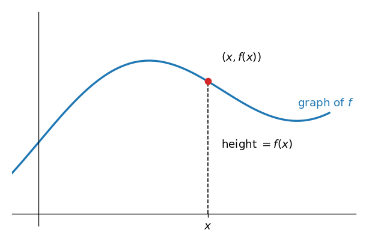

*그림 1. 함수 f의 그래프와 점 (x, f(x))의 높이*

$f(x)$를 $x$에 관한 식으로 쓸 수 있으면 $f$의 그래프는 $x$를 $f$의 정의역으로 제한했을 때 방정식 $y = f(x)$의 그래프와 같다.

### 1.2 거듭제곱 함수

실수 $x$를 그 거듭제곱 $x^a$로 보내는 함수를 **거듭제곱 함수(power function)** 라 한다. 컴퓨터 과학의 응용에서는 거의 언제나 $x$와 $a$가 음이 아닌 경우만 다루므로 정의도 이 경우로 제한한다.

> **용어 정의:** 음이 아닌 실수 $a$에 대해 **지수가 $a$인 거듭제곱 함수** $p_a$는 음이 아닌 모든 실수 $x$에 대해 $p_a(x) = x^a$로 정의한다.

**예제 11.1.1 (거듭제곱 함수의 그래프).** $p_0$, $p_{1/2}$, $p_1$, $p_2$의 그래프를 같은 좌표축 위에 그린다.

**풀이.** 각 함수가 지나는 점을 정의로부터 구한다.

- $p_0$: 음이 아닌 모든 $x$에 대해 $p_0(x) = x^0 = 1$이다(5장에서처럼 $0^0 = 1$로 정한다). $x \geq 0$인 모든 점 $(x, 1)$이 그래프 위에 있으므로 그래프는 가로축 위 높이 1에 놓인 수평 반직선이다.
- $p_1$: $p_1(x) = x$이므로 그래프는 점 $(x, x)$ 전체, 곧 원점에서 출발하는 기울기 1의 반직선이다.
- $p_{1/2}$: $p_{1/2}(x) = x^{1/2} = \sqrt{x}$이므로 그래프는 $(0, 0)$, $(1, 1)$, $(4, 2)$, $(9, 3)$ 같은 점을 지난다.
- $p_2$: $p_2(x) = x^2$이므로 그래프는 $(0, 0)$, $(1, 1)$, $(2, 4)$, $(3, 9)$ 같은 점을 지난다.

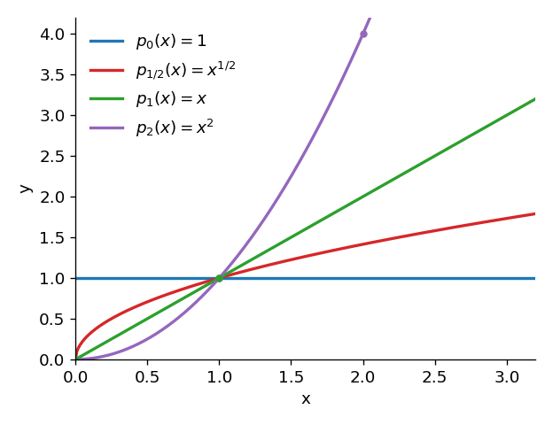

*그림 2. 거듭제곱 함수 p0, p1/2, p1, p2의 그래프*

네 그래프는 모두 점 $(1, 1)$을 지난다. $0 < x < 1$에서는 $x^2 < x < \sqrt{x} < 1$이어서 지수가 클수록 그래프가 낮고, $x > 1$에서는 $1 < \sqrt{x} < x < x^2$이어서 지수가 클수록 그래프가 높다. 알고리즘 분석에서 중요한 것은 큰 $x$에서의 순서이며, 2.5절에서 이를 정리로 다룬다.

### 1.3 바닥 함수의 그래프

바닥 함수와 천장 함수는 컴퓨터 과학의 여러 곳에 나온다(4장). 모든 실수 $x$는 정수이거나 연속한 두 정수 사이에 있으므로, 각 실수 $x$에 대해 $n \leq x < n + 1$을 만족하는 정수 $n$이 하나만 존재한다.

> **용어 정의:** **바닥 함수(floor)** $F$는 각 실수 $x$를 $x$ 이하인 가장 큰 정수, 곧 $n \leq x < n + 1$을 만족하는 유일한 정수 $n$으로 보낸다. 이 값을 $F(x) = \lfloor x \rfloor$로 쓴다. 수직선에서 $\lfloor x \rfloor$는 $x$ 자신이거나 $x$의 바로 왼쪽에 있는 정수이다.

**예제 11.1.2 (바닥 함수의 그래프).** 바닥 함수의 그래프를 그린다.

**풀이.** 정수 $n$에 대해 구간 $n \leq x < n + 1$에 속하는 모든 실수 $x$는 $\lfloor x \rfloor = n$이다. 따라서 각 구간에서 그래프는 높이 $n$인 수평 선분이고, 전체 그래프는 계단 모양이다. 각 선분의 왼쪽 끝점 $(n, n)$은 그래프에 속하지만 오른쪽 끝점 $(n + 1, n)$은 속하지 않으므로 빈 원으로 표시한다. 예를 들어 $\lfloor 2.7 \rfloor = 2$, $\lfloor 3 \rfloor = 3$, $\lfloor -0.5 \rfloor = -1$이다.

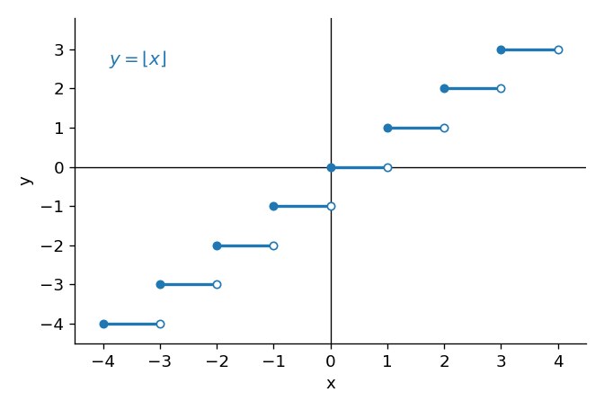

*그림 3. 계단 모양인 바닥 함수의 그래프*

천장 함수 $\lceil x \rceil$의 그래프도 같은 방법으로 구간마다 함숫값을 정해 그릴 수 있다.

### 1.4 정수 집합에서 정의된 함수의 그래프

컴퓨터 과학에서 쓰는 실숫값 함수 중 다수는 실수 구간이 아니라 정수 집합에서 정의된다. 어떤 식으로 실수 구간에서 정의된 함수의 그래프를 알고 있으면, 같은 식으로 그 구간의 정수에서만 정의된 함수의 그래프는 알고 있는 그래프에서 첫 좌표가 정수인 점만 골라 얻는다. 예를 들어 $p_1$과 같은 식을 쓰되 정의역이 음이 아닌 정수의 집합인 함수 $f$는 $f(n) = n$이고, 그 그래프는 $p_1$의 반직선에서 점 $(0, 0)$, $(1, 1)$, $(2, 2)$, $\ldots$만 남긴 것이다.

**예제 11.1.3 (정수 집합에서 정의된 함수의 그래프).** 음이 아닌 정수 $n$에 대해 $g(n) = n^{1/2}$로 정의된 함수 $g$의 그래프를 그린다.

**풀이.** $g$는 $p_{1/2}$의 정수 버전이다. 그림 2의 $p_{1/2}$ 그래프에서 첫 좌표가 정수인 점 $(n, n^{1/2})$만 남기면 $g$의 그래프가 된다. 예를 들어 $(0, 0)$, $(1, 1)$, $(4, 2)$, $(9, 3)$이 그 점이고, $(2, 1.414\ldots)$처럼 높이가 정수가 아닌 점도 있다. 점 사이를 선으로 잇지 않는다는 점이 실수 구간에서 정의된 함수와 다르다.

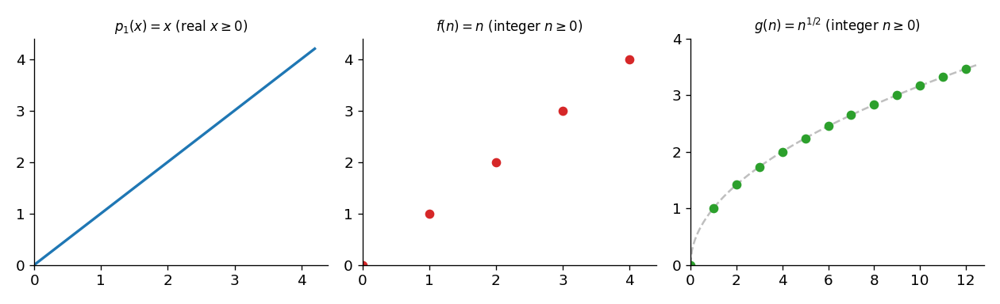

*그림 4. 실수에서 정의된 p1과 정수에서 정의된 f(n) = n, g(n) = n의 1/2제곱의 그래프*

### 1.5 함수의 배수와 그 그래프

함수의 모든 값에 같은 수를 곱해 얻는 함수를 그 함수의 **배수(multiple)** 라 한다. 빅오 표기법을 이해하려면 함수의 그래프와 그 배수의 그래프 사이의 관계를 알아야 한다.

> **용어 정의:** $f$가 실변수 실숫값 함수이고 $M$이 실수일 때, **$f$의 $M$배(multiple of $f$ by $M$)** $Mf$는 $f$와 정의역이 같고 $f$의 정의역에 속하는 각 $x$에 대해 $(Mf)(x) = M \cdot f(x)$로 정의되는 실숫값 함수이다.

$Mf$의 그래프의 $x$에서의 높이는 $f(x)$에 $M$을 곱한 값이다. 따라서 $f$의 그래프를 알면 각 $x$에서 높이를 $M$배 하여 $Mf$의 그래프를 그릴 수 있다.

**예제 11.1.4 (함수의 배수의 그래프).** 그림 5의 왼쪽은 꺾은선으로 된 함수 $f$의 그래프이다. $2f$의 그래프를 그린다.

**풀이.** 각 $x$에서 $f$의 높이를 2배 한다. 예를 들어 $f(-2.5) = 2$이므로 $(2f)(-2.5) = 4$이고, $f(2) = -2$이므로 $(2f)(2) = -4$이며, $f(0) = -1$이므로 $(2f)(0) = -2$이다. $f(x) = 0$인 점 $x = -3, -1, 5$에서는 $2f$의 값도 0이다. 꺾이는 점의 높이를 모두 2배 하여 이으면 그림 5의 오른쪽 그래프가 된다. 두 그래프의 모양은 비슷하지만 $2f$의 그래프는 세로로 늘어나서, 높은 곳은 두 배 높아지고 낮은 곳은 두 배 낮아진다.

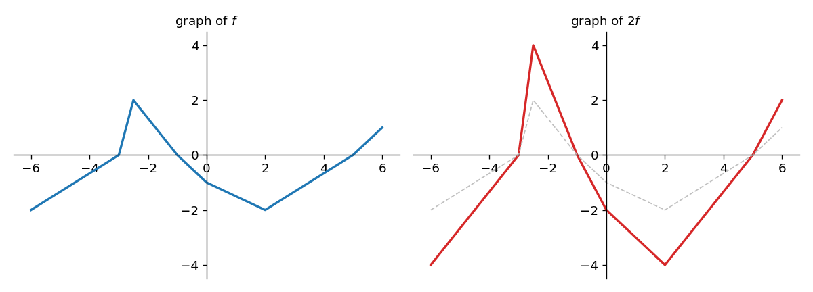

*그림 5. 함수 f의 그래프와 각 높이를 2배 한 2f의 그래프*

### 1.6 증가 함수와 감소 함수

**절댓값 함수(absolute value function)** $A$는 각 실수 $x$에 대해 다음과 같이 정의한다.

$$
A(x) = |x| = \begin{cases} x & (x \geq 0) \\ -x & (x < 0) \end{cases}
$$

$x \geq 0$에서 $A$의 그래프는 원점을 지나는 기울기 1의 직선 $y = x$와 같고, $x < 0$에서는 원점을 지나는 기울기 $-1$의 직선 $y = -x$와 같다.

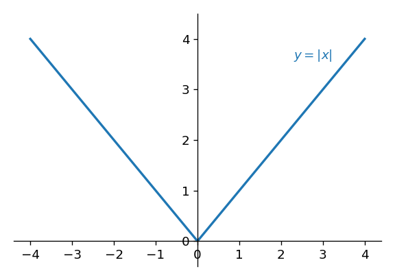

*그림 6. 절댓값 함수의 그래프*

그래프를 왼쪽에서 오른쪽으로 따라가면 원점의 왼쪽에서는 높이가 계속 줄어들고, 원점의 오른쪽에서는 높이가 계속 늘어난다. 그래서 절댓값 함수는 음의 실수 집합에서 감소하고 양의 실수 집합에서 증가한다고 말한다. $x$에서 그래프의 높이가 $f(x)$이므로 이 기하적 개념은 다음 정의로 옮겨진다.

> **용어 정의:** $f$를 실수로 이루어진 집합에서 정의된 실숫값 함수라 하고, $f$의 정의역이 집합 $S$를 포함한다고 가정한다. $S$의 모든 실수 $x_1$, $x_2$에 대해 $x_1 < x_2$이면 $f(x_1) < f(x_2)$일 때 $f$는 $S$에서 **증가(increasing)** 한다고 한다. $S$의 모든 실수 $x_1$, $x_2$에 대해 $x_1 < x_2$이면 $f(x_1) > f(x_2)$일 때 $f$는 $S$에서 **감소(decreasing)** 한다고 한다. 정의역 전체에서 증가하는 함수를 **증가 함수(increasing function)**, 정의역 전체에서 감소하는 함수를 **감소 함수(decreasing function)** 라 한다.

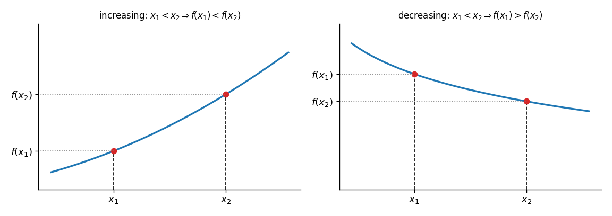

*그림 7. 증가 함수와 감소 함수에서 x1 < x2일 때 함숫값의 대소*

> **주의:** 증가와 감소는 집합 $S$에 따라 달라진다. 절댓값 함수는 증가 함수도 감소 함수도 아니지만, 양의 실수 집합에서는 증가하고 음의 실수 집합에서는 감소한다. 또 정의의 부등호가 엄격하므로($f(x_1) < f(x_2)$), 상수 함수는 원소가 둘 이상인 어떤 집합에서도 증가하지도 감소하지도 않는다.

증가 함수와 감소 함수는 모두 일대일 함수이다(일대일 함수는 7장). $f$가 증가 함수이고 $x_1 \neq x_2$이면 둘 중 하나가 더 작으므로 $x_1 < x_2$로 이름을 붙일 수 있다. 그러면 $f(x_1) < f(x_2)$이므로 $f(x_1) \neq f(x_2)$이다. 감소 함수도 부등호의 방향만 바꾸면 같다.

**예제 11.1.5 (증가 함수의 양수배는 증가한다).** $f$가 실수의 집합 $S$에서 증가하는 실변수 실숫값 함수이고 $M$이 양의 실수이면 $Mf$도 $S$에서 증가함을 보인다.

**증명.** $x_1$, $x_2$를 $x_1 < x_2$인 $S$의 원소로, 특정하지만 임의로 택한다. 보일 것은 $(Mf)(x_1) < (Mf)(x_2)$이다.

1. $x_1 < x_2$이고 $f$가 $S$에서 증가하므로 $f(x_1) < f(x_2)$이다.
2. 부등식의 양변에 양수 $M$을 곱해도 부등호의 방향은 바뀌지 않으므로 $M f(x_1) < M f(x_2)$이다.
3. $Mf$의 정의에 따라 $M f(x_1) = (Mf)(x_1)$, $M f(x_2) = (Mf)(x_2)$이므로 $(Mf)(x_1) < (Mf)(x_2)$이다.

$x_1$, $x_2$를 임의로 골랐으므로 $Mf$는 $S$에서 증가한다.

같은 방법으로 감소 함수의 양수배는 감소하고, 증가 함수의 음수배는 감소하며, 감소 함수의 음수배는 증가한다. 음수를 곱하면 부등호의 방향이 바뀌기 때문이다.

> **핵심:** 함수 $f$에 양수 $M$을 곱하면 그래프의 모양은 유지되고 높이만 $M$배가 된다. 2절의 차수 표기법은 충분히 큰 $n$에서 $f$의 그래프가 어떤 함수 $g$의 양수배 $Ag$보다 위에 있는지, $Bg$보다 아래에 있는지를 묻는다.

---

<br>

## 2. 빅오, 빅오메가, 빅세타 표기법

### 2.1 알고리즘의 효율성을 비교하는 이유

알고리즘의 효율성은 이론의 문제에 그치지 않는다. 산업과 과학 현장에서는 더 빠른 알고리즘이 비용을 크게 줄이고, 때로는 어떤 계산을 해낼 수 있는지 없는지를 가르기도 한다. 알고리즘을 실행하는 비용과 실현 가능성을 가장 크게 좌우하는 자원은 필요한 계산 시간과 메모리이다. 이 장은 둘 중 대개 더 중요한 시간을 재는 기본 기법을 다룬다. 다만 한 알고리즘이 다른 알고리즘보다 시간은 적게 쓰지만 메모리는 더 많이 쓰는 경우에는, 어느 쪽을 고를지가 사용할 수 있는 자원에 달려 있다.

이 장에서 주로 분석하는 알고리즘은 두 종류이다. 하나는 데이터 배열에서 주어진 원소를 찾는 탐색 알고리즘이고, 다른 하나는 배열을 오름차순이나 내림차순으로 늘어놓는 정렬 알고리즘이다. 탐색은 첫 단계에서 바로 성공할 수도 있고(**최선의 경우(best case)**), 모든 원소를 살펴본 뒤에야 끝날 수도 있다(**최악의 경우(worst case)**). 어느 경우가 될지는 입력에 달려 있어 미리 알 수 없으므로, 두 알고리즘을 비교할 때는 최악의 경우에도 성능을 보장할 수 있는지에 주목하는 것이 합리적이다. 이렇게 얻는 값은 근삿값이지만, 입력이 크고 최악의 경우일 때 같은 문제를 푸는 알고리즘 사이의 뚜렷한 차이를 보여 준다.

그림 8은 두 정렬 알고리즘인 삽입 정렬(3.4절)과 병합 정렬(5.4절)이 최악의 경우에 하는 비교 횟수를 입력 배열의 길이 $n$에 따라 그린 것이다. 배열이 길어질수록 두 곡선의 차이는 급격히 커진다. 비교 한 번에 1나노초($10^{-9}$초)가 걸린다고 가정하면, 항목 1천만 개를 정렬할 때 병합 정렬의 최악의 비교 횟수 약 $2.2 \times 10^8$번은 약 0.22초이지만 삽입 정렬의 약 $5 \times 10^{13}$번은 약 14시간이다.

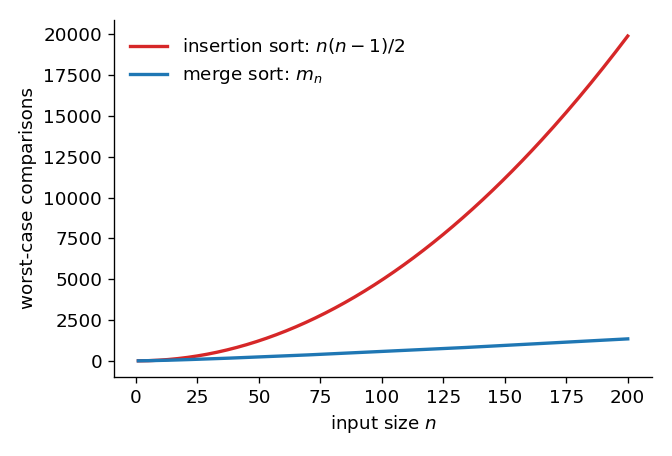

*그림 8. 입력 길이에 따른 삽입 정렬과 병합 정렬의 최악의 경우 비교 횟수*

### 2.2 세 가지 차수 표기법의 정의

기호 $\Theta$와 $\Omega$는 그리스 문자 세타와 오메가의 대문자이다. 가장 오래된 **빅오 표기법(O-notation)** 은 1894년 독일 수학자 바흐만(Paul Bachmann)이 해석적 정수론 책에서 도입했고, 알고리즘의 효율성 비교에 처음 쓰인 표기법이다. 그러나 빅오 표기법만 쓰면 결과가 모호하거나 오해를 낳을 수 있어서, 1976년 알고리즘 분석의 개척자인 커누스(Donald Knuth)가 함수의 증가를 더 정밀하게 비교하도록 **빅오메가 표기법(Ω-notation)** 과 **빅세타 표기법(Θ-notation)** 을 도입했다.

세 표기법의 생각은 다음과 같다. $f$와 $g$가 정수 변수 $n$의 실숫값 함수이고, 어떤 양의 실수보다 큰 모든 정수 $n$에서 $g(n) \geq 0$이라 가정한다.

1. 충분히 큰 $n$에서 $f$의 값이 $g$의 어떤 양수배의 값 이상이면 $f$의 **차수(order)** 는 적어도 $g$이며, "$f(n)$은 $\Omega(g(n))$이다"라고 쓴다.
2. 충분히 큰 $n$에서 $f$의 값이 음이 아니고 $g$의 어떤 양수배의 값 이하이면 $f$의 차수는 많아야 $g$이며, "$f(n)$은 $O(g(n))$이다"라고 쓴다.
3. 충분히 큰 $n$에서 $f$의 값이 $g$의 두 양수배 사이에 있으면 $f$의 차수는 $g$이며, "$f(n)$은 $\Theta(g(n))$이다"라고 쓴다.

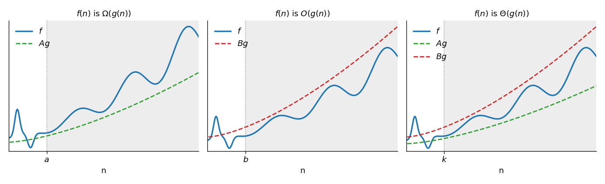

*그림 9. f(n)이 g(n)의 빅오메가, 빅오, 빅세타일 때 f와 Ag, Bg의 위치*

차수 표기법은 처음에 실수 구간에서 정의된 함수에 대해 만들어졌다. 그러나 알고리즘 분석에서 관심을 두는 변수는 풀려는 문제의 크기, 예를 들어 정렬할 항목의 수나 최소 신장 트리를 구할 그래프의 꼭짓점 수이며, 이 크기는 언제나 정수이다. 구간의 모든 실수에서 참인 성질은 그 구간의 모든 정수에서도 참이고, 이 장의 논증은 "모든 정수 $n$에 대해"를 "모든 실수 $x$에 대해"로 바꾸어도 그대로 성립한다. 그래서 이 장은 정수 집합에서 정의된 함수로 결과를 말하면서도 그래프는 연속 곡선으로 그린다. 1.4절처럼 떨어진 점들로 생각해도 된다.

> **용어 정의:** $f$와 $g$를 음이 아닌 정수로 된 같은 집합에서 정의된 실숫값 함수라 하고, 어떤 양의 실수 $r$에 대해 $n \geq r$인 모든 정수 $n$에서 $g(n) \geq 0$이라 한다.
>
> 1. 양의 실수 $A$와 $a \geq r$인 양의 실수 $a$가 존재하여 $n \geq a$인 모든 정수 $n$에서 $A g(n) \leq f(n)$이면, $f$의 차수는 **적어도 $g$** 이고 $f(n)$은 $\Omega(g(n))$이라 쓴다("$f$ of $n$ is big-Omega of $g$ of $n$").
> 2. 양의 실수 $B$와 $b \geq r$인 양의 실수 $b$가 존재하여 $n \geq b$인 모든 정수 $n$에서 $0 \leq f(n) \leq B g(n)$이면, $f$의 차수는 **많아야 $g$** 이고 $f(n)$은 $O(g(n))$이라 쓴다("$f$ of $n$ is big-O of $g$ of $n$").
> 3. 양의 실수 $A$, $B$와 $k \geq r$인 양의 실수 $k$가 존재하여 $n \geq k$인 모든 정수 $n$에서 $A g(n) \leq f(n) \leq B g(n)$이면, $f$의 차수는 **$g$** 이고 $f(n)$은 $\Theta(g(n))$이라 쓴다("$f$ of $n$ is big-Theta of $g$ of $n$").

**표기에 관한 주의.** 7장에서는 함수 $f$와 그 값 $f(n)$을 구별했지만, 차수 표기법은 관례상 이 구별을 따르지 않는다. "$f(n)$은 $\Theta(g(n))$이다"에서 $f(n)$과 $g(n)$은 그 식으로 정의되는 함수 $f$와 $g$를 가리킨다. 예를 들어 "$3n^2 + 4n + 5$는 $\Theta(n^2)$이다"는 $n \geq 1$인 모든 정수에서 $f(n) = 3n^2 + 4n + 5$, $g(n) = n^2$으로 정의된 함수 $f$의 차수가 $g$라는 뜻이다.

> **주의:** "$f(n)$은 $O(g(n))$이다"의 "이다"는 등호가 아니다. 다른 문헌에서는 같은 뜻으로 $f(n) = O(g(n))$이라고도 쓰지만, 이것은 $f$가 빅오 표기법의 조건을 만족한다는 뜻일 뿐이므로 양변을 바꿀 수 없다. 예를 들어 $n$과 $n^2$은 모두 $O(n^2)$이지만 $n = n^2$은 아니다.

> **참고:** 정의를 부정하면 어떤 관계가 성립하지 않음을 보일 때 쓸 수 있다. "$f(n)$은 $O(g(n))$이다"의 부정은 "양의 실수 $B$와 $b \geq r$를 어떻게 골라도, $f(n) < 0$이거나 $f(n) > B g(n)$인 정수 $n \geq b$가 있다"이다. 2.7절의 증명이 이 형태를 쓴다.

### 2.3 부등식을 차수 표기법으로 옮기기

차수 표기법의 정의는 "상수와 시작점이 존재하여 어떤 부등식이 성립한다"는 꼴이다. 따라서 상수와 시작점이 주어진 부등식은 정의에 맞추어 바로 차수 표기법으로 옮길 수 있다.

**예제 11.2.1 (빅세타 표기법으로 옮기기).** $n \geq 3$인 모든 정수 $n$에 대해 다음이 성립한다는 문장을 빅세타 표기법으로 나타낸다.

$$
4n^6 \leq 17n^6 - 45n^3 + 2n + 8 \leq 30n^6
$$

**풀이.** $A = 4$, $B = 30$, $k = 3$으로 두면 이 문장은 "$n \geq k$인 모든 정수 $n$에서 $An^6 \leq 17n^6 - 45n^3 + 2n + 8 \leq Bn^6$"이 된다. $g(n) = n^6$은 음이 아니므로 이것은 빅세타 표기법의 정의 그대로이고, $17n^6 - 45n^3 + 2n + 8$은 $\Theta(n^6)$이다.

**예제 11.2.2 (빅오메가와 빅오로 옮긴 뒤 빅세타 이끌어 내기).** 다음 세 문장을 다룬다.

$$
\text{(a)}\ \ \frac{11}{4}n^2 \leq 3\left\lfloor \frac{n}{4} \right\rfloor^2 + 5n^2 \ \ (n \geq 2), \qquad \text{(b)}\ \ 0 \leq 3\left\lfloor \frac{n}{4} \right\rfloor^2 + 5n^2 \leq 6n^2 \ \ (n \geq 1)
$$

(a)는 빅오메가 표기법으로, (b)는 빅오 표기법으로 나타내고, (c) $3\lfloor n/4 \rfloor^2 + 5n^2$이 $\Theta(n^2)$인 이유를 설명한다.

**풀이.**

- (a) $A = \frac{11}{4}$, $a = 2$로 두면 문장은 "$n \geq a$인 모든 정수 $n$에서 $An^2 \leq 3\lfloor n/4 \rfloor^2 + 5n^2$"이므로 $3\lfloor n/4 \rfloor^2 + 5n^2$은 $\Omega(n^2)$이다.
- (b) $B = 6$, $b = 1$로 두면 문장은 "$n \geq b$인 모든 정수 $n$에서 $0 \leq 3\lfloor n/4 \rfloor^2 + 5n^2 \leq Bn^2$"이므로 $3\lfloor n/4 \rfloor^2 + 5n^2$은 $O(n^2)$이다.
- (c) $A = \frac{11}{4}$, $B = 6$으로 두고 $k$를 $a$와 $b$ 중 큰 수, 곧 $k = 2$로 둔다. $n \geq k$이면 (a)와 (b)의 부등식이 모두 성립하므로 $An^2 \leq 3\lfloor n/4 \rfloor^2 + 5n^2 \leq Bn^2$이고, 빅세타 표기법의 정의에 따라 $3\lfloor n/4 \rfloor^2 + 5n^2$은 $\Theta(n^2)$이다.

(a)와 (b)의 부등식 자체도 쉽게 확인된다. (a)는 $3\lfloor n/4 \rfloor^2 \geq 0$이고 $5n^2 \geq \frac{11}{4}n^2$이기 때문에 성립한다. (b)는 $n \geq 1$이면 $0 \leq \lfloor n/4 \rfloor \leq n/4$이므로 $3\lfloor n/4 \rfloor^2 \leq \frac{3}{16}n^2 \leq n^2$이 되어 성립한다.

### 2.4 세 표기법 사이의 관계

앞 예제의 (c)는 $f$의 차수가 많아야 $g$이고 적어도 $g$임을 알면, 두 정의가 약속하는 $a$와 $b$ 중 큰 수를 $k$로 잡아 $f$의 차수가 $g$라고 결론 내릴 수 있음을 보여 준다. 거꾸로 $f$의 차수가 $g$이면 빅세타 표기법의 정의가 약속하는 $k$를 $a$와 $b$로 모두 쓸 수 있다.

**정리 11.2.1 ($O$, $\Omega$, $\Theta$ 표기법의 관계).** $f$와 $g$가 음이 아닌 정수로 된 같은 집합에서 정의된 실숫값 함수이고, 어떤 양의 실수 $r$에 대해 $n \geq r$인 모든 정수 $n$에서 $f(n) \geq 0$이고 $g(n) \geq 0$이라 한다. 그러면 $f(n)$이 $\Theta(g(n))$일 필요충분조건은 $f(n)$이 $\Omega(g(n))$이고 $f(n)$이 $O(g(n))$인 것이다.

**증명.** 두 방향을 따로 보인다.

- ($\Rightarrow$) $f(n)$이 $\Theta(g(n))$이면 양의 실수 $A$, $B$와 $k \geq r$가 있어 $n \geq k$에서 $A g(n) \leq f(n) \leq B g(n)$이다. $a = k$로 두면 왼쪽 부등식에서 $f(n)$은 $\Omega(g(n))$이다. $b = k$로 두면 $n \geq k \geq r$에서 $g(n) \geq 0$이고 $A > 0$이므로 $0 \leq A g(n) \leq f(n) \leq B g(n)$이 되어 $f(n)$은 $O(g(n))$이다.
- ($\Leftarrow$) $f(n)$이 $\Omega(g(n))$이므로 $n \geq a$에서 $A g(n) \leq f(n)$인 $A$, $a$가 있고, $O(g(n))$이므로 $n \geq b$에서 $0 \leq f(n) \leq B g(n)$인 $B$, $b$가 있다. $k = \max(a, b)$로 두면 $k \geq r$이고 $n \geq k$에서 두 부등식이 모두 성립하므로 $A g(n) \leq f(n) \leq B g(n)$이다. 따라서 $f(n)$은 $\Theta(g(n))$이다.

### 2.5 거듭제곱 함수의 차수

알고리즘의 효율성을 비교하는 데 가장 흔히 쓰는 함수는 $n^{1/2}$, $n$, $n^2$, $n^3$ 같은 거듭제곱 함수와, 거듭제곱 함수에 지수 함수나 로그 함수가 결합된 $2^n$, $\log n$, $n \log n$, $n^2 \log n$ 같은 함수이다. 이 함수들은 알고리즘 분석에서 자연스럽게 나타나며, 큰 $n$에서 크기가 극적으로 다르다. 이 절은 거듭제곱 함수를 다루고, 로그가 들어간 함수는 4절에서 다룬다.

$1 \leq n$이면 양변에 양수 $n$을 곱해 $n \leq n^2$을 얻고, 다시 $n$을 곱해 $n^2 \leq n^3$을 얻는다. 순서의 추이성에 따라 $n \geq 1$이면 $1 \leq n \leq n^2 \leq n^3$이다. 다음 정리는 이를 일반화한다.

**정리 11.2.2.** 임의의 양의 유리수 $r$, $s$와 $n \geq 1$인 임의의 정수 $n$에 대해, $r \leq s$이면 $n^r \leq n^s$이다.

**증명.** $n^s = n^r \cdot n^{s-r}$이고 $n^r > 0$이므로 $n^{s-r} \geq 1$만 보이면 된다. 음이 아닌 유리수 $s - r$를 $p/q$($p$는 음이 아닌 정수, $q$는 양의 정수)로 쓴다. $n \geq 1$이므로 $n^p \geq 1$이다. $n^{p/q}$는 $q$제곱하면 $n^p$가 되는 양수인데, 만약 $n^{p/q} < 1$이면 1보다 작은 양수를 $q$번 곱한 $n^p$도 1보다 작아 모순이다. 따라서 $n^{p/q} \geq 1$이다.

지수가 무리수인 양의 실수일 때도 $n \geq 1$에서 $n^r \leq n^s$가 성립하며, 이후의 정리는 이 사실을 양의 실수 지수에 대해 쓴다.

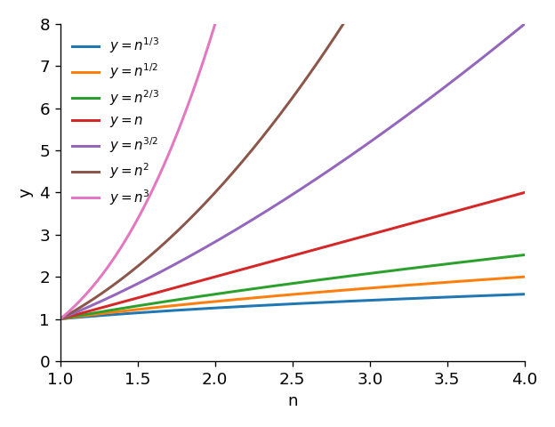

*그림 10. n이 1 이상일 때 n의 여러 거듭제곱의 그래프*

그림 10처럼 $r < s$이면 $n > 1$에서 $y = n^r$의 그래프는 $y = n^s$의 그래프 아래에 있다.

### 2.6 다항식 함수의 차수

정리 11.2.2를 이용하면 다항식 함수의 빅오메가와 빅오를 찾을 수 있다.

**예제 11.2.3 (계수가 모두 양수인 다항식).** (a) $15n^3 + 11n^2 + 9$가 $\Omega(n^3)$임을 보인다. (b) (a)를 쓰지 않고 $15n^3 + 11n^2 + 9$가 $O(n^3)$임을 보인다.

**풀이.**

- (a) 충분히 큰 $n$에서 $15n^3 + 11n^2 + 9$가 $n^3$의 어떤 양수배 이상임을 보이면 된다. $n \geq 1$이면 $11n^2 + 9$가 양수이므로 $15n^3 \leq 15n^3 + 11n^2 + 9$이다. $A = 15$, $a = 1$로 두면 $n \geq a$인 모든 정수에서 $An^3 \leq 15n^3 + 11n^2 + 9$이므로 빅오메가 표기법의 정의에 따라 $15n^3 + 11n^2 + 9$는 $\Omega(n^3)$이다.
- (b) 충분히 큰 $n$에서 $15n^3 + 11n^2 + 9$가 0 이상이고 $n^3$의 어떤 양수배 이하임을 보이면 된다. 모든 항이 양수이므로 $n \geq 1$에서 $0 \leq 15n^3 + 11n^2 + 9$이다. 또 $n \geq 1$이면 정리 11.2.2에 따라 $n^2 \leq n^3$이고 $1 \leq n^3$이므로 $11n^2 \leq 11n^3$, $9 \leq 9n^3$이다. 따라서 다음이 성립한다.

$$
15n^3 + 11n^2 + 9 \leq 15n^3 + 11n^3 + 9n^3 = 35n^3 \qquad (n \geq 1)
$$

$B = 35$, $b = 1$로 두면 $n \geq b$인 모든 정수에서 $0 \leq 15n^3 + 11n^2 + 9 \leq Bn^3$이므로 $15n^3 + 11n^2 + 9$는 $O(n^3)$이다.

**예제 11.2.4 (음의 계수가 있는 다항식).** (a) $n^4 - 5n - 8$이 $\Omega(n^4)$임을 보인다. (b) $n^4 - 5n - 8$이 $O(n^4)$임을 보인다.

**풀이 (a).** $n \geq a$인 모든 정수에서 $An^4 \leq n^4 - 5n - 8$인 양의 실수 $A$와 $a$를 찾아야 한다. 음의 항이 있으므로 앞 예제의 (a)처럼 양의 항을 버리는 방법은 쓸 수 없다. 두 방법을 보인다.

**방법 1 (그때그때의 계산).** $A = \frac{1}{2}$로 정하고 다음 동치 관계를 따라간다.

$$
\frac{1}{2}n^4 \leq n^4 - 5n - 8 \iff 5n + 8 \leq \frac{1}{2}n^4 \iff \frac{10}{n^2} + \frac{16}{n^3} \leq n
$$

첫 동치는 양변에 $5n + 8 - \frac{1}{2}n^4$을 더해 얻고, 둘째 동치는 양변에 양수 $\frac{2}{n^3}$을 곱해 얻는다. 두 연산 모두 부등호의 방향을 보존하므로 세 부등식은 서로 동치이고, 마지막 부등식을 만족하는 $n$은 첫 부등식도 만족한다. 몇 번 시도해 보면 마지막 부등식은 $n \geq 3$에서 성립한다. $n \geq 3$이면 $\frac{1}{n} \leq \frac{1}{3}$이므로 다음과 같다.

$$
\frac{10}{n^2} + \frac{16}{n^3} \leq \frac{10}{3^2} + \frac{16}{3^3} = \frac{46}{27} < 2 < 3 \leq n
$$

따라서 $n \geq 3$인 모든 정수에서 $\frac{1}{2}n^4 \leq n^4 - 5n - 8$이다. $A = \frac{1}{2}$, $a = 3$으로 두면 $n^4 - 5n - 8$은 $\Omega(n^4)$이다.

**방법 2 (일반적인 절차).** $m$을 음이 아닌 정수, $P(n)$을 $m$차 다항식이라 하고 $n^m$의 계수 $a_m$이 양수라 한다. $A = \frac{1}{2}a_m$으로 두고 $a$를 다음과 같이 정한다.

1. $a_m$을 뺀 $P(n)$의 모든 계수의 절댓값을 더한다.
2. 1단계의 결과에 $\frac{2}{a_m}$을 곱한다.
3. 1과 2단계의 결과 중 큰 수를 $a$로 둔다.

그러면 $n \geq a$인 모든 정수에서 $An^m \leq P(n)$이다. $n^4 - 5n - 8$에서는 최고차항의 계수가 1이고 나머지 계수의 절댓값의 합이 $|-5| + |-8| = 13$이므로 $A = \frac{1}{2}$, $a = \max(1, \frac{2}{1} \cdot 13) = 26$이다. 확인하면, $n \geq 26$이면 $n \geq 2(|-5| + |-8|)$이고 양변에 $\frac{1}{2}n^3$을 곱해 다음을 얻는다.

$$
\frac{1}{2}n^4 \geq (|-5| + |-8|)n^3 = 5n^3 + 8n^3 \geq 5n + 8
$$

마지막 부등식은 $n \geq 1$이면 $5n^3 \geq 5n$이고 $8n^3 \geq 8$이기 때문이다. 양변에서 $5n + 8$을 빼고 $\frac{1}{2}n^4$을 더하면 $n \geq 26$에서 $n^4 - 5n - 8 \geq \frac{1}{2}n^4$이므로 $n^4 - 5n - 8$은 $\Omega(n^4)$이다.

방법 2가 모든 다항식에서 성립하는 이유는 다음과 같다. $m \geq 1$이고 $S$를 $a_m$을 뺀 계수의 절댓값의 합이라 한다. $n \geq 1$이면 $i \leq m - 1$인 각 $i$에 대해 $a_i n^i \geq -|a_i| n^i \geq -|a_i| n^{m-1}$이므로 $P(n) \geq a_m n^m - S n^{m-1}$이다. $n \geq \frac{2S}{a_m}$이면 $S n^{m-1} \leq \frac{a_m}{2} n^m$이므로 $P(n) \geq a_m n^m - \frac{a_m}{2} n^m = \frac{a_m}{2} n^m$이다. $m = 0$이면 $P(n) = a_0 \geq \frac{a_0}{2}$이므로 그대로 성립한다.

> **주의:** 방법 1과 방법 2는 서로 다른 시작점($a = 3$과 $a = 26$)을 준다. 차수 표기법의 정의는 조건을 만족하는 상수와 시작점이 존재하기만 하면 되므로 이 값들은 하나로 정해지지 않으며, 어느 쪽을 써도 결론은 같다.

**풀이 (b).** $n \geq 1$이면 다음이 성립한다.

$$
n^4 - 5n - 8 \leq n^4 + 5n + 8 \leq n^4 + 5n^4 + 8n^4 = 14n^4
$$

첫 부등식은 $n \geq 1$에서 $5n + 8$이 양수여서 $-5n - 8 < 5n + 8$이기 때문이고, 둘째 부등식은 정리 11.2.2에 따라 $n \leq n^4$, $1 \leq n^4$이기 때문이다. 또 (a)에서 $n \geq 3$이면 $\frac{1}{2}n^4 \leq n^4 - 5n - 8$이고 $0 \leq \frac{1}{2}n^4$이므로, $n \geq 3$인 모든 정수에서 $0 \leq n^4 - 5n - 8 \leq 14n^4$이다. $B = 14$, $b = 3$으로 두면 $n^4 - 5n - 8$은 $O(n^4)$이다.

> **주의:** 빅오 표기법은 $0 \leq f(n)$도 요구한다. $n^4 - 5n - 8$은 $n = 1$에서 $-12$, $n = 2$에서 $-2$로 음수이므로 $b = 1$로는 정의를 만족하지 않고, $b = 3$처럼 함숫값이 음이 아닌 범위에서 시작해야 한다.

**예제 11.2.5 (다항식의 빅세타).** (a) $15n^3 + 11n^2 + 9$는 $\Theta(n^3)$이다. (b) $n^4 - 5n - 8$은 $\Theta(n^4)$이다.

**풀이.** (a) 예제 11.2.3에서 $15n^3 + 11n^2 + 9$는 $\Omega(n^3)$이고 $O(n^3)$이므로 정리 11.2.1에 따라 $\Theta(n^3)$이다. (b) 예제 11.2.4에서 $n^4 - 5n - 8$은 $\Omega(n^4)$이고 $O(n^4)$이므로 정리 11.2.1에 따라 $\Theta(n^4)$이다.

### 2.7 빅오 표기법으로 알 수 없는 것

**정리 11.2.3 (빅오로부터 알 수 있는 것의 한계).** 임의의 함수 $f$와 $r < s$인 양의 실수 $r$, $s$에 대해, $f(n)$이 $O(n^r)$이면 $f(n)$은 $O(n^s)$이다.

**증명.** $f(n)$이 $O(n^r)$이므로 빅오 표기법의 정의에 따라 $n \geq b$인 모든 정수에서 $0 \leq f(n) \leq B n^r$인 양의 실수 $B$, $b$가 있다. 정리 11.2.2에 따라 $n \geq 1$인 모든 정수에서 $B n^r \leq B n^s$이다. $b_1$을 $b$와 1 중 큰 수로 두면 $n \geq b_1$인 모든 정수에서 $0 \leq f(n) \leq B n^s$이므로 $f(n)$은 $O(n^s)$이다.

이 정리에 따르면 어떤 함수가 다른 함수의 빅오라는 사실은 그 함수의 증가에 관한 부분적인 정보만 준다.

**예제 11.2.6 (빅오 표기법에 관한 주의).** $f(n)$이 $O(n^5)$이고 $g(n)$이 $O(n^4)$임을 알았을 때, $4 < 5$이므로 큰 $n$에서 $g$의 그래프가 $f$의 그래프 아래에 있다고 결론 내리기 쉽다. 그렇지 않을 수 있음을, $f(n)$이 $O(n^5)$이고 $g(n)$이 $O(n^4)$이지만 큰 $n$에서 $f$의 그래프가 $g$의 그래프 아래에 있는 예로 보인다.

**풀이.** $f(n) = 15n^3 + 11n^2 + 9$, $g(n) = n^4 - 5n - 8$로 둔다. $f(n)$은 $O(n^3)$이므로 정리 11.2.3에 따라 $O(n^5)$이고, 2.6절에서 $g(n)$은 $O(n^4)$이다. 그러나 그림 11처럼 $n \geq 16$에서는 $g$의 그래프가 $f$의 그래프 위에 있다.

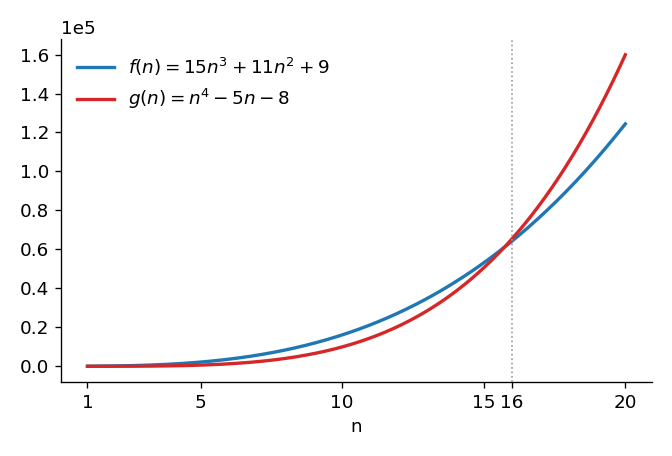

*그림 11. f(n) = 15n³ + 11n² + 9와 g(n) = n⁴ − 5n − 8의 그래프*

이 결과는 다음 동치 관계로 확인된다. 마지막 동치는 양변을 양수 $n^3$으로 나누어 얻는다.

$$
g(n) \geq f(n) \iff n^4 - 5n - 8 \geq 15n^3 + 11n^2 + 9 \iff n^4 \geq 15n^3 + 11n^2 + 5n + 17 \iff n \geq 15 + \frac{11}{n} + \frac{5}{n^2} + \frac{17}{n^3}
$$

$n \geq 16$이면 $\frac{1}{n} \leq \frac{1}{16}$이므로 마지막 부등식의 오른쪽은 다음을 넘지 않는다.

$$
15 + \frac{11}{16} + \frac{5}{16^2} + \frac{17}{16^3} \approx 15.71 \leq 16 \leq n
$$

따라서 $n \geq 16$인 모든 정수에서 $n^4 - 5n - 8 \geq 15n^3 + 11n^2 + 9$이다. $n = 15$에서는 $g(15) = 50{,}542 < 53{,}109 = f(15)$이므로 16은 이 부등식이 성립하기 시작하는 가장 작은 정수이다. 따라서 두 그래프 주위에 띠를 그리면, $n \geq 16$에서 $g$를 둘러싼 띠가 $f$를 둘러싼 띠보다 완전히 위에 있도록 그릴 수 있다.

**예제 11.2.7 (한 함수가 다른 함수의 빅오가 아님을 보이기).** $g(n) = n^4 - 5n - 8$은 $\Omega(n^4)$이다(2.6절). $r < 4$인 어떤 양의 실수 $r$에 대해서도 $g(n)$이 $O(n^r)$이 아님을 보인다.

**풀이.** 귀류법을 쓴다. $r < 4$인 양의 실수 $r$가 있어 $g(n)$이 $O(n^r)$이라고 가정한다. 그러면 $n \geq b$인 모든 정수에서 $0 \leq g(n) \leq B n^r$인 양의 실수 $B$, $b$가 있다. 또 $g(n)$이 $\Omega(n^4)$이므로 $n \geq a$인 모든 정수에서 $A n^4 \leq g(n)$인 양의 실수 $A$, $a$가 있다. $t$를 $a$와 $b$ 중 큰 수로 두면 $n \geq t$인 모든 정수에서 다음이 차례로 성립한다.

$$
A n^4 \leq g(n) \leq B n^r \implies \frac{n^4}{n^r} \leq \frac{B}{A} \implies n^{4-r} \leq \frac{B}{A} \implies n \leq \left(\frac{B}{A}\right)^{1/(4-r)}
$$

첫 단계는 순서의 추이성과 양변을 양수 $A n^r$로 나눈 것이고, 둘째 단계는 지수 법칙이며, 마지막 단계는 양변의 $(4 - r)$제곱근을 취한 것이다. $r < 4$이므로 $4 - r > 0$이고, 오른쪽 $(B/A)^{1/(4-r)}$은 고정된 양의 실수이다. 그런데 $n$은 $t$ 이상인 모든 정수를 돌므로 이 고정된 수보다 큰 값도 가진다. 이는 모순이므로 가정이 거짓이고, $r < 4$인 모든 양의 실수 $r$에 대해 $g(n)$은 $O(n^r)$이 아니다.

다음 정리는 이 예제를 일반화한 것이며, 같은 방법으로 증명한다($4$를 $m$으로, $r$를 $p$로 바꾼다).

**정리 11.2.4 (빅오 관계가 성립하지 않음을 보이기).** $f$가 음이 아닌 정수의 집합에서 정의된 실숫값 함수이고 $m$이 양의 정수이며 $f(n)$이 $\Omega(n^m)$이면, $p < m$인 어떤 양의 실수 $p$에 대해서도 $f(n)$은 $O(n^p)$이 아니다.

> **핵심:** 빅오 표기법은 위쪽 한계만 준다. $f(n)$이 $O(n^5)$라는 사실에는 $f$가 $n^3$처럼 훨씬 느리게 증가하는 경우도 포함된다. 두 함수의 증가 속도를 비교하려면 위와 아래를 함께 묶는 빅세타 표기법을 써야 한다.

### 2.8 다항식 차수 정리

빅세타 표기법은 빅오 표기법과 달리 함숫값을 위아래로 함께 묶는 엄밀한 한계를 주므로, 함수의 증가를 비교할 때 정확한 결과를 준다. 2.6절에서 구한 $15n^3 + 11n^2 + 9$와 $n^4 - 5n - 8$의 빅세타는 모두 다항식의 가장 높은 거듭제곱에 해당하는 거듭제곱 함수였다. 다음 정리는 이것이 우연이 아님을 보인다.

**정리 11.2.5 (다항식 차수 정리, theorem on polynomial orders).** $m$이 $m \geq 0$인 정수이고 $a_0, a_1, a_2, \ldots, a_m$이 $a_m > 0$인 실수이면 $a_m n^m + a_{m-1} n^{m-1} + \cdots + a_1 n + a_0$은 $\Theta(n^m)$이다.

**증명 (극한 이용).** $i \geq 1$인 모든 정수에서 $\lim_{n \to \infty} \frac{1}{n^i} = 0$이므로 다음이 성립한다.

$$
\lim_{n \to \infty} \frac{a_m n^m + a_{m-1} n^{m-1} + \cdots + a_1 n + a_0}{n^m} = \lim_{n \to \infty} \left( a_m + \frac{a_{m-1}}{n} + \frac{a_{m-2}}{n^2} + \cdots + \frac{a_1}{n^{m-1}} + \frac{a_0}{n^m} \right) = a_m
$$

극한의 정의에 따라 임의의 실수 $\varepsilon > 0$에 대해 어떤 정수 $K$가 있어 $n > K$인 모든 정수에서 다음이 성립한다.

$$
a_m - \varepsilon < a_m + \frac{a_{m-1}}{n} + \cdots + \frac{a_1}{n^{m-1}} + \frac{a_0}{n^m} < a_m + \varepsilon
$$

특히 $\varepsilon = \frac{a_m}{2}$으로 두면 어떤 정수 $k$가 있어 $n > k$인 모든 정수에서 가운데 식이 $\frac{a_m}{2}$보다 크고 $\frac{3a_m}{2}$보다 작다. 모든 변에 양수 $n^m$을 곱하면 다음을 얻는다.

$$
\frac{a_m}{2} n^m < a_m n^m + a_{m-1} n^{m-1} + \cdots + a_1 n + a_0 < \frac{3a_m}{2} n^m \qquad (n > k)
$$

$A = \frac{a_m}{2}$, $B = \frac{3a_m}{2}$로 두고 시작점을 $k + 1$과 1 중 큰 수로 잡으면, 그 이상인 모든 정수 $n$에서 $n^m \geq 0$이고 위 부등식이 성립하므로 빅세타 표기법의 정의에 따라 $a_m n^m + \cdots + a_1 n + a_0$은 $\Theta(n^m)$이다.

> **[미적분학]** 수열의 극한 $\lim_{n \to \infty} c_n = L$은 임의의 양수 $\varepsilon$에 대해 어떤 정수 $K$가 있어 $n > K$인 모든 정수에서 $L - \varepsilon < c_n < L + \varepsilon$이라는 뜻이다. 위 증명은 $\varepsilon$을 $a_m/2$로 골라 이 정의를 그대로 쓴다. 극한값 $a_m$이 양수이므로, 가운데 식이 결국 양수 범위 $(a_m/2, 3a_m/2)$ 안에 머문다는 것이 핵심이다.

> **참고:** 미적분 없이도 증명할 수 있다. 2.6절의 방법 2에 따르면 $S$가 $a_m$을 뺀 계수의 절댓값의 합일 때 $n \geq \max(1, 2S/a_m)$에서 $\frac{a_m}{2} n^m \leq P(n)$이다. 또 $n \geq 1$이면 $a_i n^i \leq |a_i| n^m$이므로 $P(n) \leq (a_m + S) n^m$이다. 두 부등식과 $0 \leq \frac{a_m}{2} n^m$을 합치면 $P(n)$은 $\Theta(n^m)$이다.

**예제 11.2.8 (다항식 차수 정리의 적용).** 다음 함수의 차수를 구한다. (a) 양의 정수 $n$에 대해 $f(n) = 7n^5 + 5n^3 - n + 4$. (b) 양의 정수 $n$에 대해 $g(n) = \frac{(n-1)(n+1)}{4}$.

**풀이.** (a) 다항식 차수 정리를 바로 적용하면 $7n^5 + 5n^3 - n + 4$는 $\Theta(n^5)$이다. (b) 식을 전개하면 다음과 같으므로 $g(n)$은 $\Theta(n^2)$이다.

$$
g(n) = \frac{(n-1)(n+1)}{4} = \frac{1}{4}(n^2 - 1) = \frac{1}{4}n^2 - \frac{1}{4}
$$

**예제 11.2.9 (처음 $n$개 정수의 합의 차수).** $1 + 2 + 3 + \cdots + n$ 꼴의 합은 3.5절의 선택 정렬 같은 알고리즘의 분석에 나온다. 양의 정수 변수 $n$에 대해 $1 + 2 + \cdots + n$이 $\Theta(n^2)$임을 보인다.

**풀이.** 처음 $n$개 정수의 합 공식(5장)에 따라 각 양의 정수 $n$에 대해 다음이 성립한다.

$$
1 + 2 + 3 + \cdots + n = \frac{n(n+1)}{2} = \frac{1}{2}n^2 + \frac{1}{2}n
$$

다항식 차수 정리에 따라 $\frac{1}{2}n^2 + \frac{1}{2}n$은 $\Theta(n^2)$이므로 $1 + 2 + \cdots + n$은 $\Theta(n^2)$이다.

### 2.9 차수 표기법의 성질

다음 정리들은 차수 표기법의 유용한 성질이며 4.6절에서 쓰인다. 네 정리 모두 함수들이 음이 아닌 정수로 된 같은 집합에서 정의된 실숫값 함수이고, 어떤 양의 실수 $r$가 있어 $n \geq r$인 모든 정수에서 등장하는 모든 함수의 값이 0 이상이라고 가정한다.

**정리 11.2.6 (빅오메가와 빅오의 역관계).** (a) $f(n)$이 $\Omega(g(n))$이면 $g(n)$은 $O(f(n))$이다. (b) $g(n)$이 $O(f(n))$이면 $f(n)$은 $\Omega(g(n))$이다.

**정리 11.2.7 (빅세타의 반사성, 대칭성, 추이성).** (a) $f(n)$은 $\Theta(f(n))$이다. (b) $f(n)$이 $\Theta(g(n))$이면 $g(n)$은 $\Theta(f(n))$이다. (c) $f(n)$이 $\Theta(g(n))$이고 $g(n)$이 $\Theta(h(n))$이면 $f(n)$은 $\Theta(h(n))$이다.

**정리 11.2.8 (상수가 차수에 주는 영향).** 모든 양의 실수 $c$에 대해 다음이 성립한다. (a) $f(n)$이 $\Omega(g(n))$이면 $cf(n)$은 $\Omega(g(n))$이다. (b) $f(n)$이 $O(g(n))$이면 $cf(n)$은 $O(g(n))$이다. (c) $f(n)$이 $\Theta(g(n))$이면 $cf(n)$은 $\Theta(g(n))$이다.

**정리 11.2.9 (함수의 합과 곱의 차수).** (a) $f_1(n)$과 $f_2(n)$이 모두 $\Theta(g(n))$이면 $f_1(n) + f_2(n)$은 $\Theta(g(n))$이다. (b) $f_1(n)$이 $\Theta(g_1(n))$이고 $f_2(n)$이 $\Theta(g_2(n))$이면 $f_1(n) f_2(n)$은 $\Theta(g_1(n) g_2(n))$이다. (c) $f_1(n)$이 $\Theta(g_1(n))$이고 $f_2(n)$이 $\Theta(g_2(n))$이며, 어떤 실수 $s$가 있어 $n \geq s$인 모든 정수에서 $g_1(n) \leq g_2(n)$이면 $f_1(n) + f_2(n)$은 $\Theta(g_2(n))$이다.

**정리 11.2.6(a)의 증명.** $f(n)$이 $\Omega(g(n))$이므로 정의에 따라 양의 실수 $A$와 $a \geq r$가 있어 $n \geq a$인 모든 정수에서 $A g(n) \leq f(n)$이다. 양변을 양수 $A$로 나누면 $n \geq a$에서 $g(n) \leq \frac{1}{A} f(n)$이다. 또 $a \geq r$이므로 $n \geq a$에서 $0 \leq g(n)$이다. $B = \frac{1}{A}$, $b = a$로 두면 $B$와 $b$는 양의 실수이고 $n \geq b$인 모든 정수에서 $0 \leq g(n) \leq B f(n)$이므로 $g(n)$은 $O(f(n))$이다.

**정리 11.2.7(c)의 증명.** 정의에 따라 양의 실수 $A_1$, $B_1$, $k_1 \geq r$와 $A_2$, $B_2$, $k_2 \geq r$가 있어 다음이 성립한다.

$$
A_1 g(n) \leq f(n) \leq B_1 g(n) \ \ (n \geq k_1), \qquad A_2 h(n) \leq g(n) \leq B_2 h(n) \ \ (n \geq k_2)
$$

$A = A_1 A_2$, $B = B_1 B_2$, $k = \max(k_1, k_2)$로 두면, $n \geq k$인 모든 정수에서 순서와 등호의 추이성에 따라 다음이 성립한다. 바깥쪽의 두 부등식은 $A_1 > 0$, $B_1 > 0$을 곱해도 부등호의 방향이 바뀌지 않기 때문이다.

$$
A h(n) = A_1 (A_2 h(n)) \leq A_1 g(n) \leq f(n) \leq B_1 g(n) \leq B_1 (B_2 h(n)) = B h(n)
$$

따라서 $f(n)$은 $\Theta(h(n))$이다.

나머지 부분도 정의에서 바로 나온다. 각 경우에 필요한 상수는 다음과 같으며, 시작점은 관련된 시작점들 중 가장 큰 수로 잡는다.

- 정리 11.2.6(b): $0 \leq g(n) \leq B f(n)$이면 $\frac{1}{B} g(n) \leq f(n)$이므로 $A = \frac{1}{B}$로 둔다.
- 정리 11.2.7(a): $1 \cdot f(n) \leq f(n) \leq 1 \cdot f(n)$이므로 $A = B = 1$로 둔다.
- 정리 11.2.7(b): $A g(n) \leq f(n) \leq B g(n)$이면 $\frac{1}{B} f(n) \leq g(n) \leq \frac{1}{A} f(n)$이다.
- 정리 11.2.8: 정의의 부등식에 양수 $c$를 곱하면 상수 $A$, $B$가 $cA$, $cB$로 바뀔 뿐이다.
- 정리 11.2.9(a): 두 부등식을 더하면 $(A_1 + A_2) g(n) \leq f_1(n) + f_2(n) \leq (B_1 + B_2) g(n)$이다.
- 정리 11.2.9(b): 모든 변이 0 이상이므로 두 부등식을 변끼리 곱해 $A_1 A_2 g_1(n) g_2(n) \leq f_1(n) f_2(n) \leq B_1 B_2 g_1(n) g_2(n)$을 얻는다.
- 정리 11.2.9(c): $f_1(n) \geq 0$이므로 $f_1(n) + f_2(n) \geq f_2(n) \geq A_2 g_2(n)$이고, $g_1(n) \leq g_2(n)$이므로 $f_1(n) + f_2(n) \leq B_1 g_1(n) + B_2 g_2(n) \leq (B_1 + B_2) g_2(n)$이다.

> **핵심:** 이 정리들 덕분에 복잡한 식의 차수를 항마다 따로 구해 합칠 수 있다. 양의 상수배는 차수를 바꾸지 않고, 차수가 다른 두 함수의 합은 결국 더 큰 쪽의 차수를 따른다.

---

<br>

## 3. 알고리즘 효율성 분석 I

이 절은 2절의 표기법으로 같은 일을 하는 여러 알고리즘의 효율성을 비교한다. 1940년대 후반부터 여러 수학자와 컴퓨터 과학자가 알고리즘을 분석하는 형식적 기법을 발전시켰다. 튜링(Alan Turing)은 덧셈, 뺄셈, 곱셈, 나눗셈과 수의 기록 같은 연산의 수를 세어 계산 과정의 작업량을 재자고 처음 제안한 사람 중 하나이며, 커누스(Donald Knuth)는 1960년대부터 이 분야의 성과를 연작 *The Art of Computer Programming*으로 정리했다.

### 3.1 순차 탐색

탐색 알고리즘의 목적은 데이터 배열에서 특정 항목 $x$를 찾는 것이다. **순차 탐색(sequential search)** 은 $x$를 배열의 첫 항목과 비교하고, 이어 둘째, 셋째 항목과 차례로 비교한다. 어느 단계에서든 일치하는 항목을 찾으면 탐색을 멈추고, 배열 전체를 처리해도 일치하는 항목이 없으면 $x$는 배열에 없다.

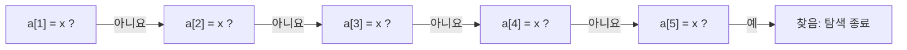

*그림 12. x = a[5]일 때 a[1], ..., a[7]의 순차 탐색*

**예제 11.3.1 (순차 탐색의 최선, 최악, 평균적인 경우 차수).** 거듭제곱 함수 중에서 순차 탐색 알고리즘의 최선, 최악, 평균적인 경우 차수를 구한다.

**풀이.** 순차 탐색을 입력 배열 $a[1], a[2], \ldots, a[n]$에 적용해 항목 $x$를 찾는다고 한다.

- **최선의 경우:** $x$가 배열의 첫 항목이면 $x$와 배열 항목의 비교는 한 번뿐이다. 따라서 최선의 경우 순차 탐색은 $\Theta(1)$이다($\Theta(1) = \Theta(n^0)$이다).
- **최악의 경우:** $x = a[n]$이거나 $x$가 배열에 없으면 비교가 $n$번 필요하다. 따라서 최악의 경우 순차 탐색은 $\Theta(n)$이다.
- **평균적인 경우(average case):** $x$가 배열의 앞쪽 절반에 있을 가능성과 뒤쪽 절반에 있을 가능성이 같으므로 평균 비교 횟수는 약 $\frac{n}{2}$이고, $\frac{n}{2}$은 $\Theta(n)$이다. 더 정확히, $x$가 배열에 있고 $n$개의 위치 각각에 있을 확률이 $\frac{1}{n}$로 같다고 가정하면 비교 횟수의 기댓값(9장)은 다음과 같다.

$$
\sum_{i=1}^{n} i \cdot \frac{1}{n} = \frac{1}{n} \cdot \frac{n(n+1)}{2} = \frac{n+1}{2}
$$

$\frac{n+1}{2}$도 $\Theta(n)$이므로 순차 탐색의 평균적인 경우 차수도 $n$이다.

### 3.2 알고리즘의 효율성 측정

알고리즘의 효율성에는 실행에 드는 시간과 실행 중에 필요한 메모리 공간이라는 두 측면이 있다. 이 장은 시간 효율성을 계산하는 기본 기법을 다루며, 공간 효율성도 비슷한 기법으로 계산한다.

알고리즘의 시간 효율성은 여러 요인에 달려 있다. 하나는 입력 데이터의 크기이다. 예를 들어 정렬 알고리즘이 항목 1,000,000개를 처리하는 데는 100개를 처리할 때보다 오래 걸린다. 그래서 알고리즘의 실행 시간은 보통 입력 크기의 함수로 나타낸다. 대략 말하면, 시간 효율성 분석은 크기가 $n$인 입력으로 알고리즘을 실행할 때(최선, 최악, 평균적인 경우에) 수행해야 하는 **기본 연산(elementary operation)** 의 수를 세는 데서 시작한다.

무엇을 기본 연산으로 볼지는 비교하는 알고리즘이 푸는 문제에 따라 다르다. 다항식을 평가하는 두 알고리즘을 비교할 때는 덧셈과 곱셈의 수가 중요하고, 리스트에서 원소를 찾는 두 알고리즘을 비교할 때는 비교의 수가 중요하다. 이 장은 흔히 쓰는 약속에 따라 덧셈, 뺄셈, 곱셈, 나눗셈과, if-then 문에서 관계 기호 $<$, $\leq$, $>$, $\geq$, $=$, $\neq$ 중 하나로 명시된 비교를 기본 연산으로 센다.

같은 알고리즘이라도 어떤 프로그래밍 언어로 구현해 어떤 컴퓨터에서 실행하는지에 따라 속도가 다르고, 연산마다 걸리는 시간도 다르다. 알고리즘이나 컴퓨터를 실제로 고를 때는 이런 세부가 중요할 수 있다. 그러나 컴퓨터가 정해져 있고 한 알고리즘이 다른 알고리즘보다 확실히 나은지만 알면 되는 경우에는 대략적인 추정으로 충분하다. 어떤 기본 연산도 가장 느린 기본 연산보다 오래 걸리지 않으므로, 알고리즘의 실행 시간은 대략 수행하는 기본 연산의 수에 비례한다.

같은 일을 하는 두 알고리즘 $A$와 $B$가 있고, 크기 $n$인 입력에 대해 (적어도 큰 $n$에서) $A$는 $10n$번과 $20n$번 사이, $B$는 $2n^2$번과 $4n^2$번 사이의 기본 연산을 한다고 한다. 이때 최악의 경우 $A$는 $\Theta(n)$이고($A$의 최악의 경우 차수는 $n$이다), 최악의 경우 $B$는 $\Theta(n^2)$이다. Max A를 $A$의 최대 연산 수, Min B를 $B$의 최소 연산 수라 하면 Max A $= 20n$, Min B $= 2n^2$이며, 표 1은 $n$이 커질 때 두 알고리즘의 차이를 보여 준다.

| $n$ | Max A $= 20n$ | Min B $= 2n^2$ | Min B $-$ Max A $= 2n^2 - 20n$ |
|:-----|-----:|-----:|-----:|
| 1,000 | 20,000 | 2,000,000 | 1,980,000 |
| 10,000 | 200,000 | 200,000,000 | 199,800,000 |
| 1,000,000 | 20,000,000 | 2,000,000,000,000 | 1,999,980,000,000 |

*표 1. 알고리즘 A의 최대 연산 수와 알고리즘 B의 최소 연산 수*

입력 크기가 1,000,000이면 $B$는 $A$보다 2조 번 가까이 많은 기본 연산을 한다. 다시 말해 $B$는 $A$가 연산 하나를 하는 동안 $\frac{2n^2}{20n} = \frac{n}{10} = 100{,}000$번의 연산을 해야 한다.

> **용어 정의:** $A$를 알고리즘이라 한다.
>
> 1. 크기가 $n$인 입력으로 $A$를 실행할 때의 기본 연산 수가 입력 데이터의 내용과 관계없이 $n$에만 의존하여 $f(n)$이라 한다. $f(n)$이 $\Theta(g(n))$이면 **$A$는 $\Theta(g(n))$이다**, 또는 **$A$의 차수는 $g(n)$이다**라고 한다.
> 2. 기본 연산 수가 $n$뿐 아니라 입력 데이터의 내용에도 의존한다고 한다.
>    - 크기가 $n$인 모든 입력에 대해 $A$를 실행하는 데 필요한 기본 연산 수의 최솟값을 $b(n)$이라 한다. $b(n)$이 $\Theta(g(n))$이면 **최선의 경우 $A$는 $\Theta(g(n))$이다**, 또는 $A$의 **최선의 경우 차수(best-case order)** 는 $g(n)$이라 한다.
>    - 크기가 $n$인 모든 입력에 대해 $A$를 실행하는 데 필요한 기본 연산 수의 최댓값을 $w(n)$이라 한다. $w(n)$이 $\Theta(g(n))$이면 **최악의 경우 $A$는 $\Theta(g(n))$이다**, 또는 $A$의 **최악의 경우 차수(worst-case order)** 는 $g(n)$이라 한다.

표 2는 알고리즘의 효율성을 나타내는 데 자주 쓰는 차수들이며, 차수 사이의 차이는 엄청나다. 크기 100,000인 데이터에 대해 차수가 $2^n$인 알고리즘은, 한 우주론의 추정으로 우주가 시작된 뒤 흐른 약 138억 년의 약 $2.3 \times 10^{30076}$배에 이르는 시간이 걸린다. 차수가 $\log_2 n$인 알고리즘은 같은 데이터를 1초보다 훨씬 짧은 시간에 처리한다.

| $f(n)$ | $n = 10$ | $n = 1{,}000$ | $n = 100{,}000$ | $n = 10{,}000{,}000$ |
|:-----|:-----|:-----|:-----|:-----|
| $\log_2 n$ | $3.3 \times 10^{-9}$초 | $1.0 \times 10^{-8}$초 | $1.7 \times 10^{-8}$초 | $2.3 \times 10^{-8}$초 |
| $n$ | $10^{-8}$초 | $10^{-6}$초 | $10^{-4}$초 | 0.01초 |
| $n \log_2 n$ | $3.3 \times 10^{-8}$초 | $1.0 \times 10^{-5}$초 | 0.0017초 | 0.23초 |
| $n^2$ | $10^{-7}$초 | 0.001초 | 10초 | 27.8시간 |
| $n^3$ | $10^{-6}$초 | 1초 | 11.6일 | 31,688년 |
| $2^n$ | $1.0 \times 10^{-6}$초 | $3.4 \times 10^{284}$년 | $3.2 \times 10^{30086}$년 | $2.9 \times 10^{3010283}$년 |

*표 2. 연산 하나에 1나노초가 걸릴 때 f(n)번의 연산을 실행하는 데 걸리는 대략적인 시간 (1년은 365.25일)*

### 3.3 알고리즘 조각의 차수

알고리즘의 일부인 알고리즘 조각에 대해서도 기본 연산의 수를 정확히 세고 다항식 차수 정리로 차수를 구할 수 있다. 다음 예제에서 $n$은 양의 정수이다.

**예제 11.3.2 (루프 하나로 된 알고리즘 조각).** 다음 알고리즘 조각에서 (a) 실행되는 기본 연산의 정확한 수를 구하고, (b) 다항식 차수 정리로 차수를 구한다.

```text
p := 0, x := 2
for i := 2 to n
    p := (p + i) * x
next i
```

**풀이.** (a) 루프는 $i = 2$부터 $n$까지 돌므로 반복 횟수는 2부터 $n$까지의 정수의 개수인 $n - 2 + 1 = n - 1$이다(9장의 목록 원소 세기). 반복마다 덧셈 한 번과 곱셈 한 번을 하므로 기본 연산 수는 반복 횟수의 두 배인 $2(n - 1) = 2n - 2$이다. $n = 1$이면 루프가 실행되지 않으며, 식도 0을 준다. (b) 다항식 차수 정리에 따라 $2n - 2$는 $\Theta(n)$이므로 이 알고리즘 조각은 $\Theta(n)$이다.

**예제 11.3.3 (중첩 루프가 있는 알고리즘 조각).** 다음 알고리즘 조각에 대해 같은 질문에 답한다.

```text
s := 0
for i := 1 to n
    for j := 1 to i
        if ⌊i / j⌋ * j = i then s := s + 1
    next j
next i
```

**풀이.** (a) 안쪽 루프의 반복마다 나눗셈 한 번과 곱셈 한 번을 하므로 전체 연산 수는 안쪽 루프의 반복 횟수의 두 배이다. 안쪽 루프는 $i = 1$일 때 한 번, $i = 2$일 때 두 번, $i = 3$일 때 세 번, $\ldots$, $i = n$일 때 $n$번 반복한다. 안쪽 루프의 문장이 실행되는 $i$와 $j$의 값을 표로 만들면 쉽게 확인할 수 있으며, 표 3의 각 열이 안쪽 루프의 반복 한 번이다.

| $i$ | 1 | 2 | 2 | 3 | 3 | 3 | 4 | 4 | 4 | 4 | $\cdots$ | $n$ | $n$ | $\cdots$ | $n$ |
|:-----|:-----|:-----|:-----|:-----|:-----|:-----|:-----|:-----|:-----|:-----|:-----|:-----|:-----|:-----|:-----|
| $j$ | 1 | 1 | 2 | 1 | 2 | 3 | 1 | 2 | 3 | 4 | $\cdots$ | 1 | 2 | $\cdots$ | $n$ |

*표 3. 중첩 루프에서 안쪽 루프가 실행되는 i와 j의 값*

따라서 안쪽 루프의 총반복 횟수와 기본 연산 수는 다음과 같다(합 공식은 5장).

$$
1 + 2 + 3 + \cdots + n = \frac{n(n+1)}{2}, \qquad 2 \cdot \frac{n(n+1)}{2} = n(n+1)
$$

표의 열의 수를 다르게 셀 수도 있다. 열 하나는 $1 \leq j \leq i \leq n$인 정수 쌍 $(i, j)$ 하나에 대응하고, 이런 쌍은 $1, 2, \ldots, n$이라는 $n$개의 범주에서 중복을 허용하여 값 두 개를 고르는 방법과 일대일로 대응한다. 9장의 중복을 허용하는 r-조합의 개수 공식에 따라 그 수는 다음과 같다. 여기서 $\binom{n}{r}$은 n 선택 r(n choose r)로 읽으며, 원소가 $n$개인 집합에서 고를 수 있는 크기 $r$인 부분집합의 개수이다.

$$
\binom{n + 2 - 1}{2} = \binom{n+1}{2} = \frac{(n+1)!}{2!\,(n-1)!} = \frac{(n+1)n}{2}
$$

이 예제에서는 이 방법이 더 복잡하지만, 루프가 세 겹 이상 중첩되면 이 방법이 더 간단하다. (b) 다항식 차수 정리에 따라 $n(n+1) = n^2 + n$은 $\Theta(n^2)$이므로 이 알고리즘 조각은 $\Theta(n^2)$이다.

> **참고:** 3.2절의 약속을 그대로 따르면 if 문의 비교 $=$도 안쪽 루프의 반복마다 한 번씩 세야 하고, `s := s + 1`의 덧셈은 $j$가 $i$를 나누어떨어지게 할 때만 실행된다. 이것까지 세면 반복 하나당 연산이 3번 또는 4번이므로 전체 연산 수는 $\frac{3n(n+1)}{2}$ 이상 $2n(n+1)$ 이하이다. 어느 쪽으로 세어도 차수는 $\Theta(n^2)$으로 같다.

**예제 11.3.4 (반복 횟수가 바닥 함수에 의존하는 경우).** 다음 알고리즘 조각에 대해 같은 질문에 답한다.

```text
for i := ⌊n / 2⌋ to n
    a := n - i
next i
```

**풀이.** (a) 반복마다 뺄셈을 한 번 하고, 루프는 $\lfloor n/2 \rfloor$부터 $n$까지의 정수의 개수인 $n - \lfloor n/2 \rfloor + 1$번 반복한다. $n$이 짝수이면 $\lfloor n/2 \rfloor = \frac{n}{2}$이고, $n$이 홀수이면 $\lfloor n/2 \rfloor = \frac{n-1}{2}$이므로 연산 수는 짝수일 때(왼쪽)와 홀수일 때(오른쪽) 다음과 같다.

$$
n - \frac{n}{2} + 1 = \frac{n+2}{2}, \qquad n - \frac{n-1}{2} + 1 = \frac{2n - (n - 1) + 2}{2} = \frac{n+3}{2}
$$

(b) 다항식 차수 정리에 따라 $\frac{n+2}{2}$와 $\frac{n+3}{2}$은 모두 $\Theta(n)$이므로, $n$의 홀짝과 관계없이 이 알고리즘 조각은 $\Theta(n)$이다.

### 3.4 삽입 정렬

**삽입 정렬(insertion sort)** 은 배열의 항목을 오름차순으로 늘어놓는다. 먼저 둘째 항목을 첫째 항목과 비교해 둘째가 더 작으면 서로 바꾸며, 그러면 처음 두 항목이 오름차순이 된다. 그다음부터는 새 항목을 하나씩 왼쪽으로 옮기며 앞 항목들 사이의 제자리에 넣어, 정렬된 앞부분을 한 칸씩 늘려 간다. 마지막 항목까지 넣으면 배열 전체가 정렬된다. 그림 13은 배열 $a[1], a[2], \ldots, a[n]$에서 삽입 정렬의 단계 $k$를 나타낸다.

```text
 정렬된 부분 배열
┌───────────────────────────┐
 a[1], a[2], a[3], ..., a[k-1], a[k], a[k+1], ..., a[n]
                                 ▲
 단계 k: a[k]의 값을 a[1], a[2], ..., a[k-1]에 대해 알맞은 자리에 넣는다.
         이 단계가 끝나면 a[1], a[2], ..., a[k]가 정렬되어 있다.
```

*그림 13. 삽입 정렬의 단계 k*

**알고리즘 11.3.1 (삽입 정렬).** 이 알고리즘은 배열 $a[1], a[2], \ldots, a[n]$($n \geq 1$)을 받아 같은 값들을 오름차순으로 다시 늘어놓는다. 출력 배열도 $a[1], a[2], \ldots, a[n]$으로 나타낸다. $k$번째 단계에서 $a[1], \ldots, a[k-1]$은 이미 오름차순이고, $a[k]$를 그에 대해 알맞은 자리에 넣는다.

```text
Input: n [양의 정수], a[1], a[2], ..., a[n] [순서를 매길 수 있는 데이터 항목의 배열]

Algorithm Body:
for k := 2 to n
    x := a[k]
    j := k - 1
    while (j ≠ 0)
        if x < a[j] then
            a[j + 1] := a[j]
            a[j] := x
            j := j - 1
        else j := 0
        end if
    end while
next k

Output: a[1], a[2], ..., a[n] [오름차순]
```

각 줄이 하는 일은 다음과 같다.

- `for k := 2 to n`: 단계 $k$에서 $a[k]$를 이미 정렬된 $a[1], \ldots, a[k-1]$에 끼워 넣는다. 원소 하나뿐인 $a[1]$은 처음부터 정렬되어 있으므로 $k$는 2에서 시작한다.
- `x := a[k]`, `j := k - 1`: 넣을 값을 $x$에 보관하고, 바로 앞 위치 $j = k - 1$부터 왼쪽으로 가며 비교한다.
- `while (j ≠ 0)`: 배열의 맨 앞을 지나지 않는 동안 반복한다.
- `if x < a[j] then ...`: $x$가 $a[j]$보다 작으면 $a[j]$를 한 칸 오른쪽인 $a[j+1]$로 옮기고 $a[j]$에 $x$를 놓은 뒤 $j$를 하나 줄인다. 결과적으로 $x$와 바로 앞 항목이 자리를 바꾼다.
- `else j := 0`: $x \geq a[j]$이면 $x$는 이미 알맞은 자리에 있으므로 $j$를 0으로 만들어 while 루프를 끝낸다.

배열 $a[1] = 6$, $a[2] = 3$, $a[3] = 5$, $a[4] = 7$, $a[5] = 2$에 삽입 정렬을 적용하면 각 단계의 결과는 표 4와 같다. 굵은 글씨는 각 단계가 끝났을 때 정렬된 앞부분이다.

| 시점 | $a[1]$ | $a[2]$ | $a[3]$ | $a[4]$ | $a[5]$ |
|:-----|:-----|:-----|:-----|:-----|:-----|
| 처음 | 6 | 3 | 5 | 7 | 2 |
| $k = 2$ 후 | **3** | **6** | 5 | 7 | 2 |
| $k = 3$ 후 | **3** | **5** | **6** | 7 | 2 |
| $k = 4$ 후 | **3** | **5** | **6** | **7** | 2 |
| $k = 5$ 후 | **2** | **3** | **5** | **6** | **7** |

*표 4. 배열 6, 3, 5, 7, 2에 대한 삽입 정렬의 단계별 결과*

**예제 11.3.5 (삽입 정렬의 추적표).** 같은 배열에 대한 삽입 정렬의 동작을 추적표(trace table)로 나타낸다.

**풀이.** 표 5의 첫 열은 for-next 루프의 첫 반복 직전 변수의 상태이다. 루프에 처음 들어가면 $k$에 2, $x$에 $a[2]$의 값 3, $j$에 $k - 1$의 값 1이 들어간다. $j \neq 0$이므로 while 루프에 들어가 if-then-else 문의 조건을 검사한다. $a[1] > x$이므로 $a[2]$에 $a[1]$의 값 6이 들어가고, $a[1]$에 $x$의 값 3이 들어가며, $j$는 $j - 1$의 값 0이 된다. while 루프의 조건을 다시 검사하면 $j = 0$이므로 조건이 거짓이 되어 while 루프를 빠져나온다. 그다음 $k$가 1 늘어 3이 되고 for-next 루프가 두 번째로 실행된다. 이 과정은 $k$가 6이 될 때까지 계속되며, 6은 for-next 루프의 상한보다 크므로 알고리즘이 끝나고 배열은 오름차순이 된다. 각 열에는 그 시점에 값이 바뀐 변수만 적고, 빈칸은 값이 그대로임을 뜻한다.

| 변수 | 1 | 2 | 3 | 4 | 5 | 6 | 7 | 8 | 9 | 10 | 11 | 12 |
|:-----|:-----|:-----|:-----|:-----|:-----|:-----|:-----|:-----|:-----|:-----|:-----|:-----|
| $n$ | 5 | | | | | | | | | | | |
| $a[1]$ | 6 | 3 | | | | | | | | | | 2 |
| $a[2]$ | 3 | 6 | | 5 | | | | | | | 2 | 3 |
| $a[3]$ | 5 | | | 6 | | | | | | 2 | 5 | |
| $a[4]$ | 7 | | | | | | | | 2 | 6 | | |
| $a[5]$ | 2 | | | | | | | | 7 | | | |
| $k$ | 2 | | 3 | | | 4 | | 5 | | | | |
| $x$ | 3 | | 5 | | | 7 | | 2 | | | | |
| $j$ | 1 | 0 | 2 | 1 | 0 | 3 | 0 | 4 | 3 | 2 | 1 | 0 |

*표 5. 배열 6, 3, 5, 7, 2에 대한 삽입 정렬의 추적표*

삽입 정렬의 비교 횟수는 다음 약속에 따라 센다. 단계 $k$에서 $x$를 앞 항목과 비교하는 `x < a[j]`를 한 번씩 세고, $x$가 맨 앞까지 가서 $j$가 0이 되어 루프가 끝나는 경우에는 그 사실을 확인하는 검사 `j ≠ 0`도 한 번 센다. 이렇게 세면 단계 $k$에서 $a[k]$가 위치 $j$($1 \leq j \leq k$)로 들어갈 때 비교 횟수는 항상 $k - j + 1$이다. $j \geq 2$이면 참인 비교 $k - j$번과 거짓인 비교 1번이 일어나고, $j = 1$이면 참인 비교 $k - 1$번과 맨 앞에 닿았음을 확인하는 검사 1번이 일어나기 때문이다.

**예제 11.3.6 (삽입 정렬의 최악의 경우 차수).** (a) 배열 $a[1], \ldots, a[n]$에 삽입 정렬을 적용할 때 비교 횟수의 최댓값을 구한다. (b) 다항식 차수 정리로 삽입 정렬의 최악의 경우 차수를 구한다.

**풀이.** (a) 단계 $k$의 비교 횟수 $k - j + 1$은 $a[k]$가 맨 앞($j = 1$)으로 갈 때, 곧 $a[k]$가 $a[1], \ldots, a[k-1]$의 모든 값보다 작을 때 최댓값 $k$가 된다. 모든 단계에서 이런 일이 일어나는 것은 배열이 처음에 역순(내림차순)일 때이다. $k$는 2부터 $n$까지 변하므로 비교 횟수의 최댓값은 다음과 같다.

$$
2 + 3 + \cdots + n = (1 + 2 + 3 + \cdots + n) - 1 = \frac{n(n+1)}{2} - 1 = \frac{1}{2}n^2 + \frac{1}{2}n - 1
$$

첫 등호는 1을 더하고 뺀 것이고, 둘째 등호는 합 공식(5장)이며, 셋째 등호는 전개한 것이다. (b) 다항식 차수 정리에 따라 $\frac{1}{2}n^2 + \frac{1}{2}n - 1$은 $\Theta(n^2)$이므로 삽입 정렬의 최악의 경우 차수는 $n^2$이다.

> **참고:** 맨 앞에 닿았음을 확인하는 검사를 빼고 비교 `x < a[j]`만 세면 단계 $k$의 최대 횟수는 $k - 1$이고 합은 $1 + 2 + \cdots + (n - 1) = \frac{n(n-1)}{2}$이 된다. 어느 쪽으로 세어도 최고차항이 $\frac{1}{2}n^2$이므로 최악의 경우 차수는 $\Theta(n^2)$으로 같다. 그림 8과 5.4절의 표 17은 이 $\frac{n(n-1)}{2}$를 쓴다.

최선의 경우는 배열이 처음부터 오름차순일 때이다. 이때는 단계마다 $a[k]$가 제자리($j = k$)에 있으므로 비교가 한 번씩, 모두 $n - 1$번이면 되고, 최선의 경우 삽입 정렬은 $\Theta(n)$이다.

**예제 11.3.7 (삽입 정렬의 평균적인 경우 차수).** (a) 배열 $a[1], \ldots, a[n]$에 삽입 정렬을 적용할 때 평균 비교 횟수를 구한다. (b) 삽입 정렬의 평균적인 경우 차수를 구한다.

**풀이.** (a) 양의 정수 $n$에 대해 $E_n$을 삽입 정렬로 $a[1], \ldots, a[n]$을 정렬할 때 비교 횟수의 평균, 곧 기댓값이라 한다. 각 정수 $k = 2, 3, \ldots, n$에 대해 $a[1], \ldots, a[k]$를 정렬하는 비교 횟수의 기댓값은 $a[1], \ldots, a[k-1]$을 정렬하는 비교 횟수의 기댓값에 $a[k]$를 그 사이의 알맞은 자리에 넣는 비교 횟수의 기댓값을 더한 것이다. 따라서 $a[k]$를 넣는 비교 횟수의 기댓값을 $c_k$라 하면 다음 관계가 성립한다.

$$
E_k = E_{k-1} + c_k
$$

또 배열에 항목이 하나뿐이면 바깥 루프가 한 번도 실행되지 않으므로 $E_1 = 0$이다. 모든 입력 순서가 같은 가능성으로 나타난다고 가정하면, while 루프로 $a[k]$를 넣을 때 $a[k]$가 처음 $k$개 위치 중 어느 하나에 들어갈 가능성은 모두 같아 각 위치의 확률이 $\frac{1}{k}$이다. 위치 $j$에 들어가면 비교가 $k - j + 1$번 필요하므로, 기댓값의 정의(9장)에 따라 $a[k]$를 넣는 비교 횟수의 기댓값은 다음과 같다.

$$
c_k = \sum_{j=1}^{k} \frac{1}{k}(k - j + 1) = \frac{1}{k}\bigl(k + (k-1) + \cdots + 2 + 1\bigr) = \frac{1}{k} \cdot \frac{k(k+1)}{2} = \frac{k+1}{2}
$$

첫 등호는 상수 $\frac{1}{k}$을 합 밖으로 꺼내고 합을 펼쳐 쓴 것이고, 둘째 등호는 합 공식이다. 따라서 $E_1 = 0$이고 $k \geq 2$인 모든 정수에서 $E_k = E_{k-1} + \frac{k+1}{2}$이다. 이 점화식을 $k = 2$부터 $n$까지 차례로 대입하여 더하면 다음을 얻는다.

$$
E_n = \sum_{k=2}^{n} \frac{k+1}{2} = \frac{1}{2}\left( \sum_{k=2}^{n} k + (n - 1) \right) = \frac{1}{2}\left( \frac{n(n+1)}{2} - 1 + n - 1 \right) = \frac{n^2 + 3n - 4}{4}
$$

예를 들어 $E_2 = \frac{4 + 6 - 4}{4} = \frac{3}{2}$이며, 이는 $E_1 + \frac{3}{2}$과 같다. (b) 다항식 차수 정리에 따라 $\frac{n^2 + 3n - 4}{4} = \frac{1}{4}n^2 + \frac{3}{4}n - 1$은 $\Theta(n^2)$이므로 삽입 정렬의 평균적인 경우 차수도 $n^2$이다.

> **핵심:** 삽입 정렬은 최선의 경우 $\Theta(n)$, 최악의 경우와 평균적인 경우 모두 $\Theta(n^2)$이다. 평균적인 경우의 차수가 최악의 경우와 같다는 것은, 무작위로 섞인 배열에서도 비교 횟수가 대략 $\frac{n^2}{4}$로 늘어난다는 뜻이다.

### 3.5 선택 정렬

**선택 정렬(selection sort)** 도 배열을 오름차순으로 늘어놓지만, 고르기를 되풀이하는 방식이다. 가장 작은 원소를 찾아 첫째 자리로 옮기고, 남은 원소 중 가장 작은 것을 찾아 둘째 자리로 옮기는 일을 배열이 정렬될 때까지 계속한다. 정확히 말하면 $k = 1$부터 $n - 1$까지 단계 $k$에서 $a[k], a[k+1], \ldots, a[n]$ 중 값이 가장 작은 항목의 첨자를 찾고, 그 첨자가 $k$ 자신이 아니면 그 항목의 값과 $a[k]$의 값을 맞바꾼다.

**알고리즘 11.3.2 (선택 정렬).**

```text
Input: n [양의 정수], a[1], a[2], ..., a[n] [순서를 매길 수 있는 데이터 항목의 배열]

Algorithm Body:
for k := 1 to n - 1
    IndexOfMin := k
    for i := k + 1 to n
        if (a[i] < a[IndexOfMin]) then IndexOfMin := i
    next i
    if IndexOfMin ≠ k then
        Temp := a[k]
        a[k] := a[IndexOfMin]
        a[IndexOfMin] := Temp
next k

Output: a[1], a[2], ..., a[n] [오름차순]
```

`IndexOfMin`은 지금까지 본 항목 중 최솟값의 첨자이다. 안쪽 루프는 $a[k+1]$부터 $a[n]$까지 차례로 보며 더 작은 값이 나오면 `IndexOfMin`을 바꾼다. 안쪽 루프가 끝나면 `IndexOfMin`은 $a[k], \ldots, a[n]$ 중 최솟값의 첨자이고, 그것이 $k$가 아니면 `Temp`를 거쳐 두 값을 맞바꾼다.

**예제 (선택 정렬의 동작).** 배열 $a[1] = 5$, $a[2] = 2$, $a[3] = 6$, $a[4] = 1$, $a[5] = 4$에 선택 정렬을 적용하면 각 단계는 표 6과 같다.

| $k$ | 최솟값을 찾는 범위 | `IndexOfMin` | 교환 | 단계 후 배열 |
|:-----|:-----|:-----|:-----|:-----|
| 1 | $a[1], \ldots, a[5]$ | 4 | $a[1]$과 $a[4]$ | 1, 2, 6, 5, 4 |
| 2 | $a[2], \ldots, a[5]$ | 2 | 없음 | 1, 2, 6, 5, 4 |
| 3 | $a[3], \ldots, a[5]$ | 5 | $a[3]$과 $a[5]$ | 1, 2, 4, 5, 6 |
| 4 | $a[4], a[5]$ | 4 | 없음 | 1, 2, 4, 5, 6 |

*표 6. 배열 5, 2, 6, 1, 4에 대한 선택 정렬의 단계*

**선택 정렬의 차수.** 단계 $k$에서 안쪽 루프는 $i = k + 1$부터 $n$까지 $n - k$번 반복하고, 반복마다 if-then 문의 비교 `a[i] < a[IndexOfMin]`을 한 번 한다. 따라서 이 비교의 총횟수는 다음과 같다.

$$
\sum_{k=1}^{n-1} (n - k) = (n - 1) + (n - 2) + \cdots + 1 = \frac{n(n-1)}{2} = \frac{1}{2}n^2 - \frac{1}{2}n
$$

이 횟수는 입력 배열의 내용과 관계없이 $n$에만 의존하므로, 3.2절의 정의 1에 따라 선택 정렬은 $\Theta(n^2)$이다. 곧 최선, 최악, 평균적인 경우가 모두 $\Theta(n^2)$이다. 위 예제에서는 $n = 5$이므로 비교가 $4 + 3 + 2 + 1 = 10$번 일어난다. 단계마다 한 번씩 하는 비교 `IndexOfMin ≠ k`까지 세면 $n - 1$번이 더해지지만, 그래도 입력과 관계없이 $\frac{n(n-1)}{2} + (n - 1)$번이고 차수는 같다.

### 3.6 다항식 평가와 호너의 방법

**다항식 평가(polynomial evaluation)** 는 실수 $x$에서 다항식 $a[n]x^n + a[n-1]x^{n-1} + \cdots + a[1]x + a[0]$의 값을 계산하는 문제이다. 이 문제에서는 덧셈과 곱셈을 기본 연산으로 센다.

**알고리즘 11.3.3 (항별 다항식 평가).** 이 알고리즘은 $a[0]$부터 시작하여 각 항을 따로 계산해 누적 합에 더한다.

```text
Input: n [음이 아닌 정수], a[0], a[1], ..., a[n] [실수의 배열], x [실수]

Algorithm Body:
polyval := a[0]
for i := 1 to n
    term := a[i]
    for j := 1 to i
        term := term * x
    next j
    polyval := polyval + term
next i

Output: polyval [실수]
```

$i$번째 반복에서 안쪽 루프는 $a[i]$에 $x$를 $i$번 곱해 항 $a[i]x^i$를 만들고, 바깥 루프는 그 항을 `polyval`에 더한다. 따라서 $i$번째 반복의 연산은 곱셈 $i$번과 덧셈 1번이고, 차수가 $n$인 다항식에 대한 덧셈과 곱셈의 총횟수 $s_n$은 다음과 같다.

$$
s_n = \sum_{i=1}^{n} (i + 1) = \frac{n(n+1)}{2} + n = \frac{n^2 + 3n}{2}
$$

다항식 차수 정리에 따라 항별 다항식 평가는 $\Theta(n^2)$이다.

**알고리즘 11.3.4 (호너의 방법, Horner's rule).** 이 알고리즘은 다항식을 다음처럼 괄호로 묶어, 덧셈과 곱셈을 차례로 중첩하여 계산한다.

$$
\Bigl(\bigl(\cdots\bigl((a[n]x + a[n-1])x + a[n-2]\bigr)x + \cdots + a[2]\bigr)x + a[1]\Bigr)x + a[0]
$$

각 단계에서 `polyval`의 현재 값에 $x$를 곱하고 다음으로 낮은 계수를 더한다.

```text
Input: n [음이 아닌 정수], a[0], a[1], ..., a[n] [실수의 배열], x [실수]

Algorithm Body:
polyval := a[n]
for i := 1 to n
    polyval := polyval * x + a[n - i]
next i

Output: polyval [실수]
```

반복마다 곱셈 1번과 덧셈 1번을 하므로 덧셈과 곱셈의 총횟수는 $t_n = 2n$이고, 호너의 방법은 $\Theta(n)$이다. 첨자 $n - i$를 계산하는 뺄셈까지 세어도 $3n$번이어서 차수는 같다.

**예제 (두 알고리즘의 비교).** $p(x) = 3x^3 + 2x^2 - 5x + 7$을 $x = 2$에서 평가한다. 계수는 $n = 3$, $a[3] = 3$, $a[2] = 2$, $a[1] = -5$, $a[0] = 7$이다. 항별 평가(표 7)는 곱셈 $1 + 2 + 3 = 6$번과 덧셈 3번, 모두 9번의 연산을 하고, 호너의 방법(표 8)은 곱셈 3번과 덧셈 3번, 모두 6번의 연산을 한다. 두 방법 모두 $p(2) = 24 + 8 - 10 + 7 = 29$를 준다.

| $i$ | term의 계산 | term | polyval |
|:-----|:-----|:-----|:-----|
| 시작 | | | 7 |
| 1 | $(-5) \cdot 2$ | $-10$ | $-3$ |
| 2 | $2 \cdot 2 \cdot 2$ | 8 | 5 |
| 3 | $3 \cdot 2 \cdot 2 \cdot 2$ | 24 | 29 |

*표 7. 항별 다항식 평가로 3x³ + 2x² − 5x + 7을 x = 2에서 계산하는 과정*

| $i$ | polyval의 계산 | polyval |
|:-----|:-----|:-----|
| 시작 | | 3 |
| 1 | $3 \cdot 2 + 2$ | 8 |
| 2 | $8 \cdot 2 + (-5)$ | 11 |
| 3 | $11 \cdot 2 + 7$ | 29 |

*표 8. 호너의 방법으로 3x³ + 2x² − 5x + 7을 x = 2에서 계산하는 과정*

> **핵심:** 같은 값을 계산하는 두 알고리즘의 차수가 $\Theta(n^2)$와 $\Theta(n)$으로 다르다. 호너의 방법은 $x$의 거듭제곱을 항마다 처음부터 다시 계산하지 않고 앞 단계의 결과에 $x$를 한 번 곱해 이어 쓰므로 연산 수가 $n$에 비례한다.

---

<br>

## 4. 지수 함수와 로그 함수: 그래프와 차수

지수 함수와 로그 함수는 수학 전반, 특히 컴퓨터 과학에서 핵심적인 함수이다. 실행 시간이 입력 크기의 로그처럼 늘어나는 알고리즘은 입력이 커도 비교적 빠르지만, 실행 시간이 지수적으로 늘어나는 알고리즘은 입력이 커지면 쓸 수 없을 만큼 느려진다. 또 두 함수는 여러 증가와 감소 과정을 기술하고 많은 확률 계산에 나타나므로 운영체제의 분석, 대기행렬 이론, 정보 이론에도 쓰인다.

### 4.1 지수 함수의 그래프

> **용어 정의:** $b > 0$일 때 **밑이 $b$인 지수 함수(exponential function)** 는 각 실수 $x$를 $b^x$로 보내는 함수이다(7장).

밑이 2인 지수 함수의 값 몇 개를 표 9에 모았다.

| $x$ | $-3$ | $-2$ | $-1$ | $-0.5$ | 0 | 0.5 | 1 | 2 | 3 |
|:-----|:-----|:-----|:-----|:-----|:-----|:-----|:-----|:-----|:-----|
| $2^x$ | 0.125 | 0.25 | 0.5 | $\approx 0.707$ | 1 | $\approx 1.414$ | 2 | 4 | 8 |

*표 9. 밑이 2인 지수 함수의 값*

이 함수의 값은 놀라울 만큼 빨리 커진다. 세로축의 1단위를 1cm로 그린다면 점 $(10, 2^{10})$은 가로축에서 10m 넘게 위에, 점 $(30, 2^{30})$은 약 10,737km 위에 찍어야 한다.

밑 $b$가 1보다 큰 지수 함수의 그래프는 모두 밑이 2인 지수 함수의 그래프와 모양이 비슷하다. $0 < b < 1$이면 $\frac{1}{b} > 1$이고 $b^x = \left(\frac{1}{b}\right)^{-x}$이므로, 밑이 $b$인 지수 함수의 그래프는 밑이 $\frac{1}{b}$인 지수 함수의 그래프를 세로축에 대해 대칭 이동한 것이다.

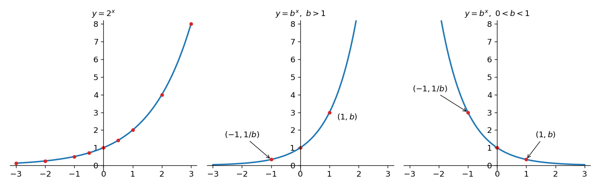

*그림 14. 밑이 2인 지수 함수와 밑이 1보다 큰 경우, 0과 1 사이인 경우의 지수 함수 그래프*

### 4.2 로그 함수의 그래프

로그는 네이피어(John Napier)가 처음 도입했으며, 곱셈과 나눗셈에 드는 시간을 크게 줄여 주어 17세기 천문학과 항해술의 발전에 중요한 역할을 했다. 오늘날에는 계산기와 컴퓨터가 계산을 맡으므로 로그와 로그 함수는 주로 개념적 도구로 쓰인다.

> **용어 정의:** $b$가 1이 아닌 양의 실수일 때 **밑이 $b$인 로그 함수(logarithmic function)** $\log_b: \mathbf{R}^{+} \to \mathbf{R}$는 각 양의 실수 $x$를 $\log_b x$, 곧 $x$를 얻기 위해 $b$를 거듭제곱해야 하는 지수로 보내는 함수이다. 즉 $\log_b x = y$일 필요충분조건은 $b^y = x$이다.

밑이 $b$인 로그 함수는 밑이 $b$인 지수 함수의 역함수이다. 따라서 두 함수의 그래프는 직선 $y = x$에 대해 대칭이다.

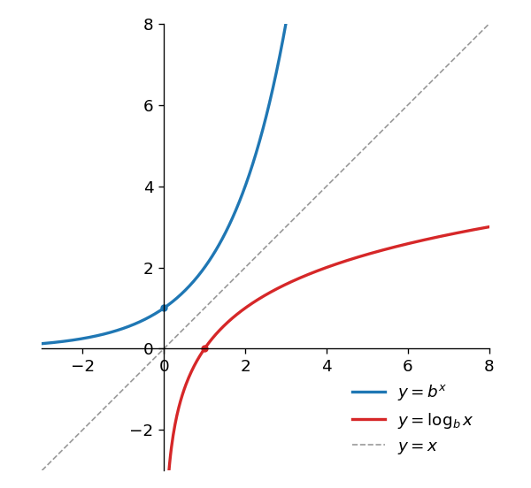

*그림 15. 밑이 1보다 큰 로그 함수와 지수 함수의 그래프와 직선 y = x*

밑 $b$가 1보다 크면 로그 함수는 증가한다. 곧 $b > 1$이면 모든 양수 $x_1$, $x_2$에 대해 다음이 성립한다.

$$
x_1 < x_2 \implies \log_b x_1 < \log_b x_2 \qquad (11.4.1)
$$

$\log_b x_1 \geq \log_b x_2$라면, $b > 1$일 때 $y \mapsto b^y$가 증가하므로 $x_1 = b^{\log_b x_1} \geq b^{\log_b x_2} = x_2$가 되어 $x_1 < x_2$에 모순이기 때문이다. 지수 함수가 폭발적으로 증가하는 것과 달리 로그 함수는 매우 느리게 증가한다. 예를 들어 $\log_2 1{,}024$는 10에 불과하고 $\log_2 1{,}048{,}576$도 20에 불과하므로, 그래프는 가로축을 따라 매우 멀리 가야 비로소 높아진다.

이 절의 계산에는 7장에서 다룬 로그의 성질이 쓰인다. $b$, $c$가 1이 아닌 양의 실수이고 $x$, $y$가 양의 실수, $a$가 실수이면 다음이 성립한다.

$$
\log_b(xy) = \log_b x + \log_b y, \quad \log_b \frac{x}{y} = \log_b x - \log_b y, \quad \log_b (x^a) = a \log_b x, \quad \log_c x = \frac{\log_b x}{\log_b c}
$$

### 4.3 연속한 두 2의 거듭제곱 사이에 있는 수의 로그

다음 성질은 밑이 2인 로그 함수가 증가한다는 사실에서 나오며, 알고리즘 분석에 자주 쓰인다.

**성질 (11.4.2).** $k$가 정수이고 $x$가 $2^k \leq x < 2^{k+1}$인 실수이면 $\lfloor \log_2 x \rfloor = k$이다.

**증명.** $k$가 정수이고 $x$가 $2^k \leq x < 2^{k+1}$인 실수라고 한다. 밑이 2인 로그 함수는 증가하므로 $\log_2(2^k) \leq \log_2 x < \log_2(2^{k+1})$이다. 그런데 $2^k$를 얻으려면 2를 $k$제곱해야 하므로 $\log_2(2^k) = k$이고, 같은 이유로 $\log_2(2^{k+1}) = k + 1$이다. 따라서 $k \leq \log_2 x < k + 1$이고, 바닥 함수의 정의에 따라 $\lfloor \log_2 x \rfloor = k$이다.

양수의 바닥은 그 수의 정수 부분이다(예: $\lfloor 2.82 \rfloor = 2$). 따라서 성질 (11.4.2)를 말로 하면, 양수 $x$가 연속한 두 정수 거듭제곱 $2^k$와 $2^{k+1}$ 사이에 있으면 $\log_2 x$의 바닥은 작은 쪽 거듭제곱의 지수 $k$이다. 예를 들어 $2^3 = 8 \leq 13 < 16 = 2^4$이므로 $\lfloor \log_2 13 \rfloor = 3$이다($\log_2 13 \approx 3.70$). 그림 16은 $x$가 구간 $[2^k, 2^{k+1})$에 있으면 $\log_2 x$가 구간 $[k, k+1)$에 있음을 보여 준다.

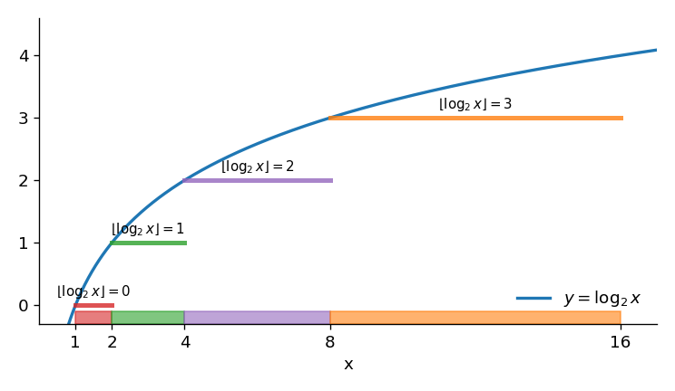

*그림 16. x가 2의 k제곱과 k+1제곱 사이에 있을 때 log2 x의 바닥*

다음 성질은 그 자체로는 흥미롭지 않아 보이지만 알고리즘 효율성 분석의 한 단계로 자주 필요하다.

**성질 (11.4.3).** 1보다 큰 임의의 홀수 $n$에 대해 $\lfloor \log_2(n-1) \rfloor = \lfloor \log_2 n \rfloor$이다.

**증명.** $n$이 1보다 큰 홀수라고 한다. 2 이상인 2의 거듭제곱은 모두 짝수이고 $n > 1 = 2^0$이므로 $n$은 2의 거듭제곱이 아니며, 연속한 두 2의 거듭제곱 사이에 엄격히 놓인다. 곧 어떤 정수 $k > 0$에 대해 $2^k < n < 2^{k+1}$이다. $2^k < n$이고 둘 다 정수이므로 $2^k \leq n - 1$이며, 따라서 $2^k \leq n - 1 < 2^{k+1}$이다. 두 부등식 $2^k \leq n < 2^{k+1}$과 $2^k \leq n - 1 < 2^{k+1}$에 성질 (11.4.2)를 적용하면 $\lfloor \log_2 n \rfloor = k$이고 $\lfloor \log_2(n-1) \rfloor = k$이므로 둘은 같다.

예를 들어 $\lfloor \log_2 8 \rfloor = 3 = \lfloor \log_2 9 \rfloor$이다.

> **주의:** 이 성질은 홀수에서만 보장된다. 짝수 $n = 8$에서는 $\lfloor \log_2 7 \rfloor = 2$이지만 $\lfloor \log_2 8 \rfloor = 3$이다. $n$이 2의 거듭제곱이면 $n - 1$은 한 단계 아래 구간으로 내려가기 때문이다.

### 4.4 응용: 정수의 2진 표기에 필요한 비트 수

양의 정수 $n$을 2진 표기로 나타내려면 2진 숫자(비트)가 몇 개 필요한가? 5장에서 본 것처럼 모든 양의 정수 $n$은 음이 아닌 정수 $k$와 0 또는 1인 $c_0, c_1, \ldots, c_{k-1}$로 다음과 같이 하나의 방법으로만 쓸 수 있다.

$$
n = 2^k + c_{k-1} \cdot 2^{k-1} + \cdots + c_2 \cdot 2^2 + c_1 \cdot 2 + c_0
$$

그러면 $n$의 2진 표기는 $1c_{k-1}c_{k-2} \cdots c_2 c_1 c_0$이므로 필요한 2진 숫자의 개수는 $k + 1$이다. 이것을 $n$의 함수로 나타낸다. 각 $c_i \leq 1$이므로 등비수열의 합 공식(5장)에 따라 다음이 성립한다.

$$
n \leq 2^k + 2^{k-1} + \cdots + 2^2 + 2 + 1 = \frac{2^{k+1} - 1}{2 - 1} = 2^{k+1} - 1 < 2^{k+1}
$$

또 각 $c_i \geq 0$이므로 $2^k \leq n$이다. 두 부등식을 합치면 $2^k \leq n < 2^{k+1}$이고, 성질 (11.4.2)에 따라 $k = \lfloor \log_2 n \rfloor$이다. 따라서 $n$을 나타내는 데 필요한 2진 숫자의 개수는 $\lfloor \log_2 n \rfloor + 1$이다.

**예제 11.4.3 (2진 표기의 비트 수).** 52,837을 2진 표기로 나타내는 데 필요한 2진 숫자의 개수를 구한다.

**풀이.** 밑 변환 공식과 상용로그의 근삿값을 쓰면 다음과 같다.

$$
\log_2 52{,}837 = \frac{\log_{10} 52{,}837}{\log_{10} 2} \approx \frac{4.722938151}{0.3010299957} \approx 15.7
$$

따라서 52,837의 2진 표기는 $\lfloor 15.7 \rfloor + 1 = 15 + 1 = 16$개의 2진 숫자로 이루어진다. 실제로 $2^{15} = 32{,}768 \leq 52{,}837 < 65{,}536 = 2^{16}$이고, $52{,}837 = 1100111001100101_2$는 16자리이다.

### 4.5 응용: 로그로 점화식 풀기

컴퓨터 과학에서 중요한 점화식 중에는 해를 로그로 나타낼 수 있는 것이 많다. 다음 예제가 그 하나이다.

**예제 11.4.4 (해가 로그로 나타나는 점화식).** 수열 $a_1, a_2, a_3, \ldots$를 다음과 같이 재귀적으로 정의한다.

$$
a_1 = 1, \qquad a_k = 2a_{\lfloor k/2 \rfloor} \quad (k \geq 2)
$$

(a) 반복 대입(iteration)으로 이 수열의 명시적 공식을 추측한다. (b) 강한 수학적 귀납법으로 (a)의 공식이 맞음을 확인한다.

**풀이 (a).** 처음 몇 항의 값을 차례로 구하면 표 10과 같다.

| $n$ | $\lfloor n/2 \rfloor$ | $a_n = 2a_{\lfloor n/2 \rfloor}$ | $\lfloor \log_2 n \rfloor$ |
|:-----|:-----|:-----|:-----|
| 1 | | 1 (초기 조건) | 0 |
| 2 | 1 | $2a_1 = 2 \cdot 1 = 2$ | 1 |
| 3 | 1 | $2a_1 = 2 \cdot 1 = 2$ | 1 |
| 4 | 2 | $2a_2 = 2 \cdot 2 = 4$ | 2 |
| 5 | 2 | $2a_2 = 2 \cdot 2 = 4$ | 2 |
| 6 | 3 | $2a_3 = 2 \cdot 2 = 4$ | 2 |
| 7 | 3 | $2a_3 = 2 \cdot 2 = 4$ | 2 |
| 8 | 4 | $2a_4 = 2 \cdot 4 = 8$ | 3 |
| 9 | 4 | $2a_4 = 2 \cdot 4 = 8$ | 3 |
| $\vdots$ | $\vdots$ | $\vdots$ | $\vdots$ |
| 15 | 7 | $2a_7 = 2 \cdot 4 = 8$ | 3 |
| 16 | 8 | $2a_8 = 2 \cdot 8 = 16$ | 4 |

*표 10. 점화식으로 정의된 수열의 처음 몇 항*

첨자 $n$이 두 2의 거듭제곱 사이에 있을 때마다 $a_n$은 작은 쪽 거듭제곱과 같다. 곧 다음이 성립한다.

$$
2^i \leq n < 2^{i+1} \implies a_n = 2^i \qquad (11.4.8)
$$

$n$이 $2^i \leq n < 2^{i+1}$을 만족하면 성질 (11.4.2)에 따라 $i = \lfloor \log_2 n \rfloor$이므로, (11.4.8)에 대입하면 $a_n = 2^{\lfloor \log_2 n \rfloor}$이라고 추측할 수 있다.

**풀이 (b).** $a_1 = 1$이고 $k \geq 2$인 모든 정수에서 $a_k = 2a_{\lfloor k/2 \rfloor}$인 수열이 $n \geq 1$인 모든 정수에서 $a_n = 2^{\lfloor \log_2 n \rfloor}$을 만족함을 보인다. 성질 $P(n)$을 등식 $a_n = 2^{\lfloor \log_2 n \rfloor}$으로 두고, 강한 수학적 귀납법으로 $n \geq 1$인 모든 정수에서 $P(n)$이 참임을 증명한다.

**기저 단계.** 수열의 정의에 따라 $a_1 = 1$이고, $2^{\lfloor \log_2 1 \rfloor} = 2^0 = 1$이므로 $P(1)$은 참이다.

**귀납 단계.** $k \geq 1$인 임의의 정수 $k$에 대해, 귀납 가정으로 $1 \leq i \leq k$인 모든 정수 $i$에서 $a_i = 2^{\lfloor \log_2 i \rfloor}$라고 가정한다. 보일 것은 $a_{k+1} = 2^{\lfloor \log_2(k+1) \rfloor}$이다. $k$의 홀짝으로 경우를 나눈다.

경우 1 ($k$가 짝수): $k + 1$이 홀수이므로 $\lfloor (k+1)/2 \rfloor = k/2$이다. $k$가 짝수이고 $k \geq 1$이므로 $k \geq 2$이며, 따라서 $1 \leq k/2 < k$여서 $k/2$에 귀납 가정을 쓸 수 있다.

$$
a_{k+1} = 2a_{k/2} = 2 \cdot 2^{\lfloor \log_2(k/2) \rfloor} = 2^{\lfloor \log_2 k - 1 \rfloor + 1} = 2^{\lfloor \log_2 k \rfloor - 1 + 1} = 2^{\lfloor \log_2 k \rfloor} = 2^{\lfloor \log_2(k+1) \rfloor}
$$

각 등호의 근거는 차례로 다음과 같다. (1) 수열의 정의와 $\lfloor (k+1)/2 \rfloor = k/2$, (2) 귀납 가정, (3) 지수 법칙과 $\log_2(k/2) = \log_2 k - \log_2 2 = \log_2 k - 1$, (4) 정수 $m$에 대해 $\lfloor x + m \rfloor = \lfloor x \rfloor + m$인 성질(4장)에서 $m = -1$인 경우, (5) 계산, (6) $k + 1$이 1보다 큰 홀수이므로 성질 (11.4.3)에 따라 $\lfloor \log_2 k \rfloor = \lfloor \log_2(k+1) \rfloor$.

경우 2 ($k$가 홀수): $k + 1$이 짝수이므로 $\lfloor (k+1)/2 \rfloor = (k+1)/2$이다. $k \geq 1$이므로 $(k+1)/2 \geq 1$이고, $k + 1 \leq 2k$이므로 $(k+1)/2 \leq k$여서 $(k+1)/2$에 귀납 가정을 쓸 수 있다.

$$
a_{k+1} = 2a_{(k+1)/2} = 2 \cdot 2^{\lfloor \log_2((k+1)/2) \rfloor} = 2^{\lfloor \log_2(k+1) - 1 \rfloor + 1} = 2^{\lfloor \log_2(k+1) \rfloor}
$$

근거는 경우 1과 같다. 수열의 정의, 귀납 가정, 지수 법칙과 $\log_2((k+1)/2) = \log_2(k+1) - 1$, $\lfloor x - 1 \rfloor = \lfloor x \rfloor - 1$을 차례로 쓴다.

두 경우 모두 $a_{k+1} = 2^{\lfloor \log_2(k+1) \rfloor}$이므로 귀납 단계가 증명되었고, 강한 수학적 귀납법에 따라 $n \geq 1$인 모든 정수에서 $a_n = 2^{\lfloor \log_2 n \rfloor}$이다.

### 4.6 지수 함수와 로그 함수의 차수

로그 함수와 지수 함수의 그래프는 거듭제곱 함수의 그래프와 어떻게 비교되는가? $x$가 충분히 크면 밑이 1보다 큰 로그 함수의 그래프는 지수가 양수인 모든 거듭제곱 함수의 그래프보다 아래에 있고, 밑이 1보다 큰 지수 함수의 그래프는 그 모든 거듭제곱 함수의 그래프보다 위에 있다. 식으로 쓰면 다음과 같다. $b > 1$이고 $r > 0$인 모든 실수 $b$, $r$에 대해 어떤 양의 실수 $s$가 있어 $x \geq s$인 모든 실수 $x$에서 다음이 성립한다.

$$
\log_b x \leq x^r \quad (11.4.9), \qquad x^r \leq b^x \quad (11.4.10)
$$

이를 빅오 표기법으로 옮기면, $b > 1$이고 $r > 0$인 모든 실수 $b$, $r$에 대해 (11.4.11) $\log_b n$은 $O(n^r)$이고, (11.4.12) $n^r$은 $O(b^n)$이다.

알고리즘 분석에서 중요한 또 하나의 함수는 $x > 0$에서 $f(x) = x \log_b x$로 정의된 함수이다. $x$가 크면 이 함수의 그래프는 항등 함수의 그래프와 제곱 함수의 그래프 사이에 들어간다. 곧 $b > 1$인 모든 실수 $b$에 대해 어떤 양의 실수 $s$가 있어 $x \geq s$인 모든 실수 $x$에서 다음이 성립한다.

$$
x \leq x \log_b x \leq x^2 \qquad (11.4.13)
$$

빅오 표기법으로 쓰면 $b > 1$인 모든 실수 $b$에 대해 (11.4.14) $n$은 $O(n \log_b n)$이고 $n \log_b n$은 $O(n^2)$이다. 이 사실 중 일부는 증명에 미적분이 필요하지만, 몇몇 경우는 부등식의 대수만으로 확인된다. 예를 들어 $n \geq 1$인 모든 정수에서 $n < 2^n$이므로(5장의 수학적 귀납법) 성질 (11.4.1)에 따라 $\log_2 n < n$이다. 또 (11.4.9)의 $s$는 $r$가 작을수록 매우 커질 수 있다. $r = 0.1$이면 $x = 2^{60}$에서 $\log_2 x = 60 \leq 64 = 2^6 = x^{0.1}$이지만, $x = 2^{50}$에서는 $\log_2 x = 50 > 32 = x^{0.1}$이다.

그림 17은 몇몇 거듭제곱 함수와 밑이 2인 로그 함수, 밑이 2인 지수 함수, $x \log_2 x$의 관계를 보여 준다.

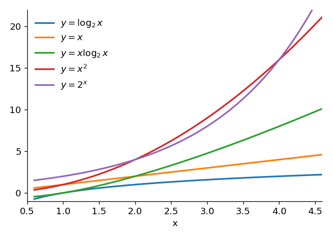

*그림 17. log2 x, x, x log2 x, x², 2의 x제곱의 그래프*

**예제 11.4.5 (로그 함수가 들어간 차수).** (a) $b > 1$이고 $c > 1$인 실수 $b$, $c$에 대해 $\log_b n$과 $\log_c n$의 차수가 같음을 보인다. (b) $n + n \log_2 n$이 $\Theta(n \log_2 n)$임을 보인다.

**풀이.** (a) 밑 변환 공식에 따라 다음이 성립한다.

$$
\log_b n = \frac{\log_c n}{\log_c b} = \frac{1}{\log_c b} \log_c n
$$

$b > 1$이고 $c > 1$이므로 $\log_c b > 0$이고 $\frac{1}{\log_c b} > 0$이다. 정리 11.2.7(a)에 따라 $\log_c n$은 $\Theta(\log_c n)$이므로, 정리 11.2.8(c)에 따라 $\frac{1}{\log_c b} \log_c n$, 곧 $\log_b n$은 $\Theta(\log_c n)$이다. $b$와 $c$를 바꾸어 같은 추론을 하면 $\log_c n$은 $\Theta(\log_b n)$이다. 따라서 $\log_b n$과 $\log_c n$의 차수는 같다. (b) 정리 11.2.7(a)에 따라 $n$은 $\Theta(n)$이고 $n \log_2 n$은 $\Theta(n \log_2 n)$이다. 또 (11.4.13)에 따라 어떤 양의 실수 $s$가 있어 $n \geq s$인 모든 정수에서 $n \leq n \log_2 n$이다(실제로 $n \geq 2$이면 $\log_2 n \geq 1$이다). 따라서 정리 11.2.9(c)에 따라 $n + n \log_2 n$은 $\Theta(n \log_2 n)$이다.

> **핵심:** 로그의 밑을 바꾸면 양의 상수배만 달라지므로 밑은 차수에 영향을 주지 않는다. 그래서 로그 차수는 $\Theta(\log n)$처럼 밑을 생략해 쓰기도 한다.

**예제 11.4.6 (지수적 차수).** $n!$이 $O(n^n)$임을 보인다.

**풀이.** 임의의 양의 정수 $n$에 대해 $(n-1) \leq n$, $(n-2) \leq n$, $\ldots$, $2 \leq n$, $1 \leq n$이므로 다음이 성립한다. 양변은 모두 인수가 $n$개인 곱이다.

$$
n! = n \cdot (n-1) \cdot (n-2) \cdots 2 \cdot 1 \leq n \cdot n \cdot n \cdots n \cdot n = n^n
$$

$B = 1$, $b = 1$로 두면 $n \geq b$에서 $n! \geq 0$이므로 $n \geq b$인 모든 정수에서 $0 \leq n! \leq n^n$이고, 빅오 표기법의 정의에 따라 $n!$은 $O(n^n)$이다.

### 4.7 조화합의 차수

$1 + \frac{1}{2} + \cdots + \frac{1}{n}$ 꼴의 합을 **조화합(harmonic sum)** 이라 한다. 조화합은 퀵 정렬 같은 여러 알고리즘의 분석에 나온다. 다음 예제는 계산 과정에서 로그 차수가 생기는 방식을 보여 주며, 미적분의 다음 사실을 쓴다. $y = \frac{1}{x}$의 그래프 아래에서 $x = 1$과 $x = n$ 사이의 넓이는 $\ln n$이다. 여기서 $\ln n = \log_e n$은 자연로그이다.

> **[미적분학]** 위 사실은 정적분 $\int_1^n \frac{1}{x}\,dx = \ln n - \ln 1 = \ln n$이다. $\frac{1}{x}$의 역도함수가 $\ln x$이고 $\ln 1 = 0$이기 때문이다. 또 $\frac{1}{x}$는 $x > 0$에서 감소하므로, 각 구간 $[i, i+1]$에서 그래프의 높이는 왼쪽 끝점에서 가장 크고 오른쪽 끝점에서 가장 작다.

**예제 11.4.7 (조화합의 차수).** 다음 단계를 따라 $1 + \frac{1}{2} + \frac{1}{3} + \cdots + \frac{1}{n}$이 $\Theta(\ln n)$임을 보인다. (a) 그림 18을 해석하여 $\frac{1}{2} + \frac{1}{3} + \cdots + \frac{1}{n} \leq \ln n$과 $\ln n \leq 1 + \frac{1}{2} + \cdots + \frac{1}{n}$을 보인다. (b) $n \geq 3$인 정수이면 $1 \leq \ln n$임을 보인다. (c) (a)와 (b)에서 $n \geq 3$이면 $\ln n \leq 1 + \frac{1}{2} + \cdots + \frac{1}{n} \leq 2 \ln n$임을 이끌어 낸다. (d) (c)에서 $1 + \frac{1}{2} + \cdots + \frac{1}{n}$이 $\Theta(\ln n)$임을 이끌어 낸다.

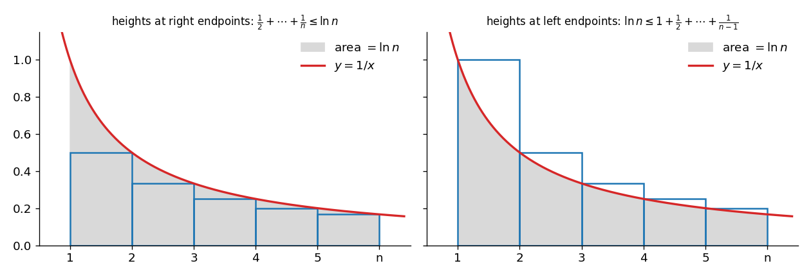

*그림 18. y = 1/x의 그래프 아래 넓이 ln n과 오른쪽 끝점, 왼쪽 끝점 높이의 직사각형*

**풀이.**

- (a) 그림 18의 왼쪽은 1부터 $n$까지 이웃한 두 정수 사이의 구간을 밑변으로 하고, 높이가 구간의 오른쪽 끝점에서의 그래프 높이인 직사각형들이다. 1부터 2까지의 직사각형의 넓이는 $\frac{1}{2}$, 2부터 3까지는 $\frac{1}{3}$, $\ldots$, $n - 1$부터 $n$까지는 $\frac{1}{n}$이므로 넓이의 합은 $\frac{1}{2} + \frac{1}{3} + \cdots + \frac{1}{n}$이다. 직사각형들은 모두 그래프 아래에 들어가므로 이 합은 $x = 1$과 $x = n$ 사이의 그래프 아래 넓이 $\ln n$ 이하이다. 오른쪽 그림처럼 높이를 왼쪽 끝점에서 잡으면 직사각형들이 그래프 아래 영역을 덮으므로 $\ln n \leq 1 + \frac{1}{2} + \cdots + \frac{1}{n-1} \leq 1 + \frac{1}{2} + \cdots + \frac{1}{n}$이다.
- (b) $n \geq 3$인 정수이면 $e \approx 2.718$이므로 $n \geq e$이다. 밑이 $e$인 로그 함수는 증가하므로 $1 = \ln e \leq \ln n$이다.
- (c) (a)의 첫 부등식 $\frac{1}{2} + \cdots + \frac{1}{n} \leq \ln n$과 (b)의 $1 \leq \ln n$을 변끼리 더하면 $n \geq 3$에서 $1 + \frac{1}{2} + \cdots + \frac{1}{n} \leq 2 \ln n$이다. (a)의 둘째 부등식과 합치면 $n \geq 3$에서 $\ln n \leq 1 + \frac{1}{2} + \cdots + \frac{1}{n} \leq 2 \ln n$이다.
- (d) $A = 1$, $B = 2$, $k = 3$으로 두면, $n \geq 3$에서 $\ln n > 0$이고 $A \ln n \leq 1 + \frac{1}{2} + \cdots + \frac{1}{n} \leq B \ln n$이므로 빅세타 표기법의 정의에 따라 $1 + \frac{1}{2} + \cdots + \frac{1}{n}$은 $\Theta(\ln n)$이다.

4.6절의 예제 (a)에 따라 모든 로그 함수의 차수는 같으므로, $b > 1$인 모든 실수 $b$에 대해 $1 + \frac{1}{2} + \cdots + \frac{1}{n}$은 $\Theta(\log_b n)$이다.

---

<br>

## 5. 알고리즘 효율성 분석 II

### 5.1 분할 정복

수 맞히기 놀이를 생각한다. 한 사람이 정해진 범위, 예를 들어 1부터 100까지에서 수 하나를 몰래 고르고, 다른 사람은 되도록 적은 횟수로 그 수를 알아내려 한다. 추측할 때마다 고른 사람은 추측이 맞았는지, 너무 작은지, 너무 큰지를 알려 준다. 가장 좋은 전략은 범위의 한가운데 근처를 먼저 추측하는 것이다. 추측이 너무 크면 수는 아래쪽 끝과 추측 사이에 있고, 너무 작으면 추측과 위쪽 끝 사이에 있다. 어느 경우든 남은 범위의 한가운데 근처를 다음에 추측하며, 수를 찾을 때까지 이를 되풀이한다.

이 방법은 **분할 정복(divide and conquer)** 이라는 일반 전략의 한 예이다. 분할 정복은 문제를 같은 종류의 더 작은 문제 몇 개(개수는 고정)로 쪼개고, 그 작은 문제들도 같은 방식으로 쪼개는 일을 쉽게 풀리는 문제가 나올 때까지 계속한다. 수 맞히기 놀이에서는 범위에서 수를 찾는 문제가 단계마다 길이가 약 절반인 범위에서 수를 찾는 문제가 된다. 분할 정복 알고리즘은 대개 매우 효율적이고, 그 차수에는 거의 언제나 로그 함수가 들어간다. 이 절은 수 맞히기 놀이를 이진 탐색 알고리즘으로 형식화하여 순차 탐색과 효율성을 비교하고, 분할 정복 정렬 알고리즘인 병합 정렬을 만들어 삽입 정렬, 선택 정렬과 비교한다.

### 5.2 이진 탐색

순차 탐색은 원소가 어떤 순서로 놓인 배열에도 쓸 수 있지만, **이진 탐색(binary search)** 은 원소가 오름차순(또는 내림차순)으로 놓인 배열에만 쓸 수 있다. 서로 다른 원소가 오름차순으로 놓인 배열 $a[1], a[2], \ldots, a[n]$에서 특정 원소 $x$를 찾는 문제를 생각한다.

이진 탐색은 먼저 $x$를 배열의 가운데 원소와 비교한다. 둘이 같으면 탐색은 성공이다. 같지 않으면 배열이 오름차순이므로, 비교 결과로 $x$가 있을 수 있는 쪽이 가운데 원소 앞의 원소들로 된 아래쪽 부분 배열인지 뒤의 원소들로 된 위쪽 부분 배열인지 정해진다. 그 짧아진 부분 배열에 같은 단계를 다시 적용하는 일을, $x$를 찾거나 탐색할 부분 배열에 원소가 하나도 남지 않을 때까지 되풀이한다. 단계마다 탐색할 부분 배열의 길이가 대략 절반으로 줄어든다는 것이 이 알고리즘이 효율적인 이유이다.

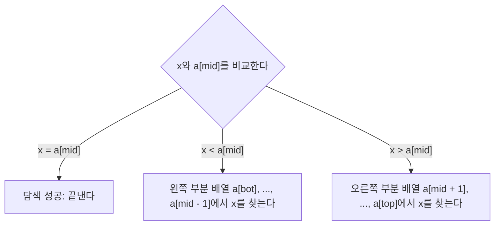

*그림 19. 이진 탐색 과정의 반복 한 번*

알고리즘을 형식화하려고 변수 `index`를 도입한다. 배열이 $a[1]$부터 $a[n]$까지이므로 `index`를 0으로 초기화하고, $x$를 찾으면 `index`를 $x$와 같은 원소의 첨자로 바꾼다. 알고리즘이 끝났을 때 `index`가 여전히 0이면 $x$는 배열의 원소가 아니다. 그림 20은 $x = a[5]$일 때 $a[1], \ldots, a[7]$에서의 이진 탐색이다.

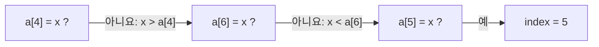

*그림 20. x = a[5]일 때 a[1], ..., a[7]의 이진 탐색*

형식화하려면 배열의 가운데 원소도 정확히 정해야 한다. 원소의 개수가 짝수이면 가운데 원소가 둘이다. 예를 들어 $a[3], a[4], \ldots, a[10]$에서는 앞에 세 원소, 뒤에 세 원소가 있고 $a[6]$과 $a[7]$이 똑같이 가운데에 있다. 이때 어느 쪽을 골라도 되지만, 이 알고리즘은 작은 쪽을 고른다. 작은 쪽 가운데 원소의 첨자는 배열의 아래쪽 첨자와 위쪽 첨자의 평균의 바닥이다. 곧 `bot`을 배열의 아래쪽 첨자, `top`을 위쪽 첨자, `mid`를 가운데 두 첨자 중 작은 쪽이라 하면 $mid = \lfloor (bot + top)/2 \rfloor$이다. 위 예에서 $bot = 3$, $top = 10$이므로 $mid = \lfloor 13/2 \rfloor = \lfloor 6.5 \rfloor = 6$이다.

**알고리즘 11.5.1 (이진 탐색).** 이 알고리즘은 오름차순 배열 $a[1], a[2], \ldots, a[n]$에서 원소 $x$를 찾는다. $x$를 찾으면 변수 `index`를 $x$가 있는 원소의 첨자로 바꾸고, 찾지 못하면 `index`는 초깃값 0 그대로이다. 변수 `bot`과 `top`은 지금 조사하는 부분 배열의 아래쪽 첨자와 위쪽 첨자이다.

```text
Input: n [양의 정수], a[1], a[2], ..., a[n] [오름차순으로 주어진 데이터 항목의 배열],
       x [배열의 원소와 같은 자료형의 데이터 항목]

Algorithm Body:
index := 0, bot := 1, top := n
while (top ≥ bot and index = 0)
    mid := ⌊(bot + top) / 2⌋
    if a[mid] = x then index := mid
    if a[mid] > x
        then top := mid - 1
        else bot := mid + 1
end while

Output: index [음이 아닌 정수]
```

루프의 반복마다 가운데 첨자 `mid`를 계산해 $x$를 $a[mid]$와 비교한다. 둘이 같으면 탐색은 성공이고 `index`가 `mid`가 되어 루프가 끝난다. 같지 않으면 `top`을 `mid - 1`로 바꾸어 아래쪽 부분 배열로, 또는 `bot`을 `mid + 1`로 바꾸어 위쪽 부분 배열로 과정을 되풀이한다. 반복마다 `top`이 줄거나 `bot`이 늘므로, 탐색에 성공하지 않으면 결국 `top`이 `bot`보다 작아져 루프가 끝나고, 이는 $x$가 배열의 원소가 아님을 뜻한다. 루프가 끝났을 때 `index`가 0이면 $x$는 배열에 없고, 그렇지 않으면 `index`가 $x$의 위치이다.

**예제 11.5.1 (이진 탐색의 추적).** 다음 입력 배열에서 (a) $x = \text{Erik}$, (b) $x = \text{Sara}$일 때 알고리즘 11.5.1의 변수 `index`, `bot`, `top`, `mid`의 변화를 추적한다. 원소는 알파벳 순서로 비교한다.

$$
a[1] = \text{Ann},\ a[2] = \text{Dawn},\ a[3] = \text{Erik},\ a[4] = \text{Gail},\ a[5] = \text{Juan},\ a[6] = \text{Matt},\ a[7] = \text{Max},\ a[8] = \text{Rita},\ a[9] = \text{Tsuji},\ a[10] = \text{Yuen}
$$

**풀이.** 표 11과 표 12의 각 열은 while 루프의 반복 한 번이 끝난 뒤의 값이다.

| 변수 | 처음 | 1회 | 2회 | 3회 |
|:-----|:-----|:-----|:-----|:-----|
| `mid` | | 5 | 2 | 3 |
| 비교 | | Juan > Erik | Dawn < Erik | Erik = Erik |
| `index` | 0 | 0 | 0 | 3 |
| `bot` | 1 | 1 | 3 | 4 |
| `top` | 10 | 4 | 4 | 4 |

*표 11. x = Erik일 때 이진 탐색의 추적*

| 변수 | 처음 | 1회 | 2회 | 3회 |
|:-----|:-----|:-----|:-----|:-----|
| `mid` | | 5 | 8 | 9 |
| 비교 | | Juan < Sara | Rita < Sara | Tsuji > Sara |
| `index` | 0 | 0 | 0 | 0 |
| `bot` | 1 | 6 | 9 | 9 |
| `top` | 10 | 10 | 10 | 8 |

*표 12. x = Sara일 때 이진 탐색의 추적*

(a)에서는 셋째 반복에서 $a[3] = x$이므로 `index`가 3이 되고 루프가 끝난다. (b)에서는 셋째 반복 뒤 $top = 8 < 9 = bot$이므로 루프가 끝나고, `index`가 0이므로 Sara는 배열에 없다.

> **참고:** (a)의 셋째 반복에서 $x$를 찾은 뒤에도 두 번째 if 문이 실행되어, $a[3] > x$가 거짓이므로 else 분기에서 `bot`이 4로 바뀐다. 그러나 `index`가 0이 아니므로 루프는 끝나고 결과에는 영향이 없다.

### 5.3 이진 탐색의 효율성

이진 탐색 알고리즘의 효율성을 유도하는 생각을 먼저 간단히 설명한다. 이진 탐색 과정의 각 단계에서 새로 탐색할 부분 배열의 길이는 앞 단계의 약 절반이고, 최악의 경우 원소가 하나인 부분 배열까지 모두 탐색해야 한다. 따라서 최악의 경우 while 루프의 최대 반복 횟수는 원래 입력 배열을 대략 절반으로 자를 수 있는 횟수보다 1 크다. 배열의 길이 $n$이 2의 거듭제곱($n = 2^k$)이면 길이 1인 배열에 이를 때까지 $n$을 정확히 $k = \log_2 n = \lfloor \log_2 n \rfloor$번 반으로 나눌 수 있다. $n$이 2의 거듭제곱이 아니면 어떤 정수 $k$와 $0 < m < 2^k$에 대해 $n = 2^k + m$이고, 이때도 $n$을 대략 반으로 $k$번 나눌 수 있으므로 $k = \lfloor \log_2 n \rfloor$이다. 따라서 최악의 경우 while 루프의 최대 반복 횟수, 곧 필요한 비교 횟수에 비례하는 양은 $\lfloor \log_2 n \rfloor + 1$이고, 이는 $O(\log_2 n)$이다. 다음 예제들에서 세부를 유도한다.

각 정수 $n \geq 1$에 대해 $w_n$을 길이가 $n$인 입력 배열에 대해 최악의 경우 이진 탐색의 while 루프가 반복하는 횟수로 둔다.

먼저 생각할 문제는 이것이다. 루프의 한 반복에 들어가는 배열의 길이를 알 때, 다음 반복에 들어가는 배열의 길이는 최대 얼마인가?

**예제 11.5.2 (다음 반복에 들어가는 배열의 길이).** 이진 탐색의 while 루프에 길이가 $k$인 배열이 들어가면, 루프의 반복 한 번이 실패한 뒤 다음 반복에 들어가는 배열의 길이가 많아야 $\lfloor k/2 \rfloor$임을 보인다.

**풀이.** 길이가 $k$인 배열 $a[bot], \ldots, a[top]$이 while 루프에 들어가고 $x \neq a[mid]$인 경우를 생각한다. $x < a[mid]$이면 다음 입력은 $a[bot], \ldots, a[mid-1]$이고, $x > a[mid]$이면 $a[mid+1], \ldots, a[top]$이다. 배열의 원소를 차례로 1부터 $k$까지의 정수와 짝지으면, $mid$의 상대 위치는 $bot$의 값과 관계없이 $\lfloor (k+1)/2 \rfloor$이다. 따라서 $k$의 홀짝에 따라 두 부분 배열의 길이는 표 13과 같다.

| $k$ | `mid`의 상대 위치 | 왼쪽 부분 배열의 위치 | 왼쪽 길이 | 오른쪽 부분 배열의 위치 | 오른쪽 길이 |
|:-----|:-----|:-----|:-----|:-----|:-----|
| 홀수 | $\frac{k+1}{2}$ | $1, \ldots, \frac{k-1}{2}$ | $\frac{k-1}{2} = \lfloor k/2 \rfloor$ | $\frac{k+3}{2}, \ldots, k$ | $\frac{k-1}{2} = \lfloor k/2 \rfloor$ |
| 짝수 | $\frac{k}{2}$ | $1, \ldots, \frac{k}{2} - 1$ | $\frac{k}{2} - 1 = \lfloor k/2 \rfloor - 1$ | $\frac{k}{2} + 1, \ldots, k$ | $\frac{k}{2} = \lfloor k/2 \rfloor$ |

*표 13. 길이 k인 배열에서 왼쪽과 오른쪽 부분 배열의 길이*

$\lfloor k/2 \rfloor$와 $\lfloor k/2 \rfloor - 1$ 중 큰 수는 $\lfloor k/2 \rfloor$이므로, 최악의 경우 다음 반복에 들어가는 배열의 길이는 $\lfloor k/2 \rfloor$이다.

**예제 11.5.3 ($w_1, w_2, w_3, \ldots$의 점화식).** 수열 $w_1, w_2, w_3, \ldots$가 다음 점화식과 초기 조건을 만족함을 보인다.

$$
w_1 = 1, \qquad w_k = 1 + w_{\lfloor k/2 \rfloor} \quad (k > 1)
$$

**풀이.** 앞 예제에 따라 길이 $k$인 배열이 while 루프에 들어가면 최악의 경우 다음 반복은 길이 $\lfloor k/2 \rfloor$인 배열을 탐색한다. 따라서 루프의 최대 반복 횟수는 길이 $\lfloor k/2 \rfloor$인 배열에 필요한 최대 반복 횟수보다 1 크고, 기호로 $w_k = 1 + w_{\lfloor k/2 \rfloor}$이다. 또 길이 1인 입력 배열($bot = top$)에서는 while 루프가 한 번만 반복하므로 $w_1 = 1$이다.

**예제 11.5.4 ($w_n$의 명시적 공식 추측).** 점화식에 반복 대입을 적용하여 $w_n$의 명시적 공식을 추측한다.

**풀이.** 처음 몇 항을 구하면 다음과 같다. 예를 들어 $w_2 = 1 + w_1 = 2$, $w_3 = 1 + w_1 = 2$, $w_4 = 1 + w_2 = 3$, $w_8 = 1 + w_4 = 4$, $w_{15} = 1 + w_7 = 4$, $w_{16} = 1 + w_8 = 5$이다.

| $n$ | 1 | 2 | 3 | 4 | 5 | 6 | 7 | 8 | 9 | $\cdots$ | 15 | 16 |
|:-----|:-----|:-----|:-----|:-----|:-----|:-----|:-----|:-----|:-----|:-----|:-----|:-----|
| $w_n$ | 1 | 2 | 2 | 3 | 3 | 3 | 3 | 4 | 4 | $\cdots$ | 4 | 5 |
| $\lfloor \log_2 n \rfloor + 1$ | 1 | 2 | 2 | 3 | 3 | 3 | 3 | 4 | 4 | $\cdots$ | 4 | 5 |

*표 14. 이진 탐색의 최악의 경우 반복 횟수와 ⌊log2 n⌋ + 1*

첨자 $n$이 두 2의 거듭제곱 사이에 있을 때마다 $w_n$은 작은 쪽 거듭제곱의 지수보다 1 크다. 곧 다음이 성립한다.

$$
2^i \leq n < 2^{i+1} \implies w_n = i + 1 \qquad (11.5.1)
$$

$2^i \leq n < 2^{i+1}$이면 성질 (11.4.2)에 따라 $i = \lfloor \log_2 n \rfloor$이므로, (11.5.1)에 대입하면 $w_n = \lfloor \log_2 n \rfloor + 1$이라고 추측할 수 있다.

**예제 11.5.5 (공식이 맞음을 증명하기).** 강한 수학적 귀납법으로, $w_1 = 1$이고 $k > 1$인 모든 정수에서 $w_k = 1 + w_{\lfloor k/2 \rfloor}$인 수열이 $n \geq 1$인 모든 정수에서 $w_n = \lfloor \log_2 n \rfloor + 1$을 만족함을 보인다.

**풀이.** 성질 $P(n)$을 등식 $w_n = \lfloor \log_2 n \rfloor + 1$으로 둔다.

**기저 단계.** 수열의 정의에 따라 $w_1 = 1$이고, $\lfloor \log_2 1 \rfloor + 1 = 0 + 1 = 1$이므로 $P(1)$은 참이다.

**귀납 단계.** $k \geq 1$인 임의의 정수 $k$에 대해, 귀납 가정으로 $1 \leq i \leq k$인 모든 정수 $i$에서 $w_i = \lfloor \log_2 i \rfloor + 1$이라고 가정한다. 보일 것은 $w_{k+1} = \lfloor \log_2(k+1) \rfloor + 1$이다.

경우 1 ($k$가 짝수): $k + 1$이 홀수이므로 $\lfloor (k+1)/2 \rfloor = k/2$이고, $k \geq 2$이므로 $1 \leq k/2 < k$여서 귀납 가정을 쓸 수 있다.

$$
w_{k+1} = 1 + w_{k/2} = 1 + \bigl(\lfloor \log_2(k/2) \rfloor + 1\bigr) = \lfloor \log_2 k - 1 \rfloor + 2 = \bigl(\lfloor \log_2 k \rfloor - 1\bigr) + 2 = \lfloor \log_2(k+1) \rfloor + 1
$$

근거는 차례로 수열의 정의, 귀납 가정, $\log_2(k/2) = \log_2 k - \log_2 2 = \log_2 k - 1$, $\lfloor x - 1 \rfloor = \lfloor x \rfloor - 1$, 성질 (11.4.3)이다.

경우 2 ($k$가 홀수): $k + 1$이 짝수이므로 $\lfloor (k+1)/2 \rfloor = (k+1)/2$이고, $1 \leq (k+1)/2 \leq k$여서 귀납 가정을 쓸 수 있다.

$$
w_{k+1} = 1 + w_{(k+1)/2} = 1 + \bigl(\lfloor \log_2(k+1) - 1 \rfloor + 1\bigr) = \bigl(\lfloor \log_2(k+1) \rfloor - 1\bigr) + 2 = \lfloor \log_2(k+1) \rfloor + 1
$$

두 경우 모두 $w_{k+1} = \lfloor \log_2(k+1) \rfloor + 1$이므로, 기저 단계와 귀납 단계가 모두 증명되어 강한 수학적 귀납법에 따른 증명이 끝난다.

**예제 11.5.6 (이진 탐색은 로그 차수이다).** $n \geq 1$인 모든 정수에서 $w_n = \lfloor \log_2 n \rfloor + 1$임을 이용하여, 최악의 경우 이진 탐색 알고리즘이 $\Theta(\log_2 n)$임을 보인다.

**풀이.** $n \geq 2$인 각 정수에서 다음이 차례로 성립한다.

$$
w_n = \lfloor \log_2 n \rfloor + 1 \implies \log_2 n \leq w_n \leq \log_2 n + 1 \implies \log_2 n \leq w_n \leq \log_2 n + \log_2 n = 2 \log_2 n
$$

첫 단계는 모든 실수 $x$에서 $x < \lfloor x \rfloor + 1$이고 $\lfloor x \rfloor \leq x$이기 때문이고, 둘째 단계는 밑이 2인 로그 함수가 증가하므로 $2 \leq n$이면 $1 = \log_2 2 \leq \log_2 n$이기 때문이다. $A = 1$, $B = 2$, $k = 2$로 두면 $n \geq k$인 모든 정수에서 $A \log_2 n \leq w_n \leq B \log_2 n$이므로 $w_n$은 $\Theta(\log_2 n)$이다. 마지막으로 while 루프의 반복 횟수 $w_n$은 이진 탐색이 하는 비교 횟수에 비례하므로, 최악의 경우 이진 탐색 알고리즘은 $\Theta(\log_2 n)$이다.

이렇게 최악의 경우 이진 탐색의 차수는 $\log_2 n$이고, 3.1절에서 본 것처럼 순차 탐색의 차수는 $n$이다. 이 차이는 $n$이 커질수록 중요해진다. 루프의 반복 한 번에 1나노초가 걸린다고 하면 두 탐색의 최악의 경우 시간은 표 15와 같다. 수 맞히기 놀이에서도 1부터 100까지의 범위라면 $\lfloor \log_2 100 \rfloor + 1 = 7$번 안에 반드시 맞힐 수 있다.

| $n$ | 순차 탐색 ($n$번 반복) | 이진 탐색 ($\lfloor \log_2 n \rfloor + 1$번 반복) |
|:-----|:-----|:-----|
| 100,000,000 | 0.1초 | 0.000000027초 |
| 100,000,000,000 | 1.67분 | 0.000000037초 |
| 100,000,000,000,000 | 27.78시간 | 0.000000047초 |

*표 15. 반복 한 번에 1나노초가 걸릴 때 순차 탐색과 이진 탐색의 최악의 경우 시간*

### 5.4 병합 정렬

순차 탐색은 이진 탐색보다 자세히 쓰기가 훨씬 쉽지만, 효율은 이진 탐색이 훨씬 높다. 컴퓨터 과학에는 이런 절충이 흔하다. 문제의 뻔한 해법이, 설명하는 데 더 품이 드는 영리한 해법보다 덜 효율적인 경우가 많다. 3.4절과 3.5절의 삽입 정렬과 선택 정렬은 사람이 손으로 정렬할 때 흔히 쓰는 방식을 형식화한 것이다. 분할 정복을 쓰면 더 효율적인 정렬 방법을 얻을 수 있으며, 실제로 컴퓨터 과학자들은 설명은 더 복잡하지만 삽입 정렬이나 선택 정렬보다 훨씬 효율적인 분할 정복 정렬 알고리즘을 여럿 고안했다.

그중 하나인 **병합 정렬(merge sort)** 은 재귀적으로 생각하면 얻어진다. 길이가 $k$보다 짧은 배열을 효율적으로 정렬하는 방법을 이미 안다고 가정한다. 길이 $k$인 배열을 대략 같은 길이의 두 부분으로 나누어 각 부분을 그 방법으로 정렬하면, 남은 일은 정렬된 두 부분을 하나의 정렬된 배열로 합치는 것이고, 이는 두 부분을 **병합(merge)** 하여 효율적으로 할 수 있다.

정렬된 두 부분 배열 2, 5, 6, 8과 3, 6, 7, 9를 병합하는 과정은 다음과 같다. 각 원소를 종이쪽지에 적어, 두 부분 배열을 탁자 위의 왼쪽 열과 오른쪽 열에 놓고 아래에 결과를 놓을 자리 여덟 개를 마련했다고 생각한다. 단계마다 두 열의 맨 앞에 있는 수를 비교해 더 작은 수의 쪽지를 결과의 다음 자리로 옮긴다. 두 수가 같으면 왼쪽 열의 쪽지를 옮기고, 한 열이 비면 다른 열의 쪽지를 차례로 모두 옮긴다. 표 16은 각 자리를 채우는 과정이다.

| 자리 | 비교하는 두 수 | 옮기는 수 | 출처 |
|:-----|:-----|:-----|:-----|
| 1 | 2와 3 | 2 | 왼쪽 |
| 2 | 5와 3 | 3 | 오른쪽 |
| 3 | 5와 6 | 5 | 왼쪽 |
| 4 | 6과 6 | 6 | 왼쪽 (같으면 왼쪽) |
| 5 | 8과 6 | 6 | 오른쪽 |
| 6 | 8과 7 | 7 | 오른쪽 |
| 7 | 8과 9 | 8 | 왼쪽 |
| 8 | 비교 없음 (왼쪽 열이 빔) | 9 | 오른쪽 |

*표 16. 정렬된 두 부분 배열 2, 5, 6, 8과 3, 6, 7, 9의 병합*

병합이 효율적인 이유는 두 부분 배열을 길이 $k$인 배열로 병합하는 데 필요한 비교가 많아야 $k - 1$번이기 때문이다. 단계마다 옮길 쪽지는 두 열의 맨 앞 수를 한 번 비교하여 정하고, 한 열이 비어 있으면 비교를 하지 않는다. 마지막 쪽지를 옮길 때는 다른 열이 반드시 비어 있으므로, 최악의 경우에도 마지막 자리를 뺀 각 자리에서 한 번씩, 모두 $k - 1$번 비교한다. 위의 예에서도 비교는 $8 - 1 = 7$번이다.

병합 정렬은 다음과 같이 동작한다. 순서를 매길 수 있는 원소의 배열이 원소 하나로 되어 있으면 그대로 둔다. 이미 정렬되어 있기 때문이다. 그렇지 않으면 다음 세 단계를 거친다.

1. 배열을 길이가 가능한 한 같은 두 부분 배열로 나눈다.
2. 병합 정렬로 각 부분 배열을 정렬한다.
3. 두 부분 배열을 병합한다.

그림 21은 배열 5, 2, 4, 6, 1, 3, 2, 6에 병합 정렬을 적용하는 과정이다. 위쪽 절반은 분할, 아래쪽 절반은 병합이다.

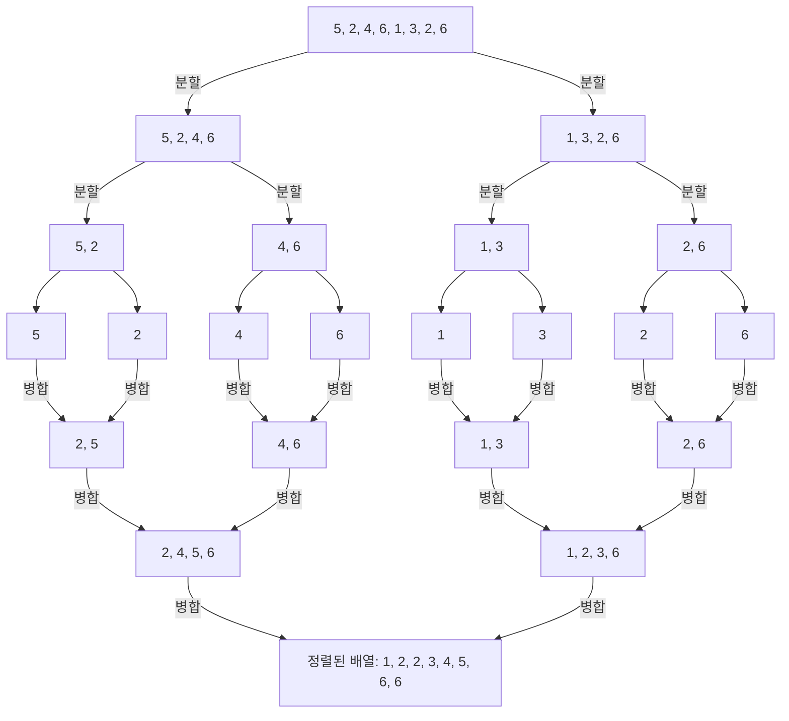

*그림 21. 배열 5, 2, 4, 6, 1, 3, 2, 6에 대한 병합 정렬의 분할과 병합*

이진 탐색처럼 병합 정렬을 형식화하려면 각 배열을 정확히 어디서 나눌지 정해야 한다. 배열 $a[bot], a[bot+1], \ldots, a[top]$에 대해 $mid = \lfloor (bot + top)/2 \rfloor$로 두고, 왼쪽 부분 배열을 $a[bot], \ldots, a[mid]$, 오른쪽 부분 배열을 $a[mid+1], \ldots, a[top]$으로 한다.

**알고리즘 11.5.2 (병합 정렬).** 이 알고리즘은 배열 $a[r], a[r+1], \ldots, a[s]$($r \leq s$)를 받아 같은 값들을 오름차순으로 늘어놓는다. 출력 배열도 $a[r], \ldots, a[s]$로 나타낸다. 입력 배열을 길이가 거의 같은 두 부분 배열로 나누어 각각을 병합 정렬로 정렬한 뒤 두 부분 배열을 병합한다.

```text
Input: r, s [r ≤ s인 양의 정수], a[r], a[r + 1], ..., a[s] [순서를 매길 수 있는 데이터 항목의 배열]

Algorithm Body:
bot := r, top := s
while (bot < top)
    mid := ⌊(bot + top) / 2⌋
    call merge sort with input bot, mid, and a[bot], a[bot + 1], ..., a[mid]
    call merge sort with input mid + 1, top, and a[mid + 1], a[mid + 2], ..., a[top]
    [이 두 단계가 끝나면 a[bot], ..., a[mid]와 a[mid + 1], ..., a[top]이 모두 정렬되어 있다.]
    merge a[bot], ..., a[mid] and a[mid + 1], ..., a[top]
    [오름차순인 두 배열을 받아 오름차순인 배열로 병합하는 병합 알고리즘을 호출하면 된다.]
end while

Output: a[r], a[r + 1], ..., a[s] [입력과 같은 원소를 오름차순으로 담은 배열]
```

> **참고:** 이 의사코드에서 `bot`과 `top`은 루프 본문 안에서 바뀌지 않으므로, `while`을 글자 그대로 실행하면 조건 `bot < top`이 계속 참이어서 같은 작업을 끝없이 되풀이한다. 의도한 동작은 `bot < top`일 때 본문을 한 번 실행하는 것이므로, `while (bot < top) ... end while`은 `if (bot < top) then ... end if`로 읽어야 한다. 길이가 1인 배열($bot = top$)에서는 아무것도 하지 않고 끝나며, 이것이 재귀의 기저이다.

병합 정렬은 정의하는 문장 안에서 자기 자신을 가리키므로 재귀적인 알고리즘이다. 그래도 단계마다 알고리즘에 들어가는 배열의 길이가 앞 단계보다 짧아서 결국 이미 정렬된 길이 1인 배열만 다루게 되므로, 이 알고리즘은 잘 정의된다.

**병합 정렬의 효율성.** 각 정수 $n \geq 1$에 대해 $m_n$을 길이 $n$인 배열에 병합 정렬을 적용할 때 쓰이는 비교의 최대 횟수로 둔다.

길이 1인 배열에는 비교가 필요 없으므로 $m_1 = 0$이다. $k > 1$인 정수에 대해 길이 $k$인 배열 $a[bot], \ldots, a[top]$을 $mid = \lfloor (bot + top)/2 \rfloor$에서 나누면, $mid$의 상대 위치가 $\lfloor (k+1)/2 \rfloor = \lceil k/2 \rceil$이므로 왼쪽 부분 배열의 길이는 $\lceil k/2 \rceil$, 오른쪽 부분 배열의 길이는 $k - \lceil k/2 \rceil = \lfloor k/2 \rfloor$이다. 또 길이 $k$인 배열로 병합하는 데는 많아야 $k - 1$번의 비교가 필요하다. 따라서 길이 $k$인 배열의 비교 횟수는 길이 $\lfloor k/2 \rfloor$인 배열의 비교 횟수, 길이 $\lceil k/2 \rceil$인 배열의 비교 횟수, 병합의 비교 횟수의 합이며, 다음 점화식을 얻는다.

$$
m_k = m_{\lfloor k/2 \rfloor} + m_{\lceil k/2 \rceil} + (k - 1) \qquad (k > 1)
$$

이 점화식으로 처음 몇 항을 구해 삽입 정렬의 최악의 경우 비교 횟수 $\frac{n(n-1)}{2}$(비교 `x < a[j]`만 센 값)와 비교하면 표 17과 같다.

| $n$ | 1 | 2 | 3 | 4 | 5 | 6 | 7 | 8 |
|:-----|:-----|:-----|:-----|:-----|:-----|:-----|:-----|:-----|
| $m_n$ | 0 | 1 | 3 | 5 | 8 | 11 | 14 | 17 |
| $\frac{n(n-1)}{2}$ | 0 | 1 | 3 | 6 | 10 | 15 | 21 | 28 |

*표 17. 병합 정렬과 삽입 정렬의 최대 비교 횟수*

이 점화식에 강한 수학적 귀납법을 적용하면 $n \geq 1$인 모든 정수에 대해 다음 부등식을 보일 수 있고, 이로부터 최악의 경우 병합 정렬은 $\Theta(n \log_2 n)$이다.

$$
\frac{1}{2} n \log_2 n \leq m_n \leq 2n \log_2 n
$$

$n$이 2의 거듭제곱인 경우에는 이 사실을 쉽게 확인할 수 있다. $n = 2^k$이면 $\lfloor n/2 \rfloor = \lceil n/2 \rceil = 2^{k-1}$이므로 점화식은 $m_{2^k} = 2m_{2^{k-1}} + 2^k - 1$이 된다. $k$에 관한 수학적 귀납법으로 $m_{2^k} = k \cdot 2^k - 2^k + 1$을 보일 수 있다. $k = 0$이면 $0 - 1 + 1 = 0 = m_1$이고, $m_{2^{k-1}} = (k-1)2^{k-1} - 2^{k-1} + 1$이면 다음이 성립하기 때문이다.

$$
m_{2^k} = 2\bigl((k-1)2^{k-1} - 2^{k-1} + 1\bigr) + 2^k - 1 = (k-1)2^k - 2^k + 2 + 2^k - 1 = k \cdot 2^k - 2^k + 1
$$

곧 $n = 2^k$이면 $m_n = n \log_2 n - n + 1$이다. $-n + 1 \leq 0$이므로 $m_n \leq n \log_2 n \leq 2n \log_2 n$이다. 또 $m_n \geq \frac{1}{2} n \log_2 n$은 $\frac{1}{2} k \cdot 2^k \geq 2^k - 1$과 동치이며, 이 부등식은 $k = 0, 1$에서 등호로 성립하고 $k \geq 2$에서는 $\frac{1}{2} k \cdot 2^k \geq 2^k > 2^k - 1$이므로 성립한다.

3.4절과 3.5절에서 삽입 정렬과 선택 정렬은 모두 $\Theta(n^2)$이었다. 병합 정렬이 $\Theta(n \log_2 n)$이라는 것은 얼마나 큰 차이인가? $n = 100{,}000{,}000$이고 한 연산에 1나노초가 걸리는 컴퓨터를 쓰면, $n \log_2 n$번의 연산에는 약 2.7초가 걸리지만 $n^2$번의 연산에는 115일이 넘게 걸린다.

> **[알고리즘]** 알고리즘 과목에서는 분할 정복 알고리즘의 실행 시간을 이와 같은 점화식으로 나타내고 그 해를 구하는 일반적인 방법을 다룬다. 병합 정렬은 크기 $n$인 문제를 크기가 절반인 두 문제로 나누고 선형 시간에 합치므로, 분할의 깊이 약 $\log_2 n$과 각 깊이의 병합 비용 약 $n$을 곱한 $\Theta(n \log n)$이 된다.

### 5.5 다루기 쉬운 문제와 다루기 어려운 문제

로그 차수인 이진 탐색과 반대쪽 끝에는 지수 차수인 알고리즘이 있다. 예를 들어 하노이의 탑 퍼즐에서 64개의 원판을 한 번에 하나씩 한 기둥에서 다른 기둥으로 옮기는 동작을 지시하는 알고리즘을 생각한다. 원판 $n$개를 옮기는 최소 이동 횟수 $h_n$은 위의 $n - 1$개를 보조 기둥으로 옮기고, 가장 큰 원판을 옮긴 뒤, $n - 1$개를 다시 그 위로 옮기는 과정에서 $h_1 = 1$, $h_n = 2h_{n-1} + 1$을 만족하며, 그 해는 $h_n = 2^n - 1$이다(5장). 따라서 64개를 옮기려면 $2^{64} - 1$번 이동해야 한다. 컴퓨터가 이동 한 번을 계산하는 데 1나노초가 걸린다면 모든 이동을 계산하는 시간은 다음과 같다.

$$
(2^{64} - 1) \times \frac{1}{10^9} \times \frac{1}{60} \times \frac{1}{60} \times \frac{1}{24} \times \frac{1}{365.25} \approx 584.5
$$

곱하는 수는 차례로 이동 횟수와, 초당 이동 횟수 $10^9$, 분당 초 60, 시간당 분 60, 하루의 시간 24, 1년의 일수 365.25의 역수이며, 결과의 단위는 년이다. 곧 약 584.5년이 걸린다.

> **용어 정의:** 최악의 경우 시간 차수가 다항식인 알고리즘을 **다항 시간 알고리즘(polynomial-time algorithm)** 이라 한다. 다항 시간 알고리즘으로 해를 구할 수 있는 문제는 **클래스 P**에 속하며 **다루기 쉬운(tractable)** 문제라 한다. 다항 시간에 풀 수 없는 문제는 **다루기 어려운(intractable)** 문제라 한다. 제시된 해가 맞는지를 다항 시간 알고리즘으로 확인할 수는 있지만 해를 다항 시간에 찾지 못할 수도 있는 문제는 **클래스 NP**에 속한다고 한다.

더 정확히 말하면 NP는 비결정적 순차 기계가 다항 시간에 풀 수 있는 문제들의 클래스이며, 이는 보통의 컴퓨터(결정적 순차 기계)가 제시된 해를 다항 시간에 검증할 수 있는 문제들과 같다. NP라는 이름은 비결정적 다항 시간(nondeterministic polynomial time)을 뜻한다.

클래스 NP의 모든 문제가 클래스 P에도 속하는지는 이론 컴퓨터 과학의 가장 중요한 미해결 문제이며, **P 대 NP 문제(P vs. NP problem)** 라 한다. 클레이 수학 연구소(Clay Mathematics Institute)는 P = NP를 증명하거나 반증하는 사람에게 100만 달러의 상금을 걸었다. 또 컴퓨터 과학자들은 **NP-완전(NP-complete)** 이라 불리는 큰 문제 집합을 찾아냈다. 이 문제들은 모두 클래스 NP에 속하지만 클래스 P에는 속하지 않는다고 널리 믿어진다. 확실한 것은 이 문제 중 하나라도 다항 시간 알고리즘이 있으면 나머지 모두에도 다항 시간 알고리즘이 있다는 사실이다. 10장에서 다룬 외판원 문제(traveling salesman problem)가 NP-완전 문제의 하나이다.

> **주의:** NP의 N은 비결정적(nondeterministic)을 뜻한다. NP를 다항 시간에 풀 수 없는 문제의 클래스로 읽으면 안 된다. NP는 해를 확인하는 데 드는 시간으로 정의한 클래스이며, NP에 속한다는 것만으로 다항 시간에 풀 수 없음이 증명되지는 않는다.

> **[계산이론]** 계산이론 과목에서는 문제를 형식 언어로, 알고리즘을 튜링 기계로 정의하여 클래스 P와 NP, NP-완전성을 엄밀하게 다룬다. 위의 설명은 그 정의를 알고리즘의 실행 시간이라는 관점에서 요약한 것이다.

### 5.6 알고리즘 효율성 분석의 범위

3절과 5절은 알고리즘 분석이 다루는 내용의 일부만 보여 준다. 두 절은 탐색과 정렬이 컴퓨터의 메모리 안에서 일어난다고 가정했다. 디스크의 파일에 저장된 데이터를 다루려면 다른 알고리즘이 필요하지만, 그 분석 방법은 비슷하다. 또 3.2절에서 말했듯이 시간 효율성만이 알고리즘을 고르는 기준은 아니다. 메모리가 저렴해졌어도 알고리즘에 필요한 공간의 양은 중요할 수 있으며, 공간 효율성은 시간 효율성과 매우 비슷한 수학적 기법으로 추정한다. 끝으로 데이터의 병렬 처리가 점점 흔해지면서, 알고리즘 분석 방법도 병렬 처리를 위한 알고리즘에 맞게 고쳐지고 확장되고 있다.

---

<br>

## 개념 적용

이 장에서 분석한 알고리즘의 차수를 모으면 표 18과 같다.

| 알고리즘 | 분석한 경우와 차수 | 근거 |
|:-----|:-----|:-----|
| 순차 탐색 | 최선 $\Theta(1)$, 최악 $\Theta(n)$, 평균 $\Theta(n)$ | 비교 1번, $n$번, 평균 $\frac{n+1}{2}$번 |
| 삽입 정렬 | 최선 $\Theta(n)$, 최악 $\Theta(n^2)$, 평균 $\Theta(n^2)$ | $n - 1$번, $\frac{1}{2}n^2 + \frac{1}{2}n - 1$번, $\frac{n^2 + 3n - 4}{4}$번 |
| 선택 정렬 | 모든 경우 $\Theta(n^2)$ | 비교 $\frac{n(n-1)}{2}$번, 입력과 무관 |
| 항별 다항식 평가 | $\Theta(n^2)$ | 덧셈과 곱셈 $\frac{n^2 + 3n}{2}$번 |
| 호너의 방법 | $\Theta(n)$ | 덧셈과 곱셈 $2n$번 |
| 이진 탐색 | 최악 $\Theta(\log_2 n)$ | 반복 $\lfloor \log_2 n \rfloor + 1$번 |
| 병합 정렬 | 최악 $\Theta(n \log_2 n)$ | $\frac{1}{2}n\log_2 n \leq m_n \leq 2n\log_2 n$ |
| 하노이의 탑 | $\Theta(2^n)$ | 이동 $2^n - 1$번 |

*표 18. 이 장에서 분석한 알고리즘의 차수*

**T/F 점검:**

| 문장 | 판단과 근거 |
|:-----|:-----|
| $f(n)$이 $O(n^2)$이면 $f(n)$은 $\Theta(n^2)$이다. | **F.** 빅오는 위쪽 한계만 준다. 예를 들어 $n$은 $O(n^2)$이지만, $An^2 \leq n$은 $n > \frac{1}{A}$에서 성립하지 않으므로 $n$은 $\Omega(n^2)$이 아니고 $\Theta(n^2)$도 아니다. |
| $\log_2 n$과 $\log_{10} n$의 차수는 같다. | **T.** $\log_2 n = \frac{\log_{10} n}{\log_{10} 2}$로 양의 상수배만 다르므로 정리 11.2.8(c)에 따라 서로 빅세타이다. |
| 삽입 정렬의 평균적인 경우 차수는 최악의 경우 차수보다 낮다. | **F.** 평균 비교 횟수 $\frac{n^2 + 3n - 4}{4}$도 $\Theta(n^2)$이어서 최악의 경우와 차수가 같다. |
| 이진 탐색은 정렬되지 않은 배열에도 쓸 수 있다. | **F.** 가운데 원소와의 비교로 한쪽 부분 배열을 버리려면 배열이 오름차순(또는 내림차순)이어야 한다. |
| 선택 정렬의 비교 횟수는 입력 배열의 순서와 관계없다. | **T.** 단계 $k$의 안쪽 루프는 항상 $n - k$번 비교하므로 총 $\frac{n(n-1)}{2}$번이다. |
| $2^n$은 $O(n^{100})$이다. | **F.** (11.4.10)에 따라 충분히 큰 $n$에서 $n^{101} \leq 2^n$이다. $2^n \leq Bn^{100}$이라면 $n^{101} \leq Bn^{100}$, 곧 $n \leq B$가 충분히 큰 모든 $n$에서 성립해야 하므로 모순이다. |
| $n \geq 1$인 모든 정수에서 $n! \leq n^n$이다. | **T.** $n!$의 $n$개 인수가 모두 $n$ 이하이기 때문이다. |
| 모든 정수 $n > 1$에서 $\lfloor \log_2(n-1) \rfloor = \lfloor \log_2 n \rfloor$이다. | **F.** 홀수에서만 보장된다. $n = 8$이면 $\lfloor \log_2 7 \rfloor = 2 \neq 3 = \lfloor \log_2 8 \rfloor$이다. |

---

<br>

## 요약

| 개념 | 핵심 요약 |
|:-----|:-----|
| 실숫값 함수의 그래프 | 정의역의 $x$와 $y = f(x)$로 된 점 $(x, y)$의 집합이며, $x$에서의 높이가 $f(x)$이다. 정수에서 정의된 함수의 그래프는 첫 좌표가 정수인 점만 남긴 것이다. |
| 거듭제곱 함수 | 음이 아닌 실수 $a$에 대해 $p_a(x) = x^a$($x \geq 0$)이며, $x > 1$에서 지수가 클수록 그래프가 높다. |
| 함수의 배수 | $(Mf)(x) = M \cdot f(x)$이며, 그래프의 높이가 각 $x$에서 $M$배가 된다. |
| 증가 함수와 감소 함수 | $x_1 < x_2$이면 $f(x_1) < f(x_2)$(증가) 또는 $f(x_1) > f(x_2)$(감소)이다. 둘 다 일대일이고, 양수배는 성질을 보존하며 음수배는 뒤집는다. |
| 빅오메가 표기법 | $n \geq a$에서 $Ag(n) \leq f(n)$인 양수 $A$, $a$가 있으면 $f(n)$은 $\Omega(g(n))$이다. |
| 빅오 표기법 | $n \geq b$에서 $0 \leq f(n) \leq Bg(n)$인 양수 $B$, $b$가 있으면 $f(n)$은 $O(g(n))$이다. |
| 빅세타 표기법 | $n \geq k$에서 $Ag(n) \leq f(n) \leq Bg(n)$인 양수 $A$, $B$, $k$가 있으면 $f(n)$은 $\Theta(g(n))$이며, 이는 $\Omega$와 $O$가 함께 성립하는 것과 같다(정리 11.2.1). |
| 빅오의 한계 | $O(n^r)$이면 $r < s$인 $O(n^s)$이기도 하므로 빅오만으로는 증가 속도를 비교할 수 없다. $\Omega(n^m)$인 함수는 $p < m$인 $O(n^p)$가 아니다. |
| 다항식 차수 정리 | $a_m > 0$이면 $a_m n^m + \cdots + a_1 n + a_0$은 $\Theta(n^m)$이다. |
| 차수 표기법의 성질 | $\Omega$와 $O$는 서로 뒤집히고, $\Theta$는 반사적, 대칭적, 추이적이며, 양의 상수배는 차수를 바꾸지 않고 합은 큰 쪽의 차수를 따른다. |
| 알고리즘의 차수 | 크기 $n$인 입력에 대한 기본 연산 수가 $\Theta(g(n))$이면 알고리즘의 차수는 $g(n)$이며, 입력에 따라 다르면 최솟값과 최댓값으로 최선과 최악의 경우 차수를 정한다. |
| 순차 탐색 | 최선의 경우 $\Theta(1)$, 최악과 평균적인 경우 $\Theta(n)$이다. |
| 삽입 정렬 | 최선의 경우 $\Theta(n)$이고, 최악의 경우 $\frac{1}{2}n^2 + \frac{1}{2}n - 1$번, 평균 $\frac{n^2 + 3n - 4}{4}$번 비교하여 둘 다 $\Theta(n^2)$이다. |
| 선택 정렬 | 입력과 관계없이 $\frac{n(n-1)}{2}$번 비교하므로 $\Theta(n^2)$이다. |
| 다항식 평가 | 항별 평가는 $\frac{n^2 + 3n}{2}$번 연산하여 $\Theta(n^2)$이고, 호너의 방법은 $2n$번 연산하여 $\Theta(n)$이다. |
| 지수 함수와 로그 함수 | $\log_b$는 $b^x$의 역함수이고 $b > 1$이면 증가한다. $b > 1$, $r > 0$이면 큰 $x$에서 $\log_b x \leq x^r \leq b^x$이다. |
| 로그의 바닥 | $2^k \leq x < 2^{k+1}$이면 $\lfloor \log_2 x \rfloor = k$이고, 1보다 큰 홀수 $n$에서 $\lfloor \log_2(n-1) \rfloor = \lfloor \log_2 n \rfloor$이다. |
| 2진 표기의 비트 수 | 양의 정수 $n$의 2진 표기는 $\lfloor \log_2 n \rfloor + 1$자리이다. |
| 로그 차수 | 로그의 밑은 차수에 영향을 주지 않으며, $n + n\log_2 n$은 $\Theta(n \log_2 n)$, $n!$은 $O(n^n)$, 조화합은 $\Theta(\ln n)$이다. |
| 분할 정복 | 문제를 같은 종류의 더 작은 문제 몇 개로 줄이는 일을 쉽게 풀릴 때까지 반복하는 전략이며, 차수에 로그가 들어가는 경우가 많다. |
| 이진 탐색 | 오름차순 배열에서 가운데 원소와 비교해 범위를 절반으로 줄이며, 최악의 반복 횟수는 $\lfloor \log_2 n \rfloor + 1$이어서 $\Theta(\log_2 n)$이다. |
| 병합 정렬 | 배열을 반으로 나누어 각각 정렬한 뒤 많아야 $k - 1$번의 비교로 병합하며, $m_k = m_{\lfloor k/2 \rfloor} + m_{\lceil k/2 \rceil} + k - 1$에서 $\Theta(n \log_2 n)$이다. |
| P와 NP | 다항 시간에 풀리는 문제는 P에 속하여 다루기 쉽고, 해를 다항 시간에 확인할 수 있는 문제는 NP에 속한다. P = NP인지는 미해결 문제이다. |

---

<br>

## 점검 문제

1. **빅세타의 증명:** $2n^2 - 7n + 3$이 $\Theta(n^2)$임을 정의에 맞는 상수 $A$, $B$, $k$를 찾아 보이라.

   <details>
   <summary>정답</summary>

   위쪽 한계: $n \geq 1$이면 $2n^2 - 7n + 3 \leq 2n^2 + 3 \leq 2n^2 + 3n^2 = 5n^2$이다. 아래쪽 한계: 2.6절의 방법 2에서 $a_m = 2$, 나머지 계수의 절댓값의 합이 $7 + 3 = 10$이므로 $A = 1$, $a = \max(1, \frac{2}{2} \cdot 10) = 10$이다. 실제로 $n \geq 10$이면 $2n^2 - 7n + 3 - n^2 = n(n - 7) + 3 \geq 33 > 0$이다. 따라서 $A = 1$, $B = 5$, $k = 10$으로 두면 $n \geq k$에서 $n^2 \leq 2n^2 - 7n + 3 \leq 5n^2$이다. $n^2 - 7n + 3 \geq 0$은 $n \geq 7$에서 이미 성립하므로 $k = 7$도 된다.

   </details>

2. **빅오의 한계:** $f(n) = 3n^2 + 1$은 $O(n^3)$인가? $\Theta(n^3)$인가?

   <details>
   <summary>정답</summary>

   다항식 차수 정리에 따라 $f(n)$은 $\Theta(n^2)$이므로 $O(n^2)$이고, 정리 11.2.3에 따라 $O(n^3)$이다. 그러나 $\Theta(n^3)$은 아니다. $\Theta(n^3)$이라면 정리 11.2.1에 따라 $\Omega(n^3)$이고, 정리 11.2.4에 따라 $p = 2 < 3$인 $O(n^2)$가 될 수 없는데, $f(n)$은 $O(n^2)$이므로 모순이다.

   </details>

3. **알고리즘 조각:** 다음 조각에서 덧셈과 곱셈의 정확한 횟수와 차수를 구하라.

   ```text
   t := 0
   for i := 1 to n
       for j := i to n
           t := t + 2 * j
       next j
   next i
   ```

   <details>
   <summary>정답</summary>

   $i$에 대해 안쪽 루프는 $n - i + 1$번 반복하므로 총반복 횟수는 $n + (n - 1) + \cdots + 1 = \frac{n(n+1)}{2}$이다. 반복마다 곱셈 1번과 덧셈 1번을 하므로 연산 수는 $n(n+1) = n^2 + n$이고, 다항식 차수 정리에 따라 $\Theta(n^2)$이다.

   </details>

4. **삽입 정렬의 추적:** 배열 4, 1, 3, 2에 삽입 정렬을 적용할 때 각 단계 뒤의 배열과 비교 `x < a[j]`의 총횟수를 구하라. 3.4절의 약속(맨 앞에 닿았음을 확인하는 검사도 셈)에 따른 횟수도 구하라.

   <details>
   <summary>정답</summary>

   $k = 2$ 후 1, 4, 3, 2 (비교 1번), $k = 3$ 후 1, 3, 4, 2 (3 < 4 참, 3 < 1 거짓으로 2번), $k = 4$ 후 1, 2, 3, 4 (2 < 4, 2 < 3 참, 2 < 1 거짓으로 3번)이다. 비교 `x < a[j]`는 $1 + 2 + 3 = 6$번이다. 3.4절의 약속으로는 $k = 2$에서 1이 맨 앞으로 갔으므로 검사 1번이 더해져 $2 + 2 + 3 = 7$번이며, 각 단계의 값은 $k - j + 1$($j$는 들어간 위치)과 같다.

   </details>

5. **선택 정렬:** 길이가 6인 배열에 선택 정렬을 적용할 때 비교 `a[i] < a[IndexOfMin]`은 몇 번 일어나는가? 이 횟수가 입력에 따라 달라지는가?

   <details>
   <summary>정답</summary>

   단계 $k$에서 $6 - k$번이므로 $5 + 4 + 3 + 2 + 1 = 15 = \frac{6 \cdot 5}{2}$번이다. 안쪽 루프의 반복 횟수가 배열의 내용과 관계없이 정해지므로 입력에 따라 달라지지 않는다.

   </details>

6. **비트 수:** 1,000,000을 2진 표기로 나타내려면 2진 숫자가 몇 개 필요한가?

   <details>
   <summary>정답</summary>

   $\log_2 1{,}000{,}000 \approx 19.93$이므로 $\lfloor 19.93 \rfloor + 1 = 20$개이다. 실제로 $2^{19} = 524{,}288 \leq 1{,}000{,}000 < 1{,}048{,}576 = 2^{20}$이다.

   </details>

7. **로그 점화식:** $c_1 = 1$이고 $k \geq 2$에서 $c_k = c_{\lfloor k/2 \rfloor} + 2$인 수열의 명시적 공식을 추측하고, 5.3절의 결과를 이용해 정당화하라. 이 수열의 차수는 무엇인가?

   <details>
   <summary>정답</summary>

   $c_1 = 1$, $c_2 = c_3 = 3$, $c_4 = \cdots = c_7 = 5$, $c_8 = 7$이므로 $c_n = 2\lfloor \log_2 n \rfloor + 1$로 추측한다. $d_n = 2w_n - 1$로 두면 $d_1 = 1$이고 $d_k = 2(1 + w_{\lfloor k/2 \rfloor}) - 1 = d_{\lfloor k/2 \rfloor} + 2$이므로 $d_n$은 $c_n$과 같은 점화식과 초기 조건을 만족하여 모든 $n$에서 $c_n = d_n$이다. 따라서 $c_n = 2(\lfloor \log_2 n \rfloor + 1) - 1 = 2\lfloor \log_2 n \rfloor + 1$이다. 또 $w_n \geq 1$이므로 $w_n \leq 2w_n - 1 = c_n \leq 2w_n$이고, 5.3절에서 $n \geq 2$이면 $\log_2 n \leq w_n \leq 2\log_2 n$이므로 $\log_2 n \leq c_n \leq 4\log_2 n$이다. 따라서 $c_n$은 $\Theta(\log_2 n)$이다.

   </details>

8. **이진 탐색의 추적:** 배열 2, 5, 8, 12, 16, 23, 38, 56, 72, 91에서 $x = 23$을 이진 탐색할 때 `mid`의 값을 차례로 쓰라. 길이 10인 배열에서 최악의 경우 반복 횟수는 얼마인가?

   <details>
   <summary>정답</summary>

   $bot = 1$, $top = 10$에서 $mid = 5$($a[5] = 16 < 23$이므로 $bot = 6$), $mid = \lfloor 16/2 \rfloor = 8$($a[8] = 56 > 23$이므로 $top = 7$), $mid = \lfloor 13/2 \rfloor = 6$($a[6] = 23$이므로 $index = 6$)이다. 따라서 `mid`는 5, 8, 6이고 반복은 3번이다. 최악의 경우 반복 횟수는 $w_{10} = \lfloor \log_2 10 \rfloor + 1 = 3 + 1 = 4$이다.

   </details>

9. **병합 정렬의 점화식:** 점화식 $m_k = m_{\lfloor k/2 \rfloor} + m_{\lceil k/2 \rceil} + (k - 1)$과 $m_1 = 0$으로 $m_6$을 구하고, 같은 길이에서 삽입 정렬의 최대 비교 횟수 $\frac{n(n-1)}{2}$과 비교하라.

   <details>
   <summary>정답</summary>

   $m_2 = m_1 + m_1 + 1 = 1$, $m_3 = m_1 + m_2 + 2 = 3$, $m_6 = m_3 + m_3 + 5 = 11$이다. 삽입 정렬은 $\frac{6 \cdot 5}{2} = 15$번이므로 이미 $n = 6$에서 병합 정렬이 더 적게 비교하며, $n$이 커질수록 $\Theta(n \log_2 n)$과 $\Theta(n^2)$의 차이가 커진다.

   </details>

10. **증가 차수 비교:** $n^2$, $\log_2 n$, $2^n$, $n \log_2 n$, $\sqrt{n}$, $n$을 증가 차수가 작은 것부터 늘어놓고, 각 인접한 쌍의 순서를 이 장의 결과로 설명하라.

    <details>
    <summary>정답</summary>

    $\log_2 n$, $\sqrt{n}$, $n$, $n \log_2 n$, $n^2$, $2^n$ 순이다. $\log_2 n$은 (11.4.11)에서 $r = \frac{1}{2}$로 두면 $O(\sqrt{n})$이다. $\sqrt{n} \leq n$은 정리 11.2.2에서 나온다. $n \leq n \log_2 n \leq n^2$은 (11.4.13)과 (11.4.14)이다. $n^2$은 (11.4.12)에 따라 $O(2^n)$이다. 각 쌍에서 반대 방향의 빅오는 성립하지 않으므로 차수가 모두 다르다.

    </details>
