# Chapter 11 — Analysis of Algorithm Efficiency

[Repository Guide](../../README.md) | [English](Concepts_Lecture.md) | [한국어](Concepts_Lecture.ko.md)

> **Last Updated:** 2026-11-04
>
> Discrete Mathematics with Applications, Epp, Ch 11

> **Learning Objectives:**
> 1. Read the graph of a real-valued function and explain the definitions of a multiple of a function, an increasing function, and a decreasing function with graphs and inequalities
> 2. Find constants that satisfy the definitions of O-, Ω-, and Θ-notation to prove orders of polynomials and sums, and explain what O-notation alone cannot tell
> 3. Count elementary operations to find best-, worst-, and average-case orders of sequential search, insertion sort, selection sort, and polynomial evaluation
> 4. Use properties of exponential and logarithmic functions to find the number of bits in binary notation, solutions of recurrence relations, and orders of functions involving logarithms and exponentials
> 5. Derive the worst-case orders of the divide-and-conquer algorithms binary search and merge sort with recurrence relations and strong mathematical induction

---

## Table of Contents

- [1. Real-Valued Functions of a Real Variable and Their Graphs](#1-real-valued-functions-of-a-real-variable-and-their-graphs)
  - [1.1 The Cartesian Plane and the Graph of a Function](#11-the-cartesian-plane-and-the-graph-of-a-function)
  - [1.2 Power Functions](#12-power-functions)
  - [1.3 The Graph of the Floor Function](#13-the-graph-of-the-floor-function)
  - [1.4 Graphs of Functions Defined on Sets of Integers](#14-graphs-of-functions-defined-on-sets-of-integers)
  - [1.5 Multiples of a Function and Their Graphs](#15-multiples-of-a-function-and-their-graphs)
  - [1.6 Increasing and Decreasing Functions](#16-increasing-and-decreasing-functions)
- [2. Big-O, Big-Omega, and Big-Theta Notations](#2-big-o-big-omega-and-big-theta-notations)
  - [2.1 Why Compare Algorithm Efficiency](#21-why-compare-algorithm-efficiency)
  - [2.2 Definitions of the Three Order Notations](#22-definitions-of-the-three-order-notations)
  - [2.3 Translating Inequalities into Order Notation](#23-translating-inequalities-into-order-notation)
  - [2.4 Relations among the Three Notations](#24-relations-among-the-three-notations)
  - [2.5 Orders of Power Functions](#25-orders-of-power-functions)
  - [2.6 Orders of Polynomial Functions](#26-orders-of-polynomial-functions)
  - [2.7 What O-Notation Cannot Tell](#27-what-o-notation-cannot-tell)
  - [2.8 The Theorem on Polynomial Orders](#28-the-theorem-on-polynomial-orders)
  - [2.9 Properties of the Order Notations](#29-properties-of-the-order-notations)
- [3. Analysis of Algorithm Efficiency I](#3-analysis-of-algorithm-efficiency-i)
  - [3.1 Sequential Search](#31-sequential-search)
  - [3.2 Measuring the Efficiency of an Algorithm](#32-measuring-the-efficiency-of-an-algorithm)
  - [3.3 Orders of Algorithm Segments](#33-orders-of-algorithm-segments)
  - [3.4 Insertion Sort](#34-insertion-sort)
  - [3.5 Selection Sort](#35-selection-sort)
  - [3.6 Polynomial Evaluation and Horner's Rule](#36-polynomial-evaluation-and-horners-rule)
- [4. Exponential and Logarithmic Functions: Graphs and Orders](#4-exponential-and-logarithmic-functions-graphs-and-orders)
  - [4.1 Graphs of Exponential Functions](#41-graphs-of-exponential-functions)
  - [4.2 Graphs of Logarithmic Functions](#42-graphs-of-logarithmic-functions)
  - [4.3 Logarithms of Numbers between Two Consecutive Powers of 2](#43-logarithms-of-numbers-between-two-consecutive-powers-of-2)
  - [4.4 Application: Number of Bits Needed to Represent an Integer in Binary Notation](#44-application-number-of-bits-needed-to-represent-an-integer-in-binary-notation)
  - [4.5 Application: Using Logarithms to Solve Recurrence Relations](#45-application-using-logarithms-to-solve-recurrence-relations)
  - [4.6 Exponential and Logarithmic Orders](#46-exponential-and-logarithmic-orders)
  - [4.7 Order of a Harmonic Sum](#47-order-of-a-harmonic-sum)
- [5. Analysis of Algorithm Efficiency II](#5-analysis-of-algorithm-efficiency-ii)
  - [5.1 Divide and Conquer](#51-divide-and-conquer)
  - [5.2 Binary Search](#52-binary-search)
  - [5.3 Efficiency of Binary Search](#53-efficiency-of-binary-search)
  - [5.4 Merge Sort](#54-merge-sort)
  - [5.5 Tractable and Intractable Problems](#55-tractable-and-intractable-problems)
  - [5.6 Scope of Algorithm Efficiency Analysis](#56-scope-of-algorithm-efficiency-analysis)
- [Concept Applications](#concept-applications)
- [Summary](#summary)
- [Self-Check Questions](#self-check-questions)

---

<br>

## 1. Real-Valued Functions of a Real Variable and Their Graphs

The O-, Ω-, and Θ-notations that compare algorithm efficiency ask whether the graph of one function lies above or below the graph of a positive multiple of another function. As preparation, this section covers graphs of real-valued functions, multiples of functions, and increasing and decreasing functions.

### 1.1 The Cartesian Plane and the Graph of a Function

A **Cartesian plane**, or two-dimensional Cartesian coordinate system, is a way of picturing $\mathbf{R} \times \mathbf{R}$, the set of ordered pairs of real numbers. Draw two lines in the plane that meet at right angles, the horizontal axis and the vertical axis, take their crossing point as the **origin**, and fix a unit length on each axis. Then every ordered pair $(x, y)$ determines exactly one point of the plane, and every point determines exactly one ordered pair. For the pair $(x, y)$ of a point $P$, $|x|$ is the distance from $P$ to the vertical axis and $|y|$ is the distance from $P$ to the horizontal axis, while the signs tell whether $P$ lies to the right (positive) or left (negative) of the vertical axis and above (positive) or below (negative) the horizontal axis. An arrow on each axis marks its positive direction.

> **Definition:** A **real-valued function of a real variable** is a function whose domain and co-domain are both sets of real numbers. Thus each real number $x$ in the domain is assigned a single real value $f(x)$. The **graph** of $f$ is the set of all points $(x, y)$ of the Cartesian plane for which $x$ belongs to the domain of $f$ and $y = f(x)$.

By the definition, for each $x$ in the domain, the point $(x, y)$ lies on the graph of $f$ if, and only if, $y = f(x)$. Therefore the height of the graph at $x$ is $f(x)$. When a function value is negative, the graph lies below the horizontal axis, and the height is read as a negative number.

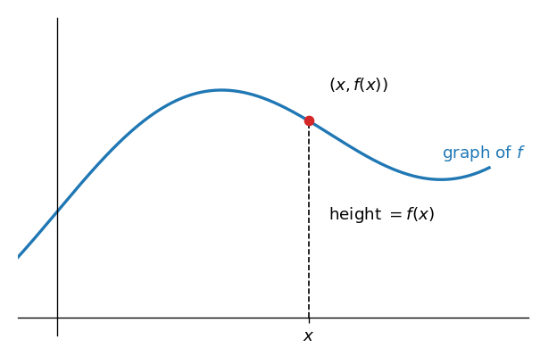

*Figure 1. The graph of a function f and the height of the point (x, f(x))*

If $f(x)$ can be written as an expression in $x$, the graph of $f$ is the same as the graph of the equation $y = f(x)$ with $x$ restricted to the domain of $f$.

### 1.2 Power Functions

A function that sends a real number $x$ to a power $x^a$ is called a **power function**. In applications to computer science, $x$ and $a$ are almost always nonnegative, so the definition is restricted to that case.

> **Definition:** For a nonnegative real number $a$, the **power function with exponent $a$**, $p_a$, is defined by $p_a(x) = x^a$ for every nonnegative real number $x$.

**Example 11.1.1 (Graphs of Power Functions).** Sketch the graphs of $p_0$, $p_{1/2}$, $p_1$, and $p_2$ on the same coordinate axes.

**Solution.** Find points on each graph from the definition.

- $p_0$: for every nonnegative $x$, $p_0(x) = x^0 = 1$ (as in Chapter 5, $0^0 = 1$ by definition). Every point $(x, 1)$ with $x \geq 0$ is on the graph, so the graph is a horizontal half-line at height 1 above the horizontal axis.
- $p_1$: since $p_1(x) = x$, the graph is the set of all points $(x, x)$, that is, the half-line of slope 1 that starts at the origin.
- $p_{1/2}$: since $p_{1/2}(x) = x^{1/2} = \sqrt{x}$, the graph passes through points such as $(0, 0)$, $(1, 1)$, $(4, 2)$, and $(9, 3)$.
- $p_2$: since $p_2(x) = x^2$, the graph passes through points such as $(0, 0)$, $(1, 1)$, $(2, 4)$, and $(3, 9)$.

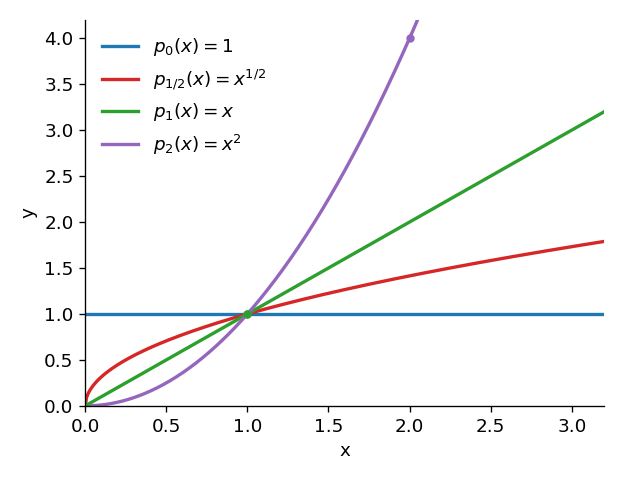

*Figure 2. Graphs of the power functions p0, p1/2, p1, and p2*

All four graphs pass through the point $(1, 1)$. For $0 < x < 1$, $x^2 < x < \sqrt{x} < 1$, so the larger the exponent, the lower the graph; for $x > 1$, $1 < \sqrt{x} < x < x^2$, so the larger the exponent, the higher the graph. What matters in algorithm analysis is the ordering for large $x$, which Section 2.5 states as a theorem.

### 1.3 The Graph of the Floor Function

The floor and ceiling functions arise in many places in computer science (Chapter 4). Every real number $x$ is either an integer or lies between two consecutive integers, so for each real number $x$ there is exactly one integer $n$ with $n \leq x < n + 1$.

> **Definition:** The **floor function** $F$ sends each real number $x$ to the greatest integer that is less than or equal to $x$, that is, to the unique integer $n$ with $n \leq x < n + 1$. This value is written $F(x) = \lfloor x \rfloor$. On the number line, $\lfloor x \rfloor$ is either $x$ itself or the integer immediately to the left of $x$.

**Example 11.1.2 (Graph of the Floor Function).** Sketch the graph of the floor function.

**Solution.** For an integer $n$, every real number $x$ in the interval $n \leq x < n + 1$ has $\lfloor x \rfloor = n$. So on each such interval the graph is a horizontal segment at height $n$, and the whole graph looks like a staircase. The left endpoint $(n, n)$ of each segment belongs to the graph, but the right endpoint $(n + 1, n)$ does not, so it is drawn as an open circle. For instance, $\lfloor 2.7 \rfloor = 2$, $\lfloor 3 \rfloor = 3$, and $\lfloor -0.5 \rfloor = -1$.

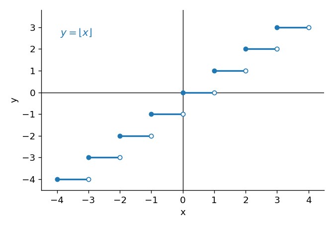

*Figure 3. The staircase-shaped graph of the floor function*

The graph of the ceiling function $\lceil x \rceil$ can be drawn in the same way by determining the function value on each interval.

### 1.4 Graphs of Functions Defined on Sets of Integers

Many real-valued functions used in computer science are defined on sets of integers rather than on intervals of real numbers. Given the graph of a function defined by a formula on an interval of real numbers, the graph of the function given by the same formula but defined only on the integers of that interval is obtained by keeping only the points of the known graph whose first coordinates are integers. For example, the function $f$ given by the same formula as $p_1$ but with the set of nonnegative integers as its domain satisfies $f(n) = n$, and its graph keeps only the points $(0, 0)$, $(1, 1)$, $(2, 2)$, $\ldots$ of the half-line of $p_1$.

**Example 11.1.3 (Graph of a Function Defined on a Set of Integers).** Sketch the graph of the function $g$ defined by $g(n) = n^{1/2}$ for each nonnegative integer $n$.

**Solution.** $g$ is an integer version of $p_{1/2}$. Keeping only the points $(n, n^{1/2})$ with integer first coordinates on the graph of $p_{1/2}$ in Figure 2 gives the graph of $g$. For instance, $(0, 0)$, $(1, 1)$, $(4, 2)$, and $(9, 3)$ are such points, and there are also points such as $(2, 1.414\ldots)$ whose heights are not integers. Unlike a function defined on an interval of real numbers, the points are not joined by a line.

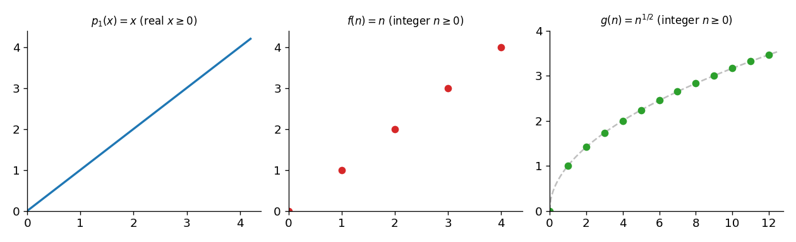

*Figure 4. Graphs of p1 defined on the reals and of f(n) = n and g(n) = n to the 1/2 defined on the integers*

### 1.5 Multiples of a Function and Their Graphs

A function obtained by multiplying every value of a function by the same number is called a **multiple** of the function. To understand O-notation, one needs to understand the relation between the graph of a function and the graph of a multiple of it.

> **Definition:** If $f$ is a real-valued function of a real variable and $M$ is a real number, the **multiple of $f$ by $M$**, $Mf$, is the real-valued function with the same domain as $f$ defined by $(Mf)(x) = M \cdot f(x)$ for each $x$ in the domain of $f$.

The height of the graph of $Mf$ at $x$ is $f(x)$ multiplied by $M$. So if the graph of $f$ is known, the graph of $Mf$ can be drawn by multiplying the height at each $x$ by $M$.

**Example 11.1.4 (Graph of a Multiple of a Function).** The left of Figure 5 is the graph of a piecewise linear function $f$. Sketch the graph of $2f$.

**Solution.** Double the height of $f$ at each $x$. For instance, $f(-2.5) = 2$, so $(2f)(-2.5) = 4$; $f(2) = -2$, so $(2f)(2) = -4$; and $f(0) = -1$, so $(2f)(0) = -2$. At the points $x = -3, -1, 5$ where $f(x) = 0$, the value of $2f$ is also 0. Doubling the heights of all corner points and joining them gives the graph on the right of Figure 5. The two graphs have similar shapes, but the graph of $2f$ is stretched vertically: the highs are twice as high and the lows are twice as low.

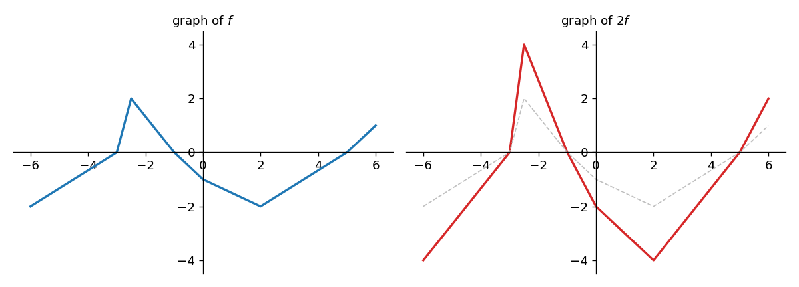

*Figure 5. The graph of a function f and the graph of 2f with every height doubled*

### 1.6 Increasing and Decreasing Functions

The **absolute value function** $A$ is defined for each real number $x$ as follows.

```math
A(x) = |x| = \begin{cases} x & (x \geq 0) \\ -x & (x < 0) \end{cases}
```

For $x \geq 0$ the graph of $A$ is the same as the line $y = x$ of slope 1 through the origin, and for $x < 0$ it is the same as the line $y = -x$ of slope $-1$ through the origin.

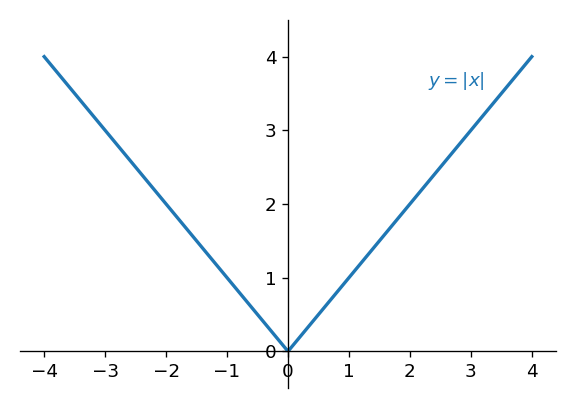

*Figure 6. The graph of the absolute value function*

Tracing the graph from left to right, the height continually decreases to the left of the origin and continually increases to the right of the origin. For this reason the absolute value function is said to be decreasing on the set of negative real numbers and increasing on the set of positive real numbers. Since the height of the graph at $x$ is $f(x)$, these geometric notions translate into the following definition.

> **Definition:** Let $f$ be a real-valued function defined on a set of real numbers, and suppose the domain of $f$ contains a set $S$. $f$ is **increasing** on $S$ if, and only if, for all real numbers $x_1$ and $x_2$ in $S$, if $x_1 < x_2$ then $f(x_1) < f(x_2)$. $f$ is **decreasing** on $S$ if, and only if, for all real numbers $x_1$ and $x_2$ in $S$, if $x_1 < x_2$ then $f(x_1) > f(x_2)$. A function that is increasing on its entire domain is an **increasing function**, and a function that is decreasing on its entire domain is a **decreasing function**.

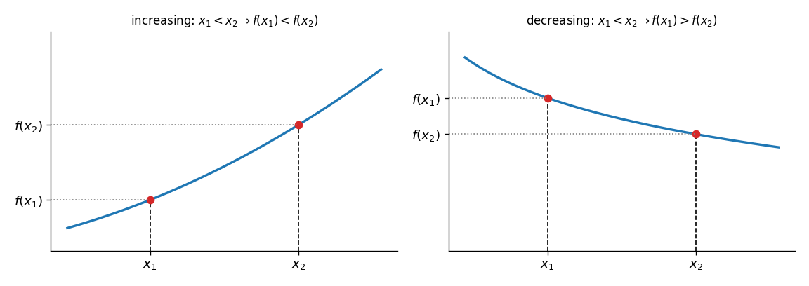

*Figure 7. Comparison of function values when x1 < x2 for an increasing function and a decreasing function*

> **Caution:** Increasing and decreasing depend on the set $S$. The absolute value function is neither an increasing function nor a decreasing function, but it is increasing on the set of positive real numbers and decreasing on the set of negative real numbers. Also, because the inequality in the definition is strict ($`f(x_1) < f(x_2)`$), a constant function is neither increasing nor decreasing on any set with two or more elements.

Both increasing and decreasing functions are one-to-one (one-to-one functions are in Chapter 7). If $f$ is increasing and $x_1 \neq x_2$, one of the two is smaller, so they can be named so that $x_1 < x_2$. Then $f(x_1) < f(x_2)$, and hence $f(x_1) \neq f(x_2)$. For a decreasing function the argument is the same with the inequality reversed.

**Example 11.1.5 (A Positive Multiple of an Increasing Function Is Increasing).** Show that if $f$ is a real-valued function of a real variable that is increasing on a set $S$ of real numbers and $M$ is a positive real number, then $Mf$ is also increasing on $S$.

**Proof.** Let $x_1$ and $x_2$ be particular but arbitrarily chosen elements of $S$ with $x_1 < x_2$. It must be shown that $(Mf)(x_1) < (Mf)(x_2)$.

1. Since $x_1 < x_2$ and $f$ is increasing on $S$, $f(x_1) < f(x_2)$.
2. Multiplying both sides of an inequality by a positive number $M$ does not change its direction, so $M f(x_1) < M f(x_2)$.
3. By the definition of $Mf$, $M f(x_1) = (Mf)(x_1)$ and $M f(x_2) = (Mf)(x_2)$, so $(Mf)(x_1) < (Mf)(x_2)$.

Since $x_1$ and $x_2$ were chosen arbitrarily, $Mf$ is increasing on $S$.

In the same way, a positive multiple of a decreasing function is decreasing, a negative multiple of an increasing function is decreasing, and a negative multiple of a decreasing function is increasing. This is because multiplying by a negative number reverses the direction of an inequality.

> **Key Point:** Multiplying a function $f$ by a positive number $M$ keeps the shape of the graph and multiplies only the heights by $M$. The order notations of Section 2 ask whether, for all sufficiently large $n$, the graph of $f$ lies above a positive multiple $Ag$ of some function $g$ and below $Bg$.

---

<br>

## 2. Big-O, Big-Omega, and Big-Theta Notations

### 2.1 Why Compare Algorithm Efficiency

How efficient an algorithm is matters well beyond theory. In industry and science, a faster algorithm can cut costs substantially, and sometimes it determines whether a computation is feasible at all. The two resources that most affect the cost and feasibility of running an algorithm are the computing time and the memory it needs. This chapter develops the basic techniques for measuring time, which is usually the more important of the two. When one algorithm needs less time but more memory than another, however, the choice between them depends on which resources are available.

The algorithms analyzed in this chapter are mostly of two kinds: search algorithms, which locate a given element in a data array, and sorting algorithms, which put an array into ascending or descending order. A search may succeed at its very first step (the **best case**) or may have to examine every element before it stops (the **worst case**). Which case occurs depends on the input and is not known beforehand, so when two algorithms are compared it is sensible to focus on whether performance can be guaranteed even in the worst case. The resulting estimates are approximate, yet for large inputs in the worst case they expose striking differences between algorithms that solve the same problem.

Figure 8 plots the number of comparisons that two sorting algorithms, insertion sort (Section 3.4) and merge sort (Section 5.4), make in the worst case against the length $n$ of the input array. As the array gets longer, the gap between the two curves grows dramatically. Assuming one comparison takes 1 nanosecond ($10^{-9}$ second), sorting 10 million items takes about 0.22 second for the roughly $2.2 \times 10^8$ worst-case comparisons of merge sort but about 14 hours for the roughly $5 \times 10^{13}$ comparisons of insertion sort.

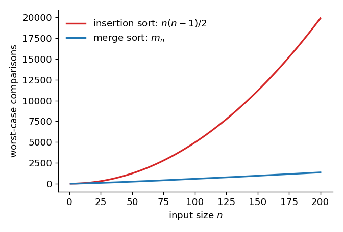

*Figure 8. Worst-case numbers of comparisons of insertion sort and merge sort by input length*

### 2.2 Definitions of the Three Order Notations

The symbols $\Theta$ and $\Omega$ are the uppercase Greek letters theta and omega. **O-notation** (read "big-O notation") is the oldest of the three: the German mathematician Paul Bachmann introduced it in 1894 in a book on analytic number theory, and it was the first to be used for comparing algorithms. Since O-notation by itself can give vague or even misleading comparisons, Donald Knuth, a pioneer of algorithm analysis, introduced **Ω-notation** and **Θ-notation** in 1976 so that growth rates could be compared more sharply.

The idea of the three notations is as follows. Suppose $f$ and $g$ are real-valued functions of an integer variable $n$ and $g(n) \geq 0$ for every integer $n$ greater than some positive real number.

1. If, for sufficiently large $n$, the values of $f$ are greater than or equal to those of some positive multiple of $g$, then $f$ is of **order** at least $g$, written "$`f(n)`$ is $\Omega(g(n))$."
2. If, for sufficiently large $n$, the values of $f$ are nonnegative and less than or equal to those of some positive multiple of $g$, then $f$ is of order at most $g$, written "$`f(n)`$ is $O(g(n))$."
3. If, for sufficiently large $n$, the values of $f$ lie between two positive multiples of $g$, then $f$ is of order $g$, written "$`f(n)`$ is $\Theta(g(n))$."

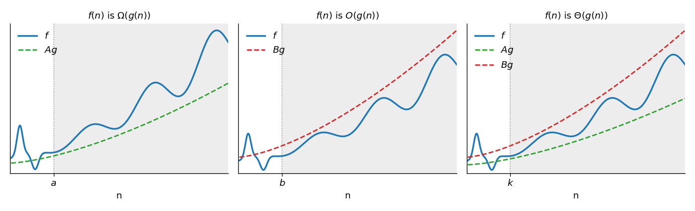

*Figure 9. Positions of f, Ag, and Bg when f(n) is big-Omega, big-O, and big-Theta of g(n)*

The order notations were first defined for functions on intervals of real numbers. In algorithm analysis, however, the variable of interest is the size of the problem being solved, such as the number of items to be sorted or the number of vertices of a graph whose minimum spanning tree is sought, and this size is always an integer. Anything true for every real number in an interval is in particular true for every integer in it, and the arguments in this chapter go through unchanged with "for every real number $x$" in place of "for every integer $n$." For this reason the chapter states its results for functions on sets of integers while drawing their graphs as continuous curves. The reader may equally picture them as isolated points, as in Section 1.4.

> **Definition:** Let $f$ and $g$ be real-valued functions defined on the same set of nonnegative integers, with $g(n) \geq 0$ for every integer $n \geq r$, where $r$ is a positive real number.
>
> 1. If there exist a positive real number $A$ and a positive real number $a \geq r$ such that $A g(n) \leq f(n)$ for every integer $n \geq a$, then $f$ is of **order at least $g$**, written $f(n)$ is $\Omega(g(n))$ ("$`f`$ of $n$ is big-Omega of $g$ of $n$").
> 2. If there exist a positive real number $B$ and a positive real number $b \geq r$ such that $0 \leq f(n) \leq B g(n)$ for every integer $n \geq b$, then $f$ is of **order at most $g$**, written $f(n)$ is $O(g(n))$ ("$`f`$ of $n$ is big-O of $g$ of $n$").
> 3. If there exist positive real numbers $A$ and $B$ and a positive real number $k \geq r$ such that $A g(n) \leq f(n) \leq B g(n)$ for every integer $n \geq k$, then $f$ is of **order $g$**, written $f(n)$ is $\Theta(g(n))$ ("$`f`$ of $n$ is big-Theta of $g$ of $n$").

**Remark on notation.** Chapter 7 kept a function $f$ separate from its value $f(n)$, but order notation customarily ignores this distinction. In "$`f(n)`$ is $\Theta(g(n))$," the expressions $f(n)$ and $g(n)$ stand for the functions $f$ and $g$ that they define. For example, "$`3n^2 + 4n + 5`$ is $\Theta(n^2)$" means that $f$ is of order $g$, where $f(n) = 3n^2 + 4n + 5$ and $g(n) = n^2$ for every integer $n \geq 1$.

> **Caution:** The "is" in "$`f(n)`$ is $O(g(n))$" is not an equality. Other references write $f(n) = O(g(n))$ with the same meaning, but this only says that $f$ satisfies the condition of O-notation, so the two sides cannot be swapped. For example, $n$ and $n^2$ are both $O(n^2)$, but $n \neq n^2$.

> **Note:** Negating a definition is useful for showing that a relation does not hold. The negation of "$`f(n)`$ is $O(g(n))$" is "however a positive real number $B$ and $b \geq r$ are chosen, there is an integer $n \geq b$ with $f(n) < 0$ or $f(n) > B g(n)$." The proofs in Section 2.7 use this form.

### 2.3 Translating Inequalities into Order Notation

The definitions of the order notations have the form "there exist constants and a starting point for which an inequality holds." So an inequality with given constants and starting point can be translated directly into order notation by matching it to a definition.

**Example 11.2.1 (Translating to Θ-Notation).** Express in Θ-notation the statement that the following holds for every integer $n \geq 3$.

```math
4n^6 \leq 17n^6 - 45n^3 + 2n + 8 \leq 30n^6
```

**Solution.** Let $A = 4$, $B = 30$, and $k = 3$. Then the statement becomes "$`An^6 \leq 17n^6 - 45n^3 + 2n + 8 \leq Bn^6`$ for every integer $n \geq k$." Since $g(n) = n^6$ is nonnegative, this is exactly the definition of Θ-notation, and $17n^6 - 45n^3 + 2n + 8$ is $\Theta(n^6)$.

**Example 11.2.2 (Translating to Ω- and O-Notations and Deducing Θ-Notation).** Consider the following statements.

```math
\text{(a)}\ \ \frac{11}{4}n^2 \leq 3\left\lfloor \frac{n}{4} \right\rfloor^2 + 5n^2 \ \ (n \geq 2), \qquad \text{(b)}\ \ 0 \leq 3\left\lfloor \frac{n}{4} \right\rfloor^2 + 5n^2 \leq 6n^2 \ \ (n \geq 1)
```

Express (a) in Ω-notation and (b) in O-notation, and (c) explain why $3\lfloor n/4 \rfloor^2 + 5n^2$ is $\Theta(n^2)$.

**Solution.**

- (a) With $A = \frac{11}{4}$ and $a = 2$, the statement reads "$`An^2 \leq 3\lfloor n/4 \rfloor^2 + 5n^2`$ for every integer $n \geq a$," so $3\lfloor n/4 \rfloor^2 + 5n^2$ is $\Omega(n^2)$.
- (b) With $B = 6$ and $b = 1$, the statement reads "$`0 \leq 3\lfloor n/4 \rfloor^2 + 5n^2 \leq Bn^2`$ for every integer $n \geq b$," so $3\lfloor n/4 \rfloor^2 + 5n^2$ is $O(n^2)$.
- (c) Let $A = \frac{11}{4}$ and $B = 6$, and let $k$ be the larger of $a$ and $b$, namely $k = 2$. When $n \geq k$, both inequalities in (a) and (b) hold, so $An^2 \leq 3\lfloor n/4 \rfloor^2 + 5n^2 \leq Bn^2$, and by the definition of Θ-notation $3\lfloor n/4 \rfloor^2 + 5n^2$ is $\Theta(n^2)$.

The inequalities (a) and (b) themselves are easy to check. (a) holds because $3\lfloor n/4 \rfloor^2 \geq 0$ and $5n^2 \geq \frac{11}{4}n^2$. (b) holds because $n \geq 1$ gives $0 \leq \lfloor n/4 \rfloor \leq n/4$, so $3\lfloor n/4 \rfloor^2 \leq \frac{3}{16}n^2 \leq n^2$.

### 2.4 Relations among the Three Notations

Part (c) of the previous example shows that if $f$ is known to be of order at most $g$ and of order at least $g$, $k$ may be taken to be the larger of the numbers $a$ and $b$ promised by the two definitions and then $f$ is of order $g$. Conversely, if $f$ is of order $g$, the number $k$ promised by the definition of Θ-notation can serve as both $a$ and $b$.

**Theorem 11.2.1 (Relation among $O$-, $\Omega$-, and $\Theta$-notations).** Let $f$ and $g$ be real-valued functions defined on the same set of nonnegative integers, and suppose $f(n) \geq 0$ and $g(n) \geq 0$ for every integer $n \geq r$, where $r$ is a positive real number. Then $f(n)$ is $\Theta(g(n))$ if, and only if, $f(n)$ is $\Omega(g(n))$ and $f(n)$ is $O(g(n))$.

**Proof.** The two directions are shown separately.

- ($`\Rightarrow`$) If $f(n)$ is $\Theta(g(n))$, there are positive real numbers $A$, $B$, and $k \geq r$ with $A g(n) \leq f(n) \leq B g(n)$ for $n \geq k$. Taking $a = k$, the left inequality shows that $f(n)$ is $\Omega(g(n))$. Taking $b = k$, since $g(n) \geq 0$ for $n \geq k \geq r$ and $A > 0$, it follows that $0 \leq A g(n) \leq f(n) \leq B g(n)$, so $f(n)$ is $O(g(n))$.
- ($`\Leftarrow`$) Since $f(n)$ is $\Omega(g(n))$, there are $A$ and $a$ with $A g(n) \leq f(n)$ for $n \geq a$; since it is $O(g(n))$, there are $B$ and $b$ with $0 \leq f(n) \leq B g(n)$ for $n \geq b$. Let $k = \max(a, b)$. Then $k \geq r$ and both inequalities hold for $n \geq k$, so $A g(n) \leq f(n) \leq B g(n)$. Hence $f(n)$ is $\Theta(g(n))$.

### 2.5 Orders of Power Functions

The yardsticks used most often for algorithm efficiency are power functions such as $n^{1/2}$, $n$, $n^2$, and $n^3$, together with functions built from a power function and an exponential or logarithmic function, such as $2^n$, $\log n$, $n \log n$, and $n^2 \log n$. Such functions come up naturally when algorithms are analyzed, and their values differ enormously when $n$ is large. This section treats power functions, and Section 4 treats functions involving logarithms.

If $1 \leq n$, multiplying both sides by the positive number $n$ gives $n \leq n^2$, and multiplying by $n$ again gives $n^2 \leq n^3$. By transitivity of order, $1 \leq n \leq n^2 \leq n^3$ when $n \geq 1$. The following theorem generalizes this.

**Theorem 11.2.2.** For any positive rational numbers $r$ and $s$ and any integer $n \geq 1$, if $r \leq s$, then $n^r \leq n^s$.

**Proof.** Since $n^s = n^r \cdot n^{s-r}$ and $n^r > 0$, it suffices to show $n^{s-r} \geq 1$. Write the nonnegative rational number $s - r$ as $p/q$ with $p$ a nonnegative integer and $q$ a positive integer. Since $n \geq 1$, $n^p \geq 1$. The number $n^{p/q}$ is a positive number whose $`q`$th power is $n^p$; if $n^{p/q} < 1$, then $n^p$, a product of $q$ positive numbers less than 1, would also be less than 1, a contradiction. Hence $n^{p/q} \geq 1$.

The inequality $n^r \leq n^s$ for $n \geq 1$ also holds when the exponents are irrational positive real numbers, and the later theorems use this fact for positive real exponents.

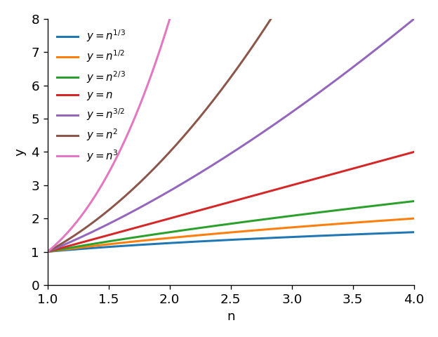

*Figure 10. Graphs of several powers of n for n at least 1*

As Figure 10 shows, if $r < s$, then for $n > 1$ the graph of $y = n^r$ lies below the graph of $y = n^s$.

### 2.6 Orders of Polynomial Functions

Theorem 11.2.2 makes it possible to find a big-Omega and a big-O for polynomial functions.

**Example 11.2.3 (A Polynomial with Positive Coefficients).** (a) Show that $15n^3 + 11n^2 + 9$ is $\Omega(n^3)$. (b) Without using (a), show that $15n^3 + 11n^2 + 9$ is $O(n^3)$.

**Solution.**

- (a) It must be shown that $15n^3 + 11n^2 + 9$ is at least some positive multiple of $n^3$ for sufficiently large $n$. When $n \geq 1$, $11n^2 + 9$ is positive, so $15n^3 \leq 15n^3 + 11n^2 + 9$. With $A = 15$ and $a = 1$, $An^3 \leq 15n^3 + 11n^2 + 9$ for every integer $n \geq a$, so by the definition of Ω-notation $15n^3 + 11n^2 + 9$ is $\Omega(n^3)$.
- (b) It must be shown that $15n^3 + 11n^2 + 9$ is nonnegative and at most some positive multiple of $n^3$ for sufficiently large $n$. All terms are positive, so $0 \leq 15n^3 + 11n^2 + 9$ for $n \geq 1$. Also, when $n \geq 1$, Theorem 11.2.2 gives $n^2 \leq n^3$ and $1 \leq n^3$, so $11n^2 \leq 11n^3$ and $9 \leq 9n^3$. Therefore the following holds.

```math
15n^3 + 11n^2 + 9 \leq 15n^3 + 11n^3 + 9n^3 = 35n^3 \qquad (n \geq 1)
```

With $B = 35$ and $b = 1$, $0 \leq 15n^3 + 11n^2 + 9 \leq Bn^3$ for every integer $n \geq b$, so $15n^3 + 11n^2 + 9$ is $O(n^3)$.

**Example 11.2.4 (A Polynomial with Some Negative Coefficients).** (a) Show that $n^4 - 5n - 8$ is $\Omega(n^4)$. (b) Show that $n^4 - 5n - 8$ is $O(n^4)$.

**Solution (a).** Positive real numbers $A$ and $a$ must be found such that $An^4 \leq n^4 - 5n - 8$ for every integer $n \geq a$. Because there are negative terms, the method of the previous example (a), which drops positive terms, does not work. Two methods are shown.

**Method 1 (ad hoc calculation).** Choose $A = \frac{1}{2}$ and follow the chain of equivalences below.

```math
\frac{1}{2}n^4 \leq n^4 - 5n - 8 \iff 5n + 8 \leq \frac{1}{2}n^4 \iff \frac{10}{n^2} + \frac{16}{n^3} \leq n
```

The first equivalence comes from adding $5n + 8 - \frac{1}{2}n^4$ to both sides, and the second from multiplying both sides by the positive number $\frac{2}{n^3}$. Both operations preserve the direction of the inequality, so the three inequalities are equivalent, and any $n$ satisfying the last also satisfies the first. A little trial and error shows that the last inequality holds for $n \geq 3$. If $n \geq 3$, then $\frac{1}{n} \leq \frac{1}{3}$, so:

```math
\frac{10}{n^2} + \frac{16}{n^3} \leq \frac{10}{3^2} + \frac{16}{3^3} = \frac{46}{27} < 2 < 3 \leq n
```

Therefore $\frac{1}{2}n^4 \leq n^4 - 5n - 8$ for every integer $n \geq 3$. With $A = \frac{1}{2}$ and $a = 3$, $n^4 - 5n - 8$ is $\Omega(n^4)$.

**Method 2 (a general procedure).** Let $m$ be a nonnegative integer, let $P(n)$ be a polynomial of degree $m$, and suppose the coefficient $a_m$ of $n^m$ is positive. Let $A = \frac{1}{2}a_m$ and determine $a$ as follows.

1. Add the absolute values of all coefficients of $P(n)$ except $a_m$.
2. Multiply the result of step 1 by $\frac{2}{a_m}$.
3. Let $a$ be the larger of 1 and the result of step 2.

Then $An^m \leq P(n)$ for every integer $n \geq a$. For $n^4 - 5n - 8$, the leading coefficient is 1 and the sum of the absolute values of the other coefficients is $|-5| + |-8| = 13$, so $A = \frac{1}{2}$ and $a = \max(1, \frac{2}{1} \cdot 13) = 26$. To check, if $n \geq 26$ then $n \geq 2(|-5| + |-8|)$, and multiplying both sides by $\frac{1}{2}n^3$ gives the following.

```math
\frac{1}{2}n^4 \geq (|-5| + |-8|)n^3 = 5n^3 + 8n^3 \geq 5n + 8
```

The last inequality holds because $n \geq 1$ implies $5n^3 \geq 5n$ and $8n^3 \geq 8$. Subtracting $5n + 8$ from both sides and adding $\frac{1}{2}n^4$ gives $n^4 - 5n - 8 \geq \frac{1}{2}n^4$ for $n \geq 26$, so $n^4 - 5n - 8$ is $\Omega(n^4)$.

Method 2 works for every polynomial for the following reason. Let $m \geq 1$, and let $S$ be the sum of the absolute values of the coefficients other than $a_m$. If $n \geq 1$, then $a_i n^i \geq -|a_i| n^i \geq -|a_i| n^{m-1}$ for each $i \leq m - 1$, so $P(n) \geq a_m n^m - S n^{m-1}$. If $n \geq \frac{2S}{a_m}$, then $S n^{m-1} \leq \frac{a_m}{2} n^m$, so $P(n) \geq a_m n^m - \frac{a_m}{2} n^m = \frac{a_m}{2} n^m$. If $m = 0$, then $P(n) = a_0 \geq \frac{a_0}{2}$, so the claim holds directly.

> **Caution:** Methods 1 and 2 give different starting points ($a = 3$ and $`a = 26`$). The definitions of the order notations only require that suitable constants and a starting point exist, so these values are not unique, and either one leads to the same conclusion.

**Solution (b).** If $n \geq 1$, the following holds.

```math
n^4 - 5n - 8 \leq n^4 + 5n + 8 \leq n^4 + 5n^4 + 8n^4 = 14n^4
```

The first inequality holds because $5n + 8$ is positive for $n \geq 1$, so $-5n - 8 < 5n + 8$; the second holds because Theorem 11.2.2 gives $n \leq n^4$ and $1 \leq n^4$. Also, by (a), $\frac{1}{2}n^4 \leq n^4 - 5n - 8$ for $n \geq 3$, and $0 \leq \frac{1}{2}n^4$, so $0 \leq n^4 - 5n - 8 \leq 14n^4$ for every integer $n \geq 3$. With $B = 14$ and $b = 3$, $n^4 - 5n - 8$ is $O(n^4)$.

> **Caution:** O-notation also requires $0 \leq f(n)$. Since $n^4 - 5n - 8$ is negative at $n = 1$ ($`-12`$) and at $n = 2$ ($`-2`$), $b = 1$ does not satisfy the definition; the starting point must lie where the function values are nonnegative, such as $b = 3$.

**Example 11.2.5 (Big-Theta for Polynomials).** (a) $15n^3 + 11n^2 + 9$ is $\Theta(n^3)$. (b) $n^4 - 5n - 8$ is $\Theta(n^4)$.

**Solution.** (a) By Example 11.2.3, $15n^3 + 11n^2 + 9$ is $\Omega(n^3)$ and $O(n^3)$, so by Theorem 11.2.1 it is $\Theta(n^3)$. (b) By Example 11.2.4, $n^4 - 5n - 8$ is $\Omega(n^4)$ and $O(n^4)$, so by Theorem 11.2.1 it is $\Theta(n^4)$.

### 2.7 What O-Notation Cannot Tell

**Theorem 11.2.3 (A Limit on What Can Be Inferred from Big-O).** For any function $f$ and positive real numbers $r$ and $s$ with $r < s$, if $f(n)$ is $O(n^r)$, then $f(n)$ is $O(n^s)$.

**Proof.** Since $f(n)$ is $O(n^r)$, by the definition of O-notation there are positive real numbers $B$ and $b$ with $0 \leq f(n) \leq B n^r$ for every integer $n \geq b$. By Theorem 11.2.2, $B n^r \leq B n^s$ for every integer $n \geq 1$. Let $b_1$ be the larger of $b$ and 1. Then $0 \leq f(n) \leq B n^s$ for every integer $n \geq b_1$, so $f(n)$ is $O(n^s)$.

By this theorem, knowing that one function is big-O of another gives only partial information about how the function grows.

**Example 11.2.6 (A Caution about O-Notation).** Knowing that $f(n)$ is $O(n^5)$ and $g(n)$ is $O(n^4)$, one might conclude, because $4 < 5$, that the graph of $g$ lies below the graph of $f$ for large $n$. Show that this need not be the case by giving functions with $f(n)$ $O(n^5)$ and $g(n)$ $O(n^4)$ for which the graph of $f$ lies below the graph of $g$ for large $n$.

**Solution.** Let $f(n) = 15n^3 + 11n^2 + 9$ and $g(n) = n^4 - 5n - 8$. $f(n)$ is $O(n^3)$, so by Theorem 11.2.3 it is $O(n^5)$, and by Section 2.6 $g(n)$ is $O(n^4)$. However, as Figure 11 shows, the graph of $g$ lies above the graph of $f$ for $n \geq 16$.

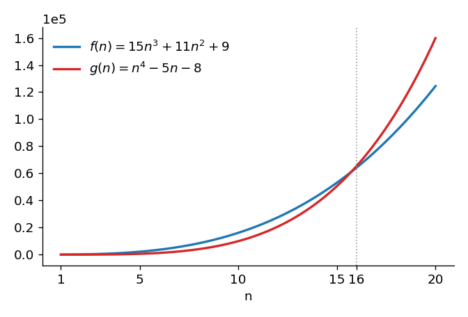

*Figure 11. Graphs of f(n) = 15n³ + 11n² + 9 and g(n) = n⁴ − 5n − 8*

This result is confirmed by the following chain of equivalences. The last equivalence comes from dividing both sides by the positive number $n^3$.

```math
g(n) \geq f(n) \iff n^4 - 5n - 8 \geq 15n^3 + 11n^2 + 9 \iff n^4 \geq 15n^3 + 11n^2 + 5n + 17 \iff n \geq 15 + \frac{11}{n} + \frac{5}{n^2} + \frac{17}{n^3}
```

When $n \geq 16$, $\frac{1}{n} \leq \frac{1}{16}$, so the right side of the last inequality does not exceed the following.

```math
15 + \frac{11}{16} + \frac{5}{16^2} + \frac{17}{16^3} \approx 15.71 \leq 16 \leq n
```

Therefore $n^4 - 5n - 8 \geq 15n^3 + 11n^2 + 9$ for every integer $n \geq 16$. At $n = 15$, $g(15) = 50{,}542 < 53{,}109 = f(15)$, so 16 is the smallest integer from which the inequality holds. Consequently, one can draw bands around the two graphs so that for $n \geq 16$ the band around $g$ lies entirely above the band around $f$.

**Example 11.2.7 (Showing That One Function Is Not Big-O of Another).** $g(n) = n^4 - 5n - 8$ is $\Omega(n^4)$ (Section 2.6). Show that $g(n)$ is not $O(n^r)$ for any positive real number $r < 4$.

**Solution.** The argument is by contradiction. Suppose there is a positive real number $r < 4$ such that $g(n)$ is $O(n^r)$. Then there are positive real numbers $B$ and $b$ with $0 \leq g(n) \leq B n^r$ for every integer $n \geq b$. Also, since $g(n)$ is $\Omega(n^4)$, there are positive real numbers $A$ and $a$ with $A n^4 \leq g(n)$ for every integer $n \geq a$. Let $t$ be the larger of $a$ and $b$. Then for every integer $n \geq t$ the following hold in turn.

```math
A n^4 \leq g(n) \leq B n^r \implies \frac{n^4}{n^r} \leq \frac{B}{A} \implies n^{4-r} \leq \frac{B}{A} \implies n \leq \left(\frac{B}{A}\right)^{1/(4-r)}
```

The first step uses transitivity of order and division of both sides by the positive number $A n^r$, the second uses the laws of exponents, and the last takes the $`(4 - r)`$th root of both sides. Since $r < 4$, $4 - r > 0$, and the right side $(B/A)^{1/(4-r)}$ is a fixed positive real number. But $n$ ranges over all integers greater than or equal to $t$, so it takes values larger than this fixed number. This is a contradiction, so the supposition is false, and $g(n)$ is not $O(n^r)$ for any positive real number $r < 4$.

The next theorem generalizes this example and is proved in the same way (replace $4$ by $m$ and $r$ by $`p`$).

**Theorem 11.2.4 (Showing That a Big-O Relationship Does Not Hold).** If $f$ is a real-valued function defined on a set of nonnegative integers, $m$ is a positive integer, and $f(n)$ is $\Omega(n^m)$, then $f(n)$ is not $O(n^p)$ for any positive real number $p < m$.

> **Key Point:** O-notation gives only an upper bound. The fact that $f(n)$ is $O(n^5)$ also covers the case in which $f$ grows much more slowly, like $n^3$. To compare the growth rates of two functions, use Θ-notation, which bounds a function from above and below at the same time.

### 2.8 The Theorem on Polynomial Orders

Unlike O-notation, Θ-notation gives tight bounds that hold function values from above and below at once, so it gives precise results for comparing the growth of functions. The big-Thetas found in Section 2.6 for $15n^3 + 11n^2 + 9$ and $n^4 - 5n - 8$ were both the power function of the highest power in the polynomial. The following theorem shows that this is no accident.

**Theorem 11.2.5 (Theorem on Polynomial Orders).** If $m$ is an integer with $m \geq 0$ and $a_0, a_1, a_2, \ldots, a_m$ are real numbers with $a_m > 0$, then $a_m n^m + a_{m-1} n^{m-1} + \cdots + a_1 n + a_0$ is $\Theta(n^m)$.

**Proof (using limits).** Since $\lim_{n \to \infty} \frac{1}{n^i} = 0$ for every integer $i \geq 1$, the following holds.

```math
\lim_{n \to \infty} \frac{a_m n^m + a_{m-1} n^{m-1} + \cdots + a_1 n + a_0}{n^m} = \lim_{n \to \infty} \left( a_m + \frac{a_{m-1}}{n} + \frac{a_{m-2}}{n^2} + \cdots + \frac{a_1}{n^{m-1}} + \frac{a_0}{n^m} \right) = a_m
```

By the definition of limit, for any real number $\varepsilon > 0$ there is an integer $K$ such that the following holds for every integer $n > K$.

```math
a_m - \varepsilon < a_m + \frac{a_{m-1}}{n} + \cdots + \frac{a_1}{n^{m-1}} + \frac{a_0}{n^m} < a_m + \varepsilon
```

In particular, with $\varepsilon = \frac{a_m}{2}$, there is an integer $k$ such that for every integer $n > k$ the middle expression is greater than $\frac{a_m}{2}$ and less than $\frac{3a_m}{2}$. Multiplying all parts by the positive number $n^m$ gives the following.

```math
\frac{a_m}{2} n^m < a_m n^m + a_{m-1} n^{m-1} + \cdots + a_1 n + a_0 < \frac{3a_m}{2} n^m \qquad (n > k)
```

Let $A = \frac{a_m}{2}$ and $B = \frac{3a_m}{2}$, and take as the starting point the larger of $k + 1$ and 1. For every integer $n$ from that point on, $n^m \geq 0$ and the inequality above holds, so by the definition of Θ-notation $a_m n^m + \cdots + a_1 n + a_0$ is $\Theta(n^m)$.

> **[Calculus]** The limit of a sequence $\lim_{n \to \infty} c_n = L$ means that for any positive number $\varepsilon$ there is an integer $K$ with $L - \varepsilon < c_n < L + \varepsilon$ for every integer $n > K$. The proof above uses this definition directly with $\varepsilon = a_m/2$. The key point is that the limit $a_m$ is positive, so the middle expression eventually stays inside the positive range $(a_m/2, 3a_m/2)$.

> **Note:** The theorem can also be proved without calculus. By Method 2 of Section 2.6, if $S$ is the sum of the absolute values of the coefficients other than $a_m$, then $\frac{a_m}{2} n^m \leq P(n)$ for $n \geq \max(1, 2S/a_m)$. Also, if $n \geq 1$, then $a_i n^i \leq |a_i| n^m$, so $P(n) \leq (a_m + S) n^m$. Combining these two inequalities with $0 \leq \frac{a_m}{2} n^m$ shows that $P(n)$ is $\Theta(n^m)$.

**Example 11.2.8 (Applying the Theorem on Polynomial Orders).** Find orders for the following functions. (a) $f(n) = 7n^5 + 5n^3 - n + 4$ for each positive integer $n$. (b) $g(n) = \frac{(n-1)(n+1)}{4}$ for each positive integer $n$.

**Solution.** (a) By direct application of the theorem on polynomial orders, $7n^5 + 5n^3 - n + 4$ is $\Theta(n^5)$. (b) Expanding gives the following, so $g(n)$ is $\Theta(n^2)$.

```math
g(n) = \frac{(n-1)(n+1)}{4} = \frac{1}{4}(n^2 - 1) = \frac{1}{4}n^2 - \frac{1}{4}
```

**Example 11.2.9 (An Order for the Sum of the First $n$ Integers).** Sums of the form $1 + 2 + 3 + \cdots + n$ arise in the analysis of algorithms such as selection sort in Section 3.5. Show that $1 + 2 + \cdots + n$ is $\Theta(n^2)$ for a positive integer variable $n$.

**Solution.** By the formula for the sum of the first $n$ integers (Chapter 5), the following holds for each positive integer $n$.

```math
1 + 2 + 3 + \cdots + n = \frac{n(n+1)}{2} = \frac{1}{2}n^2 + \frac{1}{2}n
```

By the theorem on polynomial orders, $\frac{1}{2}n^2 + \frac{1}{2}n$ is $\Theta(n^2)$, so $1 + 2 + \cdots + n$ is $\Theta(n^2)$.

### 2.9 Properties of the Order Notations

The following theorems give useful properties of the order notations and are applied in Section 4.6. All four assume that the functions are real-valued functions defined on the same set of nonnegative integers and that there is a positive real number $r$ such that the values of all the functions involved are nonnegative for every integer $n \geq r$.

**Theorem 11.2.6 (Reciprocal Relationship between Ω- and O-Notations).** (a) If $f(n)$ is $\Omega(g(n))$, then $g(n)$ is $O(f(n))$. (b) If $g(n)$ is $O(f(n))$, then $f(n)$ is $\Omega(g(n))$.

**Theorem 11.2.7 (Reflexive, Symmetric, and Transitive Properties of Θ-Notation).** (a) $f(n)$ is $\Theta(f(n))$. (b) If $f(n)$ is $\Theta(g(n))$, then $g(n)$ is $\Theta(f(n))$. (c) If $f(n)$ is $\Theta(g(n))$ and $g(n)$ is $\Theta(h(n))$, then $f(n)$ is $\Theta(h(n))$.

**Theorem 11.2.8 (Effect of Constants on Order Notations).** For every positive real number $c$: (a) if $f(n)$ is $\Omega(g(n))$, then $cf(n)$ is $\Omega(g(n))$; (b) if $f(n)$ is $O(g(n))$, then $cf(n)$ is $O(g(n))$; (c) if $f(n)$ is $\Theta(g(n))$, then $cf(n)$ is $\Theta(g(n))$.

**Theorem 11.2.9 (Orders of Sums and Products of Functions).** (a) If $f_1(n)$ and $f_2(n)$ are both $\Theta(g(n))$, then $f_1(n) + f_2(n)$ is $\Theta(g(n))$. (b) If $f_1(n)$ is $\Theta(g_1(n))$ and $f_2(n)$ is $\Theta(g_2(n))$, then $f_1(n) f_2(n)$ is $\Theta(g_1(n) g_2(n))$. (c) If $f_1(n)$ is $\Theta(g_1(n))$, $f_2(n)$ is $\Theta(g_2(n))$, and there is a real number $s$ with $g_1(n) \leq g_2(n)$ for every integer $n \geq s$, then $f_1(n) + f_2(n)$ is $\Theta(g_2(n))$.

**Proof of Theorem 11.2.6(a).** Since $f(n)$ is $\Omega(g(n))$, by definition there are positive real numbers $A$ and $a \geq r$ with $A g(n) \leq f(n)$ for every integer $n \geq a$. Dividing both sides by the positive number $A$ gives $g(n) \leq \frac{1}{A} f(n)$ for $n \geq a$. Also, since $a \geq r$, $0 \leq g(n)$ for $n \geq a$. Let $B = \frac{1}{A}$ and $b = a$. Then $B$ and $b$ are positive real numbers and $0 \leq g(n) \leq B f(n)$ for every integer $n \geq b$, so $g(n)$ is $O(f(n))$.

**Proof of Theorem 11.2.7(c).** By definition there are positive real numbers $A_1$, $B_1$, $k_1 \geq r$ and $A_2$, $B_2$, $k_2 \geq r$ such that the following hold.

```math
A_1 g(n) \leq f(n) \leq B_1 g(n) \ \ (n \geq k_1), \qquad A_2 h(n) \leq g(n) \leq B_2 h(n) \ \ (n \geq k_2)
```

Let $A = A_1 A_2$, $B = B_1 B_2$, and $k = \max(k_1, k_2)$. Then for every integer $n \geq k$, by transitivity of order and equality, the following holds. The two outer inequalities hold because multiplying by $A_1 > 0$ or $B_1 > 0$ does not change the direction of an inequality.

```math
A h(n) = A_1 (A_2 h(n)) \leq A_1 g(n) \leq f(n) \leq B_1 g(n) \leq B_1 (B_2 h(n)) = B h(n)
```

Hence $f(n)$ is $\Theta(h(n))$.

The remaining parts also follow directly from the definitions. The constants needed in each case are listed below, and the starting point is taken to be the largest of the starting points involved.

- Theorem 11.2.6(b): if $0 \leq g(n) \leq B f(n)$, then $\frac{1}{B} g(n) \leq f(n)$, so take $A = \frac{1}{B}$.
- Theorem 11.2.7(a): $1 \cdot f(n) \leq f(n) \leq 1 \cdot f(n)$, so take $A = B = 1$.
- Theorem 11.2.7(b): if $A g(n) \leq f(n) \leq B g(n)$, then $\frac{1}{B} f(n) \leq g(n) \leq \frac{1}{A} f(n)$.
- Theorem 11.2.8: multiplying the inequalities of the definition by the positive number $c$ only changes the constants $A$ and $B$ to $cA$ and $cB$.
- Theorem 11.2.9(a): adding the two inequalities gives $(A_1 + A_2) g(n) \leq f_1(n) + f_2(n) \leq (B_1 + B_2) g(n)$.
- Theorem 11.2.9(b): all parts are nonnegative, so multiplying the two inequalities part by part gives $A_1 A_2 g_1(n) g_2(n) \leq f_1(n) f_2(n) \leq B_1 B_2 g_1(n) g_2(n)$.
- Theorem 11.2.9(c): since $f_1(n) \geq 0$, $f_1(n) + f_2(n) \geq f_2(n) \geq A_2 g_2(n)$; since $g_1(n) \leq g_2(n)$, $f_1(n) + f_2(n) \leq B_1 g_1(n) + B_2 g_2(n) \leq (B_1 + B_2) g_2(n)$.

> **Key Point:** These theorems allow the order of a complicated expression to be found term by term and then combined. A positive constant multiple does not change the order, and the sum of two functions of different orders eventually takes the order of the larger one.

---

<br>

## 3. Analysis of Algorithm Efficiency I

This section uses the notations of Section 2 to compare the efficiencies of several algorithms that do the same job. Starting in the late 1940s, a number of mathematicians and computer scientists developed formal techniques for analyzing algorithms. Alan Turing was among the first to suggest measuring the amount of work in a computing process by counting operations such as additions, subtractions, multiplications, divisions, and recordings of numbers, and from the early 1960s Donald Knuth organized the results of the field into the series *The Art of Computer Programming*.

### 3.1 Sequential Search

A search algorithm looks for a given item $x$ in an array of data. **Sequential search** checks the items one after another, comparing $x$ with the first item, then the second, then the third, and so on. It stops at the first match; if it reaches the end of the array without a match, $x$ is not in the array.

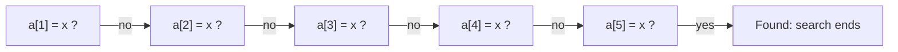

*Figure 12. Sequential search of a[1], ..., a[7] for x when x = a[5]*

**Example 11.3.1 (Best-, Worst-, and Average-Case Orders for Sequential Search).** Find best-, worst-, and average-case orders for the sequential search algorithm from among the power functions.

**Solution.** Suppose sequential search is applied to an input array $a[1], a[2], \ldots, a[n]$ to find an item $x$.

- **Best case:** if $x$ is the first item of the array, only one comparison between $x$ and the array items is made. So in the best case sequential search is $\Theta(1)$ (note $`\Theta(1) = \Theta(n^0)`$).
- **Worst case:** if $x = a[n]$ or $x$ is not in the array, $n$ comparisons are needed. So in the worst case sequential search is $\Theta(n)$.
- **Average case:** since $x$ is as likely to be in the first half of the array as in the second half, the average number of comparisons is about $\frac{n}{2}$, and $\frac{n}{2}$ is $\Theta(n)$. More precisely, if $x$ is in the array and is equally likely to be at each of the $n$ positions with probability $\frac{1}{n}$, the expected number of comparisons (Chapter 9) is as follows.

```math
\sum_{i=1}^{n} i \cdot \frac{1}{n} = \frac{1}{n} \cdot \frac{n(n+1)}{2} = \frac{n+1}{2}
```

Since $\frac{n+1}{2}$ is also $\Theta(n)$, the average-case order of sequential search is also $n$.

### 3.2 Measuring the Efficiency of an Algorithm

Algorithm efficiency has two aspects: the time required to execute the algorithm and the memory space needed while it runs. This chapter covers basic techniques for calculating time efficiency, and space efficiency is calculated with similar techniques.

Several factors affect how long an algorithm takes. One is the amount of input: sorting 1,000,000 items takes longer than sorting 100. For this reason the running time of an algorithm is usually expressed as a function of the input size. In rough terms, analyzing time efficiency starts with counting the **elementary operations** that the algorithm carries out on an input of size $n$ (in the best, worst, or average case).

What counts as an elementary operation depends on the problem the compared algorithms solve. To compare two algorithms for evaluating a polynomial, the numbers of additions and multiplications matter; to compare two algorithms for finding an element in a list, the number of comparisons matters. As is customary, this chapter treats as elementary operations the additions, subtractions, multiplications, and divisions, together with the comparisons that an if-then statement makes explicitly with one of the relational symbols $<$, $\leq$, $>$, $\geq$, $=$, $\neq$.

The same algorithm runs at different speeds in different programming languages and on different machines, and some operations take longer than others. Such details can matter in practice when an algorithm or a computer is actually being chosen. When the computer is fixed and the only question is whether one algorithm clearly outperforms another, however, a rough estimate suffices. No elementary operation takes longer than the slowest one, so the running time of an algorithm is roughly proportional to the number of elementary operations it performs.

Suppose two algorithms $A$ and $B$ do the same job and, for an input of size $n$, $A$ performs between $10n$ and $20n$ elementary operations and $B$ between $2n^2$ and $4n^2$ (at least for large $`n`$). Then in the worst case $A$ is $\Theta(n)$ (the worst-case order of $A$ is $`n`$), and in the worst case $B$ is $\Theta(n^2)$. Let Max A be the maximum number of operations of $A$ and Min B the minimum number of operations of $B$. Then Max A $= 20n$ and Min B $= 2n^2$, and Table 1 shows the difference between the two algorithms as $n$ grows.

| $n$ | Max A $= 20n$ | Min B $= 2n^2$ | Min B $-$ Max A $= 2n^2 - 20n$ |
|:-----|-----:|-----:|-----:|
| 1,000 | 20,000 | 2,000,000 | 1,980,000 |
| 10,000 | 200,000 | 200,000,000 | 199,800,000 |
| 1,000,000 | 20,000,000 | 2,000,000,000,000 | 1,999,980,000,000 |

*Table 1. The maximum number of operations of algorithm A and the minimum number of operations of algorithm B*

For an input size of 1,000,000, $B$ performs almost 2 trillion more elementary operations than $A$. Put differently, for every operation that $A$ performs, $B$ performs $\frac{2n^2}{20n} = \frac{n}{10} = 100{,}000$ operations.

> **Definition:** Let $A$ be an algorithm.
>
> 1. If the number of elementary operations that $A$ performs on an input of size $n$ is determined by $n$ alone, whatever the input data are, call that number $f(n)$. If $f(n)$ is $\Theta(g(n))$, it is said that **$A$ is $\Theta(g(n))$** or **$A$ is of order $g(n)$**.
> 2. Suppose instead that the number of elementary operations depends on the input data as well as on $n$.
>    - Let $b(n)$ be the minimum, over all inputs of size $n$, of the number of elementary operations that $A$ performs. If $b(n)$ is $\Theta(g(n))$, it is said that **in the best case, $A$ is $\Theta(g(n))$**, or $A$ has a **best-case order** of $g(n)$.
>    - Let $w(n)$ be the maximum, over all inputs of size $n$, of the number of elementary operations that $A$ performs. If $w(n)$ is $\Theta(g(n))$, it is said that **in the worst case, $A$ is $\Theta(g(n))$**, or $A$ has a **worst-case order** of $g(n)$.

Table 2 lists orders that are often used to describe algorithm efficiency, and the gaps between them are enormous. On a data set of size 100,000, an algorithm of order $2^n$ would need about $2.3 \times 10^{30076}$ times the roughly 13.8 billion years that, by one cosmological estimate, have passed since the universe began. An algorithm of order $\log_2 n$ handles the same data set in far less than a second.

| $f(n)$ | $n = 10$ | $n = 1{,}000$ | $n = 100{,}000$ | $n = 10{,}000{,}000$ |
|:-----|:-----|:-----|:-----|:-----|
| $\log_2 n$ | $3.3 \times 10^{-9}$ sec | $1.0 \times 10^{-8}$ sec | $1.7 \times 10^{-8}$ sec | $2.3 \times 10^{-8}$ sec |
| $n$ | $10^{-8}$ sec | $10^{-6}$ sec | $10^{-4}$ sec | 0.01 sec |
| $n \log_2 n$ | $3.3 \times 10^{-8}$ sec | $1.0 \times 10^{-5}$ sec | 0.0017 sec | 0.23 sec |
| $n^2$ | $10^{-7}$ sec | 0.001 sec | 10 sec | 27.8 hr |
| $n^3$ | $10^{-6}$ sec | 1 sec | 11.6 days | 31,688 yr |
| $2^n$ | $1.0 \times 10^{-6}$ sec | $3.4 \times 10^{284}$ yr | $3.2 \times 10^{30086}$ yr | $2.9 \times 10^{3010283}$ yr |

*Table 2. Approximate time to execute f(n) operations at one operation per nanosecond (one year is 365.25 days)*

### 3.3 Orders of Algorithm Segments

For an algorithm segment, a part of an algorithm, one can also count the exact number of elementary operations and find an order with the theorem on polynomial orders. In the following examples, $n$ is a positive integer.

**Example 11.3.2 (An Algorithm Segment with One Loop).** For the following algorithm segment, (a) compute the actual number of elementary operations performed, and (b) find an order with the theorem on polynomial orders.

```text
p := 0, x := 2
for i := 2 to n
    p := (p + i) * x
next i
```

**Solution.** (a) The loop runs from $i = 2$ to $n$, so the number of iterations is the number of integers from 2 to $n$, namely $n - 2 + 1 = n - 1$ (counting the elements of a list, Chapter 9). Each iteration performs one addition and one multiplication, so the number of elementary operations is twice the number of iterations, $2(n - 1) = 2n - 2$. When $n = 1$ the loop does not run, and the formula also gives 0. (b) By the theorem on polynomial orders, $2n - 2$ is $\Theta(n)$, so this algorithm segment is $\Theta(n)$.

**Example 11.3.3 (An Algorithm Segment with a Nested Loop).** Answer the same questions for the following algorithm segment.

```text
s := 0
for i := 1 to n
    for j := 1 to i
        if ⌊i / j⌋ * j = i then s := s + 1
    next j
next i
```

**Solution.** (a) The inner loop does one division and one multiplication per pass, so the operation count is twice the total number of passes through the inner loop. The inner loop runs once when $i = 1$, twice when $i = 2$, three times when $i = 3$, $\ldots$, and $n$ times when $i = n$. A table of the values of $i$ and $j$ for which the inner statement executes makes this easy to see; each column of Table 3 is one pass through the inner loop.

| $i$ | 1 | 2 | 2 | 3 | 3 | 3 | 4 | 4 | 4 | 4 | $\cdots$ | $n$ | $n$ | $\cdots$ | $n$ |
|:-----|:-----|:-----|:-----|:-----|:-----|:-----|:-----|:-----|:-----|:-----|:-----|:-----|:-----|:-----|:-----|
| $j$ | 1 | 1 | 2 | 1 | 2 | 3 | 1 | 2 | 3 | 4 | $\cdots$ | 1 | 2 | $\cdots$ | $n$ |

*Table 3. Values of i and j for which the inner loop of the nested loop is executed*

So the inner loop runs the following number of times in all, and the number of elementary operations is twice that (the sum formula is in Chapter 5).

```math
1 + 2 + 3 + \cdots + n = \frac{n(n+1)}{2}, \qquad 2 \cdot \frac{n(n+1)}{2} = n(n+1)
```

The columns of the table can also be counted another way. Each column corresponds to one pair of integers $(i, j)$ with $1 \leq j \leq i \leq n$, and such pairs correspond one-to-one to the ways of choosing two values, with repetition allowed, from the $n$ categories $1, 2, \ldots, n$. By the formula for the number of r-combinations with repetition allowed in Chapter 9, that number is as follows. Here $\binom{n}{r}$, read n choose r, is the number of subsets of size $r$ of a set with $n$ elements.

```math
\binom{n + 2 - 1}{2} = \binom{n+1}{2} = \frac{(n+1)!}{2!\,(n-1)!} = \frac{(n+1)n}{2}
```

Here the second count takes more work than the first, but it becomes the easier route once loops are nested three or more deep. (b) By the theorem on polynomial orders, $n(n+1) = n^2 + n$ is $\Theta(n^2)$, so this algorithm segment is $\Theta(n^2)$.

> **Note:** Following the convention of Section 3.2 literally, the comparison $=$ in the if statement should also be counted once per iteration of the inner loop, and the addition in `s := s + 1` is executed only when $j$ divides $i$. Counting these as well gives 3 or 4 operations per iteration, so the total number of operations is between $\frac{3n(n+1)}{2}$ and $2n(n+1)$. Either way of counting gives the same order, $\Theta(n^2)$.

**Example 11.3.4 (When the Number of Iterations Depends on the Floor Function).** Answer the same questions for the following algorithm segment.

```text
for i := ⌊n / 2⌋ to n
    a := n - i
next i
```

**Solution.** (a) Each pass does one subtraction, and the number of passes equals the number of integers from $\lfloor n/2 \rfloor$ to $n$, which is $n - \lfloor n/2 \rfloor + 1$. If $n$ is even, $\lfloor n/2 \rfloor = \frac{n}{2}$, and if $n$ is odd, $\lfloor n/2 \rfloor = \frac{n-1}{2}$, so the number of operations is as follows for even $n$ (left) and odd $n$ (right).

```math
n - \frac{n}{2} + 1 = \frac{n+2}{2}, \qquad n - \frac{n-1}{2} + 1 = \frac{2n - (n - 1) + 2}{2} = \frac{n+3}{2}
```

(b) By the theorem on polynomial orders, $\frac{n+2}{2}$ and $\frac{n+3}{2}$ are both $\Theta(n)$, so regardless of whether $n$ is even or odd, this algorithm segment is $\Theta(n)$.

### 3.4 Insertion Sort

**Insertion sort** puts the items of an array into ascending order. It starts by comparing the second item with the first and swapping them if the second is smaller, which leaves the first two items in ascending order. From then on it moves each new item leftward into its proper place among the items before it, so the sorted front part grows by one position at a time. Once the last item has been placed, the whole array is sorted. Figure 13 shows step $k$ of insertion sort on an array $a[1], a[2], \ldots, a[n]$.

```text
 sorted subarray
┌───────────────────────────┐
 a[1], a[2], a[3], ..., a[k-1], a[k], a[k+1], ..., a[n]
                                 ▲
 Step k: put the value of a[k] in its correct place among a[1], a[2], ..., a[k-1].
         After this step, a[1], a[2], ..., a[k] are in order.
```

*Figure 13. Step k of insertion sort*

**Algorithm 11.3.1 (Insertion Sort).** This algorithm takes an array $a[1], a[2], \ldots, a[n]$ ($`n \geq 1`$) and rearranges the same values in ascending order. The output array is also denoted $a[1], a[2], \ldots, a[n]$. In the $`k`$th step, $a[1], \ldots, a[k-1]$ is already in ascending order, and $a[k]$ is inserted into its correct position relative to it.

```text
Input: n [a positive integer], a[1], a[2], ..., a[n] [an array of data items capable of being ordered]

Algorithm Body:
for k := 2 to n
    x := a[k]
    j := k - 1
    while (j ≠ 0)
        if x < a[j] then
            a[j + 1] := a[j]
            a[j] := x
            j := j - 1
        else j := 0
        end if
    end while
next k

Output: a[1], a[2], ..., a[n] [in ascending order]
```

Each line does the following.

- `for k := 2 to n`: step $k$ inserts $a[k]$ into the already sorted $a[1], \ldots, a[k-1]$. The single element $a[1]$ is sorted from the start, so $k$ starts at 2.
- `x := a[k]`, `j := k - 1`: the value to be inserted is kept in $x$, and comparisons proceed leftward from the position just before it, $j = k - 1$.
- `while (j ≠ 0)`: repeat as long as the front of the array has not been passed.
- `if x < a[j] then ...`: if $x$ is less than $a[j]$, move $a[j]$ one position to the right into $a[j+1]$, place $x$ in $a[j]$, and decrease $j$ by one. As a result, $x$ and the item just before it trade places.
- `else j := 0`: if $x \geq a[j]$, $x$ is already in its correct position, so $j$ is set to 0 to end the while loop.

Applying insertion sort to the array $a[1] = 6$, $a[2] = 3$, $a[3] = 5$, $a[4] = 7$, $a[5] = 2$ gives the results in Table 4. Bold entries are the sorted front section at the end of each step.

| Point | $a[1]$ | $a[2]$ | $a[3]$ | $a[4]$ | $a[5]$ |
|:-----|:-----|:-----|:-----|:-----|:-----|
| Initial | 6 | 3 | 5 | 7 | 2 |
| After $k = 2$ | **3** | **6** | 5 | 7 | 2 |
| After $k = 3$ | **3** | **5** | **6** | 7 | 2 |
| After $k = 4$ | **3** | **5** | **6** | **7** | 2 |
| After $k = 5$ | **2** | **3** | **5** | **6** | **7** |

*Table 4. Results of each step of insertion sort on the array 6, 3, 5, 7, 2*

**Example 11.3.5 (A Trace Table for Insertion Sort).** Construct a trace table showing the action of insertion sort on the same array.

**Solution.** The first column of Table 5 records the variables just before the for-next loop begins. On entering the loop, $k$ becomes 2, $x$ takes the value 3 of $a[2]$, and $j$ takes the value 1 of $k - 1$. Because $j \neq 0$, the while loop starts and the condition of the if-then-else statement is checked. Since $a[1] > x$, the value 6 of $a[1]$ is copied into $a[2]$, the value 3 of $x$ is stored in $a[1]$, and $j$ drops to $j - 1 = 0$. The while condition now fails because $j = 0$, so the while loop stops, $k$ is increased to 3, and the second pass of the for-next loop begins. The same pattern repeats until $k$ becomes 6, which exceeds the upper limit of the for-next loop; the algorithm then stops with the array in ascending order. Each column lists only the variables whose values changed at that point, and a blank means the value is unchanged.

| Variable | 1 | 2 | 3 | 4 | 5 | 6 | 7 | 8 | 9 | 10 | 11 | 12 |
|:-----|:-----|:-----|:-----|:-----|:-----|:-----|:-----|:-----|:-----|:-----|:-----|:-----|
| $n$ | 5 | | | | | | | | | | | |
| $a[1]$ | 6 | 3 | | | | | | | | | | 2 |
| $a[2]$ | 3 | 6 | | 5 | | | | | | | 2 | 3 |
| $a[3]$ | 5 | | | 6 | | | | | | 2 | 5 | |
| $a[4]$ | 7 | | | | | | | | 2 | 6 | | |
| $a[5]$ | 2 | | | | | | | | 7 | | | |
| $k$ | 2 | | 3 | | | 4 | | 5 | | | | |
| $x$ | 3 | | 5 | | | 7 | | 2 | | | | |
| $j$ | 1 | 0 | 2 | 1 | 0 | 3 | 0 | 4 | 3 | 2 | 1 | 0 |

*Table 5. Trace table of insertion sort on the array 6, 3, 5, 7, 2*

The comparisons of insertion sort are counted by the following convention. In step $k$, each comparison `x < a[j]` of $x$ with a preceding item counts once, and when $x$ travels all the way to the front so that $j$ becomes 0 and the loop ends, the test `j ≠ 0` that detects this also counts once. With this convention, when $a[k]$ goes into position $j$ ($`1 \leq j \leq k`$) in step $k$, the number of comparisons is always $k - j + 1$. If $j \geq 2$, there are $k - j$ true comparisons and 1 false comparison; if $j = 1$, there are $k - 1$ true comparisons and 1 test that detects the front.

**Example 11.3.6 (A Worst-Case Order for Insertion Sort).** (a) Find the maximum number of comparisons when insertion sort is applied to an array $a[1], \ldots, a[n]$. (b) Find a worst-case order for insertion sort with the theorem on polynomial orders.

**Solution.** (a) The number of comparisons $k - j + 1$ in step $k$ reaches its maximum $k$ when $a[k]$ goes to the front ($`j = 1`$), that is, when $a[k]$ is less than every one of $a[1], \ldots, a[k-1]$. This happens in every step when the array is initially in reverse (descending) order. Since $k$ goes from 2 to $n$, the maximum number of comparisons is as follows.

```math
2 + 3 + \cdots + n = (1 + 2 + 3 + \cdots + n) - 1 = \frac{n(n+1)}{2} - 1 = \frac{1}{2}n^2 + \frac{1}{2}n - 1
```

The first equality adds and subtracts 1, the second is the sum formula (Chapter 5), and the third is algebra. (b) By the theorem on polynomial orders, $\frac{1}{2}n^2 + \frac{1}{2}n - 1$ is $\Theta(n^2)$, so the worst-case order of insertion sort is $n^2$.

> **Note:** If the test that detects the front is left out and only the comparisons `x < a[j]` are counted, the maximum in step $k$ is $k - 1$ and the sum is $1 + 2 + \cdots + (n - 1) = \frac{n(n-1)}{2}$. Either way the leading term is $\frac{1}{2}n^2$, so the worst-case order is the same, $\Theta(n^2)$. Figure 8 and Table 17 in Section 5.4 use this count $\frac{n(n-1)}{2}$.

The best case occurs when the array is already in ascending order. Then in each step $a[k]$ is already in place ($`j = k`$), so one comparison per step, $n - 1$ in all, suffices, and in the best case insertion sort is $\Theta(n)$.

**Example 11.3.7 (An Average-Case Order for Insertion Sort).** (a) Find the average number of comparisons when insertion sort is applied to an array $a[1], \ldots, a[n]$. (b) Find an average-case order for insertion sort.

**Solution.** (a) For each positive integer $n$, let $E_n$ be the average, or expected, number of comparisons used to sort $a[1], \ldots, a[n]$ with insertion sort. For each integer $k = 2, 3, \ldots, n$, the expected number of comparisons used to sort $a[1], \ldots, a[k]$ equals the expected number used to sort $a[1], \ldots, a[k-1]$ plus the expected number used to place $a[k]$ into its correct position among them. So, letting $c_k$ be the expected number of comparisons used to place $a[k]$, the following relation holds.

```math
E_k = E_{k-1} + c_k
```

Also, $E_1 = 0$ because when the array has just one item, the outer loop is not executed at all. Assuming all input orderings are equally likely, when the while loop places $a[k]$, $a[k]$ is equally likely to belong in any one of the first $k$ positions, each with probability $\frac{1}{k}$. If it belongs in position $j$, $k - j + 1$ comparisons are needed, so by the definition of expected value (Chapter 9) the expected number of comparisons used to place $a[k]$ is as follows.

```math
c_k = \sum_{j=1}^{k} \frac{1}{k}(k - j + 1) = \frac{1}{k}\bigl(k + (k-1) + \cdots + 2 + 1\bigr) = \frac{1}{k} \cdot \frac{k(k+1)}{2} = \frac{k+1}{2}
```

The first equality moves the constant $\frac{1}{k}$ outside the sum and writes the sum out, and the second is the sum formula. Hence $E_1 = 0$ and $E_k = E_{k-1} + \frac{k+1}{2}$ for every integer $k \geq 2$. Substituting this recurrence for $k = 2$ through $n$ and adding gives the following.

```math
E_n = \sum_{k=2}^{n} \frac{k+1}{2} = \frac{1}{2}\left( \sum_{k=2}^{n} k + (n - 1) \right) = \frac{1}{2}\left( \frac{n(n+1)}{2} - 1 + n - 1 \right) = \frac{n^2 + 3n - 4}{4}
```

For example, $E_2 = \frac{4 + 6 - 4}{4} = \frac{3}{2}$, which equals $E_1 + \frac{3}{2}$. (b) By the theorem on polynomial orders, $\frac{n^2 + 3n - 4}{4} = \frac{1}{4}n^2 + \frac{3}{4}n - 1$ is $\Theta(n^2)$, so the average-case order of insertion sort is also $n^2$.

> **Key Point:** Insertion sort is $\Theta(n)$ in the best case and $\Theta(n^2)$ in both the worst and average cases. That the average case has the same order as the worst case means that even on a randomly shuffled array the number of comparisons grows to roughly $\frac{n^2}{4}$.

### 3.5 Selection Sort

**Selection sort** also puts an array into ascending order, but it works by repeated selection: it finds the smallest element and moves it to the first position, then finds the smallest of the remaining elements and moves it to the second position, and continues in this way until the array is sorted. Precisely, for $k = 1$ to $n - 1$, step $k$ locates the index of an item with the smallest value among $a[k], a[k+1], \ldots, a[n]$ and, unless that index is $k$ itself, swaps the value of that item with the value of $a[k]$.

**Algorithm 11.3.2 (Selection Sort).**

```text
Input: n [a positive integer], a[1], a[2], ..., a[n] [an array of data items capable of being ordered]

Algorithm Body:
for k := 1 to n - 1
    IndexOfMin := k
    for i := k + 1 to n
        if (a[i] < a[IndexOfMin]) then IndexOfMin := i
    next i
    if IndexOfMin ≠ k then
        Temp := a[k]
        a[k] := a[IndexOfMin]
        a[IndexOfMin] := Temp
next k

Output: a[1], a[2], ..., a[n] [in ascending order]
```

`IndexOfMin` is the index of the smallest value seen so far. The inner loop scans $a[k+1]$ through $a[n]$ in turn and updates `IndexOfMin` whenever a smaller value appears. When the inner loop ends, `IndexOfMin` is the index of the minimum of $a[k], \ldots, a[n]$, and if it is not $k$, the two values are interchanged through `Temp`.

**Example (Action of Selection Sort).** Applying selection sort to the array $a[1] = 5$, $a[2] = 2$, $a[3] = 6$, $a[4] = 1$, $a[5] = 4$ gives the steps in Table 6.

| $k$ | Range searched for the minimum | `IndexOfMin` | Interchange | Array after the step |
|:-----|:-----|:-----|:-----|:-----|
| 1 | $a[1], \ldots, a[5]$ | 4 | $a[1]$ and $a[4]$ | 1, 2, 6, 5, 4 |
| 2 | $a[2], \ldots, a[5]$ | 2 | none | 1, 2, 6, 5, 4 |
| 3 | $a[3], \ldots, a[5]$ | 5 | $a[3]$ and $a[5]$ | 1, 2, 4, 5, 6 |
| 4 | $a[4], a[5]$ | 4 | none | 1, 2, 4, 5, 6 |

*Table 6. Steps of selection sort on the array 5, 2, 6, 1, 4*

**Order of selection sort.** In step $k$ the inner loop iterates $n - k$ times, from $i = k + 1$ to $n$, and each iteration performs the comparison `a[i] < a[IndexOfMin]` of the if-then statement once. So the total number of these comparisons is as follows.

```math
\sum_{k=1}^{n-1} (n - k) = (n - 1) + (n - 2) + \cdots + 1 = \frac{n(n-1)}{2} = \frac{1}{2}n^2 - \frac{1}{2}n
```

This number depends on $n$ alone and not on the contents of the input array, so by part 1 of the definition in Section 3.2 selection sort is $\Theta(n^2)$. That is, the best, worst, and average cases are all $\Theta(n^2)$. In the example above $n = 5$, so $4 + 3 + 2 + 1 = 10$ comparisons are made. Counting also the comparison `IndexOfMin ≠ k` made once per step adds $n - 1$, but the count is still $\frac{n(n-1)}{2} + (n - 1)$ regardless of the input, and the order is the same.

### 3.6 Polynomial Evaluation and Horner's Rule

**Polynomial evaluation** is the problem of computing the value of a polynomial $a[n]x^n + a[n-1]x^{n-1} + \cdots + a[1]x + a[0]$ at a real number $x$. For this problem, additions and multiplications are counted as the elementary operations.

**Algorithm 11.3.3 (Term-by-Term Polynomial Evaluation).** This algorithm builds each term separately and adds it to a running total that starts at $a[0]$.

```text
Input: n [a nonnegative integer], a[0], a[1], ..., a[n] [an array of real numbers], x [a real number]

Algorithm Body:
polyval := a[0]
for i := 1 to n
    term := a[i]
    for j := 1 to i
        term := term * x
    next j
    polyval := polyval + term
next i

Output: polyval [a real number]
```

In the $`i`$th iteration, the inner loop multiplies $a[i]$ by $x$ $i$ times to form the term $a[i]x^i$, and the outer loop adds that term to `polyval`. So the $`i`$th iteration performs $i$ multiplications and 1 addition, and the total number $s_n$ of additions and multiplications for a polynomial of degree $n$ is as follows.

```math
s_n = \sum_{i=1}^{n} (i + 1) = \frac{n(n+1)}{2} + n = \frac{n^2 + 3n}{2}
```

By the theorem on polynomial orders, term-by-term polynomial evaluation is $\Theta(n^2)$.

**Algorithm 11.3.4 (Horner's Rule).** This algorithm evaluates the polynomial by alternating multiplications and additions according to the nested parenthesization below.

```math
\Bigl(\bigl(\cdots\bigl((a[n]x + a[n-1])x + a[n-2]\bigr)x + \cdots + a[2]\bigr)x + a[1]\Bigr)x + a[0]
```

Each stage multiplies the current value of `polyval` by $x$ and then adds the next coefficient down.

```text
Input: n [a nonnegative integer], a[0], a[1], ..., a[n] [an array of real numbers], x [a real number]

Algorithm Body:
polyval := a[n]
for i := 1 to n
    polyval := polyval * x + a[n - i]
next i

Output: polyval [a real number]
```

Each iteration performs 1 multiplication and 1 addition, so the total number of additions and multiplications is $t_n = 2n$, and Horner's rule is $\Theta(n)$. Even counting the subtraction that computes the index $n - i$ gives $3n$, and the order is the same.

**Example (Comparing the Two Algorithms).** Evaluate $p(x) = 3x^3 + 2x^2 - 5x + 7$ at $x = 2$. The coefficients are $n = 3$, $a[3] = 3$, $a[2] = 2$, $a[1] = -5$, $a[0] = 7$. Term-by-term evaluation (Table 7) performs $1 + 2 + 3 = 6$ multiplications and 3 additions, 9 operations in all, while Horner's rule (Table 8) performs 3 multiplications and 3 additions, 6 operations in all. Both give $p(2) = 24 + 8 - 10 + 7 = 29$.

| $i$ | Computation of term | term | polyval |
|:-----|:-----|:-----|:-----|
| Start | | | 7 |
| 1 | $(-5) \cdot 2$ | $-10$ | $-3$ |
| 2 | $2 \cdot 2 \cdot 2$ | 8 | 5 |
| 3 | $3 \cdot 2 \cdot 2 \cdot 2$ | 24 | 29 |

*Table 7. Computing 3x³ + 2x² − 5x + 7 at x = 2 by term-by-term polynomial evaluation*

| $i$ | Computation of polyval | polyval |
|:-----|:-----|:-----|
| Start | | 3 |
| 1 | $3 \cdot 2 + 2$ | 8 |
| 2 | $8 \cdot 2 + (-5)$ | 11 |
| 3 | $11 \cdot 2 + 7$ | 29 |

*Table 8. Computing 3x³ + 2x² − 5x + 7 at x = 2 by Horner's rule*

> **Key Point:** Two algorithms that compute the same value have different orders, $\Theta(n^2)$ and $\Theta(n)$. Horner's rule does not recompute the powers of $x$ from scratch for each term; it multiplies the result of the previous stage by $x$ once and continues, so the number of operations is proportional to $n$.

---

<br>

## 4. Exponential and Logarithmic Functions: Graphs and Orders

Exponential and logarithmic functions are central to mathematics, and especially to computer science. An algorithm whose running time grows like a logarithm of the input size stays comparatively fast even on large inputs, whereas one whose running time grows exponentially becomes too slow to use as the input grows. These functions also describe many processes of growth and decay and appear in many probability calculations, which is why they are used in the analysis of operating systems, in queueing theory, and in information theory.

### 4.1 Graphs of Exponential Functions

> **Definition:** For $b > 0$, the **exponential function with base $b$** is the function that sends each real number $x$ to $b^x$ (Chapter 7).

Table 9 lists some values of the exponential function with base 2.

| $x$ | $-3$ | $-2$ | $-1$ | $-0.5$ | 0 | 0.5 | 1 | 2 | 3 |
|:-----|:-----|:-----|:-----|:-----|:-----|:-----|:-----|:-----|:-----|
| $2^x$ | 0.125 | 0.25 | 0.5 | $\approx 0.707$ | 1 | $\approx 1.414$ | 2 | 4 | 8 |

*Table 9. Values of the exponential function with base 2*

This function grows remarkably fast. If one unit on the vertical axis were drawn as 1 cm, the point $(10, 2^{10})$ would sit more than 10 m above the horizontal axis, and the point $(30, 2^{30})$ about 10,737 km above it.

Every exponential function with base $b > 1$ has a graph shaped like that of the exponential function with base 2. If $0 < b < 1$, then $\frac{1}{b} > 1$ and $b^x = \left(\frac{1}{b}\right)^{-x}$, so the graph of the exponential function with base $b$ is the mirror image, across the vertical axis, of the graph of the exponential function with base $\frac{1}{b}$.

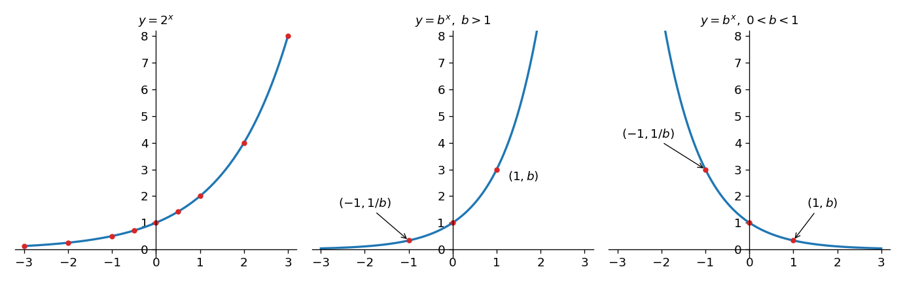

*Figure 14. Graphs of the exponential function with base 2 and of exponential functions with base greater than 1 and between 0 and 1*

### 4.2 Graphs of Logarithmic Functions

Logarithms were introduced by John Napier. Because they greatly shortened the time needed for multiplication and division, they played an important part in the progress of astronomy and navigation in the seventeenth century. Now that calculators and computers carry out such computations, logarithms and logarithmic functions serve mainly as conceptual tools.

> **Definition:** If $b$ is a positive real number other than 1, the **logarithmic function with base $b$**, $\log_b: \mathbf{R}^{+} \to \mathbf{R}$, assigns to each positive real number $x$ the number $\log_b x$, the exponent to which $b$ must be raised to give $x$. That is, $\log_b x = y$ if, and only if, $b^y = x$.

The logarithmic function with base $b$ is the inverse of the exponential function with base $b$, so the graphs of the two functions are mirror images of each other across the line $y = x$.

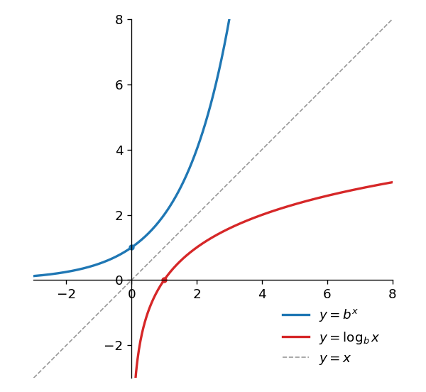

*Figure 15. Graphs of logarithmic and exponential functions with base greater than 1 and the line y = x*

If the base $b$ is greater than 1, the logarithmic function is increasing. That is, if $b > 1$, then for all positive numbers $x_1$ and $x_2$ the following holds.

```math
x_1 < x_2 \implies \log_b x_1 < \log_b x_2 \qquad (11.4.1)
```

This is because if $\log_b x_1 \geq \log_b x_2$, then, since $y \mapsto b^y$ is increasing for $b > 1$, $x_1 = b^{\log_b x_1} \geq b^{\log_b x_2} = x_2$, contradicting $x_1 < x_2$. In contrast to the explosive growth of the exponential function, the logarithmic function grows very slowly. For example, $\log_2 1{,}024$ is only 10 and $\log_2 1{,}048{,}576$ is just 20, so the graph reaches large heights only very far out along the horizontal axis.

The computations in this section use the properties of logarithms from Chapter 7. If $b$ and $c$ are positive real numbers not equal to 1, $x$ and $y$ are positive real numbers, and $a$ is a real number, then the following hold.

```math
\log_b(xy) = \log_b x + \log_b y, \quad \log_b \frac{x}{y} = \log_b x - \log_b y, \quad \log_b (x^a) = a \log_b x, \quad \log_c x = \frac{\log_b x}{\log_b c}
```

### 4.3 Logarithms of Numbers between Two Consecutive Powers of 2

The following property follows from the fact that the logarithmic function with base 2 is increasing and is used often in algorithm analysis.

**Property (11.4.2).** If $k$ is an integer and $x$ is a real number with $2^k \leq x < 2^{k+1}$, then $\lfloor \log_2 x \rfloor = k$.

**Proof.** Suppose $k$ is an integer and $x$ is a real number with $2^k \leq x < 2^{k+1}$. Because the logarithmic function with base 2 is increasing, $\log_2(2^k) \leq \log_2 x < \log_2(2^{k+1})$. But $\log_2(2^k) = k$, since 2 must be raised to the $`k`$th power to get $2^k$, and for the same reason $\log_2(2^{k+1}) = k + 1$. Hence $k \leq \log_2 x < k + 1$, and by the definition of the floor function, $\lfloor \log_2 x \rfloor = k$.

For a positive number, the floor simply drops the fractional part (for instance, $`\lfloor 2.82 \rfloor = 2`$). Property (11.4.2) therefore says in words that when a positive number $x$ lies between the consecutive integer powers $2^k$ and $2^{k+1}$ of 2, the floor of $\log_2 x$ is $k$, the exponent of the smaller power. For example, $2^3 = 8 \leq 13 < 16 = 2^4$, so $\lfloor \log_2 13 \rfloor = 3$ ($`\log_2 13 \approx 3.70`$). Figure 16 shows that if $x$ lies in the interval $[2^k, 2^{k+1})$, then $\log_2 x$ lies in the interval $[k, k+1)$.

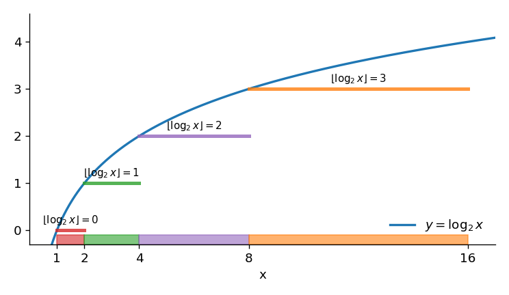

*Figure 16. The floor of log2 x when x lies between 2 to the k and 2 to the k+1*

The next property looks unremarkable on its own, yet algorithm analyses need it again and again as an intermediate step.

**Property (11.4.3).** For any odd integer $n > 1$, $\lfloor \log_2(n-1) \rfloor = \lfloor \log_2 n \rfloor$.

**Proof.** Suppose $n$ is an odd integer greater than 1. Every power of 2 that is at least 2 is even, and $n > 1 = 2^0$, so $n$ is not a power of 2 and lies strictly between two consecutive powers of 2. That is, $2^k < n < 2^{k+1}$ for some integer $k > 0$. Since $2^k < n$ and both are integers, $2^k \leq n - 1$, and so $2^k \leq n - 1 < 2^{k+1}$. Applying property (11.4.2) to the two inequalities $2^k \leq n < 2^{k+1}$ and $2^k \leq n - 1 < 2^{k+1}$ gives $\lfloor \log_2 n \rfloor = k$ and $\lfloor \log_2(n-1) \rfloor = k$, so the two are equal.

For example, $\lfloor \log_2 8 \rfloor = 3 = \lfloor \log_2 9 \rfloor$.

> **Caution:** This property is guaranteed only for odd numbers. For the even number $n = 8$, $\lfloor \log_2 7 \rfloor = 2$ but $\lfloor \log_2 8 \rfloor = 3$. When $n$ is a power of 2, $n - 1$ drops into the interval one level lower.

### 4.4 Application: Number of Bits Needed to Represent an Integer in Binary Notation

How many binary digits (bits) are needed to represent a positive integer $n$ in binary notation? As seen in Chapter 5, every positive integer $n$ can be written in exactly one way as follows, where $k$ is a nonnegative integer and each of $c_0, c_1, \ldots, c_{k-1}$ is 0 or 1.

```math
n = 2^k + c_{k-1} \cdot 2^{k-1} + \cdots + c_2 \cdot 2^2 + c_1 \cdot 2 + c_0
```

Then the binary representation of $n$ is $1c_{k-1}c_{k-2} \cdots c_2 c_1 c_0$, so the number of binary digits needed is $k + 1$. This is now expressed as a function of $n$. Since each $c_i \leq 1$, the formula for the sum of a geometric sequence (Chapter 5) gives the following.

```math
n \leq 2^k + 2^{k-1} + \cdots + 2^2 + 2 + 1 = \frac{2^{k+1} - 1}{2 - 1} = 2^{k+1} - 1 < 2^{k+1}
```

Also, since each $c_i \geq 0$, $2^k \leq n$. Putting the two inequalities together gives $2^k \leq n < 2^{k+1}$, and by property (11.4.2), $k = \lfloor \log_2 n \rfloor$. Therefore the number of binary digits needed to represent $n$ is $\lfloor \log_2 n \rfloor + 1$.

**Example 11.4.3 (Number of Bits in a Binary Representation).** Find the number of binary digits needed to represent 52,837 in binary notation.

**Solution.** Using the change-of-base formula and approximate values of common logarithms gives the following.

```math
\log_2 52{,}837 = \frac{\log_{10} 52{,}837}{\log_{10} 2} \approx \frac{4.722938151}{0.3010299957} \approx 15.7
```

Thus the binary representation of 52,837 has $\lfloor 15.7 \rfloor + 1 = 15 + 1 = 16$ binary digits. Indeed, $2^{15} = 32{,}768 \leq 52{,}837 < 65{,}536 = 2^{16}$, and $52{,}837 = 1100111001100101_2$ has 16 digits.

### 4.5 Application: Using Logarithms to Solve Recurrence Relations

Many recurrence relations that are important in computer science have solutions that can be expressed with logarithms. The next example is one of them.

**Example 11.4.4 (A Recurrence Relation with a Logarithmic Solution).** Define a sequence $a_1, a_2, a_3, \ldots$ recursively as follows.

```math
a_1 = 1, \qquad a_k = 2a_{\lfloor k/2 \rfloor} \quad (k \geq 2)
```

(a) Use iteration to guess an explicit formula for this sequence. (b) Use strong mathematical induction to confirm that the formula in (a) is correct.

**Solution (a).** Computing the first few terms in turn gives Table 10.

| $n$ | $\lfloor n/2 \rfloor$ | $a_n = 2a_{\lfloor n/2 \rfloor}$ | $\lfloor \log_2 n \rfloor$ |
|:-----|:-----|:-----|:-----|
| 1 | | 1 (initial condition) | 0 |
| 2 | 1 | $2a_1 = 2 \cdot 1 = 2$ | 1 |
| 3 | 1 | $2a_1 = 2 \cdot 1 = 2$ | 1 |
| 4 | 2 | $2a_2 = 2 \cdot 2 = 4$ | 2 |
| 5 | 2 | $2a_2 = 2 \cdot 2 = 4$ | 2 |
| 6 | 3 | $2a_3 = 2 \cdot 2 = 4$ | 2 |
| 7 | 3 | $2a_3 = 2 \cdot 2 = 4$ | 2 |
| 8 | 4 | $2a_4 = 2 \cdot 4 = 8$ | 3 |
| 9 | 4 | $2a_4 = 2 \cdot 4 = 8$ | 3 |
| $\vdots$ | $\vdots$ | $\vdots$ | $\vdots$ |
| 15 | 7 | $2a_7 = 2 \cdot 4 = 8$ | 3 |
| 16 | 8 | $2a_8 = 2 \cdot 8 = 16$ | 4 |

*Table 10. The first few terms of the sequence defined by the recurrence relation*

Whenever the subscript $n$ lies between two powers of 2, $a_n$ equals the smaller power. More precisely:

```math
2^i \leq n < 2^{i+1} \implies a_n = 2^i \qquad (11.4.8)
```

If $n$ satisfies $2^i \leq n < 2^{i+1}$, then by property (11.4.2) $i = \lfloor \log_2 n \rfloor$, so substituting into (11.4.8) suggests that $a_n = 2^{\lfloor \log_2 n \rfloor}$.

**Solution (b).** It must be shown that the sequence with $a_1 = 1$ and $a_k = 2a_{\lfloor k/2 \rfloor}$ for every integer $k \geq 2$ satisfies $a_n = 2^{\lfloor \log_2 n \rfloor}$ for every integer $n \geq 1$. Let the property $P(n)$ be the equation $a_n = 2^{\lfloor \log_2 n \rfloor}$, and use strong mathematical induction to prove that $P(n)$ is true for every integer $n \geq 1$.

**Basis step.** By the definition of the sequence, $a_1 = 1$, and $2^{\lfloor \log_2 1 \rfloor} = 2^0 = 1$, so $P(1)$ is true.

**Inductive step.** Let $k$ be any integer with $k \geq 1$, and suppose, as the inductive hypothesis, that $a_i = 2^{\lfloor \log_2 i \rfloor}$ for every integer $i$ with $1 \leq i \leq k$. It must be shown that $a_{k+1} = 2^{\lfloor \log_2(k+1) \rfloor}$. Consider two cases by the parity of $k$.

Case 1 ($k$ is even): since $k + 1$ is odd, $\lfloor (k+1)/2 \rfloor = k/2$. Because $k$ is even and $k \geq 1$, $k \geq 2$, so $1 \leq k/2 < k$ and the inductive hypothesis applies to $k/2$.

```math
a_{k+1} = 2a_{k/2} = 2 \cdot 2^{\lfloor \log_2(k/2) \rfloor} = 2^{\lfloor \log_2 k - 1 \rfloor + 1} = 2^{\lfloor \log_2 k \rfloor - 1 + 1} = 2^{\lfloor \log_2 k \rfloor} = 2^{\lfloor \log_2(k+1) \rfloor}
```

The reasons for the equalities are, in order: (1) the definition of the sequence and $\lfloor (k+1)/2 \rfloor = k/2$, (2) the inductive hypothesis, (3) the laws of exponents and $\log_2(k/2) = \log_2 k - \log_2 2 = \log_2 k - 1$, (4) the case $m = -1$ of the property $\lfloor x + m \rfloor = \lfloor x \rfloor + m$ for an integer $m$ (Chapter 4), (5) arithmetic, and (6) property (11.4.3), since $k + 1$ is an odd integer greater than 1, which gives $\lfloor \log_2 k \rfloor = \lfloor \log_2(k+1) \rfloor$.

Case 2 ($k$ is odd): since $k + 1$ is even, $\lfloor (k+1)/2 \rfloor = (k+1)/2$. Since $k \geq 1$, $(k+1)/2 \geq 1$, and since $k + 1 \leq 2k$, $(k+1)/2 \leq k$, so the inductive hypothesis applies to $(k+1)/2$.

```math
a_{k+1} = 2a_{(k+1)/2} = 2 \cdot 2^{\lfloor \log_2((k+1)/2) \rfloor} = 2^{\lfloor \log_2(k+1) - 1 \rfloor + 1} = 2^{\lfloor \log_2(k+1) \rfloor}
```

The reasons are the same as in case 1: the definition of the sequence, the inductive hypothesis, the laws of exponents with $\log_2((k+1)/2) = \log_2(k+1) - 1$, and $\lfloor x - 1 \rfloor = \lfloor x \rfloor - 1$, in order.

In either case $a_{k+1} = 2^{\lfloor \log_2(k+1) \rfloor}$, so the inductive step is proved, and by strong mathematical induction $a_n = 2^{\lfloor \log_2 n \rfloor}$ for every integer $n \geq 1$.

### 4.6 Exponential and Logarithmic Orders

How do logarithmic and exponential functions compare with power functions? Once $x$ is large enough, the graph of a logarithmic function with base greater than 1 stays below the graph of every power function with a positive exponent, and the graph of an exponential function with base greater than 1 stays above all of them. Stated as inequalities: for all real numbers $b$ and $r$ with $b > 1$ and $r > 0$, there is a positive real number $s$ such that the following hold for every real number $x \geq s$.

```math
\log_b x \leq x^r \quad (11.4.9), \qquad x^r \leq b^x \quad (11.4.10)
```

In O-notation, for all real numbers $b$ and $r$ with $b > 1$ and $r > 0$, (11.4.11) $\log_b n$ is $O(n^r)$, and (11.4.12) $n^r$ is $O(b^n)$.

The function defined by $f(x) = x \log_b x$ for $x > 0$ also appears constantly in algorithm analysis. For large $x$ its graph lies between the graph of the identity function and the graph of the squaring function; precisely, for every real number $b > 1$ there is a positive real number $s$ such that the following holds for every real number $x \geq s$.

```math
x \leq x \log_b x \leq x^2 \qquad (11.4.13)
```

In O-notation, for every real number $b > 1$, (11.4.14) $n$ is $O(n \log_b n)$ and $n \log_b n$ is $O(n^2)$. Some of these facts need calculus for a proof, but some special cases follow from the algebra of inequalities alone. For example, $n < 2^n$ for every integer $n \geq 1$ (by mathematical induction, Chapter 5), so $\log_2 n < n$ by property (11.4.1). Also, the $s$ in (11.4.9) can be very large when $r$ is small. With $r = 0.1$, at $x = 2^{60}$, $\log_2 x = 60 \leq 64 = 2^6 = x^{0.1}$, but at $x = 2^{50}$, $\log_2 x = 50 > 32 = x^{0.1}$.

Figure 17 illustrates the relationships among some power functions, the logarithmic function with base 2, the exponential function with base 2, and $x \log_2 x$.

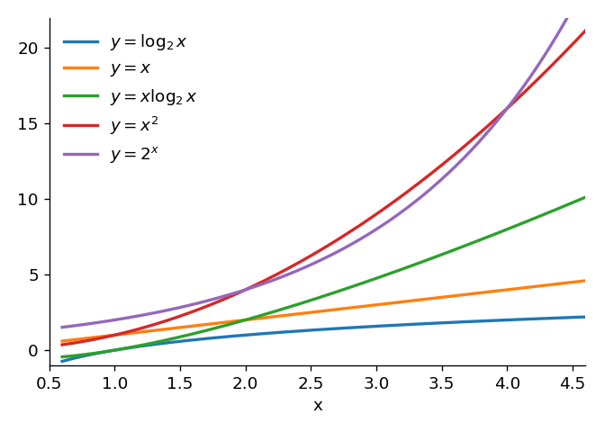

*Figure 17. Graphs of log2 x, x, x log2 x, x², and 2 to the x*

**Example 11.4.5 (Orders That Involve Logarithmic Functions).** (a) Show that for real numbers $b$ and $c$ with $b > 1$ and $c > 1$, $\log_b n$ and $\log_c n$ have the same order. (b) Show that $n + n \log_2 n$ is $\Theta(n \log_2 n)$.

**Solution.** (a) By the change-of-base formula, the following holds.

```math
\log_b n = \frac{\log_c n}{\log_c b} = \frac{1}{\log_c b} \log_c n
```

Since $b > 1$ and $c > 1$, $\log_c b > 0$ and $\frac{1}{\log_c b} > 0$. By Theorem 11.2.7(a), $\log_c n$ is $\Theta(\log_c n)$, so by Theorem 11.2.8(c), $\frac{1}{\log_c b} \log_c n$, that is, $\log_b n$, is $\Theta(\log_c n)$. The same reasoning with $b$ and $c$ interchanged shows that $\log_c n$ is $\Theta(\log_b n)$. Thus $\log_b n$ and $\log_c n$ have the same order. (b) By Theorem 11.2.7(a), $n$ is $\Theta(n)$ and $n \log_2 n$ is $\Theta(n \log_2 n)$. Also, by (11.4.13) there is a positive real number $s$ such that $n \leq n \log_2 n$ for every integer $n \geq s$ (indeed, $\log_2 n \geq 1$ when $`n \geq 2`$). Hence, by Theorem 11.2.9(c), $n + n \log_2 n$ is $\Theta(n \log_2 n)$.

> **Key Point:** Changing the base of a logarithm only changes a positive constant multiple, so the base does not affect the order. For this reason a logarithmic order is sometimes written without the base, as $\Theta(\log n)$.

**Example 11.4.6 (An Exponential Order).** Show that $n!$ is $O(n^n)$.

**Solution.** For any positive integer $n$, $(n-1) \leq n$, $(n-2) \leq n$, $\ldots$, $2 \leq n$, and $1 \leq n$, so the following holds. Both sides are products of $n$ factors.

```math
n! = n \cdot (n-1) \cdot (n-2) \cdots 2 \cdot 1 \leq n \cdot n \cdot n \cdots n \cdot n = n^n
```

Let $B = 1$ and $b = 1$. Since $n! \geq 0$ for $n \geq b$, $0 \leq n! \leq n^n$ for every integer $n \geq b$, and by the definition of O-notation $n!$ is $O(n^n)$.

### 4.7 Order of a Harmonic Sum

Sums of the form $1 + \frac{1}{2} + \cdots + \frac{1}{n}$ are called **harmonic sums**. They turn up in the analysis of several algorithms, quick sort among them. The next example shows a logarithmic order emerging from such a sum and relies on the following fact from calculus: the region under the graph of $y = \frac{1}{x}$ between $x = 1$ and $x = n$ has area $\ln n$, where $\ln n = \log_e n$ is the natural logarithm.

> **[Calculus]** The fact above is the definite integral $`\int_1^n \frac{1}{x}\,dx = \ln n - \ln 1 = \ln n`$, because an antiderivative of $\frac{1}{x}$ is $\ln x$ and $\ln 1 = 0$. Also, since $\frac{1}{x}$ is decreasing for $x > 0$, on each interval $[i, i+1]$ the height of the graph is largest at the left endpoint and smallest at the right endpoint.

**Example 11.4.7 (Order of a Harmonic Sum).** Show that $1 + \frac{1}{2} + \frac{1}{3} + \cdots + \frac{1}{n}$ is $\Theta(\ln n)$ by the following steps. (a) Interpret Figure 18 to show that $\frac{1}{2} + \frac{1}{3} + \cdots + \frac{1}{n} \leq \ln n$ and $\ln n \leq 1 + \frac{1}{2} + \cdots + \frac{1}{n}$. (b) Show that if $n$ is an integer with $n \geq 3$, then $1 \leq \ln n$. (c) Deduce from (a) and (b) that if $n \geq 3$, then $\ln n \leq 1 + \frac{1}{2} + \cdots + \frac{1}{n} \leq 2 \ln n$. (d) Deduce from (c) that $1 + \frac{1}{2} + \cdots + \frac{1}{n}$ is $\Theta(\ln n)$.

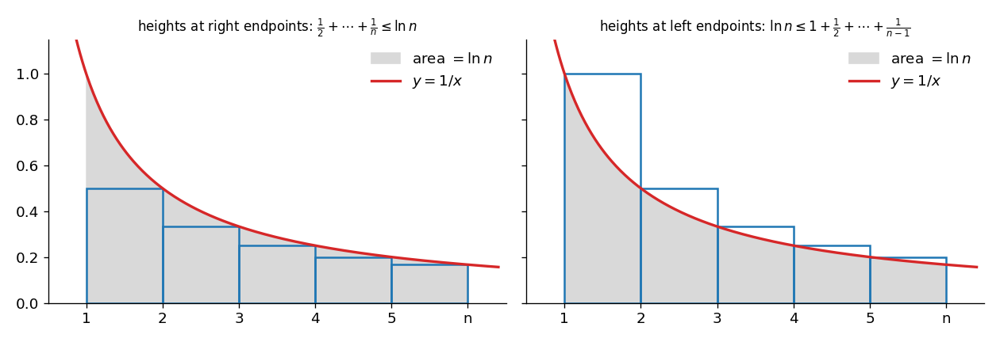

*Figure 18. The area ln n under the graph of y = 1/x and rectangles with heights at the right and left endpoints*

**Solution.**

- (a) The left of Figure 18 shows rectangles whose bases are the intervals between consecutive integers from 1 to $n$ and whose heights are the heights of the graph at the right endpoints of the intervals. The rectangle from 1 to 2 has area $\frac{1}{2}$, the one from 2 to 3 has area $\frac{1}{3}$, $\ldots$, and the one from $n - 1$ to $n$ has area $\frac{1}{n}$, so the sum of the areas is $\frac{1}{2} + \frac{1}{3} + \cdots + \frac{1}{n}$. All the rectangles lie under the graph, so this sum is at most the area $\ln n$ under the graph between $x = 1$ and $x = n$. If the heights are taken at the left endpoints, as on the right, the rectangles cover the region under the graph, so $\ln n \leq 1 + \frac{1}{2} + \cdots + \frac{1}{n-1} \leq 1 + \frac{1}{2} + \cdots + \frac{1}{n}$.
- (b) If $n$ is an integer with $n \geq 3$, then $n \geq e$ because $e \approx 2.718$. The logarithmic function with base $e$ is increasing, so $1 = \ln e \leq \ln n$.
- (c) Adding the first inequality of (a), $\frac{1}{2} + \cdots + \frac{1}{n} \leq \ln n$, and the inequality $1 \leq \ln n$ of (b) gives $1 + \frac{1}{2} + \cdots + \frac{1}{n} \leq 2 \ln n$ for $n \geq 3$. Combined with the second inequality of (a), $\ln n \leq 1 + \frac{1}{2} + \cdots + \frac{1}{n} \leq 2 \ln n$ for $n \geq 3$.
- (d) Let $A = 1$, $B = 2$, and $k = 3$. For $n \geq 3$, $\ln n > 0$ and $A \ln n \leq 1 + \frac{1}{2} + \cdots + \frac{1}{n} \leq B \ln n$, so by the definition of Θ-notation $1 + \frac{1}{2} + \cdots + \frac{1}{n}$ is $\Theta(\ln n)$.

By part (a) of the example in Section 4.6, all logarithmic functions have the same order, so $1 + \frac{1}{2} + \cdots + \frac{1}{n}$ is $\Theta(\log_b n)$ for every real number $b > 1$.

---

<br>

## 5. Analysis of Algorithm Efficiency II

### 5.1 Divide and Conquer

Consider a number-guessing game. One player secretly picks a number in a known range, say from 1 to 100, and the other tries to identify it with as few guesses as possible. After each guess, the first player says whether it is correct, too low, or too high. The best strategy is to guess near the middle of the range first. A guess that is too high shows that the number lies between the lower end and the guess; a guess that is too low shows that it lies between the guess and the upper end. Either way, the next guess is taken near the middle of the remaining range, and this continues until the number is found.

This approach is an instance of a general strategy called **divide and conquer**: a problem is broken into a fixed number of smaller problems of the same type, each of these is broken up in the same way, and the process continues until the problems are easy to solve. In the guessing game, finding a number in a range becomes, at each step, finding it in a range about half as long. Divide-and-conquer algorithms tend to be very efficient, and their orders almost always involve logarithmic functions. This section formalizes the guessing game as the binary search algorithm and compares its efficiency with that of sequential search, then builds merge sort, a divide-and-conquer sorting algorithm, and compares it with insertion sort and selection sort.

### 5.2 Binary Search

Sequential search works on an array in any order, but **binary search** requires the elements to be arranged in ascending (or descending) order. Consider looking for a given element $x$ in an array $a[1], a[2], \ldots, a[n]$ of distinct elements in ascending order.

Binary search starts by comparing $x$ with the middle element of the array. If they are equal, the search has succeeded. Otherwise, because the array is in ascending order, the comparison tells which part can still contain $x$: the lower subarray, made up of the elements before the middle one, or the upper subarray, made up of the elements after it. The same step is then applied to that shorter subarray, and so on, until either $x$ is found or no elements are left in the subarray to be searched. The algorithm is efficient because each step cuts the length of the subarray to be searched roughly in half.

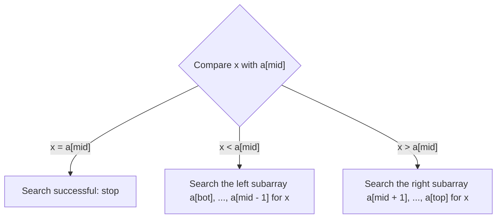

*Figure 19. One iteration of the binary search process*

The formal version uses a variable `index` to report the result. Because the subscripts of the array run from 1 to $n$, `index` starts at 0 and is set to the subscript of the matching element when $x$ is found; if `index` is still 0 when the algorithm ends, $x$ is not an element of the array. Figure 20 shows a binary search of $a[1], \ldots, a[7]$ when $x = a[5]$.

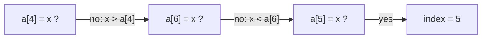

*Figure 20. Binary search of a[1], ..., a[7] for x when x = a[5]*

The middle element of an array also needs a precise definition. An array with an even number of elements has two middle elements; in $a[3], a[4], \ldots, a[10]$, for example, three elements come before and three after the pair $a[6]$, $a[7]$. Either could serve, and this algorithm takes the one with the smaller index, which is the floor of the average of the bottom and top indexes of the array. Writing `bot` for the bottom index of the array, `top` for the top index, and `mid` for the smaller of the two middle indexes, $mid = \lfloor (bot + top)/2 \rfloor$. In the example above, $bot = 3$ and $top = 10$, so $mid = \lfloor 13/2 \rfloor = \lfloor 6.5 \rfloor = 6$.

**Algorithm 11.5.1 (Binary Search).** This algorithm looks for $x$ in an array $a[1], a[2], \ldots, a[n]$ in ascending order. On success, `index` is set to the position of $x$ in the array; otherwise `index` keeps its initial value 0. The variables `bot` and `top` hold the bottom and top indexes of the subarray still being searched.

```text
Input: n [a positive integer], a[1], a[2], ..., a[n] [data items arranged in ascending order],
       x [a data item of the same type as the array elements]

Algorithm Body:
index := 0, bot := 1, top := n
while (top ≥ bot and index = 0)
    mid := ⌊(bot + top) / 2⌋
    if a[mid] = x then index := mid
    if a[mid] > x
        then top := mid - 1
        else bot := mid + 1
end while

Output: index [a nonnegative integer]
```

Each pass through the loop computes the middle index `mid` and compares $x$ with $a[mid]$. A match sets `index` to `mid`, which ends the loop. Otherwise the search continues in the lower subarray by setting `top` to `mid - 1`, or in the upper subarray by setting `bot` to `mid + 1`. Since every pass lowers `top` or raises `bot`, an unsuccessful search eventually makes `top` smaller than `bot`, which also ends the loop and means that $x$ is not an element of the array. At the end, `index` is 0 if $x$ is not in the array and is the position of $x$ otherwise.

**Example 11.5.1 (Tracing Binary Search).** Trace the variables `index`, `bot`, `top`, and `mid` of Algorithm 11.5.1 on the following input array for (a) $x = \text{Erik}$ and (b) $x = \text{Sara}$. Elements are compared in alphabetical order.

```math
a[1] = \text{Ann},\ a[2] = \text{Dawn},\ a[3] = \text{Erik},\ a[4] = \text{Gail},\ a[5] = \text{Juan},\ a[6] = \text{Matt},\ a[7] = \text{Max},\ a[8] = \text{Rita},\ a[9] = \text{Tsuji},\ a[10] = \text{Yuen}
```

**Solution.** Each column of Tables 11 and 12 shows the values after one iteration of the while loop.

| Variable | Initial | Iteration 1 | Iteration 2 | Iteration 3 |
|:-----|:-----|:-----|:-----|:-----|
| `mid` | | 5 | 2 | 3 |
| Comparison | | Juan > Erik | Dawn < Erik | Erik = Erik |
| `index` | 0 | 0 | 0 | 3 |
| `bot` | 1 | 1 | 3 | 4 |
| `top` | 10 | 4 | 4 | 4 |

*Table 11. Trace of binary search for x = Erik*

| Variable | Initial | Iteration 1 | Iteration 2 | Iteration 3 |
|:-----|:-----|:-----|:-----|:-----|
| `mid` | | 5 | 8 | 9 |
| Comparison | | Juan < Sara | Rita < Sara | Tsuji > Sara |
| `index` | 0 | 0 | 0 | 0 |
| `bot` | 1 | 6 | 9 | 9 |
| `top` | 10 | 10 | 10 | 8 |

*Table 12. Trace of binary search for x = Sara*

In (a), $a[3] = x$ in the third iteration, so `index` becomes 3 and the loop ends. In (b), after the third iteration $top = 8 < 9 = bot$, so the loop ends, and since `index` is 0, Sara is not in the array.

> **Note:** In the third iteration of (a), after $x$ is found the second if statement is still executed; since $a[3] > x$ is false, the else branch changes `bot` to 4. Because `index` is no longer 0, however, the loop ends and the result is not affected.

### 5.3 Efficiency of Binary Search

The idea behind the efficiency of binary search can be sketched first. Each stage leaves a subarray about half as long as the one before, and in the worst case the search goes on until a subarray with a single element has been examined. The worst-case number of iterations of the while loop is therefore one more than the number of times the original array can be roughly halved. When the length $n$ is a power of 2 ($`n = 2^k`$), halving exactly $k = \log_2 n = \lfloor \log_2 n \rfloor$ times reaches length 1. When $n$ is not a power of 2, $n = 2^k + m$ for an integer $k$ and $0 < m < 2^k$, and $n$ can still be roughly halved $k$ times, so again $k = \lfloor \log_2 n \rfloor$. Hence the worst-case number of iterations of the while loop, which is proportional to the number of comparisons, is $\lfloor \log_2 n \rfloor + 1$, and this is $O(\log_2 n)$. The following examples fill in the details.

For each integer $n \geq 1$, let $w_n$ denote the number of iterations of the while loop when binary search runs on an input array of length $n$ in the worst case.

The first question is this: given the length of the array that enters one iteration of the loop, how long can the array entering the next iteration be?

**Example 11.5.2 (Length of the Array for the Next Iteration).** Show that if an array of length $k$ enters the while loop of binary search and the iteration does not find $x$, then the array entering the next iteration has length at most $\lfloor k/2 \rfloor$.

**Solution.** Suppose an array $a[bot], \ldots, a[top]$ of length $k$ enters the while loop and $x \neq a[mid]$. If $x < a[mid]$, the next input is $a[bot], \ldots, a[mid-1]$; if $x > a[mid]$, it is $a[mid+1], \ldots, a[top]$. Matching the elements of the array with the integers 1 through $k$ in order, the relative position of $mid$ is $\lfloor (k+1)/2 \rfloor$ regardless of the value of $bot$. So depending on whether $k$ is odd or even, the lengths of the two subarrays are as in Table 13.

| $k$ | Relative position of `mid` | Positions of the left subarray | Left length | Positions of the right subarray | Right length |
|:-----|:-----|:-----|:-----|:-----|:-----|
| Odd | $\frac{k+1}{2}$ | $1, \ldots, \frac{k-1}{2}$ | $\frac{k-1}{2} = \lfloor k/2 \rfloor$ | $\frac{k+3}{2}, \ldots, k$ | $\frac{k-1}{2} = \lfloor k/2 \rfloor$ |
| Even | $\frac{k}{2}$ | $1, \ldots, \frac{k}{2} - 1$ | $\frac{k}{2} - 1 = \lfloor k/2 \rfloor - 1$ | $\frac{k}{2} + 1, \ldots, k$ | $\frac{k}{2} = \lfloor k/2 \rfloor$ |

*Table 13. Lengths of the left and right subarrays of an array of length k*

The larger of $\lfloor k/2 \rfloor$ and $\lfloor k/2 \rfloor - 1$ is $\lfloor k/2 \rfloor$, so in the worst case the array input to the next iteration has length $\lfloor k/2 \rfloor$.

**Example 11.5.3 (A Recurrence Relation for $`w_1, w_2, w_3, \ldots`$).** Show that the sequence $w_1, w_2, w_3, \ldots$ satisfies the following recurrence relation and initial condition.

```math
w_1 = 1, \qquad w_k = 1 + w_{\lfloor k/2 \rfloor} \quad (k > 1)
```

**Solution.** By the previous example, when an array of length $k$ enters the while loop, in the worst case the next iteration works on an array of length $\lfloor k/2 \rfloor$. So the worst-case number of iterations for length $k$ is one more than that for length $\lfloor k/2 \rfloor$; in symbols, $w_k = 1 + w_{\lfloor k/2 \rfloor}$. Also $w_1 = 1$, because for an input array of length 1 ($`bot = top`$) the while loop iterates only once.

**Example 11.5.4 (Guessing an Explicit Formula for $`w_n`$).** Apply iteration to the recurrence relation to guess an explicit formula for $w_n$.

**Solution.** Computing the first few terms gives the following. For instance, $w_2 = 1 + w_1 = 2$, $w_3 = 1 + w_1 = 2$, $w_4 = 1 + w_2 = 3$, $w_8 = 1 + w_4 = 4$, $w_{15} = 1 + w_7 = 4$, and $w_{16} = 1 + w_8 = 5$.

| $n$ | 1 | 2 | 3 | 4 | 5 | 6 | 7 | 8 | 9 | $\cdots$ | 15 | 16 |
|:-----|:-----|:-----|:-----|:-----|:-----|:-----|:-----|:-----|:-----|:-----|:-----|:-----|
| $w_n$ | 1 | 2 | 2 | 3 | 3 | 3 | 3 | 4 | 4 | $\cdots$ | 4 | 5 |
| $\lfloor \log_2 n \rfloor + 1$ | 1 | 2 | 2 | 3 | 3 | 3 | 3 | 4 | 4 | $\cdots$ | 4 | 5 |

*Table 14. Worst-case numbers of iterations of binary search and ⌊log2 n⌋ + 1*

Whenever the subscript $n$ lies between two powers of 2, $w_n$ is 1 more than the exponent of the smaller power. In other words:

```math
2^i \leq n < 2^{i+1} \implies w_n = i + 1 \qquad (11.5.1)
```

If $2^i \leq n < 2^{i+1}$, then $i = \lfloor \log_2 n \rfloor$ by property (11.4.2), so substituting into (11.5.1) suggests that $w_n = \lfloor \log_2 n \rfloor + 1$.

**Example 11.5.5 (Verifying the Correctness of the Formula).** Use strong mathematical induction to show that the sequence with $w_1 = 1$ and $w_k = 1 + w_{\lfloor k/2 \rfloor}$ for every integer $k > 1$ satisfies $w_n = \lfloor \log_2 n \rfloor + 1$ for every integer $n \geq 1$.

**Solution.** Let the property $P(n)$ be the equation $w_n = \lfloor \log_2 n \rfloor + 1$.

**Basis step.** By the definition of the sequence, $w_1 = 1$, and $\lfloor \log_2 1 \rfloor + 1 = 0 + 1 = 1$, so $P(1)$ is true.

**Inductive step.** Let $k$ be any integer with $k \geq 1$, and suppose, as the inductive hypothesis, that $w_i = \lfloor \log_2 i \rfloor + 1$ for every integer $i$ with $1 \leq i \leq k$. It must be shown that $w_{k+1} = \lfloor \log_2(k+1) \rfloor + 1$.

Case 1 ($k$ is even): since $k + 1$ is odd, $\lfloor (k+1)/2 \rfloor = k/2$, and since $k \geq 2$, $1 \leq k/2 < k$, so the inductive hypothesis applies.

```math
w_{k+1} = 1 + w_{k/2} = 1 + \bigl(\lfloor \log_2(k/2) \rfloor + 1\bigr) = \lfloor \log_2 k - 1 \rfloor + 2 = \bigl(\lfloor \log_2 k \rfloor - 1\bigr) + 2 = \lfloor \log_2(k+1) \rfloor + 1
```

The reasons are, in order, the definition of the sequence, the inductive hypothesis, $\log_2(k/2) = \log_2 k - \log_2 2 = \log_2 k - 1$, $\lfloor x - 1 \rfloor = \lfloor x \rfloor - 1$, and property (11.4.3).

Case 2 ($k$ is odd): since $k + 1$ is even, $\lfloor (k+1)/2 \rfloor = (k+1)/2$, and $1 \leq (k+1)/2 \leq k$, so the inductive hypothesis applies.

```math
w_{k+1} = 1 + w_{(k+1)/2} = 1 + \bigl(\lfloor \log_2(k+1) - 1 \rfloor + 1\bigr) = \bigl(\lfloor \log_2(k+1) \rfloor - 1\bigr) + 2 = \lfloor \log_2(k+1) \rfloor + 1
```

In either case $w_{k+1} = \lfloor \log_2(k+1) \rfloor + 1$; since both the basis and the inductive steps have been proved, the proof by strong mathematical induction is complete.

**Example 11.5.6 (Binary Search Is Logarithmic).** Use the fact that $w_n = \lfloor \log_2 n \rfloor + 1$ for every integer $n \geq 1$ to show that in the worst case the binary search algorithm is $\Theta(\log_2 n)$.

**Solution.** For each integer $n \geq 2$, the following hold in turn.

```math
w_n = \lfloor \log_2 n \rfloor + 1 \implies \log_2 n \leq w_n \leq \log_2 n + 1 \implies \log_2 n \leq w_n \leq \log_2 n + \log_2 n = 2 \log_2 n
```

The first step holds because $x < \lfloor x \rfloor + 1$ and $\lfloor x \rfloor \leq x$ for every real number $x$, and the second because the logarithmic function with base 2 is increasing, so $2 \leq n$ gives $1 = \log_2 2 \leq \log_2 n$. With $A = 1$, $B = 2$, and $k = 2$, $A \log_2 n \leq w_n \leq B \log_2 n$ for every integer $n \geq k$, so $w_n$ is $\Theta(\log_2 n)$. Finally, because the number of iterations $w_n$ of the while loop is proportional to the number of comparisons binary search performs, the binary search algorithm is $\Theta(\log_2 n)$ in the worst case.

Thus binary search has order $\log_2 n$ in the worst case, while, as seen in Section 3.1, sequential search has order $n$. The difference becomes more important as $n$ grows. If one loop iteration takes 1 nanosecond, the worst-case times of the two searches are as in Table 15. In the guessing game as well, for the range 1 to 100 the number is always found within $\lfloor \log_2 100 \rfloor + 1 = 7$ guesses.

| $n$ | Sequential search ($n$ iterations) | Binary search ($\lfloor \log_2 n \rfloor + 1$ iterations) |
|:-----|:-----|:-----|
| 100,000,000 | 0.1 sec | 0.000000027 sec |
| 100,000,000,000 | 1.67 min | 0.000000037 sec |
| 100,000,000,000,000 | 27.78 hr | 0.000000047 sec |

*Table 15. Worst-case times of sequential search and binary search at 1 nanosecond per iteration*

### 5.4 Merge Sort

Sequential search is far simpler to write out in full than binary search, but binary search is far more efficient. Computer science is full of such trade-offs: the obvious solution to a problem is often less efficient than a cleverer one that takes more effort to describe. The insertion sort and selection sort of Sections 3.4 and 3.5 formalize the ways people commonly sort things by hand. Divide and conquer yields more efficient sorting methods, and computer scientists have in fact devised several divide-and-conquer sorting algorithms that are harder to describe but much more efficient than insertion sort or selection sort.

One of them, **merge sort**, comes from recursive thinking. Assume that arrays shorter than $k$ can already be sorted efficiently. To sort an array of length $k$, split it into two parts of roughly equal length and sort each part in that way; all that remains is to combine the two sorted parts into a single sorted array, and **merging** them does this efficiently.

The merging of the two sorted subarrays 2, 5, 6, 8 and 3, 6, 7, 9 proceeds as follows. Imagine each element written on a slip of paper, the two subarrays placed as a left column and a right column on a tabletop, and eight positions set up below for the result. At each stage, compare the numbers at the fronts of the two columns and move the slip with the smaller number into the next position of the result. If the two numbers are equal, move the slip from the left column, and if one column is empty, move all the slips of the other column in order. Table 16 shows how each position is filled.

| Position | Numbers compared | Number moved | Source |
|:-----|:-----|:-----|:-----|
| 1 | 2 and 3 | 2 | left |
| 2 | 5 and 3 | 3 | right |
| 3 | 5 and 6 | 5 | left |
| 4 | 6 and 6 | 6 | left (left on ties) |
| 5 | 8 and 6 | 6 | right |
| 6 | 8 and 7 | 7 | right |
| 7 | 8 and 9 | 8 | left |
| 8 | no comparison (left column empty) | 9 | right |

*Table 16. Merging the two sorted subarrays 2, 5, 6, 8 and 3, 6, 7, 9*

Merging is efficient: combining two subarrays into one array of length $k$ takes at most $k - 1$ comparisons. Each slip is chosen by a single comparison of the two front numbers, and once a column is empty no comparisons are needed. By the time the last slip is moved, the other column must already be empty, so even in the worst case each position except the last costs one comparison, $k - 1$ comparisons in all. The example above also uses $8 - 1 = 7$ comparisons.

Merge sort proceeds as follows. An array of orderable elements that has only one element is already sorted and is left unchanged. Any longer array is handled in the following three steps.

1. Split the array into two subarrays whose lengths are as close as possible.
2. Sort each subarray with merge sort.
3. Merge the two subarrays.

Figure 21 shows merge sort applied to the array 5, 2, 4, 6, 1, 3, 2, 6. The upper half is the splitting, and the lower half is the merging.

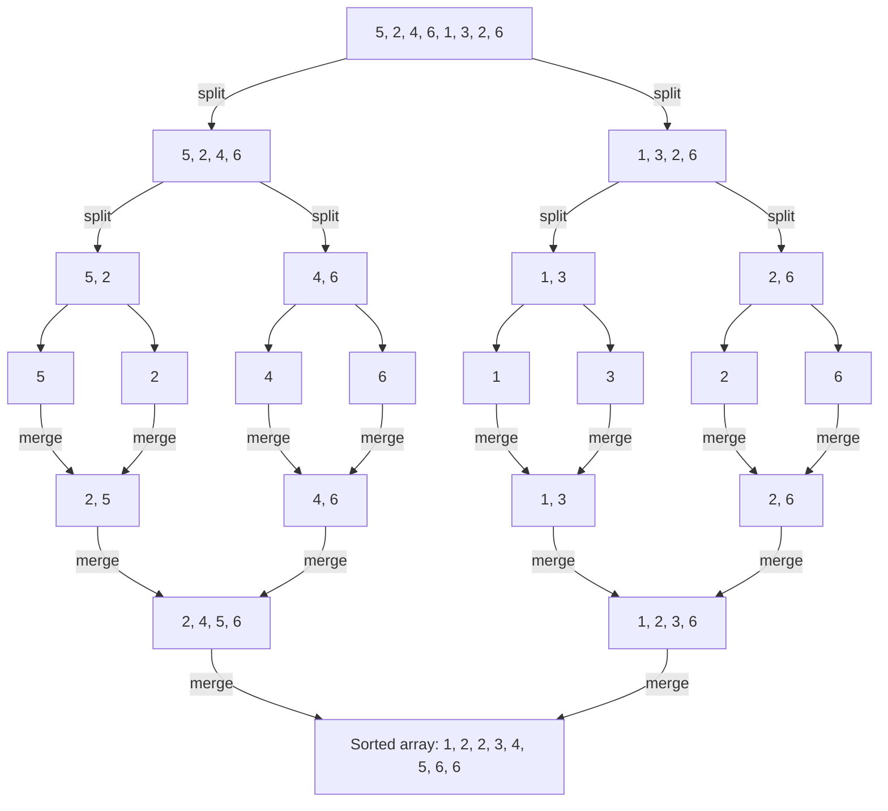

*Figure 21. Splitting and merging in merge sort applied to the array 5, 2, 4, 6, 1, 3, 2, 6*

As with binary search, formalizing merge sort requires deciding exactly where to split each array. For an array $a[bot], a[bot+1], \ldots, a[top]$, let $mid = \lfloor (bot + top)/2 \rfloor$, and take the left subarray to be $a[bot], \ldots, a[mid]$ and the right subarray to be $a[mid+1], \ldots, a[top]$.

**Algorithm 11.5.2 (Merge Sort).** This algorithm takes an array $a[r], a[r+1], \ldots, a[s]$ ($`r \leq s`$) and arranges the same values in ascending order. The output array is also denoted $a[r], \ldots, a[s]$. The input array is split into two subarrays of nearly equal length, each is sorted by merge sort, and then the two subarrays are merged.

```text
Input: r, s [positive integers with r ≤ s], a[r], a[r + 1], ..., a[s] [an array of data items that can be ordered]

Algorithm Body:
bot := r, top := s
while (bot < top)
    mid := ⌊(bot + top) / 2⌋
    call merge sort with input bot, mid, and a[bot], a[bot + 1], ..., a[mid]
    call merge sort with input mid + 1, top, and a[mid + 1], a[mid + 2], ..., a[top]
    [After these steps both a[bot], ..., a[mid] and a[mid + 1], ..., a[top] are in order.]
    merge a[bot], ..., a[mid] and a[mid + 1], ..., a[top]
    [Any merge algorithm that combines two ascending arrays into one ascending array can be called here.]
end while

Output: a[r], a[r + 1], ..., a[s] [an array with the same elements as the input array, in ascending order]
```

> **Note:** In this pseudocode `bot` and `top` never change inside the loop body, so executing `while` literally would keep the condition `bot < top` true and repeat the same work forever. The intended behavior is to execute the body once when `bot < top`, so `while (bot < top) ... end while` should be read as `if (bot < top) then ... end if`. For an array of length 1 ($`bot = top`$) nothing is done, and this is the base of the recursion.

Merge sort is recursive, since its own definition calls merge sort. It is still well defined: every call receives a shorter array than the call that made it, so the calls eventually reach arrays of length 1, which are already sorted.

**Efficiency of merge sort.** For each integer $n \geq 1$, let $m_n$ be the largest number of comparisons that merge sort can make on an array of length $n$.

No comparisons are used for an array of length 1, so $m_1 = 0$. For an integer $k > 1$, when an array $a[bot], \ldots, a[top]$ of length $k$ is split at $mid = \lfloor (bot + top)/2 \rfloor$, the relative position of $mid$ is $\lfloor (k+1)/2 \rfloor = \lceil k/2 \rceil$, so the left subarray has length $\lceil k/2 \rceil$ and the right subarray has length $k - \lceil k/2 \rceil = \lfloor k/2 \rfloor$. Also, merging into an array of length $k$ needs at most $k - 1$ comparisons. Hence the number of comparisons for an array of length $k$ is the sum of the number for an array of length $\lfloor k/2 \rfloor$, the number for an array of length $\lceil k/2 \rceil$, and the number for the merge, which gives the following recurrence relation.

```math
m_k = m_{\lfloor k/2 \rfloor} + m_{\lceil k/2 \rceil} + (k - 1) \qquad (k > 1)
```

Computing the first few terms with this recurrence and comparing them with the worst-case number of comparisons of insertion sort, $\frac{n(n-1)}{2}$ (counting only the comparisons `x < a[j]`), gives Table 17.

| $n$ | 1 | 2 | 3 | 4 | 5 | 6 | 7 | 8 |
|:-----|:-----|:-----|:-----|:-----|:-----|:-----|:-----|:-----|
| $m_n$ | 0 | 1 | 3 | 5 | 8 | 11 | 14 | 17 |
| $\frac{n(n-1)}{2}$ | 0 | 1 | 3 | 6 | 10 | 15 | 21 | 28 |

*Table 17. Maximum numbers of comparisons of merge sort and insertion sort*

Applying strong mathematical induction to this recurrence shows that the following inequality holds for every integer $n \geq 1$, and from it merge sort is $\Theta(n \log_2 n)$ in the worst case.

```math
\frac{1}{2} n \log_2 n \leq m_n \leq 2n \log_2 n
```

When $n$ is a power of 2, this fact is easy to check. If $n = 2^k$, then $\lfloor n/2 \rfloor = \lceil n/2 \rceil = 2^{k-1}$, so the recurrence becomes $m_{2^k} = 2m_{2^{k-1}} + 2^k - 1$. Mathematical induction on $k$ shows $m_{2^k} = k \cdot 2^k - 2^k + 1$: for $k = 0$, $0 - 1 + 1 = 0 = m_1$, and if $m_{2^{k-1}} = (k-1)2^{k-1} - 2^{k-1} + 1$, then the following holds.

```math
m_{2^k} = 2\bigl((k-1)2^{k-1} - 2^{k-1} + 1\bigr) + 2^k - 1 = (k-1)2^k - 2^k + 2 + 2^k - 1 = k \cdot 2^k - 2^k + 1
```

That is, if $n = 2^k$, then $m_n = n \log_2 n - n + 1$. Since $-n + 1 \leq 0$, $m_n \leq n \log_2 n \leq 2n \log_2 n$. Also, $m_n \geq \frac{1}{2} n \log_2 n$ is equivalent to $\frac{1}{2} k \cdot 2^k \geq 2^k - 1$, which holds with equality for $k = 0, 1$ and holds for $k \geq 2$ because $\frac{1}{2} k \cdot 2^k \geq 2^k > 2^k - 1$.

In Sections 3.4 and 3.5, insertion sort and selection sort were both $\Theta(n^2)$. How much difference does it make that merge sort is $\Theta(n \log_2 n)$? If $n = 100{,}000{,}000$ and a computer performs one operation per nanosecond, $n \log_2 n$ operations take about 2.7 seconds, whereas $n^2$ operations take over 115 days.

> **[Algorithms]** An algorithms course expresses the running times of divide-and-conquer algorithms by recurrence relations like this one and covers general methods for solving them. Merge sort divides a problem of size $n$ into two problems of half the size and combines them in linear time, so its running time is $\Theta(n \log n)$, the product of the splitting depth of about $\log_2 n$ and the merging cost of about $n$ at each depth.

### 5.5 Tractable and Intractable Problems

At the other end of the scale from binary search, with its logarithmic order, lie algorithms of exponential order. Take, for example, an algorithm that lists every move needed to transfer the 64 disks of the Tower of Hanoi puzzle, one at a time, from one pole to another. The minimum number of moves $h_n$ for $n$ disks satisfies $h_1 = 1$ and $h_n = 2h_{n-1} + 1$, from the process of moving the top $n - 1$ disks to the spare pole, moving the largest disk, and moving the $n - 1$ disks back on top of it, and the solution is $h_n = 2^n - 1$ (Chapter 5). Therefore transferring 64 disks requires $2^{64} - 1$ moves. If a computer needed one nanosecond to compute each move, computing all of them would take the following time.

```math
(2^{64} - 1) \times \frac{1}{10^9} \times \frac{1}{60} \times \frac{1}{60} \times \frac{1}{24} \times \frac{1}{365.25} \approx 584.5
```

The factors are, in order, the number of moves and the reciprocals of the moves per second $10^9$, the seconds per minute 60, the minutes per hour 60, the hours per day 24, and the days per year 365.25, and the result is in years. That is, it would take about 584.5 years.

> **Definition:** An algorithm whose worst-case order with respect to time is a polynomial is a **polynomial-time algorithm**. A problem that some polynomial-time algorithm solves belongs to **class P** and is called **tractable**; a problem that cannot be solved in polynomial time is called **intractable**. A problem belongs to **class NP** if a proposed solution can be checked by a polynomial-time algorithm, even though it may not be possible to find a solution in polynomial time.

More precisely, NP is the class of problems that a nondeterministic sequential machine can solve in polynomial time, and these are the same as the problems whose proposed solutions an ordinary computer (a deterministic sequential machine) can verify in polynomial time. The name NP stands for nondeterministic polynomial time.

Whether every problem in class NP also belongs to class P is the most important open question in theoretical computer science, known as the **P vs. NP problem**. The Clay Mathematics Institute has offered a prize of one million US dollars to anyone who proves or disproves that P = NP. Computer scientists have also identified a large set of problems, called **NP-complete**. All of these problems belong to class NP, and they are widely believed not to belong to class P. What is certain is that if any one of them has a polynomial-time algorithm, then all the others have polynomial-time algorithms as well. The traveling salesman problem discussed in Chapter 10 is one of the NP-complete problems.

> **Caution:** The N in NP stands for nondeterministic. NP should not be read as the class of problems that cannot be solved in polynomial time. NP is a class defined by the time needed to check a solution, and belonging to NP alone does not prove that a problem cannot be solved in polynomial time.

> **[Theory of Computation]** A theory of computation course defines problems as formal languages and algorithms as Turing machines, and treats the classes P and NP and NP-completeness rigorously. The explanation above summarizes those definitions from the viewpoint of algorithm running time.

### 5.6 Scope of Algorithm Efficiency Analysis

Sections 3 and 5 cover only part of what algorithm analysis involves. They assume that searching and sorting take place in the memory of the computer; data kept in files on disk call for different algorithms, although these are analyzed in much the same way. Moreover, as noted in Section 3.2, time efficiency is not the only basis for choosing an algorithm. Even though memory has become cheap, the amount of space an algorithm needs can still matter, and space efficiency is estimated with mathematical techniques much like those for time efficiency. Finally, as parallel processing of data becomes ever more common, the methods of algorithm analysis are being adapted and extended to algorithms designed for parallel processing.

---

<br>

## Concept Applications

Table 18 collects the orders of the algorithms analyzed in this chapter.

| Algorithm | Cases analyzed and orders | Basis |
|:-----|:-----|:-----|
| Sequential search | best $\Theta(1)$, worst $\Theta(n)$, average $\Theta(n)$ | 1, $n$, and on average $\frac{n+1}{2}$ comparisons |
| Insertion sort | best $\Theta(n)$, worst $\Theta(n^2)$, average $\Theta(n^2)$ | $n - 1$, $\frac{1}{2}n^2 + \frac{1}{2}n - 1$, and $\frac{n^2 + 3n - 4}{4}$ comparisons |
| Selection sort | $\Theta(n^2)$ in every case | $\frac{n(n-1)}{2}$ comparisons, independent of the input |
| Term-by-term polynomial evaluation | $\Theta(n^2)$ | $\frac{n^2 + 3n}{2}$ additions and multiplications |
| Horner's rule | $\Theta(n)$ | $2n$ additions and multiplications |
| Binary search | worst $\Theta(\log_2 n)$ | $\lfloor \log_2 n \rfloor + 1$ iterations |
| Merge sort | worst $\Theta(n \log_2 n)$ | $\frac{1}{2}n\log_2 n \leq m_n \leq 2n\log_2 n$ |
| Tower of Hanoi | $\Theta(2^n)$ | $2^n - 1$ moves |

*Table 18. Orders of the algorithms analyzed in this chapter*

**True/False Check:**

| Statement | Judgment and Reason |
|:-----|:-----|
| If $f(n)$ is $O(n^2)$, then $f(n)$ is $\Theta(n^2)$. | **F.** Big-O gives only an upper bound. For example, $n$ is $O(n^2)$, but $An^2 \leq n$ fails for $n > \frac{1}{A}$, so $n$ is not $\Omega(n^2)$ and not $\Theta(n^2)$. |
| $\log_2 n$ and $\log_{10} n$ have the same order. | **T.** $\log_2 n = \frac{\log_{10} n}{\log_{10} 2}$ differs only by a positive constant multiple, so by Theorem 11.2.8(c) each is big-Theta of the other. |
| The average-case order of insertion sort is lower than its worst-case order. | **F.** The average number of comparisons $\frac{n^2 + 3n - 4}{4}$ is also $\Theta(n^2)$, the same order as the worst case. |
| Binary search can be used on an unsorted array. | **F.** To discard one subarray by comparing with the middle element, the array must be in ascending (or descending) order. |
| The number of comparisons of selection sort does not depend on the order of the input array. | **T.** The inner loop of step $k$ always makes $n - k$ comparisons, $\frac{n(n-1)}{2}$ in total. |
| $2^n$ is $O(n^{100})$. | **F.** By (11.4.10), $n^{101} \leq 2^n$ for sufficiently large $n$. If $2^n \leq Bn^{100}$, then $n^{101} \leq Bn^{100}$, that is, $n \leq B$, would have to hold for all sufficiently large $n$, a contradiction. |
| $n! \leq n^n$ for every integer $n \geq 1$. | **T.** Each of the $n$ factors of $n!$ is at most $n$. |
| $\lfloor \log_2(n-1) \rfloor = \lfloor \log_2 n \rfloor$ for every integer $n > 1$. | **F.** It is guaranteed only for odd $n$. For $n = 8$, $\lfloor \log_2 7 \rfloor = 2 \neq 3 = \lfloor \log_2 8 \rfloor$. |

---

<br>

## Summary

| Concept | Key Summary |
|:-----|:-----|
| Graph of a real-valued function | The set of points $(x, y)$ with $x$ in the domain and $y = f(x)$; the height at $x$ is $f(x)$. The graph of a function defined on the integers keeps only the points with integer first coordinates. |
| Power function | $p_a(x) = x^a$ ($`x \geq 0`$) for a nonnegative real number $a$; for $x > 1$, the larger the exponent, the higher the graph. |
| Multiple of a function | $(Mf)(x) = M \cdot f(x)$; the height of the graph is multiplied by $M$ at each $x$. |
| Increasing and decreasing functions | $x_1 < x_2$ implies $f(x_1) < f(x_2)$ (increasing) or $f(x_1) > f(x_2)$ (decreasing). Both are one-to-one; a positive multiple preserves the property and a negative multiple reverses it. |
| Ω-notation | $f(n)$ is $\Omega(g(n))$ if there are positive $A$ and $a$ with $Ag(n) \leq f(n)$ for $n \geq a$. |
| O-notation | $f(n)$ is $O(g(n))$ if there are positive $B$ and $b$ with $0 \leq f(n) \leq Bg(n)$ for $n \geq b$. |
| Θ-notation | $f(n)$ is $\Theta(g(n))$ if there are positive $A$, $B$, and $k$ with $Ag(n) \leq f(n) \leq Bg(n)$ for $n \geq k$, which is the same as being both $\Omega$ and $O$ (Theorem 11.2.1). |
| Limits of big-O | A function that is $O(n^r)$ is also $O(n^s)$ for $r < s$, so big-O alone cannot compare growth rates. A function that is $\Omega(n^m)$ is not $O(n^p)$ for $p < m$. |
| Theorem on polynomial orders | If $a_m > 0$, then $a_m n^m + \cdots + a_1 n + a_0$ is $\Theta(n^m)$. |
| Properties of order notations | $\Omega$ and $O$ are reciprocal, $\Theta$ is reflexive, symmetric, and transitive, a positive constant multiple does not change the order, and a sum takes the order of the larger term. |
| Order of an algorithm | If the number of elementary operations for an input of size $n$ is $\Theta(g(n))$, the algorithm has order $g(n)$; if the number depends on the input, the minimum and maximum give the best- and worst-case orders. |
| Sequential search | $\Theta(1)$ in the best case and $\Theta(n)$ in the worst and average cases. |
| Insertion sort | $\Theta(n)$ in the best case; $\frac{1}{2}n^2 + \frac{1}{2}n - 1$ comparisons in the worst case and $\frac{n^2 + 3n - 4}{4}$ on average, both $\Theta(n^2)$. |
| Selection sort | Makes $\frac{n(n-1)}{2}$ comparisons regardless of the input, so it is $\Theta(n^2)$. |
| Polynomial evaluation | Term-by-term evaluation uses $\frac{n^2 + 3n}{2}$ operations and is $\Theta(n^2)$; Horner's rule uses $2n$ operations and is $\Theta(n)$. |
| Exponential and logarithmic functions | $\log_b$ is the inverse of $b^x$ and is increasing for $b > 1$. For $b > 1$ and $r > 0$, $\log_b x \leq x^r \leq b^x$ for large $x$. |
| Floor of a logarithm | If $2^k \leq x < 2^{k+1}$, then $\lfloor \log_2 x \rfloor = k$, and for odd $n > 1$, $\lfloor \log_2(n-1) \rfloor = \lfloor \log_2 n \rfloor$. |
| Bits in binary notation | The binary representation of a positive integer $n$ has $\lfloor \log_2 n \rfloor + 1$ digits. |
| Logarithmic orders | The base of a logarithm does not affect the order; $n + n\log_2 n$ is $\Theta(n \log_2 n)$, $n!$ is $O(n^n)$, and the harmonic sum is $\Theta(\ln n)$. |
| Divide and conquer | A strategy that repeatedly reduces a problem to a fixed number of smaller problems of the same kind until they are easily solved; its orders often involve logarithms. |
| Binary search | Halves the range by comparing with the middle element of an ascending array; the worst-case number of iterations is $\lfloor \log_2 n \rfloor + 1$, so it is $\Theta(\log_2 n)$. |
| Merge sort | Splits the array in half, sorts each half, and merges them with at most $k - 1$ comparisons; from $m_k = m_{\lfloor k/2 \rfloor} + m_{\lceil k/2 \rceil} + k - 1$ it is $\Theta(n \log_2 n)$. |
| P and NP | Problems solvable in polynomial time belong to P and are tractable; problems whose solutions can be checked in polynomial time belong to NP. Whether P = NP is an open problem. |

---

<br>

## Self-Check Questions

1. **Proving big-Theta:** Show that $2n^2 - 7n + 3$ is $\Theta(n^2)$ by finding constants $A$, $B$, and $k$ that satisfy the definition.

   <details>
   <summary>Answer</summary>

   Upper bound: if $n \geq 1$, then $2n^2 - 7n + 3 \leq 2n^2 + 3 \leq 2n^2 + 3n^2 = 5n^2$. Lower bound: in Method 2 of Section 2.6, $a_m = 2$ and the sum of the absolute values of the other coefficients is $7 + 3 = 10$, so $A = 1$ and $a = \max(1, \frac{2}{2} \cdot 10) = 10$. Indeed, if $n \geq 10$, then $2n^2 - 7n + 3 - n^2 = n(n - 7) + 3 \geq 33 > 0$. So with $A = 1$, $B = 5$, and $k = 10$, $n^2 \leq 2n^2 - 7n + 3 \leq 5n^2$ for $n \geq k$. Since $n^2 - 7n + 3 \geq 0$ already holds for $n \geq 7$, $k = 7$ also works.

   </details>

2. **Limits of big-O:** Is $f(n) = 3n^2 + 1$ $O(n^3)$? Is it $\Theta(n^3)$?

   <details>
   <summary>Answer</summary>

   By the theorem on polynomial orders, $f(n)$ is $\Theta(n^2)$, so it is $O(n^2)$, and by Theorem 11.2.3 it is $O(n^3)$. But it is not $\Theta(n^3)$. If it were, it would be $\Omega(n^3)$ by Theorem 11.2.1, and by Theorem 11.2.4 it could not be $O(n^2)$ with $p = 2 < 3$; but $f(n)$ is $O(n^2)$, a contradiction.

   </details>

3. **Algorithm segment:** Find the exact number of additions and multiplications and the order of the following segment.

   ```text
   t := 0
   for i := 1 to n
       for j := i to n
           t := t + 2 * j
       next j
   next i
   ```

   <details>
   <summary>Answer</summary>

   For each $i$ the inner loop iterates $n - i + 1$ times, so the total number of iterations is $n + (n - 1) + \cdots + 1 = \frac{n(n+1)}{2}$. Each iteration performs 1 multiplication and 1 addition, so the number of operations is $n(n+1) = n^2 + n$, which is $\Theta(n^2)$ by the theorem on polynomial orders.

   </details>

4. **Tracing insertion sort:** Apply insertion sort to the array 4, 1, 3, 2 and give the array after each step and the total number of comparisons `x < a[j]`. Also give the count under the convention of Section 3.4 (which also counts the test that detects the front).

   <details>
   <summary>Answer</summary>

   After $k = 2$: 1, 4, 3, 2 (1 comparison); after $k = 3$: 1, 3, 4, 2 (3 < 4 true and 3 < 1 false, 2 comparisons); after $k = 4$: 1, 2, 3, 4 (2 < 4 and 2 < 3 true, 2 < 1 false, 3 comparisons). The comparisons `x < a[j]` number $1 + 2 + 3 = 6$. Under the convention of Section 3.4, 1 reached the front at $k = 2$, so one test is added, giving $2 + 2 + 3 = 7$; each step's count equals $k - j + 1$, where $j$ is the position entered.

   </details>

5. **Selection sort:** How many times is the comparison `a[i] < a[IndexOfMin]` made when selection sort is applied to an array of length 6? Does this number depend on the input?

   <details>
   <summary>Answer</summary>

   Step $k$ makes $6 - k$ comparisons, so there are $5 + 4 + 3 + 2 + 1 = 15 = \frac{6 \cdot 5}{2}$ comparisons. The number of iterations of the inner loop is fixed regardless of the contents of the array, so the number does not depend on the input.

   </details>

6. **Number of bits:** How many binary digits are needed to represent 1,000,000 in binary notation?

   <details>
   <summary>Answer</summary>

   $\log_2 1{,}000{,}000 \approx 19.93$, so $\lfloor 19.93 \rfloor + 1 = 20$ digits. Indeed, $2^{19} = 524{,}288 \leq 1{,}000{,}000 < 1{,}048{,}576 = 2^{20}$.

   </details>

7. **Logarithmic recurrence:** Guess an explicit formula for the sequence with $c_1 = 1$ and $c_k = c_{\lfloor k/2 \rfloor} + 2$ for $k \geq 2$, and justify it using the result of Section 5.3. What is the order of this sequence?

   <details>
   <summary>Answer</summary>

   Since $c_1 = 1$, $c_2 = c_3 = 3$, $c_4 = \cdots = c_7 = 5$, and $c_8 = 7$, guess $c_n = 2\lfloor \log_2 n \rfloor + 1$. Let $d_n = 2w_n - 1$. Then $d_1 = 1$ and $d_k = 2(1 + w_{\lfloor k/2 \rfloor}) - 1 = d_{\lfloor k/2 \rfloor} + 2$, so $d_n$ satisfies the same recurrence and initial condition as $c_n$, and $c_n = d_n$ for every $n$. Hence $c_n = 2(\lfloor \log_2 n \rfloor + 1) - 1 = 2\lfloor \log_2 n \rfloor + 1$. Also, since $w_n \geq 1$, $w_n \leq 2w_n - 1 = c_n \leq 2w_n$, and by Section 5.3, $\log_2 n \leq w_n \leq 2\log_2 n$ for $n \geq 2$, so $\log_2 n \leq c_n \leq 4\log_2 n$. Therefore $c_n$ is $\Theta(\log_2 n)$.

   </details>

8. **Tracing binary search:** List the values of `mid` in order when binary search looks for $x = 23$ in the array 2, 5, 8, 12, 16, 23, 38, 56, 72, 91. What is the worst-case number of iterations for an array of length 10?

   <details>
   <summary>Answer</summary>

   With $bot = 1$ and $top = 10$: $mid = 5$ ($a[5] = 16 < 23$, so $`bot = 6`$), $mid = \lfloor 16/2 \rfloor = 8$ ($a[8] = 56 > 23$, so $`top = 7`$), and $mid = \lfloor 13/2 \rfloor = 6$ ($a[6] = 23$, so $`index = 6`$). So `mid` takes the values 5, 8, 6, in 3 iterations. The worst-case number of iterations is $w_{10} = \lfloor \log_2 10 \rfloor + 1 = 3 + 1 = 4$.

   </details>

9. **Merge sort recurrence:** Use the recurrence $m_k = m_{\lfloor k/2 \rfloor} + m_{\lceil k/2 \rceil} + (k - 1)$ with $m_1 = 0$ to find $m_6$, and compare it with the maximum number of comparisons of insertion sort for the same length, $\frac{n(n-1)}{2}$.

   <details>
   <summary>Answer</summary>

   $m_2 = m_1 + m_1 + 1 = 1$, $m_3 = m_1 + m_2 + 2 = 3$, and $m_6 = m_3 + m_3 + 5 = 11$. Insertion sort needs $\frac{6 \cdot 5}{2} = 15$, so merge sort already makes fewer comparisons at $n = 6$, and the gap between $\Theta(n \log_2 n)$ and $\Theta(n^2)$ widens as $n$ grows.

   </details>

10. **Comparing growth orders:** Arrange $n^2$, $\log_2 n$, $2^n$, $n \log_2 n$, $\sqrt{n}$, and $n$ from the smallest growth order to the largest, and explain the order of each adjacent pair with results from this chapter.

    <details>
    <summary>Answer</summary>

    The order is $\log_2 n$, $\sqrt{n}$, $n$, $n \log_2 n$, $n^2$, $2^n$. $\log_2 n$ is $O(\sqrt{n})$ by (11.4.11) with $r = \frac{1}{2}$. $\sqrt{n} \leq n$ follows from Theorem 11.2.2. $n \leq n \log_2 n \leq n^2$ is (11.4.13) and (11.4.14). $n^2$ is $O(2^n)$ by (11.4.12). In each pair, big-O in the opposite direction does not hold, so all the orders are different.

    </details>
