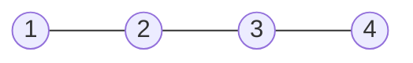
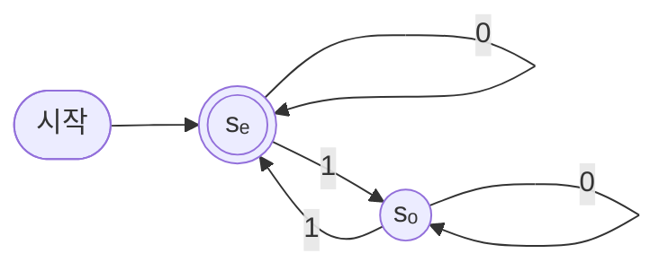
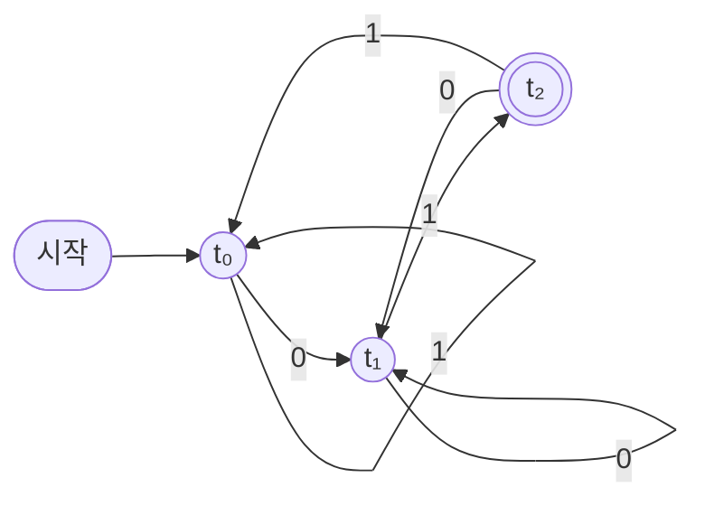
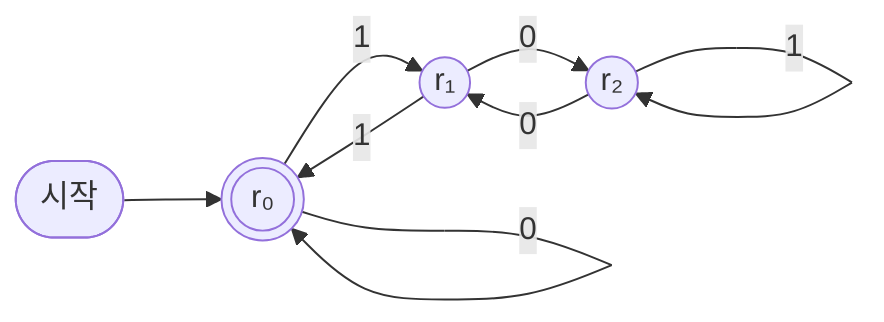
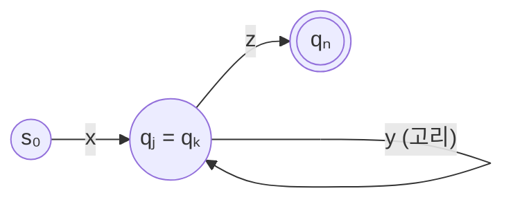

# 12장 — 구조와 유한 오토마타

[레포지토리 안내](../../README.ko.md) | [English](Concepts_Lecture.md) | [한국어](Concepts_Lecture.ko.md)

> **최종 수정일:** 2026-11-10
>
> Discrete Mathematics with Applications, Epp, Ch 12

> **학습 목표:**
> 1. 어휘와 구조를 정의하고, 그래프, 순서, 수의 체계를 구조로 나타내어 1차 논리의 문장이 구조에서 참인지 판정할 수 있다
> 2. 동형인 두 구조가 같은 문장을 만족하는 이유를 설명하고, 한 구조에서만 참인 문장으로 두 구조가 동형이 아님을 보일 수 있다
> 3. 유한 구조와 무한 구조를 구분하고, 무한 구조에서만 참이 될 수 있는 문장과 원소의 수를 나타내는 문장을 만들며, 유한성이 1차 논리로 표현되지 않는 이유를 설명할 수 있다
> 4. 결정적 유한 오토마타를 전이 도표와 다음 상태 표로 나타내고, 주어진 언어를 수락하는 오토마타를 설계하여 입력 문자열의 계산을 추적할 수 있다
> 5. 정규 언어의 정의와 닫힘 성질을 설명하고, 곱 오토마타로 두 정규 언어의 교집합과 합집합을 수락하는 오토마타를 만들 수 있다
> 6. 펌핑 보조정리를 진술하고 비둘기집 원리로 증명하며, 이를 이용하여 주어진 언어가 정규 언어가 아님을 증명할 수 있다

---

## 목차

- [1. 구조](#1-구조)
  - [1.1 같은 문장, 다른 세계](#11-같은-문장-다른-세계)
  - [1.2 어휘와 1차 논리의 문장](#12-어휘와-1차-논리의-문장)
  - [1.3 구조의 정의](#13-구조의-정의)
  - [1.4 구조의 예](#14-구조의-예)
  - [1.5 구조에서 문장의 참](#15-구조에서-문장의-참)
  - [1.6 동형과 문장](#16-동형과-문장)
- [2. 무한 구조와 유한 구조](#2-무한-구조와-유한-구조)
  - [2.1 유한 구조와 무한 구조](#21-유한-구조와-무한-구조)
  - [2.2 무한 구조에서만 참이 될 수 있는 문장](#22-무한-구조에서만-참이-될-수-있는-문장)
  - [2.3 원소의 수를 나타내는 문장](#23-원소의-수를-나타내는-문장)
  - [2.4 유한 구조 위의 논리](#24-유한-구조-위의-논리)
  - [2.5 논리로 계산 복잡도 나타내기: Fagin의 정리](#25-논리로-계산-복잡도-나타내기-fagin의-정리)
- [3. 유한 오토마타](#3-유한-오토마타)
  - [3.1 알파벳, 문자열, 언어](#31-알파벳-문자열-언어)
  - [3.2 문자열을 유한 구조로 보기](#32-문자열을-유한-구조로-보기)
  - [3.3 유한 오토마타의 정의](#33-유한-오토마타의-정의)
  - [3.4 계산과 수락](#34-계산과-수락)
  - [3.5 오토마타의 설계: 3으로 나누어떨어지는 2진수](#35-오토마타의-설계-3으로-나누어떨어지는-2진수)
  - [3.6 정규 언어와 닫힘 성질](#36-정규-언어와-닫힘-성질)
- [4. 펌핑 보조정리](#4-펌핑-보조정리)
  - [4.1 유한한 기억의 한계](#41-유한한-기억의-한계)
  - [4.2 펌핑 보조정리의 진술](#42-펌핑-보조정리의-진술)
  - [4.3 펌핑 보조정리의 증명](#43-펌핑-보조정리의-증명)
  - [4.4 정규 언어가 아님을 증명하기](#44-정규-언어가-아님을-증명하기)
  - [4.5 펌핑 보조정리의 역은 성립하지 않는다](#45-펌핑-보조정리의-역은-성립하지-않는다)
  - [4.6 유한 오토마타 너머](#46-유한-오토마타-너머)
- [개념 적용](#개념-적용)
- [요약](#요약)
- [점검 문제](#점검-문제)
- [참고 문헌](#참고-문헌)

---

<br>

## 1. 구조

### 1.1 같은 문장, 다른 세계

3장에서 한정 명제의 진릿값은 변수의 정의역에 따라 달라진다는 것을 보았다. 다음 문장을 생각한다.

```math
\forall x\, \exists y\, (x < y)
```

"모든 원소에 대해 그보다 큰 원소가 있다"는 뜻이다. 정의역이 정수 전체의 집합 $\mathbf{Z}$이고 $<$가 보통의 대소 관계이면 이 문장은 참이다. 임의의 정수 $x$에 대해 $y = x + 1$이 $x$보다 크기 때문이다. 그러나 정의역이 $\lbrace 1, 2, 3 \rbrace$이면 거짓이다. $x = 3$보다 큰 원소가 정의역에 없기 때문이다. 기호의 배열은 똑같은데, 기호가 무엇에 대한 이야기인지에 따라 진릿값이 달라진다.

또 다른 문장 $`\exists x\, \forall y\, \sim(y < x)`$는 "자신보다 작은 원소가 하나도 없는 원소, 즉 최소 원소가 있다"는 뜻이다. 이 문장은 음이 아닌 정수 전체의 집합 $\mathbf{Z}^{\text{nonneg}}$에서는 참이지만(0이 최소 원소이다) $\mathbf{Z}$에서는 거짓이다.

이처럼 문장의 진릿값을 정하려면 두 가지를 알아야 한다. 하나는 변수가 가리킬 수 있는 대상들의 집합이고, 다른 하나는 $<$ 같은 기호가 그 집합 위에서 무엇을 뜻하는가이다. 이 두 가지를 하나로 묶은 수학적 대상이 **구조(structure)** 이다. 3장 1.10절의 타르스키의 세계는 구조의 좋은 예이다. 격자 위의 블록들이 대상의 집합이고, $\text{Triangle}(x)$, $\text{Blue}(x)$, $\text{RightOf}(x, y)$ 같은 술어가 그 블록들 위에서 구체적인 뜻을 가진다. 같은 문장이라도 블록의 배치가 바뀌면 진릿값이 바뀔 수 있다.

### 1.2 어휘와 1차 논리의 문장

구조를 정의하기 전에, 문장에 쓸 수 있는 기호를 먼저 정한다.

> **용어 정의:** **어휘(vocabulary).** 문장에 쓸 관계 기호, 함수 기호, 상수 기호의 집합으로, 각 관계 기호와 함수 기호에는 인수의 개수인 **항수(arity)** 가 정해져 있다. 시그니처(signature)라고도 한다.

예를 들어 그래프를 이야기하는 어휘는 항수가 2인 관계 기호 $E$ 하나로 이루어진 $\lbrace E \rbrace$이고, 순서를 이야기하는 어휘는 $\lbrace < \rbrace$이다. 정수의 덧셈을 이야기하려면 항수가 2인 함수 기호 $+$와 상수 기호 $0$으로 이루어진 어휘 $\lbrace +, 0 \rbrace$을 쓴다. 타르스키의 세계의 어휘는 항수가 1인 관계 기호 $\text{Triangle}$, $\text{Square}$, $\text{Circle}$, $\text{Blue}$, $\text{Gray}$, $\text{Black}$과 항수가 2인 관계 기호 $\text{RightOf}$ 등으로 이루어진다. 함수 기호와 상수 기호 없이 관계 기호만으로 이루어진 어휘를 **관계 어휘(relational vocabulary)** 라 한다.

어휘가 정해지면 다음 규칙으로 문장을 만든다.

1. 변수와 상수 기호는 **항(term)** 이다. $t_1, \ldots, t_k$가 항이고 $f$가 항수 $k$인 함수 기호이면 $f(t_1, \ldots, t_k)$도 항이다.
2. $t_1, t_2$가 항이면 $t_1 = t_2$는 논리식이다. $R$이 항수 $k$인 관계 기호이고 $t_1, \ldots, t_k$가 항이면 $R(t_1, \ldots, t_k)$는 논리식이다. 이 둘을 **원자 논리식(atomic formula)** 이라 한다.
3. $\varphi$, $\psi$가 논리식이면 $\sim\varphi$, $\varphi \wedge \psi$, $\varphi \vee \psi$, $\varphi \to \psi$, $\varphi \leftrightarrow \psi$도 논리식이다(2장의 연결사).
4. $\varphi$가 논리식이고 $x$가 변수이면 $`\forall x\, \varphi`$와 $`\exists x\, \varphi`$도 논리식이다(3장의 한정기호).

5장 6절에서 수열을 재귀적으로 정의한 것처럼, 이 규칙들은 더 간단한 논리식으로부터 논리식의 집합을 재귀적으로 정의한다. $x < y$처럼 항수가 2인 관계 기호는 관례에 따라 $<(x, y)$ 대신 가운데에 쓴다.

> **용어 정의:** **1차 논리(first-order logic).** 위의 규칙으로 만든 논리식과 그 의미를 다루는 논리 체계이다. 한정기호가 구조의 원소에 대해서만 쓰이고 원소들의 집합이나 관계에 대해서는 쓰이지 않기 때문에 1차라는 이름이 붙었다. 3장의 술어 논리를 정밀하게 다듬은 것이다.

논리식 안의 변수는 3장에서처럼 어떤 한정기호의 유효 범위 안에 있으면 속박 변수이고, 그렇지 않으면 **자유 변수(free variable)** 이다. 예를 들어 $`\exists y\, (x < y)`$에서 $y$는 속박 변수이고 $x$는 자유 변수이다.

> **용어 정의:** **문장(sentence).** 자유 변수가 없는 1차 논리의 논리식이다. 문장은 구조가 하나 정해지면 참이나 거짓 가운데 하나의 진릿값을 가진다.

자유 변수가 있는 논리식은 3장의 술어처럼 변수에 값을 대입해야 진릿값이 정해진다. $`\forall x\, \exists y\, (x < y)`$는 문장이지만 $`\exists y\, (x < y)`$는 문장이 아니다.

### 1.3 구조의 정의

> **용어 정의:** **구조(structure).** 어휘 $\tau$에 대한 구조 $\mathcal{A}$는 공집합이 아닌 집합 $A$와, $\tau$의 각 기호에 대한 다음 해석으로 이루어진다. 항수 $k$인 관계 기호 $R$에는 $A$ 위의 $k$항 관계 $R^{\mathcal{A}} \subseteq A^k$를, 항수 $k$인 함수 기호 $f$에는 함수 $f^{\mathcal{A}}: A^k \to A$를, 상수 기호 $c$에는 원소 $c^{\mathcal{A}} \in A$를 대응시킨다. 집합 $A$를 구조의 **정의역(domain)** 이라 한다.

구조는 보통 다음과 같이 정의역과 해석을 나란히 적어 나타낸다.

```math
\mathcal{A} = (A;\ R^{\mathcal{A}}, \ldots, f^{\mathcal{A}}, \ldots, c^{\mathcal{A}}, \ldots)
```

해석이 분명하면 위첨자를 생략하고 $(\mathbf{Z}; <)$나 $(\mathbf{Z}; +, 0)$처럼 쓴다. 구조의 정의역은 논리학에서 **논의 영역(universe)** 이라고도 한다. 구조를 이루는 재료는 모두 앞에서 배운 것이다. 정의역은 6장의 집합이고, 관계 기호의 해석은 8장 1.4절의 $n$항 관계이며, 함수 기호의 해석은 7장의 함수이다. 따라서 구조는 집합 하나에 그 위의 관계, 함수, 특별한 원소를 함께 붙인 것이라고 할 수 있다.

> **주의:** 구조의 정의역은 공집합이 아니어야 한다. 정의역이 공집합이면 $`\forall x\, \varphi`$는 항상 참이 되고 $`\exists x\, (x = x)`$는 거짓이 되어, 1차 논리의 여러 추론 규칙이 성립하지 않게 된다. 3장의 공허하게 참인 명제가 극단적으로 나타나는 경우이다.

### 1.4 구조의 예

| 구조 | 어휘 | 정의역 | 기호의 해석 |
|:-----|:-----|:-----|:-----|
| $(\mathbf{Z}; <)$ | $\lbrace < \rbrace$ | 정수 전체 | 보통의 대소 관계 |
| $(\mathbf{Q}; <)$ | $\lbrace < \rbrace$ | 유리수 전체 | 보통의 대소 관계 |
| $(\mathbf{Z}^{\text{nonneg}}; +, \times, 0, 1)$ | $\lbrace +, \times, 0, 1 \rbrace$ | 음이 아닌 정수 전체 | 보통의 덧셈, 곱셈, 0, 1 |
| 그래프 $G = (V; E^G)$ | $\lbrace E \rbrace$ | 꼭짓점의 집합 $V$ | $E^G(u, v)$: $u$와 $v$가 변으로 연결되어 있다 |
| 부분 순서 집합 $(A; \preceq)$ | $\lbrace \preceq \rbrace$ | 집합 $A$ | 8장 4절의 부분 순서 관계 |
| 부울 대수 $(\lbrace 0, 1 \rbrace; +, \cdot, 0, 1)$ | $\lbrace +, \cdot, 0, 1 \rbrace$ | $\lbrace 0, 1 \rbrace$ | 6장 4절의 부울 대수 연산 |
| 타르스키의 세계 | $\lbrace \text{Triangle}, \ldots, \text{RightOf} \rbrace$ | 격자 위의 블록 | 블록의 모양, 색, 위치 관계 |
| 관계형 데이터베이스 | 테이블 이름 | 테이블에 나오는 값 | 각 테이블의 행의 집합 |

*표 1. 여러 가지 구조와 그 어휘, 정의역, 해석*

특히 단순 그래프(10장 1.2절)는 어휘 $\lbrace E \rbrace$에 대한 구조로 자연스럽게 나타난다. 꼭짓점이 $\lbrace 1, 2, 3, 4 \rbrace$이고 $1$과 $2$, $2$와 $3$, $3$과 $4$가 연결된 경로 그래프 $P_4$를 구조로 쓰면 다음과 같다. 무방향 그래프이므로 연결된 두 꼭짓점의 순서쌍을 양쪽 방향으로 모두 넣는다.

```math
P_4 = (\lbrace 1, 2, 3, 4 \rbrace;\ E^{P_4}), \qquad E^{P_4} = \lbrace (1,2), (2,1), (2,3), (3,2), (3,4), (4,3) \rbrace
```



*그림 1. 어휘 {E}에 대한 구조로 본 경로 그래프 P₄*

8장 1.4절의 관계형 데이터베이스도 구조이다. 테이블 하나는 그 열의 수를 항수로 갖는 관계이고, 데이터베이스 전체는 그런 관계 여러 개를 가진 유한 구조이다. 데이터베이스에 던지는 질의는 그 구조에 대해 묻는 논리식으로 볼 수 있다(2.4절).

### 1.5 구조에서 문장의 참

구조 $\mathcal{A}$에서 문장 $\varphi$가 참이라는 것은 논리식의 구성을 따라 재귀적으로 정의한다. 자유 변수가 있는 논리식을 다루기 위해, 변수마다 정의역의 원소를 하나씩 대응시키는 **변수 할당(variable assignment)** $s$를 함께 쓴다. $\mathcal{A} \models \varphi[s]$는 "할당 $s$ 아래에서 $\mathcal{A}$가 $\varphi$를 만족한다"로 읽는다.

| 논리식 | $\mathcal{A} \models \varphi[s]$인 조건 |
|:-----|:-----|
| $t_1 = t_2$ | $t_1$과 $t_2$의 값이 같다 |
| $R(t_1, \ldots, t_k)$ | $t_1, \ldots, t_k$의 값을 차례로 늘어놓은 순서 $k$-튜플이 $R^{\mathcal{A}}$에 속한다 |
| $\sim\varphi$ | $\mathcal{A} \models \varphi[s]$가 아니다 |
| $\varphi \wedge \psi$ | $\mathcal{A} \models \varphi[s]$이고 $\mathcal{A} \models \psi[s]$이다 |
| $\varphi \vee \psi$ | $\mathcal{A} \models \varphi[s]$이거나 $\mathcal{A} \models \psi[s]$이다 |
| $\varphi \to \psi$ | $\mathcal{A} \models \varphi[s]$가 아니거나 $\mathcal{A} \models \psi[s]$이다 |
| $\varphi \leftrightarrow \psi$ | $\mathcal{A} \models \varphi[s]$와 $\mathcal{A} \models \psi[s]$가 둘 다 성립하거나 둘 다 성립하지 않는다 |
| $`\forall x\, \varphi`$ | 정의역의 모든 원소 $a$에 대해, $s$에서 $x$의 값만 $a$로 바꾼 할당 아래에서 $\varphi$가 만족된다 |
| $`\exists x\, \varphi`$ | 정의역의 어떤 원소 $a$가 있어서, $s$에서 $x$의 값만 $a$로 바꾼 할당 아래에서 $\varphi$가 만족된다 |

*표 2. 구조에서 논리식이 만족되는 조건의 재귀적 정의*

항의 값은 변수에는 $s$가 정한 원소를, 상수 기호에는 $c^{\mathcal{A}}$를, $f(t_1, \ldots, t_k)$에는 $f^{\mathcal{A}}$를 각 항의 값에 적용한 결과를 준다. 이 정의는 논리학자 알프레드 타르스키가 처음 엄밀하게 제시했다 [1]. 문장에는 자유 변수가 없으므로 그 진릿값은 할당과 무관하며, 이때는 할당을 생략하고 $\mathcal{A} \models \varphi$로 쓴다.

> **용어 정의:** **모형(model).** 문장 $\varphi$가 구조 $\mathcal{A}$에서 참일 때, 즉 $\mathcal{A} \models \varphi$일 때 $\mathcal{A}$를 $\varphi$의 모형이라 한다. 문장의 집합 $\Sigma$의 모든 문장이 $\mathcal{A}$에서 참이면 $\mathcal{A}$를 $\Sigma$의 모형이라 한다.

**예제 (그래프 구조에서 문장의 진릿값).** 그림 1의 구조 $P_4$에서 다음 문장의 진릿값을 정한다.

| 문장 | 뜻 | 진릿값과 근거 |
|:-----|:-----|:-----|
| $`\forall x\, \sim E(x, x)`$ | 루프가 없다 | 참. $E^{P_4}$에 $(a, a)$ 꼴의 순서쌍이 없다. |
| $`\forall x\, \forall y\, (E(x, y) \to E(y, x))`$ | 변에 방향이 없다 | 참. $E^{P_4}$의 모든 순서쌍은 뒤집은 순서쌍도 $E^{P_4}$에 있다. |
| $`\forall x\, \exists y\, E(x, y)`$ | 고립 꼭짓점이 없다 | 참. 꼭짓점 1, 2, 3, 4가 각각 2, 1, 2, 3과 연결되어 있다. |
| $`\exists x\, \forall y\, (x = y \vee E(x, y))`$ | 다른 모든 꼭짓점과 연결된 꼭짓점이 있다 | 거짓. 차수가 가장 큰 꼭짓점 2와 3도 차수가 2여서 나머지 3개와 모두 연결되지는 않는다. |
| $`\forall x\, \forall y\, \forall z\, ((E(x, y) \wedge E(y, z) \wedge x \ne z) \to E(x, z))`$ | 두 변을 거쳐 닿는 서로 다른 꼭짓점은 직접 연결되어 있다 | 거짓. $x = 1$, $y = 2$, $z = 3$이 반례이다. |

*표 3. 구조 P₄에서 다섯 문장의 진릿값*

첫째와 둘째 문장을 함께 만족하는 구조는 정확히 루프가 없는 무방향 그래프, 즉 단순 그래프이다. 이처럼 문장의 집합을 정해 두면 그 모형 전체가 하나의 부류를 이룬다. 8장의 부분 순서 집합은 반사성 $`\forall x\, (x \preceq x)`$, 반대칭성 $`\forall x\, \forall y\, ((x \preceq y \wedge y \preceq x) \to x = y)`$, 추이성 $`\forall x\, \forall y\, \forall z\, ((x \preceq y \wedge y \preceq z) \to x \preceq z)`$의 세 문장의 모형이고, 동치 관계가 주어진 집합은 반사성, 대칭성, 추이성의 모형이다.

**예제 (산술 구조에서 수의 성질 나타내기).** 구조 $\mathcal{N} = (\mathbf{Z}^{\text{nonneg}}; +, \times, 0, 1)$에서는 4장 1.2절과 4절의 정의들을 자유 변수가 있는 논리식으로 쓸 수 있다.

| 성질 | 논리식 |
|:-----|:-----|
| $x$는 짝수이다 | $`\exists y\, (x = y + y)`$ |
| $x$는 $z$를 나눈다 | $`\sim(x = 0) \wedge \exists k\, (z = x \times k)`$ |
| $x \le z$ | $`\exists k\, (x + k = z)`$ |
| $x$는 소수이다 | $`\sim(x = 0) \wedge \sim(x = 1) \wedge \forall y\, \forall z\, (x = y \times z \to (y = 1 \vee z = 1))`$ |

*표 4. 산술 구조에서 4장의 수의 성질을 나타내는 논리식*

이 논리식들을 약어 $\text{Even}(x)$, $\text{Prime}(x)$로 쓰면, "2보다 큰 모든 짝수는 두 소수의 합이다"라는 골드바흐의 추측(Goldbach's conjecture)은 다음 문장이 된다. 2는 $1 + 1$로 쓴다.

```math
\forall x\, \Big( \big(\text{Even}(x) \wedge \sim(x = 0) \wedge \sim(x = 1 + 1)\big) \to \exists p\, \exists q\, \big(\text{Prime}(p) \wedge \text{Prime}(q) \wedge x = p + q\big) \Big)
```

이 문장은 구조 $\mathcal{N}$에서 참이거나 거짓이거나 둘 중 하나이지만, 어느 쪽인지는 아직 아무도 모른다. 문장의 진릿값이 구조에 의해 정해져 있다는 것과 그 진릿값을 증명할 수 있다는 것은 다른 문제이다.

> **핵심:** 문장은 기호의 배열일 뿐이고, 구조가 그 기호에 뜻을 준다. 문장의 진릿값은 구조가 정해져야 비로소 정해지며, 문장의 집합은 그 모형 전체라는 구조의 부류를 정의한다.

1차 논리의 한정기호는 정의역의 **원소**에 대해서만 쓰인다. "꼭짓점의 어떤 부분집합 $S$가 있어서"처럼 원소의 집합이나 관계에 대해 한정하는 것은 1차 논리의 문장이 아니다. 이 제한 때문에 1차 논리로 표현할 수 없는 성질이 생기며(2.3절), 집합이나 관계에 대한 한정을 허용하면 표현력이 커진다(2.5절).

### 1.6 동형과 문장

10장 3절의 그래프의 동형은 구조 일반으로 넓힐 수 있다.

> **용어 정의:** **동형 사상(isomorphism).** 같은 어휘에 대한 두 구조 $\mathcal{A}$, $\mathcal{B}$ 사이의 일대일 대응 $h: A \to B$로서, 모든 관계 기호 $R$과 모든 원소 $a_1, \ldots, a_k$에 대해 $(a_1, \ldots, a_k) \in R^{\mathcal{A}}$일 필요충분조건이 $(h(a_1), \ldots, h(a_k)) \in R^{\mathcal{B}}$이고, 모든 함수 기호 $f$에 대해 $h(f^{\mathcal{A}}(a_1, \ldots, a_k)) = f^{\mathcal{B}}(h(a_1), \ldots, h(a_k))$이며, 모든 상수 기호 $c$에 대해 $h(c^{\mathcal{A}}) = c^{\mathcal{B}}$인 함수이다. 동형 사상이 있으면 두 구조는 동형이라 하고 $\mathcal{A} \cong \mathcal{B}$로 쓴다.

어휘가 $\lbrace E \rbrace$이면 이 정의는 10장 3.5절의 단순 그래프의 동형과 같다. 동형 사상은 원소의 이름만 바꿀 뿐 구조의 모양은 그대로 옮기므로, 다음 정리가 성립한다.

> **핵심:** **정리 (동형 사상은 문장의 진릿값을 보존한다).** $\mathcal{A} \cong \mathcal{B}$이면 모든 문장 $\varphi$에 대해 $\mathcal{A} \models \varphi$일 필요충분조건은 $\mathcal{B} \models \varphi$이다.

**증명의 개요.** 동형 사상 $h$와 $\mathcal{A}$의 할당 $s$에 대해, $s$의 각 값에 $h$를 적용한 $\mathcal{B}$의 할당을 $h \circ s$라 한다. 모든 논리식 $\varphi$에 대해 "$`\mathcal{A} \models \varphi[s]`$일 필요충분조건은 $`\mathcal{B} \models \varphi[h \circ s]`$"임을 논리식의 구성에 대한 귀납법으로 보인다. 원자 논리식에서는 먼저 항 $t$의 값을 $t^{\mathcal{A}}[s]$로 쓸 때 $h(t^{\mathcal{A}}[s]) = t^{\mathcal{B}}[h \circ s]$임을 항의 구성에 대한 귀납법으로 보인다. 그러면 관계 기호의 경우는 동형 사상의 정의에서, 등호의 경우는 $h$가 일대일이라는 사실에서 조건이 나온다. 연결사의 단계는 표 2의 정의를 그대로 따른다. $`\exists x\, \varphi`$의 단계에서는 $\mathcal{A}$에서 $x$의 값으로 쓰인 원소 $a$에 대응하여 $\mathcal{B}$에서는 $h(a)$를 쓰면 되고, 거꾸로 $\mathcal{B}$의 원소 $b$에는 $h$가 위로의 함수이므로 $h(a) = b$인 $a$가 있다. $`\forall x\, \varphi`$의 단계도 같다. 문장에는 자유 변수가 없으므로 결론을 얻는다. ∎

이 정리의 대우는 두 구조가 동형이 아님을 보이는 방법을 준다. **한 구조에서는 참이고 다른 구조에서는 거짓인 문장을 하나 찾으면, 두 구조는 동형이 아니다.** 10장 3.4절의 동형 불변량을 문장으로 나타낸 것이라고 할 수 있다.

**예제 (경로 그래프와 별 그래프).** 그림 1의 $P_4$와, 꼭짓점 하나가 나머지 세 꼭짓점과 각각 연결된 별 그래프 $K_{1,3}$은 둘 다 꼭짓점 4개, 변 3개의 트리이다(10장 4절). 그러나 문장 $`\exists x\, \forall y\, (x = y \vee E(x, y))`$는 $K_{1,3}$에서 가운데 꼭짓점을 $x$로 두면 참이고, 표 3에서 보았듯이 $P_4$에서는 거짓이다. 따라서 두 그래프는 동형이 아니다. 이 문장은 꼭짓점이 4개인 그래프에서 "차수가 3인 꼭짓점이 있다"는 동형 불변량을 나타낸다.

**예제 (기수가 같지만 동형이 아닌 구조).** $\mathbf{Z}^{\text{nonneg}}$, $\mathbf{Z}$, $\mathbf{Q}$는 모두 가산 무한 집합이어서 기수가 같다(7장 4.2절, 4.3절). 그러나 순서 구조로서는 서로 동형이 아니다.

- 최소 원소가 있다는 문장 $`\exists x\, \forall y\, \sim(y < x)`$는 $(\mathbf{Z}^{\text{nonneg}}; <)$에서 참이고 $(\mathbf{Z}; <)$에서 거짓이다. 따라서 두 구조는 동형이 아니다. 이 문장은 $(\mathbf{Q}; <)$에서도 거짓이므로 $(\mathbf{Z}^{\text{nonneg}}; <)$와 $(\mathbf{Q}; <)$도 동형이 아니다.
- 조밀성을 나타내는 문장 $`\forall x\, \forall y\, (x < y \to \exists z\, (x < z \wedge z < y))`$는 "서로 다른 두 원소 사이에 항상 다른 원소가 있다"는 뜻이다. $(\mathbf{Q}; <)$에서는 $z = (x + y)/2$가 있으므로 참이고, $(\mathbf{Z}; <)$에서는 $x = 0$, $y = 1$ 사이에 정수가 없으므로 거짓이다. 따라서 두 구조는 동형이 아니다.

정의역 사이에 일대일 대응이 있다는 것(기수가 같음)과 그 대응이 관계까지 보존한다는 것(동형)은 다른 조건이다.

> **참고:** 정리의 역은 성립하지 않는다. $(\mathbf{Q}; <)$와 $(\mathbf{R}; <)$는 둘 다 끝점이 없는 조밀한 전순서여서 정확히 같은 1차 논리의 문장들을 만족하지만, $\mathbf{Q}$는 가산이고 $\mathbf{R}$은 비가산이므로(7장 4.3절, 4.4절) 두 정의역 사이에는 일대일 대응조차 없다 [1]. 1차 논리의 문장만으로는 무한 구조를 동형인 것까지 구별하지 못할 수 있다. 반면 유한 구조는 사정이 다르다(2.4절).

---

<br>

## 2. 무한 구조와 유한 구조

### 2.1 유한 구조와 무한 구조

> **용어 정의:** **유한 구조(finite structure).** 정의역이 유한 집합인 구조이다. 정의역이 무한 집합인 구조는 **무한 구조(infinite structure)** 라 한다.

수학에서 오래 연구해 온 구조, 예를 들어 $(\mathbf{Z}; +, 0)$이나 $(\mathbf{R}; <)$는 대부분 무한 구조이다. 반면 컴퓨터 과학에서 다루는 구조는 대부분 유한 구조이다. 알고리즘의 입력으로 주어지는 그래프, 데이터베이스, 문자열(3.2절), 타르스키의 세계의 블록 배치는 모두 정의역이 유한하다. 무한 구조 가운데에서도 정의역이 가산 무한인 것($\mathbf{Z}$, $`\mathbf{Q}`$)과 비가산인 것($`\mathbf{R}`$)은 다시 구별된다(7장 4절).

| 구조 | 정의역의 크기 |
|:-----|:-----|
| 그림 1의 그래프 $P_4$ | 유한 (4) |
| 부울 대수 $(\lbrace 0, 1 \rbrace; +, \cdot, 0, 1)$ | 유한 (2) |
| 법 $n$에 대한 덧셈 $`(\lbrace 0, 1, \ldots, n - 1 \rbrace; +_n, 0)`$ | 유한 ($`n`$) |
| $(\mathbf{Z}^{\text{nonneg}}; <)$, $(\mathbf{Z}; <)$, $(\mathbf{Q}; <)$ | 가산 무한 |
| $(\mathbf{R}; <)$ | 비가산 |

*표 5. 유한 구조와 무한 구조의 예*

### 2.2 무한 구조에서만 참이 될 수 있는 문장

어떤 문장은 유한 구조에서는 결코 참이 될 수 없다. 이런 문장의 모형은 반드시 무한 구조이다.

**예제 (일대일이지만 위로가 아닌 함수).** 항수가 1인 함수 기호 $f$ 하나로 이루어진 어휘에서 다음 문장을 생각한다.

```math
\varphi_{\infty} = \forall x\, \forall y\, (f(x) = f(y) \to x = y) \ \wedge\ \exists y\, \forall x\, \sim(f(x) = y)
```

앞부분은 $f$가 일대일 함수라는 뜻이고, 뒷부분은 $f$의 상이 되지 않는 원소가 있다는 뜻, 즉 $f$가 위로의 함수가 아니라는 뜻이다. 정의역 $\mathbf{Z}^{\text{nonneg}}$에서 $f(n) = n + 1$로 해석한 구조는 이 문장의 모형이다. $f$는 일대일이고, 0은 어떤 원소의 다음 수도 아니기 때문이다(7장 2.2절).

그러나 유한 구조는 $\varphi_{\infty}$의 모형이 될 수 없다. 정의역 $A$가 유한하면 $f: A \to A$는 원소의 수가 같은 두 유한 집합 사이의 함수이므로, 9장의 정리 9.4.2에 따라 $f$가 일대일이면 반드시 위로의 함수이기 때문이다. 따라서 $\varphi_{\infty}$의 모형은 모두 무한 구조이다.

**예제 (최대 원소가 없는 전순서).** 어휘 $\lbrace < \rbrace$에서 다음 네 문장의 논리곱을 $\sigma$라 한다.

1. 비반사성: $`\forall x\, \sim(x < x)`$
2. 추이성: $`\forall x\, \forall y\, \forall z\, ((x < y \wedge y < z) \to x < z)`$
3. 비교 가능성: $`\forall x\, \forall y\, (x < y \vee x = y \vee y < x)`$
4. 최대 원소가 없음: $`\forall x\, \exists y\, (x < y)`$

$(\mathbf{Z}; <)$는 $\sigma$의 모형이다. 그러나 유한 구조는 $\sigma$의 모형이 될 수 없다.

**정리 (유한한 전순서에는 최대 원소가 있다).** 정의역이 원소 $n$개인 유한 집합이고 1\~3을 만족하는 구조에는 $`\forall y\, \sim(m < y)`$를 만족하는 원소 $m$이 있다.

**증명.** 결론과 반대로 최대 원소가 없다고 가정한다. [모순을 이끌어 내야 한다.] 정의역의 원소 $a_0$을 하나 택한다. $a_0$이 최대 원소가 아니므로 $a_0 < a_1$인 $a_1$이 있고, $a_1$도 최대 원소가 아니므로 $a_1 < a_2$인 $a_2$가 있다. 이렇게 하여 $a_0 < a_1 < \cdots < a_n$인 $n + 1$개의 원소를 얻는다. 추이성에 의해 $i < j$이면 $a_i < a_j$이고, 비반사성에 의해 $a_i < a_j$이면 $a_i \ne a_j$이다. 따라서 $a_0, a_1, \ldots, a_n$은 모두 다르다. 그런데 정의역의 원소는 $n$개뿐이므로, $\lbrace 0, 1, \ldots, n \rbrace$에서 정의역으로 가는 함수 $i \mapsto a_i$는 비둘기집 원리(9장 4.1절)에 의해 일대일일 수 없다. 이는 모순이다. ∎

> **핵심:** 유한 구조에서는 비둘기집 원리가 성립하므로, 일대일이지만 위로가 아닌 함수나 끝없이 커지는 원소의 사슬이 있을 수 없다. 이런 상황을 기술하는 문장은 무한 구조에서만 참이 될 수 있다.

> **참고:** 독일의 수학자 리하르트 데데킨트(Richard Dedekind)는 위의 성질을 거꾸로 써서 무한 집합을 정의했다 [2]. 집합 $A$에서 자기 자신으로 가는 일대일 함수 가운데 위로가 아닌 것이 있으면 $A$를 무한 집합이라 한다. 위의 예제는 유한 집합에 그런 함수가 없다는 것, 즉 이 정의에 따른 무한 집합은 7장의 뜻으로도 무한 집합이라는 것을 보여 준다.

### 2.3 원소의 수를 나타내는 문장

어휘가 비어 있어도, 등호만으로 정의역의 원소의 수에 대한 문장을 쓸 수 있다. 양의 정수 $n$에 대해 다음 문장을 $\lambda_n$이라 한다.

```math
\lambda_n = \exists x_1\, \exists x_2 \cdots \exists x_n \bigwedge_{1 \le i < j \le n} (x_i \ne x_j)
```

$\bigwedge$는 아래 조건을 만족하는 모든 $i$, $j$에 대한 논리곱을 뜻한다. $\lambda_n$은 "서로 다른 원소가 적어도 $n$개 있다"는 뜻이며, 부등식의 개수는 n 선택 2(n choose 2), 즉 $\binom{n}{2}$개이다(9장 5절). 예를 들어 $\lambda_3$은 다음과 같다.

```math
\lambda_3 = \exists x_1\, \exists x_2\, \exists x_3\, (x_1 \ne x_2 \wedge x_1 \ne x_3 \wedge x_2 \ne x_3)
```

$\lambda_n$으로 여러 가지 크기 조건을 나타낼 수 있다.

| 조건 | 문장 |
|:-----|:-----|
| 원소가 적어도 $n$개 | $\lambda_n$ |
| 원소가 많아야 $n$개 | $\sim\lambda_{n+1}$ |
| 원소가 정확히 $n$개 | $\lambda_n \wedge \sim\lambda_{n+1}$ |
| 정의역이 무한하다 | 문장의 집합 $\lbrace \lambda_1, \lambda_2, \lambda_3, \ldots \rbrace$ |

*표 6. 원소의 수에 대한 조건을 나타내는 문장*

마지막 행에서 보듯이 무한 구조 전체는 문장 하나가 아니라 무한히 많은 문장의 집합 $\lbrace \lambda_1, \lambda_2, \ldots \rbrace$의 모형으로 정의된다. 그렇다면 반대로 "정의역이 유한하다"는 성질은 어떨까? 원소의 수가 특정한 $n$이라는 것은 표의 셋째 행처럼 나타낼 수 있지만, 모든 유한 구조에서 참이고 모든 무한 구조에서 거짓인 문장은 존재하지 않는다. 이를 보이는 데에는 1차 논리의 다음 정리를 쓴다.

> **핵심:** **정리 (콤팩트성 정리, compactness theorem).** 문장의 집합 $\Sigma$의 모든 유한 부분집합이 모형을 가지면, $\Sigma$ 전체도 모형을 가진다.

콤팩트성 정리는 1차 논리의 기본 정리이며, 증명은 이 장의 범위를 넘는다 [1].

**정리 (유한성은 1차 논리로 표현되지 않는다).** 모든 유한 구조에서 참이고 모든 무한 구조에서 거짓인 문장 $\varphi$는 존재하지 않는다.

**증명.** 그런 문장 $\varphi$가 있다고 가정한다. [모순을 이끌어 내야 한다.] 문장의 집합 $\Sigma = \lbrace \varphi, \lambda_1, \lambda_2, \lambda_3, \ldots \rbrace$를 생각한다. $\Sigma$의 유한 부분집합 $\Sigma_0$에 들어 있는 $\lambda_n$들의 첨자 가운데 가장 큰 것을 $N$이라 한다($\lambda_n$이 하나도 없으면 $`N = 1`$). 원소가 $N$개인 유한 구조는 $\Sigma_0$의 모든 $\lambda_n$($`n \le N`$)을 만족하고, 유한하므로 $\varphi$도 만족한다. 따라서 $\Sigma$의 모든 유한 부분집합이 모형을 가지며, 콤팩트성 정리에 의해 $\Sigma$도 어떤 모형 $\mathcal{A}$를 가진다. $\mathcal{A}$는 모든 $\lambda_n$을 만족하므로 무한 구조인데, $\varphi$도 만족한다. 이는 $\varphi$가 모든 무한 구조에서 거짓이라는 가정과 모순이다. ∎

같은 논증을 조금 바꾸면, 유한 구조 전체를 정확히 모형으로 갖는 문장의 집합도 존재하지 않음을 보일 수 있다. "무한하다"는 문장의 집합으로 나타낼 수 있지만, "유한하다"는 문장의 집합으로도 나타낼 수 없다.

> **참고:** 유한 구조 위에서도 1차 논리로 표현할 수 없는 성질이 많다. 예를 들어 등호만 쓰는 빈 어휘나 $\lbrace < \rbrace$에서 "원소의 수가 짝수이다"를 나타내는 문장은 없고, 어휘 $\lbrace E \rbrace$에서 "그래프가 연결되어 있다"(10장 1.5절)를 나타내는 문장도 없다 [3]. 이런 결과는 에렌포이히트-프라이세 게임(Ehrenfeucht-Fraïssé game)이라는 도구로 증명한다. 1차 논리의 문장은 정해진 개수의 원소만을 한정기호로 붙잡을 수 있어서, 원소 전체를 세거나 임의로 긴 경로를 따라가는 성질을 표현하지 못한다.

### 2.4 유한 구조 위의 논리

정의역을 유한 구조로만 제한하여 논리의 성질을 연구하는 분야를 **유한 모형 이론(finite model theory)** 이라 한다 [4]. 유한 구조로 범위를 좁히면 무한 구조를 포함하여 성립하던 성질 가운데 일부가 달라진다.

- **콤팩트성 정리가 성립하지 않는다.** 2.3절의 문장의 집합 $\lbrace \lambda_1, \lambda_2, \lambda_3, \ldots \rbrace$의 모든 유한 부분집합은 유한 모형(가장 큰 첨자만큼의 원소를 가진 유한 구조)을 가지지만, 전체는 유한 모형을 갖지 않는다.
- **유한 구조에서 항상 참인 문장을 기계적으로 모두 나열할 수 없다.** 어휘에 항수가 2 이상인 관계 기호가 하나라도 있으면, 모든 유한 구조에서 참인 문장의 집합은 어떤 알고리즘으로도 빠짐없이 열거할 수 없으며, 이를 트라흐텐브로트의 정리(Trakhtenbrot's theorem)라 한다 [3]. 항수 1인 관계 기호만 있는 어휘에서는 이 문제를 알고리즘으로 판정할 수 있다. 모든 구조에서 참인 문장은 증명 체계로 열거할 수 있다는 괴델의 완전성 정리 [1]와 대조된다.
- **유한 구조는 문장으로 동형인 것까지 구별된다.** 유한한 어휘에 대한 유한 구조 $\mathcal{A}$에 대해서는, $\mathcal{A}$와 동형인 구조에서만 참인 문장을 하나 쓸 수 있다. 정의역의 원소를 $a_1, \ldots, a_n$이라 할 때, $\exists x_1 \cdots \exists x_n$ 안에 $x_i$들이 서로 다르고 모든 원소가 이들 가운데 하나라는 조건과, 원소들 사이에 어떤 관계가 성립하고 어떤 관계가 성립하지 않는지(함수 기호의 값 포함)를 $x_i$로 모두 나열한 논리곱을 넣으면 된다. 따라서 두 유한 구조가 같은 문장들을 만족하면 두 구조는 동형이다 [4]. 1.6절의 $(\mathbf{Q}; <)$와 $(\mathbf{R}; <)$ 같은 일은 유한 구조에서는 일어나지 않는다.

유한 구조는 알고리즘의 입력이 될 수 있다는 점에서도 중요하다. 원소가 $n$개인 유한 구조 $\mathcal{A}$와 고정된 문장 $\varphi$가 주어지면, $\mathcal{A} \models \varphi$인지를 표 2의 정의 그대로 계산할 수 있다. 한정기호 하나는 정의역의 원소를 차례로 대입하는 반복문 하나가 된다. 예를 들어 그래프에서 "다른 모든 꼭짓점과 연결된 꼭짓점이 있다"는 문장 $`\exists x\, \forall y\, (x = y \vee E(x, y))`$는 다음 이중 반복문으로 판정한다. 그래프는 10장 2절의 인접 행렬로 저장되어 있어 $E(x, y)$를 상수 시간에 확인할 수 있다고 가정한다.

```text
for each vertex x:                  # ∃x : 하나라도 성공하면 참
    ok = true
    for each vertex y:              # ∀y : 하나라도 실패하면 거짓
        if x ≠ y and not E(x, y):
            ok = false
    if ok:
        return true
return false
```

$E(x, y)$를 확인하는 횟수는 많아야 $n^2$번이다. 일반적으로 한정기호가 $k$겹으로 중첩된 문장은 $O(n^k)$번의 확인으로 판정할 수 있으므로(11장 2절), 고정된 1차 논리의 문장으로 나타낼 수 있는 성질은 모두 다항 시간에 판정할 수 있다 [3].

> **[데이터베이스]** 관계형 데이터베이스는 유한 구조이고, 관계 대수는 정의역에 의존하지 않는 1차 논리의 논리식과 같은 표현력을 가지며 SQL의 기본 질의는 이를 바탕으로 한다. 질의 "모든 과목을 수강한 학생"은 $`\text{Student}(s) \wedge \forall c\, (\text{Course}(c) \to \text{Takes}(s, c))`$를 만족하는 $s$를 찾는 것이고, 데이터베이스 시스템은 이런 논리식을 조인과 선택 같은 연산으로 바꾸어 효율적으로 계산한다 [3].

### 2.5 논리로 계산 복잡도 나타내기: Fagin의 정리

2.3절과 2.4절에서 보았듯이 1차 논리는 다항 시간에 판정할 수 있는 성질의 일부만 나타낸다. 한정기호를 원소뿐 아니라 관계에 대해서도 허용하되, 맨 앞에 존재 한정기호로만 붙이는 논리를 **존재 2차 논리(existential second-order logic)** 라 한다. 예를 들어 그래프를 세 가지 색으로 칠할 수 있다는 성질(1장 4.8절의 그래프 색칠)은 다음 문장으로 나타난다. $R$, $G$, $B$는 각각 빨강, 초록, 파랑으로 칠한 꼭짓점의 집합을 나타내는 항수 1인 관계이다.

```math
\exists R\, \exists G\, \exists B\, \Big[ \forall x\, \big(R(x) \vee G(x) \vee B(x)\big) \wedge \forall x\, \forall y\, \Big( E(x, y) \to \sim\big(R(x) \wedge R(y)\big) \wedge \sim\big(G(x) \wedge G(y)\big) \wedge \sim\big(B(x) \wedge B(y)\big) \Big) \Big]
```

1974년 로널드 페이긴(Ronald Fagin)은 유한 구조의 성질이 11장 5.5절의 클래스 NP에 속할 필요충분조건이 그 성질을 존재 2차 논리의 문장으로 나타낼 수 있는 것임을 증명했다 [5]. 이를 **Fagin의 정리**라 한다. 앞의 존재 한정기호가 "해를 하나 추측하는" 부분에, 뒤의 1차 논리 부분이 "추측한 해를 다항 시간에 검증하는" 부분에 대응한다. 계산 복잡도의 클래스를 기계와 시간 없이 논리의 표현력만으로 정의할 수 있다는 이 결과에서 기술 복잡도 이론(descriptive complexity)이라는 분야가 시작되었다.

---

<br>

## 3. 유한 오토마타

### 3.1 알파벳, 문자열, 언어

1장 2.7절에서 유한 집합 위의 문자열을 정의했다. 형식 언어 이론에서는 문자열을 만드는 유한 집합을 알파벳이라 부른다.

> **용어 정의:** **알파벳(alphabet).** 문자들의 유한 집합으로, 보통 그리스 문자 $\Sigma$로 나타낸다. $\Sigma$의 원소를 문자라 하고, $\Sigma$의 문자를 유한 개 늘어놓은 것을 $\Sigma$ 위의 문자열이라 한다.

문자열 $w$의 **길이** $|w|$는 문자의 개수이고, 빈 문자열 $\lambda$의 길이는 0이다. 두 문자열 $u$, $v$를 이어 붙인 $uv$를 **연결(concatenation)** 이라 한다. 문자 $a$를 $n$번 연결한 문자열은 $a^n$으로 쓰며 $a^0 = \lambda$이다. 예를 들어 $\Sigma = \lbrace 0, 1 \rbrace$에서 $u = 01$, $v = 110$이면 $uv = 01110$이고 $|uv| = 5$이다.

> **용어 정의:** **클리니 닫힘(Kleene closure).** 알파벳 $\Sigma$ 위의 모든 문자열(빈 문자열 포함)의 집합으로 $`\Sigma^*`$로 나타낸다. 빈 문자열 $\lambda$가 $`\Sigma^*`$에 속하고, $`w \in \Sigma^*`$이고 $a \in \Sigma$이면 $`wa \in \Sigma^*`$라는 재귀적 정의로도 나타낼 수 있다.

> **용어 정의:** **언어(language).** 알파벳 $\Sigma$ 위의 문자열들의 집합, 즉 $`\Sigma^*`$의 부분집합이다.

$\Sigma = \lbrace 0, 1 \rbrace$ 위의 언어의 예는 다음과 같다.

- $`L_1 = \lbrace w \in \Sigma^* \mid w \text{에 1이 짝수 번 나온다} \rbrace`$. $\lambda$, $0$, $11$, $0110$ 등이 속하고 $1$, $0111$은 속하지 않는다.
- $`L_2 = \lbrace w \in \Sigma^* \mid w \text{가 01로 끝난다} \rbrace`$. $01$, $1101$이 속하고 $0110$은 속하지 않는다.
- $L_3 = \lbrace 0^n 1^n \mid n \ge 0 \rbrace = \lbrace \lambda, 01, 0011, 000111, \ldots \rbrace$. 0을 몇 개 쓴 뒤 같은 개수의 1을 쓴 문자열이다.

언어는 집합이므로 6장의 합집합, 교집합, 여집합을 그대로 쓸 수 있다. 여집합은 $`\Sigma^*`$를 전체집합으로 하여 $`\overline{L} = \Sigma^* - L`$이다.

교재는 언어를 나타내는 방법으로 **정규 표현식(regular expression)** 도 다룬다. 정규 표현식은 공집합 $\emptyset$, 빈 문자열 $\lambda$, 각 문자로부터 시작하여, 두 식 $r$, $s$의 합 $r \mid s$(어느 한쪽), 연결 $rs$(차례로), 클리니 닫힘 $`r^*`$(0번 이상 반복)를 재귀적으로 적용하여 만든다. 예를 들어 $`(0 \mid 1)^* 01`$은 $L_2$를, $`0^* 1^*`$는 0들 뒤에 1들이 오는 문자열 전체를 나타낸다. 정규 표현식과 유한 오토마타의 관계는 3.6절에서 다룬다.

### 3.2 문자열을 유한 구조로 보기

1절과 2절의 구조와 이 절의 문자열은 서로 연결되어 있다. 길이가 $n \ge 1$인 문자열 $w = a_1 a_2 \cdots a_n$은 다음과 같은 유한 구조로 볼 수 있다.

```math
\mathcal{W}_w = (\lbrace 1, 2, \ldots, n \rbrace;\ <,\ (P_a)_{a \in \Sigma}), \qquad P_a = \lbrace i \mid a_i = a \rbrace
```

정의역은 문자의 위치들이고, $<$는 위치의 앞뒤 관계이며, 문자마다 하나씩 있는 항수 1인 관계 $P_a$는 그 문자가 나오는 위치의 집합이다. 이런 구조를 **단어 구조(word structure)** 라 한다. 예를 들어 $\Sigma = \lbrace a, b \rbrace$에서 $w = abba$의 단어 구조는 정의역이 $\lbrace 1, 2, 3, 4 \rbrace$이고 $P_a = \lbrace 1, 4 \rbrace$, $P_b = \lbrace 2, 3 \rbrace$이다.

| 위치 $i$ | 1 | 2 | 3 | 4 |
|:-----|:-----|:-----|:-----|:-----|
| 문자 $a_i$ | $a$ | $b$ | $b$ | $a$ |
| $P_a(i)$ | 참 | 거짓 | 거짓 | 참 |
| $P_b(i)$ | 거짓 | 참 | 참 | 거짓 |

*표 7. 문자열 abba의 단어 구조*

이제 문장은 문자열의 성질을 나타내고, 그 문장을 만족하는 문자열 전체가 하나의 언어가 된다.

- "첫 문자가 $a$이다": $`\exists x\, (\forall y\, \sim(y < x) \wedge P_a(x))`$
- "어떤 $a$ 바로 뒤에 $b$가 온다": 바로 다음 위치를 $`\text{Succ}(x, y) = x < y \wedge \sim\exists z\, (x < z \wedge z < y)`$로 정의하면 $`\exists x\, \exists y\, (\text{Succ}(x, y) \wedge P_a(x) \wedge P_b(y))`$

$abba$는 두 문장을 모두 만족한다. 첫째 문장을 만족하는 문자열 전체는 정규 표현식 $`a(a \mid b)^*`$가 나타내는 언어이다.

> **주의:** 구조의 정의역은 공집합이 아니어야 하므로(1.3절), 빈 문자열 $\lambda$에는 단어 구조가 대응하지 않는다. 단어 구조로 언어를 다룰 때 $\lambda$는 따로 처리한다.

> **참고:** 단어 구조 위에서 위치의 **집합**에 대한 한정기호까지 허용한 논리를 단항 2차 논리(monadic second-order logic)라 한다. 1960년 율리우스 리하르트 뷔히(Julius Richard Büchi)는 단항 2차 논리의 문장으로 정의할 수 있는 언어가 정확히 3.6절의 정규 언어임을 증명했다 [6]. 유한 구조의 논리와 유한 오토마타가 같은 대상을 서로 다른 언어로 다룬다는 뜻이다.

### 3.3 유한 오토마타의 정의

자판기는 넣은 돈의 합계에 따라 상태가 바뀌고, 합계가 음료 가격에 이르면 음료를 내보낸다. 자판기가 기억하는 것은 지금까지 들어온 동전 전체가 아니라 현재의 상태 하나뿐이다. 상태의 수가 유한하고, 현재 상태와 입력만으로 다음 상태가 정해지는 이런 기계를 수학적으로 정의한 것이 유한 오토마타이다. 컴퓨터도 $n$비트의 메모리를 가지면 많아야 $2^n$개의 상태를 가지므로, 상태의 수가 매우 큰 유한 오토마타라고 할 수 있다.

> **용어 정의:** **유한 오토마타(finite-state automaton).** 다음 다섯 가지로 이루어진 기계 $A = (\Sigma, S, s_0, F, N)$이다. (1) 입력 기호의 유한 집합인 입력 알파벳 $\Sigma$, (2) 상태의 유한 집합 $S$, (3) 초기 상태 $s_0 \in S$, (4) 수락 상태의 집합 $F \subseteq S$, (5) 현재 상태와 현재 입력 기호의 순서쌍에 다음 상태를 대응시키는 **다음 상태 함수(next-state function)** $N: S \times \Sigma \to S$.

$N(s, a) = t$는 "상태 $s$에서 기호 $a$를 읽으면 상태 $t$로 간다"는 뜻이다. $N$이 함수이므로 각 상태와 각 기호에 대해 다음 상태가 정확히 하나로 정해진다. 이런 뜻에서 이 기계를 **결정적(deterministic)** 유한 오토마타라고도 한다.

> **참고:** 교재는 입력 알파벳을 $I$로 쓰고 수락 상태의 집합에는 기호를 따로 붙이지 않는다. 많은 문헌은 같은 다섯 요소를 $(Q, \Sigma, \delta, q_0, F)$로 쓰며, 이때 $Q$는 상태의 집합, $\delta$는 다음 상태 함수(전이 함수)이다 [7].

유한 오토마타는 두 가지 방법으로 나타낸다. **전이 도표(transition diagram)** 는 상태를 원으로, 수락 상태를 이중 원으로 그리고, 초기 상태를 가리키는 화살표 하나와 $N(s, a) = t$마다 $s$에서 $t$로 가는 $a$ 표시 화살표를 그린 그림이다. **다음 상태 표(next-state table)** 는 행이 상태, 열이 입력 기호이고, 칸에 다음 상태를 적은 표이다.

**예제 (1이 짝수 번 나오는 문자열).** 3.1절의 언어 $L_1$을 생각한다. 문자열을 왼쪽부터 읽을 때 기억해야 할 것은 지금까지 읽은 1의 개수가 짝수인지 홀수인지뿐이다. 따라서 상태 두 개 $s_e$(짝수), $s_o$(홀수)로 충분하다. 처음에는 1을 0번 읽었으므로 초기 상태는 $s_e$이고, 끝났을 때 $s_e$이면 수락하므로 $F = \lbrace s_e \rbrace$이다. 0을 읽으면 개수가 그대로이고 1을 읽으면 홀짝이 바뀐다.



*그림 2. 1이 짝수 번 나오는 문자열을 수락하는 유한 오토마타 A₁의 전이 도표(이중 원은 수락 상태)*

| 상태 | 입력 0 | 입력 1 |
|:-----|:-----|:-----|
| → $s_e$ (수락) | $s_e$ | $s_o$ |
| $s_o$ | $s_o$ | $s_e$ |

*표 8. 유한 오토마타 A₁의 다음 상태 표(화살표는 초기 상태)*

### 3.4 계산과 수락

문자열 하나를 넣었을 때 오토마타가 도달하는 상태는 다음 상태 함수를 한 기호씩 반복 적용하여 얻는다. 이를 재귀적으로 정의한다.

> **용어 정의:** **최종 상태 함수(eventual-state function).** 상태 $s$와 문자열 $w$에 대해, $s$에서 출발하여 $w$의 기호를 왼쪽부터 차례로 읽었을 때 도달하는 상태를 $`N^*(s, w)`$로 나타내는 함수 $`N^*: S \times \Sigma^* \to S`$이다. 재귀적으로는 $`N^*(s, \lambda) = s`$, $`N^*(s, wa) = N(N^*(s, w), a)`$로 정의한다.

$|v|$에 대한 수학적 귀납법으로, 모든 상태 $s$와 문자열 $u$, $v$에 대해 $`N^*(s, uv) = N^*(N^*(s, u), v)`$임을 보일 수 있다. 이 성질은 4절의 증명에서 쓰인다.

> **용어 정의:** **수락(acceptance).** 문자열 $w$를 넣어 초기 상태에서 출발한 오토마타가 수락 상태에 도달하는 것, 즉 $`N^*(s_0, w) \in F`$인 것을 $A$가 $w$를 수락한다고 한다. $A$가 수락하는 문자열 전체의 집합을 $A$가 수락하는 언어라 하고 $L(A)$로 쓴다.

같은 언어를 수락하는 두 오토마타는 **동치(equivalent)** 라 한다. 그림 2의 오토마타 $A_1$에 $1011$을 넣으면 다음과 같이 계산한다.

| 읽은 부분 | $\lambda$ | $1$ | $10$ | $101$ | $1011$ |
|:-----|:-----|:-----|:-----|:-----|:-----|
| 상태 | $s_e$ | $s_o$ | $s_o$ | $s_e$ | $s_o$ |

*표 9. 유한 오토마타 A₁에 1011을 넣었을 때의 상태 변화*

마지막 상태 $s_o$는 수락 상태가 아니므로 $1011$은 수락되지 않는다. 실제로 $1011$에는 1이 세 번 나온다. $L(A_1) = L_1$임은 "$`N^*(s_0, w) = s_e`$일 필요충분조건은 $w$의 1의 개수가 짝수인 것"을 $|w|$에 대한 수학적 귀납법(5장 2절)으로 증명하면 된다.

**예제 (01로 끝나는 문자열).** 언어 $L_2$를 수락하는 오토마타 $A_2$를 설계한다. 기억해야 할 것은 마지막 두 문자가 $01$에 얼마나 가까운가이다. 상태 $t_0$은 "끝이 $0$도 $01$도 아니다", $t_1$은 "마지막 문자가 $0$이다", $t_2$는 "마지막 두 문자가 $01$이다"를 뜻한다. $t_2$에서 0을 읽으면 끝이 $0$이 되므로 $t_1$로, 1을 읽으면 끝이 $11$이 되므로 $t_0$으로 간다.



*그림 3. 01로 끝나는 문자열을 수락하는 유한 오토마타 A₂의 전이 도표*

| 입력 | 상태의 변화 | 결과 |
|:-----|:-----|:-----|
| $1101$ | $t_0 \xrightarrow{1} t_0 \xrightarrow{1} t_0 \xrightarrow{0} t_1 \xrightarrow{1} t_2$ | 수락 |
| $0110$ | $t_0 \xrightarrow{0} t_1 \xrightarrow{1} t_2 \xrightarrow{1} t_0 \xrightarrow{0} t_1$ | 수락하지 않음 |

*표 10. 유한 오토마타 A₂에 두 문자열을 넣었을 때의 계산*

### 3.5 오토마타의 설계: 3으로 나누어떨어지는 2진수

오토마타를 설계하는 핵심은 **앞으로의 판정에 필요한 정보만 상태로 기억하는 것**이다. 2진수로 쓴 수가 3으로 나누어떨어지는지 판정하는 오토마타를 만든다. 오토마타는 2진 표기의 각 자리를 가장 높은 자리부터 읽는다.

지금까지 읽은 문자열이 나타내는 수를 $v$라 하면, 다음 자리 $b \in \lbrace 0, 1 \rbrace$를 읽은 뒤의 수는 $2v + b$이다(2장 5절의 2진 표기). 3으로 나누어떨어지는지만 알면 되므로 $v$ 전체가 아니라 $v \bmod 3$만 기억하면 된다(4장 5.2절). $v \equiv r \pmod 3$이면 $2v + b \equiv 2r + b \pmod 3$이기 때문이다(8장 3.5절). 따라서 상태를 나머지 $r_0$, $r_1$, $r_2$로 두고 다음 상태를 $N(r_i, b) = r_{(2i + b) \bmod 3}$으로 정한다.

| 상태 | 입력 0 | 입력 1 |
|:-----|:-----|:-----|
| → $r_0$ (수락) | $r_0$ | $r_1$ |
| $r_1$ | $r_2$ | $r_0$ |
| $r_2$ | $r_1$ | $r_2$ |

*표 11. 3으로 나누어떨어지는 2진수를 수락하는 유한 오토마타 A₃의 다음 상태 표*



*그림 4. 3으로 나누어떨어지는 2진수를 수락하는 유한 오토마타 A₃*

예를 들어 $110$($`= 6`$)을 넣으면 $r_0 \to r_1 \to r_0 \to r_0$으로 수락하고, $1011$($`= 11`$)을 넣으면 $r_0 \to r_1 \to r_2 \to r_2 \to r_2$로 수락하지 않는다. $11 = 3 \times 3 + 2$이므로 마지막 상태 $r_2$는 실제 나머지와 같다.

**정리.** 모든 2진 문자열 $w$에 대해 $`N^*(r_0, w) = r_{v(w) \bmod 3}`$이다. 여기서 $v(w)$는 $w$가 나타내는 수이고 $v(\lambda) = 0$이다.

**증명.** $|w|$에 대한 수학적 귀납법으로 증명한다. $w = \lambda$이면 $`N^*(r_0, \lambda) = r_0`$이고 $v(\lambda) \bmod 3 = 0$이다. 길이 $k$인 모든 문자열에 대해 성립한다고 가정하고 $w = ub$($|u| = k$, $`b \in \lbrace 0, 1 \rbrace`$)라 한다. 귀납 가정에 의해 $`N^*(r_0, u) = r_i`$($`i = v(u) \bmod 3`$)이므로 $`N^*(r_0, ub) = N(r_i, b) = r_{(2i + b) \bmod 3}`$이다. $v(ub) = 2v(u) + b$이고 $v(u) \equiv i \pmod 3$이므로 $(2i + b) \bmod 3 = v(ub) \bmod 3$이다. ∎

따라서 $A_3$이 수락하는 언어는 3의 배수를 나타내는 2진 문자열 전체이다. 빈 문자열은 0을 나타낸다고 보아 수락한다.

> **[논리설계]** 순차 논리 회로는 유한 오토마타를 하드웨어로 구현한 것이다. 플립플롭 $k$개는 많아야 $2^k$개의 상태를 저장하고, 조합 회로가 현재 상태와 입력으로 다음 상태를 계산하며, 클록마다 상태가 바뀐다. 상태 도표와 상태표로 순차 회로를 설계하는 과정은 이 절의 오토마타 설계와 같은 원리를 따른다.

### 3.6 정규 언어와 닫힘 성질

> **용어 정의:** **정규 언어(regular language).** 어떤 유한 오토마타가 수락하는 언어이다.

$L_1$, $L_2$, 3의 배수를 나타내는 2진 문자열의 언어는 모두 정규 언어이다. 교재는 정규 언어를 정규 표현식과 연결하는 다음 정리를 소개한다.

> **핵심:** **정리 (클리니의 정리, Kleene's theorem).** 언어 $L$이 어떤 유한 오토마타가 수락하는 언어일 필요충분조건은 $L$이 어떤 정규 표현식으로 정의되는 것이다.

이 정리의 증명에는 다음 상태가 여러 개이거나 없을 수 있는 **비결정적 유한 오토마타(nondeterministic finite-state automaton)** 가 쓰인다. 비결정적 유한 오토마타는 결정적 유한 오토마타보다 강력해 보이지만, 상태의 집합을 하나의 상태로 보는 부분집합 구성(subset construction)으로 같은 언어를 수락하는 결정적 유한 오토마타를 만들 수 있으므로 수락하는 언어의 범위는 같다 [8].

정규 언어는 집합 연산에 대해 닫혀 있다. 이 성질은 4절에서 어떤 언어가 정규 언어가 아님을 보일 때에도 쓰인다.

**정리 (정규 언어의 닫힘 성질).** $L$, $`L'`$이 같은 알파벳 위의 정규 언어이면 여집합 $\overline{L}$, 교집합 $`L \cap L'`$, 합집합 $`L \cup L'`$도 정규 언어이다.

**증명.** **여집합.** $L = L(A)$, $A = (\Sigma, S, s_0, F, N)$이면 수락 상태만 바꾼 $\overline{A} = (\Sigma, S, s_0, S - F, N)$을 생각한다. 모든 $w$에 대해 $`N^*(s_0, w)`$는 두 오토마타에서 같으므로, $w$가 $\overline{A}$에 수락될 필요충분조건은 $A$에 수락되지 않는 것이다. 따라서 $L(\overline{A}) = \overline{L}$이다.

**교집합과 합집합.** $`L' = L(A')`$, $`A' = (\Sigma, S', s'_0, F', N')`$이라 하고, 두 오토마타를 동시에 실행하는 **곱 오토마타(product automaton)** 를 만든다. 상태의 집합은 데카르트 곱 $`S \times S'`$, 초기 상태는 $`(s_0, s'_0)`$, 다음 상태 함수는 $`N_\times((s, s'), a) = (N(s, a), N'(s', a))`$이다. $|w|$에 대한 귀납법으로 $`N_\times^*((s_0, s'_0), w) = (N^*(s_0, w), N'^*(s'_0, w))`$임을 보일 수 있다. 수락 상태의 집합을 $`F \times F'`$으로 두면 두 오토마타가 모두 수락하는 문자열, 즉 $`L \cap L'`$을 수락하고, $`(F \times S') \cup (S \times F')`$으로 두면 적어도 한쪽이 수락하는 문자열, 즉 $`L \cup L'`$을 수락한다. ∎

예를 들어 $A_1$(상태 2개)과 $A_2$(상태 3개)의 곱 오토마타는 상태가 $2 \times 3 = 6$개이며, 수락 상태를 $(s_e, t_2)$ 하나로 두면 "1이 짝수 번 나오고 01로 끝나는 문자열"의 언어를 수락한다.

> **[컴파일러]** 컴파일러의 어휘 분석기는 식별자, 숫자, 예약어 같은 토큰의 모양을 정규 표현식으로 기술하고, 클리니의 정리의 구성을 따라 그 정규 표현식을 유한 오토마타로 바꾸어 소스 코드를 한 글자씩 읽으며 토큰을 찾는다. 여러 토큰의 오토마타는 비결정적 유한 오토마타 하나로 묶은 뒤, 부분집합 구성으로 결정적 유한 오토마타로 바꾸어 쓴다.

> **참고:** 같은 정규 언어를 수락하는 유한 오토마타 가운데 상태의 수가 가장 적은 것은 상태의 이름을 바꾸는 것을 제외하면 하나뿐이다. 교재의 12.3절은 상태들의 동치 관계(8장 3절)로 동치류를 묶어 이런 최소 오토마타를 구하는 방법을 다룬다 [7].

---

<br>

## 4. 펌핑 보조정리

### 4.1 유한한 기억의 한계

유한 오토마타의 기억은 상태 하나뿐이고 상태의 수는 유한하다. 따라서 끝없이 커질 수 있는 수를 정확히 기억해야 하는 언어는 수락할 수 없다. 3.1절의 $L_3 = \lbrace 0^n 1^n \mid n \ge 0 \rbrace$이 그런 예이다. 0을 몇 개 읽었는지 기억해야 뒤에 오는 1의 개수와 비교할 수 있는데, 0의 개수에는 상한이 없다.

**정리.** $L_3 = \lbrace 0^n 1^n \mid n \ge 0 \rbrace$은 정규 언어가 아니다.

**증명.** 결론과 반대로 상태가 $k$개인 유한 오토마타 $A$가 $L_3$을 수락한다고 가정한다. [모순을 이끌어 내야 한다.] $k + 1$개의 문자열 $0^0, 0^1, \ldots, 0^k$를 넣었을 때 도달하는 상태 $`N^*(s_0, 0^i)`$를 생각한다. 문자열은 $k + 1$개이고 상태는 $k$개이므로, 비둘기집 원리(9장 4.1절)에 의해 $i < j$이면서 $`N^*(s_0, 0^i) = N^*(s_0, 0^j)`$인 $i$, $j$가 있다. 두 문자열이 같은 상태에 도달하므로, 그 뒤에 같은 문자열 $1^i$를 넣으면 같은 상태에서 끝난다.

```math
N^*(s_0, 0^i 1^i) = N^*\big(N^*(s_0, 0^i), 1^i\big) = N^*\big(N^*(s_0, 0^j), 1^i\big) = N^*(s_0, 0^j 1^i)
```

$0^i 1^i \in L_3$이므로 이 상태는 수락 상태이고, 따라서 $0^j 1^i$도 수락된다. 그런데 $j \ne i$이므로 $0^j 1^i \notin L_3$이다. 이는 $A$가 $L_3$을 수락한다는 가정과 모순이다. ∎

교재의 예제 12.2.8도 같은 논법으로 $\lbrace a^k b^k \mid k \ge 1 \rbrace$이 정규 언어가 아님을 보인다. 이 논법을 일반화한 것이 다음의 펌핑 보조정리이다.

### 4.2 펌핑 보조정리의 진술

> **핵심:** **정리 (펌핑 보조정리, pumping lemma).** $L$이 정규 언어이면, 양의 정수 $p$가 있어서 길이가 $p$ 이상인 $L$의 모든 문자열 $w$를 다음 세 조건을 만족하는 세 부분 $w = xyz$로 나눌 수 있다. (1) $|y| \ge 1$, (2) $|xy| \le p$, (3) 모든 $i \ge 0$에 대해 $xy^i z \in L$.

이때 $p$를 **펌핑 길이(pumping length)** 라 한다. 이 정리는 1961년 바르힐렐(Bar-Hillel), 페를레스(Perles), 샤미르(Shamir)의 연구에서 비롯되었다 [9]. 조건 (3)은 가운데 부분 $y$를 몇 번이든 반복하거나($`i \ge 2`$), 한 번 그대로 두거나($`i = 1`$), 아예 빼도($`i = 0`$) 결과가 여전히 $L$에 속한다는 뜻이다. $y$를 펌프질하듯 늘이고 줄일 수 있다는 뜻에서 이름이 붙었다.

정리를 한정기호로 쓰면 다음과 같다(3장 3절의 다중 한정기호).

```math
\exists p \ge 1\ \ \forall w \in L,\ |w| \ge p\ \ \exists x, y, z\ \big(w = xyz \wedge |y| \ge 1 \wedge |xy| \le p\big)\ \ \forall i \ge 0\ \ xy^i z \in L
```

한정기호의 순서에 주의해야 한다. $p$는 언어 $L$마다 정해지는 값이고, 문자열 $w$를 나누는 방법 $x, y, z$는 $w$마다 달라질 수 있다.

### 4.3 펌핑 보조정리의 증명

**증명.** $L$을 수락하는 유한 오토마타 $A$를 하나 택하고, 그 상태의 수를 $p$라 한다. $w = a_1 a_2 \cdots a_n \in L$이고 $n \ge p$라 하자. $w$를 읽는 동안 거치는 상태를 차례로 다음과 같이 둔다.

```math
q_0 = s_0, \qquad q_r = N(q_{r-1}, a_r) \quad (r = 1, 2, \ldots, n)
```

$q_r$는 처음 $r$개의 문자를 읽은 직후의 상태이다. 처음 $p + 1$개의 상태 $q_0, q_1, \ldots, q_p$는 $p + 1$개이고 상태의 종류는 $p$개이므로, 비둘기집 원리에 의해 $0 \le j < k \le p$이면서 $q_j = q_k$인 $j$, $k$가 있다. 이제 $w$를 다음과 같이 나눈다.

```math
x = a_1 \cdots a_j, \qquad y = a_{j+1} \cdots a_k, \qquad z = a_{k+1} \cdots a_n
```

$|y| = k - j \ge 1$이고 $|xy| = k \le p$이므로 조건 (1), (2)가 성립한다. $`N^*(q_j, y) = q_k = q_j`$이므로, $y$는 상태 $q_j$에서 출발하여 다시 $q_j$로 돌아오는 고리이다. $i$에 대한 귀납법으로 모든 $i \ge 0$에 대해 $`N^*(q_j, y^i) = q_j`$이다($i = 0$이면 $y^0 = \lambda$이고, $`N^*(q_j, y^{i+1}) = N^*(N^*(q_j, y^i), y) = N^*(q_j, y) = q_j`$). 따라서

```math
N^*(s_0, xy^i z) = N^*\big(N^*(N^*(s_0, x), y^i), z\big) = N^*\big(N^*(q_j, y^i), z\big) = N^*(q_j, z) = N^*(q_k, z) = q_n
```

이고, $w \in L$이므로 $q_n$은 수락 상태이다. 따라서 모든 $i \ge 0$에 대해 $xy^i z \in L$이다. ∎



*그림 5. 펌핑 보조정리의 증명: 같은 상태가 두 번 나타나는 구간 y는 반복하거나 빼도 수락 상태에 도달한다*

> **핵심:** 길이가 상태의 수 이상인 문자열을 읽으면 비둘기집 원리에 의해 어떤 상태를 다시 방문하며, 두 방문 사이의 부분은 몇 번이든 반복하거나 뺄 수 있다. 펌핑 보조정리는 유한한 기억이라는 한계를 언어의 성질로 바꾼 것이다.

### 4.4 정규 언어가 아님을 증명하기

펌핑 보조정리는 "정규 언어이면 펌핑 조건이 성립한다"는 조건 명제이므로, 그 대우인 "펌핑 조건이 성립하지 않으면 정규 언어가 아니다"를 써서 정규 언어가 아님을 증명한다(2장의 대우, 4장의 귀류법). 펌핑 조건의 부정은 3장 3.5절의 규칙으로 한정기호를 모두 뒤집어 얻는다.

```math
\forall p \ge 1\ \ \exists w \in L,\ |w| \ge p\ \ \forall x, y, z\ \big((w = xyz \wedge |y| \ge 1 \wedge |xy| \le p) \to \exists i \ge 0\ \ xy^i z \notin L\big)
```

이 부정은 증명자와 상대의 게임으로 이해할 수 있다.

| 차례 | 하는 쪽 | 하는 일 |
|:-----|:-----|:-----|
| 1 | 상대 | 펌핑 길이 $p$를 정한다 (증명자는 $p$의 값을 모른다고 보고 임의의 $p$에 대해 논증한다) |
| 2 | 증명자 | 길이가 $p$ 이상인 문자열 $w \in L$을 고른다 |
| 3 | 상대 | 조건 (1), (2)를 만족하는 분할 $w = xyz$를 고른다 (증명자는 모든 분할을 고려한다) |
| 4 | 증명자 | $xy^i z \notin L$인 $i$를 제시한다 |

*표 12. 펌핑 보조정리로 정규 언어가 아님을 보이는 논증의 구조*

증명자가 모든 경우에 이기는 방법을 보이면 $L$은 정규 언어가 아니다.

**예제 ($`0^n 1^n`$).** $L_3 = \lbrace 0^n 1^n \mid n \ge 0 \rbrace$이 정규 언어라고 가정하고 펌핑 길이를 $p$라 한다. $w = 0^p 1^p$를 고르면 $w \in L_3$이고 $|w| = 2p \ge p$이다. 조건 (2) $|xy| \le p$에 의해 $x$와 $y$는 앞의 $0^p$ 안에 있으므로, $y = 0^k$($`1 \le k \le p`$)이다. $i = 2$로 두면 $xy^2 z = 0^{p+k} 1^p$이고 $p + k \ne p$이므로 $xy^2 z \notin L_3$이다. 이는 펌핑 보조정리와 모순이므로 $L_3$은 정규 언어가 아니다. ∎

**예제 (0과 1의 개수가 같은 문자열).** $`L_{eq} = \lbrace w \in \lbrace 0, 1 \rbrace^* \mid w \text{에 0과 1이 같은 횟수로 나온다} \rbrace`$도 정규 언어가 아니다. $L_{eq}$가 정규 언어라고 가정하면, 정규 표현식 $`0^* 1^*`$가 나타내는 정규 언어와의 교집합도 3.6절의 닫힘 성질에 의해 정규 언어이다. 그런데 그 교집합은 0들 뒤에 같은 개수의 1이 오는 문자열 전체, 즉 $L_3$이다. 이는 바로 앞 예제와 모순이다. ∎ 닫힘 성질을 쓰면 이미 정규 언어가 아님을 아는 언어로 문제를 줄일 수 있다.

**예제 (길이가 제곱수인 문자열).** $L_{sq} = \lbrace 0^{m^2} \mid m \ge 0 \rbrace$이 정규 언어라고 가정하고 펌핑 길이를 $p$라 한다. $w = 0^{p^2}$를 고르면 $|w| = p^2 \ge p$이다. 어떤 분할이든 $y = 0^k$이고 조건 (1), (2)에 의해 $1 \le k \le p$이다. $i = 2$로 두면 $xy^2 z$의 길이는 $p^2 + k$이고, 다음 부등식이 성립한다.

```math
p^2 < p^2 + k \le p^2 + p < p^2 + 2p + 1 = (p + 1)^2
```

연속한 두 제곱수 $p^2$과 $(p + 1)^2$ 사이에는 제곱수가 없으므로 $xy^2 z \notin L_{sq}$이다. 따라서 $L_{sq}$는 정규 언어가 아니다. ∎

**예제 (짝이 맞는 괄호).** 여는 괄호와 닫는 괄호로 이루어진 문자열 가운데 괄호의 짝이 올바르게 맞는 것들의 언어 $L_{par}$를 생각한다. $L_{par}$가 정규 언어라고 가정하고 펌핑 길이를 $p$라 한다. 여는 괄호 $p$개 뒤에 닫는 괄호 $p$개가 오는 문자열 $`\texttt{(}^p \texttt{)}^p`$를 고르면, 조건 (2)에 의해 $y$는 여는 괄호 $k$개($`1 \le k \le p`$)로만 이루어진다. $i = 0$으로 두면 $`xz = \texttt{(}^{p-k} \texttt{)}^p`$는 닫는 괄호가 더 많으므로 짝이 맞지 않는다. 따라서 $L_{par}$는 정규 언어가 아니다. ∎ 괄호의 중첩 깊이를 기억하려면 상한이 없는 계수기가 필요하기 때문이다.

> **주의:** 펌핑 보조정리로 증명할 때 흔한 실수가 세 가지 있다. 첫째, $p$에 특정한 값(예: $`p = 3`$)을 넣으면 안 된다. $p$는 상대가 정하므로 임의의 $p$에 대해 논증해야 한다. 둘째, 분할 $x, y, z$를 증명자가 고르면 안 된다. 조건 (1), (2)를 만족하는 **모든** 분할에 대해 $xy^i z \notin L$인 $i$가 있음을 보여야 한다. 셋째, 고른 문자열 $w$가 $L$에 속하고 길이가 $p$ 이상인지 확인해야 한다. 예를 들어 $L_3$에 대해 $w = 1^p 0^p$를 고르면 $w \notin L_3$이므로 논증이 성립하지 않는다.

### 4.5 펌핑 보조정리의 역은 성립하지 않는다

펌핑 보조정리는 정규 언어이기 위한 필요조건일 뿐 충분조건은 아니다. 펌핑 조건을 만족하지만 정규 언어가 아닌 언어가 있다. 알파벳 $\lbrace a, b, c \rbrace$ 위의 다음 언어를 생각한다 [7].

```math
F = \lbrace a^m b^j c^k \mid m, j, k \ge 0 \text{이고, } m = 1 \text{이면 } j = k \rbrace
```

**$F$는 펌핑 조건을 만족한다.** $p = 2$로 두고, 길이가 2 이상인 $w = a^m b^j c^k \in F$를 $a$의 개수 $m$에 따라 나눈다. 모든 경우에 $x = \lambda$로 두므로 조건 (2)는 $|y| \le 2$이다.

| $w$의 꼴 | 고르는 $y$ | $xy^i z$에서 $a$의 개수 | $F$에 속하는 이유 |
|:-----|:-----|:-----|:-----|
| $m = 0$ ($`b^j c^k`$) | 첫 문자 | 0 | $a$가 없으면 $j$, $k$에 아무 제약이 없다 |
| $m = 1$ ($`ab^j c^j`$) | $a$ | 0, 1, 2, … | 0개이거나 2개 이상이면 제약이 없고, 1개이면 원래의 $ab^j c^j$이다 |
| $m = 2$ ($`aab^j c^k`$) | $aa$ | 0, 2, 4, … | 개수가 1이 되는 일이 없다 |
| $m \ge 3$ | $a$ | $m - 1, m, m + 1, \ldots$ | 개수가 2 이상이어서 1이 되지 않는다 |

*표 13. 언어 F가 펌핑 길이 2로 펌핑 조건을 만족하는 이유*

**$F$는 정규 언어가 아니다.** $F$가 정규 언어라고 가정하면, 정규 표현식 $`ab^*c^*`$의 언어와의 교집합 $\lbrace ab^j c^j \mid j \ge 0 \rbrace$도 정규 언어이다. 이 언어에 펌핑 보조정리를 적용하여 $w = ab^p c^p$를 고르면, $|xy| \le p$이므로 $y$는 $a$를 포함하거나 $b$로만 이루어진다. $y$가 $a$를 포함하면 $i = 0$일 때 $a$가 없어져 언어에 속하지 않고, $y = b^k$이면 $i = 2$일 때 $b$와 $c$의 개수가 달라진다. 따라서 모순이다. ∎

따라서 펌핑 조건이 성립한다는 사실만으로는 정규 언어라고 결론지을 수 없다. 정규 언어를 정확히 특징짓는 조건은 문자열의 접두사들을 "뒤에 어떤 문자열을 붙여야 $L$에 속하는가"로 분류한 동치류가 유한 개라는 마이힐-네로드 정리(Myhill-Nerode theorem)가 준다 [7]. 4.1절의 증명에서 $0^i$와 $0^j$를 구별한 것이 바로 이 생각이다.

### 4.6 유한 오토마타 너머

유한 오토마타에 상한이 없는 기억 장치를 더하면 더 넓은 언어를 수락할 수 있다.

| 언어의 부류 | 수락하는 기계 | 예 |
|:-----|:-----|:-----|
| 정규 언어 | 유한 오토마타 | $`0^* 1^*`$, 1이 짝수 번 나오는 문자열 |
| 문맥 자유 언어 | 푸시다운 오토마타 (유한 오토마타 + 스택) | $0^n 1^n$, 짝이 맞는 괄호 |
| 결정 가능한 언어 | 항상 멈추는 튜링 기계 | $0^n 1^n 2^n$, 길이가 제곱수인 문자열 |
| 튜링 인식 가능한 언어 | 튜링 기계 (멈추지 않을 수 있다) | 정지 문제의 언어 (6장 4.7절, 결정 불가능) |

*표 14. 언어의 부류와 그 언어를 수락하는 기계*

위로 갈수록 좁은 부류이며, 각 부류는 바로 아래 부류에 진부분집합으로 포함된다 [7]. 예를 들어 정지 문제의 언어는 튜링 기계로 인식할 수는 있지만(멈추는 입력에서 멈춤을 확인할 수 있다) 결정할 수는 없다. 문맥 자유 언어에도 펌핑 보조정리가 있어, $0^n 1^n 2^n$이 문맥 자유 언어가 아님을 비슷한 방법으로 보일 수 있다 [9].

> **[계산이론]** 계산이론 과목은 이 표의 각 부류를 문법과 기계로 정의하고, 푸시다운 오토마타와 문맥 자유 문법의 동치, 튜링 기계와 결정 불가능성, 그리고 11장 5.5절의 P와 NP를 튜링 기계의 실행 시간으로 엄밀하게 다룬다. 이 장의 유한 오토마타와 펌핑 보조정리는 그 출발점이다.

---

<br>

## 개념 적용

**상황별 판단:** 다음 각 상황에서 어떤 개념이나 방법을 쓰는지 판단한다.

| 상황 | 판단 | 근거 |
|:-----|:-----|:-----|
| 두 그래프가 동형이 아님을 보이려 한다. | 한 그래프에서만 참인 문장을 찾는다. | 동형 사상은 모든 문장의 진릿값을 보존한다 (1.6절). |
| $(\mathbf{Z}; <)$와 $(\mathbf{Q}; <)$가 동형인지 판단한다. | 동형이 아니다. 조밀성 문장이 $\mathbf{Q}$에서만 참이다. | 기수가 같아도 관계를 보존하는 일대일 대응이 없을 수 있다 (1.6절). |
| 모든 모형이 무한 구조인 문장이 필요하다. | 일대일이지만 위로가 아닌 함수의 문장 $\varphi_{\infty}$를 쓴다. | 유한 집합에서는 일대일 함수가 위로의 함수이다 (2.2절). |
| 그래프가 연결되어 있다는 성질을 1차 논리의 문장으로 쓰려 한다. | 쓸 수 없다. | 연결성은 1차 논리로 정의되지 않는다 (2.3절). |
| 고정된 1차 논리의 문장을 큰 그래프에서 판정한다. | 한정기호마다 반복문 하나로 계산한다. | 한정기호가 $k$겹이면 $O(n^k)$이다 (2.4절). |
| 입력의 길이에 비례하지 않는 고정된 양만 기억하면 판정할 수 있는 성질이다. | 유한 오토마타를 설계하고, 기억할 정보를 상태로 둔다. | 3으로 나누어떨어짐은 나머지 세 가지만 기억하면 된다 (3.5절). |
| 두 정규 언어의 조건을 모두 만족하는 문자열을 판정한다. | 곱 오토마타를 만들고 수락 상태를 $`F \times F'`$으로 둔다. | 정규 언어는 교집합에 대해 닫혀 있다 (3.6절). |
| 0과 1의 개수가 같은 문자열의 언어가 정규 언어인지 판단한다. | 정규 언어가 아니다. $`0^* 1^*`$와의 교집합이 $0^n 1^n$이다. | 닫힘 성질로 알려진 비정규 언어로 줄인다 (4.4절). |
| 어떤 언어가 펌핑 조건을 만족함을 확인했다. | 정규 언어라고 결론지을 수 없다. | 펌핑 보조정리의 역은 성립하지 않는다 (4.5절). |

*표 15. 상황별 개념과 방법의 선택*

**T/F 점검:**

| 문장 | 판단과 근거 |
|:-----|:-----|
| 같은 문장도 구조에 따라 진릿값이 다를 수 있다. | **T.** $`\forall x\, \exists y\, (x < y)`$는 $(\mathbf{Z}; <)$에서 참이고 $(\lbrace 1, 2, 3 \rbrace; <)$에서 거짓이다. |
| 구조의 정의역은 공집합일 수 있다. | **F.** 구조의 정의역은 공집합이 아니어야 한다. |
| 동형인 두 구조는 같은 문장을 만족한다. | **T.** 동형 사상은 논리식의 구성 전체에 걸쳐 만족 관계를 보존한다. |
| 같은 문장을 모두 만족하는 두 구조는 항상 동형이다. | **F.** $(\mathbf{Q}; <)$와 $(\mathbf{R}; <)$는 같은 문장을 만족하지만 기수가 달라 동형이 아니다. 유한 구조라면 동형이다. |
| 정의역이 유한한 구조에서는 $f$가 일대일이면서 위로의 함수가 아닐 수 있다. | **F.** 원소의 수가 같은 유한 집합 사이의 일대일 함수는 위로의 함수이다(정리 9.4.2). |
| "원소가 정확히 5개이다"는 1차 논리의 문장으로 나타낼 수 있다. | **T.** $\lambda_5 \wedge \sim\lambda_6$이다. |
| "정의역이 유한하다"는 1차 논리의 문장 하나로 나타낼 수 있다. | **F.** 콤팩트성 정리에 의해 그런 문장은 없다. |
| Fagin의 정리에 따르면 NP에 속하는 유한 구조의 성질은 존재 2차 논리로 나타낼 수 있다. | **T.** 그 역도 성립하여, 존재 2차 논리로 나타낼 수 있는 성질은 NP에 속한다. |
| 유한 오토마타는 각 상태와 각 입력 기호에 대해 다음 상태가 정확히 하나로 정해진다. | **T.** 다음 상태 함수 $N: S \times \Sigma \to S$가 함수이기 때문이다. |
| 빈 문자열은 초기 상태가 수락 상태일 때에만 수락된다. | **T.** $`N^*(s_0, \lambda) = s_0`$이다. |
| 정규 언어의 여집합은 수락 상태와 수락하지 않는 상태를 바꾼 오토마타로 수락된다. | **T.** 다음 상태 함수가 같으므로 도달하는 상태는 같고, 수락 여부만 뒤바뀐다. |
| $\lbrace 0^n 1^m \mid n, m \ge 0 \rbrace$은 정규 언어가 아니다. | **F.** 정규 표현식 $`0^* 1^*`$가 나타내는 정규 언어이다. 개수가 같을 필요가 없다. |
| 펌핑 보조정리로 증명할 때 분할 $x, y, z$는 증명자가 편한 것으로 고르면 된다. | **F.** 조건 (1), (2)를 만족하는 모든 분할에 대해 반례가 되는 $i$를 보여야 한다. |
| 펌핑 조건을 만족하는 언어는 정규 언어이다. | **F.** 4.5절의 언어 $F$는 펌핑 조건을 만족하지만 정규 언어가 아니다. |

---

<br>

## 요약

| 개념 | 핵심 요약 |
|:-----|:----------|
| 어휘와 1차 논리 | 어휘는 관계, 함수, 상수 기호와 그 항수의 집합이다. 1차 논리의 논리식은 원자 논리식에서 연결사와 원소에 대한 한정기호로 재귀적으로 만든다. |
| 문장 | 자유 변수가 없는 논리식이며, 구조가 정해지면 참이나 거짓의 진릿값을 가진다. |
| 구조 | 공집합이 아닌 정의역과 각 기호의 해석(관계, 함수, 원소)으로 이루어진다. 그래프, 순서, 수의 체계, 데이터베이스, 타르스키의 세계가 모두 구조이다. |
| 만족과 모형 | 구조에서 논리식의 참은 논리식의 구성을 따라 재귀적으로 정의한다. 문장이 참인 구조를 그 문장의 모형이라 하며, 문장의 집합은 모형 전체라는 부류를 정의한다. |
| 동형 | 관계, 함수, 상수를 보존하는 일대일 대응이다. 동형인 구조는 같은 문장을 만족하므로, 한쪽에서만 참인 문장이 있으면 동형이 아니다. $\mathbf{Z}$와 $\mathbf{Q}$의 순서는 조밀성으로 구별된다. |
| 유한 구조와 무한 구조 | 정의역의 크기로 구분한다. 컴퓨터 과학의 입력(그래프, 데이터베이스, 문자열)은 대부분 유한 구조이다. |
| 무한 구조에서만 참인 문장 | 일대일이지만 위로가 아닌 함수, 최대 원소가 없는 전순서를 기술하는 문장은 비둘기집 원리 때문에 유한 모형을 갖지 않는다. |
| 크기를 나타내는 문장 | $\lambda_n$은 원소가 적어도 $n$개라는 문장이다. 특정한 크기는 문장 하나로, 무한함은 문장의 집합으로 나타내지만, 유한함은 콤팩트성 정리에 의해 나타낼 수 없다. |
| 유한 모형 이론 | 유한 구조에서는 콤팩트성이 성립하지 않고, 유한 구조는 문장으로 동형인 것까지 구별되며, 고정된 1차 논리의 문장은 다항 시간에 판정된다. |
| Fagin의 정리 | 유한 구조의 성질이 NP에 속할 필요충분조건은 존재 2차 논리로 나타낼 수 있는 것이다. 3색 칠하기가 그 예이다. |
| 언어 | 알파벳 위의 문자열의 집합, 즉 $`\Sigma^*`$의 부분집합이다. 문자열은 위치, 순서, 문자 관계를 가진 단어 구조로도 볼 수 있다. |
| 유한 오토마타 | $(\Sigma, S, s_0, F, N)$으로 이루어지며, 다음 상태 함수를 한 기호씩 적용하여 $`N^*(s_0, w) \in F`$이면 $w$를 수락한다. 전이 도표와 다음 상태 표로 나타낸다. |
| 오토마타의 설계 | 판정에 필요한 정보만 상태로 기억한다. 3으로 나누어떨어지는 2진수는 나머지 $r_0, r_1, r_2$와 $N(r_i, b) = r_{(2i + b) \bmod 3}$으로 판정한다. |
| 정규 언어 | 유한 오토마타가 수락하는 언어이며, 클리니의 정리에 의해 정규 표현식으로 정의되는 언어와 같다. 여집합, 교집합, 합집합에 대해 닫혀 있다. |
| 곱 오토마타 | 상태를 $`S \times S'`$으로 두고 두 오토마타를 동시에 실행한다. 수락 상태를 $`F \times F'`$으로 두면 교집합, $`(F \times S') \cup (S \times F')`$으로 두면 합집합을 수락한다. |
| 펌핑 보조정리 | 정규 언어에는 펌핑 길이 $p$가 있어, 길이 $p$ 이상인 $L$의 문자열을 $\vert y\vert  \ge 1$, $\vert xy\vert  \le p$이고 모든 $i \ge 0$에 대해 $xy^i z \in L$인 $xyz$로 나눌 수 있다. 증명은 상태에 대한 비둘기집 원리이다. |
| 비정규성의 증명 | 임의의 $p$에 대해 $w$를 고르고, 모든 분할에 대해 반례가 되는 $i$를 보인다. $0^n 1^n$, 길이가 제곱수인 문자열, 짝이 맞는 괄호는 정규 언어가 아니다. |
| 펌핑 보조정리의 한계 | 필요조건일 뿐 충분조건이 아니다. 정확한 특징은 마이힐-네로드 정리가 준다. |

---

<br>

## 점검 문제

1. **구조에서의 진릿값:** 어휘 $\lbrace < \rbrace$의 문장 $`\varphi = \forall x\, \exists y\, (y < x)`$의 진릿값을 $(\mathbf{Z}; <)$, $(\mathbf{Z}^{\text{nonneg}}; <)$, $(\mathbf{Q}; <)$에서 각각 구하라.

   <details>
   <summary>정답</summary>

   $\varphi$는 "모든 원소보다 작은 원소가 있다", 즉 최소 원소가 없다는 뜻이다. $(\mathbf{Z}; <)$에서는 $y = x - 1$이 있으므로 참이고, $(\mathbf{Q}; <)$에서도 $y = x - 1$이 있으므로 참이다. $(\mathbf{Z}^{\text{nonneg}}; <)$에서는 $x = 0$보다 작은 원소가 없으므로 거짓이다.

   </details>

2. **그래프를 구조로:** 꼭짓점이 $\lbrace a, b, c \rbrace$이고 변이 $a$-$`b`$, $b$-$`c`$, $c$-$`a`$인 삼각형 그래프 $K_3$을 어휘 $\lbrace E \rbrace$의 구조로 쓰고, 표 3의 다섯 문장의 진릿값을 구하라.

   <details>
   <summary>정답</summary>

   $K_3 = (\lbrace a, b, c \rbrace; E)$, $E = \lbrace (a,b), (b,a), (b,c), (c,b), (c,a), (a,c) \rbrace$이다. 루프가 없으므로 첫째 문장은 참, 모든 순서쌍의 역이 있으므로 둘째도 참, 모든 꼭짓점이 연결되어 있으므로 셋째도 참이다. 각 꼭짓점이 나머지 두 꼭짓점과 모두 연결되어 있으므로 넷째도 참이다. 다섯째도 참이다. 서로 다른 두 꼭짓점은 항상 직접 연결되어 있기 때문이다.

   </details>

3. **동형이 아님을 보이기:** $(\mathbf{Z}; <)$와 $(\mathbf{R}; <)$가 동형이 아님을 문장으로 보이고, 기수만으로도 같은 결론을 얻을 수 있는지 설명하라.

   <details>
   <summary>정답</summary>

   조밀성 문장 $`\forall x\, \forall y\, (x < y \to \exists z\, (x < z \wedge z < y))`$는 $(\mathbf{R}; <)$에서 참이고($`z = (x + y)/2`$) $(\mathbf{Z}; <)$에서 거짓이다($x = 0$, $`y = 1`$). 따라서 동형이 아니다. 기수로도 결론을 얻을 수 있다. $\mathbf{Z}$는 가산이고 $\mathbf{R}$은 비가산이어서 정의역 사이에 일대일 대응이 없으므로 동형 사상도 없다.

   </details>

4. **동형 사상의 확인:** 정의역 $\lbrace 0, 1, 2 \rbrace$에서 $`+_3`$(법 3에 대한 덧셈)으로 만든 구조 $`(\lbrace 0, 1, 2 \rbrace; +_3, 0)`$과, 정의역 $\lbrace e, r, r^2 \rbrace$에서 회전의 합성으로 만든 구조가 동형임을 보이는 함수를 제시하라. 회전의 합성은 $r^a \circ r^b = r^{(a + b) \bmod 3}$이고 $e = r^0$이다.

   <details>
   <summary>정답</summary>

   $h(0) = e$, $h(1) = r$, $h(2) = r^2$, 즉 $h(a) = r^a$로 둔다. $h$는 일대일 대응이고, 상수는 $h(0) = e$로 보존된다. 함수 기호에 대해 $`h(a +_3 b) = r^{(a + b) \bmod 3} = r^a \circ r^b = h(a) \circ h(b)`$이므로 연산도 보존된다. 따라서 두 구조는 동형이다.

   </details>

5. **무한 모형만 갖는 문장:** 어휘 $\lbrace f \rbrace$($f$는 항수 1)에서 "$`f`$는 위로의 함수이지만 일대일 함수가 아니다"를 나타내는 문장을 쓰고, 이 문장의 모형이 모두 무한 구조인 이유를 설명하라. 무한 모형의 예도 하나 들라.

   <details>
   <summary>정답</summary>

   $`\forall y\, \exists x\, (f(x) = y) \wedge \exists x\, \exists x'\, (x \ne x' \wedge f(x) = f(x'))`$이다. 정의역이 유한하면 원소의 수가 같은 유한 집합 사이의 함수이므로 정리 9.4.2에 의해 위로의 함수는 일대일 함수이다. 따라서 유한 모형은 없다. 정의역 $\mathbf{Z}^{\text{nonneg}}$에서 $f(0) = 0$, $n \ge 1$이면 $f(n) = n - 1$로 해석하면 위로의 함수이고 $f(0) = f(1) = 0$이므로 일대일이 아니어서 모형이다.

   </details>

6. **크기 문장:** 등호만 쓰는 어휘에서 "원소가 정확히 2개이다"를 나타내는 문장을 $\lambda_n$을 쓰지 않고 직접 쓰라.

   <details>
   <summary>정답</summary>

   $`\exists x_1\, \exists x_2\, (x_1 \ne x_2 \wedge \forall y\, (y = x_1 \vee y = x_2))`$이다. 앞부분이 서로 다른 원소 두 개가 있음을, 뒷부분이 모든 원소가 그 둘 가운데 하나임을 나타낸다. $\lambda_2 \wedge \sim\lambda_3$과 같은 뜻이다.

   </details>

7. **콤팩트성 정리의 응용:** 2.3절의 증명에서 $\Sigma$의 유한 부분집합 $\Sigma_0 = \lbrace \varphi, \lambda_3, \lambda_7 \rbrace$의 모형을 하나 제시하고, 이 증명에서 "$`\varphi`$가 모든 유한 구조에서 참"이라는 가정이 어디에 쓰였는지 설명하라.

   <details>
   <summary>정답</summary>

   원소가 7개인 유한 구조는 $\lambda_3$과 $\lambda_7$을 만족한다. 가정에 의해 $\varphi$는 모든 유한 구조에서 참이므로 이 구조는 $\varphi$도 만족하여 $\Sigma_0$의 모형이 된다. 가정은 바로 이 단계, 즉 충분히 큰 유한 구조가 $\varphi$를 만족한다는 데에 쓰였다. 가정 "모든 무한 구조에서 거짓"은 마지막의 모순을 이끌어 내는 데 쓰였다.

   </details>

8. **문장의 판정 비용:** 원소가 $n$개인 그래프에서 문장 $`\forall x\, \forall y\, \forall z\, ((E(x, y) \wedge E(y, z) \wedge x \ne z) \to E(x, z))`$를 판정하는 반복문의 구조를 설명하고, 원자 논리식을 확인하는 횟수의 상한을 $O$ 표기로 쓰라.

   <details>
   <summary>정답</summary>

   전칭 한정기호 세 개가 중첩되어 있으므로 $x$, $y$, $z$에 대한 삼중 반복문으로 모든 조합을 검사하고, 하나라도 조건을 어기면 거짓을 돌려준다. 조합은 $n^3$개이고 조합마다 원자 논리식을 상수 개 확인하므로 확인 횟수는 $O(n^3)$이다.

   </details>

9. **유한 오토마타의 추적:** 그림 3의 오토마타 $A_2$에 $0101$과 $0011$을 넣었을 때의 상태 변화를 쓰고 수락 여부를 판정하라.

   <details>
   <summary>정답</summary>

   $0101$: $t_0 \to t_1 \to t_2 \to t_1 \to t_2$이므로 수락한다(01로 끝난다). $0011$: $t_0 \to t_1 \to t_1 \to t_2 \to t_0$이므로 수락하지 않는다(11로 끝난다).

   </details>

10. **오토마타의 설계:** 알파벳 $\lbrace a, b \rbrace$ 위에서 $aa$를 부분 문자열로 포함하지 않는 문자열의 언어를 수락하는 유한 오토마타를 설계하고 다음 상태 표로 나타내라.

    <details>
    <summary>정답</summary>

    상태를 $u_0$(아직 $aa$가 없고 마지막 문자가 $a$가 아니다, 빈 문자열 포함), $u_1$(마지막 문자가 $a$이고 아직 $aa$가 없다), $u_2$($aa$가 이미 나왔다)로 둔다. 초기 상태는 $u_0$, 수락 상태는 $\lbrace u_0, u_1 \rbrace$이다. $N(u_0, a) = u_1$, $N(u_0, b) = u_0$, $N(u_1, a) = u_2$, $N(u_1, b) = u_0$, $N(u_2, a) = N(u_2, b) = u_2$이다. $u_2$는 한번 들어가면 나올 수 없는 상태이다.

    | 상태 | 입력 $a$ | 입력 $b$ |
    |:-----|:-----|:-----|
    | → $u_0$ (수락) | $u_1$ | $u_0$ |
    | $u_1$ (수락) | $u_2$ | $u_0$ |
    | $u_2$ | $u_2$ | $u_2$ |

    </details>

11. **나머지 오토마타:** 3.5절의 방법으로 2진수가 4로 나누어떨어지는지 판정하는 오토마타의 다음 상태 함수를 쓰고, 상태를 두 개만 쓰는 오토마타로도 충분한지 설명하라.

    <details>
    <summary>정답</summary>

    상태를 나머지 $r_0, r_1, r_2, r_3$으로 두면 $N(r_i, b) = r_{(2i + b) \bmod 4}$이다. 그러나 4의 배수인지는 마지막 두 자리가 $00$인지로 정해지므로 더 적은 상태로도 된다. "마지막 두 자리가 00이다"(빈 문자열과 0 포함), "마지막 자리만 0이다", "마지막 자리가 1이다"의 세 상태가 필요하며, 상태 두 개로는 끝이 $0$인 경우와 $00$인 경우를 구별할 수 없어 부족하다. 실제로 $\lambda$, $1$, $10$은 서로 구별된다. 뒤에 아무것도 붙이지 않으면 $\lambda$만 수락되고, 뒤에 $0$을 붙이면 $10$($`= 2`$)은 $100$($`= 4`$)이 되어 수락되지만 $1$은 $10$이 되어 수락되지 않는다. 세 문자열은 서로 다른 상태에 도달해야 하므로 최소 오토마타의 상태는 3개이다.

    </details>

12. **곱 오토마타:** 그림 2의 $A_1$과 그림 3의 $A_2$의 곱 오토마타에서 입력 $0101$을 처리할 때 거치는 상태의 순서쌍을 쓰고, 교집합을 수락하도록 수락 상태를 정했을 때의 수락 여부를 판정하라.

    <details>
    <summary>정답</summary>

    $(s_e, t_0) \xrightarrow{0} (s_e, t_1) \xrightarrow{1} (s_o, t_2) \xrightarrow{0} (s_o, t_1) \xrightarrow{1} (s_e, t_2)$이다. 수락 상태가 $`F \times F' = \lbrace (s_e, t_2) \rbrace`$이므로 수락한다. 실제로 $0101$은 1이 두 번 나오고 01로 끝난다.

    </details>

13. **펌핑 보조정리의 진술:** 정규 표현식 $`0^* 1`$이 나타내는 정규 언어 $L$($0$이 0개 이상 나온 뒤 1이 하나 오는 문자열)에서 펌핑 길이를 $p = 2$로 둘 때, $w = 0001$을 조건 (1)\~(3)을 만족하도록 나누어라.

    <details>
    <summary>정답</summary>

    $x = \lambda$, $y = 0$, $z = 001$로 나누면 $|y| = 1 \ge 1$, $|xy| = 1 \le 2$이고, $xy^i z = 0^i 001 = 0^{i+2} 1$은 모든 $i \ge 0$에 대해 $L$에 속한다. $x = 0$, $y = 0$, $z = 01$처럼 나누어도 된다.

    </details>

14. **비정규성의 증명 I:** $L = \lbrace 0^n 1^{2n} \mid n \ge 0 \rbrace$이 정규 언어가 아님을 펌핑 보조정리로 증명하라.

    <details>
    <summary>정답</summary>

    정규 언어라고 가정하고 펌핑 길이를 $p$라 한다. $w = 0^p 1^{2p} \in L$, $|w| = 3p \ge p$이다. $|xy| \le p$이므로 $y = 0^k$($`1 \le k \le p`$)이다. $i = 2$이면 $xy^2 z = 0^{p+k} 1^{2p}$이고 $2(p + k) \ne 2p$이므로 $L$에 속하지 않는다. 모순이므로 $L$은 정규 언어가 아니다.

    </details>

15. **비정규성의 증명 II:** 알파벳 $\lbrace 0, 1 \rbrace$ 위의 회문(앞에서 읽으나 뒤에서 읽으나 같은 문자열)의 언어가 정규 언어가 아님을 증명하라.

    <details>
    <summary>정답</summary>

    정규 언어라고 가정하고 펌핑 길이를 $p$라 한다. $w = 0^p 1 0^p$는 회문이고 $|w| = 2p + 1 \ge p$이다. $|xy| \le p$이므로 $y = 0^k$($`1 \le k \le p`$)는 앞쪽 0들 안에 있다. $i = 2$이면 $xy^2 z = 0^{p+k} 1 0^p$인데, 가운데의 1을 기준으로 앞쪽 0이 $p + k$개, 뒤쪽 0이 $p$개여서 회문이 아니다. 모순이므로 회문의 언어는 정규 언어가 아니다.

    </details>

16. **닫힘 성질의 활용:** $L$이 정규 언어가 아니면 여집합 $\overline{L}$도 정규 언어가 아님을 보이고, 이를 써서 0과 1의 개수가 다른 문자열의 언어가 정규 언어가 아님을 보여라.

    <details>
    <summary>정답</summary>

    $\overline{L}$이 정규 언어라면 그 여집합 $\overline{\overline{L}} = L$도 정규 언어여야 하므로 모순이다. 0과 1의 개수가 다른 문자열의 언어는 4.4절의 $L_{eq}$의 여집합이다. $L_{eq}$는 정규 언어가 아니므로 그 여집합도 정규 언어가 아니다.

    </details>

17. **펌핑 보조정리의 오용:** 어떤 학생이 "$`L = \lbrace 0^n 1^n \rbrace`$에서 $w = 0^p 1^p$를 $x = \lambda$, $y = 0^p 1^p$, $z = \lambda$로 나누면 $i = 2$일 때 $0^p 1^p 0^p 1^p \notin L$이므로 정규 언어가 아니다"라고 썼다. 이 논증의 잘못을 설명하라.

    <details>
    <summary>정답</summary>

    두 가지가 잘못되었다. 첫째, 이 분할은 $|xy| = 2p > p$여서 조건 (2)를 어긴다. 둘째, 분할은 증명자가 고르는 것이 아니라 조건을 만족하는 **모든** 분할에 대해 반례를 보여야 한다. 올바른 논증은 4.4절처럼 $|xy| \le p$에서 $y = 0^k$임을 끌어내고, 그런 모든 분할에 대해 $i = 2$가 반례임을 보인다.

    </details>

---

<br>

## 참고 문헌

1. H. B. Enderton, *A Mathematical Introduction to Logic*, 2nd ed. San Diego, CA, USA: Academic Press, 2001.
2. R. Dedekind, *Was sind und was sollen die Zahlen?* Braunschweig, Germany: Vieweg, 1888.
3. L. Libkin, *Elements of Finite Model Theory*. Berlin, Germany: Springer, 2004.
4. H.-D. Ebbinghaus and J. Flum, *Finite Model Theory*, 2nd ed. Berlin, Germany: Springer, 1999.
5. R. Fagin, "Generalized first-order spectra and polynomial-time recognizable sets," in *Complexity of Computation*, SIAM-AMS Proceedings, vol. 7, R. M. Karp, Ed. Providence, RI, USA: American Mathematical Society, 1974, pp. 43-73.
6. J. R. Büchi, "Weak second-order arithmetic and finite automata," *Zeitschrift für Mathematische Logik und Grundlagen der Mathematik*, vol. 6, pp. 66-92, 1960.
7. M. Sipser, *Introduction to the Theory of Computation*, 3rd ed. Boston, MA, USA: Cengage Learning, 2013.
8. M. O. Rabin and D. Scott, "Finite automata and their decision problems," *IBM Journal of Research and Development*, vol. 3, no. 2, pp. 114-125, 1959.
9. Y. Bar-Hillel, M. Perles, and E. Shamir, "On formal properties of simple phrase structure grammars," *Zeitschrift für Phonetik, Sprachwissenschaft und Kommunikationsforschung*, vol. 14, pp. 143-172, 1961.
