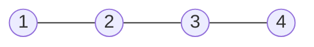
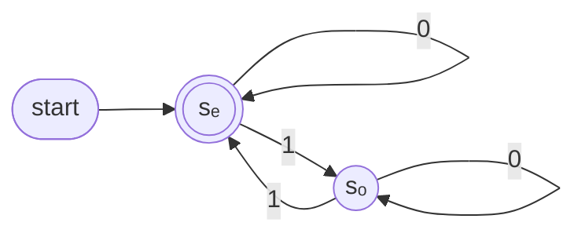
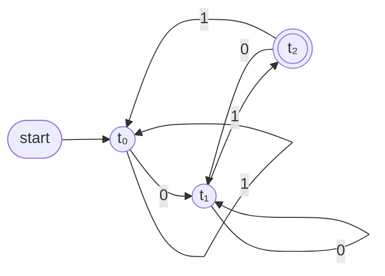
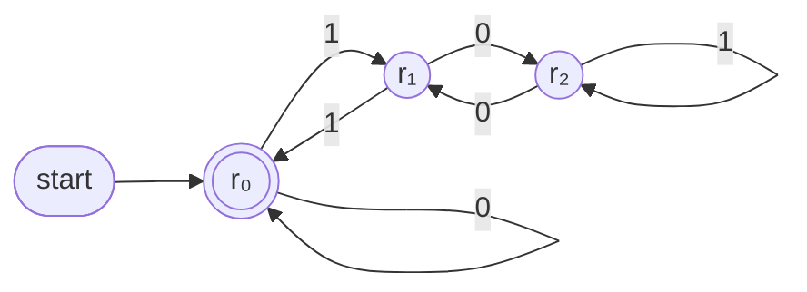
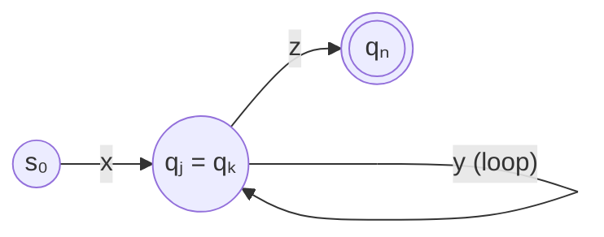

# Chapter 12 — Structures and Finite Automata

[Repository Guide](../../README.md) | [English](Concepts_Lecture.md) | [한국어](Concepts_Lecture.ko.md)

> **Last Updated:** 2026-11-10
>
> Discrete Mathematics with Applications, Epp, Ch 12

> **Learning Objectives:**
> 1. Define vocabularies and structures, represent graphs, orders, and number systems as structures, and determine whether a first-order sentence is true in a structure
> 2. Explain why two isomorphic structures satisfy the same sentences, and show that two structures are not isomorphic with a sentence true in only one of them
> 3. Distinguish finite and infinite structures, write sentences that can be true only in infinite structures and sentences about the number of elements, and explain why finiteness cannot be expressed in first-order logic
> 4. Represent deterministic finite-state automata with transition diagrams and next-state tables, design an automaton that accepts a given language, and trace its computation on input strings
> 5. Explain the definition of regular languages and their closure properties, and build product automata that accept the intersection and union of two regular languages
> 6. State the pumping lemma, prove it with the pigeonhole principle, and use it to prove that a given language is not regular

---

## Table of Contents

- [1. Structures](#1-structures)
  - [1.1 The Same Sentence, Different Worlds](#11-the-same-sentence-different-worlds)
  - [1.2 Vocabularies and First-Order Sentences](#12-vocabularies-and-first-order-sentences)
  - [1.3 Definition of a Structure](#13-definition-of-a-structure)
  - [1.4 Examples of Structures](#14-examples-of-structures)
  - [1.5 Truth of a Sentence in a Structure](#15-truth-of-a-sentence-in-a-structure)
  - [1.6 Isomorphism and Sentences](#16-isomorphism-and-sentences)
- [2. Infinite Structures and Finite Structures](#2-infinite-structures-and-finite-structures)
  - [2.1 Finite Structures and Infinite Structures](#21-finite-structures-and-infinite-structures)
  - [2.2 Sentences That Can Be True Only in Infinite Structures](#22-sentences-that-can-be-true-only-in-infinite-structures)
  - [2.3 Sentences About the Number of Elements](#23-sentences-about-the-number-of-elements)
  - [2.4 Logic on Finite Structures](#24-logic-on-finite-structures)
  - [2.5 Expressing Computational Complexity with Logic: Fagin's Theorem](#25-expressing-computational-complexity-with-logic-fagins-theorem)
- [3. Finite Automata](#3-finite-automata)
  - [3.1 Alphabets, Strings, and Languages](#31-alphabets-strings-and-languages)
  - [3.2 Strings as Finite Structures](#32-strings-as-finite-structures)
  - [3.3 Definition of a Finite-State Automaton](#33-definition-of-a-finite-state-automaton)
  - [3.4 Computation and Acceptance](#34-computation-and-acceptance)
  - [3.5 Designing an Automaton: Binary Numbers Divisible by 3](#35-designing-an-automaton-binary-numbers-divisible-by-3)
  - [3.6 Regular Languages and Closure Properties](#36-regular-languages-and-closure-properties)
- [4. The Pumping Lemma](#4-the-pumping-lemma)
  - [4.1 The Limits of Finite Memory](#41-the-limits-of-finite-memory)
  - [4.2 Statement of the Pumping Lemma](#42-statement-of-the-pumping-lemma)
  - [4.3 Proof of the Pumping Lemma](#43-proof-of-the-pumping-lemma)
  - [4.4 Proving That a Language Is Not Regular](#44-proving-that-a-language-is-not-regular)
  - [4.5 The Converse of the Pumping Lemma Does Not Hold](#45-the-converse-of-the-pumping-lemma-does-not-hold)
  - [4.6 Beyond Finite Automata](#46-beyond-finite-automata)
- [Concept Applications](#concept-applications)
- [Summary](#summary)
- [Self-Check Questions](#self-check-questions)
- [References](#references)

---

<br>

## 1. Structures

### 1.1 The Same Sentence, Different Worlds

Chapter 3 showed that the truth value of a quantified statement depends on the domain of its variables. Consider the following sentence.

```math
\forall x\, \exists y\, (x < y)
```

It means "for every element there is a larger element." If the domain is the set $\mathbf{Z}$ of all integers and $<$ is the usual order, this sentence is true, because for any integer $x$, $y = x + 1$ is larger than $x$. If the domain is $\lbrace 1, 2, 3 \rbrace$, however, it is false, because no element of the domain is larger than $x = 3$. The arrangement of symbols is exactly the same, yet the truth value changes with what the symbols talk about.

Another sentence, $`\exists x\, \forall y\, \sim(y < x)`$, means "there is an element with no element smaller than it, that is, a least element." This sentence is true in the set $\mathbf{Z}^{\text{nonneg}}$ of nonnegative integers (0 is the least element) but false in $\mathbf{Z}$.

To determine the truth value of a sentence, then, two things must be known: the set of objects that the variables can refer to, and what symbols such as $<$ mean on that set. The mathematical object that bundles these two together is a **structure**. The Tarski world of Section 1.10 of Chapter 3 is a good example of a structure. The blocks on the grid form the set of objects, and predicates such as $\text{Triangle}(x)$, $\text{Blue}(x)$, and $\text{RightOf}(x, y)$ have concrete meanings on those blocks. Even the same sentence can change its truth value when the arrangement of blocks changes.

### 1.2 Vocabularies and First-Order Sentences

Before defining structures, first fix the symbols that sentences may use.

> **Definition:** **Vocabulary.** A set of relation symbols, function symbols, and constant symbols to be used in sentences, in which each relation symbol and function symbol has a fixed number of arguments called its **arity**. It is also called a signature.

For example, the vocabulary for talking about graphs is $\lbrace E \rbrace$, consisting of a single relation symbol $E$ of arity 2, and the vocabulary for talking about orders is $\lbrace < \rbrace$. To talk about addition of integers, the vocabulary $\lbrace +, 0 \rbrace$ with a function symbol $+$ of arity 2 and a constant symbol $0$ is used. The vocabulary of the Tarski world consists of relation symbols of arity 1 such as $\text{Triangle}$, $\text{Square}$, $\text{Circle}$, $\text{Blue}$, $\text{Gray}$, $\text{Black}$ and relation symbols of arity 2 such as $\text{RightOf}$. A vocabulary that consists only of relation symbols, with no function or constant symbols, is called a **relational vocabulary**.

Once a vocabulary is fixed, sentences are built by the following rules.

1. Variables and constant symbols are **terms**. If $t_1, \ldots, t_k$ are terms and $f$ is a function symbol of arity $k$, then $f(t_1, \ldots, t_k)$ is also a term.
2. If $t_1, t_2$ are terms, then $t_1 = t_2$ is a formula. If $R$ is a relation symbol of arity $k$ and $t_1, \ldots, t_k$ are terms, then $R(t_1, \ldots, t_k)$ is a formula. These two kinds are called **atomic formulas**.
3. If $\varphi$ and $\psi$ are formulas, then $\sim\varphi$, $\varphi \wedge \psi$, $\varphi \vee \psi$, $\varphi \to \psi$, and $\varphi \leftrightarrow \psi$ are also formulas (the connectives of Chapter 2).
4. If $\varphi$ is a formula and $x$ is a variable, then $`\forall x\, \varphi`$ and $`\exists x\, \varphi`$ are also formulas (the quantifiers of Chapter 3).

Just as Section 6 of Chapter 5 defined sequences recursively, these rules define the set of formulas recursively from simpler formulas. By convention, a relation symbol of arity 2 such as $x < y$ is written in the middle rather than as $<(x, y)$.

> **Definition:** **First-order logic.** The logical system that deals with the formulas built by the rules above and their meanings. It is called first-order because quantifiers range only over the elements of a structure and not over sets or relations of elements. It is a precise refinement of the predicate logic of Chapter 3.

As in Chapter 3, a variable in a formula is a bound variable if it lies within the scope of some quantifier, and otherwise it is a **free variable**. For example, in $`\exists y\, (x < y)`$, $y$ is a bound variable and $x$ is a free variable.

> **Definition:** **Sentence.** A first-order formula with no free variables. Once a structure is fixed, a sentence has exactly one truth value, true or false.

A formula with free variables, like the predicates of Chapter 3, gets a truth value only after values are substituted for its variables. $`\forall x\, \exists y\, (x < y)`$ is a sentence, but $`\exists y\, (x < y)`$ is not.

### 1.3 Definition of a Structure

> **Definition:** **Structure.** A structure $\mathcal{A}$ for a vocabulary $\tau$ consists of a nonempty set $A$ and the following interpretation of each symbol of $\tau$. To a relation symbol $R$ of arity $k$ it assigns a $k$-ary relation $R^{\mathcal{A}} \subseteq A^k$ on $A$, to a function symbol $f$ of arity $k$ it assigns a function $f^{\mathcal{A}}: A^k \to A$, and to a constant symbol $c$ it assigns an element $c^{\mathcal{A}} \in A$. The set $A$ is called the **domain** of the structure.

A structure is usually written by listing the domain and the interpretations side by side, as follows.

```math
\mathcal{A} = (A;\ R^{\mathcal{A}}, \ldots, f^{\mathcal{A}}, \ldots, c^{\mathcal{A}}, \ldots)
```

When the interpretation is clear, the superscripts are omitted, as in $(\mathbf{Z}; <)$ or $(\mathbf{Z}; +, 0)$. In logic, the domain of a structure is also called the **universe**. The ingredients of a structure have all been studied before: the domain is a set of Chapter 6, the interpretations of relation symbols are the $n$-ary relations of Section 1.4 of Chapter 8, and the interpretations of function symbols are the functions of Chapter 7. A structure can thus be described as a single set together with relations, functions, and distinguished elements on it.

> **Caution:** The domain of a structure must be nonempty. If the domain were empty, $`\forall x\, \varphi`$ would always be true and $`\exists x\, (x = x)`$ would be false, and several inference rules of first-order logic would fail. This is an extreme case of the vacuously true statements of Chapter 3.

### 1.4 Examples of Structures

| Structure | Vocabulary | Domain | Interpretation of the symbols |
|:-----|:-----|:-----|:-----|
| $(\mathbf{Z}; <)$ | $\lbrace < \rbrace$ | All integers | The usual order |
| $(\mathbf{Q}; <)$ | $\lbrace < \rbrace$ | All rational numbers | The usual order |
| $(\mathbf{Z}^{\text{nonneg}}; +, \times, 0, 1)$ | $\lbrace +, \times, 0, 1 \rbrace$ | All nonnegative integers | The usual addition, multiplication, 0, 1 |
| Graph $G = (V; E^G)$ | $\lbrace E \rbrace$ | The set $V$ of vertices | $E^G(u, v)$: $u$ and $v$ are joined by an edge |
| Partially ordered set $(A; \preceq)$ | $\lbrace \preceq \rbrace$ | A set $A$ | The partial order relation of Section 4 of Chapter 8 |
| Boolean algebra $(\lbrace 0, 1 \rbrace; +, \cdot, 0, 1)$ | $\lbrace +, \cdot, 0, 1 \rbrace$ | $\lbrace 0, 1 \rbrace$ | The Boolean algebra operations of Section 4 of Chapter 6 |
| Tarski world | $\lbrace \text{Triangle}, \ldots, \text{RightOf} \rbrace$ | The blocks on the grid | The shapes, colors, and positions of the blocks |
| Relational database | Table names | The values appearing in the tables | The set of rows of each table |

*Table 1. Various structures with their vocabularies, domains, and interpretations*

In particular, a simple graph (Section 1.2 of Chapter 10) is naturally a structure for the vocabulary $\lbrace E \rbrace$. Writing the path graph $P_4$ with vertices $\lbrace 1, 2, 3, 4 \rbrace$, in which $1$ and $2$, $2$ and $3$, and $3$ and $4$ are joined, as a structure gives the following. Because the graph is undirected, the ordered pair of every two joined vertices is included in both directions.

```math
P_4 = (\lbrace 1, 2, 3, 4 \rbrace;\ E^{P_4}), \qquad E^{P_4} = \lbrace (1,2), (2,1), (2,3), (3,2), (3,4), (4,3) \rbrace
```



*Figure 1. The path graph P₄ seen as a structure for the vocabulary {E}*

The relational database of Section 1.4 of Chapter 8 is also a structure. A table is a relation whose arity is its number of columns, and the whole database is a finite structure with several such relations. A query posed to the database can be seen as a formula asking about that structure (Section 2.4).

### 1.5 Truth of a Sentence in a Structure

That a sentence $\varphi$ is true in a structure $\mathcal{A}$ is defined recursively, following the construction of formulas. To handle formulas with free variables, a **variable assignment** $s$, which assigns an element of the domain to each variable, is used along the way. $\mathcal{A} \models \varphi[s]$ is read "$`\mathcal{A}`$ satisfies $\varphi$ under the assignment $s$."

| Formula | Condition for $\mathcal{A} \models \varphi[s]$ |
|:-----|:-----|
| $t_1 = t_2$ | The values of $t_1$ and $t_2$ are equal |
| $R(t_1, \ldots, t_k)$ | The ordered $k$-tuple of the values of $t_1, \ldots, t_k$ belongs to $R^{\mathcal{A}}$ |
| $\sim\varphi$ | It is not the case that $\mathcal{A} \models \varphi[s]$ |
| $\varphi \wedge \psi$ | $\mathcal{A} \models \varphi[s]$ and $\mathcal{A} \models \psi[s]$ |
| $\varphi \vee \psi$ | $\mathcal{A} \models \varphi[s]$ or $\mathcal{A} \models \psi[s]$ |
| $\varphi \to \psi$ | It is not the case that $\mathcal{A} \models \varphi[s]$, or $\mathcal{A} \models \psi[s]$ |
| $\varphi \leftrightarrow \psi$ | $\mathcal{A} \models \varphi[s]$ and $\mathcal{A} \models \psi[s]$ both hold or both fail |
| $`\forall x\, \varphi`$ | For every element $a$ of the domain, $\varphi$ is satisfied under the assignment obtained from $s$ by changing only the value of $x$ to $a$ |
| $`\exists x\, \varphi`$ | There is an element $a$ of the domain such that $\varphi$ is satisfied under the assignment obtained from $s$ by changing only the value of $x$ to $a$ |

*Table 2. The recursive definition of when a formula is satisfied in a structure*

The value of a term is the element given by $s$ for a variable, $c^{\mathcal{A}}$ for a constant symbol, and the result of applying $f^{\mathcal{A}}$ to the values of the terms for $f(t_1, \ldots, t_k)$. This definition was first given rigorously by the logician Alfred Tarski [1]. Because a sentence has no free variables, its truth value does not depend on the assignment, and the assignment is then omitted and $\mathcal{A} \models \varphi$ is written.

> **Definition:** **Model.** When a sentence $\varphi$ is true in a structure $\mathcal{A}$, that is, when $\mathcal{A} \models \varphi$, $\mathcal{A}$ is called a model of $\varphi$. If every sentence of a set $\Sigma$ of sentences is true in $\mathcal{A}$, $\mathcal{A}$ is called a model of $\Sigma$.

**Example (Truth Values of Sentences in a Graph Structure).** Determine the truth values of the following sentences in the structure $P_4$ of Figure 1.

| Sentence | Meaning | Truth value and reason |
|:-----|:-----|:-----|
| $`\forall x\, \sim E(x, x)`$ | There are no loops | True. $E^{P_4}$ has no ordered pair of the form $(a, a)$. |
| $`\forall x\, \forall y\, (E(x, y) \to E(y, x))`$ | Edges have no direction | True. For every ordered pair in $E^{P_4}$, the reversed pair is also in $E^{P_4}$. |
| $`\forall x\, \exists y\, E(x, y)`$ | There is no isolated vertex | True. Vertices 1, 2, 3, 4 are joined to 2, 1, 2, 3, respectively. |
| $`\exists x\, \forall y\, (x = y \vee E(x, y))`$ | Some vertex is joined to every other vertex | False. Even vertices 2 and 3, which have the largest degree, have degree 2 and are not joined to all of the other 3 vertices. |
| $`\forall x\, \forall y\, \forall z\, ((E(x, y) \wedge E(y, z) \wedge x \ne z) \to E(x, z))`$ | Distinct vertices reachable through two edges are joined directly | False. $x = 1$, $y = 2$, $z = 3$ is a counterexample. |

*Table 3. Truth values of five sentences in the structure P₄*

The structures that satisfy both the first and the second sentence are exactly the undirected graphs without loops, that is, the simple graphs. In this way, fixing a set of sentences makes all of its models form one class. The partially ordered sets of Chapter 8 are the models of the three sentences of reflexivity $`\forall x\, (x \preceq x)`$, antisymmetry $`\forall x\, \forall y\, ((x \preceq y \wedge y \preceq x) \to x = y)`$, and transitivity $`\forall x\, \forall y\, \forall z\, ((x \preceq y \wedge y \preceq z) \to x \preceq z)`$, and the sets with an equivalence relation are the models of reflexivity, symmetry, and transitivity.

**Example (Expressing Properties of Numbers in an Arithmetic Structure).** In the structure $\mathcal{N} = (\mathbf{Z}^{\text{nonneg}}; +, \times, 0, 1)$, the definitions of Sections 1.2 and 4 of Chapter 4 can be written as formulas with free variables.

| Property | Formula |
|:-----|:-----|
| $x$ is even | $`\exists y\, (x = y + y)`$ |
| $x$ divides $z$ | $`\sim(x = 0) \wedge \exists k\, (z = x \times k)`$ |
| $x \le z$ | $`\exists k\, (x + k = z)`$ |
| $x$ is prime | $`\sim(x = 0) \wedge \sim(x = 1) \wedge \forall y\, \forall z\, (x = y \times z \to (y = 1 \vee z = 1))`$ |

*Table 4. Formulas expressing the properties of numbers of Chapter 4 in an arithmetic structure*

Writing these formulas with the abbreviations $\text{Even}(x)$ and $\text{Prime}(x)$, Goldbach's conjecture, "every even number greater than 2 is the sum of two primes," becomes the following sentence, with 2 written as $1 + 1$.

```math
\forall x\, \Big( \big(\text{Even}(x) \wedge \sim(x = 0) \wedge \sim(x = 1 + 1)\big) \to \exists p\, \exists q\, \big(\text{Prime}(p) \wedge \text{Prime}(q) \wedge x = p + q\big) \Big)
```

This sentence is either true or false in the structure $\mathcal{N}$, but no one yet knows which. That the truth value of a sentence is determined by a structure and that its truth value can be proved are different matters.

> **Key Point:** A sentence is only an arrangement of symbols, and a structure gives the symbols their meaning. The truth value of a sentence is determined only once a structure is fixed, and a set of sentences defines a class of structures, namely all of its models.

The quantifiers of first-order logic range only over the **elements** of the domain. Quantifying over sets or relations of elements, as in "there is a subset $S$ of the vertices such that," does not give a first-order sentence. This restriction creates properties that first-order logic cannot express (Section 2.3), and allowing quantification over sets or relations increases the expressive power (Section 2.5).

### 1.6 Isomorphism and Sentences

The graph isomorphism of Section 3 of Chapter 10 extends to structures in general.

> **Definition:** **Isomorphism.** A one-to-one correspondence $h: A \to B$ between two structures $\mathcal{A}$ and $\mathcal{B}$ for the same vocabulary such that, for every relation symbol $R$ and all elements $a_1, \ldots, a_k$, $(a_1, \ldots, a_k) \in R^{\mathcal{A}}$ if, and only if, $(h(a_1), \ldots, h(a_k)) \in R^{\mathcal{B}}$; for every function symbol $f$, $h(f^{\mathcal{A}}(a_1, \ldots, a_k)) = f^{\mathcal{B}}(h(a_1), \ldots, h(a_k))$; and for every constant symbol $c$, $h(c^{\mathcal{A}}) = c^{\mathcal{B}}$. If there is an isomorphism, the two structures are said to be isomorphic, written $\mathcal{A} \cong \mathcal{B}$.

When the vocabulary is $\lbrace E \rbrace$, this definition is the same as the isomorphism of simple graphs in Section 3.5 of Chapter 10. An isomorphism only renames the elements and carries the shape of the structure over unchanged, so the following theorem holds.

> **Key Point:** **Theorem (Isomorphisms Preserve the Truth Values of Sentences).** If $\mathcal{A} \cong \mathcal{B}$, then for every sentence $\varphi$, $\mathcal{A} \models \varphi$ if, and only if, $\mathcal{B} \models \varphi$.

**Proof Sketch.** For an isomorphism $h$ and an assignment $s$ of $\mathcal{A}$, let $h \circ s$ be the assignment of $\mathcal{B}$ obtained by applying $h$ to each value of $s$. Show by induction on the construction of formulas that, for every formula $\varphi$, "$`\mathcal{A} \models \varphi[s]`$ if, and only if, $`\mathcal{B} \models \varphi[h \circ s]`$." For atomic formulas, writing $t^{\mathcal{A}}[s]$ for the value of a term $t$, one first shows by induction on the construction of terms that $h(t^{\mathcal{A}}[s]) = t^{\mathcal{B}}[h \circ s]$. The condition then follows from the definition of an isomorphism for relation symbols and from the fact that $h$ is one-to-one for equality. The steps for the connectives follow the definitions of Table 2 directly. In the step for $`\exists x\, \varphi`$, the element $a$ used as the value of $x$ in $\mathcal{A}$ corresponds to $h(a)$ in $\mathcal{B}$, and conversely, for an element $b$ of $\mathcal{B}$ there is an $a$ with $h(a) = b$ because $h$ is onto. The step for $`\forall x\, \varphi`$ is the same. Because a sentence has no free variables, the conclusion follows. ∎

The contrapositive of this theorem gives a way to show that two structures are not isomorphic: **if a sentence is true in one structure and false in the other, the two structures are not isomorphic.** This can be described as the isomorphic invariants of Section 3.4 of Chapter 10 written as sentences.

**Example (A Path Graph and a Star Graph).** The graph $P_4$ of Figure 1 and the star graph $K_{1,3}$, in which one vertex is joined to each of the other three, are both trees with 4 vertices and 3 edges (Section 4 of Chapter 10). The sentence $`\exists x\, \forall y\, (x = y \vee E(x, y))`$, however, is true in $K_{1,3}$ with the center vertex as $x$, and false in $P_4$, as seen in Table 3. Hence the two graphs are not isomorphic. For graphs with 4 vertices, this sentence expresses the isomorphic invariant "there is a vertex of degree 3."

**Example (Structures with the Same Cardinality That Are Not Isomorphic).** $\mathbf{Z}^{\text{nonneg}}$, $\mathbf{Z}$, and $\mathbf{Q}$ are all countably infinite and so have the same cardinality (Sections 4.2 and 4.3 of Chapter 7). As order structures, however, no two of them are isomorphic.

- The sentence $`\exists x\, \forall y\, \sim(y < x)`$, stating that there is a least element, is true in $(\mathbf{Z}^{\text{nonneg}}; <)$ and false in $(\mathbf{Z}; <)$. The two structures are therefore not isomorphic. It is also false in $(\mathbf{Q}; <)$, so $(\mathbf{Z}^{\text{nonneg}}; <)$ and $(\mathbf{Q}; <)$ are not isomorphic either.
- The sentence $`\forall x\, \forall y\, (x < y \to \exists z\, (x < z \wedge z < y))`$, expressing density, means "between any two distinct elements there is always another element." It is true in $(\mathbf{Q}; <)$ because $z = (x + y)/2$ exists, and false in $(\mathbf{Z}; <)$ because there is no integer between $x = 0$ and $y = 1$. The two structures are therefore not isomorphic.

That there is a one-to-one correspondence between the domains (same cardinality) and that the correspondence also preserves the relations (isomorphism) are different conditions.

> **Note:** The converse of the theorem does not hold. $(\mathbf{Q}; <)$ and $(\mathbf{R}; <)$ are both dense total orders without endpoints and satisfy exactly the same first-order sentences, but $\mathbf{Q}$ is countable and $\mathbf{R}$ is uncountable (Sections 4.3 and 4.4 of Chapter 7), so there is not even a one-to-one correspondence between their domains [1]. First-order sentences alone may fail to distinguish infinite structures up to isomorphism. Finite structures behave differently (Section 2.4).

---

<br>

## 2. Infinite Structures and Finite Structures

### 2.1 Finite Structures and Infinite Structures

> **Definition:** **Finite structure.** A structure whose domain is a finite set. A structure whose domain is an infinite set is called an **infinite structure**.

Most structures that mathematics has long studied, such as $(\mathbf{Z}; +, 0)$ or $(\mathbf{R}; <)$, are infinite structures. In contrast, most structures dealt with in computer science are finite structures. Graphs, databases, strings (Section 3.2), and arrangements of blocks in a Tarski world given as inputs to algorithms all have finite domains. Among infinite structures, those whose domains are countably infinite ($\mathbf{Z}$, $`\mathbf{Q}`$) are further distinguished from those whose domains are uncountable ($`\mathbf{R}`$) (Section 4 of Chapter 7).

| Structure | Size of the domain |
|:-----|:-----|
| The graph $P_4$ of Figure 1 | Finite (4) |
| Boolean algebra $(\lbrace 0, 1 \rbrace; +, \cdot, 0, 1)$ | Finite (2) |
| Addition modulo $n$, $`(\lbrace 0, 1, \ldots, n - 1 \rbrace; +_n, 0)`$ | Finite ($`n`$) |
| $(\mathbf{Z}^{\text{nonneg}}; <)$, $(\mathbf{Z}; <)$, $(\mathbf{Q}; <)$ | Countably infinite |
| $(\mathbf{R}; <)$ | Uncountable |

*Table 5. Examples of finite and infinite structures*

### 2.2 Sentences That Can Be True Only in Infinite Structures

Some sentences can never be true in a finite structure. The models of such sentences are necessarily infinite structures.

**Example (A Function That Is One-to-One but Not Onto).** In the vocabulary consisting of a single function symbol $f$ of arity 1, consider the following sentence.

```math
\varphi_{\infty} = \forall x\, \forall y\, (f(x) = f(y) \to x = y) \ \wedge\ \exists y\, \forall x\, \sim(f(x) = y)
```

The first part says that $f$ is one-to-one, and the second part says that some element is not an image of $f$, that is, $f$ is not onto. The structure with domain $\mathbf{Z}^{\text{nonneg}}$ in which $f(n) = n + 1$ is a model of this sentence, because $f$ is one-to-one and 0 is not the successor of any element (Section 2.2 of Chapter 7).

A finite structure, however, cannot be a model of $\varphi_{\infty}$. If the domain $A$ is finite, $f: A \to A$ is a function between two finite sets with the same number of elements, so by Theorem 9.4.2 of Chapter 9, if $f$ is one-to-one then it is necessarily onto. Every model of $\varphi_{\infty}$ is therefore an infinite structure.

**Example (A Total Order with No Greatest Element).** In the vocabulary $\lbrace < \rbrace$, let $\sigma$ be the conjunction of the following four sentences.

1. Irreflexivity: $`\forall x\, \sim(x < x)`$
2. Transitivity: $`\forall x\, \forall y\, \forall z\, ((x < y \wedge y < z) \to x < z)`$
3. Comparability: $`\forall x\, \forall y\, (x < y \vee x = y \vee y < x)`$
4. No greatest element: $`\forall x\, \exists y\, (x < y)`$

$(\mathbf{Z}; <)$ is a model of $\sigma$. A finite structure, however, cannot be a model of $\sigma$.

**Theorem (A Finite Total Order Has a Greatest Element).** A structure whose domain is a finite set with $n$ elements and which satisfies 1-3 has an element $m$ satisfying $`\forall y\, \sim(m < y)`$.

**Proof.** Suppose, contrary to the conclusion, that there is no greatest element. [A contradiction must be deduced.] Choose an element $a_0$ of the domain. Since $a_0$ is not a greatest element, there is an $a_1$ with $a_0 < a_1$, and since $a_1$ is not a greatest element either, there is an $a_2$ with $a_1 < a_2$. Continuing in this way gives $n + 1$ elements with $a_0 < a_1 < \cdots < a_n$. By transitivity, $a_i < a_j$ whenever $i < j$, and by irreflexivity, $a_i \ne a_j$ whenever $a_i < a_j$. Hence $a_0, a_1, \ldots, a_n$ are all distinct. But the domain has only $n$ elements, so by the pigeonhole principle (Section 4.1 of Chapter 9) the function $i \mapsto a_i$ from $\lbrace 0, 1, \ldots, n \rbrace$ to the domain cannot be one-to-one. This is a contradiction. ∎

> **Key Point:** Because the pigeonhole principle holds in finite structures, there can be no function that is one-to-one but not onto and no endlessly increasing chain of elements. Sentences describing such situations can be true only in infinite structures.

> **Note:** The German mathematician Richard Dedekind used the property above in reverse to define infinite sets [2]: a set $A$ is called infinite if some one-to-one function from $A$ to itself is not onto. The example above shows that a finite set has no such function, that is, a set that is infinite in this sense is also infinite in the sense of Chapter 7.

### 2.3 Sentences About the Number of Elements

Even with an empty vocabulary, equality alone can express sentences about the number of elements in the domain. For a positive integer $n$, let $\lambda_n$ be the following sentence.

```math
\lambda_n = \exists x_1\, \exists x_2 \cdots \exists x_n \bigwedge_{1 \le i < j \le n} (x_i \ne x_j)
```

$\bigwedge$ denotes the conjunction over all $i$, $j$ satisfying the condition below it. $\lambda_n$ means "there are at least $n$ distinct elements," and the number of inequalities is n choose 2, that is, $\binom{n}{2}$ (Section 5 of Chapter 9). For example, $\lambda_3$ is the following.

```math
\lambda_3 = \exists x_1\, \exists x_2\, \exists x_3\, (x_1 \ne x_2 \wedge x_1 \ne x_3 \wedge x_2 \ne x_3)
```

With $\lambda_n$, various size conditions can be expressed.

| Condition | Sentence |
|:-----|:-----|
| At least $n$ elements | $\lambda_n$ |
| At most $n$ elements | $\sim\lambda_{n+1}$ |
| Exactly $n$ elements | $\lambda_n \wedge \sim\lambda_{n+1}$ |
| The domain is infinite | The set of sentences $\lbrace \lambda_1, \lambda_2, \lambda_3, \ldots \rbrace$ |

*Table 6. Sentences expressing conditions on the number of elements*

As the last row shows, the infinite structures are defined not as the models of one sentence but as the models of the infinite set of sentences $\lbrace \lambda_1, \lambda_2, \ldots \rbrace$. What about the opposite property, "the domain is finite"? That the number of elements is a particular $n$ can be expressed as in the third row of the table, but there is no sentence that is true in every finite structure and false in every infinite structure. Showing this uses the following theorem of first-order logic.

> **Key Point:** **Theorem (Compactness Theorem).** If every finite subset of a set $\Sigma$ of sentences has a model, then $\Sigma$ itself has a model.

The compactness theorem is a basic theorem of first-order logic, and its proof is beyond the scope of this chapter [1].

**Theorem (Finiteness Is Not Expressible in First-Order Logic).** There is no sentence $\varphi$ that is true in every finite structure and false in every infinite structure.

**Proof.** Suppose there were such a sentence $\varphi$. [A contradiction must be deduced.] Consider the set of sentences $\Sigma = \lbrace \varphi, \lambda_1, \lambda_2, \lambda_3, \ldots \rbrace$. For a finite subset $\Sigma_0$ of $\Sigma$, let $N$ be the largest index among the $\lambda_n$ in $\Sigma_0$ ($N = 1$ if there are none). A finite structure with $N$ elements satisfies every $\lambda_n$ ($`n \le N`$) in $\Sigma_0$, and because it is finite it also satisfies $\varphi$. So every finite subset of $\Sigma$ has a model, and by the compactness theorem $\Sigma$ also has some model $\mathcal{A}$. Because $\mathcal{A}$ satisfies every $\lambda_n$, it is an infinite structure, yet it also satisfies $\varphi$. This contradicts the supposition that $\varphi$ is false in every infinite structure. ∎

A slight modification of the same argument shows that there is not even a set of sentences whose models are exactly the finite structures. "Infinite" can be expressed by a set of sentences, but "finite" cannot be expressed even by a set of sentences.

> **Note:** Many properties cannot be expressed in first-order logic even over finite structures. For example, there is no sentence in the empty vocabulary (equality only) or in $\lbrace < \rbrace$ expressing "the number of elements is even," and no sentence in the vocabulary $\lbrace E \rbrace$ expressing "the graph is connected" (Section 1.5 of Chapter 10) [3]. Such results are proved with a tool called the Ehrenfeucht-Fraïssé game. A first-order sentence can grasp only a fixed number of elements with its quantifiers, so it cannot express properties that count all the elements or follow arbitrarily long paths.

### 2.4 Logic on Finite Structures

The field that studies the properties of logic with the domain restricted to finite structures is called **finite model theory** [4]. Narrowing the scope to finite structures changes some of the properties that hold when infinite structures are included.

- **The compactness theorem fails.** Every finite subset of the set of sentences $\lbrace \lambda_1, \lambda_2, \lambda_3, \ldots \rbrace$ of Section 2.3 has a finite model (a finite structure with as many elements as the largest index), but the whole set has no finite model.
- **The sentences that are always true in finite structures cannot all be listed mechanically.** If the vocabulary contains at least one relation symbol of arity 2 or more, the set of sentences true in every finite structure cannot be enumerated completely by any algorithm, which is called Trakhtenbrot's theorem [3]. For vocabularies with only relation symbols of arity 1, this problem can be decided by an algorithm. This contrasts with Gödel's completeness theorem [1], by which the sentences true in every structure can be enumerated by a proof system.
- **Finite structures are distinguished up to isomorphism by sentences.** For a finite structure $\mathcal{A}$ for a finite vocabulary, one can write a single sentence that is true only in the structures isomorphic to $\mathcal{A}$: writing the elements of the domain as $a_1, \ldots, a_n$, put inside $\exists x_1 \cdots \exists x_n$ the conditions that the $x_i$ are distinct and every element is one of them, together with a conjunction listing in terms of the $x_i$ all the relations that hold and do not hold among the elements (including the values of function symbols). Hence if two finite structures satisfy the same sentences, they are isomorphic [4]. What happens with $(\mathbf{Q}; <)$ and $(\mathbf{R}; <)$ in Section 1.6 does not happen with finite structures.

Finite structures are also important because they can be inputs to algorithms. Given a finite structure $\mathcal{A}$ with $n$ elements and a fixed sentence $\varphi$, whether $\mathcal{A} \models \varphi$ can be computed directly from the definition in Table 2. Each quantifier becomes one loop that substitutes the elements of the domain in turn. For example, the sentence $`\exists x\, \forall y\, (x = y \vee E(x, y))`$, "some vertex is joined to every other vertex," is decided in a graph by the following double loop. The graph is assumed to be stored as the adjacency matrix of Section 2 of Chapter 10, so that $E(x, y)$ can be checked in constant time.

```text
for each vertex x:                  # ∃x : true if any succeeds
    ok = true
    for each vertex y:              # ∀y : false if any fails
        if x ≠ y and not E(x, y):
            ok = false
    if ok:
        return true
return false
```

The number of checks of $E(x, y)$ is at most $n^2$. In general, a sentence with $k$ nested quantifiers can be decided with $O(n^k)$ checks (Section 2 of Chapter 11), so every property expressible by a fixed first-order sentence can be decided in polynomial time [3].

> **[Databases]** A relational database is a finite structure, relational algebra has the same expressive power as domain-independent first-order formulas, and the basic queries of SQL are built on it. The query "students who take every course" asks for the $s$ satisfying $`\text{Student}(s) \wedge \forall c\, (\text{Course}(c) \to \text{Takes}(s, c))`$, and a database system turns such formulas into operations such as joins and selections and computes them efficiently [3].

### 2.5 Expressing Computational Complexity with Logic: Fagin's Theorem

As seen in Sections 2.3 and 2.4, first-order logic expresses only some of the properties decidable in polynomial time. The logic that allows quantifiers over relations as well as elements, but only as existential quantifiers placed at the front, is called **existential second-order logic**. For example, the property that a graph can be colored with three colors (the graph coloring of Section 4.8 of Chapter 1) is expressed by the following sentence, in which $R$, $G$, $B$ are relations of arity 1 standing for the sets of vertices colored red, green, and blue.

```math
\exists R\, \exists G\, \exists B\, \Big[ \forall x\, \big(R(x) \vee G(x) \vee B(x)\big) \wedge \forall x\, \forall y\, \Big( E(x, y) \to \sim\big(R(x) \wedge R(y)\big) \wedge \sim\big(G(x) \wedge G(y)\big) \wedge \sim\big(B(x) \wedge B(y)\big) \Big) \Big]
```

In 1974, Ronald Fagin proved that a property of finite structures belongs to the class NP of Section 5.5 of Chapter 11 if, and only if, it can be expressed by a sentence of existential second-order logic [5]. This is called **Fagin's theorem**. The leading existential quantifiers correspond to "guessing a solution," and the first-order part that follows corresponds to "verifying the guessed solution in polynomial time." This result, which defines a complexity class by expressive power of logic alone, without machines or time, started the field called descriptive complexity.

---

<br>

## 3. Finite Automata

### 3.1 Alphabets, Strings, and Languages

Section 2.7 of Chapter 1 defined strings over a finite set. In formal language theory, the finite set from which strings are made is called an alphabet.

> **Definition:** **Alphabet.** A finite set of characters, usually denoted by the Greek letter $\Sigma$. The elements of $\Sigma$ are called characters, and a finite sequence of characters of $\Sigma$ is called a string over $\Sigma$.

The **length** $|w|$ of a string $w$ is its number of characters, and the null string $\lambda$ has length 0. Joining two strings $u$ and $v$ into $uv$ is called **concatenation**. The string obtained by concatenating a character $a$ with itself $n$ times is written $a^n$, with $a^0 = \lambda$. For example, with $\Sigma = \lbrace 0, 1 \rbrace$, $u = 01$, and $v = 110$, $uv = 01110$ and $|uv| = 5$.

> **Definition:** **Kleene closure.** The set of all strings (including the null string) over an alphabet $\Sigma$, denoted $`\Sigma^*`$. It can also be given by a recursive definition: the null string $\lambda$ belongs to $`\Sigma^*`$, and if $`w \in \Sigma^*`$ and $a \in \Sigma$, then $`wa \in \Sigma^*`$.

> **Definition:** **Language.** A set of strings over an alphabet $\Sigma$, that is, a subset of $`\Sigma^*`$.

Examples of languages over $\Sigma = \lbrace 0, 1 \rbrace$ are as follows.

- $`L_1 = \lbrace w \in \Sigma^* \mid w \text{ contains an even number of 1s} \rbrace`$. It contains $\lambda$, $0$, $11$, $0110$, and so on, but not $1$ or $0111$.
- $`L_2 = \lbrace w \in \Sigma^* \mid w \text{ ends in 01} \rbrace`$. It contains $01$ and $1101$ but not $0110$.
- $L_3 = \lbrace 0^n 1^n \mid n \ge 0 \rbrace = \lbrace \lambda, 01, 0011, 000111, \ldots \rbrace$. These are the strings of some number of 0s followed by the same number of 1s.

Because languages are sets, the union, intersection, and complement of Chapter 6 apply directly. The complement is taken with $`\Sigma^*`$ as the universal set, $`\overline{L} = \Sigma^* - L`$.

The textbook also covers **regular expressions** as a way of describing languages. Regular expressions are built from the empty set $\emptyset$, the null string $\lambda$, and each character by recursively applying, to two expressions $r$ and $s$, the alternation $r \mid s$ (either one), the concatenation $rs$ (one after the other), and the Kleene closure $`r^*`$ (zero or more repetitions). For example, $`(0 \mid 1)^* 01`$ describes $L_2$, and $`0^* 1^*`$ describes all strings of 0s followed by 1s. The relation between regular expressions and finite automata is covered in Section 3.6.

### 3.2 Strings as Finite Structures

The structures of Sections 1 and 2 and the strings of this section are connected. A string $w = a_1 a_2 \cdots a_n$ of length $n \ge 1$ can be seen as the following finite structure.

```math
\mathcal{W}_w = (\lbrace 1, 2, \ldots, n \rbrace;\ <,\ (P_a)_{a \in \Sigma}), \qquad P_a = \lbrace i \mid a_i = a \rbrace
```

The domain is the set of positions of the characters, $<$ is the order of the positions, and the relation $P_a$ of arity 1, one for each character, is the set of positions where that character occurs. Such a structure is called a **word structure**. For example, over $\Sigma = \lbrace a, b \rbrace$, the word structure of $w = abba$ has domain $\lbrace 1, 2, 3, 4 \rbrace$, $P_a = \lbrace 1, 4 \rbrace$, and $P_b = \lbrace 2, 3 \rbrace$.

| Position $i$ | 1 | 2 | 3 | 4 |
|:-----|:-----|:-----|:-----|:-----|
| Character $a_i$ | $a$ | $b$ | $b$ | $a$ |
| $P_a(i)$ | True | False | False | True |
| $P_b(i)$ | False | True | True | False |

*Table 7. The word structure of the string abba*

Sentences now express properties of strings, and the set of all strings satisfying a sentence is a language.

- "The first character is $a$": $`\exists x\, (\forall y\, \sim(y < x) \wedge P_a(x))`$
- "Some $a$ is immediately followed by $b$": defining the next position as $`\text{Succ}(x, y) = x < y \wedge \sim\exists z\, (x < z \wedge z < y)`$, the sentence is $`\exists x\, \exists y\, (\text{Succ}(x, y) \wedge P_a(x) \wedge P_b(y))`$

$abba$ satisfies both sentences. The set of all strings satisfying the first sentence is the language described by the regular expression $`a(a \mid b)^*`$.

> **Caution:** Because the domain of a structure must be nonempty (Section 1.3), no word structure corresponds to the null string $\lambda$. When languages are handled through word structures, $\lambda$ is treated separately.

> **Note:** The logic that also allows quantifiers over **sets** of positions in word structures is called monadic second-order logic. In 1960, Julius Richard Büchi proved that the languages definable by sentences of monadic second-order logic are exactly the regular languages of Section 3.6 [6]. This means that the logic of finite structures and finite automata treat the same objects in different languages.

### 3.3 Definition of a Finite-State Automaton

A vending machine changes its state according to the total amount of money inserted, and dispenses a drink when the total reaches the price. What the vending machine remembers is not every coin inserted so far but only its current state. A finite-state automaton is the mathematical definition of such a machine, which has finitely many states and whose next state is determined by the current state and input alone. A computer with $n$ bits of memory also has at most $2^n$ states, so it can be described as a finite-state automaton with a very large number of states.

> **Definition:** **Finite-state automaton.** A machine $A = (\Sigma, S, s_0, F, N)$ consisting of five things: (1) an input alphabet $\Sigma$, a finite set of input symbols; (2) a finite set $S$ of states; (3) an initial state $s_0 \in S$; (4) a set $F \subseteq S$ of accepting states; (5) a **next-state function** $N: S \times \Sigma \to S$ that assigns a next state to each ordered pair of a current state and a current input symbol.

$N(s, a) = t$ means "reading the symbol $a$ in state $s$ moves to state $t$." Because $N$ is a function, the next state is determined uniquely for each state and each symbol. In this sense the machine is also called a **deterministic** finite-state automaton.

> **Note:** The textbook writes the input alphabet as $I$ and gives no separate symbol to the set of accepting states. Many sources write the same five components as $(Q, \Sigma, \delta, q_0, F)$, where $Q$ is the set of states and $\delta$ is the next-state function (transition function) [7].

A finite-state automaton is represented in two ways. A **transition diagram** is a picture that draws states as circles and accepting states as double circles, with one arrow pointing to the initial state and, for each $N(s, a) = t$, an arrow labeled $a$ from $s$ to $t$. A **next-state table** is a table whose rows are the states and whose columns are the input symbols, with the next state written in each cell.

**Example (Strings with an Even Number of 1s).** Consider the language $L_1$ of Section 3.1. When reading a string from the left, all that must be remembered is whether the number of 1s read so far is even or odd. Two states $s_e$ (even) and $s_o$ (odd) therefore suffice. At the start no 1 has been read, so the initial state is $s_e$, and the string is accepted if the automaton ends in $s_e$, so $F = \lbrace s_e \rbrace$. Reading a 0 leaves the count unchanged, and reading a 1 flips its parity.



*Figure 2. Transition diagram of the finite-state automaton A₁ that accepts strings with an even number of 1s (double circles are accepting states)*

| State | Input 0 | Input 1 |
|:-----|:-----|:-----|
| → $s_e$ (accepting) | $s_e$ | $s_o$ |
| $s_o$ | $s_o$ | $s_e$ |

*Table 8. Next-state table of the finite-state automaton A₁ (the arrow marks the initial state)*

### 3.4 Computation and Acceptance

The state an automaton reaches when a string is input is obtained by applying the next-state function one symbol at a time. This is defined recursively.

> **Definition:** **Eventual-state function.** The function $`N^*: S \times \Sigma^* \to S`$ in which $`N^*(s, w)`$ denotes the state reached by starting in state $s$ and reading the symbols of $w$ in order from left to right. Recursively, it is defined by $`N^*(s, \lambda) = s`$ and $`N^*(s, wa) = N(N^*(s, w), a)`$.

By mathematical induction on $|v|$, $`N^*(s, uv) = N^*(N^*(s, u), v)`$ for every state $s$ and all strings $u$ and $v$. This property is used in the proofs of Section 4.

> **Definition:** **Acceptance.** When the automaton, starting in the initial state with input $w$, reaches an accepting state, that is, when $`N^*(s_0, w) \in F`$, $A$ is said to accept $w$. The set of all strings accepted by $A$ is called the language accepted by $A$ and is written $L(A)$.

Two automata that accept the same language are called **equivalent**. Inputting $1011$ to the automaton $A_1$ of Figure 2 gives the following computation.

| Part read | $\lambda$ | $1$ | $10$ | $101$ | $1011$ |
|:-----|:-----|:-----|:-----|:-----|:-----|
| State | $s_e$ | $s_o$ | $s_o$ | $s_e$ | $s_o$ |

*Table 9. State changes of the finite-state automaton A₁ on input 1011*

The last state $s_o$ is not an accepting state, so $1011$ is not accepted. Indeed, $1011$ contains three 1s. That $L(A_1) = L_1$ can be proved by mathematical induction on $|w|$ (Section 2 of Chapter 5) applied to "$`N^*(s_0, w) = s_e`$ if, and only if, the number of 1s in $w$ is even."

**Example (Strings Ending in 01).** Design an automaton $A_2$ that accepts the language $L_2$. What must be remembered is how close the last two characters are to $01$. State $t_0$ means "the string ends in neither $0$ nor $01$," $t_1$ means "the last character is $0$," and $t_2$ means "the last two characters are $01$." From $t_2$, reading a 0 makes the string end in $0$, so it moves to $t_1$, and reading a 1 makes it end in $11$, so it moves to $t_0$.



*Figure 3. Transition diagram of the finite-state automaton A₂ that accepts strings ending in 01*

| Input | Change of state | Result |
|:-----|:-----|:-----|
| $1101$ | $t_0 \xrightarrow{1} t_0 \xrightarrow{1} t_0 \xrightarrow{0} t_1 \xrightarrow{1} t_2$ | Accepted |
| $0110$ | $t_0 \xrightarrow{0} t_1 \xrightarrow{1} t_2 \xrightarrow{1} t_0 \xrightarrow{0} t_1$ | Not accepted |

*Table 10. Computations of the finite-state automaton A₂ on two strings*

### 3.5 Designing an Automaton: Binary Numbers Divisible by 3

The key to designing an automaton is **to remember as the state only the information needed for the rest of the decision**. Build an automaton that decides whether a number written in binary is divisible by 3. The automaton reads the digits of the binary notation starting from the most significant digit.

If $v$ is the number represented by the string read so far, then after reading the next digit $b \in \lbrace 0, 1 \rbrace$ the number is $2v + b$ (the binary notation of Section 5 of Chapter 2). Since only divisibility by 3 matters, it suffices to remember $v \bmod 3$ rather than all of $v$ (Section 5.2 of Chapter 4), because $v \equiv r \pmod 3$ implies $2v + b \equiv 2r + b \pmod 3$ (Section 3.5 of Chapter 8). So let the states be the remainders $r_0$, $r_1$, $r_2$, and define the next state by $N(r_i, b) = r_{(2i + b) \bmod 3}$.

| State | Input 0 | Input 1 |
|:-----|:-----|:-----|
| → $r_0$ (accepting) | $r_0$ | $r_1$ |
| $r_1$ | $r_2$ | $r_0$ |
| $r_2$ | $r_1$ | $r_2$ |

*Table 11. Next-state table of the finite-state automaton A₃ that accepts binary numbers divisible by 3*



*Figure 4. The finite-state automaton A₃ that accepts binary numbers divisible by 3*

For example, inputting $110$ ($`= 6`$) goes $r_0 \to r_1 \to r_0 \to r_0$ and is accepted, and inputting $1011$ ($`= 11`$) goes $r_0 \to r_1 \to r_2 \to r_2 \to r_2$ and is not accepted. Since $11 = 3 \times 3 + 2$, the last state $r_2$ equals the actual remainder.

**Theorem.** For every binary string $w$, $`N^*(r_0, w) = r_{v(w) \bmod 3}`$, where $v(w)$ is the number represented by $w$ and $v(\lambda) = 0$.

**Proof.** The proof is by mathematical induction on $|w|$. If $w = \lambda$, then $`N^*(r_0, \lambda) = r_0`$ and $v(\lambda) \bmod 3 = 0$. Suppose the statement holds for every string of length $k$, and let $w = ub$ ($|u| = k$, $`b \in \lbrace 0, 1 \rbrace`$). By the inductive hypothesis, $`N^*(r_0, u) = r_i`$ with $i = v(u) \bmod 3$, so $`N^*(r_0, ub) = N(r_i, b) = r_{(2i + b) \bmod 3}`$. Since $v(ub) = 2v(u) + b$ and $v(u) \equiv i \pmod 3$, $(2i + b) \bmod 3 = v(ub) \bmod 3$. ∎

Hence the language accepted by $A_3$ is the set of all binary strings representing multiples of 3. The null string is regarded as representing 0 and is accepted.

> **[Digital Logic Design]** A sequential logic circuit is a hardware implementation of a finite-state automaton. $k$ flip-flops store at most $2^k$ states, a combinational circuit computes the next state from the current state and the input, and the state changes at each clock. Designing a sequential circuit with a state diagram and a state table follows the same principle as the automaton design of this section.

### 3.6 Regular Languages and Closure Properties

> **Definition:** **Regular language.** A language accepted by some finite-state automaton.

$L_1$, $L_2$, and the language of binary strings representing multiples of 3 are all regular languages. The textbook presents the following theorem connecting regular languages with regular expressions.

> **Key Point:** **Theorem (Kleene's Theorem).** A language $L$ is accepted by some finite-state automaton if, and only if, $L$ is defined by some regular expression.

The proof of this theorem uses **nondeterministic finite-state automata**, which may have several next states or none. Nondeterministic finite-state automata look more powerful than deterministic ones, but the subset construction, which treats a set of states as a single state, builds a deterministic finite-state automaton accepting the same language, so the range of languages they accept is the same [8].

Regular languages are closed under set operations. This property is also used in Section 4 to show that a language is not regular.

**Theorem (Closure Properties of Regular Languages).** If $L$ and $`L'`$ are regular languages over the same alphabet, then the complement $\overline{L}$, the intersection $`L \cap L'`$, and the union $`L \cup L'`$ are also regular languages.

**Proof.** **Complement.** If $L = L(A)$ with $A = (\Sigma, S, s_0, F, N)$, consider $\overline{A} = (\Sigma, S, s_0, S - F, N)$, which changes only the accepting states. For every $w$, $`N^*(s_0, w)`$ is the same in the two automata, so $w$ is accepted by $\overline{A}$ if, and only if, it is not accepted by $A$. Hence $L(\overline{A}) = \overline{L}$.

**Intersection and union.** Let $`L' = L(A')`$ with $`A' = (\Sigma, S', s'_0, F', N')`$, and build a **product automaton** that runs the two automata simultaneously. Its set of states is the Cartesian product $`S \times S'`$, its initial state is $`(s_0, s'_0)`$, and its next-state function is $`N_\times((s, s'), a) = (N(s, a), N'(s', a))`$. Induction on $|w|$ shows that $`N_\times^*((s_0, s'_0), w) = (N^*(s_0, w), N'^*(s'_0, w))`$. With $`F \times F'`$ as the set of accepting states, it accepts the strings accepted by both automata, that is, $`L \cap L'`$, and with $`(F \times S') \cup (S \times F')`$, it accepts the strings accepted by at least one of them, that is, $`L \cup L'`$. ∎

For example, the product automaton of $A_1$ (2 states) and $A_2$ (3 states) has $2 \times 3 = 6$ states, and with $(s_e, t_2)$ as its only accepting state it accepts the language of "strings that contain an even number of 1s and end in 01."

> **[Compilers]** The lexical analyzer of a compiler describes the forms of tokens such as identifiers, numbers, and reserved words with regular expressions, turns those regular expressions into finite-state automata following the construction of Kleene's theorem, and finds tokens by reading the source code one character at a time. The automata of several tokens are joined into one nondeterministic finite-state automaton and then turned into a deterministic one by the subset construction.

> **Note:** Among the finite-state automata accepting the same regular language, the one with the fewest states is unique except for the names of its states. Section 12.3 of the textbook covers how to find such a minimal automaton by grouping states into equivalence classes of an equivalence relation on states (Section 3 of Chapter 8) [7].

---

<br>

## 4. The Pumping Lemma

### 4.1 The Limits of Finite Memory

The memory of a finite-state automaton is only its current state, and the number of states is finite. It therefore cannot accept a language that requires remembering exactly a number that can grow without bound. The language $L_3 = \lbrace 0^n 1^n \mid n \ge 0 \rbrace$ of Section 3.1 is such an example: to compare with the number of 1s that follow, the automaton must remember how many 0s it has read, and the number of 0s has no upper bound.

**Theorem.** $L_3 = \lbrace 0^n 1^n \mid n \ge 0 \rbrace$ is not a regular language.

**Proof.** Suppose, contrary to the conclusion, that a finite-state automaton $A$ with $k$ states accepts $L_3$. [A contradiction must be deduced.] Consider the states $`N^*(s_0, 0^i)`$ reached on the $k + 1$ strings $0^0, 0^1, \ldots, 0^k$. There are $k + 1$ strings and $k$ states, so by the pigeonhole principle (Section 4.1 of Chapter 9) there are $i$ and $j$ with $i < j$ and $`N^*(s_0, 0^i) = N^*(s_0, 0^j)`$. Because the two strings reach the same state, inputting the same string $1^i$ after them ends in the same state.

```math
N^*(s_0, 0^i 1^i) = N^*\big(N^*(s_0, 0^i), 1^i\big) = N^*\big(N^*(s_0, 0^j), 1^i\big) = N^*(s_0, 0^j 1^i)
```

Since $0^i 1^i \in L_3$, this state is an accepting state, and so $0^j 1^i$ is also accepted. But $j \ne i$, so $0^j 1^i \notin L_3$. This contradicts the supposition that $A$ accepts $L_3$. ∎

Example 12.2.8 of the textbook uses the same argument to show that $\lbrace a^k b^k \mid k \ge 1 \rbrace$ is not regular. The pumping lemma below generalizes this argument.

### 4.2 Statement of the Pumping Lemma

> **Key Point:** **Theorem (Pumping Lemma).** If $L$ is a regular language, then there is a positive integer $p$ such that every string $w$ in $L$ of length at least $p$ can be divided into three parts $w = xyz$ satisfying the following three conditions: (1) $|y| \ge 1$, (2) $|xy| \le p$, (3) $xy^i z \in L$ for every $i \ge 0$.

Here $p$ is called the **pumping length**. The theorem goes back to the 1961 work of Bar-Hillel, Perles, and Shamir [9]. Condition (3) means that the middle part $y$ can be repeated any number of times ($`i \ge 2`$), left as it is ($`i = 1`$), or removed altogether ($`i = 0`$), and the result still belongs to $L$. The name comes from the sense that $y$ can be pumped up and down.

Written with quantifiers, the theorem reads as follows (the multiple quantifiers of Section 3 of Chapter 3).

```math
\exists p \ge 1\ \ \forall w \in L,\ |w| \ge p\ \ \exists x, y, z\ \big(w = xyz \wedge |y| \ge 1 \wedge |xy| \le p\big)\ \ \forall i \ge 0\ \ xy^i z \in L
```

The order of the quantifiers needs attention: $p$ is a value fixed for each language $L$, and the way $x, y, z$ of dividing a string may differ for each $w$.

### 4.3 Proof of the Pumping Lemma

**Proof.** Choose a finite-state automaton $A$ that accepts $L$, and let $p$ be its number of states. Let $w = a_1 a_2 \cdots a_n \in L$ with $n \ge p$. Denote the states passed through while reading $w$ in order as follows.

```math
q_0 = s_0, \qquad q_r = N(q_{r-1}, a_r) \quad (r = 1, 2, \ldots, n)
```

$q_r$ is the state right after reading the first $r$ characters. The first $p + 1$ states $q_0, q_1, \ldots, q_p$ number $p + 1$, while there are $p$ kinds of states, so by the pigeonhole principle there are $j$ and $k$ with $0 \le j < k \le p$ and $q_j = q_k$. Now divide $w$ as follows.

```math
x = a_1 \cdots a_j, \qquad y = a_{j+1} \cdots a_k, \qquad z = a_{k+1} \cdots a_n
```

Since $|y| = k - j \ge 1$ and $|xy| = k \le p$, conditions (1) and (2) hold. Since $`N^*(q_j, y) = q_k = q_j`$, $y$ is a loop that starts in state $q_j$ and returns to $q_j$. By induction on $i$, $`N^*(q_j, y^i) = q_j`$ for every $i \ge 0$ (if $i = 0$, then $y^0 = \lambda$, and $`N^*(q_j, y^{i+1}) = N^*(N^*(q_j, y^i), y) = N^*(q_j, y) = q_j`$). Therefore

```math
N^*(s_0, xy^i z) = N^*\big(N^*(N^*(s_0, x), y^i), z\big) = N^*\big(N^*(q_j, y^i), z\big) = N^*(q_j, z) = N^*(q_k, z) = q_n
```

and since $w \in L$, $q_n$ is an accepting state. Hence $xy^i z \in L$ for every $i \ge 0$. ∎



*Figure 5. Proof of the pumping lemma: the part y between two occurrences of the same state can be repeated or removed and still reach an accepting state*

> **Key Point:** Reading a string whose length is at least the number of states revisits some state by the pigeonhole principle, and the part between the two visits can be repeated any number of times or removed. The pumping lemma turns the limitation of finite memory into a property of languages.

### 4.4 Proving That a Language Is Not Regular

The pumping lemma is the conditional statement "if a language is regular, then the pumping condition holds," so non-regularity is proved with its contrapositive, "if the pumping condition fails, then the language is not regular" (the contrapositive of Chapter 2 and the proof by contradiction of Chapter 4). The negation of the pumping condition is obtained by flipping all the quantifiers with the rules of Section 3.5 of Chapter 3.

```math
\forall p \ge 1\ \ \exists w \in L,\ |w| \ge p\ \ \forall x, y, z\ \big((w = xyz \wedge |y| \ge 1 \wedge |xy| \le p) \to \exists i \ge 0\ \ xy^i z \notin L\big)
```

This negation can be understood as a game between a prover and an adversary.

| Turn | Who | What is done |
|:-----|:-----|:-----|
| 1 | Adversary | Fixes the pumping length $p$ (the prover is regarded as not knowing $p$ and argues for an arbitrary $`p`$) |
| 2 | Prover | Chooses a string $w \in L$ of length at least $p$ |
| 3 | Adversary | Chooses a division $w = xyz$ satisfying conditions (1) and (2) (the prover considers every division) |
| 4 | Prover | Exhibits an $i$ with $xy^i z \notin L$ |

*Table 12. The structure of an argument showing with the pumping lemma that a language is not regular*

If the prover shows a way to win in every case, $L$ is not regular.

**Example ($`0^n 1^n`$).** Suppose $L_3 = \lbrace 0^n 1^n \mid n \ge 0 \rbrace$ is regular, and let $p$ be its pumping length. Choose $w = 0^p 1^p$; then $w \in L_3$ and $|w| = 2p \ge p$. By condition (2), $|xy| \le p$, so $x$ and $y$ lie within the leading $0^p$, and $y = 0^k$ ($`1 \le k \le p`$). Taking $i = 2$ gives $xy^2 z = 0^{p+k} 1^p$, and since $p + k \ne p$, $xy^2 z \notin L_3$. This contradicts the pumping lemma, so $L_3$ is not regular. ∎

**Example (Strings with Equal Numbers of 0s and 1s).** $`L_{eq} = \lbrace w \in \lbrace 0, 1 \rbrace^* \mid w \text{ contains equally many 0s and 1s} \rbrace`$ is not regular either. If $L_{eq}$ were regular, then its intersection with the regular language described by the regular expression $`0^* 1^*`$ would also be regular by the closure property of Section 3.6. But that intersection is the set of all strings of 0s followed by the same number of 1s, that is, $L_3$. This contradicts the previous example. ∎ Closure properties reduce a problem to a language already known to be non-regular.

**Example (Strings Whose Length Is a Perfect Square).** Suppose $L_{sq} = \lbrace 0^{m^2} \mid m \ge 0 \rbrace$ is regular, and let $p$ be its pumping length. Choose $w = 0^{p^2}$; then $|w| = p^2 \ge p$. In any division, $y = 0^k$, and by conditions (1) and (2), $1 \le k \le p$. Taking $i = 2$, the length of $xy^2 z$ is $p^2 + k$, and the following inequality holds.

```math
p^2 < p^2 + k \le p^2 + p < p^2 + 2p + 1 = (p + 1)^2
```

There is no perfect square between the consecutive squares $p^2$ and $(p + 1)^2$, so $xy^2 z \notin L_{sq}$. Hence $L_{sq}$ is not regular. ∎

**Example (Balanced Parentheses).** Consider the language $L_{par}$ of strings of opening and closing parentheses in which the parentheses are correctly matched. Suppose $L_{par}$ is regular, and let $p$ be its pumping length. Choosing the string $`w = \texttt{(}^p \texttt{)}^p`$ of $p$ opening parentheses followed by $p$ closing parentheses, condition (2) forces $y$ to consist only of $k$ opening parentheses ($`1 \le k \le p`$). Taking $i = 0$, $`xz = \texttt{(}^{p-k} \texttt{)}^p`$ has more closing parentheses and is not balanced. Hence $L_{par}$ is not regular. ∎ The reason is that remembering the nesting depth of parentheses requires a counter with no upper bound.

> **Caution:** There are three common mistakes in proofs with the pumping lemma. First, a particular value (such as $`p = 3`$) must not be put in for $p$. The adversary fixes $p$, so the argument must work for an arbitrary $p$. Second, the prover must not choose the division $x, y, z$. It must be shown that for **every** division satisfying conditions (1) and (2), there is an $i$ with $xy^i z \notin L$. Third, it must be checked that the chosen string $w$ belongs to $L$ and has length at least $p$. For example, choosing $w = 1^p 0^p$ for $L_3$ does not work because $w \notin L_3$.

### 4.5 The Converse of the Pumping Lemma Does Not Hold

The pumping lemma is only a necessary condition for regularity, not a sufficient one. There are languages that satisfy the pumping condition but are not regular. Consider the following language over the alphabet $\lbrace a, b, c \rbrace$ [7].

```math
F = \lbrace a^m b^j c^k \mid m, j, k \ge 0, \text{ and if } m = 1 \text{ then } j = k \rbrace
```

**$F$ satisfies the pumping condition.** Take $p = 2$, and split the strings $w = a^m b^j c^k \in F$ of length at least 2 by the number $m$ of $`a`$s. In every case $x = \lambda$, so condition (2) becomes $|y| \le 2$.

| Form of $w$ | Chosen $y$ | Number of $`a`$s in $xy^i z$ | Why it belongs to $F$ |
|:-----|:-----|:-----|:-----|
| $m = 0$ ($`b^j c^k`$) | The first character | 0 | With no $a$, there is no constraint on $j$, $k$ |
| $m = 1$ ($`ab^j c^j`$) | $a$ | 0, 1, 2, … | With 0 or at least 2, there is no constraint, and with 1 it is the original $ab^j c^j$ |
| $m = 2$ ($`aab^j c^k`$) | $aa$ | 0, 2, 4, … | The number never becomes 1 |
| $m \ge 3$ | $a$ | $m - 1, m, m + 1, \ldots$ | The number is at least 2 and never becomes 1 |

*Table 13. Why the language F satisfies the pumping condition with pumping length 2*

**$F$ is not regular.** If $F$ were regular, its intersection with the language of the regular expression $`ab^*c^*`$, $\lbrace ab^j c^j \mid j \ge 0 \rbrace$, would also be regular. Applying the pumping lemma to this language with $w = ab^p c^p$, since $|xy| \le p$, $y$ either contains the $a$ or consists only of $`b`$s. If $y$ contains the $a$, then with $i = 0$ the $a$ disappears and the string is not in the language, and if $y = b^k$, then with $i = 2$ the numbers of $`b`$s and $`c`$s differ. This is a contradiction. ∎

The mere fact that the pumping condition holds therefore does not allow the conclusion that a language is regular. A condition that characterizes regular languages exactly is given by the Myhill-Nerode theorem, which states that the equivalence classes obtained by classifying the prefixes of strings by "which strings can be appended to make the result belong to $L$" are finite in number [7]. Distinguishing $0^i$ from $0^j$ in the proof of Section 4.1 is exactly this idea.

### 4.6 Beyond Finite Automata

Adding a memory with no upper bound to finite-state automata makes it possible to accept wider languages.

| Class of languages | Machine that accepts them | Examples |
|:-----|:-----|:-----|
| Regular languages | Finite-state automata | $`0^* 1^*`$, strings with an even number of 1s |
| Context-free languages | Pushdown automata (finite-state automaton + stack) | $0^n 1^n$, balanced parentheses |
| Decidable languages | Turing machines that always halt | $0^n 1^n 2^n$, strings whose length is a perfect square |
| Turing-recognizable languages | Turing machines (which may not halt) | The language of the halting problem (Section 4.7 of Chapter 6, undecidable) |

*Table 14. Classes of languages and the machines that accept them*

The higher a class is in the table, the narrower it is, and each class is properly contained in the class right below it [7]. For example, the language of the halting problem can be recognized by a Turing machine (halting can be confirmed on inputs that halt) but cannot be decided. Context-free languages also have a pumping lemma, with which it can be shown in a similar way that $0^n 1^n 2^n$ is not context-free [9].

> **[Theory of Computation]** The theory of computation course defines each class of this table by grammars and machines, and treats rigorously the equivalence of pushdown automata and context-free grammars, Turing machines and undecidability, and the P and NP of Section 5.5 of Chapter 11 in terms of the running time of Turing machines. The finite automata and the pumping lemma of this chapter are its starting point.

---

<br>

## Concept Applications

**Judgments by situation:** For each of the following situations, decide which concept or method to use.

| Situation | Judgment | Rationale |
|:-----|:-----|:-----|
| One wants to show that two graphs are not isomorphic. | Find a sentence true in only one of the graphs. | Isomorphisms preserve the truth values of all sentences (Section 1.6). |
| Decide whether $(\mathbf{Z}; <)$ and $(\mathbf{Q}; <)$ are isomorphic. | They are not isomorphic. The density sentence is true only in $\mathbf{Q}$. | Even with the same cardinality, there may be no one-to-one correspondence preserving the relation (Section 1.6). |
| A sentence all of whose models are infinite structures is needed. | Use the sentence $\varphi_{\infty}$ about a function that is one-to-one but not onto. | On a finite set, a one-to-one function is onto (Section 2.2). |
| One wants to write the property that a graph is connected as a first-order sentence. | It cannot be written. | Connectivity is not definable in first-order logic (Section 2.3). |
| Decide a fixed first-order sentence on a large graph. | Compute it with one loop per quantifier. | With $k$ nested quantifiers, the cost is $O(n^k)$ (Section 2.4). |
| A property can be decided by remembering only a fixed amount, not proportional to the input length. | Design a finite-state automaton and keep the information to remember as its states. | Divisibility by 3 requires remembering only three remainders (Section 3.5). |
| Decide the strings that satisfy the conditions of two regular languages at once. | Build a product automaton with $`F \times F'`$ as its accepting states. | Regular languages are closed under intersection (Section 3.6). |
| Decide whether the language of strings with equal numbers of 0s and 1s is regular. | It is not regular. Its intersection with $`0^* 1^*`$ is $0^n 1^n$. | Reduce to a known non-regular language with closure properties (Section 4.4). |
| It has been checked that a language satisfies the pumping condition. | One cannot conclude that it is regular. | The converse of the pumping lemma does not hold (Section 4.5). |

*Table 15. Choosing concepts and methods by situation*

**True/False Check:**

| Statement | Judgment and Reason |
|:-----|:-----|
| The same sentence can have different truth values in different structures. | **T.** $`\forall x\, \exists y\, (x < y)`$ is true in $(\mathbf{Z}; <)$ and false in $(\lbrace 1, 2, 3 \rbrace; <)$. |
| The domain of a structure may be empty. | **F.** The domain of a structure must be nonempty. |
| Two isomorphic structures satisfy the same sentences. | **T.** An isomorphism preserves the satisfaction relation through the whole construction of formulas. |
| Two structures that satisfy all the same sentences are always isomorphic. | **F.** $(\mathbf{Q}; <)$ and $(\mathbf{R}; <)$ satisfy the same sentences but have different cardinalities and are not isomorphic. For finite structures they are isomorphic. |
| In a structure with a finite domain, $f$ can be one-to-one without being onto. | **F.** A one-to-one function between finite sets with the same number of elements is onto (Theorem 9.4.2). |
| "There are exactly 5 elements" can be expressed by a first-order sentence. | **T.** It is $\lambda_5 \wedge \sim\lambda_6$. |
| "The domain is finite" can be expressed by a single first-order sentence. | **F.** By the compactness theorem there is no such sentence. |
| By Fagin's theorem, the properties of finite structures in NP can be expressed in existential second-order logic. | **T.** The converse also holds: the properties expressible in existential second-order logic belong to NP. |
| A finite-state automaton has exactly one next state for each state and each input symbol. | **T.** This is because the next-state function $N: S \times \Sigma \to S$ is a function. |
| The null string is accepted only when the initial state is an accepting state. | **T.** $`N^*(s_0, \lambda) = s_0`$. |
| The complement of a regular language is accepted by the automaton with accepting and non-accepting states swapped. | **T.** The next-state function is the same, so the state reached is the same and only acceptance is reversed. |
| $\lbrace 0^n 1^m \mid n, m \ge 0 \rbrace$ is not a regular language. | **F.** It is the regular language described by the regular expression $`0^* 1^*`$. The numbers need not be equal. |
| In a proof with the pumping lemma, the prover may choose any convenient division $x, y, z$. | **F.** For every division satisfying conditions (1) and (2), an $i$ giving a counterexample must be shown. |
| A language that satisfies the pumping condition is regular. | **F.** The language $F$ of Section 4.5 satisfies the pumping condition but is not regular. |

---

<br>

## Summary

| Concept | Key Summary |
|:-----|:----------|
| Vocabulary and first-order logic | A vocabulary is a set of relation, function, and constant symbols with their arities. First-order formulas are built recursively from atomic formulas with connectives and quantifiers over elements. |
| Sentence | A formula with no free variables, which has a truth value, true or false, once a structure is fixed. |
| Structure | Consists of a nonempty domain and an interpretation of each symbol (a relation, function, or element). Graphs, orders, number systems, databases, and Tarski worlds are all structures. |
| Satisfaction and models | The truth of a formula in a structure is defined recursively along the construction of the formula. A structure in which a sentence is true is called its model, and a set of sentences defines the class of all its models. |
| Isomorphism | A one-to-one correspondence preserving relations, functions, and constants. Isomorphic structures satisfy the same sentences, so a sentence true in only one of them shows they are not isomorphic. The orders of $\mathbf{Z}$ and $\mathbf{Q}$ are distinguished by density. |
| Finite and infinite structures | Distinguished by the size of the domain. Most inputs in computer science (graphs, databases, strings) are finite structures. |
| Sentences true only in infinite structures | Sentences describing a function that is one-to-one but not onto, or a total order with no greatest element, have no finite models because of the pigeonhole principle. |
| Sentences about size | $\lambda_n$ is the sentence saying there are at least $n$ elements. A particular size is expressed by one sentence and infiniteness by a set of sentences, but finiteness cannot be expressed, by the compactness theorem. |
| Finite model theory | On finite structures compactness fails, finite structures are distinguished up to isomorphism by sentences, and a fixed first-order sentence is decided in polynomial time. |
| Fagin's theorem | A property of finite structures belongs to NP if, and only if, it is expressible in existential second-order logic. Three-colorability is an example. |
| Language | A set of strings over an alphabet, that is, a subset of $`\Sigma^*`$. A string can also be seen as a word structure with positions, their order, and character relations. |
| Finite-state automaton | Consists of $(\Sigma, S, s_0, F, N)$ and accepts $w$ if applying the next-state function one symbol at a time gives $`N^*(s_0, w) \in F`$. It is represented by a transition diagram and a next-state table. |
| Designing automata | Remember as the state only the information needed for the decision. Binary numbers divisible by 3 are decided with the remainders $r_0, r_1, r_2$ and $N(r_i, b) = r_{(2i + b) \bmod 3}$. |
| Regular language | A language accepted by a finite-state automaton, which by Kleene's theorem is the same as a language defined by a regular expression. Regular languages are closed under complement, intersection, and union. |
| Product automaton | Runs two automata simultaneously with states $`S \times S'`$. With accepting states $`F \times F'`$ it accepts the intersection, and with $`(F \times S') \cup (S \times F')`$ the union. |
| Pumping lemma | A regular language has a pumping length $p$ such that every string of $L$ of length at least $p$ can be divided as $xyz$ with $\vert y\vert  \ge 1$, $\vert xy\vert  \le p$, and $xy^i z \in L$ for every $i \ge 0$. The proof is the pigeonhole principle on states. |
| Proving non-regularity | For an arbitrary $p$, choose $w$ and show an $i$ giving a counterexample for every division. $0^n 1^n$, strings whose length is a perfect square, and balanced parentheses are not regular. |
| Limits of the pumping lemma | It is only a necessary condition, not a sufficient one. The exact characterization is given by the Myhill-Nerode theorem. |

---

<br>

## Self-Check Questions

1. **Truth values in structures:** Find the truth value of the sentence $`\varphi = \forall x\, \exists y\, (y < x)`$ of the vocabulary $\lbrace < \rbrace$ in $(\mathbf{Z}; <)$, $(\mathbf{Z}^{\text{nonneg}}; <)$, and $(\mathbf{Q}; <)$.

   <details>
   <summary>Answer</summary>

   $\varphi$ means "every element has a smaller element," that is, there is no least element. In $(\mathbf{Z}; <)$ it is true because $y = x - 1$ exists, and in $(\mathbf{Q}; <)$ it is also true because $y = x - 1$ exists. In $(\mathbf{Z}^{\text{nonneg}}; <)$ it is false because no element is smaller than $x = 0$.

   </details>

2. **A graph as a structure:** Write the triangle graph $K_3$, with vertices $\lbrace a, b, c \rbrace$ and edges $a$-$`b`$, $b$-$`c`$, $c$-$`a`$, as a structure for the vocabulary $\lbrace E \rbrace$, and find the truth values of the five sentences of Table 3.

   <details>
   <summary>Answer</summary>

   $K_3 = (\lbrace a, b, c \rbrace; E)$ with $E = \lbrace (a,b), (b,a), (b,c), (c,b), (c,a), (a,c) \rbrace$. There are no loops, so the first sentence is true; every ordered pair has its reverse, so the second is true; every vertex is joined to another, so the third is true. Each vertex is joined to both of the other two vertices, so the fourth is also true. The fifth is also true, because any two distinct vertices are always joined directly.

   </details>

3. **Showing non-isomorphism:** Show with a sentence that $(\mathbf{Z}; <)$ and $(\mathbf{R}; <)$ are not isomorphic, and explain whether cardinality alone gives the same conclusion.

   <details>
   <summary>Answer</summary>

   The density sentence $`\forall x\, \forall y\, (x < y \to \exists z\, (x < z \wedge z < y))`$ is true in $(\mathbf{R}; <)$ ($`z = (x + y)/2`$) and false in $(\mathbf{Z}; <)$ ($x = 0$, $`y = 1`$). So they are not isomorphic. Cardinality also gives the conclusion: $\mathbf{Z}$ is countable and $\mathbf{R}$ is uncountable, so there is no one-to-one correspondence between the domains and hence no isomorphism.

   </details>

4. **Checking an isomorphism:** Give a function showing that the structure $`(\lbrace 0, 1, 2 \rbrace; +_3, 0)`$, built from $`+_3`$ (addition modulo 3) on the domain $\lbrace 0, 1, 2 \rbrace$, is isomorphic to the structure built from composition of rotations on the domain $\lbrace e, r, r^2 \rbrace$. Composition of rotations is $r^a \circ r^b = r^{(a + b) \bmod 3}$, and $e = r^0$.

   <details>
   <summary>Answer</summary>

   Let $h(0) = e$, $h(1) = r$, $h(2) = r^2$, that is, $h(a) = r^a$. $h$ is a one-to-one correspondence, and the constant is preserved since $h(0) = e$. For the function symbol, $`h(a +_3 b) = r^{(a + b) \bmod 3} = r^a \circ r^b = h(a) \circ h(b)`$, so the operation is preserved as well. Hence the two structures are isomorphic.

   </details>

5. **A sentence with only infinite models:** In the vocabulary $\lbrace f \rbrace$ ($f$ of arity 1), write a sentence expressing "$`f`$ is onto but not one-to-one," and explain why all of its models are infinite structures. Also give an example of an infinite model.

   <details>
   <summary>Answer</summary>

   $`\forall y\, \exists x\, (f(x) = y) \wedge \exists x\, \exists x'\, (x \ne x' \wedge f(x) = f(x'))`$. If the domain is finite, $f$ is a function between finite sets with the same number of elements, so by Theorem 9.4.2 an onto function is one-to-one. So there is no finite model. Interpreting $f$ on the domain $\mathbf{Z}^{\text{nonneg}}$ by $f(0) = 0$ and $f(n) = n - 1$ for $n \ge 1$ gives an onto function with $f(0) = f(1) = 0$, which is not one-to-one, so it is a model.

   </details>

6. **A size sentence:** In the vocabulary with equality only, write directly, without using $\lambda_n$, a sentence expressing "there are exactly 2 elements."

   <details>
   <summary>Answer</summary>

   $`\exists x_1\, \exists x_2\, (x_1 \ne x_2 \wedge \forall y\, (y = x_1 \vee y = x_2))`$. The first part says there are two distinct elements, and the second part says every element is one of the two. It has the same meaning as $\lambda_2 \wedge \sim\lambda_3$.

   </details>

7. **Applying the compactness theorem:** In the proof of Section 2.3, give a model of the finite subset $\Sigma_0 = \lbrace \varphi, \lambda_3, \lambda_7 \rbrace$ of $\Sigma$, and explain where the assumption "$`\varphi`$ is true in every finite structure" is used in the proof.

   <details>
   <summary>Answer</summary>

   A finite structure with 7 elements satisfies $\lambda_3$ and $\lambda_7$. By the assumption, $\varphi$ is true in every finite structure, so this structure also satisfies $\varphi$ and is a model of $\Sigma_0$. The assumption is used exactly at this step, that a sufficiently large finite structure satisfies $\varphi$. The assumption "false in every infinite structure" is used to derive the final contradiction.

   </details>

8. **The cost of deciding a sentence:** Describe the loop structure that decides the sentence $`\forall x\, \forall y\, \forall z\, ((E(x, y) \wedge E(y, z) \wedge x \ne z) \to E(x, z))`$ in a graph with $n$ elements, and give an upper bound on the number of atomic formulas checked in $O$-notation.

   <details>
   <summary>Answer</summary>

   Three universal quantifiers are nested, so a triple loop over $x$, $y$, $z$ examines every combination and returns false as soon as one violates the condition. There are $n^3$ combinations and a constant number of atomic formulas are checked per combination, so the number of checks is $O(n^3)$.

   </details>

9. **Tracing a finite-state automaton:** Write the state changes when $0101$ and $0011$ are input to the automaton $A_2$ of Figure 3, and determine whether each is accepted.

   <details>
   <summary>Answer</summary>

   $0101$: $t_0 \to t_1 \to t_2 \to t_1 \to t_2$, so it is accepted (it ends in 01). $0011$: $t_0 \to t_1 \to t_1 \to t_2 \to t_0$, so it is not accepted (it ends in 11).

   </details>

10. **Designing an automaton:** Design a finite-state automaton over the alphabet $\lbrace a, b \rbrace$ that accepts the language of strings not containing $aa$ as a substring, and give its next-state table.

    <details>
    <summary>Answer</summary>

    Let the states be $u_0$ ($aa$ has not occurred and the last character is not $a$, including the null string), $u_1$ (the last character is $a$ and $aa$ has not occurred), and $u_2$ ($aa$ has already occurred). The initial state is $u_0$ and the accepting states are $\lbrace u_0, u_1 \rbrace$. $N(u_0, a) = u_1$, $N(u_0, b) = u_0$, $N(u_1, a) = u_2$, $N(u_1, b) = u_0$, and $N(u_2, a) = N(u_2, b) = u_2$. Once entered, $u_2$ can never be left.

    | State | Input $a$ | Input $b$ |
    |:-----|:-----|:-----|
    | → $u_0$ (accepting) | $u_1$ | $u_0$ |
    | $u_1$ (accepting) | $u_2$ | $u_0$ |
    | $u_2$ | $u_2$ | $u_2$ |

    </details>

11. **A remainder automaton:** Using the method of Section 3.5, write the next-state function of an automaton deciding whether a binary number is divisible by 4, and explain whether an automaton with only two states suffices.

    <details>
    <summary>Answer</summary>

    With the remainders $r_0, r_1, r_2, r_3$ as states, $N(r_i, b) = r_{(2i + b) \bmod 4}$. But divisibility by 4 is determined by whether the last two digits are $00$, so fewer states suffice. Three states are needed, "the last two digits are 00" (including the null string and 0), "only the last digit is 0," and "the last digit is 1"; two states are not enough, because they cannot distinguish ending in $0$ from ending in $00$. Indeed, $\lambda$, $1$, and $10$ are pairwise distinguishable: with nothing appended only $\lambda$ is accepted, and appending $0$ turns $10$ ($`= 2`$) into $100$ ($`= 4`$), which is accepted, but turns $1$ into $10$, which is not. The three strings must reach different states, so the minimal automaton has 3 states.

    </details>

12. **A product automaton:** In the product automaton of $A_1$ of Figure 2 and $A_2$ of Figure 3, write the pairs of states passed through while processing the input $0101$, and determine whether it is accepted when the accepting states are chosen to accept the intersection.

    <details>
    <summary>Answer</summary>

    $(s_e, t_0) \xrightarrow{0} (s_e, t_1) \xrightarrow{1} (s_o, t_2) \xrightarrow{0} (s_o, t_1) \xrightarrow{1} (s_e, t_2)$. The accepting states are $`F \times F' = \lbrace (s_e, t_2) \rbrace`$, so it is accepted. Indeed, $0101$ contains two 1s and ends in 01.

    </details>

13. **Statement of the pumping lemma:** For the regular language $L$ described by the regular expression $`0^* 1`$ (zero or more 0s followed by a single 1), with pumping length $p = 2$, divide $w = 0001$ so that conditions (1)-(3) hold.

    <details>
    <summary>Answer</summary>

    Dividing as $x = \lambda$, $y = 0$, $z = 001$ gives $|y| = 1 \ge 1$ and $|xy| = 1 \le 2$, and $xy^i z = 0^i 001 = 0^{i+2} 1$ belongs to $L$ for every $i \ge 0$. Dividing as $x = 0$, $y = 0$, $z = 01$ also works.

    </details>

14. **Proving non-regularity I:** Prove with the pumping lemma that $L = \lbrace 0^n 1^{2n} \mid n \ge 0 \rbrace$ is not a regular language.

    <details>
    <summary>Answer</summary>

    Suppose it is regular, and let $p$ be its pumping length. $w = 0^p 1^{2p} \in L$ and $|w| = 3p \ge p$. Since $|xy| \le p$, $y = 0^k$ ($`1 \le k \le p`$). With $i = 2$, $xy^2 z = 0^{p+k} 1^{2p}$, and since $2(p + k) \ne 2p$, it does not belong to $L$. This is a contradiction, so $L$ is not regular.

    </details>

15. **Proving non-regularity II:** Prove that the language of palindromes (strings that read the same forward and backward) over the alphabet $\lbrace 0, 1 \rbrace$ is not a regular language.

    <details>
    <summary>Answer</summary>

    Suppose it is regular, and let $p$ be its pumping length. $w = 0^p 1 0^p$ is a palindrome and $|w| = 2p + 1 \ge p$. Since $|xy| \le p$, $y = 0^k$ ($`1 \le k \le p`$) lies within the leading 0s. With $i = 2$, $xy^2 z = 0^{p+k} 1 0^p$, which has $p + k$ 0s before the middle 1 and $p$ 0s after it, so it is not a palindrome. This is a contradiction, so the language of palindromes is not regular.

    </details>

16. **Using closure properties:** Show that if $L$ is not regular, then its complement $\overline{L}$ is not regular either, and use this to show that the language of strings with different numbers of 0s and 1s is not regular.

    <details>
    <summary>Answer</summary>

    If $\overline{L}$ were regular, its complement $\overline{\overline{L}} = L$ would also have to be regular, which is a contradiction. The language of strings with different numbers of 0s and 1s is the complement of $L_{eq}$ of Section 4.4. Since $L_{eq}$ is not regular, its complement is not regular either.

    </details>

17. **Misusing the pumping lemma:** A student wrote: "For $L = \lbrace 0^n 1^n \rbrace$, divide $w = 0^p 1^p$ as $x = \lambda$, $y = 0^p 1^p$, $z = \lambda$; then with $i = 2$, $0^p 1^p 0^p 1^p \notin L$, so $L$ is not regular." Explain what is wrong with this argument.

    <details>
    <summary>Answer</summary>

    Two things are wrong. First, this division has $|xy| = 2p > p$ and violates condition (2). Second, the division is not chosen by the prover; a counterexample must be shown for **every** division satisfying the conditions. The correct argument, as in Section 4.4, derives $y = 0^k$ from $|xy| \le p$ and shows that $i = 2$ is a counterexample for every such division.

    </details>

---

<br>

## References

1. H. B. Enderton, *A Mathematical Introduction to Logic*, 2nd ed. San Diego, CA, USA: Academic Press, 2001.
2. R. Dedekind, *Was sind und was sollen die Zahlen?* Braunschweig, Germany: Vieweg, 1888.
3. L. Libkin, *Elements of Finite Model Theory*. Berlin, Germany: Springer, 2004.
4. H.-D. Ebbinghaus and J. Flum, *Finite Model Theory*, 2nd ed. Berlin, Germany: Springer, 1999.
5. R. Fagin, "Generalized first-order spectra and polynomial-time recognizable sets," in *Complexity of Computation*, SIAM-AMS Proceedings, vol. 7, R. M. Karp, Ed. Providence, RI, USA: American Mathematical Society, 1974, pp. 43-73.
6. J. R. Büchi, "Weak second-order arithmetic and finite automata," *Zeitschrift für Mathematische Logik und Grundlagen der Mathematik*, vol. 6, pp. 66-92, 1960.
7. M. Sipser, *Introduction to the Theory of Computation*, 3rd ed. Boston, MA, USA: Cengage Learning, 2013.
8. M. O. Rabin and D. Scott, "Finite automata and their decision problems," *IBM Journal of Research and Development*, vol. 3, no. 2, pp. 114-125, 1959.
9. Y. Bar-Hillel, M. Perles, and E. Shamir, "On formal properties of simple phrase structure grammars," *Zeitschrift für Phonetik, Sprachwissenschaft und Kommunikationsforschung*, vol. 14, pp. 143-172, 1961.
